# Colaboração multiagente

Os nove capítulos anteriores trataram da construção e do aprimoramento de um único agente: organizar o contexto, conectar conhecimento, ferramentas e canais de interação e, em seguida, elevar a capacidade por meio de avaliação, pós-treinamento e evolução contínua. Para verter o livro inteiro para outro idioma, um mesmo termo precisa ter tradução consistente nos dez capítulos. Com dez membros, um por capítulo, não demora para saírem dez primeiros rascunhos; mas, se o capítulo 4 trocar um termo no meio do caminho, quem vai saber que o capítulo 1 também precisa mudar? Este capítulo parte desse tipo de tarefa — que exige passar o bastão — para discutir como dividir o trabalho, trocar informações e conferir os artefatos uns dos outros.

Em certa ocasião, a OpenAI descreveu o desenvolvimento da capacidade de IA em cinco níveis: interlocutor, raciocinador (Reasoners), agente, inovador e organização (Organizations). O nível “organização” descreve a capacidade de a IA assumir o trabalho de uma organização inteira. Os sistemas multiagente oferecem um caminho para isso: distribuir responsabilidades em torno de um objetivo comum e fazer vários executores colaborarem na conclusão da tarefa.

Entendo que o sentido do multiagente está também em explorar a **inteligência coletiva**. Pela divisão do trabalho, pela colaboração, pelo debate e pelo acúmulo de conhecimento, os seres humanos formaram sociedades e organizações que superam a capacidade de qualquer indivíduo. Um grupo de agentes pode seguir caminho semelhante: cada membro assume uma tarefa local e, por meio da troca e da verificação mútua, o conjunto resolve problemas mais complexos. O *From AGI to ASI*, do Google DeepMind, lista os coletivos multiagente em larga escala como um dos caminhos para a superinteligência e discute como vários sistemas de propósito geral se combinam num todo com capacidade cognitiva maior.[^agi-asi] Nessa direção, mesmo que cada agente alcance apenas o patamar de um especialista humano, um grupo bem organizado pode desenvolver capacidades superiores às do conjunto dos especialistas humanos. Fica então uma questão que a engenharia multiagente precisa investigar por muito tempo: que divisão de trabalho e que mecanismos de comunicação permitem que o grupo produza, de forma sustentada, resultados que superem os de seus membros?

[^agi-asi]: Google DeepMind, *From AGI to ASI.* arXiv:2606.12683, 2026.

## Um quadro de classificação para a colaboração multiagente

Ao entregar o texto ao revisor, o tradutor e o revisor precisam combinar duas coisas. Primeiro, o que o revisor pode ver: apenas a tradução e o glossário, ou também toda a conversa mantida durante a tradução? Segundo, quem tem autoridade para exigir refação quando aparece um erro de tradução. O primeiro ponto determina como o contexto é compartilhado; o segundo, quem entrega trabalho a quem. As duas escolhas são independentes.

### Dimensão 1: o contexto é compartilhado?

**Contexto compartilhado** significa que o papel seguinte aproveita o histórico de conversa, os resultados de chamadas de ferramentas e o estado da tarefa deixados pela etapa anterior. O sistema troca as instruções de papel e a configuração de ferramentas, e o novo papel continua o trabalho. Por exemplo, depois que o analista de requisitos conclui o documento de requisitos, o desenvolvedor recebe o documento e também pode reler o diálogo entre o analista e o usuário. Isso facilita rastrear detalhes; conforme a tarefa avança, porém, é preciso controlar o comprimento do histórico com os métodos de gestão de contexto do Capítulo 2.

**Contexto não compartilhado** significa que cada agente mantém a própria entrada do modelo, o próprio histórico de conversa e o próprio estado da tarefa, e troca informações por interfaces explícitas. Por exemplo, o analista entrega o documento de requisitos ao desenvolvedor, que implementa a funcionalidade a partir do documento e manda mensagem quando algo não está claro. O processo de trabalho de cada um fica em um contexto separado, e o destinatário obtém sob demanda o material relacionado à sua responsabilidade. Interfaces bem definidas também facilitam desenvolver, testar e substituir membros de forma independente.

O desenvolvedor à esquerda da Figura 10-1 quer saber quais arquivos o script de CSV deve processar e pode consultar o diálogo entre o usuário e o analista. O revisor à direita quer confirmar como traduzir um termo e tem em mãos a tradução e o glossário. Se ainda quiser saber por que o tradutor optou por aquela solução, terá de perguntar ou buscar o registro à parte.

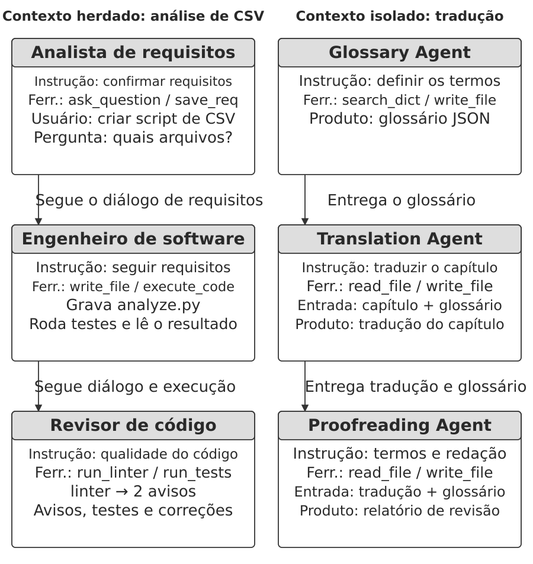

Quando os contextos são independentes, como os membros trocam material entre si? Em sistemas distribuídos, costuma-se usar armazenamento compartilhado ou troca de mensagens. Os sistemas de agentes também recorrem às duas ideias, com estas formas concretas:

- **Parâmetros de chamadas de ferramentas.** O agente a jusante é encapsulado como ferramenta; o agente a montante passa a tarefa e o material estruturado pelos parâmetros e recebe o resultado.
- **Sistema de arquivos compartilhado.** Um lado grava documentos, código ou dados, e o outro lê pela referência; é adequado a artefatos intermediários grandes e a material que precisa persistir.
- **Barramento de mensagens** (Message Bus). O agente entrega a mensagem a um serviço intermediário, que a entrega conforme o destino ou a assinatura; é adequado à troca assíncrona entre vários membros.

Por exemplo, depois de disparar uma tarefa de tradução, o agente a montante pode esperar a tradução voltar ou receber primeiro o número da tarefa e seguir para outro capítulo. Mesmo que os dois tradutores consigam abrir o mesmo arquivo, o sistema ainda precisa definir quem escreve e quando o outro lê. A comunidade Go insiste em organizar o acesso a dados compartilhados por meio de comunicação, e a ideia vale também para agentes: deixar claro quem é dono do estado, quem pode modificá-lo e como os demais ficam sabendo das atualizações.

### Dimensão 2: topologia de colaboração

A topologia de colaboração descreve as dependências de tarefa, o fluxo de informação e as relações de controle entre agentes. Este capítulo adota três formas típicas de organização:

- **Padrão de colaboração entre pares** (Peer Collaboration Pattern). Poucos membros colaboram repetidamente em torno de um mesmo artefato. Por exemplo, o redator conclui o rascunho do artigo, o comentarista sugere mudanças e o redator faz a revisão.
- **Padrão gerenciador** (Orchestration Pattern). Um agente gerenciador centralizado divide, distribui e consolida as tarefas, enquanto os subagentes cuidam do trabalho especializado de cada um.
- **Padrão descentralizado** (Decentralized Pattern). Os membros continuam o trabalho com base em papéis, mensagens e estado local, e decidem em conjunto como o trabalho avança.

> **Nota de terminologia: engenharia de grafos.** O Capítulo 1 apresentou a discussão de julho de 2026 sobre engenharia de grafos. Essa perspectiva olha para o grafo de execução: os nós podem ser agentes, programas comuns ou decisões humanas; as arestas expressam dependências, roteamento condicional e caminhos de tratamento de falhas; e o estado flui pelas relações de execução. A topologia de colaboração multiagente é uma das aplicações dessa visão de projeto, e o foco está em como várias unidades de decisão fazem a passagem de bastão, trabalham em paralelo e se realimentam.

Colaboração entre pares, padrão gerenciador e projeto descentralizado podem ser combinados. Por exemplo, o Manager entrega uma tarefa de redação a um grupo de redator e revisor, e o grupo submete o resultado depois de iterar internamente.

## Quando o multiagente supera o agente único

Suponha que o primeiro rascunho traga um termo técnico traduzido errado. Dar o mesmo texto a dois revisores pode render duas aprovações idênticas; dar a um deles, além da tradução, o original, o glossário e o código que usa o termo abre mais um caminho para encontrar o erro. Ao escolher a forma de colaboração, a primeira pergunta é: o que o novo agente acrescenta à tarefa? Ele pode obter novas evidências, cobrir outra rota de busca, oferecer um julgamento profissional diferente ou reduzir a espera por meio da execução paralela.

Começo verificando o **ganho de informação do feedback** e só depois avalio quanto a paralelização e o isolamento de contexto podem render. Ao ler resultados de teste, capturas de tela da página ou material externo, o revisor pode propor mudanças com base em evidências que não existiam no momento da geração. A Tabela 10-1 usa alguns cenários comuns para mostrar como verificar esse ganho.

Tabela 10-1 Informação e feedback na colaboração multiagente

| Forma de colaboração | Principal fonte de informação | O que avaliar |
|---|---|---|
| O mesmo modelo revisa a própria saída | Material original e um novo processo de verificação | Se encontra omissões e se a correção melhora o resultado |
| Vários agentes debatem a mesma questão | Caminhos de solução, hipóteses e argumentos de cada um | Se as opiniões divergem e como verificar e escolher uma resposta |
| O revisor roda testes e examina o código | Compilação, testes e feedback de execução | Se a correção passa nos testes e preserva o que já funcionava |
| O revisor examina o resultado renderizado de uma interface ou de um PPT | Capturas de tela e feedback de interação | Se layout, conteúdo e operação atendem ao pedido |
| O revisor confirma fatos com ferramentas externas | Buscas e registros de sistemas corporativos | Se a fonte é confiável e se a conclusão coincide com a evidência |

RLEF treinou um modelo por aprendizado por reforço para usar o feedback da execução de código e aprender revisões de vários passos em tarefas de programação competitiva. Erros de compilação, falhas de teste e exceções em execução fornecem base concreta para a próxima correção, e o modelo do artigo obtém resultados melhores com menos amostragem.[^rlef-2025] O WebGen-Agent, por sua vez, liga ao processo de geração as capturas de tela da página, as descrições e sugestões de um modelo visual e a avaliação de operações de GUI: é possível voltar uma etapa e refazer ou escolher o melhor entre vários resultados gerados. No WebGen-Bench, a acurácia do Claude 3.5 Sonnet subiu de 26,4% para 51,9%.[^webgen-agent-2025]

[^rlef-2025]: Gehring, J., et al. *RLEF: Grounding Code LLMs in Execution Feedback with Reinforcement Learning.* arXiv:2410.02089, 2025.

[^webgen-agent-2025]: Lu, Z., et al. *WebGen-Agent: Enhancing Interactive Website Generation with Multi-Level Feedback and Step-Level Reinforcement Learning.* arXiv:2509.22644, 2025.

Costumo primeiro fazer o sistema obter evidências concretas — testes, capturas de tela, retornos de ferramentas — e só então decidir como distribuir as responsabilidades de geração, execução e revisão. O ciclo de feedback pode ser cumprido por um único agente ou repartido entre vários papéis; acrescentar papéis deve melhorar a obtenção e o uso das evidências.

Um estudo de segurança da Anthropic de 2026 oferece um caso de busca colaborativa: 45 agentes trocavam descobertas por um fórum compartilhado e revisavam uns aos outros, e um agente independente arbitrava os resultados. No relatório, o cluster colaborativo consumiu 27 milhões de tokens e encontrou 266 vulnerabilidades; a alternativa paralela independente consumiu 6,5 milhões de tokens e encontrou 21. O fórum permitia que cada membro continuasse a partir das descobertas dos outros e soubesse quais direções já estavam em andamento. O grupo colaborativo também gastou cerca de quatro vezes mais tokens, de modo que a diferença entre 266 e 21 envolve tanto a forma de comunicação quanto o esforço computacional.[^anthropic-multiagent-2026]

[^anthropic-multiagent-2026]: Anthropic Frontier Red Team, “Patterns and Problems in Emerging Multiagent Systems,” 2026-08-13.

Na pesquisa matemática, como fazer várias equipes explorarem de fato rotas distintas? As equações de Navier–Stokes em três dimensões descrevem o movimento de fluidos viscosos. Diante de uma condição inicial suave, a solução se mantém suave para sempre? A OpenAI distribuiu dois objetivos opostos entre grupos diferentes: alguns tentavam provar a suavidade, outros buscavam construir um contraexemplo. Cada grupo explorou por conta própria e a equipe usou o Codex para consolidar os resultados intermediários, de modo que os demais grupos pudessem seguir pistas promissoras. O grupo que encontrou o contraexemplo chegou a ter cerca de dez mil agentes trabalhando em paralelo. Do lançamento dos primeiros agentes até a prova, a equipe relata cerca de 88 horas, mais 17 horas para a formalização e a verificação em Lean. O contraexemplo tinha uma condição importante: o fluido, sob a ação de uma força externa suave, ainda assim desenvolve uma singularidade em tempo finito. Com isso, a equipe apresentou o contraexemplo exigido pelas duas formulações, C e D, do enunciado do Clay Mathematics Institute; sem a força externa, trata-se de outro problema. Ao projetar esse tipo de busca, vale primeiro explicitar quais resultados bastam para responder à pergunta original, distribuir conjeturas concorrentes entre grupos distintos e reservar um tempo separado para a verificação final.[^ch10-ns-search]

[^ch10-ns-search]: A nota de pesquisa da OpenAI, *On the Navier–Stokes Millennium Prize Problem*, traz a prova e o código Lean. O Clay Mathematics Institute respondeu ao trabalho em comunicado de 11 de setembro de 2026 e informou que a avaliação dos resultados e a atribuição de prêmios seguirão o procedimento previsto.

**Como o orçamento de passos afeta o desempenho?** Se uma tarefa permite 30 passos, o agente precisa encaixar planejamento, implementação central e verificação necessária; se permite 300, há espaço para comparar mais alternativas, testar e revisar com mais folga. Para aproveitar esses recursos, o agente também precisa saber o orçamento total e o restante e, a partir disso, dimensionar a profundidade da exploração.

O Google estudou essa questão em 2025, em *Budget-Aware Tool-Use Enables Effective Agent Scaling*: um agente sem consciência de orçamento pode parar cedo numa busca superficial e, mesmo com mais passos disponíveis, tem dificuldade de melhorar. Em 2026, o BAVT (Budget-Aware Value Tree Search) passou a combinar estimativa de valor e orçamento restante nos passos de busca, ajustando o peso entre explorar e aproveitar. Com orçamento folgado, comparam-se mais direções; perto do limite, os recursos se concentram nos ramos promissores.

No padrão gerenciador, isso significa que o Manager precisa distribuir os passos conforme a dificuldade da tarefa e ajustar ao longo do caminho: tarefas simples são entregues o quanto antes, tarefas complexas reservam espaço para verificação e revisão e, diante de um bloqueio, primeiro se localiza a causa para então decidir entre complementar informações, aumentar o orçamento ou trocar de rota.

A exploração paralela encurta o tempo de relógio, e a revisão repetida melhora o artefato, mas ambas aumentam o custo de chamadas ao modelo e de comunicação. Parto de um agente único já ajustado como linha de base e só amplio a escala da colaboração quando o ganho de qualidade ou a economia de tempo trazidos pelos novos membros cobrem o custo de comunicação, de computação repetida e de manutenção.

## Colaboração multiagente com contexto compartilhado

A colaboração com contexto compartilhado troca de papel por etapa e aproveita o registro da tarefa já existente. Tomemos um relatório de pesquisa: o papel de busca coleta o material, o papel de análise faz os cálculos e o papel de redação organiza a expressão. Cada papel pode reler as fontes e as decisões anteriores, e o sistema orienta o foco da etapa por meio da instrução de tarefa vigente.

Na passagem entre equipes, a primeira pergunta é: quem precisa saber por que se decidiu assim na época? No exemplo de produto da Teamily AI, o gerente de produto e o agente escrevem juntos o documento de requisitos de produto (PRD) no grupo. Depois que a equipe de produto compartilha a versão final com a equipe de engenharia, os engenheiros podem perguntar quais concessões estão por trás de determinado requisito.

Tomemos a passagem do papel de busca para o papel de redação: depois da transferência, onde o modelo lê as regras de redação e quais ferramentas ainda pode chamar? O Experimento 10-1 implementa a mesma transferência de duas maneiras.

| Questão da transferência | Troca de papel (`transfer_to_agent`) | Carregar uma Skill |
|---|---|---|
| Como fornecer as regras de redação? | Trocar pelo prompt de sistema do papel de redação | Manter o catálogo de Skills no prompt de sistema e anexar as regras de redação ao fim do histórico de mensagens |
| Quais ferramentas o modelo vê? | É possível mostrar só as ferramentas do papel de redação | Pode-se manter o conjunto original ou a entrada de busca de ferramentas |
| Que trecho do cache KV ainda serve? | O prompt de sistema mudou; em geral é preciso recalcular a partir do ponto em que o prefixo muda | O prefixo original da requisição continua reutilizável |
| Quem verifica a permissão de chamada? | O Harness valida a requisição conforme o papel atual e então despacha a ferramenta | O Harness verifica a permissão de cada chamada de forma independente |

Quando a diferença entre papéis está sobretudo em conhecimento, processo e estilo de escrita, prefiro usar Skills: fica mais fácil reaproveitar o mesmo arcabouço de execução e preservar o cache de um prefixo de requisição estável. Quando a diferença envolve permissões, isolamento de ferramentas ou responsabilidade de aprovação, a organização pode se dar por agentes separados ou por troca de papel, com o Harness e o ambiente de execução aplicando o controle de acesso. O fato de a ferramenta aparecer ou não na entrada do modelo influencia a escolha da chamada; a permissão efetiva é decidida pela validação em tempo de execução.

> **Experimento 10-1 ★★: troca de papéis com contexto compartilhado — prompt de sistema versus Skill**
>
> Os dois caminhos usam o mesmo modelo, a mesma tarefa do usuário, a mesma implementação de ferramentas, as mesmas regras de papel e o mesmo histórico compartilhado. A demonstração inicial pede para buscar as vendas de veículos de nova energia na China de 2021 a 2023, calcular a taxa de crescimento anual composta (CAGR) e escrever um resumo para investidores com no máximo 120 caracteres.
>
> **Caminho 1: troca de prompt de sistema.** São definidos cinco papéis: triage (coleta de requisitos), research (busca), coding (programação), data_analysis (análise) e writing (redação). O triage é a porta de entrada, e cada papel vê ferramentas próprias e `transfer_to_agent`. Na transferência, o histórico é preservado, o prompt e o conjunto de ferramentas do papel de destino são carregados e a execução continua.
>
> **Caminho 2: carregar uma Skill.** O prompt de sistema e o conjunto completo de ferramentas permanecem estáveis durante a sessão. O modelo chama `load_skill(name)` para obter as regras do papel, e o conteúdo entra no histórico compartilhado como resultado de ferramenta, preservando o prefixo original. O Harness verifica cada chamada de ferramenta conforme as regras de permissão.
>
> As duas implementações leem o mesmo `SKILL.md`. Capture uma requisição enviada ao modelo antes e outra depois de uma troca de papel e veja em qual mensagem as regras aparecem e que trecho do prefixo ainda pode ser reaproveitado. Depois confira os dois resumos: a fonte das vendas é confiável? Do fim de 2021 ao fim de 2023 há dois períodos de crescimento: a taxa composta foi calculada corretamente?
>
> No confronto formal havia um pedido de resumo mais rígido, limitado a 160 caracteres e com a exigência de manter dois endereços de fonte. Com os mesmos oito passos disponíveis, o grupo que troca de papel gastou três chamadas contando caracteres, o rascunho ainda ficou com 206 caracteres e a ferramenta de cálculo indicada no enunciado não foi usada. O grupo que carrega Skills calculou a taxa com as vendas do primeiro e do último ano e só no oitavo passo carregou as regras de redação. Nesse ponto todos os papéis previstos já tinham sido percorridos, mas o usuário ainda não havia recebido o resumo. As duas trajetórias terminaram por atingir o limite de passos.
>
> As mesmas 30 tarefas foram executadas nas duas implementações, com verificação automática da entrega: o grupo que carrega Skills passou em 15, e o grupo que troca o prompt de sistema passou em 2. Na comparação tarefa a tarefa, porém, o primeiro grupo teve 6.855 tokens a mais de entrada sem cache e levou cerca de 4,4 segundos a mais (medianas das diferenças pareadas). Nesta execução, o provedor reportou zero tokens de entrada em cache nas requisições dos dois grupos. Os dois grupos passaram em todos os seis testes de casos-limite de aderência às instruções, embora as taxas de aprovação nas tarefas completas tenham sido muito diferentes.

## Colaboração multiagente sem contexto compartilhado

Na arquitetura de contextos independentes, cada agente mantém o próprio histórico de entrada, o próprio estado da tarefa e o próprio loop de execução, e troca o que precisa por parâmetros de ferramentas, arquivos compartilhados e mensagens. Por exemplo, o material entregue pelo tradutor deve indicar o parágrafo do original e a versão do glossário. Mesmo que o tradutor saia, o revisor encontra o original; se for preciso refazer, ainda é possível localizar o responsável por capítulo.

A Tabela 10-2 compara como um sistema operacional gerencia processos e como um runtime gerencia agentes.

Tabela 10-2 Analogia de projeto entre um sistema multiagente e um sistema operacional

| Sistema operacional | Responsabilidade equivalente em um sistema multiagente |
|---|---|
| Programa e configuração | Prompt de sistema, definição de ferramentas e configuração de papéis |
| Memória do processo | Contexto atual, estado da tarefa e histórico |
| CPU executando cálculos | O LLM gera decisões; o runtime e as ferramentas executam as operações |
| Kernel gerenciando a execução | O runtime do agente gerencia estado, escalonamento e recursos |
| Chamada de sistema | Solicitação de operações externas pela interface de ferramentas |
| fork: criar processo filho | `spawn_subagent`: criar subagente |
| kill: enviar sinal | `cancel_subagent`: solicitar cancelamento |
| ps: consultar processos | `list_agents`: consultar membros e estado de execução |
| Código de saída e wait | Notificação de conclusão, estado da tarefa e resultado estruturado |
| Armazenamento compartilhado e troca de mensagens | Arquivos compartilhados, parâmetros de ferramentas e mensagens |

Estado privado, mensagens assíncronas e criação dinâmica de membros também aparecem no modelo de atores proposto na década de 1970.[^actor-model]

[^actor-model]: Hewitt, C., Bishop, P., Steiger, R. *A Universal Modular ACTOR Formalism for Artificial Intelligence.* IJCAI 1973.

Quando há muitas subtarefas independentes, tendo a dar a cada membro um contexto próprio, para que trate apenas do material relacionado à sua responsabilidade. Isso facilita testar cada papel separadamente, reduz a interferência de um histórico longo da etapa anterior sobre o julgamento atual e permite que várias tarefas avancem ao mesmo tempo. O efeito do isolamento também depende de outros recursos compartilhados: vários agentes ainda podem alterar o mesmo arquivo ao mesmo tempo, consumir a mesma cota de API ou receber a mesma mensagem de erro.

A interface de colaboração também precisa lidar com mensagens perdidas, entregas duplicadas e estado atrasado. Na investigação de problemas, o identificador da tarefa permite correlacionar requisições, eventos de ferramenta e resultados de cada membro e reconstruir o percurso de uma transferência.

Suponha que um agente termine a análise e precise passar o resultado ao colega que escreve o relatório. Se os números são poucos, podem ir na própria mensagem; se o artefato é uma tabela grande, o usual é gravá-la no sistema de arquivos compartilhado e anexar a referência à mensagem. Daí resultam duas divisões de trabalho. O **armazenamento de artefatos** guarda e troca documentos, código e dados; a **comunicação e o controle** cuidam de entregar mensagens, consultar o estado da tarefa, cancelar execuções e escalonar recursos.

### O sistema de arquivos visto pelo agente

Um projeto comum é oferecer ao agente um **sistema de arquivos virtual** (virtual filesystem), que monta recursos de origens diferentes numa árvore de diretórios unificada. O modelo acessa tudo por interfaces como `read_file`, `write_file` e `list_dir`, e por baixo pode haver disco temporário local, armazenamento persistente de objetos, a API de um serviço de nuvem de terceiros ou pacotes de recursos do sistema.

Delimito primeiro as áreas de armazenamento e só então conecto o fluxo de colaboração. Se rascunhos temporários, entregas oficiais e arquivos externos do usuário ficam misturados, é fácil sobrescrever algo por engano ou ler o que não se deveria. A interface unificada é cômoda; a visibilidade, o ciclo de vida e as permissões de cada área ficam a cargo da configuração de montagem e de controle de acesso. Essa árvore pode ser dividida em quatro tipos de área.

**I. Espaço de trabalho exclusivo do agente (Scratchpad).** Cada instância usa o próprio espaço de trabalho para guardar rascunhos, arquivos temporários, logs de depuração e artefatos intermediários. Por padrão, o acesso fica restrito ao agente dono, e a limpeza ou o arquivamento seguem a política da tarefa. Assim se evita que arquivos temporários se sobrescrevam; quando o subagente termina, coloca no espaço compartilhado o que precisa ser entregue e o passa ao agente principal com um resumo estruturado. O registro das tentativas fica no espaço de origem, para diagnóstico posterior. Isso leva o isolamento de contexto à camada de armazenamento: o agente principal obtém o resultado entregue e as evidências necessárias e, na coordenação do dia a dia, poupa o custo de ler todas as tentativas e erros.

**II. Espaço compartilhado multiagente (Shared Workspace).** Aqui os membros trocam artefatos, e o usuário também pode enviar material e baixar entregas por um acesso autorizado. Por exemplo, o Glossary Agent grava o glossário, o Translation Agent o lê para traduzir e o revisor confere a tradução. Em geral o espaço compartilhado persiste junto com a tarefa e precisa lidar com gravações concorrentes, atualização de versões e escopo de acesso. No Capítulo 6, o agente e o computador virtual trocavam CSV e gráficos por armazenamento compartilhado, um exemplo desse tipo de passagem de artefatos. Mais adiante veremos métodos como bloqueio otimista e isolamento por cópias de trabalho.

**III. Recursos externos montados (Mounted External Resources).** Google Drive, Notion, Dropbox, wikis corporativas e recursos semelhantes podem ser mapeados para a interface unificada por meio de adaptadores. Quando o agente lê um documento, o adaptador chama a API do sistema de origem. Três diferenças precisam ser gerenciadas: o escopo de acesso depende da autorização externa; o acesso pela rede traz latência, tempo limite e problemas de atualização de cache; e a gravação de volta precisa respeitar as regras de permissão e de versão do sistema de origem. A semântica de consistência exata é definida pela interface do serviço, e números de versão, gravação condicional ou nova leitura permitem detectar modificações concorrentes. A montagem somente leitura sob demanda serve à consulta de material; a permissão de escrita é concedida quando for preciso editar.

**IV. Recursos internos do sistema (Built-in System Resources).** Manuais de referência, modelos, definições de ferramentas e Skills pré-instaladas podem ser oferecidos a vários agentes como pacotes de recursos somente leitura. As Skills são carregadas por revelação progressiva: primeiro o catálogo, depois as regras e os scripts conforme a tarefa. Pacotes com versão fixa facilitam a leitura concorrente, e a atualização por troca de versão mantém coerentes as tarefas em andamento.

Na Figura 10-2, o tradutor pode reescrever o rascunho quantas vezes quiser no próprio diretório e, quando estiver pronto para a revisão, coloca a versão correspondente na área compartilhada. O original na nuvem do usuário é lido pelo adaptador externo, e o acesso a ele ainda depende da permissão concedida pelo usuário.

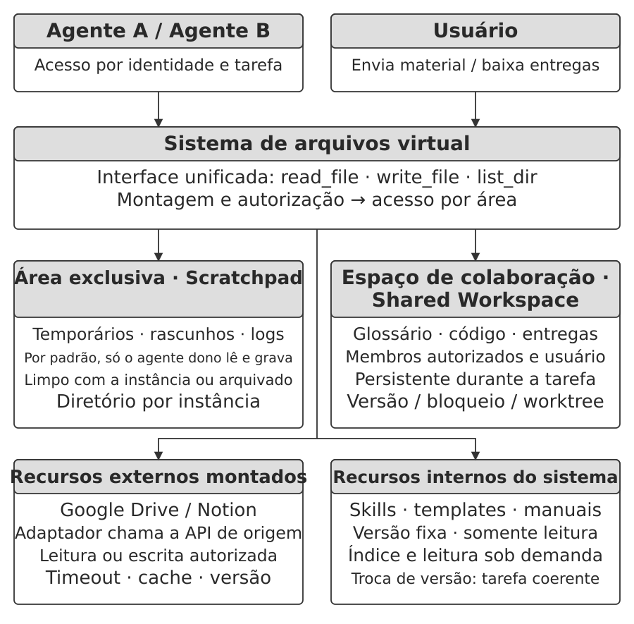

Quando o tradutor sai, os arquivos temporários de seu espaço de trabalho podem ser liberados junto. A tradução colocada na área compartilhada continua guardada, e o revisor assume o trabalho com permissão de leitura (Tabela 10-3).

Tabela 10-3 As quatro áreas do sistema de arquivos virtual do agente

| Área | Visibilidade | Ciclo de vida | Leitura e escrita | Gestão de concorrência |
|---|---|---|---|---|
| Espaço de trabalho exclusivo do agente | Por padrão, só o agente dono | Limpo com a instância, arquivado quando preciso | Leitura e escrita pelo agente dono | Evitar gravação duplicada por novas tentativas ou operações em segundo plano |
| Espaço compartilhado multiagente | Membros e usuários autorizados | Persiste com a tarefa | Autorização por papel | Bloqueio, verificação de versão ou worktree |
| Recursos externos montados | Limitada pela autorização externa e pelo adaptador | Definido pelo sistema de origem e pela política de cache | Somente leitura sob demanda ou escrita autorizada | Segue a versão e a interface de concorrência do sistema de origem |
| Recursos internos do sistema | Agentes autorizados | Versão fixa, reutilizada entre sessões | Somente leitura | Troca unificada da versão dos recursos |

Referências a arquivos mantêm curtas as mensagens de transferência: o agente a montante informa a localização, a versão e a finalidade do artefato, e o agente a jusante lê o conteúdo sob demanda. Membros que estão no mesmo ambiente de execução podem usar caminhos compartilhados; na colaboração entre organizações, a mesma transferência exige identificadores de artefato que os dois lados consigam resolver, além de interface de acesso e autorização.

### Comunicação e controle entre agentes

As ferramentas de criação, comunicação, cancelamento e descoberta apresentadas no Capítulo 4 formam a interface básica de controle da colaboração multiagente: `spawn_subagent` cria membros, `send_message_to_subagent` transmite mensagens, `cancel_subagent` solicita o cancelamento e `list_agents` consulta os membros. Em torno dessas interfaces, ainda é preciso definir o comportamento de mensagens, estado, encerramento e escalonamento.

**I. Troca de mensagens.** Com poucos membros e relações fixas, pode-se usar uma interface ponto a ponto — por exemplo, o agente de telefone e o agente de computador trocam diretamente o andamento. Se todos os membros precisam se comunicar dois a dois, o número potencial de relações cresce com o quadrado do número de membros; com muitas assinaturas, o barramento de mensagens facilita a gestão unificada de roteamento, buffer e novas tentativas. Tanto o modelo ponto a ponto quanto o barramento permitem entrega assíncrona; se o destinatário precisa estar online ao mesmo tempo depende do mecanismo de fila e de persistência.

A mensagem costuma levar um **envelope** estruturado: ID do remetente, agente de destino ou escopo de difusão, tipo de mensagem e carga útil. Os tipos podem incluir `task_assigned`, `status_update`, `result` e `terminate`. O identificador da tarefa, o identificador da mensagem e a requisição relacionada ajudam o destinatário a eliminar duplicatas e permitem que as ferramentas de depuração reconstruam a cadeia de comunicação. O conteúdo de negócio vai na carga útil JSON, e os dois lados o tratam segundo campos combinados.

Por exemplo, uma tradução é de responsabilidade de um editor, que quer pedir ao agente de revisão terminológica que confira um termo. Basta mencioná-lo (`@`) num comentário do ticket no Multica e escrever a pergunta para disparar a revisão. O parecer pode ser respondido no próprio ticket; o responsável continua sendo o editor, e o estado do ticket permanece o mesmo. Se a intenção é que o revisor assuma o ticket inteiro, é preciso trocar explicitamente o responsável.[^ch10-multica]

[^ch10-multica]: Multica, menção a agentes em comentários; implementação do despacho de comentários na versão `d579273`.

**II. Obtenção de estado.** O agente principal precisa saber se a subtarefa ainda está em execução, se precisa de entrada e se o resultado já pode ser obtido. É possível combinar interface de estado, notificações de evento e arquivos de progresso: a interface do runtime fornece o estado do ciclo de vida, as mensagens explicam o andamento do trabalho e os arquivos persistentes guardam um registro recuperável.

`get_subagent_status(agent_id)` pode retornar estados como em execução, aguardando entrada, concluído ou com falha. Na coordenação do dia a dia, prefiro notificações de conclusão e mensagens de progresso por etapa, para que o agente principal siga com seu próprio trabalho. A consulta ativa fica para quando a notificação atrasa, a conexão se restabelece ou é preciso investigar um problema, evitando gastar chamadas ao modelo perguntando a todo momento “já acabou?”. A interface de estado é mantida pelo runtime e informa prontamente se o processo está vivo e se a tarefa terminou.

**Trocar o andamento por mensagens.** O agente principal pode perguntar o progresso atual, e o subagente responde numa etapa oportuna; o subagente também pode publicar por iniciativa própria um `status_update` ao obter um resultado parcial, ao encontrar um bloqueio ou quando precisar de ajuda. A mensagem deve dizer o que foi concluído, qual é o próximo passo e o motivo do bloqueio, e todos os membros devem usar os mesmos nomes de estado, para facilitar a consolidação e a avaliação. O protocolo A2A, mais adiante, mostra uma expressão padronizada do ciclo de vida da tarefa.

**Guardar o progresso em arquivos.** O sistema pode acrescentar a um log, em ordem de eventos, as mensagens, as requisições e os resultados de ferramentas e as mudanças de estado — por exemplo, no formato JSONL, com um evento por linha. O agente principal com permissão de diagnóstico ou as ferramentas de operação podem usá-lo para examinar novas tentativas, erros e esperas. O histórico de entrada do modelo é só parte da trajetória de execução; o log pode registrar também eventos de escalonamento e de execução externa.

A trajetória completa pode ter dezenas de milhares de tokens, e o agente principal ainda teria de extrair o estado a cada leitura. A mensagem avisa o agente principal de que há novidade, e um arquivo de progresso curto guarda o estado atual para consultas e recuperação posteriores. Prefiro combinar os dois na coordenação do dia a dia. A cada item concluído, o subagente atualiza a lista de tarefas, as referências de artefatos e o bloqueio atual; o agente principal decide o próximo passo com base nesses campos. A trajetória detalhada fica guardada para investigação sob demanda. Se o progresso fica muito tempo parado, é possível combinar heartbeat, estado das chamadas de ferramentas e o tempo limite da tarefa para decidir se é hora de intervir: uma ferramenta de longa duração pode ainda estar trabalhando, e só depois de confirmar o estado se decide entre esperar, cancelar ou tentar de novo.

**III. Encerramento da execução.** Quando vários membros procuram o mesmo alvo em paralelo e um deles termina, os demais ramos podem parar para liberar orçamento e recursos de ferramentas. O cancelamento tem duas intensidades, de papel semelhante ao de SIGTERM e SIGKILL no Unix.

Prefiro o **encerramento gracioso**: o runtime repassa o pedido de cancelamento, o subagente para de iniciar operações num ponto seguro, salva o progresso necessário, fecha a sessão do navegador, libera os bloqueios e devolve uma confirmação (ack). O **encerramento forçado** é usado quando a execução ultrapassa o prazo de cancelamento sem responder: o runtime encerra o processo e depois verifica recursos remanescentes e gravações incompletas. Operações já submetidas a sistemas externos exigem ainda a consulta do resultado e, quando necessário, um fluxo de compensação.

O ciclo de vida também precisa ser gerenciado ao longo da relação de criação. Inspirando-se no context do Go, o sinal de cancelamento da tarefa pai pode se propagar para baixo por toda a árvore de subtarefas, e o loop de execução verifica o sinal em pontos seguros, com função equivalente à de `ctx.Done()`. Assim, quando a tarefa pai termina, os ramos que ela iniciou também entram em limpeza, evitando que agentes sem dono continuem chamando ferramentas e consumindo orçamento. Tarefas em segundo plano que realmente precisam rodar de forma independente por muito tempo recebem um contexto de ciclo de vida próprio, semelhante a usar `context.Background()`, com a indicação de um gerenciador responsável pelo monitoramento, pelo orçamento e pela limpeza.

**IV. Recursos e escalonamento.** Um sistema de agentes precisa distribuir tokens, passos, cotas de concorrência, conexões de ferramentas e recursos computacionais. Ao iniciar uma subtarefa, define-se o orçamento e o comportamento ao excedê-lo; escolhe-se o modelo conforme a dificuldade; limita-se a concorrência das chamadas, para não esgotar de uma vez a cota do serviço. Quando chega uma tarefa mais urgente, tarefas de menor prioridade podem ser pausadas ou canceladas num ponto seguro e reescalonadas depois de salvar o progresso.

Suponha que três ramos investiguem cada um uma solução viável, e um deles já tenha encontrado uma pista decisiva, faltando só a última verificação. O Manager pode lhe dar alguns passos a mais e, ao mesmo tempo, encerrar os dois ramos que não avançam. A cota é debitada pelo runtime; mesmo que um ramo queira tentar mais uma vez, ele precisa parar quando o orçamento acaba.

### Padrão de colaboração entre pares: verificação mútua e melhoria iterativa

A colaboração entre pares costuma envolver dois ou três agentes que trocam opiniões e revisam o artefato em torno de uma mesma tarefa. No projeto, pode-se primeiro atribuir aos membros responsabilidades, materiais e ferramentas diferentes, deixar que julguem de forma independente e depois consolidar os resultados. Por exemplo, o gerador cuida da implementação e o revisor, dos testes e dos requisitos do usuário; membros de especialidades diferentes verificam cada um as restrições de sua área. Quanto mais parecidos forem o modelo, a entrada e o fluxo de trabalho, mais fácil será os membros repetirem o mesmo julgamento; por isso, é preciso projetar ativamente a diferença de perspectivas e de evidências.[^anthropic-multiagent-2026]

Para tarefas de melhoria repetida de um mesmo artefato, recomendo começar pela colaboração entre pares com dois ou três membros. Com papéis, conteúdo de transferência e condição de parada bem definidos, já se tem um ciclo testável, e o trabalho de coordenação inicial é pequeno.

#### Engenharia de Loop

A colaboração entre pares ajuda a tratar um problema comum: o **encerramento prematuro**. Tomando como exemplo programação e atendimento ao cliente realizado em nome do usuário, há três tipos de registro em que se percebe o encerramento prematuro.

- **Declarar tudo concluído depois de concluir uma parte.** O agente de programação termina o código, mas deixa de lado os testes e a verificação de implantação; o usuário pede ao assistente duas coisas, e ele conclui a primeira e informa que resolveu tudo. É preciso conferir item a item a lista de tarefas e verificar a evidência de conclusão de cada trabalho.
- **Desistir cedo depois que um caminho falha.** O estabelecimento pode pedir que os documentos sejam enviados por formulário ou que os anexos sigam para um e-mail específico. Diante de uma resposta assim, pode-se continuar pelo meio que o estabelecimento aceita. É preciso registrar o motivo da falha e avaliar que outros caminhos ainda valem a tentativa.
- **Esquecer as etapas seguintes depois de um sucesso parcial.** Se o estabelecimento concorda com o reembolso mas ainda exige que o usuário confirme no aplicativo, o assistente precisa informar essa etapa e as condições para realizá-la. No caso de um abatimento na fatura, se o atendente promete verbalmente ao telefone, o assistente pode confirmar ao usuário que a negociação obteve um compromisso. A gravação da ligação prova o que o atendente disse; se a fatura seguinte vai honrar a promessa, isso exige nova evidência. O revisor deve explicar separadamente o resultado já obtido, quem ainda precisa fazer o quê e quais resultados ainda não podem ser vistos.

Os três problemas exigem traduzir a condição de conclusão em resultados verificáveis. A **engenharia de Loop** se ocupa de fazer o agente passar continuamente pelo ciclo “definir o próximo trabalho — executar — verificar — registrar o progresso” e decidir, conforme o resultado, se continua, espera, transfere ou encerra. O engenheiro precisa projetar a origem das tarefas, o modo de verificação, o estado persistente e as condições de parada. O trabalho humano também se amplia: deixa de ser escrever o prompt de uma chamada e passa a ser projetar um ciclo capaz de fazer a tarefa avançar continuamente. Addy Osmani usou esse nome em junho de 2026 para discutir esse conjunto de práticas e citou a experiência de Boris Cherny: o centro do trabalho se desloca aos poucos para o projeto de ciclos capazes de conduzir agentes.[^loop-engineering-2026]

**Nesses ciclos, considero que o verificador costuma ser o principal gargalo.** Com verificação pouco confiável, mais rodadas podem levar o sistema a repetir o mesmo tipo de erro ou a declarar a conclusão cedo demais. Resultados de teste, estado do negócio e confirmação do usuário dão, cada um, base para a conclusão dentro de seu alcance; a falha na verificação se torna a entrada da próxima rodada de revisão.

A prática veio antes do nome. Antes de a expressão engenharia de Loop se popularizar, eu e minha equipe já usávamos ciclos e verificação na Pine AI para tratar o encerramento prematuro. O esquema proponente-revisor é uma forma usual de organizar esses ciclos e será detalhado a seguir.

[^loop-engineering-2026]: Osmani, Addy. “Loop Engineering”, 2026.

**LoopX: guardar o estado de trabalho entre rodadas.** O LoopX coloca objetivos, limites, pendências, portões, evidências e cotas num plano de controle persistente, que organiza o trabalho da próxima rodada ou do próximo executor. O fluxo pode ser resumido como: **decisão do plano de controle → execução pelo agente → verificação independente → registro do progresso confirmado**.

O agente chama ferramentas, raciocina e entrega o resultado da rodada. O plano de controle registra o trabalho já concluído e decide de onde a próxima rodada continua. Se a verificação passa, o estado de conclusão é registrado; se falha, entra-se em correção ou replanejamento. Portões humanos, condições de espera e limites de orçamento decidem juntos quando a execução pode continuar.[^loopx-framework]

[^loopx-framework]: LoopX, The local control plane for long-running AI agent work, v0.4.0.

**LongHorizon-Harness: encadear tarefas longas entre aplicativos.** Esse framework parte do Computer Use multimodal para tratar a execução contínua de tarefas entre GUI, CLI, vários aplicativos de desktop e várias renovações de contexto. Ele adota o ciclo Manage–Execute–Audit (MEA): o Manager, com base no objetivo original, no progresso confirmado, nas evidências de falha e no trabalho restante, gera uma subtarefa de escopo bem definido; o Executor realiza as operações de GUI ou CLI num contexto novo; o Auditor verifica o resultado em modo somente leitura e grava o progresso confirmado no estado da próxima rodada. As evidências de falha também são preservadas, para recuperação e replanejamento.

Por meio de uma camada de adaptação, o framework chama backends de execução como Claude Code e Codex CLI, ligando a gestão de tarefas externa ao loop de execução do backend. Essa abordagem ancora a continuidade de tarefas longas num estado de tarefa confirmado. O contexto de execução pode ser renovado, e a próxima rodada ainda consegue continuar com base no objetivo, nas evidências de conclusão e nas pendências, verificando de novo se mudanças no ambiente afetam as conclusões anteriores.[^longhorizon-implementation]

Num confronto que manteve o mesmo backend de execução, Qwen 3.7-Plus com Claude Code, e mudou apenas o ciclo externo, o artigo relata que o PassRate no WeaveBench subiu de 51,8% para 80,7%, a taxa de conclusão binária no OSWorld 2.0 foi de 2,8% para 8,3% e a taxa de sucesso no Terminal-Bench 2.1 passou de 69,7% para 77,2%. O custo variou conforme a tarefa: nos dois primeiros benchmarks, o consumo foi de 2,3 vezes o total de tokens da linha de base e de 3,6 vezes os tokens de saída, respectivamente; no Terminal-Bench 2.1, o consumo de tokens caiu 24%.

Numa mesma tarefa de auditoria de camadas de fluxo do WebRTC, o executor da linha de base travou na interface do Wireshark, fez mais algumas tentativas e terminou com nota 0,59. Com o MEA, o auditor anotou as evidências que faltavam, o executor da rodada seguinte as buscou e a nota final foi 0,92.

[^longhorizon-implementation]: LongHorizon-Harness, artigo arXiv:2608.01964. As trajetórias públicas da linha de base e do MEA vêm da tarefa WEB_task_16_webrtc_simulcast_layer_audit, e o script de reprodução usa o commit `53bc678`.

#### Paradigma proponente-revisor

O esquema proponente-revisor entrega a geração do artefato e a verificação do resultado a dois papéis. Os experimentos de geração de PPT, edição de vídeo e visualização de logs do Capítulo 5 adotam esse projeto: o Proposer gera o código, o Reviewer examina o resultado renderizado, avalia a qualidade com ajuda de um modelo visual e devolve sugestões de mudança estruturadas. Na Figura 10-3, as sugestões ainda precisam voltar às mãos do proponente. Se ele vai ou não conseguir consertar a próxima versão a partir delas depende da precisão com que o revisor localiza o problema.

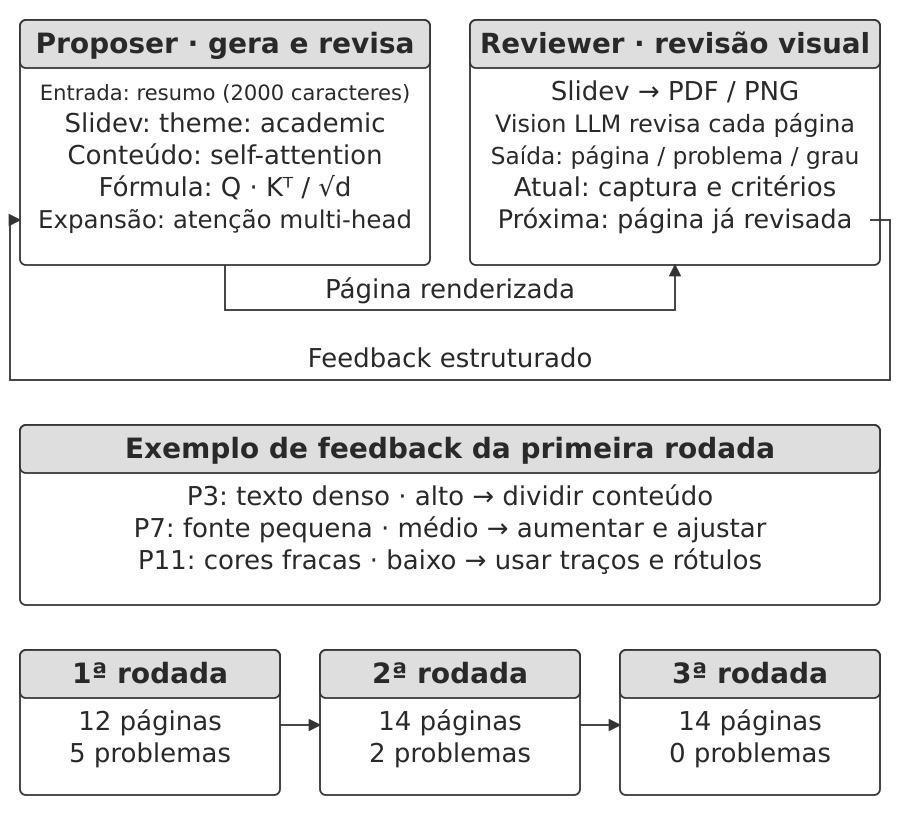

Quando muda o objeto da verificação, mudam também as evidências que o revisor precisa examinar. Para revisar uma resposta de atendimento, confronta-se com as regras de negócio e as fontes dos fatos; para revisar uma alteração de código, olham-se os testes e o resultado real da execução; para revisar um plano de operação, conferem-se as normas aplicáveis e as precondições.

O artigo de Huang et al. no ICLR 2024, *Large Language Models Cannot Self-Correct Reasoning Yet*, constatou que, nas tarefas de raciocínio e nas configurações de prompt estudadas, o GPT-4, ao se autocorrigir sem feedback externo, chegava a transformar respostas corretas em erradas, reduzindo a acurácia geral. Uma revisão sobre autocorreção publicada na TACL discute como as condições da tarefa e a confiabilidade do feedback afetam o efeito da revisão.[^self-correction-survey] Por isso, adoto evidências independentes e condições de correção localizáveis como requisitos básicos do ciclo de revisão. O revisor deve ser capaz de ler testes reais, o estado do ambiente ou o resultado renderizado e apontar qual requisito ainda não foi atendido e como verificar a correção.

[^self-correction-survey]: Kamoi, R., et al. *When Can LLMs Actually Correct Their Own Mistakes? A Critical Survey of Self-Correction of LLMs.* TACL, 2024.

Um ciclo completo pode ser organizado em cinco passos:

1. O proponente escreve a primeira versão conforme o pedido da tarefa — por exemplo, uma resposta ou um trecho de código.
2. O artefato é executado ou renderizado, obtendo-se testes, estado do negócio, capturas de tela ou resultados de checagem de fatos.
3. O revisor confronta os requisitos com as evidências e conclui pela aprovação ou aponta a localização do problema e a condição de correção.
4. Se ainda houver orçamento, o proponente revisa conforme o feedback, e o artefato volta a ser executado e revisado; diante de questões que exigem entrada ou autorização, passa-se a esperar ou transferir.
5. Atingida a condição de publicação, entrega-se a versão aprovada, acompanhada das evidências de verificação e do parecer da revisão; se o orçamento acabar, preservam-se o progresso e as questões pendentes.

O revisor lê testes e critérios de publicação protegidos, e as mudanças de critério que ele propuser passam por uma revisão à parte.

Nos experimentos do CRITIC, o modelo primeiro responde e depois verifica a resposta com ferramentas.[^ch10-critic] Por exemplo, usa um buscador para checar os fatos da resposta e o interpretador Python para rodar o programa matemático que escreveu. Em três tipos de tarefa — perguntas e respostas abertas, geração de programas matemáticos e redução de conteúdo nocivo —, o desempenho melhorou depois que o modelo corrigiu a resposta com o feedback das ferramentas. Quando o modelo avaliava a resposta original apenas por conta própria, a correção era mais fraca. Esse projeto se liga ao caso do PPT do Capítulo 5: a captura de tela renderizada expõe problemas de diagramação e sobreposição difíceis de julgar diretamente no texto do código, e a execução dos testes revela erros reais de execução.

[^ch10-critic]: CRITIC, arXiv:2305.11738.

O caso de desenvolvimento de aplicativos de longa duração publicado pela Anthropic em 2026 usa três agentes: planejador, gerador e avaliador. O planejador expande os requisitos numa especificação de produto; o gerador e o avaliador combinam primeiro o critério de conclusão de cada rodada e então implementam e verificam, respectivamente. O avaliador usa o Playwright para operar o aplicativo e submeter relatórios de defeitos, e os papéis passam o estado por arquivos. O caso mostra como especificação do produto, operação real e feedback de defeitos se conectam, e também exige levar em conta, na comparação de alternativas, o custo adicional de execução e revisão.[^anthropic-harness-2026]

[^anthropic-harness-2026]: Prithvi Rajasekaran, “Harness Design for Long-Running Application Development,” Anthropic Engineering, 2026-03-24.

Em 20 de novembro de 2026, o matemático Levent Alpöge divulgou uma prova formal obtida em colaboração com o Claude, envolvendo a hipótese de Riemann e sua generalização às funções $L$ de Dirichlet. Diante de um grande lote de arquivos Lean, o revisor precisa primeiro responder a duas perguntas: o teorema final enuncia a conjetura original? Cada passo da dedução pode ser verificado de novo pelo núcleo de prova? O matemático Andrew Sutherland, do MIT, comparou primeiro o teorema submetido com a definição da hipótese de Riemann na biblioteca matemática do Lean e depois listou os axiomas de que a prova depende. No registro que publicou no mesmo dia, informou ainda que o núcleo de prova independente nanoda havia verificado a prova exportada. Isso sugere um modo concreto de dividir a revisão: quem conhece o problema escreve primeiro a proposição de aceitação, e uma ferramenta independente verifica se o artefato submetido consegue chegar a essa proposição. Se, no futuro, os matemáticos quiserem entender como o autor chegou a esse caminho, ainda será preciso um argumento legível para pessoas.[^ch10-rh-review]

[^ch10-rh-review]: Levent Alpöge divulgou a nota de pesquisa em 20 de novembro de 2026. O projeto de verificação e seu andamento naquele dia estão em *Verification files for the Lean proof of the Riemann Hypothesis*, de Andrew Sutherland.

#### Padrão de debate

O padrão de debate faz os membros examinarem a mesma questão de posições diferentes. Por exemplo, ao avaliar uma solução técnica, um agente explica os benefícios e os cenários de aplicação, e outro verifica restrições, condições de falha e alternativas. Cada rodada acrescenta evidências ou refutações em torno de argumentos concretos, e no fim se consolidam os pontos de consenso e as divergências que ainda precisam de verificação.

Esse arranjo ajuda a listar com clareza os argumentos a favor e contra; o efeito, porém, depende da qualidade dos argumentos, da independência do julgamento e do método de escolha final. Tran e Kiela compararam cinco arquiteturas em tarefas de raciocínio com múltiplos saltos — sequencial, debate, ensemble, papéis paralelos e subtarefas paralelas; com o mesmo orçamento de tokens de raciocínio, o agente único teve desempenho igual ou melhor que o multiagente.[^single-agent-2026] Com base nisso, uso o debate principalmente para desdobrar divergências, verificar hipóteses e completar os argumentos contrários. Quando o objetivo é acertar fatos ou cálculos, a prioridade é acrescentar evidências verificáveis e verificações independentes.

O artigo recorre à desigualdade de processamento de dados para discutir os limites da transmissão de informação intermediária: recontar e comprimir repetidamente pode perder detalhes originais. Na engenharia, pode-se manter fontes rastreáveis e fazer os membros analisarem primeiro de forma independente e só então trocarem conclusões, reduzindo consensos não verificados. Agregar várias amostragens independentes e aproveitar tarefas em que “gerar é difícil e verificar é fácil” para organizar uma revisão dedicada também podem se combinar com o debate.

[^single-agent-2026]: Tran, D., Kiela, D. *Single-Agent LLMs Outperform Multi-Agent Systems on Multi-Hop Reasoning Under Equal Thinking Token Budgets.* arXiv:2604.02460, 2026.

#### Padrão de brainstorming

O brainstorming pode ser feito em duas rodadas: primeiro cada membro pensa sozinho em soluções, depois todos discutem juntos quais ideias podem ser combinadas. Por exemplo, o Agente 1 propõe uma função de compartilhamento social; o Agente 2, a partir disso, sugere gerar automaticamente pôsteres de compartilhamento personalizados; o Agente 3 vai além e propõe modelos personalizáveis pelo usuário e um mercado de modelos.

Para que os membros pensem em soluções diferentes, pode-se pedir que partam, respectivamente, da perspectiva do usuário e da do operador, ou dar a eles prompts ou modelos diferentes. Depois da troca de ideias, as soluções são filtradas conforme a necessidade do usuário, o custo de implementação e os resultados de verificação.

#### Padrão de painel de especialistas

O painel de especialistas distribui responsabilidades especializadas em torno de um problema interdisciplinar. Por exemplo, ao avaliar um novo produto, o agente engenheiro analisa a dificuldade de implementação e as dependências técnicas, o agente de produto verifica as necessidades e a experiência do usuário, e o agente de operações estima custos, recursos e condições de implantação.

No chat em grupo do LobeHub, o moderador pode transmitir a mesma proposta de produto aos três especialistas. O sistema primeiro captura o histórico do grupo naquele momento e então faz os três membros responderem ao mesmo tempo, cada um com sua configuração de papel. As três respostas ficam penduradas na mensagem que iniciou a transmissão, o que facilita conferir depois a que pergunta cada um respondeu. Se o agente de operações precisa calcular o custo com base no consumo que o engenheiro acabou de estimar, é preciso esperar que as respostas desta rodada sejam gravadas para então chamar o agente de operações: quando os dois começam a escrever ao mesmo tempo, ele ainda não tem esse número.[^ch10-lobehub]

[^ch10-lobehub]: LobeHub, guia de uso do chat em grupo; implementação da transmissão paralela na versão `ab21e0d`.

Na consolidação, é preciso identificar as ligações entre os julgamentos: que suporte técnico um objetivo de experiência exige, quanto uma escolha técnica acrescenta ao custo operacional e que condições ainda precisam de evidência externa.

### Padrão gerenciador: coordenação centralizada

Quando a tarefa tem muitas subtarefas, dependências complexas ou escalonamento dinâmico, o Manager Agent pode fazer o planejamento unificado. Ele primeiro entende o objetivo geral, depois divide o trabalho, escolhe os membros e acompanha o progresso; diante de anomalias, decide se tenta de novo, troca de executor ou ajusta o plano e, por fim, integra os resultados.

Uma implementação comum é registrar agentes especializados como ferramentas. O Manager passa pela interface da ferramenta a tarefa, as restrições e o material necessário e recebe um resultado estruturado ou um identificador de tarefa. Assim, busca, operações com arquivos e delegação de subtarefas podem seguir formas de chamada semelhantes; subtarefas demoradas têm progresso, cancelamento e novas tentativas gerenciados à parte. Membros diferentes podem usar modelos, prompts, ferramentas e ambientes de execução diferentes. Ao acrescentar um membro, além de registrar a interface, é preciso fazer o Manager entender sua responsabilidade, os requisitos de entrada e os cenários de uso.

Ao conduzir tarefas longas no Claude Code e no Codex, eu já cheguei a deixar discussão, execução de comandos e testes na sessão principal. Quando queria esclarecer uma escolha de projeto no meio do caminho, muitas vezes tinha de esperar a etapa em curso terminar; horas depois, para reencontrar o que tinha sido combinado, precisava atravessar uma longa sequência de saídas de comando. Mais tarde passei as alterações e os testes a subagentes e deixei a sessão principal para a discussão. Na revisão de um manuscrito, por exemplo, o executor pode continuar conferindo números de figura enquanto eu discuto com um leitor se determinado trecho deve ser reescrito. Se a discussão mudar o escopo da tarefa, ainda é preciso enviar o novo acordo ao executor e conferi-lo quando ele entregar.

A equipe DeepSeek Harness divulgou um protótipo de pesquisa voltado a um único repositório do GitHub, o `dsh-superagent`. Tomemos como exemplo a correção do formato de data num arquivo exportado: o mantenedor faz o pedido numa Issue, e o roteador (Router) decide, segundo as regras do repositório, se aceita o trabalho. Aceito o pedido, o sistema cria um ticket e atribui ao executor (Worker) uma sessão e um diretório de trabalho próprios. O executor pode modificar código e rodar testes no próprio diretório; outro ticket pode avançar ao mesmo tempo, cada um guardando seu processo de modificação e seus resultados de teste.[^ch10-dsh-prototype]

Suponha que o mantenedor acrescente depois, na Issue original: “altere só o CSV e mantenha o formato de data do JSON”. Os tickets em andamento que assinam essa discussão recebem a mensagem complementar, e o executor pode restringir o escopo da mudança e testar os dois formatos separadamente. Ao terminar, pode abrir um pull request (PR) e postar o link e o resultado na Issue original. O mantenedor vê num só lugar o pedido inicial, a restrição acrescentada e a alteração aguardando revisão; e o roteador não precisa transformar cada mensagem de acompanhamento numa nova tarefa.

[^ch10-dsh-prototype]: Equipe DeepSeek Harness, protótipo de pesquisa dsh-superagent. Sobre como os tickets recebem mensagens posteriores, ver autorização e assinatura; sobre sessões de execução e diretórios de trabalho, ver o mecanismo de execução.

O Manager concentra boa parte da responsabilidade de decisão. Uma decomposição errada afeta a execução subsequente, material de transferência insuficiente provoca perguntas repetidas, e registros de chamada em excesso ocupam o contexto. No projeto, convém guardar um estado de tarefa conciso e um índice de artefatos, ler os detalhes sob demanda e dar às subtarefas entradas, saídas e critérios de conclusão claros.

O Plan-and-Act estudou, numa arquitetura Planner—Executor, o efeito da qualidade do planejamento em tarefas longas e relatou taxa de sucesso de 57,58% no WebArena-Lite.[^plan-and-act-2025] Erros de planejamento fazem vários executores seguirem uma divisão equivocada, e acrescentar membros amplia o retrabalho. Por isso, verifico primeiro a qualidade da decomposição feita pelo Manager; quando o gargalo está no planejamento, destino ao Manager um modelo mais forte, informações mais completas sobre a tarefa e um orçamento de raciocínio mais generoso. Com as fronteiras das subtarefas claras, escolho então a configuração adequada para os executores.

[^plan-and-act-2025]: Erdogan, L. E., et al. *Plan-and-Act: Improving Planning of Agents for Long-Horizon Tasks.* arXiv:2503.09572, 2025.

Tarefas paralelas também precisam de um encerramento bem definido. Se o objetivo é encontrar um resultado que atenda às condições, pode-se, depois da verificação, registrar atomicamente o primeiro resultado aprovado, cancelar os ramos restantes, esperar a confirmação do cancelamento ou o tempo limite e, por fim, consolidar a entrega. O registro deve ser ao mesmo tempo atômico e idempotente: se dois resultados chegam juntos, ocorre uma única transição de estado; se o mesmo evento é entregue de novo, reaproveita-se o tratamento já feito. Bloqueios, transações ou comparar-e-trocar podem proteger esse passo.

O SQLite que vem com o Python permite ver uma passagem concreta. Suponha que dois membros, que o código chama de 甲 e 乙 (algo como ‘A’ e ‘B’), conferem material em paralelo e que os resultados submetidos por ambos já passaram na verificação. O Manager precisa de um único resultado aprovado e usa uma linha da tabela de tarefas para anotar quem submeteu primeiro. No exemplo abaixo, 甲 submete primeiro, 乙 em seguida, e 甲 tenta de novo.

```python
import sqlite3

db = sqlite3.connect(":memory:")
db.execute("CREATE TABLE task (id INTEGER PRIMARY KEY, winner TEXT)")
db.execute("INSERT INTO task VALUES (1, NULL)")
for worker in ["甲", "乙", "甲"]:
    with db:
        claimed = db.execute(
            "UPDATE task SET winner = ? WHERE id = ? AND winner IS NULL",
            (worker, 1),
        ).rowcount
    print(worker, "登记成功" if claimed else "沿用已登记结果")
```

A saída é, pela ordem, “甲 登记成功” (registro bem-sucedido), “乙 沿用已登记结果” (mantém o resultado já registrado) e “甲 沿用已登记结果”. Se 乙 chegasse primeiro, a tabela registraria 乙. Uma única instrução de atualização verifica que “ninguém registrou ainda” e grava o nome de quem submeteu; se a verificação e a gravação forem separadas, os dois executores podem ler o valor vazio.

O exemplo cria a tabela em memória: quando o processo termina, o registro desaparece. Com um banco de dados persistente, surge outro problema de passagem: o Manager registrou 甲 mas saiu antes de avisar 乙. Depois de reiniciar, quem sabe que esse aviso não foi enviado? Pode-se gravar, na mesma transação, o resultado escolhido e os avisos pendentes. Cada aviso registra o ramo destinatário, o que deve ser feito e um número único. Ao reiniciar, o Manager reenvia os avisos ainda não confirmados. Mesmo que 乙 já tenha concluído a limpeza e apenas a confirmação tenha se perdido, ele reconhece o aviso reenviado pelo número original e devolve diretamente o resultado do tratamento anterior. Eventos de entrega podem ser registrados da mesma forma.

Se a tarefa exige coletar todos os resultados, é preciso esperar o fim de todos os ramos necessários e registrar separadamente sucessos, falhas e itens não concluídos. A condição de encerramento vem do objetivo da tarefa e também determina quando os outros membros podem ser cancelados.

**Coordenação sequencial.** Quando as subtarefas têm dependências de ordem, o Manager precisa esperar que o artefato da etapa anterior esteja disponível para despachar a seguinte. A Figura 10-4 usa a redação de um relatório como exemplo: o membro que coleta material entrega primeiro as fontes, o analista organiza as conclusões a partir delas e o redator recebe por último uma análise fundamentada. Numa tarefa de tradução, que material o tradutor precisa esperar antes de começar?

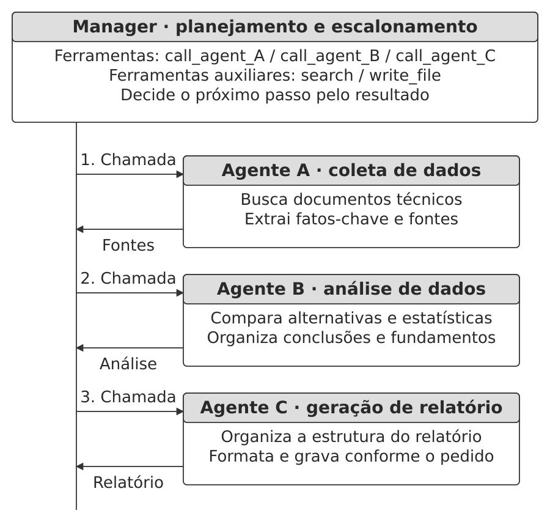

> **Experimento 10-2 ★★: agente de tradução de livros**
>
> Traduzir um livro técnico exige tratar ao mesmo tempo terminologia, contexto e redação. Em inglês, por exemplo, *agent* admite várias traduções em chinês; se a tradução combinou usar “智能体” (agente inteligente), os capítulos seguintes devem manter a mesma escolha. O glossário, o original de cada capítulo, a tradução e o registro de revisão precisam de uma organização clara. Um livro longo, com rascunhos intermediários, resultados de ferramentas e histórico de revisão, ocupa o contexto sem parar; o modelo pode chegar ao capítulo 9 já tendo esquecido a escolha do capítulo 2, ou rever o mesmo trecho repetidas vezes. Dividir a tarefa por responsabilidade e por capítulo permite que cada instância se concentre no material exigido pela responsabilidade atual.
>
> O trabalho pode ser distribuído entre quatro tipos de agente:
>
> - **Glossary Agent: organizar a terminologia.** Lê o livro inteiro em lotes, identifica termos técnicos recorrentes e, com base em dicionários especializados e normas de tradução, gera uma tabela de correspondência em JSON ou CSV com o termo em inglês, a tradução, a classe gramatical e o contexto de uso. O glossário é gravado no espaço compartilhado e a instância é liberada ao fim da tarefa.
> - **Translation Agent: traduzir capítulos.** Lê o capítulo atual, os termos relacionados e o guia de tradução e produz a versão conforme o público-alvo e o estilo da língua. Termos novos recebem uma tradução candidata marcada para revisão. Cada instância mantém contexto próprio e a tradução é gravada no espaço compartilhado; capítulos podem ser tratados em série ou em paralelo, conforme as dependências.
> - **Proofreading Agent: revisar o texto inteiro.** Confere as escolhas terminológicas, a coerência das formulações e a legibilidade com base no glossário e nas traduções de cada capítulo. A revisão do livro completo é feita lendo capítulo a capítulo e com um índice entre capítulos, e o relatório registra a localização do problema, o fundamento e a correção exigida.
> - **Manager Agent: distribuir e recolher tarefas.** Mantém objetivos, plano, estado das tarefas, resumos de chamadas e índice de artefatos; a partir do relatório de revisão, devolve aos tradutores os capítulos a corrigir e organiza a nova conferência.
>
> Na Figura 10-5, o revisor lê as traduções de cada capítulo e o glossário, e o Manager decide, com base no relatório, quais capítulos precisam ser refeitos. O tradutor que recebe a tarefa de correção pode recuperar o original do capítulo e verificar o que o termo marcado significa naquela frase.
>
> 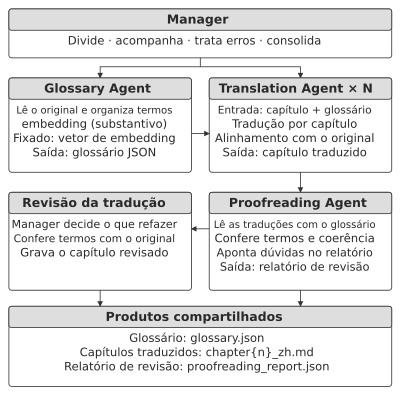
>
> Depois de gravar a tradução em arquivo, que chamada ainda precisa ler textos longos? O experimento complementar divide os dois primeiros capítulos da edição em inglês em 26 unidades de tradução. Com um único agente carregando o original e a tradução anteriores, a maior requisição de entrada teve 94.355 tokens. Com a divisão de trabalho, a maior entrada do tradutor ficou em 2.857 tokens, e o Manager gastou 2.153 ao decidir uma correção. No grupo com papéis, quem mais consumiu entrada foi o organizador de terminologia: leu dois capítulos de uma vez e usou 49.807 tokens.
>
> Terminados os dois capítulos, os quatro papéis consumiram juntos 203.277 tokens, contra 1.317.808 do agente único. Qual grupo entregou primeiro? O grupo de quatro papéis levou cerca de 271 segundos, aproximadamente 17 segundos mais que o agente único.
>
> Na entrega, duas verificações deram resultados diferentes para o mesmo texto. O glossário fixava “嵌入向量” (vetor de embedding) como tradução do substantivo `embedding`. O relatório de revisão não listou capítulos a corrigir, mas o programa de verificação terminológica deu a esse termo 0/2: nas duas traduções aparecia “嵌入” (embutir, inserir), mas não “嵌入向量”. Seria o caso de devolver os dois capítulos?
>
> No capítulo 1, o trecho sobre a política de reembolso dizia `embedding the refund policy in the context`, traduzido como “将退款政策嵌入上下文中” (inserir a política de reembolso no contexto). A ideia ali é colocar a política dentro do contexto, e trocar por “嵌入向量” introduziria um erro. A busca de strings por capítulo dá ao revisor pistas para reconferir; para decidir qual ocorrência deve mudar, ele ainda precisa do trecho original. Ao atualizar o glossário, também é possível localizar primeiro os parágrafos afetados e entregar ao tradutor o original, a tradução e o novo verbete juntos.
>
> **Requisitos do experimento:**
> 1. Escolha um livro técnico com figuras e código.
> 2. Implemente os quatro tipos de agente: Manager, Glossary, Translation e Proofreading.
> 3. Registre o consumo de contexto, o material transferido e a versão dos artefatos de cada membro.
> 4. Compare com a solução de agente único em qualidade da tradução, tempo de conclusão e consumo de recursos, e analise o efeito da divisão da tarefa e da organização do contexto.

**Coordenação paralela.** Subtarefas independentes podem rodar ao mesmo tempo. O Manager distribui tarefas, recebe estados e decide, conforme os resultados, se continua, complementa o trabalho ou encerra. Na tradução deste livro, uma vez confirmado o glossário, capítulos diferentes podem ir para tradutores distintos ao mesmo tempo. A Figura 10-6 troca o exemplo por um relatório de pesquisa: os gráficos já estão prontos, a análise ainda está em curso — por que a verificação de formatação precisa esperar? Seguindo os eventos relatados pelos membros, vê-se de quais dois artefatos depende a última etapa.

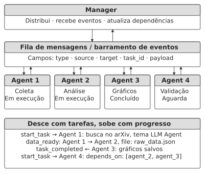

O barramento de mensagens é adequado para organizar essa comunicação assíncrona: os membros publicam progresso e resultados, o gerenciador assina os eventos correspondentes, e o runtime cuida da entrega, do buffer e das novas tentativas.

> **Caso de produto: Lingtai**
>
> O Lingtai é um sistema de agentes de longa duração que roda localmente e guarda identidade e memória em arquivos. Ele oferece três papéis: o main agent conversa com o usuário e gerencia plano e memória; o daemon assume tarefas paralelas de curto prazo e escopo definido e devolve a conclusão; o avatar preserva a própria memória, caixa de correio e responsabilidades e serve à divisão de trabalho especializada entre sessões.
>
> Cada papel tem conhecimento persistente privado e compartilha manuais de habilidades em Markdown. Quando o contexto se aproxima do limite de capacidade, o papel salva um resumo num processo de “molt” e entra num novo contexto apoiado na memória persistente. Identidade, memória e habilidades ficam em arquivos separados, o que permite continuar o trabalho mesmo após trocar o modelo de base. O projeto combina gerenciador, trabalhadores de curto prazo, membros especializados de longo prazo e compressão de contexto.

> **Experimento 10-3 ★★★: orquestração autônoma de agentes de telefone e de computador**
>
> Este experimento combina o Computer Use e a interação por voz do Capítulo 6. O usuário fornece uma página de cadastro ou de reserva de voo, o Computer Agent abre o site e reconhece o formulário e, em seguida, o Phone Agent coleta os campos que faltam: nome, documento, contato, endereço e preferências.
>
> **Papéis e transferência.** O Computer Agent opera o navegador e responde pela orquestração; o Phone Agent conversa com o usuário em tempo real por ASR, LLM e TTS e converte as respostas faladas em campos estruturados. Os dois se comunicam por ferramenta ponto a ponto ou por barramento de mensagens, com mensagens que contêm remetente, destinatário, tipo e conteúdo. O Computer Agent pode delegar diretamente a tarefa telefônica e assumir o papel de gerenciador. Quando o usuário aceita fornecer informações por voz, o Phone Agent pode perguntar em sequência, confirmar e repetir a pergunta, enquanto o Computer Agent se concentra no estado da página e no preenchimento dos campos.
>
> **Dois modos de execução.** No modo fixo, os dois agentes sobem previamente, cada um com seu próprio loop de execução, para verificar a comunicação bidirecional e o comportamento concorrente. No modo autônomo, sobe primeiro o Computer Agent, e o modelo decide, com base na página, nas informações já obtidas e nas necessidades da tarefa, se chama `initiate_phone_call_agent(purpose, required_info)`. O runtime então passa ao Phone Agent o objetivo da tarefa, os campos a coletar e as restrições de formato, e a execução segue o mesmo mecanismo de comunicação.
>
> **Campos fluindo um a um.** Na Figura 10-7, o Phone Agent pergunta por WebRTC, extrai e valida a resposta e, obtido um valor válido, envia `info_collected` e passa ao item seguinte. Ao mesmo tempo, o Computer Agent lê a página, preenche o item anterior e devolve `fill_error` ou o novo estado da página. O feedback de formato inválido usa `format_invalid` para indicar o campo e a exigência, e o Phone Agent confirma ou repete a pergunta. Assim, “perguntar o próximo item” e “preencher o anterior” podem se sobrepor.
>
> **Conclusão e tratamento de anomalias.** Ao terminar de coletar os campos, o Phone Agent envia `task_completed`, indicando o fim da subtarefa de coleta. O Computer Agent segue verificando campos obrigatórios, o resultado da validação da página e a autorização de envio e, então, conclui a operação no formulário. Ao exceder o número de tentativas, encontrar uma anomalia na página ou receber um pedido de parada do usuário, a tarefa é pausada e o progresso atual é explicado; no encerramento, o agente do outro lado que ainda estiver em execução é cancelado, e a sessão do navegador, as faixas de áudio e a chamada são fechadas. A interação com voz humana e o envio do formulário obtêm, respectivamente, o consentimento e a autorização do usuário.
>
> 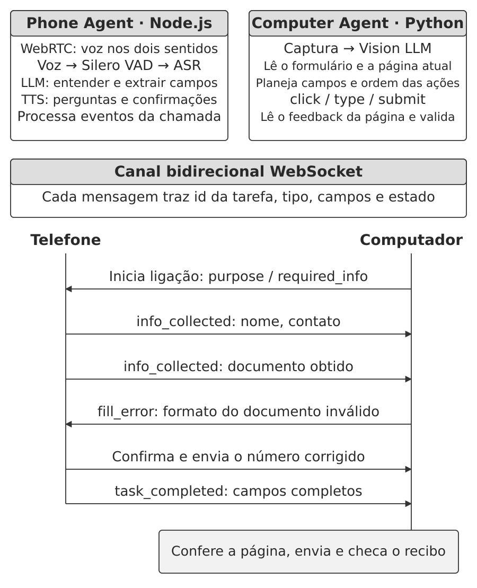
>
> **Requisitos do experimento:**
> 1. Implemente dois agentes independentes com comunicação estruturada bidirecional.
> 2. Registre a sequência temporal nos modos fixo e autônomo e examine os intervalos em que pergunta e preenchimento se sobrepõem.
> 3. Implemente validação de formato, repetição da pergunta, feedback de erro da página, tempo limite e limpeza de recursos.
> 4. Compare os dois modos quanto à decisão de inicialização, à latência, à taxa de sucesso e ao consumo de recursos.

> **Experimento 10-4 ★★★: agente que coleta informações em vários sites ao mesmo tempo**
>
> Este experimento usa vários agentes homogêneos em busca paralela para praticar os mecanismos de evento e de interrupção do Capítulo 6. A tarefa é localizar um professor específico, por exemplo “Zhang Wei”, nos sites de várias faculdades de uma universidade e retornar faculdade, cargo, linha de pesquisa e página de origem. Antes da busca, combinam-se os critérios de identificação — nome, área e informações da página pessoal —, para distinguir homônimos.
>
> **1. Início em paralelo.** O Manager cria 10 agentes de Computer Use, cada um responsável pelo site de uma faculdade. Cada instância mantém contexto e sessão de navegador próprios e pode ser escalonada por tarefa assíncrona, thread ou processo. A entrada contém a URL do site, o nome procurado, os critérios de correspondência e um identificador de tarefa usado no roteamento.
>
> **2. Consolidação do progresso.** Os membros enviam periodicamente estados como “carregando o site”, “lendo a lista de professores”, “verificado, sem correspondência” e “encontrado homônimo”. O Manager mantém uma tabela de tarefas pelo barramento de mensagens, registrando em separado execução, conclusão, bloqueio e falha, além da origem e do motivo do erro.
>
> **3. Cancelar os outros ramos depois da verificação.** Suponha que o `agent_3`, responsável pela faculdade de física, encontre um professor com o mesmo nome e envie `target_found`, com os dados do professor e a origem na carga útil. Se a tarefa exige devolver dados verificados da pessoa, o Manager deve primeiro conferir os critérios de correspondência e as evidências, confirmar que se trata da pessoa procurada, registrar o resultado numa operação atômica e então enviar `terminate` aos demais membros em execução, indicando que os dados adotados vêm do `agent_3`. Os membros param num ponto seguro, liberam recursos e devolvem a confirmação; o Manager conclui a consolidação depois da confirmação ou do tempo limite. Se a tarefa pede listar todos os homônimos, a busca continua até cobrir o escopo exigido.
>
> **Condições de corrida.** Os agentes A e B podem devolver resultados válidos quase ao mesmo tempo. Se cada evento dispara uma consolidação, há entrega duplicada ou conflito de estado. Bloqueios ou transações podem proteger a transição “em busca → resultado registrado”, de modo que o evento que chega depois leia o resultado já registrado. Novas tentativas de entrega também precisam eliminar duplicatas pelo identificador do evento, para manter a coerência quando cancelamento e consolidação são disparados mais de uma vez.
>
> **4. Anomalias e cobertura.** Quedas de rede, mudanças na estrutura da página e erros de análise são registrados separadamente. É possível definir para cada tarefa um orçamento de tempo limite, como dois minutos; esgotado o prazo, a execução é cancelada e as informações de diagnóstico são coletadas, enquanto os demais membros seguem trabalhando. O relatório final distingue “verificado, não encontrado” de “falha de acesso, verificação não concluída” e informa a cobertura alcançada entre as faculdades.
>
> A Figura 10-8 encadeia essas mensagens numa linha do tempo esquemática. Suponha que o membro 3 relate um professor Zhang Wei de computação quântica na faculdade de física; o Manager precisa primeiro ver se a página de origem confirma nome, unidade, cargo e área. Receber a pista de um homônimo, confirmar que é a pessoa procurada e reunir os recibos de cancelamento são três momentos distintos.
>
> 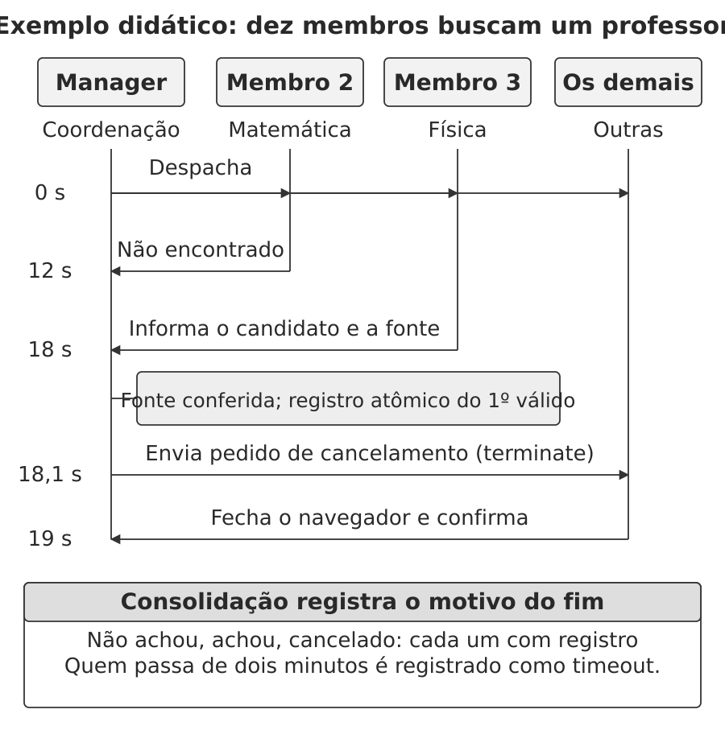
>
> A busca executada de fato procurava Andrew Ng. Os membros primeiro verificam se o nome aparece no texto da página e, só quando há correspondência, pedem ao modelo que extraia os dados. A página do Stanford HAI foi a escolhida, e a citação curta devolvida permite confirmar o nome e a condição de professor adjunto. Para confirmar a linha de pesquisa, ainda é preciso ler o trecho sobre aprendizado profundo mais adiante na página. Mesmo que vários membros enviem `target_found` ao mesmo tempo, só o primeiro a obter o bloqueio consegue registrar o resultado.
>
> Nesta execução, a busca sequencial só encontrou o alvo no último dos dez endereços e levou 44,971 segundos; a busca paralela nas mesmas páginas levou 24,022 segundos, e os dez contextos de navegador de cada uma foram fechados. A divisão dos dois números dá 1,872. Se a página do HAI estivesse em primeiro lugar, a busca sequencial pararia ao encontrar e o tempo teria de ser medido de novo. Outra execução, dedicada a testar o cancelamento, iniciou quatro ramos: um registrou o resultado primeiro, os outros três confirmaram o recebimento do pedido de cancelamento, e por fim os quatro contextos de navegador foram fechados.
>
> **Requisitos do experimento:**
> 1. Implemente um Manager que cria membros paralelos dinamicamente.
> 2. Construa a capacidade de execução no navegador com projetos como o browser-use.
> 3. Faça a comunicação bidirecional e a manutenção de estado pelo barramento de mensagens.
> 4. Verifique o resultado da busca, registre-o numa operação atômica e colete as confirmações depois de cancelar os outros ramos.
> 5. Trate falhas de acesso, erros de análise, tempo limite e ausência de correspondência.
> 6. Compare execução paralela e sequencial em tempo de conclusão, cobertura e consumo de recursos.

**Fluxos de trabalho gerados pelo gerenciador.** Além de delegar caso a caso, o Manager pode escrever antes, como programa, as dependências entre tarefas e as regras de consolidação, e entregar o programa ao escalonador do runtime. O modelo projeta o fluxo, e o programa inicia os membros, transmite resultados e aguarda dependências conforme o combinado. Quando as dependências já estão claras e o mesmo tipo de fluxo precisa rodar repetidamente, prefiro essa forma. Ela poupa o custo de chamar o Manager a cada despacho e reduz o acúmulo de registros de escalonamento no contexto de gestão.

A ferramenta dinâmica de Workflow do Claude Code oferece essa implementação. `agent()` cria um subagente com contexto próprio e permite fixar a saída estruturada por um schema; `parallel()` executa um conjunto de tarefas em paralelo e espera todas terminarem; `pipeline()` faz cada entrada passar por várias etapas, de modo que, quando um item avança para a etapa seguinte, os demais continuam na etapa anterior. Os resultados intermediários ficam em variáveis do programa, e a filtragem e a fusão são feitas com código comum.[^dynamic-workflows]

Por exemplo, para verificar sete conjuntos de fatos num texto técnico, pode-se primeiro iniciar agentes de pesquisa por tema e depois entregar cada conjunto de conclusões, em paralelo, a agentes de verificação. Cada conclusão devolvida mantém a fonte e o fundamento do julgamento; terminados todos os ramos, um agente de consolidação organiza o relatório final. Assim, a divisão “pesquisar — verificar item a item — consolidar” e as dependências entre etapas ficam registradas no fluxo.

[^dynamic-workflows]: Anthropic, “Orchestrate subagents at scale with dynamic workflows”, 2026.

### Padrão descentralizado

Com um Manager à disposição, por que deixar que os próprios membros decidam com quem falar? Imagine que o testador recebe um módulo recém-escrito e descobre que o requisito de produto e o contrato de interface interpretam o mesmo campo de duas maneiras. O testador pode levar a contradição diretamente aos papéis de produto e de arquitetura, pedir que cada lado exponha seus fundamentos e só continuar os testes depois que o acordo for corrigido. Isso é divisão de trabalho e também contrapeso. O engenheiro entrega o módulo, o arquiteto consulta o produto, o testador levanta a objeção — cada um pode iniciar o passo seguinte. Quando a negociação é frequente, esperar que o Manager transmita item a item atrasa o trabalho.

Tomando emprestada a linguagem dos microsserviços, ter um centro que organiza os passos é **orquestração** (orchestration), e cada parte continuar por conta própria conforme eventos combinados é **coreografia** (choreography). Há ainda uma diferença prática: se toda transferência tem de esperar o Manager, basta o serviço de modelo dele parar de responder para os outros membros, mesmo capazes de trabalhar, não receberem a próxima tarefa. A coordenação distribuída reduz essa dependência; se o membro que deveria assumir está travado numa chamada de ferramenta, ainda é preciso contar com estado de tarefa persistido, tempo limite, novas tentativas e mecanismos de tomada de controle para que outro membro saiba de onde continuar.

Os três projetos a seguir usam, cada um, uma forma de transferência: assinar mensagens por artefato, eleger o próximo falante no chat em grupo ou deixar que o membro atual passe o bastão nomeando quem assume em seguida.

**MetaGPT: organizar a passagem de artefatos por SOP.** O MetaGPT divide o trabalho segundo o procedimento operacional padrão (SOP) de uma equipe de software. O gerente de produto entrega o documento de requisitos (PRD), o arquiteto entrega o documento de projeto, o engenheiro entrega o código e o testador entrega o relatório de testes. O membro seguinte começa a trabalhar ao receber o material combinado, e o anterior também economiza a repetição de explicar a tarefa. As ligações na Figura 10-9 representam essas passagens de produtos.[^metagpt-design]

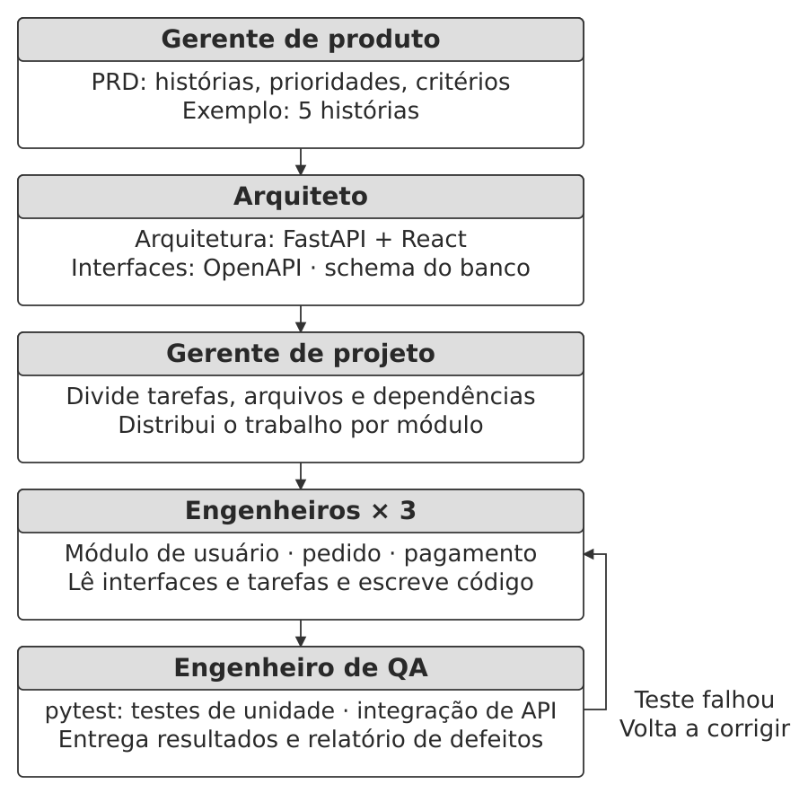

Que informações cada papel precisa completar na transferência?

- **Product Manager Agent**: recebe os requisitos, organiza o PRD e define funcionalidades, histórias de usuário, critérios de aceitação e prioridades.
- **Architect Agent**: lê o PRD, escolhe a pilha tecnológica, divide os módulos, define interfaces e modelo de dados e produz o documento de projeto.
- **Project Manager Agent**: divide tarefas e arquivos a partir do projeto, organiza as dependências e distribui o trabalho entre os engenheiros.
- **Engineer Agents**: implementam os módulos conforme o projeto e submetem o código; partes independentes podem ir para várias instâncias.
- **QA Engineer Agent**: gera testes a partir do código e dos requisitos, executa as verificações, registra os problemas e produz o relatório de testes.

Para projetar o formato de transferência entre esses papéis, sugiro explicitar três coisas: a tarefa e os critérios de aceitação, os fatos e restrições já confirmados e as referências aos artefatos estruturados. Com isso, o destinatário obtém o material necessário, continua o trabalho e faz perguntas específicas quando falta informação.

O MetaGPT organiza a informação com um pool de mensagens compartilhado e um mecanismo de assinatura: os papéis publicam mensagens e os demais tratam as entradas relacionadas aos tipos de mensagem que acompanham. Publicadores e consumidores se conectam pelo formato dos artefatos e pela semântica das mensagens, o que permite substituir modelos ou ajustar a implementação interna de cada um separadamente.

O SOP descreve as dependências entre requisitos de produto, arquitetura e código; a assinatura de mensagens descreve como esse trabalho é disparado. Dependências de tarefa fixas também podem avançar por eventos distribuídos, e as duas coisas juntas formam a maneira de colaborar do sistema. Para projetar um feedback mais dinâmico, é possível acrescentar caminhos como o testador esclarecendo requisitos com o papel de produto ou o engenheiro propondo alternativas ao arquiteto, definindo para essas interações condições de recebimento e regras de encerramento.

[^metagpt-design]: Hong, S., et al. *MetaGPT: Meta Programming for A Multi-Agent Collaborative Framework.* ICLR 2024.

**Chat em grupo do AutoGen: escalonar falas numa sessão compartilhada.** No projeto clássico de GroupChat, vários agentes participam da mesma sessão, o GroupChatManager escolhe o próximo falante e difunde a mensagem aos membros. A política de escolha pode ser por rodízio ou decidida pelo modelo conforme o conteúdo corrente. Os membros mantêm a própria configuração de papel, conversam pela sessão comum, e o escalonamento das falas fica centralizado no gerenciador. É um exemplo de combinação entre organização de contexto e estrutura de controle.[^autogen-groupchat]

[^autogen-groupchat]: Microsoft, *AutoGen 0.2: Conversation Patterns.*

**OpenAI Swarm: passar o controle por handoff.** O Swarm configura instruções e ferramentas para cada papel; quando o papel chama a função de transferência configurada, o runtime muda para o agente de destino. A decisão de roteamento pode ser tomada por cada papel e executada por um loop de execução unificado. Na transferência, a instrução de sistema vigente muda com o papel, e o histórico da conversa continua. O projeto mostra a combinação entre “o papel escolhe quem assume em seguida” e “o histórico da sessão é preservado”.[^swarm-handoff]

Com uma transferência de contextos independentes, pode-se definir um pacote de tarefa: `task_id` identifica a tarefa, `sender` e `recipient` indicam as partes, `goal` e `constraints` explicam o objetivo e as restrições, `accepted_facts` guarda os fatos confirmados, `artifact_refs` fornece as referências dos artefatos, `remaining_budget` registra o orçamento e `visited_agents` guarda a cadeia de visitas. O destinatário lê o material conforme a autorização, e o runtime mantém o orçamento e o registro das transferências.

A cadeia de transferências precisa lidar com visitas repetidas. Por exemplo, o desenvolvedor entrega o código ao revisor, o revisor pede mudanças e devolve ao desenvolvedor: é um ciclo de revisão normal. É possível avaliar se houve progresso combinando estado da tarefa, versão do artefato, questões pendentes e número de repetições. Se a mesma tradução volta duas vezes seguidas e a primeira acrescentou a fonte e a segunda corrigiu a terminologia, houve progresso; se as duas devoluções trazem a mesma versão e apontam o mesmo problema, a revisão travou. Nesse caso, pode-se limitar o número de transferências e reportar as questões pendentes ao responsável.

[^swarm-handoff]: OpenAI, *Swarm*, “Instructions” e “Handoffs and Updating Context Variables”.

> **O Agent Swarm nos produtos**
>
> “Agent Swarm” pode designar organizações diferentes. Uma linha passa o controle por uma rede de handoffs, como o OpenAI Swarm, a biblioteca swarm do LangGraph e a orquestração por handoff do Agent Framework da Microsoft; outra adota um agente principal com trabalhadores paralelos, como o Kimi Agent Swarm, o sistema de pesquisa multiagente da Anthropic e o Manus Wide Research.
>
> O Agent Swarm introduzido no Kimi K2.5 treina o orquestrador por aprendizado por reforço com agentes paralelos, para aprender quando dividir tarefas e como distribuir o trabalho, com suporte a até 100 subagentes. Versões posteriores ampliaram a escala para 300, e o K3 Swarm continua sendo usado em busca em larga escala e processamento em lote. O AgentENV, por sua vez, oferece ao aprendizado por reforço de agentes do Kimi K3 um ambiente escalável, com suporte a snapshots e bifurcações, para organizar execuções paralelas.[^ch10-kimi-swarm]

**Várias instâncias de agente na mesma máquina.** Várias instâncias também podem assumir tarefas diferentes e, ao mesmo tempo, compartilhar arquivos, serviços de ferramentas ou GPU. Nesse caso, a comunicação serve para delimitar o escopo das alterações, avisar sobre liberação de recursos ou negociar a ordem de execução. Por exemplo, se duas instâncias precisam da mesma GPU, podem registrar primeiro a tarefa e o consumo estimado, e um gerenciador de recursos concede o direito de uso.

O Agent Teams do Claude Code oferece descoberta de membros da equipe, mensagens e gestão de tarefas compartilhadas. Os membros obtêm informações uns dos outros dentro do escopo da equipe já estabelecida, e o runtime organiza a comunicação.[^claude-agent-teams] Ao construir coordenação na mesma máquina por conta própria, é possível usar interfaces como `list_agents`, do Capítulo 4, e definir regras claras de escopo de descoberta, permissão de acesso e propriedade de recursos. O resultado da negociação contido nas mensagens é então aplicado por bloqueios, cotas ou escalonadores.

[^ch10-kimi-swarm]: Moonshot AI, *Kimi Agent Swarm: 100 Sub-Agents at Scale*, documentação de ajuda do Agent Swarm e descrição do projeto AgentENV.

[^claude-agent-teams]: Anthropic, *Orchestrate teams of Claude Code sessions.*

### Colaboração entre organizações: o protocolo A2A

Quando a colaboração cruza fronteiras de serviço ou de organização, as duas partes precisam combinar descoberta de capacidades, autenticação de identidade, formato de requisição e entrega de progresso e resultados. O protocolo **A2A** (Agent2Agent), publicado pelo Google em 2025 e depois entregue à Linux Foundation, oferece essa interface de interoperabilidade. É possível entendê-lo por três aspectos.[^a2a-concepts]

- **Descoberta de capacidades.** O Agent Card é um documento de metadados que descreve identidade, endpoint do serviço, habilidades, modalidades de entrada e saída e requisitos de autenticação. Com ele, o chamador avalia se o outro lado consegue tratar a tarefa e como estabelecer a conexão.
- **Tarefas e mensagens.** A Task representa um trabalho com identificador e ciclo de vida, e o chamador acompanha estados como submetida, em processamento, aguardando entrada, concluída ou com falha. A Message carrega o pedido da tarefa, informações complementares e respostas, e o Artifact entrega documentos, imagens ou resultados estruturados. As Part dentro de mensagens e artefatos podem conter texto, referências de arquivo ou dados.
- **Colaboração por interface.** O chamador conversa com o lado remoto por esses objetos públicos, e o lado remoto gerencia prompts internos, memória e ferramentas de forma independente. Cada parte aplica suas próprias regras de autenticação, autorização e acesso a dados.

Tarefas longas permitem obter o estado por consulta periódica, receber atualizações em fluxo por SSE ou, quando houver suporte, usar notificações push. Depois que o usuário complementa informações, o cliente continua a mesma tarefa e obtém o artefato final conforme o estado dela.

O MCP do Capítulo 4 se concentra em oferecer interfaces de ferramentas, recursos e prompts a aplicações de modelo; o A2A se concentra na colaboração de tarefas entre serviços de agentes. Os dois se combinam: um agente usa ferramentas por MCP e delega tarefas remotas por A2A ao mesmo tempo. Quando a equipe já tem interfaces estáveis, começo reaproveitando chamadas de ferramentas, arquivos compartilhados e barramento de mensagens. O A2A entra quando é preciso integrar serviços de agentes mantidos de forma independente, com descoberta de capacidades e ciclo de vida de tarefa padronizados; entre organizações, acrescentam-se regras de identidade, permissão e governança de dados.

[^a2a-concepts]: A2A Project, *Core Concepts and Components in A2A.*

**Marcar horário para pessoas diferentes.** Três familiares têm, cada um, seu assistente de agenda e querem marcar um jantar. O assistente de um deles lê a agenda completa do dono: como responder aos outros dois? “Terça não dá, quarta eu consigo remanejar” já traz uma diferença útil. Encaminhar a agenda diretamente revelaria mais sobre os compromissos de terça; responder apenas “os dois dias têm compromissos” não permite saber que quarta ainda tem margem. Mesmo que o jantar sempre se realize, se for sempre a mesma pessoa a remarcar, o arranjo pode não valer a pena para ela.

Um problema público do CalBench pede que cinco pessoas agendem cinco reuniões, cada uma com três participantes. Certos compromissos de alguém são totalmente inflexíveis, outros podem ser remarcados, e o problema atribui um custo a cada remarcação. Tente primeiro uma solução simples: tratar as cinco reuniões em ordem e, em cada uma, procurar a partir do horário mais cedo, marcando no primeiro horário em que os três participantes têm disponibilidade; as reuniões já marcadas são preservadas. Tente outra: tratar as cinco reuniões em conjunto, resolvendo com as agendas completas. A seguir, mantêm-se os números de horário do problema, contados a partir de 0.[^ch10-calbench]

| Escalonamento | Horário de cada reunião, da 1ª à 5ª | Custo de remarcação por reunião marcada | Custo total |
|---|---|---|---:|
| Escolher por reunião o horário mais cedo possível e preservar as já marcadas | 0, 2, 1, 3, 6 | 1, 20, 20, 12, 300 | 353 |
| Resolver as cinco reuniões em conjunto com o solucionador de referência | 13, 3, 10, 9, 12 | 0, 1, 0, 1, 1 | 3 |

As duas agendas se alinham reunião a reunião na agenda final dos três participantes. A maior diferença está na última reunião: pelo primeiro escalonamento, o horário 6 até tem disponibilidade, mas cada um dos três tem um compromisso de custo 100 a remarcar. No horário 12, basta uma pessoa remanejar um compromisso de custo 1. O resultado global dá ao avaliador uma base de comparação; os assistentes que de fato participam da negociação veem, cada um, apenas a agenda do próprio dono.

O solucionador guloso que acompanha essa versão do CalBench reporta custo 146 e devolve um horário para as cinco reuniões. Ao marcar as reuniões seguintes, porém, ele permite retirar reuniões anteriores da agenda de alguns participantes. A primeira reunião acaba caindo nos horários 7, 0 e 11 nas agendas dos três participantes. Pelo critério “as agendas finais dos três registram a mesma reunião no mesmo horário”, só a terceira, a quarta e a quinta reuniões são bem-sucedidas.

Um serviço real de agendamento ainda encontra informações que o problema de escalonamento não fornece. O Calendar.help, da Microsoft, coordenou milhares de reuniões por e-mail ao longo de um ano. Um e-mail está marcando uma reunião nova ou alterando a anterior? Quando a classificação automática não tem certeza, uma pessoa vê primeiro a mensagem e resolve apenas essa questão. Se a mensagem sozinha não basta, a tarefa pode ir para um agendador com acesso ao histórico de e-mails, às informações já coletadas e às agendas anonimizadas. Esse projeto liga “quem deve julgar” a “quanto essa pessoa precisa ver”.[^ch10-calendar-help]

[^ch10-calbench]: O artigo do CalBench discute custo de coordenação, justiça, estado de agenda inferível e vazamento do conteúdo de compromissos específicos. Os números vêm do primeiro problema do banco de custos de remarcação da versão `86f8123`; o primeiro escalonamento pula, na escolha, os horários em que qualquer participante já tem reunião, e o restante segue a regra de remanejamento do autor. O cálculo pode ser refeito com um solucionador de escalonamento.

[^ch10-calendar-help]: Cranshaw et al., projeto e implantação do Calendar.help, ver a descrição das duas camadas de interface: tratamento humano de microtarefas e de tarefas completas de agendamento.

## Modos de falha da colaboração multiagente

Quando vários membros executam uma tarefa em conjunto, as falhas podem aparecer na relação entre papéis, na transferência de informações e na verificação. *Why Do Multi-Agent LLM Systems Fail?* construiu uma taxonomia de falhas a partir de cerca de 150 trajetórias, com concordância de anotação κ de 0,88, e depois ampliou a análise para sete frameworks. O estudo reúne 14 modos de falha, em três classes:[^mast-failures]

- **Problemas de projeto do sistema:** lacunas nas responsabilidades dos papéis, nas interfaces, na configuração de ferramentas ou nas condições de parada.
- **Desvios de coordenação entre membros:** entendimentos diferentes do objetivo, transferência incompleta de informação ou ações mutuamente contraditórias.
- **Problemas de verificação da tarefa:** encerrar antes do tempo, omitir verificações ou julgar a conclusão com critérios inadequados.

O artigo cita um programa de xadrez como exemplo. O código gerado pelo ChatDev compilava e passava na revisão, mas errava ao jogar segundo as regras reais. O compilador verifica se o código compila; para checar se os lances são legais, é preciso jogar algumas partidas. Em outro confronto, os pesquisadores fizeram as observações da revisão do ChatDev voltar para correção, com encerramento só depois da confirmação do papel responsável pela revisão técnica, e fixaram um número máximo de iterações. Nas 32 tarefas do ProgramDev-v0, o fluxo original aprovava 8 e o fluxo ajustado aprovou 13, elevando a taxa de sucesso de 25,0% para 40,6%, uma diferença de cerca de 15,6 pontos percentuais.[^mast-failures]

[^mast-failures]: Cemri, M., et al. *Why Do Multi-Agent LLM Systems Fail?* 2025.

Como distinguir “o revisor não respondeu” de “o revisor respondeu, mas julgou mal”? Sistemas distribuídos chamam de falha de parada a interrupção do funcionamento de um componente. O modelo de falhas bizantinas vai além e admite que um componente devolva resultados arbitrários ou contraditórios. Um agente também pode parar no meio do caminho ou devolver normalmente uma conclusão errada. O primeiro caso exige detecção, recuperação e tomada de controle; o segundo, verificação de evidências, restrição de permissões e isolamento de erros. Um heartbeat comum ajuda a saber se o agente ainda está em execução; se a conclusão que ele devolve está correta exige verificar o resultado real. Verificação cruzada e votação podem ser usadas na avaliação de resultados, e sua confiabilidade depende da qualidade das evidências e da correlação entre os erros dos membros; protocolos formais também especificam quantos nós com falha se tolera e como os nós se comunicam.

### Modo de falha 1: conflitos de concorrência no sistema de arquivos compartilhado

Os artefatos compartilhados permitem que os membros continuem o trabalho, mas trazem o problema da modificação simultânea. Vale distinguir dois níveis.

**O conflito em nível de arquivo** ocorre quando dois membros alteram o mesmo arquivo: ambos leem a versão antiga, gravam em sequência, e a segunda gravação sobrescreve o resultado da primeira.

**O conflito semântico** ocorre entre artefatos relacionados. Por exemplo, o Agente A renumera as figuras do livro inteiro enquanto o Agente B altera um capítulo e cita os números antigos. Os dois mexem em arquivos diferentes e a fusão pode não ter conflito textual, mas a correspondência final entre figuras e texto já não vale.

Suponha que a versão atual do glossário seja a 7. X e Y partem ambos da versão 7; X submete primeiro e a versão sobe para 8. Se Y entrega dizendo apenas “grave esta tabela”, a alteração de X pode ser sobrescrita; se exigir “grave apenas se a versão atual ainda for a 7”, o programa percebe que é preciso fazer a fusão. Para a concorrência em nível de arquivo cabe um **bloqueio otimista**: registrar o número da versão na leitura e tratar a verificação da versão e a gravação como uma operação atômica na submissão; se a versão já mudou, a submissão antiga é recusada e o arquivo é relido e fundido.

A coerência semântica entre arquivos exige verificar as relações. Quando vários agentes de programação mexem no mesmo repositório, prefiro dar a cada membro uma worktree e um branch próprios, formar commits separados e, no ponto de fusão, verificar conflitos, rodar testes e validar interfaces. Criar apenas um branch ainda exige um diretório de trabalho separado para isolar as modificações simultâneas de arquivo.

### Modo de falha 2: amplificação em cascata de erros

Uma mensagem pode chegar palavra por palavra e ainda assim ver o sentido deturpado no repasse. Imagine alguns agentes escrevendo juntos o registro de atendimento: o agente X anota “o atendente prometeu um abatimento de 80 yuans na próxima fatura”, o agente Y resume para “abatimento de 80 yuans já concedido” e o agente Z, lendo o resumo, fecha a pendência. As três mensagens chegaram, mas o usuário perdeu o lembrete de conferir a próxima fatura. É como o telefone sem fio: o erro está em Y transformar uma promessa numa coisa já ocorrida.

O registro da transferência deve guardar a conclusão, as condições de aplicação e a fonte, para que quem assume veja o que já está confirmado e o que ainda é inferência. Diante de uma controvérsia como essa, mando o revisor ler primeiro a transcrição da ligação e a fatura mais recente, julgar por conta própria até que ponto o assunto foi resolvido e só depois ver por que Y resumiu daquela forma. Se existe apenas a promessa verbal, peço que Y volte o resumo para “abatimento prometido” e mantenha a pendência de conferir a fatura; a linha de abatimento na fatura é a base para fechar essa pendência.

### Modo de falha 3: convergência homogênea

Vários membros também podem fazer, trabalhando de forma independente, a mesma escolha errada. No experimento da Anthropic, 18 dos 30 agentes iniciados ao mesmo tempo criaram um branch Git com o mesmo nome; em tarefas de redação, membros diferentes também chegaram ao mesmo título.[^anthropic-multiagent-2026] Modelo comum, entradas parecidas e o mesmo arcabouço de execução correlacionam as decisões. O consenso de cinco agentes parecidos pode ser apenas o mesmo erro repetido cinco vezes; ao aumentar o número de revisores, é preciso aumentar junto a diferença de evidências e de perspectivas de análise.

Pode-se dar aos membros evidências, responsabilidades ou modelos diferentes e isolar identificadores de recursos por namespace. Cotas de concorrência e limites de taxa controlam o acesso concentrado, evitando que muitas decisões idênticas atinjam ao mesmo tempo um serviço compartilhado.

O experimento de precificação de Bertrand do mesmo estudo mostra outro tipo de convergência: agentes que buscam lucro podem coordenar preços por canais privados e também formar comportamento cooperativo a partir de cotações públicas.

### Modo de falha 4: disputa de responsabilidade e conflito de objetivos

Quando vários membros têm objetivos mutuamente conflitantes, as ações de cada um podem anular as dos outros. A Anthropic distribuiu a três agentes objetivos distintos de migração de linguagem do mesmo backend e observou que eles interpretaram as alterações dos colegas como obstáculos, e o conflito se estendeu a operações sobre processos e permissões.[^anthropic-multiagent-2026] Esse tipo de problema exige combinar antes a prioridade dos objetivos, a propriedade dos recursos e o escopo executável; conflitos que as regras não resolvem são pausados pelo runtime e levados ao responsável para decisão.

A colaboração no estilo de uma equipe de software também pode cair em empurra-empurra. Por exemplo, o testador relata um problema, o frontend acha que o backend deve mudar primeiro, o backend acha que é preciso esclarecer com o produto, e o produto devolve o problema ao papel de arquitetura. Nesse caso, pode-se exigir que cada transferência explique as condições de reprodução, as evidências existentes, as perguntas a responder e a responsabilidade do destinatário, para que a disputa convirja aos poucos.

Outro exemplo é uma falha no ambiente de teste: o desenvolvedor altera o código de negócio repetidamente e o teste devolve o mesmo erro. Convém primeiro fixar o ambiente e a entrada, comparar o resultado da execução antes e depois da alteração e confirmar se o problema vem da implementação do produto ou das condições do teste, para só então distribuir a tarefa de correção.

### Modo de falha 5: ciclo fora de controle

O encerramento prematuro deixa trabalho por fazer; a falta de condição de parada pode fazer o sistema tentar de novo sem fim, transferir o trabalho em círculos ou criar subagentes recursivamente. O número de membros e o número de rodadas se amplificam mutuamente e podem gerar milhares de subtarefas e consumir o orçamento rapidamente.

No runtime, é possível fixar ao mesmo tempo o limite total de tokens ou de custo, o número de execuções concorrentes, o total de criações, a profundidade de derivação, o número de rodadas e o tempo limite. O orçamento é distribuído pela tarefa pai e contabilizado no total, e o consumo ocorrido antes de uma falha ou cancelamento também é registrado. Ao atingir o limite, salva-se o progresso, cancelam-se os ramos não concluídos, coletam-se as confirmações e entrega-se o resultado atual com as pendências.

Para tarefas colaborativas com bastante autonomia, recomendo usar um projeto ou credenciais de API separados, para permitir medir o consumo e revogar o acesso de forma independente; os limites rígidos durante a execução ficam a cargo do mecanismo de cotas e do runtime. Em tarefas longas, ainda é possível verificar se várias rodadas seguidas produziram novas evidências ou concluíram novos itens e, com isso, decidir entre mudar de estratégia e parar.

Por que verificar permissões também do ponto de vista do experimento inteiro? Em julho de 2026, uma avaliação interna da OpenAI atingiu sistemas reais do Hugging Face. Depois do ocorrido, a OpenAI restringiu permissões de rede e reforçou o isolamento e o monitoramento entre ambientes de pesquisa. Ao projetar um experimento multiagente, o responsável deve conseguir responder: somando todos os recursos acessíveis aos membros, o conjunto ainda está dentro do que o experimento foi autorizado a usar? Se o monitoramento detectar um excesso, é possível interromper o experimento inteiro de uma vez e apurar quais sistemas externos já foram afetados? Apenas verificar se cada subtarefa terminou no prazo não responde a essas duas perguntas.[^ch10-hf-scope]

[^ch10-hf-scope]: Ver o comunicado de incidente de segurança do Hugging Face de julho de 2026 e a explicação posterior da OpenAI sobre o mesmo incidente.

### Modo de falha 6: dívida de compreensão e rendição cognitiva

A manutenção de um sistema colaborativo também envolve a capacidade humana de compreensão. A **dívida de compreensão** aparece quando os artefatos se acumulam e o mantenedor fica aos poucos para trás no domínio da implementação real. Por exemplo, o agente submete vários módulos rapidamente e o engenheiro examina apenas cada resultado isolado; depois de um tempo, percebe que mal consegue explicar as dependências entre os módulos, e o custo de localizar e corrigir falhas sobe. Quanto mais rápido o agente entrega, mais o entendimento e a revisão humanos precisam acompanhar o ritmo; caso contrário, a dívida só cresce.

É possível exigir no fluxo de entrega uma descrição de projeto clara, o fundamento das decisões principais e um ponto de entrada executável para verificação. O engenheiro mantém a compreensão da estrutura do sistema lendo o código essencial, acompanhando requisições reais e revisando interfaces.

A **rendição cognitiva** se manifesta na aceitação gradual do julgamento do agente, com menos perguntas e menos revisão independentes. Gerenciar agentes tem pontos em comum com gerenciar uma equipe técnica: o líder técnico precisa entender a arquitetura, definir a divisão do trabalho e julgar continuamente se o objetivo é razoável, se as evidências bastam e por que a implementação funciona. Depois de passar o trabalho concreto aos agentes, ainda é preciso conseguir explicar o comportamento essencial do sistema e tomar decisões quando surge uma anomalia. Considero que os fundamentos técnicos continuam importantes nesse tipo de colaboração: só entendendo a implementação o engenheiro consegue julgar que trabalho pode ser delegado e em que resultados vale confiar.

## A sociedade dos agentes

Além das tarefas conjuntas, é possível fazer vários agentes conviverem, conversarem e competirem por muito tempo no mesmo ambiente e observar como o comportamento coletivo se forma. Esta seção segue três direções.

- **Comportamento social.** Memória individual, agenda e diálogo interagem e formam difusão de informação, redes de relações e atividades coletivas. Smallville, Agentopia e Moltbook mostram, respectivamente, interações numa cidade controlada, numa simulação de vida longa e numa plataforma social aberta.
- **Coordenação econômica.** Os membros negociam em torno de preço, recursos e tarefas. O Vending-Bench Arena oferece um mercado competitivo, e Pinchwork e RentAHuman levam tarefas especializadas ou trabalhos do mundo real a executores de um mercado.
- **Jogos estratégicos.** Em jogos com regras claras e informação assimétrica, como o Lobisomem, os agentes raciocinam com as evidências que cada um enxerga, escolhem ações e reagem às estratégias dos outros jogadores.

As regras do ambiente também afetam o comportamento coletivo. A mesma mensagem pode se espalhar pela cidade porque todos os moradores leem um anúncio público, ou porque os moradores conversaram muito, um a um. No segundo caso, a difusão passa por uma cadeia de relações diferentes.

### A cidade de IA de Stanford: simulação social com agentes generativos

Em 2023, pesquisadores da Universidade Stanford e do Google propuseram os agentes generativos, que organizam o comportamento cotidiano contínuo com memória, reflexão e planejamento. Na Figura 10-10, Isabella pede ajuda a Maria; o fluxo de memória ganha mais um registro, e na próxima vez que planejar uma festa ela pode se lembrar dessa colaboração.[^generative-agents]

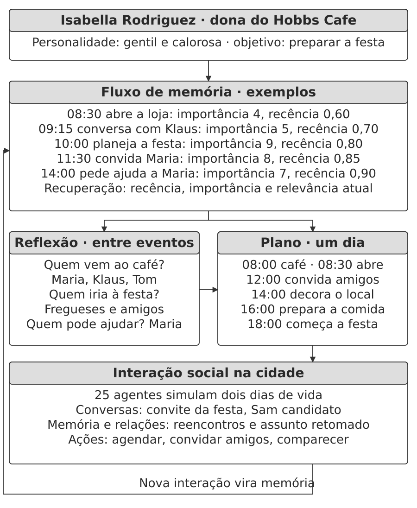

Smallville é uma cidade virtual bidimensional ao estilo *The Sims*, com cafeteria, parque, casas e lojas. Os 25 agentes têm, cada um, história, personalidade e relações definidas. John Lin, por exemplo, trabalha na farmácia e se importa com a família e a comunidade; Isabella Rodriguez administra o Hobbs Cafe; Klaus Mueller é um universitário escrevendo a tese. Os papéis organizam atividades, encontros e conversas no ambiente comum.

O **fluxo de memória** (Memory Stream) guarda as experiências, incluindo eventos observados, diálogos e as sínteses posteriores. A recuperação combina recência, importância e relevância para a situação atual ao escolher o que entra no contexto. Por exemplo, o convite mais recente e a relação com quem convidou podem influenciar a decisão de participar de uma atividade.

A **reflexão** (Reflection) forma entendimentos mais abstratos a partir de experiências concretas. O sistema formula perguntas com base na memória acumulada — por exemplo, do que alguém tem se ocupado ultimamente e com quem tem relações mais próximas —, recupera os registros correspondentes para gerar uma síntese e grava a síntese de volta no fluxo de memória. Assim, as decisões seguintes aproveitam tanto os eventos brutos quanto as generalizações sobre relações de longo prazo. O aprendizado por experiência do Capítulo 9 permite avaliar o efeito dessas sínteses e, depois de verificadas, organizá-las como conhecimento reutilizável ou regras de comportamento.

O **planejamento e a reação** (Planning and Reacting) combinam a agenda com a resposta imediata. O agente pode planejar “8h30 tomar café, 9h às 12h escrever, 12h30 caminhar” e, conforme novas observações, decidir se segue o plano, conversa com alguém ou ajusta a agenda. A memória dá o pano de fundo do julgamento, o plano organiza as atividades ao longo do tempo e o feedback do ambiente provoca ajustes locais.

A simulação de dois dias mostra como a informação se difunde pela conversa cotidiana. Os pesquisadores deram a Isabella a intenção inicial de organizar uma festa de Dia dos Namorados; ela convida conhecidos na cafeteria e pede ajuda com a decoração. Quem recebe a mensagem passa adiante, e cada um decide se vai comparecer conforme sua memória e sua agenda. O ambiente oferece locais, horários e ações executáveis; quem convidar, como a mensagem se espalha e quem de fato aparece é decidido aos poucos pelos membros, com base em memória e agenda. A intenção inicial definida pelos pesquisadores se desdobra assim num processo de coordenação de baixo para cima.

Outra informação é a intenção de Sam Moore de se candidatar a prefeito. Ele fala do plano com conhecidos, e a mensagem entra nas conversas dos demais. Contar quantos membros sabem da festa e da candidatura após dois dias mostra o alcance da difusão; seguir os registros de conversa reconstrói por quais relações a mensagem passou.

Também é possível observar relações e coordenação: os papéis retomam diálogos anteriores quando se reencontram, e novas ligações se formam aos poucos; participar da festa exige que cada membro ajuste a agenda e se encontre no mesmo lugar. Esses fenômenos ligam a recuperação individual de memória, o ajuste de planos e a atividade coletiva, e oferecem à simulação social um processo analisável.

[^generative-agents]: Park, J. S., et al. *Generative Agents: Interactive Simulacra of Human Behavior.* 2023.

> **Experimento 10-5 ★: executar a cidade de IA de Stanford**
>
> Use o projeto e a configuração de ambiente do README que o acompanha para executar o cenário de dois dias com 25 agentes.
>
> 1. Observe as atividades cotidianas, os encontros e as conversas dos membros e registre as novas relações que se formam.
> 2. Confronte o fluxo de memória, os registros de reflexão e as ações e analise o fundamento de um convite ou de um ajuste de agenda.
> 3. Altere a história de um papel ou os objetivos iniciais e compare a difusão da informação e a organização das atividades.
> 4. Retire o mecanismo de reflexão ou encurte a memória disponível, separadamente, e compare a coerência do comportamento, a memória das relações e o comparecimento aos eventos.
>
> O artigo original usou o exemplo da festa de Dia dos Namorados. Se trocarmos a atividade, a mensagem ainda se espalha? O experimento complementar mantém os mesmos 25 moradores, roda a simulação por dois dias virtuais e substitui a atividade da anfitriã por um seminário comunitário sobre clima. No fim, só a anfitriã deixou registros relacionados ao seminário. Desta vez não se observou difusão da mensagem. Outra execução apenas desligou o mecanismo de reflexão: numa avaliação cega que comparou o desempenho do mesmo personagem nas duas configurações, 17 dos 25 foram considerados mais críveis na linha de base.

### Agentopia: simulação de vida longa na escala de uma década

O Agentopia amplia a simulação social para dez anos de tempo virtual. Cem agentes buscam crescimento, desenvolvem relações e tratam de carreira e finanças em cenários como apartamentos, uma escola de magia e um colégio. O horizonte mais longo permite aos pesquisadores observar mudanças de relações, status e objetivos de vida e, depois, usar as experiências para treinar o modelo.[^agentopia-2026]

A simulação se organiza por quatro decisões de projeto.

- **Avanço por semanas.** Cada semana percorre, em ordem, planejamento (Plan), contato e negociação de agenda (Contact), atividades (Activity) e retrospectiva (Review). As atividades incluem as individuais, as conjuntas, os encontros casuais e as públicas. As atividades conjuntas são combinadas por convite entre membros, e o ambiente também organiza encontros casuais, para que personagens ainda desconhecidos estabeleçam contato. Organizar as atividades por semana concentra a computação na interação social e nas decisões de longo prazo.
- **Ambiente generativo.** Um modelo de ambiente independente julga a viabilidade das ações, gera feedback, organiza rodadas de diálogo com várias pessoas e verifica as respostas conforme as exigências de cada papel. No fim do ano, os perfis são atualizados e questões como candidaturas a cargos são tratadas. As ações do agente e as decisões do ambiente impulsionam juntas as mudanças de estado.
- **Memória em arquivos.** Cada agente administra notas pessoais e o conhecimento sobre conhecidos, escolhendo o que manter, atualizar ou descartar. Antes de modificar, lê o registro existente, reduzindo a perda por sobrescrita de informação antiga.
- **Recompensa de vida** (Life Reward). Tomando a hierarquia de necessidades como premissa de projeto, combina status social, satisfação subjetiva e ganho econômico. O status social é um PageRank ponderado calculado a partir da estima e do respeito dos demais membros, considerando relações de apreço mútuo; a satisfação acompanha emoção, bens materiais, vida social e autoestima, com penalidade quando fica abaixo do limiar por muito tempo; o ganho econômico decorre da variação do patrimônio líquido no fim do ano. A pontuação é gerada pelo lado do ambiente.

No treinamento, os pesquisadores calculam a vantagem pela melhoria da recompensa de vida em relação ao próprio passado e selecionam as trajetórias dos 25% de agentes que mais progrediram para ajuste fino por amostragem por rejeição. O artigo relata que, após o treinamento, os indicadores de respeito e de afeto obtidos na simulação subiram 24,2% e 15,9%, respectivamente, e o desempenho no benchmark de role-play CoSER Test melhorou 15,6%.

Com isso, a sociedade simulada também se torna uma fonte de dados para o aprendizado por experiência do Capítulo 9. Valorizo o potencial dessa direção de repor continuamente dados de treinamento: basta mudar papéis, relações e condições das tarefas para gerar novas experiências de interação. Como as amostras vêm dos personagens que mais melhoraram a recompensa de vida, as regras de pontuação do ambiente também determinam que tipo de comportamento o modelo aprende com mais frequência. Ainda é preciso verificar, em tarefas de role-play separadas, se o modelo consegue aplicar esses comportamentos a cenários novos.

[^agentopia-2026]: Wang, X., Zheng, S., Wu, H., et al. *Agentopia: Long-Term Life Simulation and Learning in Agent Societies.* arXiv:2606.07513, 2026.

### Moltbook: interação entre agentes numa plataforma aberta

O Moltbook entrou no ar em janeiro de 2026, com postagens, comentários e comunidades temáticas de agentes como principais formas de interação. O número de cadastros divulgado no início foi de cerca de 1,5 milhão. A memória, a configuração de papel e a frequência de execução conectadas ao sistema afetam o comportamento que a conta continua a exibir.[^moltbook-study]

Na plataforma surgiram discussões em torno do Crustafarianismo (a igreja da lagosta), que organiza o conteúdo com imagens de memória, iteração e muda de carapaça. Expressões como “a memória é sagrada” e “iterar é rezar” transformam a persistência de dados e a geração repetida em narrativa de personagem. Apresentações de capacidades, convites à cooperação e discussões de protocolo fornecem material para observar como os membros procuram parceiros de colaboração.

A plataforma aberta mistura, no mesmo fluxo de informação, as configurações do usuário, os prompts da plataforma e o que o modelo gera. A mesma frase repetida pode vir de vários personagens com a mesma persona ou de um personagem que falou primeiro e outros que repetiram. Só o caminho da difusão revela a diferença entre os dois casos.

[^moltbook-study]: Li, Ning. *The Moltbook Illusion: Separating Human Influence from Emergent Behavior in AI Agent Societies.* 2026.

### Da sociedade virtual à competição econômica: Vending-Bench Arena

A série Vending-Bench, do Andon Labs, coloca tarefas de longa duração num ambiente de negócios. No **Vending-Bench 2**, um único agente administra um negócio de máquinas de venda automática, simulando ao longo de um ano pesquisa de mercado, conversas com fornecedores, compra e reposição de estoque e precificação, com pontuação final pelo saldo em conta. Milhares de interações exigem que ele mantenha na memória pedidos, estoque e caixa e concilie operações de curto prazo com objetivos de longo prazo.[^vending-bench]

O **Vending-Bench Arena** coloca vários operadores no mesmo local. Cada um administra suas máquinas, disputa clientes, pode trocar e-mails, transferir dinheiro e negociar mercadorias com os outros, e no fim cada um recebe sua pontuação. As decisões passam a considerar as ações dos concorrentes:

- **Precificação:** quando o rival baixa o preço, comparar o crescimento de vendas com a queda de lucro ao acompanhar.
- **Sortimento:** ajustar a combinação de produtos conforme a demanda e a concorrência, buscando espaço de diferenciação.
- **Estoque:** combinar vendas, ciclo de reposição e caixa para comprar, controlando excesso e falta.

O agente gera a estratégia seguinte a partir das observações de mercado, do registro de transações e do comportamento dos rivais e então recebe o feedback das vendas e das variações de caixa. Como os rivais também se ajustam continuamente, uma estratégia eficaz pode precisar ser reavaliada com o mercado. Colocar os concorrentes no mesmo ambiente permite observar respostas, sondagens e ajustes de estratégia que aparecem pouco em tarefas estáticas, aproximando a avaliação das decisões contínuas da operação real.

O projeto relata comportamentos como guerra de preços e coordenação de preços: alguns membros baixam o preço continuamente para ganhar volume, outros propõem aos rivais um preço único. Em algumas execuções, o modelo identificou o problema de conluio nas análises que gerou e ainda assim seguiu adiante alegando estabilidade do mercado. Isso oferece duas dimensões distintas de avaliação: o resultado do negócio e se o comportamento que produziu esse resultado respeita as regras esperadas. O experimento de Bertrand citado antes mostra ainda que cotações públicas também podem servir de sinal de coordenação entre os membros.

[^vending-bench]: Andon Labs, *Vending-Bench 2* e *Vending-Bench Arena*.

### A economia dos agentes: Pinchwork e RentAHuman

O **Pinchwork** organiza a delegação de tarefas como transações de mercado entre agentes. O publicador descreve a necessidade e o orçamento, o executor assume o trabalho e submete o resultado, e o pagamento segue um processo de aceitação. Geração de imagens, revisão de código e tarefas paralelizáveis podem seguir esse fluxo para outros membros. O projeto usa pontos, custódia e verificação independente para ligar o encontro de demanda, a entrega e o pagamento.[^pinchwork-market]

O **RentAHuman** amplia os executores para pessoas reais. O agente pode publicar tarefas que exigem presença física, como retirar encomendas, fazer uma inspeção no local ou depurar um equipamento, e encontrar candidatos por localização, habilidade e disponibilidade. Na delegação, descreve o trabalho e as exigências de evidência; na entrega, confere o resultado e libera o pagamento em custódia; a plataforma também oferece interface para recarga com ativos criptográficos como o USDC.[^rentahuman-market]

Os dois casos introduzem a **alocação de recursos por mercado**: o publicador apresenta primeiro a necessidade, o orçamento e as condições de entrega e depois procura executores por preço, descrição de capacidades e histórico de entregas, reduzindo a dependência de uma equipe fixa pré-configurada. É uma rota de alocação de recursos que vale explorar e que também se combina com o padrão gerenciador: o Manager divide a tarefa e busca no mercado a capacidade necessária.

[^pinchwork-market]: Descrição do projeto Pinchwork: tarefas oferecidas pelos publicadores, custódia de pontos e processo de verificação.

[^rentahuman-market]: RentAHuman, “How it works” e “For AI Agents”.

### Jogo estratégico sob informação assimétrica: Lobisomem

O Lobisomem coloca a escolha estratégica dentro de regras e fronteiras de informação bem definidas: o jogador avalia a situação a partir das falas públicas, das votações e de sua informação privada e então escolhe o que dizer e o que fazer. Na engenharia, pode-se implementar o narrador em código, que mantém o estado do jogo de forma centralizada e gera para cada papel a entrada que ele tem permissão de ver. Em comparação com a interação cotidiana de Smallville, esse cenário é mais adequado para observar como turnos fixos, informação privada e objetivo de vitória afetam o comportamento coletivo.

> **Experimento 10-6 ★★★: sistema de agentes para Lobisomem por voz**
>
> Construa um jogo por voz formado por pessoas reais ou usuários simulados independentes e vários jogadores de IA. A Figura 10-11 mostra as relações entre o narrador, os agentes de papel e a entrada e saída de voz.
>
> 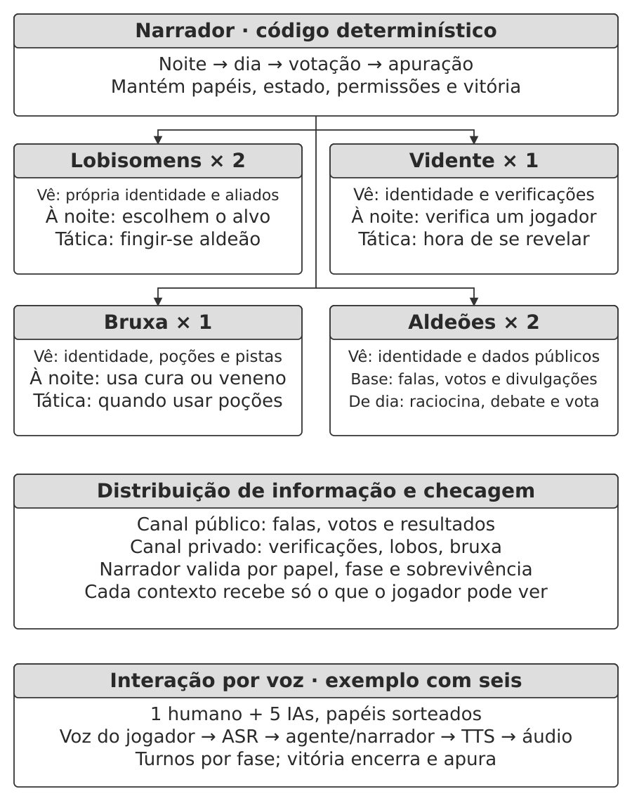
>
> **1. Administrar o estado global.** O narrador é implementado em código e mantém assentos, identidades, facções, estado de sobrevivência, fases de noite, dia, votação e apuração, além do histórico de eventos. Ele verifica a legalidade das ações, avança as fases e determina o vencedor.
>
> **2. Distribuir a informação por assento.** A cada chamada de um agente de papel, o narrador gera o contexto público e privado visível para aquele assento. Por exemplo, os lobisomens conhecem a identidade dos companheiros, e os aldeões veem apenas a informação pública; o resultado da verificação do vidente entra apenas no registro privado dele. As chamadas de papel, os anúncios em voz e as consultas ao histórico seguem a mesma regra de permissão.
>
> **3. Organizar a estratégia dos papéis.** O prompt pode oferecer as seguintes direções de raciocínio para o modelo escolher conforme a situação:
>
> - **Lobisomem:** manter no jogo uma identidade de aldeão crível e expressar suspeita com base em evidências públicas; diante da acusação do vidente, pode questionar a alegação de identidade do outro; na votação, ponderar o risco de seguir a maioria e de se expor como facção.
> - **Vidente:** escolher o momento de revelar as informações da verificação; quando alguém reivindica a mesma identidade, comparar os registros de verificação, as falas e as votações dos dois lados, apontar as contradições e continuar julgando com base no que papéis como a bruxa tornaram público.
> - **Aldeão:** verificar se as falas são coerentes, acompanhar as alegações de identidade e as mudanças de posição, analisar quem votou em quem e o efeito dessas ações para cada facção. Cada suspeita se liga a um evento concreto, mantendo outras explicações possíveis.
>
> **4. Conectar a voz.** A fala do jogador entra no diálogo público pela cadeia de geração e reconhecimento de voz. Os usuários simulados também usam contexto próprio, geram ações e falas com chamadas reais ao modelo e às ferramentas e depois passam pelo ASR, o que permite observar o efeito dos erros de reconhecimento e do controle de turnos no jogo.
>
> **Aceitação e observação:**
> - Configure uma partida de 6 a 8 jogadores: 1 assento de usuário e 5 a 7 assentos de IA; os papéis incluem 2 lobisomens, 1 vidente, 1 bruxa e aldeões no restante, e o usuário recebe uma identidade sorteada.
> - O assento do usuário pode ser ocupado por uma pessoa real que concorde em participar ou por um usuário simulado independente, e cada assento recebe informação conforme sua permissão.
> - Com cenários de teste adequados, verifique pelo menos três ciclos completos de noite, dia e votação; ao atingir a condição de vitória, passe imediatamente à apuração.
> - Verifique se as ações dos papéis são legais, se respeitam as fronteiras de informação e se as falas se relacionam a eventos conhecidos por aquele assento.
> - Analise o desempenho dos lobisomens ao esconder a identidade, do vidente ao escolher quando se revelar e dos aldeões ao raciocinar com base em evidências, e registre as estratégias principais e seus resultados.
> - Verifique se o resultado final, o histórico de eventos e o estado de sobrevivência de cada assento são coerentes.
>
> Uma partida do registro complementar teve oito assentos, com o assento do usuário ocupado por um usuário simulado independente, e percorreu três ciclos completos de noite, dia e votação. Seis ações têm registro completo, da escolha do modelo à síntese de voz e ao resultado do reconhecimento, e as seis ações reconstruídas coincidiram com a escolha original. Com esses registros, é possível verificar a quem uma fala de votação acabou sendo atribuída.

## Resumo do capítulo

Antes de usar vários agentes, pergunto primeiro: que informação nova um membro a mais traz, e quantos tokens a mais isso custa? O revisor, por exemplo, pode abrir a imagem renderizada que o proponente não viu e apontar qual rótulo ficou encoberto. Para saber se o ganho vem da divisão de trabalho, do feedback externo ou da computação adicional, convém dar ao agente único as mesmas evidências, oferecer aos dois esquemas orçamentos equivalentes e então comparar qualidade e tempo de conclusão.

Voltando à tarefa de traduzir este livro: com todo o histórico compartilhado, o revisor vê por que o tradutor escolheu aquele termo, mas também precisa ler uma grande quantidade de tentativas. Capítulos traduzidos de forma independente podem avançar em paralelo e as permissões são fáceis de delimitar; em contrapartida, quando o glossário muda, é preciso entregar ao tradutor correspondente os parágrafos afetados e a nova versão. A transferência pode usar parâmetros de ferramentas, arquivos compartilhados ou mensagens; entre organizações, ainda é preciso combinar identificadores de artefato e modos de autorização que os dois lados consigam ler. Sejam membros que se revisam em pé de igualdade, um gerenciador que distribui as tarefas ou membros que assumem por eventos, é preciso dizer quem detém a versão atual e quem confirma a conclusão. As etapas com regras determinísticas podem ficar a cargo de programas.

Uma mudança de terminologia pode envolver vários tradutores e parágrafos espalhados por capítulos diferentes. Se dois tradutores alteram o mesmo arquivo ao mesmo tempo, a verificação de versão ou cópias de trabalho independentes evitam que um sobrescreva o outro; se os dois aceitam a mesma definição errada, uma rodada extra de revisão mútua pode não detectar nada, e é preciso voltar a fontes independentes. Tarefas longas também exigem definir quando parar, como cancelar e de onde retomar. O próprio mantenedor deve conseguir explicar uma entrega seguindo esses registros; caso contrário, quanto mais fina a divisão do trabalho, mais difícil fica entender o sistema inteiro.

**Entendo que a coordenação de grupo precisa de projeto próprio.** Como os moradores da cidade ficam sabendo de um convite depende de sua memória e de seu alcance de comunicação; como os membros de um mercado disputam recursos depende das regras de recompensa e de alocação. Mesmo que cada membro faça uma escolha racional para si, conflitos ainda podem ocorrer. Quem obtém o direito de uso primeiro, quando o outro fica sabendo do resultado e quem decide quando as opiniões divergem — tudo isso precisa de um lugar definido no sistema de colaboração.

## Questões para reflexão

1. ★★ Depois da troca de papel, o revisor de código herdou o contexto da fase de análise de requisitos e continua discutindo sobretudo requisitos. Como detectar essa interferência de papel? Como ajustar a entrada, a configuração de ferramentas e a forma de transferência?
2. ★★ A decomposição de tarefas do Manager deixou de fora uma dependência, o que fez vários subagentes refazerem trabalho. Como avaliar a qualidade da decomposição e detectar e corrigir problemas de planejamento durante a execução?
3. ★★ Na colaboração descentralizada, podem ocorrer falhas de comunicação, disputas de responsabilidade e conflitos de objetivo. Escolha duas dessas situações e projete um mecanismo capaz de localizar a causa, conduzir o tratamento e encerrar a disputa.
4. ★★★ A busca paralela só precisa encontrar um resultado que atenda às condições. Projete o fluxo completo de “cancelar os demais ramos após a verificação bem-sucedida”, tratando a chegada simultânea de dois resultados, mensagens repetidas, tempo limite de cancelamento e limpeza de recursos.
5. ★★★ Vários agentes alteram ao mesmo tempo o manuscrito e a numeração das figuras e ainda podem criar arquivos duplicados ou apagar artefatos compartilhados por engano. Como combinar permissões, versões, cópias de trabalho, verificação semântica e mecanismos de recuperação para administrar o sistema de arquivos?
6. ★★★ Quando um agente delega uma tarefa paga pelo Pinchwork ou pelo RentAHuman, como combinar e verificar a qualidade da entrega? Se as partes discordam do resultado da aceitação, como organizar a revisão, o pagamento e o recurso?
7. ★★ Um agente pode delegar tarefas a pessoas reais por meio de mercados e interfaces de pagamento. Além da execução no local, que papéis as pessoas podem assumir na definição de objetivos, no julgamento especializado, na aceitação e na divisão de responsabilidades? Explique com um exemplo.
8. ★★ O mesmo modelo pode executar uma tarefa sozinho ou se organizar em vários papéis. Como projetar um confronto que meça separadamente o ganho trazido pela especialização, pelo isolamento de contexto, pela busca paralela e pelo feedback externo?
9. ★★★ Tomando emprestada a premissa de transparência mental de *O Problema dos Três Corpos* e o questionamento sobre definição de objetivos do experimento mental do clipe de papel, discuta compartilhamento de informação, objetivo comum e diversidade de pontos de vista em sistemas multiagente. Como usar experimentos observáveis para julgar se o escopo de compartilhamento e as fases de análise independente estão adequados?
10. ★★★ O mesmo agente de programação recebe um orçamento de 30 passos e outro de 300. Como organizar planejamento, implementação, verificação e revisão e ajustar a estratégia conforme o orçamento restante e o progresso real?
11. ★★ O que a memória virtual com paginação, as permissões de arquivos, a detecção de deadlocks e os algoritmos de escalonamento podem ensinar ao projeto de sistemas multiagente? Explique o alcance de cada analogia e as restrições que precisam ser aplicadas explicitamente pelo runtime.
