# Engenharia de contexto

O Capítulo 1 comparou o contexto ao “campo de visão decisório” do agente: cada vez que o modelo faz um julgamento, ele se apoia nas informações que recebeu naquele momento. A **engenharia de contexto** (Context Engineering) cuida de selecionar, organizar e atualizar essas informações, o que inclui instruções de sistema, definições de ferramentas, solicitações do usuário, mensagens anteriores e o estado da tarefa. Antes de cada chamada ao modelo, o Harness precisa transformar o contexto da tarefa e o progresso mais recente em uma entrada. A Figura 2-1 mostra, com conteúdo concreto, como a janela de contexto é composta.

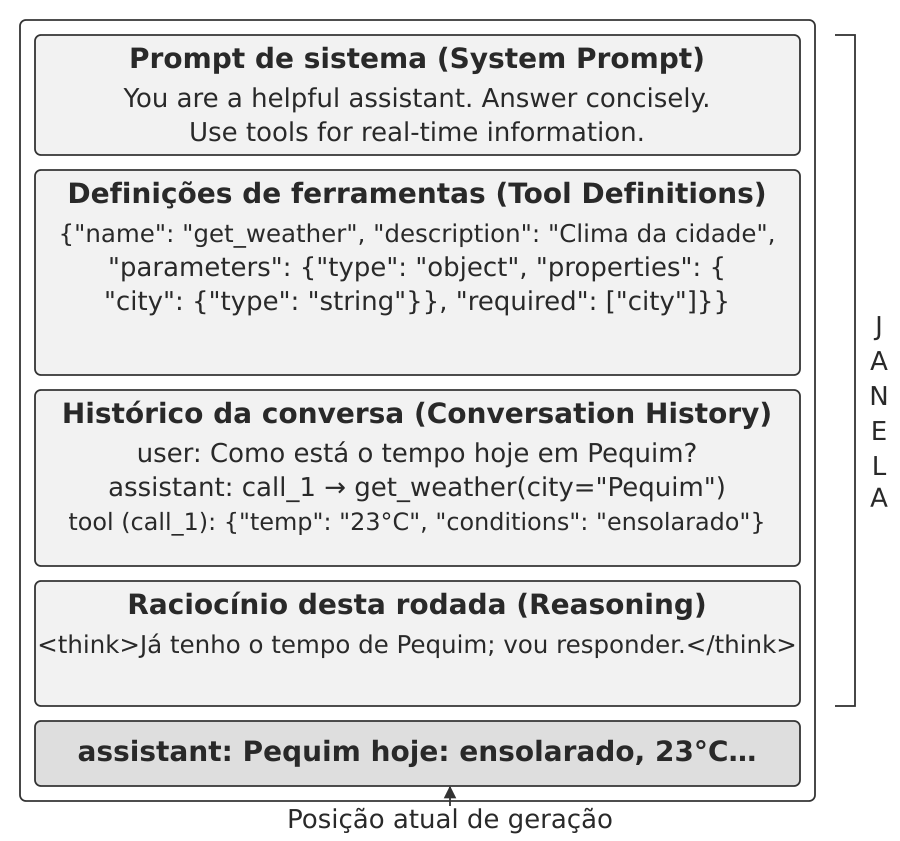

## Contexto: colocar a capacidade do modelo a serviço de uma tarefa concreta

Imagine um engenheiro experiente que acaba de entrar em uma equipe e recebe como primeira tarefa “alterar a configuração segundo as nossas normas”. Ele sabe programar, mas ainda não sabe qual arquivo é a fonte da configuração, quais campos podem ser alterados nem como verificar a mudança. Mesmo que receba a base de código inteira, ele pode acabar editando o arquivo errado. Quando um agente assume um projeto desconhecido, falta-lhe exatamente esse mesmo conhecimento de contexto.

Tome como exemplo o pedido “Ajude-me a corrigir este bug”. Um agente de programação normalmente precisa de três tipos de contexto:

- **Contexto atualizado do código**: estrutura de diretórios, responsabilidades dos módulos, principais estruturas de dados e convenções de código. Se a alteração for feita em um arquivo de configuração gerado automaticamente, ela pode funcionar localmente, mas será sobrescrita na próxima geração. Só sabendo qual módulo gera o arquivo é possível encontrar o lugar certo para alterar.
- **Normas de processo**: estratégia de branches no Git, convenções de commit, processo de revisão de código e requisitos de CI/CD. Com base nelas, o agente organiza alterações, testes e commits, e o sistema de execução realiza essas operações de acordo com as permissões.
- **Informações do ambiente**: configuração de desenvolvimento, forma de conexão com o banco de dados de teste, modo de implantação do ambiente de teste e gestão das chaves de API. Essas informações o ajudam a escolher o ambiente de execução correto e a entender as diferenças entre o ambiente local e o de teste.

O código do projeto e o banco de dados de teste ficam fora do contexto do modelo. No exemplo da configuração gerada automaticamente, o agente só descobre por onde começar a alteração depois de ler o script gerador por meio de uma ferramenta de busca. **A qualidade do contexto determina se o modelo consegue aplicar as capacidades que já tem ao problema em questão.** **Em tarefas que dependem de muita informação de contexto, um modelo suficientemente capaz com contexto completo e preciso pode superar um modelo mais forte ao qual faltam os materiais necessários.**

**Construir uma equipe nativa em IA começa por documentar o conhecimento essencial.** Se apenas os funcionários antigos lembram por que determinado banco de dados foi escolhido, e se as mudanças nas regras de negócio só foram mencionadas em conversas privadas, um novo colega e um agente que assumam o trabalho encontrarão o mesmo problema: o código mostra o que a equipe fez, mas não por que fez daquela forma.

**Equipes que funcionam bem no trabalho remoto costumam ser também favoráveis aos agentes.** Os desenvolvedores do kernel Linux discutem patches e trocam comentários de revisão por listas de e-mail, e a documentação do processo de desenvolvimento explica como enviar, revisar e integrar patches[^ch2-linux]. Um novo participante que encontre uma alteração inesperada pode seguir o patch até a discussão da época; um agente que precise verificar o contexto também pode recorrer a esse registro.

Depois de ouvir a entrevista de Jiayi Weng ao WhynotTV, resumi uma de suas ideias assim: **tanto pessoas quanto modelos dependem de Context.** Uma pessoa pode fazer uma pergunta a um colega que participou da decisão; já o contexto que o modelo consegue ler depende dos registros que a equipe deixou e do que o Harness colocou nesta solicitação.[^ch2-weng]

[^ch2-linux]: Documentação oficial do kernel Linux, How the development process works.

[^ch2-weng]: WhynotTV, “翁家翌：OpenAI，GPT，强化学习，Infra，后训练，天授，tuixue，开源，CMU，清华” (“Jiayi Weng: OpenAI, GPT, aprendizado por reforço, infraestrutura, pós-treinamento, Tianshou, tuixue, código aberto, CMU, Tsinghua”), Podcast #4.

O artigo do ReAct usa uma expressão formal para descrever como o histórico de interação participa das decisões[^ch2-react]. No instante $t$, o agente recebe do ambiente uma observação $o_t\in\mathcal{O}$ e escolhe uma ação $a_t\in\mathcal{A}$ de acordo com a política $\pi(a_t\mid c_t)$, em que o contexto é:

$$
c_t=(o_1,a_1,\ldots,o_{t-1},a_{t-1},o_t)
$$

Essa expressão mostra que **a próxima ação do agente depende do histórico de interação acumulado até o momento.** Por exemplo, quais arquivos o agente já consultou e quais erros as ferramentas retornaram influenciam a escolha seguinte. Em um agente baseado em LLM, as entradas do usuário e os resultados das ferramentas fornecem observações, enquanto as chamadas de ferramentas e as respostas externas registram ações; as instruções de sistema e as definições de ferramentas explicam ainda as regras da tarefa e as interfaces disponíveis.

Este capítulo adota primeiro o modo de solicitação sem estado: a cada rodada, o Harness monta as mensagens e as definições de ferramentas e então chama o modelo. O histórico completo de mensagens facilita preservar o progresso da tarefa; à medida que ele cresce, recuperação, registros de estado e compressão permitem manter na janela as informações necessárias para as decisões seguintes. O layout do contexto, a barra de status e as técnicas de compressão giram em torno da mesma pergunta: como colocar em $c_t$, dentro de um contexto limitado, as informações de que o modelo precisa neste passo?

[^ch2-react]: Yao, Shunyu, et al., ReAct: Synergizing Reasoning and Acting in Language Models, ICLR 2023.

## Como os agentes chamam LLMs: a estrutura do contexto na API

Começamos por um cumprimento para observar o formato das mensagens e, em seguida, vemos como a pergunta “que horas são e como está o clima em Vancouver agora?” leva a duas chamadas de ferramentas. Esta seção usa uma interface compatível com Chat Completions e um Qwen3-0.6B executado localmente; ao final, um programa em Python encadeia as solicitações de cada rodada[^ch2-chat-api].

### Os quatro papéis de mensagem do exemplo

A **lista de mensagens** (`messages`) da solicitação guarda, em ordem, as informações da interação. Cada mensagem é marcada com um **papel** (`role`) que indica sua origem e sua finalidade. Esta seção usa quatro papéis:

- **system**: prompt de sistema. Aqui ele contém a identidade, as regras de comportamento e as restrições fornecidas pelo desenvolvedor, e fica no início da lista de mensagens. Algumas interfaces de modelo usam o papel `developer` para as instruções do desenvolvedor.
- **user**: mensagem do usuário, com a tarefa, as perguntas de acompanhamento e os requisitos adicionais.
- **assistant**: resposta do modelo, incluindo texto e solicitações de chamada de ferramentas. Ao recolocar essas mensagens na entrada da rodada seguinte, o modelo consegue ler as respostas e as solicitações de operação anteriores.
- **tool**: resultado da execução de uma ferramenta. Ao receber o valor de retorno, o Harness o registra como mensagem de ferramenta e o vincula à chamada correspondente por meio de `tool_call_id`.

As definições de ferramentas são passadas no campo `tools`, no nível superior da solicitação, e listam nome, finalidade e formato dos parâmetros de cada ferramenta disponível.

O modelo constrói as solicitações de chamada com base nas definições de ferramentas. Se a operação pode de fato ser executada, quem decide são o Harness e o ambiente de execução.

[^ch2-chat-api]: OpenAI, referência da Chat Completions API, que descreve os papéis de mensagem, as definições de ferramentas e os campos dos resultados de chamadas; Qwen, Function Calling, que descreve a chamada de ferramentas e os templates em serviços compatíveis.

### Turno único: a chamada mais simples à API

Comecemos por uma pergunta e resposta. O usuário pergunta “Hello, who are you?”; o Harness envia ao modelo as instruções de sistema junto com a pergunta e lê a resposta. A Figura 2-2 mostra a correspondência entre solicitação e resposta.

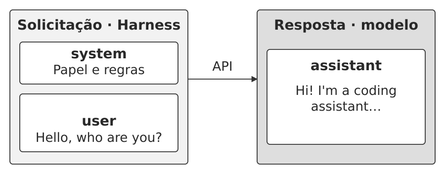

A seguir, a solicitação e uma resposta de exemplo no formato da interface do modelo local; os comentários no código indicam a origem de cada parte:

```javascript
// O Harness monta a solicitação
{
  "model": "Qwen3-0.6B",
  "messages": [
    {
      "role": "system",                           // Instruções fornecidas pelo desenvolvedor
      "content": "You are a helpful coding assistant. Follow user instructions."
    },
    {
      "role": "user",                              // Entrada do usuário
      "content": "Hello, who are you?"
    }
  ]
}
```

```javascript
// Resposta devolvida pela API
{
  "choices": [{
    "message": {
      "role": "assistant",                         // Gerado pelo modelo
      "content": "Hi! I'm a coding assistant. I can help you write code, debug issues, and explain technical concepts. How can I help?"
    }
  }]
}
```

A solicitação contém uma mensagem `system` e uma mensagem `user`; na resposta, `choices[0].message` guarda a mensagem `assistant` gerada pelo modelo. Na interface sem estado adotada aqui, **cabe ao Harness fornecer o contexto necessário a cada chamada**. Se a próxima solicitação quiser dar continuidade a essa conversa, ela precisará levar o histórico relevante.

### Interação em vários turnos com chamadas de ferramentas: o loop central do agente

Vejamos agora uma pergunta que exige ferramentas: “What's the current time and weather in Vancouver?” Para respondê-la, é preciso primeiro obter a hora e as condições do clima locais. Na Figura 2-3, a primeira chamada do Harness ao modelo resulta em duas solicitações de ferramenta. O Harness consulta o serviço de horário e o serviço meteorológico, acrescenta os dois resultados ao histórico de mensagens e chama o modelo pela segunda vez; só então obtém a resposta para o usuário.

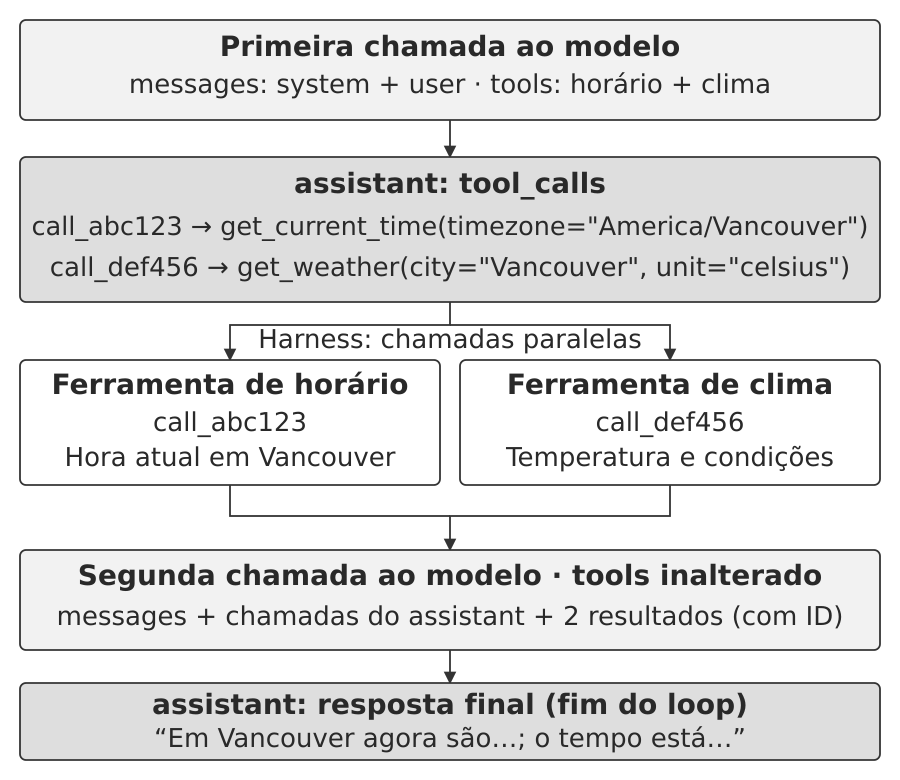

Qual das duas ferramentas é executada primeiro? A ferramenta de horário precisa de um fuso horário; a de clima, de uma cidade e de uma escala de temperatura. O usuário disse apenas Vancouver, e o modelo do exemplo preencheu `America/Vancouver` e `Vancouver` com base nisso, escolhendo graus Celsius. A consulta do clima não precisa esperar o retorno da ferramenta de horário, então as duas consultas podem ser enviadas ao mesmo tempo.

**Primeira chamada à API — o framework do agente envia a solicitação inicial:**

```javascript
// Primeira chamada ao modelo: o Harness monta a solicitação
{
  "model": "Qwen3-0.6B",
  "messages": [
    {
      "role": "system",                           // Instruções fornecidas pelo desenvolvedor
      "content": "You are a helpful assistant. Use the provided tools to get real-time information when needed."
    },
    {
      "role": "user",                              // Entrada do usuário
      "content": "What's the current time and weather in Vancouver?"
    }
  ],
  "tools": [                                       // Ferramentas definidas pelo desenvolvedor
    {
      "type": "function",
      "function": {
        "name": "get_current_time",
        "description": "Get the current date and time in a specific timezone",
        "parameters": {
          "type": "object",
          "properties": {
            "timezone": { "type": "string", "description": "Timezone name, e.g. America/Vancouver" }
          },
          "required": ["timezone"]
        }
      }
    },
    {
      "type": "function",
      "function": {
        "name": "get_weather",
        "description": "Get the current weather for a specific city",
        "parameters": {
          "type": "object",
          "properties": {
            "city": { "type": "string", "description": "City name" },
            "unit": { "type": "string", "enum": ["celsius", "fahrenheit"] }
          },
          "required": ["city", "unit"]
        }
      }
    }
  ]
}
```

Essa lista `tools` é definida previamente pelo desenvolvedor e contém nomes, descrições e schemas de parâmetros. Neste exemplo, as mesmas duas ferramentas são fornecidas em todas as rodadas; o modelo lê a lista e a pergunta do usuário e então escolhe quais ferramentas chamar e preenche os parâmetros.

**O modelo retorna duas solicitações de chamada de ferramenta:**

```javascript
// O modelo devolve solicitações de chamada de ferramenta
{
  "choices": [{
    "message": {
      "role": "assistant",                         // Gerado pelo modelo
      "content": null,                             // Nenhuma resposta em texto nesta rodada
      "tool_calls": [                              // Pede a chamada de duas ferramentas
        {
          "id": "call_abc123",
          "type": "function",
          "function": {
            "name": "get_current_time",
            "arguments": "{\"timezone\": \"America/Vancouver\"}"
          }
        },
        {
          "id": "call_def456",
          "type": "function",
          "function": {
            "name": "get_weather",
            "arguments": "{\"city\": \"Vancouver\", \"unit\": \"celsius\"}"
          }
        }
      ]
    }
  }]
}
```

O campo `tool_calls` da resposta contém duas solicitações, cada uma com seu próprio `id`, nome de ferramenta e parâmetros. `arguments` é uma string codificada em JSON; o lado que executa precisa primeiro decodificá-la e depois validar campos e valores. **O modelo decide o que chamar e com quais parâmetros; o Harness valida e despacha; a implementação da ferramenta acessa o serviço de horário ou de clima.**

**O framework do agente executa as ferramentas e faz a segunda chamada à API:**

Depois de validar as solicitações, o Harness despacha as duas ferramentas, registra os valores retornados como mensagens `tool` e entrega ao modelo o histórico existente junto com os novos resultados:

```javascript
// Segunda chamada ao modelo: acrescenta os resultados das ferramentas
{
  "model": "Qwen3-0.6B",
  "messages": [
    {
      "role": "system",                           // Mantém as mensagens da primeira solicitação
      "content": "You are a helpful assistant. Use the provided tools to get real-time information when needed."
    },
    {
      "role": "user",                              // Mantém as mensagens da primeira solicitação
      "content": "What's the current time and weather in Vancouver?"
    },
    {
      "role": "assistant",                         // Mantém as solicitações de chamada da rodada anterior
      "content": null,
      "tool_calls": [
        { "id": "call_abc123", "type": "function", "function": { "name": "get_current_time", "arguments": "{\"timezone\": \"America/Vancouver\"}" } },
        { "id": "call_def456", "type": "function", "function": { "name": "get_weather", "arguments": "{\"city\": \"Vancouver\", \"unit\": \"celsius\"}" } }
      ]
    },
    {
      "role": "tool",                              // O Harness grava o resultado da execução da ferramenta
      "tool_call_id": "call_abc123",
      "content": "{\"timezone\": \"America/Vancouver\", \"datetime\": \"2025-09-13T05:18:47\", \"day_of_week\": \"Saturday\"}"
    },
    {
      "role": "tool",                              // O Harness grava o resultado da execução da ferramenta
      "tool_call_id": "call_def456",
      "content": "{\"city\": \"Vancouver\", \"temperature\": 13.2, \"unit\": \"celsius\", \"conditions\": \"clear\", \"humidity\": 93}"
    }
  ],
  "tools": [ ... ]                                 // Mesmas definições de ferramentas de antes, omitidas aqui
}
```

Leia a segunda solicitação seguindo `call_def456`: na mensagem `assistant` anterior, esse é o identificador da consulta do clima em Vancouver; a mensagem `tool` seguinte usa o mesmo identificador para devolver 13,2 ℃ e céu limpo. Mesmo que o resultado do clima chegue antes do resultado da hora, o Harness consegue casar cada resultado com sua solicitação. Nesta rodada, o modelo lê ao mesmo tempo a pergunta original do usuário, as duas consultas que ele próprio emitiu e os dados trazidos pelas ferramentas. Agora ele pode responder ao usuário.

**O modelo gera a resposta final com base nos resultados das ferramentas:**

```javascript
// O modelo gera a resposta final
{
  "choices": [{
    "message": {
      "role": "assistant",                         // Gerado pelo modelo
      "content": "It's currently 5:18 AM on Saturday, September 13, 2025 in Vancouver.\n\nWeather: 13.2°C with clear skies and 93% humidity. It's quite cool this morning - you might want to grab a jacket."
    }
  }]
}
```

A segunda resposta traz o texto final, `tool_calls` vem vazio e o loop do exemplo termina. Esse processo de “chamar o modelo → executar ferramentas → devolver os resultados → chamar o modelo de novo” é a implementação concreta, na API, do loop de execução do Capítulo 1.

Se o usuário perguntar em seguida “E Tóquio?”, o Harness acrescenta essa mensagem ao fim do histórico e chama o modelo novamente. O modelo pode aproveitar o contexto da tarefa “consultar a hora e o clima atuais” para gerar novas solicitações referentes a Tóquio; quando as ferramentas retornarem, ele elabora a nova resposta.

**Com a Responses API, como devolver os resultados das ferramentas?** O experimento local acima usa uma interface compatível com Chat Completions. Para novos projetos com os serviços da OpenAI, a recomendação oficial é a Responses API. Voltemos ao exemplo de Vancouver: a aplicação coloca a pergunta do usuário no campo `input` da solicitação e declara as duas funções, de horário e de clima, em `tools`. O `output` retornado é um conjunto de itens tipados. Se nele aparecerem dois itens `function_call`, a aplicação lê de cada um o nome da função, os argumentos e o `call_id`, e executa cada ferramenta.[^ch2-responses-loop]

Suponha que o identificador da chamada à função de clima seja `call_weather`. O `input` da próxima solicitação pode então conter um comprovante como este; a função de horário também deve devolver seu resultado com seu próprio identificador.

```json
{"type": "function_call_output", "call_id": "call_weather", "output": "{\"temperature\": 13.2, \"unit\": \"celsius\"}"}
```

`call_id` liga um comprovante a uma chamada de função. `previous_response_id` aponta para a resposta anterior do modelo, para que o serviço dê continuidade ao contexto daquela rodada. Os dois identificadores se referem a objetos diferentes. Nesse modo de continuação, a rodada atual ainda precisa fornecer as ferramentas que continuarão em uso e as `instructions` de nível superior; as instruções de nível superior da solicitação anterior não são herdadas automaticamente pelo identificador da resposta. O modelo pode pedir mais ferramentas, e a aplicação precisa ler o `output` seguinte antes de decidir se encerra. O Experimento 1-3 do Capítulo 1 usava uma busca hospedada no servidor; aqui, as duas funções personalizadas são de fato executadas pela aplicação.

[^ch2-responses-loop]: OpenAI, migração para a Responses API, chamada de funções e descrição dos parâmetros de criação de respostas.

### Implementação do loop central do agente em código

As duas chamadas a `messages.append` no loop guardam, respectivamente, a resposta do modelo e o resultado da execução das ferramentas. A hora e a temperatura vêm ambas de Vancouver; se os dois IDs de chamada forem trocados, o modelo lerá na rodada seguinte que a “consulta de horário” retornou 13,2 graus Celsius.

O exemplo se conecta a um serviço compatível por meio do SDK Python da OpenAI. O endereço padrão é `http://localhost:8000/v1`, na própria máquina, adequado a um serviço local já iniciado e sem autenticação. Esses valores padrão correspondem ao backend vLLM do Experimento 2-1. Para usar o backend Ollama desse experimento, defina o endereço como `http://localhost:11434/v1` e troque o nome do modelo para `qwen3:0.6b`. Para outros serviços, defina conforme necessário as variáveis de ambiente `LLM_BASE_URL` e `LLM_API_KEY` e faça o `model` abaixo coincidir com o nome realmente implantado. As ferramentas de horário e de clima usam por enquanto os dados fixos do exemplo anterior, para facilitar a comparação com as mensagens; ao conectar dados reais, basta substituir a implementação dessas duas ferramentas.

```python
import json
import os

from openai import OpenAI

client = OpenAI(
    base_url=os.getenv("LLM_BASE_URL", "http://localhost:8000/v1"),
    api_key=os.getenv("LLM_API_KEY", "EMPTY"),
)

# Definições de ferramentas: nome, finalidade e estrutura dos parâmetros
tools = [
    {
        "type": "function",
        "function": {
            "name": "get_current_time",
            "description": "Get the current date and time in a specific timezone",
            "parameters": {
                "type": "object",
                "properties": {
                    "timezone": {"type": "string", "description": "Timezone name, e.g. America/Vancouver"}
                },
                "required": ["timezone"],
            },
        },
    },
    {
        "type": "function",
        "function": {
            "name": "get_weather",
            "description": "Get the current weather for a specific city",
            "parameters": {
                "type": "object",
                "properties": {
                    "city": {"type": "string", "description": "City name"},
                    "unit": {"type": "string", "enum": ["celsius", "fahrenheit"]},
                },
                "required": ["city", "unit"],
            },
        },
    },
]

# As ferramentas de exemplo usam dados fixos; os parâmetros coincidem com a consulta sobre Vancouver vista antes.
def execute_tool(name, arguments):
    args = json.loads(arguments)
    if name == "get_current_time" and args == {"timezone": "America/Vancouver"}:
        result = {
            "timezone": "America/Vancouver",
            "datetime": "2025-09-13T05:18:47",
            "day_of_week": "Saturday",
        }
    elif name == "get_weather" and args == {"city": "Vancouver", "unit": "celsius"}:
        result = {
            "city": "Vancouver", "temperature": 13.2,
            "unit": "celsius", "conditions": "clear", "humidity": 93,
        }
    else:
        result = {"error": "O exemplo só fornece a hora de Vancouver e o clima em graus Celsius"}
    return json.dumps(result, ensure_ascii=False)

# Mensagens iniciais: instruções e tarefa do usuário
messages = [
    {"role": "system", "content": "You are a helpful assistant. Use tools to get real-time information when needed."},
    {"role": "user", "content": "What's the current time and weather in Vancouver?"},
]

# Loop de execução: no máximo oito chamadas ao modelo
rounds = 0
while rounds < 8:
    rounds += 1
    response = client.chat.completions.create(
        model="Qwen3-0.6B", messages=messages, tools=tools
    )
    assistant_message = response.choices[0].message

    # Guarda a resposta do modelo, incluindo as solicitações de chamada desta rodada
    messages.append(assistant_message.model_dump(exclude_none=True))

    # Este exemplo termina quando o modelo responde sem chamar ferramentas
    if not assistant_message.tool_calls:
        print(assistant_message.content)
        break

    # Executa uma a uma e acrescenta os resultados; chamadas independentes também poderiam ser despachadas em paralelo
    for tool_call in assistant_message.tool_calls:
        try:
            result = execute_tool(tool_call.function.name, tool_call.function.arguments)
        except json.JSONDecodeError:
            result = json.dumps({"error": "Os argumentos da ferramenta precisam ser um JSON válido"})
        messages.append({
            "role": "tool",
            "tool_call_id": tool_call.id,
            "content": result,
        })
    # A rodada seguinte usa a lista de mensagens com os resultados acrescentados
else:
    print("Limite de rodadas atingido; a tarefa não foi concluída.")
```

Suponha que, na primeira rodada, o modelo peça simultaneamente a hora e o clima. O laço `for` consulta primeiro a hora e acrescenta o resultado a `messages`; depois consulta o clima e acrescenta o segundo resultado. Só depois de executar as duas o programa volta ao início do `while` e envia a segunda solicitação ao modelo. Expandindo o conteúdo de `messages` nesses passos, vemos o que o modelo recebe a cada vez.

**Estado inicial (antes da 1ª chamada):**
```text
messages = [
  { role: "system",  content: "You are a helpful assistant..." },     # Escrito pelo desenvolvedor
  { role: "user",    content: "What's the current time and weather in Vancouver?" },  # Entrada do usuário
]
```

**Depois da 1ª chamada ao modelo e da execução das ferramentas:**
```text
messages = [
  { role: "system",    content: "..." },
  { role: "user",      content: "What's the current time..." },
  { role: "assistant", tool_calls: [get_current_time, get_weather] },  # Solicitações de chamada geradas pelo modelo
  { role: "tool",      tool_call_id: "call_abc123", content: "{time...}" },  # Gravado pelo Harness após a execução da ferramenta
  { role: "tool",      tool_call_id: "call_def456", content: "{weather...}" },  # Gravado pelo Harness após a execução da ferramenta
]
```

**Depois da 2ª chamada (o modelo retorna a resposta final e o loop termina):**
```text
messages = [
  { role: "system",    content: "..." },
  { role: "user",      content: "What's the current time..." },
  { role: "assistant", tool_calls: [get_current_time, get_weather] },
  { role: "tool",      tool_call_id: "call_abc123", content: "{time...}" },
  { role: "tool",      tool_call_id: "call_def456", content: "{weather...}" },
  { role: "assistant", content: "It's currently Saturday, Sep 13, 2025 in Vancouver..." },  # Resposta final
]
```

### A composição do contexto do ponto de vista da API

A Figura 2-4 divide uma solicitação em duas partes: o prefixo e o histórico de mensagens. Quando a consulta sobre Vancouver acaba de ser enviada, o histórico contém apenas a pergunta do usuário e a conversa anterior. Depois que as duas consultas terminam, o histórico passa a incluir também as chamadas de ferramentas propostas pelo modelo e os dois resultados.

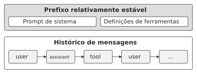

Assim, o trecho inicial comum a duas solicitações consecutivas pode se estender até dentro do histórico de mensagens. Quanto cálculo antigo a próxima chamada consegue reaproveitar depende do comprimento desse prefixo.

O Harness abaixo coloca no início as instruções de sistema e as definições de ferramentas, que mudam pouco, e a cada rodada apenas acrescenta o estado atual ao fim do histórico. Quando o histórico fica longo demais, ele primeiro comprime as mensagens antigas e depois monta a solicitação.

```python
stable_prefix = system_message
stable_tools = core_tool_schemas
history = load_message_history(session)
status_message = make_status_message(derive_current_state(history))

if estimated_tokens(stable_prefix, stable_tools, history, status_message) > budget:
    history = compress_old_evidence(
        history,
        preserve = [decisions, constraints, failures, citations]
    )

request.messages = [stable_prefix] + history + [status_message]
request.tools = stable_tools
response = call_model(request)
```

Ao comprimir, preservam-se as informações de que o trabalho seguinte precisa, como decisões, restrições, falhas e citações, e mantém-se a associação entre solicitações de chamada e resultados de ferramentas. Além do orçamento de tamanho, informações repetidas ou desatualizadas também podem disparar a compressão; as estratégias específicas são desenvolvidas na segunda metade deste capítulo.

> **Experimento 2-1 ★: implantação de um serviço de LLM local e chamada de ferramentas**
>
> Este experimento executa o Qwen3-0.6B localmente e, acompanhando a tarefa “consultar a hora e o clima em Vancouver”, observa como as mensagens passam pelo modelo, pelo parser e pelo executor de ferramentas. A Figura 2-5 mostra a divisão de trabalho entre o serviço local e o cliente: o servidor carrega o modelo, processa a entrada e gera a resposta; o cliente mantém o histórico de mensagens, despacha as ferramentas e devolve os resultados.
>
> 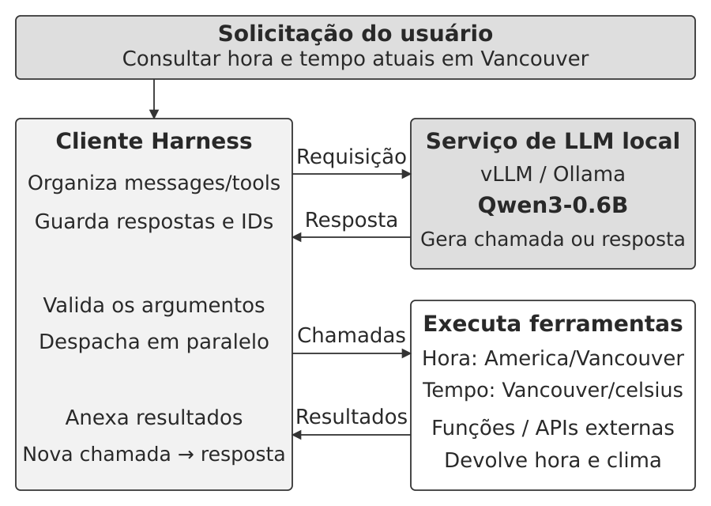
>
> **Primeiro, acompanhe uma tarefa completa.** Na mesma saída, o modelo pede a consulta da hora e da temperatura, preenchendo parâmetros como `America/Vancouver`, `Vancouver` e `celsius`. O cliente executa as duas ferramentas em paralelo. O primeiro comprovante informa a hora local, 11:11:28; o segundo, a temperatura de 17,9 °C. Quando os dois resultados voltam ao modelo, ele informa a hora até os minutos, responde que a temperatura é de 17,9 °C e encerra o loop. Essa execução mostra que um modelo de seiscentos milhões de parâmetros já consegue escolher as duas ferramentas certas para essa tarefa, preencher os parâmetros e responder ao usuário com os valores retornados.
>
> **Em seguida, compare a saída bruta com os campos da API.** O modo de raciocínio do Qwen3 pode gerar conteúdo de raciocínio marcado com `<think>`, e as solicitações de ferramenta usam marcadores de chamada próprios. Depois que o servidor faz o parsing, o cliente pode receber um campo `thinking` separado ou campos de chamada de ferramenta. A disposição e a preservação de cada parte da saída são determinadas em conjunto pelo template do modelo e pelo protocolo do serviço.
>
> **Depois, observe o processamento em streaming.** A interface pode atualizar, conforme os eventos chegam, estados como “raciocinando”, “chamando ferramenta” e “gerando resposta”. Os parâmetros das ferramentas costumam chegar em vários fragmentos e precisam ser acumulados até formar a solicitação completa; quando o protocolo confirma que a chamada terminou e as verificações de parâmetros, permissões e dependências passam, o sistema de execução pode começar a despachar a chamada. Ferramentas independentes podem ser executadas em paralelo e também formar um pipeline com o processamento da saída que vem a seguir.
>
> **Por fim, compare velocidade e cache.** No registro desta execução em um Mac com chip da Apple, a velocidade média de decodificação nas tarefas com ferramentas foi de cerca de 107 tokens por segundo. Token é a unidade básica com que o modelo processa texto; a segmentação exata é definida pelo tokenizador, e uma palavra ou um caractere chinês pode corresponder a um ou mais tokens. A velocidade de decodificação reflete a taxa de saída depois que a geração começa; o tempo de espera do usuário depende também da latência até o primeiro token, do comprimento do raciocínio e da duração das ferramentas.
>
> A comparação de cache usa o mesmo prefixo longo e testa, separadamente, solicitações que preservam o prefixo e solicitações que alteram seu início. Nos cinco pares desta execução, a solicitação que preservava o prefixo foi mais rápida em quatro; a latência média até o primeiro token foi de cerca de 1,30 segundo e 1,51 segundo, respectivamente. A próxima seção explica em que essas solicitações diferem em termos de cálculo.
>
> Este experimento também me deixou ainda mais otimista em relação aos agentes no dispositivo: modelos pequenos já conseguem concluir tarefas de chamada de ferramentas como esta no próprio aparelho do usuário. **A era dos agentes no dispositivo está mais próxima do que muitos imaginam.**

## Design de contexto favorável ao cache KV

Solicitações consecutivas de um agente costumam compartilhar muitas informações: instruções de sistema, definições de ferramentas e as interações que já ocorreram. Se o motor de inferência conseguir reaproveitar os resultados intermediários desses trechos, sobra mais cálculo para as informações novas. O **cache KV** guarda as chaves (Key) e os valores (Value) já obtidos no cálculo de atenção de cada camada, para uso dos tokens seguintes; o **Prompt Cache** vai além e reaproveita entre solicitações o cache de prefixo que atende às condições exigidas[^ch2-kv-basics].

Considere um agente de atendimento. Para que o modelo saiba a hora atual, o desenvolvedor insere `Current time: {{now}}` no início do prompt de sistema e o atualiza a cada solicitação. As regras de negócio e as definições de ferramentas que vêm depois ficam intactas, mas a entrada real passa a variar a partir do carimbo de data e hora. Para um serviço que reaproveita o cache KV por prefixo idêntico, isso obriga a recalcular o carimbo e tudo o que vem depois dele, aumentando o tempo de processamento da entrada e o custo.

Basta registrar a hora como uma mensagem acrescentada ao final, ou consultar uma ferramenta de horário quando necessário, para preservar o prefixo existente. As duas disposições fornecem informações semelhantes, mas acionam extensões de recálculo diferentes.

Vale guardar desde já três práticas; os princípios e experimentos a seguir explicam cada uma delas:

1. **Mantenha estável o prefixo reaproveitável.** As instruções de sistema e as definições das ferramentas de uso frequente devem ter conteúdo e ordem determinísticos.
2. **Acrescente ao final o que muda durante a execução.** Hora, saldo, número de chamadas e progresso da tarefa podem ser fornecidos por mensagens novas ou por resultados de ferramentas. O estado mais recente deve indicar a partir de quando vale, para que o modelo saiba qual registro se aplica à decisão atual.
3. **Organize as mensagens segundo o protocolo do modelo.** Use papéis, IDs de chamada e formatos de resultado de ferramenta corretos, e deixe que o template de chat correspondente gere a entrada do modelo. O cache casa com o prefixo já processado e com a configuração relevante, e o protocolo de mensagens também determina como o modelo reconhece instruções, solicitações do usuário e valores retornados pelas ferramentas.

No modelo com atenção causal adotado nesta seção, acrescentar tokens ao final não altera o estado já calculado nas posições anteriores. Ao modificar uma entrada existente, o primeiro ponto alterado e todo o estado posterior precisam ser recalculados; o prefixo anterior à alteração ainda tem chance de ser reaproveitado. O servidor decide também o alcance real do acerto de cache conforme o tamanho do bloco, o tempo de retenção e a configuração de execução.

[^ch2-kv-basics]: Hugging Face, How caching works, sobre o mecanismo de armazenamento e reaproveitamento de K e V camada por camada.

> **Experimento 2-2 ★: visualização do mecanismo de atenção**
>
> Comece com a frase chinesa “北京 的 天气 怎么样” (“como está o tempo em Pequim”) para entender um cálculo de atenção. Para facilitar a exposição, a Figura 2-6 divide a frase em quatro unidades semânticas; em um modelo real, a divisão é feita pelo tokenizador. Ao processar a posição de “怎么样” (“como está”), a camada de atenção precisa compor a representação atual a partir das informações existentes. Query, Key e Value desempenham, respectivamente, os papéis de consulta, correspondência e agregação de informação.
>
> | Vetor | Papel | Leitura intuitiva neste exemplo |
> | --- | --- | --- |
> | **Query (consulta)** | Vetor da posição atual usado para comparar com as outras posições | “怎么样” precisa encontrar nas informações existentes o que é relevante |
> | **Key (chave)** | Vetor de cada posição que participa da comparação | Posições como “北京” (Pequim) e “天气” (tempo) oferecem representações comparáveis |
> | **Value (valor)** | Vetor de informação agregado segundo os pesos | Local, tempo e outras informações entram na representação atual com o peso correspondente |
>
> Pense na Key como um rótulo de busca e no Value como o conteúdo recuperado. No modelo, esses vetores são números calculados a partir das representações ocultas, e o treinamento molda a forma como eles se correspondem.
>
> Um cálculo acontece em três passos. Primeiro, a posição atual gera uma Query; depois, ela faz produto escalar com a Key de cada posição e, após escala, máscara causal e softmax, produz pesos de atenção que somam 1; por fim, esses pesos são aplicados ao Value em uma soma ponderada. O produto escalar multiplica dois conjuntos de números posição a posição e soma os resultados, e o softmax converte as pontuações das posições visíveis em pesos normalizados. Os Values de cada posição entram na agregação com o peso correspondente e, juntos, formam a saída dessa cabeça de atenção.
>
> Percorra horizontalmente a última linha da Figura 2-6, em que as palavras aparecem traduzidas: a posição de “怎么样” (“como está”) atribui peso 0,55 a “天气” (“tempo”). É preciso multiplicar esse número pelo Value da posição de “tempo” e somar as contribuições das outras três posições para obter a saída dessa cabeça de atenção em “como está”. Já na linha de “tempo”, por que aparece um × à direita? Porque, ao calcular essa posição, a sequência ainda não havia chegado a “como está”.
>
> 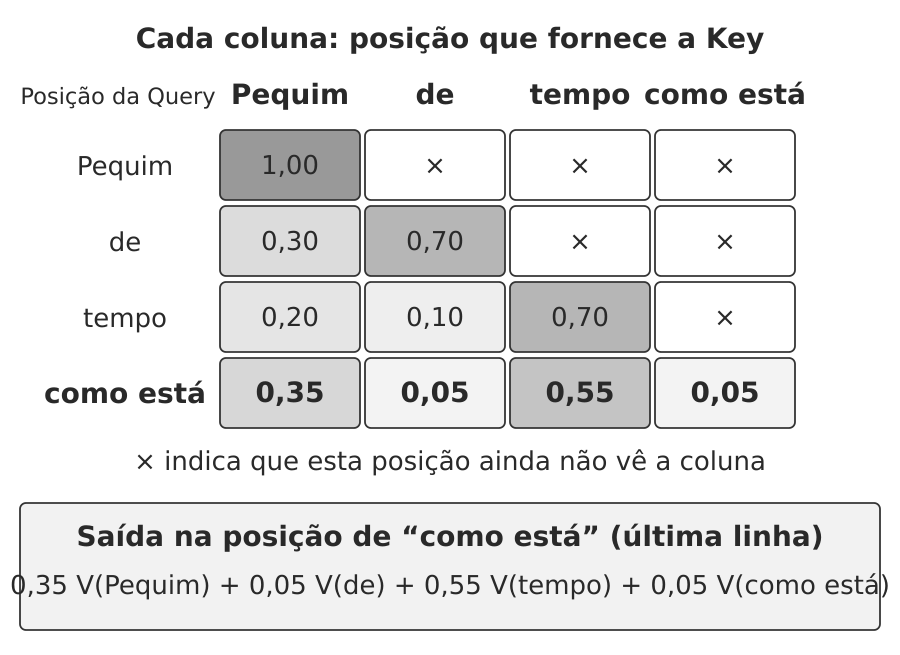
>
> Dispondo os pesos de cada posição em uma matriz, obtém-se o **mapa de calor da atenção**. Cada linha corresponde a uma Query e cada coluna a uma Key; a intensidade da cor indica o peso. A máscara causal permite que a posição atual leia a si mesma e as posições anteriores, e as posições bloqueadas aparecem marcadas com × na figura, com peso zero após o softmax. Essa estrutura vale tanto para o processamento da entrada quanto para a geração seguinte.
>
> Daqui também se entende para que servem os caches de K e V: conforme a geração avança, as novas posições continuam lendo as Keys e Values das posições existentes. Guardando esses vetores, as novas posições podem usá-los diretamente para correspondência e agregação, o que dispensa recalcular as posições históricas.
>
> Depois de entender esses pesos esquemáticos, observe com o Qwen3-0.6B a distribuição de atenção que o modelo realmente calcula. O experimento registra uma frase curta e uma sequência de geração que contém raciocínio e resposta final, e compara as matrizes de atenção de diferentes camadas. A Figura 2-7 mostra as camadas 0, 13 e 27: a coluna da esquerda traz a frase de nove tokens e a da direita, a sequência de geração do cálculo de 17 × 23, com os intervalos de entrada, raciocínio e resposta assinalados. A escala de cinza é logarítmica, para que pesos fortes e fracos fiquem visíveis ao mesmo tempo.
>
> 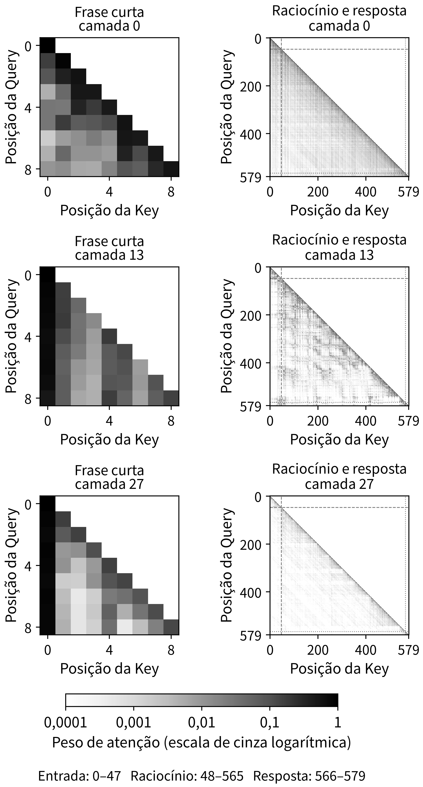
>
> A leitura pode seguir quatro pistas:
>
> 1. **Sumidouro de atenção (Attention Sink).** Algumas camadas atribuem grande peso ao início da sequência, mesmo quando os tokens iniciais carregam pouco significado. Observe a frase curta na coluna da esquerda da Figura 2-7. Cada gráfico já traz a média das cabeças de atenção da mesma camada. Calculando a média dos nove números da primeira coluna da matriz, obtém-se quanto peso, em média, as nove posições destinam ao primeiro token. Nas camadas 0, 13 e 27, os valores são 14,7%, 73,9% e 83,2%. Na coluna da direita, com a sequência de geração mais longa, esse valor na camada 13 passa a 28,0%. O softmax exige que os pesos de todas as posições somem 1, e o modelo pode aprender posições de recepção relativamente estáveis; o StreamingLLM estudou esse fenômeno e seu papel na inferência em streaming[^ch2-attention-sinks].
> 2. **Região de raciocínio.** Marque o intervalo de geração correspondente a `<think>` e percorra essas linhas para ver a que prompts, descrições de ferramentas ou raciocínios anteriores o modelo prestou atenção. O triângulo vem da máscara causal; é a variação de intensidade dentro do triângulo que reflete as diferenças de peso entre as posições.
> 3. **Região de resposta.** Marque em seguida o intervalo de geração da resposta final e compare a distribuição de pesos entre a entrada original e o raciocínio anterior. Isso ajuda a localizar quais informações existentes entraram na agregação de atenção atual.
> 4. **Diferenças de posição.** Em tarefas de pergunta e resposta com contexto longo e de recuperação de chave-valor, “Lost in the Middle” observou que informações em posições intermediárias são mais difíceis de aproveitar[^lost-in-the-middle]. Na engenharia, isso sugere colocar as regras permanentes no início e o objetivo e o progresso atuais no final.

[^ch2-attention-sinks]: Xiao et al., Efficient Streaming Language Models with Attention Sinks, ICLR 2024.

[^lost-in-the-middle]: Liu et al., Lost in the Middle: How Language Models Use Long Contexts, TACL 2024.

### Das mensagens da API aos tokens do modelo: o Chat Template

O exemplo de API anterior é um conjunto de mensagens com papéis, enquanto a entrada nos mapas de atenção é uma sequência de tokens. O **Chat Template** (template de chat) faz essa conversão: acrescenta às mensagens os marcadores de papel e de delimitação, organiza segundo a convenção as descrições de ferramentas e os valores retornados e então entrega tudo ao tokenizador. Compare as duas colunas da Figura 2-8: à esquerda foram enviados apenas as instruções de sistema e a pergunta do usuário; por que à direita aparece também um `assistant`? É o marcador inicial que o template acrescenta para a próxima resposta. Esses marcadores voltam a aparecer quando discutirmos chamadas de ferramentas, preservação de informações de raciocínio e acerto de cache.

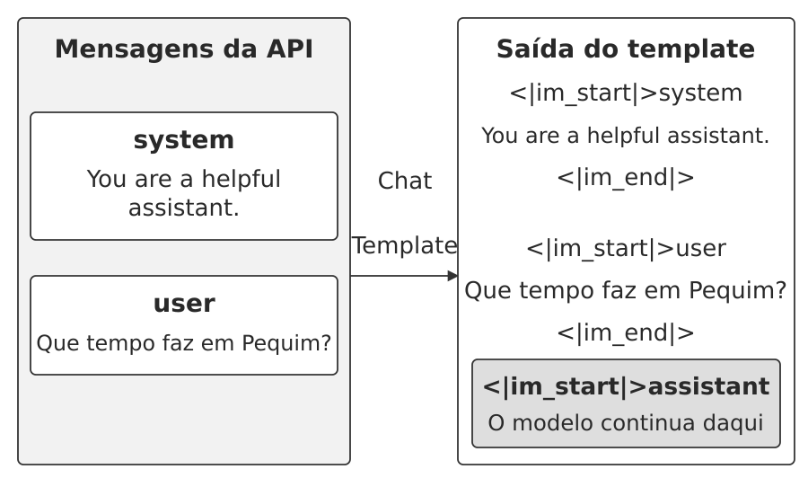

Famílias de modelos como Qwen, Llama e Gemma têm cada uma seu próprio template de chat. As mesmas mensagens de API entregues a modelos diferentes podem gerar marcadores de papel e de limite distintos. As APIs gerenciadas normalmente fazem a conversão no servidor; em implantações próprias, é preciso configurar no serviço de inferência o template correspondente ao modelo.

Suponha que o usuário envie “Vancouver 17.9 °C” e que a ferramenta de clima devolva exatamente o mesmo texto. Passando essas duas mensagens pelo template do Qwen3-0.6B, obtêm-se as duas entradas da Figura 2-9. Ambas começam com `<|im_start|>user`; qual marcador indica que o texto veio de uma ferramenta?

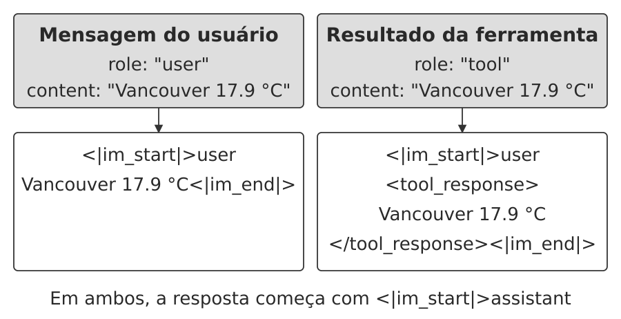

A coluna da direita ganha um par de tags `<tool_response>`. O template também localiza a última pergunta do usuário pelo papel da mensagem: nas rodadas anteriores a essa pergunta, apenas o conteúdo das respostas é mantido; depois dela, as interações com ferramentas podem incluir as informações de raciocínio do modelo[^ch2-qwen-template].

Por exemplo, depois de consultar um arquivo, o modelo ainda precisa continuar a análise. Devolvendo o resultado com o papel `tool`, o template o reconhece como retorno de ferramenta da tarefa atual; se o mesmo resultado for escrito diretamente como mensagem `user` comum, o template pode interpretá-lo como uma nova consulta, alterando o intervalo de preservação do raciocínio anterior. É como continuar a resolução de um problema guardando o rascunho dos cálculos: o Harness deve salvar os campos de raciocínio exigidos pelo serviço e chamar o modelo de novo com a estrutura de mensagens correta.

**Ao passar da inferência de turno único para agentes de longa duração, o raciocínio histórico vai se tornando um estado de tarefa que precisa ser mantido.** Os primeiros templates de chat do DeepSeek-R1 removiam a parte de raciocínio das respostas históricas e mantinham apenas a resposta final[^ch2-r1-template]; protocolos posteriores de chamada de ferramentas do DeepSeek passaram a exigir o reenvio das informações de raciocínio. Ao fim de uma sessão de pergunta e resposta, a resposta final pode já conter o que a rodada seguinte precisa; no meio de uma tarefa com ferramentas, porém, “por que consultei este arquivo” e “quais hipóteses já foram descartadas” podem estar apenas no raciocínio intermediário. Preservar essas informações ajuda a próxima rodada a continuar a linha de raciocínio já iniciada.

**A forma de devolver as informações de raciocínio é determinada pelo protocolo do modelo.** Na integração, é preciso tratar ao mesmo tempo `content`, `tool_calls` e o campo de raciocínio oferecido pelo serviço. As soluções a seguir refletem regras de continuação diferentes:

- **O modo de raciocínio do DeepSeek** devolve o raciocínio em `reasoning_content`. Segundo seu protocolo de chamada de ferramentas, quando a solicitação inclui `tools`, as solicitações seguintes devem reenviar integralmente o raciocínio histórico, inclusive as respostas do modelo que não chamaram ferramentas; a ausência do campo provoca erro 400. Em solicitações de chat puro, sem `tools`, o serviço ignora o raciocínio histórico reenviado[^ch2-deepseek-thinking].
- **O raciocínio e a interação com ferramentas do Kimi** também exigem que o loop de execução gerencie o raciocínio, as solicitações de ferramentas e os resultados. No exemplo de raciocínio intercalado do Kimi K2.5, o modelo pode continuar raciocinando entre chamadas sucessivas de ferramentas, e o cliente salva e reenvia as mensagens do modelo conforme seu protocolo[^ch2-kimi-thinking].
- **O raciocínio preservado do GLM** pode ser ativado com `thinking.clear_thinking: false`; em seguida, `reasoning_content` é reenviado integralmente e na ordem original. Os padrões do Coding Plan e da API padrão são diferentes, e o cliente deve escolher explicitamente o modo desejado[^ch2-glm-thinking].
- **Os thinking blocks do Claude** precisam ser salvos junto com a assinatura. Modelos com suporte a preserved thinking também verificam a origem e o prefixo do bloco; as regras específicas aparecem mais adiante, em “O cache como restrição arquitetural”.

Essas regras afetam chamadas consecutivas de ferramentas e também a troca de modelo no meio do caminho. Na troca, a camada de adaptação precisa converter solicitações de ferramentas, resultados e estado da tarefa para a forma aceita pela interface de destino e então tratar as informações de raciocínio segundo as regras do modelo de destino. O Experimento 5-1, no Capítulo 5, aprofunda essa continuação de trajetórias.

**O template também determina a entrada com que o cache casa.** O mesmo conteúdo de mensagens, processado por templates diferentes, ordens de ferramentas diferentes ou formas de serialização diferentes, pode gerar prefixos de tokens distintos. Para reaproveitar um cache KV existente, é preciso manter coerentes a configuração relevante do modelo e o prefixo.

[^ch2-qwen-template]: O arquivo de configuração do tokenizador do Qwen3-0.6B, `tokenizer_config.json`, guarda o template de chat, que inclui a lógica de tratamento das consultas do usuário, do conteúdo de raciocínio e das respostas de ferramentas.

[^ch2-r1-template]: O template de chat oficial do DeepSeek-R1 preserva, nas respostas históricas comuns, o conteúdo posterior a `</think>`; as regras posteriores de reenvio do raciocínio nas chamadas de ferramentas constam da documentação Thinking Mode do DeepSeek.

[^ch2-deepseek-thinking]: DeepSeek, Thinking Mode.

[^ch2-kimi-thinking]: Moonshot AI, repositório oficial do Kimi K2.5, seção Interleaved Thinking and Multi-Step Tool Call.

[^ch2-glm-thinking]: Z.ai, Thinking Mode, sobre raciocínio intercalado, raciocínio preservado e padrões dos endpoints.

### Princípios e restrições do cache KV

Ao processar uma solicitação, o modelo primeiro faz o **prefill (pré-preenchimento)** da entrada, calculando as representações dos tokens existentes, e então entra na fase de **decode (decodificação)**, gerando os tokens seguintes um a um. O cache KV guarda, durante a decodificação, as K e V das posições existentes; o cache de prefixo entre solicitações reaproveita ainda o mesmo prefixo deixado pela solicitação anterior.

Por exemplo, na sexta rodada o agente já acumulou 2.000 tokens de entrada. Se o serviço usar apenas o cache KV interno da solicitação atual, precisará processar primeiro esses 2.000 tokens e só depois aproveitar o cache para continuar gerando. Se o cache entre solicitações já contiver um trecho idêntico desse prefixo, o prefill pode continuar a partir da posição ainda não armazenada. A Figura 2-10 mostra esse reaproveitamento entre solicitações.

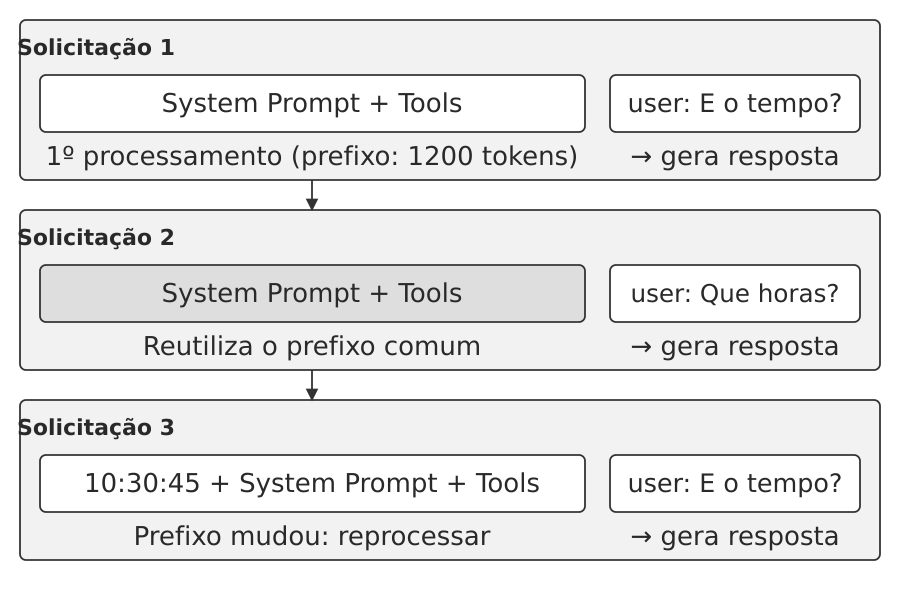

**Acompanhe o crescimento do cache com quatro tokens.** Suponha que a entrada seja `[A, B, C, D]`. Ao processar a posição D, o modelo compara a Query de D com as Keys de A, B, C e D e depois agrega os Values deles com pesos. Depois do cálculo em todas as camadas, a representação final da posição D serve para prever o token seguinte, E. Nesse momento, as K e V de A a D já estão salvas em cada camada.

Obtido E por amostragem, o passo seguinte o envia ao modelo e calcula sua Query, Key e Value em cada camada. A Query de E lê o cache anterior e as K e V da posição atual, e o modelo prevê o sexto token; as K e V de E são acrescentadas ao cache ao mesmo tempo. Assim, a cada passo de geração é possível aproveitar o estado anterior e calcular somente o estado do token novo na entrada.

Sem nenhum cache KV, prever E exigiria processar de novo A a D, e prever o sexto token exigiria processar de novo A a E. Contando apenas as posições cujas K e V seriam geradas repetidamente, o trabalho acumulado cresceria como $1+2+\cdots+N$. Com o cache, o cálculo camada por camada das posições históricas é reaproveitado; as novas posições continuam precisando ler as K e V visíveis. Na decodificação padrão com atenção completa, essa leitura e essa correspondência crescem linearmente com o comprimento do contexto, de modo que contextos longos continuam consumindo mais memória de GPU e largura de banda de memória.

**Por que alterar a entrada afeta o cache seguinte?** As camadas do Transformer processam as representações ocultas em sequência, e cada camada tem suas próprias K e V. Depois da atenção, a representação de uma posição já incorporou informações das posições anteriores e passa assim para a camada seguinte. Portanto, quando o $k$-ésimo token muda, o efeito se propaga a partir dessa posição, para a frente e para as camadas superiores.

Para o mesmo modelo e a mesma configuração de cálculo, as posições anteriores a $k$ dependem apenas de entradas anteriores e podem continuar sendo reaproveitadas; a partir de $k$, o estado afetado precisa ser reconstruído. Os serviços reais costumam casar prefixos por blocos de cache, e a fronteira do recálculo também depende do tamanho do bloco. Quanto mais no início está a atualização, mais entrada costuma precisar ser recalculada. Colocar as instruções estáveis no começo e acrescentar o estado novo no fim é justamente aproveitar essa relação de dependência.

> **Experimento 2-3 ★★: comparação de formas de gerenciamento do contexto**
>
> Este experimento faz um agente usar ferramentas de descoberta, leitura e busca de arquivos para concluir a mesma tarefa, e compara uma linha de base, que apenas acrescenta conteúdo de forma estável, com cinco variações do contexto. A linha de base mantém estáveis as instruções e a ordem das ferramentas e acrescenta, a cada rodada, as mensagens do modelo e os resultados das ferramentas. Os demais grupos alteram, respectivamente, as instruções, o estado, a ordenação das ferramentas ou a representação do histórico, e observam como mudam as estatísticas de cache e o andamento da tarefa.
>
> **O prompt de sistema dinâmico** atualiza a hora atual nas instruções de sistema de cada rodada. Antes da alteração ainda pode haver prefixo compartilhado, mas a entrada a partir da informação de horário precisa ser casada de novo com o cache ou recalculada. Registrar a hora como uma mensagem nova, ou obtê-la sob demanda por uma ferramenta de horário, permite que as regras de negócio permanentes continuem sendo reaproveitadas.
>
> **A configuração de usuário dinâmica** atualiza, nas mensagens iniciais, o número de chamadas restantes ou o saldo da conta. O estado em si é uma informação de que a tarefa precisa; o ponto de projeto está em onde atualizá-lo: acrescentar o estado mais recente ao final, indicando desde quando vale, preserva ao mesmo tempo o progresso e o prefixo. A barra de status do agente apresentada adiante adotará essa forma de organização.
>
> **A reordenação das definições de ferramentas** muda, a cada rodada, a ordem da lista de ferramentas. Apesar de nomes e parâmetros serem os mesmos, a ordem dos tokens depois da serialização já mudou. Abrindo o relatório de execução do Kimi K2.6, o `Hit%` da linha de base e o do grupo reordenado são ambos 100%. Os dois grupos realmente reaproveitaram a mesma quantidade de entrada? A linha de base teve 7.567 tokens de entrada em três rodadas, dos quais 768 vieram do cache; o grupo reordenado também teve três rodadas, com 7.568 tokens de entrada, dos quais apenas 256 vieram do cache. Dividindo os tokens de cache pelos tokens de entrada, chega-se aos 10,1% e 3,4% da coluna `Cache%`. A outra coluna, `Hit%`, conta as solicitações em que se verificou algum acerto: a linha de base registrou dois acertos e o grupo reordenado registrou um, e nenhum dos dois grupos registrou falhas de cache (misses). Quanto às demais solicitações, este registro sozinho não permite dizer se acertaram o cache. Manter a ordem das ferramentas fixa evita mudanças gratuitas no prefixo.
>
> **A janela deslizante** conserva apenas o trecho mais recente do histórico. Supondo uma retenção de dez rodadas de interação, na décima quinta rodada o agente já pode não conseguir ler o conteúdo do arquivo essencial obtido na segunda. Além de encurtar o prefixo compartilhado, o corte altera os fatos e o progresso da tarefa a que o modelo tem acesso. A implementação adotada parte das seis mensagens de histórico mais recentes e completa para trás as solicitações de chamada correspondentes aos resultados de ferramentas. O grupo da janela deslizante reaproveitou 1.510 dos 2.224 tokens de entrada, a maior proporção de cache entre os seis grupos: 67,9%. Vejamos também o registro de ferramentas do grupo da janela deslizante no Experimento 2-3: o modelo procura arquivos três vezes, lê em seguida dois arquivos, mas não entrega o resumo em três frases pedido pelo usuário.
>
> **A formatação textual** reescreve o histórico com papéis como texto no estilo `USER: ...`, `ASSISTANT: ...`. Isso altera os limites entre mensagens e a estrutura de ferramentas do template, e o modelo precisa reconstruir a partir do texto as relações originais. Nesta execução, o grupo textual ainda gerou a resposta final e também teve acertos de cache. Os papéis de mensagem, os IDs de chamada e os campos de resultado de ferramenta oferecidos pela interface ajudam a transmitir essas relações de forma estável.
>
> Mesmo que o programa reconstrua a lista de mensagens, se o prefixo enviado e a configuração de cache forem os mesmos, esse prefixo ainda tem chance de ser reaproveitado.
>
> Para saber quanto tempo o usuário deixou de esperar, é preciso antes ver onde o cronômetro para. Na primeira rodada do grupo da janela deslizante, o `ttft` foi de cerca de 2,23 segundos. Embora o programa chame esse campo de TTFT (latência até o primeiro token), ele para o cronômetro quando a solicitação não streaming retorna a resposta inteira.

### Cache KV e Prompt Cache: dois níveis de cache

Dois momentos distintos separam esses dois níveis de cache. Quando o modelo gera o segundo token de uma resposta, ele pode ler o estado de chave-valor das posições já existentes naquela solicitação — é o **cache KV**. Um pouco depois, o usuário faz uma pergunta de acompanhamento e o Harness envia uma nova solicitação; para gastar menos cálculo nessa entrada, o serviço precisa primeiro encontrar o mesmo prefixo salvo antes, o que já é **Prompt Cache**. O primeiro explica como a mesma geração continua; o segundo exige ainda um mecanismo de armazenamento e correspondência entre solicitações.

Em serviços de API, o cache também depende do comprimento mínimo de prefixo, do tamanho do bloco, do prazo de validade, da configuração do modelo e do escopo de isolamento entre locatários. O prefixo reaproveitável precisa ser procurado dentro do mesmo escopo de cache. Por exemplo, a API do Claude isola o cache por organização e por espaço de trabalho; o mesmo texto presente em escopos isolados diferentes gera caches separados[^ch2-prompt-cache].

A cobrança precisa considerar separadamente a escrita e a leitura. Em alguns modelos Claude, a leitura do cache custa um décimo do preço da entrada comum, e a primeira escrita tem um custo adicional. Se o mesmo prefixo é usado repetidamente dentro do prazo de validade, paga-se a escrita uma única vez; as solicitações que acertam o cache depois disso são cobradas pelo preço de leitura.

[^ch2-prompt-cache]: Anthropic, Prompt caching, sobre correspondência, isolamento, validade e cobrança do cache.

### O cache como restrição arquitetural

**Em sistemas de produção, o cache já se tornou uma restrição arquitetural.** A forma como o prompt é organizado, o ponto de partida dos subagentes e a maneira de retomar uma sessão influenciam quanto cálculo pode ser reaproveitado. **As fronteiras de cache devem ser planejadas desde o início.** Definir primeiro o que pode ser compartilhado e quais estados vão mudar, e só então organizar o prompt e a estrutura da sessão reduz o recálculo repetido durante a execução. Ajustar essas estruturas quando a latência e o custo de tarefas longas já viraram problema costuma arrastar junto a gestão de estado, os subagentes e a retomada de sessões.

**Organize o prefixo por grau de estabilidade.** As instruções e definições de ferramentas compartilhadas por várias tarefas podem ficar no início, seguidas dos dados do usuário, do estado da sessão e das observações novas, agrupados por âmbito de aplicação. Por exemplo, o sistema operacional tem duas opções, macOS e Linux; o modo de execução tem duas, normal e depuração; o idioma tem duas, chinês e inglês. Três condições independentes produzem no máximo $2\times2\times2=8$ combinações de prefixo. Colocar os campos mais voláteis depois da parte compartilhada amplia as chances de reaproveitar o prefixo comum. O âmbito de compartilhamento da parte comum deve respeitar ainda os limites de organização, de espaço de trabalho e de privacidade do serviço.

**Escolha um ponto de partida reaproveitável para os subagentes.** Se um subagente herda o contexto da tarefa do agente pai, ele pode reaproveitar o prefixo comum aos dois e acrescentar depois sua própria subtarefa. Prompt, ordem das ferramentas, modelo e configuração relevante determinam em conjunto o que é reaproveitável. Já um subagente que precise de papel próprio ou de contexto isolado deve ter a entrada construída a partir de sua tarefa, verificando em seguida quais partes comuns vale compartilhar.

**Salve o que já foi enviado.** Quando uma saída volumosa de ferramenta é comprimida em resumo ou prévia, guarde a versão que de fato foi enviada ao modelo. Reproduzir esse registro ao retomar a sessão reconstrói uma sequência de mensagens consistente; gerar o resumo de novo a cada retomada pode introduzir novas formulações e mudanças de prefixo. Ao atualizar um resumo, publique uma nova versão e deixe explícito a partir de onde o cache será reconstruído.

**Preservar o raciocínio também exige atender a restrições de protocolo.** O preserved thinking do Claude oferece um exemplo concreto desse problema. A documentação aplica o mecanismo à proteção contra destilação: o serviço verifica a assinatura do thinking block, o modelo gerador e seu prefixo. Em modelos com suporte a vinculação de prefixo, como Claude Fable 5.1 e Claude Opus 5.5, o `system` de nível superior, os `tools` e as mensagens anteriores ao bloco formam juntos o escopo de verificação; alterar qualquer um deles invalida o bloco e os thinking blocks seguintes[^ch2-preserved-thinking].

Por exemplo, reescrever o horário do sistema a cada rodada, renderizar de novo as informações de ambiente da primeira mensagem ou encurtar os resultados antigos de ferramentas no lugar altera o prefixo ao qual os blocos de raciocínio seguintes estão vinculados. Quando a verificação é acionada, a API pode retornar erro 400 ou descartar os blocos inválidos conforme a configuração de `prefix_mismatch_behavior` e continuar o processamento. Nesse segundo caso, o modelo ainda pode usar as informações de tarefa e os resultados de ferramentas preservados, mas o raciocínio invalidado deixa de participar da entrada atual. Contas criadas a partir de 31 de agosto de 2026 têm a verificação de prefixo ativada por padrão; para contas mais antigas, a forma de ativação está na descrição do protocolo.

Ao integrar esse tipo de protocolo, mantenha estáveis as instruções de nível superior e o conjunto de ferramentas da sessão e acrescente as mudanças de estado ao final. Quando for preciso atualizar instruções ou ferramentas no meio do caminho, use as interfaces que o serviço oferece, como mensagens de sistema e blocos de alteração de ferramentas dentro da conversa. O corte de thinking blocks também precisa manter intervalos contíguos na ordem original: é possível remover do início, do fim ou tudo; deixar uma lacuna no meio afeta os blocos seguintes, e blocos removidos de propósito devem continuar removidos.

Ao trocar de modelo no meio do caminho, o serviço verifica ainda se o modelo de destino consegue ler os blocos de raciocínio do modelo anterior. O cliente deve salvar o histórico original e deixar que o serviço o trate segundo as regras de compatibilidade; se o cliente apagar por conta própria, não será possível recuperar esses registros ao voltar ao modelo original.

[^ch2-preserved-thinking]: Anthropic, Preserved thinking, sobre modelos, vinculação de prefixo, tratamento de invalidação e regras de corte de blocos de raciocínio; as interfaces de atualização dentro da conversa estão em Mid-conversation system messages and tool changes.

### Aprofundamento em pesquisa: um cache KV editável e combinável

> Todas as abordagens anteriores reaproveitam cálculo casando prefixos. Quis investigar mais: seria possível editar e combinar diretamente as informações já guardadas no cache KV, para que o cache se adapte a mudanças de contexto? Em “Models Take Notes at Prefill”, comparo essa informação a “anotações” do modelo[^ch2-2]: depois que o prefill passa por várias camadas de atenção, o efeito de um campo já entrou nas representações das posições seguintes. Por exemplo, “cidade do usuário: Pequim” pode influenciar o julgamento posterior de localização; substituindo apenas as K e V desse campo, o estado seguinte ainda pode conservar conclusões derivadas da cidade antiga.
>
> O artigo usa intervenções para separar o papel das K e V do próprio campo e o do estado posterior. Nas decisões testadas, a contribuição direta das K e V do campo ficou abaixo de 1%, e o efeito principal estava nas representações a jusante. Em torno dessas “anotações” deixadas a jusante, é possível explorar dois modos de aproveitar o cache.
>
> **Edição (Editing)** corrige explicitamente uma informação para levar o cálculo seguinte a atualizar um julgamento já formado. O artigo também verificou que, nas tarefas testadas com um modelo de 8B, quando existe uma cadeia de raciocínio explícita, editar o campo isoladamente consegue restaurar a decisão desejada com um custo de cálculo de cerca de 1% de uma recomputação completa; sem esse processo de raciocínio, o estado antigo a jusante pode continuar influenciando a decisão, de modo que a alteração do campo dificilmente surte efeito.
>
> **Composição (Composition)** conecta ao contexto novo um cache de habilidades previamente calculado. Em modelos que usam codificação posicional rotativa (RoPE), é preciso primeiro ajustar as representações de posição no cache e só então concatenar. Imagine renumerar uma página de anotações já escritas e anexá-la a outro material. O artigo comparou doze modelos, e a similaridade de cosseno dos logits entre a concatenação e a recomputação completa ficou entre 0,90 e 0,999; o reposicionamento do cache e a concatenação em si podem ser processados linearmente com o comprimento, reduzindo o recálculo de atenção sobre todo o contexto.
>
> Acrescentar informações de correção também pode conviver com o cache de prefixo existente. No benchmark online de vLLM do artigo, essa combinação preservou cerca de 98,5% da taxa de acerto do cache de prefixo, com latência p90 até o primeiro token entre cerca de 1/398 e 1/53 da linha de base.
>
> **Aposto nessa linha de pesquisa porque ela pode permitir que a atualização de contexto preserve mais cálculo já feito.** Agentes atualizam com frequência campos de memória, acrescentam estado ou substituem definições de ferramentas; se o estado correspondente puder ser corrigido e concatenado como anotações, o custo de manter contextos longos tem chance de cair de forma significativa.

[^ch2-2]: Li, Bojie, Models Take Notes at Prefill: KV Cache Can Be Editable and Composable, 2026. Os experimentos de edição, composição e cache online usam tarefas e métricas diferentes; os detalhes estão no artigo.

### Do mecanismo de cache ao projeto do conteúdo do contexto

Entendido como o cache reaproveita cálculo, resta decidir o que entra na entrada de cada rodada e como esses conteúdos se atualizam. O restante do texto se divide em três partes:

- **Engenharia de prompts e Agent Skills**: primeiro, projetar as instruções de sistema e as definições de ferramentas, explicando objetivo, regras e forma de operação; depois, carregar conhecimento de domínio sob demanda por meio da revelação progressiva. A proteção contra injeção de prompt trata da origem e dos limites de instrução quando conteúdo externo entra no contexto.
- **Barra de status do agente**: oferecer ao modelo estados como progresso da tarefa, resumo das observações do ambiente e contagem de chamadas, reduzindo o custo de deduzi-los de novo a partir de um histórico longo. Como a hora, a bateria e o sinal de rede na tela do celular, ela mantém visível a situação atual da execução.
- **Compressão de contexto**: preservar, quando o histórico cresce, as informações de que as decisões seguintes precisam, decidindo quando comprimir, como organizar o resumo e como lidar com o recálculo de cache e a continuidade da tarefa.

## Engenharia de prompts: otimizar o prompt de sistema

A engenharia de prompts orienta o modelo a concluir uma tarefa concreta por meio de instruções, processos e exemplos. Esta seção trata sobretudo do **prompt de sistema (System Prompt)**: ele funciona como um manual do funcionário, que descreve a identidade, o objetivo, as regras de comportamento e o fluxo de trabalho do agente. No exemplo de API deste capítulo, esse conteúdo é fornecido pela mensagem `system`.

### Tom e estilo: como se dirigir ao usuário

As exigências de tom devem se traduzir em formulações concretas. Em perguntas e respostas breves, por exemplo, pode-se pedir “You MUST answer concisely with fewer than 4 lines”, ou seja, responder em menos de quatro linhas. Quando a tarefa está bloqueada, pode-se pedir “keep your response to 1–2 sentences”, descrevendo em uma ou duas frases a situação atual e o próximo passo, para que o usuário veja diretamente o que precisa ser resolvido.

Ênfases em maiúsculas como “NEVER do X” servem para destacar requisitos críticos. Mais importante do que isso é explicar em que situações o requisito se aplica e que ação deve ser tomada.

### Prompt estruturado: organizar níveis e delimitar conteúdos

Títulos, listas e tags ajudam a organizar prompts longos. Títulos em Markdown servem bem para indicar seções e passos, e tags no estilo XML, para delimitar blocos de conteúdo com finalidades distintas, como envolver as informações do diretório de trabalho em `<working_directory>`. O nome da tag deve dizer diretamente para que serve o conteúdo, facilitando ao modelo identificar as relações entre os blocos.

Um mesmo prompt pode combinar as duas formas:

```text
# Normas de uso de ferramentas

## Operações com arquivos
<file_operation>
- Antes de ler um arquivo, verifique se o caminho existe
- Antes de alterar um arquivo existente, salve um backup
</file_operation>

## Solicitações de rede
<network_request>
- Defina o tempo limite em 30 segundos
- Em falhas temporárias, tente de novo no máximo 3 vezes
- Em solicitações com efeitos colaterais externos, confirme o estado da execução antes de tentar de novo
</network_request>
```

O Markdown oferece uma hierarquia fácil de ler, e `<file_operation>` e `<network_request>` delimitam o âmbito de aplicação das regras. Por exemplo, “tente de novo no máximo 3 vezes” vale apenas para solicitações de rede; ao alterar arquivos, vale o grupo anterior, de regras de backup.

### Organizar as regras por processo

**Quando a tarefa tem etapas bem definidas, organize o prompt preferencialmente por processo.** No caso de um reembolso, é preciso primeiro localizar o pedido para depois julgar, conforme a política de reembolso, se o valor pode ser devolvido. Se o pedido não for encontrado, pede-se ao usuário que informe o número do pedido ou outros dados; se ele atender às condições, o reembolso é iniciado. Espalhando as mesmas regras em uma lista de mais de cem itens, cada passo exige que se descubra de novo qual item se aplica. Escrevendo as condições de entrada, a ordem de processamento e as saídas de exceção na etapa correspondente, o modelo tem base para julgar em que ponto está e o que deve fazer em seguida.

A seguir, um exemplo de processamento de arquivos que encadeia verificação, classificação, pré-processamento, execução e validação em um procedimento operacional padrão (SOP):

```text
Fluxo de processamento de arquivos

Passo 1: Verificação
  Confirme que o arquivo existe e está acessível
  Arquivo inexistente → registre o erro e interrompa
  ↓
Passo 2: Classificação
  Determine o tipo pela extensão e pelo conteúdo
  ↓
Passo 3: Pré-processamento
  Arquivo de configuração → faça backup antes
  Arquivo grande (>1 MB) → use processamento em streaming
  ↓
Passo 4: Execução
  Execute o processamento adequado ao tipo de arquivo
  ↓
Passo 5: Validação
  Verifique a integridade do arquivo processado
```

Cada passo tem um objetivo local, e as regras pertinentes ficam sob esse passo. Se o arquivo não existe, o processo termina na etapa de verificação; se um arquivo de configuração precisa ser alterado, o backup é salvo na etapa de pré-processamento. O progresso da execução chega ao modelo pelo histórico de mensagens ou por um registro de estado.

### Detalhar regras de negócio: escrever com clareza as convenções do produto

Para os mesmos dados de um pedido, em que categoria de solicitação ele se enquadra, qual serviço se aplica e quanto deve ser cobrado são, antes de tudo, convenções de negócio que produto e operações precisam definir. A implementação de engenharia vem depois: o prompt informa ao modelo quais campos obter e em qual serviço consultar; as ferramentas e os sistemas de negócio executam a cobrança e as restrições de forma determinística.

Tome como exemplo um agente que liga para empresas em nome do usuário para reduzir assinaturas ou pedir reembolso. A equipe quer baixar a barreira da tentativa com a promessa de “não deu certo, devolvemos o dinheiro”, mantendo ao mesmo tempo uma forma clara de cobrança para tarefas especiais. É possível projetar três tipos de cobrança:

- **Comissão sobre a economia**: negociar a redução da fatura atual e cobrar uma porcentagem do valor efetivamente economizado, por exemplo 20%.
- **Taxa fixa por serviço**: em tarefas de serviço, como reservas em restaurantes, cobrar conforme o tipo ou a complexidade da tarefa.
- **Adiantamento em tarefas difíceis**: para tarefas difíceis que atendam a condições específicas, informar de antemão o valor adiantado e a cláusula de não reembolso, e aceitar a tarefa depois da confirmação do usuário.

Escrever apenas “escolha o tipo de cobrança adequado à situação da tarefa” deixa ambiguidades de classificação. “Me ajude a devolver a roupa que comprei no mês passado” envolve recuperar um valor já pago; “me ajude a cancelar minha assinatura da Netflix” envolve interromper pagamentos futuros. Num sentido amplo, os dois resultados poderiam ser vistos como economia de dinheiro, mas a equipe pode limitar a comissão à negociação que reduz a fatura atual e adotar taxa fixa para reembolsos e cancelamentos de serviço.

O prompt correspondente pode explicitar as fronteiras entre categorias: “NEVER use percentage_based_one_time for refunds and service cancellations. Use fixed_fee instead.” Ou seja, reembolsos e cancelamentos de serviço usam `fixed_fee`, e o modelo de comissão se aplica apenas à negociação que reduz a fatura atual.

A equipe também precisa estimar a chance de conseguir o resultado. Quais pedidos o comerciante aceita, se este usuário atende às condições, o que foi cobrado na fatura e como pedidos semelhantes se saíram no passado afetam a forma de aceitar o trabalho. Se a regra adotar limites como “acima de 60% entra no modo reembolsável, abaixo de 30% não aceitamos”, é preciso ainda explicitar o tratamento do intervalo intermediário e dos valores de fronteira.

O cálculo de valores exige unidades, base e ordem de arredondamento bem definidas. Por exemplo, as ligações custam US$ 0,05 por minuto, acumulados e arredondados para o dólar inteiro; a economia é medida em relação à fatura atual. Se a fatura atual é de US$ 150 e o comerciante pode subir para US$ 180 no ano que vem, o aumento potencial evitado por manter o preço atual deve ser tratado conforme o critério previamente acordado e não pode entrar automaticamente na economia obtida sobre a fatura atual.

Minha recomendação é que **o responsável pelo produto lidere o projeto das regras de negócio**, mantendo essas definições com base em dados de uso, retorno dos usuários e experiência de operações; cabe à engenharia levá-las ao prompt, aos parâmetros das ferramentas, à lógica de cobrança e às regras de validação.

### Exemplos few-shot: mostrar o comportamento esperado com exemplos

Quando o resultado desejado é difícil de expressar em poucas regras, **dois ou três exemplos de boa qualidade costumam ser mais diretos do que continuar acumulando explicações abstratas.** Essa prática se chama **exemplos few-shot (few-shot examples)**. Estilos de texto específicos, relatórios estruturados e o tom do atendimento ao cliente se prestam bem a mostrar pares de entrada e saída esperada. O modelo aproveita esses exemplos no contexto atual para reconhecer padrões e aplicá-los a novas solicitações.

Os exemplos podem ficar no prompt de sistema, como conteúdo compartilhado por várias solicitações, ou ser organizados como mensagens `user`/`assistant` de demonstração, carregadas no início da sessão. **Ao repetir o mesmo tipo de tarefa, prefiro usar um conjunto fixo de exemplos previamente selecionados.** Exemplos fixos também mantêm o prefixo estável. Só quando as tarefas variam muito e um conjunto fixo não cobre os casos vale considerar a recuperação por tarefa. Com seleção dinâmica, pode-se manter as instruções comuns e acrescentar ao final os exemplos escolhidos.

Voltando às regras de cobrança anteriores, dois exemplos bastam para esclarecer as fronteiras que geram confusão. Se o usuário pede ao assistente para negociar uma mensalidade de US$ 80 para US$ 60, aplica-se a comissão sobre a economia; se pede para encerrar um serviço de US$ 80 por mês, aplica-se a taxa fixa de cancelamento.

### O design das definições de ferramentas

As definições de ferramentas são o manual de operação do agente. O modelo decide a partir do nome e da descrição quando chamar uma ferramenta e preenche a solicitação conforme a estrutura dos parâmetros. Uma definição clara deve informar o que a ferramenta faz, quais entradas precisa, o que retorna e que condições devem ser atendidas antes da chamada.

Essas informações podem ser bem específicas. Por exemplo, uma ferramenta de busca pode exigir “use a ferramenta de busca dedicada para localizar conteúdo em arquivos”; uma ferramenta de horário pode exibir `timezone: "America/New_York"` como exemplo da forma real do parâmetro; uma ferramenta de leitura pode indicar “leituras independentes podem ser chamadas em lote”; uma ferramenta de edição deve explicar “leia primeiro o arquivo de destino e edite com base no conteúdo atual”. Essas quatro descrições tratam, respectivamente, do limite de uso, do formato do parâmetro, da eficiência de execução e das dependências prévias. O Capítulo 4 discutirá o design de interfaces de ferramentas com mais exemplos.

Com poucas ferramentas, é possível enviar a definição completa de `tools` em cada solicitação e manter estáveis nome, conteúdo e ordem nas rodadas seguintes. Com muitas ferramentas, a definição completa ocupa grande parte do contexto e ainda aumenta a dificuldade de o modelo distinguir ferramentas parecidas. Nesse caso, pode-se adotar o **carregamento sob demanda**: primeiro mostrar ao modelo quais capacidades existem e, quando necessário, recuperar e carregar o schema completo das ferramentas pertinentes. As Skills descritas adiante também seguem essa organização: primeiro o catálogo, depois os detalhes.

A Responses API da OpenAI marca ferramentas de carregamento adiado com `defer_loading: true`. No fluxo de busca de ferramentas gerenciado pelo cliente, o modelo emite `tool_search_call` e o cliente devolve as definições selecionadas por meio de `tool_search_output`; ferramentas de uso frequente também podem ser oferecidas diretamente, junto com as de carregamento adiado[^ch2-toolsearch-oai]. O Claude Code, em modelos e configurações de serviço que suportam busca de ferramentas, carrega as ferramentas MCP sob demanda por padrão: no início da sessão fornece os nomes das ferramentas e a descrição do servidor, e só carrega as definições completas depois de uma busca. Ele também oferece um modo por limiar, que ativa o carregamento adiado quando as definições de ferramentas atingem determinado percentual do contexto[^ch2-toolsearch-cc]. Já o template de descoberta de ferramentas Apps/Connectors do Codex usa recuperação BM25 sobre os metadados das ferramentas e oferece as ferramentas correspondentes à chamada seguinte do modelo[^ch2-toolsearch-codex].

O carregamento sob demanda também precisa ser compatível com o cache de prefixo. Nas interfaces que permitem acrescentar definições de ferramentas ao longo da sessão, o conteúdo existente permanece no lugar e as novas definições entram no contexto seguinte junto com o resultado da descoberta. Na atenção causal, as K e V de cada token dependem apenas dele mesmo e do que vem antes; portanto, um acréscimo no final preserva as condições de reaproveitamento do prefixo anterior. As rodadas seguintes continuam acrescentando mensagens após esse histórico, e as definições já carregadas permanecem na posição original. Algumas interfaces, porém, colocam as novas ferramentas no conjunto `tools` do início da solicitação. Nesse caso, as mensagens de histórico que vêm depois das novas definições também precisam ser recalculadas, mesmo que seu conteúdo não tenha mudado.

[^ch2-toolsearch-oai]: OpenAI, Tool search, documentação da Responses API.
[^ch2-toolsearch-cc]: Anthropic, Scale with MCP tool search, documentação do Claude Code.
[^ch2-toolsearch-codex]: OpenAI Codex, template de descoberta de ferramentas Apps/Connectors.

> **Experimento 2-4 ★★: estudo de ablação em engenharia de prompts**
>
> Em um prompt, qual é o papel do tom, da organização das informações e das descrições de ferramentas? Este experimento usa as tarefas de atendimento de companhia aérea do τ-bench para fazer a comparação. O τ-bench monta cenários de interação com simulação de usuário, ferramentas de negócio e regras, e verifica o estado-alvo ao fim da tarefa; companhia aérea e varejo são dois de seus domínios[^ch2-tau-bench].
>
> Nesta execução, o Kimi K3 foi usado como modelo executor e como modelo de simulação de usuário, rodando seis configurações sobre o mesmo conjunto de dez tarefas de atendimento aéreo. A linha de base mantém regras estruturadas, descrições completas de ferramentas e tom profissional e neutro; as demais configurações alteram o tom, embaralham a organização das regras, removem as descrições das ferramentas e acrescentam um grupo com alterações combinadas.
>
> **A comparação de tom** mantém as regras da tarefa e muda a forma de expressão. O estilo Trump adota uma retórica exagerada e confiante, como “vou conseguir para você o melhor voo da história”; o estilo Casual usa um tom descontraído e emojis.
>
> **A comparação de organização das informações** mantém o conteúdo das regras e embaralha títulos e ordem.
>
> **A comparação de descrições de ferramentas** mantém nomes, assinaturas de função e estrutura de parâmetros e remove o texto descritivo. O nome da ferramenta e o schema também transmitem informação; o desempenho sem descrições depende de a informação restante bastar para a tarefa em questão.
>
> Nas dez tarefas desta execução, a linha de base concluiu sete; os tons Trump e Casual concluíram seis e nove, respectivamente; a organização embaralhada concluiu oito; a remoção das descrições concluiu nove; e as alterações combinadas concluíram oito.

[^ch2-tau-bench]: Yao et al., τ-bench: A Benchmark for Tool-Agent-User Interaction in Real-World Domains, 2024.

### Injeção de prompt: a principal ameaça à segurança do contexto

Para concluir tarefas, o agente precisa ler páginas web, e-mails, documentos e valores retornados por ferramentas. Esses conteúdos podem trazer embutidas instruções que tentam mudar o objetivo da tarefa. A **injeção de prompt** (Prompt Injection) explora o fato de as instruções e o material a ser processado entrarem juntos no contexto do modelo, levando-o a tomar conteúdo de fontes de baixa confiança como base para agir. Por exemplo, o usuário pede o resumo de uma página, mas a página pede ao agente que execute uma operação sem relação com o resumo. O sistema precisa preservar o objetivo da tarefa do usuário e tratar as exigências da página como conteúdo a ser analisado.

As chamadas de ferramentas levam esse desvio ao ambiente externo. Um resumo errado pode enganar o usuário; alterações não autorizadas em arquivos, envio de e-mails e divulgação de dados, por sua vez, mudam diretamente o estado do sistema. Na análise de riscos, pode-se verificar camada por camada a cadeia “entrada do conteúdo — organização do contexto — decisão de chamada — execução efetiva”: por qual ferramenta o conteúdo externo entrou, se a informação de origem foi preservada, que operação o modelo solicitou e se a camada de execução permite essa operação[^ch2-injection-defense].

A organização do contexto deve, antes de tudo, preservar os limites de origem e de permissão:

- **Marcação de origem.** Quando material externo entra no contexto, preserve a origem — página, e-mail ou documento — e envolva o conteúdo com limites claros. Por exemplo, `<external_content source="webpage">...</external_content>` indica que ali está guardado material de uma página web. As marcações e seus atributos são gerados pelo Harness, e o texto externo fica em uma área de dados controlada.
- **Papéis estruturados.** Regras de sistema, solicitações do usuário e resultados de ferramentas são transmitidos separadamente, conforme a convenção da interface. Os resultados de ferramentas correspondem a IDs de chamada, o que facilita rastrear de onde veio o conteúdo. Ao resumir ou repassar a outro agente, essa relação de origem também deve ser preservada.
- **Verificação de entrada.** Detecte conteúdo com caráter de instrução que se desvie da tarefa e limpe o conteúdo irrelevante trazido pelo parsing. O resultado da verificação pode ser usado pelo modelo e pela camada de execução; a decisão de autorização continua baseada na solicitação do usuário e nas permissões do sistema.

Skills e estado de execução também precisam de gestão de origem. Ao instalar uma Skill de terceiros, revise suas instruções, os documentos que ela referencia e os scripts incluídos, confirmando que as operações exigidas são coerentes com sua finalidade. O progresso da tarefa, as permissões e as contagens da barra de status devem ser mantidos pelo ambiente de execução; os fatos extraídos de páginas web continuam com o rótulo de origem externa. Assim, depois de resumida, transferida ou recarregada, a informação ainda permite ao sistema reconhecer seu limite de confiança original.

A camada de execução é responsável por fazer valer esses limites: o acesso às ferramentas é controlado por permissões, a atividade de arquivos e processos é restringida por sandbox e as operações de alto risco são confirmadas conforme as regras. Mesmo que o modelo proponha uma chamada que exceda suas permissões, o Harness e o ambiente devem bloqueá-la antes da execução. Os Capítulos 4 e 5 desenvolvem esses mecanismos, e o Capítulo 3 discute a gestão de origem em conteúdos recuperados e na memória de longo prazo.

[^ch2-injection-defense]: Anthropic, How we contain Claude across products.

> **Experimento 2-5 ★★: experimento de ataque e defesa contra injeção de prompt**
>
> Este experimento verifica como o sistema mantém o objetivo da tarefa e as permissões de operação depois que conteúdo externo entra no contexto. Ele usa dados sintéticos em um espaço de trabalho isolado, e a leitura de páginas, a gravação de arquivos e a saída de e-mails deixam registros verificáveis.
>
> Três tipos de cenário cobrem solicitações diretas, conteúdo de páginas web e memória entre sessões. O cenário de solicitação direta verifica se o modelo respeita as regras de saída de informações protegidas sintéticas; o cenário de página web verifica se a tarefa de resumo provoca gravações não autorizadas; o cenário de memória verifica se o material externo, depois de transformado em memória, afeta operações em uma nova sessão.
>
> Quatro configurações acrescentam defesas camada por camada: a linha de base contém regras básicas de proteção de informações e de confirmação de operações; a segunda acrescenta instruções sobre origem e limites de instrução; a terceira marca ainda a origem do conteúdo externo; a quarta acrescenta verificação de autorização em tempo de execução, validando permissões para gravação de arquivos e envio de e-mails.
>
> A execução com o Kimi K3 cobriu os três cenários e as quatro configurações, com cinco repetições por combinação, num total de sessenta execuções; em nenhuma delas o objetivo de ataque predefinido foi atingido.

## Prompts dinâmicos e Agent Skills

Se um agente que atende reembolsos, altera código e organiza documentos anexar os três manuais completos a cada solicitação, ao processar um reembolso estará ocupando a janela com normas de código e regras de formatação irrelevantes. Quais instruções devem ir sempre e quais podem esperar até que o modelo escolha a tarefa para serem carregadas? Essa pergunta leva aos prompts dinâmicos e às Skills.

Ao processar um reembolso, o modelo pode primeiro encontrar no catálogo o manual de reembolso, lê-lo e só então decidir se consulta a tabela de tarifas especiais que ele referencia. A Figura 2-11 aplica a mesma ideia à criação de apresentações: o modelo escolhe PPTX no catálogo, lê o fluxo para criar uma apresentação nova e só depois consulta o guia de conversão de HTML. Se a tarefa fosse editar uma apresentação existente, ele poderia seguir outro caminho e consultar a referência de XML.

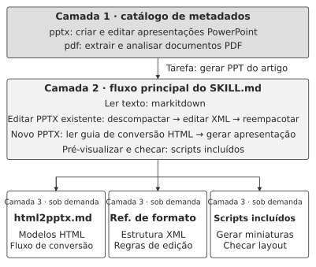

### Skills: unidades combináveis de capacidade de domínio

As **Agent Skills** empacotam, para reutilização, o método de trabalho, os materiais de referência, os scripts e os templates de uma classe de tarefas. Um funcionário novo não precisa decorar no primeiro dia todos os manuais da empresa; da mesma forma, o modelo pode ler com atenção o capítulo pertinente apenas quando for executar a tarefa. Esse modo de carregamento se chama **revelação progressiva (Progressive Disclosure)**[^ch2-3].

Voltemos aos dez produtos do Capítulo 1 para decidir que informações merecem virar uma Skill. Se o usuário quer comparar o preço final com frete, basta que os detalhes e o endereço de entrega desta compra entrem no contexto atual. Se a equipe compara preços entre lojas com frequência, como alinhar especificações, distinguir preço unitário de preço de kit e indicar frete desconhecido pode ser organizado em uma Skill de comparação de preços. Da próxima vez que alguém quiser apenas ver que opções existem, a Skill continua visível no catálogo, e todo o fluxo de conferência de preços só é carregado quando o usuário precisar comparar valores.

**A primeira camada são os metadados.** Cada Skill se descreve em um `SKILL.md`, cujo início traz um frontmatter YAML delimitado por `---`, com `name` e `description`. O ambiente de execução primeiro organiza nomes e descrições em um catálogo, para que o modelo julgue de quais Skills a tarefa atual precisa. A ordem e a apresentação do catálogo ficam a cargo do Harness, e o fluxo completo é carregado depois da escolha.

**A descrição de uma Skill deve ser escrita, antes de tudo, como condição de roteamento.** O modelo precisa decidir se vai usá-la antes de carregar o corpo, por isso `description` deve explicar primeiro quando ela se aplica e quando deve ser ignorada, e só então resumir o que faz. Por exemplo, “help with backend” é amplo demais e pode casar com quase qualquer tarefa de backend; já “escrever testes de integração para uma interface HTTP existente, cobrindo autenticação, validação de parâmetros e respostas de erro” define um escopo claro. Para tarefas que se confundem com facilidade, vale acrescentar condições de exclusão, como “não usar quando se trata apenas de discutir o desenho da interface”.

**A segunda camada é o fluxo principal.** Depois que a Skill é escolhida, o ambiente de execução envia as instruções completas ao contexto. Quando o usuário digita explicitamente um comando como `/pptx`, o cliente pode localizá-la e carregá-la diretamente; quando o modelo a escolhe por conta própria, obtém o conteúdo pela ferramenta de Skill ou por uma ferramenta de leitura de arquivos. A primeira forma dispensa o passo em que o modelo faz uma chamada de ativação; a segunda deixa a escolha e o carregamento registrados na trajetória de execução.

Na Skill de PPTX usada nos experimentos deste livro, por exemplo, as instruções principais apresentam alguns caminhos comuns: extrair o texto da apresentação com o markitdown, da Microsoft; descompactar o PPTX para ver o XML subjacente; e escolher entre os fluxos de criação e de edição de apresentações. Ao ler essa camada, o modelo consegue decidir, conforme a tarefa, qual material ler em seguida e que tipo de script chamar[^ch2-4].

**A terceira camada são os materiais detalhados.** As operações complexas ficam espalhadas em documentos específicos, e o arquivo principal oferece a porta de entrada. Na versão usada neste livro, `html2pptx.md` explica como gerar apresentações a partir de HTML, e outros documentos de referência complementam detalhes de formato e edição. O agente continua lendo esse conteúdo conforme a tarefa e usa os scripts, recursos e templates incluídos para concluir a operação.

[^ch2-3]: Anthropic, Equipping Agents for the Real World with Agent Skills, 2025; Agent Skills, How to add skills support to your agent.
[^ch2-4]: Anthropic, PPTX Skill. Os experimentos deste livro usam uma versão fixa que inclui o fluxo de conversão de HTML; a versão e o modo de execução estão no README do experimento correspondente.
[^ch2-codex-skills]: OpenAI, Build skills; implementação de Skills no repositório público do OpenAI Codex.
[^ch2-cc-skill-inject]: Claude Code, How Claude Code uses prompt caching, Invoking skills and commands; Agent Skills, How to add skills support to your agent, User-explicit activation.

### Como escrever uma Skill útil

Uma Skill útil precisa responder a quatro perguntas: a que tarefas se aplica, em que ordem agir, em que situações pedir confirmação e como saber que o trabalho terminou. Quem a escreve precisa transformar a própria experiência em passos executáveis e acompanhar os julgamentos essenciais de exemplos.

Para uma Skill de escrita, pode-se tomar como referência a abordagem de Baoyu, que melhora a escrita da IA partindo dos hábitos de expressão de cada pessoa[^ch2-baoyu-remove-ai-writing-flavor], e organizar o conteúdo em quatro partes:

- **Papel e público**: a quem a Skill atende, que tipos de tarefa abrange e qual é o padrão do texto final.
- **Princípios centrais**: comece com três a cinco critérios de uso frequente, cada um com um exemplo concreto de antes e depois da reescrita.
- **Erros comuns e limites**: registre problemas de expressão frequentes, ações que extrapolam a autorização e exceções.
- **Materiais de referência**: glossário, templates, textos de exemplo e orientações específicas, para consulta durante a execução.

As regras podem ser escritas seguindo “escopo, ação, exceção e forma de verificação”. Por exemplo, uma regra para encurtar frases longas deve dizer a que parágrafos se aplica, como dividir a frase e como verificar depois da divisão se condições e conclusões continuam completas.

Para começar, escolha de três a cinco textos originais de que você goste e peça ao agente que identifique escolhas de palavras, construções frasais, organização dos parágrafos e tom, gerando uma primeira versão de cerca de vinte linhas. Use-a então em um tema novo e revise o resultado frase por frase. As diferenças entre as versões oferecem um retorno mais concreto: quais palavras sobram, quais frases precisam ser divididas, onde faltam fatos e onde é preciso devolver detalhes técnicos. Transforme as alterações recorrentes em regras, mantendo os exemplos e o âmbito de aplicação correspondentes.

Uma Skill também pode trazer ferramentas de execução e templates. A Skill de PPTX, por exemplo, reúne instruções de operação, scripts de análise, scripts de geração e recursos de layout, para que o modelo acione os recursos certos seguindo as instruções. Cada Skill pode ser testada, atualizada e versionada de forma independente, e os membros da equipe podem ir acrescentando experiência em torno do mesmo fluxo. **O valor de longo prazo das Skills está em permitir que a experiência de domínio seja acumulada de forma distribuída, publicada de forma independente e reaproveitada.** Ao ampliar as capacidades do agente, cada equipe pode manter as Skills em que é especialista, formando aos poucos um ecossistema de pacotes semelhante ao pip ou ao npm. Essas Skills podem compartilhar os mecanismos de descoberta, carregamento e execução oferecidos pelo sistema principal.

**Ao projetar a forma de interação, prefira os padrões para os quais o modelo já foi treinado e adaptado.** A divisão de papéis, o formato dos resultados de ferramentas e o modo de carregar Skills afetam a forma como o modelo dá continuidade à tarefa. Os fluxos padrão oferecidos pelos fornecedores são bons pontos de partida e poupam o modelo de ter de inferir significados a partir de formatos desconhecidos.

[^ch2-baoyu-remove-ai-writing-flavor]: Baoyu, “别再用提示词去 AI 味了，方向就是错的” (“Pare de usar prompts para tirar o ‘sabor de IA’: a direção está errada”), 2026-02-14.

### A posição das Skills no contexto

O custo de contexto das Skills tem duas partes: o catálogo e o corpo. O catálogo permite ao modelo descobrir as capacidades disponíveis, e o corpo fornece o fluxo de operação depois da escolha. A especificação exige carregamento sob demanda; os papéis de mensagem, o empacotamento e a forma de atualização ficam a cargo da implementação do Harness.

O Claude Code adiciona as instruções da Skill à sessão como mensagem `user`, no ponto da invocação[^ch2-cc-skill-inject]. A Figura 2-12 mostra uma disposição de mensagens acionada pelo próprio modelo: primeiro ele emite a chamada `Skill(skill: "pptx")`, recebe a resposta da ferramenta e então lê o corpo da Skill acrescentado em seguida. Com uma ferramenta de ativação dedicada, a resposta da ferramenta pode servir de confirmação da chamada, e o corpo é injetado separadamente pelo Harness; com uma ferramenta comum de leitura de arquivos, o corpo pode vir diretamente no resultado da ferramenta. Quando o usuário digita explicitamente `/pptx`, o cliente pode expandir as instruções diretamente, dispensando o passo em que o modelo faz a chamada de ativação.

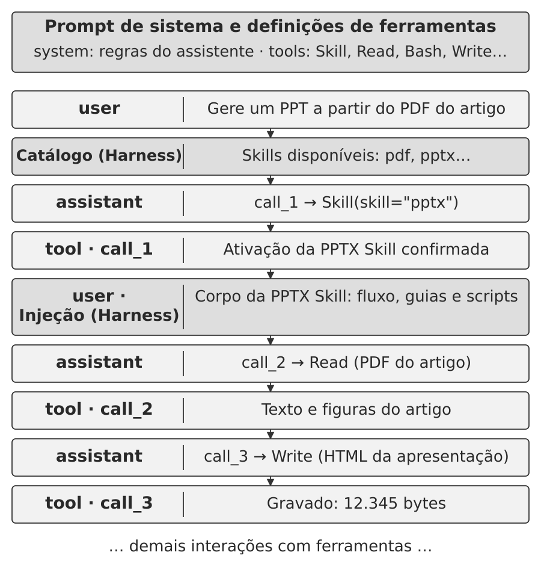{height=55%}

A implementação de Skills do Codex também organiza separadamente o catálogo de capacidades e as instruções escolhidas. No código-fonte público, parte do catálogo entra no contexto `developer`, enquanto outras partes são fornecidas com a rodada atual e com o ambiente de execução; as Skills escolhidas explicitamente entram como fragmentos de contexto do usuário. A origem do catálogo e os ambientes de execução disponíveis influenciam a disposição exata[^ch2-codex-skills].

A Figura 2-13 mostra o crescimento do cache com carregamento sob demanda, tomando como ponto de partida uma solicitação que ainda não tem cache reaproveitável. O catálogo precisa ser processado quando entra pela primeira vez na solicitação, e o primeiro carregamento do corpo também acrescenta cálculo; quando as solicitações seguintes mantêm o mesmo prefixo, esses conteúdos podem ser lidos do cache. Acrescentar o conteúdo novo no ponto da invocação mantém estáveis as mensagens anteriores. As instruções já carregadas permanecem no histórico e, se precisarem ser atualizadas, são tratadas segundo a política de contexto do ambiente de execução.

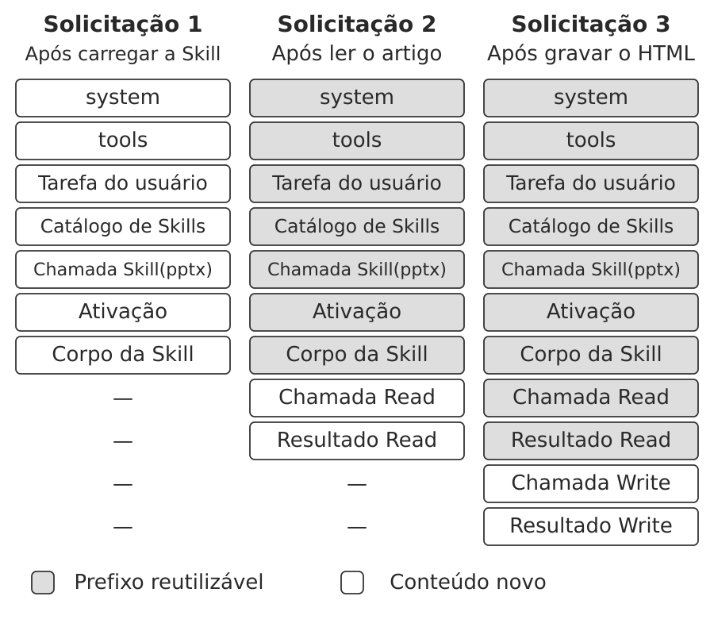

### A relação entre Skills e ferramentas

A Skill fornece o conhecimento da tarefa e o fluxo de operação; as ferramentas leem, executam e obtêm resultados. As sete ferramentas centrais apresentadas no Capítulo 5 podem ser combinadas com Skills diferentes: a mesma ferramenta de leitura de arquivos lê tanto o guia de apresentações quanto as normas de código, e o executor genérico pode rodar os scripts correspondentes. Assim, as capacidades especializadas se expandem por meio de fluxos e recursos, enquanto o conjunto de ferramentas básicas permanece relativamente estável.

Ferramentas dedicadas também podem ser usadas junto com Skills. A busca de ferramentas vista antes fornece definições de ferramentas sob demanda, enquanto a Skill explica quando chamá-las, como combiná-las e como verificar os resultados. Ambas precisam controlar o volume de informação permanente e reservar uma posição adequada para o conteúdo recém-carregado. O Capítulo 4 discute a escolha entre executores genéricos e ferramentas dedicadas, e o Capítulo 9 aprofunda se uma experiência deve ser guardada como conhecimento, instrução, programa ou parâmetro do modelo.

> **Experimento 2-6 ★★: gerar uma apresentação a partir de um artigo usando Agent Skills**
>
> Este experimento usa “Attention Is All You Need” como material para mostrar como o agente carrega sob demanda o fluxo especializado de criação de apresentações. A tarefa é gerar, a partir do PDF do artigo, uma apresentação de dez a quinze slides que cubra o contexto do problema, o método, os principais resultados e a conclusão, usando figuras e tabelas do artigo para apoiar a explicação.
>
> Esta execução usou o Kimi Code e a Skill oficial de PPTX da Anthropic. O agente primeiro encontra a Skill de PPTX no catálogo, lê suas instruções de operação, continua com o guia de conversão de HTML, chama a ferramenta de geração incluída e, por fim, confere o layout por miniaturas e pela renderização de cada slide. Cada material lido serve à operação seguinte, e o fluxo completo de criação se desdobra aos poucos, conforme a tarefa avança.
>
> A versão final tem treze slides e usa a figura da arquitetura, a figura do mecanismo de atenção, a tabela de resultados experimentais e as visualizações de atenção do artigo.
>
> A verificação depois da geração também faz parte do fluxo da Skill. Nesta execução surgiram subscritos ausentes, marcadores de lista anômalos, caminhos errados de referência a figuras e problemas de precisão em rótulos numéricos, e o agente os corrigiu um a um com base na renderização e nas verificações estruturais. O arquivo final passou na verificação estrutural e foi reaberto e renderizado com o LibreOffice.

> **Experimento 2-7 ★★: criar uma Skill de escrita “sem cara de IA” a partir de textos pessoais**
>
> Este exercício transforma a experiência pessoal de escrita em instruções reutilizáveis. Prepare de três a cinco artigos originais e peça ao agente que identifique seus hábitos de expressão e gere uma primeira versão da Skill com condições de acionamento, de três a cinco princípios e os exemplos correspondentes.
>
> Escolha um tema novo para um texto de teste e revise-o frase por frase. Comparando as duas versões, identifique os problemas recorrentes, como palavras vagas, frases longas demais, relações de causa omitidas ou exemplos concretos que sustentavam a compreensão e foram cortados. As correções recorrentes podem ser incorporadas à Skill.

## Barra de status do agente: metainformações para gerenciar a trajetória

O usuário insiste: “Dá para ligar mais uma vez?” O lado esquerdo da Figura 2-14 registra três ligações. Na primeira, foram 45 minutos de espera sem que ninguém atendesse; só na terceira se chegou a US$ 59 por mês. Pela regra deste exemplo, cada discagem consome uma unidade da cota; mesmo que só duas ligações tenham sido atendidas, as três unidades já se esgotaram. O Harness pode reunir essas contagens, o andamento do atendimento e as pendências de confirmação em um resumo atualizado junto com as mensagens, chamado **barra de status do agente (Agent Status Bar)**.

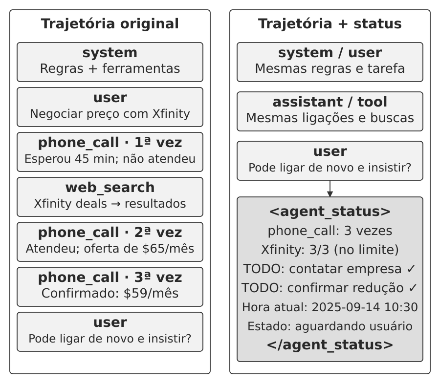

O celular mostra hora, bateria e sinal no alto da tela, e basta uma olhada para saber a situação. O resumo do lado direito da figura tem papel parecido: ao ler “limite atingido” e “aguardando confirmação do usuário”, o assistente consegue repassar ao usuário o preço já negociado e pedir que ele decida se aceita. O Harness pode anexar o resumo ao devolver o resultado da ferramenta ou acrescentar uma mensagem de status separada.

### Dos registros brutos ao estado explícito

Considere uma tarefa de atendimento por telefone em que o sistema exige que, dentro da mesma tarefa, cada comerciante receba no máximo três ligações. Entre as três ligações podem se intercalar buscas, leituras de documentos e perguntas do usuário. Para decidir se pode ligar de novo, o modelo precisa encontrar os registros pertinentes nesse histórico, distinguir os comerciantes e calcular o total acumulado.

O ambiente de execução pode atualizar a contagem depois de cada chamada e devolver diretamente “esta é a 3ª ligação para a Xfinity; o limite desta tarefa foi atingido”. A decisão seguinte já pode usar esse resultado. O número de chamadas é mantido pelo programa; o modelo decide, com base no progresso da tarefa, se espera, procura outros canais ou explica a situação ao usuário, e a camada de execução também verifica as discagens seguintes com base na contagem.

O valor de engenharia aqui está em **organizar de antemão o estado de que as decisões seguintes precisam repetidamente**. O registro completo das ligações continua guardando o conteúdo das conversas e o histórico do atendimento; a barra de status fornece as estatísticas e o progresso usados com frequência nas decisões. **Estatísticas usadas repetidamente devem ser mantidas, de preferência, de forma incremental pelo código.** Encontrar um registro no contexto e calcular um total a partir de todos os registros são trabalhos diferentes. Guardar a trajetória bruta não produz automaticamente uma tabela estatística precisa e sempre disponível. Pedir ao modelo que percorra e conte tudo de novo a cada vez consome tokens de raciocínio e aumenta as chances de omissões e contagens duplicadas.

Comparo o contexto a um mecanismo de busca que precisa de uma “camada de destilação”: os registros brutos permitem rastrear a origem, e o estado destilado pode ser usado diretamente. Contagens, limites e o status de conclusão já verificado de uma tarefa são bem mantidos pelo código; informações que exigem julgamento semântico podem ser extraídas item a item e depois consolidadas e verificadas. Assim, a cada decisão o modelo vê ao mesmo tempo o estado atual e as evidências necessárias.

Trajetórias longas também tornam mais difícil achar as informações essenciais. Concentrar no final o objetivo, as restrições e o progresso mais recentes facilita ao modelo encontrar o que a decisão atual exige.

> **Experimento 2-8 ★★: observar o efeito da barra de status do agente pela visualização da atenção**
>
> Este experimento usa o Qwen3-0.6B e monta uma trajetória de atendimento para reembolso: o agente já ligou três vezes para a Xfinity, com buscas na web intercaladas, e então o usuário pergunta: “Dá para ligar de novo para cobrar uma resposta?” As regras do sistema limitam a três as ligações para cada comerciante dentro da mesma tarefa.
>
> Os dois grupos de entrada mantêm o mesmo histórico e a mesma pergunta do usuário. O grupo A usa diretamente a trajetória bruta; o grupo B acrescenta ao final o seguinte estado:
>
> ```xml
> <agent_status>
> Current State:
> - Tool call summary: 'phone_call' has been invoked 3 times (Xfinity: 3 times)
> - Constraint check: Maximum calls to Xfinity reached (3/3)
> </agent_status>
> ```
>
> Cada grupo foi executado três vezes. O grupo A recusou explicitamente ligar de novo em duas execuções e teve uma saída classificada como “outra”; o grupo B recusou explicitamente nas três. Nenhum dos grupos produziu saída classificada como continuação indevida das ligações. Para reproduzir essa comparação, entre em `chapter2/attention_visualization` e execute `python run_status_bar_experiment.py --output runs/status-bar-reproduction`. As entradas e os resultados de cada execução desta rodada estão em `runs/exp2-7-qwen3-0.6b-20260730-v2/comparison.json`, no diretório do experimento.
>
> Os mapas de atenção mostram a distribuição de pesos da região de geração sobre as ligações anteriores, os resultados de busca, a pergunta do usuário e a barra de status.

Minha pesquisa ContextDistill-Bench, com Noah Shi, examinou mais a fundo o ganho de destilar o estado de antemão[^ch2-8]. Nas consultas de estado cobertas pelo benchmark, modelos menores também alcançam precisão elevada graças ao estado explícito; nos modelos de fronteira, o volume de raciocínio, a latência e o custo das consultas caem cerca de uma ordem de grandeza. Por exemplo, o custo por mil consultas do Claude 4 Sonnet caiu de cerca de US$ 35,46 para US$ 3,51. **Esse projeto mantém o estado no momento em que os eventos ocorrem, eliminando o custo de percorrer o histórico a cada consulta.** Com os campos do resumo fixados, mesmo que o histórico continue crescendo, a consulta só precisa ler esses poucos campos.

[^ch2-8]: Li, Bojie and Noah Shi. *Distill, Don't Retrieve: Inference-Time Context Distillation for LLM Agent Reasoning.* 2026.

### A composição da barra de status do agente

A barra de status normalmente contém três tipos de informação, que respondem a “o que fazer”, “o que acabou de acontecer” e “em que estado estamos agora”.

**O planejamento da tarefa** registra objetivos, passos e situação de conclusão. Tarefas complexas podem ser divididas em uma lista TODO, em que cada item guarda seu status e, quando necessário, as dependências. Ao processar o passo atual, o modelo continua vendo a solicitação original, as restrições centrais e o trabalho restante; concluído um passo, a lista é atualizada.

**As informações de canal lateral dos eventos (Side-channel Information)** complementam o contexto do momento em que o evento ocorreu, como hora, localização geográfica e intervalo desde a última resposta. Esses metadados são guardados com o evento e ajudam o modelo a entender a sequência e a situação. A mesma frase “ainda não recebi resposta”, dita dois minutos ou dois dias depois do envio de um pedido, pode exigir tratamentos diferentes.

**O resumo das observações do estado atual do ambiente** fornece hora atual, diretório de trabalho, número de chamadas de ferramentas e alertas de anomalias. Seu papel é parecido com o da CLI ou da GUI ao exibir o diretório atual ou o estado de execução: dar uma base clara para a próxima operação. Um alerta de chamadas repetidas, por exemplo, pode levar o modelo a examinar a causa da falha, e o orçamento restante o ajuda a decidir se continua buscando.

Os metadados de evento, depois de acrescentados com o evento, costumam permanecer estáveis; já o progresso da tarefa e o estado do ambiente mudam continuamente. Cada tipo de informação deve ser gravado no histórico segundo sua própria forma de atualização, como mostra a estrutura de mensagens a seguir.

### A posição exata da barra de status do agente no contexto

No exemplo desta seção, o Harness acrescenta ao final das mensagens uma mensagem `user` que transmite o resumo de estado. Aqui, `user` é o papel de mensagem da API escolhida; o conteúdo de estado é gerado pelo ambiente de execução, e as tags indicam sua finalidade. Com outras interfaces, também é possível usar os blocos de contexto que elas suportam ou fornecer o estado junto com o resultado da ferramenta correspondente. Com templates que, como visto antes, cortam o raciocínio histórico com base na última consulta real do usuário, pode-se fornecer o estado de execução junto com os resultados de ferramentas, para que o template continue preservando o raciocínio conforme a tarefa atual.

Na Figura 2-15, localize a solicitação original do usuário e veja em que rodada está escrito o estado mais recente. Só preservando a solicitação original é possível conferir, depois das ligações, duas coisas ao mesmo tempo: o que o usuário quer resolver e em que ponto o atendimento está.

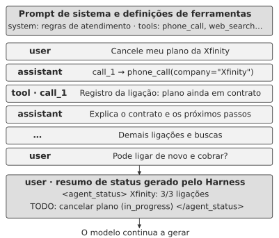

A ordem mostrada na figura, escrita como lista de mensagens, fica assim. Para facilitar a comparação, rodadas repetidas e alguns campos de chamada foram omitidos.

```text
messages: [
  { role: "system", content: "You are a customer service assistant..." }
  { role: "user", content: "Help me cancel my Xfinity plan" }
  { role: "assistant", tool_calls: [{ id: "call_1", ... }] }
  { role: "tool", tool_call_id: "call_1", content: "Call log..." }
  { role: "assistant", tool_calls: [{ id: "call_2", ... }] }
  { role: "tool", tool_call_id: "call_2", content: "Call log..." }
  ...demais rodadas...
  { role: "user", content: "Can you call them again to follow up?" }
  { role: "user", content: "<agent_status>
      Current State:
      - phone_call invoked 3 times (Xfinity: 3/3 max)
      - Current time: 2025-09-14 10:30:45
      - TODO: [1] Cancel plan (in_progress)
    </agent_status>" }
]
```

A última mensagem reúne o número de chamadas, o limite, a hora e o progresso da tarefa. O modelo pode usar esses campos diretamente e, ao mesmo tempo, consultar os registros específicos pelos IDs de chamada anteriores.

Depois que essa mensagem é acrescentada, a sequência de tokens anterior permanece inalterada e continua atendendo à condição básica de reaproveitamento do prefixo. Como tratar o estado antigo na rodada seguinte, porém, exige pesar a ocupação do contexto contra o custo de cache.

### Duas implementações da atualização de estado e seus custos de cache

Na rodada seguinte, um item TODO pode ser concluído ou uma chamada de ferramenta pode ser acrescentada. O Harness precisa atualizar o estado, e há duas abordagens comuns.

**Substituição a cada rodada**: ao montar a nova solicitação, remove-se o estado anterior e acrescenta-se o mais recente ao final. O contexto guarda apenas uma cópia do estado atual, o que facilita seu uso pelo modelo. Por exemplo, se a solicitação anterior era “descrição da tarefa, estado A” e a atual é “descrição da tarefa, resultado da ferramenta, estado B”, a descrição da tarefa ainda acerta o cache, e o resultado da ferramenta, enviado pela primeira vez, precisaria ser calculado de qualquer forma. Só se a solicitação anterior tivesse outras mensagens depois do estado A é que remover A faria essas mensagens perderem a correspondência de prefixo. Nesta solicitação, o modelo vê apenas B. Se precisar rever A, é possível recuperar nos logs de execução o snapshot daquele momento.

**Acréscimo persistente**: mantêm-se os registros de estado existentes e acrescenta-se um novo estado ao final a cada vez. O prefixo do histórico permanece estável, o que também facilita rastrear as mudanças de estado. Os estados antigos vão ocupando o contexto, por isso é preciso indicar claramente hora ou versão, para que o modelo julgue a situação atual pelo registro mais recente. A forma como o Claude Code acrescenta à sessão os avisos de alteração de arquivos reflete esse mesmo raciocínio de projeto.

Quando o estado é curto e já há muitos resultados de ferramentas em cache depois dele, manter os estados antigos pode sair mais barato do que recalcular um sufixo longo; quando o estado é longo e atualizado com frequência, a substituição controla o acúmulo de estados históricos.

Um modelo aproximado ajuda a estimar o ponto de equilíbrio: seja $S$ o número de tokens de cada estado; $R$ o número médio de tokens do sufixo já em cache, depois do estado antigo, que precisa ser recalculado a cada substituição (sem contar o conteúdo enviado pela primeira vez nesta rodada); $N$ o número de injeções de estado; e $\alpha$ a razão entre o preço da entrada em cache e o da entrada comum. Ignorando os custos comuns às duas soluções, $C_{\text{substituição}} \approx (N-1)(1-\alpha)R$ e $C_{\text{acréscimo}} \approx \alpha S N(N-1)/2$. Para $N>1$, quando $\alpha SN/2 < (1-\alpha)R$, o acréscimo persistente tem custo estimado menor; caso contrário, a substituição a cada rodada sai mais barata. Aqui o preço da entrada comum é a unidade de custo: a substituição paga a diferença entre ler o sufixo do cache e reprocessá-lo, e o acréscimo paga a leitura repetida dos estados históricos.

Um exemplo: cada injeção de estado tem 100 tokens, há 10 injeções no total e a leitura do cache custa um décimo do preço da entrada comum. No acréscimo, as solicitações seguintes leem a mais 1, 2, …, 9 estados antigos, com custo extra equivalente a 450 tokens de entrada comum. Se a substituição obrigar a reprocessar, em média, 1.000 tokens já em cache que vêm depois, as nove substituições custam a mais o equivalente a 8.100 tokens de entrada comum, e o acréscimo sai mais barato. Se o estado antigo já estava no fim do cache, sem nenhum conteúdo em cache depois dele, então $R=0$ na fórmula, e a substituição direta economiza o equivalente a esses 450 tokens.

> **Experimento 2-9 ★★: algumas técnicas úteis de barra de status do agente**
>
> Este experimento implementa cinco técnicas de barra de status, que podem ser ativadas separadamente ou combinadas. Cada técnica fornece um tipo específico de informação para ajudar o modelo a decidir a próxima ação.
>
> **O rastreamento de carimbos de data e hora** registra nas mensagens do usuário e nas respostas das ferramentas a hora do evento, por exemplo `[2025-09-14 10:30:45]`. A hora é gravada no histórico com o evento e mantém o valor original nas rodadas seguintes; a hora atual é atualizada com as novas mensagens de status. O experimento oferece também uma simulação de tempo, para verificar se o modelo distingue “os arquivos de ontem” das “alterações de hoje” e se entende corretamente a duração das esperas.
>
> **O contador de chamadas de ferramentas** mantém em um dicionário o total de chamadas de cada ferramenta e marca nas respostas `Tool call #3 for 'read_file'`. Combinando a contagem com o conteúdo do erro, o modelo pode julgar se vale tentar de novo. Por exemplo, depois da primeira falha de leitura, verifica o caminho e lista o diretório; depois de várias falhas, procura um arquivo alternativo ou informa ao usuário que o arquivo está faltando. Quando é preciso limitar o número de tentativas, o ambiente de execução também deve impor o limite com base na contagem.
>
> **O gerenciamento da lista TODO** oferece duas ferramentas, `rewrite_todo_list` e `update_todo_status`. Cada item tem identificador único, conteúdo, carimbo de data e hora e um dos quatro estados `pending`, `in_progress`, `completed` e `cancelled`. A lista concentra “o que foi feito e o que falta”, em linha com a ideia do Manus de manter o objetivo visível apresentando repetidamente o plano da tarefa.
>
> **As informações detalhadas de erro** trazem tipo e descrição do erro, JSON dos parâmetros da chamada, pilha de chamadas e sugestões de correção. Diante de um `FileNotFoundError`, por exemplo, pode-se sugerir ao modelo conferir o nome do arquivo, o diretório atual e o caminho absoluto. Os parâmetros ajudam a localizar a entrada errada, a pilha ajuda a encontrar o ponto da falha e as sugestões indicam a direção da próxima verificação. Antes de devolver esse conteúdo ao modelo, é preciso limpar campos sensíveis, como credenciais, e controlar o tamanho de pilhas muito longas.
>
> **A percepção do estado do sistema** fornece hora atual, diretório de trabalho, sistema operacional, shell e versão do Python. A ferramenta de comandos do experimento reconhece operações isoladas de troca de diretório, atualiza o diretório de trabalho mantido pelo ambiente de execução e o usa nas chamadas seguintes; mudanças de diretório de subprocessos dentro de comandos compostos seguem o escopo de execução do processo correspondente. Os campos de ambiente também ajudam o modelo a escolher ferramentas disponíveis, por exemplo optar por `apt` ou `brew` conforme o sistema real e o software instalado.
>
> Na comparação desta execução com o Kimi K3, cada tipo de tarefa teve cinco casos. Os carimbos de data e hora e a configuração combinada concluíram cinco casos cada, contra três de seus grupos de controle; o contador de ferramentas e o estado do sistema concluíram cinco tanto ativados quanto desativados. A configuração TODO concluiu zero, contra um do grupo de controle; a de erros detalhados concluiu quatro, contra cinco do grupo de controle.

**A barra de status deve ser mantida pelo código sempre que possível.** O modelo usa diretamente as estatísticas e os limites que ela contém, e um “já liguei três vezes” errado pode mudar as ações seguintes. Contagens, horários e transições de estado ficam com o programa; quando é preciso compreensão semântica, o modelo extrai os itens um a um, e o código os consolida e verifica, evitando pedir ao modelo que conte de uma vez um histórico longo inteiro. Manter a correspondência entre os eventos originais, os resultados extraídos e o estado final facilita detectar contagens duplicadas, omissões e confusão de origem.

As informações que a barra de status consolida precisam ser escolhidas de antemão. Por exemplo, “já liguei três vezes” basta para julgar se ainda é possível ligar, mas não responde “o que o atendente prometeu na segunda ligação”. Para tarefas posteriores que só precisam de valores estatísticos, pode-se substituir o histórico pelo resumo de estado e arquivar os registros originais; quando for preciso conferir o conteúdo das conversas, lê-se o original pelo índice. O projeto dos campos do resumo determina quais perguntas podem ser respondidas diretamente e também quando será preciso consultar o original.

## Estratégias de compressão de contexto

Depois de ler dez páginas longas, uma tarefa de investigação tem janela suficiente para apenas mais dois documentos. Primeiro, pergunte o que o modelo ainda precisa fazer na rodada seguinte: se vai comparar dois orçamentos, mantenha os orçamentos, as condições de validade e as fontes; se vai conferir citações, mantenha a localização que permite recuperar o texto original. O corpo das páginas já consultadas e irrelevantes pode ser arquivado, liberando espaço para novas entradas e saídas. Aqui não basta calcular quanto espaço foi liberado; há outra conta a fazer: se o material descartado for necessário mais adiante, quanto custará recuperá-lo?

### Os três objetivos da compressão

**Controlar tamanho e custo.** Tomando como exemplo uma janela de 128K tokens, páginas longas e arquivos grandes podem ocupar uma parte considerável dela. O Harness precisa reservar orçamento para as entradas seguintes, para a saída do modelo e para a interação com ferramentas.

**Organizar o conhecimento de que as decisões seguintes precisam.** Uma dúzia de rodadas de busca pode mencionar repetidamente o mesmo evento ou deixar versões contraditórias. Organizá-las como “A e B confirmados; C ainda sem evidência” permite ao modelo continuar trabalhando nas questões pendentes. O resumo deve preservar as relações entre os fatos, as fontes e as questões não resolvidas, para que as decisões seguintes tenham base clara.

**Permitir que tarefas longas continuem avançando.** Alguns modelos, quando julgam que a janela está prestes a se esgotar, encerram a tarefa antes da hora, fenômeno chamado de **ansiedade de contexto (Context Anxiety)**. Nos testes de tarefas longas com o Sonnet 4.5, a Anthropic verificou que esse comportamento podia persistir mesmo depois da compressão e passou a usar registros estruturados de transição, reiniciando o contexto para continuar a execução[^ch2-7].

[^ch2-7]: Prithvi Rajasekaran, Harness design for long-running application development, Anthropic Engineering, 2026.

### Transformar resultados de cálculos repetidos em conhecimento utilizável

A barra de status mantém de antemão contagens e progresso; o resumo vai além e organiza fatos e relações de textos longos. Ambos organizam antecipadamente informações dispersas para que as decisões seguintes possam usá-las diretamente.

Veja o exemplo da inspeção de um pet shop:

> Gaiola 1: gato preto. Gaiola 2: gato branco. Gaiola 3: gato preto. Gaiola 4: gato preto. Gaiola 5: gato branco.
> … (100 gaiolas no total, com 90 gatos pretos e 10 gatos brancos)

Responder “que gato está na gaiola 37” exige localizar o registro correspondente; responder “quantos gatos pretos e quantos brancos há” exige consolidar todos os registros. Se o total for usado várias vezes depois, pode-se calcular e guardar de antemão “90 gatos pretos, 10 gatos brancos”, evitando recontar do zero a cada vez. Programas são adequados para esse tipo de consolidação determinística, e o modelo pode então responder às perguntas de negócio a partir das estatísticas.

O conteúdo do resumo deve ser escolhido conforme a tarefa. Guardar apenas o total de cada tipo de gato basta para responder a perguntas de quantidade; para responder sobre a gaiola 37, são necessários registros gaiola por gaiola ou um índice correspondente.

Mesmo com espaço sobrando na janela, um contexto longo demais ou misturado pode prejudicar o uso das informações: o modelo deixa de lado fatos essenciais, reprocessa problemas já resolvidos ou usa estados desatualizados na decisão atual. Essa degradação de desempenho que surge com o crescimento do contexto costuma ser chamada de **degradação de contexto (Context Rot)**. Ela se manifesta como piora no desempenho da tarefa; quando a solicitação ultrapassa o limite de capacidade, ocorre o estouro da janela.

**Mesmo com espaço na janela, convém organizar ativamente o conhecimento já usado repetidas vezes.** Se os julgamentos essenciais já podem ser consolidados e o modelo continua procurando-os seguidamente em um histórico longo, gasta-se cálculo continuamente e aumentam as omissões. Em tarefas de busca, pode-se guardar os fatos confirmados, as fontes e as questões pendentes; em tarefas de programação, as decisões de arquitetura, o escopo das alterações, os resultados dos testes e as causas das falhas.

Os exemplos no contexto também influenciam a forma como o modelo lida com problemas novos. A pesquisa de Dherin e colaboradores parte da combinação entre a camada de atenção e o MLP do Transformer e representa uma passagem direta (forward pass) específica como uma atualização de pesos de baixo posto dependente do contexto, oferecendo uma explicação teórica para o aprendizado em contexto[^ch2-6]. Na inferência real, os pesos do modelo não mudam, e os exemplos influenciam a saída por meio da entrada atual. Para reaproveitar esse tipo de experiência em sessões posteriores, pode-se organizá-la como memória, exemplos ou Skill e carregá-la conforme a tarefa; o Capítulo 9 aprofunda a forma de acumular experiência.

[^ch2-6]: Benoit Dherin et al., Learning without training: The implicit dynamics of in-context learning, 2025.

### Compressão e cache KV: como pesar os dois

A compressão normalmente acontece entre duas chamadas ao modelo. Com base no orçamento restante e no progresso da tarefa, o Harness organiza as mensagens de que a próxima solicitação precisa e então as envia ao modelo. Substituir o histórico altera o prefixo, por isso é preciso considerar ao mesmo tempo o ganho da compressão e o custo de reconstruir o cache.

Primeiro, mantenha estáveis as instruções de sistema e as definições de ferramentas que continuam válidas. Elas ficam no início, e a compressão do histórico posterior pode continuar reaproveitando esse prefixo. Em seguida, escolha o que comprimir: resultados longos de ferramentas podem ser substituídos por resumos, e interações de várias rodadas já concluídas podem ser fundidas em um registro de etapa. O cache anterior ao ponto de substituição ainda pode ser reaproveitado; o ponto de substituição e o que vem depois precisam ser processados com o novo prefixo.

**A compressão do histórico deve ser feita de preferência em lotes, evitando reescrever o mesmo trecho do prefixo a cada rodada.** Depois de comprimir, a entrada de cada rodada fica mais curta, mas a chamada de compressão e o recálculo do sufixo também consomem recursos. O momento de acionar pode ser definido combinando a ocupação da janela, o número esperado de rodadas restantes e a etapa da tarefa: organizar em lote depois que resultados longos de ferramentas se concentram e salvar um resumo de transição ao concluir uma etapa reduzem o custo de alterar o histórico com frequência. Ao manter as rodadas mais recentes, verifique se as chamadas de ferramentas e os valores retornados continuam em pares e registre no resumo o estado das operações não concluídas.

Ao comprimir, também é preciso verificar o protocolo de reenvio das informações de raciocínio. Em alguns modelos, o thinking histórico fica vinculado ao prefixo com que foi gerado. Se o histórico anterior a esses blocos for substituído, o thinking preservado pode deixar de corresponder ao novo prefixo. Com esse tipo de protocolo, pode-se organizar a sessão como resumo, eliminar o thinking antigo afetado e deixar o modelo continuar raciocinando a partir do resumo; também é possível usar os mecanismos de compressão ou de edição de contexto suportados pelo servidor.

Observe primeiro o resumo individual na Figura 2-16: o número de caracteres após o processamento é só 10,9% do original, mas o total acumulado de tokens do agente principal é o maior dos seis grupos. Para explicar como esses dois números podem valer ao mesmo tempo, é preciso rastrear quais materiais foram comprimidos e em quantas rodadas de solicitação eles foram enviados ao modelo.

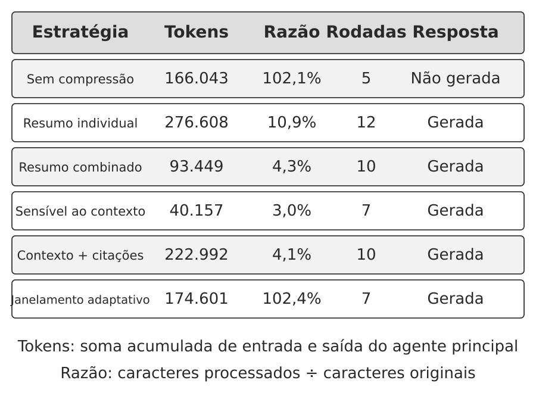

> **Experimento 2-10 ★★★: comparação de estratégias de compressão de contexto**
>
> Este experimento usa o Kimi K3 para pesquisar a situação profissional dos cofundadores da OpenAI. A tarefa exige montar aos poucos a lista de pessoas, pesquisar trajetórias e mudanças de cargo e associar os fatos às fontes. Para observar a compressão e o tratamento de estouro, o experimento fixa em 128.000 tokens o orçamento de contexto do lado da aplicação, mantém uma linha de base sem compressão e compara cinco abordagens, cada uma com no máximo 15 rodadas[^ch2-compression-results].
>
> **Estratégia 1: sem compressão.** Os resultados de busca e de leitura de páginas entram integralmente no histórico. Sete chamadas de ferramentas somaram 367.246 caracteres brutos. O programa acionou a proteção na quinta rodada e parou, com uso acumulado de 166.043 tokens pelo agente principal. A versão antiga acionava a proteção pela soma dos tokens de entrada de todas as solicitações, de modo que o 165.227 da mensagem de erro é uma entrada acumulada. Por exemplo, um mesmo trecho de histórico enviado uma vez em cada uma de três solicitações é contado três vezes.
>
> **Estratégia 2: resumo individual.** Cada resultado de busca recebe um resumo próprio de dois a três parágrafos, preservando o conteúdo principal de cada página. Essa forma é fácil de paralelizar e preserva os limites entre páginas; quando várias páginas tratam do mesmo evento, porém, a informação repetida continua entrando no histórico. Essa configuração gerou a resposta final em doze rodadas, com uso acumulado de 276.608 tokens pelo agente principal e taxa de compressão de caracteres de 10,9%.
>
> **Estratégia 3: resumo combinado.** Um lote de resultados de busca é reunido e então resumido em conjunto, o que facilita organizar fatos repetidos e as relações entre fontes diferentes. Essa configuração gerou a resposta final em dez rodadas, com uso acumulado de 93.449 tokens pelo agente principal e taxa de compressão de caracteres de 4,3%.
>
> **Estratégia 4: resumo sensível ao contexto.** Ao comprimir, fornece-se também a consulta atual e as informações já obtidas, por exemplo incluindo no prompt `Given the search query: {query}` e `Current context: {context}`. Com isso, o modelo preserva os fatos relevantes para a pergunta atual e prioriza preencher as lacunas dos resumos existentes. Essa configuração gerou a resposta final em sete rodadas, com uso acumulado de 40.157 tokens pelo agente principal e taxa de compressão de caracteres de 3,0%. Em uma das compressões, cerca de 150 mil caracteres foram organizados em cerca de dois mil, preservando nomes de pessoas e mudanças de cargo.
>
> **Estratégia 5: resumo sensível ao contexto com citações.** O resumo voltado à tarefa preserva os links das fontes correspondentes a cada fato. Essa configuração gerou a resposta final em dez rodadas, com uso acumulado de 222.992 tokens pelo agente principal. Somando pelos registros de ferramentas, o material processado tem 52.891 caracteres e o original, 1.295.044; a divisão entre os dois dá cerca de 4,1%.
>
> **Estratégia 6: janelamento adaptativo.** No início, preserva-se o material original; quando a entrada atinge um limiar, ele é organizado em lote. O experimento adota três mecanismos: acionar a compressão ao passar de 80% do orçamento; consolidar os resultados de ferramentas ainda não comprimidos; e marcar os resultados processados com `[COMPRESSED]` para evitar resumos repetidos. Com o orçamento de 128.000 tokens deste experimento, o limiar de acionamento é de 102.400 tokens. Essa configuração gerou a resposta final em sete rodadas, com uso acumulado de 174.601 tokens pelo agente principal. O registro histórico acionava o limiar pela entrada acumulada; depois, o programa passou a verificar o tamanho da entrada da solicitação mais recente.
>
> A Figura 2-17 compara as entradas e saídas das seis estratégias.
>
> 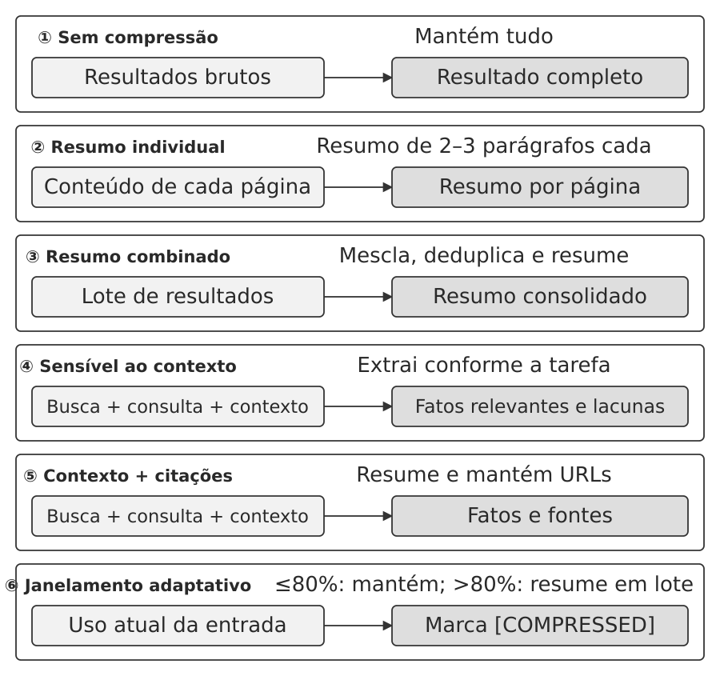
>
> Ao comparar os números da Figura 2-16, é preciso distinguir três grandezas: a entrada de uma solicitação determina se o orçamento da janela foi atingido, os tokens acumulados refletem o uso em várias rodadas de chamadas e a taxa de compressão de caracteres descreve a razão entre o comprimento processado e o comprimento original do material contabilizado. O uso acumulado aqui vem das entradas e saídas de cada rodada de solicitação do agente principal; as solicitações independentes ao modelo que gera os resumos não entram nesse campo.
>
> Para reproduzir o experimento, configure o modelo e o serviço de busca real conforme as instruções do material de apoio e execute `python experiment.py -m kimi-k3 -n 15 -o results/reproduction.json` no diretório do experimento. Leia as `metrics` de cada estratégia: recalcule a razão de caracteres com `total_compressed_size / total_original_size` e compare `total_tokens` e `iterations`. A linha de base sem compressão também acrescenta ao texto das buscas formatação como título e URL, por isso o número de caracteres processados pode ficar um pouco acima do original. O programa do experimento considera o grupo concluído assim que recebe uma resposta final. Experimente procurar a mesma pessoa nos dois resultados finais: o grupo com citações registra a instituição de Pamela Vagata como Pebblebed, mas a tabela consolidada do grupo de janelamento registra Stripe. A primeira resposta menciona o site da instituição, mas não traz um link de página que possa ser aberto. Os dois grupos entregaram a tabela consolidada, mas os dados sobre a pessoa se contradizem.

[^ch2-compression-results]: O arquivo de resultados do Experimento 2-10, `kimi_k3_real_20260718.json`, guarda os campos estatísticos, as respostas finais e os carimbos de data e hora de cada estratégia, permitindo recalcular diretamente a razão de caracteres. A execução de 18 de julho de 2026 usou a condição de proteção antiga; a revisão de código de 22 de julho (commit `aea4d72`) passou a usar a entrada da rodada mais recente em vez da entrada acumulada.

### Mecanismo de compressão em camadas para produção

Saídas de ferramentas podem exigir que o texto integral seja guardado temporariamente, etapas concluídas podem ser arquivadas e as restrições atuais devem continuar visíveis; os cinco mecanismos a seguir se adequam a diferentes frequências de uso e prazos de retenção.

1. **Controle do orçamento dos resultados de ferramentas**. Saídas volumosas são guardadas em armazenamento externo, e o contexto mantém uma prévia resumida e um ponto de acesso para leitura. Depois que a prévia entra no histórico, seu conteúdo permanece estável; quando forem necessários mais detalhes, leem-se os trechos relevantes e acrescenta-se o resultado.
2. **Limpeza de conteúdo irrelevante**. Barras de navegação de páginas, rodapés repetidos e semelhantes podem ser filtrados antes de o resultado entrar no contexto. Quando for preciso remover conteúdo que já está no histórico, confirme antes se a tarefa e as citações seguintes ainda dependem dele e calcule o custo de cache de alterar o histórico.
3. **Edição de contexto na camada da API**. Serviços com esse recurso podem limpar resultados antigos de ferramentas segundo regras. O cliente precisa configurar as condições de acionamento e tratar as informações de edição devolvidas pelo serviço. O alcance da limpeza e o comportamento do cache são definidos pela convenção da interface, e convém integrá-lo junto com o monitoramento do orçamento de entrada.
4. **Resumo de arquivamento**. Registra, por rodada ou por etapa da tarefa, objetivos, operações, resultados e pendências, preservando a ordem de execução. Pode ser entendido como o registro de alterações da tarefa: mais tarde é possível descobrir em que passo uma decisão foi tomada e com base em quê.
5. **Compressão integral da sessão**. Quando a limpeza local ainda não basta para o orçamento, o objetivo atual, as restrições, os fatos confirmados, as decisões essenciais e o próximo trabalho são organizados em um resumo de transição. Pode-se organizar primeiro as notas de sessão existentes e depois consolidar todo o histórico. Se a compressão falhar seguidamente, um limite de tentativas ou um disjuntor interrompe as chamadas repetidas, salva um estado recuperável e então se escolhe reduzir a entrada ou recorrer a tratamento manual.

Esses mecanismos podem cooperar em camadas: o controle na entrada reduz saídas volumosas pontuais, a organização local controla o crescimento cotidiano, e os resumos de etapa e a compressão integral guardam as informações de transição das tarefas longas.

Lendo o dsh-superagent, notei um detalhe: eventos e resultados de ferramentas podem primeiro chegar como resumo e ID do objeto, e os detalhes são lidos pelo ID quando necessário. Suponha que um conjunto de testes termine em segundo plano e só informe ao primeiro plano “duas falhas”. O primeiro plano consegue relatar o progresso, mas não responde à pergunta seguinte do usuário: “são as mesmas duas de ontem?” Se o resumo trouxer o identificador do registro desta execução de testes, o primeiro plano pode recuperar os nomes dos casos que falharam e compará-los com o registro de ontem.

### Princípios de projeto das estratégias de compressão

Ao decidir o que manter depois da compressão, verifique os quatro aspectos a seguir. O processo de acumular experiência entre tarefas é desenvolvido no Capítulo 9.

- **Distribuir o espaço conforme o valor para a tarefa**. A lista de pessoas, as relações de identidade e as questões ainda pendentes normalmente devem ser mantidas diretamente; as evidências essenciais que sustentam as conclusões mantêm a fonte e os detalhes necessários; barras de navegação, anúncios e conteúdo repetido podem ser removidos. Quando um fato é controverso, as diferenças entre as evidências também são informação importante.
- **Manter a integridade semântica**. Em “Sutskever deixou a OpenAI em maio de 2024”, por exemplo, pessoa, data, ação e instituição formam juntas um fato. A compressão deve preservar esses elementos e evitar fragmentos difíceis de interpretar, como “Sutskever saiu”.
- **Organizar o conteúdo em torno das perguntas seguintes**. “Encontrar a lista de fundadores” exige cobrir todas as pessoas; “conhecer a trajetória de cada um” exige experiências, linha do tempo e fontes. O mesmo material pode gerar resumos diferentes para tarefas diferentes: a recuperação privilegia a cobertura, a análise privilegia relações e fundamentos, e a criação precisa ainda preservar detalhes e exemplos úteis.
- **Verificar se o resumo sustenta a execução**. O resumo semântico precisa entender a tarefa, eliminar repetições e preservar condições e exceções. **A compressão semântica de materiais complexos deve usar, de preferência, um modelo com capacidade de compreensão próxima à do modelo principal.** Quem comprime precisa julgar quais condições, exceções e evidências afetam o trabalho seguinte; se elas forem descartadas, por mais forte que seja o modelo principal, será difícil recuperá-las.

Decisões de arquitetura tomadas no início, os motivos por trás das restrições e os caminhos que falharam são facilmente perdidos em um histórico longo. **Tarefas longas devem atualizar periodicamente um documento de progresso**, registrando “o que foi decidido, por que foi decidido assim, o que foi verificado e o que fazer em seguida”. O prompt ou a Skill pode definir quando atualizá-lo, e o Harness carrega o registro correspondente nas transições de tarefa. Esse documento também facilita a compreensão do trabalho já feito por executores, revisores e agentes posteriores.

### Isolamento de contexto com subagentes

**Para tarefas com entregas bem delimitadas e que produzem muito material intermediário, prefiro isolar o trabalho em subagentes.** Uma busca ampla lê muitos materiais úteis apenas na fase exploratória, e isolá-los primeiro reduz a interferência contínua desse conteúdo na tarefa principal. O agente principal entrega a tarefa a um subagente com contexto próprio, que lê os resultados intermediários e devolve conclusões, localização das evidências e questões pendentes. Assim, o contexto do agente principal só precisa guardar as informações de que as decisões seguintes precisam.

Por exemplo, para “encontrar a função que trata o callback de pagamento”, o agente principal, buscando sozinho, pode precisar ler mais de uma dúzia de arquivos. Delegando a um subagente de busca, pode-se pedir que ele devolva o nome da função, o módulo em que está, os pontos de chamada e a justificativa. A resposta pode ser “`handle_callback`, no módulo de pagamentos, trata o callback; há outros dois pontos de chamada”, com referências que permitam localizá-los. Com base nesses resultados, o agente principal decide se continua lendo o código pertinente.

A descrição da tarefa deve ser completa: qual é o objetivo, qual é o alcance da busca, que restrições respeitar, em que formato devolver e como agir diante de ambiguidades. Se a solicitação de delegação e o resultado devolvido forem acrescentados ao histórico, o prefixo original do agente principal continua reaproveitável.

O Capítulo 4 discute o design da interface de subagentes como ferramentas, e o Capítulo 10 aprofunda a divisão de contexto em sistemas multiagente.

## Resumo do capítulo

Depois que o assistente de atendimento faz a terceira ligação, como continuar o trabalho? A próxima solicitação leva o comprovante da ferramenta referente a essa ligação, ligado à operação de discagem pelo ID de chamada. A barra de status atualiza para três o número de ligações feitas e lista as condições ainda não acertadas. As regras do sistema e as definições de ferramentas ficam no prefixo estável, e a Skill correspondente é carregada quando for preciso tratar de determinado serviço. Assim, cada campo tem origem identificável, e é possível ver quais conteúdos mudarão com a próxima chamada.

Se a ligação se estender e as ferramentas devolverem cada vez mais conteúdo, é possível limitar o tamanho dos resultados, organizar as partes já concluídas em um resumo com fontes ou entregar a um subagente o trabalho que pode ser feito de forma independente, recebendo de volta apenas as conclusões e as evidências.

Terminada essa tarefa, a contagem de três ligações pode ser arquivada com ela. Mas, se o usuário tiver pedido expressamente “daqui em diante, entre em contato comigo à tarde nos dias úteis”, deixar essa frase apenas no resumo da ligação pode fazer com que o próximo assistente encarregado nem chegue a vê-la. Como guardar informações úteis a longo prazo e recuperá-las na tarefa certa? O Capítulo 3 trata da memória do usuário entre tarefas e das bases de conhecimento compartilhadas.

## Questões para reflexão

1. ★★★ Leia o registro de execução da janela deslizante do Experimento 2-3: o que fez cada uma das cinco chamadas de ferramentas? Para julgar se as chamadas repetidas foram causadas pelo corte do histórico, o que mais seria preciso registrar e que comparação seria preciso fazer? Projete um esquema de corte que preserve o estado essencial e explique seu impacto sobre o cache de prefixo. O registro está em `chapter2/kv-cache/result_sliding_window_20260718_kimi_k2_6.json`.
2. ★★ O Chat Template do Qwen3 trata o raciocínio histórico com base na posição da última consulta real do usuário. Se um loop ReAct durar centenas de rodadas, como você gerenciaria o conteúdo de raciocínio que não para de crescer? Compare o corte do raciocínio histórico, o reenvio e os protocolos com vinculação de prefixo, e explique como o Harness deve se adaptar.
3. ★★ Suponha que seja preciso comprimir cerca de 150 mil caracteres de material de busca em dois mil caracteres. Quais fatos, relações e fontes você manteria? Como verificar se o resumo basta para as perguntas seguintes e como recuperar os detalhes omitidos?
4. ★★ O contador de ferramentas deixou de registrar uma chamada, e a barra de status passou a mostrar um número errado de chamadas restantes. Projete o registro de eventos, a verificação consolidada e as checagens da camada de execução, explicando como detectar e corrigir essa inconsistência.
5. ★★ O Experimento 2-4 comparou tom, organização das informações e descrições de ferramentas. Se o prompt de sistema for mantido por várias pessoas ao longo do tempo, como você gerenciaria versões, verificaria conflitos entre regras e avaliaria cada alteração com tarefas de regressão?
6. ★★★ O caso do pet shop envolve tanto a recuperação de um registro individual quanto estatísticas gerais. Projete os registros brutos, o resumo estatístico e o roteamento de consultas para que o sistema responda com eficiência aos dois tipos de pergunta, e explique quando o resumo precisa ser atualizado.
7. ★★★ Uma Skill já está no catálogo, mas o modelo não percebe que ela se aplica à tarefa atual. Como você investigaria o problema sob quatro ângulos: descrição, organização do catálogo, acionamento explícito e exemplos de avaliação?
8. ★★ Uma Skill foi carregada com sucesso, mas o modelo pulou o passo de verificação que ela prevê. Projete um experimento de comparação que distinga problemas de acionamento, compreensão, uso de ferramentas e julgamento de conclusão, e compare o desempenho de diferentes modelos.
9. ★★★ O sistema tem muitas ferramentas, e o conjunto de ferramentas muda com frequência. Como você posicionaria as definições fixas, o catálogo de ferramentas, os resultados do carregamento sob demanda e o estado de execução? Considere ao mesmo tempo a precisão da descoberta, o orçamento de contexto e a taxa de acerto do cache.
