# Memória do usuário e base de conhecimento

Se na semana passada o usuário contou ao assistente que prefere assento na janela e hoje diz apenas “compre outra passagem para Tóquio”, de onde este pedido vai recuperar aquela preferência? E se a companhia aérea mudou ontem as regras de bagagem, onde consultar as novas condições? O capítulo anterior tratou de como organizar o contexto de uma tarefa. Este capítulo trata de onde recuperar o que o usuário disse, onde encontrar as novas regras da companhia aérea e quando cada um desses dois tipos de material deve ser atualizado.

A **memória do usuário** organiza as informações em torno de um usuário específico — suas preferências, hábitos, necessidades e experiências — para que o agente continue a atendê-lo de acordo com a situação dele nas sessões seguintes. A **base de conhecimento** é compartilhada por vários usuários dentro de um escopo de permissões, como normas do setor, procedimentos operacionais da empresa e documentação técnica. A primeira ajuda o agente a conhecer quem ele atende; a segunda fornece o conhecimento de domínio necessário para concluir as tarefas.

As duas precisam resolver como guardar as informações e como encontrá-las quando forem necessárias, e ambas enfrentam fatos conflitantes, conteúdo desatualizado e lacunas na recuperação. Recuperação vetorial, índices estruturados e compressão de conhecimento servem aos dois tipos de sistema. A Figura 3-1 mostra a organização do capítulo: primeiro, a representação e o gerenciamento da memória do usuário; depois, a geração aumentada por recuperação (RAG); por fim, a aplicação dos métodos de recuperação à memória entre sessões e a formas mais complexas de organizar o conhecimento.

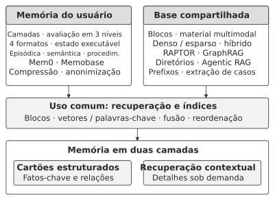

## Sistema de memória do usuário

Vale decompor a frase “na semana que vem estou no exterior; mande os documentos do banco por e-mail”. O usuário informou uma viagem com prazo definido e, dentro desse período, indicou como quer receber correspondência. Quando o banco propuser enviar documentos pelo correio, o assistente pode se apoiar nisso para pedir a entrega eletrônica; terminada a viagem, uma nova questão de correspondência exige reavaliar as condições do momento. Se o sistema guardar apenas “o usuário não gosta de cartas em papel”, poderá até recuperar essa memória mais tarde, mas vai aplicá-la fora do âmbito em que ela vale.

Agora, as passagens aéreas. Se o usuário diz “aquela passagem de 1250 da última vez saiu mais cara do que eu esperava”, o sistema pode guardar pelo menos a cotação daquela ocasião, o orçamento da época, o contexto da viagem e esse comentário. Diante de uma situação parecida, o modelo passará a tratar com mais cautela cotações acima do orçamento. Se o usuário acrescentar “daqui em diante, em viagens em família, pergunte a mim primeiro”, fica estabelecida uma condição explícita de consulta para as futuras viagens em família. Daí se distinguem três tipos de informação: o que o usuário de fato disse, em que condições estava naquele momento e o que o modelo inferiu dessa experiência.

No fim da sessão, é possível pedir a um LLM que organize esses registros e grave em armazenamento persistente os fatos com valor futuro. Quando uma nova tarefa começar, apenas os registros relevantes e ainda aplicáveis entram no contexto.

Por exemplo, ao reservar uma passagem, o usuário forneceu as seguintes informações:

```text
User: Help me book a flight to Tokyo next Friday. I prefer window seats
      and I'm vegetarian, so I'll need a special meal.
Agent: I'll search for flights to Tokyo for next Friday...
       [calls flight_search tool, returns 3 options]
Agent: Here are your options. Based on your preference, I've filtered for
       window seat availability. Shall I book the ANA direct flight?
User: Yes, and use my United MileagePlus number 12345678.
```

Encerrada a sessão, o extrator de memórias pode produzir quatro registros:

```text
Extracted memories:
- User prefers window seats (preference)
- User is vegetarian, needs special meals on flights (dietary restriction)
- User's United MileagePlus number: 12345678 (loyalty program)
- User has travel plans to Tokyo (recent activity)
```

O exemplo envolve três operações. A **extração seletiva** guarda a preferência de assento, a restrição alimentar e o número de fidelidade, e descarta detalhes passageiros como “a busca retornou três opções”. A **abstração** transforma a preferência pela janela, expressa explicitamente pelo usuário, em uma regra utilizável em reservas futuras. A **estruturação** rotula cada fato com uma categoria, o que facilita a recuperação e a atualização. A viagem a Tóquio também deve registrar a data de partida e a situação atual: “próxima sexta-feira” precisa ser convertida com base na data da sessão, e a situação é atualizada quando a viagem terminar ou for cancelada. Assim, preferências duradouras e atividades recentes são mantidas cada uma conforme seu próprio prazo de validade.

A descrição do assistente pessoal Today traz um exemplo. O usuário conta que treina às terças e quintas para uma meia maratona. Seis semanas depois, os registros de sono, conectados com autorização do usuário, mostram que ele dormiu pouco na noite anterior. O assistente junta as duas informações e sugere mudar o treino intervalado de alta intensidade daquele dia. Por quanto tempo cada coisa deve ser lembrada? O plano de treino serve durante toda a preparação para a prova; o registro de sono da noite anterior precisa levar a data. Mesmo que o usuário aceite a mudança dessa vez, o treino da quinta-feira seguinte continua como planejado, a menos que ele diga que a mudança vale daqui em diante. O Today também separa em duas etapas a sugestão e a alteração da agenda, e a segunda exige confirmação do usuário.[^ch3-today]

[^ch3-today]: Em “What Is Today”, a equipe do Today usa o treino para meia maratona para mostrar como a memória e as informações do dia se complementam. Em “Meet Today”, o fundador explica o mecanismo de confirmação antes de alterar a agenda.

### Avaliação das capacidades de memória: um framework de três níveis

O benchmark público **LoCoMo** (Long-term Conversational Memory, memória conversacional de longo prazo) reúne conversas longas com cerca de 300 turnos em média e até 35 sessões, e avalia a memória por meio de perguntas e respostas, resumo de eventos e geração de diálogos multimodais. As perguntas se dividem em cinco categorias. As de salto único podem ser respondidas a partir de uma só sessão; as de múltiplos saltos exigem juntar pistas de várias sessões; as de raciocínio temporal exigem, além disso, saber em que ordem os eventos aconteceram. As de conhecimento de domínio aberto pedem que se combine o que o usuário disse com conhecimento externo. No exemplo da reserva, o usuário disse apenas “vou a Tóquio na semana que vem”; para responder “que moeda se usa no destino”, é preciso lembrar a pista sobre Tóquio e também saber que lá se usa o iene. Se a pergunta for sobre um número de voo que o usuário nunca mencionou, o assistente deve apontar que faltam informações. Reconhecer perguntas impossíveis de responder é justamente o que avaliam as perguntas adversariais.[^ch3-locomo]

[^ch3-locomo]: A Seção 4.1 do artigo do LoCoMo, de Maharana et al. (arXiv:2402.17753), define as cinco categorias de perguntas. A página do projeto dos autores disponibiliza os dados e exemplos de conversas.

Com base nesses benchmarks e na prática de produtos de memória, resumo em oito as capacidades que merecem atenção:

- **Retenção de informações pessoais**: guardar com precisão e recuperar informações duradouras, como a identidade do usuário.
- **Acompanhamento de preferências**: registrar as preferências do usuário e atualizá-las a cada nova manifestação explícita.
- **Troca de contexto**: retomar o contexto relevante mesmo depois de uma mudança de assunto.
- **Atualização da memória**: incorporar complementos e correções que o usuário faz a fatos já registrados.
- **Continuidade entre sessões**: usar, em uma nova sessão, informações salvas anteriormente.
- **Raciocínio complexo**: relacionar vários fragmentos de memória. Por exemplo, se o usuário mencionou alergia a amendoim, uma conversa sobre comida tailandesa deve levar o assistente a lembrar de verificar os ingredientes.
- **Percepção temporal**: guardar datas, interpretar expressões relativas de tempo e calcular intervalos entre eventos.
- **Resolução de conflitos**: detectar informações inconsistentes e decidir com base na fonte, na data e em quem ou a que se referem.

Tendo em vista as tarefas reais de um agente, este livro adota um framework de avaliação em três níveis. Os Experimentos 3-1 e 3-2 o usam primeiro para comparar representações de memória; os Experimentos 3-9 e 3-11 aplicam o mesmo framework para avaliar métodos de recuperação.

**Nível 1: recordação básica.** Guardar com precisão e recuperar informações de sentido inequívoco fornecidas diretamente pelo usuário. Se o usuário diz “meu número de fidelidade é 12345”, uma reserva posterior deve retornar o número completo. Este nível verifica sobretudo se os fatos foram perdidos, confundidos ou alterados.

**Nível 2: recuperação entre sessões.** Reunir as informações relevantes de sessões de épocas diferentes, que envolvem pessoas ou objetos diferentes, e então determinar a quem o pedido atual se refere e de quais registros ele depende. Se o usuário tem dois carros e diz apenas “agende a revisão do meu carro”, o sistema deve primeiro recuperar os dados dos dois veículos e esclarecer de qual se trata. Ao consultar a situação de um empréstimo, é preciso distinguir o contrato em vigor das cotações consultadas no passado. Ao cancelar a “viagem a Los Angeles”, é preciso associar à mesma viagem as reservas de passagem, hotel e demais itens.

**Nível 3: atendimento proativo.** Com base na tarefa atual, identificar assuntos relacionados que o usuário não mencionou um a um. Por exemplo, ao reservar um voo internacional, associar as informações do passaporte salvas meses antes e verificar se a validade atende às exigências da viagem; quando o celular quebra, reunir a garantia do aparelho, a garantia estendida do cartão de crédito e o seguro da operadora e listar as soluções disponíveis; ao preparar a declaração de impostos, reunir de todo o ano os registros de operações com ações, de renda como autônomo e de imposto predial.

> **Experimento 3-1 ★: avaliação de um sistema de memória com o framework de três níveis**
>
> O conjunto de avaliação tem 20 casos por nível, 60 no total. O Nível 1 é composto principalmente de sessões únicas; os Níveis 2 e 3 têm várias sessões que atravessam períodos e envolvem diferentes pessoas e objetos, para verificar associação entre entidades, atualização de informações e lembretes proativos.
>
> Cada caso é executado em duas etapas. Primeiro, as sessões são fornecidas uma a uma: o modelo gera memórias a partir da primeira sessão e, a cada nova sessão, recebe apenas as memórias existentes e a sessão nova, gerando as memórias atualizadas. Depois disso, o modelo não tem mais acesso ao texto original das sessões anteriores; para responder sobre o que foi conversado, conta apenas com o que ficou registrado na memória. Processadas todas as sessões, uma nova pergunta é apresentada, e o agente deve respondê-la com base na memória.
>
> A avaliação usa LLM-as-a-judge: um modelo avaliador independente compara a resposta com a resposta de referência e os critérios de pontuação, verificando os fatos cobertos e os erros. Nesta execução, o Doubao Seed 1.6 gera as memórias e as respostas, e um modelo da Moonshot atribui as notas. O avaliador vê a conversa original; o modelo que responde vê apenas a memória que restou no final.
>
> Como ler o boletim? Suponha que o usuário queira apenas recuperar o número da conta do serviço de banda larga. No grupo de Enhanced Notes, o assistente deu o número correto. O avaliador atribuiu 4 pontos em precisão, recordação e raciocínio, e apenas 1 em proatividade, e o caso foi aprovado mesmo assim. O programa aprova um caso quando cada um dos três primeiros critérios recebe pelo menos 3 pontos (de 4) e o avaliador não encontra fatos importantes sem fundamento ou que contradigam o que foi dito. A proatividade entra na nota geral; apenas pelo número de aprovações não se sabe o quanto o assistente ofereceu ajuda por iniciativa própria.

### Estrutura hierárquica da memória

Para responder “que voo reservei da última vez”, é preciso encontrar um evento; para responder “que assento prefiro ao reservar”, é preciso recuperar uma preferência consolidada ao longo de várias interações. As duas perguntas dizem respeito à mesma pessoa, mas exigem granularidades de registro e formas de recuperação diferentes.

A **trajetória** (trajectory) registra em ordem cronológica os eventos de uma execução do agente, incluindo mensagens do usuário, respostas do modelo, chamadas de ferramentas e seus resultados. Com um log de eventos apenas de acréscimo (append-only), cada novo evento entra no final e os registros originais são preservados para auditoria. O Harness pode selecionar o histórico, extrair estado ou gerar resumos a partir da trajetória para montar o contexto efetivamente enviado ao modelo em cada turno.

A **memória de longo prazo do usuário** guarda o que é útil entre sessões, como preferências, relações pessoais, resumos de atividades passadas e fatos confirmados, e delimita a quem cada registro pertence por meio de identificadores como o ID do usuário. Novas falas podem complementar, corrigir ou substituir registros antigos; por isso, a memória de longo prazo precisa de mesclagem e atualização. A leitura e a manutenção podem ser feitas pelo agente, chamando ferramentas explicitamente, ou disparadas pelo Harness ao carregar ou encerrar uma sessão ou durante uma organização em segundo plano.

O **estado de negócio** descreve a etapa lógica em que a tarefa se encontra, como “aguardando esclarecimento”, “em processamento”, “aguardando pagamento” ou “concluída”. O programa pode verificar esses estados para decidir que evento esperar e que operação executar em seguida. O Capítulo 6 retoma o gerenciamento de estado em arquiteturas orientadas a eventos.

Esses três tipos de registro trabalham em conjunto: a trajetória fornece a base da execução, a memória de longo prazo fornece o contexto entre sessões e o estado de negócio indica até onde a tarefa atual avançou. A seguir, o foco é a representação, o gerenciamento e a recuperação da memória de longo prazo.

### Quatro formatos de armazenamento da memória do usuário

Se só é preciso alterar um endereço de e-mail, o ideal é encontrar diretamente esse item; se é preciso entender por que o endereço mudou, é necessário ler a história do que aconteceu. No canto superior esquerdo da Figura 3-2, e-mail, empresa e cargo ficam em registros separados; no canto superior direito, cargo, equipe e projeto aparecem escritos juntos. Observe os dois cartões de baixo: para atualizar o cargo no futuro, ou para saber quem foi ao cardiologista, que campo consultar em cada caso?

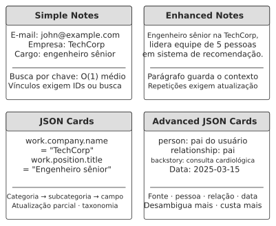

**Simple Notes** registra cada memória como um fato curto, por exemplo “E-mail do usuário: john@example.com”. Cada registro é fácil de ler e gravar; quando a localização é feita por uma chave estável em uma tabela hash, a consulta e a atualização costumam ter complexidade média O(1). Para buscar semanticamente em um grande volume de notas, é preciso ainda construir um índice de recuperação. Uma divisão fina demais também perde relações: se “trabalha na TechCorp como engenheiro sênior, responsável pelo desenvolvimento do sistema de recomendação” for dividido em três registros sem ligação — empresa, cargo e projeto —, depois será preciso descobrir de novo se pertencem ao mesmo emprego.

**Enhanced Notes** guarda os fatos e seu contexto em parágrafos completos. Por exemplo: “O usuário trabalha na TechCorp como engenheiro de software sênior, atua com aprendizado de máquina há três anos e hoje lidera um projeto de sistema de recomendação com 5 pessoas.” As relações entre empresa, cargo, experiência e equipe ficam preservadas no mesmo parágrafo. O custo é que alguns fatos podem se repetir em vários parágrafos; quando o cargo muda, é preciso localizar e atualizar todos os parágrafos relacionados para que registros novos e antigos não convivam.

**JSON Cards** organiza as informações em “categoria — subcategoria — pares chave-valor”, como `personal.contact.email` e `work.position.title`. Ao modificar o campo de cargo, os demais campos, como `work.company.name`, permanecem intactos, o que favorece atualizações parciais. Ao projetar as categorias, é preciso considerar informações transversais: “desenvolve projetos pessoais em Python nos fins de semana” envolve ao mesmo tempo horário, preferência tecnológica e atividade. Pode-se guardar um único registro de atividade com várias etiquetas, ou ligar as categorias relacionadas por referências, preservando essas associações.

**Advanced JSON Cards** acrescenta aos fatos o contexto de origem `backstory`, o sujeito `person`, a relação com o usuário `relationship` e um carimbo de data e hora. Esses campos ajudam o sistema a identificar a quem a informação pertence, quando foi obtida e em que situação se aplica. Por exemplo, “Dr. Zhang” pode ser o dentista do usuário ou o cardiologista do pai do usuário; guardar o nome junto com o paciente, o grau de parentesco e a especialidade reduz a confusão.

Quando o usuário diz “marque o check-up anual da minha família”, o sistema pode encontrar os membros da família por `person` e `relationship` e depois ler em `backstory` as experiências relacionadas. Quanto mais ricos os campos, mais relações precisam ser tratadas na extração e na atualização. Recomendo combinar os formatos conforme a importância da informação e a necessidade de associação: pessoas-chave, contratos e preferências duradouras em Advanced JSON Cards, preservando origem e relações; fatos simples, numerosos e pouco relacionados em Simple Notes, reduzindo o custo de extração e manutenção. Os dois tipos de registro se ligam por identificadores ou referências e podem ser recuperados juntos quando necessário.

> **Experimento 3-2 ★★: comparação de quatro formatos de memória**
>
> A implementação de apoio oferece uma interface única de geração, atualização e recuperação de memórias para os quatro formatos e compara as respostas finais nos mesmos 60 casos do Experimento 3-1.
>
> Nesta execução, Simple Notes, Enhanced Notes, JSON Cards e Advanced JSON Cards foram aprovados em 48, 52, 51 e 49 casos, respectivamente. No Nível 2, Enhanced Notes foi aprovado em 16 casos e Advanced JSON Cards em 12; no Nível 3, ambos foram aprovados em 19. Somando manutenção da memória, respostas e avaliação, Enhanced Notes consumiu cerca de 990 mil tokens e Advanced JSON Cards cerca de 1,55 milhão, com tempo médio por chamada ao modelo também maior.
>
> Tome como exemplo a pergunta do Nível 2 sobre assinaturas de streaming. O usuário quer economizar e pergunta que serviços assina e quanto custa cada um. O grupo de Enhanced Notes listou as mensalidades de Netflix, Disney+ e Max: 22,99, 19,99 e 19,99 dólares. O grupo de Advanced JSON Cards informou apenas o preço do Max e ainda listou dois planos mais baratos do Max. Por mais concreta que seja a sugestão, ela não recupera as outras duas faturas.
>
> Em que atualização o problema começou? Examinando as memórias salvas a cada etapa pelo grupo de Advanced JSON Cards, a Netflix ainda estava lá depois da primeira sessão; depois da segunda, restavam apenas registros sobre o Disney+; depois da terceira, apenas sobre o Max. Na hora da pergunta, as duas primeiras assinaturas já tinham sumido da memória.

### Uma forma avançada de representar o conhecimento: código executável

Depois de guardar os fatos, ainda é preciso fazer estatísticas, verificar conflitos e decidir o próximo passo segundo as regras de negócio. Em **User as Code** (UaC), experimentei organizar as informações do usuário como objetos Python tipados e escrever essas operações como funções[^uac]. O modelo extrai os fatos da conversa; o programa executa os cálculos bem definidos.

Para comparação de datas, soma de valores e restrições de negócio explícitas, prefiro escrever o cálculo como função, de modo que o mesmo conjunto de fatos produza resultados reproduzíveis e testáveis. Assim, o modelo se concentra na compreensão semântica e fica livre de refazer contas de cabeça e conferir regras repetidamente ao longo de conversas longas; a representação e o uso da memória também podem ser verificados no mesmo código.

O UaC usa um fluxo em duas fases: primeiro, os fatos extraídos são acrescentados a um log; depois, checkpoints periódicos reconstroem o estado tipado a partir do log. O log preserva a origem dos fatos e a forma como mudaram; o objeto de estado oferece os campos consultáveis no momento.

No caso do passaporte e das viagens, o estado pode ser definido assim:

```python
from dataclasses import dataclass
from datetime import date

@dataclass
class PassportInfo:
    number: str
    country: str
    expiry_date: date

@dataclass
class Trip:
    destination: str
    departure_date: date
    is_international: bool

@dataclass
class UserState:
    passport: PassportInfo
    trips: list[Trip]

state = UserState(
    passport=PassportInfo("AB1234567", "US", date(2025, 2, 18)),
    trips=[
        Trip("Tokyo", date(2025, 1, 15), True),
        Trip("Paris", date(2025, 6, 10), True),
    ],
)
```

As **estatísticas agregadas** percorrem os registros diretamente. Por exemplo, para contar as viagens internacionais registradas em 2025:

```python
count = sum(
    1 for trip in state.trips
    if trip.is_international and trip.departure_date.year == 2025
)
# count == 2
```

A **verificação de conflitos** compara dois conjuntos de campos segundo regras predefinidas. O exemplo abaixo, com correspondência entre classes de medicamentos, mostra como enviar para uma fila de processamento os itens que precisam de verificação adicional:

```python
def find_allergy_matches(profile):
    matches = []
    for medication in profile.current_medications:
        for allergy in profile.allergies:
            if medication.drug_class == allergy.drug_class:
                matches.append((medication, allergy))
    return matches
```

Cada correspondência mantém o registro de medicação e o registro de alergia correspondentes; com isso, as etapas seguintes podem conferi-los e decidir, segundo as regras do domínio, se emitem um alerta, encaminham para revisão ou pedem mais informações.

A **verificação de restrições** pode ser executada automaticamente a cada atualização do estado. Por exemplo, se uma regra de viagem exige que o passaporte tenha pelo menos 180 dias de validade na data de partida, o número de dias pode ser passado como parâmetro:

```python
def passport_alerts(state, required_days):
    alerts = []
    for trip in state.trips:
        if trip.is_international:
            days = (state.passport.expiry_date - trip.departure_date).days
            if days < required_days:
                alerts.append((trip.destination, days))
    return alerts

alerts = passport_alerts(state, required_days=180)
```

Com os 180 dias do exemplo, o passaporte terá apenas 34 dias de validade na ida a Tóquio e já estará vencido no dia da partida para Paris. Quando o usuário renovar o passaporte, o programa pode recalcular as duas viagens com a nova data.

[^uac]: Li, Bojie, User as Code: Executable Memory for Personalized Agents, 2026.

### Fundamentos da memória do usuário na ciência cognitiva

A ciência cognitiva distingue tipos de memória pelo conteúdo e pela forma de uso. Esses conceitos também ajudam a organizar as informações de longo prazo de um agente:

- A **memória episódica** (episodic memory) guarda eventos específicos, com data, participantes e desenrolar. Em uma pessoa, seria “jantar com colegas num restaurante italiano na quarta-feira passada”; em um agente, pode corresponder a “o usuário planeja ir a Tóquio na próxima sexta-feira em um voo da ANA”, registrando depois se a reserva foi concluída ou alterada.
- A **memória semântica** (semantic memory) guarda fatos e conceitos. Em uma pessoa, seria “a capital da Itália é Roma”; em um agente, “o usuário é vegetariano” ou “o usuário prefere assento na janela”. Essas informações podem vir de uma declaração explícita do usuário ou ser induzidas de várias experiências; registrar a origem ajuda a distinguir os dois casos.
- A **memória procedimental** (procedural memory) diz respeito a habilidades e fluxos de ação. Em uma pessoa, seria andar de bicicleta; na engenharia de agentes, a analogia é com fluxos reutilizáveis, como “buscar voos diretos → confirmar a preferência de assento → usar o número de passageiro frequente → reservar a refeição”.

Voltando aos registros de compras do Capítulo 1: “viu dez itens e comprou um deles” permite registrar um evento de compra, mas dificilmente permite concluir do que a usuária vai gostar no futuro. Talvez ela tenha gostado do modelo, talvez só tenha escolhido o que chegava no mesmo dia. Se ela disser em seguida “daqui em diante, nessa categoria, veja primeiro se dá para entregar no mesmo dia”, surge uma preferência duradoura com escopo definido. Na próxima recomendação de produtos semelhantes, o sistema pode verificar primeiro o prazo de entrega e explicar a ela de que comentário veio esse critério de filtragem.

A Tabela 3-1 reúne essa classificação, a estrutura hierárquica e os formatos de armazenamento vistos antes, mostrando a pergunta que cada um responde.

Tabela 3-1: três aspectos do projeto da memória

| Aspecto do projeto | Pergunta que responde | Categorias |
| --- | --- | --- |
| Nível do registro | Que função a informação cumpre? | Trajetória, memória de longo prazo do usuário, estado de negócio |
| Formato de armazenamento | Com que estrutura é representada? | Simple Notes, Enhanced Notes, JSON Cards, Advanced JSON Cards |
| Conteúdo da memória | Que tipo de informação é guardado? | Memória episódica, memória semântica, memória procedimental |

Por exemplo, “o usuário prefere assento na janela” é memória semântica e pode ser guardada na memória de longo prazo em Simple Notes; um procedimento de reserva é memória procedimental e pode ser guardado em um cartão com origem e condições de aplicação.

### Estudos de caso de frameworks de memória

O usuário diz “ultimamente passei a sentar no corredor”, mas o registro antigo diz “gosta da janela”. O sistema pode atualizar a preferência de assento no momento da gravação ou guardar as duas declarações e decidir, na próxima reserva, qual delas se aplica. Veremos primeiro em que etapa o Mem0 trata esse tipo de conflito e, depois, como o Memobase registra separadamente o perfil do usuário e os eventos concretos.

**Mem0: mudando onde os conflitos são tratados.** O fluxo do artigo de 2025 e da v2 compara fatos novos e antigos na gravação; a v3, mais recente, passou a acrescentar fatos e usar recuperação híbrida. A Figura 3-3 compara os dois arranjos.

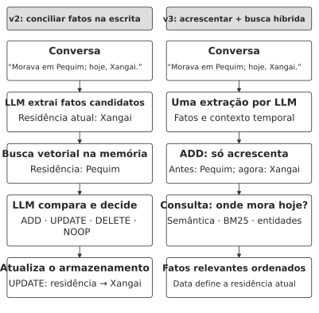

No fluxo inicial, o LLM extrai fatos candidatos da conversa, busca memórias existentes semelhantes e decide entre **ADD**, **UPDATE**, **DELETE** ou **NOOP**. Se o usuário diz primeiro “moro em Pequim” e depois “me mudei para Xangai”, o sistema pode atualizar a residência atual para Xangai. Assim, a consulta encontra facilmente fatos já organizados; a manutenção, porém, precisa distinguir corretamente correções, mudanças ao longo do tempo e pessoas diferentes, e guardar a justificativa de cada atualização para permitir a revisão quando se descobre um erro. O artigo propõe ainda uma variante de memória em grafo, o **Mem0-g**, que expressa conhecimento associado por meio de entidades e relações[^ch3-mem0-paper].

A v3 reduziu a extração automática a uma única chamada ao LLM, que só acrescenta registros **ADD**. As informações sobre Pequim e Xangai podem ser mantidas junto com o contexto temporal, e a residência atual é deduzida na consulta, à luz do contexto. A recuperação combina similaridade semântica, palavras-chave via BM25 e correspondência de entidades; ações já confirmadas como concluídas também podem ser extraídas como fatos. O guia de migração relata que a pontuação no LoCoMo subiu de 71,4 para 91,6 e no LongMemEval de 67,8 para 93,4. Essa versão de código aberto usa as associações entre entidades na recuperação interna e removeu a interface de armazenamento externo em grafo e o valor de retorno `relations`; a memória em grafo passou a ser oferecida pela plataforma gerenciada[^ch3-mem0-migration].

Essa evolução mostra que um sistema de memória pode deslocar a decisão sobre conflitos da gravação para a leitura. Se, na gravação, as experiências de duas pessoas forem fundidas por engano, ou um complemento for tomado como correção, as respostas seguintes podem continuar a usar um estado atual errado. Acrescentar em vez de sobrescrever permite que as evidências novas e antigas participem da decisão e também reduz as chamadas ao modelo para decidir item a item na gravação. Para memórias de usuário que mudam com frequência e cujos conflitos são difíceis de julgar no momento, prefiro guardar primeiro os fatos com data e origem e só derivar o estado vigente ao responder a uma pergunta concreta.

[^ch3-mem0-paper]: Chhikara et al., Mem0: Building Production-Ready AI Agents with Scalable Long-Term Memory, 2025.

[^ch3-mem0-migration]: Mem0, Open Source: Migrating to the New Memory Algorithm.

**Memobase: perfil do usuário e memória de eventos.** O Memobase organiza as informações de longo prazo em duas partes. O **perfil do usuário** (profile) guarda atributos relativamente estáveis por tema e subtema, como o nome em `basic_info`, os interesses em `interest` e o cargo em `work`. O desenvolvedor pode configurar os campos a extrair, controlando o escopo e a granularidade do perfil. A **memória de eventos** (event memory) registra as experiências do usuário com suas datas, para responder a perguntas como “quando falamos de orçamento pela última vez”.

O Memobase coloca as novas conversas em um buffer e as processa em lote quando o buffer atinge um tamanho definido ou quando a sessão fica ociosa por um tempo configurado; o processamento também pode ser disparado explicitamente ao fim da sessão. Assim, várias mensagens compartilham uma única rodada de organização, e as consultas leem o perfil e os eventos já gerados. A atualização assíncrona reduz o tempo que a interação atual passa esperando a extração da memória; quando é preciso usar imediatamente os fatos mais recentes, pode-se aguardar a conclusão do processamento[^ch3-memobase].

[^ch3-memobase]: Memobase, descrição oficial do projeto, incluindo campos de perfil, memória de eventos, buffer e interface de atualização síncrona.

Se o assistente precisa lembrar como foi a última reserva e também conhecer a preferência de assento do usuário e o procedimento de reembolso de passagens, pode guardar separadamente eventos, fatos e procedimentos, como na Figura 3-4. A cada tarefa, coloca na memória de trabalho apenas as partes úteis.

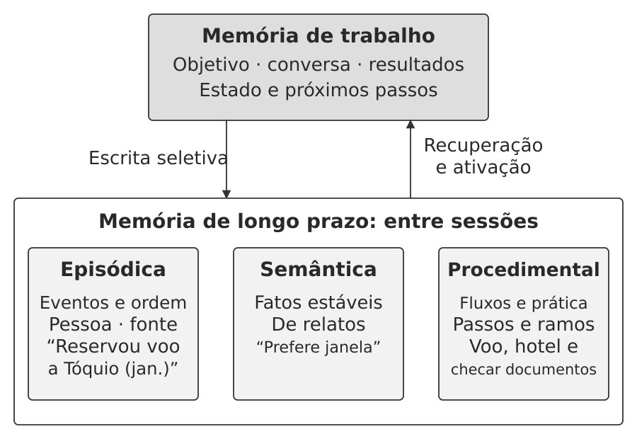

A memória episódica preserva sequências de eventos com metadados como carimbo de data e hora, marcação emocional e identificador da tarefa, o que permite combinar recuperação por data e por tema. Por exemplo, “a última vez que falamos de orçamento” exige ao mesmo tempo correspondência temática e ordenação temporal. A memória semântica guarda fatos e preferências extraídos dos eventos; a memória procedimental guarda procedimentos usados repetidamente.

A **memória de trabalho** (working memory) organiza o objetivo atual, o estado da tarefa e as informações relevantes já recuperadas. O Harness seleciona conteúdo da trajetória e do armazenamento de longo prazo e o carrega no contexto atual; os fatos novos gerados pela tarefa são organizados e depois gravados na memória de longo prazo. A trajetória registra como as coisas aconteceram; a memória de trabalho concentra o que é necessário para a próxima decisão. As duas se ligam por identificadores de eventos e pela origem.

Ao ler a memória do usuário com RAG, primeiro se encontram, a partir do pedido atual, as memórias possivelmente relevantes e depois se decide quais entram na memória de trabalho. Suponha que hoje o assistente vá ajudar o usuário a escolher o assento e a recuperação encontre duas frases: “em viagens de trabalho prefiro a janela” e “da última vez machuquei o joelho; na volta, escolha corredor para mim”. As duas são muito relevantes para a escolha do assento, mas a segunda só fazia um pedido para aquele voo de volta. Uma reordenação por relevância, ainda que a coloque em primeiro lugar, não diz se ela se aplica hoje.

Nesse caso, considero mais promissor filtrar as memórias candidatas com um modelo de julgamento como o Jev. Entregam-se a ele a viagem atual, o que o usuário pede agora e, para cada memória, a frase original, a data e as condições de aplicação, e ele classifica cada uma como “aplicável desta vez”, “apenas para referência” ou “base insuficiente”. Se hoje também for viagem de trabalho, a primeira pode fundamentar a escolha do assento; se o usuário acabou de dizer que o joelho ainda não sarou, vale retomar a segunda e perguntar.

### Mecanismos de compressão e organização da memória

Um usuário que reserva passagens com frequência pode mencionar “janela” dez vezes. Talvez nove dessas menções repitam o mesmo pedido; tomar o número de menções como intensidade da preferência inflaria o peso de um único episódio. Na organização, identificam-se primeiro a origem e o evento, depois se mesclam os registros repetidos, verifica-se se há correções posteriores e só então se decide que padrões convém usar em tarefas futuras. Diante de “aquele assento na janela da outra vez foi ótimo”, pode-se pedir a um modelo de julgamento como o Jev que leia a frase e os pedidos relacionados e decida apenas se ela é “lembrança do último voo”, “pedido para esta viagem” ou “expressão de preferência duradoura”. Se o pedido não corresponder ou se várias interpretações forem plausíveis, guarda-se a frase original e confirma-se na hora da reserva. Um julgamento local como esse evita contar a mesma experiência várias vezes como evidência nova.

1. **Selecionar o que organizar.** Frequência de acesso, data do registro, marcação emocional e singularidade da informação servem como sinais de ordenação. Por exemplo, um registro criado há três dias, acessado cinco vezes, com marcação emocional forte e sem duplicatas merece ficar separado; um registro criado há noventa dias, acessado uma única vez e muito parecido com outros três pode ser mesclado primeiro com os registros relacionados. O sistema pode filtrar pela pontuação os registros a organizar e então decidir, segundo as regras de negócio, se os comprime, mescla ou exclui. Restrições duradouras e contratos em vigor devem ser mantidos até o fim de sua validade, mesmo que raramente acessados.
2. **Agrupar e resumir.** Registros semelhantes são agrupados, e um resumo preserva o conteúdo comum. Por exemplo, várias conversas sobre o tempo podem virar “o usuário pergunta com frequência sobre o tempo, sobretudo sobre chuva”. As datas e as perguntas originais são arquivadas, e o resumo aponta para os registros originais, para que se possa consultá-los depois.
3. **Extrair padrões e procedimentos.** De vários registros de compras, induzir “prefere produtos com boa relação custo-benefício e dá peso às avaliações de outros usuários”, ou destilar as etapas de escolha de produtos.

### Proteção da privacidade: anonimização de logs

A memória do usuário costuma conter identidade, contatos e dados de contas. O sistema precisa decidir, conforme a tarefa, que campos entram na entrada do modelo e, conforme as necessidades de operação, o que entra nos logs. A anonimização pode ocorrer antes da gravação do log, substituindo trechos sensíveis por rótulos de tipo ou marcadores estáveis e preservando a estrutura necessária para investigar problemas.

> **Experimento 3-3 ★★: anonimização de logs com um modelo local**
>
> Este experimento chama o Qwen3-0.6B local via Ollama para identificar, na própria máquina, trechos sensíveis em logs. Modelos pequenos podem ser implantados em dispositivos de consumo; também é possível trocar para tamanhos como 1.7B ou 4B e comparar qualidade de identificação e tempo de processamento. Quando os logs originais precisam permanecer locais, a identificação e a substituição também devem ser feitas na máquina, e só o resultado anonimizado segue para os serviços posteriores.
>
> O material de teste inclui números estruturados, como número de documento de identidade e de cartão bancário, conteúdo semiestruturado, como endereços, e informações sensíveis reveladas em linguagem natural, como senhas. O modelo retorna, segundo um JSON Schema, o tipo da informação, a posição no texto e a confiança, e o programa substitui o texto original com base nisso. O grupo de controle usa expressões regulares; o grupo híbrido aplica primeiro as expressões regulares e depois deixa o modelo tratar o texto restante.
>
> Vejamos duas linhas de log. A primeira tem um número de identidade e um telefone; a expressão regular mascarou apenas o telefone, e a revocação é $1/2$. Na segunda, a expressão regular encontrou o número de seguro social americano e o do cartão bancário, mas também mascarou o número do ticket, de formato parecido. Dos três trechos marcados, só dois precisavam ser anonimizados, e a precisão é $2/3$. Se a verificação se limitar a saber se ainda restam valores sensíveis no log, a segunda linha passa; só quando o atendimento for usar esse log para localizar o ticket descobrirá que a pista se perdeu.
>
> Calculando a revocação linha a linha nos 12 exemplos e tirando a média, expressões regulares, modelo e solução híbrida ficam em cerca de 50%, 69% e 78%. Contando linha a linha depois da substituição, as três soluções deixaram 9, 3 e 2 valores sensíveis, respectivamente. A escolha depende também do tempo de processamento: nesta máquina, a expressão regular gasta em média cerca de 0,1 milissegundo por linha, enquanto o modelo e a solução híbrida chegam perto de 3 segundos. Com grande volume de logs, pode-se tratar primeiro com expressões regulares os campos de formato estável e deixar o modelo revisar apenas os trechos que exigem julgamento pelo contexto.

À medida que os registros crescem, o passo seguinte é encontrar, entre milhares de informações, o que a tarefa atual precisa. A técnica de RAG apresentada a seguir serve tanto a bases de conhecimento compartilhadas quanto à recuperação da memória do usuário.

## Fundamentos de RAG: o pipeline de aquisição de conhecimento do agente

Uma loja mudou sua política de reembolso, e um usuário pergunta: “Comprei um produto no mês passado; como peço o reembolso agora?” Para acertar, é preciso primeiro encontrar as regras aplicáveis a esse pedido e depois explicar com clareza as condições e as etapas. A **geração aumentada por recuperação** (Retrieval-Augmented Generation, RAG) une esses dois passos, permitindo que o modelo use os documentos internos da loja e também políticas publicadas depois do fim do seu treinamento.

Comecemos pelo caso em que há uma única versão da política. A seguir, uma interface simplificada consulta o procedimento de reembolso da mesma loja; observe como os resultados da recuperação entram na resposta do modelo:

```python
query = "procedimento de reembolso"
results = retriever.search(query, top_k=2)
# results = [
#   "Política de reembolso: reembolso integral em até 7 dias após o recebimento do pedido, mediante o número do pedido. O valor é creditado em 3–5 dias úteis.",
#   "Como pedir reembolso: acesse ‘Meus pedidos’, selecione o pedido e clique em ‘Solicitar reembolso’."
# ]
answer = llm.generate(system="Você é um assistente de atendimento ao cliente.", context=results, question=query)
# A resposta inclui o prazo para solicitar, as informações necessárias, as etapas e o prazo de crédito.
```

Compare a Figura 3-5 com os dois resultados de recuperação no código: as etapas para solicitar o reembolso vêm de “Como pedir reembolso”, e o prazo de 3–5 dias úteis para o crédito vem de “Política de reembolso”. Se a recuperação trouxesse apenas as etapas, o modelo ainda teria base para dizer ao usuário quando o dinheiro vai cair? A questão tem a ver com a forma de dividir o manual em blocos.

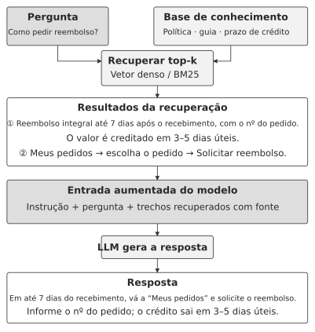

### Divisão de documentos em blocos (Chunking)

Suponha que um manual de pós-venda diga primeiro “pode ser devolvido em até sete dias” e, no parágrafo seguinte, liste os produtos que são exceção. Recuperar só a primeira frase pode levar a prometer reembolso também para os produtos excluídos; tomar o manual inteiro como unidade de recuperação traz junto instalação, configuração e solução de problemas, e o vetor dificilmente destacará o tema do reembolso. A **divisão em blocos** (chunking) precisa escolher um tamanho entre esses dois extremos, de modo que cada bloco explique suas próprias condições e seja fácil de encontrar por perguntas concretas. O tamanho do bloco também precisa caber no limite de entrada do modelo de embedding e deixar espaço de contexto para a geração.

Há três métodos comuns.

A **divisão de tamanho fixo** corta pelo número de tokens, por exemplo 512 tokens por bloco, com sobreposição de 50 a 100 tokens entre blocos vizinhos. A sobreposição dá ao conteúdo perto das fronteiras a chance de aparecer inteiro em outro bloco. O método facilita controlar o tamanho dos blocos, mas o corte pode cair no meio de um parágrafo, de um código ou de uma tabela.

A **divisão recursiva ou sensível à estrutura** corta preferencialmente nas fronteiras naturais, como seções e parágrafos, e só divide em unidades menores, como frases, as partes longas demais. Títulos Markdown e elementos HTML fornecem pistas de estrutura. Blocos de código, tabelas e o texto ligado a um título também podem receber regras próprias. Para documentação técnica bem estruturada, recomendo começar por este método: aproveitar primeiro as seções e os parágrafos existentes e só então subdividir as partes longas costuma preservar o sentido completo melhor do que um corte direto.

A **divisão semântica** calcula a similaridade de embedding entre frases ou grupos de frases vizinhos e corta onde o tema muda claramente. Ela acrescenta cálculos de embedding, mas aumenta a chance de manter um mesmo tema em um só bloco.

Suponha que o recuperador devolva apenas uma frase: “A receita da empresa cresceu 3%.” Que empresa? Que trimestre? O número está certo, mas a base para responder ficou no parágrafo anterior. Se o relatório financeiro inteiro couber em um só bloco, trimestre e nome da empresa ficam preservados, mas uma consulta sobre receita trará também os trechos sobre contratações e compra de equipamentos. Todo esse conteúdo ainda divide um único vetor, e o tema da receita pode perder destaque nele. Na prática, pode-se começar testando blocos de 256 a 1024 tokens, com sobreposição de 10% a 20% entre vizinhos.

Metadados como título, fonte e data podem ser guardados junto com cada trecho. Mais adiante, a recuperação contextual acrescenta a cada trecho o contexto que ele tinha no texto original, ajudando a resolver referências e escopo quando ele é recuperado isoladamente.

### Embeddings densos: representando texto com vetores

Um **embedding** mapeia palavras, frases ou blocos de texto para vetores numéricos, por exemplo `[0.2, -0.5, 0.8, ...]`. Por meio de treinamento, o modelo de recuperação faz com que consultas e documentos relacionados tenham similaridade alta no espaço vetorial. “Denso” significa que a maioria das dimensões do vetor tem valores não nulos, que juntos representam a informação do texto; já a representação esparsa, vista adiante, tem apenas poucas dimensões não nulas.

Pode-se imaginar o espaço vetorial como um mapa de alta dimensão: cada trecho de texto ocupa uma posição, e recuperar é procurar o conteúdo próximo da consulta. Uma das medidas mais usadas é a **similaridade de cosseno**:

$$
\operatorname{cos}(A,B)=\frac{A\cdot B}{\|A\|\,\|B\|}
$$

O produto escalar $A\cdot B$ multiplica as dimensões correspondentes e soma os resultados; a norma $\|A\|$ é a raiz quadrada da soma dos quadrados das dimensões. Dividindo pelas duas normas, o resultado reflete apenas a relação de direção. Para vetores não nulos, o cosseno fica em $[-1,1]$; quanto mais perto de 1, mais alinhadas as direções. Alguns modelos de recuperação usam o produto escalar ou a distância euclidiana. Quando os dois vetores estão normalizados para comprimento unitário, o produto escalar é igual à similaridade de cosseno.

> **Cálculo à mão: similaridade de cosseno entre três frases**
>
> Usemos três vetores ilustrativos: “como criar um gato” $A=(0.9,0.5,0.1)$, “guia de cuidados com gatos” $B=(0.8,0.6,0.1)$ e “estratégias de investimento em ações” $C=(0.1,0.1,0.9)$.
>
> $A\cdot B=0.9\times0.8+0.5\times0.6+0.1\times0.1=1.03$. As normas são $\sqrt{1.07}$ e $\sqrt{1.01}$, e a similaridade é de cerca de **0,991**.
>
> $A\cdot C=0.9\times0.1+0.5\times0.1+0.1\times0.9=0.23$; a norma de $C$ é $\sqrt{0.83}$, e a similaridade é de cerca de **0,244**. Nesse conjunto de vetores, a consulta sobre criar gatos fica mais próxima do guia de cuidados.

Modelos reais costumam usar de centenas a milhares de dimensões.

#### Do Word2Vec às representações sensíveis ao contexto

A Figura 3-6 começa pelos vetores de palavras fixos. O **Word2Vec** aprende um vetor fixo para cada palavra a partir da coocorrência de palavras. Algumas relações aparecem em operações vetoriais, como o clássico “rei − homem + mulher ≈ rainha”. A limitação de uma representação fixa também é evidente: `bank` usa o mesmo vetor em `river bank` (margem de rio) e em `investment bank` (banco de investimento).

O **GloVe** conta as coocorrências entre palavras no corpus inteiro e aprende os vetores por meio de um objetivo de mínimos quadrados ponderados. O Word2Vec se concentra em uma tarefa de predição em janelas locais; o GloVe incorpora diretamente ao treinamento as estatísticas globais de coocorrência. Ambos aprendem representações fixas para o vocabulário[^ch3-glove].

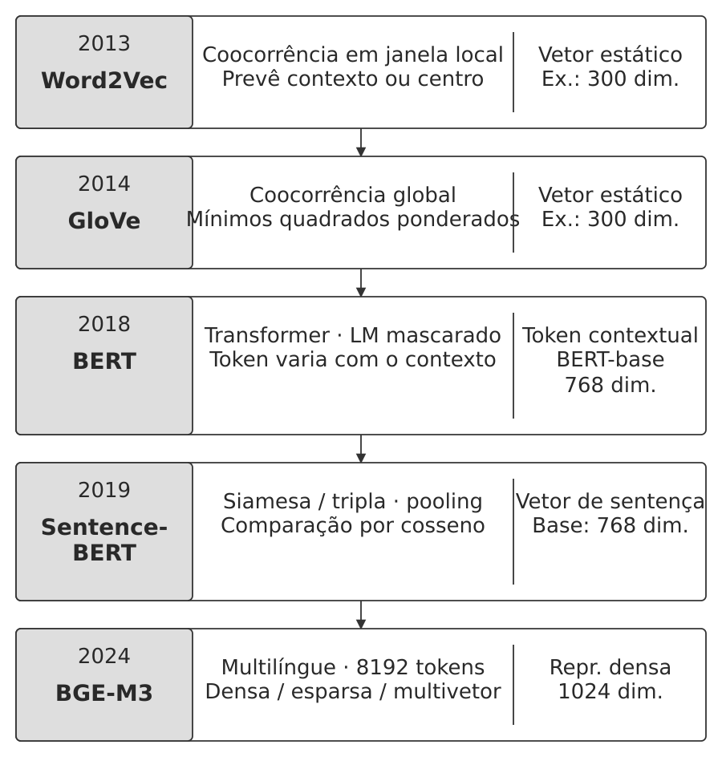

Com modelos contextuais como o **BERT**, a representação de um mesmo token muda conforme a frase. Graças à autoatenção, o modelo pode usar pistas como “rasguei a manga da camisa” e “comprei um quilo de manga” para calcular representações diferentes para “manga” nas duas frases. Modelos de embedding para recuperação ainda precisam agregar as representações dos tokens em um vetor de consulta ou de documento e ser treinados de modo que os dois sejam comparáveis.

O **Sentence-BERT** combina o BERT com pooling e arquiteturas siamesas ou de tripletos para treinar vetores de frase diretamente comparáveis. Os documentos podem ser codificados antecipadamente e guardados no índice; quando chega uma consulta, basta codificá-la e calcular a similaridade vetorial. A codificação antecipada elimina o custo de recalcular as representações de todos os documentos a cada consulta[^ch3-sbert].

O **BGE-M3** oferece ao mesmo tempo representações densas, esparsas e multivetoriais para recuperação, com suporte a vários idiomas e a entradas mais longas; esta seção usa sua representação densa para ilustrar a recuperação com um único vetor[^ch3-bge-m3]. O comprimento aceito pelo modelo influencia a estratégia de divisão em blocos: o limite típico do BERT original é de 512 tokens, e o BGE-M3 aceita até 8192 tokens.

[^ch3-bge-m3]: O artigo do M3-Embedding, de Chen et al. (arXiv:2402.03216), explica como as três representações de recuperação são treinadas em conjunto. Veja também a descrição do modelo BGE-M3 da BAAI, que inclui forma de representação, dimensão, comprimento de entrada e modo de uso.

> **Experimento 3-4 ★★: comparação de dois índices de vizinhos mais próximos aproximados**
>
> Construídos os vetores dos documentos, é preciso encontrar rapidamente os vetores próximos da consulta. Calcular um a um dá os vizinhos exatos; com o aumento do volume de dados, os índices de **vizinhos mais próximos aproximados** (Approximate Nearest Neighbor, ANN) trocam uma perda controlada de revocação por velocidade de consulta. Este experimento compara ANNOY e HNSW sobre os mesmos embeddings reais e as mesmas consultas, tomando os resultados da busca exata como referência. Por exemplo, se a busca exata de uma consulta lista dez vizinhos mais próximos e os dez resultados do índice aproximado incluem oito deles, o Recall@10 dessa consulta é 0,8. Esse número mede quantos dos vizinhos exatos o índice preservou.
>
> O ANNOY usa várias árvores de projeção aleatória para reduzir os candidatos; o HNSW usa um grafo de vizinhança hierárquico, que primeiro se aproxima rapidamente da região-alvo nas camadas superiores, esparsas, e depois busca nas camadas inferiores, mais densas. A Figura 3-7 mostra a estrutura hierárquica do HNSW.
>
> 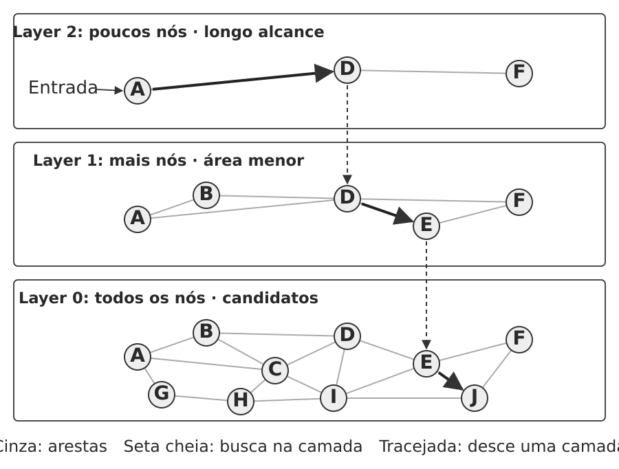
>
> Tabela 3-2: escolhas de implementação do ANNOY e do HNSW
>
> | Aspecto | ANNOY | HNSW (exemplo: hnswlib) |
> | --- | --- | --- |
> | Estrutura do índice | Várias árvores de projeção aleatória | Grafo de vizinhança hierárquico |
> | Custo de construção | Varia com o número de árvores, de vetores e a dimensão | Varia com o grau de vizinhança, o alcance da busca na construção e o volume de dados |
> | Memória e arquivos | Índice estático com mapeamento em memória e compartilhamento entre processos | Guarda os vetores e as adjacências do grafo; o grau de vizinhança afeta o custo |
> | Atualização incremental | Novos itens exigem reconstruir o índice depois de pronto | Aceita inserção, atualização e marcação de exclusão; exige gerenciar a capacidade |
> | Revocação e velocidade | Ajustadas pelo número de árvores e pelo orçamento de busca na consulta | Ajustadas pelos parâmetros de construção e pelo alcance da busca na consulta |
> | Cenário de uso | Índices estáticos, fáceis de distribuir e compartilhar | Índices dinâmicos, com gravação e consulta contínuas |
>
> Nesta execução, a base foi construída primeiro com 240 trechos de texto. Para as mesmas 20 consultas, os dois índices encontraram todos os 10 vizinhos mais próximos da busca exata. Na construção inicial, o ANNOY levou cerca de 13 milissegundos em um contêiner Linux, e o HNSW cerca de 78 milissegundos no ambiente local; os índices salvos ocupavam cerca de 1,40 MB e 1,02 MB. Em seguida, foram acrescentados os 60 trechos restantes: o ANNOY reconstruiu o índice, e o HNSW inseriu diretamente os novos vetores. A base passou a ter 300 trechos, e os vizinhos anteriores podiam ter mudado. Refeita a busca exata na nova base, a revocação média dos dois índices continuou em 100%.

[^ch3-ann]: A descrição do projeto Annoy, do Spotify, explica como construir índices somente leitura, carregá-los por mapeamento em memória e usar `search_k` para ajustar o número de nós examinados na consulta. A parte sobre a interface Python na descrição do projeto hnswlib apresenta o método `add_items`, para acrescentar vetores, e o método `set_ef`, para ajustar o alcance da consulta.

**O índice deve ser escolhido conforme a forma de atualização do conhecimento.** Quando o corpus é publicado em lotes periódicos e vários processos compartilham o mesmo índice somente leitura, eu consideraria primeiro o ANNOY; quando novos documentos chegam continuamente e é preciso inserir online, prefiro o HNSW. O modelo de embedding determina a representação semântica; o índice determina se essas representações podem ser usadas com latência e custo de atualização adequados. Juntos, determinam a eficácia do serviço de recuperação.

Ajustando o número de árvores e o orçamento de busca do ANNOY, ou o grau de vizinhança e o alcance da busca do HNSW, pode-se observar como variam a revocação e a latência[^ch3-ann]. A revocação do índice mede se os vizinhos-alvo foram encontrados; se esses vizinhos respondem à pergunta do usuário depende da representação de embedding e do conteúdo do material.

### Representações esparsas: das palavras-chave às pontuações de relevância

Uma **representação esparsa** usa vetores de alta dimensão em que apenas poucas dimensões são não nulas. A busca tradicional por palavras-chave toma os termos como dimensões e atribui pesos de acordo com as palavras presentes no documento. Sua base é o **modelo de saco de palavras** (Bag of Words, BoW): guarda as palavras e o número de ocorrências e ignora a ordem. Por isso, “gato persegue cachorro” e “cachorro persegue gato” têm a mesma representação.

Essa representação é adequada para casar nomes, códigos e termos técnicos. A seguir, partindo do TF-IDF, veremos como a frequência dos termos e a frequência nos documentos se convertem em pontuação de ordenação.

#### Do TF-IDF ao BM25

O **TF-IDF** (Term Frequency–Inverse Document Frequency, frequência do termo–inverso da frequência nos documentos) combina dois sinais: quantas vezes a palavra aparece no documento atual e quão comum ela é no corpus inteiro. Suponha que, de 100 artigos, 60 contenham “modelo” e apenas 3 contenham “destilação”; na consulta “destilação de modelo”, “destilação” distingue mais.

Uma forma básica é:

$$\operatorname{TF\!\text{-}\!IDF}(t,d)=\operatorname{TF}(t,d)\times\operatorname{IDF}(t),\qquad \operatorname{IDF}(t)=\ln\frac{N}{\operatorname{DF}(t)}$$

$\operatorname{TF}(t,d)$ é o número de ocorrências da palavra $t$ no documento $d$, $\operatorname{DF}(t)$ é o número de documentos que contêm a palavra e $N$ é o total de documentos. Por essa fórmula, a contribuição de uma palavra que aparece dez vezes é o dobro da de uma que aparece cinco; documentos longos também podem pontuar alto só por terem mais palavras. O TF-IDF tem várias variantes de normalização; o BM25, a seguir, trata esses dois efeitos com saturação da frequência e normalização pelo comprimento.

O **BM25** soma as contribuições de cada termo da consulta:

$$\operatorname{Score}(Q,D)=\sum_i\operatorname{IDF}_{\mathrm{BM25}}(q_i)\cdot\frac{\operatorname{TF}(q_i,D)(k_1+1)}{\operatorname{TF}(q_i,D)+k_1\left(1-b+b\frac{|D|}{\operatorname{avgdl}}\right)}$$

Aqui, $q_i$ é um termo da consulta, $|D|$ é o comprimento do documento e $\operatorname{avgdl}$ é o comprimento médio dos documentos. $k_1$ controla o grau de saturação da frequência; $b$ controla a intensidade da normalização pelo comprimento, e com $b=0$ essa correção fica desligada. A Figura 3-8 calcula esses termos separadamente. Primeiro, com o comprimento do documento fixo, o termo da consulta passa de uma para três ocorrências, para ver quanto cada ocorrência a mais acrescenta; depois, com a frequência fixa, apenas o comprimento do documento é dobrado. A última linha compara quão comuns são duas palavras na coleção de documentos.

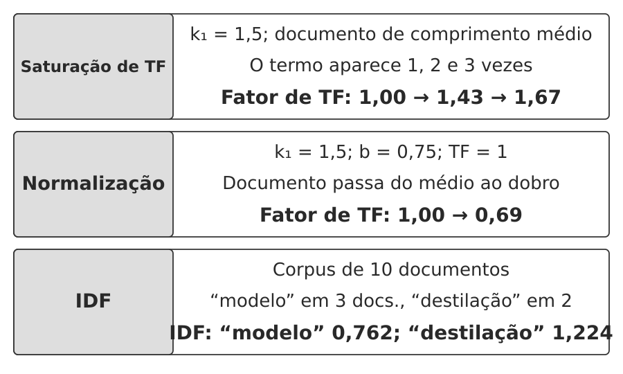

Na primeira linha da figura, a segunda ocorrência aumenta o fator de frequência em cerca de 0,43, e a terceira só em cerca de 0,24: é a saturação da frequência. Na segunda linha, a mesma palavra aparece uma única vez, mas se destaca menos no documento mais longo, e a correção de comprimento reduz seu fator de frequência. Só multiplicando pelo IDF se obtém a contribuição dessa palavra para a pontuação total.

Falta definir um termo da fórmula: com o mesmo número de ocorrências, por que uma palavra rara costuma ser mais útil do que uma comum? Esta seção pondera as palavras com o seguinte inverso da frequência nos documentos:

$$\operatorname{IDF}_{\mathrm{BM25}}(t)=\ln\frac{N-\operatorname{DF}(t)+0.5}{\operatorname{DF}(t)+0.5}$$

O numerador é o número de documentos que não contêm a palavra, e o denominador, o número dos que a contêm; ambos recebem 0,5 de suavização, para que a fórmula continue calculável quando a frequência nos documentos é 0 ou $N$. Palavras raras recebem peso maior; quando mais da metade dos documentos contém a palavra, a fórmula dá um número negativo. A implementação de apoio fixa em $10^{-6}$ o limite inferior do peso efetivo de pontuação e guarda o valor original para inspeção.

> **Experimento 3-5 ★★: implementação de um mecanismo de busca BM25 do zero**
>
> Este experimento implementa, em sequência, tokenização, tratamento de stopwords, índice invertido e pontuação. O tratamento de stopwords filtra palavras muito frequentes, como “的” e “了” em chinês. O **índice invertido** registra em que documentos cada palavra aparece e com que frequência; é como o índice remissivo no fim de um livro: buscando “TCP”, encontram-se as páginas 45, 112 e 203 e então se lê o conteúdo nessas posições.
>
> Calculemos à mão a consulta “destilação de modelo”. Suponha um corpus de 10 documentos com comprimento médio de 250 palavras, $k_1=1.5$ e $b=0.75$. “Modelo” aparece em 3 documentos, com IDF de cerca de 0,762; “destilação” aparece em 2, com IDF de cerca de 1,224. A tabela abaixo lista, por palavra, os documentos atingidos, a frequência e o comprimento do documento. Substituindo esses valores na fórmula, obtém-se a contribuição de cada palavra para a pontuação de cada documento.
>
> | Termo da consulta | Documento | Frequência TF | Comprimento do documento | Contribuição BM25 |
> | --- | --- | ---: | ---: | ---: |
> | modelo | doc_1 | 5 | 200 | 1,52 |
> | modelo | doc_3 | 2 | 500 | 0,82 |
> | modelo | doc_7 | 8 | 150 | 1,68 |
> | destilação | doc_1 | 3 | 200 | 2,15 |
> | destilação | doc_5 | 1 | 250 | 1,22 |
>
> Somando as contribuições das duas palavras em doc_1, obtém-se cerca de 3,67, e a ordenação é **doc_1 (3,67) > doc_7 (1,68) > doc_5 (1,22) > doc_3 (0,82)**. Em doc_1, “destilação” tem frequência menor que “modelo”, mas é mais rara, e por isso contribui mais; casar as duas palavras ao mesmo tempo eleva ainda mais o total.
>
> Agora, busque `cat` no corpus em inglês do experimento de apoio. Os dois textos curtos marcados como relevantes usam `kitten` e `feline`, mas `cat` não consta do índice invertido, e a lista de candidatos fica vazia. Por mais que se aumentem os pesos de frequência vistos acima, não há nenhum documento a pontuar. Buscando com as palavras desses dois textos, cada um deles entra na lista de candidatos.

### Recuperação híbrida: combinar os dois resultados e reordenar

Para certas perguntas, é difícil listar de antemão todos os sinônimos. Uma questão do Experimento 3-6 pergunta como liberar automaticamente o espaço de heap que não está em uso, mas o texto-alvo diz que “o gerenciamento automático de memória poupa o desenvolvedor de liberar objetos manualmente”. A consulta e o texto, em inglês, não têm nenhum termo em comum; a busca por palavras-chave não recuperou nada, e a busca vetorial colocou o alvo em primeiro lugar. Com a consulta pelo modelo XR-7003, a busca por palavras-chave encontrou o modelo exato, e a busca vetorial listou também alguns modelos parecidos.

A **recuperação híbrida** busca trechos relevantes separadamente por palavras-chave e por vetores e então decide quais merecem ir para o modelo. Quando a base de conhecimento contém tanto identificadores exatos quanto descrições em linguagem natural, recomendo partir dela. Acompanhe o XR-7003 na Figura 3-9: as duas buscas o colocam em primeiro lugar, e na fusão ele recebe duas contribuições de posição. A reordenação troca o segundo colocado, e o primeiro modelo que o usuário vê continua correto.

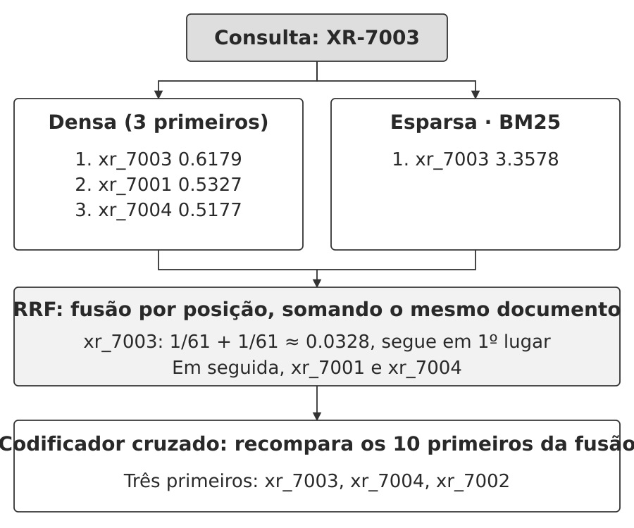

A primeira etapa é a **recuperação paralela**: a consulta é enviada aos mecanismos denso e esparso, e cada um traz um lote de documentos possivelmente relevantes. As duas buscas podem usar o mesmo texto original ou pré-processá-lo conforme exige cada modelo.

A segunda etapa é a **fusão dos resultados**: um mesmo documento presente nos dois resultados é unificado, e a ordenação é refeita. A similaridade de cosseno e o BM25 têm escalas numéricas diferentes; somá-los diretamente tende a deixar o resultado dominado pela busca de valores maiores. Uma saída é calibrar ou normalizar as pontuações e então combiná-las com pesos; outra é a **fusão por posição recíproca** (Reciprocal Rank Fusion, RRF), calculada pelas posições em cada busca:

$$\operatorname{RRF}(d)=\sum_{j:\,d\in R_j}\frac{1}{k+\operatorname{rank}_j(d)}$$

$R_j$ é o resultado da busca $j$, com posições contadas a partir de 1; se o documento não aparece em uma busca, a contribuição dela é zero. A constante de suavização $k$ costuma valer 60; quanto maior, menor a diferença de pontuação entre as primeiras posições. O RRF facilita combinar formas diferentes de pontuação, mas só preserva as posições; as diferenças de intensidade nas pontuações originais precisam ser aproveitadas por outros métodos.

Vejamos um exemplo com duas buscas. O usuário pergunta “em quanto tempo o reembolso cai na conta”. O documento A fica em primeiro na busca por palavras-chave e não aparece nas primeiras posições da busca vetorial; o documento B fica em segundo nas duas. Com $k=60$, A obtém $1/61$, cerca de 0,0164; B obtém $1/62+1/62$, cerca de 0,0323. Após a fusão, B fica à frente de A. Esse resultado só mostra que os dois caminhos de recuperação encontraram B. Para saber se B responde de fato ao prazo do crédito, é preciso ver se ele trata de “como pedir reembolso” ou de “quando o reembolso cai na conta”.

Na terceira etapa, pode-se acrescentar a **reordenação neural**. O sistema toma os documentos mais bem colocados após a fusão, por exemplo os 50 primeiros, e um modelo de reordenação atribui a cada um uma nota de relevância em relação à consulta. A reordenação pode mudar a ordem desses 50. Se o documento realmente útil nem foi selecionado, é preciso voltar e melhorar a recuperação.

O modelo mais usado aqui é o **codificador cruzado** (cross-encoder): consulta e documento candidato entram juntos, as duas partes interagem dentro do modelo e sai uma pontuação de relevância. Já o **bicodificador** (bi-encoder) da etapa de recuperação codifica consulta e documento separadamente; os vetores dos documentos podem ser calculados com antecedência, e na consulta só se faz a busca vetorial. O primeiro serve para ordenar com precisão poucos documentos; o segundo, para a triagem inicial em grandes volumes. A analogia é com a seleção de currículos e a entrevista: primeiro se reduz o grupo com base em atributos já conhecidos, depois se compara em profundidade à luz de requisitos específicos. O BGE Reranker v2 M3 é um dos modelos que podem ser usados nesta etapa[^ch3-reranker].

[^ch3-reranker]: BAAI, descrição do modelo BGE Reranker v2 M3, que apresenta a entrada consulta–documento e a pontuação de relevância.

Quando o material relevante já está no conjunto de candidatos, mas aparece com frequência atrás de material irrelevante, avalio primeiro a reordenação com codificador cruzado. Como lê pergunta e documento em conjunto, ele compara diretamente se as condições, os qualificadores e os detalhes do documento atendem ao que a pergunta pede. A Tabela 3-3 lista três métricas comuns.

Tabela 3-3: três métricas de qualidade da recuperação

| Métrica | Cálculo e significado |
| --- | --- |
| recall@k (revocação) | Número de documentos relevantes entre os k primeiros resultados dividido pelo total de documentos relevantes da consulta; mede quanto do conteúdo relevante foi recuperado. Em um conjunto de teste, costuma-se tirar a média entre as consultas |
| MRR (posição recíproca média) | Para cada consulta, toma-se o inverso da posição do primeiro documento relevante e tira-se a média; primeira posição vale 1, décima vale 0,1, não encontrado vale 0 |
| nDCG@k (ganho cumulativo descontado normalizado) | Atribui pontos aos resultados conforme o grau de relevância, desconta as posições mais baixas e divide pela pontuação da ordenação ideal; mede a qualidade geral da ordenação dos k primeiros resultados |

Também se pode registrar a **taxa de acerto**: em quantas consultas pelo menos um documento relevante aparece entre os k primeiros resultados? Por exemplo, uma pergunta precisa de três documentos, e os vinte primeiros resultados trazem apenas dois. Essa consulta conta como acerto e por isso não entra entre as falhas de “nenhum acerto”, mas seu recall@20 é de apenas $2/3$: falta encontrar $1/3$ do material. Se cada pergunta tiver um único documento-alvo, a pergunta que o recupera vale 1 e a que o perde vale 0. Tirando a média sobre os mesmos resultados de recuperação, a taxa de acerto é igual à revocação média.

> **Experimento 3-6 ★★: comparação entre recuperação esparsa, densa, fusão e reordenação**
>
> Este experimento compara cinco configurações nas mesmas 12 consultas anotadas: recuperação esparsa, recuperação densa, fusão RRF, fusão ponderada e reordenação após a fusão. As consultas cobrem similaridade semântica, nomes exatos, vários idiomas e código técnico; duas delas perguntam, uma em inglês e outra em chinês, como as plantas transformam luz solar em alimento. O modelo denso é o Qwen3-Embedding-0.6B, e a reordenação usa um codificador cruzado MS MARCO MiniLM; cada busca traz no máximo 10 documentos, e o reordenador processa no máximo os 10 primeiros do RRF. Revocação e nDCG consideram apenas os 3 primeiros da ordenação final; o MRR percorre a lista devolvida até o primeiro documento relevante.
>
> Abra primeiro, no registro de execução do Experimento 3-6, as posições pergunta a pergunta e compare os resultados das duas perguntas sobre fotossíntese. Na pergunta em inglês, o documento-alvo continua em primeiro. Na pergunta em chinês, vêm antes textos sobre linguagens de programação e vulcões, e só o terceiro trata de fotossíntese. Cada pergunta tem um único documento anotado como relevante, e as duas o encontram entre os três primeiros, com recall@3 igual a 1 em ambas. Mas, na pergunta em chinês, o primeiro documento relevante está em terceiro, e a posição recíproca é só $1/3$. Pelo critério deste experimento, o ganho do terceiro lugar é $1/\log_2(3+1)=0.5$ e o do primeiro é 1; portanto, o nDCG@3 da pergunta em chinês é 0,5.
>
> Agora, as 12 perguntas. Depois da reordenação, além da pergunta em chinês sobre fotossíntese, uma pergunta sobre a liberação de memória do heap viu o documento-alvo cair do primeiro para o segundo lugar. As outras dez mantiveram o alvo em primeiro, e o MRR após a reordenação é $(10+1/2+1/3)/12\approx0.903$. Para comparação, o MRR da recuperação densa e o do RRF são ambos 1. O nDCG@3 dos dois também é 1 e cai para cerca de 0,928 após a reordenação. Olhando só a revocação média, essas mudanças de posição não aparecem: o recall@3 da recuperação esparsa é 0,833, e o dos outros quatro grupos é 1.
>
> Se fosse preciso escolher agora uma configuração para esse conjunto de perguntas, o que o tempo gasto com a reordenação compraria? Nesta CPU, o RRF leva em média cerca de 194 milissegundos por pergunta, do início da busca até a ordenação; com a reordenação, cerca de 237 milissegundos. Os cerca de 43 milissegundos a mais não recuperaram nenhum documento-alvo adicional e ainda empurraram para baixo a resposta correta de duas perguntas.

## Organização e recuperação do conhecimento

A forma de organizar o conhecimento determina o que cada item contém; o recuperador determina o que é trazido desses itens. Em manuais técnicos, documentos jurídicos e artigos científicos, os parágrafos se ligam por hierarquias de seções, dependências entre conceitos e referências entre documentos. Preservar essas estruturas permite que uma consulta alcance tanto as evidências concretas quanto sínteses de nível mais alto.

Esta seção discute, em sequência, várias formas de organização: RAPTOR e GraphRAG constroem índices hierárquicos ou de relações; o OpenViking organiza recursos de contexto em diretórios; atualizações incrementais e reorganizações periódicas mantêm o conhecimento em dia; a RAG agêntica permite ao agente continuar buscando com base nos resultados já obtidos; a recuperação contextual completa o contexto dos trechos; por fim, extrai-se conhecimento reutilizável de conjuntos de dados. Cada uma atua sobre a representação, a indexação, a atualização ou a consulta, e elas podem ser combinadas também na memória do usuário.

Dois exemplos ajudam a entender a distância entre a informação de que uma consulta precisa e os registros originais.

**Caso 1: contar gatos pretos e brancos.** No capítulo anterior, um programa contou as 100 gaiolas e chegou a 90 gatos pretos e 10 brancos. Desta vez, o recuperador devolve apenas os 20 registros mais bem colocados. Suponha que 18 deles tragam informação válida de cor: 15 gatos pretos e 3 brancos. Os 83,3% (15/18) calculados são a proporção de gatos pretos nesse lote de registros válidos; na loja inteira, porém, a proporção é de 90% (90/100). O recuperador escolhe registros por relevância; ele não extrai uma amostra representativa da loja.

Se a proporção da loja inteira for perguntada com frequência, pode-se contar antecipadamente todas as gaiolas, guardar quantos gatos pretos e brancos há e indicar o escopo e a data da contagem. Quando os gatos das gaiolas mudarem, atualizam-se os registros correspondentes e recalcula-se o total. Se alguém perguntar o que há na gaiola 37, ainda será preciso consultar aquele registro específico.

**Caso 2: uma enfermeira tem direito ao desconto concedido a um médico?** Tomemos uma situação didática construída em torno de consultas sobre promoções da Xfinity: nos tickets, o veterano John teve o cadastro aprovado, a médica Sarah obteve o desconto e o professor Mike foi informado de que não preenchia os requisitos. Cada ticket registra o resultado de um atendimento. Se uma enfermeira perguntar se tem direito ao desconto, recuperar apenas tickets semelhantes traz três problemas.

- **Profissões próximas não garantem a mesma vantagem.** “Enfermeira” e “médica” são semanticamente próximas, e o registro de Sarah pode aparecer no topo; mas o direito ao desconto depende de quem o regulamento da promoção permite inscrever e de que comprovantes exige.
- **Tickets isolados não listam todas as condições de elegibilidade.** A aprovação de uma pessoa só mostra diretamente o resultado dela nas condições daquele momento; aumentar o número de resultados recuperados nem sempre revela categorias ou exceções que nunca apareceram.
- **O alcance do material não está claro.** Os tickets podem vir de promoções ou épocas diferentes. É preciso confirmar primeiro quais registros se aplicam e que base normativa está faltando.

Na indexação, pode-se ligar os tickets de uma mesma promoção, consultar o regulamento oficial correspondente e organizar em fichas de regras o público elegível, as exceções, a data de vigência e a origem de cada cláusula. Por exemplo, se o regulamento dessa situação didática abrange expressamente militares da ativa e veteranos, bem como profissionais de saúde habilitados, e exclui a categoria de professores, essas condições são guardadas item a item; se enfermeiras se enquadram como profissionais de saúde também é confirmado pelo regulamento. Os tickets continuam guardados, para explicar como os atendimentos de fato ocorreram e revelar diferenças na execução.

Os dois exemplos ilustram necessidades de informação diferentes: contar gatos exige percorrer todas as gaiolas da loja; decidir quem tem direito ao desconto exige consultar o regulamento completo e suas exceções. Para consultas desse tipo, defendo antecipar para a fase de construção da base as estatísticas e a organização das regras. Apenas aumentar os trechos recuperados pode deixar o modelo sem ver o escopo completo da contagem ou as cláusulas que decidem se este pedido será aprovado. Construindo resumos estatísticos, fichas de regras e relações de origem em torno da tarefa, a recuperação obtém de uma vez informação suficiente para fundamentar a decisão e ainda permite voltar ao material original.

### Índices estruturados: hierarquias e associações

Ao ler um relatório longo, “que campo preencher no pedido de manutenção” costuma ter resposta em um único trecho; já “por que certos tipos de falha se repetem” atravessa vários capítulos. Para atender aos dois tipos de consulta, pode-se gerar resumos, construir hierarquias ou extrair entidades e relações ao construir a base. A seguir, o RAPTOR forma uma hierarquia com resumos recursivos, e o GraphRAG organiza o material com relações entre entidades e resumos de comunidades.

O **RAPTOR** (Recursive Abstractive Processing for Tree-Organized Retrieval) parte dos blocos de texto: codifica cada bloco como vetor, agrupa-os por similaridade e gera um resumo para cada grupo. Tomando os resumos como um novo lote de blocos e repetindo as etapas, obtém-se a árvore da Figura 3-10. Seguindo as setas a partir dos blocos 3, 4 e 5, vê-se que eles geram juntos o resumo B; mais acima, os resumos dos grupos A, B e C convergem para o resumo global.[^ch3-raptor]

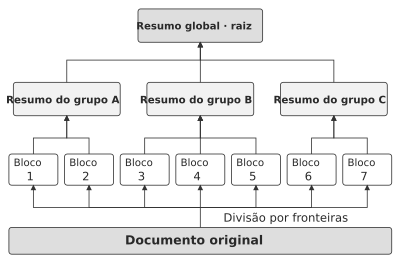

Por exemplo, “o SSE2 permite operações SIMD com inteiros em registradores XMM de 128 bits” e “o SSE4.2 acrescenta instruções de comparação de strings” podem entrar no resumo “evolução dos conjuntos de instruções SIMD x86”. Perguntas de detalhe casam com os blocos do nível inferior; perguntas de visão geral casam com os resumos de nível alto. A consulta pode descer pela hierarquia passo a passo ou buscar entre os nós de todos os níveis juntos e escolher o conjunto mais relevante.

[^ch3-raptor]: Sarthi et al., RAPTOR: Recursive Abstractive Processing for Tree-Organized Retrieval, 2024.

O **GraphRAG** organiza o conhecimento com entidades, relações e resumos de comunidades. Ele registra cada relação como uma tripla “sujeito — relação — objeto”, por exemplo (China, tem como capital, Pequim) ou (Zhang San, trabalha na, Tencent). Basta que dois registros mencionem a mesma entidade para que se liguem no grafo. Na Figura 3-11, os dois médicos se chamam Zhang. Quando o usuário pergunta “qual é o endereço do hospital do meu dentista”, por que relação o sistema deve seguir?

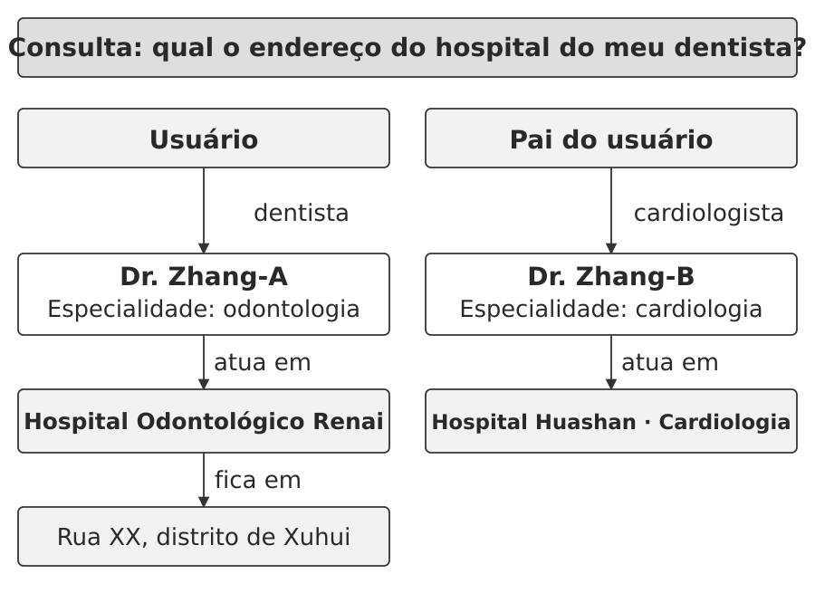

1. **Distinguir entidades homônimas na construção do grafo.** Um Dr. Zhang trata os dentes do usuário no Hospital Odontológico Ren'ai; o outro trata a doença cardíaca do pai do usuário no Hospital Huashan. Ao extrair entidades e consolidar registros, o sistema pode usar essas pistas para atribuir identificadores diferentes aos dois médicos. Os campos `person` e `relationship` vistos antes cumprem papel parecido. Decidir se `bank` numa frase significa margem de rio ou banco é desambiguação de sentido; decidir de qual Dr. Zhang um registro fala é desambiguação de entidades.
2. **Seguir a cadeia de relações na consulta.** Partindo do usuário e avançando passo a passo por “usuário → médico → hospital → endereço”, as informações espalhadas por vários registros se juntam em uma resposta.

No fluxo de indexação do GraphRAG da Microsoft, primeiro se extraem entidades e relações das unidades de texto; depois, a detecção de comunidades identifica grupos de entidades fortemente conectadas e gera a hierarquia de comunidades e seus resumos. Para consultas sobre uma entidade, a busca local combina suas informações associadas e o texto original; para consultas sobre os temas do corpus inteiro, a busca global usa os resumos de comunidades para organizar a resposta[^ch3-graphrag].

[^ch3-graphrag]: Microsoft GraphRAG, visão geral da indexação e da consulta, busca local e busca global.

A representação das relações também precisa acomodar condições e tempo. Por exemplo, “se continuar chovendo na semana que vem, cancelo a praia e vou ao museu” contém uma condição, um prazo de validade e uma ação alternativa. Se forem extraídos apenas (usuário, tem plano, viagem à praia) e (usuário, tem plano alternativo, visita ao museu), perde-se a condição de troca. Pode-se guardar a frase original completa e representar a restrição “se chover na semana que vem” com nós de condição, nós de evento ou campos estruturados, fazendo a relação apontar para o texto original.

Para a memória do usuário, recomendo **combinar em camadas a linguagem natural e os índices estruturados**: guardar a fala completa em linguagem natural, registrar em metadados a quem se refere, a data e a origem, e construir índices em grafo para o conteúdo que precisa ser associado com frequência.

> **Experimento 3-7 ★★★: comparação entre resumos hierárquicos e índices de relações**
>
> Este experimento seleciona 14 páginas do manual de arquitetura da Intel sobre SSE, AVX e gerenciamento de estado e constrói duas implementações didáticas. O ramo de resumos hierárquicos gera primeiro um resumo por página, agrupa-os em três grupos e gera resumos de grupo e um resumo-raiz; o ramo de índice de relações extrai entidades e relações e gera resumos de comunidades. Os dois usam o mesmo material e as mesmas oito perguntas, comparando detalhes conceituais e raciocínio sobre relações.
>
> Na consulta “explique o ambiente de programação SSE”, os resumos hierárquicos podem casar ao mesmo tempo com a visão geral do SSE e com os detalhes dos registradores. Esta implementação busca entre os nós de todos os níveis juntos e escolhe os cinco mais relevantes. O ramo de relações expande os vizinhos a partir das entidades relevantes e organiza o contexto com os resumos de comunidades. Seguindo relações como “SSE → registradores XMM → operações de ponto flutuante → ADDPS”, liga-se o conceito às instruções concretas.
>
> Uma pergunta mais complexa é: “se o processador declara suporte a AVX, o programa pode usar AVX?” É preciso relacionar a capacidade do processador ao gerenciamento de estado do sistema operacional: verificar os sinalizadores AVX e OSXSAVE do CPUID e depois ler o XCR0 para confirmar que os estados XMM e YMM estão habilitados. Para essa pergunta, o programa de busca no grafo recebe como extremidades CPUID e YMM. Ele encontra o caminho mais curto entre os dois, passando por XSAVE, CR4.OSXSAVE e XCR0, e entrega o caminho ao modelo para responder.
>
> Nas oito perguntas, a cobertura média das páginas de origem dos dois ramos ficou em cerca de 95,8%.

Recomendo acertar primeiro a divisão em blocos e a recuperação híbrida e só construir índices estruturados quando surgirem, de forma recorrente, necessidades de síntese entre documentos e de consultas sobre relações. Localizar um trecho da política de reembolso geralmente se resolve com divisão em blocos e recuperação híbrida; comparar SSE e AVX, ou ir da arquitetura geral até uma instrução específica, exige mais resumos entre trechos e índices de relações.

### O paradigma do sistema de arquivos: organizar o conhecimento em diretórios

O **OpenViking** organiza memórias, recursos e Skills em um sistema de arquivos virtual. Cada item é referenciado por uma URI `viking://`, e o agente pode navegar pelos diretórios, ler visões gerais e então acessar o conteúdo de que precisa[^ch3-openviking-uri]. Conforme o uso da informação, os diretórios podem ser entendidos em três grupos: recursos externos, dados do usuário, e Skills e experiências usadas pelo agente. Os identificadores de usuário e de agente delimitam ainda os respectivos espaços de nomes.

| Conteúdo | Uso típico |
| --- | --- |
| Resources | Material externo, como documentação técnica, bases de código e páginas web |
| User memories | Preferências, hábitos e experiências de um usuário específico |
| Skills e Agent memories | Procedimentos reutilizáveis, registros de tarefas e experiências ainda por validar |

A URI oferece uma forma única de localização; o armazenamento físico e os índices ficam a cargo do serviço. A interface de diretórios permite ao agente navegar por temas, nível a nível, e também restringir a busca semântica à subárvore relevante. Acesso no estilo de sistema de arquivos, armazenamento de conteúdo e índices vetoriais podem compor juntos o serviço.

[^ch3-openviking-uri]: OpenViking, Viking URI e arquitetura do sistema.

O OpenViking divide o conteúdo em três níveis, **L0, L1 e L2**: L0 é um resumo curto, para decidir rapidamente se um diretório é relevante; L1 é a visão geral do diretório, com o conteúdo principal e os pontos de entrada para navegação; L2 é o texto completo, para leitura detalhada. O resumo e a visão geral de cada diretório ficam em `.abstract.md` e `.overview.md`, gerados com orçamentos de 256 e 4000 caracteres, respectivamente[^ch3-openviking-layers].

A consulta pode ler primeiro o resumo para se localizar, depois a visão geral para escolher os arquivos e, por fim, carregar o texto original. Isso se aproxima da revelação progressiva das Skills no Capítulo 2: um índice leve permite descobrir, e o conteúdo completo é carregado conforme a tarefa exige. Quando são necessários valores exatos, condições ou a redação original, deve-se ir buscar o texto correspondente.

[^ch3-openviking-layers]: OpenViking, Context Layers (L0/L1/L2). L0 e L1 são representações geradas no nível do diretório; L2 pode ser o arquivo original ou o texto extraído dele.

Para conhecimento mantido em conjunto por pessoas e agentes, prefiro gerenciá-lo com **texto puro em Markdown e controle de versão**. As pessoas podem ler, editar e corrigir o conhecimento diretamente, e o agente usa a mesma interface de arquivos, propondo atualizações em um branch de trabalho, publicadas após revisão. O controle de versão guarda as diferenças de cada modificação e permite desfazer atualizações erradas. Ao fim de uma sessão, as preferências do usuário vão para a memória desse usuário, e o andamento das operações vai para o registro da tarefa. Depois de avaliados pelo resultado, generalizados entre trajetórias e validados posteriormente, os registros de tarefas podem se tornar as experiências discutidas no Capítulo 9.

Organizar o conhecimento em sistema de arquivos exige também **criar links e índices entre os itens relacionados**. Um conjunto de arquivos que não se referenciam só permite reencontrar associações por varredura de texto ou busca semântica; quanto mais arquivos, mais difícil para o agente seguir adiante a partir do que já encontrou. Os links oferecem caminhos explícitos de consulta: a política de reembolso aponta para as cláusulas de exceção, o resumo do contrato aponta para o registro da assinatura, o verbete de uma pessoa aponta para os eventos relacionados. Uma página de entrada apresenta os temas principais, páginas de índice oferecem navegação e referências cruzadas entre itens permitem consultas laterais. É uma organização parecida com a de verbetes de enciclopédia e preserva parte das relações de modo leve.

Na construção da base, também se pode indicar que itens podem ser usados juntos e que planos de ação são mutuamente exclusivos em um mesmo atendimento. Por exemplo, ao tratar um pedido de cancelamento, o atendimento precisa responder ao cliente seguindo ao mesmo tempo as normas de redação e as de privacidade, e as duas normas podem entrar juntas no contexto. Se o armazém tiver dois planos para cancelar um envio, o índice deve deixar claras as condições de cada um. Para um mesmo pacote: se ainda não saiu do armazém, cancela-se a ordem de saída; se já foi entregue à transportadora, solicita-se a interceptação. Se o ticket diz apenas “cancelem o pedido”, o agente precisa primeiro verificar a situação do pacote e depois carregar o plano aplicável.

A manutenção dos links deve fazer parte do fluxo de atualização: antes de criar um item, buscar os registros existentes e decidir entre mesclar ou criar; depois de gravar, completar as referências e atualizar o índice do diretório. Os links levam o leitor até a cláusula, mas se a cláusula se aplica ao pedido em questão depende de quando ela entrou em vigor.

### Como o conhecimento deve ser atualizado

Uma política muda hoje, e amanhã o usuário pode perguntar “o que devo fazer agora” ou “por que meu pedido do mês passado foi tratado daquele jeito”. Se a cláusula nova simplesmente sobrescrever a antiga, a segunda pergunta perde a base da época. A **atualização incremental** grava prontamente as novas evidências; a **reorganização periódica** procura, em escopo maior, duplicações, conflitos e mudanças estruturais. Os dois caminhos precisam preservar versões e referências às evidências e passar por verificação antes da publicação, para que se possa escolher o período aplicável a cada pergunta.

#### Atualização incremental da memória do usuário e da base de conhecimento

Minha recomendação: **trate a base de conhecimento como uma base de código e cada mudança no conhecimento como um Pull Request (PR).** Cada atualização deve ter um escopo de modificação claro e vir acompanhada das evidências que a sustentam, para que o revisor possa verificá-la. Documentos Markdown, arquivos de regras e o estado executável do User as Code podem entrar nesse fluxo. O histórico de versões ajuda os mantenedores a ver as mudanças, investigar suas causas e recuperar o estado anterior após uma publicação errada.

Seguindo o padrão **proponente–revisor** do Capítulo 1, uma atualização pode ocorrer assim:

1. **O proponente gera a mudança.** O Proposer Agent lê as novas evidências, consulta o conhecimento existente, localiza os itens a acrescentar, corrigir ou dar como vencidos e propõe, em um branch de trabalho, modificações de escopo bem definido. Ao mesmo tempo, mantém os links relacionados, os índices de diretório, as informações temporais e as referências às evidências.
2. **O revisor verifica de forma independente.** O Reviewer Agent compara o conteúdo antes e depois da modificação com as evidências originais e verifica se as novas afirmações têm fonte, se as condições de aplicação estão completas, se o que dizem os diferentes arquivos é coerente e se os parágrafos removidos ainda continham algo útil. Ao encontrar problemas, aponta o item específico e a justificativa e diz o que deve ser completado, restaurado ou corrigido.
3. **Iterar e decidir.** O proponente corrige conforme os comentários, e o revisor verifica de novo. Aprovada a revisão, a mudança segue para o fluxo de merge; se ainda houver divergência ao atingir o limite de rodadas ou de custo, a modificação fica no branch de trabalho e é encaminhada para revisão humana.
4. **Verificar e publicar.** Verificam-se automaticamente formato, links, metadados e rótulos de permissão; o conhecimento executável precisa ainda passar pela verificação de tipos e pelos testes relevantes. Após o merge, os blocos, resumos e índices vetoriais afetados são reconstruídos a partir de uma versão definida do conhecimento, e só então a versão do serviço é publicada.

Esse fluxo corresponde a três camadas de dados. A **camada de evidências originais** guarda conversas, trajetórias de execução, documentos de negócio e resultados de ferramentas; a **camada de conhecimento** guarda texto ou código destilado e revisável; a **camada de serviço** guarda os índices gerados a partir de uma versão específica do conhecimento. O registro de mudanças associa os identificadores das evidências, a versão do conhecimento, os comentários de revisão e a decisão final, para que os mantenedores possam descobrir por que um item foi gravado e quando entrou em vigor. As evidências originais são arquivadas segundo a política de retenção, e os índices podem ser regenerados a partir das versões do conhecimento. A memória baseada em acréscimos vista antes serve para guardar fatos novos e antigos com sua origem; o fluxo de revisão aqui transforma essas evidências em versões de conhecimento prontas para uso. Se uma consulta encontrar um conflito ainda não resolvido, pode-se voltar às evidências e decidir à luz das condições da tarefa.

Nesse projeto, **tanto o proponente quanto o revisor devem ser agentes capazes de chamar ferramentas e fazer consultas sucessivas.** O proponente pode precisar buscar em vários registros até achar os itens afetados; o revisor pode precisar seguir referências, comparar versões ou executar verificações. Ferramentas de busca em arquivos, recuperação de evidências, visualização de diferenças e testes permitem que eles cumpram essas etapas, e um agente de programação com as capacidades correspondentes pode assumir esse trabalho.

O escopo de busca dos dois deve abranger o conhecimento e as evidências originais envolvidos na mudança em curso, limitado pelas permissões de usuário, tenant e tarefa. Trajetórias de revisão, resultados de ferramentas citados e comentários são arquivados juntos, para que depois se possa verificar o que o revisor de fato conferiu.

Na escolha dos modelos, recomendo dar preferência a pares de capacidade semelhante e de famílias diferentes, como Claude e GPT, ou DeepSeek e Kimi. Dados de treinamento e hábitos de raciocínio diferentes podem levar a julgamentos diferentes. O revisor deve buscar as evidências de forma independente e conferir as afirmações e condições presentes na modificação. As permissões devem ser impostas pelo sistema em execução: o proponente grava no branch de trabalho, o revisor lê as evidências e envia sua conclusão, e o serviço de merge e publicação detém a permissão de atualizar o repositório principal e os índices em produção.

#### Reorganização periódica da memória do usuário e da base de conhecimento

Após várias atualizações locais, um mesmo fato pode estar espalhado por vários arquivos, e formulações novas e antigas podem coexistir. A reorganização periódica parte de diretórios, períodos ou temas para verificar esses problemas acumulados. Ela tem em comum com a revisão periódica discutida no Capítulo 9 o modo de trabalhar: em primeiro plano, acumulam-se novas evidências; em segundo plano, faz-se a organização concentrada, produzindo registros que servem às tarefas seguintes.

A reorganização envolve três tarefas.

1. **Eliminar duplicações, consolidar e reestruturar.** Encontrar itens duplicados, vencidos ou fragmentados demais, mesclar o conteúdo relacionado, dividir arquivos grandes demais e atualizar links, páginas de entrada e páginas de índice. Ao retirar do serviço formulações antigas, registrar o que as substituiu e a base original.
2. **Voltar ao material original.** Se cada rodada de reorganização só reescrever o resumo da rodada anterior, omissões e mal-entendidos iniciais passarão de rodada em rodada. Por isso, é preciso confrontar conversas, trajetórias de execução, documentos de negócio e saídas de ferramentas, verificando se os resumos omitiram fatos-chave, perderam negações, datas ou condições, ou apresentaram suposições como conclusões certas. Bases grandes podem ser processadas em lotes por diretório, período ou tema, com uma lista de cobertura que registra as partes verificadas, pendentes e em disputa, até a verificação completa da base.
3. **Tratar conflitos e escopo de aplicação.** Comparar a origem dos registros contraditórios, bem como a data, o sujeito, a região, a tarefa e as condições prévias. Se as duas informações valem para cenários diferentes, completar o escopo de cada uma; se a nova evidência claramente substitui a regra antiga, guardar a relação entre as versões; se a base for insuficiente, registrar os pontos a confirmar e as evidências que faltam.

O resultado da reorganização também é submetido à revisão como mudança. Reestruturações maiores podem ser divididas em vários PRs por diretório ou tema, compartilhando o plano de reorganização e a lista de cobertura; aprovadas as mudanças relacionadas, os índices derivados são reconstruídos e casos típicos de recuperação e de perguntas e respostas são reexecutados, para verificar se o conhecimento antes encontrado continua acessível. O disparo pode ser periódico, semanal ou mensal, ou baseado em limiares de novos itens, de número de conflitos ou de variação na qualidade da recuperação.

**Retirada de conteúdo vencido.** Blocos e resumos devem guardar versão, data de início e data de fim da vigência. Quando uma política é substituída, as consultas de negócio atuais filtram as versões vencidas; as consultas históricas leem as regras vigentes na data-alvo. Assim, usa-se o conhecimento mais recente e ainda se explicam os resultados de atendimentos passados.

**Permissões e isolamento entre tenants.** A filtragem por permissão deve ocorrer na camada de recuperação: o serviço de busca delimita primeiro, pela identidade de quem chama, o conjunto de documentos consultáveis e só então procura material relevante nele. Se dados privados de outro usuário entrarem no contexto, o modelo poderá vazá-los ao responder ou ao chamar ferramentas. Textos originais, resumos, arestas de relações e resultados em cache precisam herdar o escopo de acesso adequado, para que conteúdos derivados não exponham informações de outros usuários ou tenants. O serviço pode usar índices separados ou um índice compartilhado com filtragem obrigatória; o essencial é que toda consulta aplique as restrições de permissão.

### RAG agêntica: o agente no controle da recuperação

A primeira pergunta é se uma única busca basta. Para “qual é o telefone do pós-venda”, um manual de serviço vigente costuma trazer a resposta, e recomendo manter o caminho simples de uma busca seguida de geração. Se o usuário pergunta “o modelo que comprei pode ser trocado pelas condições de garantia do mês passado?”, a primeira busca encontra apenas a linha de produtos, o que ainda não permite saber quais eram as condições de troca no mês passado. Abrindo a recuperação como ferramenta, o agente pode usar as pistas da busca anterior para formular a seguinte. Essa abordagem, em que o agente decide se deve buscar mais e o que buscar em seguida, chama-se **RAG agêntica** (Agentic RAG). Na Figura 3-12, os dados de produto devolvidos pela primeira busca são exatamente os mesmos. Que pista a mais o caminho da direita usa para chegar às condições vigentes na época?

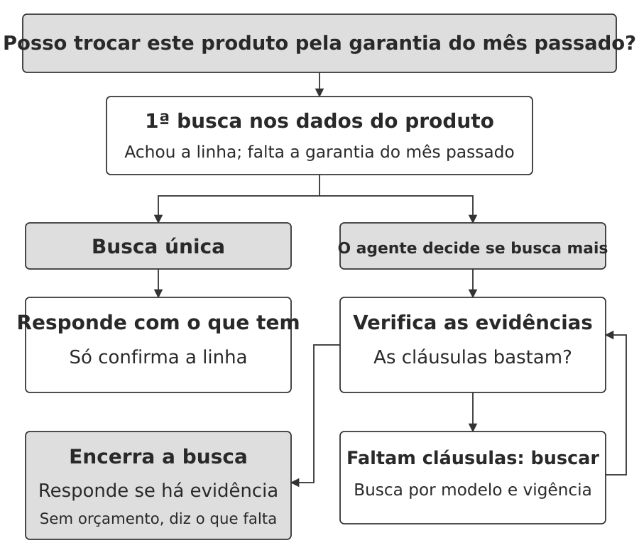

No ReAct, por exemplo, o modelo analisa primeiro a pergunta, escolhe uma consulta e chama `knowledge_base_search`; quando a ferramenta devolve a observação, o modelo avalia se as evidências bastam. Se faltam condições ou objetos relacionados, reescreve a consulta e continua buscando; se o material é suficiente, gera a resposta com base nas fontes. O Harness mantém o histórico, as chamadas de ferramentas e o orçamento e, ao atingir os limites, encerra a busca ou passa a pedir esclarecimentos.

Veja agora a Figura 3-13. Mesmo que o backend da base de conhecimento passe de um índice vetorial para um grafo de relações, o modelo continua pedindo buscas pela mesma interface de ferramenta. Se o documento devolvido contiver justamente um trecho com instruções, o modelo pode segui-las?

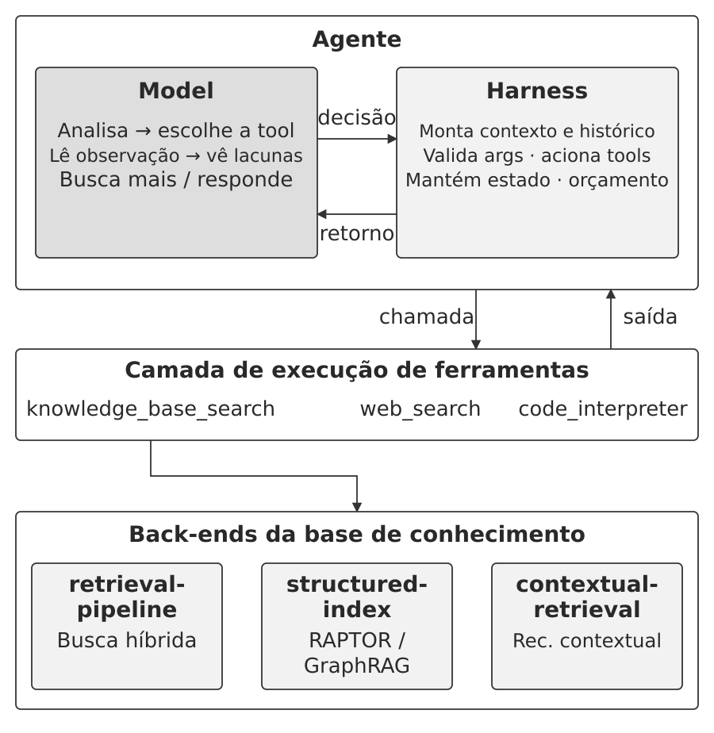

**A fronteira de confiança do conteúdo recuperado.** Documentos externos podem conter textos que tentam alterar o comportamento do modelo, ou ter recebido fatos falsos antes de entrar na base. O primeiro caso é injeção indireta de prompt; o segundo, envenenamento da base de conhecimento. É preciso gerenciar ao mesmo tempo a origem do conteúdo e as permissões de execução: os resultados da busca levam fonte, versão e posição da citação e servem como evidência para a resposta; ações como transferências, exclusões e envio de mensagens para fora são validadas pelo Harness e pelo ambiente de execução com base na autorização do usuário. Revisão na entrada da base, rastreamento de origem e checagem de fatos limitam ainda mais a propagação de conhecimento errado. A marcação de origem apresentada no Capítulo 2 e as restrições de ferramentas do Capítulo 4 atuam juntas aqui.

> **Experimento 3-8 ★★: comparação entre busca única e busca em várias rodadas**
>
> Este experimento usa o mesmo material jurídico em chinês, o mesmo recuperador BM25 e o mesmo modelo para comparar dois modos em sete perguntas: a linha de base busca uma vez com a pergunta original; o modo agente permite ao modelo ajustar a consulta e fazer até quatro buscas.
>
> Para consultas como “o que a lei diz sobre legítima defesa”, a busca direta já traz os artigos principais. Um exemplo mais complexo é “como fixar a pena de quem, embriagado, causou culposamente lesão grave e tem antecedente de furto”. A pergunta envolve ao mesmo tempo a conduta atual, a embriaguez e os antecedentes; a busca precisa localizar o material de cada aspecto e depois verificar as condições de aplicação.
>
> Na execução real, o modelo buscou sucessivamente “embriaguez lesão grave culposa antecedente furto pena”, “embriaguez crime pena”, “antecedente furto efeito na pena código penal” e “antecedente efeito na pena código penal”. Em seguida, ainda propôs “reincidência caracterização código penal”, mas o orçamento de buscas já tinha acabado, e o Harness devolveu a mensagem de orçamento esgotado.
>
> Nas quatro perguntas classificadas como complexas, a cobertura dos artigos-alvo subiu de cerca de 8% para 92%, o número médio de buscas passou de uma para 3,5 e o tempo médio da fase de resposta aumentou de cerca de 8 para 66 segundos. Nas três perguntas simples, a cobertura de evidências foi de 100%, e os dois grupos buscaram uma única vez.

O mesmo ciclo de recuperação serve também ao histórico do usuário. A seguir, com o conjunto de avaliação em três níveis do Experimento 3-1, observamos como o agente recupera fatos de registros entre sessões, distingue a quem se referem e trata atualizações.

> **Experimento 3-9 ★★: leitura da memória do usuário com recuperação agêntica**
>
> Este experimento toma o histórico completo de conversas como base de conhecimento, divide-o em janelas, constrói o índice e oferece ao agente a ferramenta `search_user_memory`. O tamanho da janela é ajustável; nesta execução, cada bloco contém oito turnos de conversa, com sobreposição de dois turnos entre blocos vizinhos, e guarda identificador da sessão, data e metadados de negócio. São permitidas até três buscas, com quatro trechos recuperados em cada uma.
>
> A recordação básica pode buscar por campos explícitos, como “qual é o número da minha conta-corrente”. Perguntas entre sessões exigem ainda verificar se todos os envolvidos foram cobertos: o usuário tem um Honda Accord e um Tesla Model 3; ao perguntar sobre os serviços agendados para os carros, o sistema deve distinguir os dois veículos e a situação dos agendamentos de cada um.
>
> Com isso, pode-se planejar um roteiro de busca: primeiro, procurar registros de veículos e serviços; ao encontrar pistas do outro carro, consultar os agendamentos do Tesla; por fim, informar o agendamento já existente do Honda e confirmar se o usuário ainda precisa agendar o Tesla. No registro real desta execução, foi feita apenas a consulta `scheduled car services`, e a resposta do grupo de busca comum se concentrou no Honda e omitiu o Tesla.
>
> Outra dificuldade vem de modificações sucessivas. No caso da transferência, a esposa define a operação, o marido depois altera o valor e a data, e a esposa ajusta de novo. Recuperados os registros, é preciso reconstituir a mudança por data, autor e situação de confirmação para encontrar a instrução que ficou valendo. A divisão atual em blocos já guarda as datas, mas a busca ainda pode deixar escapar uma modificação-chave; por isso, pode-se acrescentar aos trechos o contexto do evento.
>
> Nesses 60 casos, 18 fizeram uma única busca, 6 fizeram duas e 36 usaram as três. O grupo de busca comum por blocos foi aprovado em 47: 19 em recordação básica, 15 em recuperação entre sessões e 13 em atendimento proativo. A próxima seção compara, nos mesmos casos, prefixos de contexto e memória estruturada, analisando que informação cada um acrescenta.

### Recuperação contextual: completar o contexto dos trechos

Voltemos ao relatório financeiro. Para consultar os resultados da empresa ACME no segundo trimestre de 2025, a consulta contém o nome da empresa e o ano, mas o trecho que diz “a receita da empresa cresceu 3%” não tem justamente essas duas palavras. Além de aumentar os blocos, pode-se manter o trecho curto e acrescentar à frente dele o contexto que falta. A **recuperação contextual** (Contextual Retrieval) gera, na indexação, um breve prefixo de contexto para cada trecho e usa o prefixo junto com o texto original na recuperação[^ch3-1]. A Figura 3-14 mostra esse processamento.

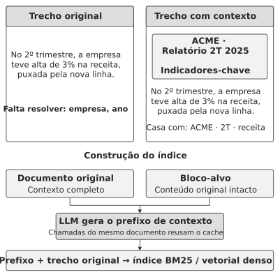

Por exemplo, o prefixo pode dizer: “Este trecho vem da seção de indicadores-chave de desempenho do relatório do segundo trimestre de 2025 da empresa ACME.” Na geração, fornecem-se o texto original e o bloco-alvo, e o modelo completa referências, datas e informações de seção que tenham base no texto. Com isso, o BM25 ganha termos que podem casar, como o nome da empresa e o trimestre, e o embedding denso também passa a representar o trecho com esse contexto.

Ela pode ser combinada com a compressão sensível ao contexto do Capítulo 2: na indexação, completa-se o contexto dos blocos de conhecimento, aumentando a chance de encontrar informação relevante; na execução, organiza-se o histórico já recuperado conforme a tarefa atual, controlando o tamanho da entrada. A primeira cuida da recuperabilidade dos trechos; a segunda, da informação e do orçamento necessários à decisão atual.

[^ch3-1]: Anthropic, Introducing Contextual Retrieval, setembro de 2024.

> **Experimento 3-10 ★★: comparação entre blocos originais e blocos com contexto**
>
> Este experimento constrói dois índices para o mesmo material: um com os trechos originais e outro com os prefixos gerados pelo modelo. Mantendo as mesmas consultas e anotações de alvo, comparam-se BM25, recuperação densa e recuperação híbrida.
>
> No exemplo do relatório financeiro, ao consultar “crescimento recente da receita da empresa ACME”, pode-se verificar se o trecho encontrado contém ao mesmo tempo a empresa-alvo, o período e os dados de crescimento. Apenas “crescimento da receita” pode casar com outras empresas; com o prefixo, o nome da empresa e o período passam a influir na ordenação.
>
> Nas 15 consultas desta execução, com o prefixo, o recall@1 do BM25 subiu de 0,60 para 0,80, e o da recuperação densa de cerca de 0,867 para 0,933; o recall@3 dos dois manteve-se em 0,867 e 1,0, respectivamente. O recall@5 da recuperação híbrida subiu de 14/15 para 15/15. Que pergunta passou a ser encontrada? Na consulta sobre as atribuições do Comitê Permanente da Assembleia Popular Nacional, o trecho-alvo lista as atribuições, mas não tem sujeito. Com o prefixo, o BM25 o levou da 16ª para a 12ª posição, ainda fora dos cinco primeiros; a recuperação híbrida o levou da 6ª para a 5ª posição, e só então ele entrou entre os cinco primeiros. Voltando ao texto original, o primeiro trecho lista as atribuições de (I) a (IV), e o quinto vai da (IV) à (XXII). A avaliação só verifica se o quinto trecho anotado foi selecionado, mas listar todas as atribuições exige juntar os dois.
>
> A geração dos prefixos acrescenta chamadas na fase de indexação. Ao gerar o contexto de vários blocos do mesmo documento, pode-se reutilizar o cache de prefixo do documento. No relatório de 2024, a Anthropic estimou, com blocos de 800 tokens, documentos de 8000 tokens e um comprimento de prompt especificado, um custo único de processamento de cerca de 1,02 dólar por milhão de tokens de documento.
>
> No mesmo relatório, embeddings contextuais combinados com BM25 reduziram a taxa de falha da recuperação top-20 de 5,7% para 2,9%, uma queda relativa de cerca de 49%; com reordenação, a taxa caiu para 1,9%, uma queda relativa de cerca de 67%. A taxa de falha usada no relatório é $1-\mathrm{recall@20}$.

Para bases consultadas repetidamente e de conteúdo relativamente estável, recomendo completar o contexto dos trechos na indexação: um único processamento serve a muitas consultas futuras. Se nome da empresa, sujeito do evento e data se perderam na divisão, apenas aumentar o número de resultados recuperados ainda pode trazer um lote de trechos de referência obscura. Completando essas pistas ao gerar os prefixos, a recuperação posterior pode usá-las para localizar o material.

> **Experimento 3-11 ★★★: memória reforçada com prefixos de contexto e cartões estruturados**
>
> Numa conversa, “ok, pode reservar esse” precisa ser associado ao produto ou à viagem mencionados antes. Se a conversa original tratava de uma passagem só de ida de Xangai para Seattle por 500 dólares, o prefixo pode completar esse contexto e preservar a sessão e o momento em que a confirmação ocorreu.
>
> Este experimento acrescenta dois grupos à divisão comum em blocos: o grupo de prefixos de contexto e o grupo de memória em duas camadas, que carrega também Advanced JSON Cards. O modelo gera primeiro uma sequência de buscas sobre o índice comum, e o mesmo conjunto de consultas é aplicado aos dois índices; o grupo de duas camadas usa os mesmos resultados de recuperação reforçada e acrescenta os cartões estruturados.
>
> No caso da transferência, os prefixos indicam, respectivamente, que Patricia iniciou a transferência, que James alterou a operação e que Patricia a ajustou de novo, ajudando a situar a ordem dos eventos. O estado final dado pelos registros originais é de 95.000 dólares em 1º de outubro, e as operações anteriores foram substituídas. Desta vez, os três grupos encontraram corretamente esse estado.
>
> A estrutura em duas camadas também favorece associações proativas. Os cartões guardam fatos-chave como “viagem a Tóquio” e “validade do passaporte”, e as conversas detalhadas são buscadas conforme a necessidade. Com uma viagem de 15 a 22 de janeiro e um passaporte que vence em 18 de fevereiro, o sistema pode primeiro notar a proximidade das datas, depois consultar os registros de renovação e as exigências da viagem e, por fim, lembrar o usuário de confirmar os preparativos pendentes. Neste caso de viagem, as respostas dos três grupos foram aprovadas na avaliação; a diferença entre cartões e busca aparece sobretudo nos casos de veículos e entre sessões, a seguir.
>
> Nos 60 casos, a busca comum, os prefixos de contexto e a memória em duas camadas foram aprovados em 47, 52 e 57, respectivamente. No grupo de prefixos, os casos aprovados de atendimento proativo passaram de 13 para 18; o grupo de duas camadas foi aprovado em todos os 20 casos de recuperação entre sessões e também em 18 de atendimento proativo. No caso dos veículos, os cartões acrescentaram as informações do segundo carro, ajudando a resposta a cobrir o que antes era omitido. Há também um retrocesso: o usuário perguntou sobre a cobertura de danos por água em seus imóveis; o grupo comum mencionou a residência própria e o imóvel alugado, mas o grupo de prefixos omitiu o imóvel alugado. Comparando pergunta a pergunta, o grupo de prefixos acertou 8 perguntas a mais que o grupo comum, mas também perdeu 3 que antes acertava.

**Quando é preciso atendimento proativo, prefiro uma arquitetura em duas camadas, com fatos-chave sempre presentes e registros detalhados buscados conforme a necessidade.** Só com busca, o modelo muitas vezes precisa saber antes o que perguntar para encontrar os registros pertinentes; passaporte, veículos ou relações familiares que ainda não entraram no campo de visão são facilmente esquecidos por isso. Colocar primeiro alguns poucos fatos-chave no contexto ajuda o modelo a perceber associações, formular consultas e então recuperar os detalhes originais. Ao escolher as informações sempre presentes, é preciso considerar relações pessoais, restrições vigentes e pendências; os resultados da busca preservam origem, data e justificativa das mudanças.

### Extrair conhecimento de conjuntos de dados: dos casos à representação estruturada

O conhecimento também pode vir da organização de grandes volumes de casos. Em sentenças judiciais, tickets de atendimento e registros de manutenção, muita informação útil está espalhada pelas narrativas concretas. Quando a tarefa exige induzir padrões a partir de muitos casos, comparar resultados ou decidir o que perguntar em seguida, recomendo extrair primeiro campos uniformes e depois fazer estatísticas e organizar protótipos. Recuperando apenas alguns casos semelhantes, é difícil enxergar a distribuição de todo o conjunto de dados; com campos uniformes, pode-se fazer estatísticas sobre o lote inteiro e oferecer uma visão geral às consultas posteriores sobre casos individuais.

O processo tem duas etapas. A **extração de conhecimento** converte as descrições originais em registros estruturados, definindo com clareza o significado, os valores e a origem de cada campo; a **análise de padrões** usa estatística e agrupamento para encontrar casos semelhantes e seus traços em comum. A Figura 3-15 mostra o fluxo que vai da extração dos casos, passando pela codificação de atributos, até a recuperação de protótipos.

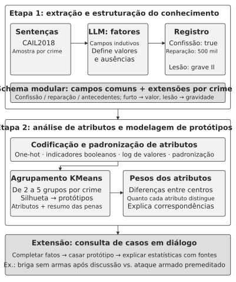

> **Experimento 3-12 ★★★: extração de fatores e protótipos de casos judiciais**
>
> Este experimento usa material de processos criminais do CAIL2018, seleciona amostras de três tipos — furto, lesão corporal dolosa e estelionato — e constrói um fluxo didático de “descoberta de fatores — extração de campos — agrupamento — interpretação de protótipos”[^ch3-cail]. De cada tipo, 120 registros são usados na modelagem e outros 20 são reservados, totalizando 360 amostras de modelagem e 60 amostras reservadas.
>
> **Descobrir e organizar os campos.** O modelo lê primeiro as amostras de modelagem em lotes, propõe fatores possivelmente úteis e depois os consolida em um Schema modular. A parte comum guarda campos relevantes para vários crimes, como confissão espontânea e reparação do dano; as extensões guardam informações ligadas a crimes específicos, como o valor envolvido ou a natureza da lesão. Desta vez, a organização resultou em 16 campos comuns e três grupos de extensões, com 12, 12 e 11 campos. Cada campo precisa ainda ter definidos seus valores e o estado de ausência, para que a extração seja consistente.
>
> **Codificar os campos como vetores.** Campos categóricos podem usar codificação one-hot: tomando como ilustração as três categorias furto, roubo e estelionato, elas são codificadas como `[1,0,0]`, `[0,1,0]` e `[0,0,1]`, e cada posição indica apenas se o caso pertence àquela categoria. Usar 1, 2 e 3 introduziria, para alguns algoritmos, ordem e distância entre as categorias. Campos como “houve confissão espontânea” e “houve reparação” podem usar 1 e 0 para os dois estados confirmados; os casos que o texto original não menciona devem ser tratados à parte, para que a ausência não seja tomada automaticamente como negação.
>
> Para valores não negativos de grande amplitude, como valores em dinheiro, esta implementação comprime primeiro a escala com $\ln(1+x)$ e só então os padroniza. Se um campo admite várias categorias ao mesmo tempo — por exemplo, um registro com várias medidas aplicadas —, pode-se criar um indicador para cada categoria, formando uma codificação multi-hot.
>
> **Construir protótipos de casos.** Os atributos codificados são padronizados e agrupados separadamente por crime. Esta implementação compara de dois a cinco grupos, escolhe a divisão pelo coeficiente de silhueta e chega a 11 protótipos. Cada protótipo guarda o número de amostras, os traços principais e a mediana, os quartis e a amplitude das penas das amostras. Por exemplo, a partir da origem do conflito, do modo de execução e das consequências da lesão, podem-se comparar combinações de traços distintas, como uma briga sem armas depois de uma discussão e uma agressão premeditada com arma; os grupos concretos resultam juntos da extração e do agrupamento.
>
> **Interpretar os atributos e os resultados da correspondência.** O programa calcula, a partir das diferenças entre os centros padronizados dos grupos, o peso de cada atributo na distinção entre protótipos. A correspondência de protótipos mapeia um caso novo para o mesmo espaço de atributos e recupera o resumo estatístico e a fundamentação dos grupos próximos, que o modelo usa para compor a explicação.
>
> Nesta execução, 12 das 60 amostras reservadas foram escolhidas para gerar explicações, depois avaliadas por um modelo independente. Vejamos uma amostra de furto: o protótipo correspondente tinha um único registro de modelagem, com pena de 4 meses, e por isso mínimo, mediana e máximo eram todos 4. O gerador relatou esse número fielmente e também apontou que havia um único registro de referência. O avaliador deu nota 4 (a máxima) em “os números são fiéis ao protótipo”, mas o rótulo real da amostra reservada era de 8 meses.
>
> Se a recuperação de protótipos for usada em conversa, pode-se perguntar primeiro que fatos ausentes podem afetar a correspondência e refazer a busca com base nas respostas.

[^ch3-cail]: CAIL2018, projeto oficial do conjunto de dados. O experimento de apoio faz amostragem de material público e usa uma divisão interna das amostras para modelagem e avaliação.

Dos casos aos protótipos, a base de conhecimento ganha uma camada de representação estatística recuperável. O texto original fornece as evidências, os campos permitem o cálculo e os protótipos resumem os traços comuns de amostras semelhantes; só preservando a correspondência entre os três é possível voltar atrás e corrigir quando se descobrem erros de extração ou viés de amostragem.

### Fronteiras: memória multimodal e paramétrica

Imagine o usuário apontando para uma foto enviada antes e dizendo “quero exatamente esta cor”. Se o sistema guardou apenas as palavras “casaco azul”, da próxima vez talvez não consiga distinguir dois tons de azul. O timbre de uma voz e as relações espaciais em um gráfico também perdem detalhes na transcrição. Para que consultas futuras tenham chance de recuperar essas informações, pode-se guardar o material original, guardar representações utilizáveis pelo modelo ou ir além e pesquisar memória persistente dentro do próprio modelo.

**Primeiro caminho: material original combinado com índice textual.** Por exemplo, numa tarefa de organização de álbum de fotos autorizada pelo usuário, podem-se recortar e guardar regiões como rostos, citar as imagens em itens Markdown e registrar data da foto, cena e os rótulos de pessoas fornecidos pelo usuário. Na busca, primeiro se encontram, pela descrição, algumas fotos possivelmente relevantes e depois se leem a imagem original ou o recorte para comparar detalhes de aparência. Trechos de áudio também podem ser associados a data, origem e transcrição, e o áudio original reproduzido quando necessário. O texto serve de porta de entrada; o material original preserva detalhes difíceis de resumir em palavras.

**Segundo caminho: guardar embeddings e carregá-los conforme a necessidade.** Codificadores visuais ou de áudio podem converter o material em vetores e guardá-los em índices para busca por similaridade. Por exemplo, regiões de imagens ou trechos de áudio codificados são associados aos itens de memória correspondentes. Se o modelo tiver uma camada de projeção treinada e uma interface de memória, é possível ainda reservar no contexto um conjunto de posições para esses vetores contínuos e deixar o modelo acessá-los por atenção. Aqui é preciso resolver o alinhamento entre as representações do codificador e as representações internas do modelo de linguagem.

Uma pesquisa preliminar minha com Noah Shi divide esse problema em duas etapas. Numa foto com duas pessoas, o usuário pergunta: “quem está perto da janela é a pessoa que vimos da outra vez?” Primeiro é preciso encontrar, com base em “perto da janela”, a pessoa a que o usuário se refere; depois, comparar a imagem dessa pessoa com as amostras guardadas antes. Se a primeira etapa escolher a pessoa errada, mesmo um reconhecimento preciso na segunda responderá a outra pergunta. O artigo também mantém na memória textual fatos que podem ser transcritos com exatidão, como nomes, para que cada tipo de informação tenha a forma de acesso adequada.[^ch3-perceptmem]

[^ch3-perceptmem]: Bojie Li e Noah Shi, Parametric Multimodal User Memory; o projeto de apoio `19PINE-AI/multimodal-user-memory` reúne a implementação e os experimentos PerceptMem. A pergunta sobre a foto em grupo é um exemplo didático.

**Terceiro caminho: memória persistente dentro do modelo.** Treinar um LoRA para cada usuário é uma forma de gravar fatos personalizados no modelo. Perguntar diretamente “onde o usuário mora” e planejar uma viagem a partir do endereço exigem usos diferentes da memória: o primeiro lê o fato; o segundo precisa ainda usá-lo em um raciocínio posterior. Se o treinamento girar apenas em torno da repetição dos fatos, o modelo pode lembrar a resposta, mas não usá-la por iniciativa própria em tarefas complexas. Por isso, as amostras de treinamento precisam incluir tanto perguntas diretas quanto tarefas que dependem desses fatos.

Minha pesquisa **User as Engram** grava fatos textuais na tabela de memória local de um modelo Engram, e um adaptador compartilhado aprende a usar esses fatos para raciocinar[^engram]. Uma consulta de N-gramas com chaves de hash localiza as entradas da tabela, e um mecanismo de gating injeta o conteúdo recuperado no modelo; cada usuário guarda suas entradas locais, e a parte de raciocínio pode ser compartilhada. Em seus experimentos com fatos textuais, o artigo compara recordação direta e raciocínio indireto e mostra como gerenciar separadamente o conteúdo da memória de cada usuário e a capacidade de raciocínio compartilhada.

[^engram]: Li, Bojie, User as Engram: Internalizing Per-User Memory as Local Parametric Edits, 2026.

Estender esse caminho ao multimodal exige ainda projetar mecanismos de endereçamento, gravação e leitura para representações de imagem ou áudio.

## Resumo do capítulo

Voltemos ao pedido de reserva do início do capítulo. “Prefiro a janela” vem deste usuário; “quantas malas posso levar” exige consultar as regras da companhia aérea vigentes na data da viagem. Guardar as duas informações como uma frase qualquer facilmente apaga a diferença mais importante: a quem se aplica a primeira e a partir de quando vale a segunda. Guardando origem, data e condições de aplicação, há base, na hora da recuperação, para decidir se a informação serve desta vez. Fatos isolados cabem em notas curtas; quando é preciso explicar relações entre pessoas ou preservar a história completa, usam-se cartões ou parágrafos do texto original; datas e quantidades podem ainda ser guardadas em campos tipados e entregues a um programa para cálculo.

Se o assistente informar errado a franquia de bagagem, verifique primeiro se as regras vigentes foram incorporadas à base; depois, em que trecho a regra foi cortada, se o recuperador a encontrou e em que posição ficou após a reordenação; por fim, que material o modelo recebeu. Quando o texto original é extenso, pode-se manter uma visão geral estruturada no contexto e buscar os detalhes conforme a necessidade. Resumos de capítulos ajudam a encontrar temas, e índices de relações ajudam a seguir associações; se um trecho perdeu suas referências, pode-se completar o contexto de origem; se uma única busca ainda deixar faltar evidências, o agente pode reformular a consulta e continuar buscando.

Quando a companhia aérea publicar novas regras, pode-se fazer primeiro uma atualização de escopo restrito, preservando as datas de vigência e a origem das regras nova e antiga; duplicações, conflitos e mudanças estruturais acumulados ficam para a reorganização periódica. O proponente submete a modificação, o revisor confere as evidências e, após a aprovação, o índice do serviço é reconstruído. Com o registro de versões, é possível reexecutar as perguntas antes respondidas de forma errada e descobrir em que material a resposta antiga se baseava. Como acumular experiência a partir dos resultados da execução é tema do Capítulo 9.

Descobrir que é possível despachar duas malas responde apenas se “a regra permite”. Para acrescentar a bagagem à reserva do usuário, o assistente precisa saber ainda que ferramenta chamar, com que parâmetros e que comprovante indica que a operação foi concluída. Esse é o ponto de partida do próximo capítulo.

## Questões para reflexão

1. ★★ O usuário diz: “Em 1º de maio me mudo de A para B; de 10 a 20 de maio fico no hotel C, e nesse período as faturas devem ir por e-mail.” Em 15 de maio, como o assistente deve responder sobre o endereço residencial, a hospedagem temporária e a forma de envio das faturas? Projete as regras de registro e de consulta e explique como tratar correções de erros de digitação ou endereços conflitantes.
2. ★★ Quando o documento original contém informações contraditórias, o prefixo de contexto pode gravar o erro junto no índice. Como você guardaria origem, versão e pontos incertos, e como usaria essas informações nas etapas de recuperação e de geração?
3. ★★ Ao converter gráficos em texto, que relações espaciais se perdem facilmente? Dê exemplos com tabelas, diagramas de arquitetura ou gráficos de linhas e projete uma solução em que imagem original, representação estruturada e índice textual cooperem na recuperação.
4. ★★★ Com o avanço dos modelos e da capacidade de contexto longo, que partes do fluxo de divisão em blocos, indexação e recuperação poderiam passar ao modelo? Analise com base na discussão sobre busca e aprendizado em “A Lição Amarga”, de Rich Sutton, e projete um experimento que compare a entrada integral com a recuperação sob demanda, verificando ao mesmo tempo a qualidade da tarefa, o custo computacional e as restrições de permissão.
5. ★★★ Se o modelo já domina grande parte do conhecimento do domínio, o que a base de conhecimento externa ainda deve guardar? Discuta separadamente o conhecimento público comum, regras em constante atualização, dados privados e evidências que exigem rastreamento exato.
6. ★ Que consultas os resumos em vários níveis do RAPTOR e as relações entre entidades e resumos de comunidades do GraphRAG atendem, respectivamente? Dê um exemplo de visão geral, um de detalhe local e um de associação em múltiplos saltos e explique que evidências precisam ser verificadas.
7. ★★ Como diretórios, links e índices vetoriais cooperam na organização do conhecimento? Projete uma base de conhecimento mantida em conjunto por pessoas e agentes e explique o lugar de cada um destes elementos: navegação, busca semântica, atualização de versões e filtragem por permissão.
8. ★★★ Depois de extrair campos dos casos e agrupá-los, como saber se os protótipos são úteis? Distinga a importância dos atributos no agrupamento, a capacidade de prever resultados e a explicação causal, e projete um fluxo de avaliação com amostras reservadas e revisão por especialistas.
9. ★★★ Projete fluxos de atualização incremental e de reorganização periódica para uma base de memória do usuário em Markdown. Se o revisor e o proponente usarem o mesmo modelo e o revisor só puder ver os trechos escolhidos pelo proponente, que erros tendem a passar despercebidos? Proponha melhorias quanto à cobertura das evidências, às permissões das ferramentas e à avaliação da revisão.

[^ch3-glove]: Pennington et al., GloVe: Global Vectors for Word Representation, 2014.

[^ch3-sbert]: Reimers e Gurevych, Sentence-BERT: Sentence Embeddings using Siamese BERT-Networks, 2019.
