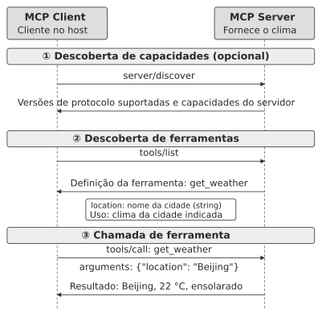
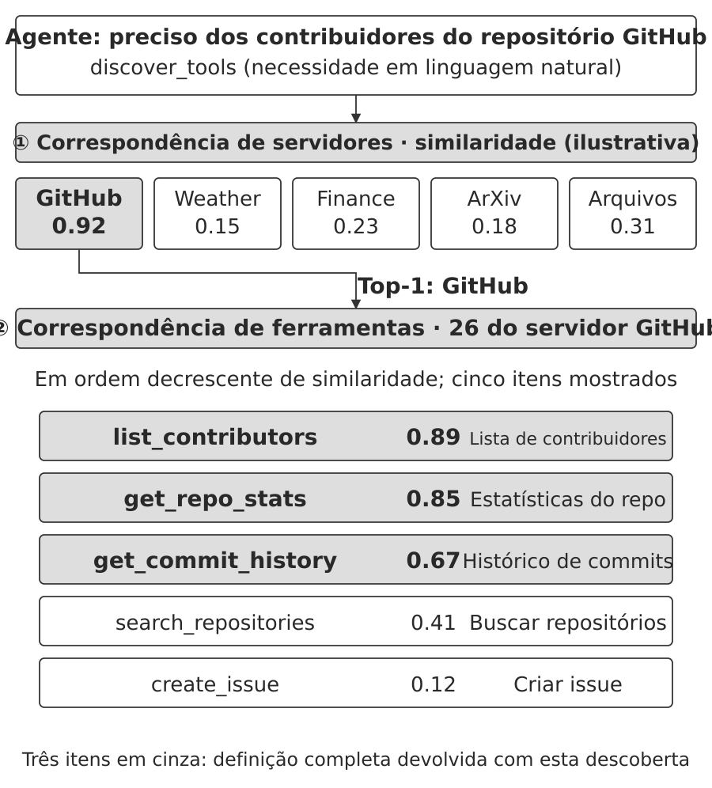
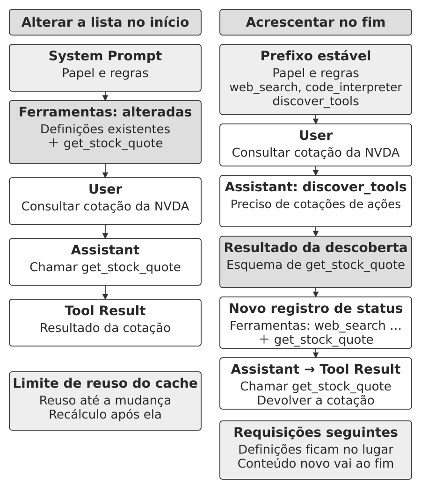
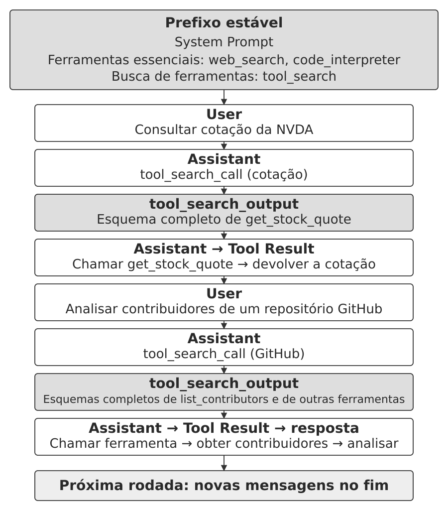

# Ferramentas

No filme de ficção científica *Her*, a assistente de IA Samantha organiza e-mails, ajuda a respondê-los, cuida de assuntos editoriais e transita entre diferentes canais de comunicação. Uma assistente assim precisa transformar a compreensão da linguagem em operações sobre sistemas externos. O agente realiza essas interações por meio de **ferramentas**. As ferramentas são seus “sentidos, braços e pernas”: fornecem observações e executam ações. Os agentes de propósito geral discutidos neste livro, como Manus e OpenClaw, também dependem de ferramentas para acessar o mundo digital.

Suponha que o usuário diga: “Encontre as datas de entrega mencionadas nos e-mails dos clientes, organize-as em uma tabela e me envie.” O modelo pode decidir qual e-mail consultar, mas ler o texto original exige acesso à caixa de correio, e enviar a tabela exige chamar uma interface de envio. Como essas ferramentas devem ser projetadas e, quando o modelo precisar delas, como ele as encontra? Este capítulo começa distinguindo cinco categorias de ferramentas; em seguida, trata da descrição, da integração e da descoberta de ferramentas; por fim, projeta separadamente as interfaces de percepção, de execução e de colaboração. O acionamento por eventos e a comunicação com o usuário também envolvem quando despertar o agente e como transmitir mensagens entre canais; esses temas ficam para o Capítulo 6.

## Classificação das ferramentas

Tomemos a consulta de e-mails como exemplo: o modelo escolhe o que fazer em seguida, o Harness verifica parâmetros e permissões e envia a requisição, e o serviço de e-mail lê e grava os dados de fato. O Capítulo 1 classificou as ferramentas, segundo sua finalidade, em ferramentas de percepção, de execução, de colaboração, de comunicação com o usuário e de acionamento por eventos. As quatro primeiras são chamadas proativamente pelo agente; as ferramentas de acionamento por eventos permitem que eventos externos também despertem o agente (Tabela 4-1).

Tabela 4-1 Direção da chamada e finalidade principal das cinco categorias de ferramentas

| Tipo de ferramenta | Direção da chamada | Finalidade principal |
| --- | --- | --- |
| Ferramentas de percepção | O agente chama proativamente | Obter informações externas |
| Ferramentas de execução | O agente chama proativamente | Realizar cálculos ou alterar o estado externo |
| Ferramentas de colaboração | O agente chama proativamente | Delegar tarefas, trocar mensagens, coordenar outros agentes ou pessoas |
| Ferramentas de comunicação com o usuário | O agente chama proativamente | Responder ao usuário, apresentar resultados ou enviar lembretes |
| Ferramentas de acionamento por eventos | Configuradas pelo desenvolvedor ou registradas pelo agente; acionadas externamente | Despertar o agente quando ocorre um evento especificado |

**Ferramentas de percepção** permitem ao agente obter informações externas. Alguns exemplos são a pesquisa na web (`web_search`), a busca em base de conhecimento (`knowledge_base_search`), a leitura de páginas web (`fetch_url`), a busca por nome de arquivo (`find_file`), a busca no conteúdo de arquivos (`grep_file`) e a leitura de arquivos (`read_file`).

**Ferramentas de execução** permitem ao agente realizar cálculos ou alterar o estado externo. Alguns exemplos são a linha de comando (`shell_exec`), o interpretador de código (`code_interpreter`), a gravação de arquivos (`write_file`), a edição de arquivos (`edit_file`) e o envio de e-mails (`send_email`). Um mesmo executor geral pode tanto fazer cálculos somente leitura quanto modificar dados.

**Ferramentas de colaboração** dão suporte à delegação de tarefas e à troca de mensagens. Alguns exemplos são criar um subagente (`spawn_subagent`), enviar uma mensagem a ele (`send_message_to_subagent`), cancelar um subagente (`cancel_subagent`) e descobrir os agentes disponíveis (`list_agents`). Tarefas independentes podem ser processadas em paralelo — por exemplo, pesquisar separadamente a trajetória de vários cofundadores da OpenAI; tarefas diferentes também podem ser entregues a agentes configurados com modelos, ferramentas, prompts e contextos distintos. O Capítulo 10 discutirá em mais detalhes as arquiteturas de divisão de trabalho e colaboração.

**Ferramentas de comunicação com o usuário** transmitem informações ao usuário. Alguns exemplos são responder a uma mensagem (`reply_to_user`), enviar um cartão estruturado (`send_card_to_user`) e enviar um lembrete (`send_user_notification`). Quando a interação se estende a vários canais ou exige notificações em segundo plano, o sistema pode encapsular o envio de mensagens como uma chamada de ferramenta explícita e gerenciar de forma unificada o destinatário, o conteúdo e o status de entrega.

**Ferramentas de acionamento por eventos** ligam eventos externos à execução do agente. Alguns exemplos são o temporizador (`set_timer`), o monitoramento de tarefas em segundo plano (`monitor_shell`) e a conexão com fontes de eventos (`connect_channel`). O processo tem duas etapas: no registro, os eventos de interesse são configurados previamente pelo desenvolvedor ou declarados pelo agente por meio de uma chamada autorizada; quando o evento ocorre, o sistema de agendamento recebe o callback ou a mensagem do evento e desperta o agente para tratá-lo. Novos e-mails, alertas do sistema, lembretes programados e a conclusão de tarefas em segundo plano podem se tornar novos pontos de entrada da execução.

Voltemos à tarefa de e-mail do início: abrir a mensagem original para obter a data de entrega é percepção; gerar e salvar a tabela-resumo altera o espaço de trabalho e, portanto, é execução; entregar a tabela a quem fez o pedido é comunicação com o usuário. Só quando o sistema continua automaticamente ao chegar o próximo e-mail de um cliente é que entra o acionamento por eventos. Um mesmo serviço de e-mail pode cumprir várias dessas funções. A próxima decisão é a granularidade das ferramentas entregues ao modelo: ele deve consultar e-mails, ler o corpo e localizar anexos em chamadas separadas, ou devemos reunir para ele os passos que costumam ser feitos em sequência?

## Princípios gerais de design de ferramentas

Nas primeiras integrações de ferramentas, era comum encapsular diretamente cada endpoint de API. Essa abordagem é rápida de implementar, mas tende a produzir um conjunto de interfaces de granularidade muito fina. Para concluir uma única tarefa, o agente pode ter de localizar objetos, ler atributos e verificar condições repetidas vezes antes de chamar a interface de execução. Ao projetar ferramentas, é possível integrar essas operações em torno das tarefas mais comuns — por exemplo, encadear a busca de um contato com o envio da mensagem, ou fazer a pesquisa em logs devolver diretamente as linhas relevantes com seu contexto[^ch4-tool-design].

**As ferramentas devem ser projetadas em torno das tarefas que o agente precisa concluir.** Essa forma de projetar interfaces a partir do modo como o agente as usa é chamada de **ACI** (Agent-Computer Interface, interface agente-computador). A HCI estuda como as pessoas interagem com os computadores; a ACI estuda como o modelo escolhe operações, monta parâmetros, interpreta o feedback e corrige erros.

[^ch4-tool-design]: Anthropic, *Writing effective tools for AI agents—using AI agents*, 2025.

### Formas de expressar capacidades: ferramentas dedicadas, executores gerais e Skills

Para entregar ao modelo a tarefa de “implantar uma aplicação”, podemos projetar três interfaces de operação. A primeira expõe apenas um `deploy_app`, e o servidor conclui todas as etapas; a segunda expõe separadamente a compilação, o empacotamento e a implantação, e o modelo decide quando chamar o passo seguinte; a terceira descreve os passos em uma Skill e deixa o modelo executá-los no terminal. Se a compilação falhar, na primeira opção o modelo depende do resultado da ferramenta para saber em que etapa ocorreu o erro; nas outras duas, o erro dessa compilação pode ser entregue diretamente ao modelo.

- **Ferramentas dedicadas** oferecem uma interface estruturada para operações bem definidas. O desenvolvedor define o esquema dos parâmetros, as regras de validação, a lógica de execução e o formato de retorno, o que facilita testar e autorizar cada ferramenta isoladamente; quando a definição entra no contexto, seu custo depende do tamanho dos campos, das descrições e dos exemplos.
- **Executores gerais e Skills** funcionam em conjunto: o terminal ou o interpretador de código fornece a capacidade de execução, e a Skill descreve o fluxo, as condições de aplicação e o modo de operar. O host pode carregar primeiro o nome e o resumo e, depois que a Skill for escolhida, ler as instruções completas e os recursos relacionados.

Por exemplo, uma Skill de implantação pode explicar, em sequência: compilar o projeto com `npm run build`, empacotar a imagem com `docker build -t app:latest .` e, por fim, aplicar ao cluster atual os recursos definidos no manifesto com `kubectl apply -f deploy.yaml`. O agente executa esses passos por meio da ferramenta de terminal, reutilizando um único ponto de entrada de execução.

Como uma ferramenta é implementada e quando o modelo lê sua descrição são duas questões distintas. Centenas de ferramentas dedicadas podem exibir apenas um índice e carregar os esquemas sob demanda; um pequeno número de Skills pode manter o catálogo permanentemente no contexto e acrescentar recuperação quando a escala crescer. A escolha entre interface dedicada e executor geral afeta a forma de passar parâmetros e de manter o código; a escolha entre entregar tudo de uma vez ou carregar sob demanda afeta quais ferramentas o modelo consegue ver em cada passo. A seção “O que fazer quando há ferramentas demais”, mais adiante, discutirá as estratégias de revelação.

**Recomendo dar preferência às ferramentas gerais e complementá-las com interfaces dedicadas conforme as necessidades de permissão, parâmetros e desempenho.** Por exemplo, ao configurar SymPy, NumPy e pandas para o `code_interpreter` em uma sandbox, o agente pode escrever Python para fazer as quatro operações, cálculo simbólico, processamento de arrays e análise de dados. Isso aproveita plenamente a capacidade do modelo de gerar código: um único interpretador comporta muitos algoritmos e permite combinar bibliotecas existentes para resolver problemas novos que ninguém havia previsto. O modelo gera o código, e o ambiente de execução o executa, restringindo o acesso a arquivos, rede e recursos.

Mesmo ao usar ferramentas dedicadas, recomendo integrar primeiro as operações de função semelhante que costumam ser usadas juntas. Com interfaces finas demais, o modelo precisa memorizar mais nomes e atribuições, e a mesma tarefa exige mais chamadas. Os principais critérios para a integração são a **semelhança funcional** e a **sobreposição dos cenários de uso**. Por exemplo, `extract_pdf_text`, `extract_docx_content` e `extract_pptx_content` recebem um documento e extraem seu texto; podem ser integradas em `read_document`, que distingue o formato pelo parâmetro `file_type`. O modelo só precisa escolher um ponto de entrada unificado, e novos formatos podem reaproveitar os mesmos parâmetros e a mesma estrutura de retorno.

As quatro situações a seguir são especialmente adequadas a interfaces dedicadas.

1. **Exigência de autorização e auditoria granulares.** A gravação em um banco de dados de produção pode ser encapsulada como uma operação de escopo bem definido, em que o servidor verifica as permissões do usuário, a tabela de destino e os campos que podem ser alterados, e registra a justificativa da operação.
2. **Necessidade de ocultar diferenças entre plataformas.** Operações como grep e find podem ser feitas pelo shell, mas uma ferramenta dedicada de busca de arquivos uniformiza os parâmetros e o feedback entre macOS, Windows e Linux — por exemplo, retornando sempre o nome do arquivo, o número da linha e o trecho correspondente.
3. **Operações muito frequentes.** Operações de alta frequência podem ganhar um ponto de entrada curto e estável, reduzindo o custo de gerar scripts e explicar o fluxo repetidamente.
4. **Relações complexas entre parâmetros.** Objetos aninhados, dependências entre campos e restrições complexas de valores são mais bem expressos pela combinação de esquema e validação de negócio.

**Quanto mais complexos os parâmetros, mais importa a forma de passá-los.** As chamadas de ferramentas estruturadas costumam descrever a entrada com JSON Schema, e alguns serviços de modelo oferecem geração restrita, para que os parâmetros obedeçam às regras de esquema suportadas. A estrutura do valor de retorno é definida pela interface da ferramenta, e o host então entrega o resultado ao modelo. Além da validação de tipo e formato, as permissões, a existência dos objetos e o cumprimento de condições de negócio envolvendo vários campos continuam sendo verificados pelo Harness e pelo serviço da ferramenta.

Uma Skill pode explicar como chamar ferramentas dedicadas ou orientar o agente a usar uma CLI. A segunda opção exige que o modelo lide ao mesmo tempo com a sintaxe da linha de comando, as aspas e o escape de caracteres, cujas regras também variam entre shells. Quanto mais complexos os parâmetros, mais detalhes o modelo precisa acertar. Diante de parâmetros aninhados complexos, pode-se gravá-los primeiro em um arquivo JSON e fazer o comando ler esse arquivo, reduzindo os níveis de escape e permitindo validar o conteúdo antes da execução.

**As Skills podem ser escritas e alteradas diretamente pela equipe de negócio.** Quem conhece o negócio pode redigir os passos por conta própria ou partir de um texto preparado pelo agente. Se a ordem do fluxo mudou, se uma etapa vale apenas para alguns clientes ou se é preciso trocar um exemplo, basta editar o texto das instruções, sem alterar o código da ferramenta nem reimplantar a interface. Segundo a especificação Agent Skills, os metadados do `SKILL.md` seguem um formato definido, o corpo é escrito em Markdown, e é possível anexar scripts, documentos de referência e recursos[^ch4-skill-format].

[^ch4-skill-format]: Agent Skills, especificação do formato, incluindo metadados, corpo, recursos anexos e carregamento progressivo.

Ao escolher a forma de uma capacidade, convém considerar quatro dimensões em conjunto.

- **Segurança e permissões**: interfaces dedicadas facilitam delimitar o escopo das operações; executores gerais controlam sua capacidade de execução por meio de sandbox, credenciais e permissões sobre recursos.
- **Complexidade dos parâmetros**: estruturas complexas se adequam a esquemas e validação de negócio; operações simples podem receber parâmetros diretamente pela CLI.
- **Frequência de mudança**: fluxos ajustados com frequência devem ir primeiro para uma Skill, cujas instruções e exemplos a equipe de negócio pode editar diretamente; operações de baixo nível, estáveis e reutilizadas, podem então ser encapsuladas como ferramentas ou scripts.
- **Capacidade do modelo**: com modelos que geram código e lidam com a linha de comando de forma confiável, prefira compor capacidades com Skills e executores gerais, reduzindo o número de ferramentas dedicadas; com modelos mais fracos, que erram com frequência em parâmetros complexos, deixe que interfaces estruturadas imponham mais restrições.

**O código também pode orquestrar várias chamadas de ferramentas.** Para coletar várias páginas web e extrair campos, o modelo pode gerar um script que faz os laços, os filtros e a consolidação. O texto integral das páginas permanece nas variáveis do ambiente de execução, e apenas os campos selecionados e as estatísticas voltam ao contexto. As condições, os laços e o tratamento de exceções do programa ligam os passos, e o modelo analisa diretamente o resultado consolidado. Em tarefas cujos passos já estão claros, como coleta, filtragem e estatística em lote, prefiro encadeá-los por código, reduzindo as idas e vindas em que o modelo chama uma ferramenta por vez e lê cada resultado intermediário. Quanto mais resultados intermediários houver e mais enxutos forem os campos retornados, maior será a economia de contexto. O Capítulo 5 aprofundará esse tipo de orquestração por código.

Esse tipo de interface costuma ser chamado de **Code Mode**. No servidor MCP da Cloudflare, por exemplo, o modelo primeiro usa `search()` para escrever um programa de consulta que encontra, na descrição OpenAPI, os endpoints e parâmetros necessários; em seguida, usa `execute()` para enviar o JavaScript que chama esses endpoints. Para listar os registros DNS que atendem a uma condição, o programa pode consultar página por página, filtrar e devolver apenas os registros encontrados. O primeiro passo evita colocar o manual inteiro da interface no contexto; o segundo evita devolver ao modelo cada página de resultados. Quais zonas a identidade de execução pode ler e se ela pode modificar registros continua sendo decidido pela autorização no servidor.[^ch4-code-mode]

[^ch4-code-mode]: Cloudflare, implementação MCP do Code Mode; Armin Ronacher, tomando o Pi 1.0 como exemplo, discutiu a divisão de trabalho entre as ferramentas fornecidas pelo harness e o ambiente de execução.

### Descrição de ferramentas: finalidade, parâmetros e feedback

Ao escrever a descrição de uma ferramenta, comece imaginando a solicitação que mais facilmente levaria a usá-la de forma errada. O usuário pede: “Encontre as cláusulas do contrato que mencionam multa por inadimplemento”; uma busca por nome de arquivo só devolverá arquivos cujo nome corresponda e, mesmo obtido um caminho, o modelo ainda precisará ler o conteúdo. A descrição deve permitir ao modelo decidir qual interface escolher, o que fornecer na chamada e a que perguntas o resultado basta para responder.

**Explique quando usar a ferramenta.** A descrição da pesquisa na web pode dizer: “Use quando precisar obter informações em tempo real ou encontrar fatos desconhecidos”, para que o modelo associe a necessidade do usuário à finalidade da ferramenta. Com apenas “Pesquisa conteúdo relevante”, o modelo precisa adivinhar sozinho o escopo da busca e as condições de uso.

**Deixe claros a entrada e o escopo da busca.** Uma ferramenta de busca por nome de arquivo, por exemplo, pode informar: “Faz correspondência por nome de arquivo e caminho; para procurar texto dentro dos arquivos, use `grep_file`.” Deixar clara a divisão de funções entre ferramentas vizinhas ajuda o modelo a escolher o ponto de entrada certo em uma única chamada. **Na minha visão, deixar claros os limites de uso costuma importar mais do que enumerar funcionalidades.** Que entradas a ferramenta aceita, que escopo ela pesquisa e como lida com resultados vazios ou erros — tudo isso afeta diretamente a próxima decisão do modelo.

**Descreva os parâmetros com especificação e exemplo.** `timestamp` pode ser descrito como “formato RFC3339, por exemplo, `2024-03-15T14:30:00Z`”. Em tarefas complexas, o modelo precisa escolher ferramentas, extrair informações do histórico da trajetória e ponderar os passos seguintes ao mesmo tempo; o formato dos parâmetros é apenas um detalhe entre muitos. Uma string completa fornece um formato a ser seguido diretamente, e o modelo pode montar o parâmetro por analogia, com menos chances de errar ao reinterpretar a terminologia.

Da mesma forma, `phone` pode ser descrito assim: “Número de telefone no formato internacional E.164, começando com `+`, seguido do código do país e do número, contendo apenas dígitos, sem espaços nem separadores. Por exemplo, `+8613888888888` (China) ou `+12025551234` (EUA).”

**Descreva a estrutura do retorno e o custo de execução.** Por exemplo, “Retorna um array JSON em que cada item contém os campos `title`, `url` e `snippet`” facilita ao modelo extrair título, fonte e resumo. Ferramentas demoradas podem indicar a latência estimada no ambiente de medição e um ponto de entrada alternativo, por exemplo: “Ler a página inteira pode levar de 5 a 10 segundos; se precisar apenas dos metadados, chame `get_page_metadata`.”

Também é possível anexar de um a cinco exemplos de chamada verificados, cobrindo os parâmetros mínimos, as combinações comuns e as condições complexas. O JSON Schema consegue expressar tipos, campos obrigatórios, faixas de valores e algumas dependências entre campos[^ch4-json-schema]; os exemplos mostram como essas regras se aplicam a tarefas concretas — por exemplo, se o timestamp está em segundos ou milissegundos, como os filtros são aninhados e quais campos opcionais costumam aparecer juntos. Em testes internos com parâmetros complexos divulgados pela Anthropic em 2025, a inclusão de exemplos de chamada elevou a precisão de 72% para 90%[^ch4-tool-examples].

[^ch4-json-schema]: JSON Schema, tipos de objeto e restrições de propriedades. O conjunto de palavras-chave de esquema aceito por cada interface de modelo é definido pelo respectivo serviço.

[^ch4-tool-examples]: Anthropic, *Introducing advanced tool use on the Claude Developer Platform*, 24 de novembro de 2025, seção Tool Use Examples.

Quando o agente escolhe a ferramenta errada com frequência, recomendo **verificar primeiro as descrições das ferramentas**: se várias ferramentas têm nomes parecidos, se o escopo da busca está claro, se faltam exemplos nos parâmetros. O mesmo método vale para os nomes, resumos e instruções de operação das Skills.

### Fidelidade na passagem de parâmetros

O modelo pede para substituir um trecho do texto original, mas o executor informa “não encontrado”. Antes de pedir ao modelo que reformule, pergunte se as duas pontas receberam a mesma sequência de caracteres. A chamada passa por análise, serialização, proxies e camadas do runtime, e cada uma delas pode alterar o conteúdo. A **fidelidade dos parâmetros** exige que o valor visto pelo executor tenha o mesmo significado que o valor enviado pelo modelo; o escape do protocolo pode mudar a forma de transmissão, mas, depois da decodificação, aspas e quebras de linha devem ser preservadas.

Tomemos como exemplo o problema de conversão de aspas curvas em uma versão do Cursor do início de 2026. A ferramenta de substituição recebe `old_string` e `new_string` e modifica o arquivo por correspondência exata. A ferramenta de leitura devolve as aspas curvas do chinês, `“` e `”`, correspondentes a `\u201c` e `\u201d`; o modelo coloca o trecho original em `old_string`, mas, durante a passagem de parâmetros, elas são convertidas em aspas retas `"`. O texto no arquivo continua o mesmo, e a ferramenta de substituição responde “nenhuma correspondência encontrada”. Ler de novo e copiar de novo o trecho leva à mesma falha.

O sentido da escrita também é afetado. O modelo pede para gravar aspas curvas, mas o arquivo acaba salvo com aspas retas. Ao ler o arquivo em seguida, o modelo vê um conteúdo diferente do que pretendia gravar e pode tentar corrigi-lo; enquanto a conversão continuar acontecendo, cada nova tentativa repetirá o mesmo erro.

Outro tipo de problema é a **injeção silenciosa de parâmetros**. A ferramenta bash de uma IDE acrescenta automaticamente a `git commit` um parâmetro que marca o commit como feito por IA. Versões antigas do Git não reconhecem esse parâmetro, e o commit falha. O modelo vê apenas o comando que gerou e pode ajustar repetidamente a mensagem do commit ou outros parâmetros, sem nunca tocar na verdadeira origem da falha.

Para investigar esse tipo de problema, compare lado a lado os parâmetros gerados pelo modelo, os parâmetros após a passagem, a requisição efetivamente executada e o resultado retornado. Se a interface normaliza a codificação ou acrescenta parâmetros de execução, documente as regras de conversão e devolva os valores efetivamente usados. Para ferramentas de correspondência exata, um espaço a mais, uma quebra de linha a menos ou uma aspa alterada podem bastar para a correspondência falhar. O modelo precisa saber o que o executor recebeu de fato para acertar a chamada seguinte.

## Ecossistema de ferramentas: MCP e Skill Hubs

Diferentes interfaces de modelo e frameworks de agentes usam formas próprias de definir ferramentas, como function calling, tool use e a abstração Tool do LangChain. Um serviço externo que quisesse se adaptar a cada uma delas teria de tratar repetidamente descrições, parâmetros e formatos de resultado. O **Model Context Protocol (MCP)**, lançado pela Anthropic em novembro de 2024, oferece um protocolo unificado para que aplicações de modelos acessem ferramentas e dados[^ch4-mcp-origin].

Para entender o MCP, comece pelos três papéis: host, cliente e servidor. O **host** é a aplicação de agente ou a IDE, responsável pela interação com o modelo, pela organização do contexto e pela gestão de permissões; o **cliente MCP**, dentro do host, cuida das mensagens do protocolo; o **servidor MCP** fornece ferramentas, recursos e modelos de prompt e pode rodar como processo local ou ser implantado como serviço remoto[^ch4-mcp-architecture].

**Definição e chamada de ferramentas.** O cliente obtém as ferramentas disponíveis com `tools/list`, e a lista pode ser paginada. Cada ferramenta contém nome, descrição e `inputSchema`; resultados estruturados também podem ter seu formato definido por `outputSchema`. Depois que o modelo escolhe uma ferramenta e gera os parâmetros, o host faz a validação, o cliente envia `tools/call`, e o servidor executa e devolve o resultado. Cabe ao host decidir quais definições e resultados entram no contexto do modelo[^ch4-mcp-tools].

Na Figura 4-1, depois de obter o nome e os parâmetros da ferramenta de clima, o cliente ainda precisa fazer uma chamada para consultar o tempo em Pequim. A implementação que acompanha o livro usa o MCP 2026-07-28: cada requisição carrega a versão do protocolo, as informações do cliente e suas capacidades, e o cliente também pode chamar antes `server/discover` para conhecer as versões e capacidades suportadas pelo servidor. As versões anteriores usavam o handshake `initialize` para estabelecer a sessão, e na conexão é preciso escolher o modo de interação conforme as versões suportadas pelas duas partes[^ch4-mcp-versioning].

Quando o clima não pode ser obtido, a Figura 4-1 mostra dois pontos de partida diferentes para a investigação. Se o host se conectou ao servidor, chamou `tools/list` e não encontrou a ferramenta de clima, verifique quais ferramentas o servidor publicou e se o cliente leu todas as páginas da lista. Se o modelo escolheu a ferramenta certa, mas o servidor reclama da falta do nome da cidade, procure `arguments` no registro da chamada e confira se o nome do campo é o `location` exigido pela definição da ferramenta.

**Modos de transporte.** O stdio transmite mensagens JSON-RPC pela entrada e saída padrão de um subprocesso local. O Streamable HTTP envia requisições por HTTP, e a resposta pode ser JSON ou um fluxo SSE devolvido aos poucos. O Streamable HTTP substituiu o antigo esquema de transporte HTTP+SSE e continua usando SSE para respostas em streaming[^ch4-mcp-transports].

**Recursos e modelos de prompt.** Os recursos (resources) fornecem dados legíveis, como conteúdo de arquivos e registros de bancos de dados; o host pode listá-los e lê-los por URI e escolher o conteúdo relevante. Os modelos de prompt (prompts) fornecem mensagens ou modelos de tarefa reutilizáveis, que usuários e clientes podem escolher. Como as ferramentas também podem fazer buscas e leituras, essas três primitivas se dividem pela interface de interação: as ferramentas oferecem um ponto de entrada para chamadas, os recursos, um ponto de entrada para dados, e os modelos de prompt, um ponto de entrada para tarefas[^ch4-mcp-primitives].

O valor central do MCP é permitir que uma única implementação de ferramenta sirva a vários produtos de agentes. O protocolo unificado permite que o mesmo servidor seja reutilizado por hosts compatíveis, como Cursor, Claude Desktop e OpenClaw, e que os desenvolvedores concentrem mais esforço na própria capacidade e na qualidade do feedback. O host converte as definições de ferramentas do protocolo em interfaces utilizáveis pelo modelo.

**Os Skill Hubs cuidam da descoberta e da distribuição de pacotes de capacidades.** Uma Skill normalmente contém um `SKILL.md` e pode trazer scripts e materiais de referência. As plataformas de distribuição ajudam os usuários a pesquisar, instalar e atualizar esses arquivos. Em janeiro de 2026, a Vercel lançou o skills.sh, com um diretório de skills e uma ferramenta de instalação; o ClawHub, do ecossistema OpenClaw, também oferece busca de skills e gestão de versões[^ch4-skills-sh][^ch4-clawhub]. Após a instalação, o host lê o nome, o resumo e as instruções completas de acordo com sua política de carregamento. O MCP também pode oferecer, por meio de uma extensão, a descoberta e a leitura de Skills, de modo que pacotes de capacidades e protocolo de comunicação podem funcionar juntos[^ch4-skills-over-mcp].

**Integração e carregamento no contexto são geridos separadamente.** Depois de obter a lista de ferramentas, o cliente MCP pode entregá-la inteira ao modelo ou manter primeiro um índice e carregar as definições sob demanda. As Skills também podem exibir primeiro `name` e `description` e só ler o corpo quando escolhidas. A lista de ferramentas permitidas determina quais capacidades estão disponíveis; o carregamento tardio determina quais definições estão visíveis no momento.

**Ao integrar capacidades de terceiros, verifique separadamente o conteúdo que elas fornecem e as operações que executam de fato.** Descrições, conteúdo retornado e código anexo vêm de partes diferentes, e o escopo de autorização também pode variar. No caso do MCP, há três tipos de problema a examinar.

1. **Envenenamento da descrição da ferramenta.** A descrição pode trazer instruções alheias à finalidade da ferramenta, induzindo o modelo a sair da tarefa atual. Trata-se de injeção de prompt: conteúdo fornecido externamente tenta mudar o comportamento do modelo.
2. **Alteração do servidor e de suas dependências.** Uma atualização do servidor pode mudar o comportamento da ferramenta, e atualizações de dependências ou a invasão de um serviço remoto também podem contaminar os resultados retornados.
3. **Confusão entre ferramentas homônimas.** Servidores diferentes podem oferecer ferramentas com o mesmo nome ou nomes parecidos, levando o modelo ou a camada de roteamento a escolher o alvo errado. O host deve manter o vínculo entre a identidade do servidor e o nome da ferramenta, exibir a origem e validar o alvo no despacho.

Antes da integração, revise as descrições e a implementação, fixe as versões das implantações sob seu controle e refaça a verificação a cada atualização; cada servidor deve usar credenciais com o mínimo de privilégios compatível com a tarefa. Quando o serviço remoto é mantido por terceiros, monitore também as mudanças nas definições e no comportamento das ferramentas.

Em tempo de execução, também é possível usar o Sidecar, apresentado mais adiante, para revisar de forma independente as chamadas estruturadas e as justificativas de tarefa necessárias. Caminhos, textos e endereços de destino nos parâmetros da chamada também devem ser tratados como dados a verificar. O resultado da revisão, junto com regras de permissão determinísticas, decide se a operação será executada. O Capítulo 5 apresentará a “tríade letal” de Simon Willison, usada para analisar o risco da combinação entre dados privados, entradas externas e comunicação com o exterior.

Os scripts anexados a uma Skill, os servidores MCP locais e os serviços remotos têm, cada um, seu local de execução e seu escopo de permissões. Na revisão, verifique a origem do código, o ambiente de execução, as permissões de arquivo e rede e o caminho percorrido pelas credenciais; se passos fornecidos externamente orientarem o download ou a execução de outros programas, eles também entram nessa cadeia de verificação. As varreduras das plataformas oferecem pistas auxiliares; o isolamento na execução, o mínimo privilégio e a revisão de mudanças controlam diretamente o que é executado.

[^ch4-mcp-origin]: Anthropic, *Introducing the Model Context Protocol*, 25 de novembro de 2024.
[^ch4-mcp-architecture]: Especificação do MCP versão 2026-07-28, seções de arquitetura e visão geral do protocolo.
[^ch4-mcp-tools]: MCP, Tools, incluindo lista de ferramentas, esquemas de entrada e saída e resultados de chamada.
[^ch4-mcp-versioning]: MCP, *Versioning and Compatibility*, que explica os metadados por requisição, a descoberta de capacidades e a compatibilidade com o handshake das versões anteriores.
[^ch4-mcp-transports]: MCP, visão geral de transporte e especificação de transporte 2025-11-25; esta última explica a substituição do antigo esquema HTTP+SSE pelo Streamable HTTP.
[^ch4-mcp-primitives]: MCP, seções Resources e Prompts.
[^ch4-skills-sh]: Vercel, *Introducing skills, the open agent skills ecosystem*, 20 de janeiro de 2026.
[^ch4-clawhub]: OpenClaw, instruções de uso do ClawHub.

## O que fazer quando há ferramentas demais: organização hierárquica e descoberta proativa de ferramentas

Quando as ferramentas passam de uma dúzia para centenas ou milhares, o modelo precisa tanto encontrar a capacidade adequada quanto entender as diferenças entre interfaces parecidas. As definições completas ocupam contexto; se ficam no prefixo do prompt, adicionar, remover ou reordenar ferramentas ainda pode encurtar o prefixo reaproveitável pelo cache. Quanto mais ferramentas de nome e finalidade semelhantes houver, mais fácil será o modelo escolher o ponto de entrada errado ou deixar de lado uma capacidade necessária. Por isso, bibliotecas grandes de ferramentas devem, por padrão, ser carregadas sob demanda, com um catálogo por categorias e interfaces de descoberta bem projetados, para que o modelo encontre primeiro as ferramentas relevantes para a tarefa atual e depois escolha uma de acordo com a finalidade de cada uma.

Pense na descoberta de ferramentas como consultar um manual organizado por tarefas. O sumário indica ao modelo em que seção procurar; se surgir uma nova necessidade durante a execução, ele pode voltar e continuar procurando; depois de escolher uma capacidade, lê os parâmetros, a ordem das operações e os exemplos. O índice por categorias, a busca proativa e as Skills, apresentados a seguir, resolvem essas três questões, e tanto ferramentas dedicadas quanto executores gerais podem ser oferecidos ao modelo por esses pontos de entrada.

### Organização hierárquica e carregamento sob demanda

**Ofereça primeiro um índice e carregue as definições quando forem usadas.** O catálogo de ferramentas pode ocupar muito contexto. A Anthropic deu um exemplo: cinco servidores MCP, como GitHub e Slack, fornecem juntos 58 ferramentas, cujas definições completas ocupam cerca de 55 mil tokens[^ch4-tool-search-eval]. O Cursor gerencia essas descrições em uma estrutura de diretórios: o contexto inicial traz apenas informações resumidas, como os nomes das ferramentas, e o agente consulta as definições completas conforme a tarefa. No teste A/B publicado pelo Cursor em janeiro de 2026, nas tarefas que efetivamente chamavam ferramentas MCP, essa abordagem reduziu em 46,9% o consumo total de tokens do agente; a economia varia com o número de servidores MCP integrados[^ch4-cursor-discovery].

O design inicial do Pi, por sua vez, priorizava ferramentas de CLI acompanhadas de README, que o agente lia sob demanda para depois usar a capacidade pela linha de comando[^ch4-pi-no-mcp]. A extensão da comunidade `pi-mcp-adapter` aplica uma ideia semelhante ao MCP: por padrão, oferece ao modelo uma ferramenta proxy de cerca de 200 tokens, com a qual o modelo pesquisa ferramentas, consulta definições e faz chamadas, nessa ordem; o servidor só é iniciado na primeira chamada. A versão 0.99 do Pi também passou a ter suporte nativo a MCP, com um mecanismo de descoberta sob demanda[^ch4-pi-mcp-adapter]. Essas implementações tratam separadamente a integração do protocolo e o carregamento no contexto: o backend se conecta aos serviços MCP, e o frontend, por meio de um índice curto ou de uma interface proxy, ajuda o modelo a encontrar a capacidade de que precisa.

[^ch4-cursor-discovery]: Cursor, *Dynamic context discovery*, 6 de janeiro de 2026.
[^ch4-pi-no-mcp]: Mario Zechner, *What if you don’t need MCP at all?*, 2 de novembro de 2025, que apresenta a abordagem de usar CLIs e ler a documentação sob demanda.
[^ch4-pi-mcp-adapter]: pi-mcp-adapter, README do projeto: ferramenta proxy, inicialização tardia e comparação com o suporte nativo a MCP do Pi.

**Organize o catálogo de ferramentas por tarefa.** Quando o número de ferramentas cresce, é possível agrupá-las pela forma de obter informações, para que o modelo localize primeiro a categoria e depois escolha a interface específica:

- **Ferramentas de busca**: localizam onde está a informação a partir de pistas, como pesquisa na web, busca em base de conhecimento e busca de arquivos.
- **Ferramentas de leitura**: obtêm conteúdo de um local conhecido, como a leitura de uma página web, de um documento ou de um registro específico.
- **Ferramentas de análise**: extraem informações de conteúdo não estruturado, como OCR de imagens, análise de vídeo e transcrição de áudio.
- **Ferramentas de consulta**: acessam dados estruturados por campos e condições, como APIs de clima, APIs de cotações e consultas a bancos de dados.

Considere a pergunta “quais dados este artigo usou?”. A busca devolve primeiro os artigos candidatos e seus endereços, a ferramenta de leitura recupera o texto pelo endereço e a ferramenta de análise ajuda a localizar as tabelas. Se o primeiro passo puser no topo um artigo de mesmo título, a resposta estará errada mesmo que as tabelas sejam lidas com exatidão depois.

**Use a recuperação para restringir primeiro o conjunto de ferramentas.** A partir da descrição da tarefa, o host pode fazer uma busca por palavras-chave ou semântica nos nomes, resumos e descrições de parâmetros das ferramentas e entregar ao modelo apenas as definições das ferramentas correspondentes. Se poucas ferramentas forem devolvidas, a interface necessária no passo seguinte pode ficar de fora; se forem muitas, ocupam contexto e dificultam a escolha. A primeira recuperação pode partir da solicitação do usuário, e as seguintes podem ser complementadas conforme a tarefa avança.

### Descoberta proativa de ferramentas nativa do modelo

Em tarefas complexas, a necessidade de ferramentas costuma surgir aos poucos, ao longo da execução. Por exemplo, “Debug the file” pode exigir primeiro a leitura do arquivo e, depois, a busca de dependências, a execução de testes e a análise de erros. Uma recuperação feita só no início da tarefa tende a deixar de fora capacidades necessárias mais adiante.

**Deixe o agente pedir quando precisar.** O MCP-Zero faz o modelo gerar, durante a execução, solicitações estruturadas de capacidade — por exemplo, usando `server` para indicar o GitHub e `tool` para descrever “pesquisar repositórios e retornar metadados”. O sistema faz a correspondência primeiro com os servidores e depois com as ferramentas de cada servidor, e acrescenta ao contexto as definições escolhidas; se as ferramentas devolvidas não atenderem à tarefa, o modelo pode ajustar a solicitação e continuar a busca. O conjunto de dados MCP-tools construído pelo artigo contém 308 servidores e 2797 ferramentas; no teste com o conjunto completo de ferramentas do APIBank, o custo de prompt das ferramentas caiu cerca de 98% tanto no cenário de um turno quanto no de vários turnos[^mcp-zero-2025].

Na engenharia, também é possível manter ferramentas básicas como `web_search` e `code_interpreter` e acrescentar uma interface de busca de ferramentas. O modelo descreve a capacidade que lhe falta, a interface devolve as definições de algumas ferramentas correspondentes, e o modelo escolhe uma delas para chamar. A Tool Search Tool da Anthropic adota essa descoberta sob demanda: as ferramentas mais usadas são carregadas diretamente, e as demais têm o carregamento adiado com `defer_loading`. Na avaliação interna de MCP divulgada pela Anthropic, a busca de ferramentas elevou a precisão do Opus 4 de 49% para 74%[^ch4-tool-search-eval].

[^mcp-zero-2025]: Xiang Fei, Xiawu Zheng, Hao Feng, *MCP-Zero: Proactive Toolchain Construction for LLM Agents from Scratch*, 2025. A redução de cerca de 98% vem do cenário com o conjunto completo de ferramentas do APIBank; ver a Tabela 1 do artigo.
[^ch4-tool-search-eval]: Anthropic, *Introducing advanced tool use on the Claude Developer Platform*, 24 de novembro de 2025, seção Tool Search Tool.

**Procure primeiro o servidor, depois a ferramenta.** Um servidor MCP costuma oferecer um conjunto de ferramentas em torno de uma plataforma ou de um negócio. No exemplo da Figura 4-2, o servidor do GitHub é escolhido primeiro pela descrição da capacidade, e depois três candidatas são selecionadas entre suas ferramentas. Operações de mesmo nome podem pertencer a plataformas diferentes, e o primeiro passo já elimina um conjunto de candidatas irrelevantes. Mas, se esse passo deixar de fora o servidor correto, nenhuma comparação cuidadosa entre ferramentas no passo seguinte conseguirá recuperá-lo.

Com recuperação vetorial, é possível pré-calcular os embeddings das descrições de servidores e ferramentas e atualizá-los de forma incremental quando o catálogo muda. A qualidade da correspondência deve ser verificada em cada nível: quando a similaridade das candidatas, sejam servidores ou ferramentas, ficar abaixo de um limiar definido, devolva “nenhuma ferramenta adequada encontrada”, para que o agente acrescente condições, reformule a necessidade e tente de novo. Tarefas que podem ser realizadas por um executor geral também podem ser resolvidas combinando ferramentas básicas; a criação e o armazenamento de novas ferramentas serão discutidos no Capítulo 9.

**Faça o carregamento dinâmico funcionar com o cache KV.** A posição das definições de ferramentas afeta o reaproveitamento do prefixo. Se cada nova ferramenta descoberta alterar a lista de ferramentas no início da requisição, o prefixo serializado mudará, e o cache só poderá ser reaproveitado até o primeiro ponto alterado. Ao comparar as colunas esquerda e direita da Figura 4-3, a diferença está em onde a nova ferramenta aparece pela primeira vez. À direita, o prompt de sistema, as ferramentas básicas e a interface de busca permanecem estáveis, e as definições das novas ferramentas são acrescentadas ao histórico conforme vão sendo descobertas; as requisições seguintes mantêm as definições já existentes na mesma posição e continuam acrescentando mensagens.

`tool_search`, `defer_loading` e `tool_search_output`, da OpenAI, e `tool_reference`, da Anthropic, apresentados no Capítulo 2, dão suporte ao carregamento de definições de ferramentas sob demanda. A barra de status pode manter à parte uma lista curta com os nomes das ferramentas disponíveis, para que o modelo saiba de que capacidades dispõe no momento.

A Figura 4-4 registra duas descobertas de ferramentas. Quando o modelo começa a analisar os contribuidores do GitHub, a definição da ferramenta usada antes para consultar a cotação continua no mesmo lugar.

Esse design exige que o modelo saiba interpretar definições de ferramentas carregadas no meio da sessão e, com base nelas, preencher parâmetros e fazer chamadas. O Experimento 4-1 entrega o mesmo lote de tarefas a duas formas de carregar ferramentas e compara quanto texto de definições cada uma coloca no contexto.

> **Experimento 4-1 ★★★: descoberta proativa de ferramentas**
>
> Como a descoberta de ferramentas reduz o texto de definições que o modelo enfrenta a cada passo? Este experimento usa o Qwen3-4B e compara o carregamento completo com a descoberta proativa no mesmo servidor MCP, que contém 127 ferramentas. Os dois grupos executam três tarefas: consultar a cotação das ações da Apple e notícias relacionadas; buscar artigos sobre transformers e baixar os três primeiros; obter as estatísticas de contribuidores de um repositório do GitHub e gerar um gráfico. Essas tarefas exigem, respectivamente, capacidades de finanças e busca, de busca e download de artigos, e de consulta de dados e execução de código.
>
> **Carregamento completo**: coloque no prompt de sistema os esquemas completos de todas as ferramentas. O registro de execução que acompanha o livro, de 25 de agosto de 2026, contém 127 ferramentas, e o catálogo inteiro, contado com o mesmo tokenizador (o200k), soma 50.597 tokens.
>
> **Descoberta proativa**: o prompt de sistema mantém apenas `web_search`, `code_interpreter` e `discover_tools`. Ao encontrar uma lacuna de capacidade, o modelo descreve a necessidade em linguagem natural, por exemplo: “Preciso da capacidade de consultar preços de ações.” `discover_tools` recupera cinco ferramentas candidatas por similaridade vetorial, acrescenta suas definições completas ao histórico da conversa e atualiza os nomes das ferramentas disponíveis na barra de status. O modelo então escolhe uma ferramenta e continua a tarefa.
>
> **Resultados**: na ordem das tarefas acima, o grupo de descoberta proativa acrescentou 3.939, 1.853 e 2.632 tokens de definições de ferramentas. Os dois grupos escolheram as capacidades necessárias para cada tarefa; a camada de adaptação de execução preencheu os parâmetros da tarefa, fez os downloads em lote e gerou o código do gráfico, e o resultado final passou na verificação das chamadas de ferramentas e dos artefatos produzidos.
>
> Ao ver as definições de ferramentas encolherem, cabe perguntar: o modelo escolhe melhor porque lê menos ou porque há menos ferramentas fáceis de confundir? Na comparação original, também mudaram o método de filtragem, a posição das mensagens, a barra de status, o prompt de descoberta e o número de rodadas de chamadas. O experimento complementar de escolha em um único passo (`selection_ablation.py`) reduz a questão a “qual ferramenta escolher no primeiro passo”. Primeiro, mantém-se o mesmo conjunto de candidatas e acrescenta-se texto de preenchimento à mensagem de sistema, para ver se a escolha muda quando a entrada fica mais longa. Depois, mantêm-se as mesmas candidatas, acrescenta-se uma quantidade equivalente de ferramentas de distração e reduz-se o texto de preenchimento, de modo que as entradas dos dois grupos tenham 6.144 tokens. Assim, a ferramenta correta continua no conjunto original de candidatas, e é possível examinar isoladamente o efeito de alguns distratores a mais.
>
> Quando as ferramentas são sorteadas ao acaso, a interface necessária no primeiro passo pode nem estar na lista. Só conta como erro do modelo o caso em que ela já está na lista e o modelo escolhe outra.
>
> No registro passo a passo da tarefa de ações, o usuário na verdade fez duas perguntas: quanto a cotação variou e que notícias explicam essa variação? A primeira recuperação encontrou cinco ferramentas, e o modelo escolheu a terceira, `yfinance_quote`. A cotação foi de 310,34 dólares, alta de cerca de 0,32% em relação ao fechamento anterior de 309,35 dólares, de modo que a primeira resposta pode ser conferida diretamente. A segunda pergunta usou o `web_search`, já presente no catálogo inicial. Ele devolveu cinco resultados de busca cujos resumos listavam sobretudo dados de mercado, sem apontar nenhum acontecimento concreto que explicasse a alta do dia. As duas ferramentas necessárias foram escolhidas, de modo que a cobertura de capacidades recebeu nota máxima; se quiser saber o motivo da alta, o usuário ainda precisará procurar reportagens datadas.

### Skills: transformando a descoberta de ferramentas em “consulta sob demanda”

O Capítulo 2 apresentou a revelação progressiva (Progressive Disclosure) das Skills. Do ponto de vista do design de ferramentas, ela organiza o modo de usar as capacidades como um conjunto de materiais que podem ser consultados sob demanda: o modelo escolhe uma Skill pelo resumo, lê os passos de operação e, por fim, chama ferramentas ou executa scripts conforme a tarefa exigir.

**A revelação progressiva tem três etapas.** Na inicialização, são carregados o `name` e a `description` de cada Skill, para que o modelo saiba quais capacidades existem e a que tarefas cada uma se aplica; quando uma Skill é escolhida, lê-se o `SKILL.md` completo; durante a execução, consultam-se os documentos, modelos ou scripts referenciados nele[^ch4-skill-format]. Ao processar um PDF, por exemplo, decide-se primeiro se é preciso extrair texto ou preencher um formulário, e depois se lê a instrução correspondente. Assim, os detalhes necessários a cada operação podem ficar guardados no pacote de capacidades e entrar no contexto aos poucos, conforme a tarefa. O custo total do catálogo depende do número de Skills e do tamanho dos resumos.

O processo lembra a consulta a uma obra de referência: primeiro o sumário, depois o verbete relevante e, diante de um problema específico, os exemplos. Para bibliotecas de capacidades pequenas, compostas sobretudo de fluxos de operação e materiais de referência, prefiro usar um catálogo de Skills combinado com leitura de arquivos. Essa abordagem reaproveita a capacidade do modelo de ler documentação e chamar ferramentas gerais; no início, basta manter resumos, referências e instruções de operação, sem um serviço separado de recuperação de ferramentas. Quando a biblioteca crescer e o catálogo ficar difícil de percorrer, acrescente busca por palavras-chave ou semântica.

As ferramentas dedicadas também podem ser carregadas sob demanda. O host pode combinar namespaces de servidor, listas de permissão e ferramentas de recuperação para decidir quais definições a tarefa atual pode ver e, então, acrescentá-las ao contexto pela interface de busca de ferramentas. As Skills, por sua vez, reúnem passos, exemplos e materiais de referência na mesma estrutura de arquivos, o que facilita a escrita e a manutenção por seus autores.

Se as mesmas instruções de preenchimento de formulários PDF são usadas repetidamente em muitas sessões, é possível reaproveitar também o cálculo que o modelo faz ao lê-las? Distinga primeiro dois casos. Dentro da mesma sessão, ao acrescentar as novas instruções ao final, o prefixo idêntico anterior tem chance de acertar o cache. Em outra sessão, mesmo que o texto das instruções seja exatamente igual, a solicitação do usuário, os materiais e a posição que o precedem normalmente já mudaram, e o cache de prefixo comum não consegue reaproveitar diretamente esse cálculo. As pesquisas sobre cache KV composicional, apresentadas no Capítulo 2, tentam pré-calcular esse trecho separadamente, ajustar a codificação posicional rotativa (RoPE) e encaixá-lo no novo contexto. O custo do reposicionamento e do encaixe cresce linearmente com o comprimento do trecho.

O MCP e os Skill Hubs também podem dividir o trabalho de distribuição. O Skill Hub cuida da busca, instalação e atualização dos pacotes de capacidades; a extensão de Skills do MCP permite que os clientes descubram e leiam as Skills oferecidas pelo servidor[^ch4-skills-over-mcp]. O mesmo conhecimento operacional pode ser carregado como pacote de capacidades local ou fornecido por um serviço MCP que suporte essa extensão.

[^ch4-skills-over-mcp]: Model Context Protocol, *Skills Over MCP Charter*, que descreve as responsabilidades da extensão de Skills quanto a descoberta, distribuição e leitura.

A ferramenta foi encontrada; o que ela deve devolver ao modelo para ser útil? Voltando aos e-mails dos clientes: devolver só o nome do arquivo basta para localizar a mensagem original, mas, para conferir a data de entrega, é preciso chegar à frase original. O design das ferramentas de percepção começa por essa diferença.

## Ferramentas de percepção

Suponha que o usuário queira conferir o valor total de um relatório. A ferramenta de busca devolve um trecho correspondente, suficiente para encontrar o relatório, mas não necessariamente para saber em que unidade os valores estão expressos. Só quando o modelo segue o trecho até a tabela original e vê os nomes das colunas, as unidades e a linha de total é que ele tem condições de fazer a conferência. Ao projetar ferramentas de percepção, há aqui duas questões interligadas: que material devolver desta vez e, se o material não bastar, de onde o modelo pode continuar a leitura?

Uma única busca pode devolver dezenas de milhares de caracteres, e um PDF pode ter centenas de páginas. É possível combinar a **compressão sensível ao contexto**, apresentada no Capítulo 2, para extrair o conteúdo relevante para a pergunta atual quando a saída ultrapassar um limite definido. Por exemplo, com 10.000 caracteres como gatilho, devolve-se um resumo e mantém-se um ponto de acesso ao resultado original, para que o modelo possa continuar conferindo citações, tabelas ou detalhes.

**Liste primeiro os resultados da busca; o modelo lê na íntegra apenas o item que escolher.** A lista retornada deve conter título, localização e um trecho de resumo, para ajudar o agente a decidir quais resultados merecem ser lidos. Quando houver muitos resultados, use paginação ou cursor (`cursor`): devolva por padrão os primeiros itens e explique como obter a página seguinte; quando for possível obter o total, informe-o também. Com base nas evidências que já tem, o modelo pode decidir continuar paginando ou abrir um dos resultados para ler o original.

**Leia arquivos grandes por trechos e indique o intervalo quando houver truncamento.** A interface de leitura deve aceitar parâmetros como `offset` e `limit` e informar se a unidade é a linha, o byte ou o registro. Por exemplo, devolva “Exibidas as linhas 1 a 200 de um total de 5.000” junto com os parâmetros para continuar a leitura. A informação de intervalo ajuda o agente a avaliar se o conteúdo atual está completo e facilita voltar a uma posição específica. O truncamento silencioso leva facilmente o modelo a acreditar que leu tudo e, assim, a concluir, a partir de “isso não aparece neste trecho”, que “não aparece no material inteiro”. Se parte do conteúdo intermediário foi omitida, indique o ponto da omissão e como ler o restante.

**Use a natureza somente leitura das operações para organizar cache e concorrência.** O acesso somente leitura a dados de negócio geralmente permite reaproveitar resultados e executar em paralelo — por exemplo, ler cinco arquivos ao mesmo tempo ou fazer três buscas independentes. A chave do cache precisa incluir os parâmetros da consulta, a identidade do usuário e o escopo de autorização; clima, cotações e resultados de busca também precisam de um prazo de validade (TTL) adequado. Leituras concorrentes exigem controle de taxa e atenção às atualizações dos dados externos: tarefas que precisam de uma visão consistente podem usar snapshots, números de versão ou horários de coleta para coordenar várias leituras.

**Escolha a saída multimodal conforme a tarefa.** Capturas de tela, gráficos e documentos digitalizados podem ser entregues diretamente a um modelo com entrada visual ou passar antes por ferramentas de OCR e análise de documentos que extraem o texto. O texto extraído facilita a busca, a citação e a compressão; manter a imagem ajuda a entender o layout da página, a relação entre linhas e colunas de tabelas e a posição dos elementos de interface. Para conteúdo predominantemente textual, pode-se devolver primeiro o texto extraído; quando há interfaces, tabelas complexas ou layouts de design, o modelo deve poder ver a imagem correspondente. As duas formas também podem ser combinadas.

As ferramentas de percepção também podem transformar o que o olho humano reconhece em observações verificáveis. Os pesquisadores do Coscientist colocaram amostras de cor vermelha, amarela e azul em três posições conhecidas de uma placa de poços e pediram ao assistente que determinasse em qual poço estava cada cor. O leitor de placas devolveu dados de absorbância em vários comprimentos de onda, e o assistente usou Python para encontrar os picos de absorção. Até aí, o que se obtém é a correspondência entre comprimentos de onda e poços; atribuir uma cor a cada poço ainda exige interpretar esses picos. O artigo registra um detalhe: só depois que os pesquisadores sugeriram ao assistente considerar como cores diferentes absorvem a luz é que ele identificou corretamente as três amostras.[^ch4-coscientist-colours]

[^ch4-coscientist-colours]: Boiko et al., *Autonomous chemical research with large language models*, Nature, 2023. O arranjo experimental aparece na Figura 4 do artigo e na implementação simplificada divulgada pelos autores.

> **Experimento 4-2 ★★: servidor MCP de ferramentas de percepção**
>
> Este experimento reúne em um único servidor MCP as capacidades mais comuns de obtenção de informações, organizando as interfaces em cinco tipos de cenário:
>
> - **Busca e obtenção**: pesquisa na web, busca em base de conhecimento local e download de arquivos.
> - **Compreensão multimodal**: leitura de páginas web; extração de documentos PDF, Word e PPT; OCR e análise visual de imagens; transcrição e análise de áudio e vídeo.
> - **Sistema de arquivos**: leitura de arquivos, busca de conteúdo e navegação em diretórios; o servidor também oferece operações de copiar, mover e excluir, cujas permissões são geridas como as de ferramentas de execução.
> - **Fontes públicas de dados**: clima, cotações de ações, câmbio, Wikipedia e artigos do arXiv.
> - **Fontes privadas de dados**: leitura de calendário e de conteúdo do Notion mediante autorização do usuário.
>
> Esta execução cobriu os quatro primeiros cenários. Veja primeiro a leitura de documentos: a ferramenta abriu um PDF de uma página e devolveu o número de páginas e o texto extraído, que pode ser conferido com a página original. Agora a consulta ao calendário: ela também devolveu uma resposta MCP cujo indicador de erro, na camada externa, era falso, mas, dentro dela, constavam `success: false` e `missing_credentials`. Com isso, o assistente pode dizer ao usuário “ainda não tenho autorização para ler o calendário”; se respondesse “não há compromissos nesse dia”, estaria tratando uma consulta que não chegou a ser feita como se fosse um resultado. A consulta ao Notion também parou na etapa de configuração de credenciais.

### Percepção multimodal

Faça duas perguntas sobre o mesmo PDF com gráficos: “Que solução os autores recomendam na conclusão?” e “Qual curva ultrapassa o limiar primeiro?”. A primeira costuma ser respondida procurando no texto extraído; a segunda também exige a legenda, os eixos e a relação espacial entre as curvas. Diante de imagens, áudio, vídeo e PDFs, pode-se entregá-los diretamente a um modelo principal que suporte a modalidade, convertê-los antes em texto ou deixar o modelo chamar ferramentas de análise multimodal conforme a necessidade.

#### Processamento multimodal nativo

O **processamento multimodal nativo** permite que o modelo principal use diretamente entradas visuais, de áudio e de outras modalidades ao responder. Em modelos de visão e linguagem como Qwen-VL e LLaVA, a estrutura típica tem um codificador visual, um módulo de conexão e um modelo de linguagem: o codificador visual extrai características da imagem, o módulo de conexão as converte em representações que o modelo de linguagem consegue receber, e elas participam do raciocínio junto com as instruções em texto[^ch4-vlm-architecture].

Com um **Vision Transformer (ViT)**, a imagem é dividida em blocos (patches), e cada bloco é codificado para formar características visuais. O modelo recebe essas características por meio de conexões como projeção ou reamostragem e usa o mecanismo de atenção para tratar a relação entre o conteúdo da imagem e a pergunta em texto. Por exemplo, para responder “qual é o número no canto inferior direito da tabela?”, o modelo precisa usar ao mesmo tempo o texto, a posição e a estrutura da tabela.

Quando a tarefa exige conferir repetidamente a relação entre layout, gráficos e texto, prefiro deixar que um modelo principal com essa capacidade veja diretamente o material original. Como as informações visuais continuam participando do raciocínio seguinte, diminui a chance de perder detalhes em sucessivas reformulações.

O PDF costuma ser analisado primeiro pela camada de processamento de entrada ou ter suas páginas renderizadas como imagens antes de chegar ao modelo. Manter as imagens das páginas ajuda a analisar o layout, os gráficos e a correspondência entre texto e imagem; documentos longos exigem controlar o número de páginas, a resolução e a forma de fatiamento, para que os detalhes necessários à tarefa caibam no que o modelo consegue processar.

[^ch4-vlm-architecture]: Bai et al., *Qwen-VL: A Versatile Vision-Language Model for Understanding, Localization, Text Reading, and Beyond*, 2023; Liu et al., *Improved Baselines with Visual Instruction Tuning*, 2023. Ambos apresentam o codificador visual e sua estrutura de conexão com o modelo de linguagem.

#### Extração para texto

A **extração para texto (Extract to Text)** divide o processamento em duas etapas: primeiro, ferramentas de análise de documentos, OCR ou transcrição de áudio obtêm o texto; depois, o modelo de linguagem faz a busca, o resumo e as respostas. Modelos de texto como GLM 5.2 e DeepSeek V4 Flash podem processar por esse caminho as informações textuais de documentos, áudio e vídeo[^ch4-text-models].

Em PDFs predominantemente textuais, extrair o texto diretamente costuma ser mais compacto do que enviar capturas de tela página por página, além de facilitar a busca e a citação. O número de tokens de uma imagem depende da resolução, do fatiamento e da forma como o modelo a codifica; o volume de uma entrada de texto depende do conteúdo extraído e da tokenização.

O resultado da extração precisa preservar as relações de que a tarefa depende. Um OCR comum pode reconhecer os números de um gráfico, mas perder a correspondência entre eles e os rótulos dos eixos; ler apenas a camada de texto do PDF também pode deixar de fora gráficos embutidos como imagem. A análise de layout e a análise de tabelas podem preservar ainda a ordem dos parágrafos, a estrutura de linhas e colunas ou marcadores de posição.

[^ch4-text-models]: Z.AI, documentação do modelo GLM-5.2, cuja modalidade de entrada é texto; DeepSeek, cartão do modelo DeepSeek-V4-Flash, que apresenta o modelo de geração de texto e sua forma de uso.

#### Análise multimodal baseada em ferramentas

A **análise multimodal baseada em ferramentas** permite que o modelo principal chame capacidades de análise visual, de áudio ou de documentos conforme a pergunta atual. Por exemplo, `analyze_image`, `analyze_pdf` e `analyze_audio` recebem uma referência ao arquivo e uma pergunta em linguagem natural e devolvem o resultado da análise. O modelo principal decide quando chamar, o que perguntar e como usar o resultado; o modelo interno da ferramenta se concentra na modalidade correspondente.

Quando o modelo principal só aceita texto e a tarefa depende de detalhes visuais, prefiro acrescentar esse tipo de ferramenta de análise.

Por exemplo, o agente lê primeiro o texto do relatório e descobre que a receita trimestral perguntada pelo usuário só aparece em um gráfico; então chama a ferramenta de análise de imagem e pergunta: “Qual foi a receita de cada trimestre?”. Depois que a ferramenta devolve os valores e os trimestres correspondentes, o modelo principal segue calculando o crescimento ou as diferenças. O contexto do modelo principal só precisa guardar a pergunta e o resultado da análise; a imagem original é tratada pela ferramenta.

> **Experimento 4-3 ★★: extração de informações multimodais — análise comparativa de três paradigmas técnicos**
>
> Este experimento usa um gráfico de barras com a receita trimestral e um relatório em PDF que contém esse gráfico para comparar três formas de transmitir informações. No gráfico, a receita dos quatro trimestres é, pela ordem, de 120 milhões, 150 milhões, 95 milhões e 180 milhões de dólares; o texto do relatório descreve apenas a tendência. Para a imagem e para o PDF, fazem-se duas perguntas: “Qual trimestre teve a maior receita e de quanto foi?” e “Qual trimestre teve a menor receita, de quanto foi e quanto o quarto trimestre ficou acima dele?”.
>
> Na **leitura direta da imagem**, a imagem original ou a imagem da página do PDF é entregue ao modelo junto com a pergunta. Na **extração para texto**, as respostas se baseiam, respectivamente, no resultado do OCR e no texto extraído do PDF. Na **chamada de ferramenta sob demanda**, o modelo lê primeiro o texto extraído e, ao perceber que faltam valores ou correspondências, chama `inspect_visual` para ver a imagem original antes de montar a resposta. Os três caminhos usam o mesmo modelo Doubao, para comparar o efeito da forma de transmissão sobre a resposta.
>
> Nas quatro combinações de “material e pergunta” desta execução, a leitura direta da imagem e a chamada de ferramenta sob demanda acertaram todas; o grupo de extração para texto não acertou nenhuma por completo. Uma dessas respostas facilmente passaria por correta: o modelo que leu apenas o OCR da imagem respondeu “O primeiro trimestre foi o menor, com 95 milhões de dólares, e o quarto trimestre ficou 85 milhões acima dele”. O valor e a diferença estão certos, mas o trimestre está errado. Voltando ao texto que o modelo recebeu, os valores no topo das barras se misturavam às marcas do eixo vertical, e os rótulos dos trimestres ficavam à parte, na última linha; mesmo encontrando os dois números nesse texto, não havia como saber a que barra correspondia cada trimestre. Só quando a ferramenta visual voltou à imagem original é que os 95 milhões de dólares foram atribuídos ao terceiro trimestre.
>
> Com o PDF que contém o mesmo gráfico, a causa do erro muda. O texto do PDF menciona uma queda no meio do ano e uma recuperação no último trimestre, mas os valores exatos estão todos na imagem embutida. Diante da pergunta sobre a maior receita, o modelo que leu apenas o texto apontou o quarto trimestre e explicou que não podia dar o valor exato. Nesse caso, o próximo passo mais útil é entregar a página do gráfico à ferramenta visual.
>
> A chamada sob demanda da ferramenta visual acrescentou uma rodada de pergunta e retorno, e, por isso, a latência desta execução aumentou.

## Ferramentas de execução

As ferramentas de execução permitem ao agente gravar arquivos, executar programas e modificar sistemas externos. As ferramentas de percepção se concentram em obter informações úteis; as de execução também precisam administrar as mudanças que provocam. Ao projetá-las, é preciso responder a três perguntas ao mesmo tempo: a operação está de acordo com a autorização da tarefa, como limitar seu escopo de execução e como confirmar o resultado depois de concluída. Erros como apagar um arquivo por engano, interromper um serviço ou enviar a mesma coisa duas vezes estão todos relacionados a esses limites.

Tomemos o caso de “alterar o endereço de entrega de um pedido existente”: consultar o novo endereço informado pelo usuário, enviar a alteração e reler o pedido com o novo endereço são três momentos observáveis. Se a conexão cair depois do envio, o cliente sabe apenas que ainda não recebeu o comprovante, o que não basta para concluir que o servidor não gravou a mudança. Na recuperação, consulte primeiro o estado atual do pedido e só então decida se deve repetir a operação. Se a leitura ainda devolver o endereço antigo, verifique se o serviço pode ter atualizado com atraso; havendo um identificador de requisição, confira por ele o estado daquela alteração específica. Reenviar com base em uma única leitura ainda pode executar a mesma operação duas vezes.

Às vezes, descobrir algo que vale a pena fazer e executá-lo exigem dois tipos de permissão diferentes. Ao lançar o **dots**, a OpenAI contou a experiência de um usuário inicial: seu dot percebeu que ele havia esquecido de emitir a fatura para uma revista, preparou a fatura e só a enviou depois que ele concordou. Segundo a descrição do produto, quando o usuário não lhe confia uma nova tarefa, o dot pode procurar pistas por conta própria nos aplicativos já conectados; nessa fase, as ferramentas só permitem leitura, sem enviar mensagens, modificar o conteúdo dos aplicativos ou operar o navegador.[^ch4-dots]

[^ch4-dots]: OpenAI, *Introducing dots*, lançado em 29 de setembro de 2026; o caso da fatura e a restrição de somente leitura na busca proativa em segundo plano constam das notas de lançamento.

**Verifique parâmetros e permissões em camadas.**

A primeira verificação é da entrada. As ferramentas de arquivo devem resolver o caminho de destino, confirmar que o local efetivamente acessado está dentro do escopo permitido e tratar situações como links simbólicos que possam mudar o destino; as ferramentas de comando devem distinguir o programa, os argumentos e os scripts que precisam ser interpretados; as APIs externas devem validar o tipo, o formato e a faixa de valores dos campos. Se um parâmetro for inválido, devolva o campo específico e o motivo do erro, para que o modelo corrija e envie de novo.

A segunda é das permissões. O acesso a arquivos deve ter escopo de leitura e escrita delimitado, os processos devem rodar sob uma identidade restrita, e as APIs externas devem usar a autorização e as credenciais correspondentes à tarefa. Cotas e limites de taxa restringem o uso de recursos. Listas de comandos proibidos podem barrar padrões perigosos conhecidos, enquanto a análise do comando e a revisão pelo modelo ajudam a entender o que a operação significa; as permissões de sistema de arquivos, rede e processos na camada inferior limitam o alcance real dos efeitos. O Capítulo 5 discutirá como combinar esses mecanismos.

**Proponente–revisor: verificação independente do plano de ação e do resultado da execução.**

O **paradigma proponente–revisor (Proposer–Reviewer)** apresentado no Capítulo 1 também se aplica às ferramentas de execução: o proponente gera o plano de ação, e o revisor o examina à luz do objetivo da tarefa, da autorização e dos critérios de aceitação. Conforme o momento da verificação, distingue-se a aprovação prévia da validação posterior.

A **aprovação prévia** ocorre antes do envio da operação. Antes de enviar um e-mail, por exemplo, o revisor verifica se destinatários, corpo, anexos e alcance do envio atendem ao pedido do usuário; antes de alterar uma configuração crítica, verifica o ambiente de destino, o conteúdo da mudança e o plano de recuperação. Com base no resultado da revisão, o Harness decide executar, exigir alterações ou encaminhar para tratamento humano.

Para revisões complexas, prefiro escolher modelos de capacidade semelhante e formação diferente — por exemplo, fazer as séries GPT e Claude se verificarem mutuamente, ou as séries Kimi e DeepSeek. Capacidades próximas permitem que o revisor compreenda planos complexos, e formações diferentes dão chance de reduzir pontos cegos comuns. Modelos da mesma família podem compartilhar premissas parecidas, e as duas revisões deixam passar o mesmo problema; quando a diferença de capacidade é grande demais, o revisor pode não enxergar um erro central do plano. A exigência de capacidade depende da tarefa de revisão: compreender planos complexos exige raciocínio forte, enquanto a verificação de campos simples segundo regras explícitas pode usar modelos menores.

As duas partes devem adotar o mesmo objetivo de tarefa, os mesmos limites de autorização e os mesmos critérios de aceitação, além de receber as evidências necessárias ao julgamento. O prompt pode distribuir responsabilidades distintas: o proponente organiza a ação, e o revisor concentra-se em riscos, omissões e cumprimento de regras.

Em caso de recusa, acrescente o motivo concreto à trajetória como resultado da ferramenta, por exemplo: “O destinatário está fora do escopo já confirmado; confira a lista de envio.” Com isso, o modelo pode ajustar o plano; diante de recusas consecutivas ou de autorização pouco clara, encaminhe a decisão ao usuário. Operações como cobrar, enviar e-mails, alterar configurações críticas e criar recursos externos podem ter níveis de aprovação definidos pelo alcance de seus efeitos; operações rotineiras, de escopo claro e reversíveis podem ser tratadas por regras previamente configuradas.

A **validação posterior** examina os artefatos e o estado do sistema depois da execução. Recomendo trocar primeiro a forma de verificação, para que o revisor examine diretamente o resultado em execução ou a apresentação final. Reler repetidamente o mesmo código tende a preservar as premissas do momento em que ele foi gerado; já um artefato visível e executável revela erros que o código não deixa transparecer. Por exemplo, depois de gerar um documento por código, renderize a página e confira a diagramação; depois de alterar uma configuração, execute o programa em um ambiente isolado para ver se ela entrou em vigor; depois de gravar dados, leia de novo o registro de destino e confira o conteúdo. O Capítulo 5 mostrará esse ciclo com uma apresentação: o proponente gera o código, o revisor examina a captura de tela renderizada e devolve os pontos que precisam de ajuste.

**Sidecar: um módulo de verificação que acompanha o loop principal.**

O termo Sidecar vem da metáfora do side-car (o carrinho acoplado à lateral da moto) usada na arquitetura de microsserviços e designa um módulo auxiliar que roda junto com o agente principal e assume tarefas específicas. Na verificação de segurança, ele examina a ação concreta antes da chamada de execução; no tratamento de contexto, também pode filtrar memórias ou comprimir resultados de ferramentas em paralelo.

O Auto Mode do Claude Code decide automaticamente se uma chamada de ferramenta pode ser liberada. Na implementação divulgada pela Anthropic em março de 2026, as regras de permissão usuais tratam primeiro parte das chamadas, e as demais vão para um classificador de modelo; o classificador faz um julgamento rápido e, depois, analisa mais a fundo as chamadas bloqueadas. Ele lê a mensagem do usuário e a chamada de ferramenta e descarta o texto de explicação do modelo principal e o conteúdo retornado pela ferramenta, para julgar a intenção do usuário em relação à ação concreta[^ch4-auto-mode].

Ao projetar seu próprio módulo de verificação, use como entrada o nome da ferramenta, o recurso de destino, os parâmetros, o tipo de operação e as autorizações correspondentes. Antes de excluir um arquivo, por exemplo, confira se o destino está dentro do escopo permitido, se faz parte dos artefatos a limpar e se exige confirmação adicional.

A verificação pode rodar em paralelo com a geração do conteúdo seguinte ou com a atualização da interface pelo modelo principal, reduzindo a espera extra; já a chamada que está sendo verificada precisa aguardar a liberação. Suponha que o usuário diga “dê uma olhada na configuração”, mas o modelo principal se prepare para gravar o arquivo. O caminho pode ser perfeitamente válido, e ainda assim o sentido da operação mudou de consulta para alteração. Ao projetar esse tipo de verificação, pode-se usar um modelo de julgamento, como o Jev, para comparar as palavras do usuário com os parâmetros da ferramenta e distinguir “atende ao pedido”, “vai além do pedido” e “precisa de confirmação adicional”. O resultado da classificação alimenta o fluxo de aprovação, e as permissões de acesso a arquivos continuam sendo verificadas a cada operação pela camada de execução.

[^ch4-auto-mode]: Anthropic, *How we built Claude Code auto mode: a safer way to skip permissions*, 25 de março de 2026, que descreve as camadas de permissão, o classificador de chamadas e o isolamento da entrada.

O proponente–revisor descreve a divisão de responsabilidades; o Sidecar descreve a relação de execução entre um módulo auxiliar e o loop principal. O revisor pode ser desempenhado por um Sidecar, e o Sidecar pode realizar outras tarefas. A Tabela 4-2 compara os dois a partir dos usos típicos discutidos nesta seção.

Tabela 4-2 Comparação entre o mecanismo proponente–revisor e o mecanismo Sidecar

| Dimensão | Proponente–revisor | Sidecar |
| --- | --- | --- |
| Papel principal | Realizar uma verificação independente da proposta ou do resultado | Acompanhar o loop principal e assumir tarefas específicas |
| Momento de execução | Aprovação antes da ação ou validação depois dela | Acionado quando necessário, pode rodar em paralelo com o loop principal |
| Objeto da verificação | Plano, operação e seu resultado | Chamadas de ferramentas, memórias, saídas de ferramentas etc. |
| Organização da entrada | Compartilhar os critérios da tarefa e fornecer as evidências necessárias ao julgamento independente | Selecionar os campos e o contexto necessários conforme a responsabilidade |
| Aplicações típicas | Aprovação de operações críticas, verificação da qualidade de documentos, validação de configurações | Liberação de chamadas, filtragem de memórias, resumo de saídas |

Quando usado para complementar o contexto, o Sidecar pode, enquanto o modelo principal processa o passo atual, filtrar memórias relevantes do usuário, resumir saídas longas de ferramentas ou consultar os dados de que os passos seguintes precisam. O loop principal recebe o resultado no momento adequado, reduzindo a espera em série.

**Validação automática e ciclo de feedback.**

**Minha recomendação é esta: quando o resultado de uma operação pode ser verificado automaticamente, incorpore a verificação ao fluxo da ferramenta.** Depois que o `write_file` grava código, por exemplo, ele pode chamar o verificador de sintaxe ou o linter da linguagem, organizar os diagnósticos por posição no arquivo, número de linha, tipo de erro e descrição, e devolvê-los junto com o status da gravação. Ao ver “Linha 10: variável `result` não definida”, o agente consegue localizar e corrigir o problema.

A ferramenta deve informar separadamente o estado da operação e o da verificação: o arquivo foi gravado, mas a checagem pode ter falhado. A verificação de sintaxe detecta código que não pode ser analisado, e a análise estática também encontra problemas de nomes, tipos ou regras; saber se a funcionalidade está correta exige o teste ou o resultado de execução correspondente.

**Truncamento e persistência de saídas longas.**

Logs de terminal e saídas de programas podem ser muito longos. Defina um limite — por exemplo, mais de 200 linhas ou 10.000 caracteres — e, quando ele for ultrapassado, salve o resultado completo como um artefato consultável e devolva ao contexto apenas os trechos do início e do fim:

- Mantenha as 50 primeiras linhas, que trazem as informações de inicialização e o contexto inicial.
- Mantenha as 50 últimas linhas, que trazem o estado final ou o erro no fim da saída.
- Indique o intervalo omitido, por exemplo: “8.523 linhas omitidas no meio; a saída completa foi salva”.
- Devolva a referência ao artefato e a forma de lê-lo, para que o agente continue consultando ou pesquisando com `read_file`.

Cada chamada deve usar um identificador de artefato próprio, para que saídas posteriores não sobrescrevam o registro anterior. O valor de retorno da ferramenta mantém também o estado de saída, a marca de truncamento e a localização do artefato, o que facilita relacionar o resumo atual ao registro completo.

**Isolamento e sandbox do ambiente de execução.**

Ferramentas gerais como o interpretador Python e o shell podem executar programas gerados pelo modelo. Seu escopo de acesso é determinado pela identidade de execução e pelas políticas de sistema de arquivos e de rede. O ambiente virtual Python (venv) isola as dependências dos pacotes, mas o código continua com as permissões de arquivo, rede e sistema do processo em que roda; limitar essas capacidades exige mecanismos do sistema operacional ou de virtualização.

As formas de implantação mais comuns incluem:

- **Processo local restrito**: execução na própria máquina, com usuário restrito, regras de leitura e escrita do espaço de trabalho e política de rede controlando o escopo de acesso. A execução local de agentes de programação costuma adotar essa forma, e as permissões concretas são definidas pela configuração do host.
- **Contêiner**: usa namespaces para isolar processos, sistema de arquivos e visão de rede, além de controles de recursos para limitar o consumo. O contêiner compartilha o kernel com o host, e o limite efetivo ainda depende dos diretórios montados, das permissões de processo e da configuração do contêiner[^ch4-docker-isolation].
- **microVM ou máquina virtual**: a virtualização fornece um kernel independente para a tarefa. microVMs como o Firecracker são adequadas a cenários que exigem isolamento forte e ao mesmo tempo se preocupam com o custo de inicialização e de recursos[^ch4-firecracker].

No desenvolvimento local, com entradas confiáveis e escopo de tarefa bem definido, é possível começar com processo restrito e regras de espaço de trabalho; quando for preciso executar código de origem desconhecida ou lidar com credenciais sensíveis, aumente o nível de isolamento, preferindo contêineres ou microVMs com kernel próprio, e limite a exposição das credenciais. Se a tarefa só precisa ler materiais, monte os diretórios relevantes como somente leitura; se precisa gravar artefatos, ofereça um espaço de saída separado. O ambiente de execução também deve limitar CPU, memória, disco, número de processos e acesso à rede, além de definir prazo de execução, para que tarefas descontroladas possam ser interrompidas e os recursos, recuperados.

Definido o modo de isolamento, resta uma questão de custo: essa máquina fica reservada para quem e por quanto tempo? No meu primeiro agente, um único serviço em Go atendia às requisições concorrentes de vários usuários. O acesso a páginas web passava por um navegador headless, e os arquivos enviados ficavam no GCS ou no Google Drive, recuperados quando a tarefa precisava. Na estimativa da época, reservar permanentemente uma máquina virtual na nuvem para cada usuário faria uma sandbox custar dezenas de dólares por mês. Mesmo que o usuário aparecesse uma única vez no mês, o ambiente ficaria à espera.

Vale decompor uma delegação para fazer essa conta. Suponha que o usuário envie hoje a fatura e só peça ao assistente para conferi-la na semana seguinte. O que precisa ficar guardado por uma semana são a fatura e o registro da tarefa; se a conferência exigir executar um script recém-gerado, o ambiente isolado pode ser alocado só naquele momento, com os arquivos autorizados para aquela leitura, e recuperado depois de salvar o resultado. Suponha cobrança por tempo de execução da instância e que a conferência, com a mesma especificação de máquina, leve 10 minutos. Manter a mesma máquina parada por sete dias e só então conferir custa 168 horas e 10 minutos de computação. Se a inicialização sob demanda levar 2 minutos para preparar o ambiente, esta conferência é cobrada por 12 minutos.

Se, na semana seguinte, o usuário quiser continuar trabalhando em um desktop que já estava aberto, talvez não baste recuperar os arquivos. Quanto tempo leva para os aplicativos voltarem às páginas em que estavam? É possível recuperar o trabalho não salvo? Só depois de responder a essas duas perguntas se sabe se vale a pena manter o ambiente ligado. O Capítulo 5 voltará a essa distinção ao discutir sessões de linha de comando.

[^ch4-docker-isolation]: Docker, *Docker Engine security*, que explica o efeito de namespaces, controles de recursos e permissões de kernel e de processo sobre o isolamento de contêineres.
[^ch4-firecracker]: Firecracker, Design, que apresenta a arquitetura de microVM baseada em KVM.

**Observabilidade da execução de ferramentas.**

O registro de execução deve responder “quem iniciou qual operação, quais recursos foram afetados e qual foi o resultado”. Cada chamada deve registrar o ID da chamada, o horário, o nome da ferramenta, os parâmetros necessários, o recurso de destino, o estado da execução e a duração, além de vincular a tarefa e o registro de aprovação. Credenciais e conteúdo sensível precisam ser mascarados ou ter o acesso restrito. Consolidando frequência de chamadas, taxa de sucesso, taxa de timeout e duração, é possível localizar ferramentas lentas, falhas repetidas e gargalos de recursos; quando as anomalias atingirem um limite, dispare alertas ou suspenda as execuções envolvidas.

**Idempotência e semântica de cancelamento.**

Suponha que o assistente tenha enviado um pedido, que o comerciante já tenha criado o pedido, mas que o comprovante se perca no caminho. O assistente vê apenas um timeout. Se ele enviar o mesmo pedido outra vez, como o comerciante saberá que o usuário quer comprar apenas um?

Uma solução é o assistente guardar uma **chave de idempotência** antes do primeiro envio. Ao repetir esse pedido, o mesmo usuário reutiliza a chave e os parâmetros originais. O servidor associa a chave ao tipo de operação, aos parâmetros e ao estado de processamento, registra e deduplica de forma atômica. Assim, mesmo recebendo duas requisições, cria apenas um pedido — e é isso que se chama **idempotência**. Cada requisição de rede ainda pode ter seu próprio ID de chamada, o que ajuda a rastrear qual sofreu timeout e qual recebeu comprovante.

Ao integrar ferramentas externas, leia com atenção dois acordos: o que acontece se a mesma chave vier com parâmetros diferentes? Por quanto tempo o servidor guarda essa chave? A API v1 do Stripe, por exemplo, recusa a repetição quando os parâmetros mudaram. As chaves podem ser apagadas depois de guardadas por pelo menos 24 horas; se uma chave antiga já foi apagada, enviá-la de novo será tratado como uma nova requisição. Um assistente que retoma a tarefa vários dias depois deve conferir a operação anterior pelo número de negócio.[^ch4-idempotency]

Antes de repetir, também é possível consultar o estado do destino — por exemplo, procurar o pedido pelo número de negócio ou ler o arquivo para confirmar se o conteúdo esperado já foi gravado. Requisições concorrentes podem alterar o recurso logo depois da consulta, de modo que restrições de unicidade, atualizações condicionais ou o suporte a idempotência no servidor ainda são necessários para evitar operações duplicadas.

Operações como enviar e-mails, fazer ligações e transferir dinheiro produzem efeitos externos e podem seguir o fluxo “pré-verificação, confirmação e envio”: primeiro verificam destino, conteúdo, valor ou outras condições de negócio; depois confirmam conforme a exigência de autorização; por fim, enviam. A aprovação verifica se a ação atende ao pedido, enquanto a idempotência e a consulta de estado cuidam das repetições depois do envio. Quando o servidor não consegue confirmar o resultado de imediato, registre a tarefa como “resultado pendente de confirmação”, guarde o identificador da requisição e continue consultando ou encaminhe para verificação humana.

O cancelamento também precisa de um acordo explícito. Se a tarefa ainda não começou, pode ser removida da fila; se um processo local está em execução, pode ser encerrado e os recursos, recuperados; se o sistema externo já recebeu a requisição, é preciso verificar se ele oferece cancelamento, estorno ou compensação. A ferramenta deve devolver o estado atual, para que o agente distinga “parei de esperar”, “foi encerrado” e “a operação externa já foi concluída”.

[^ch4-idempotency]: Stripe, *Idempotent requests*, que explica chaves de idempotência, reutilização do resultado de requisições repetidas, consistência dos parâmetros e prazo de retenção.

> **Experimento 4-4 ★★: servidor MCP de ferramentas de execução**
>
> Este experimento integra ao MCP operações de arquivo, de programa, de sistemas externos e de interface gráfica, e organiza uma verificação e um feedback para cada tipo de chamada:
>
> - **Gravação e edição de arquivos**: verifica a sintaxe de Python e JavaScript, devolve diagnósticos estruturados e valida o resultado da edição e os limites do espaço de trabalho.
> - **Execução no terminal**: registra o comando e o resultado, define timeouts e chama um modelo independente para as operações que exigem revisão.
> - **Interpretador de código**: executa Python em um contêiner com acesso limitado à rede, ao sistema de arquivos e aos recursos.
> - **Tratamento de saídas longas**: devolve trechos truncados, persiste a saída completa e oferece um ponto de acesso para consulta posterior.
> - **Operações de dados**: lê e grava arquivos do Excel, aplica fórmulas e renderiza capturas de tela para conferir a apresentação.
> - **Sistemas externos**: chama Webhooks, cria PRs no GitHub e oferece interfaces para eventos de calendário e envio de e-mails.
> - **Interface gráfica**: navegação e captura de tela no navegador, operações de teclado em um desktop virtual e controle da interface de um emulador Android.
>
> O caso do desktop abre uma página web pelo teclado e tira uma captura de tela; o caso do celular abre as configurações de Wi-Fi, confere a tela atual e volta para a tela inicial.
>
> Veja agora a operação com a planilha. A ferramenta multiplica a quantidade pelo preço unitário, e as duas despesas valem 25 e 21, num total de 46. Abrindo o PDF exportado, a primeira página lista item, quantidade e preço unitário, e só na segunda página aparece o valor. A ferramenta capturou apenas a primeira página, então, embora a captura tenha “Grand total”, o número ao lado não aparece. Se a tarefa exigir entregar uma fatura em que o total se confira de imediato, depois de acertar a fórmula ainda será preciso ajustar o layout de impressão e conferir a prévia mais uma vez.

## Ferramentas de colaboração

Quando é preciso que outro agente verifique materiais, ou quando surge uma questão de negócio que só uma pessoa pode decidir, como o agente atual entrega o trabalho? As ferramentas de colaboração devem dizer tanto o que se pede ao outro quanto que resultado deve voltar. Por exemplo, ao delegar uma busca, diga qual conjunto de materiais procurar; ao delegar uma revisão, anexe o plano a examinar; ao pedir uma decisão a uma pessoa, liste o que precisa ser decidido.

Quando vários agentes trabalham ao mesmo tempo, a distribuição de tarefas também precisa se traduzir em alocação de recursos de máquina. Na minha própria máquina, vi dois tipos de falha: tarefas paralelas que copiavam o código inteiro cada uma encheram um disco de 3 TB em um dia; outro conjunto de tarefas ocupou um servidor de cem núcleos a ponto de dificultar até o login de uma pessoa. É possível dar a cada tarefa um espaço de trabalho próprio que registre apenas as diferenças, recolher os arquivos temporários ao final e guardar à parte os arquivos que devem ser entregues. Espaços de trabalho independentes economizam disco, mas não impedem que dezenas de tarefas saturem a CPU ao mesmo tempo. Definir cotas para tarefas em segundo plano e elevar a prioridade das requisições interativas é o que dá às pessoas a chance de entrar na máquina e resolver o problema.

Voltemos à organização dos e-mails dos clientes. É possível pedir a outro agente que extraia os prazos de entrega dos anexos, mas convém passar também o identificador da mensagem original e exigir como retorno “a data, a frase original correspondente e o anexo em que está”. Só ao receber duas datas contraditórias o agente principal conseguirá distinguir a que se refere à data do pedido da que se refere à data prometida de entrega; recebendo apenas “organização concluída”, não terá como tratar a divergência.

**Configure os subagentes por responsabilidade.**

Conhecimento especializado e fluxos de trabalho podem ser carregados sob demanda por meio de Skills. Quando a tarefa exige um contexto independente, permissões de ferramentas diferentes ou processamento em paralelo, entregue-a a subagentes configurados separadamente. Cada subagente recebe prompt, conjunto de ferramentas e fontes de conhecimento de acordo com sua responsabilidade, o que reduz a interferência de manter todas as regras e materiais intermediários no mesmo contexto. Por exemplo, um agente de pesquisa fornece fontes e evidências, um agente de verificação de código localiza problemas, e o agente principal distribui tarefas e integra resultados. Na divisão do trabalho, também é preciso acordar como os recursos compartilhados serão acessados, para evitar que vários agentes alterem o mesmo arquivo ao mesmo tempo ou enviem operações externas duplicadas.

O prompt do subagente deve explicitar os pontos a seguir.

- **Papel e objetivo**: diga diretamente a responsabilidade, por exemplo, “Você é responsável por conferir os valores e as fontes do relatório”, e defina o critério de conclusão desta tarefa.
- **Fontes de informação**: distinga as instruções da tarefa dadas pelo agente principal, os complementos do usuário e os resultados de ferramentas. Rótulos como `[FROM_MAIN_AGENT]`, `[FROM_USER]` e `[TOOL_RESULT]` ajudam a leitura, e o Harness mantém à parte a origem real e o papel da mensagem. Rótulos de mesmo nome presentes em textos externos devem ser tratados como dados.
- **Limites da tarefa**: explicite o escopo que pode ser tratado, as ferramentas disponíveis, as permissões sobre recursos e a forma de reportar quando faltar informação ou surgir um conflito.
- **Acordo de saída**: devolva conclusão, evidências, pendências e estado atual em uma estrutura JSON ou Markdown acordada, para que o agente principal possa continuar o trabalho.

**Gerencie o ciclo de vida dos subagentes.**

As interfaces de colaboração podem ser organizadas em algumas primitivas: criação, mensagens, estado e descoberta. `spawn_subagent` cria um subagente e lhe atribui uma tarefa, e `cancel_subagent` pede a interrupção quando a tarefa deixa de fazer sentido; `send_message_to_subagent` transmite requisitos adicionais, e o subagente também pode relatar progresso ou pedir esclarecimentos; `get_subagent_status` consulta o estado e o resultado. O sistema também pode usar `list_agents` para listar a responsabilidade, a disponibilidade e as tarefas atribuídas a cada agente, ajudando o agente principal a encontrar colaboradores.

Essas interfaces podem sustentar vários modos de chamada. A **chamada síncrona** espera o resultado para continuar e serve a tarefas curtas ou cujo resultado é necessário no passo seguinte; a **chamada assíncrona** devolve primeiro um ID de tarefa, e o agente principal pode cuidar de outro trabalho enquanto obtém o resultado por consulta de estado ou por um evento de conclusão; a **colaboração em streaming** devolve mensagens incrementais continuamente, o que permite aproveitar resultados parciais antes do fim; e a **interação em várias rodadas** permite que as duas partes façam perguntas e complementem condições.

O ID da tarefa liga criação, mensagens, resultado e cancelamento. O Harness precisa manter estados como na fila, em execução, concluída, com falha e cancelada, deixando claro em quais deles ainda se pode enviar mensagens e como tratar as operações externas já ocorridas depois de um cancelamento. A transmissão de contexto, a topologia de colaboração e a divisão de trabalho entre vários agentes serão desenvolvidas no Capítulo 10.

**Peça intervenção quando a decisão precisa ser humana.**

O HITL (Human-in-the-Loop, humano no circuito) serve para os momentos que exigem escolha do usuário, autorização ou um julgamento especializado adicional. O pedido deve reunir a questão em aberto, as ações possíveis e suas consequências, para que a pessoa possa decidir. Por exemplo, quando o plano está pronto e a execução exige autorização explícita, envie-o para aprovação; quando falta à tarefa uma condição necessária, peça a informação.

A resposta humana pode demorar, de modo que é preciso definir prazo de validade e comportamento em caso de timeout. Por exemplo, depois de cinco minutos de espera, salvar o estado como pendente, suspender as operações que dependem daquela resposta ou executar um plano conservador previamente autorizado. Se o pedido expirou, foi cancelado ou já foi tratado, uma resposta repetida deve devolver o estado atual; se for preciso decidir de novo, crie um novo pedido. As notificações podem ser enviadas por prioridade: pedidos urgentes usam os canais instantâneos já configurados, e os comuns vão para o e-mail ou para a fila de pendências.

As aprovações, recusas e justificativas de alteração também podem formar dados de feedback. Guarde primeiro a tarefa, as evidências e a decisão do momento e, depois, avalie que experiência pode ser reaproveitada: regras de negócio explícitas podem entrar na base de conhecimento ou em uma Skill, e preferências de julgamento podem ser organizadas como exemplos de avaliação ou de pós-treinamento. O Capítulo 9 discutirá como filtrar essas trajetórias e escolher o modo de atualização.

> **Experimento 4-5 ★★: servidor MCP de ferramentas de colaboração**
>
> Este experimento implementa interfaces de gestão de subagentes, de assistência humana e de notificação, e exercita duas formas de transmitir contexto e as chamadas síncrona e assíncrona.
>
> Comece por uma consulta sobre reembolso. O produto foi comprado há três dias, por 80 dólares de Singapura. A política da loja diz que reembolsos até sete dias após a compra, abaixo de 100 dólares de Singapura, podem ser aprovados. O agente principal entrega ao subagente a decisão de “avaliar, segundo a política da loja, se este reembolso atende às condições”. Que fatos devem ir junto com a tarefa?
>
> Na delegação síncrona com `mcp_spawn_subagent`, o grupo que transmitiu apenas o contexto necessário deixou de fora o registro da compra e enviou só a política da loja. O estado externo do comprovante é `completed`, porque o subagente respondeu; ao abrir a resposta, porém, o estado interno é `need_info`, pois faltam o valor e a data da compra. O agente principal usa `mcp_send_message_to_subagent` para acrescentar “o produto não foi usado”, mas isso ainda não responde às duas perguntas. O grupo que gerou um resumo com o modelo enviou os três dias, os 80 dólares de Singapura e a política da loja juntos, e só assim obteve a conclusão “atende às condições de reembolso”.
>
> Na delegação assíncrona, o comprovante de início traz ao mesmo tempo `task_id` e `subagent_id`. Nas interfaces deste experimento, é o `subagent_id` que se usa para consultar o estado, acrescentar mensagens ou pedir cancelamento. Por esse identificador é possível encontrar o registro do mesmo subagente, de `running` até `completed`. Já o pedido de decisão a uma pessoa tem um `request_id` próprio: `mcp_request_admin_approval` pede aprovação, e `mcp_request_admin_input` pede informação adicional. Na execução real, o administrador aprovou a publicação do registro deste experimento. Outro pedido expirou após um segundo, e o comprovante trazia ao mesmo tempo `approved: false` e `timeout: true`; com base nisso, só é possível informar ao agente principal que a aprovação ainda não foi obtida.
>
> O servidor que acompanha o livro também oferece interfaces para enviar e-mails e mensagens por Telegram e Slack.

## Resumo do capítulo

Para conectar uma capacidade ao modelo, é preciso decidir duas coisas separadamente. A primeira: como ele vai usar essa capacidade? **Costumo começar pelo executor geral**, deixando o modelo escrever código para combinar operações. Quando surgem operações que exigem autorização própria, parâmetros complexos fáceis de errar, chamadas muito repetidas ou diferenças entre plataformas, então encapsulo interfaces dedicadas. A segunda: quando o modelo precisa ver essa capacidade? Mesmo que uma ferramenta já esteja integrada via MCP, o modelo pode ver primeiro o catálogo e só ler a definição completa quando precisar. As instruções de operação, os scripts e os materiais de referência distribuídos pelos Skill Hubs também podem ser carregados sob demanda.

Use a tabela de prazos de entrega do início para verificar se as interfaces bastam. Quando o assistente **colhe evidências** nos e-mails e anexos, resultados longos podem ser lidos por paginação ou por intervalos, mas o ponto de truncamento deve estar marcado, e tabelas ou imagens comprimidas precisam preservar a correspondência entre datas e pedidos. Antes de **executar** o envio, o assistente deve conferir destinatário e anexos; se a conexão cair durante o envio, verifique primeiro, pelo identificador da mensagem, se o servidor já recebeu, e só então decida se repete. Scripts de execução podem ir para uma sandbox, e operações de escrita externas exigem verificação de idempotência. Para uma tarefa cujo cancelamento já foi pedido, é preciso reler o comprovante e confirmar quais operações de fato pararam. Ao **delegar** a outro agente o trabalho de consultar os anexos, deve ser possível acompanhar o progresso pelo identificador da tarefa, enviar mensagens complementares, cancelar a tarefa e, diante de dois registros contraditórios, pedir a uma pessoa que decida.

Agora o assistente consegue descobrir o prazo de entrega de um pedido. Se nem o e-mail nem o sistema de planilhas tiver uma interface pronta de consolidação, ele poderia escrever uma sozinho e reutilizá-la na próxima vez? O Capítulo 5 parte daqui. Como despertar o assistente quando chega um novo e-mail e como entregar o resultado quando o usuário está offline ficam para o Capítulo 6.

## Questões para reflexão

1. ★★ O MCP separa a integração de ferramentas do framework do agente. Escolha uma necessidade — resultados em streaming, interação bidirecional ou gestão de estado de tarefas longas — e explique quais capacidades de protocolo e quais capacidades de host ela exige, discutindo também o que seria preciso acrescentar ao integrar o MCP existente.
2. ★★ Quando vários servidores MCP oferecem ferramentas parecidas, como escolher? Tomando o caso de “um devolve um resumo e o outro, o texto completo”, projete a descrição das ferramentas, a identificação da origem e o critério de escolha, para que o agente consiga aproveitar essa diferença.
3. ★★ Além de executar uma verificação depois de gravar código, em que outros cenários o ciclo “execução, verificação e feedback” pode ser aplicado? Escolha dois exemplos, explique o método de verificação, o feedback de falha e o custo, e discuta quando convém verificar imediatamente, por amostragem ou de forma assíncrona.
4. ★★ Diante de milhares de ferramentas, além da descoberta proativa, como mais é possível organizar as capacidades? Combinando catálogos por categoria, modelos de fluxo de trabalho ou executores gerais, descreva as condições de aplicação e os trade-offs de uma abordagem.
