# Agentes de programação e agentes de propósito geral

Suponha que o usuário entregue três planilhas de vendas com registros de pedidos e devoluções e peça que você descubra qual produto tem a maior taxa de devolução e escreva um relatório com a justificativa. Para assumir essa tarefa aberta, o agente precisa primeiro entender os cabeçalhos e as unidades, escrever um programa que combine os dados e conferir os valores atípicos nos registros originais. Se, durante a conferência, descobrir que os nomes dos produtos diferem entre duas planilhas, ainda terá de voltar e corrigir o programa. O contexto, a memória, a base de conhecimento e as ferramentas apresentados nos capítulos anteriores têm, cada um, seu papel nesse vaivém. Este capítulo parte das tarefas de programação e, aos poucos, estende o mesmo método de trabalho à pesquisa, à criação de conteúdo e à análise de dados.

Minha avaliação sobre a arquitetura de um agente de propósito geral voltado a tarefas abertas é: **o agente de programação como núcleo de execução e o sistema de arquivos como espaço de trabalho.** O agente de programação é capaz de escrever, modificar e executar código; o sistema de arquivos guarda código, dados, memória e resultados intermediários. Com os dois trabalhando juntos, o agente pode escrever programas conforme a tarefa exige e salvar os resultados em arquivos, para que as etapas seguintes continuem a usá-los.

A geração de código é uma **metacapacidade**: com código, o agente pode organizar as ferramentas existentes e também implementar novas ferramentas para novas necessidades. O código também expressa regras e etapas de raciocínio de forma explícita. Por exemplo, ao escrever “idade superior a 18 anos e identidade verificada” como `age > 18 and verified`, é possível testar a regra com alguns conjuntos de entradas. Entre duas pessoas com identidade verificada, uma de 18 e outra de 19 anos, apenas a segunda deve ser aprovada. Se o requerente de 19 anos ainda não tiver verificado a identidade, o pedido também deve ser recusado.

Este capítulo apresenta primeiro as ferramentas básicas do agente de programação e, com o OpenClaw como exemplo, mostra como o código e o sistema de arquivos sustentam tarefas gerais; em seguida, aborda o fluxo de trabalho, o harness e a implementação concreta. Depois, discute os usos da geração de código em seis frentes: pensamento, regras de negócio, multimídia, adaptação de sistemas, UI generativa e autoinicialização de agentes.

## Agente de programação

### Programação como capacidade fundamental do agente

**Defendo que a geração de código seja tratada como capacidade fundamental de um agente de propósito geral.** Cálculos matemáticos podem ser entregues a um solucionador, o processamento de dados pode recorrer a bibliotecas e operações repetitivas podem virar scripts; diante de um novo formato ou interface, o agente ainda pode gerar a lógica de análise e adaptação. As ferramentas básicas oferecem os pontos de entrada para a execução, e o código combina essas capacidades nas etapas que a tarefa exige.

Considere a tarefa: “Organize todos os comentários TODO restantes no repositório, classifique-os por prioridade e crie issues”. Primeiro, busca-se TODO e lê-se o código ao redor de cada comentário, para distinguir os que são apenas lembretes pessoais dos que merecem uma tarefa própria. Com nomes de arquivo, números de linha e justificativas organizados, as issues podem ser criadas após a autorização. Só se o resultado da classificação também tiver de ser salvo no repositório será preciso gravar um arquivo. Tarefas semelhantes também envolvem executar comandos, editar código e outras operações. Para fins didáticos, adotamos as sete ferramentas básicas a seguir:

1. **Code Interpreter (interpretador de código)**: executa Python e outras linguagens para cálculos, processamento de dados e gráficos; uma sandbox restringe o acesso a arquivos, rede e recursos.
2. **Bash Shell (terminal de linha de comando)**: executa comandos de compilação, teste, processamento de arquivos etc. e retorna a saída e o código de saída.
3. **Ferramenta de leitura de arquivos**: lê código, configurações, documentação e logs, com suporte à leitura por intervalo.
4. **Ferramenta de gravação de arquivos**: cria arquivos ou substitui todo o seu conteúdo.
5. **Ferramenta de edição de arquivos**: faz alterações localizadas em arquivos existentes, adequada à manutenção e à iteração.
6. **Ferramenta de busca por nome de arquivo (Glob)**: localiza arquivos por padrão; por exemplo, `**/*.py` encontra arquivos Python.
7. **Ferramenta de busca no conteúdo de arquivos (Grep)**: procura texto ou padrões e retorna o nome do arquivo, o número da linha e o conteúdo correspondente; por exemplo, localiza os pontos em que uma função é chamada.

Essas sete ferramentas cobrem principalmente as capacidades de percepção e execução do Capítulo 4. Colaboração, acionamento por eventos e comunicação com o usuário podem ser acrescentados conforme a necessidade da aplicação. A quantidade de ferramentas e a granularidade das interfaces são decisões de implementação: o shell consegue navegar por diretórios, buscar e ler, enquanto ferramentas de arquivo independentes oferecem parâmetros uniformes e feedback estruturado. O Codex, por exemplo, pode ler e buscar por meio da ferramenta de execução de comandos e expressar modificações de arquivos com `apply_patch`; o patch reúne o arquivo de destino, o local da alteração e o conteúdo adicionado ou removido, o que facilita a verificação e a reprodução.

Reduzindo a tarefa a “montar a lista de TODOs dos arquivos Python”, vejamos como as ferramentas trabalham juntas:

| Etapa | Operação | Retorno ou artefato |
| --- | --- | --- |
| Buscar comentários | Grep busca `TODO`, com escopo limitado por `**/*.py` | `api.py`, linha 42: add rate limiting; `db.py`, linha 15: migrate to PostgreSQL; `test_api.py`, linha 8: add edge case tests |
| Montar a lista | Write grava `TODO_LIST.md` | Três pendências, cada uma com arquivo, linha e descrição |
| Informar o resultado | Comunica ao usuário onde está a lista e o que ela abrange | Três TODOs encontrados em arquivos Python |

Se o usuário também pedir uma contagem por módulo e um gráfico de barras, o agente pode gerar um programa Python e entregá-lo ao Code Interpreter para calcular e plotar; se for preciso definir prioridades, ele continua lendo a implementação, os testes ou as issues existentes relacionados para encontrar os critérios.

### Estudo de caso: do Manus ao OpenClaw — o núcleo de programação dos agentes de propósito geral

Agentes de propósito geral como Manus e OpenClaw conseguem, em uma única tarefa, pesquisar informações, operar o computador e executar código. Muitas vezes, essas atividades são ligadas por um programa: ele obtém dados de uma API, organiza os resultados da busca e produz gráficos e documentos. Em tarefas futuras do mesmo tipo, o programa pode ser reutilizado.

Por exemplo, bibliotecas conseguem criar e modificar diretamente documentos do Word e apresentações do PowerPoint no formato OOXML (Office Open XML); relatórios em PDF podem ser renderizados a partir de Markdown, HTML ou LaTeX, e a análise e a visualização de dados podem ser feitas em Python. Operações estáveis na web também podem ser organizadas em scripts reutilizáveis; o Capítulo 9 discute como extrair etapas reutilizáveis de uma operação bem-sucedida.

**Quando a mesma operação já dispõe de uma API ou interface de linha de comando, prefiro chamá-la por código.** Parâmetros estruturados dispensam o custo de capturas de tela, localização visual e cliques repetidos, e os scripts ainda podem ser salvos, testados e reutilizados. O Computer Use amplia o leque de softwares operáveis; consolidar em código as etapas que já funcionam e se repetem reduz ainda mais o custo e a latência. O sistema de arquivos da Figura 5-1 conecta as várias chamadas: um arquivo de dados salvo por uma chamada pode se tornar a entrada do script de análise seguinte.

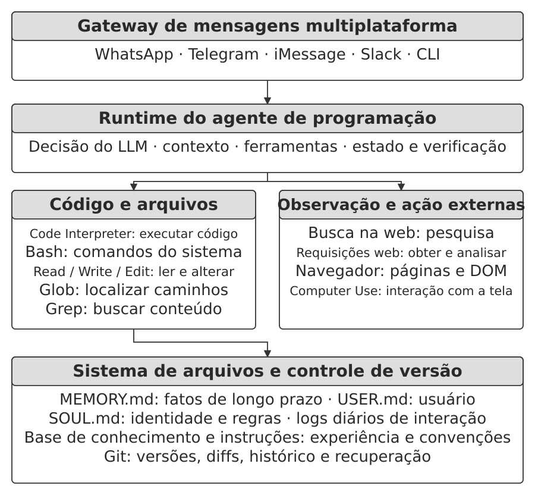

Tomando como exemplo “analisar os dados de vendas do último trimestre e gerar um relatório resumido”, o processo pode ser dividido em cinco etapas:

1. **Ler a memória**: obter o formato de relatório em PDF preferido pelo usuário e o fato de que os dados de vendas estão no Google Sheets.
2. **Obter os dados**: consultar o uso da API do Google Sheets e baixar as planilhas necessárias por meio da interface autorizada.
3. **Escrever o código de análise**: agregar os dados de vendas com pandas, gerar gráficos com matplotlib e conferir os critérios de cálculo e os resultados.
4. **Gerar os artefatos**: organizar a análise e os gráficos em um PDF e salvar os dados de origem, os resultados intermediários e o script de geração, para facilitar a conferência ou a atualização.
5. **Atualizar a memória**: registrar a fonte de dados já confirmada e o identificador da planilha, para que a próxima tarefa os encontre.

Se a mesma tarefa for entregue ao Qwen Office, o usuário pode enviar diretamente o detalhamento das vendas e pedir que ele analise os dados e gere um relatório visual.[^ch5-qwenwork] Suponha que um pedido tenha recebido 100 yuans e, em seguida, um reembolso de 20 yuans; apenas 80 yuans entram nas vendas líquidas do trimestre. Se o gráfico do relatório tiver contabilizado 100 yuans, basta seguir do gráfico para a tabela de totais e dela para o detalhamento original para descobrir qual reembolso ficou de fora.

[^ch5-qwenwork]: Central de ajuda do Qwen Office, apresentação do Qwen Office, que descreve funções como envio de arquivos de dados, análise de dados e geração de relatórios visuais.

O sistema de arquivos conecta essas etapas: o resultado salvo em uma etapa pode se tornar a entrada da seguinte, e os programas podem ler os mesmos dados repetidamente. Se a tarefa for interrompida, o agente ainda consegue confirmar o progresso pelos artefatos salvos e continuar o que ficou pendente.

Os resultados intermediários têm outra utilidade: quando o usuário faz uma pergunta relacionada, é possível retomar a partir da etapa adequada. O Data Formulator, da Microsoft Research, demonstra isso com dados de geração de eletricidade de vários países. A tabela original registra a geração por tipo de fonte de energia; o analista primeiro obtém a participação anual das fontes renováveis em cada país e, com base nela, desenha um gráfico de ranking. Para saber quanto a participação de um país aumentou, a posição no gráfico não mostra quantos pontos percentuais separam os dois anos. Seguindo de volta o processo de derivação preservado na interface até a tabela de participações, basta subtrair os valores dos dois anos.[^ch5-data-formulator]

[^ch5-data-formulator]: Microsoft Research, exemplo de análise de energia do Data Formulator e implementação da vinculação entre gráficos e tabelas de dados na versão 0.7.0.

**Guardar memória, conhecimento e capacidades em arquivos.** O espaço de trabalho do OpenClaw usa arquivos Markdown para guardar vários tipos de informação: `MEMORY.md` registra fatos e decisões de longo prazo, logs organizados por data guardam informações do processo, `USER.md` pode conter as preferências do usuário, e os arquivos de Skill explicam como usar cada capacidade[^ch5-openclaw-files]. **Para memórias que pessoas e agente mantêm em conjunto, prefiro arquivos que possam ser lidos diretamente.** O usuário pode abrir um registro, corrigir um fato errado e, com o Git, consultar a origem, comparar versões e reverter alterações. Logs salvos por data mantêm uma linha do tempo clara dos fatos; quando os arquivos se multiplicam, um índice de busca acelera a localização.

A capacidade do agente de gravar arquivos também permite acumular experiência com as tarefas. Por exemplo, se em um contato com um banco descobrir que a verificação de identidade exige o endereço da agência, o agente pode registrar essa informação junto com o tipo de serviço a que se aplica, a fonte e a data. Depois de conferidos, os registros podem ser organizados em conhecimento, instruções de operação ou programas, e as tarefas seguintes poderão reutilizá-los. O Capítulo 9 discute esse processo de evolução contínua.

[^ch5-openclaw-files]: OpenClaw, *Agent workspace* e *Memory overview*, que apresentam o espaço de trabalho, a memória em arquivos e o mecanismo de busca.

**Que tarefas se prestam a deixar o agente escrever seus próprios programas?** Pesquisa aberta, geração de conteúdo e processamento de dados frequentemente encontram novos formatos de entrada, novas interfaces e novas exigências de artefatos; nesses casos, a geração de código é uma boa candidata a núcleo de execução. Sistemas com processos mais estáveis, como o atendimento ao cliente em domínios verticais, podem se organizar em torno do estado do negócio, de ferramentas de domínio e de estratégias de diálogo, recorrendo ao código para cálculos, conversões e validação de regras. Os dois tipos de sistema aproveitam a capacidade de programação, mas o papel que ela assume varia com a tarefa.

### Fluxo geral de um agente de programação

Vamos percorrer a Figura 5-2 com um pequeno defeito. O usuário relata: “Ao ordenar pelo preço total, 100 yuans aparece antes de 20 yuans”. Primeiro, encontra-se uma entrada que reproduza o problema e, seguindo os dados, descobre-se onde o valor virou string. Depois de corrigir a lógica de comparação, executa-se de novo a entrada original e verifica-se se dados com casas decimais ou valores iguais continuam corretos.

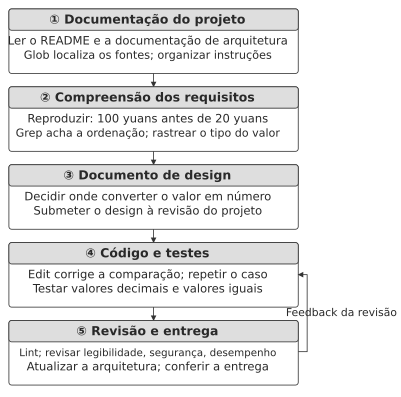

**Entender o projeto e completar a documentação.**

Ao receber a tarefa, o agente primeiro lê a documentação do projeto e depois a confronta com a implementação, os chamadores e os testes, para descobrir o que a alteração afetará. Se a documentação não deixar claro pelo que cada módulo relevante é responsável, quais abstrações centrais usa, como os módulos se articulam ou como testá-los, o agente acrescenta o que verificou no código, para facilitar a consulta de quem assumir o trabalho depois.

Os **arquivos de instruções do projeto** colocam as convenções mais usadas em um lugar de fácil acesso para o agente. `CLAUDE.md`, `AGENTS.md` e as regras de projeto do Cursor podem registrar comandos de compilação, estilo de código e limites de alteração, como “use `pnpm test` para executar os testes”, “declare tipos específicos para as variáveis e evite `any`” e “alterações de migração de banco de dados exigem revisão separada”. Cada ambiente hospedeiro carrega esse conteúdo conforme o diretório, a configuração ou as condições de aplicação; o antigo `.cursorrules` do Cursor também foi uma implementação dessa ideia[^ch5-project-rules].

Os arquivos de instruções e os arquivos `SOUL.md` e `MEMORY.md` do OpenClaw têm focos diferentes: os primeiros descrevem as convenções de trabalho dentro do projeto, `SOUL.md` descreve a identidade e o comportamento do agente, e os arquivos de memória guardam informações que as tarefas seguintes poderão usar. Instruções estáveis e concisas ajudam a manter consistente o prefixo do contexto; regras por diretório carregadas sob demanda controlam o volume de entrada da tarefa atual. As permissões de execução são aplicadas pelo harness e pelo ambiente de execução.

O Capítulo 2 argumentou que equipes favoráveis à colaboração remota também têm mais facilidade para incluir agentes no trabalho. No repositório de código, isso significa registrar as decisões em documentos de design, colocar o contexto das tarefas nas issues e nos PRs e consolidar a experiência interna em guias para desenvolvedores. Uma pergunta prática de verificação é: **um novo integrante remoto consegue, apenas com o repositório e a documentação, encontrar o ponto de partida da tarefa, executar os testes e entender o que se espera da alteração?**

[^ch5-project-rules]: Anthropic, *How Claude remembers your project*; Cursor, Rules, que apresentam as instruções de projeto e as regras carregadas por escopo.

**Definir o objetivo e os critérios de aceitação.**

No caso de um bug já localizado ou de um ajuste de parâmetros, é possível modificar diretamente com base no comportamento existente e nos testes. Quando o objetivo é amplo, é preciso decompô-lo primeiro. Por exemplo, “otimizar o desempenho do sistema” pode significar reduzir o tempo de resposta, diminuir o uso de memória ou aumentar a vazão. O agente deve examinar o gargalo atual, medir a linha de base e o escopo permitido para as alterações, confirmar restrições como compatibilidade de interfaces e experiência do usuário e só então definir a estratégia de otimização.

**Elaborar a proposta de design.**

A descrição do design deve responder: quais módulos serão modificados, que abordagem será adotada, por que ela é adequada ao problema, se haverá novas dependências e como verificar e reverter a alteração. Alterações pequenas podem ser expressas em um plano curto; mudanças complexas devem virar um documento de design passível de revisão. Quando o projeto ou o usuário exigir aprovação, submete-se primeiro a proposta concreta e só se implementa depois de aprovada.

**Implementar, testar e revisar.**

Na implementação, seguem-se as convenções do projeto, reutilizam-se as abstrações e ferramentas existentes e mantêm-se as alterações restritas ao que diz respeito à tarefa. Os testes são projetados em torno do comportamento esperado e cobrem o fluxo normal, as condições de contorno e as situações de erro; ao corrigir um bug, o caso de regressão deve expor o problema original e confirmar a correção.

Quando um teste falha, o agente lê o diagnóstico, localiza a causa, modifica o código e executa de novo as verificações pertinentes. **Uma tarefa de programação só está concluída quando passa na aceitação.** Escrever o patch é apenas uma das etapas; os testes relevantes, as exigências do usuário e os entregáveis também precisam ser conferidos. O ciclo “testar–corrigir–verificar” permite ao agente continuar corrigindo problemas e dá à engenharia de loops um critério claro de parada.

A revisão de código examina aspectos que os testes nem sempre cobrem, como legibilidade, compatibilidade de interfaces, desempenho, permissões e uso de dependências. A conferência pode combinar leitura do diff, análise estática ou um subagente de revisão; encontrados problemas, o agente continua corrigindo e executa de novo as verificações afetadas.

**Sincronizar a documentação e entregar.**

Novos módulos, mudanças de dependências e alterações no comportamento central devem ser refletidos na documentação correspondente. A nota de entrega deve resumir o problema resolvido, as mudanças de comportamento, os resultados da verificação e o modo de uso, acompanhados, se necessário, das etapas de reversão. Código, testes e documentação guardam juntos o resultado da tarefa.

Modelos diferentes também organizam a exploração e a modificação de maneiras distintas: alguns leem amplamente a implementação, os chamadores e os testes; outros examinam primeiro os arquivos mais relevantes, tentam um patch pequeno e usam o feedback da compilação ou dos testes para continuar a investigação. **Encaro esse ritmo entre explorar e agir, antes de tudo, como uma política de comportamento aprendida pelo modelo.** Se o ritmo se mantém parecido depois de trocar o harness, mas muda visivelmente quando se troca o modelo dentro do mesmo harness, a diferença aponta para o próprio modelo. Os prompts, as ferramentas e o orçamento do harness podem amplificar ou inibir essa tendência. O Capítulo 7 discute como avaliar essas diferenças, e o Capítulo 8, como o pós-treinamento influencia a política de comportamento.

### Engenharia de harness na prática para agentes de programação

O Capítulo 1 usou **Agente = Modelo + Harness** para descrever uma implementação de produção e apresentou as cinco funções do harness: gerenciamento de contexto, interface de ferramentas, restrições, verificação e correção. O agente de programação pode aproveitar os testes, a análise estática, a integração contínua e o controle de versão da engenharia de software para transformar essas funções em processos executáveis.

No defeito de ordenação que acabamos de ver, deixar para o modelo a entrada que gera o erro, a função relevante e a saída da falha é gerenciamento de contexto; permitir que o modelo leia, modifique e execute testes depende da interface de ferramentas e das restrições. A verificação só começa quando a alteração é conferida com a mesma entrada; se os números continuarem ordenados como caracteres, enviar de volta a ordem real junto com a esperada é o que constitui um feedback de correção utilizável.

O modelo é responsável por entender o problema e gerar a solução e o código; o harness fornece as informações e as interfaces necessárias ao trabalho, organiza as verificações e, conforme os resultados, continua a execução ou faz a recuperação. No sistema de engenharia, a preparação pode ser feita em quatro frentes:

- **Linha de base de aceitação**: suítes de testes, pipeline de CI e padrões de revisão definem o que conta como concluído. CI é a integração contínua, um pipeline que executa automaticamente as verificações combinadas após cada envio de código.
- **Limites de execução**: definir claramente as responsabilidades dos módulos, as regras de dependência, o acesso a dados e as permissões de operação.
- **Sinais de feedback**: organizar a saída do linter, a verificação de tipos e os resultados dos testes em diagnósticos que o modelo consiga localizar, entender e tratar.
- **Meios de recuperação**: guardar versões no Git, snapshots do espaço de trabalho e o estado da tarefa, e preparar processos de recuperação correspondentes para alterações externas.

**Projetar o objetivo junto com o método de verificação.**

A clareza da tarefa e a possibilidade de verificar o resultado automaticamente determinam, em conjunto, o modo de trabalho do agente. A Tabela 5-1 lista as quatro combinações e indica o trabalho de engenharia que cada uma precisa receber. Esclarecendo requisitos e acrescentando exemplos e verificações, uma tarefa inicialmente vaga pode ser convertida aos poucos em um objetivo executável.

Tabela 5-1 Quatro quadrantes de clareza da tarefa e automação da verificação

| | Resultado verificável automaticamente | Resultado que exige verificação humana |
| --- | --- | --- |
| **Objetivo claro** | Corrigir um bug com teste de regressão: iterar conforme o feedback | Refatoração de código: combinar testes e revisão de arquitetura |
| **Objetivo vago** | “Melhorar a qualidade do código”: definir primeiro metas de qualidade além do linter | “Deixar a UI mais bonita”: esclarecer preferências com exemplos e comparações |

**A infraestrutura de verificação acumulada pela engenharia de software é uma razão importante para os agentes de programação terem amadurecido antes dos demais.** Compiladores, sistemas de tipos, suítes de testes e controle de versão permitem localizar erros, verificar alterações e reverter após falhas, formando naturalmente um harness robusto. Essa constatação também indica onde investir em outros cenários de agentes: levar primeiro as tarefas para a região “objetivo claro, resultado verificável automaticamente”. Quando a aceitação depende de inspeção humana caso a caso, a velocidade da revisão vira o teto da vazão; quando o objetivo é vago, mesmo a automação mais rápida pode continuar otimizando a métrica errada.

**Extrair métodos dos casos de engenharia.**

Uma migração de código em larga escala ajuda a entender como esses componentes se articulam. As regras de migração e as relações entre módulos ficam registradas na documentação do repositório, as restrições de dependência são impostas por análise estática, cada lote de alterações passa pelos testes e pela CI, e as falhas retornam diagnósticos localizáveis. Assim, o agente pode consultar os requisitos da migração, receber feedback após cada lote e continuar avançando com base nele.

A prática da LangChain mostra como aprimorar o harness a partir de trajetórias de falha: fixa-se o modelo, analisa-se em que etapa a tarefa travou ou terminou com erro e, então, ajustam-se o prompt de sistema, o middleware de ferramentas, os ciclos de autoverificação e o orçamento de raciocínio. O Capítulo 1 já apresentou o caso do Terminal Bench 2.0; aqui interessa o método iterativo “registrar a falha–propor a alteração–reavaliar”[^ch5-langchain-harness].

A solução da Anthropic para tarefas longas separa a inicialização do ambiente da execução contínua. Um agente de inicialização cria a lista de tarefas e o ambiente de trabalho; em seguida, agentes de programação avançam item por item, salvando código, resultados de testes e progresso. Uma nova sessão lê esses artefatos e continua o trabalho, o que reduz a perda de informação na passagem entre contextos[^ch5-long-harness].

[^ch5-langchain-harness]: LangChain, *Improving Deep Agents with harness engineering*, 17 de fevereiro de 2026.
[^ch5-long-harness]: Anthropic, *Effective harnesses for long-running agents*, 26 de novembro de 2025.

**Consolidar a experiência em princípios de design de sistemas.**

1. **Restrições executáveis acima de orientações em prompts.** Dependências entre módulos, tipos de campos e padrões de código podem ser verificados por análise estática e CI; as permissões de acesso são impostas pelo ambiente de execução. Prompts e documentação explicam as regras e seus motivos; os mecanismos de verificação detectam e bloqueiam as violações correspondentes.
2. **Investir primeiro em verificação automática.** As verificações repetitivas crescem com o volume de tarefas, e ampliar continuamente a revisão humana vira um gargalo de escala. Testes, verificações de qualidade e monitoramento de comportamento assumem esse trabalho, e a revisão humana se concentra nas escolhas de objetivo e nos julgamentos complexos.
3. **Quanto mais imediato e estruturado o feedback, mais fácil a correção.** A mensagem de erro deve conter o local relevante, a condição de falha e o resultado real, para ajudar o modelo a decidir o próximo passo. A barra de status do Capítulo 2 pode reunir os diagnósticos mais recentes, o número de chamadas e o progresso da tarefa.
4. **Projetar caminhos de recuperação para as alterações.** Branches do Git guardam as alterações de código, a sandbox limita o impacto das tentativas, e os snapshots restauram o estado gerenciado; operações em APIs externas são tratadas com os mecanismos de idempotência, cancelamento e compensação do Capítulo 4.

**Verificar ao mesmo tempo o resultado e o processo.** Ao corrigir uma falha de banco de dados, apagar os dados e recriá-los pode restabelecer o serviço, mas viola a exigência de retenção de dados; ao corrigir um erro de compilação, apagar a implementação relacionada pode fazer a compilação passar, mas elimina a funcionalidade. Esses exemplos mostram que a aceitação precisa cobrir os objetivos de negócio e que o processo de execução também precisa de restrições. Para operações como exclusão de dados de produção ou sobrescrita de arquivos, o harness pode verificar a autorização e o alcance do impacto e acionar o mecanismo de revisão independente apresentado no Capítulo 4.

No treinamento, também é possível penalizar violações já identificadas. O RLVP (penalidade verificada sobre o caminho), discutido no Capítulo 8, incorpora as restrições de processo ao feedback de treinamento e orienta o modelo a respeitar as exigências de execução enquanto busca o resultado. Em tempo de execução, as permissões e a revisão delimitam continuamente as ações executáveis; o feedback de treinamento influencia a forma como o modelo propõe ações.

**Controlar a propagação de falhas conforme as dependências.** Ao ler em paralelo três arquivos independentes, se um deles não existir, deve-se retornar o erro desse item e preservar os demais resultados de leitura. Se uma chamada depender da saída da tarefa que falhou, essa cadeia de dependência deve ser interrompida ou reorganizada. O harness precisa decidir o escopo do cancelamento conforme as relações entre as tarefas e informar ao nível superior o estado de cada item, para que trabalhos independentes não sejam descartados junto. A implementação das chamadas paralelas, da análise em streaming e do cancelamento em cascata é discutida mais adiante.

### Recuperação de falhas e erros

Uma tarefa longa pode perder a conexão entre duas requisições ao modelo, ou executar uma ferramenta sem conseguir salvar o resultado. Se o harness souber apenas que “a tarefa falhou”, recomeçar do zero pode repetir operações já realizadas. Para recuperar o trabalho, é preciso primeiro descobrir onde ocorreu a interrupção, confirmar quais resultados já foram salvos e só então decidir entre tentar de novo, corrigir a chamada, continuar do ponto de parada ou encerrar.

A primeira pergunta da recuperação é: “que evidências a etapa anterior deixou?”. Se a conexão cair durante a leitura de um arquivo, em geral basta ler de novo; se cair depois do envio de uma tarefa remota, o serviço remoto pode já tê-la aceitado. Havendo um identificador da tarefa, deve-se consultá-lo antes de decidir se ela será reenviada. Registrar separadamente “requisição enviada”, “confirmada pelo serviço remoto” e “resultado salvo” é o que dá à recuperação um ponto de partida.

**Escolher o tratamento conforme o local da falha.**

| Camada | Falhas comuns | Foco do tratamento |
| --- | --- | --- |
| Camada de API | Limitação de taxa HTTP 429, sobrecarga do serviço, timeout, queda de conexão, saída que atinge o limite de comprimento | Examinar a causa do erro e o estado da requisição; recuar e tentar de novo ou ajustar a requisição |
| Camada de ferramentas | Nome de ferramenta inexistente, argumentos inválidos, exceção na execução, retorno repetido do mesmo erro | Retornar um diagnóstico localizável; corrigir a entrada ou as condições de execução |
| Camada de contexto | Estouro da janela, falha de compactação, chamadas sem o resultado correspondente | Ajustar o volume de entrada, restaurar os registros reais, verificar a estrutura das mensagens |
| Camada de fluxo de controle | Operações repetidas sem progresso, lógica de recuperação que falha recursivamente | Contar, limitar os níveis de recuperação e acionar o encerramento ou o escalonamento |

Limitação de taxa e sobrecarga temporária podem ser resolvidas aguardando e tentando de novo; argumentos errados exigem corrigir os argumentos, permissões insuficientes exigem tratar a autorização, e uma ferramenta inexistente exige escolher outra capacidade. Mapear cada tipo de erro para uma ação de recuperação concreta evita que a mesma requisição falhe repetidamente sem que as condições mudem.

**Monitorar ao mesmo tempo as falhas e o progresso.**

O harness pode calcular uma impressão digital da chamada a partir de “nome da ferramenta + argumentos normalizados” e, combinando-a com o resultado e o estado da tarefa, detectar comportamentos repetitivos. Chamadas idênticas podem ser uma consulta periódica legítima ou um loop sem progresso; para distinguir, é preciso considerar também a condição de espera, o estado externo e o tempo já decorrido. Cada caminho de recuperação mantém seu próprio contador de falhas, e um orçamento global restringe a tarefa inteira.

Requisições em streaming precisam de três limites separados: timeout de conexão, timeout de inatividade na leitura e tempo total. O timeout de conexão limita a espera para estabelecer a conexão, o de inatividade limita a espera entre dois recebimentos de dados, e o tempo total restringe a requisição inteira. Quando a conexão continua aberta, mas os dados deixam de chegar por muito tempo, um watchdog de inatividade pode encerrar a requisição e iniciar a recuperação. **Toda conexão persistente deve ter monitoramento de atividade; um timeout apenas para o estabelecimento da conexão não basta.** Os limites de timeout devem levar em conta a forma de saída do modelo: texto visível, incrementos de raciocínio e heartbeats indicam que a requisição ainda está em andamento, e um raciocínio interno mais longo também aumenta o tempo de espera.

A verificação de integridade do contexto gira em torno do pareamento entre IDs de chamada e resultados. Quando um resultado está faltando, primeiro se consultam os registros de execução e se restaura o resultado real já salvo; quando o estado da execução é desconhecido, registra-se explicitamente esse estado desconhecido e trata-se o caso com os mecanismos de idempotência e consulta de estado do Capítulo 4.

**Recuperar em níveis e informar o estado atual.**

1. **Recuar e tentar de novo.** Para erros que admitem nova tentativa, usar recuo exponencial com jitter aleatório e respeitar o tempo de espera indicado pelo servidor. A tarefa principal e as tarefas auxiliares recebem orçamentos de novas tentativas separados; trabalhos em segundo plano, como geração de títulos e sugestões de entrada, podem ser pulados após uma falha, para não consumir os recursos da tarefa principal.
2. **Ajustar ou trocar.** Quando a saída atinge o limite de comprimento, verificam-se primeiro o máximo permitido pela interface e o orçamento da tarefa para então decidir entre aumentar o limite, dividir a tarefa ou continuar a saída. Se o serviço permanecer indisponível, pode-se trocar para um modelo alternativo; antes da troca, convertem-se as mensagens, as definições de ferramentas e os campos específicos do modelo.
3. **Informar o andamento da recuperação.** Durante a recuperação automática, pode-se exibir “tentando novamente” ou “trocando de serviço” e manter nos logs cada um dos erros. Se a recuperação der certo, a tarefa continua; quando o usuário precisar tratar uma autorização, fornecer mais entradas ou decidir o próximo passo, informam-se o progresso atual, o motivo da falha e as soluções já tentadas.

**A estratégia de recuperação deve ajudar a tarefa como um todo a avançar.** Erros intermediários recuperáveis ficam no registro de execução, e a interface mostra o andamento da recuperação; só depois de esgotados os meios de recuperação a falha final é comunicada ao usuário e aos sistemas downstream. Assim, os sistemas downstream conseguem distinguir “tentando novamente” de “a tarefa falhou”, evitando acionar compensações cedo demais ou reenviar operações.

Erros de ferramenta podem entrar no contexto como resultados estruturados. Por exemplo, retorna-se o nome da ferramenta inexistente, o campo com erro e os valores permitidos, para que o modelo se corrija com base neles. Conversões de formato que o contrato da interface permite e cujo significado é inequívoco podem ser feitas pelo programa e registradas; quando o significado de um argumento for ambíguo, o modelo deve gerá-lo de novo, para que o reparo não altere o objetivo da operação.

**Assumir uma trajetória inacabada.**

Ao trocar de modelo, é preciso entregar ao destinatário os fatos já confirmados da tarefa, os resultados das ferramentas e as pendências. Papéis das mensagens, formato das chamadas de ferramentas e campos de raciocínio variam de uma interface para outra; na conversão, o conteúdo e o estado do protocolo devem ser tratados separadamente. Alguns serviços retornam o raciocínio legível ou um resumo dele, além de campos opacos destinados às suas próprias requisições seguintes. Esses campos podem vir anexados a blocos de raciocínio ou a chamadas de ferramentas; quais precisam ser devolvidos sem alterações nas requisições seguintes é algo definido pela interface correspondente.

**Sistemas que precisam continuar trajetórias entre fornecedores devem guardar a trajetória de negócio em um formato neutro.** O fato de um modelo entender o texto produzido por outro fornecedor não significa que a API de destino aceitará os campos de protocolo opacos do fornecedor original. Separar os fatos da tarefa do protocolo do fornecedor é o que permite que a transferência, a reprodução em avaliações e os dados de treinamento compartilhem o mesmo registro. O registro neutro contém: tarefa e mensagens, nomes e argumentos das ferramentas, identificadores estáveis das chamadas, estado de execução, resultados e suas origens. As respostas brutas do fornecedor são guardadas à parte, para continuar na mesma interface e rastrear problemas. Ao converter para uma requisição ao modelo de destino, cria-se um mapeamento dos IDs de chamada e mantém-se o pareamento dos resultados; os resumos legíveis são passados como contexto comum com a origem indicada, e os campos opacos do serviço original permanecem no registro bruto.

Se a interface de destino não conseguir representar as chamadas antigas, as etapas concluídas podem ser organizadas em um registro explícito da tarefa, como “passagens e hospedagem já consultadas; a seguir, obter as despesas com refeições e a taxa de câmbio”, acompanhado dos resultados reais. Em seguida, o modelo de destino produz novas chamadas válidas. Depois que o destinatário começa a trabalhar, os campos de protocolo que ele retorna devem ser preservados conforme as exigências de sua própria interface. Esse registro neutro também serve para a reprodução em avaliações do Capítulo 7, para a construção de amostras de treinamento do Capítulo 8 e para a extração de experiências do Capítulo 9.

> **Experimento 5-1 ★★★: transferência de trajetória entre fornecedores**
>
> Neste experimento, o agente consulta passagens aéreas, hospedagem, despesas com refeições e a taxa de câmbio e calcula o total em yuans. Depois das duas primeiras chamadas de ferramentas, o script troca de serviço em um ponto de interrupção predefinido, simulando a transferência após o serviço de origem ficar indisponível; o destinatário continua com as etapas restantes. O experimento usa três modelos, da Moonshot, da Anthropic e do Google, e compara as seis combinações direcionais de troca.
>
> Os três tratamentos são: passar as mensagens originais com mapeamento campo a campo; converter as mensagens depois de remover o conteúdo de raciocínio e os campos opacos; e guardar o estado da tarefa em uma trajetória neutra, reconstruindo o contexto conforme a interface de destino. O ponto de troca é controlado pelo script, e os erros de formato do destinatário vêm de respostas reais dos serviços.
>
> Nesta execução, a trajetória neutra concluiu a transferência e calculou o total corretamente nas seis combinações; os outros dois tratamentos concluíram três e quatro, respectivamente. Como o progresso da tarefa já estava salvo nos resultados das ferramentas, nenhum dos três grupos repetiu chamadas de ferramentas.

> **Experimento 5-2 ★★: retomada depois que a saída é interrompida no meio**
>
> Este experimento interrompe o stream em três pontos — no raciocínio, no texto e nos argumentos de uma ferramenta — e compara três abordagens: reenviar a rodada inteira, continuar usando o texto já gerado como prefixo e acrescentar uma instrução de continuação. Uma chamada de ferramenta precisa dos argumentos completos antes de ser executada; o fragmento truncado é guardado primeiro no registro de execução e, após a recuperação, é analisado e validado de novo.
>
> Um erro concreto apareceu no argumento de cidade: o modelo deveria ter gerado “东京” (Tóquio), mas a interrupção deixou apenas `{"city":"东`, e a continuação fechou a estrutura como `{"city":"东"}`. O JSON ficou válido, mas a cidade continuou errada.
>
> No teste com texto longo desta execução, a continuação por prefixo reduziu os tokens de saída subsequentes; com a interrupção nos argumentos, o comportamento foi diferente: nos três testes com a Moonshot, a continuação por prefixo não recuperou a cidade correta em nenhuma vez.

**Definir condições de encerramento para os ciclos de recuperação.**

Todo caminho de recuperação precisa de um limite. Por exemplo, após falhas consecutivas de compactação, passa-se a outra estratégia de contexto; quando a decisão de permissão não pode ser concluída, o caso vai para tratamento humano; a continuação da saída para ao atingir o número de rodadas ou o orçamento de custo. **Os limites de novas tentativas devem ser definidos a partir da distribuição de recuperações em produção.** Se a grande maioria das falhas temporárias se resolve nas primeiras tentativas e as tentativas seguintes do mesmo tipo têm taxa de sucesso próxima de zero, deve-se parar nesse ponto de inflexão, para que chamadas inúteis não continuem consumindo a cota.

A própria lógica de recuperação também pode falhar. Por exemplo, um estouro de contexto aciona um hook de encerramento, o hook pede ao modelo uma mensagem de commit, o contexto estoura de novo e o hook é acionado outra vez. Essa cadeia pode ser interrompida com uma marca de reentrância e um limite de profundidade de recursão, agendando separadamente a limpeza de erros e o trabalho auxiliar que exige chamar o modelo, com orçamento próprio para este último. A tarefa também deve ter limites globais de iterações, tempo e custo, de modo que todos os caminhos de recuperação fiquem sujeitos ao orçamento da tarefa inteira.

### Técnicas de implementação para agentes de programação

Comecemos pelo registro de execução de uma correção de teste com falha para estimar qual trecho vale a pena otimizar. Na palestra “The Road to JARVIS”, que apresentei no Porto em novembro de 2026, comparei diferentes velocidades de inferência reproduzindo a mesma sessão: com os tempos dos modelos em produção na época, o total foi de 24,2 segundos; mantendo os tempos das ferramentas e substituindo a velocidade de inferência por uma estimativa para um chip dedicado ainda não fabricado, o total caiu para cerca de 8,1 segundos. Desses, 7,5 segundos foram gastos executando testes. Mesmo eliminando os cerca de 0,6 segundo restantes de tempo do modelo, ainda seria preciso esperar os testes terminarem.

Que trabalhos podem ocorrer simultaneamente nesses 7,5 segundos? Isso depende das dependências entre as chamadas de ferramentas.

**Chamadas de ferramentas em paralelo, execução em streaming e interrupção em cascata.**

Buscar código, ler configurações e consultar logs muitas vezes podem ser feitos de forma independente. Quando o modelo gera essas chamadas em uma única resposta, o harness pode sobrepor a geração das chamadas à execução das ferramentas: assim que a interface confirma que a primeira chamada foi emitida por completo e que os argumentos e as permissões foram validados, ela é agendada imediatamente, enquanto as chamadas seguintes continuam sendo recebidas. Para julgar se uma chamada está completa, usa-se o evento de conclusão da chamada fornecido pela interface, evitando executá-la antes da hora apenas porque o JSON já pode ser analisado provisoriamente.

Chamadas independentes podem rodar em paralelo. Por exemplo, ler o arquivo de configuração enquanto se busca o nome de uma função e decidir a alteração depois que os dois resultados retornarem. Já a leitura de um arquivo que só pode ser determinado pelo resultado da busca fica para uma etapa posterior. O escalonador também precisa identificar estado compartilhado: duas ferramentas que modificam o mesmo arquivo ao mesmo tempo geram conflito de escrita, mesmo que suas entradas sejam independentes.

As definições de ferramentas podem declarar a capacidade de concorrência, os recursos acessados e a forma de cancelamento; em uma implementação didática, ferramentas sem declaração podem ser agendadas em série. Quando uma chamada falha, interrompe-se o trabalho subsequente que depende do seu resultado, preservam-se os resultados das chamadas independentes e informa-se ao nível superior o estado de cada item. Ao cancelar uma tarefa já iniciada, também é preciso registrar se o cancelamento surtiu efeito e quais alterações de arquivos ou operações externas já ocorreram.

**Gerenciamento refinado do contexto.**

Uma base de código grande pode entrar no contexto aos poucos, por meio de busca em camadas: primeiro se localiza o arquivo, depois se leem as funções relevantes e, se necessário, a busca se estende aos chamadores e aos testes. Cada leitura acrescenta informações em função da decisão atual, para que o modelo veja ao mesmo tempo o código, as restrições e o feedback da execução.

A ferramenta de leitura deve permitir retornar trechos por intervalo de linhas, como das linhas 100 a 150, com o número real da linha no arquivo anexado a cada linha. Assim, o modelo pode citar com precisão “a linha 142”, e a ferramenta de edição pode usar essa referência para localizar o ponto. O retorno também deve indicar de qual arquivo veio e qual intervalo foi lido; se o arquivo mudar, o local da edição precisa ser confirmado de novo.

Compilações ou testes podem gerar milhares de linhas de saída. Nesse caso, pode-se usar o mecanismo de truncamento e persistência do Capítulo 4: retornar o início, o fim e a quantidade omitida, guardando a saída completa para consulta sob demanda. Como o erro pode estar no meio, o agente pode continuar buscando palavras-chave do erro ou ler o intervalo correspondente.

**Injeção dinâmica de informações do ambiente.**

Em tarefas de programação, a barra de status do agente apresentada no Capítulo 2 pode reunir quatro tipos de informação:

- **Diretório de trabalho atual**: define a base dos caminhos relativos.
- **Branch do Git**: indica o branch de desenvolvimento em que estão as alterações atuais.
- **Commits recentes**: mostram as mudanças recentes relacionadas à tarefa.
- **Resumo das alterações preparadas e não preparadas para commit**: distingue o conteúdo pronto para commit das modificações no espaço de trabalho.

O harness pode atualizar esse resumo depois de operações que alteram esses estados e anexá-lo ao final do contexto na chamada seguinte ao modelo. Informações que mudam pouco, como os commits recentes, podem ser atualizadas sob demanda, reduzindo consultas repetidas e o volume de entrada. Manter estável a parte inicial do contexto favorece a reutilização do cache de prefixo.

**Persistência do estado do ambiente de execução de comandos.**

Mudar de diretório, ativar um ambiente virtual, definir variáveis de ambiente e iniciar serviços em segundo plano afetam os comandos seguintes. Depois que o agente executa `cd` em um shell, a mudança de diretório só se mantém naturalmente se os comandos seguintes continuarem usando essa sessão; quando a execução ocorre em outro processo, o diretório de trabalho é determinado pela configuração do novo processo. As variáveis de ambiente criadas pela ativação de um ambiente virtual têm o mesmo limite de sessão.

**Para depuração interativa e tarefas que exigem serviços contínuos, recomendo usar por padrão um terminal persistente.** Ele preserva o diretório de trabalho, as variáveis de ambiente e o estado da sessão, de acordo com o hábito do desenvolvedor de trabalhar continuamente no mesmo terminal. O harness atribui um identificador à sessão e acompanha o diretório de trabalho, os processos em execução e os códigos de saída, para que o modelo saiba em que ambiente o próximo comando será executado. Outra implementação possível é fazer com que cada comando leve explicitamente o diretório de trabalho e a configuração do ambiente, mantendo a consistência com uma configuração reconstruível.

Tarefas paralelas devem usar sessões independentes ou snapshots explícitos do ambiente, para que a mudança de diretório de uma tarefa não afete outra. Ao final da tarefa, os processos em segundo plano são encerrados de forma centralizada; ao retomar uma tarefa, verifica-se de novo se a sessão ainda está ativa. Por exemplo, ao voltar no dia seguinte para continuar executando os testes, o código e a lista de dependências podem ser lidos novamente do espaço de trabalho; já o processo de serviço iniciado no terminal na véspera precisa ser verificado para saber se continua em execução. São justamente os dois tipos de estado que precisam ser distinguidos ao estimar o custo da sandbox no Capítulo 4.

**Feedback de sintaxe imediato.**

Depois que um arquivo é gravado, a camada de ferramentas pode executar automaticamente o verificador de sintaxe ou o linter da linguagem correspondente e entregar o diagnóstico ao modelo como valor de retorno da ferramenta. Por exemplo, quando falta um parêntese, retorna-se o arquivo, a linha e a coluna e o tipo de erro, e o modelo pode corrigi-lo na rodada seguinte, criando um feedback semelhante às marcações instantâneas de uma IDE.

O escopo da verificação pode crescer com a alteração: primeiro se verifica o arquivo modificado, depois se executam os testes dos módulos afetados e, por fim, as verificações de regressão exigidas para a entrega. Verificações leves ajudam a encontrar problemas locais o quanto antes, e os testes de integração verificam o comportamento entre módulos.

### Ferramentas de busca em agentes de programação

Se a mensagem de erro contém “campo de valor ausente”, pode-se buscar primeiro o texto literal e, a partir do ponto em que o erro é lançado, rastrear os chamadores. Se o usuário diz apenas “a ordenação está com problema” e o código usa nomes em inglês, buscar essa frase literalmente adianta pouco. Pode-se primeiro localizar a interface que exibe o resultado e depois seguir os campos, as relações de chamada e os dados de teste até a lógica de ordenação. Os quatro tipos de ferramenta de busca da Figura 5-3 exploram pistas diferentes; o que a primeira busca retorna muitas vezes determina para qual ferramenta mudar na seguinte.

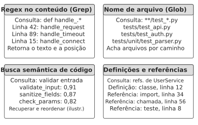

**Correspondência de conteúdo por expressões regulares.** grep e ripgrep procuram conteúdo com base em padrões de texto e são adequados a tarefas em que se conhecem nomes de funções, nomes de variáveis ou mensagens de erro. Por exemplo, `def handle.*` encontra linhas de texto com a forma correspondente de definição de função. Combinados com filtros por tipo de arquivo e caminho, também permitem buscar apenas em arquivos Python e excluir o diretório de testes, concentrando os resultados na implementação relevante.

A correspondência de texto se refere diretamente ao conteúdo dos arquivos, e os resultados são fáceis de conferir. Os termos da consulta precisam se ligar à forma como o código se expressa: ao buscar “autenticação de usuário”, pode-se tentar também nomes como `authenticate`, `login` ou `check_credentials`. Quando o modelo amplia a consulta com base no resultado anterior, forma-se um processo de busca em que se compreende enquanto se busca.

**Correspondência por padrão de nome de arquivo.** glob procura arquivos com base em padrões de caminho; por exemplo, `**/*.test.ts` encontra arquivos de teste TypeScript em todos os níveis de diretório, e `src/components/**/Button.tsx` encontra Button.tsx sob o diretório de componentes. A correspondência por caminho dispensa a leitura do conteúdo e é adequada para entender primeiro a organização do projeto e depois escolher quais arquivos abrir.

**Busca semântica de código.** Quando a tarefa fornece apenas uma descrição da funcionalidade, pode-se usar busca vetorial para recuperar código semanticamente relacionado. Por exemplo, “verificar a identidade do usuário” pode corresponder a `check_credentials`. Esse tipo de sistema costuma lidar com duas tarefas:

- **Dividir em blocos segundo a estrutura do código.** Funções, classes e métodos são as unidades principais, preservando as assinaturas, os comentários e o módulo a que pertencem. Quando uma unidade longa é subdividida, cada fragmento deve levar contexto suficiente para ser compreendido.
- **Combinar vários sinais de busca.** A busca vetorial encontra código semanticamente relacionado, a busca por palavras-chave encontra código cujo nome corresponde exatamente, e os dois conjuntos de resultados são combinados. O cross-encoder apresentado no Capítulo 3 pode refinar a ordenação: ele lê ao mesmo tempo a consulta e um trecho de código e atribui uma pontuação de relevância a esse trecho.

Perguntas exploratórias como “interagir com o banco de dados” ou “validar a entrada do usuário” podem começar pela busca semântica para localizar o módulo e, depois, passar à leitura da implementação.

**Ao construir a capacidade de busca de um agente de programação, recomendo fazer bem, primeiro, o Grep, o Glob e a leitura por intervalo.** O modelo pode, a partir dos resultados, reescrever a consulta, abrir os chamadores e os testes e estreitar o escopo aos poucos. Essas ferramentas leem diretamente o espaço de trabalho atual, dispensando a manutenção de um índice de embeddings sincronizado com o código. Só quando for preciso explorar repetidamente uma base de código grande e, com apenas a descrição da funcionalidade, for difícil encontrar o ponto de entrada, vale acrescentar um índice semântico para melhorar a revocação. O Cursor já apresentou publicamente sua indexação de bases de código baseada em embeddings, e documentos posteriores sobre busca apresentaram o índice local Instant Grep e subagentes exploratórios[^ch5-search]. Essa evolução também mostra que “usar uma interface do tipo grep” e “construir ou não um índice” são duas dimensões de design distintas: a mesma interface de busca pode usar, por baixo, varredura ou índice.

**Busca de definições e referências no nível de símbolos.** Servidores de linguagem podem usar informações de sintaxe, escopo e tipos para oferecer “ir para a definição” e “encontrar referências”. Por exemplo, se `authenticate` é definida na linha 42 e chamada na linha 189, a ferramenta pode retornar a relação entre as duas e distinguir símbolos homônimos em outros escopos. O plugin de inteligência de código do Claude Code é uma forma de integração: ele oferece navegação por símbolos e diagnósticos após a edição por meio do Language Server Protocol (LSP)[^ch5-lsp].

A eficácia das ferramentas de símbolos depende do suporte à linguagem, da configuração do projeto e do estado da análise. O agente pode recorrer à busca textual para encontrar strings, comentários ou arquivos que o servidor de linguagem ainda não analisou.

[^ch5-search]: Cursor, *Securely indexing large codebases* e Search, que apresentam, respectivamente, o esquema de indexação por embeddings e o mecanismo de busca local posterior.
[^ch5-lsp]: Anthropic, *Code intelligence plugins*, que apresenta definições, referências e diagnósticos em tempo real fornecidos via LSP.

### Ferramentas de edição de arquivos em agentes de programação

Imagine que, depois que o modelo leu um arquivo, outra pessoa tenha acrescentado uma linha de comentário no início dele. Nesse caso, “alterar a linha 28” e “substituir este trecho de texto original, que só aparece uma vez” ainda apontam para o mesmo lugar? E se o texto original aparecer uma vez em cada uma de duas funções? Os cinco esquemas de edição da Figura 5-4 localizam a alteração de maneiras diferentes: alguns se baseiam em números de linha, outros no texto original, e há também os que entregam o trabalho de mesclagem a outro modelo.

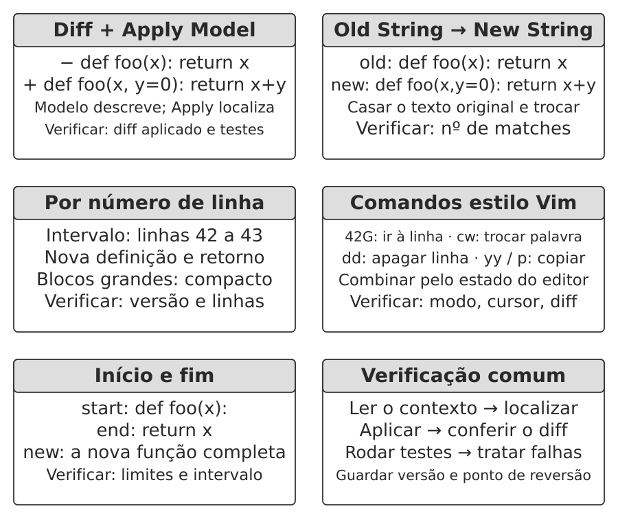

**Descrição de diferenças + Apply Model.** O modelo principal fornece a intenção da alteração e trechos de código, por exemplo uma descrição de adições e remoções semelhante a um Git diff, ou um esqueleto de código que usa marcadores de omissão para pular as partes não alteradas. Um modelo de aplicação dedicado combina isso com o arquivo original e gera o conteúdo completo modificado. O antigo Fast Apply do Cursor é o representante dessa ideia[^ch5-apply]. Ele divide “propor a alteração” e “aplicar a alteração” entre dois modelos. À medida que os modelos de base ficaram melhores em gerar edições locais precisas, esse fluxo com dois modelos foi ganhando alternativas mais simples.

Essa divisão de trabalho permite que o modelo principal se concentre em expressar a lógica do código, enquanto o modelo de aplicação mescla as alterações locais ao arquivo. O foco da verificação recai, correspondentemente, sobre o resultado da mesclagem: vários trechos semelhantes podem tornar a localização ambígua, os marcadores de omissão podem ser mal interpretados e regiões não alteradas podem ser reescritas por acidente.

**String antiga para string nova (Old String → New String).** A ferramenta Edit do Claude Code usa substituição exata de strings; o Cursor introduziu o Search & Replace na versão 0.50, em maio de 2025, usado primeiro na edição de arquivos longos com modelos da Anthropic[^ch5-direct-edit]. Essa abordagem entrega diretamente ao programa o critério de localização e o conteúdo de substituição, eliminando a nova chamada ao modelo na fase de mesclagem. O modelo fornece `old_string` e `new_string`, e a ferramenta encontra o texto original no arquivo e faz a substituição. A interface pode exigir que, em uma substituição simples, o texto original seja único; sem correspondência ou com várias correspondências, ela retorna as posições e um diagnóstico, e o modelo acrescenta contexto. Quando for necessária uma substituição em massa, o escopo é indicado por um parâmetro explícito.

Por exemplo, em um arquivo de configuração, dois serviços têm `timeout = 30`. Agora se quer mudar para 60 segundos apenas o timeout do serviço de download. Se a ferramenta exigir correspondência única, fornecer apenas `timeout = 30` resulta em duas correspondências, e o arquivo deve permanecer inalterado. Na requisição seguinte, o título da seção do serviço de download e a linha de configuração são usados juntos como string antiga, e a string nova mantém o título, alterando apenas o valor.

A correspondência por conteúdo é intuitiva e fácil de conferir. Na chamada, o modelo precisa emitir a string antiga completa: para remover um bloco grande de código, o argumento fica muito longo, e pequenas diferenças de espaços, quebras de linha e aspas também afetam a correspondência. O caso das aspas curvas Unicode no Capítulo 4 mostra como esse tipo de falha ocorre na passagem de argumentos.

**Localização por número de linha (Old Line Numbers → New String).** O modelo especifica a remoção das linhas X a Y e insere um novo texto. Quando a ferramenta de leitura já fornece os números reais das linhas, remover um bloco grande exige apenas as duas posições, inicial e final. O significado dos números de linha depende da versão do arquivo no momento da leitura, e uma edição anterior pode deslocar as posições seguintes.

Por isso, edições em lote podem referenciar uniformemente um mesmo snapshot inicial, com a ferramenta verificando intervalos sobrepostos e aplicando tudo de uma vez; ou podem ser feitas uma a uma, relendo o arquivo e localizando de novo a cada vez. A ferramenta também pode conferir a versão do arquivo ou o conteúdo esperado e retornar um conflito após modificações concorrentes, evitando que números de linha antigos sejam aplicados ao novo conteúdo do arquivo.

**Comandos de edição no estilo do Vim.** Comandos de editor podem expressar mover, copiar, recortar e colar e são adequados a reorganizações como mover uma função de um lugar para outro. Eles dependem do cursor atual, do buffer e do modo de comando, e cada passo altera a referência das operações seguintes.

**Os hábitos de interação dos editores humanos não precisam ser o design padrão das ferramentas do modelo.** Pessoas costumam dar uma olhada no estado atual e executar uma pequena operação; o modelo, por sua vez, pode pensar por mais tempo e gerar de uma só vez dezenas ou até centenas de linhas de alterações. Decompor essas alterações em lote em uma grande quantidade de movimentos de cursor e trocas de modo aumenta o custo das chamadas e exige que o modelo preveja o efeito dos comandos anteriores sobre o estado. Por isso, em tarefas de geração de código, prefiro interfaces que expressem diretamente o objetivo e o conteúdo da alteração; ao usar comandos de editor, é preciso deixar clara a referência de estado e retornar feedback prontamente.

**Correspondência pelo início e pelo fim da string (Old String Start + End → New String).** O modelo fornece apenas algumas linhas do início e do fim da região a ser substituída, e a ferramenta localiza os dois limites e o conteúdo entre eles. Ao remover centenas de linhas de código, esse método reduz o texto original que precisa ser repetido na saída e preserva o critério de localização por conteúdo.

A ferramenta precisa verificar a ordem em que os dois trechos aparecem e decidir, conforme o contrato da interface, se os trechos inicial e final também serão substituídos. Só se age quando há um único intervalo que atende às condições; se vários puderem corresponder, informam-se essas posições ao modelo e pede-se que ele acrescente contexto. Em estruturas aninhadas ou código repetido, acrescentar âncoras adjacentes, como nomes e assinaturas de funções, ajuda a determinar o intervalo.

**Ao construir um novo agente de programação, recomendo começar por uma interface de edição simples e determinística, como string antiga para string nova.** A localização pelo texto original é clara, as causas de falha são fáceis de explicar e as diferenças são fáceis de conferir. Quando o modelo gera alterações locais de forma confiável, o harness pode entregar mais trabalho a programas determinísticos, dispensando um modelo de aplicação adicional. Quando for preciso reduzir o tamanho dos argumentos para remover blocos grandes, introduzem-se âncoras de início e fim ou edição por número de linha baseada em snapshot. O `apply_patch` do Codex mostra outra via de edição direta, que expressa várias alterações com patches restritos.

[^ch5-direct-edit]: Anthropic, *Tools reference*, ferramenta Edit; Cursor, notas da versão 0.50, 15 de maio de 2025, sobre a introdução do Search & Replace; as notas da versão 1.3 registram também otimizações do Search & Replace e do Apply.

[^ch5-apply]: Cursor, *Editing Files at 1000 Tokens per Second*, que apresenta um modelo dedicado a aplicar descrições de alterações ao arquivo original.

### Segurança para agentes de programação

O agente de programação pode ler o projeto, modificar arquivos, executar programas e, eventualmente, acessar serviços externos pela rede. Ao projetar as permissões, é preciso seguir o fluxo de dados e examinar três questões: que conteúdo entra no contexto, que operações o modelo pode solicitar e por qual mecanismo essas operações são, em última instância, aprovadas e executadas.

Simon Willison resumiu uma classe de riscos de injeção de prompt com a “tríade letal”: acesso a dados privados, exposição a conteúdo não confiável e capacidade de comunicação externa[^ch5-trifecta]. Por exemplo, um assistente que lê arquivos privados, processa e-mails externos e pode enviar mensagens precisa de limites de autorização claros entre ler, entender e enviar. Se instruções contidas em conteúdo externo forem tomadas como pedidos do usuário, podem provocar transferências de dados não autorizadas.

Além dessas três dimensões, recomendo examinar uma quarta: **a memória persistente amplifica o impacto da injeção de prompt**. Se um conteúdo externo entrar na memória de longo prazo, seu efeito pode atravessar sessões e reaparecer em tarefas posteriores. Por isso, a gravação na memória deve registrar a origem, o escopo de aplicação e o estado de confirmação, e esses atributos devem ser preservados na leitura. A confiabilidade de um texto salvo em `MEMORY.md` continua dependendo de como ele foi formado. Quando um registro errado for descoberto, também é preciso conseguir localizá-lo, corrigi-lo e retirá-lo.

As três camadas de guardrails do Capítulo 1 assumem aqui funções distintas: a camada de contexto indica a origem das informações e as exigências de comportamento, a camada de execução valida as operações e as autorizações, e a camada de dados restringe a leitura e a gravação de recursos conforme identidades confiáveis. A sandbox do Claude Code restringe a execução de comandos com limites de sistema de arquivos e de rede, e o Cowork também usa ambientes isolados para executar tarefas locais[^ch5-sandbox]. A seguir, esses mecanismos são detalhados.

**Delimitar os recursos e a comunicação na sandbox.**

- **Saída de rede.** É uma fronteira facilmente negligenciada nas sandboxes de código, que deve ser implementada com prioridade. Recomendo começar com o acesso externo fechado por padrão e liberar, conforme a necessidade da tarefa, repositórios de pacotes, sites de documentação e APIs de negócio. A lista de permissões deve corresponder a destinos e escopos de operação específicos; em serviços compartilhados, também é preciso considerar contas, tenants e a titularidade dos recursos. A política de rede deve abranger os programas iniciados pelas ferramentas e seus subprocessos, e os dados enviados para fora são verificados à parte, conforme o escopo autorizado.
- **Sistema de arquivos.** O código-fonte original pode ser montado como somente leitura, com uma cópia colocada em um espaço de trabalho gravável; ou uma interface de edição controlada pode gerar patches, aplicados após revisão. Artefatos gerados e arquivos intermediários ficam em diretórios separados, e os arquivos de credenciais ficam fora da sandbox. Quando for preciso acessar serviços autenticados, uma interface controlada fornece as capacidades de que a tarefa precisa, evitando entregar todas as credenciais do host ao programa gerado.
- **Recursos e tempo.** Definir limites para CPU, memória, número de processos, espaço em disco e tempo de execução, contendo o impacto de loops infinitos, da multiplicação descontrolada de processos e da gravação contínua em disco. Ao ultrapassar um limite, retorna-se um estado estruturado, como “execução ultrapassou 120 segundos e foi encerrada”, junto com a saída preservada e o resultado da limpeza, para que o modelo decida se deve reduzir a tarefa ou ajustar a implementação.

Essas fronteiras precisam cobrir toda a cadeia de execução. Depois que um comando é aprovado, os programas efetivamente iniciados continuam rodando dentro do mesmo escopo de permissões; processos em segundo plano, ferramentas auxiliares e interfaces externas também precisam estar sob o controle correspondente.

**Analisar a estrutura dos comandos e o significado dos argumentos.**

Comandos de shell combinam nome do programa, argumentos, redirecionamentos, pipes e subexpressões. Na revisão, essas estruturas devem ser analisadas para então identificar as operações de leitura, gravação, execução e comunicação envolvidas. **Uma lista negra de comandos não basta para a decisão final de segurança.** A mesma operação pode ser expressa com diferentes combinações de argumentos e chamadas indiretas; a validação precisa entender a estrutura do comando e a função de cada argumento, e as permissões em tempo de execução restringem o alcance real da execução.

Por exemplo, uma ferramenta de busca de arquivos pode ter um argumento que executa uma operação para cada correspondência, e a opção de saída de uma ferramenta de download determina onde os dados serão gravados. O validador precisa identificar “qual opção toma o argumento seguinte como valor”, rastrear a função de cada argumento e então verificar o caminho de destino, as permissões de acesso e as operações permitidas. Assim, o resultado da revisão pode chegar ao nível de “quais arquivos serão lidos”, “em que local se gravará” e “qual programa será iniciado”.

Expansão de variáveis, scripts dinâmicos e caminhos gerados apenas durante a execução fazem com que parte do comportamento real só possa ser determinada no momento da execução. Para as partes indeterminadas, o harness pode exigir uma forma de chamada mais explícita, encaminhá-las para revisão ou executá-las em um ambiente restrito. A revisão assistida por modelo fornece o julgamento contextual, e o controle de acesso determinístico restringe o efeito real. O Sidecar apresentado no Capítulo 4 pode trabalhar em paralelo com a preparação, e as operações com impacto externo são submetidas depois de aprovadas na revisão.

**Deixar claro a quem se serve em delegações com várias partes.**

A lealdade ao mandante (principal loyalty) trata de como o agente, ao agir em nome de uma parte e se comunicar ao mesmo tempo com outros participantes, continua respeitando os objetivos e a autorização de seu mandante. Por exemplo, o usuário pede ao agente que negocie preços com um fornecedor e informa, em caráter reservado, um teto de orçamento de 12.000 yuans. O agente precisa entender as propostas do fornecedor e explicar as demandas do seu lado, protegendo ao mesmo tempo essa restrição privada.

Em avaliações de interações entre várias partes, meus colaboradores e eu observamos dois tipos de falha: um vaza informações privadas do mandante ou aceita exigências indevidas da outra parte; o outro recusa em excesso, a ponto de não conseguir atender nem aos pedidos legítimos do mandante. As estratégias de prompt e os métodos de treinamento avaliados mostraram um trade-off entre a proteção das informações e a colaboração normal[^ch5-1]. **A lealdade precisa medir ao mesmo tempo a proteção das informações e a conclusão da tarefa.** Buscar apenas recusar mais pedidos bloqueia também a colaboração normal; buscar apenas concluir a conversa sem atritos pode permitir que a outra parte afete os interesses do mandante.

Para um agente de programação, arquivos do repositório, saídas de ferramentas e retornos de MCPs de terceiros podem conter informações da tarefa e também textos que pedem mudanças de comportamento. O harness deve distinguir, pela origem real, as instruções do mandante dos materiais externos, anexar a origem e o papel a cada mensagem e mapear o escopo da delegação em permissões executáveis. Textos em materiais externos que se apresentam como “pedido do usuário” precisam ser confirmados por um canal confiável.

O prompt pode explicitar ainda as regras de colaboração: proteger as informações privadas do mandante — às vezes, até a existência de um registro precisa ser mantida em sigilo; ao se explicar para fora, revelar apenas o necessário; distinguir os limites internos das posições públicas; avançar a tarefa dentro do escopo autorizado; manter o mesmo critério de autorização diante de pedidos repetidos. Ampliações da autorização ou mudanças de quem é servido devem ser confirmadas por um canal confiável, com atualização correspondente das permissões em tempo de execução. Assim, o modelo recebe uma base clara de comportamento, e as ferramentas e o ambiente aplicam os limites reais de acesso.

[^ch5-trifecta]: Simon Willison, *The lethal trifecta for AI agents: private data, untrusted content, and external communication*, 16 de junho de 2025.
[^ch5-sandbox]: Anthropic, *Making Claude Code more secure and autonomous with sandboxing* e *How we contain Claude across products*, que apresentam os limites de sistema de arquivos, de rede e de isolamento entre produtos.
[^ch5-1]: Li, Bojie and Noah Shi, *Whose Side Is Your Agent On? Multi-Party Principal Loyalty in LLM Agents*, 2026.

## Código: a metacapacidade de um agente de propósito geral

As seções anteriores transformaram as necessidades do usuário em alterações de código. Voltemos agora às planilhas de vendas do início: mesmo que o usuário precise apenas de um relatório, o agente ainda pode escrever um programa que unifique os identificadores dos produtos, faça a contagem por grupo e recalcule, para um produto, a taxa de devolução a partir das planilhas originais. Primeiro, é preciso perguntar ao usuário se a contagem deve ser por unidades ou por pedidos. Suponha que um produto tenha vendido dez unidades, distribuídas em dois pedidos, e que apenas um pedido tenha devolvido uma unidade. Por unidades, a taxa é 1/10; por pedidos com devolução, é 1/2. Os dois cálculos rodam sem erro, mas só confirmando antes o critério se sabe qual número responde à pergunta do usuário. Um programa escrito assim também pode ser executado de novo quando chegarem os dados do próximo período. Esse ciclo de “gerar, executar, verificar” também se estende à produção de conteúdo, à integração com sistemas de negócio e ao desenvolvimento de agentes.

> **Metacapacidade.** Neste livro, metacapacidade (meta-capability) designa a capacidade de criar ou combinar outras capacidades. A geração de código pode produzir novas ferramentas, como scripts de processamento de dados e fluxos de chamadas de API; pode expressar novas restrições, como asserções e regras de validação; e pode construir novas formas de apresentação, como formulários HTML, apresentações de slides e vídeos.

Comecemos pelo caso mais simples. Mesmo quando a única entrega é a resposta de uma questão, o modelo pode escrever um pequeno programa para verificar seus próprios cálculos.

### Código como ferramenta de pensamento

**Para cálculos exatos e restrições formais, prefiro que o modelo escreva expressões executáveis e as entregue a um interpretador ou solucionador.** Gerar a resposta palavra por palavra é propenso a erros de transcrição e de cálculo e também pode deixar condições de fora; um programa fixa essas etapas e pode ser executado repetidamente. Tarefas matemáticas e lógicas costumam ter duas etapas: primeiro, converter o enunciado em relações e restrições; depois, calcular o resultado. O LLM pode ajudar a entender o problema, propor uma solução e escrever o programa, e o interpretador ou solucionador executa as operações especificadas.

Por exemplo, uma turma tem 40 alunos; 60% escolheram matemática, 45% escolheram física e 25% escolheram as duas. Para obter o número de alunos que escolheram apenas física, subtrai-se do número de alunos de física o número dos que escolheram as duas: 18 − 10 = 8. Se o número de alunos de matemática for usado por engano, obtém-se 24 − 10 = 14. O erro ocorre na escolha do minuendo.

Escrever as relações quantitativas como variáveis com significado permite conferir item por item:

```python
math = 40 * 60 // 100       # 24 人选数学
phys = 40 * 45 // 100       # 18 人选物理
both = 40 * 25 // 100       # 10 人两门都选
only_phys = phys - both     # 8 人只选物理
```

A computação simbólica amplia ainda mais essa divisão de trabalho. Ela consegue preservar formas exatas como $\sqrt{2}$ e transformar expressões segundo as regras da álgebra. Elevando-o diretamente ao quadrado, o resultado é o inteiro 2. Arredondando primeiro para 1,414 e depois elevando ao quadrado, o resultado é 1,999396. Quando o enunciado pede simplificação exata, deve-se preservar a forma simbólica; quando pede um valor de medição, pode-se avaliar no final com a precisão indicada. Ao discutir a combinação de LLMs com o Wolfram|Alpha, Wolfram destacou a complementaridade entre compreensão da linguagem e capacidade de cálculo[^ch5-wolfram]. O agente pode primeiro converter um problema em linguagem natural em uma expressão em Wolfram Language ou Python, chamar o sistema de cálculo e continuar raciocinando com o resultado.

Tarefas diferentes exigem ferramentas diferentes. O SymPy é adequado para expressões simbólicas, equações e cálculo diferencial e integral; o NumPy oferece operações com arrays e matrizes; o SciPy oferece algoritmos como otimização numérica.

> **Experimento 5-3 ★★: código como apoio à resolução de problemas matemáticos**
>
> Neste experimento, o mesmo modelo Doubao resolve as 30 questões do AIME 2024, comparando dois caminhos: raciocínio direto e apoio de uma ferramenta Python. O ambiente de ferramentas oferece SymPy, NumPy e SciPy; o modelo pode gerar programas, ler os resultados da execução e então dar a resposta final.
>
> Nesta execução, o raciocínio direto acertou 11 questões, e o apoio por código acertou 16.

Problemas de lógica também podem ser tratados assim. Tomando como exemplo os enigmas de cavaleiros e patifes, define-se uma variável booleana para cada habitante — verdadeiro indica cavaleiro, falso indica patife — e converte-se cada afirmação em uma expressão booleana. Para o falante X, a restrição é: “X é cavaleiro” equivale a “a afirmação de X é verdadeira”. Por exemplo, se A diz “B é cavaleiro”, obtém-se `A == B`; se A diz “B é patife”, obtém-se `A == (not B)`.

O solucionador procura atribuições que satisfaçam todas as restrições, e o modelo então interpreta a atribuição como as identidades dos personagens. Se as afirmações se contradisserem, não haverá atribuição que satisfaça as condições; as afirmações dadas também podem admitir vários conjuntos diferentes de identidades.

> **Experimento 5-4 ★★: resolução de restrições como apoio ao raciocínio lógico**
>
> Neste experimento, selecionam-se 84 questões do conjunto de dados K&K, estratificadas pelo número de personagens, e compara-se o desempenho do mesmo modelo Doubao com raciocínio direto e com chamadas a `python-constraint`. O caminho por código precisa identificar as variáveis dos personagens, traduzir as afirmações e chamar o solucionador para encontrar a combinação de identidades que satisfaz todas as condições.
>
> Nesta execução, o raciocínio direto acertou 63 questões, e o apoio por código acertou 33. Todas as 84 trajetórias com código continham instruções de importação da biblioteca do solucionador. Em uma das questões, o modelo chegou a corrigir o programa, mas não entregou a resposta.
>
> Tome a questão de duas pessoas com James e Sophia. James diz que Sophia é patife; Sophia diz: “James é cavaleiro se e somente se James for patife”. A segunda afirmação é falsa seja quem for James; portanto, Sophia é patife e James diz a verdade. O primeiro programa enviado pelo modelo escreveu o bicondicional como `james == not james`, que o Python não consegue analisar. Na oitava chamada à ferramenta, o programa já trazia `james == (not james)`, mas a resposta final continuou vazia, e a questão foi contada como errada do mesmo jeito.

**A espessura adequada do harness depende dos limites de capacidade do modelo na tarefa específica.** Para raciocínios que o modelo já realiza de forma estável, etapas adicionais de resolução podem apenas aumentar o custo; as partes em que o modelo tende a errar os cálculos valem ser entregues a computação determinística. Mas o apoio por ferramentas também exige que o modelo faça corretamente a conversão formal, e um erro na tradução das restrições transforma o problema original em outro. Mesmo com as restrições corrigidas, o assistente pode esgotar as rodadas sem tempo de entregar a resposta.

[^ch5-wolfram]: Stephen Wolfram, *Wolfram|Alpha as the Way to Bring Computational Knowledge Superpowers to ChatGPT*, janeiro de 2023.

### Código como restrição para regras de negócio

Regras de negócio podem ser implementadas no fluxo de execução por meio de código. Por exemplo, “reembolso possível em até 7 dias após a compra” precisa ser detalhado: contam-se dias corridos ou dias úteis, o ponto de partida é o pedido, o pagamento ou o envio, e o instante-limite está incluído ou não? Só depois que a área de negócio confirmar esses significados e eles forem escritos como condições e casos de teste a regra terá uma base estável de execução.

Por exemplo, se o responsável pela regra confirmar “o tempo decorrido desde o pagamento não excede 168 horas”, podem-se escrever três casos adjacentes: 167 horas e 59 minutos após o pagamento, exatamente 168 horas e 168 horas e 1 minuto. Subtrai-se o instante do pagamento do instante da solicitação registrado no servidor, e os dois timestamps precisam antes ser convertidos para a mesma referência de tempo. Por essa regra, os dois primeiros casos são aprovados e o terceiro é recusado. Se o responsável mudar para dias corridos no local do pagamento, os casos e o código existentes precisam ser conferidos de novo.

A explicação em linguagem natural ajuda o modelo a entender a política, explicar os motivos ao usuário e procurar alternativas dentro do escopo autorizado, como consultar se a remarcação é permitida. A validação em código verifica as condições concretas antes das operações críticas e é adequada para combinações de várias condições, cálculos de tempo e conferências entre fontes de dados. O modelo pode ajudar a gerar o código de validação, e o responsável pela regra confirma seu significado por meio de revisão e de casos de contorno; quando a regra muda, a explicação, a implementação e os testes são atualizados juntos.

**O principal valor das regras em código é barrar operações erradas que causariam prejuízo real.** Cancelar pedidos, fazer transferências e excluir dados alteram o estado do negócio, e a correção posterior pode sair cara. Recomendo colocar a validação dos fatos diretamente na interface de execução, para que todo envio passe pelo mesmo conjunto de regras, evitando que o modelo deixe de chamar uma ferramenta de verificação independente. Interfaces de consulta independentes continuam úteis para explicar a política com antecedência; na execução, porém, os fatos necessários são lidos de novo, verifica-se se o estado mudou, e as operações seguintes são gerenciadas com os mecanismos de transação, idempotência e compensação apresentados no Capítulo 4.

**Usar os argumentos para orientar a conferência e os fatos do servidor para decidir.**

O τ-bench estuda chamadas de ferramentas e o cumprimento de políticas em cenários como aviação e comércio eletrônico[^ch5-tau]. A seguir, usamos a reserva de passagens aéreas como cenário didático e definimos cinco regras de cancelamento: primeiro se excluem as reservas com trechos já utilizados e, depois, verificam-se o horário da reserva, o cancelamento pela companhia aérea, a classe executiva e as condições de seguro. `cancellation_reason` registra o motivo do pedido do usuário, `expected_*` registra os fatos que o modelo espera encontrar, e a decisão efetiva lê o banco de dados do negócio e o relógio do servidor.

Este código mostra os ramos da política. A camada de entrada confirma a identidade de quem faz a requisição, a titularidade da reserva e a autorização da operação; a camada de execução, dentro de uma transação controlada ou de um mecanismo de consistência equivalente, lê o estado, valida as condições, efetiva o cancelamento e guarda o registro de auditoria.

```python
def cancel_reservation(
    reservation_id: str,
    cancellation_reason: str,        # "change_of_plan", "airline_cancelled", "other"
    expected_cabin_class: str | None = None,  # 可选：模型预期的舱位
    expected_has_insurance: bool | None = None  # 可选：模型预期的保险状态
) -> dict:
    """
    取消航班预订。

    取消政策（服务端根据数据库真值强制执行）：
    - 规则 1: 已使用任何航段的订单不可取消
    - 规则 2: 通过规则 1 后，预订后 24 小时内可取消
    - 规则 3: 通过规则 1 后，航空公司取消的航班可取消
    - 规则 4: 通过规则 1 后，商务舱可取消
    - 规则 5: 基础经济舱和经济舱需购买旅行保险才可取消

    调用前请先查询订单详情，逐条核对上述政策；expected_* 参数用于
    陈述你的判断依据，仅供服务端比对与审计，不影响政策裁决。
    """
    # 从业务数据库读取政策判断所需的事实
    r = db.get_reservation(reservation_id)
    now = server_clock.now()  # 使用服务端时钟

    # 记录预期值与当前事实的差异，供诊断和审计
    if expected_cabin_class is not None and expected_cabin_class != r.cabin_class:
        log_mismatch(reservation_id, "cabin_class", expected_cabin_class, r.cabin_class)
    if expected_has_insurance is not None and expected_has_insurance != r.has_insurance:
        log_mismatch(reservation_id, "has_insurance", expected_has_insurance, r.has_insurance)

    if r.any_segment_used:
        return {"success": False, "reason": "Cannot cancel with used segments"}

    hours_since_booking = (now - r.booking_time).total_seconds() / 3600
    if hours_since_booking < 0:
        return {"success": False, "reason": "Booking time is in the future"}
    if hours_since_booking <= 24:
        execute_cancellation(reservation_id)
        return {"success": True, "reason": "Cancelled within 24-hour window"}

    if r.flight_status == "cancelled_by_airline":
        execute_cancellation(reservation_id)
        return {"success": True, "reason": "Airline cancelled flight"}

    if r.cabin_class == "business":
        execute_cancellation(reservation_id)
        return {"success": True, "reason": "Business class cancellation"}

    if r.cabin_class in ["basic_economy", "economy"]:
        if r.has_insurance:
            execute_cancellation(reservation_id)
            return {"success": True, "reason": f"{r.cabin_class} with insurance"}
        return {"success": False, "reason": f"{r.cabin_class} requires insurance"}

    return {"success": False, "reason": "Does not meet cancellation policy"}
```

**Os argumentos ajudam o modelo a conferir item por item.** A descrição da ferramenta lista a política de cancelamento e exige que a reserva seja consultada antes. O modelo pode preencher a classe e o estado do seguro em `expected_cabin_class` e `expected_has_insurance`, para que o fundamento da decisão apareça no registro da chamada. Os argumentos opcionais oferecem um ponto de conferência; se a consulta e a conferência foram de fato realizadas, isso ainda precisa ser verificado na trajetória. Se o fluxo exigir consulta prévia obrigatória, o harness pode verificar o registro da consulta e sua validade.

Por exemplo, se a reserva foi feita há mais de 24 horas, o voo opera normalmente e a passagem é da classe econômica sem seguro, o modelo pode explicar com base nisso que, pela política deste exemplo, o cancelamento não é possível e consultar opções permitidas, como a remarcação.

**O servidor aplica as regras com base nos fatos atuais.** Classe, seguro, horário da reserva, uso dos trechos e situação do voo são lidos da fonte de dados do negócio; a janela de tempo é calculada pelo relógio do servidor. As divergências em `expected_*` servem para diagnóstico, e `cancellation_reason` registra a intenção do pedido. Fatos como o cancelamento pela companhia aérea são verificados pelo servidor; se o usuário escrever “cancelado pela companhia” no pedido, isso não torna reembolsável uma passagem que não era.

A independência das fontes de dados também precisa se refletir no controle de acesso: quem pode modificar os fatos da reserva, quando eles são atualizados e como o histórico é guardado afetam a confiabilidade da validação. Operações concorrentes podem mudar o estado depois da consulta; por isso, ao efetivar o reembolso, o servidor lê de novo o estado da reserva, confirma que a passagem ainda é reembolsável e retorna o mesmo resultado para requisições repetidas.

> **Experimento 5-5 ★★: modelos pequenos e regras de negócio em código**
>
> Este experimento usa o Qwen3-4B para comparar duas implementações em 60 casos fixos de reembolso de passagens aéreas. Nas duas, o modelo recebe a política em linguagem natural; no grupo de controle, a ferramenta de cancelamento reembolsa diretamente ao ser chamada, enquanto no grupo com regras em código ela lê, antes da execução, um banco de dados simulado e o relógio do servidor para verificar o direito ao reembolso.
>
> O experimento usa uma política simplificada: as classes econômica flexível e executiva são reembolsáveis; a econômica básica é reembolsável em até 24 horas após a reserva ou em caso de cancelamento pela companhia ou atraso significativo. Os argumentos de conferência são `expected_refundable` e `expected_reason`, que registram, respectivamente, a avaliação do modelo sobre o direito ao reembolso e o motivo.
>
> Na pontuação, verifica-se primeiro se o dinheiro foi devolvido e, depois, se pela política a passagem deveria ser reembolsada. Por esse critério, o grupo de controle tratou corretamente 57 casos, e o grupo com regras em código, 55. Nenhum dos dois grupos reembolsou passageiros sem direito; as perdas de pontos vieram todas de reservas que deveriam ter sido reembolsadas e não foram: 3 casos no grupo de controle e 5 no grupo com regras em código. Os passageiros também se importam em saber se o atendimento explicou o motivo e o que podem fazer após a recusa. O experimento verifica à parte a explicação da política e as alternativas na resposta final; essas verificações não entram na pontuação de reembolso acima.

[^ch5-tau]: Sierra Research, τ-bench: A Benchmark for Tool-Agent-User Interaction in Real-World Domains, que oferece políticas, ferramentas e tarefas de interação nos cenários de aviação e comércio eletrônico.

### Geração de conteúdo multimídia orientada por código

Apresentações, relatórios técnicos e páginas interativas envolvem dois trabalhos: organizar o conteúdo e apresentá-lo visualmente. O agente pode primeiro escrever a estrutura como código ou linguagem de marcação e depois chamar ferramentas de renderização para gerar artefatos visualizáveis. Por exemplo, o HTML expressa a estrutura da página, o CSS controla o layout e o estilo, e o JavaScript implementa a interação. Assim, a posição e o estilo dos elementos se tornam parâmetros modificáveis, o que facilita ajustes em lote, a geração repetida e a comparação de versões.

A geração programática é adequada a conteúdos estruturados que precisam de modificações frequentes. A GUI, por sua vez, oferece um ponto de entrada para visualização direta e operações localizadas, e as duas abordagens podem ser combinadas.

**Agente de geração de PPT.**

Uma apresentação acadêmica precisa organizar o problema, o método, os experimentos e as conclusões de um artigo em uma explicação que avança slide a slide. O agente pode primeiro planejar a pergunta que cada slide deve responder, depois escolher os pontos principais e os gráficos e, por fim, gerar o código-fonte dos slides. O Slidev usa Markdown como entrada de conteúdo e oferece suporte a HTML e componentes Vue, o que o torna adequado para organizar esse processo como um fluxo de geração executável[^ch5-slidev].

Se os organizadores fornecerem como modelo uma apresentação de edições anteriores, também é possível reaproveitar diretamente a estrutura de seus slides. O PPTAgent primeiro analisa a função de cada slide da apresentação de referência, depois escolhe slides de referência adequados para o novo roteiro e modifica os objetos do slide por código. Por exemplo, se a nova apresentação precisa mostrar resultados experimentais, pode-se escolher um slide que já servia para exibir dois conjuntos de resultados lado a lado e substituir suas figuras e legendas. Esse reaproveitamento também exige uma verificação: com as duas figuras já trocadas pelos resultados deste experimento, o parágrafo ao lado não continuará explicando o experimento do ano anterior? A versão usada no artigo modifica as caixas de texto pelo número do elemento e do parágrafo. Se apenas as figuras forem trocadas, a explicação original permanecerá no slide.[^ch5-pptagent]

[^ch5-pptagent]: Zheng et al., artigo do PPTAgent, EMNLP 2025. O código que acompanha o artigo implementa, em `pptagent/apis.py`, a interface de edição por parágrafo.

Mesmo com textos e imagens corretos, o layout ainda pode dar errado. Por exemplo, ao acrescentar duas linhas de legenda a uma figura, a compilação passa, mas o texto pode cobrir os eixos. Na Figura 5-5, é vendo a captura de tela renderizada que o revisor consegue devolver esse tipo de observação ao proponente responsável pelo layout.

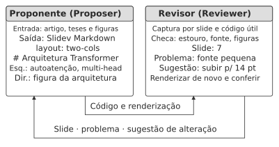

- **O proponente (Proposer)** lê o artigo, planeja a estrutura da explicação, escreve o código-fonte do Slidev e modifica os slides conforme o feedback.
- **O revisor (Reviewer)** renderiza os slides com ferramentas, usa um modelo visual para verificar a densidade de conteúdo, a legibilidade, o layout e a correspondência entre imagens e texto e retorna um feedback estruturado com número do slide, tipo de problema, gravidade e sugestão de alteração.

O feedback deve orientar diretamente a alteração. Por exemplo: “o slide 3 tem pontos demais; divida-o em dois slides, visão geral do método e etapas de cálculo”; “a fonte do código no slide 7 está pequena demais; aumente primeiro para 14 pt e depois verifique a legibilidade na projeção”. Erros factuais e leituras equivocadas de gráficos são corrigidos primeiro; depois, tratam-se o layout e os detalhes visuais.

Alterações localizadas também precisam indicar qual objeto será modificado. O Doubao Work nos slides do Feishu permite que o usuário selecione um elemento da página e faça o pedido de edição por uma barra de ferramentas flutuante.[^ch5-doubao-work] Suponha que o mesmo slide tenha duas caixas de texto: uma com uma citação original de entrevista e outra com o resumo escrito por quem apresenta. O usuário seleciona o resumo e pede “reduzir para duas linhas”. A caixa de texto selecionada delimita o alcance da alteração. O resumo pode ser reescrito, mas a citação ao lado deve manter as palavras originais do entrevistado.

[^ch5-doubao-work]: Central de ajuda do Feishu, uso do Doubao Work em slides.

Após a modificação do proponente, os slides são renderizados de novo, e o revisor examina a nova versão e confirma se os problemas da rodada anterior foram resolvidos. O ciclo tem dois tipos de condição de saída: atingir requisitos explícitos de conteúdo e layout, ou esgotar o orçamento de rodadas, tempo e custo, por exemplo no máximo 5 rodadas de alteração. Na entrega, guardam-se a versão atual e os problemas ainda pendentes, para facilitar revisões posteriores.

Isso compartilha com a aprovação de operações do Capítulo 4 o padrão proponente-revisor. A aprovação de operações avalia principalmente se uma ação pode ser executada; a revisão de conteúdo melhora o artefato por meio de várias rodadas de feedback. Ambas precisam compartilhar os requisitos da tarefa, oferecer fundamentos localizáveis para suas avaliações e deixar que o harness decida o fluxo seguinte. Usar famílias de modelos diferentes pode oferecer outra perspectiva de revisão.

**Valorizo a vantagem da divisão de trabalho entre dois agentes no gerenciamento de contexto.** Cada papel pode manter as informações de que precisa: a cada rodada, o revisor recebe a captura de tela mais recente, os critérios de revisão e a lista necessária de problemas; o proponente mantém o código-fonte, os objetivos de alteração e o feedback textual estruturado. As imagens das páginas ficam no contexto do revisor, e a trajetória principal avança as alterações por meio de feedback textual curto. Cada rodada de revisão gira em torno da página mais recente, o que reduz a interferência de capturas de tela antigas e controla o crescimento do contexto.

> **Experimento 5-6 ★★: geração automática de PPT a partir de artigos**
>
> Este experimento usa o PDF do artigo “Attention Is All You Need” para gerar 20 slides em Slidev. O agente extrai a estrutura e os pontos principais do artigo, usa três figuras do artigo original com registro de origem e organiza a explicação slide a slide. Após a renderização, verificam-se o transbordamento de texto, a legibilidade dos gráficos e a correspondência entre imagens e texto, e os slides são modificados conforme o feedback.
>
> Compara-se a autorrevisão por um único agente com a divisão de trabalho proponente-revisor. Nesta execução, as duas versões finais obtiveram 95 pontos no mesmo processo independente de pontuação; o pico de entrada da divisão de trabalho foi de cerca de 24 mil tokens, contra cerca de 93 mil tokens do agente único que mantinha as capturas de tela antigas.

> **Experimento 5-7 ★★: geração automática de vídeos explicativos de artigos**
>
> Com base nos slides, o agente pode escrever uma explicação em linguagem falada para cada slide, explicando os objetos, as relações e as conclusões das figuras, e depois chamar um TTS para sintetizar a voz. O roteiro é entregue junto com os slides a um revisor visual, que verifica se os elementos mencionados aparecem na imagem e se as descrições estão de acordo com os gráficos.
>
> Para produzir o vídeo, o experimento reaproveita o fluxo de geração da seção anterior e usa uma versão anterior da apresentação, com 22 slides (v2). Extraindo 12 slides em ordem, a última imagem do vídeo vem do slide 21 da versão original. A comparação de pontuação e consumo da seção anterior usou a versão posterior, com 20 slides (v9). Escolhidos os slides, o Kimi gera o roteiro, um modelo visual Qwen revisa a relação entre imagens e texto, e o Fish Audio sintetiza a voz de cada slide. O FFmpeg define o tempo de exibição de cada slide conforme a duração real de cada trecho de áudio e monta um vídeo explicativo de cerca de 8,6 minutos.
>
> Na Figura 5-6, slides, roteiro e voz só são reunidos em vídeo no final. Alguns problemas só podem ser percebidos nessa etapa: se uma frase ainda não terminou quando o slide muda, ou se som e imagem ficam cada vez mais dessincronizados.
>
> 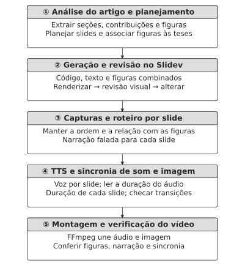

[^ch5-slidev]: Slidev, *Getting Started*, que apresenta a geração, a exibição e a exportação de apresentações com base em Markdown e tecnologias web.

**Agente de edição de vídeo.**

**As operações de edição de vídeo que podem ser expressas em script devem passar preferencialmente por interfaces programáticas.** Linha do tempo, camadas, legendas e faixas de áudio ficam espalhadas por painéis complexos da GUI, e localizar e arrastar repetidamente aumenta a latência e os erros; uma interface programática expressa as operações diretamente com intervalos de tempo, trilhas e parâmetros de efeito. A interface Python do Blender e o FFmpeg conseguem organizar parte das tarefas de edição em scripts que podem ser executados repetidamente.

O agente pode primeiro entender um pedido como “recorte a parte do surfe”, depois localizar o intervalo-alvo no material e gerar o código de corte, ordenação e tratamento de áudio. O proponente cuida do plano de edição e do script, e o revisor verifica o resultado renderizado; diante de omissões, trechos irrelevantes ou legendas que cobrem a imagem, ele devolve ao proponente o momento exato e o problema para correção. Quadros-chave servem para verificar cenas e layout; a continuidade do movimento e a sincronia entre som e imagem exigem verificar quadros adjacentes ou trechos contínuos.

> **Experimento 5-8 ★★: edição inteligente de vídeo baseada em API**
>
> Este experimento encadeia localização do alvo, geração de script e revisão do resultado em um único fluxo. Primeiro, a referência do vídeo, a pergunta-alvo e o intervalo de extração de quadros são entregues a um subagente de análise de vídeo, que processa o grande volume de imagens e devolve ao agente principal os intervalos de tempo e suas justificativas.
>
> A localização tem duas etapas. Na primeira, extrai-se um quadro a cada 10 segundos para encontrar o intervalo aproximado do alvo, por exemplo “o surfe ocorre entre os segundos 40 e 110”; na segunda, em torno do intervalo candidato e de suas bordas próximas, extrai-se um quadro por segundo para determinar com mais precisão o início e o fim. Cenas mais curtas que o intervalo de amostragem grosseira podem cair entre dois quadros; nesse caso, pode-se aumentar a amostragem conforme a duração do alvo ou rever as imagens entre duas extrações.
>
> Definido o intervalo, o proponente gera um script Python do Blender que executa o corte e, se necessário, legendas, mudança de velocidade e outras operações. O revisor examina a prévia e aponta os limites e efeitos que precisam de ajuste; aprovadas as alterações, gera-se o vídeo completo.
>
> O trecho efetivamente cortado mostra um grande coelho branco caminhando sozinho pela grama. Olhando um quadro a cada 10 segundos, o modelo situou o intervalo entre os segundos 10 e 20. Se o corte começasse diretamente no segundo 10, uma parte do início da cena se perderia. Por isso, o programa ampliou 5 segundos para cada lado e, entre os segundos 5 e 25, examinou um quadro por segundo, estreitando o intervalo candidato para os segundos 9 a 12. O revisor percebeu ainda que o trecho incluía imagens da cena vizinha, e o intervalo revisado ficou entre 9,25 e 11,00 segundos. Comparado à anotação manual, de 9,08 a 11,20 segundos, o início ficou 0,17 segundo atrasado e o fim, 0,20 segundo adiantado; os dois extremos atenderam à exigência de erro máximo de 3 segundos.
>
> O timecode só permite verificar onde o corte foi feito. Se as mesmas legendas e a mesma câmera lenta forem aplicadas a um trecho escolhido errado de propósito, o revisor ainda consegue reconhecer o erro? O experimento pede primeiro que ele examine um trecho de controle dos segundos 0 a 3 e, depois, a renderização revisada. A revisão abrange o grande coelho branco na imagem, as legendas na parte inferior e a duração após a mudança de velocidade.

**3D e peças industriais: escolher o método de geração adequado.**

**Para peças industriais em que dimensões e relações de montagem são restrições rígidas, prefira a geração por código paramétrico; para objetos em que o principal é a forma natural e a aparência, considere primeiro os modelos generativos.** A escolha depende de o artefato poder ser descrito com precisão por poucos parâmetros e de quais relações precisam ser preservadas após uma alteração. CadQuery, OpenSCAD e scripts do Blender oferecem processos de construção editáveis, enquanto modelos como o Hunyuan3D usam os priors de forma que aprenderam para gerar aparências complexas.

**A descrição se presta à parametrização?** Um flange simplificado pode ter suas principais relações geométricas expressas pelo diâmetro externo, pela espessura, pelo diâmetro do círculo de furação, pelo diâmetro dos furos e pelo número de furos. O código associa os parâmetros às etapas de construção e é adequado a ajustes repetidos. Uma planta em vaso, uma pedra do lago Tai ou um rosto humano, por outro lado, contêm muitas formas irregulares; modelos generativos podem ajudar a construir a aparência, e métodos procedurais também podem gerar detalhes por meio de regras de crescimento, processos aleatórios e combinação de assets.

**Como verificar a precisão?** Para uma exigência como furo de 5 mm com tolerância de ±0,05 mm, é preciso primeiro definir a unidade, o sistema de coordenadas e o método de medição e depois comparar as dimensões do modelo com a especificação. Um modelo paramétrico permite verificar diretamente os objetos geométricos; uma malha pode ser medida por cortes, furos, dimensões da caixa delimitadora e outros métodos, levando em conta o erro de discretização.

**Como guardar e modificar?** A B-rep (representação por fronteira) descreve a fronteira de um sólido com faces, arestas e vértices, enquanto uma malha triangular aproxima a superfície com facetas. O CadQuery pode exportar STEP para troca de dados entre sistemas CAD e também exportar malhas STL; os parâmetros editáveis e a lógica de construção ficam guardados no código-fonte do CadQuery[^ch5-cad]. Entrar no fluxo de usinagem CNC exige ainda planejamento do processo, trajetórias de ferramenta e adaptação à máquina.

Por exemplo, para mudar os furos de fixação de M5 para M6, basta alterar o parâmetro do diâmetro do furo, gerar o modelo de novo e conferir se o diâmetro externo, a espessura e as posições dos furos permanecem iguais. Em um modelo generativo, a forma de modificar depende dos recursos da interface: pode-se gerar de novo ou combinar edição local e processamento geométrico posterior.

Quando as duas abordagens são combinadas, a divisão de trabalho também deve ser clara: dimensões e relações de montagem ficam com o código paramétrico, texturas e aparência livre ficam com o modelo generativo. **Quando dimensões críticas precisam ser modificadas com precisão repetidas vezes, um processo de construção editável vale mais do que uma aparência gerada de uma só vez.**

> **Experimento 5-9 ★★: dois caminhos para gerar a mesma peça — código e modelo generativo**
>
> Este experimento pede um flange com diâmetro externo de 80 mm e espessura de 10 mm, com quatro furos de fixação distribuídos uniformemente em um círculo de furação de 60 mm de diâmetro. Para deixar claro o sentido de montagem, a especificação inicial usa furos passantes de 5,5 mm para M5, e o pedido de alteração muda para furos passantes de 6,5 mm para M6.
>
> No caminho por código, o modelo gera um programa CadQuery que, ao ser executado, exporta STEP e STL; no caminho pelo modelo generativo, gera-se primeiro uma imagem de referência do produto, que é entregue ao Hunyuan3D para gerar a malha. Verificam-se diâmetro externo, espessura, número de furos, diâmetro dos furos, posição dos furos e face de montagem, registrando a unidade e a orientação dos eixos.
>
> Como saber se o modelo alterou apenas a dimensão indicada? Comparando os STL exportados antes e depois da alteração, o diâmetro médio dos quatro furos de fixação passou de 5,499 mm para 6,499 mm; as duas peças têm 80 mm de diâmetro externo e 10 mm de espessura, e o diâmetro do círculo de furação, com três casas decimais, é 60,000 mm em ambas. A malha original do caminho pelo modelo generativo não tinha escala física definida. O programa de medição fez um corte no meio ao longo do eixo Z e não encontrou o contorno interno dos furos. Para descobrir se os quatro furos atravessam o disco, seria preciso identificar a face de montagem e fazer cortes em diferentes profundidades ao longo de sua normal. Ao gerar de novo, a forma geral e a orientação mudaram.
>
> Por fim, troquemos de problema: se a entrega for uma imagem de uma planta em vaso com aparência natural, como fazer a aceitação? O experimento desenha uma planta em vaso com matplotlib, gera outra com o Gemini e pede ao mesmo modelo visual que avalie a naturalidade em uma escala de dez pontos. As duas imagens receberam 3 e 8 pontos, respectivamente. Essa nota responde a qual imagem o modelo avaliador acha mais parecida com uma planta real. Voltando ao flange, mesmo que a imagem do produto pareça ter quatro furos, a montagem ainda exige conferir a posição e o diâmetro dos furos na peça tridimensional.

[^ch5-cad]: CadQuery, *Importing and Exporting Files*, que apresenta formatos como STEP e STL e explica que as informações paramétricas completas ficam guardadas no código-fonte Python do CadQuery.

### Código como adaptador de sistemas

Serviços externos diferem quanto à interface, à forma de autenticação e ao formato dos dados. O agente pode ler a documentação e amostras de resposta, gerar um cliente HTTP, configurar os cabeçalhos de autenticação, analisar o retorno e converter os campos de origem para a estrutura de que o destino precisa. Aqui, o código assume o trabalho de adaptação entre sistemas, combinando serviços existentes em novos fluxos de tarefa.

Por exemplo, se o campo de valor lido de um serviço de pagamento estiver em centavos e o relatório exibir valores em yuans, conseguir analisar o JSON mostra apenas que os formatos são compatíveis. Uma transação de 25 yuans é, na origem, o inteiro 2500. Se esse número for colocado diretamente no relatório, 25 yuans viram 2500 yuans.

Um adaptador precisa definir claramente entradas e saídas, tratamento de erros e o intervalo de versões. As amostras ajudam o modelo a entender os campos, e o contrato da interface e os testes verificam valores ausentes, paginação, respostas anômalas e mudanças de versão. As credenciais são gerenciadas pelo ambiente de execução, e o código gerado usa as capacidades autorizadas por meio de interfaces controladas. Depois de validado, o adaptador pode ser guardado e reutilizado; se o formato mudar mais tarde, ele volta ao fluxo de modificação.

Sistemas que só têm interface gráfica também podem seguir um método semelhante. O agente primeiro conclui a tarefa por meio do Computer Use, apresentado no Capítulo 6, e depois consolida as etapas estáveis em uma ferramenta de RPA. Quando os controles da interface, o estado de login ou o fluxo das páginas mudam, a ferramenta precisa detectar o desvio e se relocalizar. O Capítulo 9 discute em mais detalhes como extrair, validar e reutilizar fluxos de trabalho a partir de trajetórias bem-sucedidas.

**Análise e visualização de logs de agentes.**

Uma tarefa complexa pode envolver várias requisições ao modelo, execuções de ferramentas e interações com subagentes. A visão geral do log mostra as relações entre as etapas, os estados e os tempos; ao expandi-la, aparecem as entradas e saídas concretas, o que ajuda o leitor a rastrear o que aconteceu em determinada etapa. Novos campos, estruturas aninhadas e versões de formato afetam a análise e a exibição.

A análise adaptativa trata essas mudanças com o ciclo “detectar a mudança–gerar o analisador–verificar o resultado”. Quando a análise falha, o sistema guarda a amostra original, o local do erro e os campos esperados e, comparando com o contrato da interface e a versão do produtor, avalia se a mudança era esperada. Só depois de confirmar que se trata de uma atualização de formato o agente escreve um novo analisador. Se o erro estiver no programa que grava os logs, guarda-se o log original e reporta-se a falha, para que o novo analisador não trate o erro como um formato normal. O código novo é executado primeiro em ambiente restrito; verificam-se primeiro os campos e seus significados e, depois, valida-se com amostras normais, amostras com campos ausentes e casos de regressão no formato antigo. Aprovado, o novo analisador é registrado com sua versão e os formatos a que se aplica; as amostras com falha continuam guardadas para rastreamento e novas tentativas.

Análise e exibição têm métodos de verificação próprios. O programa verifica timestamps, estados, tipos numéricos e a associação entre chamadas; a renderização no navegador verifica se a página funciona, e um modelo visual ajuda a verificar se tabelas, linhas do tempo e rótulos estão claros. Nas atualizações a quente, a versão anterior e um ponto de reversão são mantidos, para que o suporte a novos formatos entre aos poucos no sistema em operação.

> **Experimento 5-10 ★★★: sistema adaptativo de análise de logs**
>
> Este experimento executa primeiro dois processos geradores de logs, que produzem, respectivamente, um formato separado por barras verticais e um formato com parênteses aninhados. O analisador inicial não consegue tratar essas amostras; o sistema então pede ao modelo que gere duas funções de análise, carrega-as a quente depois que passam nos testes e analisa de novo os logs que antes falhavam.
>
> O primeiro formato extrai `timestamp`, `level`, `module`, `step` e `message`; o segundo também envolve o nome da ferramenta, o tempo gasto e o estado. No registro de execução, os três logs de cada tipo foram analisados, e um mecanismo recém-criado também conseguiu carregar os analisadores guardados e continuar processando um fluxo de logs misto.
>
> O resultado da análise é renderizado como tabela pelo Chromium, e a revisão visual verifica os nomes das colunas, o conteúdo das linhas e a legibilidade.

**Análise automática de logs de execução de agentes e diagnóstico de problemas.**

Depois de extrair trajetórias estruturadas, o agente pode compará-las com a documentação de arquitetura e o PRD (documento de requisitos do produto) para confrontar o fluxo esperado com as ações reais. Por exemplo: antes do reembolso, verificou-se se aquele pedido podia ser reembolsado? Depois do timeout do serviço de estoque, o programa passou a consultar o cache como combinado?

O relatório de problemas pode conter prioridade, módulo, sintoma, evidências e sugestões de melhoria. Com base nele, o agente também pode gerar testes de regressão que fixam a entrada correspondente ao problema e os critérios de aceitação. O framework de testes reproduz as requisições em ambiente controlado ou lê as respostas de ferramentas guardadas e compara o comportamento da versão com defeito com o da versão corrigida. Operações que envolvem gravações externas usam um ambiente isolado ou interfaces substitutas, mantendo controlado o alcance da reprodução.

As asserções devem corresponder às propriedades que precisam ser verificadas. Por exemplo, o fato de o log registrar uma verificação de reembolso mostra apenas que o programa fez a consulta. Para saber se o dinheiro foi devolvido corretamente, é preciso ver ainda se o programa consultou antes de reembolsar, se o resultado da verificação permitia o reembolso e qual foi o estado final do pedido.

Depois que o diagnóstico é revisado, o agente pode, com a devida autorização, abrir uma GitHub Issue via MCP e sugerir responsáveis por módulo. Se já houver um item de trabalho para o mesmo defeito, as novas evidências são incorporadas a ele.

> **Experimento 5-11 ★★★: sistema inteligente de diagnóstico de logs de produção**
>
> Este experimento usa um serviço HTTP local para gerar duas trajetórias de negócio: em uma, o registro mostra que o sistema fez o reembolso sem verificar se o pedido podia ser reembolsado; na outra, após o timeout da consulta ao estoque, os dados não passaram a ser obtidos do cache. Combinando a documentação de arquitetura e a especificação de requisitos, o modelo gera um relatório de problemas com referências às trajetórias e às rodadas e, em seguida, três testes de regressão executáveis.
>
> A Figura 5-7 coloca um relatório de diagnóstico entre as trajetórias e os testes de regressão. O relatório aponta que “o sistema pulou a verificação e fez o reembolso diretamente”. Volte à trajetória em busca de evidências: que etapa está faltando no registro de chamadas? Depois, olhe os testes: se essa etapa voltar a ser omitida no futuro, os testes conseguirão detectar?
>
> 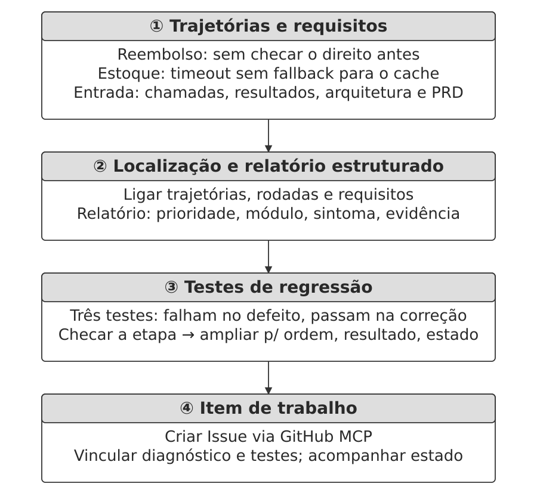
>
> Os três testes falharam na versão com defeito e passaram todos na versão corrigida. Um deles apenas verifica se o programa chamou a ferramenta de verificação de reembolso. Mesmo que o programa devolva o dinheiro primeiro e só depois verifique se o pedido podia ser reembolsado, esse teste passa. O registro de execução também guarda o comprovante de criação do item de trabalho pelo GitHub MCP, com o qual é possível encontrar o ticket correspondente depois que o relatório de diagnóstico foi entregue aos desenvolvedores.
>

### Código como UI generativa

Se o usuário também quiser alterar pessoalmente o material que o agente está processando, a interface pode ser feita como uma bancada de trabalho compartilhada pelos dois. Tomando um roteiro de viagem como exemplo, o usuário pode ver qual parada o assistente está alterando, assumir a alteração, confirmar ou desfazer uma mudança. Se o usuário acabou de mudar a data de partida para sexta-feira, o assistente deve continuar trabalhando sobre esse novo roteiro. Só é possível alterar enquanto se observa se os dois lados compartilham o mesmo estado visível e se combina quem controla, no momento, o campo em edição.

Imagine que o usuário queira comparar três opções de viagem. Enquanto o destino não está definido, a conversa facilita as perguntas de esclarecimento; definido o destino, deixar o usuário escolher datas e informar o número de pessoas diretamente é mais prático do que conferir vários trechos de texto em idas e vindas; por fim, para comparar como o preço total varia com a data, um gráfico deixa a diferença à vista. Quando o agente gera, conforme a tarefa, os formulários, gráficos ou interfaces de aplicativo correspondentes para que o usuário preencha, escolha e opere diretamente, tem-se a UI generativa (Generative UI).

**Descrever a interface e a interação com protocolos.**

Há dois caminhos para gerar interfaces: emitir código, como HTML e JavaScript, para execução em um ambiente controlado; ou emitir uma estrutura declarativa, renderizada pelos componentes do cliente. O primeiro facilita layouts e interações personalizados; o segundo limita as capacidades disponíveis aos componentes e ações que o cliente oferece.

O A2UI (Agent-to-User Interface) adota a descrição declarativa. O agente gera mensagens estruturadas que expressam componentes, vinculação de dados e atualizações, e o cliente apresenta a interface com seus próprios componentes[^ch5-ui-protocols]. Por exemplo, um aplicativo pode oferecer componentes de cartão, botão, caixa de texto e tabela, e o agente descreve com eles uma tabela intitulada “Dados de vendas”, com três linhas e duas colunas. O catálogo de componentes também pode ser ampliado com gráficos, mapas e outras capacidades.

O AG-UI (Agent–User Interaction) cuida da interação por eventos entre o agente e o front-end, transmitindo mensagens, chamadas de ferramentas e atualizações de estado, e também pode transportar mensagens de interface do A2UI. Combinados, o A2UI descreve o que deve ser exibido, e o AG-UI conecta a execução no back-end à interação no front-end.

O cliente pode receber atualizações de interface de forma incremental e exibi-las na web, em dispositivos móveis ou no desktop por meio de renderizadores adaptados. O cliente valida as propriedades dos componentes, a vinculação de dados e as solicitações de ação, e o servidor continua verificando as permissões de negócio; links, rich text e acesso a dados dentro dos componentes também precisam de regras próprias de tratamento.

Ao gerar código diretamente, é preciso verificar dependências, acesso a recursos e permissões de execução, além de isolar a interface gerada do estado sensível do aplicativo hospedeiro. Injeções de prompt em materiais externos podem afetar o processo de geração, e o risco da execução de scripts no navegador depende também da forma como a página é carregada e isolada.

**Entregar resultados interativos em HTML.**

**Para entregas de pesquisa que incluem dados, demonstrações e resultados atualizados continuamente, prefiro sites em HTML.** Um relatório longo e linear em Markdown obriga o leitor a procurar o contexto o tempo todo; uma página interativa reúne explicações, dados e demonstrações em um único ponto de entrada: o leitor examina os gráficos, filtra as amostras de interesse, expande os detalhes de um resultado e opera a demonstração para entender o comportamento do sistema. O agente também pode atualizar a página à medida que a tarefa avança, para que ela registre continuamente os resultados atuais e as evidências.

Na minha prática de pesquisa, cada projeto tem um site interativo, que funciona ao mesmo tempo como documento vivo durante a pesquisa e como entrega final, e o agente complementa seu conteúdo continuamente à medida que os experimentos avançam. Esses sites cumprem principalmente três funções.

A primeira é a **rastreabilidade dos dados experimentais**. A página associa amostras, prompts, respostas do modelo e pontuações, permitindo a verificação item por item. Por exemplo, quando um mesmo tipo de resposta sempre recebe nota baixa, é possível seguir os registros de pontuação até as respostas e os prompts originais.

A segunda é o **monitoramento das métricas de treinamento**. Chamo de “métricas clínicas” os sinais que refletem o estado interno do treinamento: perda de treinamento e de validação, norma do gradiente, taxa de aprendizado e, no aprendizado por reforço, recompensa, divergência KL, entropia da política etc. Modelos de linguagem também podem usar a perplexidade para medir seu desempenho na previsão de uma sequência de texto dada. Como os indicadores fisiológicos de um check-up, essas curvas às vezes revelam problemas mais cedo do que o desempenho final na tarefa. Examiná-las junto com a acurácia da tarefa ajuda a localizar a fase em que ocorrem a não convergência, as anomalias de gradiente e a degradação do treinamento.

A terceira é a **demonstração do funcionamento**. Ao mostrar como vários módulos se articulam, a página pode permitir que o leitor altere uma entrada, veja os estados intermediários e compare as mudanças na saída com os registros dos experimentos.

Quando o trabalho dura várias horas, como o usuário pode assumi-lo nos intervalos livres? Quando uso agentes de programação, quero que uma instrução falada chegue com precisão ao agente encarregado, que eu possa abrir os resultados a qualquer momento e que eu seja avisado quando houver uma nova versão ou um problema que exija minha decisão. Por exemplo, dois relatórios estão sendo gerados ao mesmo tempo. O usuário abre o relatório de vendas, aponta para o segundo gráfico e diz: “refaça este com a receita líquida”. A interface deve enviar, junto com a instrução, os identificadores do relatório e do gráfico atuais. Quando o gráfico estiver pronto, a notificação pode abrir diretamente a nova versão; se houver dois critérios possíveis para “receita líquida”, o assistente deve apresentar as duas opções para o usuário escolher.

**Esclarecer a intenção do usuário.**

Quando o usuário diz “quero comprar uma passagem aérea para Pequim”, o destino já está claro, mas a cidade de partida, a data e a escolha entre ida e ida e volta ainda precisam ser informadas. O agente pode fazer todas as perguntas em uma única rodada de diálogo ou gerar um formulário que apresente as condições relevantes em uma mesma página.

Os controles do formulário correspondem a diferentes tipos de informação: caixas de texto coletam entradas abertas, menus suspensos e botões de opção listam as alternativas, caixas de seleção permitem escolhas múltiplas, e seletores de data ajudam a informar datas. O JavaScript pode expressar relações em cascata, por exemplo exibir a data de volta quando “ida e volta” é selecionado e verificar se a volta não é anterior à partida. Quando a escolha muda, os campos que perderam validade também precisam ser limpos ou ignorados.

A Figura 5-8 vem de uma execução do experimento a seguir. Siga este envio: entre os quatro campos devolvidos pelo navegador não há destino; de onde o modelo sabe que o viajante vai para Pequim?

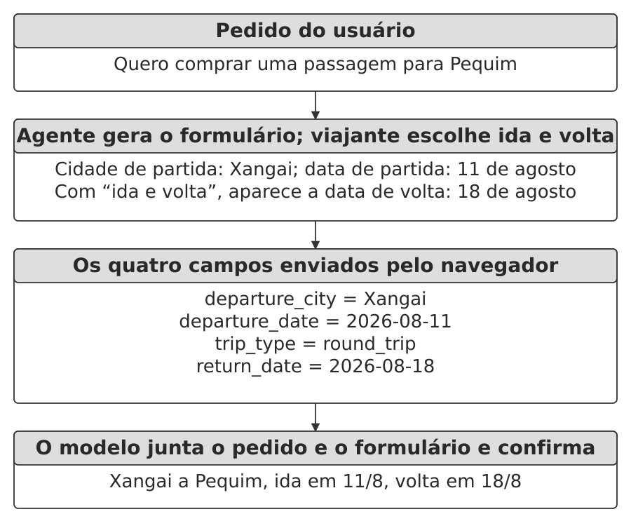

> **Experimento 5-12 ★★: sistema de esclarecimento de intenção com formulários dinâmicos**
>
> Este experimento parte de “quero comprar uma passagem aérea para Pequim” e pede ao modelo que gere um formulário HTML: a cidade de partida usa uma caixa de texto, a data de partida usa um seletor de data, o tipo de viagem oferece as opções ida e ida e volta, e a data de volta aparece quando ida e volta é selecionado.
>
> O programa devolve ao modelo o pedido inicial junto com os dados do formulário. Se apenas os campos enviados fossem mantidos, mesmo com todos os controles preenchidos corretamente, ainda faltaria o destino.
>
> Mais um passo com o mesmo formulário: depois de preencher a data de volta, muda-se a opção para só ida. A página esconde a caixa da data de volta, mas o JSON enviado mantém ao mesmo tempo a opção só ida e a data de volta de 18 de agosto. Ao mudar para só ida, o cliente também precisa apagar a data de volta que perdeu a validade.

[^ch5-ui-protocols]: Documentação oficial do A2UI e *AG-UI Overview*, que apresentam, respectivamente, a descrição declarativa de interfaces e a interação por eventos entre agente e front-end.

**Gerar consultas SQL.**

O usuário pode fazer consultas ao banco de dados em linguagem natural, e o agente gera o SQL com base na estrutura das tabelas e nos critérios de negócio. **Para exibir tabelas completas de resultados, prefiro o modo Artifact, em que o resultado vai diretamente do banco de dados para a interface.** Fazer o modelo ler e repetir linha a linha uma tabela grande aumenta o consumo de tokens e o tempo de espera, além de introduzir erros de transcrição. O SQL é guardado como um artefato de consulta verificável; quando for preciso analisar causas ou resumir tendências, entregam-se ao modelo apenas os resultados agregados necessários.

Na Figura 5-9, o usuário quer ver o número de funcionários ativos por departamento, e a página pode exibir diretamente a tabela estatística retornada pelo banco de dados. Se o usuário perguntar em seguida “quantas pessoas o marketing tem a mais que P&D”, o modelo só precisa pegar 9 e 5 da tabela para calcular a diferença de 4 pessoas. Se a pergunta seguinte for “a diferença também era essa no mês passado?”, a tabela à vista não basta, e é preciso consultar de novo com a data de referência do mês anterior.

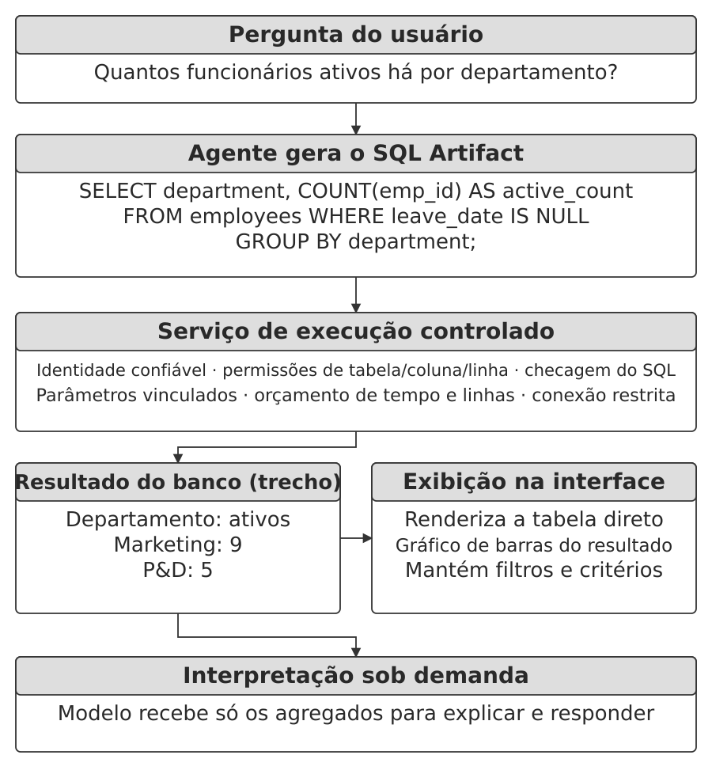

O serviço de execução determina, com base em uma identidade confiável, quais tabelas, colunas e linhas podem ser acessadas, usa uma conta de banco de dados restrita e valida a estrutura e o tipo de operação do SQL. O cenário de consulta pode ser limitado a consultas somente leitura aprovadas, com controle de chamadas de funções, orçamento de tempo, número de linhas retornadas e escopo dos dados; os valores informados pelo usuário são passados por vinculação parametrizada.

O agente também pode gerar artefatos de visualização, como exibir o resumo por departamento em um gráfico de barras. O serviço de execução entrega o resultado da consulta a um ambiente controlado de visualização, e a interface exibe apenas os dados e as interações permitidos.

> **Experimento 5-13 ★★: agente de ERP com interação em linguagem natural**
>
> Este experimento usa como exemplo consultas de funcionários e salários em um ERP (planejamento de recursos empresariais) para aprender a gerar SQL a partir de perguntas de negócio e a levar os resultados do banco de dados diretamente para a página. No PostgreSQL, criam-se duas tabelas: a de funcionários contém ID do funcionário, nome, departamento, nível, data de admissão e data de desligamento, sendo que a data de desligamento vazia indica funcionário ativo; a de salários contém ID do funcionário, data de pagamento e salário, com um registro por funcionário por mês.
>
> Com base nessas duas tabelas, o agente trata as dez perguntas a seguir:
>
> 1. Quanto tempo, em média, cada funcionário permanece na empresa?
> 2. Quantos funcionários ativos há em cada departamento?
> 3. Qual departamento tem o maior nível médio de funcionários?
> 4. Quantas pessoas cada departamento contratou neste ano e no ano passado?
> 5. Qual foi o salário médio do departamento A de março de dois anos atrás a maio do ano passado?
> 6. No ano passado, qual salário médio foi maior, o do departamento A ou o do departamento B?
> 7. Qual é o salário médio de cada nível neste ano?
> 8. Qual foi o salário médio no último mês dos funcionários com até um ano, de um a dois anos e de dois a três anos de empresa?
> 9. Quais são os 10 funcionários com maior aumento salarial do ano passado para este ano?
> 10. Há salários atrasados (funcionário ativo em um mês sem pagamento)?
>
> Antes de consultar, é preciso definir os critérios estatísticos. Por exemplo, o tempo de casa dos funcionários ativos é contado até a data de referência da consulta, e o dos desligados, até a data de desligamento; o “salário médio” precisa definir se a média é por registro de pagamento ou por funcionário; o ranking de aumentos precisa tratar os funcionários sem registro no ano passado.
>
> Nesta execução, foram geradas e executadas dez consultas SQL, cujos resultados coincidiram todos com um cálculo de referência independente, e as tabelas foram então renderizadas diretamente pelo navegador. O modelo recebe a estrutura das tabelas, a tarefa e o feedback de execução necessário, e os dados das linhas do banco de dados chegam à interface por meio do aplicativo.

**Geração dinâmica de software.**

O agente pode gerar a interface e a lógica de interação a partir dos requisitos e continuar modificando-as conforme as operações do usuário. A prévia de pesquisa temporária “Imagine with Claude”, lançada pela Anthropic em 2025, demonstrou esse tipo de interação: o usuário explora a interface, e o modelo gera continuamente a experiência de software correspondente[^ch5-imagine].

**Para produtos reais, aposto mais na personalização sobre frameworks existentes.** Gerar continuamente um aplicativo inteiro do zero paga repetidas vezes o custo de geração, renderização e verificação; manter um framework estável e abrir as interfaces e os fluxos que interessam ao usuário oferece mais rápido uma experiência personalizada confiável. Quando o usuário pede “mude o botão para azul”, “adicione um menu de atalhos na barra lateral” ou “use uma fonte mais legível”, o agente localiza os componentes relevantes, modifica o código e verifica o efeito pela pré-visualização. O framework de base oferece uma estrutura de páginas e interfaces de negócio estáveis, e o escopo da personalização pode se estender aos poucos de cores e fontes para layouts e componentes.

O HMR (Hot Module Replacement, substituição de módulos a quente) do ambiente de desenvolvimento pode atualizar os módulos de front-end afetados depois que o código muda. A preservação do estado depende da integração com o framework, dos limites da atualização e do tipo de alteração; quando for necessária uma atualização completa da página, o aplicativo deve guardar o estado necessário. O reload do modo de desenvolvimento do FastAPI recarrega o programa do servidor; os dois atuam, respectivamente, sobre os módulos de front-end e o processo de back-end[^ch5-hmr].

> **Experimento 5-14 ★★: sistema de personalização de interface por diálogo**
>
> Este experimento constrói um aplicativo de chat com front-end em React e back-end em FastAPI, ativando no ambiente de desenvolvimento o HMR do front-end e o reload do back-end. O modelo modifica cores, fontes e título conforme três pedidos consecutivos, e o navegador verifica a interface real após cada alteração.
>
> Nesta execução, foram registrados os eventos de HMR do Vite; nenhuma das três rodadas de alteração provocou navegação de página inteira, o estado do chat existente foi preservado e o build final passou.

[^ch5-imagine]: Anthropic, *Introducing Claude Sonnet 4.5*, que apresenta a prévia de pesquisa temporária Imagine with Claude, lançada junto com o modelo.
[^ch5-hmr]: *Vite HMR API* e *FastAPI CLI*, que apresentam, respectivamente, a atualização a quente do front-end e o recarregamento automático do servidor de desenvolvimento.

**Tornar os limites de permissão independentes do código de negócio dinâmico.**

**Quanto mais facilmente o código de negócio puder ser reescrito dinamicamente pelo agente, mais o limite final de permissões deve descer para uma camada estável de acesso a dados.** Aplicativos tradicionais escrevem as verificações de permissão em código de negócio revisado; quando o código gerado muda constantemente, um novo caminho pode deixar de fazer a mesma verificação. Só fazendo cada leitura e gravação passar por um serviço independente de acesso a dados as restrições de permissão são preservadas. Por exemplo, um aplicativo de recrutamento pode gerar dinamicamente listas de candidatos e formulários de operação, enquanto a qual organização cada candidato pertence e quais campos o recrutador pode atualizar são verificados continuamente por um serviço confiável de acesso a dados.

O objetivo de design aqui é: **mesmo que o código gerado contenha erros, a camada confiável de acesso a dados continua impondo as restrições de permissão.** Isso dá continuidade ao guardrail da camada de dados do Capítulo 1: colocar as regras de cumprimento obrigatório no ponto pelo qual todas as operações relevantes precisam passar. Políticas de segurança em nível de linha do banco de dados podem restringir o acesso a registros, restrições e validadores verificam estados válidos, e views controladas, stored procedures ou serviços de dados oferecem as operações permitidas. A camada de aplicação pode verificar antecipadamente e explicar ao usuário, mas as leituras e gravações finais continuam controladas pelo serviço de dados confiável e pelas permissões do banco de dados.

Cada operação também precisa de um **contexto de acesso** (access context) confiável, que contenha o usuário, o tenant, o papel ou a identidade do agente. O serviço de autenticação e o runtime confiável estabelecem e vinculam a identidade, e o serviço de dados autoriza com base nela. O código dinâmico recebe as interfaces restritas necessárias à tarefa, e as credenciais e a gestão de políticas ficam a cargo de componentes independentes. Todas as conexões ao banco de dados, consultas auxiliares e processamentos em segundo plano devem respeitar o mesmo escopo de acesso.

Por exemplo, a segurança em nível de linha do PostgreSQL precisa ser usada em conjunto com a configuração de papéis do banco de dados. A conexão do aplicativo usa um papel sujeito às políticas, e a conta do aplicativo não tem permissão para modificar as políticas de acesso[^ch5-rls]. As regras e o mecanismo de vinculação de identidade passam por revisão independente, e a interface de negócio pode mudar continuamente dentro desse escopo.

Permissões e integridade dos dados também cumprem funções diferentes. Depois que o recrutador obtém permissão para modificar o registro de um candidato, a máquina de estados continua verificando se é permitido passar de “triado” para “entrevistado”; o validador de salário lê a vaga associada e verifica se a pretensão salarial está dentro da faixa da vaga; a verificação de referências confirma que a relação entre vaga e candidato é válida.

> **Experimento 5-15 ★★★: objetos de dados com permissões incorporadas para software gerado dinamicamente**
>
> Este experimento oferece um protótipo de armazenamento de objetos em Python sobre o PostgreSQL, que coloca nos tipos de dados as regras de permissão, os validadores, as relações entre objetos e as declarações de reações subsequentes. Na leitura, verificam-se as permissões de acesso; na criação e na atualização, executam-se primeiro a verificação de permissões e a validação de negócio e verificam-se as referências, antes da persistência; em seguida, as reações subsequentes declaradas entram em uma fila, com limite de profundidade da cadeia de reações.
>
> O exemplo de recrutamento inclui objetos como vagas, candidatos, entrevistas e avaliações. Os candidatos passam sucessivamente por candidatura, triagem, entrevista, envio de proposta e contratação, e as etapas relevantes também podem levar ao estado de rejeição; a faixa salarial vem da vaga associada. O exemplo inclui verificações de atualização normal de estado, transição de estado inválida, salário fora da faixa da vaga e acesso por tenants diferentes, ajudando o leitor a entender o que a autorização e a validação de negócio tratam, cada uma.
>
> O protótipo expressa os atributos de usuário, papel e organização por meio de `AccessContext`, e os scripts didáticos constroem esses contextos diretamente para simular identidades diferentes. Na implantação, o contexto é estabelecido pelo ponto de entrada de autenticação, e o armazenamento de objetos e o código gerado ficam em lados opostos de um limite claro de serviço ou de permissões.

[^ch5-rls]: PostgreSQL, *Row Security Policies*, que apresenta a configuração de políticas de segurança em nível de linha por papel e operação e seu escopo de aplicação.

### Código criando código: autoinicialização de agentes

A capacidade de gerar código também pode ser usada para desenvolver os próprios agentes. O criador recebe os requisitos da tarefa, gera ou modifica os prompts, as ferramentas e o loop de execução do novo agente e verifica o artefato por meio de testes e interações reais. A Figura 5-10 mostra esse ciclo de autoinicialização: a implementação existente oferece o ponto de partida, o feedback das tarefas impulsiona as alterações, e os resultados da verificação decidem quais mudanças podem ser mantidas.

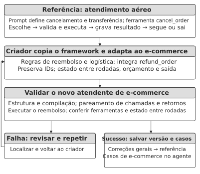

Como distinguir se uma alteração melhorou a capacidade geral ou apenas se adaptou por acaso às questões que acabou de ver? Reserva-se uma tarefa que não foi entregue ao criador. Por exemplo, desenvolve-se um agente de monitoramento de preços com os dados de uma loja e, depois, entregam-se a ele amostras de outra loja, executando também de novo a tarefa original.

**Manter o ambiente de execução do agente.**

A execução de um novo agente depende de configuração, credenciais, estado de sessão, serviços e sandbox. O comando `doctor` do OpenClaw é um exemplo de ferramenta de manutenção: ele verifica a migração de configurações antigas, o estado das credenciais OAuth, os locks de sessão, a instalação de plugins, a saúde do gateway, as imagens da sandbox e outros pontos, e oferece sugestões de correção ou executa as correções correspondentes[^ch5-doctor].

Essas verificações determinísticas podem servir de base para um fluxo de automanutenção. As regras de detecção cobrem falhas conhecidas, e as ações de correção têm entradas e resultados esperados bem definidos. Ao projetar um fluxo de diagnóstico mais avançado para o agente, os problemas ainda não resolvidos podem ser entregues ao modelo junto com logs, configurações e resultados das verificações, para que ele explique qual configuração pretende alterar e de que forma; a camada de execução verifica as permissões e o escopo da alteração e, então, executa as verificações de saúde e os testes de regressão. Snapshots de configuração, registros de alterações e pontos de reversão ajudam o sistema a voltar a funcionar quando uma correção falha.

**Usar implementações de referência para transmitir a experiência de engenharia.**

Criar um agente especializado envolve ao mesmo tempo lógica de domínio e infraestrutura geral. Ao verificar o resultado gerado, pode-se partir de quatro tipos de questão:

1. **Contexto e loop de execução.** Preservar a associação entre papéis, identificadores de chamadas de ferramentas e resultados das ferramentas e verificar o estado em várias rodadas, as condições de encerramento, o orçamento e a recuperação de exceções. Mensagens estruturadas facilitam a manutenção das relações do protocolo; um prefixo estável cria condições para o cache de prompt.
2. **Interface das ferramentas.** A descrição da ferramenta explica a finalidade, as condições de uso e os limites, e os parâmetros incluem tipo, significado e exemplos concretos. A camada de execução continua validando os argumentos, a identidade e o estado do negócio.
3. **Escolha de modelos e APIs.** Os modelos tendem a reproduzir modelos e interfaces antigos que aparecem com frequência nos dados de treinamento; código fluente pode esconder escolhas desatualizadas. Ofereça ao criador material de seleção mantido em dia ou deixe que ele consulte a documentação oficial para conferir as capacidades dos modelos, as versões das interfaces e as formas de chamada. Chamadas reais após a geração verificam se a configuração funciona.
4. **Compatibilidade de dependências e ecossistema.** Verificar o estado de manutenção, as versões e as mudanças de interface das bibliotecas e validar o programa resultante com instalação de dependências, verificação de compilação e testes.

**Ao criar um agente especializado, prefiro que o criador copie uma implementação de referência já validada e depois faça as modificações de domínio.** É difícil que um prompt esgote todos os detalhes do protocolo de mensagens, do gerenciamento de estado e dos mecanismos de recuperação, mas o código de referência leva essa experiência de engenharia diretamente para o novo sistema. Mesmo um modelo bom em programação pode deixar passar condições de execução que a descrição da tarefa não explicita; reutilizar um framework reduz esse tipo de falha repetida. O criador copia o framework de base adequado, ajusta o prompt de sistema ao novo papel, acrescenta ou remove ferramentas de domínio, modifica a lógica de negócio e complementa os testes correspondentes. O processamento de mensagens, a associação de chamadas, o gerenciamento de estado e os caminhos de saída vêm do framework, e as mudanças de domínio são validadas com novos casos de teste.

Se o modelo for muito mais rápido, como descartar a explicação de que “ele fez menos funções”? A seguir, dois grupos de criadores entregam o mesmo tipo de agente, submetido ao mesmo conjunto de verificações.

> **Experimento 5-16 ★★★: desenvolver um agente capaz de criar agentes**
>
> Peça ao mesmo modelo criador que construa um agente de revisão de liberação: depois de ler um conjunto de registros de verificação de implantação, se qualquer item obrigatório não tiver passado, ele recusa a liberação e indica o fundamento. Na criação do zero, o modelo precisa escrever o loop de execução, o protocolo de ferramentas, as ferramentas de domínio, o ponto de entrada de linha de comando e os testes. No caminho por modelo, copia-se primeiro um agente capaz de verificar registros estruturados, e o modelo só precisa preencher a especificação do domínio. Por exemplo: em que campo fica o estado e quais valores indicam aprovação? O script de criação gera, a partir da especificação, o prompt de sistema, as definições de ferramentas e a documentação. As ferramentas Python existentes leem a especificação e executam as verificações. Os dois caminhos são exemplos de metaprogramação: usar programas para gerar ou modificar outros programas.
>
> Na Figura 5-11, os dois caminhos convergem para o mesmo conjunto de critérios de aceitação.
>
> 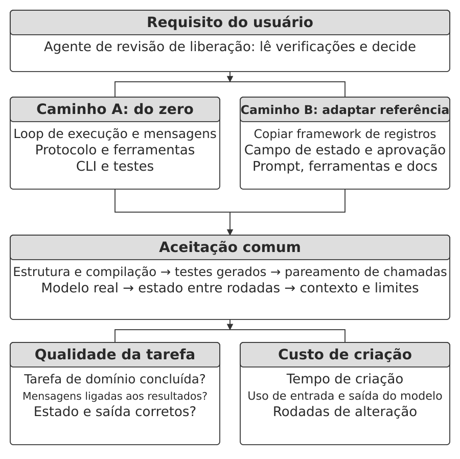
>
> Os dois caminhos usam os mesmos requisitos de tarefa e os mesmos critérios de aceitação. Primeiro, verificam-se a estrutura do artefato, a compilação e os testes; depois, a associação entre chamadas de ferramentas e resultados nas mensagens padrão; por fim, executam-se tarefas com modelo real e interações de várias rodadas, para validar o corte do contexto, o gerenciamento de estado e o limite de número de chamadas.
>
> Na comparação guardada com o Kimi K3, cada grupo passou em 39/39 verificações determinísticas, e ambos também passaram nas tarefas com modelo real e nas verificações de estado em várias rodadas. O caminho por modelo usou 1.181 tokens e cerca de 25 segundos na criação; o caminho do zero usou 381.814 tokens e cerca de 90 minutos.
>

[^ch5-doctor]: OpenClaw, Doctor, que apresenta as funções de verificação de configuração e estado, migração e correção.

## Resumo do capítulo

**Há um motivo fácil de ignorar para os agentes de programação terem amadurecido cedo: a engenharia de software já tinha sistemas de tipos, suítes de testes, controle de versão e ferramentas de depuração.** Quando o código é alterado de forma errada, os testes muitas vezes apontam qual conjunto de entradas produziu um resultado inesperado; tentando outra alteração, é possível testar de novo com as mesmas entradas. Para aplicar essa experiência a outras tarefas, faça primeiro três perguntas concretas: como detectar erros, como voltar a um estado conhecido e quando é preciso parar e pedir que uma pessoa assuma? Por exemplo, se uma chamada de reembolso perder a conexão no meio, o harness deve primeiro consultar a conta e só então decidir se tenta de novo; caso contrário, a recuperação de uma falha pode virar um segundo reembolso.

O código também transforma um julgamento pontual em algo reutilizável. A enumeração em problemas matemáticos e as restrições em problemas de lógica podem ser verificadas item por item por programas; as regras de reembolso podem virar validações no ponto de entrada da execução, para que o servidor leia o estado real do pedido antes de decidir se libera a operação. Quando o formato dos logs muda, o analisador pode ser alterado, e as amostras que falharam desta vez ficam guardadas como testes de regressão. Nos três casos é possível executar código, mas os critérios são diferentes: se a solução satisfaz as condições do problema, se o reembolso está de acordo com a política, se o novo analisador consegue ler os campos que antes ficavam de fora.

Quando a entrega é um documento, um vídeo ou um modelo geométrico, é preciso ainda verificar a renderização, a sincronia entre som e imagem ou a precisão das dimensões, e designar um revisor para examinar o artefato real. Quando a entrega é um formulário, uma consulta ou uma visualização, além de verificar se o usuário consegue entendê-la e operá-la, é preciso verificar se o serviço de execução por trás obtém os dados de acordo com as permissões. Se o código gera outro agente, tendo a reutilizar primeiro um framework já validado, gerar as ferramentas de domínio e a lógica de negócio e depois verificar o protocolo de chamadas, o estado entre rodadas e os resultados em tarefas reais. As ferramentas, os validadores e os testes acumulados dessa forma podem ser reaproveitados na próxima tarefa.

O código permite executar uma tarefa repetidas vezes, mas o ambiente nem sempre espera a execução terminar. Enquanto uma consulta ainda está rodando, o usuário pode já ter mudado de ideia. O Capítulo 6 discute como esse tipo de mudança entra em uma interação em andamento.

## Questões para reflexão

1. ★★ Projete uma sandbox para um agente de programação que precisa ler arquivos do projeto, instalar dependências e executar testes. Como você configuraria as permissões de arquivos, rede, processos e recursos? Quando a tarefa precisar de permissões mais amplas, como expressar o pedido, verificar o escopo e manter registros?
2. ★★★ Quando o criador gera e modifica várias gerações sucessivas de agentes, defeitos do framework e erros de domínio podem se acumular aos poucos. Como usar versões de referência, testes de regressão, avaliação de comportamento e mecanismos de reversão para acompanhar essa evolução?
3. ★★ Uma mudança no formato dos logs pode vir de uma atualização normal ou de um defeito no produtor. Que evidências um sistema de análise adaptativa deve guardar, e com base em que condições deve decidir entre adicionar um analisador, reportar uma anomalia ou suspender o processamento?
4. ★★ No ciclo proponente-revisor, o revisor considera adequada a densidade de informação de um slide, mas o usuário o acha carregado. Como transformar as preferências do usuário em exemplos, critérios de pontuação e feedback de interação, e como verificar se as alterações seguintes atendem a essas exigências?
5. ★★ Um agente de programação pode atualizar a base de conhecimento, a documentação de arquitetura e as instruções do projeto, e também consolidar sequências de operações em código. Como identificar regras redundantes ou desatualizadas e definir para elas escopo de aplicação, método de verificação e condições de retirada? Para passar de uma alteração bem-sucedida à evolução contínua discutida no Capítulo 9, que mecanismos de acúmulo e avaliação ainda são necessários?
6. ★ Equipes favoráveis à colaboração remota costumam também facilitar o acesso dos agentes às informações de trabalho. Examine os requisitos, a arquitetura, os registros de decisões e os critérios de aceitação de um projeto que você conhece, liste os documentos que mais precisam ser complementados e explique em que tarefas concretas eles ajudariam o agente.
7. ★★★ Para um agente que acessa dados privados, processa conteúdo não confiável, faz comunicações externas e usa memória persistente, como organizar a autorização de identidade, a marcação de origem, a verificação do fluxo de dados e a revisão das gravações na memória? Use um fluxo de negócio normal para mostrar onde ficam essas verificações.
8. ★★ No modo Artifact de SQL e HTML, o modelo gera o artefato, o serviço de execução processa a consulta ou a renderização, e a interface apresenta o resultado diretamente. Que informações vale a pena entregar de novo ao modelo para interpretação? Como verificar as permissões de consulta, o orçamento de recursos, o isolamento da página e a consistência dos resultados exibidos?
9. ★★ A ferramenta valida as regras com base no estado do negócio no banco de dados, e a descrição dos parâmetros ajuda o modelo a preparar a chamada. Usando o cancelamento de uma reserva como exemplo, explique o papel de cada um destes elementos: a política em linguagem natural, os exemplos de parâmetros, a validação na camada de execução e os testes de contorno. Quando a política muda, o que precisa ser atualizado em conjunto?
