# Interação: expansão dos espaços de observação e ação

**Com o modelo subjacente fixo, reorganizar ou ampliar as interfaces de observação e de ação costuma ser um dos recursos de engenharia mais eficazes para melhorar o desempenho de um agente em tarefas.** Nos capítulos anteriores, o agente em geral esperava o usuário terminar de falar para então consultar informações, chamar ferramentas e responder. Enquanto ele aguarda o resultado de uma ferramenta, porém, o usuário e o ambiente externo continuam mudando.

Um usuário pede a um assistente que remarque uma passagem aérea. Enquanto o assistente consulta os voos com o atendente da companhia, o usuário manda outra mensagem: “tenho mais uma mala para despachar”. O atendente ainda está falando, e a tarifa exibida na tela pode mudar. O assistente precisa perguntar logo se a tarifa inclui a bagagem despachada e também verificar se a cotação de agora há pouco continua válida. Há aqui duas questões de projeto: por quais canais o assistente fica sabendo das mudanças e em que momentos ele pode reagir? Este capítulo trata primeiro de e-mails e resultados de ferramentas que chegam de forma assíncrona e, depois, de voz contínua, mudanças de tela e do retorno das ações de um robô.

## Expansão da modalidade e do momento de acionamento

A **modalidade** descreve a forma da informação e da ação. Um agente pode ler texto, ouvir sons, ver a tela e receber sinais de torque; pode também emitir texto, sintetizar fala, clicar em interfaces ou acionar articulações.

O **momento de acionamento** diz respeito a quando a informação chega, quando a ação começa e quando o sistema responde. A informação pode ser consultada ativamente pelo agente ou enviada por um serviço externo; uma ferramenta pode devolver o resultado na hora ou iniciar uma tarefa e informar a conclusão mais tarde. Quando chega um novo evento, o sistema também precisa decidir se interrompe o trabalho em curso e como retomar a tarefa interrompida.

| Dimensão | Interfaces de obtenção de informação e observação | Interfaces de ação e execução |
|---|---|---|
| Organização do conteúdo (Capítulos 2 a 5) | Contexto, memória e bases de conhecimento organizam a informação para decidir | Ferramentas e código expressam operações executáveis |
| Modalidade (este capítulo) | Voz, tela, sensores físicos | Fala, cliques, movimento de articulações |
| Momento (este capítulo) | Consulta ativa, envio de eventos, entrada contínua | Execução entre turnos, cancelamento, preempção e retomada |

O contexto carrega a informação necessária para uma decisão específica; o espaço de observação descreve o conjunto de informações que o sistema pode receber. As ferramentas oferecem interfaces concretas; o espaço de ação descreve o conjunto de ações que o sistema pode executar. Mesmo quando as interfaces são ampliadas, esses conjuntos continuam limitados pela capacidade dos dispositivos, pelos parâmetros, pelas permissões e pelo ambiente de execução.

Muitas interfaces de chamada de ferramentas organizam as mensagens em rodadas: o modelo propõe uma chamada, o sistema acrescenta o resultado da ferramenta e então inicia a próxima rodada de inferência. Um sistema orientado a eventos precisa gerenciar as mudanças externas sobre esse protocolo. Quando a interface oferece assincronia nativa, é possível receber novas solicitações enquanto uma ferramenta está pendente e continuar o processamento quando o resultado chega; quando a interface é síncrona, cabe ao Harness organizar a interação com filas, identificadores de tarefa e mecanismos de escalonamento. As seções seguintes discutem os dois caminhos de implementação.

O ritmo do retorno varia muito de um cenário para outro. A tabela abaixo lista as escalas de tempo mais comuns.

| Escala comum | Cenário | Mudança do lado da observação | Tratamento do lado da ação |
|---|---|---|---|
| Segundos a dias | Assíncrono e orientado a eventos | Eventos externos despertam o agente | A tarefa é iniciada primeiro; eventos posteriores informam o progresso e a conclusão |
| Dezenas de milissegundos a segundos | Voz | Recepção contínua de áudio | Saída em streaming, tratamento de interrupções e parada da reprodução |
| Frações de segundo a segundos | Computer Use | A tela muda continuamente | Após cada operação, obter de novo o estado da interface |
| Ciclos de controle de milissegundos | Controle de baixo nível de robôs | Retorno contínuo dos sensores | Execução de trechos curtos de movimento, resposta a sinais de controle e de parada |

## Assíncrono e orientado a eventos: quando o mundo procura o agente

O Capítulo 4 apresentou as ferramentas de percepção, de execução e de colaboração; esta seção trata das ferramentas acionadas por eventos e das ferramentas de comunicação com o usuário. As primeiras levam as mudanças do ambiente até o agente; as segundas permitem que o agente entre em contato com o usuário durante a tarefa. O Harness associa essas entradas e saídas às tarefas em andamento e forma um loop de eventos que trabalha continuamente.

### Por que a assincronia é necessária

Numa chamada síncrona, quem chama precisa esperar o resultado para seguir adiante. Numa chamada assíncrona, recebe-se primeiro um identificador de tarefa (usado para consultar e gerenciar a tarefa) ou o compromisso de ser avisado da conclusão mais tarde, e quem chama pode cuidar de outros trabalhos enquanto espera. Com isso, o sistema consegue manter várias tarefas em andamento e decidir, conforme os recursos e as dependências, quais operações podem rodar em paralelo.

Pense no agente como um secretário que cuida de e-mails, telefonemas e visitas: enquanto espera uma resposta, continua organizando documentos; quando chega uma ligação urgente, guarda o ponto em que estava e, terminada a ligação, retoma a tarefa original. Na implementação, isso se traduz em três necessidades:

- **Separar tarefas longas da interação.** Análise de arquivos, telefonemas ou builds avançam em segundo plano, e o usuário continua podendo consultar o andamento e acrescentar pedidos.
- **Prioridade dos eventos.** Uma parada de emergência entra imediatamente no fluxo de controle, atualizações rotineiras vão para a fila e consultas independentes podem ser entregues a sessões paralelas.
- **Interrupção e retomada.** Salvar o estado da tarefa, registrar as operações já realizadas e, ao retomar, verificar de novo as condições que ainda valem.

A prévia de pesquisa do Claude Duet oferece um exemplo: o usuário tem uma reunião às duas da tarde e quer receber antes um briefing sobre a empresa com que vai se reunir. Ele deixa uma mensagem de voz e fecha o aplicativo. A preparação continua na nuvem, e o usuário pode abrir a página da tarefa a qualquer momento para ver o andamento; quando é preciso que ele complemente alguma informação ou quando o briefing fica pronto, o assistente volta à conversa principal para avisá-lo. Aqui, o fato de a tarefa avançar depois que o usuário sai é execução assíncrona. A chamada full-duplex, de que falaremos adiante, tem uma exigência a mais: enquanto um lado fala, ainda precisa ouvir quando o outro o interrompe.[^ch6-duet]

As APIs de modelos também têm regras sobre a ordem das mensagens. Algumas interfaces exigem que cada chamada de ferramenta esteja pareada com seu resultado antes de aceitar a próxima requisição; outras permitem deixar ferramentas pendentes e receber atualizações posteriores. As funções assíncronas da aplicação organizam a espera e a execução; o protocolo do modelo determina quando é possível enviar mensagens.

Na Figura 6-1, tanto as novas mensagens quanto os resultados de ferramentas podem entrar na fila, mas o modo como chegam até ela depende da origem. Se o serviço oferece envio ativo (push), manda uma notificação assim que o estado muda; se oferece apenas uma interface de consulta, o adaptador precisa consultá-la periodicamente e gerar um evento quando detecta uma mudança. O vencimento de um temporizador também pode gerar eventos. O loop de eventos então entrega essas entradas ao agente.

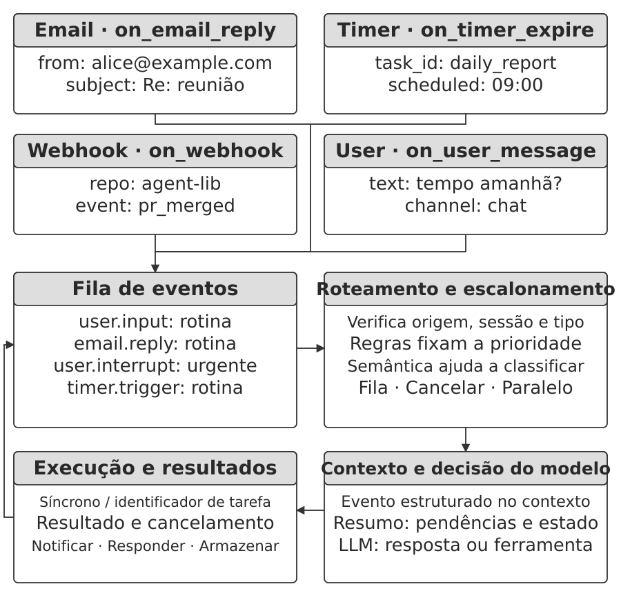

### Implementação do mecanismo orientado a eventos no OpenClaw

O OpenClaw se conecta aos canais de mensagens por meio do Gateway e encaminha os eventos ao runtime do agente. Seus mecanismos de automação incluem Hooks internos, agendamento, Heartbeat e Webhooks externos, entre outros pontos de entrada[^ch6-automation]. Esses mecanismos podem ser entendidos pela condição de acionamento:

- **Hooks (ganchos de eventos)** respondem a eventos internos do framework, como criação ou redefinição de sessões e mudanças no ciclo de vida de uma execução.
- **Cron (agendamento)** executa trabalhos em horários ou intervalos especificados. Por exemplo, `0 9 * * 5` significa toda sexta-feira às 9h, no fuso horário configurado.
- **Heartbeat** desperta o agente periodicamente para verificar assuntos que exigem atenção.
- **Webhook (callback externo)** recebe eventos enviados por serviços externos e, após autenticação e roteamento, aciona o processamento.

Um relatório semanal se presta a rodar em horário fixo; pendências que exigem atenção contínua podem ser verificadas periodicamente; novos e-mails e callbacks de serviços podem chegar por push, o que reduz o tempo até serem percebidos.

**Os eventos de chamada do PineClaw.** A Pine AI faz telefonemas em nome do usuário para negociar contas, cancelar assinaturas, tratar sinistros de seguro e assuntos semelhantes. O PineClaw conecta essas tarefas telefônicas ao OpenClaw. Uma ligação costuma durar algum tempo, e durante ela pode ser necessário que o usuário intervenha:

- **Verificação de identidade.** O atendente pede que o titular da conta conclua uma verificação, por exemplo informando um código de segurança ou uma senha de uso único.
- **Chamada a três.** O atendente pede para falar diretamente com o titular da conta, e é preciso avisar o usuário a tempo para que ele atenda.
- **Confirmação de decisões.** Quando o atendente propõe uma alternativa, o agente de primeiro plano avalia, com base nesta solicitação e nas preferências anteriores do usuário, se ela é aceitável. Quando a decisão cabe ao usuário, envia a ele as opções concretas e, ao mesmo tempo, continua a conferir as demais condições com o atendente.

Suponha que o atendente precise que o titular da conta entre em uma chamada a três. Quanto antes a notificação chegar, menos tempo os dois lados ficam esperando ao telefone. O PineClaw usa um mecanismo de Channel para ligar os eventos da chamada entre o Gateway e a API da Pine: chamada atendida, necessidade de entrada do usuário e fim da chamada entram, cada um, no fluxo de eventos, e o agente atualiza a tarefa e avisa o usuário de acordo.

**A meu ver, para que um serviço proativo chegue a tempo, o ideal é que a própria fonte do evento notifique o agente quando o estado muda.** Quando a notificação chega pelo canal, o Harness localiza a tarefa correspondente, verifica se a notificação é duplicada ou se já expirou, e então o modelo decide o próximo passo. Se for preciso que o usuário verifique a identidade, a interface deve abrir um ponto de autenticação confiável, e o resultado da verificação volta depois à tarefa original como um novo evento.

### Ferramentas acionadas por eventos

Se você pede ao assistente “me avise quando o cliente responder”, como ele vai acordar justamente amanhã? Primeiro, verifica-se se a caixa de e-mail consegue enviar um evento quando a mensagem chega; se o sistema só permite consulta ativa, é preciso guardar o horário da próxima verificação. As três interfaces ilustrativas abaixo entregam essas condições de espera ao runtime, e o modelo pode encerrar a rodada de trabalho atual.

**Temporizadores (`set_timer`)** despertam uma tarefa em um horário combinado. Um temporizador de execução única serve para “ligar para o banco na próxima segunda-feira, às 10h, para saber do financiamento imobiliário”; um temporizador recorrente serve para verificar a cada hora a saúde de um serviço. Esperar a resposta depois de enviar um e-mail ou voltar a ligar quando o horário de atendimento já acabou também podem ser agendados com temporizadores. A interface precisa guardar o fuso horário, a condição de acionamento e o identificador da tarefa, e oferecer meios de cancelar ou alterar o agendamento. Quando o serviço externo só aceita consultas, a tarefa agendada também pode fazer a verificação periódica do andamento.

**O monitoramento de tarefas em segundo plano (`monitor_shell`)** transforma comandos de longa duração em eventos de progresso. Ao iniciar, devolve um identificador da tarefa; durante a execução, notifica conforme surgem novas saídas, palavras-chave ou mudanças de estado; ao terminar, informa o código de saída e o resultado.

Deixar o modelo consultar o progresso repetidamente consome chamadas ao modelo mesmo quando nada mudou; esperar apenas o aviso de conclusão pode deixar passar uma falha no meio do caminho. Por isso, recomendo entregar o monitoramento ao runtime e despertar o modelo apenas quando surgir progresso útil, um erro ou uma paralisação. Assim, é possível continuar a conversa durante o build e intervir a tempo diante de anomalias. As regras de monitoramento podem incluir filtragem, agregação e limite de frequência, para que cada linha de log não provoque uma chamada ao modelo.

Por exemplo, depois que o modelo assina as atualizações de status de um ticket pendente, pode encerrar esta rodada de inferência e esperar que a notificação o desperte trazendo o número do ticket. Se o outro lado só oferecer uma forma de consulta, o modelo pode agendar ele mesmo a próxima verificação. Se, no horário marcado, a consulta mostrar “em andamento”, ele agenda outra; se mostrar que o ticket foi resolvido, cancela as verificações seguintes. Nos dois casos, quem espera é o runtime, e o modelo só volta a decidir quando recebe uma notificação ou quando o temporizador vence.

**Canais de eventos externos (`connect_channel`)** servem para assinar e-mails, mensagens instantâneas ou callbacks de API. O adaptador do canal verifica a origem, mapeia os identificadores próprios do serviço para threads e objetos associados e então envia o evento em formato unificado; a seção “Camada de entrada”, mais adiante, detalha isso. As notificações de estado das chamadas do PineClaw pertencem a essa categoria.

Os três tipos de ferramenta precisam de condições de acionamento, regras de filtragem e payloads de evento bem definidos. O payload deve incluir o identificador do evento, o momento em que ocorreu, a origem, a tarefa relacionada e o conteúdo necessário, para que o agente consiga avaliar se o evento ainda é válido e de que informações precisa para o próximo passo.

### Ferramentas de comunicação com o usuário

Voltemos à remarcação da passagem. Fazer uma pergunta ao atendente, mandar ao usuário uma mensagem de confirmação que ele possa responder diretamente e anotar no registro da tarefa “aguardando resposta” são escritas em três lugares diferentes. O usuário pode se ausentar por um tempo e voltar quando for preciso complementar condições, confirmar uma decisão ou receber o resultado.

A interface de conversa pode mostrar a resposta final, o progresso das ferramentas e os resultados da execução; já as ferramentas de comunicação especificam explicitamente o destinatário, o canal, o conteúdo da mensagem e os anexos. O modelo decide o que precisa dizer, o Harness verifica o destino e as permissões, e o serviço de mensagens faz a entrega. O runtime também pode encaminhar automaticamente a resposta final à conversa de origem. As duas formas podem ser usadas em conjunto.

A interação multicanal do OpenClaw permite que o usuário mande mensagens, aguarde o andamento e receba lembretes como faria com um secretário. Essa “presença humana” vem do estado contínuo da tarefa e da comunicação oportuna. O usuário pode continuar a tarefa no canal que já conhece, e o agente precisa manter coerentes a identidade, as sessões e a associação entre mensagens.

O conteúdo da comunicação também pode variar com a tarefa: atualizações breves vão em texto, resultados complexos levam imagens ou arquivos anexos, informações a preencher usam cartões estruturados e resultados interativos usam a UI generativa apresentada no Capítulo 5. Quando o canal oferece confirmação de entrega ou de leitura, o sistema guarda esse estado; novas tentativas após falhas, mensagens duplicadas e sincronização entre canais também entram no registro de entregas.

**Notificações multicanal e reengajamento do usuário.**

Mensagens instantâneas, SMS, e-mail, telefonemas e notificações push se adequam a diferentes graus de urgência e formatos de conteúdo. O agente pode escolher o canal considerando a urgência, as preferências do usuário, seu estado atual e o tamanho da mensagem. Eventos de chamada que exigem confirmação imediata pedem um alerta rápido; um relatório completo pode ser entregue por e-mail ou por um link no aplicativo.

Certa vez, pedi a um assistente que acompanhasse o preço dos hotéis para a conferência ATC. Todos os dias, no mesmo horário, o assistente mandava uma mensagem dizendo que o preço ainda não tinha caído até o valor desejado. Numa ocasião, o preço caiu por pouco tempo, e quem capturou essa janela foi um script que eu mesmo tinha escrito. Um preço baixo passageiro pode aparecer entre duas consultas. Mesmo que o assistente o detecte a tempo, se a mensagem chegar atrasada, o usuário pode perder a reserva. Nos dias sem queda de preço, a consulta agendada pode continuar rodando normalmente, sem que o usuário precise ler todos os dias uma mensagem com o mesmo conteúdo. O Capítulo 7 usará uma janela de queda de preço de cinco minutos para testar esse tipo de alerta.

Quando uma tarefa longa termina, a notificação leva o usuário de volta à página do resultado; resumos diários e relatórios semanais são enviados no ritmo combinado. A estratégia multicanal também deve prever eliminação de duplicatas, horários de silêncio e condições de escalonamento — por exemplo, se o primeiro alerta não tiver resposta, se é o caso de passar a outro canal. Os registros de notificação ficam associados ao estado da tarefa, para que o usuário possa continuar a partir da mensagem que recebeu.

### Identidade virtual e ambiente de execução isolado

O Capítulo 4 usou Samantha, de *Her*, para mostrar como um assistente de propósito geral entra no mundo digital por meio de ferramentas. Para construir um assistente desse tipo, é preciso definir com que identidade ele trabalha e a quais recursos pode ter acesso. **Prefiro dar ao assistente de propósito geral uma identidade virtual independente.** Um e-mail de trabalho, um número de telefone, um espaço de armazenamento e um ambiente computacional exclusivos permitem que o agente, como um secretário com suas próprias contas de trabalho, trate dos assuntos do usuário com uma identidade de representante bem definida. A identidade independente separa o trabalho cotidiano do assistente das contas pessoais do usuário, o que facilita autorizar, auditar e revogar de forma separada; e, quando há um erro de operação, fica mais fácil limitar o alcance do dano. Tarefas que precisam acessar contas do usuário obtêm as permissões necessárias por meio de autorizações de escopo restrito.

A quem pertence o número de telefone determina quem consegue dar continuidade quando o outro lado retorna a ligação. O Cue, da Manus, dá ao assistente um número próprio, capaz de atender chamadas e deixar um resumo da conversa para o usuário. Se a empresa aceitar o número de retorno deixado pelo assistente, quando o atendente ligar de volta encontrará diretamente o assistente que já vinha cuidando do caso.[^ch6-cue]

Tomemos como exemplo um pedido de isenção de tarifa: o assistente pode contatar a empresa como representante autorizado. Se o atendente exigir uma verificação verbal do titular, o assistente pode pedir que o usuário entre numa chamada a três e, concluída a verificação, retomar a conversa. Se a empresa for ligar de volta para o usuário, o assistente primeiro lhe passa o número do caso, o que já foi acertado e as questões que ainda precisam ser verificadas. Ao prestar contas ao usuário, também deve deixar claro que evidências tem em mãos: se o atendente prometeu verbalmente a isenção, registra-se esse compromisso; quando, mais tarde, a fatura atualizada for conferida, informa-se que a tarifa foi de fato isentada.

Quando eu estava em Pequim e precisei de uma segunda via do cartão de crédito do Bank of America, o Pine entrou em contato com o banco, conseguiu a emissão expressa do cartão e a dispensa da tarifa de 15 dólares pelo envio expresso. Ao fim da ligação, o assistente já podia informar o que o banco havia aceitado e qual tarifa concordara em dispensar. Se, alguns dias depois, o usuário perguntar “onde está o cartão novo?”, será preciso consultar o rastreamento da entrega ou pedir ao destinatário que confirme o recebimento.

Computadores e celulares virtuais oferecem ambientes de operação que funcionam continuamente. Máquinas virtuais podem rodar sistemas de desktop, contêineres servem para isolar processos e dependências, e emuladores Android hospedam aplicativos móveis. Eles permitem execução em segundo plano e reduzem a interferência das operações automáticas no trabalho atual do usuário. O alcance do isolamento é determinado em conjunto pela rede, pelas montagens, pelas credenciais e pelas permissões de execução; essas configurações também afetam os dados e os sistemas externos a que o agente tem acesso.

Suponha que você queira que o Tencent WorkBuddy Enterprise gere o relatório semanal depois que você desligar o computador ao fim do expediente, mas a planilha de vendas da semana só existe no computador do escritório. Se escolher uma tarefa local, o assistente pode ler a planilha, mas o computador precisa estar ligado e o cliente, online. Se escolher uma tarefa na nuvem, o assistente pode continuar trabalhando depois que você desligar o computador, desde que você antes envie à tarefa os dados autorizados para o relatório ou os coloque em um repositório acessível à tarefa na nuvem. Se a planilha de vendas tiver de permanecer na máquina local, a tarefa deve ser agendada para quando o computador estiver online.

Páginas web e aplicativos móveis também podem exigir autenticação, CAPTCHAs ou confirmação humana. Na integração, deve-se dar preferência às APIs e aos mecanismos de autorização oferecidos pelo serviço; quando a autenticação precisa passar pela interface gráfica, pode-se usar uma área de trabalho remota via VNC/RDP para que o usuário faça login pessoalmente, suspendendo as operações automáticas durante a autenticação. Depois que o usuário termina, o sistema verifica o estado da sessão e retoma a tarefa. Tokens e sessões são guardados de acordo com seu prazo de validade e, quando a autorização é revogada ou a tarefa termina, são removidos conforme a política definida.

O agente e o ambiente virtual podem trocar dados por meio de um **sistema de arquivos compartilhado**. Por exemplo, o usuário envia um CSV, o computador virtual lê o arquivo, executa a análise e grava o gráfico de volta no armazenamento compartilhado; o runtime entrega ao agente a localização do arquivo do gráfico e então oferece ao usuário um link de download acessível. O conteúdo de arquivos grandes permanece no armazenamento, e o modelo lê resumos ou trechos conforme a necessidade.

[^ch6-dsh-threads]: DeepSeek, modelo de domínio e regras de autorização e assinatura do protótipo dsh-superagent.
[^ch6-dsh-sessions]: DeepSeek, protótipo dsh-superagent, versão `8c32a9d`. As responsabilidades dos dois tipos de sessão estão em `docs/004-prompts.md`; as sessões de execução e o diretório de trabalho, em `docs/003-execution.md`; o formato das mensagens enviadas à sessão principal, em `docs/007-architecture.md`.
[^ch6-duet]: Anthropic, *Get started with Claude Duet*, apresenta o briefing antes de reuniões, a página da tarefa e as notificações na conversa principal.
[^ch6-cue]: Manus, *Introducing Manus 2.0*, apresenta o número de telefone próprio do Cue, o atendimento de chamadas e os resumos das conversas.
[^ch6-automation]: OpenClaw, Automation, apresenta os pontos de entrada de automação, como Hooks internos, agendamento, Heartbeat e Webhooks externos.

### Camada de entrada: muitas origens, um só evento

O agente de atendimento de uma loja virtual cuida de um reembolso: o cliente faz o pedido na conversa de atendimento do aplicativo; o valor ultrapassa a alçada do agente, que pede a confirmação de um supervisor no grupo de pós-venda do WeCom; depois que o reembolso é efetuado, o serviço de pagamentos envia um Webhook; em seguida, o sistema de pedidos publica a mudança de status no Kafka. As quatro mensagens tratam do mesmo pedido, mas cada uma chega de um jeito. Com muitas origens, se cada caminho tratar por conta própria novas tentativas, duplicatas e ordenação, essas diferenças acabam fragmentando o runtime. **A camada de entrada unifica a forma do evento depois que ele entra no sistema e preserva as diferenças de capacidade de cada origem antes da chegada.** A Figura 6-2 mostra essa divisão em camadas.

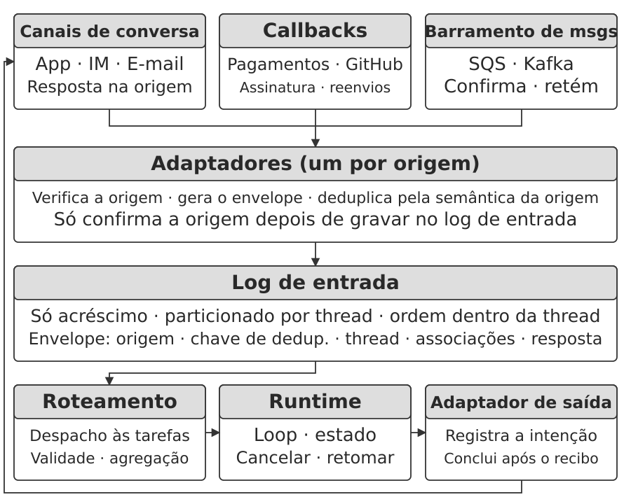

As origens comuns se dividem em quatro tipos. Os **canais de conversa** incluem a interface de conversa do próprio produto, mensageiros como WeCom, Feishu e Slack, e o e-mail; nesses casos, o agente pode responder no mesmo lugar. Os **callbacks** são interfaces HTTP chamadas por serviços externos quando um estado muda; em geral vêm assinados e trazem apenas uma notificação. Quando a entrega falha, alguns serviços tentam de novo automaticamente, enquanto o GitHub exige reenvio manual ou por API. Os **barramentos de mensagens**, como SQS e Kafka, transportam eventos de negócio dos serviços internos e têm semântica clara de confirmação e retenção. **Temporizadores, consultas periódicas e eventos internos** são gerados pelo próprio sistema e basta gravá-los no mesmo log. A tabela a seguir compara os três primeiros tipos.[^ch6-ingress-mq][^ch6-ingress-callback]

| | Conversa no app | WeCom / Feishu | E-mail | Webhook | SQS | Kafka |
|---|---|---|---|---|---|---|
| Forma de chegada | Conexão persistente | Callback ou conexão persistente | Push ou consulta periódica | Callback | Consumidor puxa | Consumidor puxa |
| Escopo da ordenação | Dentro da conversa | A maioria dos eventos não garante | Não garante | Não garante | Fila padrão não garante; FIFO por grupo de mensagens | Dentro da partição |
| Base nativa para deduplicação | ID da mensagem no cliente | ID da mensagem, ID do evento | Message-ID | ID da entrega | ID da mensagem; FIFO tem também `MessageDeduplicationId` | Tópico, partição e offset |
| Permite reprocessar? | Depende do registro próprio | O callback em si não; no Feishu, é possível recuperar pela API de histórico de mensagens | É possível reler a caixa | Depende do serviço | Não, depois de excluída | Sim, dentro do período de retenção |
| Forma de confirmação | Recibo para o cliente | Retornar sucesso dentro do prazo | Registrar por conta própria a posição de leitura | Retornar 2xx dentro do prazo | Excluir a mensagem | Fazer commit do offset |
| Caminho de resposta | Conversa de origem | Conversa de origem | Responder ao e-mail | Nenhum | Nenhum | Nenhum |

**Envelope unificado.**

O adaptador converte a mensagem bruta em um **envelope** de formato unificado. O envelope registra apenas fatos que já podem ser determinados no momento da chegada; a prioridade e o prazo de tratamento são acrescentados pelas regras de roteamento, a categoria do cliente e o status do pedido vêm dos sistemas de negócio, e o estado do processamento é guardado à parte. O pedido de reembolso do cliente pode ser escrito assim:

```json
{
  "id": "evt_7f3a",
  "source": {"type": "app_chat", "sender": "user:u_5521", "verified": true},
  "dedupe_key": "app:msg:msg_1029",
  "thread": "app:conv:conv_88",
  "kind": "message",
  "correlation": ["order:12345"],
  "content": {"type": "text", "text": "Quero o reembolso deste pedido"},
  "raw_ref": "raw/2026-11-23/app/msg_1029.json",
  "reply": {"via": "app_chat", "target": "app:conv:conv_88"},
  "occurred_at": "2026-11-23T14:02:09+08:00",
  "expires_at": null
}
```

- `source`: tipo de origem e remetente verificado. A “verificação” é feita pelo adaptador com base em assinatura, token ou conta do canal; uma apresentação feita no corpo da mensagem não conta. O runtime decide as permissões com base neste campo.
- `dedupe_key`: chave de deduplicação; o que conta como duplicata depende da semântica da origem. ID da entrega, ID da mensagem, partição e offset identificam uma mesma entrega e barram reenvios da camada de transporte; se a mensagem de negócio trouxer uma chave de idempotência (idempotency key), como o número do reembolso mais o status, o adaptador precisa extraí-la para barrar duplicatas de negócio. Nas conversas com usuários é o contrário: um cliente que diz “reembolso” duas vezes enviou duas mensagens, e a deduplicação se faz apenas pelo ID da mensagem no cliente.
- `raw_ref`: o payload original guardado tal como chegou; é a única base para investigar erros do adaptador.
- `reply`: por qual adaptador de saída e para qual destino responder. O callback de pagamento não tem caminho de resposta, e este campo fica vazio.
- `occurred_at` é o momento da ocorrência informado pela origem; `expires_at` é o prazo de validade, preenchido apenas para eventos como cotações e códigos de verificação.

**Threads e associações.**

Se o cliente primeiro diz “reembolso” e logo em seguida acrescenta “deixa pra lá, quero trocar”, a ordem das duas mensagens não pode se inverter; as mensagens de outro cliente não têm relação com elas e podem ser tratadas em paralelo. **A camada de entrada só garante ordem dentro de uma thread.** O adaptador mapeia a unidade de ordenação da própria origem para `thread`: uma conversa no app, um grupo de mensagens do SQS FIFO (`MessageGroupId`), a chave de partição do Kafka, o número da Issue ou do PR em um callback do GitHub. Quando a origem não garante ordem, o runtime usa `occurred_at` ou o número de versão fornecido pela origem para reconhecer estados antigos que chegam atrasados — por exemplo, um “reembolso em processamento” que chega depois de “reembolso efetuado”.

As quatro mensagens deste reembolso pertencem a quatro threads diferentes. Juntá-las em uma só tem custo alto: uma discussão alheia no grupo de pós-venda passaria a esperar atrás das mensagens do cliente, e o identificador da thread muitas vezes serve também de chave de partição, de modo que alterá-lo depois exige migrar dados. **As associações são expressas em um campo próprio, sem reescrever a thread.** `correlation` lista os objetos de negócio envolvidos no evento, e as tarefas assinam as threads relevantes de acordo com esses objetos.

**Separar o momento da confirmação do progresso.**

**O adaptador deve confirmar a origem depois que o evento for gravado no log de entrada, e não esperar que o agente termine o processamento.** O callback de eventos do Feishu exige resposta em até 3 segundos, o do WeCom em até 5 segundos, e, se o prazo estourar, o evento é reenviado; uma mensagem do SQS que não for excluída dentro do tempo limite de visibilidade será recebida de novo. Se a confirmação esperar o fim do processamento, basta uma chamada ao modelo um pouco mais demorada para provocar entregas duplicadas. Gravando no log antes de confirmar, as garantias de entrega das várias origens se reduzem a uma única frase: **cada evento entra no log de entrada pelo menos uma vez (at-least-once)**, e o reenvio é barrado pela chave de deduplicação.

O log de entrada funciona como uma caixa de entrada (inbox), segue o princípio do Capítulo 1 de só acrescentar, nunca alterar, e é particionado por thread. Quando o Kafka é usado como log de entrada, a deduplicação exige um armazenamento separado com restrição de unicidade ou um filtro pela chave de deduplicação no consumidor: o Kafka não consegue recusar gravações com base em uma chave definida pela aplicação, e seu produtor idempotente cobre apenas as novas tentativas do próprio produtor.

O sistema precisa guardar separadamente três tipos de progresso:

| Progresso | O que registra | Quem mantém |
|---|---|---|
| Progresso da origem | Offset do Kafka, receipt handle do SQS, posição de leitura da caixa de e-mail | Adaptador |
| Progresso do despacho | A quais tarefas os eventos do log já foram entregues | Roteamento |
| Estado da tarefa | Em que etapa está o processamento, se a resposta já foi enviada | Runtime |

Se o offset for tratado como progresso da tarefa, ao reprocessar o log as respostas já enviadas serão enviadas outra vez; separando-os, o reprocessamento afeta apenas o progresso do despacho. No sentido de saída, o equivalente é a caixa de saída (outbox): antes de enviar, registra-se a intenção de envio e a chave de idempotência; ao receber o recibo do canal, marca-se como concluído. A forma de conferir isso após uma reinicialização é tratada adiante, em “Um loop básico a partir de eventos de e-mail”.

**Validade, agregação e contrapressão.**

Quando centenas de eventos por segundo chegam à mesma thread, não se deve entregá-los ao modelo um a um. O roteamento trata o acúmulo antes do despacho:

- **Validade.** Cotações, códigos de verificação e alertas já resolvidos perdem o sentido depois de certo tempo. Eventos que passaram de `expires_at` são apenas registrados na trajetória e não despertam mais o modelo.
- **Agregação.** `kind` distingue dois tipos de evento. Eventos de estado descrevem o valor atual de um objeto, como o status do reembolso no callback de pagamento ou o status do pedido no Kafka; quando vários se acumulam na mesma thread, só o mais recente vai para o modelo, e os valores intermediários ficam no log. Eventos de mensagem são uma frase dita ou uma instrução dada por alguém, como a mensagem do cliente ou o clique do supervisor; podem ser entregues ao modelo em lote, mas não podem ser descartados.
- **Contrapressão.** Origens do tipo pull podem reduzir o ritmo da coleta, e o acúmulo fica na origem. Origens do tipo push não podem ser pausadas; o adaptador continua gravando no log e confirmando, o acúmulo passa para o log de entrada e é absorvido pelas duas regras anteriores.

**Um reembolso que passa pelas quatro origens.**

1. O cliente pede o reembolso na conversa do app. O adaptador deduplica pelo ID da mensagem no cliente, grava no log e então envia o recibo ao cliente; o roteamento cria a tarefa de reembolso a partir de `order:12345`, e a tarefa assina essa thread de conversa.
2. O valor ultrapassa a alçada, e o agente envia um cartão de confirmação ao grupo de pós-venda no WeCom; o identificador do cartão é registrado na tarefa. O supervisor clica em “Aprovar”; o adaptador grava no log, retorna sucesso e acrescenta o objeto associado com base no identificador do cartão.
3. Depois que o agente chama a interface de reembolso, o serviço de pagamentos envia duas vezes o callback “reembolso efetuado” com o mesmo ID de entrega; o segundo é deduplicado.
4. O sistema de pedidos publica no Kafka “pedido reembolsado”, que diz o mesmo que o callback. Se os dois adaptadores extraírem do payload o número do reembolso mais o status como chave de deduplicação, esse evento é barrado já na entrada; se deduplicarem respectivamente por ID de entrega e por partição e offset, os dois entram no log, e o runtime, ao ver que o reembolso já está confirmado na tarefa, apenas o registra na trajetória.
5. Nem o callback nem o evento do Kafka têm caminho de resposta. O runtime usa o `reply` da thread de conversa do passo 1 e avisa o cliente pelo adaptador de saída do app.

O passo 4 marca o limite da deduplicação na camada de entrada: as duplicatas que ela consegue barrar dependem das chaves de deduplicação declaradas pelo adaptador; as que escapam são resolvidas pelo estado da tarefa. Depois que o evento é despachado para uma tarefa, decidir se ele continua uma sessão existente ou abre uma nova é questão de gerenciamento de contexto: informações entre sessões são transmitidas pela memória do Capítulo 3, e o compartilhamento de contexto é discutido no Capítulo 10.

[^ch6-ingress-mq]: Amazon Web Services, “Amazon SQS standard queues”; “Amazon SQS visibility timeout”; “Using the message deduplication ID in Amazon SQS”; “Using the message group ID with Amazon SQS FIFO Queues”. Documentação do Apache Kafka 4.4, “Consumer Position” e “Message Delivery Semantics”, na seção “Design”. Data de verificação: 2026-11-24.
[^ch6-ingress-callback]: Feishu Open Platform, “Visão geral de eventos”; “Obter o histórico de mensagens de uma conversa”. Centro de Desenvolvedores do WeCom, “Visão geral” em “Receber mensagens e eventos”. GitHub Docs, “Best practices for using webhooks”; “Handling failed webhook deliveries”. Data de verificação: 2026-11-24.

### Mecanismo de tratamento de eventos

Mensagens do usuário, resultados de ferramentas, temporizadores e pedidos de colaboração podem chegar ao mesmo tempo a um agente. O runtime precisa guardar esses eventos, definir a ordem de tratamento e então entregar ao modelo as informações relevantes. O **loop de eventos** (event loop) é responsável por fazer esse processo avançar continuamente: tira eventos da fila, atualiza o estado das tarefas, monta as requisições ao modelo, despacha ferramentas e depois aguarda novas entradas ou avisos de conclusão. Programas em Go organizam múltiplos fluxos de mensagens com goroutines, channels e `select`, seguindo uma ideia parecida.

Tomemos o protótipo dsh-superagent. Em um mesmo projeto do GitHub, a discussão de uma Issue e a discussão de um pull request (PR) pertencem a duas threads de conversa (Thread) diferentes. Quando o sistema precisa decidir se assume um novo trabalho, lê o estado da thread e pede ao modelo uma avaliação (Eval). Cada thread tem no máximo uma avaliação em andamento por vez, mas pode ser assinada por vários tickets. Suponha que dois tickets, um para corrigir um defeito e outro para complementar a documentação, assinem o mesmo PR; se um revisor comentar no PR, os dois tickets recebem esse comentário como contexto. Se, em seguida, alguém acrescentar na Issue as condições para reproduzir o problema, essa mensagem chega aos tickets que assinam a Issue. Quem recebe a mensagem depende das threads e das assinaturas. O que cada ticket pode fazer depois de recebê-la continua determinado pelas autorizações que ele já tinha.[^ch6-dsh-threads]

O dsh-superagent também entrega “lidar com pessoas” e “fazer o trabalho” a sessões diferentes. A sessão principal (Main Session) apenas recebe pedidos, responde e registra autorizações; não lê código nem para à espera de resultados. Cada ticket tem sua própria sessão de execução (Executor Session), que altera código e roda testes em um diretório de trabalho separado. A sessão de execução só manda uma mensagem à sessão principal quando conclui a correção, fica travada ou precisa perguntar algo a alguém, anexando um resumo e um endereço de leitura — o “resumo mais ID de objeto” do Capítulo 2. Assim, a sessão principal sempre tem as mãos livres para o próximo pedido; perguntas às pessoas, notificações e ordens de parada também passam por ela, e os compromissos saem de uma única porta. Os modelos rápido e lento da parte de voz, mais adiante, são essa mesma divisão de trabalho aplicada a chamadas em tempo real.[^ch6-dsh-sessions]

Interfaces síncronas de modelo costumam aceitar o próximo lote de mensagens ao fim de uma geração ou depois que os resultados das ferramentas são completados. Ali é possível definir **pontos seguros**: o runtime registra primeiro as mensagens concluídas, as chamadas ainda em execução e o progresso da tarefa atual e só então passa à nova etapa de processamento. Interfaces com assincronia nativa oferecem um protocolo para receber atualizações durante a execução, e o momento exato da continuação é combinado entre a interface e o runtime.

O cancelamento também exige a colaboração do executor. Depois que o modelo para de gerar, ferramentas em segundo plano podem continuar rodando; o executor precisa receber o sinal de cancelamento e informar o estado real, de modo semelhante a uma tarefa em Go que verifica `ctx.Done()` e faz a limpeza. Gravações, envios ou pagamentos já concluídos devem ser desfeitos ou compensados pelos processos de negócio correspondentes.

**Três estratégias de tratamento.**

A Figura 6-3 compara as três opções quando chega um novo evento. Se o evento entrar na fila, o tempo de resposta depende de quando surgirá o próximo ponto seguro; se a tarefa atual for cancelada, é preciso confirmar quais operações já foram concluídas e de onde é possível retomar; se outro loop for aberto, é preciso verificar se as duas tarefas vão disputar o mesmo recurso.

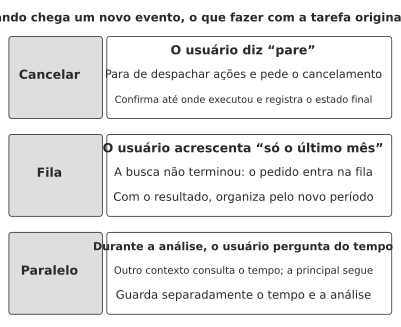

**O tratamento por cancelamento (Cancellation-Based)** serve para ordens de parada do usuário ou eventos de controle que exigem tratamento imediato. O runtime primeiro deixa de despachar as operações relacionadas, envia um sinal de parada às requisições em geração e às ferramentas canceláveis e então salva as mensagens concluídas, o estado das ferramentas e os recibos de cancelamento. Em seguida, o novo evento entra no contexto de decisão. Por exemplo, se o usuário diz “Para! Eu me enganei”, o sistema primeiro restringe a execução seguinte e depois reconfirma a tarefa à luz do estado real. Os itens da fila ainda não tratados mantêm identificador e estado e são reordenados conforme o escopo de associação.

**O tratamento por fila (Queued)** serve para informações complementares rotineiras e atualizações de progresso. O evento entra na fila e, no próximo ponto seguro, é entregue ao modelo junto com os resultados das ferramentas. Por exemplo, durante uma busca, o usuário acrescenta “só os resultados do último mês”; quando a busca retorna, o modelo lê ao mesmo tempo os resultados e a nova condição e decide se filtra ou se refaz a busca.

**O tratamento paralelo (Parallel)** serve para pedidos independentes da tarefa principal que exigem resposta rápida. Por exemplo, durante uma análise de um grande volume de dados, o usuário pergunta sobre o tempo, e o sistema pode abrir uma sessão independente para fazer a consulta.

**Urgência e roteamento.**

O tipo de evento dá uma primeira pista: `user.interrupt`, instruções de supervisão confiáveis e alertas do sistema podem entrar no canal de alta prioridade; `user.input`, `agent.input`, `tool.result` e `timer.trigger` são avaliados também pelo conteúdo e pelo estado da tarefa. Quando o remetente se declara “urgente” no corpo da mensagem, o sistema continua definindo as permissões pela identidade verificada e pelas regras.

Para decisões de roteamento que exigem entender o significado da mensagem, recomendo um modelo leve de classificação: “pare agora” corresponde a cancelamento; “como está o tempo hoje?” pode ser tratado em paralelo; “faça o relatório em chinês” normalmente vai para a fila de complementos da tarefa atual. Comandos de parada explícitos (como um botão de parar) são tratados diretamente pelo runtime, e a classificação semântica fica para as demais mensagens que exigem compreensão.

Um modelo de propósito geral também consegue rotular mensagens, mas, mesmo que produza apenas “precisa de tratamento”, ainda precisa ler a descrição da tarefa e o conteúdo da mensagem. Fazer essa avaliação para cada nova mensagem faz o custo das chamadas crescer com o volume de mensagens, e as mensagens realmente urgentes também têm de esperar o rótulo do modelo para seguir adiante. O Jev, da TypeSafe, é dedicado a esse tipo de decisão com opções predefinidas. Dada uma mensagem e o estado atual da tarefa, ele fornece em paralelo, com custo e latência menores, a probabilidade de cada opção.[^ch6-jev]

A esparsificação do espaço de observação discutida no Capítulo 1 determina, aqui, quais mensagens disparam uma nova inferência. No caso de mensagens do Feishu e de comentários em Issues do GitHub, o programa pode primeiro filtrar notificações duplicadas pelo número do evento e depois pedir ao Jev que avalie se a nova mensagem complementa uma tarefa existente ou traz um pedido novo que precisa do modelo principal. Ao ler “complementando os passos para reproduzir que mencionei ontem”, o modelo só precisa reconhecer que se trata de um complemento. A qual Issue ele se refere, o programa obtém diretamente do número que acompanha o comentário.

Mesmo quando o modelo atribui uma probabilidade alta, ele pode estar superestimando sua confiança. Por exemplo, 100 mensagens podem ser classificadas como “complemento de tarefa existente” com probabilidade em torno de 90%, quando, na verdade, apenas 60 pertencem a essa categoria. Anexar automaticamente esse lote às tarefas existentes faria perder a finalidade real das outras 40 mensagens.

[^ch6-jev]: Nas notas de lançamento do Jev, a TypeSafe apresenta as saídas predefinidas, o retorno paralelo de probabilidades e o RLCD, método de treinamento voltado para a calibração de decisões.

### Um loop básico a partir de eventos de e-mail

Suponha que o processo que trata novos e-mails reinicie de repente. O identificador do e-mail permite recuperar a mensagem original, mas não diz se a resposta anterior chegou a ser enviada. Da entrada na fila à leitura do e-mail, à chamada de ferramentas e à atualização da caixa ou ao aviso ao usuário, o ideal é registrar cada operação de escrita e o recibo devolvido sob o mesmo e-mail. Se, após a reinicialização, houver uma requisição enviada sem recibo, verifica-se primeiro o estado real na caixa de e-mail e só então se decide se é preciso reenviar.

> **Experimento 6-1 ★★★: agente de processamento de e-mails orientado a eventos**
>
> Este experimento usa uma caixa de e-mail de teste como ponto de entrada para praticar o registro de eventos, filas e o tratamento de tarefas. Primeiro, organize os novos e-mails como eventos estruturados e trate-os na ordem de chegada; depois, conecte ferramentas de histórico de e-mails, leitura de anexos, consulta à base de conhecimento e notificação. Siga a Figura 6-4 para acompanhar um convite de reunião: no loop de eventos, identifique as etapas de verificação de conflitos na agenda e de redação do rascunho; depois, na camada de persistência, encontre o registro de tratamento desse e-mail.
>
> 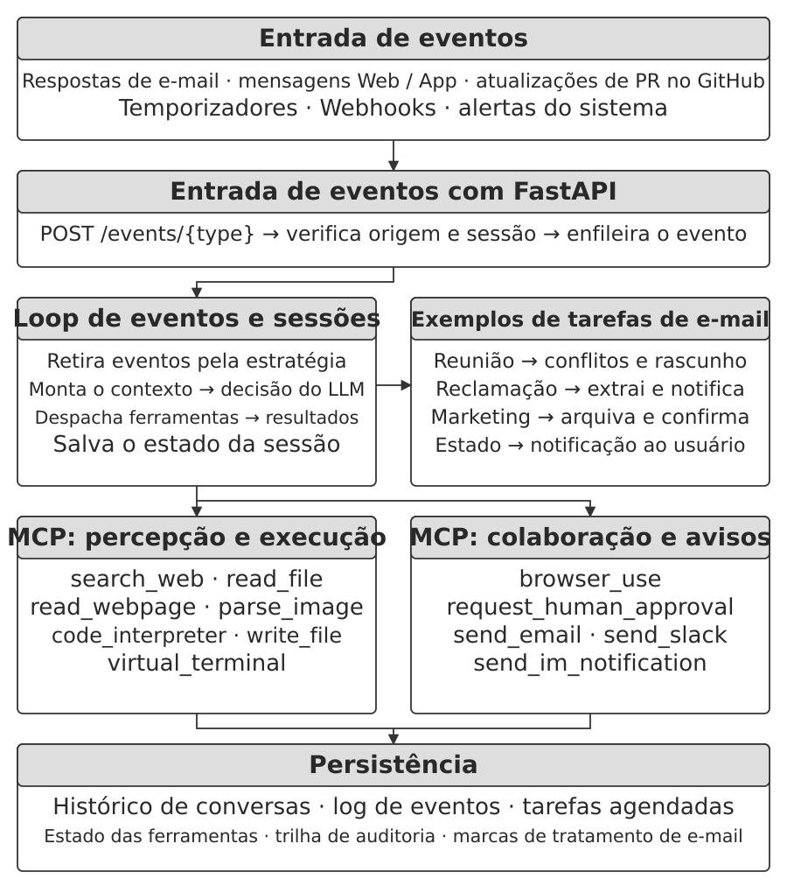
>
> A mesma fila pode ser estendida a várias origens: chegada de e-mails, mensagens de IM ou SMS, atualizações de PRs e Issues do GitHub, temporizadores, Webhooks externos e eventos internos como usuário offline, tempo limite de processo e alertas de recursos. Cada adaptador verifica a origem e acrescenta as informações de associação, e o resultado do tratamento é gravado de volta segundo o identificador do evento.
>
> A validação usa três e-mails de teste: um convite de reunião dispara a verificação de conflitos na agenda e gera um rascunho de aceite ou recusa; uma reclamação de cliente dispara a extração das informações principais, a marcação de alta prioridade e a notificação do usuário; um e-mail de marketing é arquivado segundo as regras.
>
> Nos registros que acompanham o livro, a conferência da documentação da interface e a sondagem de autenticação foram concluídas; a conexão à caixa de teste ainda aguarda credenciais válidas.
>
> **Extensão (opcional): entrada de várias origens e injeção de falhas.** Além da caixa de teste, conecte um endpoint de Webhook local e uma fila SQS (pode ser simulada localmente). Cada adaptador verifica a origem, gera o envelope e só confirma a origem depois de gravar no log de entrada; o runtime lê os eventos do log e os trata na ordem de cada thread. Em seguida, injete três tipos de falha:
>
> 1. **Entrega duplicada.** O endpoint de Webhook recebe duas requisições com o mesmo ID de entrega; o log registra apenas um evento.
> 2. **Queda antes da confirmação.** O adaptador é encerrado depois de gravar no log e antes de excluir a mensagem do SQS; a mensagem volta a ficar visível e é lida de novo, mas o log continua com apenas um evento.
> 3. **Queda antes do recibo.** O runtime é encerrado depois de enviar a resposta e antes de registrar o recibo; ao reiniciar, reprocessa o log. Se o canal aceitar chave de idempotência ou permitir consultar as mensagens já enviadas (por exemplo, a pasta de enviados do e-mail), a mesma resposta não é enviada duas vezes; em canais sem nenhum dos dois recursos, só resta marcar a resposta como pendente de confirmação humana.
>
> Os três tipos de falha devem deixar registro no log: qual entrega foi deduplicada, qual mensagem foi relida e qual resposta, após verificação, não foi reenviada.
>
> O código desta extensão roda offline e não exige chave de API. A caixa de teste e a fila SQS são simuladas com arquivos locais, separadas da caixa real que ainda aguarda credenciais; a fila simulada preserva o tempo limite de visibilidade, os receipt handles e a ordem dentro de cada grupo de mensagens. As quedas são provocadas pelo processo pai, que encerra o processo filho no ponto especificado. Cada canal de resposta demonstra um caso: o e-mail consulta os enviados, a conversa no app usa chave de idempotência e o SMS não tem nenhum dos dois. Para reproduzir, entre em `chapter6/agent-with-event-trigger` e execute `python multisource_demo.py`; o terminal imprime, item a item, os registros de log deixados pelos três tipos de falha. Nos registros de execução que acompanham o livro, todas as verificações dos três tipos de falha passaram.
>

A fila de e-mails estabelece a base do processamento sequencial. A seguir, acrescentamos ferramentas de longa duração e discutimos como receber novos pedidos durante a espera, cancelar tarefas e retomar o trabalho.

### Compatibilidade quando não há assincronia nativa

Suponha que o agente esteja redigindo um e-mail e já tenha chamado `search_contacts` para encontrar um contato. Antes que o resultado volte, o usuário pede: “espera um pouco, primeiro veja a previsão do tempo para amanhã”. Se a interface do modelo atual exigir que cada chamada de ferramenta tenha seu resultado antes de prosseguir, o Harness precisa converter o estado em segundo plano em uma sequência de mensagens que a interface aceite.

**Expressar o estado em segundo plano no formato síncrono de mensagens.**

**Ao adaptar-se a uma interface síncrona, convém preservar ao máximo o pareamento entre a chamada normal e o resultado real, inserindo uma resposta de estado apenas quando a tarefa muda no meio do caminho.** Preencher cedo demais cada chamada com “ainda em execução” enche a trajetória de estados inacabados e torna mais difícil para o modelo acompanhar os resultados reais. Na prática, podem-se seguir cinco regras:

1. **Registrar a chamada completa.** Grave na trajetória a mensagem do assistant já concluída pela API e os itens de chamada de ferramenta, preservando os identificadores das chamadas. O estado de inferência do lado do servidor é salvo segundo a forma de continuação definida pelo provedor.
2. **Registrar a conclusão real.** Quando a ferramenta termina, grave o resultado real, o identificador da tarefa e o estado da execução; durante a execução, o gerenciador de tarefas mantém salvo o estado pendente.
3. **Informar o estado atual na mudança de tarefa.** Em interfaces que aceitam esse tipo de payload de resultado, pode-se devolver, para a chamada pendente, uma informação de estado explícita, como “a tarefa continua em execução em segundo plano; o resultado ainda não foi produzido”, e então acrescentar o evento do usuário. O identificador da tarefa na resposta de estado liga essa chamada ao aviso de conclusão posterior.
4. **Organizar as mensagens após a interrupção.** Quando não há como continuar no meio da geração, cancele a geração inacabada, preserve as mensagens e o estado das ferramentas cuja conclusão já foi confirmada e então envie uma nova requisição. A saída inacabada é tratada conforme as regras da interface, para que argumentos pela metade não sejam tomados como chamadas executáveis.
5. **Receber eventos rotineiros em lote.** Informações complementares entram na fila e são enviadas juntas ao fim do ciclo atual ou num ponto seguro especificado, registrando-se quais eventos já foram tratados.

No exemplo da busca de contatos, a chamada completa é gravada primeiro na trajetória; quando o usuário muda de tarefa, o Harness insere uma resposta de estado dizendo que a busca continua em execução e então envia o pedido sobre o tempo. O resultado dos contatos chega mais tarde e entra no contexto como um novo evento, com origem e identificador da tarefa, e o agente retoma a redação do e-mail. Como a chamada original já recebeu uma resposta de estado, o resultado posterior assume a forma de evento definida pelo adaptador, mantendo o pareamento entre chamada e resultado.

A resposta de estado indica apenas o progresso atual da execução. As etapas que dependem dos dados de contato precisam esperar a chegada do resultado real. O gerenciador de tarefas pode guardar estados como `running`, `completed`, `cancelled` e `failed` e verificar se as dependências estão satisfeitas antes de enviar uma resposta ou executar a ferramenta seguinte.

**Projetar ferramentas assíncronas com identificadores de tarefa.**

Para novas ferramentas de tarefas longas, prefiro definir o “início” como uma operação completa, que devolve imediatamente um identificador de tarefa real. Com isso, o modelo distingue “já iniciada” de “já concluída”, e as consultas, os cancelamentos e os eventos de resultado posteriores têm uma base comum de associação. Por exemplo, `initiate_phone_call` inicia uma tarefa telefônica e devolve o identificador da tarefa e o estado “discando”; `phone_call_connected` e `phone_call_ended` informam, respectivamente, que a chamada foi atendida e que terminou.

A descrição da ferramenta deve deixar claro: “Esta ferramenta inicia uma tarefa telefônica e, em caso de sucesso, devolve o ID da tarefa. Você pode continuar cuidando de outros assuntos; o andamento da chamada e o resultado final chegam por eventos separados.” O nome da ferramenta indica que se trata de uma operação de início; a estrutura de retorno e os eventos posteriores indicam como a tarefa avança e termina. O sistema também oferece interfaces para consultar, cancelar e retomar pelo ID da tarefa, para que o modelo saiba o que ainda pode fazer.

**Tratar eventos em lote, um a um.**

Quando vários eventos entram no contexto de uma só vez, o modelo pode responder apenas ao último e esquecer pedidos feitos antes. O runtime deve preservar o estado de tratamento de cada um, para que as condições ainda não atendidas continuem visíveis. O prompt pode pedir ao modelo que verifique item por item, e uma barra de status lista as informações ainda não tratadas:

```text
[Evento não tratado 1/4] Resultado de database_query: …
[Evento não tratado 2/4] Complemento do usuário: considerar só os dados da região de Pequim
[Evento não tratado 3/4] Lembrete do sistema: faltam 30 minutos para o prazo do relatório
[Evento não tratado 4/4] Pergunta do usuário: como está o andamento?
```

Um resumo do lote pode indicar “1 resultado de ferramenta, 2 mensagens do usuário, 1 lembrete do sistema”. O runtime também associa os eventos às restrições da tarefa: a condição de região atualiza o escopo da consulta, o prazo afeta o escalonamento e a pergunta sobre o andamento exige resposta. Depois do tratamento, registra-se o estado — concluído, aguardando ou precisa de esclarecimento —, e os itens não resolvidos continuam presentes na rodada seguinte.

Um mesmo número de tarefa encadeia o início, os relatórios de progresso e o resultado final da execução. Se alguém pedir para parar no meio do caminho, é preciso verificar também se há um recibo de cancelamento sob esse número.

> **Experimento 6-2 ★★★: agente assíncrono com execução paralela e capacidade de interrupção**
>
> Este experimento valida primeiro o runtime assíncrono e só depois conecta um modelo para verificar as decisões. Os registros de execução que acompanham o livro cobrem quatro cenários com subprocessos reais do sistema operacional, e o escalonamento dos eventos e os relatórios são conduzidos por um script determinístico.
>
> 1. **Execução em segundo plano e resposta imediata.** Inicia-se um processo de análise que dura alguns segundos e devolve-se imediatamente o identificador da tarefa; durante a espera, responde-se qual é a hora atual e, ao final, recebe-se o resultado da análise.
> 2. **Fila e processamento em lote.** Durante a tarefa longa, acrescentam-se, em sequência, “responda em japonês” e “organize como página web”; quando a tarefa termina, o resultado e os dois pedidos são tratados como um único lote. O script gera um HTML em japonês.
> 3. **Cancelamento e retomada.** Mostra-se que, ao receber “parar a análise”, o sistema interrompe o turno do modelo ainda em geração e manda parar todas as tarefas em segundo plano em execução. Desta vez, a interrupção é emitida pelo script, e só havia um processo de análise, T1. Aos 0,803 segundo, o evento de interrupção registra o progresso de T1 em 18%; só aos 0,806 segundo o sistema registra seu código de saída −15. A T2, iniciada logo depois, é uma tarefa nova. O resultado recebido aos 4,436 segundos é o de T2; T1 não disparou o callback de conclusão.
> 4. **Tarefas paralelas e decisões com base no progresso.** Iniciam-se três processos de análise ao mesmo tempo, que avançam 3%, 2% e 1% por passo de tempo lógico. No registro de progresso paralelo deste experimento, quando a T1, a mais rápida, termina, o recibo da consulta mostra a T2 em 68% e a T3 em 34%. Conforme a Figura 6-5, tarefas com progresso de até 50% são canceladas. O script cancelou apenas a T3 e, no fim, recebeu os resultados de T1 e T2. Isso mostra que o mesmo runtime consegue tanto atender a uma ordem de parada do lote inteiro quanto preservar o trabalho paralelo que ainda é útil.
>
> 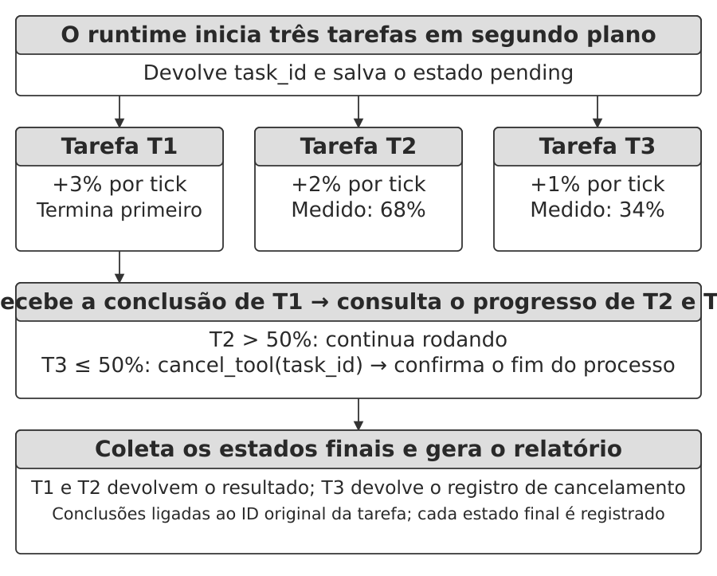
>

### Assincronia nativa do modelo: GPT-6 Astra

Nas abordagens anteriores, o Harness adapta o formato síncrono de mensagens. Já uma interface com assincronia nativa permite diretamente que o modelo continue trabalhando em tarefas independentes enquanto a ferramenta não retorna e receba o resultado depois. Em setembro de 2026, o GPT-6 Astra já oferecia chamada assíncrona de ferramentas (Async tool calling) e direcionamento no meio do turno (Mid-turn steering), que tratam, respectivamente, da espera por ferramentas e das atualizações do usuário. A Figura 6-6 compara os fluxos de mensagens da adaptação a interfaces síncronas e da assincronia nativa.[^ch6-22][^ch6-23]

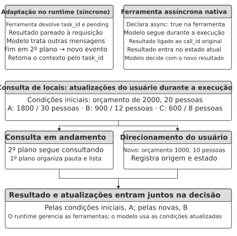

**Continuar o trabalho independente enquanto espera a ferramenta.** Por exemplo, depois de iniciar uma consulta de locais para uma reunião, o agente pode organizar a pauta e a lista de preparativos; quando a consulta volta, compara preços e capacidades. O `async: true` na definição da ferramenta declara a capacidade assíncrona; a aplicação inicia a execução ao receber o item de chamada completo e guarda o identificador da chamada, `call_id`. Quando o resultado chega, a aplicação o devolve com o identificador original e continua a partir do estado de resposta mais recente. O modelo organiza o trabalho seguinte, e o Harness gerencia a associação das chamadas e o ciclo de vida das tarefas.[^ch6-22]

**Receber novos pedidos com a tarefa em andamento.** Enquanto o modelo pensa ou organiza a resposta, o usuário pode acrescentar “o orçamento caiu para 1000” ou “o número de participantes passou para 10”. A aplicação envia eventos de direcionamento pela mesma conexão; depois que o servidor confirma o recebimento, o processamento continua a partir do estado de resposta atual. Após uma reconexão, a aplicação pode retomar a tarefa com base nos eventos e no estado de resposta salvos.[^ch6-23]

As duas capacidades podem ser combinadas: a consulta de locais continua rodando, os novos pedidos do usuário entram nas decisões seguintes e a escolha é concluída quando o resultado da consulta volta. O executor mantém, ao mesmo tempo, o estado real das tarefas em segundo plano. Quando é preciso interromper a consulta ou cancelar uma reserva, o Harness chama a interface correspondente e verifica o recibo; operações de negócio já concluídas seguem para o processo de reversão ou compensação.

Quando o modelo e a interface já oferecem assincronia nativa, dou preferência ao protocolo nativo, deixando que a suspensão de ferramentas, as atualizações do usuário e a continuação das respostas sigam as regras da interface. A camada de compatibilidade síncrona serve sobretudo aos modelos existentes e às interfaces antigas; quando o modelo é atualizado, pode-se remover aos poucos a lógica de compatibilidade que só existia para completar o pareamento de mensagens e concentrar o esforço de engenharia no estado das tarefas, no cancelamento e na retomada.

### Tratar tarefas assíncronas com confiabilidade

Uma interação assíncrona confiável exige verificar ao mesmo tempo as mensagens, as tarefas e o estado de execução.

1. **A quem pertence o resultado.** O resultado atrasado traz o identificador da chamada original, e a aplicação o associa à tarefa correspondente; as decisões que dependem desse resultado prosseguem quando os dados chegam.
2. **Retomada e cancelamento.** Quando o usuário muda o pedido, o sistema preserva o trabalho que continua válido, atualiza as etapas seguintes e deixa claro quais tarefas em segundo plano continuam e quais já pararam.
3. **Vários pedidos.** Orçamento, número de pessoas, região e prazo entram separadamente no estado da tarefa, e o resultado final é conferido item por item contra essas condições.

> **Experimento 6-3 ★★★: assincronia nativa do modelo e direcionamento no meio do turno**
>
> Neste experimento, o agente escolhe, para uma reunião simulada, o local mais barato que atenda ao orçamento e ao número de pessoas. O orçamento inicial é 2000, e o número de pessoas, 20; a ferramenta de consulta leva 8 segundos para devolver os preços e as capacidades de três locais.
>
> | Local | Preço | Capacidade |
> |---|---:|---:|
> | A | 1800 | 30 |
> | B | 900 | 12 |
> | C | 600 | 8 |
>
> Nas condições iniciais, a escolha certa é A. O grupo com direcionamento recebe duas atualizações com a tarefa em andamento: o orçamento passa a 1000 e o número de pessoas a 10; agora a escolha certa é B. A ferramenta também devolve um recibo recém-gerado, que a resposta final precisa citar, para que se possa verificar se o modelo usou o resultado que de fato chegou.
>
> O experimento tem cinco grupos, com três execuções cada: ferramenta síncrona, ferramenta assíncrona nativa, direcionamento durante o raciocínio, direcionamento durante a espera da ferramenta assíncrona e um modelo de controle sem capacidade de direcionamento. Os dois primeiros grupos comparam se é possível produzir uma lista de preparativos independente durante a espera; os dois grupos com direcionamento verificam se o orçamento e o número de pessoas passam a valer ao mesmo tempo; o controle de capacidade verifica se a interface informa explicitamente que não oferece o recurso.
>
> Nos registros de execução salvos, o grupo com ferramenta assíncrona concluiu a lista independente durante a espera, e os dois grupos com direcionamento escolheram B segundo as novas condições. Todas as execuções com ferramenta fizeram uma única consulta e devolveram o resultado real à chamada original; a interface do modelo de controle respondeu explicitamente que não aceita novos pedidos no meio de uma geração. Os grupos síncrono e assíncrono tiveram tempo total parecido; a principal diferença está em conseguir ou não avançar outros trabalhos durante a espera.
>
> Se o modelo se lembrasse apenas de que o número de pessoas passou a 10 e continuasse escolhendo com o orçamento antigo de 2000, qual local escolheria? A e B comportam todos, e o mais barato continua sendo B. Portanto, escolher o local certo não mostra se o orçamento foi atualizado.
>
> Se o número de pessoas mudou, a consulta já enviada precisa ser refeita? A ferramenta deste experimento não tem parâmetros de filtragem e devolve os três locais. O assistente pode reaproveitar o resultado que está a caminho e, quando ele chegar, filtrar por 10 pessoas e orçamento de 1000. Se a ferramenta só devolvesse locais para 20 pessoas ou mais, o resultado antigo conteria apenas A, e B, que comporta 12 pessoas, nem estaria na lista. Nesse caso, apenas trocar o número de pessoas para 10 na lista antiga ainda deixaria B de fora. Se a consulta original já filtrou B, é preciso consultar de novo.

O mecanismo assíncrono permite que mudanças externas entrem no sistema enquanto a tarefa avança. A interação por voz, por tela e com robôs encurta ainda mais o ciclo de retorno: o sistema precisa receber entradas continuamente e ajustar a saída e as ações no momento adequado.

## Voz: a interface homem-máquina mais natural

A voz permite que o usuário explique o que precisa, acrescente condições e confirme resultados ao agente mesmo quando as mãos ou os olhos estão ocupados com outra coisa. Um teclado por voz converte o que é ditado em texto; um agente de voz vai além e gerencia a conversa, as chamadas de ferramentas e a reprodução das respostas. Ambos podem dar suporte ao whisper coding apresentado no Prefácio.

Esta seção trata de dois usos: o usuário conversando diretamente com o agente e o agente se comunicando com pessoas externas em nome do usuário. O primeiro diz respeito a reconhecimento, resposta e interrupções; o segundo exige, além disso, concluir verificações de identidade, consultas de negócio e decisões durante a chamada.

### Temporização da interação: da cascata ao full-duplex

Ao apresentar o GPT-Live, a OpenAI recapitulou três tipos de interação por voz: em cascata, com modelos de áudio baseados em turnos e full-duplex[^ch6-12]. Essa evolução entrega gradualmente ao modelo a avaliação contínua de “quando falar e quando continuar ouvindo”. Sistemas em cascata organizam a passagem da vez sobretudo por meio de uma lógica de endpoint; modelos full-duplex conseguem tratar sobreposições, pausas e interrupções combinando o som contínuo com o estado da conversa.

| Paradigma | Estrutura central | Capacidades fáceis de implementar | Principais questões de projeto |
|---|---|---|---|
| Cascata | Divisão entre VAD, ASR, LLM e TTS | Trocar módulos de forma independente, inspecionar entrada e saída em cada etapa | Latência entre módulos, informação acústica perdida na transcrição |
| Modelo de áudio de ponta a ponta baseado em turnos | O modelo recebe e gera áudio diretamente | Usar entonação, emoção e outras informações para organizar a resposta | Detectar o fim da fala, alternância de turnos e momento de responder |
| Full-duplex | Recebe áudio e gera saída continuamente | Falas sobrepostas, sinais de escuta, interrupções e interação contínua | Estado contínuo, controle da saída e avaliação da interação |

Se o modelo processa áudio diretamente, se a entrada e a saída são em streaming e se ele consegue ouvir e falar ao mesmo tempo são capacidades que podem ser verificadas separadamente. Um sistema em cascata também pode incluir módulos em streaming e controle de interrupção; já o ritmo de interação de um modelo de ponta a ponta depende do projeto específico.

[^ch6-12]: OpenAI, *Introducing GPT-Live*, 2026-07-08, apresenta a interação em cascata, com modelos de áudio baseados em turnos e full-duplex.

### Paradigma 1 · Pipeline em cascata (Cascading)

O sistema em cascata divide a conversa por voz em alguns módulos. A detecção de atividade de voz (VAD) identifica os trechos de fala no áudio, e a lógica de endpoint decide quando enviar cada trecho; o reconhecimento automático de fala (ASR) converte o áudio em texto; o LLM compreende o pedido e gera a resposta; a síntese de fala (TTS) transforma a resposta em áudio reproduzível. A Figura 6-7 mostra a estrutura básica de execução sequencial.

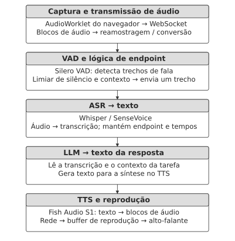

O VAD acústico encontra os trechos em que alguém está falando, e o reconhecimento posterior pode pular longos silêncios. Mas uma mesma pausa tem sentidos diferentes depois de “Eu queria reservar…” e depois de “Tem passagem para quinta de manhã?”. O VAD semântico (detecção semântica de endpoint) pode continuar captando o áudio no primeiro caso e só passar a fala ao modelo de diálogo no segundo. Essa é a esparsificação temporal da observação de voz: um som contínuo só dispara inferência em poucos momentos. Quanto a falar ou não, quem decide é o modelo que ouviu a frase; ele também pode continuar ouvindo ou consultar primeiro os voos.

| Módulo | Função | Fontes comuns de espera ou erro |
|---|---|---|
| VAD e lógica de endpoint | Detectar a fala e decidir quando enviar | Limiar de silêncio, ruído e pausas no meio da fala |
| ASR | Converter áudio em texto | Tempo de decodificação, reconhecimento de nomes de pessoas e termos específicos |
| LLM | Compreender, raciocinar e gerar a resposta | Fila de requisições, geração do primeiro trecho da resposta |
| TTS e reprodução | Sintetizar o áudio e levá-lo ao alto-falante | Síntese do primeiro pacote, transmissão pela rede e buffer de reprodução |

Numa implementação totalmente serial, depois que o usuário termina de falar, ainda é preciso esperar, em sequência, a confirmação do endpoint, a transcrição, a geração da resposta e o primeiro trecho de áudio. No exemplo da Figura 6-8, quando o usuário ouve o primeiro som da resposta, já se passaram 1,4 segundo, e o trecho mais longo é a espera para o sistema confirmar que o usuário terminou de falar (500 milissegundos). Mesmo que a transcrição caia de 100 para 50 milissegundos, o usuário espera apenas 50 milissegundos a menos.

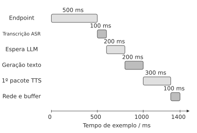

A carga do serviço também traz espera em fila. A Figura 6-9 usa o modelo M/M/1, de servidor único, para ilustrar essa relação: com chegadas segundo um processo de Poisson, tempo de serviço com distribuição exponencial, tempo médio de serviço $S$ e utilização $\rho<1$, o tempo total médio, incluindo serviço e fila, é $W=S/(1-\rho)$. Com $S=1$ segundo, se a utilização sobe de 0,5 para 0,8, o tempo total médio passa de 2 para 5 segundos. O serviço em si continua ocupando, em média, 1 segundo; os 3 segundos a mais são todos gastos na fila. Quando as requisições se aproximam da capacidade de processamento, flutuações breves de tráfego formam acúmulos.

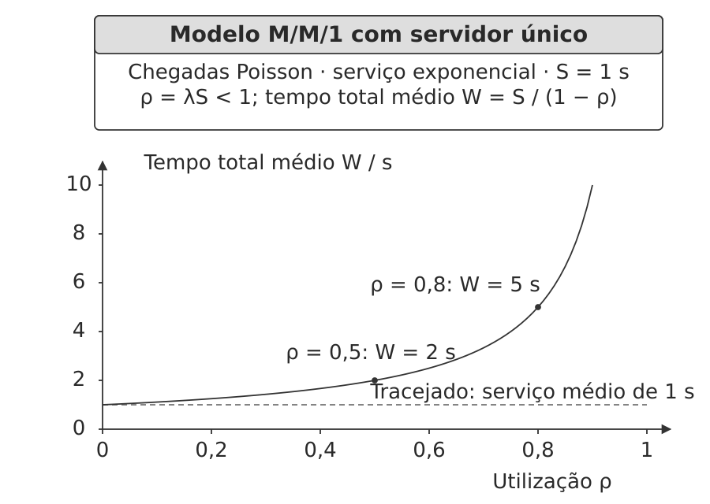

> **Experimento 6-4 ★: construir um agente de voz tradicional**
>
> Suponha que o assistente esteja lendo os voos de quinta-feira e você o corrija: “Espera, eu quero reservar para sexta.” O navegador envia o áudio do microfone ao backend por WebSocket. Assim que o Silero VAD detecta que você começou a falar, o backend emite `speech_start`, e o navegador para imediatamente a reprodução e descarta o áudio antigo enfileirado. Nesse momento, o assistente ainda não sabe que dia você mudou. Só quando você termina e o silêncio passa dos 500 milissegundos padrão o backend emite `speech_end` e entrega esse trecho de fala ao Whisper tiny local para transcrição.
>
> Quando o Doubao começa a devolver texto, quanto falta para o usuário ouvir a resposta? No registro de uma rodada com áudio gravado reproduzido, a transcrição levou 2,710 segundos. O Doubao devolveu o primeiro token 0,749 segundo após o envio da requisição e só completou a resposta aos 0,792 segundo. O programa de reprodução esperou todo o texto chegar antes de entregá-lo ao Fish S1 para síntese; 2,819 segundos depois, o backend recebeu o primeiro lote de áudio. Contando a partir da decisão de endpoint, a soma desses três trechos em série dá cerca de **6,321 segundos**. O relatório arquivado registra 6,279 segundos, porque usou o tempo do primeiro token no lugar do tempo de geração da resposta inteira.
>
> Esses 6,321 segundos cobrem apenas o processamento no backend. Antes, o usuário precisa esperar a detecção de silêncio concluir que a frase terminou; no fim, ainda precisa esperar o áudio chegar ao navegador e começar a tocar.

#### Do serial à percepção em streaming

A abordagem serial facilita a inspeção etapa por etapa, mas também expõe três problemas. Esperar o silêncio aumenta a latência de endpoint; o texto transcrito pode perder o tom, a emoção e os sons do ambiente; e, ao cortar o áudio nas pausas, endereços de e-mail, nomes de pessoas ou termos específicos podem perder o contexto completo. Para sistemas que já usam a arquitetura em cascata, recomendo começar pela adaptação ao streaming: fazer cada etapa entregar resultados incrementais o quanto antes, sobrepor reconhecimento, inferência e reprodução e, ao mesmo tempo, manter separadas as partes já confirmadas das que ainda podem mudar. Assim é possível reaproveitar os módulos existentes e localizar aos poucos de onde vem o tempo de espera.

- **ASR que transcreve enquanto ouve.** Recebe áudio continuamente e produz uma transcrição provisória; quando chega áudio novo, revisa as partes instáveis e, na confirmação do endpoint, entrega o texto final.
- **Execução especulativa do LLM.** Usa a transcrição provisória para preparar a resposta com antecedência. Depois que o texto final é confirmado, verifica se a entrada coincide e se o trabalho já feito continua válido, e então decide se mantém, ajusta ou gera de novo. Operações como envios externos e gravações de negócio esperam a confirmação das condições necessárias para serem executadas.
- **Saída segmentada do LLM.** Assim que um trecho adequado para leitura em voz alta fica pronto, ele vai para o TTS; na segmentação, preservam-se o sentido da frase, a pontuação e as pistas de entonação.
- **Síntese incremental no TTS.** Os blocos de áudio voltam aos poucos, o que permite sobrepor a geração do texto seguinte, a síntese e a reprodução. Quando há uma interrupção, tratam-se ao mesmo tempo a tarefa de geração e o conteúdo ainda não reproduzido no buffer.

A implementação convencional de transcrição do Whisper codifica e decodifica por janelas de áudio[^ch6-whisper]. Cortar o áudio externamente em blocos ou reenviar repetidamente o prefixo acumulado permite montar um fluxo de transcrição incremental; o reaproveitamento contínuo de estado, o custo da codificação repetida e a revisão do texto já produzido ficam a cargo de cada implementação. Modelos de reconhecimento com streaming nativo tratam a entrada contínua diretamente na arquitetura e no treinamento.

Sistemas de percepção baseados em modelos de linguagem de áudio também podem produzir, em conjunto, texto e eventos acústicos. O áudio anterior, a transcrição e dicas de vocabulário ajudam a reconhecer nomes de pessoas, marcas e termos específicos; quanto histórico manter depende do projeto do contexto e do cache. Para decidir se “o usuário terminou de falar”, o modelo pode combinar a completude semântica com o silêncio. Na pausa depois de “Eu queria reservar…”, o sistema em tempo real ouviu apenas essas palavras e ainda não tem como saber que virá uma data em seguida.

Além da transcrição, a interface pode definir os seguintes eventos: `speak_start` e `speak_end` indicam início e fim da fala, `interrupt` indica interrupção, `emotion` descreve o estado emocional, e `laugh`, `sigh` e `noise` registram risos, suspiros e sons do ambiente. Esses eventos podem ser enviados ao agente junto com o texto e as marcas de tempo.

> **Experimento 6-5 ★: simular percepção de voz em streaming com o Qwen2-Audio**
>
> Este experimento amplia aos poucos o prefixo de áudio, reenviando a cada vez ao Qwen2-Audio o áudio do início até o momento atual, e observa como a transcrição e os eventos acústicos mudam com a entrada. O caminho de controle usa endpoint por silêncio de 600 milissegundos e Whisper. Os testes incluem fala normal, uma frase longa com uma pausa de 900 milissegundos inserida e fala misturada a ruído rosa.
>
> Esta execução local com modelo quantizado preservou 13 inferências de prefixo, cada uma levando de 8 a 11 segundos. A pausa no meio da frase provocou a segmentação no caminho de controle; o modelo de áudio detectou o ruído, mas também acusou por engano tosse e risos.

[^ch6-whisper]: OpenAI, Whisper, apresenta a transcrição por janelas de áudio e a implementação do modelo.

### Paradigma 2 · Modelos omnimodais de ponta a ponta (Omni)

Um modelo de áudio de ponta a ponta recebe o som diretamente, gera a resposta combinando informações linguísticas e acústicas e sintetiza a fala por meio de um ramo de saída de áudio. Processar o áudio diretamente permite aproveitar a velocidade da fala, a altura, as pausas e os sons do ambiente; transcrever antes de responder facilita inspecionar o texto intermediário e trocar módulos de forma independente.

Essas características acústicas afetam a compreensão. Por exemplo, a mesma frase “mande o relatório antes do almoço”, dita às pressas ou com calma, transmite ao ouvinte impressões diferentes. Na saída, o modelo também pode organizar o sentido por meio de pausas, ênfases e entonação.

Um sistema que processa áudio diretamente também pode esperar o usuário terminar para responder. Se o usuário faz uma pausa enquanto dita um número de telefone, por exemplo, o sistema ainda precisa avaliar se a sequência de dígitos terminou. A detecção de endpoint decide quando responder; se o interlocutor interromper no meio da fala, o sistema ainda precisa coordenar a geração do modelo e a reprodução no alto-falante.[^ch6-audio-architectures]

> **Experimento 6-6 ★★: executar o MiniCPM-o 4.5 localmente e comparar ponta a ponta com autocascata**
>
> Este experimento fixa um mesmo modelo, o MiniCPM-o 4.5, com o modo de raciocínio desativado, e compara dois caminhos: responder às perguntas diretamente a partir do áudio e, alternativamente, fazer o modelo primeiro transcrever e depois responder apenas com base na transcrição. A entrada inclui dois problemas de aritmética ditados e duas gravações com o mesmo texto e velocidades de fala diferentes.
>
> Cada caminho acertou três questões, e os erros apareceram em pontos diferentes. O caminho de áudio direto entendeu “twelve boxes” como 8 em um dos problemas, o que levou a um erro de cálculo; o caminho com transcrição preservou corretamente o 12. Na questão de velocidade, as duas gravações dizem “Please send the report before lunch.”, e os textos transcritos ficam idênticos, de modo que a informação sobre rapidez se perde; o caminho de áudio direto distinguiu corretamente as duas velocidades.
>
> O experimento também gerou um trecho de fala a 24 kHz, ligando a compreensão da entrada à saída de áudio.

### Paradigma 3 · Modelos de interação full-duplex

Um sistema full-duplex fala e ouve ao mesmo tempo, e a melhoria mais fácil de perceber é a sensação de estar conversando com alguém de verdade. Experimente ler “Quero reservar para quarta… não, para quinta”: a pausa no meio acomoda a autocorreção; se o assistente já tiver começado a ler os voos de quarta, ao ouvir “não, para quinta” deve parar. Há outro tipo de momento: enquanto o interlocutor ainda explica o itinerário, um breve “uhum” pode mostrar que o assistente está ouvindo. Só recebendo áudio continuamente é possível fazer essas escolhas entre falar, ouvir, pausar e chamar ferramentas. A interpretação simultânea também exige que entrada e saída se sobreponham.

O **Moshi**, lançado pela Kyutai em 2024, modela separadamente os fluxos de áudio do usuário e do modelo e representa falas sobrepostas e interrupções por meio de fluxos paralelos[^ch6-moshi]. Preservando essas relações temporais na entrada, o modelo consegue aprender quando responder e quando continuar ouvindo.

O modelo de interação da Thinking Machines Lab corta a entrada e a saída contínuas em blocos curtos de mesmo tamanho, cada um cobrindo 200 milissegundos, chamados de microturnos (micro-turn)[^ch6-14]. Observe a segunda casa na linha do tempo da Figura 6-10: o assistente ainda está dizendo “quinta”, e já chega aos seus ouvidos o “não” do usuário corrigindo a data. Na terceira casa, o assistente para e continua ouvindo o usuário terminar de dizer “sexta”.

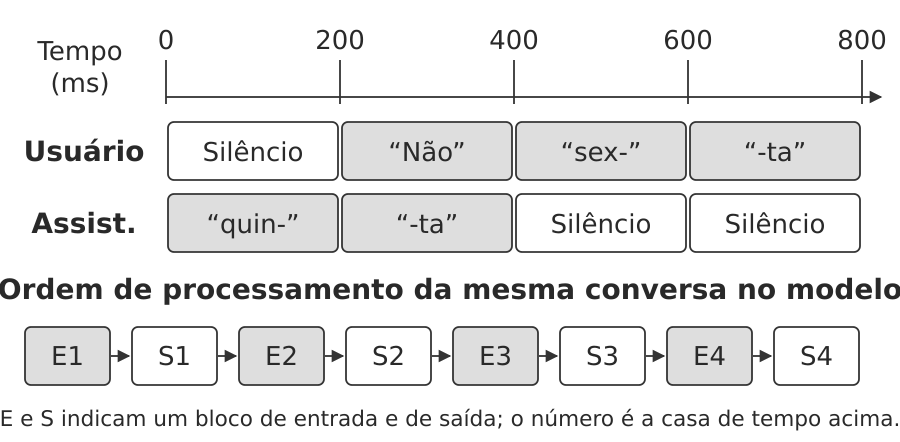

Agora leia a metade inferior da figura. Os dois lados da chamada ouvem duas vozes que podem se sobrepor, mas o modelo pode processar alternadamente blocos de entrada e gerar blocos de saída ao longo de uma única sequência. O silêncio também ocupa uma casa, de modo que o assistente pode ouvir um pouco antes de falar. Os 200 milissegundos da figura são o tamanho de bloco desta implementação; do momento em que o usuário interrompe até o alto-falante de fato parar, é preciso somar ainda o tempo de processamento e o buffer de reprodução.

[^ch6-moshi]: Kyutai, *Moshi: a speech-text foundation model for real-time dialogue*, 2024, apresenta os fluxos de áudio paralelos do usuário e do modelo.
[^ch6-14]: Thinking Machines Lab, *Interaction Models: A Scalable Approach to Human-AI Collaboration*, apresenta os microturnos, a interação com múltiplos fluxos e a delegação de tarefas em segundo plano.

### Sequenciamento cognitivo: interação em tempo real e raciocínio profundo

Nas chamadas de atendimento da Pine, quando o atendente está no meio de uma frase, às vezes o assistente deve esperar, às vezes deve dar um breve sinal de que está ouvindo; e, enquanto ele próprio fala, precisa ouvir a correção que o outro lado faz. É justamente por isso que aposto na linha do Moshi: só com um bom senso de tempo o interlocutor sente que, deste lado da linha, alguém está de fato ouvindo. Diante de pedidos que exigem consultar informações, porém, é preciso fazer outra conta de tempo: entre entender a pergunta e informar a resposta encontrada, por quantas mãos a tarefa passa?

As ferramentas que o modelo de voz de primeiro plano pode chamar diretamente são chamadas por ele mesmo. Consultar voos exige apenas duas chamadas ao modelo: o primeiro plano faz a consulta com as condições dadas pelo usuário e depois informa o resultado. A delegação exige quatro: o primeiro plano passa a tarefa, o segundo plano faz a consulta, o segundo plano organiza o resultado e o primeiro plano o transmite. Uma posição alternativa sustenta que o modelo em tempo real pode errar os argumentos e que, por isso, as ferramentas devem ser chamadas pelo segundo plano, deixando o primeiro plano concentrado em decidir quando ouvir e quando falar.

O primeiro plano do GPT-Live-1 não tem interface para chamar funções de negócio diretamente e só pode delegar ao agente de segundo plano. O GPT-Realtime, do OpenAI Realtime, permite que o primeiro plano chame funções diretamente. O modelo de voz em tempo real Doubao 3.0 (Seeduplex) também permite chamadas diretas pelo primeiro plano no modo puramente de ponta a ponta; na orquestração híbrida, quem chama é um modelo de linguagem externo.[^ch6-voice-tools]

Sejam $L_f$ e $L_b$ os tempos de cada chamada aos modelos de primeiro e de segundo plano, respectivamente, e $T$ o tempo da ferramenta. Do fim da fala do usuário até ele ouvir o resultado, a chamada direta leva cerca de $2L_f+T$, e a delegação, cerca de $2L_f+2L_b+T$. Os $2L_b$ a mais da delegação não dependem do tempo da ferramenta $T$. Informações que podem ser usadas a cada rodada, como a memória do usuário, podem ser consultadas pelo runtime e colocadas no contexto; o primeiro plano precisa então chamar o modelo uma única vez, em cerca de $L_f+T$, e, se a consulta já tiver sido feita antes de o usuário começar a falar, poupa-se até o $T$.

Tarefas que exigem raciocínio em várias etapas, como comparar opções de remarcação, são adequadas para o segundo plano. Uma reserva envolve cobrança e emissão do bilhete; seja quem for que chame a ferramenta, é preciso esperar a confirmação do usuário antes de efetuar o pedido. Os resultados dos voos podem ser resumidos verbalmente e a tabela completa, mostrada na tela, o que independe de quem chama a ferramenta.

> **Experimento 6-7 ★★: as ferramentas de um agente de voz devem ser chamadas pelo primeiro ou pelo segundo plano?**
>
> Monte o primeiro plano com o modelo de voz em tempo real Doubao 3.0 e o segundo plano com o DeepSeek V4 Pro oferecido pela plataforma Volcano Engine Ark. Prepare cinco ferramentas simuladas — consultar o tempo, consultar a memória do usuário, busca na web, consultar voos e reservar passagens — e faça-as devolver resultados nos tempos definidos; consultar voos e reservar levam de 2 a 5 segundos. Sintetize antecipadamente as gravações do usuário e reproduza, a cada vez, as gravações do mesmo cenário.
>
> Configure quatro divisões de trabalho. Na primeira, o primeiro plano chama todas as ferramentas. Na segunda, o segundo plano chama todas as ferramentas, e o primeiro plano só pode delegar. Nas outras duas, o primeiro plano consulta o tempo, o runtime coloca a memória do usuário no contexto no início da sessão e o segundo plano cuida da busca na web e da reserva. A diferença entre elas está em quem consulta os voos: o primeiro ou o segundo plano. O primeiro plano ouve diretamente a voz do usuário; o segundo plano não ouve a voz e só lê texto. Depois de ouvir cada frase do usuário, a interface do Doubao devolve também o texto obtido pelo reconhecimento de fala, chamado de transcrição. Na delegação, a transcrição e as falas do assistente são organizadas em ordem cronológica como registro da chamada e entregues ao segundo plano, junto com as chamadas de ferramentas já executadas nesta chamada e a descrição da tarefa escrita pelo primeiro plano. Em cada divisão de trabalho, repita 10 vezes cada um dos cenários abaixo.
>
> 1. Consultar o tempo e os voos, separadamente. Cronometre do fim da fala do usuário até ele ouvir o resultado da consulta; frases de transição como “vou verificar” não contam como resposta. Compare as medianas do tempo de espera da chamada direta e da delegação. No meu experimento, para a consulta do tempo, elas foram de 2,81 segundos e 6,96 segundos, respectivamente.
> 2. Consultar os voos primeiro, depois escolher a passagem e confirmar. Confira, item por item, os 13 campos da reserva com o resultado da consulta anterior, o que o usuário acabou de dizer e o perfil do usuário, e verifique se o pedido foi feito depois da confirmação do usuário. No meu experimento, as quatro divisões preencheram todos os campos corretamente e todas só fizeram o pedido após a confirmação do usuário.
> 3. Passar a reservar para um colega, reproduzindo a gravação do nome ditado: “陈嘉怡，耳东陈，嘉奖的嘉，怡然的怡。” (o nome Chen Jiayi, soletrado caractere por caractere pelas palavras de que cada um faz parte) Compare a gravação, a transcrição e o nome no pedido e verifique se a reserva direta pelo primeiro plano e a reserva delegada preencheram o nome corretamente. No meu experimento, a reserva direta pelo primeiro plano acertou as 10 vezes; a transcrição, porém, registrou “陈佳宜” (mesma pronúncia, caracteres diferentes), e por isso alguns pedidos delegados saíram com o nome errado.
> 4. Antes que volte o resultado da consulta de voos, reproduza uma gravação perguntando sobre o tempo e observe se o primeiro plano responde à pergunta sobre o tempo e se, em seguida, informa o resultado dos voos. No meu experimento, a pergunta sobre o tempo sempre foi respondida, mas o resultado original dos voos quase nunca voltou a ser mencionado.

Quando é preciso delegar, o primeiro plano deve escrever na descrição da tarefa os nomes, números e correções recentes do usuário de que tem certeza, para que o segundo plano não erre os argumentos por causa de erros de transcrição. O runtime deve anotar os resultados ainda não informados, para que o primeiro plano os relate depois de responder à pergunta intercalada.

Quando o modelo rápido diz “vou verificar”, o atendente fica sabendo que o assistente entendeu o pedido. Quando será possível informar a tarifa, porém, depende de como a consulta e o raciocínio se articulam com a chamada. A Figura 6-11 mostra três arranjos: responder primeiro e aprofundar depois; o primeiro plano interagindo continuamente e recebendo sugestões do segundo plano; e formulação e expressão avançando em paralelo, trecho a trecho.

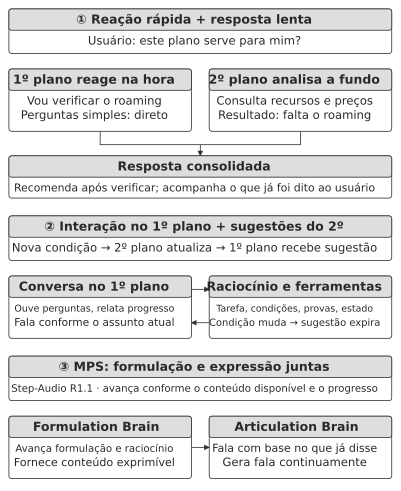

#### Solução 1: raciocínio rápido para reagir, raciocínio lento para responder

O modelo rápido dá primeiro uma reação breve, o modelo lento conclui a análise em segundo plano e depois complementa com a resposta detalhada. Esse projeto permite confirmar cedo o recebimento do pedido, mas exige gerenciar a coerência entre as duas respostas. Por exemplo, se o modelo rápido sugere a compra de determinado plano e o modelo lento descobre em seguida que falta ao plano um recurso essencial, as duas recomendações entram em conflito. A raiz do conflito é que os dois lados respondem de forma independente, com bases e estágios de raciocínio que podem diferir. Uma sugestão já dita pelo modelo rápido entra no julgamento do usuário, que pode até agir com base nela; quando o modelo lento a corrige, é preciso explicar a mudança e lidar com os efeitos já produzidos.

Por isso, o primeiro plano deve distinguir a confirmação da tarefa da conclusão de negócio. “Vou verificar se o plano inclui esse recurso” pode ser dito imediatamente; a recomendação de compra espera as consultas e as análises necessárias. Quando o resultado do segundo plano chega, o sistema o confronta com o que já foi dito e então organiza a resposta seguinte. Perguntas simples podem ser resolvidas diretamente pelo modelo rápido, evitando processamento duplicado.

#### Solução 2: raciocínio rápido para interagir, raciocínio lento para orientar

Voz e tela também podem dividir o trabalho. Dizer em voz alta “a conta deste mês veio com 15 euros a mais de roaming” permite ao usuário captar o essencial de imediato; deixando na tela o valor original, o valor atual e o detalhamento da contestação, o usuário pode conferir no seu ritmo. A confirmação de uma operação específica pode ser feita com um toque, e informações sensíveis o próprio usuário preenche numa interface de entrada reconhecida pela empresa. O primeiro plano só precisa receber um estado como “verificação concluída” para retomar a conversa com naturalidade.

Suponha que um viajante peça ao Pine uma passagem para Xangai na quinta de manhã, com orçamento de 1200 yuans, precisando chegar ao local do evento antes do meio-dia. Enquanto fala com o atendente da companhia aérea, o Pine “passa um bilhete” ao segundo plano: “Se chegar a Hongqiao às dez, dá tempo de ir do aeroporto ao evento?” O atendente consulta a disponibilidade e diz ao Pine: “O voo que chega a Hongqiao às dez está esgotado. Há outro que chega a Pudong às dez e meia, por 1250 yuans.” Se o segundo plano só enxergar os bilhetes passados pelo primeiro plano, continuará calculando o trajeto a partir de Hongqiao. O primeiro plano precisará acrescentar: “Calcule agora a partir de Pudong, pouso às dez e meia; o local e o horário de chegada continuam os mesmos.”

Outra forma é sincronizar também o registro da chamada, em ordem, com o segundo plano. Como o segundo plano já leu no registro o aeroporto e o horário de pouso informados pelo atendente, basta o primeiro plano dizer “veja se dá tempo com esse voo” para delegar a mesma tarefa. Ao sincronizar o registro, é preciso marcar quem disse o quê; a meia frase do primeiro plano que foi interrompida e ainda não chegou a ser reproduzida também deve ser distinguida do que já foi dito. A transcrição de voz pode omitir ou registrar errado informações importantes. O primeiro plano deve escrever na descrição da tarefa os nomes, números e correções do usuário que ouviu com segurança. Quando os dois registros divergirem, o segundo plano segue a descrição da tarefa. Concluída a consulta, o segundo plano só precisa dizer ao primeiro plano a que horas se prevê a chegada ao evento e quão apertado está o tempo. As rotas consultadas no caminho e os campos devolvidos pela API de mapas podem ficar no segundo plano para referência. O primeiro plano, com o resultado em mãos, continua a conversa com o atendente.

O viajante a negócios do Capítulo 1 queria manter a tarifa abaixo de 1200 yuans. Em viagens anteriores, ele se dispunha a gastar um pouco mais por um voo adequado, e desta vez também não definiu outro teto. Ao ouvir que o preço mais baixo é 1250 yuans, o assistente pode fazer a reserva por ele. Se fosse um usuário sempre muito econômico viajando a passeio com a família, seria preciso perguntar a ele antes sobre esses 50 yuans. O primeiro plano precisa, então, cuidar de duas conversas ao mesmo tempo:

- Ao usuário: “O menor preço neste voo é 1250 yuans, 50 acima do orçamento. Quer que eu reserve?”
- Em seguida, ao atendente: “Dá para segurar esse preço por um tempo? No mesmo dia, um pouco mais tarde, há algum voo abaixo de 1200?” Enquanto o atendente consulta, o primeiro plano também pode esclarecer a franquia de bagagem e as condições de alteração e reembolso.

Assim, quando o usuário voltar, encontrará algumas opções, e o atendente também saberá o que consultar em seguida. Se o usuário depois explicar “da última vez eu estava correndo para uma reunião; daqui em diante, em viagens a trabalho, se passar do orçamento, pergunte antes”, da próxima vez será preciso seguir essa nova orientação.

Na espera pela verificação do titular, o ritmo da conversa é outro. Quando o atendente diz que o código de verificação já foi enviado, o primeiro plano pode responder: “Certo, um momento, vou pedir ao viajante que olhe o celular.” Se o viajante responder que ainda não recebeu, pergunta-se ao atendente para qual final de número o SMS foi enviado e em quanto tempo é possível reenviar. Depois que o viajante conclui a verificação no canal indicado pela empresa, o primeiro plano pode seguir adiante. Numa chamada assim, esperar um pouco mais e emitir o bilhete um pouco depois é melhor do que pressionar o usuário a decidir na hora.

Nesse momento, o segundo plano avisa: “a cotação original foi atualizada”. O primeiro plano primeiro confirma o novo preço com o atendente e só então informa o usuário. Se o usuário responder justamente nesse instante “pode reservar”, essa resposta se refere à cotação de 1250 yuans enviada antes. O primeiro plano precisa avaliar, com base no novo preço e na autorização existente, se é necessária uma nova confirmação. O segundo plano apenas fornece informações; quem conversa com o atendente e assume compromissos é sempre o primeiro plano. Só quando as mensagens trazem o voo, as condições de validade do preço e o horário o primeiro plano consegue identificar qual cotação já expirou.

Mesmo para uma única mensagem do segundo plano, “o preço mudou, verifique”, o momento em que ela chega muda a forma como o primeiro plano retoma a conversa. Se o atendente acabou de dizer “a tarifa mais baixa é…”, o primeiro plano pode primeiro ouvir o valor até o fim. Se o atendente já informou o preço e aguarda resposta, é o momento de perguntar pelo novo preço. Se o viajante acabou de interromper ao telefone dizendo “espera, vou mudar a data”, primeiro é preciso ouvir bem a nova data e só então decidir se ainda faz sentido verificar o voo original. Um mesmo “certo”, dito enquanto o atendente explica as condições, pode significar apenas que se está ouvindo; dito depois de “posso emitir o bilhete agora?”, pode ser entendido como concordância com a compra. Olhando apenas o texto transcrito, perde-se esse tipo de diferença.

#### Solução 3: formulação e expressão avançando em conjunto

A série Step-Audio oferece dois exemplos relacionados. A **destilação de raciocínio ancorada na modalidade (MGRD)** se concentra nas informações em que o raciocínio se apoia: constrói e filtra dados de raciocínio em torno de características acústicas como altura, ritmo e entonação e melhora a compreensão de áudio por destilação iterativa. Na etapa de aprendizado por reforço, o Step-Audio R1 pontua as questões de áudio em dois itens: 0,8 ponto pela resposta correta e mais 0,2 ponto por apresentar o processo de raciocínio. O segundo item incentiva o modelo a explicitar seus fundamentos; se o raciocínio usou ou não as pistas acústicas da gravação é algo que precisa ser verificado antes, na filtragem das amostras.[^ch6-mgrd]

O **Mind-Paced Speaking (MPS)** se concentra na temporização entre raciocínio e expressão: usa um módulo de formulação (Formulation Brain) e um módulo de expressão (Articulation Brain), fazendo com que o processo de formulação oriente a geração da fala. A solução em tempo real do Step-Audio R1.1 adota esse método.[^ch6-mps]

Os dois módulos trocam informações conforme avançam: a formulação segue adiante continuamente, e a expressão organiza a fala com base no conteúdo já disponível e no que já foi dito. Assim, parte da expressão pode se sobrepor ao raciocínio subsequente, mantendo o registro do que já foi falado.

[^ch6-mgrd]: StepFun, *Step-Audio-R1 Technical Report*, apresenta a destilação de raciocínio ancorada na modalidade.
[^ch6-mps]: StepFun, *Mind-Paced Speaking: A Dual-Brain Approach to Real-Time Reasoning in Spoken Language Models* e cartão do modelo Step-Audio-R1.1, apresentam os módulos de formulação e de expressão e sua aplicação em sistemas em tempo real.

#### Divisão entre módulos e forma de atualização

**Valorizo uma vantagem de engenharia da divisão entre raciocínio rápido e lento: a capacidade de interação e a capacidade de raciocínio podem evoluir separadamente.** Quando surge um modelo de raciocínio mais forte, o sistema pode trocar o segundo plano. Assim, o segundo plano acompanha o progresso dos modelos de raciocínio, e o primeiro plano pode continuar aprimorando a escuta, a resposta e o tratamento de interrupções. O primeiro plano precisa entender a tarefa e as informações complementares do usuário; o segundo plano se concentra em raciocínio, planejamento e execução mais longos.

**Quando os modelos de raciocínio evoluem rapidamente e a equipe precisa atualizar continuamente as capacidades de negócio, dou preferência a uma divisão rápido-lento com partes substituíveis.** Essa divisão evita ter de retreinar todo o sistema de voz a cada atualização do modelo de raciocínio. Quando for preciso que o raciocínio intermediário controle a expressão de forma mais direta e houver recursos de treinamento para isso, pode-se adotar uma solução de cooperação mais estreita.

O agente de voz da Pine AI usa uma arquitetura que combina raciocínio rápido no primeiro plano e raciocínio lento no segundo plano. Um artigo público da empresa relata o primeiro lugar na trilha de voz do τ²-bench e descreve como se combinam a chamada contínua, o raciocínio de negócio e as operações com ferramentas[^ch6-17].

Para entender essas combinações, é útil distinguir três dimensões de projeto: o **caminho do áudio** determina se o modelo processa o som diretamente ou se a passagem é feita por transcrição; a **temporização entre ouvir e falar** determina se entrada e saída avançam em turnos ou em paralelo; a **divisão cognitiva** determina como a interação em tempo real e o raciocínio profundo compartilham estado e trocam resultados. Um sistema pode processar o áudio diretamente e manter o full-duplex e, ao mesmo tempo, entregar tarefas complexas a um modelo de segundo plano independente. O modelo de interação da Thinking Machines Lab e o GPT-Live mostram combinações desse tipo.

[^ch6-17]: Pine AI, *The Most Natural Human-Computer Interface Is Your Voice*, apresenta a arquitetura de raciocínio rápido e lento e os resultados de avaliação em tarefas de voz por ela relatados. O relatório chama o ranking de τ²-bench voice.

### Síntese de fala mais próxima da humana

Pausas, velocidade e ênfase ajudam o ouvinte a entender a estrutura das frases e a intenção de quem fala. Por exemplo, ao ler um número de telefone, convém agrupar os dígitos; ao explicar cláusulas complexas, pode-se falar mais devagar; ao esperar o resultado de uma consulta, pode-se dizer antes o que está sendo feito. A meu ver, pausas e variações de ritmo adequadas tornam a fala mais natural e permitem ao usuário perceber como a tarefa está avançando. O controle da fala pode ser projetado em torno desses usos concretos.

O LLM principal pode inserir no texto marcas de controle, como `[THINKING]`, `[EMO:happy]` e `[SPEED:0.8x]`. A camada de execução interpreta as marcas, divide o texto em trechos de fala e de pausa e os mapeia para as emoções, os estilos ou os áudios de referência aceitos pela interface de síntese. O significado das marcas é definido pela aplicação: `0.8x` pode corresponder a uma faixa de velocidade lenta; pausas podem ser inseridas pelo reprodutor, e risos e suspiros são expressos por marcas sonoras compatíveis ou por capacidade de geração.

A abordagem com áudios de referência organiza em uma biblioteca diferentes formas de expressão de um mesmo locutor. Cada trecho de texto escolhe a emoção, a velocidade e o estilo correspondentes e, depois da síntese, os trechos são concatenados em ordem. O estado de controle precisa ter escopo definido: por exemplo, a emoção vale até a próxima alteração, e a pausa só vale na posição atual.

> **Experimento 6-8 ★★: TTS guiado por marcas de controle com o Fish Audio**
>
> Este experimento usa o Fish Audio S1 para montar uma biblioteca de voz com 24 áudios de referência: combinações de quatro emoções, três faixas de velocidade e dois estilos. O analisador converte a resposta marcada em trechos de fala e de silêncio, e a camada de execução escolhe o áudio de referência de cada trecho e faz a síntese.
>
> Comparam-se três configurações: sem marcas de controle, com um único áudio de referência e com vários áudios de referência. Com o conteúdo da resposta mantido igual, verifica-se se as marcas são encaminhadas à configuração esperada e depois se ouvem as pausas, as emoções e as variações de timbre.
>
> A avaliação auditiva salva usou um modelo de compreensão de áudio, apresentando as três configurações em ordem alternada e avaliando naturalidade, adequação emocional, pausas de raciocínio, consistência do timbre e semelhança com um atendente. O grupo com várias referências teve a maior nota geral, e o grupo com referência única ficou abaixo do grupo sem marcas.

## Computer Use: agentes de automação de GUI

Suponha que você peça a um agente para alterar o endereço de entrega em uma página web. Ele precisa primeiro encontrar o campo de endereço, digitar o novo endereço e confirmar, pelo que aparece na tela, que a alteração foi salva. Se uma janela de login surgir antes do clique, mesmo que as coordenadas do botão na captura anterior não tenham mudado, o alvo desse clique já mudou. O Computer Use opera navegadores, planilhas ou configurações do sistema por meio da tela, do mouse e do teclado, e sua lição central é fazer cada ação acompanhar a interface que está à vista.

Seguindo o loop de **percepção–raciocínio–ação** da Figura 6-12, vejamos o que o modelo precisa confirmar antes de digitar o novo endereço. Ele escolhe a posição do clique com base na captura de tela e no progresso da tarefa; o Harness verifica os argumentos e as permissões e então entrega a ação à camada de execução. Um clique bem-sucedido significa apenas que o clique foi enviado. É na captura seguinte, vendo onde caiu o foco de entrada, que se decide se é seguro digitar o endereço.

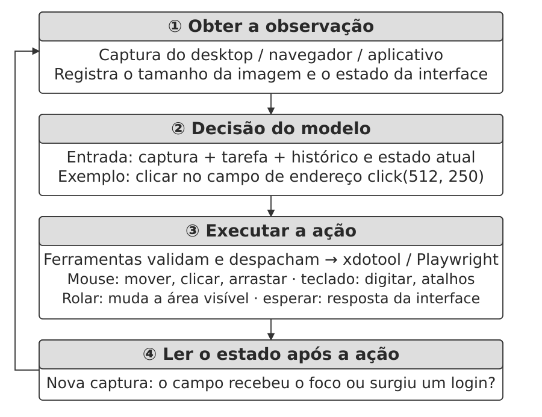

Depois de preencher o endereço, como o assistente deve dizer ao executor em qual botão “Salvar” clicar? Tanto coordenadas de tela quanto números de elemento podem indicar o alvo, mas fazem exigências diferentes ao modelo e às ferramentas.

### Projeto do espaço de ação

Na Figura 6-13, a implementação de referência do Computer Use da Anthropic oferece três tipos de ferramenta: interface gráfica, execução de comandos e edição de arquivos. Considerando só a interface gráfica, os dados seguem em duas direções: a ação de clique vai para o lado da execução, e a captura de tela após o clique volta ao modelo como observação para a decisão da rodada seguinte. A API nativa define o formato das ferramentas; se outro modelo for usado, a camada de adaptação precisa converter capturas de tela, pedidos de ação e resultados de execução em mensagens que a interface correspondente aceite.[^ch6-computer-tools]

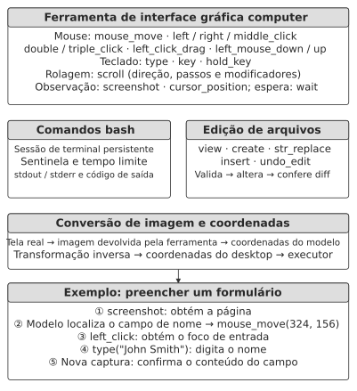

**Ferramentas de operação de GUI.** As ações de mouse incluem mover, clicar com o botão esquerdo, direito ou do meio, clique duplo, clique triplo e arrastar; interfaces mais detalhadas podem expressar separadamente pressionar e soltar. A rolagem precisa de direção e amplitude, e algumas implementações aceitam também teclas modificadoras. A interface de teclado oferece digitação de texto, combinações de teclas e manter teclas pressionadas. A captura de tela e a posição do cursor servem para obter o estado, e a interface de espera dá tempo para o carregamento da página ou para animações. A versão da ferramenta determina o conjunto exato de ações, e o Harness valida os argumentos de acordo com a interface usada.

**Ferramentas de execução de comandos.** Um terminal persistente preserva o diretório de trabalho e o estado do ambiente entre chamadas. Por exemplo, se uma chamada muda de diretório, a seguinte continua rodando nesse diretório. A implementação de referência pode usar uma string sentinela para reconhecer que o comando terminou e definir um tempo limite; o estado do processo após o tempo limite ainda precisa ser verificado pelo executor.

**Ferramentas de edição de arquivos.** A interface de substituição de strings localiza o trecho a alterar pelo texto original e pode oferecer também visualização, criação, inserção e desfazer. Antes da execução, verificam-se a posição e o número de correspondências; depois, verificam-se as diferenças. Se o arquivo mudar entre duas chamadas, relê-se primeiro o conteúdo relevante. As estratégias de edição apresentadas no Capítulo 5 podem ser reaproveitadas aqui.

> **Experimento 6-9 ★: executar a implementação de referência do Computer Use da Anthropic**
>
> Este experimento usa o desktop Ubuntu, o navegador e a camada de execução de ferramentas oferecidos pelo exemplo oficial em contêiner. Depois que o usuário informa a tarefa, o modelo lê a captura de tela e devolve uma ação; a camada de execução opera o desktop e devolve a nova captura ao modelo.
>
> A tarefa do material complementar consulta o tempo em São Francisco. A trajetória salva primeiro acessa o Google; ao encontrar um CAPTCHA, segue uma instrução de recuperação dada durante a execução e passa aos dados de acesso público do Open-Meteo, informando no fim a temperatura e as condições do tempo. O registro contém 15 ações no desktop e as capturas correspondentes, o que permite verificar, rodada a rodada, como cliques, teclas, digitação de texto e esperas alteram a página.
>
> O caminho em que um modelo aberto controla o navegador está no Experimento 6-10.

### Localização visual (Grounding)

Para pedir ao modelo que clique na caixa de busca, o problema pode ser formulado de duas maneiras. Uma é mostrar a captura de tela e pedir que ele informe as coordenadas do clique. A outra é numerar os alvos candidatos e pedir que ele escolha a caixa de busca; os números podem ser marcados sobre regiões candidatas na captura ou vir de uma lista de elementos fornecida pelo navegador. A seguir, apresentamos esses três caminhos. Quando se escolhe um número, a camada de execução converte o número no alvo real; quando se informam coordenadas diretamente, o modelo ainda precisa estimar a posição do alvo, o que exige mais do treinamento de localização e da adaptação à resolução da tela.

**Set-of-Mark: anotação visual.**

O Set-of-Mark (SoM) sobrepõe à imagem números que podem ser referenciados, ligando regiões visuais à saída do modelo. O trabalho original gera regiões candidatas com métodos como segmentação — por exemplo, obtendo regiões com SAM e SEEM — e então posiciona as marcas. Quando o modelo escolhe um número, a camada de execução determina a posição da operação a partir da região correspondente. O método pode ser usado em softwares de desktop ou interfaces de jogos sem DOM; o controle a ser acionado precisa estar dentro de uma região numerada, e o modelo precisa ver com clareza qual número corresponde a ele.[^ch6-som]

**Indexação de elementos estruturados.**

O navegador pode fornecer outro tipo de pista. O modelo de objetos do documento (DOM) descreve quais elementos existem na página e sua hierarquia, as informações de layout dão a posição de exibição dos elementos, e a árvore de acessibilidade (accessibility tree) preserva os papéis e os nomes acessíveis necessários às tecnologias assistivas. Por exemplo, um botão que tem apenas um ícone de lupa, se a página lhe atribuir o nome acessível “Pesquisar”, pode ser encontrado pelo agente por papel e nome. Em soluções como o browser-use, o sistema pode obter informações dos elementos por interfaces de depuração do navegador, como o Chrome DevTools Protocol (CDP), identificar campos de entrada, botões e links e então numerar os elementos operáveis da página atual. Na Figura 6-14, o modelo escolheu o [2], no canto superior direito da página. Como esse número se transforma em um clique no botão Submit?

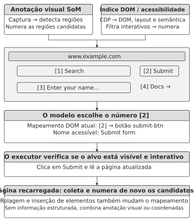

O processo pode ser dividido em quatro etapas: ler o DOM, o layout e as informações de acessibilidade disponíveis; filtrar os elementos interativos; criar o mapeamento de números da página atual; e entregar ao modelo as descrições dos elementos e, se necessário, a captura anotada. Por exemplo, o modelo pode ver os quatro elementos numerados abaixo:

```text
Na captura de tela estão marcados [1], [2], [3] e [4]

[1] <input type="text" placeholder="Search" aria-label="Search" />
[2] <button id="submit-btn" aria-label="Submit form" />
[3] <input type="text" placeholder="Enter your name" value="" />
[4] <a href="/docs" aria-label="Documentation" />
```

Depois que o modelo escolhe um número, a camada de execução o resolve em uma referência de elemento ou em coordenadas, verifica se o alvo continua visível e interativo e então executa a operação. Quando a página é recarregada, rolada ou recebe elementos inseridos dinamicamente, é preciso atualizar o mapeamento para não usar números desatualizados. A indexação estruturada pode aproveitar rótulos, papéis e textos; Canvas, sobreposições ou anotações semânticas incompletas exigem combinar a análise com a captura de tela. Quanto mais elementos listados e maior a captura, mais informação entra no contexto.

**Previsão direta de coordenadas.**

No caminho das coordenadas, o modelo produz diretamente uma posição a partir da captura e da descrição do alvo, por exemplo mapeando “clique no botão de envio” para um ponto. Pesquisas de localização em GUI como o SeeClick e o Computer Use do Claude usam saída em coordenadas. A camada de execução converte as coordenadas da imagem em coordenadas reais do desktop.

Quando a captura é redimensionada, os dois sistemas de coordenadas precisam usar a mesma transformação. Tomando como exemplo um desktop de 2560×1440, se a imagem enviada ao modelo tiver 1366×768, as coordenadas (683, 384) informadas pelo modelo correspondem a:

$$
x = 683 \times \frac{2560}{1366} = 1280,\qquad
y = 384 \times \frac{1440}{768} = 720
$$

Na Figura 6-15, as proporções dos dois tamanhos são próximas. Se a captura tiver recebido faixas pretas para manter a proporção, as coordenadas informadas pelo modelo incluem essa margem; antes de convertê-las para as coordenadas da tela original, é preciso subtrair o deslocamento do preenchimento e depois aplicar o fator de escala. Recortes, a escala de exibição e a origem em configurações com vários monitores também alteram o mapeamento, e a camada de ferramentas deve guardar os parâmetros reais da transformação.

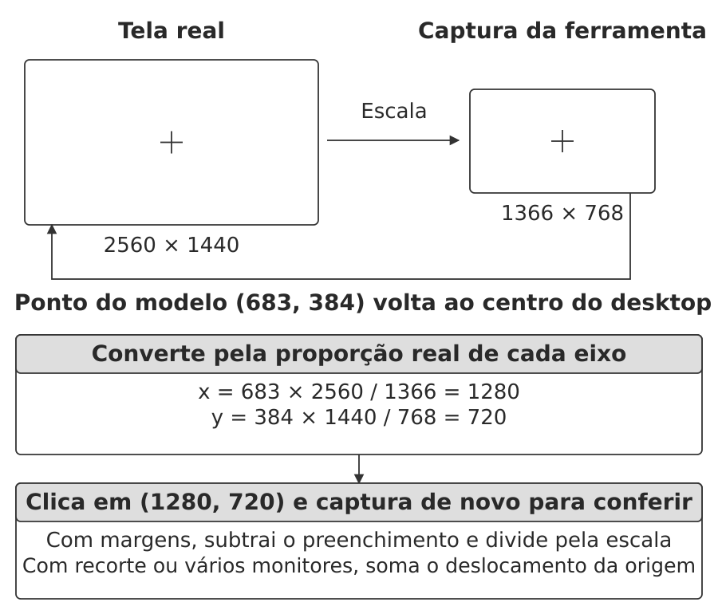

A implementação de referência já usou tamanhos-alvo como XGA (1024×768), WXGA (1280×800) e FWXGA (1366×768). Forçar uma mudança de proporção deforma os controles; usar o mapeamento inverso errado faz uma previsão correta cair na posição errada.[^ch6-computer-tools]

**Quando a informação estrutural está completa, prefiro a indexação pelo DOM ou pela árvore de acessibilidade.** O nome, o papel e a referência dos elementos podem participar diretamente da localização, o que reduz o trabalho de o modelo estimar posições de pixels na hora. Quando falta estrutura, um modelo visual de propósito geral pode primeiro ser combinado com SoM, escolhendo uma entre as regiões marcadas; modelos já treinados em localização de GUI podem prever coordenadas diretamente, dispensando a anotação separada.

> **Experimento 6-10 ★: automatizar operações no navegador com o browser-use**
>
> Este experimento usa o Qwen3-VL 32B Instruct para conduzir o browser-use, gerando ações a partir do estado do navegador, das informações dos elementos e das capturas de tela. A tarefa é consultar o tempo em São Francisco: localizar a caixa de busca, digitar “San Francisco weather today”, enviar a consulta e extrair a temperatura e as condições do tempo.
>
> O código e as instruções de execução do Experimento 6-10 oferecem dois pontos de entrada. Com uma chave do OpenRouter, é possível usar um modelo visual hospedado; se você já tiver um serviço compatível, como vLLM ou SGLang, pode apontar `OPEN_MODEL_BASE_URL` e `OPEN_MODEL_MODEL` para o seu endpoint e modelo e configurar a chave conforme exigido pelo serviço. Nos dois caminhos, execute primeiro `python main.py --dry-run` no diretório do experimento para ver a configuração e depois inicie a consulta real seguindo as instruções.
>
> A execução salva concluiu 16 passos de interação e guardou 15 capturas de tela. Depois que o Google exibiu um CAPTCHA, a tarefa passou a usar o weather.com para obter o resultado.

[^ch6-computer-tools]: Anthropic, documentação das ferramentas e implementação de referência do Computer Use, apresenta as interfaces de ação versionadas, a camada de execução e o tratamento de capturas de tela.
[^ch6-som]: Microsoft, *Set-of-Mark Prompting*, 2023; a implementação do serviço de DOM do browser-use oferece exemplos de tratamento de elementos estruturados.

### Agentes de Computer Use que veem animações e ouvem sons

Uma página exibe “falha na sincronização” apenas por um instante depois de salvar, mas duas capturas feitas com alguns segundos de intervalo mostram o mesmo formulário. Revendo essas duas imagens, o modelo provavelmente não consegue reconstituir o que aconteceu no meio. Vídeos, animações, notificações passageiras e o áudio de reuniões têm o mesmo problema. **Para interfaces que mudam continuamente, defendo tratar a interface de observação como o principal alvo de melhoria.** Para decidir o próximo passo com base nas mudanças, é preciso guardar também os eventos ou as imagens que surgiram entre as ações.

A **Agent–Computer Observation Interface (AOI, interface de observação agente–computador)**, que propus com colaboradores, converte a tela e o áudio contínuos em imagens e textos que o modelo pode receber[^ch6-9]. A interface tem três componentes:

- **Captura de quadros-chave entre ações.** Durante a execução do loop principal, monitora mudanças na imagem, seleciona quadros candidatos por diferença de pixels ou por um modelo visual leve e entrega as imagens úteis à próxima decisão.
- **Transcrição acionada por volume.** Ao detectar som, chama o reconhecimento de fala e acrescenta a transcrição e as informações de tempo ao registro de observações, ajudando o agente a usar o conteúdo de reuniões ou instruções faladas.
- **Descrição persistente das imagens.** Resume em texto as imagens-chave; depois que a imagem original sai do contexto, o texto continua guardando a mudança ocorrida, para ser citado nas etapas seguintes.

Por exemplo, se um vídeo mostra uma operação de menu, o modelo, ao receber as imagens intermediárias e as descrições correspondentes, pode continuar consultando essa etapa depois que o vídeo termina. Os resultados de ablação do artigo mostram que a descrição textual persistente é especialmente decisiva para o ganho, enquanto a seleção refinada de quadros-chave contribui menos; alguns modelos chegam a piorar quando recebem imagens demais.

Voltemos ao exemplo do formulário salvo. Mesmo que um quadro-chave tenha capturado “falha na sincronização”, assim que a imagem original sai do contexto o modelo só pode contar com a descrição que ficou. “Apareceu uma notificação na página” pode significar sucesso ou falha ao salvar; só “falha na sincronização, endereço não salvo” preserva a pista que decide o próximo passo.

[^ch6-9]: Bojie Li, Noah Shi, *Agent-Computer Observation Interfaces Enable Dynamic Computer Use*, 2026, apresenta a AOI e a ablação de seus componentes.

### Modelos de mundo para Computer Use

Depois de obter as observações a tempo, o agente ainda precisa escolher a ação e esperar sua execução. O estudo OSWorld-Human compara a eficiência das operações de agentes com trajetórias humanas e analisa fontes de demora como passos redundantes e chamadas ao modelo[^ch6-osworld-human].

Um modelo de mundo fornece ao planejamento previsões das consequências das ações. O estado do desktop pode incluir janelas, foco, posição de rolagem, conteúdo digitado e progresso de carregamento; informações como permissões e resultados de rede precisam ser complementadas pelas interfaces correspondentes. A partir do estado disponível e de uma ação candidata, o modelo prevê o estado seguinte:

```text
estado atual + click / type / scroll / wait → próximo estado previsto
```

Quando uma pessoa usa o computador, muitas vezes já antecipa o próximo passo antes de clicar; se a interface corresponde ao esperado, segue adiante, e só para para verificar diante de uma surpresa. Um modelo de mundo pode dar ao agente uma base semelhante para execução especulativa: o planejador compara de antemão as ações candidatas, prepara as etapas seguintes enquanto a página carrega e prossegue depois que o estado real é confirmado, reduzindo a espera de replanejar do zero após cada clique. Por exemplo, ao criar um arquivo Python no VS Code e escrever hello world, as mudanças esperadas incluem um novo arquivo na árvore de arquivos, o código na área de edição e a atualização do estado de salvamento. Após a execução, verificam-se essas mudanças; se correspondem ao esperado, continua-se; se houver desvio, localiza-se e planeja-se de novo.

Operações como excluir arquivos exigem também condições de execução independentes: se o alvo está correto, se a exclusão é permitida, se é possível recuperar e se é necessária a confirmação do usuário. A previsão ajuda a entender os resultados possíveis; as permissões reais e as condições de negócio são verificadas pela camada de execução.

**Previsão de estados latentes no Photon-1.** Em julho de 2026, a Induction Labs apresentou o Photon-1: ele codifica quadros de vídeo como tokens latentes discretos e aprende as mudanças de estado prevendo os tokens seguintes. A empresa informou que o pré-treinamento usou cerca de 30 mil horas de GPU H200. A previsão de estado é feita nos tokens latentes, e um gerador de imagens auxiliar os converte de volta em imagens visualizáveis, para que pessoas possam verificar as previsões. O planejamento e a geração de ações podem usar diretamente a representação interna, evitando o custo de gerar uma captura completa a cada passo.[^ch6-20]

A solução também aprende, por ajuste fino, o formato de instruções e ações: primeiro prevê o estado que se deseja alcançar, depois gera as operações que levam a esse estado e melhora o desempenho nas tarefas com treinamento online em máquinas virtuais. O ajuste fino condicionado a ações, por sua vez, serve para prever as mudanças no desktop depois de uma operação dada. Esses dois usos ligam, respectivamente, planejamento e simulação e mostram como a representação de estado pode participar do Computer Use.

[^ch6-osworld-human]: Reyna Abhyankar et al., *OSWorld-Human: Benchmarking the Efficiency of Computer-Use Agents*, analisa trajetórias de tarefas e custos de tempo.
[^ch6-20]: David Li, Jonathan Li, *Scaling Video Pretraining with Imagination Models*, Induction Labs, 2026-07-23, apresenta o pré-treinamento, o aprendizado de ações e a simulação de estados do Photon-1.
[^ch6-21]: Google DeepMind, *Genie 3: A new frontier for world models*, 2025-08-05; Zachary Lin et al., *Cosmos World Foundation Model Platform for Physical AI*, 2025.

### Dispositivos móveis: interfaces técnicas e cooperação do ecossistema

Nos dispositivos móveis, o loop observação–decisão–ação continua valendo, mas as ações assumem sobretudo a forma de gestos de toque. Uma mesma coordenada pode indicar a posição de um toque, de um toque longo ou o início de um deslize; por isso, a interface também precisa do tipo de gesto, da duração e do trajeto. A rotação da tela, o aparecimento do teclado virtual e as janelas do sistema também mudam a área operável.

O `AccessibilityService` do Android pode ler informações da interface e executar as ações correspondentes dentro do escopo autorizado, e as interfaces de gestos exigem ainda a declaração das capacidades correspondentes[^ch6-android]. Capturas de tela, a árvore de acessibilidade e as interfaces de automação do sistema podem ser usadas em conjunto, e o alcance real é determinado pelo sistema operacional, pela implementação do aplicativo e pelas autorizações. Benchmarks como o AndroidWorld, apresentado no Capítulo 7, verificam em tarefas de aplicativos reais se essas ações produzem os resultados esperados.

**A meu ver, as barreiras do ecossistema costumam ser mais difíceis de superar do que os problemas técnicos na adoção em dispositivos móveis.** As plataformas precisam definir quais operações podem ser delegadas a um agente, como se autorizam contas, pagamentos e dados e como rastrear responsabilidades quando algo dá errado. Esses acordos afetam diretamente o conjunto de tarefas que um agente consegue realizar.

Um conflito de interesses estrutural vem do tráfego e da atenção. Muitos aplicativos obtêm receita com exibição de anúncios, recomendação de conteúdo e pontos de entrada para transações; quando o usuário delega a um agente a consulta ou a compra direta, o caminho de navegação pelas páginas pode encurtar, e a atenção captada por recomendações e anúncios também muda. Para plataformas que monetizam essas etapas, a operação por agentes toca nas fontes de receita existentes. Por isso, as plataformas precisam repensar a abertura de interfaces, a divisão comercial de receitas e a gestão da identidade dos agentes.

[^ch6-android]: Android Developers, AccessibilityService, apresenta o acesso à interface, as ações e as capacidades de gestos.

## Manipulação robótica: organizando uma mesa com o XLeRobot

Colocar o copo vermelho na bandeja, jogar o papel amarelo na caixa de lixo e, por fim, confirmar que a mesa está arrumada — essa tarefa liga percepção, planejamento e controle. Quando a garra se aproxima do copo, a posição dele na câmera muda; depois que o copo é pego, o braço precisa desviar dos outros objetos na mesa; se o papel não for agarrado na primeira tentativa, o sistema ainda precisa perceber a falha e tentar de novo. Cada ação muda as condições da decisão seguinte.

Esta seção organiza cinco experimentos em torno dessa tarefa. Os Experimentos 6-11 e 6-13 trazem projetos práticos de teleoperação e de operação autônoma com o robô real; os Experimentos 6-12, 6-14 e 6-15 usam simulação local para estudar, respectivamente, uma linha de base de controle, a recuperação de falhas e as mudanças nas condições visuais.

Um mesmo robô pode ser operado por uma pessoa que acompanha continuamente a câmera ou por um modelo que lê as imagens, escolhe habilidades e as entrega ao sistema de controle para execução. Mantendo a tarefa e o hardware, é possível analisar a diferença entre as duas formas a partir de quatro perguntas: o que a pessoa quer realizar, qual subtarefa fazer primeiro, que ações a habilidade atual produz e se o ambiente, após a ação, corresponde ao plano. O planejamento de longo horizonte define a ordem de tratamento do copo e do papel, uma política VLA ou primitivas de ação predefinidas cuidam de pegar e posicionar, o modelo de mundo ajuda a estimar as consequências das ações, e a transferência da simulação para o mundo real trata das mudanças nas imagens, nos contatos e nas características dos atuadores.

### A divisão de trabalho entre hardware e algoritmos

Quando a arrumação autônoma da mesa falha, pode-se primeiro usar a teleoperação para verificar se o hardware é capaz de realizar a tarefa. Mantendo a câmera, o braço robótico, a garra, a disposição da mesa e as condições de validação, deixa-se o operador assumir o loop de percepção e controle. Se a pessoa consegue concluir a tarefa de forma estável em várias rodadas enquanto o sistema autônomo falha repetidamente, isso mostra que o hardware já dá conta da tarefa e que o gargalo está sobretudo nos algoritmos e no retorno do controle autônomo. Nesse caso, deve-se investigar primeiro a localização dos objetos, a escolha de habilidades, o momento das ações e a recuperação de falhas, para que o sistema autônomo aprenda as correções que funcionam na teleoperação.

O XLeRobot pode ser teleoperado com teclado, controle de Xbox e Switch Joy-Con, e a operação em VR pode ser experimentada primeiro em ambiente simulado.[^ch6-1] Quando a garra se aproxima do copo, o operador desacelera; se o copo escorrega, é preciso corrigir o ponto de preensão. Se a garra não pegou o papel, é preciso olhar de novo; quando o objeto chega ao lugar, também é preciso dar uma olhada para confirmar. Todas essas correções feitas com base na observação merecem ser registradas nos dados de demonstração. Quando o robô passar a operar de forma autônoma, também precisará perceber escorregões e preensões perdidas.

> **Experimento 6-11 ★: teleoperar o XLeRobot real para organizar a mesa**
>
> Na área de trabalho do XLeRobot, já com calibração, limites e parada de emergência verificados, coloque um copo vermelho, uma bandeja, um papel amarelo e uma caixa de lixo. Usando um modo de teleoperação calibrado, execute a tarefa fixa: “Coloque o copo vermelho na bandeja, jogue o papel amarelo na caixa de lixo e, por fim, confirme o estado da mesa.” Repita várias rodadas, registrando as imagens da câmera, as entradas do operador, o estado do braço, os tempos das ações, as falhas de preensão e o número de novas tentativas.
>
> Ao fim de cada rodada, confirme que o copo está na bandeja, o papel está na caixa de lixo e o braço voltou à postura segura, e verifique os registros de colisões, saídas dos limites e intervenções humanas ao longo de todo o percurso. Analisando em conjunto em que etapa ocorreu cada falha, como o operador se recuperou e o resultado final, obtém-se a linha de base de comparação para o controle autônomo.

Já os experimentos simulados facilitam variar repetidamente o número de objetos e as posições iniciais e examinar isoladamente o processo de controle com estado conhecido. Um modelo de mesa bidimensional pode representar em três fases a aproximação do objeto, o transporte até o destino e o tratamento do objeto seguinte, descrevendo o custo de controle pelo número de passos até a conclusão e pelo comprimento do trajeto.

> **Experimento 6-12 ★: criar no simulador uma linha de base de controle ideal para a mesma tarefa**
>
> Numa mesa bidimensional, gere aleatoriamente as posições dos objetos e dos destinos e deixe o controlador ler diretamente as coordenadas, aproximar-se de cada objeto, levá-lo ao destino correspondente e então passar ao objeto seguinte. Varie as posições iniciais e o número de objetos e compare a taxa de sucesso, o número de passos até a conclusão e o comprimento do trajeto.
>
> Primeiro, acompanhe a trajetória completa de um objeto: o controlador entra na fase de transporte ao alcançar o objeto e só contabiliza a conclusão ao alcançar o destino. Depois, aumente o número de objetos e verifique se cada um passa por essas duas condições de chegada. A simulação bidimensional complementar posiciona 1, 2, 3 e 4 objetos sob cinco sementes aleatórias, executa 512 episódios por combinação e conclui todos os 10.240 episódios. O controlador pode ler as coordenadas diretamente, e mover os objetos não depende de uma garra real.

### Estrutura básica do controle robótico

Arrumar uma mesa pode levar alguns minutos, mas o controle das articulações precisa ser atualizado de forma contínua e oportuna. O sistema pode dividir o trabalho por escalas de tempo: o planejamento de alto nível define a ordem das tarefas, as políticas de habilidade geram os movimentos e um controlador de baixo nível acompanha a execução:

| Nível | Pergunta central | Saída | Escala de tempo e exemplo de configuração |
| --- | --- | --- | --- |
| Objetivo da tarefa | O que a pessoa quer realizar | “Pôr o copo e o papel no lugar” | Tarefa na escala de minutos |
| Planejamento de longo horizonte | O que fazer primeiro e o que fazer depois | Primeiro o copo, depois o papel e, por fim, a verificação | De segundos a minutos |
| Habilidades básicas | Que mudança de estado realizar agora | `pick(red_cup)`, `place(red_cup, tray)` | Uma habilidade pode durar alguns segundos, por exemplo de 1 a 3 s |
| VLA / política de habilidade | Como a habilidade atual se move concretamente | Ação da garra, pose do efetuador ou um trecho de trajetória das articulações | Pode ser configurada para inferência de 1 a 10 Hz |
| Controle de baixo nível e camada de segurança | Como executar de forma estável e oportuna | Comandos de articulação ou do efetuador, limite de velocidade e parada de emergência | O controlador pode ser configurado de dezenas a milhares de Hz |

O planejador pode ser um programa de regras, um VLM ou um otimizador, e o VLA também pode assumir parte da escolha de habilidades. **Minha recomendação é tratar separadamente a ordem das tarefas e a ação imediata.** O raciocínio de alto nível precisa de tempo para organizar o plano, e o controle de baixo nível precisa responder prontamente a mudanças de posição e de força; só deixando cada um rodar no ritmo que lhe convém é possível conciliar planejamento e controle.

Esta seção oferece ao modelo de alto nível cinco tipos de ferramenta: `observe_scene`, `pick`, `place`, `verify_state` e `stop`, usados respectivamente para observar, pegar, posicionar, verificar e parar. O Harness verifica os argumentos, a área de trabalho e o estado atual; o executor converte as habilidades aprovadas em movimentos do braço e cuida dos limites de velocidade e dos tempos limite. Os ângulos das articulações e as trajetórias contínuas são gerados pelas políticas de habilidade e pelo controlador, o que cria uma interface clara entre a escolha de habilidades pelo modelo e o movimento real.

### Planejamento de longo horizonte e decomposição de tarefas

Quando o usuário diz “arrume a mesa”, o planejador primeiro identifica os objetos e suas áreas de destino, define a ordem de tratamento e escreve, para cada etapa, as condições de início, as condições de conclusão e as restrições da ação. Por exemplo, a ordem de arrumação pode ser:

```text
tratar o copo vermelho → limpar o papel amarelo → verificar a mesa
```

“Tratar o copo vermelho” se divide, por sua vez, em duas ações e uma verificação:

```text
pick(red_cup) → place(red_cup, tray) → verify_state()
```

Tomemos “pegar o copo e colocá-lo na bandeja”. Quando o braço termina de executar o programa de preensão, isso só significa que esse programa acabou. Antes de erguer o copo, é preciso verificar, pelo retorno da garra ou por uma nova imagem, se o copo foi realmente pego. Se a garra pegou o vazio, localiza-se o copo de novo; se alguém tirou a bandeja do lugar, a preensão bem-sucedida continua valendo, e basta replanejar o posicionamento. Fazendo cada habilidade corresponder a uma mudança de estado verificável, limitando ação e duração e devolvendo o estado de execução e a nova observação, o planejador consegue se recuperar exatamente a partir da etapa que falhou.

> **Experimento 6-13 ★★: usar o Gemini Robotics-ER 1.5 para conduzir o XLeRobot na arrumação autônoma da mesa**
>
> Mantendo o hardware, a disposição da mesa, a tarefa e as condições de validação do Experimento 6-11, um modelo de raciocínio incorporado fica responsável pela observação e pelo planejamento. Com base na forma de orquestração do RoboCrew, projete cinco ferramentas para esta tarefa: `observe_scene`, `pick`, `place`, `verify_state` e `stop`.[^ch6-2]
>
> O modelo primeiro lê a observação da mesa e decide a ordem de tratamento; depois chama as habilidades calibradas de pegar e posicionar. Ao concluir cada habilidade, obtém uma nova observação e verifica as pós-condições; após uma falha, escolhe, de acordo com o estado atual, tentar de novo ou parar. O sistema em execução interrompe diretamente a execução ao receber um sinal de parada de emergência, ao detectar saída dos limites ou quando não consegue confirmar um estado crítico; o modelo também pode encerrar a tarefa ativamente por meio de `stop`.
>
> No fim, uma nova observação do ambiente confirma que o copo está na bandeja, o papel está na caixa de lixo e o braço voltou à postura segura, e conferem-se os registros de colisões e de saídas dos limites. O operador é responsável pelo início, pela parada de emergência e pela supervisão no local, e as intervenções no meio da execução são registradas à parte.

O Experimento 6-13 mostra como conectar as ações do robô real e como validar o resultado da arrumação; os registros que acompanham o livro ainda não incluem ensaios com o robô real para esta tarefa. A seguir, comparamos primeiro, em ambiente simulado, três abordagens: executar o plano em malha aberta, verificar o resultado a cada passo e prever antes as consequências das ações. O objetivo da tarefa e os cinco tipos de ferramenta são os mesmos, e as falhas podem ser provocadas repetidamente, o que facilita observar como cada abordagem lida com um mesmo erro.

### Controle com VLA

VLA é a sigla de Vision-Language-Action, isto é, modelo visão–linguagem–ação. Com base na imagem atual, na instrução da tarefa e no estado disponível do robô, ele gera as próximas ações a executar:

```text
observação atual + instrução da habilidade → ação ou sequência de ações
```

No exemplo da arrumação da mesa, o planejador de alto nível envia `pick(red_cup)`, e a política de habilidade decide, com base na imagem, de que direção se aproximar do copo, quando fechar a garra e por qual trajetória erguer o braço. Depois de executar esse trecho de movimento, o sistema obtém de novo a observação da mesa, confirma que o copo foi agarrado e só então passa a `place(red_cup, tray)`. A interface da ferramenta define a mudança de estado esperada, e o VLA aprende a realizá-la por meio de ações contínuas.

As ações podem ser representadas de diferentes maneiras. O RT-2 e o OpenVLA original quantizam o valor de cada dimensão da ação em tokens discretos e os produzem pelo mesmo modo de geração dos modelos de linguagem; o π₀ usa flow matching para gerar blocos de ações contínuas. O primeiro facilita reaproveitar a estrutura de geração autorregressiva; o segundo modela diretamente a distribuição de um trecho de ações contínuas.[^ch6-15]

A inferência do modelo e o controle dos atuadores costumam usar frequências de atualização diferentes. O agrupamento de ações (action chunking) faz o modelo gerar de uma vez um pequeno trecho de ações futuras, que a thread de controle executa em frequência mais alta. Sobrepondo também inferência e execução, o sistema consegue preparar o próximo bloco enquanto executa o atual, reduzindo a espera. A emenda entre blocos de ação ainda precisa tratar a continuidade da trajetória e a atualidade das observações: se o copo for esbarrado enquanto o braço se estende até ele, as ações restantes podem continuar apontando para a posição antiga. Encurtar o trecho efetivamente executado a cada vez, atualizar continuamente com novas observações ou interromper a ação ao detectar uma anomalia são formas de aumentar a rapidez de resposta; essas escolhas também aumentam o custo de inferência e de escalonamento.

### Dados e condições de implantação dos VLAs

Para transformar “pegar o copo” em ações estáveis, é preciso tratar ao mesmo tempo os seguintes tipos de diferença:

- **Cobertura dos dados de treinamento**: as demonstrações disponíveis de ações robóticas são muito menos numerosas do que os textos e as imagens da internet; saber o que é um “copo” não basta, é preciso experiência real de preensão para julgar como aplicar força. As demonstrações precisam cobrir material, formato, posição e condições de atrito do copo. A mesma direção de preensão pode produzir resultados diferentes num copo de cerâmica e num copo de papel macio.
- **Objetivo de aprendizado das ações e de suas consequências**: a clonagem de comportamento aprende sobretudo que ação o demonstrador tomaria nas condições atuais. Para comparar as consequências de várias ações, pode-se acrescentar previsão de estado ou avaliação dos resultados das ações.
- **Corpo do robô e interfaces**: graus de liberdade, sistemas de coordenadas, estrutura da garra e latência dos atuadores determinam como as ações chegam ao hardware. Ao transferir uma política, é preciso compatibilizar a representação das ações, os parâmetros de calibração e o ciclo de controle.
- **Atualidade das observações**: durante a execução de um bloco de ações, os objetos podem se mover, ser encobertos ou derrubados. O sistema precisa definir quando obter novas observações e quando usá-las para atualizar as ações restantes.

Essas condições ligam o reconhecimento visual, o controle de habilidades e as mudanças do ambiente. O líquido dentro do copo afeta a velocidade de transporte, o cabo de energia na beira da mesa muda o trajeto viável e o contato entre o papel e a mesa afeta a forma de agarrá-lo. Se o planejador puder comparar essas consequências de antemão, terá mais fundamentos para escolher habilidades.

### Modelos de mundo

No planejamento robótico, um modelo de mundo condicionado a ações pode ser entendido como um “preditor de resultados de ações”: dado o estado atual e uma ação candidata, ele estima o que vai acontecer em seguida.

```text
estado atual + ação candidata
    → prever o próximo estado ou um trecho futuro
    → comparar os resultados candidatos
    → escolher a ação, replanejar ou parar
```

Esse processo envolve três tarefas: representar o estado atual, prever a mudança de estado causada pela ação e deixar que o planejador ou o controlador escolha a ação com base nisso. O estado pode ser formado por variáveis estruturadas, como a posição dos objetos e se estão agarrados, ou por representações internas extraídas de imagens. O V-JEPA 2 aprende primeiro a representação e a previsão de estados a partir de vídeos, e o V-JEPA 2-AC, treinado em seguida, introduz o condicionamento a ações para uso no planejamento robótico. Ligar ações a observações futuras é também uma das linhas de modelagem dos modelos mundo–ação (World-Action Model).[^ch6-16]

Um modelo de mundo pode ajudar o robô em três momentos: antes de agir, prevendo o resultado de pegar, empurrar ou esperar; durante a execução, comparando a previsão com a observação real e ajustando a ação ou replanejando ao detectar um desvio; no treinamento, aprendendo mudanças de estado a partir de vídeos, dados de simulação e trajetórias de falha, o que reduz a tentativa e erro com o robô real.

Suponha que o papel amarelo esteja parcialmente encoberto pelo copo vermelho. O planejador pode comparar “pegar o papel primeiro”, “afastar o copo primeiro” e “mudar a direção de preensão”. Eu faria o modelo de mundo prever, antes de tudo, essas mudanças de estado diretamente ligadas à tarefa e verificáveis. Se ele consegue avaliar se o papel fica mais fácil de agarrar e se o copo corre o risco de ser derrubado, já é possível ordenar as ações candidatas. A representação de estado e o objetivo de treinamento do modelo devem ser projetados em torno dessas avaliações. Se o modelo gera imagens futuras, eu verificaria primeiro se elas refletem com precisão essas consequências das ações e só depois pensaria em acrescentar detalhes visuais; o valor do realismo das imagens precisa, no fim, aparecer como melhoria no planejamento e no controle. Após a execução, o sistema verifica o resultado real pela câmera e pelo estado do robô e decide se continua, tenta de novo ou muda de abordagem.

Quanto mais longo o horizonte de previsão, mais fácil é o erro se acumular. Na prática, pode-se prever primeiro as consequências de curto prazo, executar um pequeno trecho e replanejar com novas observações, levando em conta a incerteza da previsão na escolha. Modelos de mundo generativos também podem oferecer simulação interativa e cenas visualizadas; para uso no controle, é preciso verificar ainda o condicionamento a ações, as leis de contato e os erros de previsão. Limites de hardware, parada de emergência e controle em tempo real continuam a cargo do sistema de execução.[^ch6-21]

> **Experimento 6-14 ★★: comparar no simulador três loops fechados de arrumação autônoma da mesa**
>
> Represente o copo vermelho e o papel amarelo com um estado estruturado: cada objeto está numa de três fases, “na mesa”, “pego” ou “posicionado”, e a área de destino registra se está disponível. O simulador oferece cinco tipos de ferramenta — observar, pegar, posicionar, verificar e parar — e injeta no máximo uma falha momentânea ao pegar o papel.
>
> Compare três formas de controle. A **execução em malha aberta** realiza as quatro ações numa ordem fixa. A **verificação passo a passo** lê o estado após cada ação e, em caso de falha, obtém nova observação e escolhe a etapa executável no momento. A **execução preditiva** usa uma pequena rede neural para aprender o mapeamento “estado e ação para o estado seguinte” e ordena as ações executáveis pelo progresso previsto de arrumação.
>
> Compare a conclusão das tarefas, o número de chamadas de ferramentas e o processo de recuperação de falhas. Por exemplo, se a preensão do papel falha, ele continua na mesa, e executar diretamente o posicionamento falha porque nenhum objeto foi pego; só depois de ler o estado e tentar pegar de novo é possível prosseguir com o posicionamento. As duas estratégias com retorno chamam `verify_state` ao final para verificar a arrumação.
>
> Primeiro, observe os episódios sem falha injetada: as três estratégias concluem a tarefa. Com a probabilidade de injeção de falha em 50%, cada estratégia roda 384 episódios em três sementes (128 episódios por semente). A malha aberta continua chamando ferramentas 4 vezes por episódio e conclui apenas 205 episódios. A verificação passo a passo e a execução preditiva concluem todos os 384 episódios, ambas com cerca de 6,93 chamadas em média. As chamadas a mais permitem ao controlador perceber a preensão vazia e se recuperar. Nesta tarefa, que injeta uma única falha recuperável, prever o estado seguinte não salvou nenhum episódio a mais do que simplesmente verificar.

### Da simulação ao robô real

Passar da mesa simulada ao robô real exige tratar, uma a uma, as diferenças de ambiente. Na imagem, o mesmo copo e a mesma bandeja aparecem com fundos, iluminação, posições de câmera e oclusões diferentes; no movimento, atrito, ruído dos sensores e latência dos atuadores afetam a trajetória e a preensão.

A aleatorização de domínio consiste em variar, no treinamento, o fundo, a aparência dos objetos, a iluminação ou o ruído, para que o modelo faça o mesmo julgamento sob várias condições. O Experimento 6-15 estuda apenas um desses elos: ao ver o objeto e a área de destino, para que lado se mover?

> **Experimento 6-15 ★★★: teste entre ambientes com RGB para a mesma tarefa de mesa**
>
> Gere imagens RGB de uma mesa, com círculos representando os objetos e quadrados representando as áreas de destino. Com base na posição relativa entre os dois, o modelo produz uma de quatro direções de movimento — esquerda, direita, cima ou baixo —; quando as duas posições estão suficientemente próximas, produz o rótulo `grasp`, definido pelo experimento. Esse rótulo indica que a posição bidimensional satisfaz a condição de aproximação.
>
> Treine quatro grupos de políticas visuais com a mesma estrutura: condições visuais fixas, variação sobretudo do fundo, variação sobretudo da aparência dos objetos e combinação de várias variações. Aplique cada política às condições originais e a imagens de teste com novas cores, texturas, brilho e ruído, compare a acurácia na escolha da direção e examine as imagens em que a escolha falhou.
>
> Cada domínio de teste e cada semente têm 1.024 imagens sintéticas. Comparando primeiro a acurácia média nas três sementes: a política treinada com condições visuais fixas tem 93,03% no domínio original e cai para 54,82% no domínio-alvo com novas texturas e ruído (`target_realistic`); a política treinada com a combinação de várias variações tem 87,50% no domínio original, mas chega a 76,11% no mesmo domínio-alvo. Já o grupo que aleatorizou apenas o fundo tem só 36,88% nesse domínio-alvo.[^ch6-6]

## Resumo do capítulo

Voltemos à ligação de remarcação do início. Enquanto o segundo plano consulta os voos, o usuário acrescenta a exigência da bagagem. Mesmo que o resultado da consulta chegue depois da mensagem do usuário, ele pode estar respondendo à pergunta antiga. A fila de eventos precisa preservar a origem das mensagens, o identificador da tarefa e a ordem entre elas, para que o primeiro plano acolha o novo pedido segundo a prioridade e avalie se a consulta original pode continuar, deve ser cancelada ou precisa ser refeita com novas condições. Essa é uma questão de **momento**, e não se resolve simplesmente passando a fazer o pedido por voz.

A voz acrescenta mais uma exigência. Enquanto lê o preço, o assistente ainda precisa ouvir quando o usuário interrompe; assim que a data muda, deve parar a leitura desatualizada. Cascata e ponta a ponta descrevem como o som passa por reconhecimento, raciocínio e geração; full-duplex descreve se usuário e assistente conseguem ouvir e falar ao mesmo tempo.

Com a tela ou o braço robótico, o mesmo problema continua presente; só mudou a **forma da observação e da ação**. As coordenadas de um botão vêm da captura anterior, e, se a página for recarregada, é preciso localizá-lo de novo; o braço robótico pode prever de uma vez um pequeno trecho de ações contínuas para suavizar o movimento das articulações, mas quanto mais longo o trecho, mais difícil é reagir a mudanças no meio da execução. Planejamento de alto nível, habilidades e controle de baixo nível trabalham em escalas de tempo diferentes, e saber se o copo foi de fato colocado na bandeja exige olhar a mesa mais uma vez. Reunindo essas interações, percebe-se a sequência que elas têm em comum:

```text
obter a observação
  → avaliar o estado atual e o momento de execução
  → escolher uma resposta ou uma ação
  → executar e obter o retorno do ambiente
  → continuar, corrigir, tentar de novo, parar ou replanejar
```

Esse fluxo ajuda a localizar falhas. Se, quando o usuário interrompe, a cotação antiga continua sendo lida, verifica-se quem é responsável por despertar o primeiro plano, se é possível interromper a reprodução e em que ponto seguro o sinal de cancelamento chegou; se a parada é rápida, mas a data antiga continua sendo informada, é preciso rastrear o resultado da consulta ao longo da passagem entre primeiro e segundo plano. Depois de corrigir, como provar que o sistema acerta em muitas outras ligações? A partir daqui, o livro passa à melhoria de capacidades. O Capítulo 7 trata primeiro de como projetar tarefas, registrar falhas e comparar alterações; o pós-treinamento, a evolução contínua e a colaboração entre múltiplos agentes dependem desse método de avaliação.

[^ch6-1]: XLeRobot, documentação de Teleop.
[^ch6-2]: Google DeepMind, *Gemini Robotics-ER 1.5*. XLeRobot, controle por LLM Agent. Os exemplos upstream do XLeRobot mostram a forma de orquestrar o modelo e as chamadas de ferramentas; esta seção mantém o mesmo princípio de orquestração, mas restringe as ferramentas de ação a primitivas calibradas de pegar, posicionar, verificar e parar sobre a mesa.
[^ch6-6]: LeRobot, tutorial de Sim2Real.
[^ch6-15]: Moo Jin Kim et al., *OpenVLA: An Open-Source Vision-Language-Action Model*, arXiv:2406.09246, 2024. Ver também a descrição do projeto RT-2 e *Our First Generalist Policy*, da Physical Intelligence.
[^ch6-16]: Meta AI, *Introducing the V-JEPA 2 world model and new benchmarks for physical reasoning*, 11 de junho de 2025. O relatório técnico tem o número arXiv:2506.09985.
[^ch6-22]: OpenAI, “Async tool calling”; “Using GPT-6 Astra”, data de verificação: 2026-09-05.
[^ch6-23]: OpenAI, “Mid-turn steering”, data de verificação: 2026-09-05.

[^ch6-audio-architectures]: OpenAI, *Voice activity detection*, apresenta duas formas de definir os limites dos turnos: pela atividade de voz e por avaliação semântica.
[^ch6-voice-tools]: As descrições dos modelos GPT-Live-1 e GPT-Realtime, da OpenAI, apresentam respectivamente a delegação ao segundo plano e a chamada de funções. A forma de integração do modelo de voz em tempo real Doubao 3.0 está descrita em “Function Calling”, da Volcano Engine.

## Questões para reflexão

1. ★★ Ao receber um novo evento, um agente assíncrono precisa avaliar sua prioridade em relação à tarefa atual. Se essa avaliação envolver compreensão semântica — por exemplo, reconhecer se o usuário está acrescentando uma condição ou pedindo uma parada imediata —, como dividir as responsabilidades entre um motor de regras e o LLM? Compare tempo de resposta, custo e consequências de erros de classificação.
2. ★★ A fila de eventos acumulou 20 eventos: 10 resultados de ferramentas, 5 mensagens do usuário e 5 lembretes do sistema. Como você organizaria sua ordem, seu formato e seu estado de tratamento para que o modelo consiga acompanhar as dependências da tarefa e responder às mudanças importantes?
3. ★★★ Um agente pode usar e-mail e número de telefone próprios ou, mediante autorização, operar as contas pessoais do usuário. Considerando a execução em segundo plano, as exigências de verificação de identidade do outro lado, o escopo das permissões e a auditoria, discuta em que cenários cada forma de identidade é adequada.
4. ★★ Um modelo de voz de ponta a ponta processa o áudio diretamente, e erros nas etapas intermediárias são difíceis de localizar de fora. Como projetar observações e experimentos de controle para distinguir erros de percepção, de raciocínio e de expressão?
5. ★ O MPS do Step-Audio R1.1 faz formulação e expressão avançarem em conjunto. Como o sistema deve usar pausas, informes de progresso e expressão em trechos? Como agir quando o raciocínio posterior altera uma conclusão já dita?
6. ★★ Tanto a anotação de regiões visuais do SoM quanto a indexação de elementos do DOM permitem ao modelo indicar com um número onde operar. Diante de controles não padronizados, oclusões ou mudanças dinâmicas, como combinar reanotação, previsão de coordenadas e verificação após a operação?
7. ★★ A qualidade dos dados de teleoperação depende da habilidade do operador. Como tremores, desvios, pausas e falhas de preensão afetam o treinamento de VLAs? Como filtrar os dados preservando os processos valiosos de recuperação de falhas?
8. ★★★ Voz, Computer Use e robótica podem adotar um modelo unificado, uma cascata modular ou uma divisão entre interação em primeiro plano e raciocínio em segundo plano. Pensando nos próximos cinco anos, como você tenderia a combinar essas linhas? Justifique considerando latência, observabilidade, custo de atualização e risco das tarefas.
9. ★★ Páginas web padrão podem fornecer o DOM ou informações de acessibilidade, enquanto Canvas, WebGL e controles desenhados pela própria aplicação costumam depender de localização visual. Manter ao mesmo tempo os caminhos estruturado e visual acrescenta quais custos e traz quais benefícios?
10. ★★ O agrupamento de ações faz o VLA gerar de uma vez um trecho de ações futuras. Se um objeto for movido durante a execução, como coordenar o tamanho dos blocos, a nova observação, o raciocínio em segundo plano e a interrupção das ações para conciliar eficiência de execução e rapidez de resposta?
11. ★★★ A interação rápida exige agir a tempo. Tomando como exemplos a resposta por voz, o envio de um formulário web e a preensão por um robô, projete níveis de ação, confirmação de estado e mecanismos de parada que façam a rapidez de resposta corresponder às consequências da tarefa.
12. ★★★ Escolha uma destas primitivas — despertar, ponto seguro, cancelamento, preempção ou divisão rápido-lento — e compare sua implementação em tarefas orientadas a eventos e no agrupamento de ações de robôs. Como a velocidade de mudança do ambiente, a reversibilidade das ações e o custo de observação afetam o projeto?
13. ★★ A conversa do cliente, a discussão de aprovação e o callback de pagamento de um mesmo pedido devem ficar na mesma thread? Compare as duas abordagens — juntar as threads ou assinar por objeto associado — sob quatro aspectos: ordem de tratamento, paralelismo, migração da chave de partição e isolamento de permissões.
14. ★★ Um assistente de viagens por voz precisa consultar o tempo, ler a memória do usuário, buscar na web, consultar voos e reservar passagens. Como dividir o trabalho entre primeiro plano, segundo plano e runtime? Se o usuário ditar o nome de um acompanhante e, enquanto espera o resultado dos voos, perguntar sobre o tempo, como evitar uma reserva errada ou um resultado não informado?
