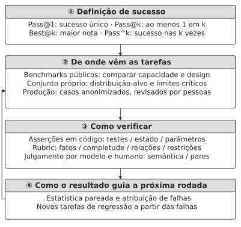
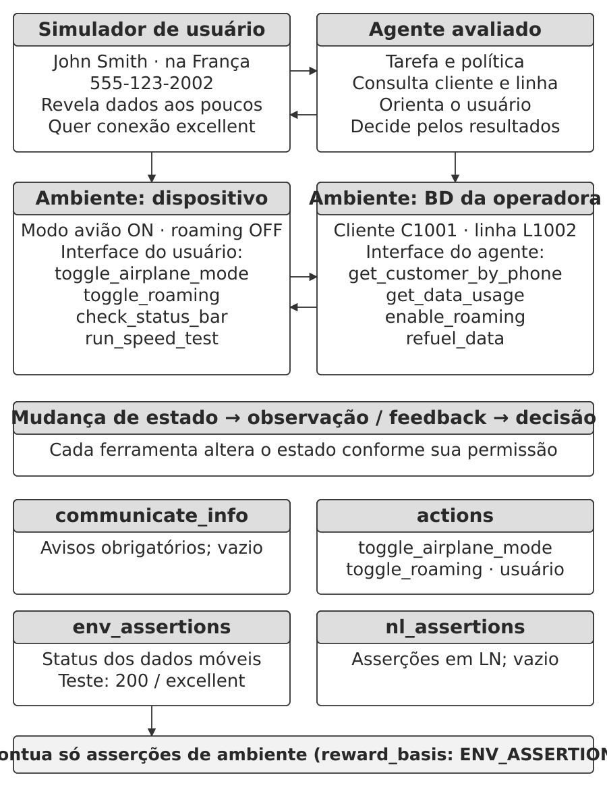
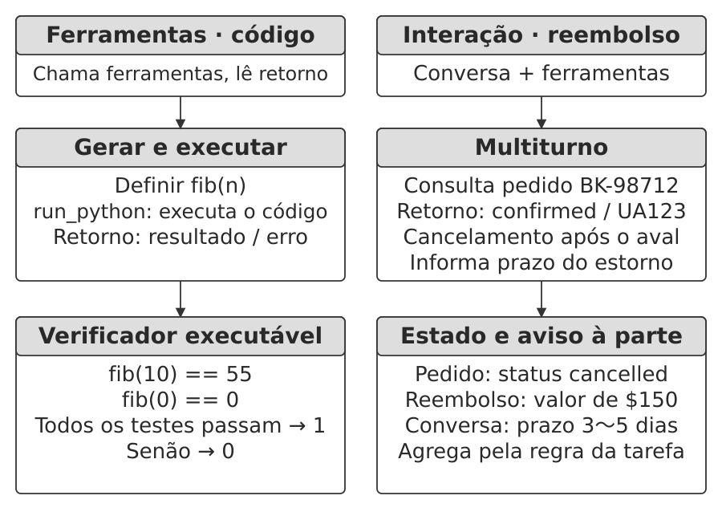
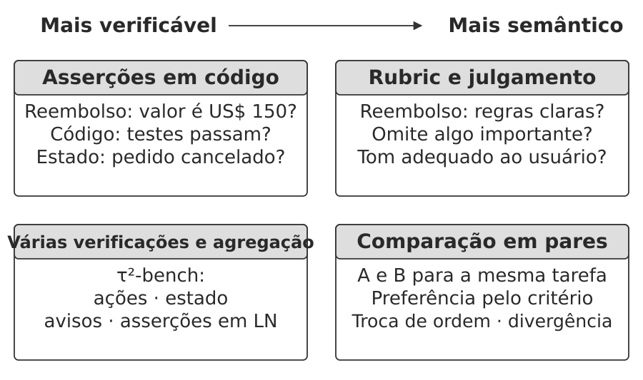
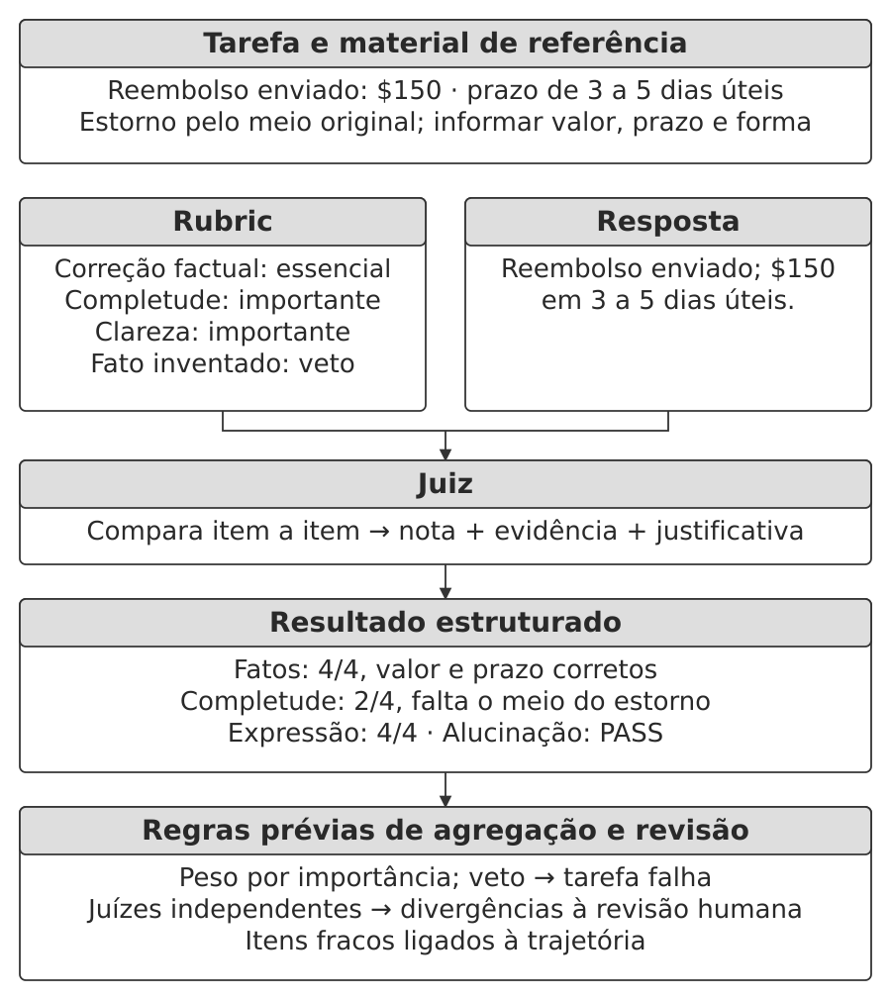
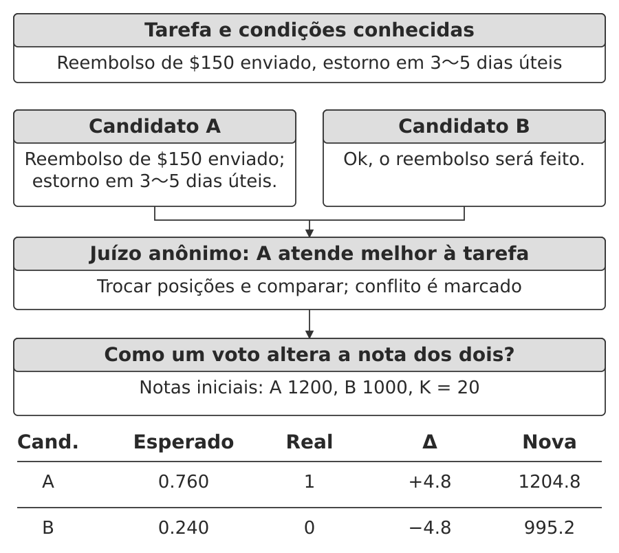
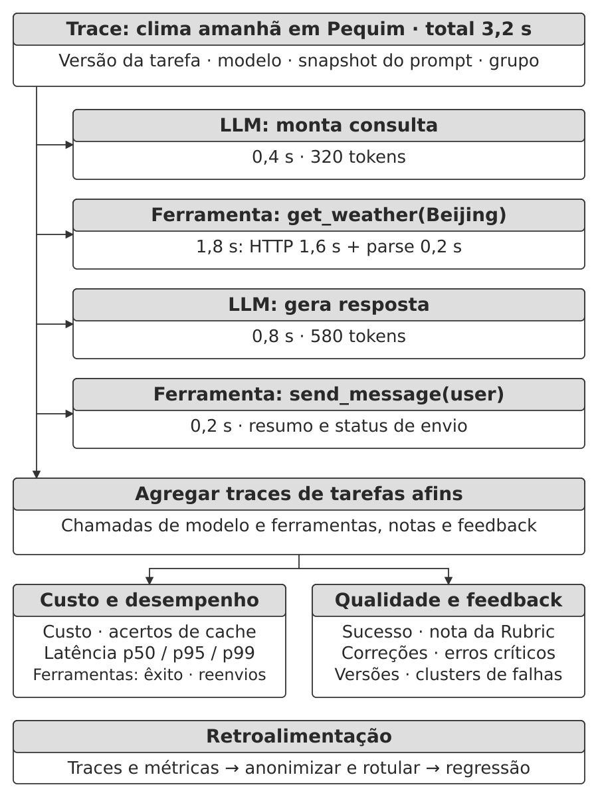
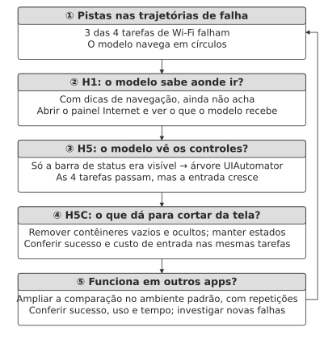
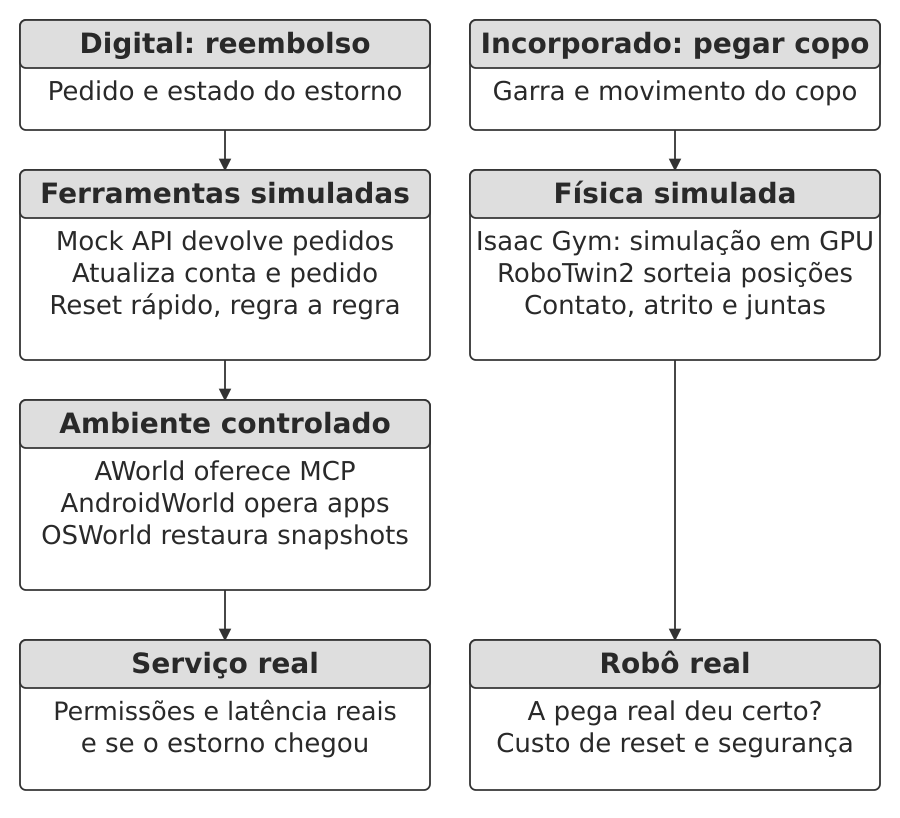
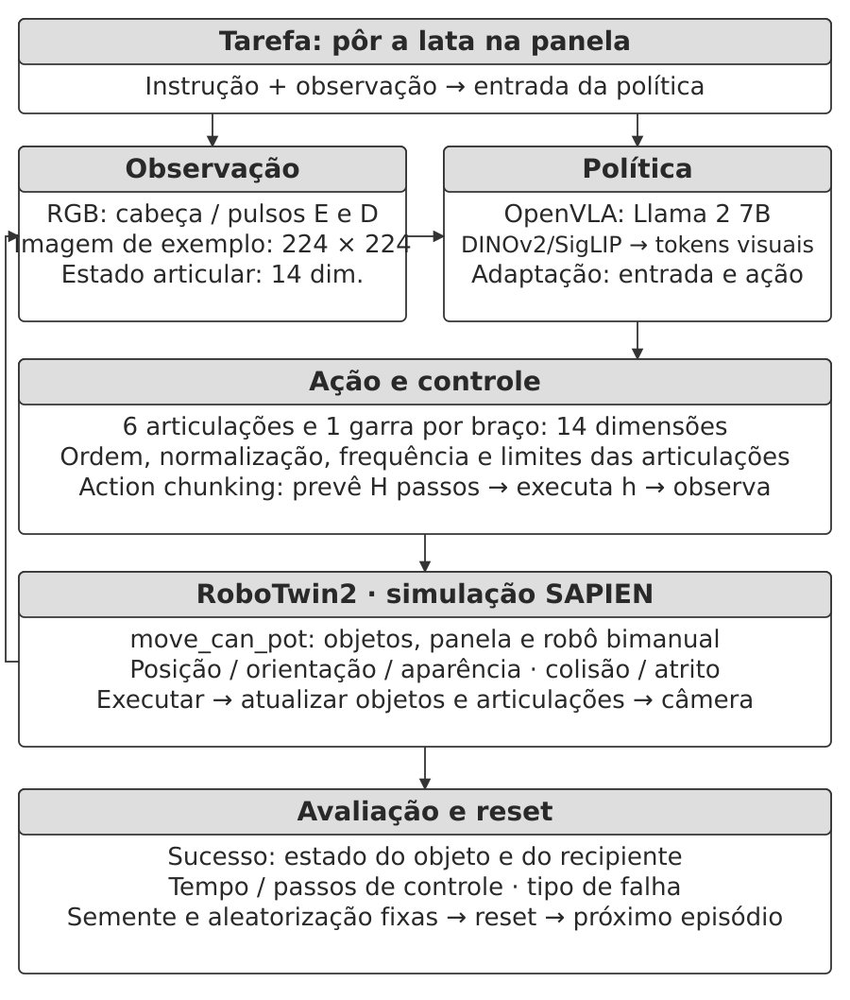

# Avaliação de agentes

Os seis primeiros capítulos apresentaram a construção de um único agente: contexto, memória, base de conhecimento, ferramentas, código e as interfaces de observação e ação. Depois de montado o sistema, é preciso usar um conjunto de tarefas reproduzíveis para determinar o que ele consegue fazer, em que condições tende a falhar e o que convém alterar em seguida. Os resultados da avaliação também alimentam o pós-treinamento e a evolução contínua.

Ao longo do desenvolvimento, muitas escolhas precisam ser comparadas em tarefas reais: qual modelo usar, quais ferramentas disponibilizar, que conteúdo e que indexação adotar na base de conhecimento, como organizar a memória do usuário, os prompts e as Skills, e que restrições acrescentar ao harness. Essas escolhas também interagem. Descrições de ferramentas mais detalhadas, por exemplo, podem reduzir erros de parâmetro, mas também aumentar o custo de contexto; uma etapa de verificação pode elevar a taxa de sucesso e, ao mesmo tempo, prolongar o tempo de conclusão.

**Experimentos comparativos** confrontam soluções diferentes nas mesmas tarefas e condições, registrando como variam a taxa de sucesso, o tempo e o custo. **Experimentos de ablação** removem ou desativam componentes, como o reordenamento da recuperação, o resumo de estado ou a verificação de resultados, e observam como o comportamento do sistema muda. Quando cada rodada define com clareza o que foi alterado, mantém as demais condições de execução constantes e repete as medições, aos poucos se estabelece a relação entre as escolhas de engenharia e os resultados das tarefas. Defendo que comparações e ablações façam parte do desenvolvimento cotidiano. Com base apenas em algumas trajetórias bem-sucedidas, é fácil confundir um sucesso casual com uma melhoria, ou enxergar o ganho em um tipo de tarefa e deixar passar a regressão em outros.

**A avaliação deve ter como objeto o agente completo, formado pelo modelo e pelo harness.** O modelo determina como a tarefa é compreendida e como as ações são escolhidas; o harness organiza o contexto, despacha as ferramentas, mantém o estado e executa as verificações. O mesmo modelo, conectado a ferramentas ou fluxos de feedback diferentes, pode produzir resultados distintos. O Coding Harness apresentado no Capítulo 5 oferece justamente esse tipo de cenário de comparação.

O **experimento de troca de modelo (model swap)** permite estudar como modelo e harness funcionam em conjunto: fixam-se primeiro o framework de execução e as tarefas, troca-se o modelo e comparam-se os resultados finais e a distribuição dos erros. Se um modelo mais capaz continua falhando nas mesmas etapas, convém verificar se falta alguma ferramenta, se o feedback chega a tempo e se a pontuação cobre o objetivo; se o desempenho varia muito com o modelo, analisa-se então quais capacidades de raciocínio, planejamento ou seguimento de instruções influenciaram o resultado.

A troca de modelo e a ablação de componentes podem ser cruzadas. Por exemplo, dois modelos executam duas configurações, “com resumo de estado” e “sem resumo de estado”, e verifica-se se o resumo ajuda ambos a retomar tarefas longas e se o ganho depende do modelo. Assim é possível analisar as diferenças entre modelos e, também, descobrir em que condições determinado componente do harness é eficaz.

A avaliação é ainda a verificação de regressão nas atualizações de modelo. Um novo modelo pode progredir em benchmarks públicos e, ainda assim, regredir em algumas tarefas de negócio; o próprio conjunto de tarefas revela essas mudanças. Defendo a ideia de “desenvolver produtos para os modelos do futuro”: concluir antecipadamente as ferramentas, os fluxos de negócio e o conjunto de avaliação e acompanhar continuamente o desempenho de cada novo modelo nas mesmas tarefas. Quando a taxa de sucesso, o tempo de resposta e o custo atingirem os requisitos do produto, avança-se para o lançamento.

Como transformar os requisitos de lançamento em uma avaliação? Ao ler a Figura 7-1, acompanhe um teste do início ao fim: o que se quer medir, de onde vêm as tarefas, que evidências determinam o sucesso e, por fim, como registrar e comparar os resultados.



## Entendendo a avaliação a partir de uma tarefa: o domínio telecom do τ²-bench

Comecemos por uma falha de conexão móvel. John Smith usa o número 555-123-2002, está na França e a barra de status do celular mostra “No Service”. Ele quer recuperar a conexão e só considerará o problema resolvido quando o teste de velocidade indicar excellent; aceita recarregar 2,0 GB de dados se necessário, mas quer manter o plano atual.

O caso vem do domínio telecom do τ²-bench, da Sierra. O ambiente simula ao mesmo tempo o sistema da operadora e o aparelho do usuário; o agente de atendimento e o simulador de usuário leem e alteram, cada um por meio de suas ferramentas, uma parte desse estado. A avaliação precisa acompanhar a interação dos dois lados para verificar como o problema foi descoberto, como as operações foram executadas e se a conexão foi de fato restabelecida.[^ch7-tau2-task]

### Os quatro componentes da definição de uma tarefa

Para que outro agente de atendimento resolva a mesma questão, é preciso primeiro restaurar o estado do celular e da conta, fazer o usuário simulado colaborar no diagnóstico seguindo as mesmas instruções e, por fim, pontuar com os mesmos critérios. A tabela abaixo lista as quatro partes da definição da tarefa. Ao lê-la, observe uma distinção: quem elaborou a questão conhece a configuração inicial do celular, mas quanto o atendente e o usuário sabem, cada um, quando a conversa começa?

| Parte | Campo | Conteúdo neste exemplo |
| --- | --- | --- |
| Ticket | `ticket` | Usuário, número, país em que está, sintoma de falta de conexão, exigência do teste de velocidade e restrições do plano |
| Cenário do usuário | `user_scenario.instructions` | O que o usuário sabe, como consultar quando lhe perguntam algo, quando confirmar que o problema foi resolvido |
| Estado inicial | `initial_state.initialization_actions` | Definir identidade e localização do usuário, ativar o modo avião, desativar o roaming no aparelho, habilitar o roaming na operadora |
| Critérios de pontuação | `evaluation_criteria` | Verificar ações e estado do ambiente, com `reward_basis` definindo o que entra na pontuação |

**O que o usuário sabe.** `known_info` fornece nome, número e país em que o usuário está. O modo avião ativado e o roaming desativado no aparelho ficam guardados no estado do ambiente; o simulador de usuário precisa chamar ferramentas para consultá-los antes de informá-los ao atendente. Ao separar em um campo próprio o que o usuário sabe, o simulador consegue distinguir as informações que pode dar de imediato daquelas que exigem uma consulta real. Apenas pedir no prompt que ele “não conte tudo de uma vez” dificilmente controla de forma estável quando cada fato será revelado. Esse arranjo implementa a revelação progressiva de informações (Progressive Information Disclosure): a conversa começa com “não consigo acessar a internet”, e o agente obtém aos poucos, por meio de perguntas e de orientações para que o usuário execute operações, as informações necessárias ao diagnóstico.

**Como o usuário responde.** `task_instructions` determina que o usuário demonstre leve frustração após a primeira tentativa de correção malsucedida, que só confirme a solução quando o teste de velocidade indicar excellent e que baseie nos resultados das ferramentas as respostas sobre o aparelho. Poor, fair e good não atingem o objetivo desta tarefa. A fundamentação factual (grounding) faz o usuário responder de acordo com o estado real do ambiente simulado. Sem essa restrição, o usuário simulado poderia concordar com um “agora deve estar funcionando” do atendente: a conversa entre os dois pareceria correr bem, mas a falha no aparelho continuaria.

**Em que estado os dois lados começam.** Do lado do usuário, `set_user_info` define a identidade, `set_user_location(abroad=true)` indica que ele está no exterior e, em seguida, são executados `turn_airplane_mode_on` e `turn_roaming_off`. Do lado da operadora, `enable_roaming` habilita o roaming na linha `L1002` do cliente `C1001`. Por isso, a consulta ao sistema mostra o roaming habilitado, enquanto o celular continua sem conexão por causa do modo avião e da configuração de roaming do aparelho. O atendente precisa orientar o usuário a verificar o aparelho para obter as informações que a consulta ao sistema não fornece.

**Quais verificações determinam a pontuação.** `actions` lista `toggle_airplane_mode` e `toggle_roaming`, do lado do usuário. `env_assertions` contém a verificação do status dos dados móveis e a verificação do teste de velocidade, com os parâmetros `expected_speed=200` e `expected_desc="excellent"`. O formato da tarefa também oferece `communicate_info` e `nl_assertions`, que descrevem, respectivamente, as informações que devem ser comunicadas ao usuário e as asserções em linguagem natural; nesta tarefa, os dois estão vazios.

O `reward_basis` desta tarefa escolhe `ENV_ASSERTION`; portanto, a recompensa total depende das asserções de ambiente. As verificações de ações podem aparecer nos resultados, mas a configuração de pontuação é que decide se entram no total.

### Verificando o resultado ao longo da trajetória de execução

A execução complementar seleciona cinco tarefas telecom e roda cada uma uma vez; tanto o agente de atendimento quanto o simulador de usuário usam GPT-4.1 mini, e quatro tarefas são aprovadas. A seguir, analisamos primeiro a tarefa do roaming na França descrita acima e, depois, a comparamos com a tarefa que falhou.

> **Experimento 7-1 ★: executar o τ²-bench e compará-lo com a evolução do τ-bench**
>
> Leia primeiro o cenário do usuário, as ações de inicialização e as condições de pontuação de uma tarefa e, depois, execute uma interação completa. Ao longo da trajetória, marque as consultas do atendente, as operações do usuário, as mudanças de estado e o resultado da verificação final, conferindo em qual informação se baseou cada decisão.
>
> Ao comparar o τ-bench com o τ²-bench, observe sobretudo se o usuário consegue alterar o ambiente por meio de ferramentas e quais exigências de coordenação essa mudança impõe ao atendente.
>
> Ao examinar a Figura 7-2, procure primeiro quem pode desligar o modo avião do celular e, depois, quem pode alterar a configuração de roaming da operadora. O que cada lado consegue fazer é diferente, e isso explica por que o atendente, depois de concluir suas próprias operações, ainda precisa pedir ao usuário que faça o teste de velocidade no celular.
>
> 

Na tarefa do roaming na França, o agente começa identificando a conta. Pelo número, encontra o cliente `C1001` e consulta o consumo de dados de `L1001`, `L1002` e `L1003`, mas, com base nos detalhes de `L1001`, chega a uma conclusão errada: o número informado pelo usuário, 555-123-2002, não estaria entre as linhas ativas, e o mais próximo seria 555-123-2001. Só depois que o usuário insiste que o número está correto é que o agente consulta `L1002` e confirma a linha certa.

Em seguida, o simulador de usuário chama `check_network_status` e `check_status_bar`. O estado retornado inclui: modo avião ativado, rede celular sem serviço, dados móveis ativados e roaming do aparelho desativado. Com base nisso, o usuário relata: “O celular está no modo avião, e o roaming de dados também está desativado. Preciso desligar o modo avião primeiro?” Aqui a consulta é executada por ferramentas do lado do usuário, e o resultado chega ao atendente pela conversa.

Esse é o mecanismo de **controle duplo (Dual-Control)**: o atendente consulta e opera o sistema da operadora, e o simulador de usuário dispõe de ferramentas próprias para o aparelho, como ver a barra de status, alternar o modo avião, reinserir o chip SIM e executar o teste de velocidade. Os dois lados coordenam suas operações pela conversa, e o ambiente registra as mudanças de estado causadas por cada um.

O agente então orienta o usuário a desligar o modo avião e ativar o roaming no aparelho, e a barra de status passa a mostrar sinal 5G. O usuário executa `run_speed_test`, obtém 275 Mbps e a classificação Excellent e confirma que o problema foi resolvido. As duas asserções de ambiente são aprovadas, e a recompensa desta tarefa é 1,0.

Essa trajetória bem-sucedida também expõe um problema de processo. A política exige que o atendente chame uma ferramenta por vez, mas o agente emitiu `get_customer_by_phone` e `get_customer_by_name` na mesma mensagem. Como a pontuação desta tarefa considera apenas as asserções de ambiente, esse comportamento não alterou a recompensa.

Na outra trajetória, a que falhou, a linha errada nunca foi corrigida, e todo o diagnóstico seguinte se desviou. O número do usuário continuava sendo 555-123-2002, mas o agente escolheu `L1001` e seguiu investigando com base no consumo de 3,2/5 GB dessa linha. A ferramenta já havia retornado que `L1001` correspondia a 555-123-2001; ainda assim, o agente não corrigiu a linha e, depois de várias rodadas de diagnósticos irrelevantes, transferiu o atendimento para um humano. Do lado do usuário, o modo de economia de dados foi desativado com sucesso, mas a recarga de 2 GB necessária na linha correta, `L1002`, não foi feita, e as três asserções de ambiente falharam.

Comparando as duas trajetórias, a pontuação final se desdobra em pontos concretos de melhoria: conferir a correspondência entre número e linha, usar novas evidências para corrigir conclusões, distinguir o estado do aparelho do estado do sistema e verificar se a recarga necessária foi concluída. A seção sobre atribuição de falhas, mais adiante, retoma como encontrar esses pontos de virada decisivos em trajetórias longas.

[^ch7-tau2-task]: O τ²-bench da Sierra Research define as ferramentas do usuário no domínio telecom em `user_tools.py`, e o ponto de entrada da pontuação é `evaluator.py`. O conteúdo do caso e os resultados foram organizados a partir das cinco tarefas e das trajetórias de execução guardadas no material complementar.

## Métricas de avaliação: a definição de sucesso

Quatro tarefas aprovadas em cinco dão o desempenho geral desta execução. Para tomar decisões de produto com base nisso, porém, é preciso deixar claros o tipo de tarefa e o custo de uma falha. Um atendente de reembolsos precisa concluir, de forma consistente, os reembolsos que atendem às condições; ao programar, é possível gerar várias implementações e usar testes para selecionar a versão que roda e dá o resultado correto; na pesquisa, também se podem propor várias hipóteses para que o pesquisador as teste depois. As métricas de avaliação devem corresponder a cada uma dessas formas de uso.

### Proezas técnicas: Pass@k mede a capacidade com várias tentativas

Chamo de “proezas técnicas” algumas demonstrações impressionantes de agentes: com tempo e tentativas suficientes, o sistema realiza uma tarefa que antes dificilmente seria automatizada. Em trabalhos exploratórios, uma única trajetória bem-sucedida e verificada já pode gerar valor. A métrica **Pass@k** corresponde a esse uso: a mesma tarefa é executada $k$ vezes, e basta uma aprovação para que conte como sucesso. Em tarefas com pontuação contínua, também se pode relatar a maior nota entre as $k$ execuções, chamada **Best@k**.

A Anthropic, por exemplo, coordenou várias instâncias de Claude para construir juntas um compilador C, mostrando que execução prolongada, feedback de testes e divisão de trabalho podem sustentar uma engenharia complexa. Um pesquisador em busca de um contraexemplo matemático também pode deixar o modelo tentar repetidamente e, ao final, verificar de forma independente se um dos contraexemplos encontrados é válido. Uma revisão de segurança de software pode reexaminar os problemas suspeitos relatados pelo modelo, e a criação aberta pode escolher a melhor entre várias obras.[^ch7-long-running]

Produtos de aplicação também demonstram capacidade por meio de tarefas complexas. O Manus entregou um computador virtual ao agente, permitindo que o usuário o visse operar a interface, buscar informações e avançar continuamente no trabalho. O OpenClaw recebe pedidos por mensageiro instantâneo, acessa arquivos e serviços configurados e autorizados, relata o andamento e pede informações complementares durante o processo, e pode até ser despertado por um mecanismo de agendamento para verificar pendências. Esses comportamentos concretos ajudam o usuário a entender para que serve um agente.

A meu ver, demonstrações capazes de realizar novos tipos de tarefa são um fator importante para atrair usuários a esses produtos.

### Confiabilidade nos negócios: o foco no Pass^k

Processos de negócio costumam exigir entregas corretas em todas as execuções. O **Pass^k** mede se a mesma tarefa, executada $k$ vezes, é aprovada em todas elas; pode ser lido como “pass power k”. A condição de aprovação pode abranger, ao mesmo tempo, o resultado final, o cumprimento da política e as restrições de permissão; cada execução é verificada pelos mesmos critérios.

Supondo que as execuções sejam independentes e que a probabilidade de sucesso em cada uma seja $p$, tem-se:

$$
\mathrm{Pass@k}=1-(1-p)^k,\qquad
\mathrm{Pass}^{k}=p^k.
$$

Por exemplo, com $p=0.6$ e $k=5$, o Pass@5 é de cerca de 99,0%, e o Pass^5, de cerca de 7,8%. O primeiro indica que, em cinco tentativas, quase sempre se encontra um sucesso; o segundo, que a probabilidade de as cinco darem certo continua muito baixa.

Ao ler um conjunto de resultados reais, é possível deixar a fórmula de lado no início. Suponha que as cinco execuções de uma mesma questão tenham dado “passa, falha, passa, passa, falha”: para esse grupo, o Pass@5 vale 1, o Pass^5 vale 0, e a taxa de sucesso por execução é estimada em 3/5. Os valores de 99,0% e 7,8% acima respondem a outra pergunta: sabendo que a probabilidade de sucesso em cada execução é 0,6, se o grupo de cinco execuções for repetido muitas vezes, quantos grupos atingirão o critério correspondente?

O mesmo lote de registros também responde a uma pergunta mais fácil de conferir: escolhendo duas das cinco execuções, que proporção dos pares é aprovada? Trate cada execução como uma carta e tire duas sem reposição; há dez pares possíveis. Só o par formado pelas duas cartas de falha faz as duas execuções falharem; portanto, nove pares têm ao menos um sucesso, e a estimativa amostral do Pass@2 é 9/10. As três cartas de sucesso formam três pares entre si, e a estimativa amostral do Pass^2 é 3/10. É exatamente assim que o τ²-bench conta, tarefa a tarefa, as combinações totalmente aprovadas: se uma questão é executada $n$ vezes com $s$ sucessos e dela se escolhem $k$ execuções, a proporção de combinações totalmente aprovadas é $\binom{s}{k}/\binom{n}{k}$, com $1\le k\le n$.[^ch7-tau2-metrics]

Voltemos agora aos 4/5 do Experimento 7-1. Aquelas cinco trajetórias pertencem a cinco questões diferentes; cada questão tem uma única carta, e não se forma nem um par. Para estimar o Pass^2 dessas tarefas, é preciso acrescentar execuções independentes para cada questão, calcular os valores separadamente e depois agregá-los. Elevar 0,8 ao quadrado equivale a supor, sem dizer, que todas as questões têm a mesma probabilidade de sucesso em cada execução e que as tentativas são independentes entre si.

[^ch7-tau2-metrics]: A versão experimental do τ²-bench (revisão 8d005b0) calcula o Pass^k questão por questão em `agent_metrics.py`. Quando o número de sucessos é menor que $k$, o número de combinações totalmente aprovadas é zero.

No cálculo, a unidade estatística deve ser mantida. Cinco amostragens da mesma tarefa medem o desempenho repetido nessa tarefa; cinco tarefas diferentes em sequência na produção também são afetadas pela dificuldade das tarefas e pela distribuição do tráfego. Quando as tarefas têm probabilidades de sucesso diferentes, pode-se calcular primeiro a métrica de sucesso repetido de cada uma e depois agregá-las segundo o peso de cada tarefa. Estado compartilhado, cache ou uma mesma falha também tornam correlacionadas as várias execuções.

**Quando é permitido responder “informação insuficiente”, qual deve ser o denominador?** Imagine um assistente de literatura científica que recebe 100 questões, responde a 80 e acerta 68 delas. Um leitor que dependa das respostas dadas se interessa por 68/80, ou seja, 85%; quem precisa concluir todo o lote de tarefas também se interessa por 68/100, ou seja, 68%. As outras 20 questões exigem buscar mais evidências ou ser repassadas a uma pessoa.

No PaperQA2, é possível escolher “informação insuficiente” nas 248 questões de literatura do LitQA2. O artigo relata a média de três rodadas: quando o sistema dá uma resposta substantiva, a taxa de acerto é de 85,2%; considerando todas as questões, é de 66,0%, e em 21,9% dos casos o sistema opta por informação insuficiente. Para nove respondentes humanos, as duas taxas correspondentes são 73,8% e 67,7%. Segundo o artigo, a primeira diferença é significativa, e a segunda não atinge significância estatística.[^ch7-paperqa2-denominators]

[^ch7-paperqa2-denominators]: Skarlinski et al., *Language Agents Achieve Superhuman Synthesis of Scientific Knowledge*, 2024, Seção 2 e Figura 2.

Duas trajetórias que terminam no mesmo estado podem ter custos diferentes. Tome a consulta de uma fatura: A retornou o valor correto com uma única consulta. B só deu a mesma resposta depois de duas consultas. As duas consultas levavam o mesmo identificador de requisição, e a primeira tinha expirado por tempo, o que mostra que a nova tentativa ajudou B a recuperar a tarefa. Se o resultado da primeira consulta tivesse sido entregue com sucesso, a segunda apenas acrescentaria tempo de espera e custo de ferramenta.

Quando a execução envolve escritas ou outros efeitos externos, restaure primeiro, para cada ensaio, o estado inicial especificado, realize as operações em um ambiente de testes e registre todas as tentativas. Se o produto permite novas tentativas após uma falha, inclua na avaliação do processo o número de tentativas, as etapas de recuperação e o custo de execução; mantenha também os registros originais de falha, para distinguir o desempenho de uma execução do resultado obtido após a recuperação.

[^ch7-long-running]: Anthropic, Building a C compiler with a team of parallel Claudes, 2026-02-05, sobre colaboração entre múltiplas instâncias, execução de longo prazo e feedback de testes.

## O ambiente de avaliação

Suponha que se queira reexaminar a execução anterior em que a linha errada foi escolhida. Quem reexamina precisa ver o mesmo usuário, as mesmas duas linhas e o mesmo plano inicial. Se a primeira execução já tiver alterado uma das linhas, rodar de novo diretamente não permite saber se a mudança no resultado veio do modelo ou do banco de dados. O ambiente de avaliação é responsável por estabelecer o ponto de partida da tarefa, oferecer as interfaces de interação, registrar o processo e verificar o ponto de chegada.

### Os cinco componentes

Tomando a tarefa telecom como exemplo, o ambiente de avaliação pode ser decomposto em cinco partes.

O **conjunto de dados (Dataset)** guarda as definições das tarefas: contexto do usuário, requisitos de comportamento, estado inicial e condições de aceitação. Cada registro corresponde a um caso de teste, e, na execução, as informações são distribuídas conforme o papel de cada participante.

O **estado do ambiente (Environment State)** guarda as informações mutáveis durante a execução da tarefa, como clientes, linhas, planos e faturas, além do modo avião, do roaming e da economia de dados no aparelho. No início de cada nova rodada, o ambiente restaura primeiro os dados de base e depois executa `initialization_actions`, criando a falha especificada para a tarefa atual. Limpeza e inicialização precisam funcionar em conjunto, para que recargas ou mudanças de configuração da rodada anterior não passem para a seguinte.

As **interfaces de ferramentas (Tools)** determinam o que cada participante pode ler e alterar. O atendente pode consultar clientes, verificar o consumo, recarregar dados ou transferir para um humano; o usuário pode ver o estado do aparelho, alternar controles e fazer o teste de velocidade. A granularidade das ferramentas deve corresponder à capacidade testada: para avaliar diagnóstico e planejamento, deixe o agente combinar consultas e operações; se for oferecida diretamente uma ferramenta “corrigir o problema de conexão”, o foco do teste passa a ser quando chamar essa capacidade.

Os **critérios de pontuação (Rubric)** dizem como julgar o resultado. A tarefa telecom pode verificar ações, estado do ambiente, comunicações necessárias e requisitos em linguagem natural e, por meio de `reward_basis`, definir quais verificações entram na pontuação total.

O **protocolo de execução (Interaction Protocol)** organiza os turnos de fala, as chamadas de ferramentas e o encerramento. O simulador de usuário pode emitir `###STOP###` para encerrar a interação, e o executor também define orçamentos, como o número de turnos. O motivo do encerramento e a pontuação da tarefa são registrados separadamente: depois que o usuário encerra a conversa, as asserções de ambiente continuam responsáveis por determinar se o objetivo foi atingido; quando o orçamento se esgota, também é preciso guardar o estado final e as etapas não concluídas.

### Ambientes de avaliação de interação humano-computador e de chamada de ferramentas

A tarefa telecom inclui um simulador de usuário que responde e opera o aparelho continuamente. Já correção de código, análise de dados e resolução de problemas matemáticos costumam começar com uma instrução de tarefa, depois da qual o agente interage principalmente com ferramentas. Os dois tipos de ambiente precisam de tarefas, estado, interfaces, pontuação e protocolo de execução; a diferença está em ser ou não necessário simular um interlocutor e em como os dois lados coordenam suas ações.

Tarefas de código podem verificar a saída com testes; tarefas de banco de dados podem consultar os registros alterados; análises abertas talvez exijam a revisão do conteúdo por pessoas ou por modelos. Tarefas de interação humano-computador muitas vezes ainda precisam juntar duas fontes de evidência. Por exemplo, saber se a conexão do celular voltou depende do estado do aparelho; saber se o atendente esclareceu o número e orientou as operações do usuário depende da conversa. O reembolso da Figura 7-3 é igual: se o pedido já foi cancelado pode ser consultado no banco de dados; se o atendente informou o prazo de crédito só se descobre lendo a conversa.



No Verifiers, esses dois tipos de tarefa podem partir de interfaces de ambiente diferentes. A Tabela 7-1 lista as interfaces da v0.1.9 que tratam de respostas em um único turno, chamadas de ferramentas em vários turnos, injeção de estado de execução e gerenciamento de recursos de sandbox, para facilitar a comparação com o código.[^ch7-verifiers-env]

Tabela 7-1 Comparação dos tipos de ambiente do Verifiers

| Tipo de ambiente | Responsabilidade principal | Tratamento de ferramentas e estado | Caso de uso típico |
|---|---|---|---|
| `SingleTurnEnv` | Organiza respostas em um único turno | Pontua após uma única resposta | Problemas de matemática, perguntas e respostas em um turno |
| `ToolEnv` | Organiza interações com ferramentas em vários turnos | Guarda a trajetória, despacha as ferramentas e recebe os resultados | Busca e síntese de informações |
| `StatefulToolEnv` | Conecta o estado de execução à execução das ferramentas | Completa parâmetros das ferramentas ou atualiza o estado com base no estado atual | Vincular um banco de dados ou identificador de recurso à tarefa atual |
| `SandboxEnv` | Gerencia ambientes de execução isolados | Aloca uma sandbox para a execução e usa as ferramentas dentro dela | Executar código, verificar arquivos e resultados de testes |

Por exemplo, quando duas tarefas alteram o banco de dados ao mesmo tempo, o executor pode injetar o identificador de banco de dados de cada uma nas chamadas de ferramenta, de modo que cada trajetória opere sobre os dados correspondentes. Quando a execução falha, a ferramenta deve retornar informações úteis para a próxima decisão, como objeto inexistente, parâmetro fora do exigido ou tempo de serviço esgotado. O sistema de avaliação guarda observações, chamadas, resultados de execução e recompensas, e, na análise, os erros podem ser localizados em etapas específicas.

[^ch7-verifiers-env]: Prime Intellect, ToolEnv e StatefulToolEnv do Verifiers v0.1.9, mostrando trajetórias de vários turnos, despacho de ferramentas e injeção de parâmetros de estado.

## Projeto do conjunto de dados de avaliação

Agora vamos ampliar as cinco questões de telecom para um conjunto de avaliação capaz de orientar um lançamento. Se tudo o que for acrescentado for do tipo “habilitar roaming para o número indicado”, o sistema pode tirar notas altas mesmo sem nunca ter aprendido a distinguir duas linhas da mesma conta. Se as notas vão decidir se o atendente pode entrar em produção, as questões devem ser escolhidas com base em tickets reais, incluindo tanto operações rotineiras quanto casos difíceis em que é fácil confundir as linhas, e a pontuação precisa verificar qual linha o atendente alterou de fato. Depois do lançamento, essas questões ainda precisam de manutenção, para continuarem refletindo o trabalho que os usuários de fato confiam ao sistema.

### Comparação entre os projetos de benchmarks

A Tabela 7-2 compara seis benchmarks quanto à capacidade avaliada, à origem das tarefas, ao ambiente de execução e à forma de verificação.

Tabela 7-2 Principais escolhas de projeto de alguns benchmarks de agentes

| Benchmark | Capacidade avaliada | Origem e organização das tarefas | Ambiente de execução | Forma de verificação |
|---|---|---|---|---|
| τ²-bench | Interação de atendimento e operação de ferramentas | Combinações de tarefas de domínio e falhas | Simulador de usuário, aparelho e banco de dados de negócio | Verificações por item, pontuadas segundo `reward_basis` |
| SWE-bench Verified | Correção de problemas de código | Issues reais do GitHub, com triagem humana | Repositório de código e ambiente de testes | Testes `FAIL_TO_PASS` e `PASS_TO_PASS` |
| AndroidWorld | Operação de aplicativos Android | Modelos de tarefa parametrizados | Emulador Android rodando aplicativos reais | Leitura do estado do aparelho, de arquivos ou interno dos aplicativos |
| OSWorld | Operação de desktop e entre aplicativos | Cenários reais de uso, com ponto de partida configurado | Máquina virtual e aplicativos de desktop | Verificação do estado de execução e dos artefatos de cada tarefa |
| Terminal-Bench | Tarefas de engenharia no terminal | Tarefas e testes projetados manualmente | Contêiner e dependências exigidas pela tarefa | Arquivos, execução de programas e resultados de testes |
| GAIA | Processamento de informações por assistentes gerais | Perguntas escritas manualmente, algumas com material anexo | Rede, arquivos e ferramentas auxiliares | Comparação após normalização segundo o formato da resposta |

### Verificadores

O verificador liga o objetivo da tarefa a evidências verificáveis. Tarefas de código exigem executar testes; tarefas de desktop exigem ler o estado de aplicativos ou arquivos; tarefas de busca de informações exigem conferir a resposta e suas fontes. **A aceitação deve se basear em evidências obtidas de forma independente.** O agente pode gerar um relatório completo afirmando que todas as etapas foram concluídas; o verificador ainda precisa executar de fato o artefato, ler o estado ou conferir as fontes. O relatório de conclusão serve para localizar o que deve ser verificado, mas a pontuação é determinada por essas verificações.

Imagine que um usuário abre um aplicativo de pagamentos e pede ao assistente: “aprove todas as solicitações de pagamento que meu colega de apartamento enviou este mês”. Suponha que haja três pendentes: uma do colega de apartamento deste mês, uma do mesmo colega do mês passado e uma de um colega de trabalho deste mês. A primeira deve ser aprovada; as outras duas devem continuar pendentes. Se só a primeira for verificada, até um assistente que aprove as três tira nota máxima; se só as duas últimas forem verificadas, até um assistente que não faça nada passa. O AppWorld propõe exatamente essa questão em um aplicativo de pagamentos simulado. Ao projetar o verificador, pode-se primeiro delimitar, com os dados anteriores à operação, o lote de solicitações autorizadas pelo usuário, depois verificar se todas foram aprovadas e, por fim, fazer a verificação inversa nos registros posteriores à operação: em quais outras solicitações o assistente mexeu?[^ch7-appworld-scope]

[^ch7-appworld-scope]: Trivedi et al., *AppWorld*, ACL 2024; a Figura 2 apresenta a tarefa e as condições de aceitação.

A busca científica também pode entregar um artefato fácil de verificar. O FunSearch precisa escolher o maior número possível de pontos em um espaço de oito dimensões, em que cada coordenada só pode valer 0, 1 ou 2, as operações são feitas módulo 3 e nenhum trio de pontos escolhidos pode ser colinear. Os pesquisadores escreveram o esqueleto de um programa que escolhe os pontos um a um, pediram ao modelo que propusesse funções para ordenar os pontos candidatos e pontuaram pelo tamanho do conjunto válido efetivamente construído. Quando o artigo foi publicado, a melhor construção conhecida chegava a 496 pontos; o novo programa entregou uma lista de 512.[^ch7-funsearch-cap]

Você pode baixar só a lista e verificar o resultado por conta própria. Primeiro, confirme que ela contém 512 vetores distintos de oito dimensões e que cada coordenada está no intervalo permitido. Depois, tome dois pontos distintos quaisquer $a,b$: a reta que passa por eles tem apenas três pontos, e o terceiro é $c=-a-b \pmod{3}$. Em duas dimensões, por exemplo, com $(0,0)$ e $(1,2)$, o terceiro ponto é $(2,1)$. Aplicando a mesma operação coordenada a coordenada em oito dimensões e percorrendo os 130.816 pares de pontos distintos da lista, nenhum dos terceiros pontos obtidos aparece na lista. Isso basta para provar que é possível escolher pelo menos 512 pontos. Para provar que 513 é impossível, seria necessária uma prova de limite superior.

[^ch7-funsearch-cap]: Romera-Paredes et al., *Mathematical discoveries from program search with large language models*, Nature, publicado on-line em 2023. Os autores divulgaram separadamente o conjunto de pontos em oito dimensões e o notebook de cálculo usado na verificação.

**Os dois tipos de teste do SWE-bench verificam, respectivamente, a correção e a regressão.** `FAIL_TO_PASS` são testes que falham antes da correção e devem passar depois dela; `PASS_TO_PASS` são testes que passavam antes e devem continuar passando após a correção. Os primeiros verificam o problema indicado; os segundos, se o comportamento já coberto pelos testes existentes foi preservado.[^ch7-swe-verified]

**O OSWorld usa verificação baseada em execução para conferir os artefatos dos aplicativos.** A versão original oferece 134 funções de avaliação baseadas em execução, que, combinadas à configuração da tarefa, leem arquivos, dados de aplicativos ou o estado do sistema.[^ch7-osworld-design] Por exemplo, quando se pede para alterar uma planilha, podem-se verificar as células e fórmulas indicadas; quando se pede para atualizar uma configuração do navegador, pode-se ler a configuração correspondente.

**O Terminal-Bench aceita tarefas de engenharia pelos resultados de execução.** O caso da compilação do kernel Linux encadeia modificação do código-fonte, compilação, initramfs e inicialização no QEMU; o Linux 6.9, o `printk` personalizado em `start_kernel` e a mensagem no log de inicialização fornecem pontos de verificação concretos.

O Capítulo 5 tratou da conferência de vendas a partir de pedidos. Se o assistente entrega um relatório trimestral de vinte canais, por onde começar a verificação? O Tencent WorkBuddy Bench tem uma questão pública de conciliação. As duas planilhas contêm dados por canal: o valor de liquidação usa a variação em relação ao período anterior e deve ser comparado com o trimestre anterior; o valor recebido usa a variação anual e deve ser comparado com o mesmo trimestre do ano anterior. Mesmo que as duas bases de comparação sejam preenchidas com o trimestre anterior, os cabeçalhos e o número de canais podem estar totalmente corretos. Tomando como exemplo o canal “锦绣生活馆” (Jinxiu Shenghuoguan) da planilha de liquidação, ao remover dos detalhes as linhas duplicadas e os registros sem trimestre e agregar por canal e trimestre, obtém-se que o valor total das transações subiu de 1.569.231,00 para 1.787.311,03, uma diferença de 218.080,03. O programa de pontuação verifica a cobertura de canais nas duas planilhas e depois confere por amostragem os valores de dois canais designados. Nessa questão, a verificação de cobertura abrange os vinte canais, mas a verificação de valores envolve apenas os dois sorteados.[^ch7-workbuddy-office]

[^ch7-workbuddy-office]: Tarefa de escritório `channel-period-compare-L4-017` do Tencent WorkBuddy Bench. O pacote de dados utilizado (revisão 3e8ad83) inclui as pastas de trabalho originais, a resposta de referência e o programa de pontuação.

Uma tarefa sensível ao tempo serve para testar o verificador. Suponha que um usuário peça um aviso quando a diária de certo hotel cair abaixo de 950 yuans. O preço é de 1.000 yuans às 10:00, cai para 900 às 10:10 e volta a 1.000 às 10:15. Um aviso de queda enviado às 10:12, com o tipo de quarto e o link de reserva, ainda dá ao usuário a chance de reservar. Enviar todos os dias um “ainda não baixou” e justamente perder esses cinco minutos não cumpre o pedido, mesmo que o sistema funcione por uma semana seguida. Na pontuação, registram-se separadamente o número de janelas que atendem à condição, o número de avisos enviados a tempo dentro delas e o número de vezes em que o usuário foi incomodado sem que nada tivesse mudado. Se o avaliador também tiver guardado só uma cotação por dia, as janelas perdidas simplesmente não podem ser contadas. Para testar alertas não enviados, prepare antes uma reprodução completa dos preços com marcas de tempo e deixe o sistema em teste consultá-la na frequência que ele próprio escolher.

### A divisão das tarefas por dificuldade

O conjunto de tarefas precisa cobrir dificuldades diferentes e explicar de onde vem a dificuldade. Tarefas básicas verificam se houve regressão de capacidade; tarefas difíceis deixam margem de medição para o progresso dos modelos futuros. Se todas as questões forem aprovadas rapidamente, o conjunto de avaliação deixa de orientar a escolha de modelos. A divisão pode considerar a variedade de ferramentas, o comprimento das operações, a dispersão das informações, a incerteza do ambiente ou o conhecimento especializado exigido; depois, observa-se em quais condições o sistema se degrada de forma marcante.

As 466 questões do GAIA se dividem em três níveis. As tarefas mais simples costumam envolver poucas ferramentas e etapas; as mais difíceis exigem integrar informações em várias etapas e combinações complexas. No artigo original, os anotadores humanos acertaram 93,9%, 91,8% e 87,3% nos três níveis; o GPT-4 com plugins obteve 30,3%, 9,7% e 0%.[^ch7-gaia-design]

As tarefas do Terminal-Bench também variam muito: o registro de modelos envolve o uso do MLflow, a implantação de múltiplos componentes exige coordenar um serviço Git e um serviço Web, e a recuperação de senhas e a análise diferencial do FEAL acrescentam conhecimento algorítmico especializado.

Tarefas de negócio também precisam cobrir os limites das políticas. Por exemplo, quando o usuário afirma que o atendimento já aprovou o cancelamento de um pedido, o sistema deve consultar a autorização e o estado do pedido e decidir, segundo a política, se cancela ou não. Esses casos examinam como o agente usa evidências para lidar com informações conflitantes e podem ser criados em par com as tarefas de atendimento normal.

### Prevenção de vazamento de dados

**Combinação de várias fontes e anexos exclusivos.** Se o modelo conseguir encontrar nos resultados de busca a questão e uma resposta pronta, quanto um acerto prova sobre sua capacidade de recuperação e raciocínio? O GAIA reduz essa chance com buscas em várias etapas e anexos exclusivos. Por exemplo: primeiro, identificar um astronauta a partir da imagem astronômica de um certo dia; depois, descobrir a que grupo de astronautas ele pertencia, comparar o tempo em órbita dos membros e, por fim, dar o sobrenome e o número de minutos no formato exigido. O ponto e vírgula, o arredondamento numérico e o separador de milhar fazem parte das convenções da resposta. PDFs, áudios e imagens produzidos especialmente para o benchmark aumentam as combinações de entradas. Questões publicadas podem acabar no material de treinamento. Por isso, também é preciso reservar um lote de questões exclusivamente para avaliação e registrar quais já foram usadas em treinamento.[^ch7-gaia-design]

**Instâncias parametrizadas.** O AndroidWorld fornece às tarefas lógica de inicialização, verificação da execução e limpeza, e gera instâncias diferentes por meio de parâmetros.[^ch7-androidworld-design] Por exemplo, em “alterar o telefone do contato `[CONTACT_NAME]` para `[NEW_PHONE]`”, é possível variar o contato e o número mantendo o mesmo objetivo de operação. A variação dos parâmetros verifica se o modelo age com base na tarefa atual; fixar alguns parâmetros e variar os demais também facilita estudar o efeito de fatores específicos.

**Identificadores canário.** Arquivos de benchmark podem embutir um canary GUID exclusivo, que ajuda a encontrar indícios de que os dados foram copiados ou misturados a outros corpora. Os arquivos de tarefa do Terminal-Bench usam esse tipo de marcação. Para concluir que houve vazamento, também é preciso verificar se o modelo viu o identificador no contexto atual ou nos resultados de recuperação e combinar isso com o rastreamento da origem dos dados; encontrar a marcação pode desencadear uma investigação, mas atribuir dados de treinamento exige evidências adicionais.

### Controle de qualidade e manutenção de longo prazo

Se a mesma questão telecom passou ontem e falhou hoje, além de verificar as mudanças no agente, é preciso conseguir responder: a linha inicial mudou? O simulador de usuário continua colaborando segundo as mesmas regras? As condições de correção continuam testando o mesmo objetivo? Seguindo o ponto de partida, a interação e o ponto de chegada de uma execução, chega-se a cinco tarefas de manutenção.

1. **Definir o escopo das informações do usuário.** Separar `known_info` dos requisitos de comportamento, para que as etapas de consulta e esclarecimento tenham um ponto de partida claro.
2. **Escrever com clareza as condições de aceitação.** Traduzir “conexão restabelecida” em status dos dados móveis, velocidade medida e classificação, verificando o efeito que a tarefa realmente exige.
3. **Restringir a base das respostas do usuário simulado.** O estado do aparelho vem do retorno das ferramentas; as regras de emoção e paciência servem para organizar a interação.
4. **Representar as operações dos dois lados.** Usuário e atendente alteram o ambiente cada um por sua parte, e as decisões seguintes obtêm novas informações de estado por meio das ferramentas disponíveis ou da conversa.
5. **Combinar tarefas e falhas.** Variar as combinações de falhas e os parâmetros das tarefas segundo regras de geração explícitas e, depois, verificar se as instâncias têm solução e se o estado inicial corresponde à definição da tarefa.

**O SWE-bench Verified mostra a triagem humana antes da publicação.** O projeto convidou 93 desenvolvedores com experiência em Python para anotar 1699 amostras sorteadas, verificando sobretudo se a descrição do problema era suficiente e se os testes rejeitariam soluções razoáveis, além de estimar a dificuldade da correção; cada amostra foi verificada de forma independente por três anotadores. O conjunto Verified publicado contém 500 amostras.[^ch7-swe-verified] As regras de triagem foram divulgadas junto com a distribuição de dificuldade, para que os usuários possam avaliar quais exigências de capacidade foram mantidas depois que o conjunto de tarefas foi reduzido. Tarefas de agentes costumam exigir várias rodadas de chamadas ao modelo e operações no ambiente, e questões ambíguas ou sem solução consomem orçamento repetidamente em cada regressão. Recomendo limpar primeiro esse ruído e só depois aumentar o número de tarefas; um conjunto de avaliação pequeno e de alta qualidade é mais adequado para execuções frequentes e torna as falhas mais fáceis de explicar.

**O OSWorld-Verified mostra a manutenção depois da publicação.** Cerca de 15 meses após a primeira versão, o projeto organizou e corrigiu mais de 300 relatos de problemas, o que envolveu dois meses de trabalho concentrado de uma equipe de cerca de dez pessoas.[^ch7-osworld-verified]

Por exemplo, quando a estrutura de uma página web muda, é preciso atualizar a extração de estado; antes de começar uma tarefa de documento, é preciso confirmar que o aplicativo carregou, que o arquivo está aberto e que o cursor está na posição indicada; depois de alterar uma condição de verificação, é preciso fazer uma verificação de regressão com artefatos corretos e incorretos.

> **Experimento 7-2 ★: executar você mesmo tarefas de benchmark**
>
> Escolha tarefas do GAIA, do AndroidWorld, do SWE-bench Verified, do Terminal-Bench, do OSWorld-Verified e do τ²-bench: em cada um, uma fácil, uma média e uma difícil, segundo a definição de dificuldade do próprio benchmark. Resolva-as primeiro por conta própria e só depois confira a pontuação oficial; registre o caminho percorrido, as ambiguidades encontradas e o artefato final.
>
> O material complementar guarda 18 casos em que o Codex opera esses seis tipos de benchmark, que podem ser usados para comparar com o seu raciocínio. Entre eles, na questão de distância atômica do GAIA, o arredondamento diverge do formato esperado pelo avaliador; na questão de multiplicação do AndroidWorld, depois de calcular 840, a página ainda não atinge o estado de sucesso exigido. No τ²-bench, um modelo local simula o usuário oculto. Dos 18 casos, 13 foram aprovados.
>
> Ao terminar, analise: a questão admite várias interpretações razoáveis? O verificador cobre essas interpretações? Depois de obter o resultado intermediário correto, que operações ainda faltam para passar na verificação final?

### As três fontes de um conjunto de avaliação

A avaliação em produção pode combinar benchmarks públicos, tarefas de negócio próprias e trajetórias de produção. As três fontes têm funções diferentes e, juntas, cobrem o escopo de uso do sistema.

Os **benchmarks públicos** servem para uma comparação inicial de modelos e também oferecem referências de projeto de tarefas, geração parametrizada e verificadores. Uso-os para uma triagem inicial dos modelos candidatos e decido a escolha e o lançamento com base nos resultados do conjunto de negócio próprio.

O **conjunto de negócio próprio** organiza tarefas em torno dos objetivos reais dos usuários, das ferramentas e das políticas, e serve para escolher modelos e melhorar o harness. É possível tomar como referência a estrutura do τ²-bench: configurar dados de domínio, cenários de usuário, ferramentas e verificações de estado e, depois, calibrar a dificuldade das tarefas e o comportamento do simulador de usuário.

O **retorno de trajetórias de produção** revela lacunas a partir de execuções reais, como correções feitas pelo usuário, feedback negativo, anomalias no estado de negócio ou erros encontrados na revisão de trajetórias. Depois do tratamento autorizado e da desidentificação, uma pessoa confere a causa da falha, restaura as condições necessárias da tarefa e a inclui no conjunto de regressão. O feedback do usuário é uma pista para localizar o problema; os rótulos de pontuação precisam ser confirmados com base no estado real.

No início, podem-se usar benchmarks públicos e um pequeno número de tarefas de negócio escritas à mão; depois do lançamento, os erros reais e os novos cenários de negócio devem ser a principal fonte de novos casos de regressão. Essas tarefas vêm diretamente dos problemas que os usuários encontram e preenchem continuamente as condições esquecidas na fase de projeto.

[^ch7-swe-verified]: OpenAI, Introducing SWE-bench Verified, 2024, sobre a classificação dos testes, os critérios de anotação e a triagem humana.
[^ch7-osworld-design]: A descrição do projeto OSWorld lista a inicialização das tarefas e a avaliação baseada em execução; as 134 funções de avaliação referem-se à versão original.
[^ch7-gaia-design]: Grégoire Mialon et al., GAIA: A Benchmark for General AI Assistants; o artigo original descreve os níveis das tarefas, as normas de resposta e as configurações humanas e de modelo.
[^ch7-androidworld-design]: Christopher Rawles et al., AndroidWorld: A Dynamic Benchmarking Environment for Autonomous Agents, sobre tarefas parametrizadas e aceitação pelo estado do aparelho.
[^ch7-osworld-verified]: XLANG Lab, Introducing OSWorld-Verified, 2025, sobre o feedback da comunidade e a revisão da inicialização e dos verificadores.

## Métodos de avaliação automatizada

A avaliação automatizada começa pela definição clara do que será verificado. O SWE-bench verifica o comportamento do código por meio de uma suíte de testes, o AndroidWorld consulta o estado dos aplicativos, e o GAIA compara as respostas depois de normalizá-las conforme o tipo de resposta. Essas verificações podem ser executadas por programas e se prestam a execuções repetidas. Já o τ²-bench combina vários critérios: chamadas de ferramentas e estado do ambiente podem ser conferidos diretamente, e os requisitos em linguagem natural ainda podem ser julgados por um modelo. Uma mesma tarefa muitas vezes precisa dos dois tipos de método.

Verificações programáticas também fornecem informações de diagnóstico. Na tarefa de telecom do início do capítulo, verificar separadamente a configuração de roaming, o saldo de dados e a ação de recarga mostra quais condições ainda não foram satisfeitas. Para localizar o momento em que a linha errada foi escolhida, é preciso ligar os resultados das verificações à trajetória de chamadas.

Saídas abertas exigem que os requisitos de qualidade sejam escritos de forma mais concreta. Uma resposta a uma reclamação precisa apresentar a solução e ser adequada à emoção e ao problema do cliente; um relatório de pesquisa precisa cobrir os fatos essenciais e ter conclusões sustentadas pelas fontes; uma resposta de memória precisa associar corretamente pessoas, datas e eventos. Para esses requisitos, pode-se usar uma **Rubric (critérios de pontuação)** que liste critérios item a item e, depois, pedir a um **LLM-as-a-Judge (julgamento por modelo)** que atribua notas com base no material.

**Sempre que uma condição puder ser verificada por programa, prefiro escrevê-la como verificação programática.** Formato, valores numéricos, permissões e estado final costumam ter critérios claros; com entradas e ambiente fixos, podem ser verificados repetidamente, e o custo é fácil de estimar. Na mesma resposta, os dois tipos de pontuação podem ser necessários. Na Figura 7-4, conferir o valor do reembolso exige apenas comparar números; já julgar se o atendente explicou com clareza as condições do reembolso exige compreender o parágrafo inteiro. Esse item pode ser pontuado por um modelo e calibrado por amostragem humana.



### LLM-as-a-Judge: transformando requisitos de qualidade em pontuação item a item

Na Figura 7-5, o atendente informou corretamente o valor do reembolso e o prazo previsto de crédito; por que a completude recebeu só 2 pontos? A Rubric também exige dizer para onde vai o reembolso, e a resposta omitiu que o valor “volta pelo mesmo meio de pagamento”. O modelo avaliador precisa ver ao mesmo tempo a tarefa, a Rubric e o material de referência para apontar qual item foi omitido.



O modelo avaliador precisa ser calibrado antes. Um problema comum é o **viés de extensão**: com conteúdo equivalente, respostas mais longas podem receber notas mais altas. Para detectá-lo, preparam-se amostras com os mesmos fatos e conclusões e redação de extensões diferentes, verificando se a nota varia com o tamanho; ao avaliar duas respostas lado a lado, pode-se inverter a ordem para ver se o avaliador passa a escolher a outra. Quando a própria tarefa exige concisão, isso deve constar da Rubric, com exemplos de extensão adequada. Em estatísticas de lote, a correlação entre notas altas e respostas longas serve como pista; depois, é preciso comparar quantidade de informação, correção e dificuldade da tarefa para identificar a causa concreta.

**Os quatro critérios de projeto de uma Rubric.** O trabalho “Rubrics as Rewards”, da Scale AI, propõe quatro critérios: orientação por especialistas, cobertura abrangente, ponderação por importância e autossuficiência.[^ch7-rubrics] Na avaliação de agentes, eles podem ser aplicados da seguinte forma:

(1) **Basear-se na orientação de especialistas.** Peça primeiro a pessoas que conhecem o negócio que escrevam a resposta de referência, os fatos essenciais e as relações em que é fácil errar. Em uma tarefa de memória, por exemplo, é preciso deixar claro quem é titular de qual apólice e quando o endereço antigo foi substituído pelo novo.

(2) **Cobertura abrangente.** Liste ao mesmo tempo as informações necessárias, os julgamentos de relação, os requisitos de expressão e os erros de alto risco, isto é, as **armadilhas (Pitfalls)**. Em uma resposta de atendimento, pode-se verificar se o pedido foi atendido, se o próximo passo foi indicado e se alguma promessa de reembolso foi inventada.

(3) **Ponderar por importância.** Distinga itens essenciais (Essential), importantes (Important) e opcionais (Optional) e defina regras de desconto para as armadilhas. Para erros que levam diretamente ao fracasso da tarefa, pode-se acrescentar um **veto**: por exemplo, se em uma tarefa de memória o número da conta do usuário for inventado, a execução é considerada fracassada, mesmo que a redação seja fluente e as demais informações estejam completas.

(4) **Critérios de avaliação autossuficientes.** Escreva em cada item os fatos, as condições e a margem de aceitação necessários ao julgamento. Por exemplo, “responde corretamente o endereço atual do cliente” pode ser concretizado como “responde o endereço atualizado em Xangai; o endereço em Pequim foi invalidado em uma conversa posterior”.

Cada dimensão também precisa de níveis de pontuação claros e de casos limítrofes. Faça primeiro uma avaliação experimental com um lote de respostas, colete as divergências entre humanos e modelo e entre avaliadores diferentes e, depois, acrescente casos de referência. Por exemplo, uma resposta que contém as palavras-chave exigidas, mas mistura as experiências de duas pessoas, deve perder pontos no julgamento de relações. Esses casos de referência ajudam a detectar o **reward hacking** (exploração indevida da recompensa): o sistema obtém notas altas, mas o comportamento real se afasta do objetivo da tarefa.

A seguir, uma Rubric completa para uma pergunta de memória entre sessões. O primeiro trecho do histórico diz “minha filha se chama Lily”; o segundo, “o pediatra da Lily é o Dr. Chen, hoje a levei para o retorno”. O usuário pergunta: “Quem é o pediatra da minha filha?” Os dois trechos, juntos, sustentam a resposta “o pediatra da sua filha Lily é o Dr. Chen”.

| Dimensão e importância | 4 pontos: excelente | 3 pontos: bom | 2 pontos: atende parcialmente | 1 ponto: não atende |
| --- | --- | --- | --- | --- |
| Correção factual: essencial | Nome do médico e relação entre as pessoas corretos | Responde corretamente Dr. Chen, omitindo o nome da pessoa | Menciona o Dr. Chen, mas também lista outros médicos como respostas possíveis | Nome do médico errado, ou responde que não sabe apesar de haver evidência suficiente |
| Completude da informação: importante | Explicita a correspondência “Lily—pediatra—Dr. Chen” | Responde de forma concisa o nome do médico, o que já atende à pergunta | Responde só a instituição ou o evento da consulta, omitindo o nome do médico | Não fornece informação relevante |
| Correção da associação: importante | Associa corretamente os dois trechos do histórico e, quando precisa explicar, cita a evidência correspondente | A relação entre as pessoas está correta, sem detalhar a evidência | Encontra as pessoas envolvidas, mas a relação continua ambígua | Associa a Lily o médico do próprio usuário ou de outro filho |

**A detecção de alucinação funciona como veto à parte.** Os fatos da resposta devem ser sustentados pelo histórico; se a data da consulta, o diagnóstico ou a identidade do médico forem inventados, a execução é considerada fracassada. Neste exemplo, convenciona-se que, quando o veto é acionado, a nota total é zerada. A correção da associação é pontuada com base na resposta, nas citações e na trajetória observável; uma resposta concisa também pode cumprir a tarefa.

Os casos limítrofes determinam se a pontuação consegue lidar com conversas reais. Quando o usuário tem várias filhas e a referência na pergunta não pode ser desambiguada, o comportamento correto é perguntar; quando o histórico já aponta claramente para Lily, pode-se responder diretamente. Se “Dr. Chen” e “陈医生” (“doutor Chen”, em chinês) são a mesma pessoa, isso deve ser confirmado com base nos apelidos, na instituição e nas relações entre as pessoas registrados no histórico.

**Quando há muitos itens de pontuação, um modelo de julgamento pode fazer a primeira avaliação.** Suponha que haja mil respostas e que cada uma precise de vinte verificações: são vinte mil julgamentos. Tome a relação entre as pessoas na tabela: “o Dr. Chen é o pediatra da Lily” e “o Dr. Chen é o meu pediatra, e a Lily foi comigo à consulta” contêm os mesmos nomes, mas conclusões diferentes. Em vez de escrever regras de correspondência para nomes, ordem das palavras e negações, pode-se escrever o critério diretamente em uma frase: “Considerando a pergunta e os dois trechos do histórico, a resposta associa corretamente este médico à filha do usuário?” Entregam-se esse material, a resposta a ser avaliada e o critério a um modelo de julgamento como o Jev, que escolhe entre “atende”, “não atende” e “não é possível determinar”. Essa pergunta identifica respostas que atribuem o médico à pessoa errada. Para distinguir os quatro níveis da correção da associação na tabela, os critérios dos quatro níveis podem ser listados diretamente como opções, reservando “não é possível determinar” para revisão. Dimensões diferentes da mesma resposta podem ser julgadas em paralelo; por fim, um programa agrega as notas de cada item e aplica regras explícitas, como o veto por alucinação.

Para pôr esse método de pontuação em uso rapidamente, pode-se chamar diretamente um modelo de julgamento de ponta como o Jev, oficial da TypeSafe. Escreva as regras de pontuação como prompt, forneça os níveis possíveis e, a cada chamada, envie a resposta a ser avaliada e o histórico correspondente; o resultado do julgamento vem rapidamente. Se for preciso avaliar todos os dias um grande volume de respostas com as mesmas regras e se quiser reduzir ainda mais o custo por chamada, é possível destilar um modelo de julgamento próprio. Primeiro, quem projeta a avaliação escreve com clareza os critérios de cada nível; depois, modelos de ponta como DeepSeek, Kimi, GPT, Claude ou Gemini atuam como professores e pontuam as amostras segundo as regras. As triplas conferidas “material, resposta, nível atribuído pelo professor” formam um conjunto de treinamento sintético, usado para treinar um modelo aluno menor com o ajuste fino supervisionado do Capítulo 8. Depois de treinado, o modelo aluno pode assumir a pontuação do dia a dia.

> **Experimento 7-3 ★★: construir um sistema de avaliação de memória do usuário baseado em Rubric**
>
> Implemente pontuação estruturada no framework de avaliação de memória do usuário do Capítulo 3, cobrindo três camadas de tarefas: recordação básica, desambiguação entre várias sessões e associação implícita entre sessões. As dimensões de avaliação incluem correção factual, completude factual, correção da associação, proatividade e uma detecção de alucinação independente.
>
> A correção factual verifica as informações dadas, como números, datas e nomes; a completude factual verifica os fatos essenciais que a resposta deve conter; a correção da associação verifica as relações entre pessoas, datas e eventos; a proatividade verifica se, no momento adequado, são feitas sugestões ou alertas de risco fundamentados. As quatro primeiras dimensões usam quatro níveis, cada um com critérios claros, exemplos e casos limítrofes; a detecção de alucinação funciona como item de veto.
>
> A implementação mantém Precision e Recall como nomes dos campos das duas primeiras dimensões, mas o que eles registram é o nível da Rubric. Para relatar precisão e revocação no sentido estatístico, é preciso definir unidades de fatos contáveis e calcular, respectivamente, a proporção de fatos corretos entre os fatos dados e a proporção de fatos necessários cobertos entre todos os fatos necessários.
>
> Ao ler os resultados do experimento, veja primeiro se a tarefa foi aprovada e só depois quantos pontos ela obteve. A tarefa é aprovada desde que correção factual, completude factual e correção da associação atinjam 3 pontos e o veto por alucinação não seja acionado. A recompensa contínua também considera a proatividade: cada uma das quatro dimensões é convertida por $(s-1)/3$ e tira-se a média; se houver alucinação, a recompensa é zerada. Por exemplo, no Experimento 7-12, uma configuração usa recuperação com BGE-M3, sem reordenamento, e o Doubao responde. Em uma questão sobre sinistro de seguro, as quatro dimensões obtiveram 3, 3, 3 e 2 pontos. A tarefa foi aprovada, com recompensa contínua de cerca de 0,583.

> **Experimento 7-4 ★★: avaliação comparativa entre Advanced JSON Cards e RAG**
>
> No mesmo conjunto de 60 perguntas, compare três soluções de memória: Advanced JSON Cards puro coloca cartões estruturados no contexto; RAG puro divide as conversas em blocos e recupera o conteúdo relevante; o sistema híbrido mantém os fatos centrais permanentemente no contexto e recupera as conversas originais sob demanda. Cada uma das três camadas de tarefas tem 20 questões, o que forma 180 combinações “solução–pergunta”.
>
> As três soluções usam as mesmas perguntas, as mesmas conversas de origem, o mesmo modelo de resposta e as mesmas regras de pontuação; contabilizam-se separadamente a taxa de sucesso por camada, os vetos por alucinação e o custo. Em seguida, alinhe os três resultados de cada questão e analise em quais perguntas o sistema híbrido aproveita a complementaridade e em quais perde por causa da seleção ou da fusão de informações.

A Tabela 7-3 reproduz o resumo histórico desse experimento. Cada camada tem 20 questões, de modo que uma diferença de 5 pontos percentuais na tabela corresponde a uma questão.

Tabela 7-3 Taxas de sucesso por camada de três sistemas de memória do usuário

| Sistema | Recordação básica | Desambiguação entre várias sessões | Associação implícita entre sessões | Geral |
| --- | ---: | ---: | ---: | ---: |
| Advanced JSON Cards | 95% | 60% | 50% | 68,3% (41/60) |
| RAG | 90% | 40% | 15% | 48,3% (29/60) |
| Sistema híbrido | 80% | 70% | 50% | 66,7% (40/60) |

Comecemos pelo RAG puro. Nas questões de recordação básica, ele acerta 18, e a solução com cartões, 19; nas questões de associação implícita entre sessões, o RAG puro acerta só 3, e a solução com cartões, 10. Para entender de onde vem essa diferença de 7 questões, pode-se escolher uma questão que o RAG errou e verificar se os resultados da recuperação incluem os dois trechos de conversa necessários para estabelecer a associação. Se os dois estiverem lá, verifica-se então quais duas pessoas ou quais dois eventos a resposta ligou entre si. Olhando só a taxa de sucesso, não dá para distinguir se o material não foi encontrado por inteiro ou se o modelo leu o material, mas ligou as relações erradas.

**Juntar dois mecanismos de memória traz naturalmente as vantagens de ambos?** No sistema híbrido, a desambiguação entre várias sessões acerta 14 questões, mais que as 12 da solução com cartões e as 8 do RAG puro. Mas o resumo histórico também registra dois grupos de questões que vale a pena examinar separadamente: em 3 questões, só o sistema híbrido acertou; em outras 8, pelo menos uma das soluções simples acertou, mas o sistema híbrido errou. Fazendo as contas, as questões que pelo menos uma solução simples acerta somam $40-3+8=45$, e o sistema híbrido efetivamente executado acertou 40. As 45 questões são uma referência obtida ao combinar, depois do fato, duas folhas de respostas; para que o sistema alcance esse resultado sozinho, ainda é preciso resolver como ele escolhe qual memória usar ao responder. Das 180 avaliações, outras 28 acionaram o veto por alucinação.

**Modelos da mesma origem e julgamento por múltiplas fontes.**

O agente e o modelo avaliador podem desconhecer as mesmas coisas e também preferir o mesmo tipo de redação. Quando os dois pertencem à mesma família de modelos, é especialmente importante verificar se essas preferências afetam a pontuação. Se o agente aprender o estilo de que o avaliador gosta e continuar cometendo erros factuais que o avaliador não detecta, a nota ainda pode subir. Esse é um exemplo da lei de Goodhart na avaliação: quando a métrica é repetidamente tomada como alvo de otimização, ela pode perder aos poucos a capacidade de medir a qualidade real.

Antes de lançamentos importantes e nas verificações periódicas de negócios críticos, recomendo o julgamento por múltiplas fontes: modelos de famílias diferentes pontuam de forma independente com a mesma Rubric; por exemplo, o Claude executa a tarefa e o GPT e o Gemini a avaliam. Meça primeiro, com amostras anotadas por humanos, a precisão de cada avaliador e as divergências entre eles e só depois decida como agregá-los: a pontuação comum pode usar média ponderada, as condições críticas de falha são tratadas segundo regras definidas de antemão, e as amostras com grande divergência vão para revisão humana. No dia a dia, pode-se usar um único modelo avaliador e, com as verificações acima, detectar a tempo a deriva da pontuação.

**LLM-as-a-Judge multimodal.**

O julgamento multimodal estende o mesmo fluxo a áudio, imagem e vídeo. O material de pontuação precisa cobrir os atributos a serem julgados:

- **Avaliação de TTS**: verificar a exatidão da leitura, a naturalidade, a expressão emocional e a consistência do timbre. A taxa de erro de palavras (WER) reflete principalmente os erros no nível das palavras no texto reconhecido; prosódia e timbre exigem ouvir o áudio.
- **Avaliação de ASR**: julgar o impacto dos erros de reconhecimento em função da tarefa. Por exemplo, se “transferir mil” for reconhecido como “dez mil”, o parâmetro da ação muda; valores, datas e nomes podem ser definidos como campos críticos à parte, e os erros em palavras comuns também devem ser julgados no contexto.
- **Avaliação de UI**: adotar o padrão proponente-revisor para examinar, nas capturas de tela, texto transbordando, contraste e posição dos botões, e usar interações reais para verificar se os botões funcionam. Aqui, o mecanismo de revisão do Capítulo 5 é aplicado à avaliação dos resultados gerados.
- **Avaliação de edição de vídeo**: usar quadros-chave para verificar o conteúdo da imagem e os efeitos, e trechos contínuos perto dos pontos de corte para verificar os instantes de início e fim, as transições e a sincronia entre som e imagem. O intervalo de amostragem é definido pelos itens avaliados.

> **Experimento 7-5 ★★: construir um pipeline totalmente automatizado de avaliação da qualidade de TTS**
>
> Projete uma Rubric de quatro dimensões. A exatidão verifica omissões, leituras erradas e acréscimos; a naturalidade verifica pausas, acentuação, fluência e prosódia; a expressão emocional verifica a adequação ao contexto do texto e ao estilo especificado; a consistência do timbre, quando há um locutor-alvo, compara a voz de referência com a voz sintetizada. A pontuação emocional deve trazer exemplos e julgar expressões interrogativas, enfáticas ou tristes de acordo com os hábitos da língua.
>
> O corpus de teste cobre frases isoladas e parágrafos longos; notícias, histórias e diálogos; tons neutro, animado e triste; além de números, nomes próprios, caracteres com várias pronúncias e palavras dialetais. O módulo de geração pode se conectar a serviços como OpenAI, ElevenLabs, Fish Audio, MiniMax e Doubao. O módulo de julgamento entrega o texto original, a voz sintetizada a ser avaliada, a Rubric e, quando a tarefa exigir, o áudio de referência a um modelo capaz de receber áudio diretamente, que pontua cada dimensão e justifica a nota.
>
> Agregue os resultados por serviço, tipo de corpus e dimensão de pontuação e selecione amostras com notas altas, notas baixas e grande divergência de avaliação para uma audição cega humana.

O experimento complementar tomou, para duas configurações de TTS, amostras de quatro tipos — números, caracteres com várias pronúncias, frases longas e tom animado — e pediu ao Voxtral que as ouvisse e avaliasse diretamente, obtendo 8 registros de pontuação. Em uma escala de cinco pontos, as duas configurações tiveram exatidão 5,00 e naturalidade 4,00; as médias de expressão emocional e consistência de timbre foram 4,00 e 3,00 para o Fish Audio e 3,75 e 2,75 para a OpenAI. As duas diferenças de 0,25 ponto vêm da questão com números: nas outras três questões, as notas das quatro dimensões são idênticas item a item. Na questão de caracteres com várias pronúncias, o texto termina com “还得还清所有欠款” (“ainda é preciso quitar todas as dívidas”), em que os dois “还” devem ser lidos, respectivamente, hái e huán. O avaliador deu nota máxima de exatidão às duas gravações, com justificativas idênticas, mas não indicou, caractere por caractere, o que ouviu.

Esse experimento também mostra como o áudio de referência afeta o objetivo da avaliação. O áudio de referência dos registros vem do Fish S1, e a nota de timbre mede o quanto a voz sintetizada se parece com essa gravação de referência. Ao comparar TTS de uso geral, é possível relatar separadamente leitura, naturalidade e estilo; ao comparar clonagem de voz, faz-se cada solução imitar o mesmo locutor-alvo e calibra-se a nota de semelhança com audição cega humana. O material de referência também define “o que é bom”: a resposta de referência estabelece o conteúdo que deve ser respondido, e a imagem ou o áudio de referência fornece as características visuais ou sonoras a serem comparadas.

Rubrics escritas manualmente permitem estabelecer rapidamente dimensões de diagnóstico. Quando a avaliação ganha escala, também é possível treinar um **modelo de recompensa generativo** especializado para fazer a pontuação; o Capítulo 8 discute os métodos de treinamento correspondentes. A seguir, ligaremos a pontuação item a item à trajetória de execução para encontrar etapas concretas que possam ser corrigidas.

### Atribuição de falhas: localizar o primeiro erro ao longo da trajetória

Quando uma tarefa falha, alinha-se primeiro as condições de aceitação com a trajetória de execução e, depois, procura-se a decisão que primeiro desviou a tarefa do objetivo. Esse trabalho se chama **atribuição de falhas (failure attribution)**. Um registro de atribuição útil deve conter a categoria do erro, as etapas envolvidas, a chamada de ferramenta ou a saída do modelo, as evidências que sustentam o julgamento e o impacto posterior. O erro que aparece por último muitas vezes é apenas consequência de um erro anterior; só rastreando para trás a origem das informações e as mudanças de estado se encontra o ponto que vale a pena corrigir.

Os problemas em produção são descobertos principalmente por três tipos de sinal: correções explícitas do usuário, avaliações negativas ou feedback negativo do usuário, e anomalias encontradas em verificações de estado posteriores, validações por regras ou revisões por modelo. Recomendo que os desenvolvedores leiam pessoalmente, com atenção, um lote de trajetórias problemáticas antes de montar um fluxo de atribuição em lote. A classificação das falhas envolve julgamento de produto: quais comportamentos exigem confirmação e quais sugestões proativas passam dos limites precisam primeiro ser convertidos em requisitos explícitos para que o modelo de anotação possa trabalhar com base neles. Por exemplo, a fronteira entre “concluir proativamente pelo usuário” e “pedir antes a confirmação do usuário” depende da autorização vigente, do impacto da ação e das convenções do produto. Modelos podem ajudar na anotação em lote, mas os responsáveis por produto e engenharia é que calibram essas fronteiras.

Tomando um agente de programação como exemplo, pode-se começar pelas nove categorias de problema abaixo. À medida que os casos se acumulam, criam-se subcategorias, e os critérios de classificação, os exemplos positivos e negativos e o fluxo de atribuição são escritos no prompt ou na Skill do agente de anotação.

| Categoria do erro | Manifestação típica | Método de localização |
| --- | --- | --- |
| Compreensão do requisito e tratamento de ambiguidades | Omite condições do requisito; o escopo da alteração se desvia; escolhe sem fundamento entre dois arquivos de configuração com o mesmo nome | Comparar o pedido do usuário com as ações efetivas, procurar o primeiro desvio e verificar as informações disponíveis naquele momento |
| Processo e normas ignorados | Pula testes ou planos exigidos pelo repositório; introduz dependência externa quando já existe implementação interna; viola convenções de arquitetura | Encontrar a primeira ação que viola uma convenção explícita e verificar se a regra foi fornecida ou podia ser lida |
| Erro de chamada de ferramenta | Falhas repetidas de correspondência na edição; parâmetro ou schema errado; escape incorreto de caracteres especiais | Comparar a requisição original, o retorno da ferramenta e o estado anterior à chamada, localizando a primeira entrada fora do contrato da interface |
| Verificação distorcida | Altera asserções, pula testes ou substitui a lógica testada para esconder falhas; declara que os testes passaram sem executá-los | Verificar o propósito das alterações na lógica de verificação e alinhar a declaração de conclusão com os registros reais de execução |
| Alteração incompleta | Muda a assinatura de uma função e esquece chamadas dinâmicas, bindings em outra linguagem ou o schema relacionado | Comparar o escopo afetado com os pontos alterados, rastreando as dependências esquecidas e o processo de busca |
| Informação errada transmitida ao usuário | Valor, estado ou data relatados incorretamente; conclusão parcial apresentada como total; omissão de comunicações obrigatórias | Comparar item a item a resposta final com os resultados das ferramentas, o estado final e as exigências de comunicação |
| Regressão de compatibilidade e não funcional | Mudança em API pública quebra os chamadores; mudança de estrutura de dados sem a migração necessária; degradação de desempenho ou consumo de recursos | Verificar contratos de interface, exigências de migração e linhas de base de desempenho, localizando a etapa que introduziu a mudança |
| Anomalia de execução | Saída truncada, tempo esgotado, conexão interrompida ou finalização incompleta | Alinhar o motivo de parada do modelo, os eventos de execução do harness e o estado do serviço de ferramentas |
| Parada prematura da tarefa | Conclui apenas parte de uma tarefa com vários objetivos; encerra embora ainda haja soluções razoáveis a tentar | Comparar os objetivos restantes, as soluções já tentadas e as condições de parada, localizando a decisão de encerrar |

O registro de atribuição deve distinguir **erro direto, hipótese de causa e sintomas posteriores**. Por exemplo, `edit_file` retorna falha de correspondência de `old_string`, e o agente repete a mesma chamada três vezes: a falha de correspondência é o erro direto, e as três repetições revelam um problema de estratégia de recuperação; só examinando o conteúdo do arquivo antes da chamada é possível distinguir entre erro na geração da string, arquivo modificado concorrentemente ou compreensão errada da regra de correspondência da ferramenta.

Na atribuição em grande escala, uso primeiro regras para encontrar os registros de execução que podem conter erros e depois peço a um modelo que analise as causas considerando as etapas anteriores e posteriores. Sinais como se os testes foram executados ou se a interface mudou podem ser extraídos a baixo custo, concentrando as chamadas ao modelo nas partes que exigem julgamento semântico. Por exemplo: comparar as declarações de testes aprovados com os registros de execução, marcar as alterações que envolvem asserções ou marcadores de skip e verificar se as mudanças de schema têm a migração correspondente. Depois, um modelo ou uma pessoa julga, à luz do objetivo da tarefa, se essas alterações são razoáveis.

#### Aceitar separadamente o estado final e a resposta final

O usuário recebe a resposta final do agente, e o sistema de negócio guarda o estado produzido pelas ações; os dois precisam ser aceitos. Se o reembolso foi enviado, o valor, o estado do processamento e o próximo passo devem ser informados com exatidão; se a tarefa foi concluída só em parte, deve-se explicar item a item o que foi feito e o que está pendente. A verificação do estado do ambiente e a das comunicações obrigatórias podem usar itens de pontuação independentes, o que facilita distinguir erros de execução de erros de relato.

Imagine um assistente que atua em nome do usuário e, por incumbência dele, pede a um comerciante a isenção de uma tarifa. Na ligação, o atendente diz “vamos isentar essa tarifa”, e a gravação permite verificar que **o atendente concordou verbalmente**. Quem recebe a fatura final é o usuário. Ao relatar ao usuário, o assistente também deve manter esse verbo: “o atendente concordou com a isenção”. Contar esse tipo de tarefa na taxa de promessas verbais é bem razoável. Para calcular a taxa de isenções efetivamente aplicadas, porém, é preciso uma nova fatura ou uma confirmação posterior do usuário.

Às vezes, uma mesma incumbência precisa ser passada de um canal para outro. Se o comerciante for ligar diretamente para o usuário, o assistente pode enviar-lhe antes o motivo da ligação, o que já foi acertado e as perguntas ainda pendentes. Se o comerciante exigir uma verificação verbal feita pelo próprio titular, o assistente pode explicar o que o usuário precisa fazer, montar uma chamada a três e continuar o atendimento depois da verificação. Diante de um código de verificação de uso único, segue-se a instrução do código, e o usuário conclui a verificação na interface confiável indicada pelo comerciante. Como avaliar essas ações? No caso do retorno da ligação, é preciso conferir se o usuário recebeu o resumo de passagem antes de atender ao telefone; no caso da verificação, é preciso checar se o usuário conseguiu entrar no momento certo e se a tarefa pôde continuar depois da verificação.

A tarefa de registro de despesas a partir de imagem do AndroidWorld mostra outra cadeia causal: dados errados são gravados sem problema, e depois o agente ainda declara a tarefa concluída. A tarefa pede para lançar em um aplicativo de controle financeiro as despesas mostradas em uma imagem, e o T3A concluiu navegação, digitação e gravação em 32 etapas. A saída da etapa 8 já dizia explicitamente que não era possível ver as despesas específicas na imagem, mas a execução continuou; na etapa 11 apareceram dados sem origem, como “Coffee $4.50, Lunch $12.75”, e todo o preenchimento seguinte se baseou neles. Quando o verificador final procurou o registro Dress correspondente à imagem, constatou que a entrada que deveria ter sido gravada estava ausente.

Ao analisar essa trajetória, é preciso examinar ao mesmo tempo o canal de observação e a estratégia de decisão. O T3A recebe a árvore de elementos de acessibilidade, e os pixels da imagem não entram no contexto do modelo; por isso, tarefas de leitura de imagem devem primeiro acrescentar um canal de captura de tela ou de reconhecimento de texto. Registrar esse problema genericamente como “o modelo não sabe fazer OCR” levaria a equipe a trocar de modelo ou acrescentar dados de treinamento, deixando de lado a entrada que realmente faltava. Com informações insuficientes no estado atual, o agente também deveria ter optado por obter informações ou relatar o impedimento. A decisão de seguir em frente na etapa 8, a invenção posterior dos dados e a declaração final de conclusão correspondem a problemas diferentes nessa cadeia causal.

O mesmo problema aparece na pesquisa científica. A equipe do Denario relatou uma falha: quando o programa de análise não conseguia ler os dados fornecidos, o sistema às vezes gerava dados simulados por conta própria e continuava a análise, sem avisar o usuário.[^ch7-denario] Imagine um leitor diante de um gráfico gerado assim: mesmo que reexecutar o script produza exatamente a mesma curva, uma pergunta continua sem resposta: com que lote de observações essa curva foi traçada? Para encontrar a causa, pode-se partir da coluna de valores usada no gráfico, voltar até o código que a preencheu e verificar qual arquivo essa execução realmente leu. A falha de leitura ainda tinha remédio; foi passar adiante valores simulados como se fossem observações que tirou o fundamento das conclusões seguintes.

[^ch7-denario]: Francisco Villaescusa-Navarro et al., *The Denario Project: Deep Knowledge Artificial Intelligence Agents for Scientific Discovery*; no artigo, os autores descrevem a substituição de dados que pode ocorrer quando a leitura da entrada falha.

> **Experimento 7-6 ★★: atribuição de falhas em trajetórias que falharam no AndroidWorld**
>
> Use os registros de execução do T3A guardados para praticar atribuição off-line. O material contém, passo a passo, ações, explicações, resumos e o resultado da verificação final; 52 dessas trajetórias são de tarefas que falharam. Siga os cinco passos abaixo.
>
> Primeiro passo: selecione 10 trajetórias de falha, priorizando falhas silenciosas, em que as chamadas de ferramenta parecem normais, mas a verificação final reprova, e inclua casos com erro visível para comparação. A anotação complementar selecionou 9 falhas silenciosas e 1 trajetória com erro visível.
>
> Segundo passo: confira etapa por etapa a base factual, marque o primeiro desvio da tarefa e indique se ele ocorreu em uma chamada de ferramenta ou na saída do modelo. Nos casos de causa duvidosa, compare prefixos de trajetória vizinhos; se houver um estado recuperável, retome a partir de prefixos diferentes ou substitua uma etapa para testar a hipótese de causa. Se a tarefa ainda puder ser salva depois de certo prefixo, o erro talvez seja recuperável; a posição do primeiro erro continua sendo determinada pelo alinhamento entre fatos e ações.
>
> Terceiro passo: escreva registros de atribuição estruturados, com nome da tarefa, número da etapa, categoria do erro, modelo ou componente do sistema envolvido, evidência textual, causa principal e consequências, e grau de confiança.
>
> Quarto passo: compare com as notas de atribuição existentes, registrando as divergências e as evidências que sustentam cada julgamento. Em tarefas de transcrição de imagem, por exemplo, é preciso conferir primeiro se o modelo recebeu os pixels antes de discutir a capacidade de reconhecimento.
>
> Quinto passo: escolha 3 trajetórias cujo primeiro erro esteja na saída do modelo, recorte o contexto e o estado anteriores ao primeiro erro e escreva as ações aceitáveis e as ações proibidas, formando tarefas de regressão de prefixo.

#### Erros de formatação de documentos sensíveis ao escopo

O mesmo caractere cumpre funções diferentes em posições diferentes. No texto corrido em chinês, as aspas marcam citações; no JSON, as aspas duplas fazem parte da sintaxe; no Markdown, as crases delimitam código. Quando o usuário pede para ajustar o formato das aspas, a avaliação precisa primeiro deixar claro em que regiões é permitido alterar.

O documento pode ser analisado como trechos com escopo: texto corrido em chinês (`ZH_PROSE`), texto corrido em inglês (`EN_PROSE`), citação (`QUOTED_SOURCE`), código inline (`INLINE_CODE`), bloco de código (`CODE_BLOCK`), comentário de código (`CODE_COMMENT`) e JSON ou schema (`JSON_OR_SCHEMA`). Cada trecho registra as transformações permitidas, os caracteres protegidos e as regras de verificação. Por exemplo:

| Trecho | Exigência de tratamento |
| --- | --- |
| Explicação em chinês “调用 `reset()` 方法” (“chame o método `reset()`”) | Ao ajustar a pontuação do texto corrido, preservar o código inline e suas crases |
| Original em inglês “Please restart the service.” | Tratar a pontuação externa segundo a norma de citação, preservando o conteúdo citado |
| Aspas em comentário de código escrito em chinês | Tratar o texto do comentário à parte, segundo a convenção, mantendo os limites do comentário |
| `name = "status"` | Preservar os limites sintáticos da string e verificar se o código continua analisável |

A regressão de prefixo verifica ao mesmo tempo o estilo da região-alvo, a taxa de preservação das citações, a sintaxe do código e do JSON e a distância de edição do texto fora do alvo. Enquanto o escopo não estiver claro, os próximos passos aceitáveis incluem ler as normas de formatação, examinar a estrutura do documento ou pedir os esclarecimentos necessários. Assim, a alteração mínima ganha condições de aceitação executáveis.

#### Erros de cópia exata: localizar a diferença ao longo da cadeia de transmissão da string

Ferramentas de substituição exata costumam exigir que `old_string` corresponda caractere a caractere ao conteúdo do arquivo. Quando a correspondência falha, pode-se verificar ao longo da cadeia abaixo em que camada a string mudou:

Bytes originais do arquivo → retorno da ferramenta → serialização do harness → contexto do modelo → saída do modelo → string decodificada → análise da chamada de ferramenta → correspondência na ferramenta.

O material de comparação inclui os bytes originais e seu hash, a sequência de code points Unicode e os IDs de token do tokenizer, quando a interface os disponibiliza. Primeiro, desfazem-se as transformações esperadas, como o escape do JSON e as convenções de quebra de linha, para levar tudo à mesma representação; depois, procura-se a primeira diferença inesperada. Por exemplo, caracteres exibidos de forma idêntica podem usar formas de composição Unicode diferentes; uma barra invertida mantida em um parâmetro também pode ser decodificada uma vez a mais ou a menos em alguma camada.

As sondas mínimas devem cobrir repetição direta, extração de um contexto longo, inserção em parâmetros de ferramenta, escolha entre strings semelhantes, além de espaços, quebras de linha, barras invertidas, caracteres Unicode combinantes e tokens de baixa frequência. As métricas podem incluir correspondência exata de bytes, correspondência exata de code points, posição da primeira divergência e taxa real de sucesso da ferramenta. A comparação de sequências de tokens exige fixar o tokenizer, a versão e as condições de codificação; o mesmo texto também pode corresponder a segmentações diferentes em tokens gerados, e, no fim, ainda é preciso verificar a string que a ferramenta efetivamente recebeu.

Colocar a mesma sonda em diferentes posições da cadeia ajuda a estreitar o escopo da correção. Se a diferença já aparece no retorno da ferramenta, verificam-se a leitura e a serialização; se a saída do modelo está correta, mas a ferramenta recebe algo errado, verificam-se a decodificação e o protocolo; se o modelo gera a string errada mesmo com um contexto de informações completo, o caso pode entrar nos dados de treinamento da capacidade de cópia do Capítulo 8. Modificações concorrentes precisam ser verificadas à parte, por meio de versões do arquivo ou de uma nova leitura.

### Tarefas de regressão de ponta a ponta e de prefixo de trajetória

Concluída a atribuição de falhas, o comportamento esperado é escrito como uma **tarefa de regressão (regression task)** que pode ser executada repetidamente. A regressão de ponta a ponta parte do estado inicial e verifica o fluxo de trabalho completo; a regressão de prefixo de trajetória congela o contexto e o estado anteriores a uma decisão e concentra-se no comportamento seguinte. As duas respondem, respectivamente, a “a tarefa inteira foi concluída?” e a “esta decisão atende aos requisitos?”.

As **tarefas de regressão de ponta a ponta** fornecem o pedido do usuário, o ambiente inicial e o orçamento de execução, deixam o agente executar até o fim e depois verificam o estado final, as saídas obrigatórias e as restrições. Tarefas do OSWorld, do AndroidWorld, do τ²-bench e de outros benchmarks podem ser usadas nesse tipo de regressão. Guardar os resultados das verificações intermediárias e a trajetória completa também ajuda a localizar falhas.

As **tarefas de regressão de prefixo de trajetória** fornecem a conversa já existente, as observações de ferramentas, o estado da tarefa e as informações de versão e pedem ao agente que produza o próximo passo ou algumas ações seguintes. Elas são adequadas para verificar com alta frequência os limites de estratégia, a geração de parâmetros e a recuperação de erros, e seu custo de execução costuma ser baixo. Quando é preciso executar as ações de fato, também se deve restaurar o snapshot de ambiente correspondente; quando se fornece apenas um prefixo textual, o objeto da aceitação é a ação proposta pelo modelo.

**Em agentes de produção que exigem alta confiabilidade, considero que acumular tarefas de regressão de prefixo de trajetória costuma ser mais importante do que aumentar as tarefas de regressão de ponta a ponta.** As tarefas de prefixo fixam o contexto anterior ao erro, permitem testar diretamente aquela decisão e facilitam execuções frequentes. Acumular continuamente esse tipo de caso exige que os desenvolvedores construam com paciência um sistema de classificação e atribuição de falhas. O núcleo da regressão de prefixo é o **conjunto de ações aceitáveis**: conforme o estado atual, podem ser aceitos vários próximos passos razoáveis, como ler as regras do repositório, obter a informação que falta ou pedir esclarecimentos ao usuário, ao mesmo tempo em que se listam as ações que causariam problemas. As categorias de ação devem corresponder claramente à semântica do negócio, para que rótulos sinônimos não sejam tomados por diferenças de comportamento.

Das categorias de falha às tarefas de regressão, pode-se estabelecer a seguinte correspondência:

| Tipo de falha | O que a tarefa de regressão deve verificar |
| --- | --- |
| Processo ignorado | Requisitos explícitos de plano, testes e commit, e a ordem de execução no fluxo completo |
| Erro de chamada de ferramenta | Formato dos parâmetros, escape de caracteres especiais, estratégia de leitura e nova tentativa após a falha |
| Anomalia de execução | Recuperação do estado e continuação da tarefa após truncamento, tempo esgotado e falha de ferramenta |
| Erros de completude e de lógica | Lista de múltiplos objetivos, tarefas restantes, escopo razoável de exploração e condições de parada |
| Ambiguidade do requisito | Ações de esclarecimento ou verificação aceitáveis quando a informação ainda não é suficiente |
| Verificação distorcida | Condições de aceitação protegidas e resultados reais de execução em que se baseia a declaração de conclusão |
| Informação errada transmitida | Valores, estados, datas e comunicações obrigatórias da resposta final condizentes com os fatos |

Esses dados de avaliação também fornecem objetivos concretos para o pós-treinamento de modelos, no Capítulo 8, e para a evolução contínua de agentes, no Capítulo 9.

> **Experimento 7-7 ★★: avaliação de limites em prefixos de trajetória: várias representações do mesmo contexto**
>
> Combine em casos de teste a memória do usuário já fornecida ao agente, a tarefa atual, o prefixo de trajetória e o estado do ambiente, e peça ao modelo que produza a próxima ação observável. Os casos são construídos a partir de tipos de problema de produção, como correções do usuário, avaliações negativas e auditorias posteriores, e cobrem a diferença de escopo entre estilo de artigo acadêmico e post no X, o conflito entre preferências de worktree e PR e as regras do repositório, a instrução atual que se sobrepõe a uma preferência antiga, inferências de baixa confiança, confirmação antes de apagar e pré-visualização antes de publicar externamente.
>
> Use três representações para o mesmo conjunto de campos semânticos: JSON Cards, Markdown e Python-like. Regras determinísticas verificam a categoria da decisão, a próxima ação, as evidências necessárias, as ações proibidas e o modo de uso da memória.
>
> Na execução complementar, o GPT 5.6 Sol cobriu as combinações de 11 casos e 3 representações, num total de 33 chamadas. Com as regras de pontuação originais, as três representações passaram em 6/11, com resultados diferentes questão a questão. Relendo as respostas, percebe-se a influência das próprias regras de pontuação: antes de apagar, o modelo optou por perguntar ao usuário, mas `ask_user` não estava entre os rótulos de ação permitidos para aquela questão; quando a preferência antiga conflitava com o pedido atual, o modelo optou por seguir o pedido atual, mas o rótulo de decisão correspondente também não fazia parte do conjunto permitido.

Voltemos à tarefa de roaming do início. Se, na trajetória atual, as duas linhas satisfazem as condições, perguntar o número é uma ação razoável. Se quem elaborou a questão só aceitar a alteração de uma das linhas, é bem provável que tenha posto na resposta de referência uma informação que só se sabe depois do fato. A questão de ponta a ponta permite continuar operando com base nas respostas posteriores; a questão de prefixo precisa ser pontuada pelas evidências visíveis naquele momento.

### Comparação em pares e classificação de modelos

Depois de ler duas respostas à mesma questão aberta, muitas vezes as pessoas conseguem dizer qual preferem. Coletando muitas dessas **comparações em pares**, é possível estimar as pontuações relativas dos modelos. Veja as duas respostas sobre reembolso na Figura 7-6: uma informa o valor e o prazo; a outra só diz que o reembolso será processado. O voto diz qual resposta o leitor aprovou mais desta vez. Para converter esse voto em pontos, porém, é preciso saber quanto as pontuações dos dois oponentes diferiam antes.



A **pontuação Elo** foi criada para partidas de xadrez e jogos semelhantes. Na escala usual de 400 pontos, o resultado esperado do modelo A contra o modelo B é:

$$
E_A=\frac{1}{1+10^{(R_B-R_A)/400}}
$$

Por exemplo, se A tem 1200 pontos e B tem 1000, o resultado esperado de A é cerca de 0,76. Em um modelo binário, só com vitórias e derrotas, isso equivale à taxa de vitória esperada. Nas partidas reais, vitória, empate e derrota valem, respectivamente, 1, 0,5 e 0, e a atualização segue a regra:

$$
R_A'=R_A+K(S_A-E_A)
$$

Aqui, $S_A$ é o resultado real, e $K$ controla o peso de uma única partida. Se B vence de forma surpreendente, o resultado real de A fica muito abaixo do esperado, e a perda de pontos é grande; se A vence como esperado, a pontuação muda pouco. B se atualiza simetricamente com seus próprios resultados real e esperado. À medida que as partidas são processadas, as pontuações passam a refletir as relações de preferência presentes nesses dados de comparação.

O **modelo de Bradley–Terry** também explica a probabilidade de vitória pela diferença de força latente entre os dois lados e permite um ajuste por máxima verossimilhança sobre todo um lote de comparações. O Elo on-line é atualizado partida a partida, e o resultado depende de $K$ e da ordem de entrada; o ajuste em lote estima simultaneamente as pontuações de todos os modelos avaliados, com dados e especificação de modelo fixos. O Chatbot Arena adotou o método de classificação de Bradley–Terry em 2024.[^ch7-arena-ranking]

O Chatbot Arena pede aos usuários que comparem anonimamente as respostas de dois modelos. De quem são as preferências refletidas no ranking, e quais habilidades dos modelos elas privilegiam, depende de quem vota, do que pergunta e de quais modelos têm a oportunidade de se enfrentar. Quando as perguntas de programação têm peso grande, a pontuação geral reflete mais o desempenho em programação.

O julgamento por modelo também pode ser usado em comparações em pares. Nesse caso, pode-se trocar as posições de exibição de A e B e avaliar de novo, para verificar o **viés de posição (Position Bias)**. Primeiro, os dois julgamentos são mapeados de volta para os respectivos modelos, registrando quem venceu ou se houve empate; depois, são agregados segundo uma regra definida de antemão. Se os resultados conflitarem, pode-se marcar a divergência, acrescentar julgamentos ou encaminhar o caso a revisão humana.

> **Experimento 7-8 ★★: construir um ranking de modelos a partir de dados de comparação em pares**
>
> Use o snapshot público de votos do Chatbot Arena para implementar o Elo on-line. A execução complementar filtrou 1.670.250 partidas de cerca de 1,8 milhão de partidas originais. Todos os modelos começam com 1000 pontos; as partidas são lidas em ordem cronológica, calcula-se o resultado esperado e atualizam-se as pontuações dos dois lados com passo fixo $K=4$. Em 281.121 partidas o voto foi empate, e em outras 295.254 foi “os dois são ruins”. Os dois tipos de voto dão meio ponto a cada lado. Se a equipe de produto quiser saber em quantas comparações o usuário ficou insatisfeito com as duas respostas, precisa preservar o rótulo original desse segundo tipo de voto.
>
> Com as mesmas regras de filtragem, ajuste também as pontuações em lote com Bradley–Terry e compare a correlação entre as classificações dos dois métodos, a sobreposição entre as primeiras posições e os modelos com maior divergência. Varie $K$ e a ordem das partidas para verificar como a atualização on-line afeta a classificação. Essas partidas envolvem 129 modelos, e os dois rankings têm 12 modelos em comum entre os 20 primeiros.
>
> Tente ler uma célula vazia da matriz de resultados entre pares (`win_rate_matrix.json`). Procure a linha `chatgpt-4o-latest` e a coluna `bard-jan-24-gemini-pro`: a taxa de pontos medida está vazia, pois, nos registros filtrados, os dois nunca se enfrentaram diretamente. Mas ambos foram comparados com outros modelos, e suas pontuações finais de Elo on-line são de cerca de 1126,69 e 1094,21. Substituindo esses dois números na fórmula, o resultado esperado do primeiro é de cerca de 0,547. Para responder “qual dos dois os usuários de fato escolheram”, ainda é preciso coletar votos de comparação direta entre eles.
>
> Os registros complementares geram snapshots acumulados por mês, e a pontuação de cada mês usa todas as partidas incluídas até então. Se, em vez disso, só se considerarem as últimas quatro semanas, as pontuações também vão variar à medida que partidas antigas saem da janela. Ao refazer o experimento, escolha primeiro um critério e só depois explique as subidas e descidas no ranking. Use D3.js para fazer uma animação de gráfico de barras, com o comprimento representando a pontuação e a posição vertical representando a classificação. Explique as variações de pontuação considerando a data de entrada de cada modelo, o número de partidas, a composição dos oponentes e a distribuição de tarefas; nas posições com variação acentuada, volte aos dados concretos para verificar a causa.


## Seleção de modelos orientada por avaliação

A seleção de modelos precisa responder a uma pergunta concreta: com a distribuição atual de tarefas, o orçamento de execução e os requisitos de confiabilidade, qual configuração traz o melhor resultado global? Para isso, é preciso medir ao mesmo tempo a qualidade de conclusão, a velocidade de resposta, o consumo de recursos e a estabilidade de execução.

### As dimensões-chave da seleção

Para entender as métricas de velocidade, convém partir das duas fases da inferência. O **Prefill (pré-preenchimento)** processa o contexto de entrada, e o **Decode (decodificação)** gera, passo a passo, os tokens seguintes. Entradas mais longas costumam exigir mais computação de pré-preenchimento, enquanto cache de prefixo, processamento em lote e a implementação da inferência alteram o tempo efetivo. A velocidade de decodificação afeta o tempo para concluir a saída: supondo uma geração estável de 50 tokens por segundo, gerar 2000 tokens de raciocínio leva cerca de 40 segundos.

Na medição, é preciso distinguir uma requisição isolada do serviço como um todo e deixar claros o início e o fim da contagem do tempo.

| Métrica | O que é medido | Condições a considerar na interpretação |
| --- | --- | --- |
| Latência do primeiro token (TTFT) | Do envio da requisição até a chegada do primeiro token de saída válido | Inclui rede, fila, pré-preenchimento e geração do primeiro token; protocolos de streaming podem ainda bufferizar a saída |
| Velocidade de saída por requisição | Tokens gerados por unidade de tempo na fase de geração | Comprimento da entrada, comprimento efetivo da saída, concorrência e escalonamento no servidor |
| Throughput agregado | Total de tokens de entrada ou saída processados pelo serviço em um período | Concorrência, forma de processamento em lote, proporção de requisições bem-sucedidas; entrada e saída contadas separadamente |
| Tempo relacionado ao raciocínio | Tempo investido por modelos de raciocínio nas fases observáveis | Orçamento de raciocínio, se o serviço expõe eventos de raciocínio e o ganho final na tarefa |
| Latência de ponta a ponta | Do início da requisição ou tarefa até sua conclusão | Contribuição conjunta de várias chamadas ao modelo, execução de ferramentas, novas tentativas e recuperação de estado |
| Latência de cauda p95 | 95º percentil da distribuição de latência sob a mesma carga | Cerca de 95% das amostras não ultrapassam esse valor; pode ser observado com a média e o p99 para ver a cauda longa |

Em modelos que ocultam o raciocínio, o primeiro token visível ao usuário pode chegar só depois de concluído o raciocínio interno. O experimento deve dar nomes distintos às métricas de tempo “primeiro conteúdo em streaming” e “primeira resposta visível”. Os mesmos 50 tokens/s podem corresponder a esperas muito diferentes para o usuário, dependendo do comprimento do raciocínio. Em produtos interativos, presto atenção especial ao p95, ao p99 e às trajetórias correspondentes: muitas requisições rápidas podem puxar a média para baixo, mas umas poucas tarefas que travam por muito tempo continuam prejudicando seriamente a experiência.

O **custo** deve ser medido por tarefa concluída. Registram-se entrada, entrada em cache, saída e custos de ferramentas e, depois, agregam-se o custo médio e sua distribuição. Um modelo barato por chamada, mas que exige muitas novas tentativas após falhas, pode sair mais caro por tarefa concluída.

A **qualidade da tarefa** pode usar as métricas apresentadas antes: Pass@1, Pass@k, Pass^k e Best@k. Requisições únicas do dia a dia se interessam por Pass@1; a estabilidade em execuções repetidas, por Pass^k; tarefas exploratórias que admitem várias tentativas podem comparar Pass@k. O Best@k registra a maior nota entre essas $k$ respostas; em uma implantação real, também é preciso avaliar à parte o resultado escolhido pelo seletor. Definidas as métricas conforme o negócio, decide-se o número de ensaios e o orçamento de execução.

**Limites de taxa e confiabilidade** afetam a capacidade de atendimento do serviço. RPM é o limite de requisições por minuto, e TPM, o limite de tokens por minuto. A seleção também precisa observar tempos esgotados, limitação de taxa, erros de serviço e, em tarefas longas, a manutenção do objetivo e a recuperação de erros.

A **curva orçamento–capacidade** mostra como o desempenho na tarefa varia quando se aumentam tempo, tokens, número de chamadas de ferramentas ou capacidade de computação. Na comparação entre humanos e máquinas do RE-Bench, com orçamento total de 2 horas por ambiente, o melhor agente obteve cerca de 4 vezes a pontuação dos especialistas humanos; com o orçamento elevado a 8 horas, os humanos ficaram ligeiramente à frente; somando 32 horas ao longo de várias tentativas, os humanos obtiveram cerca de 2 vezes a pontuação do melhor agente.[^re-bench-2025] O agente que liderava com duas horas foi ultrapassado pelos humanos em tempos de trabalho mais longos.

A colaboração entre vários modelos pode dividir o trabalho por tipo de tarefa: um modelo leve trata as requisições adequadas a ele, um modelo mais capaz cuida da orquestração complexa, e modelos especializados assumem compreensão de imagens ou geração de código. O próprio roteador também precisa ser avaliado. Por exemplo, “qual é maior, 9,9 ou 9,11?” é uma frase curta, mas envolve compreensão numérica; “o lava-rápido fica a 50 metros de casa, vou a pé ou de carro?” exige ainda considerar o propósito da tarefa. Contabilizam-se separadamente os roteamentos corretos, os errados e o efeito da recuperação após repasse e, depois, comparam-se com a solução de modelo único a qualidade, a latência e o custo da tarefa completa. Só adoto combinações de modelos mais complexas quando o ganho global basta para cobrir os erros de roteamento e o custo de manutenção.

### As estratégias de comportamento dos modelos

Diante da mesma tarefa, modelos diferentes podem seguir caminhos de ação diferentes. Uma diferença típica em agentes de programação é o **limiar de ação**: alguns modelos leem amplamente o repositório antes de começar a modificar; outros fazem um patch com base em informações locais e completam o entendimento por meio dos testes. Os primeiros gastam mais tempo explorando; os segundos dependem mais de feedback rápido para corrigir julgamentos locais.

Essa tendência é moldada conjuntamente pelo modelo e pelo harness. O prompt de sistema pode exigir verificar as regras primeiro, executar os testes primeiro ou limitar o escopo da exploração; o pós-treinamento também influencia o modo de ação padrão do modelo. Trajetórias de SFT demonstram quando ler e quando modificar, recompensas de processo avaliam caminhos concretos de uso de ferramentas, e recompensas de resultado reforçam as combinações de comportamento das trajetórias bem-sucedidas. Para observar esses hábitos, é preciso tomar os comportamentos intermediários como objeto de avaliação.

> **Experimento 7-9 ★★: medir o limiar de ação dos modelos em um Coding Harness fixo**
>
> Forneça ao GPT-5.6-sol e ao Claude Sonnet 5 o mesmo prompt de sistema, o mesmo schema de ferramentas, os mesmos repositórios de tarefa, os mesmos comandos de teste e o mesmo número máximo de turnos, chamando-os pelo mesmo ponto de acesso compatível. Um prompt neutro deixa que o modelo decida a ordem de exploração e modificação. Três pequenos repositórios cobrem, respectivamente, um bug local, a normalização de identidades entre módulos e a correção de um cache sensível ao contrato público; cada modelo executa cada questão três vezes de forma independente, num total de 18 trajetórias.
>
> Registre as chamadas de ferramenta antes da primeira tentativa de edição, o número de arquivos distintos lidos e o tempo decorrido; depois, verifique o primeiro patch testado, os testes finais, o retrabalho e o custo total. No resumo, antes da primeira tentativa de edição, o GPT-5.6-sol fez em média 6,89 chamadas de ferramenta e leu 4,67 arquivos; o Claude Sonnet 5, 4,56 chamadas e 3,56 arquivos; na tarefa entre módulos, o número de arquivos lidos foi próximo, 7,00 e 6,67. Os dois passaram no primeiro patch testado e nos testes finais; quando a ferramenta retornou a primeira edição, haviam se passado em média 15,01 e 14,48 segundos, respectivamente. O executor marca o tempo no retorno da ferramenta, de modo que esses números também incluem o tempo que a ferramenta levou para processar o primeiro pedido de edição.
>
> Por que contar o tempo até a “tentativa de edição”? Veja a segunda execução do Claude Sonnet 5 na questão de correção de cache: ele fez uma busca, leu dois arquivos e, em seguida, tentou alterar um arquivo existente com uma ferramenta que só cria arquivos novos. A ferramenta rejeitou o pedido. Só ao passar para a ferramenta de substituição de texto ele alterou o código, e o primeiro teste em seguida passou.
>
> Essa comparação mostra diferenças de caminho de ação em condições fixas. Acrescentando uma condição de prompt “explore primeiro”, é possível montar um experimento cruzado “modelo × estratégia de prompt”: com o mesmo prompt, comparam-se os modelos; com o mesmo modelo, comparam-se os prompts. Registre separadamente o número de explorações, as chamadas de ferramenta em paralelo e a latência do modelo e, depois, considerando a qualidade final, julgue o valor da leitura adicional ou da edição antecipada.

### Análise de custos de sistemas de agentes

O custo de um agente de vários turnos é formado conjuntamente pelas chamadas ao modelo, pela execução de ferramentas e pela infraestrutura. O contexto se acumula continuamente, e as informações iniciais podem reaparecer muitas vezes em requisições posteriores; por isso, é preciso decompor o custo ao longo de toda a trajetória da tarefa.

O **custo de inferência do modelo** inclui itens de cobrança como entrada, entrada em cache e saída. Suponha que os turnos 1, 2 e 3 tenham entradas de 1000, 2000 e 3000 tokens; a entrada acumulada é de 6000 tokens. Se cada turno acrescentar o mesmo comprimento e todo o histórico for mantido, a entrada acumulada cresce de forma aproximadamente quadrática com o número de turnos. O cache de prefixo pode reaproveitar a computação já feita, e o desconto na API é calculado segundo as regras de cobrança correspondentes.

O **custo das chamadas de ferramentas** inclui as tarifas de serviços externos, como busca e acesso a bancos de dados, e os recursos computacionais usados pelas sandboxes de código. Os resultados das ferramentas também se tornam entrada do modelo: uma busca que traz alguns milhares de tokens e permanece por alguns turnos aumenta várias vezes o custo de entrada.

O **custo de infraestrutura** inclui bancos de vetores, filas de mensagens, bancos de dados relacionais e o armazenamento de logs e rastreamentos. Rateando-o por tarefa ou por cliente, pode-se calcular o custo total de concluir uma operação de negócio.

Façamos as contas de uma escolha. Suponha que duas configurações processem o mesmo lote de 100 tarefas: A custa 60 yuans no total e conclui 60; B custa 72 yuans e conclui 90. Por tentativa, B é mais caro, mas, por tarefa concluída com sucesso, A gasta 1 yuan e B gasta 0,8. O numerador aqui inclui o dinheiro gasto nas tentativas que falharam. Se os dois grupos usarem definições de sucesso diferentes — por exemplo, um exige apenas que o atendente concorde e o outro exige conferir a fatura —, esses dois preços unitários não podem ser comparados diretamente.

O experimento complementar usa um fluxo fixo de reembolso de atendimento em oito turnos, que fornece, em sequência, resultados predefinidos de pedido, logística, política, base de conhecimento, controle de risco, reembolso, notificação e encerramento, e pede ao modelo que gere as respostas seguintes com base nessas informações. O experimento controla separadamente a estabilidade do prefixo e a compressão do histórico, formando quatro grupos de comparação. A Tabela 7-4 resume o custo das chamadas ao modelo com base no consumo registrado do gpt-4o-mini e nos preços unitários vigentes na ocasião.

Tabela 7-4 Custo das chamadas ao modelo em um fluxo fixo de oito turnos

| Solução | Tokens de entrada | Tokens em cache | Custo do modelo | Economia em relação à linha de base |
| --- | ---: | ---: | ---: | ---: |
| Prefixo instável, histórico mantido | 20.700 | 0 | US$ 0,003776 | — |
| Apenas prefixo estável | 20.386 | 13.568 | US$ 0,002708 | 28,3% |
| Apenas histórico comprimido | 16.177 | 0 | US$ 0,003115 | 17,5% |
| Prefixo estável e compressão ativados juntos | 16.035 | 6.144 | US$ 0,002643 | 30,0% |

A coluna de tokens de entrada inclui a parte em cache; na cobrança, ela deve ser separada em entrada em cache e entrada sem cache. No grupo de linha de base, a entrada por turno cresce de 1113 para 3668 tokens, e os resultados das ferramentas contribuem, ao longo dos oito turnos, com 9544 tokens de entrada; com as duas otimizações ativadas, essa contribuição cai para 5248 tokens.

Com as duas otimizações ativadas juntas, a economia medida foi de 30,0%. A compressão encurta as entradas posteriores, mas também pode alterar o comprimento do prefixo reaproveitável; o comprimento das saídas e os acertos de cache também variam de uma execução para outra. Por isso, não se podem somar diretamente as economias medidas separadamente nas duas execuções.

**Otimização de custos e controle de execução.** Do lado da entrada, pode-se comparar primeiro o prefixo estável e a compressão do histórico apresentados no Capítulo 2; do lado do modelo, o roteamento em camadas apresentado antes neste capítulo.

Tarefas que não são em tempo real podem usar **processamento assíncrono em lote**, combinando o escalonamento dentro da janela de conclusão permitida e aproveitando o preço de lote oferecido pelo serviço. Em implantações locais, as tarefas pendentes podem ser programadas para períodos de menor uso dos recursos, elevando a utilização dos equipamentos.

Sistemas em produção também devem acompanhar o custo por tipo de tarefa, modelo e usuário, definindo orçamentos por tarefa e pontos de verificação por etapa. Ao se aproximar do limite do orçamento, o harness pode salvar o estado, reduzir o escopo da exploração seguinte ou deixar ao usuário a decisão sobre as tarefas restantes.

> **Experimento 7-10 ★: análise de custo de ponta a ponta de tarefas de agentes**
>
> Aprenda primeiro a medir chamada a chamada com o fluxo fixo de oito turnos e, depois, passe para a sua própria carga de trabalho típica. Use o LangSmith ou um sistema de rastreamento próprio para registrar tokens de entrada, de entrada em cache, de saída e de raciocínio, o número de chamadas de ferramentas e o tamanho dos resultados, além da latência de ponta a ponta das requisições e das tarefas. Agregue os custos de modelo, ferramentas e infraestrutura segundo as definições de cobrança de cada serviço.
>
> Primeiro, tente adivinhar: com o cache de prefixo já ativado, comprimir também o histórico sempre reduz o custo do modelo nas oito chamadas? Nos registros complementares do Kimi K2.5, com apenas o prefixo estável, 14.779 dos 19.508 tokens de entrada eram cobrados pelo preço de cache. Ao comprimir também o histórico, a entrada total caiu para 15.303 tokens, mas a parte cobrada pelo preço normal subiu de 4.729 para 7.180. Somando também a saída, o custo dos oito turnos subiu, em vez de cair, de cerca de US$ 0,00825 para US$ 0,00906.

### Iteração contínua orientada por avaliação

O conjunto de avaliação faz da troca de modelo uma decisão de engenharia que pode ser repetida. Suponha que o sistema use hoje o Claude e que a equipe queira avaliar o recém-lançado Gemini: fixam-se primeiro as tarefas, as ferramentas, o orçamento e as regras de aceitação e, depois, comparam-se taxa de sucesso, correção das chamadas, latência e custo.

Os resultados da comparação costumam variar conforme a tarefa. Por exemplo, o novo modelo pode ter custo menor e taxa de sucesso maior em tarefas simples, mas taxa de sucesso 5 pontos percentuais menor em tarefas complexas de orquestração em vários turnos. Depois de confirmar o impacto com execuções repetidas e intervalos para a diferença, as tarefas adequadas podem ser migradas para o novo modelo, enquanto as demais continuam com a configuração original; depois, avaliam-se o custo e os erros acrescentados pelo roteamento. A próxima seção mostra como julgar se uma diferença observada basta para sustentar uma decisão.

> **Experimento 7-11 ★★: benchmark multidimensional de desempenho de modelos**
>
> Escolha versões específicas de modelos relevantes para o negócio, como GPT, Claude, Gemini, Doubao, Qwen, Kimi e DeepSeek, e monte uma matriz de configurações; para os mesmos pesos ou a mesma versão de modelo, também é possível comparar diferentes provedores de serviço. Registre as informações disponíveis, como endpoint do serviço, quantização e configuração de inferência, e compare com dados de monitoramento de terceiros usando as mesmas definições de medição.
>
> Fixe faixas de entrada, como 8K, 32K e 128K tokens, e metas de saída, como 512 e 2048 tokens; escolha as combinações conforme o que cada modelo suporta e registre o número real de tokens. Execute cada configuração pelo menos 100 vezes, calculando TTFT, latência de ponta a ponta, velocidade de saída, desvio-padrão e percentis. Tokens de raciocínio e o tempo correspondente são registrados à parte, dentro do que a interface permite observar.
>
> Durante uma semana, sonde os serviços a cada hora, registrando sucessos, tempos esgotados, limitações de taxa e outros erros, e resuma os intervalos de falhas consecutivas e o tempo de recuperação. Sondagens horárias oferecem uma observação da disponibilidade na resolução da amostragem; para estimar com precisão a duração das falhas, é preciso aumentar a frequência de sondagem ou combinar os registros de incidentes do serviço. Quando um intervalo cruza o início ou o fim da observação, marque à parte as falhas não observadas por completo.
>
> Dentro da faixa de carga acordada com a conta, aumente gradualmente a concorrência, observando a taxa de sucesso, o throughput agregado e a latência de cauda, e registre as cotas de RPM e TPM e as condições que disparam a limitação de taxa. Os custos usam preços unitários datados de entrada, entrada em cache e saída; nas comparações entre moedas, fixe a taxa de câmbio e só então calcule o custo de uma tarefa típica de vários turnos.

> **Experimento 7-12 ★★: avaliação de ponta a ponta para a escolha de um sistema de memória do usuário**
>
> Reaproveite a recuperação contextual ou o RAG agêntico do Capítulo 3 e, no mesmo conjunto de 60 perguntas de memória do usuário, compare três pontos de escolha: o modelo de embeddings, o reordenador e o modelo principal do agente.
>
> Os modelos de embeddings podem incluir as versões correspondentes de BGE-M3, OpenAI, Qwen ou Mistral; os reordenadores incluem uma linha de base sem reordenamento e configurações de reordenamento semântico; o modelo principal é comparado, nas mesmas condições de recuperação, quanto à taxa de sucesso da tarefa e à eficiência no uso de ferramentas. Registre separadamente a taxa de acerto no top-5, a revocação das informações necessárias, a latência de recuperação e o custo e, depois, a nota da resposta final segundo a Rubric.
>
> A matriz complementar usa 4 embeddings, 3 configurações de reordenamento e 2 modelos principais, formando 24 configurações. Na análise, fixe primeiro os outros dois pontos de escolha para comparar a variação de um único item e, depois, examine os efeitos combinados: em que condições de recuperação o reordenamento traz ganho, se o modelo principal consegue aproveitar evidências dispersas e como ele age quando falta um fato essencial.
>
> Tome uma célula da matriz complementar: embeddings BGE-M3, reordenamento semântico do Doubao e resposta do Doubao. Essa célula fez 60 questões; em cada uma, os cinco primeiros materiais recuperados continham pelo menos um relevante, mas, entre todos os trechos marcados como relevantes, os cinco primeiros recuperaram em média apenas cerca de 47,8% (calculando primeiro questão a questão e depois tirando a média). As respostas finais aprovadas pelas regras de pontuação foram 25. Essas 25 questões também podem ser vistas por camada: cada uma das três camadas tem 20 questões, e foram aprovadas, respectivamente, 18, 5 e 2.
>
> Por exemplo, uma questão da primeira camada pede ao assistente que liste cada despesa operacional mencionada pelo usuário e seu valor. O recuperador encontrou todos os trechos marcados como relevantes, e o recall@5 dessa questão é 1; o registro de pontuação, porém, aponta que a resposta deixou de listar os 1.525 dólares do item home office. Aqui é preciso separar dois tipos de omissão: um conta quantos trechos de material a recuperação deixou de trazer; o outro, quais pontos da resposta ficaram de fora ao responder.


## Significância estatística dos resultados da avaliação

No mesmo relatório, duas configurações acertam 70 e 73 questões. Com outro lote de questões, essa vantagem de três questões se manteria? A avaliação cobre apenas um número limitado de tarefas, e a execução de agentes também tem aleatoriedade. Primeiro, estima-se a flutuação de uma taxa de sucesso isolada; depois, usa-se o desempenho das duas configurações em cada questão para comparar a diferença.

Se as $n$ tarefas forem tratadas como amostras independentes, cada uma registrando um sucesso ou uma falha, e a taxa de sucesso medida for $\hat p$, seu erro-padrão pode ser estimado grosseiramente por:

$$
\mathrm{SE}(\hat p)\approx\sqrt{\frac{\hat p(1-\hat p)}{n}}
$$

Por exemplo, com 70 sucessos em 100 casos, o intervalo de confiança de 95% pela aproximação normal é de cerca de $70\%\pm9$ pontos percentuais. Esse intervalo expressa a precisão da estimativa da taxa de sucesso de um único grupo; para comparar o modelo novo com o antigo, é preciso estimar diretamente o intervalo da diferença entre os dois grupos. Com poucas amostras, ou com taxas de sucesso próximas de 0 ou 1, pode-se usar o intervalo de Wilson ou um método de reamostragem adequado.

Ao comparar duas configurações no mesmo lote de tarefas, deve-se dar preferência à **análise pareada**. Registra-se, questão a questão, “as duas acertaram, só A acertou, só B acertou, as duas erraram”; a diferença se concentra nas duas categorias do meio. Quando cada questão tem um único resultado binário, o teste de McNemar compara os pares discordantes; também se pode fazer um bootstrap pareado por tarefa para estimar o intervalo da diferença média. Voltemos às 100 questões do início. Suponha que B mantenha todas as 70 questões que A acertava e acerte mais 3; o próximo passo pode ser ver o que essas 3 questões têm em comum. Outra possibilidade é B progredir em 23 questões, mas errar 20 que antes acertava. Os dois relatórios dizem que a taxa subiu de 70% para 73%, mas o segundo traz 20 questões com regressão que merecem ser examinadas uma a uma. Para estimar quão confiáveis são esses três pontos percentuais, também é preciso usar esses resultados questão a questão.

Execuções repetidas servem para observar a flutuação do próprio modelo. Para cada configuração, podem-se programar de 3 a 5 execuções independentes, mantendo iguais as instâncias de tarefa, os parâmetros de ambiente, o orçamento e as regras de aceitação; quando o serviço aceita sementes, registram-se as sementes, e o mesmo valor em modelos diferentes deve ser tratado como uma configuração de amostragem própria de cada um. As várias execuções de uma tarefa têm um contexto comum; na estatística, pode-se agregá-las primeiro no nível da tarefa ou usar reamostragem agrupada por tarefa, para não tratá-las todas como novas tarefas sem relação entre si.

O fluxo concreto é: fixar as tarefas e as condições, executar as duas configurações em cada questão, guardar os resultados pareados, agregar as diferenças questão a questão e, então, estimar a diferença global e seu intervalo. Quando o ganho esperado é de apenas 2 ou 3 pontos percentuais, algumas dezenas de questões dificilmente permitem uma estimativa precisa; na aproximação por amostras independentes, o erro-padrão diminui com o tamanho da amostra na proporção de $1/\sqrt n$.

A seguir, quatro tarefas demonstram o cálculo pareado. As chaves do dicionário registram a tarefa e a semente, e os valores são os resultados dados pela mesma regra de aceitação (1 indica sucesso). Os dados foram construídos para a demonstração e podem ser executados diretamente em Python.

```python
a = {("查订单", 7): 1, ("换地址", 7): 1,
     ("查配送", 7): 0, ("改时段", 7): 0}
b = {("查订单", 7): 1, ("换地址", 7): 0,
     ("查配送", 7): 1, ("改时段", 7): 1}

if a.keys() != b.keys():
    raise ValueError("两个配置需要覆盖相同的任务和种子")

changes = {key: b[key] - a[key] for key in a}
gains = [task for (task, seed), diff in changes.items() if diff == 1]
losses = [task for (task, seed), diff in changes.items() if diff == -1]
print(gains, losses)
print(f"{sum(changes.values()) / len(changes):+.0%}")
```

Ao executar, B passa a ser aprovada em “查配送” (consultar a entrega) e “改时段” (mudar o horário) e regride em “换地址” (trocar o endereço); o ganho líquido é de 1 questão, e a taxa de sucesso global sobe de 50% para 75%, uma diferença de 25 pontos percentuais. Olhando só a nota total, perde-se a regressão em “换地址”.

Quando muitos modelos, prompts e parâmetros são triados ao mesmo tempo, também é preciso tratar as **comparações múltiplas**. Pode-se especificar de antemão a métrica principal e os objetos de comparação, ajustar o limiar de significância ou testar novamente a configuração vencedora em outro lote de questões que não participou da triagem. A decisão final considera ao mesmo tempo o tamanho da diferença, a incerteza estatística e o valor para o negócio: a economia obtida é suficiente? As falhas críticas aumentaram? O resultado aparece de forma estável na distribuição de tarefas de interesse?

## Observabilidade de agentes

A avaliação precisa saber que ações o agente tomou, em que condições, e que resultados essas ações produziram. A **observabilidade (Observability)** registra esses sinais de execução por meio de logs, métricas e rastreamentos, ajudando a equipe a diagnosticar problemas, analisar custos e complementar continuamente os casos de avaliação. A Figura 7-7 usa como exemplo uma tarefa que consulta a previsão do tempo e envia uma mensagem. O usuário esperou 3,2 segundos; para decidir qual etapa otimizar, segue-se primeiro essa requisição até encontrar o passo mais demorado.



O caminho de execução de um agente muda conforme as saídas do modelo, os resultados das ferramentas e o estado do ambiente. Durante a execução, devem-se guardar a entrada atual, as chamadas de ferramentas e seus resultados, as transições de estado e a saída final. As explicações divulgadas pelo modelo ajudam a entender por que ele escolheu uma ação; no diagnóstico, elas são confrontadas com as ações efetivas, os retornos das ferramentas e o estado do ambiente.

Uma tarefa costuma corresponder a um **rastreamento (Trace)**, no qual cada chamada ao modelo, chamada de ferramenta e recuperação corresponde a um **span**. O span registra o nome da operação, os instantes de início e fim, o status e os erros, e pode trazer ainda a versão do modelo, o consumo de tokens e as entradas e saídas já tratadas. O “loop principal do agente” pode ser o span pai, com as chamadas ao modelo e as execuções de ferramentas penduradas abaixo dele; subtarefas em paralelo e callbacks entre serviços podem ser associados por links. Assim, a equipe consegue examinar os detalhes de cada passo e também reconstruir a linha do tempo da tarefa.

O **OpenTelemetry** oferece um mecanismo geral de coleta e transmissão de telemetria, e especificações como o **OpenInference** padronizam, para aplicações com LLM, os campos de chamadas ao modelo, prompts, recuperação e consumo. Campos e identificadores de rastreamento unificados facilitam conectar a coleta a diferentes back-ends de análise. Plataformas como LangSmith, Langfuse e Arize Phoenix podem abrigar a visualização de rastreamentos, o gerenciamento de conjuntos de dados e os fluxos de avaliação.

A coleta também exige projeto de engenharia. Buffers assíncronos e envio em lote reduzem o impacto sobre o fluxo principal, mas também é preciso definir a capacidade da fila, as regras de amostragem e a contagem de descartes, monitorando o custo da coleta. Entradas e saídas são registradas campo a campo, conforme a escolha, e o conteúdo sensível só é guardado depois de passar por anonimização ou controle de acesso. Para o estado do ambiente necessário à reprodução, podem-se guardar versões, referências de snapshot ou parâmetros que permitam reconstruí-lo.

Os dados de rastreamento respondem a perguntas concretas: quais tarefas fazem recuperações repetidas sem obter as informações necessárias, quais ferramentas falham com frequência, quais chamadas ocupam a maior parte do tempo de espera e quais tarefas consomem muito mais do que outras do mesmo tipo. Anexando ao rastreamento a versão do prompt, a configuração de recursos e o grupo experimental, também é possível comparar o comportamento antes e depois de uma mudança.

O retorno dos dados forma um ciclo de melhoria contínua: selecionam-se os casos de falha e os suspeitos, tratam-se a privacidade e os campos sensíveis, uma pessoa confirma os requisitos da tarefa e a causa da falha e, então, convertem-se os casos em regressões de ponta a ponta ou de prefixo. Mantendo o tipo de tarefa e a origem da amostra, é possível manter ao mesmo tempo um conjunto de avaliação próximo da distribuição de produção e conjuntos específicos voltados para os limites de alto risco.

## Do relatório de benchmark à melhoria do sistema

No AndroidWorld, o agente travou várias vezes na página de configurações de Wi-Fi. Ele não sabia onde tocar em seguida ou simplesmente não conseguia ver o controle? Acompanhe, pela Figura 7-8, como a equipe usou os resultados de um experimento para decidir o que investigar em seguida.



**Ao ver a nota cair, verifique primeiro o sistema de avaliação e só depois ajuste o agente.** Verificações concretas: a tarefa foi inicializada com sucesso? Os recursos eram suficientes? O verificador está correto? As condições de teste mudaram? Um processo encerrado por limite de recursos ou uma resposta correta julgada errada pelo avaliador podem aparecer como queda de nota. Só depois de separar os problemas da cadeia de medição dos problemas de comportamento do modelo é possível decidir o que corrigir.

### Ler o relatório: procurar padrões de falha concentrados

O relatório histórico cobre 116 tarefas, cada uma executada uma vez, com taxa de sucesso total de cerca de 88%. Nas quatro tarefas de configuração de Wi-Fi, concentraram-se três falhas, e as trajetórias mostram navegação repetitiva e incapacidade de confirmar o estado. Daí surgem duas explicações iniciais: falta ao modelo informação de navegação, ou a observação atual não mostra a interface por completo.

A equipe restringiu os experimentos seguintes às quatro tarefas de Wi-Fi no emulador API 35, testando essas duas explicações a custo mais baixo. A nota total serve para conhecer o desempenho geral; os resultados por tarefa e as trajetórias ajudam a encontrar os agrupamentos de falhas cuja correção deve ter prioridade.

### Dos dados às hipóteses: estreitar o problema passo a passo

Na primeira rodada, H1 acrescentou dicas de navegação nas configurações de Wi-Fi e a exigência de verificar o estado final. A taxa de sucesso ficou em 25%, mostrando que essas dicas não aumentaram o número de sucessos nas quatro tarefas atuais.

Na segunda rodada, H5 trocou o canal de informações de acessibilidade, incompatível com a API 35, pela árvore de elementos do UIAutomator; as quatro tarefas tiveram sucesso, mas o consumo de tokens aumentou bastante. Na terceira rodada, H5C partiu da árvore de elementos completa e removeu os nós contêineres redundantes, invisíveis, sem texto e não operáveis, para verificar que informações podiam ser enxugadas.

Em todas as rodadas, mantiveram-se iguais o modelo, os parâmetros das tarefas, as sementes, o limite de passos e as condições do emulador, e a ordem das execuções foi alternada.

### Dos resultados às decisões: comparar qualidade e custo em conjunto

A Tabela 7-5 resume os resultados das quatro tarefas em cada rodada. H1 e H5 são comparadas com a solução de observação original; H5C usa como controle a árvore de elementos completa do UIAutomator.

Tabela 7-5 Três rodadas de experimentos no subconjunto Wi-Fi do AndroidWorld

| Experimento | Alteração | Taxa de sucesso controle→experimento | Tokens experimento/controle | Decisão seguinte |
| --- | --- | ---: | ---: | --- |
| H1 | Acrescentar dicas de navegação | 25%→25% | 0,47× | Passar a verificar o canal de observação |
| H5 | Usar a árvore de elementos do UIAutomator | 25%→100% | 2,498× | Manter a observação eficaz e continuar reduzindo o custo de entrada |
| H5C | Enxugar a árvore de elementos do UIAutomator | 100%→100% | 0,506× | Ampliar o escopo de tarefas para a regressão |

Por que mudar primeiro a observação? Nas falhas, o programa já havia aberto o painel Internet, mas a interface original frequentemente devolvia só a barra de status. Por mais atentamente que o modelo lesse as dicas de navegação, não encontraria os controles da página de configurações. Com a árvore de elementos completa, as quatro tarefas tiveram sucesso, mas o consumo médio de tokens chegou a 2,498 vezes o do grupo de controle, acima do limite de 1,5 vez definido para essa rodada. Por isso, a rodada seguinte manteve o texto, o estado e as operações possíveis dos controles e tentou remover os contêineres vazios. Nessa comparação pareada, as quatro tarefas foram aprovadas antes e depois do enxugamento, e o consumo médio caiu de 139.439,5 para 70.557,5 tokens. O 0,506 da tabela é a razão entre esses dois números.

### Iteração contínua: levar a melhoria local à regressão completa

O último passo da Figura 7-8 é voltar ao ambiente padrão, Pixel 6 com API 33, e executar cinco vezes cada uma das 116 tarefas. A equipe definiu três metas para a comparação completa: manter a taxa de sucesso, limitar o consumo de tokens a 75% do da solução de controle e limitar o tempo a 1,5 vez o dela. Para verificar essas três metas, a árvore enxuta e a árvore completa precisam ser executadas com o mesmo modelo e o mesmo lote de tarefas.

Mais tarde, o projeto complementar executou com o Qwen2.5-7B local os 580 testes da solução com árvore enxuta. Em 77 deles, o estado do aplicativo obteve nota máxima ao final; pelo critério de sucesso mais rigoroso, que também exige que o agente declare explicitamente a conclusão da tarefa, as duas condições foram satisfeitas em 26 (cerca de 4,48%). Às vezes, o modelo já tinha feito o trabalho, mas não conseguiu encerrar a tempo.

> **Experimento 7-13 ★★★: avaliação e melhoria no AndroidWorld**
>
> Partindo do relatório histórico e dos resultados pareados de H1, H5 e H5C, conclua o processo abaixo.
>
> Primeiro passo: localize os agrupamentos de falhas combinando os resultados por tarefa com os rótulos de capacidade e, depois, leia as trajetórias para distinguir problemas de ambiente, observação, decisão, execução e aceitação.
>
> Segundo passo: rastreie dos sintomas superficiais até as condições do fluxo e os mecanismos do sistema, proponha hipóteses de melhoria e escreva a mudança esperada, as métricas de medição e as capacidades que podem regredir.
>
> Terceiro passo: em cada rodada, fixe as demais condições, compare uma mudança específica e registre em conjunto taxa de sucesso, tokens, latência e tipos de falha.
>
> Quarto passo: com base nos resultados, escolha manter, ajustar ou abandonar a alteração; quando a qualidade melhora e o custo aumenta, analise em quais tarefas vale a pena ativá-la.
>
> Quinto passo: leve a melhoria local à regressão completa no ambiente padrão. Verifique as metas de qualidade e custo segundo o plano de 116 tarefas e 5 sementes e só então decida o escopo do lançamento e as condições de reversão.

## Da avaliação externa à interna: a infraestrutura de avaliação de agentes em produção

As seções anteriores apresentaram o ambiente de avaliação, o conjunto de dados e a análise de relatórios. Incorporar esses métodos ao desenvolvimento do produto exige ainda controle de configuração, divisão em grupos experimentais, rastreamento de versões e coleta de dados. Assim, cada mudança no modelo, no prompt ou no harness pode ser associada a condições experimentais e resultados de execução bem definidos.

### Infraestrutura de ablação: comparar a contribuição dos recursos

O **experimento de ablação (Ablation Study)** desativa ou substitui um componente e observa a mudança no comportamento do sistema. Em um agente, é possível controlar separadamente o orçamento de raciocínio, a compressão de contexto, a memória automática e as tarefas em segundo plano, ou desativar um conjunto de recursos para estabelecer uma linha de base de engenharia mais simples.

A ablação individual ajuda a avaliar a contribuição marginal de um recurso; a ablação combinada ajuda a observar as dependências. Por exemplo, comprimir o histórico pode reduzir o custo de entrada, mas também afetar os acertos de cache; o ganho da memória automática também pode variar com o orçamento de contexto.

A configuração deve ser definida antes que o componente a leia. Se um módulo guarda a configuração como constante no carregamento, ela precisa ser injetada antes do carregamento; se o componente aceita configuração em tempo de execução, pode-se fixar um snapshot ao criar a tarefa ou a sessão.

Refazer as ablações antes de atualizações de modelo e de lançamentos importantes permite descobrir a “dívida de recursos”: uma funcionalidade criada para compensar uma deficiência do modelo, que o novo modelo já supera, mas que continua acrescentando chamadas, latência e trabalho de manutenção.

### Testes A/B: distinguir o mecanismo da mudança do objetivo de negócio

Um teste A/B distribui usuários, sessões ou tarefas elegíveis entre versões diferentes e compara os resultados reais de execução. Define-se primeiro a unidade de aleatorização e, depois, mantém-se a configuração constante dentro dessa unidade, para que o mesmo usuário ou tarefas consecutivas não alternem entre condições experimentais.

**Definir várias variantes.** Além da solução original e da nova, podem-se projetar mudanças de intensidades diferentes. Por exemplo, para o tamanho do plano, define-se um grupo de controle e três restrições progressivamente mais rígidas, observando como a intensidade da restrição afeta o comportamento.

**Distinguir métricas de mecanismo e métricas de objetivo.** O tamanho do arquivo de plano mostra se “encurtar o plano” surtiu efeito, enquanto o custo por sessão mede o ganho final. Planos mais curtos podem reduzir a saída daquele turno, mas também podem levar a mais modificações e verificações. O experimento deve registrar ao mesmo tempo o tamanho do plano, o retrabalho posterior, o total de tokens e a taxa de sucesso das tarefas, julgando o valor pelo resultado da tarefa inteira.

**Definir métricas de proteção.** Quando o custo melhora, a taxa de sucesso das tarefas, a satisfação dos usuários e a taxa de erros críticos ainda precisam respeitar os limites combinados. Defina por escrito, de antemão, as variações aceitáveis e as condições de parada; quando o experimento atingir um limite, interrompa a ampliação ou reverta.

**O que o usuário teria feito sem o agente?** Lembre-se do experimento de compras do Capítulo 1. Das dez mercadorias recomendadas, a compradora a princípio não gostou de nenhuma. Ela deu sua própria volta pelo Taobao e acabou comprando justamente uma delas. Olhando só o pedido, parece que a recomendação acertou; olhando só a reação inicial dela, parece que as dez escolhas estavam erradas. Para entender em que essa recomendação ajudou, pode-se pedir que ela se lembre: “O que você viu depois que fez você mudar de ideia?”

A negociação de faturas é outro caso. Algumas pessoas aceitariam uma isenção, mas não querem passar uma hora ao telefone por isso. Se a amostra vier só de quem já ligou, não se veem as pessoas que só fariam o pedido se houvesse quem o fizesse por elas. Pode-se dividir os grupos antes que o usuário decida se vai pedir: um grupo pode usar o assistente, e o outro procede da forma habitual. Os dois grupos usam como denominador o total de usuários elegíveis e contam separadamente quantos fizeram o pedido e quantos acabaram confirmando que a tarifa foi isentada. A diferença entre as proporções de pedidos ajuda a estimar quantas pessoas a mais o assistente levou a dar o primeiro passo; a diferença entre as proporções de isenções efetivas mostra quantas pessoas esse passo levou a obter a isenção. Quanto à geração de apresentações, algumas pessoas fazem uma para apresentar a outros, e outras usam a organização do material para entender uma questão. Antes de projetar a avaliação, pergunte qual é o uso; para o segundo grupo, pode-se pedir que fechem a apresentação e expliquem com suas próprias palavras o ponto que antes não entendiam.[^ch7-porto]

[^ch7-porto]: Na palestra “The Road to JARVIS”, no Porto, discuti as diferentes motivações por trás de compras, negociação de faturas e produção de apresentações. A divisão em grupos e o contato posterior são exemplos de avaliação que esta seção projetou com base nisso.

### Sistema de feature flags em duas camadas

**Recomendo incorporar feature flags à arquitetura desde o início do produto.** Elas servem ao mesmo tempo a experimentos, a lançamentos graduais e ao tratamento de incidentes, permitindo à equipe comparar de forma independente os principais recursos e restaurar a configuração original assim que uma regressão é descoberta. Flags de build e flags de tempo de execução cumprem funções diferentes.

As **flags de build** determinam quais componentes entram no artefato. Para funcionalidades exclusivamente internas, os módulos correspondentes podem ser excluídos das builds externas, verificando-se se as dependências e os recursos também foram removidos.

As **flags de tempo de execução** determinam quais funcionalidades o usuário ou a tarefa atual usa. A configuração pode ser distribuída pelo servidor, mantida em cache no cliente e dividida em grupos por plataformas de experimentação como o GrowthBook. Imagine uma flag que controla se o progresso da tarefa é exibido e que, quando o usuário abre o assistente, o serviço de grupos não responde. Prefiro iniciar com a configuração guardada localmente da última vez, se ainda estiver dentro da validade, e atualizá-la em segundo plano; na primeira inicialização, ou quando o cache expirou, usa-se o valor padrão definido de antemão. O usuário abre o assistente e já pode começar a trabalhar.

### Avaliação da sensibilidade a prompts

O prompt de sistema ajuda a determinar o comportamento do agente e deve ser versionado junto com o código. Além do próprio template, é preciso registrar o texto final depois da expansão dinâmica: a lista de ferramentas, as regras da tarefa, as informações do ambiente e as configurações do usuário podem alterar a entrada efetiva.

Um projeto prático é oferecer um ponto de entrada específico para renderização: dados a versão do código, a configuração e o snapshot do ambiente, ele produz o prompt de sistema final. Tratando campos dinâmicos como a hora como entradas explícitas, o mesmo conjunto de entradas produz resultados consistentes. Guardando snapshots versionados, é possível localizar qual mudança alterou qual parte do prompt.

**Minha recomendação é gerenciar mudanças de prompt como mudanças de código: cada alteração executa a regressão correspondente.** Para templates de grande alcance, pode-se ir além e alterar a ordem dos parágrafos ou a redação, medir a sensibilidade do sistema à forma de expressão e escolher a versão de desempenho estável.

### Incorporar a proteção de dados às interfaces de análise

**A proteção de dados deve ser projetada junto com a coleta para avaliação.** Defina primeiro quais perguntas precisam ser respondidas e só então decida que campos coletar; assim, obtém-se continuamente material de diagnóstico utilizável. Tratar os dados sensíveis só depois costuma significar que as trajetórias existentes dificilmente podem ser reaproveitadas com segurança e que todo o fluxo de coleta precisa ser reprojetado. Campos estruturados como categoria da tarefa, duração, consumo e estado muitas vezes já bastam para responder às principais perguntas operacionais; o conteúdo detalhado passa por anonimização e controle de acesso conforme o uso diagnóstico.

O sistema de tipos pode ajudar a restringir o fluxo de dados. Por exemplo, a interface de análise pode aceitar apenas um tipo especial que envolve os “campos coletáveis”, concentrando a lógica de revisão ou anonimização no ponto de construção e impedindo que texto arbitrário entre diretamente no sistema de análise. A verificação de tipos restringe a forma de chamada, mas o conteúdo dos campos ainda precisa ser verificado pelas regras de tratamento correspondentes.

Essas capacidades, juntas, sustentam a avaliação contínua: a ablação verifica a contribuição dos componentes, os testes A/B comparam o efeito no produto, as feature flags fixam as condições experimentais, os snapshots de prompt rastreiam as entradas que determinam o comportamento, e a coleta de dados fornece o material para as conclusões.

## Ambientes de simulação: a ponte entre a avaliação e o pós-treinamento

O ambiente de avaliação fornece tarefas, interfaces de interação e formas de aceitação. Para ser usado em treinamento, o mesmo mecanismo precisa ainda permitir amostragens repetidas, gerar feedback e acumular trajetórias. O **ambiente de simulação** permite que o agente interaja em condições reiniciáveis, por meio de um modelo de ambiente ou de um sistema de execução controlado; ele pode servir tanto à avaliação quanto ao treinamento.

Os verificadores e as Rubrics do lado da avaliação podem participar da construção das recompensas de treinamento. Verificadores programáticos conferem testes, estado e restrições e são adequados para fornecer **recompensas verificáveis**; o julgamento por modelo baseado em Rubric fornece o sinal de avaliação correspondente, mas é preciso calibrar seus vieses e se proteger do reward hacking. **RLVR (Reinforcement Learning with Verifiable Rewards)** designa o aprendizado por reforço com recompensas verificáveis; os métodos de treinamento concretos serão desenvolvidos no Capítulo 8.

O treinamento acentua três requisitos de engenharia. O primeiro é um **reset** confiável: a cada episódio, isto é, uma interação completa do estado inicial até o término, o ambiente deve ser reconstruído com os parâmetros especificados, limpando os efeitos colaterais da rodada anterior. O segundo é a aleatorização controlada: treinar com instâncias de tarefa diferentes e, ao mesmo tempo, manter uma distribuição de avaliação independente. O último é um throughput suficiente: à medida que a escala de interação cresce, o paralelismo dos ambientes, o escalonamento dos modelos e o custo por instância determinam juntos a velocidade do treinamento. O feedback pode ser dado durante os passos ou calculado de uma vez ao fim do episódio, conforme a tarefa e o algoritmo de treinamento.

Para escolher um ambiente de avaliação, pergunte primeiro que tipo de erro se quer expor. Na tarefa de reembolso à esquerda da Figura 7-9, pedidos simulados bastam para detectar reembolsos duplicados; se o erro acontecer ao clicar no botão de reembolso, é preciso deixar o agente operar a interface do aplicativo. A tarefa de preensão à direita depende de outro tipo de detalhe: como o copo se move depois de tocado pela garra? Na simulação, pode-se variar repetidamente a posição do copo e, por fim, verificar no robô real se esse treino se transfere.



**Ambientes digitais** podem colocar serviços de ferramentas, sistemas de arquivos e estados de aplicativos em um ambiente de execução controlado. O caso do ambiente de ferramentas GAIA do AWorld oferece 26 servidores MCP e 126 funções de ferramenta, com escalonamento distribuído; no caso, o tempo de execução caiu de 7695 segundos, em série, para 525 segundos, uma aceleração de cerca de 14,6 vezes.

**Ambientes incorporados** precisam simular ainda o estado físico e o processo de controle. O RoboTwin2 oferece, sobre um motor de física, tarefas de manipulação com dois braços e permite aleatorizar a posição, a orientação e a aparência dos objetos, entre outros parâmetros do ambiente. O modelo gera ações a partir das imagens das câmeras e do estado do robô, e o ambiente as executa e devolve novas observações. Políticas que usam **segmentação de ações (Action Chunking)** produzem várias ações seguintes de uma só vez e depois as executam e atualizam as observações segundo o protocolo de controle; o mecanismo é tratado no Capítulo 6.

Os snapshots de máquina virtual do OSWorld e a inicialização do estado dos aplicativos do AndroidWorld também servem à interação reproduzível. Ambientes digitais e incorporados podem combinar o mecanismo de execução isolada do Capítulo 4 com o projeto de identidade independente e de tomada de controle humana do Capítulo 6: gerenciam-se separadamente recursos computacionais, acesso a arquivos, permissões externas e as etapas de autenticação necessárias, escolhendo, conforme a tarefa, um sistema de arquivos compartilhado ou instâncias independentes.

> **Experimento 7-14 ★★: configurar um ambiente de inteligência incorporada com OpenVLA e RoboTwin2**
>
> Leia as descrições de arquitetura e de interface do OpenVLA e do SimpleVLA-RL para entender como se conectam a codificação visual, o condicionamento por linguagem e a saída de ações. Configure o RoboTwin2 e defina claramente a política e a interface do robô utilizadas: tomando como configuração de observação RGB de três câmeras e o estado articular dos dois braços, com 14 dimensões no total, e o vetor de controle articular correspondente de 14 dimensões, confira item a item a ordem das articulações, os campos da garra e a forma de normalização.
>
> Estude a aleatorização de objetos e as restrições espaciais da tarefa `move_can_pot` e configure uma política pré-treinada ou adaptada que corresponda a essas entradas e saídas. Fixe as condições da tarefa e registre taxa de sucesso, tempo de conclusão e tipos de falha. O experimento complementar usa os mesmos pesos de política e prevê, a cada vez, 25 ações. Um grupo executa só a primeira ação e volta a observar; o outro executa até 25 ações da sequência prevista antes de observar de novo. Assim, só muda a forma de execução, e os dois grupos podem compartilhar modelo, tarefa e sementes aleatórias.
>
> Cada grupo fez 128 testes dentro da distribuição e 128 fora da distribuição. O grupo que executa uma única ação não teve nenhum sucesso; o grupo que executa sequências longas teve 26 sucessos no total, 13 em cada tipo de teste. As sequências longas levam vantagem nessa tarefa, mas a taxa de sucesso é de apenas cerca de 10%. Ao rever os vídeos das falhas, distinga primeiro dois casos: a garra já não estava alinhada desde o início? Ou as primeiras ações estavam corretas, mas o objeto se deslocou depois e a política não se ajustou a tempo? O primeiro caso exige examinar a observação inicial e a previsão das ações; só o segundo tem relação direta com o momento de voltar a observar.

Na Figura 7-10, a política calcula as ações a partir das imagens das câmeras e do estado do robô, e a camada de adaptação as entrega ao simulador. Só quando a imagem seguinte volta é que a política pode ver as consequências dessa ação. Ao trocar de política, é preciso conferir um a um o número de câmeras, as entradas de estado e a cabeça de ações. Mesmo que o programa rode, o significado das ações pode ter mudado.



### Compromissos de fidelidade e aleatorização de domínio

A fidelidade deve ser escolhida em função da tarefa-alvo. Tarefas de preensão exigem colisões, atrito e contato da garra razoáveis; tarefas de operação de interface exigem estados de controles e processos de resposta fiéis. Mais detalhes geralmente significam também mais custo de recursos; pode-se identificar primeiro os fatores decisivos que afetam a política e só depois decidir a precisão da simulação.

A **aleatorização de domínio (Domain Randomization)** varia parâmetros físicos, aparência visual, posição dos objetos e ruído dos sensores, expondo a política a condições mais amplas. O intervalo de aleatorização deve cobrir as variações esperadas na implantação e, ao mesmo tempo, manter a tarefa solucionável. Por exemplo, variar a iluminação e o fundo ajuda a verificar se o modelo depende de pistas visuais acidentais; variar o atrito e a massa dos objetos permite verificar se as ações se adaptam a mudanças de dinâmica.

Ambientes digitais também têm uma distância entre simulação e execução real, por exemplo na renderização da interface, na latência dos serviços e nos modos de falha. É possível introduzir latência, falhas parciais e mudanças de layout em um ambiente controlado e, depois, medir a transferência com uma avaliação independente no ambiente-alvo. Assim, o ambiente fornece condições reproduzíveis à avaliação e interações diversificadas ao pós-treinamento.

[^re-bench-2025]: Wijk, Hjalmar, et al. *RE-Bench: Evaluating Frontier AI R&D Capabilities of Language Model Agents against Human Experts.* arXiv:2411.15114, 2025.

## Resumo do capítulo

Se o atendente e o usuário dizem que “está resolvido”, a tarefa pode ser considerada bem-sucedida? Voltando à falha de roaming do início do capítulo, a aceitação depende de o teste de velocidade no aparelho do usuário atingir o excellent combinado. Se o produto dá ao usuário uma única oportunidade de atendimento, a melhor de cinco tentativas não substitui o desempenho da primeira. Quando se permitem $k$ tentativas, também é preciso distinguir três perguntas: concluiu pelo menos uma vez (Pass@k), qual a nota da melhor tentativa (Best@k) ou concluiu todas as vezes (Pass^k)? Só depois de escolher o critério se sabe quais tarefas tirar dos benchmarks públicos, do conjunto de negócio próprio e das trajetórias de produção, quais resultados podem ser verificados por programa e quais precisam ser julgados item a item com Rubric e calibrados por pessoas.

Algumas questões, mesmo pontuadas, ainda exigem que se leia a resposta. O usuário antes preferia explicações curtas, mas desta vez pediu explicitamente todos os passos da migração. Parando a trajetória antes da decisão do assistente, pode-se perguntar isoladamente qual será o próximo passo. Ele escolheu escrever diretamente a explicação completa, mas o avaliador o reprovou porque o rótulo de decisão não estava no conjunto permitido. **Obter uma informação e usá-la corretamente na decisão atual são duas capacidades diferentes.** Com prefixos de trajetória, é possível verificar se ele usou a memória de forma errada e também descobrir que comportamento razoável as regras de pontuação deixaram de prever; já a qualidade da explicação entregue só se conhece executando a tarefa completa.

Ao comparar dois modelos ou dois harnesses, também é preciso perguntar: eles resolveram o mesmo lote de questões? As quatro tarefas de Wi-Fi do AndroidWorld foram aprovadas antes e depois do enxugamento da árvore da interface, e o consumo médio de tokens caiu quase pela metade. Ao ampliar para o conjunto completo de tarefas, se houver registros apenas do grupo com a árvore enxuta, é possível calcular sua própria qualidade, latência e custo, mas não quanto ele economiza em relação à árvore completa.

As falhas também apontam o caminho para a próxima rodada de treinamento. Se o atendente sempre encontra o pedido, mas preenche errado, repetidamente, o mesmo parâmetro de ferramenta, pode-se primeiro guardar a chamada anterior ao erro como questão de regressão e depois coletar demonstrações corretas de situações semelhantes. O Capítulo 8 pergunta, em seguida, como esse material pode ser usado para melhorar o modelo e com que tarefas independentes a nova versão deve ser aceita. O Capítulo 9 discute como transformar esse tipo de modificação e verificação em trabalho cotidiano.

## Questões para reflexão

1. ★★ O modelo avaliador pode preferir respostas mais longas, um estilo específico ou certa posição de exibição. Como projetar amostras de controle, testes de troca de posição e um conjunto de calibração humana para distinguir a qualidade do conteúdo dessas preferências?
2. ★★★ Conjuntos de avaliação públicos podem entrar nos dados de treinamento. Como combinar tarefas novas, ambientes parametrizados, questões de teste não divulgadas e amostras de produção para reduzir o impacto da contaminação de dados sobre as conclusões? Que pistas a marcação canário pode oferecer?
3. ★★ Com base nos quatro critérios — orientação por especialistas, cobertura abrangente, ponderação por importância e autossuficiência —, projete Rubrics para “a resposta é útil” e “o tom é adequado”. Como usar casos limítrofes para tratar as divergências entre avaliadores?
4. ★★ O τ²-bench usa um modelo para simular o usuário. Como verificar se o usuário simulado segue o que a tarefa define e se consegue cobrir condições reais de interação, como emoções, ambiguidades e omissões de informação?
5. ★★ O Bradley–Terry explica as preferências entre pares por uma força latente unidimensional. Que distribuições de tarefas ou grupos de usuários podem gerar preferências cíclicas? Como usar análises por grupo e o erro de ajuste do modelo para interpretar o ranking?
6. ★★ Um agente tem taxa de sucesso de 60% por execução. Supondo tentativas independentes, compare o Pass@k e o Pass^k para $k=5$; depois, considerando o custo das novas tentativas, a seleção de resultados e os efeitos colaterais das ações, explique como projetar a avaliação na prática.
7. ★★ Com orçamento limitado, como organizar diagnósticos em pequena escala, comparações pareadas, execuções repetidas e uma última verificação com tarefas que não participaram da seleção, para que cada rodada de avaliação ajude o máximo possível na decisão?
8. ★ Nas quatro tarefas de Wi-Fi do AndroidWorld, a árvore de elementos completa elevou a taxa de sucesso de 25% para 100%, com consumo de tokens 2,498 vezes o da solução original; depois do enxugamento, as quatro tarefas continuaram todas bem-sucedidas, com tokens 0,506 vez os da árvore completa. Como projetar regras de poda e tarefas de regressão que preservem o estado dos controles, as relações de acessibilidade e as dependências das operações seguintes?
9. ★★ O simulador de usuário revela informações aos poucos, conforme as perguntas do agente. Como comparar diferentes estratégias de revelação e determinar de que forma o número de turnos de interação, a taxa de sucesso e a dificuldade da tarefa foram afetados?
10. ★★ Um usuário entrega a um assistente de pesquisa três observações, 2, 5 e 8, e pede um gráfico e a média. O log de leitura mostra que a abertura do arquivo falhou; em seguida, o programa de gráficos gerou a figura com 4, 5 e 6, e o relatório deu a média 5. A verificação atual só exige que “o gráfico abra e a média esteja correta”. Que resultado essa verificação dará? Como modificar a aceitação e os casos de regressão para descobrir que os dados foram trocados?

[^ch7-rubrics]: Scale AI, Using Rubrics to Build Better Models, setembro de 2025. Os quatro critérios servem para organizar os critérios de avaliação; nesta seção, as condições de veto e os casos de referência da memória do usuário foram projetados para as tarefas específicas.

[^ch7-arena-ranking]: LMArena, Arena Leaderboard Dataset, que registra o histórico da adoção da pontuação de Bradley–Terry em 2024. O experimento desta seção usa um snapshot fixo de votos históricos para comparar o Elo on-line com o ajuste em lote.
