# Pós-treinamento do modelo

Os sete primeiros capítulos melhoraram o agente sobretudo por meio do contexto, das ferramentas e dos mecanismos de execução. Este capítulo se volta para os parâmetros do modelo: como fazer o modelo compreender tarefas com mais estabilidade, usar ferramentas, processar feedback e escolher a ação adequada em situações novas? Essas capacidades podem ser construídas gradualmente por meio de treinamento. Os conjuntos de tarefas, os verificadores e os ambientes de simulação do Capítulo 7 passam, assim, a ser fontes dos dados e do feedback de que o treinamento precisa.

Para elaborar um plano de treinamento, é preciso primeiro diagnosticar o problema do modelo. Se o modelo não entende os materiais do domínio-alvo, faltam-lhe capacidade linguística e conhecimento do domínio; se compreende a tarefa, mas gera sempre parâmetros de ferramenta errados, precisa aprender por demonstração o uso da interface e os passos da operação; se às vezes tem sucesso, mas costuma seguir caminhos ineficientes, a recompensa pode aumentar a probabilidade das estratégias eficazes. Problemas diferentes pedem dados, funções objetivo e fluxos de treinamento diferentes.

O desenvolvimento das capacidades dos modelos modernos costuma envolver quatro etapas: o **pré-treinamento** estabelece a base geral de linguagem e conhecimento; o **Mid-training** continua o aprendizado na distribuição-alvo; o **ajuste fino supervisionado (SFT)** ensina a responder e a agir por meio de demonstrações; e o **aprendizado por reforço (RL)** otimiza a política com base no feedback da tarefa. Este capítulo explica primeiro como as quatro funcionam e depois discute como combiná-las, com casos de matemática, navegação, chamada de ferramentas e robótica.

Duas questões me interessam em especial. A primeira é como o aprendizado por demonstração e o aprendizado por recompensa afetam a generalização. Nos experimentos controlados com GeneralPoints e V-IRL, demonstrações limitadas de SFT levam o modelo a memorizar os padrões de treinamento com mais facilidade, enquanto o RL generaliza melhor quando as condições da tarefa mudam. Mais adiante, explicaremos essas diferenças à luz dos dados de treinamento, do objetivo de otimização e da distribuição de teste. A segunda é como o resultado do treinamento depende dos dados e do ambiente. Meu julgamento de engenharia é este: **dados e ambiente importam mais do que o algoritmo.** Depois de dominar o mecanismo básico de algoritmos como PPO e GRPO, concentre a maior parte do esforço na cobertura do corpus, na qualidade das demonstrações, no feedback do ambiente e no design da recompensa. Em muitas tarefas, uma vez garantidas a capacidade básica e as demonstrações, o SFT já basta para atingir os requisitos da aplicação.

> **Orientação de leitura**
>
> Se é seu primeiro contato com treinamento, leia com uma pergunta em mente: um agente de atendimento ao cliente sempre encontra o pedido, mas usa com frequência parâmetros de ferramenta errados — de que material de treinamento a equipe precisa? Leia primeiro o “panorama das quatro etapas” e “Quando escolher Mid-training, SFT e RL”, anote uma demonstração que você coletaria e confira seu julgamento com os três casos de falha do fim do capítulo. Leitores com experiência em treinamento podem seguir outro percurso, na ordem: comece pela síntese de dados, calcule à mão uma vez a vantagem dentro do grupo do GRPO e depois verifique quais ações a recompensa de uma tarefa de múltiplos turnos incentiva. As duas seções sobre RL clássico e fundamentos do pré-treinamento podem ser consultadas quando surgirem conceitos como ação, política ou perda.

## Do pré-treinamento ao RL: panorama das quatro etapas

Tomando um diálogo de atendimento como material, podemos fazer o modelo prever o próximo token, marcar as chamadas de ferramenta que vale a pena imitar ou deixar que o próprio modelo processe o pedido e receba uma nota pelo resultado. Em todos os casos os parâmetros são ajustados, mas o que se aprende depende de quem produz a resposta, de quais posições entram na perda e de como a saída é avaliada. A Tabela 8-1 coloca lado a lado o material e o objetivo dos quatro tipos de treinamento.

Tabela 8-1 As quatro etapas do desenvolvimento das capacidades de um modelo

| Etapa | Material de treinamento | Principal objetivo de otimização | Função principal | O que determina o custo |
| --- | --- | --- | --- | --- |
| Pré-treinamento | Texto, código e dados de outras modalidades em grande escala | Modelagem de linguagem autorregressiva: prever o próximo token | Estabelecer a base de linguagem, conhecimento e raciocínio | Tamanho do modelo, número de tokens de treinamento e eficiência do sistema |
| Mid-training | Corpora do idioma ou domínio-alvo, de código ou de contexto longo, misturados a corpora gerais para preservar as capacidades existentes | Continuar a modelagem de linguagem, em geral supervisionando muitos tokens de texto | Acrescentar conhecimento e capacidades básicas da distribuição-alvo | Volume de dados, comprimento das sequências e forma de atualizar os parâmetros |
| SFT | Entradas com as respostas, chamadas de ferramenta ou trajetórias completas esperadas | Aumentar a probabilidade condicional da saída demonstrada | Aprender o conteúdo da tarefa, o seguimento de instruções, o formato e o fluxo de ação | Número de demonstrações, comprimento da saída e número de épocas |
| RL | Tarefas, respostas ou trajetórias geradas pela política e recompensas | Aumentar a recompensa acumulada esperada | Otimizar decisões, exploração e aproveitamento do feedback | Número de rollouts, comprimento da geração e custo do ambiente e da pontuação |

### Pré-treinamento: aprender os padrões do texto prevendo o próximo token

Dado o texto anterior, um modelo de linguagem autorregressivo atribui uma probabilidade a cada token do vocabulário. Na entrada “A capital da China é”, o caractere ou fragmento de palavra que aparece em seguida no texto de treinamento é o alvo da supervisão. A divisão em tokens é definida pelo tokenizador: “Pequim” pode corresponder a um ou a vários tokens.

O treinamento usa uma **função de perda (Loss)** para medir a probabilidade que o modelo atribuiu ao próximo token real: quanto menor a probabilidade, maior a perda logarítmica negativa. Em seguida, calcula-se o gradiente da perda em relação aos parâmetros, e o otimizador atualiza os pesos. O gradiente indica quais mudanças nos parâmetros afetam a perda; a taxa de aprendizado e o otimizador determinam, juntos, como será esse passo de ajuste. É por meio dessa previsão repetida que as relações léxicas, gramaticais, factuais e de raciocínio presentes em grandes volumes de texto chegam aos parâmetros do modelo.

Para entender o treinamento posterior, o essencial é lembrar que o modelo produz uma **distribuição de probabilidade condicional**. O treinamento altera essa distribuição, tornando certas continuações ou ações mais prováveis nas situações correspondentes. Na geração, os tokens são escolhidos segundo uma regra de decodificação e compõem a resposta passo a passo.

O texto de pré-treinamento inclui perguntas e respostas, artigos, código e fragmentos de todo tipo, e o alvo da continuação muda com o contexto. Diante de uma pergunta, um modelo de base pode gerar uma resposta ou simplesmente continuar com outra pergunta. Para que ele siga as instruções do usuário de forma estável, é preciso fornecer material de treinamento adequado.

Para ver concretamente o que significa “aprender a prever”, basta observar uma única posição. Suponha que a frase de treinamento seja “O destino final deste trem é Xangai” e que o tokenizador codifique “Xangai” como um único token. Depois de “destino final deste trem é”, a probabilidade que o modelo dá a “Xangai” sobe de 0,25 para 0,5, e a log-verossimilhança negativa nessa posição cai de cerca de 1,39 para 0,69 (logaritmo natural). Essa atualização usou apenas a palavra que de fato vinha a seguir no texto. Para saber se a passagem do usuário foi reservada, é preciso consultar o status do pedido; a próxima palavra do texto de treinamento não fornece esse feedback.

### Mid-training: continuar aprendendo na distribuição-alvo

Se um modelo geral teve pouco contato com documentos técnicos em coreano ou com protocolos internos de uma empresa, é possível continuar a modelagem de linguagem nos corpora correspondentes, dando ao modelo mais oportunidades de aprender o idioma-alvo, a terminologia técnica, os padrões de código e as relações em textos longos. Misturar corpora gerais aos do domínio ajuda o modelo a continuar se saindo bem nas tarefas em que já era bom. Esse tipo de treinamento costuma ser chamado de **Mid-training** ou pré-treinamento contínuo (Continued Pre-training, CPT); o pré-treinamento adaptativo ao domínio (DAPT) e o pré-treinamento adaptativo à tarefa (TAPT) delimitam melhor o alcance da seleção de corpora.

No Mid-training, em geral, grande parte dos tokens de documentos, códigos e derivações entra no cálculo da perda. Um conceito pode reaparecer em definições, exemplos, derivações e documentos diferentes, e o modelo aprende assim múltiplas associações e formas de uso. O SFT, por sua vez, costuma organizar esse conteúdo como entradas e saídas esperadas, concentrando a supervisão nas respostas ou ações que a tarefa exige. Um pequeno conjunto de perguntas e respostas cobre apenas algumas formas de perguntar e responder: mesmo que o modelo memorize os fatos ali contidos, pode não conseguir acessá-los quando a pergunta for formulada de outro modo ou quando for preciso combinar vários conceitos. É por isso que o conhecimento de domínio em grande escala requer uma cobertura de corpus mais rica.

Na escolha, observe primeiro a escala do conhecimento e a forma como ele é atualizado: corpora de domínio em grande escala são adequados ao treinamento contínuo; materiais que precisam ser recuperados por fonte e atualizados com frequência são adequados a RAG; quando já existem tarefas claras e respostas de alta qualidade, o SFT pode ensinar o modelo a usar esse conhecimento. As abordagens também podem ser combinadas, cada uma tratando de uma parte: capacidades básicas, conhecimento externo e requisitos de comportamento.

### SFT: aprender a responder e a agir por demonstração

O **ajuste fino supervisionado (Supervised Fine-Tuning, SFT)** organiza entradas do usuário e saídas esperadas em amostras e faz o modelo aumentar a probabilidade condicional de cada token da saída demonstrada. Em um modelo de linguagem autorregressivo, ele mantém o objetivo de log-verossimilhança negativa, mas o material de treinamento reflete de forma mais concentrada os requisitos da tarefa.

Por exemplo, uma demonstração de chamada de ferramenta contém a consulta do usuário, a definição das ferramentas e a chamada esperada. O modelo lê o contexto anterior e aprende qual ferramenta escolher em seguida, quais parâmetros preencher e como responder depois que o resultado retornar. Demonstrações de múltiplos turnos podem incluir também os passos de esclarecer, verificar, recuperar-se de erros e encerrar a tarefa.

Ao ler uma demonstração de consulta de pedido, podemos destacar os dois trechos que o assistente terá de gerar na implantação: o nome e os parâmetros da ferramenta ao iniciar a consulta e a resposta depois de obter o pedido. No cálculo da perda, só os tokens desses dois trechos contam; isso se chama **loss masking (mascaramento da perda)**. As instruções do sistema, a pergunta do usuário e o pedido devolvido pela ferramenta continuam sendo contexto e determinam como o modelo deve responder. Se o conteúdo do pedido também fosse marcado como saída do assistente, o modelo aprenderia a inventar por conta própria informações que deveriam vir do sistema de pedidos.

A eficiência do SFT vem da demonstração densa, token a token. Para problemas de formato estável e escopo bem definido, alguns milhares de amostras de alta qualidade podem bastar para que o modelo aprenda o comportamento desejado; tarefas complexas exigem uma cobertura mais rica. O modelo aprende tanto o conhecimento contido nas demonstrações quanto a redação, o formato e os hábitos operacionais. Quando os dados são homogêneos demais, certas relações superficiais também podem ser reforçadas junto.

> **Treinamento eficiente em parâmetros: LoRA**
>
> O ajuste fino de todos os parâmetros exige armazenar gradientes e estados do otimizador para um grande número de pesos. O LoRA (Low-Rank Adaptation, adaptação de baixa ordem) congela a matriz original $W$ e representa a atualização como o produto de duas matrizes menores: $W'=W+\gamma BA$. O rank controla a capacidade da atualização, e $\gamma$ controla a escala; o número de parâmetros treináveis depende do rank, das camadas-alvo e da arquitetura do modelo. O LoRA pode ser usado tanto em SFT quanto em RL e permite carregar vários adaptadores sobre o mesmo modelo de base. Costumo estabelecer primeiro uma linha de base de pós-treinamento com LoRA, comparando dados e planos de treinamento com pouco custo de VRAM e armazenamento; quando a capacidade do adaptador não basta, aumento o rank ou comparo com o treinamento de todos os parâmetros.
>
> Os experimentos de “LoRA Without Regret” oferecem algumas pistas úteis de configuração: incluir na adaptação os principais pesos, como os das camadas MLP; aumentar o rank aos poucos para verificar se a capacidade é suficiente; e buscar separadamente a taxa de aprendizado do LoRA. Nos testes, a taxa de aprendizado adequada ao LoRA foi cerca de dez vezes a do ajuste fino de todos os parâmetros, e o RL obteve bons resultados mesmo com ranks baixos.[^ch8-1] Na prática, ranks de 64 a 256 para SFT e de 8 a 32 para RL podem servir como faixas candidatas, a serem comparadas também com ranks ainda menores.

### Organizar SFT e RL conforme o ponto de partida do modelo

O RL usa recompensas para avaliar as respostas ou trajetórias geradas pelo próprio modelo. O processo de executar a política de um ponto de partida dado até o fim, coletando uma trajetória, chama-se **rollout**. Se o treinamento vai obter feedback útil depende do protocolo de saída e da distribuição atual de capacidades.

Verifique primeiro o **protocolo de saída**. Se o modelo gera com frequência JSON que não pode ser analisado, o verificador pode registrar uma falha de formato, mas esse feedback dificilmente distingue capacidades da tarefa. Depois que demonstrações de SFT estabilizam os campos, as chamadas de ferramenta e o fluxo básico, a recompensa passa a refletir mais a qualidade do conteúdo ou da ação. Esse é um uso comum do padrão “primeiro SFT, depois RL”.

Verifique em seguida a **probabilidade de amostrar comportamentos bem-sucedidos**. Em condições próximas às do treinamento, meça Pass@1 e Pass@k em tarefas reservadas. Suponha que cada tentativa em um mesmo problema tenha probabilidade de sucesso $p$ e que as amostragens sejam aproximadamente independentes; então, a probabilidade de pelo menos um sucesso em $k$ tentativas é:

$$
\operatorname{Pass@}k=1-(1-p)^k
$$

Se Pass@1 é baixo, mas a taxa de sucesso sobe claramente quando $k$ aumenta, a política atual já consegue gerar caminhos bem-sucedidos. RL, amostragem por rejeição ou destilação podem aproveitar esses caminhos e aumentar sua probabilidade. Se, com um orçamento razoável e boa cobertura de tarefas, os sucessos continuam raros, analise primeiro em quais passos o modelo carece de conhecimento, de formato ou de capacidades locais.

Com uma recompensa terminal binária, quando todos os rollouts de um grupo recebem 0, a vantagem relativa dentro do grupo no GRPO também é 0: olhando apenas para essas recompensas, não há como dizer qual tentativa foi melhor. No PPO, a estimativa de valor, a exploração e outras restrições ainda podem produzir atualizações, mas a falta persistente de amostras bem-sucedidas continua tornando o aprendizado da tarefa difícil. Na aproximação de uma probabilidade de sucesso fixa e independente, o primeiro sucesso exige em média $1/p$ tentativas; quando essa probabilidade é muito pequena, o custo de amostragem cresce rapidamente. Por isso, primeiro acrescento demonstrações, conhecimento básico ou feedback intermediário alcançável, para aumentar as chances de a amostragem produzir sinais úteis, e só então amplio o número de rollouts.

O treinamento complementar pode seguir a origem do problema: quando a cobertura de linguagem, fatos e padrões de código é insuficiente, acrescente os corpora correspondentes; quando a interface e o fluxo básico são instáveis, forneça demonstrações de SFT; quando o modelo já consegue cumprir passos parciais, projete recompensas parciais verificáveis ou aprendizado curricular. Um modelo que já parte de um ponto forte também pode ir diretamente para o RL. O DeepSeek-R1-Zero mostrou esse caminho, e o DeepSeek-R1 combinou ainda dados de inicialização a frio e outras etapas de treinamento para melhorar a expressão do raciocínio, a legibilidade e a consistência linguística. O experimento com GeneralPoints, mais adiante, mostrará outro tipo de ponto de partida, em que o formato precisa ser estabilizado primeiro.

### SFT e RL: como dois sinais de treinamento afetam o comportamento

O SFT compara com a saída demonstrada; o RL avalia o comportamento gerado segundo a recompensa. O GeneralPoints oferece um contraste concreto: demonstrações limitadas tratam as cartas J, Q e K como 10, e o modelo pode aprender esse mapeamento fixo; ao mudar o valor das cartas no teste, verifica-se se ele de fato calcula segundo a regra vigente.

Tabela 8-2 Comparação dos mecanismos de treinamento de SFT e RL

| Dimensão | SFT | RL |
| --- | --- | --- |
| Objetivo de otimização direto | Aumentar a probabilidade condicional da saída demonstrada | Aumentar a recompensa esperada da política |
| Origem da supervisão | Os tokens da resposta ou ação especificada | Trajetórias da política atual ou de políticas existentes e seu feedback |
| Formato dos dados | Amostras de entrada–saída, demonstrações de múltiplos turnos | Tarefas, estados, ações, recompensas e condições de término |
| Principal trabalho de engenharia | Construir e filtrar demonstrações, configurar as posições da perda | Gerar rollouts, executar o ambiente, pontuar e atualizar a política |
| Condições de que depende a generalização | Cobertura das demonstrações, capacidade básica, intensidade do treinamento | Distribuição de tarefas, design da recompensa, exploração e estabilidade da otimização |
| Perfil de custo | Reaproveita diretamente demonstrações offline | Geração online e execução do ambiente podem dominar o custo |
| Ponto de partida adequado | Há demonstrações de alta qualidade e é preciso estabelecer o comportamento da tarefa | O modelo já dá respostas ou ações úteis, e a recompensa pode ser calculada a partir do resultado |

Os dois objetivos também podem ser entendidos pela distribuição de probabilidade. Se as demonstrações contêm várias formas corretas de escrever algo, o treinamento por máxima verossimilhança leva o modelo a cobrir todas, tendência muitas vezes chamada de **mass-covering (cobertura de massa)**. O RL redistribui a probabilidade conforme a recompensa; dadas as diferenças de recompensa e a regularização correspondente, a probabilidade pode se concentrar em poucos modos de alta recompensa, o que se manifesta como **mode-seeking (busca de modos)**. Quanta diversidade se preserva no fim depende ainda dos dados, da restrição de KL, da regularização por entropia e das configurações de amostragem.

**O pós-treinamento também afeta quando o modelo age.** Se as demonstrações mostram repetidamente “ler amplamente o repositório antes de editar”, o modelo aprende essa ordem de exploração; se o feedback aprova de forma consistente a combinação de localizar, modificar e testar rapidamente, esse comportamento é reforçado. O momento em que o modelo passa da leitura à edição reflete um equilíbrio entre dois ganhos: quanta confiança a leitura de mais um arquivo acrescenta e quanto feedback útil se obtém ao modificar o código primeiro e rodar os testes em seguida. O Capítulo 7 observou essa diferença em um mesmo Coding Harness: alguns modelos leram muitos arquivos antes de agir, outros começaram a modificar muito cedo.

A interação online oferece ainda três tipos de oportunidade de aprendizado.

- **Experimentar abordagens ausentes das demonstrações.** O modelo pode combinar conhecimentos que já tem para propor novos caminhos, e o ambiente verifica o resultado. O caso de robótica do SimpleVLA-RL inclui estratégias de ação fora das demonstrações; mais adiante, à luz da tarefa, explicaremos como a exploração produz comportamentos eficazes.
- **Aproveitar tarefas em que verificar é mais fácil do que gerar.** Respostas de matemática, testes de código e provas formais podem ser conferidos pelos verificadores correspondentes. O modelo resolve o problema, escreve o código ou apresenta a prova por conta própria e recebe a recompensa segundo o resultado da verificação. As condições que o verificador cobre determinam também em direção a quais comportamentos o modelo será otimizado.
- **Aprender nos estados que a política de fato alcança.** Ao se desviar das demonstrações, o modelo entra em estados novos, e as ações seguintes mudam junto; isso se chama **mudança de covariável (covariate shift)**. Sob as hipóteses correspondentes do aprendizado sequencial por imitação clássico, o limite superior do erro pode crescer como $T^2$ com o comprimento da trajetória $T$; agregando dados online para cobrir os estados que a política visita, esse limite pode ser reduzido a um crescimento linear em $T$. A On-Policy Distillation, mais adiante, usará o contexto gerado pela política atual e acrescentará a supervisão densa do professor.

O fluxo de treinamento pode, assim, ser desdobrado passo a passo: primeiro estabelecer capacidades utilizáveis e um protocolo de comportamento; depois, melhorar o desempenho com o ciclo de geração, verificação e atualização. As duas seções seguintes, sobre RL clássico e fundamentos do pré-treinamento, oferecem contexto; você também pode ir direto à seção de Mid-training e continuar com a discussão sobre a escolha concreta dos dados.

## Dos agentes clássicos de RL aos agentes modernos `[Leitura opcional]`

### Interação entre agente e ambiente

O aprendizado por reforço estuda como escolher ações com base nas informações disponíveis no momento de modo a obter uma recompensa acumulada maior no longo prazo. No xadrez, por exemplo, a política escolhe um lance e o ambiente atualiza o tabuleiro; ao fim da partida, a recompensa é dada conforme a vitória ou a derrota. As primeiras ações não rendem pontos imediatos, mas podem afetar o resultado final.

A Figura 8-1 usa um jogo simplificado de caça ao tesouro para mostrar a relação entre ação, observação e recompensa. O jogador sai do saguão em direção ao leste, o jogo informa que ele chegou ao depósito, e a recompensa desse passo é 0. Em seguida, ele pega a chave vermelha e recebe 5 pontos. O programa do jogo conhece o estado do mundo inteiro; quanto o jogador consegue ver depende das regras do jogo. Se a observação fornece o estado completo, o ambiente é chamado de totalmente observável; se mostra apenas uma parte, o jogador muitas vezes precisa lembrar o que já viu e fez para decidir o próximo passo.

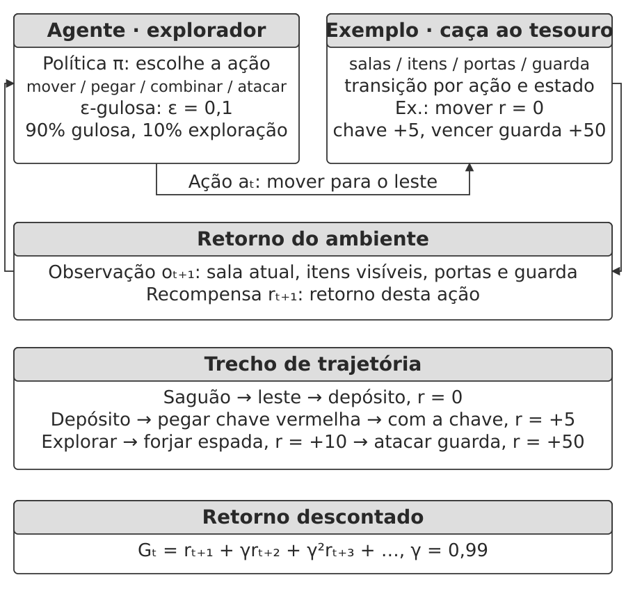

A interação contínua forma uma **trajetória**, que inclui as observações, as ações, as recompensas e as informações de término de cada passo; quando o sistema de treinamento tem acesso ao estado do ambiente, ele também pode ser registrado. A política decide como agir, e a **função de valor (Value Function)** estima quanto retorno futuro se espera obter a partir do estado atual, seguindo determinada política.

A fronteira entre agente e ambiente é definida pelo escopo do sistema escolhido na modelagem. O modelo e o Harness discutidos neste livro ficam dentro do agente, e as interfaces de ferramentas o conectam a aplicações, dispositivos e serviços externos. Por exemplo, a solicitação de modificar um arquivo parte do agente, o sistema de arquivos executa a escrita e a ferramenta devolve o resultado ao agente.

Durante o aprendizado, é preciso distribuir as oportunidades entre **exploração e aproveitamento (Exploration–Exploitation)**. A exploração expõe a política a ações ainda pouco conhecidas; o aproveitamento escolhe a ação que hoje parece melhor. Em tarefas de recompensa atrasada, é preciso também determinar quais passos iniciais contribuíram para o resultado final: é o problema de atribuição de crédito, discutido mais adiante.

Para entender um método de RL, comece verificando cinco elementos:

- **Espaço de ações**: o que é permitido produzir. Jogos de tabuleiro usam lances discretos; o controle de robôs pode usar alvos contínuos para as articulações; as ações podem ainda ser restringidas pelo estado, por limites físicos e por permissões.
- **Política**: a regra que escolhe ações com base no estado, na observação ou no histórico. Pode ser uma tabela ou uma rede neural.
- **Sinal de recompensa**: os tipos de feedback pelos quais o objetivo do treinamento se expressa. A recompensa de cada passo compõe o retorno de longo prazo, e a política pode aceitar um custo imediato em troca de ganhos futuros.
- **Função de valor**: estima o retorno subsequente e pode servir para comparar ações ou construir o sinal de atualização da política. Cada algoritmo decide se a aprende explicitamente.
- **Modelo do ambiente**: prevê o estado, a observação ou a recompensa após uma ação. Métodos baseados em modelo planejam com um modelo do ambiente conhecido ou aprendido; métodos sem modelo aprendem a política ou o valor diretamente dos dados de interação.

A Tabela 8-3 seleciona desses conceitos o ambiente, a ação e o objetivo para comparar alguns sistemas conhecidos. Nas duas primeiras linhas, entenda “manter o equilíbrio” e “área limpa” como objetivos que poderíamos escolher ao modelar a tarefa.

Tabela 8-3 Comparação dos elementos-chave de diferentes sistemas de agente

| Tipo de agente | Ambiente externo | Representação da ação | Exemplos de recompensa ou objetivo |
| --- | --- | --- | --- |
| Filhote de gazela recém-nascido | Terreno, gravidade e dinâmica do corpo | Controle muscular contínuo | Manter o equilíbrio, evitar quedas |
| Robô aspirador | Cômodos, piso e base de carregamento | Deslocar-se, aspirar, voltar à base e parâmetros de controle | Área limpa, bateria e custo de colisões |
| Agente de xadrez | Tabuleiro, adversário e regras de tempo | Lances legais no estado atual | Vitória +1, derrota −1, empate 0 |
| Agente de atendimento ao cliente | Usuários, bancos de dados de negócio e interfaces de serviço | Texto de resposta, consultas e chamadas de negócio | Problema resolvido, conformidade com o processo, tempo de atendimento |
| Agente assistente de código | Origem dos requisitos, base de código e ambiente de execução | Buscar, editar, executar e responder | Resultado dos testes, conclusão da tarefa, regressões e custo |

Esses sistemas representam as ações de maneiras diferentes. Jogos de tabuleiro costumam escolher uma ação discreta por passo; robôs produzem grandezas de controle contínuas de dimensão especificada; já o LLM gera primeiro uma sequência de tokens, que a interface converte em resposta ou chamada de ferramenta. O cálculo interno também pode ser incorporado à modelagem da política e registrado separadamente da execução de ferramentas, que de fato altera o estado externo.

### Duas representações de ações: configurações clássicas de RL e políticas de LLM de comprimento variável

O **processo de decisão de Markov (Markov Decision Process, MDP)** descreve um problema de decisão por meio de estados, ações, transições e recompensas. A propriedade de Markov exige que, dados o estado e a ação atuais, a previsão do próximo estado e da recompensa não dependa de mais nada do histórico: a informação do histórico relevante para a previsão já está contida no estado atual. Na Figura 8-2, registrar apenas a sala em que o jogador está traz problemas: mesmo chegando duas vezes à mesma porta, conseguir abri-la depende de o jogador já ter pegado a chave.

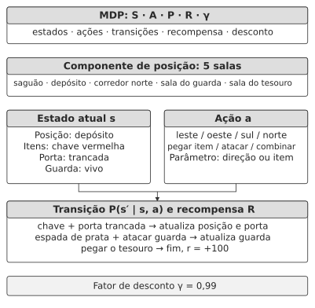

O xadrez oferece um exemplo de projeto de estado. Além da posição das peças, é preciso registrar de quem é a vez, os direitos de roque, o direito de captura *en passant* e as informações necessárias para aplicar a regra dos cinquenta lances e a de repetição de posição. Só com tudo isso no estado é possível julgar as regras a partir do estado atual. Se o agente vê apenas parte dessas informações, precisa completá-las com o histórico ou adotar uma modelagem parcialmente observável.

Um MDP comporta ações discretas, contínuas e combinatórias. O Go tem 361 interseções no tabuleiro, além do passe e das regras de legalidade; os jogos de Atari costumam oferecer poucas operações discretas; as grandezas de controle de um robô são definidas pelas articulações, pela garra e pelas restrições físicas. Quando há poucos estados e ações, os valores podem ser armazenados diretamente em uma tabela. Em escalas maiores, aproximação de funções, otimização de políticas e busca oferecem, cada uma, uma forma de lidar com o problema.

**Q-learning tabular: atualizar o valor de uma ação com o feedback de um passo.** $Q(s,a)$ estima o retorno após tomar a ação $a$ no estado $s$. O valor ótimo de ação satisfaz a equação de otimalidade de Bellman:

$$
Q^*(s,a)=\mathbb E\left[r+\gamma\max_{a'}Q^*(s',a')\mid s,a\right]
$$

Aqui, $r$ é a recompensa do passo, $s'$ é o próximo estado e $\gamma$ é o fator de desconto. Em tarefas contínuas, costuma-se usar $0\leq\gamma<1$; tarefas com término bem definido e retorno finito também podem usar 1. Um fator de desconto maior preserva mais peso para recompensas distantes. O retorno calculado a partir do instante atual é $G_t=\sum_{k\geq0}\gamma^k r_{t+k+1}$.

Depois que uma interação fornece $r$ e $s'$, o Q-learning atualiza segundo:

$$
Q(s,a)\leftarrow Q(s,a)+\alpha\left[r+\gamma\max_{a'}Q(s',a')-Q(s,a)\right]
$$

$\alpha$ é a taxa de aprendizado, e o termo entre colchetes é a diferença entre “a recompensa de um passo mais o valor subsequente descontado” e a estimativa atual. Quando a tarefa chega a um estado terminal, o valor subsequente é 0. Experimente uma vez no jogo que acompanha o livro: desative a perturbação aleatória, saia da entrada rumo ao leste e pegue a chave vermelha no depósito. Pegar a chave rende 5 pontos e cada passo custa 0,5 ponto, então o $r$ devolvido por essa ação é 4,5. Suponha que a estimativa antiga de “pegar a chave no depósito” na tabela seja 0,25 e que o maior valor Q entre as ações possíveis depois de pegar a chave seja 0,63. Com $\gamma=0.99$ e $\alpha=0.2$, o alvo de um passo é $4.5+0.99\times0.63=5.1237$. A estimativa antiga se aproxima um quinto desse alvo e passa a 1,22474. Esse método de corrigir estimativas com o feedback real de um passo chama-se **aprendizado por diferença temporal (Temporal-Difference Learning, TD)**.

Reunindo os valores Q de todas as ações de um estado, é possível escolher a ação que hoje parece melhor. A Figura 8-3 desenha essa política em uma grade simplificada. O número em cada célula é o valor normalizado do estado. Cubra os números com a mão e olhe só as setas: você ainda consegue ir do canto superior esquerdo até o tesouro?

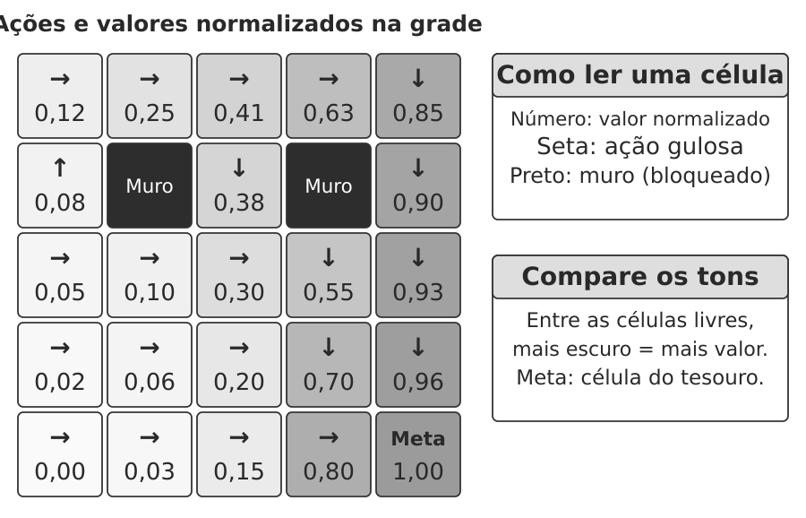

A próxima exploração pode mudar a direção das setas. A Figura 8-4 decompõe o cálculo de há pouco, ao pegar a chave vermelha: a recompensa obtida nesse passo altera a estimativa de “pegar a chave no depósito”, enquanto os valores Q dos demais estados da tabela aguardam suas próprias atualizações.

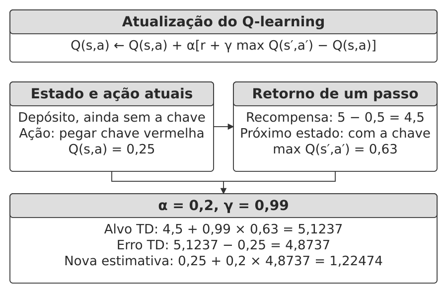

A política de comportamento do Q-learning pode incluir exploração aleatória, mas o alvo da atualização usa o maior valor de ação do próximo estado; por isso, trata-se de aprendizado **off-policy**.

> **Experimento 8-1 ★: Desempenho do Q-learning em um jogo de caça ao tesouro**
>
> O jogo de caça ao tesouro contém regras ocultas, como chaves e portas, efeitos de armas e combinação de itens. Para vencer, é preciso cumprir várias etapas em ordem, e o caminho ótimo tem 11 passos; as ações-chave e a vitória dão recompensa, e os demais passos recebem pouco feedback.
>
> Neste treinamento, a taxa de aprendizado é 0,2, o fator de desconto é 0,99 e a taxa de exploração ε cai gradualmente de 1,0 para 0,1. O Q-learning tabular usa exploração ε-gulosa: a cada passo, com probabilidade ε, escolhe ao acaso uma ação disponível; nas demais vezes, escolhe uma das ações de maior valor Q atual. Registre, em cada fase, a taxa de vitória, o número de estados visitados e o número de passos até vencer.
>
> Ao ler os registros de treinamento e avaliação do experimento, separe primeiro duas perguntas: durante o treinamento, quando a política com exploração aleatória encontrou o tesouro pela primeira vez? E, terminado o treinamento, com a tabela Q fixa e agindo pela política gulosa, ela vence de forma estável? A primeira reflete como o modelo descobre o caminho; a segunda testa se ele consegue escolher ações segundo os valores aprendidos.
>
> Em um treinamento anterior, nas primeiras 1000 partidas o jogo ainda não tinha sido vencido, e a tabela Q continha 124 estados; até a partida 5000 ainda não havia vitórias estáveis, com 133 estados; entre as partidas 7000 e 8000, a taxa de vitória subiu de 34% para 96%; na partida 10000 chegou a 100%, com 145 estados na tabela Q e um caminho de 11 passos encontrado.
>
> Por que quase não houve progresso no início e, depois, a taxa de vitória subiu tão depressa? A exploração descobre primeiro as ações e os caminhos-chave; as visitas seguintes propagam gradualmente o retorno final aos estados anteriores. Toda a pequena simulação leva cerca de 10 segundos, o que permite arcar com um grande número de interações repetidas.
>
> Na análise, registre ao mesmo tempo o tempo de computação e o número de interações. No jogo, uma ação é muito barata; num navegador, num telefone ou num dispositivo físico, cada interação envolve espera, custo e mudança de estado. A tabela também fica presa a uma codificação de estado específica: se as regras ou o mapa mudarem, é preciso verificar de novo se os valores existentes ainda se aplicam. O próximo experimento compara como o conhecimento do pré-treinamento pode mudar o ponto de partida da exploração.

**LLM pré-treinado: representar cálculo e ação em linguagem.**

Um LLM pode gerar um trecho de cálculo intermediário antes de chamar uma ferramenta ou emitir a chamada diretamente. Ambos são representados por sequências de tokens, mas têm funções diferentes: o cálculo intermediário altera o contexto disponível para o próprio modelo; a chamada de ferramenta, depois de executada, altera ou lê o ambiente externo. No treinamento, essas saídas podem ser registradas segundo o protocolo e avaliadas em conjunto com o resultado da tarefa e o custo computacional. “Quanto pensar, sobre o que pensar e quando chamar uma ferramenta” tornam-se, assim, escolhas que a mesma política pode aprender; o AdaptThink, mais adiante, gira em torno do orçamento de raciocínio.

Sequências de comprimento variável trazem um espaço combinatório maior. O modelo pode escrever consultas, programas, parâmetros JSON e derivações de várias etapas, e o comprimento da sequência fica limitado pelo orçamento e pelo contexto. O pré-treinamento oferece um ponto de partida para a busca: materiais de matemática costumam conter análise de condições e cálculos; código e discussões técnicas costumam conter localização, modificação e verificação. O modelo pode aproveitar essas estruturas para gerar caminhos candidatos e ajustá-los com o feedback do ambiente. O conhecimento prévio torna combinações úteis de ações mais fáceis de amostrar desde o início, reduzindo a necessidade de tentativa e erro às cegas em uma infinidade de caminhos irrelevantes.

Por exemplo, “converter um valor em moeda estrangeira para dólares” exige obter a taxa de câmbio e fazer a conta. O pré-treinamento facilita ao modelo gerar esses passos relacionados; o pós-treinamento pode ajustar ainda mais a probabilidade dos caminhos com base na fonte da taxa de câmbio, no resultado do cálculo e nas restrições da tarefa. O conhecimento linguístico fornece aqui a política inicial, e a recompensa fornece o feedback da tarefa.

A Figura 8-5 compara as duas configurações desta seção: o Q-learning tabular parte de uma codificação de estado e de regras de exploração especificadas; o agente LLM parte de uma política linguística pré-treinada e organiza no contexto as observações das ferramentas e a experiência acumulada.

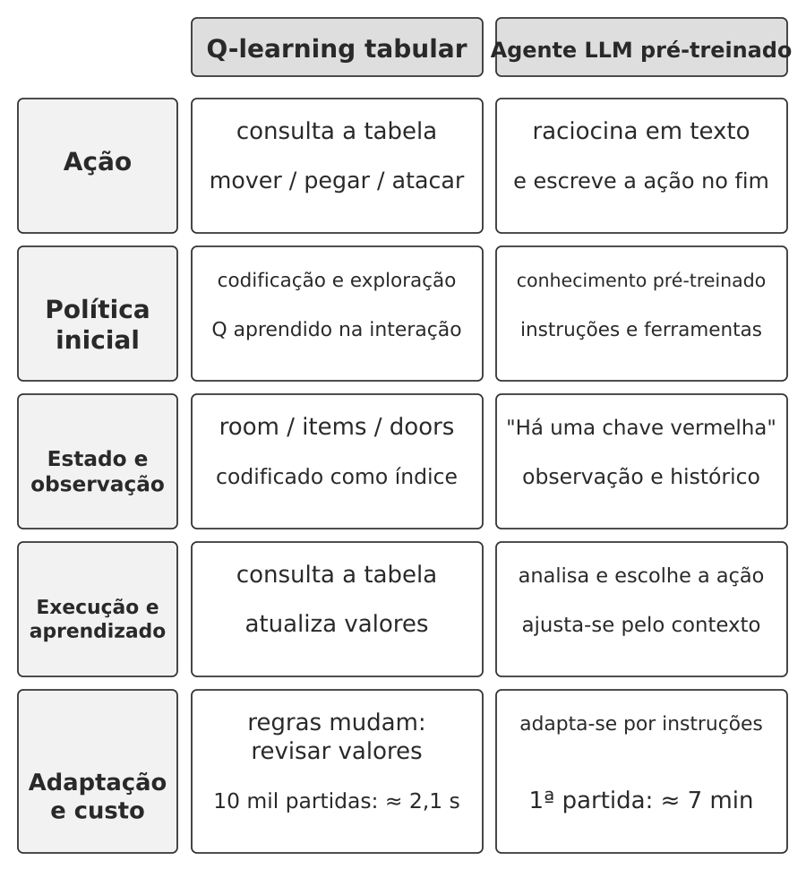

O pré-treinamento também permite ao modelo interpretar instruções novas e ajustar o comportamento na tarefa a partir de poucas demonstrações. As ferramentas conectam a saída linguística a buscas, execução de código e operações de negócio. Ao projetar esse tipo de agente, é preciso definir as interfaces das ferramentas e as permissões de execução e também estabelecer feedback para o resultado da tarefa, o custo de execução e os processos críticos.

Se o modelo deve controlar um braço robótico, como aplicar “prever o próximo token” às ações? O OpenVLA usou cerca de 970 mil demonstrações reais com robôs. Tome um passo de uma demonstração: a entrada é a imagem da câmera naquele momento e a instrução da tarefa; o alvo do treinamento é a ação que o demonstrador executou em seguida. Quanto o braço se desloca na horizontal, por exemplo, é originalmente um valor contínuo. O OpenVLA divide cada dimensão de ação em 256 faixas e usa um token para indicar em qual faixa o valor cai. Assim, o modelo pode prever os tokens de ação um a um e calcular a perda apenas nessas posições.[^ch8-21]

Esse exemplo também mostra como distinguir clonagem de comportamento de aprendizado por reforço: observe qual sinal faz o modelo se atualizar. O OpenVLA aprende com registros de demonstração; quanto maior a probabilidade que o modelo dá aos tokens da ação demonstrada, menor a perda — isso é ajuste fino supervisionado. Já no SimpleVLA-RL do Experimento 8-13, a política de fato experimenta ações no ambiente e ajusta suas escolhas futuras segundo a recompensa da tarefa.

> **Do algoritmo ao ambiente e aos priors**
>
> Em “The Second Half”, Shunyu Yao revisa a evolução do RL a partir de três elementos: algoritmo, ambiente e priors.[^ch8-2] Com base nisso, resumo a mudança de foco em três fases: em 2015–2016, a ênfase estava em aprimorar algoritmos; em 2016–2018, deu-se mais importância à construção de ambientes; a partir de 2018, reconheceu-se aos poucos o valor dos priors do pré-treinamento. O Gym ofereceu uma interface unificada de ambientes; Universe e World of Bits exploraram tarefas em computadores e páginas web; projetos como o de Dota 2 demonstraram a capacidade de treinar em ambientes complexos. Em seguida, GPT-2 e GPT-3 mostraram o conhecimento e a capacidade de expressão acumulados pelo pré-treinamento de linguagem, e sistemas como WebGPT e ChatGPT aproveitaram ainda mais esse ponto de partida. Os priors de que a tarefa precisa podem ser obtidos primeiro pela modelagem de linguagem e depois entregues ao RL para otimizar comportamentos específicos.
>
> Concordo com a prioridade de engenharia que daí resulta: **priors, ambiente, algoritmo**. Verifique primeiro quais conhecimentos e capacidades o modelo tem, depois construa o ambiente e o feedback adequados e, por fim, escolha o método de otimização correspondente. A Figura 8-6 ordena os focos de pesquisa pela ordem em que surgiram; num projeto, pode-se fazer o caminho inverso, partindo das capacidades existentes.
>
> 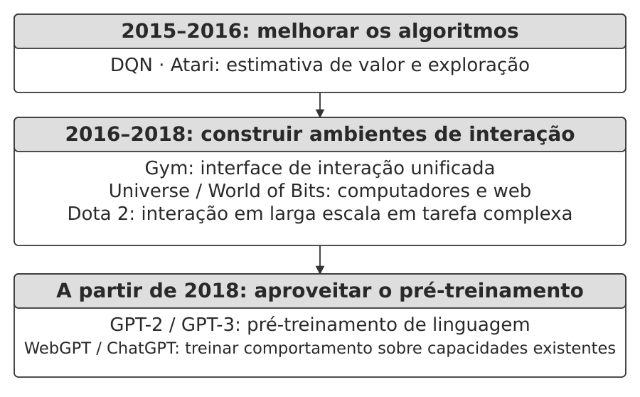

> **Experimento 8-2 ★★: Estudo comparativo entre RL tradicional e agente LLM**
>
> No mesmo jogo de caça ao tesouro, compare o Q-learning tabular com um agente LLM. A configuração do LLM usa o Kimi K3 e mantém no contexto até 50 experiências. A cada passo, ambos escolhem uma das ações disponíveis informadas pelo ambiente. Seguindo os dois caminhos da Figura 8-7, vê-se como a tabela Q e o modelo de linguagem fazem essa escolha.
>
> 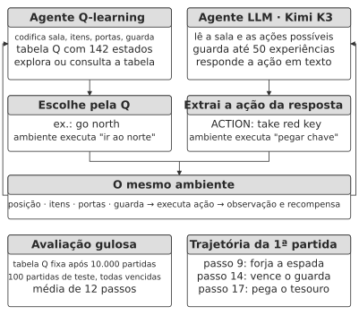
>
> No registro de execução do Kimi K3 que acompanha o livro, o agente usou 17 passos na primeira partida. Primeiro pegou a espada enferrujada, descobriu que a porta norte estava trancada, foi ao depósito buscar a chave vermelha e o cristal mágico e, no passo 9, combinou a espada e o cristal em uma espada de prata. No passo 12, ao tentar usar a chave, o ambiente avisou que “ela será usada automaticamente quando necessário”; no passo 13, seguiu para o norte, e só então a porta se abriu de fato. No passo 14, derrotou o guarda com a espada de prata e tentou mais uma vez usar a espada; o ambiente avisou que isso não era possível naquele momento. No passo 17, obteve o tesouro. Ao ler esse registro, cubra a linha seguinte e tente adivinhar, a partir do feedback atual, quais passos ainda eram necessários.
>
> Alinhando cada ação com a observação daquele momento, é possível analisar como o modelo usa conhecimentos prévios como “chave abre porta” e “arma enfrenta guarda” e como o feedback das ferramentas altera o plano seguinte. A solução tabular acumula essas relações por meio das visitas a pares estado–ação.
>
> Nesta comparação, o Q-learning treinou 10000 partidas em 2,12 segundos e, avaliado depois separadamente com a política gulosa em 100 partidas, venceu todas, com média de 12 passos. O Kimi chamou o modelo 17 vezes em uma partida e levou 6 minutos e 56 segundos. Disso extraio um princípio de escolha: quando a simulação é barata e pode ser repetida em grande quantidade, aproveite ao máximo a exploração do RL tradicional; quando cada interação custa espera, dinheiro ou operações reais, dê preferência a políticas capazes de usar conhecimento existente, aumentando o valor de cada interação.

Esses dois experimentos ligam este capítulo aos métodos de engenharia anteriores: o contexto pode organizar a experiência dentro de uma execução, a memória externa pode guardá-la entre tarefas, e o pós-treinamento muda a política por meio da atualização de parâmetros. A seguir, vemos primeiro o processo básico de pré-treinamento de linguagem e de visão e depois discutimos os dados de treinamento e os métodos de otimização concretos.

## Fundamentos do pré-treinamento de modelos `[Leitura opcional]`

O pré-treinamento estabelece as representações iniciais e a distribuição de geração do modelo, e o treinamento posterior continua a ajustar os parâmetros a partir desse ponto. Para entender esse ponto de partida, observe primeiro como um pequeno modelo de linguagem aprende com texto e depois como ele passa a receber entrada visual.

O texto passa primeiro pela **tokenização (Tokenization)**, que o converte em tokens discretos. Por exemplo, “Eu gosto de programar” pode ser representado esquematicamente como as unidades “Eu”, “gosto de” e “programar”; a divisão real é definida pelo tokenizador. O treinamento usa os tokens anteriores como contexto para prever os seguintes, calcula a perda e atualiza os parâmetros. Na Figura 8-8, cubra a frase de treinamento a partir de “tarefas”, deixando visível só “O agente precisa executar”, adivinhe qual é a próxima palavra e depois revele o texto original. Deslocando essa posição para a frente, obtém-se o próximo exercício de previsão.

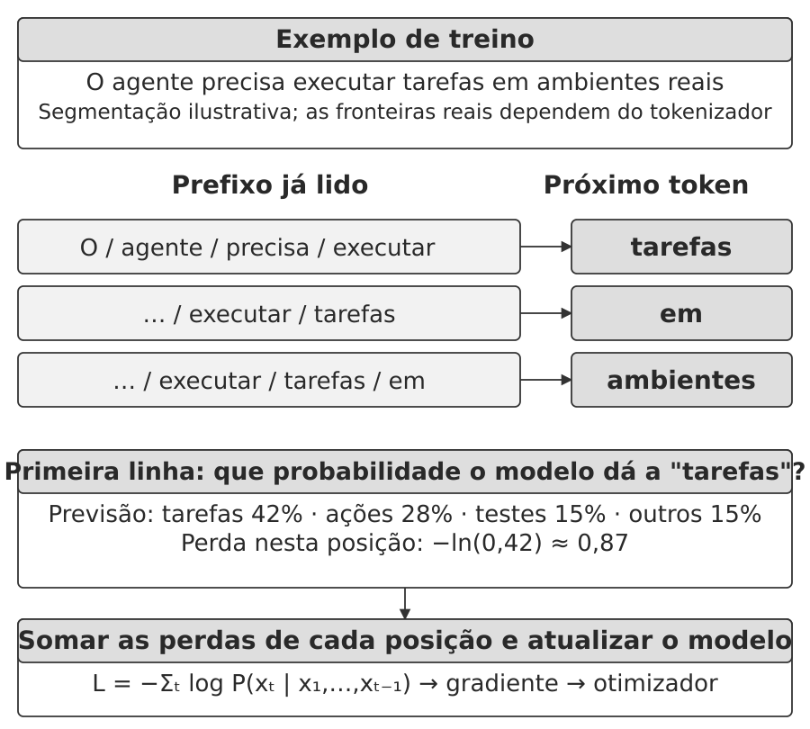

Depois da modelagem de linguagem básica, é possível acrescentar demonstrações de instruções para treinar o formato de resposta e o comportamento na tarefa; também é possível usar dados de preferência e métodos como DPO para aumentar a probabilidade das respostas mais bem avaliadas.

> **Experimento 8-3 ★★: Treinando um LLM do zero — o poder das melhorias algorítmicas**
>
> Tomando como exemplo o MiniMind 2, com cerca de cem milhões de parâmetros, realize pré-treinamento, SFT e otimização por preferências em uma GPU de consumo. Compare a linha de base com a configuração que acrescenta QK Norm e o otimizador Muon, observando a queda da perda, o tempo necessário para atingir a qualidade-alvo e os textos gerados. O resumo que acompanha o livro registra uma convergência cerca de 3 vezes mais rápida; o treinamento completo leva cerca de 14 horas e custa cerca de 34 dólares.
>
> O QK Norm ajusta a escala numérica das consultas e chaves na atenção, e o Muon muda a forma como os parâmetros correspondentes são atualizados pelo otimizador.
>
> Observe o mesmo conjunto de perguntas em cada etapa: o modelo pré-treinado já consegue responder a perguntas como “qual é a montanha mais alta do mundo”; depois do SFT, melhoram o seguimento de instruções e a organização da saída; a otimização por preferências continua a influenciar as respostas factuais e a expressão.

> **Experimento 8-4 ★★: Treinando seu próprio VLM**
>
> A Figura 8-9 mostra a ligação “codificador visual–camada de projeção–modelo de linguagem”. Um codificador visual como o CLIP extrai as características da imagem; a camada de projeção converte essas características para a dimensão e a representação que o modelo de linguagem espera na entrada; e o modelo de linguagem combina essas entradas para gerar descrições ou respostas.
>
> 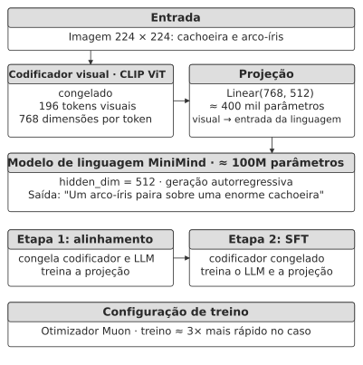
>
> Na primeira fase, congelam-se o codificador visual e o LLM e treina-se a camada de projeção recém-adicionada, para que as características da imagem possam participar da previsão linguística; na segunda fase, descongela-se o LLM conforme a configuração e faz-se SFT com dados de alta qualidade de imagem–descrição ou de perguntas e respostas. Observe separadamente as mudanças no reconhecimento de objetos, na descrição de detalhes, no julgamento de relações e na capacidade linguística.
>
> Essa arquitetura reaproveita modelos visuais e linguísticos existentes e concentra o treinamento primeiro no módulo de conexão entre modalidades; é a solução a experimentar primeiro quando o orçamento é limitado. Congelar pesos reduz o estado treinável, e os módulos correspondentes podem ser descongelados depois, conforme a tarefa. Quando a descrição está errada, verifique primeiro se a informação sobre o objeto chegou à representação visual; se ela já está lá e o modelo ainda não consegue usá-la, examine sobretudo a capacidade de expressão da camada de projeção, os dados de alinhamento e a supervisão da geração linguística. Trocando a saída por uma representação de ações e alinhando-a à interface de controle, chega-se à arquitetura VLA do Capítulo 6.

Os dois experimentos mostram, respectivamente, como a configuração de otimização e a conexão entre modalidades afetam o treinamento. Com orçamento limitado, recomendo comparar primeiro os ganhos que melhorias de algoritmo e de arquitetura podem trazer e só então decidir se vale ampliar o modelo. Quando um modelo existente precisa entrar em um novo idioma ou domínio, também é possível continuar o aprendizado a partir dos pesos pré-treinados; a próxima seção discute como escolher os dados para esse treinamento.

## Mid-training: preenchendo lacunas de conhecimento e capacidades fundamentais

Neste capítulo, **Mid-training** designa uma fase de treinamento de modelo de linguagem realizada sobre um modelo existente e voltada à distribuição-alvo. Grande parte dos tokens de documentos, códigos ou derivações recebe supervisão, e o treinamento pode misturar corpora do domínio-alvo com corpora gerais. Os estudos sobre DAPT/TAPT mostram que continuar o pré-treinamento com corpora relacionados ao domínio ou à tarefa ajuda nas tarefas posteriores.[^ch8-30]

A seleção de dados parte de dois tipos de lacuna. Um é a cobertura de conhecimento e de linguagem — por exemplo, o modelo teve pouco contato com protocolos da empresa, com a terminologia do idioma-alvo ou com uma base de código específica. O outro são as capacidades básicas que a tarefa exige, como acompanhar o estado em um contexto longo, integrar relações entre documentos ou concluir derivações de código extensas. Classifique primeiro os erros em problemas de compreensão, conhecimento, formato e ação e só então decida que material acrescentar.

Depois que a perda no texto do domínio cai, é preciso verificar também se o modelo consegue usar o que aprendeu em tarefas reais. A ordem entre treinamento contínuo e treinamento por instruções, a organização das perguntas e respostas e a forma do material influenciam o uso do conhecimento.[^ch8-31] Para tarefas de domínio em que a capacidade básica é claramente insuficiente, recomendo ampliar primeiro a cobertura com corpora do domínio e depois ensinar, com demonstrações de SFT, como usar essas informações na tarefa; quando o modelo às vezes acerta, mas com taxa de sucesso baixa, aí sim vale investir em RL.

### Como construir dados de Mid-training

**Primeiro passo: localizar o material necessário a partir da distribuição de falhas.** Avalie separadamente por tema, idioma, tipo de documento, padrão de código e comprimento de contexto e, combinando Pass@1, Pass@k e exemplos de erro, determine em que condições o modelo não dispõe de uma solução utilizável. Problemas de formato de parâmetros podem ser resolvidos com demonstrações da interface; lacunas de conceitos e relações do domínio exigem os corpora correspondentes.

**Segundo passo: organizar corpora de alta densidade.** Documentos originais fornecem terminologia e relações factuais; repositórios de código fornecem a estrutura dos módulos e as dependências; derivações em estilo de livro didático e paráfrases sintéticas explicitam passos implícitos; amostras entre documentos ligam informações dispersas. Depois da filtragem de qualidade, da remoção de duplicatas e do isolamento em relação aos conjuntos de avaliação, construa as sequências de treinamento.

**Terceiro passo: misturar os dados conforme as capacidades-alvo.** Textos longos naturais podem vir de livros, documentação e repositórios de código; para recuperação, raciocínio de múltiplos saltos, seguimento de instruções, agregação e estatística, podem-se acrescentar dados de tarefas com derivação; para agentes, podem-se acrescentar trajetórias de planejamento, escolha de ferramentas, construção de parâmetros, acompanhamento de estado e recuperação de erros. Esses materiais podem vir de conjuntos de dados existentes ou ser gerados por modelos professores e são filtrados segundo requisitos de conteúdo e de comportamento antes de entrar no treinamento.

**Quarto passo: fazer o modelo continuar praticando as tarefas que já sabia fazer.** Um grupo de amostras mantém textos curtos, corpora gerais e os problemas originais; outro coloca as mesmas tarefas em contextos mais longos, muda a posição das informações-chave e acrescenta distratores. Para combinar os dois grupos, pode-se tomar como referência a distribuição dos dados de treinamento originais ou testar algumas proporções com corpora públicos como o FineWeb-2, ajustando conforme os resultados da avaliação.

**Quinto passo: usar várias métricas para decidir entre continuar e parar.** Registre ao mesmo tempo a perda de treinamento, as tarefas de domínio reservadas, as capacidades gerais, o seguimento de instruções original e a taxa de sucesso na tarefa-alvo. Se o desempenho no domínio sobe enquanto as capacidades gerais caem, compare proporções de mistura, taxas de aprendizado e volumes de treinamento; se a perda cai enquanto a tarefa-alvo estagna, verifique se o material de treinamento consegue ensinar o modelo a cumprir esse tipo de tarefa e se é preciso acrescentar demonstrações de uso do conhecimento em tarefas reais.

Suponha que o modelo consiga encontrar um número de pedido específico em um registro de pedidos muito longo. Se a pergunta mudar para “qual cliente fez vários pedidos e cancelou todos”, ele terá de reunir todos os pedidos do mesmo cliente e casar, um a um, pedidos e cancelamentos. As duas perguntas podem usar o mesmo registro, mas avaliam capacidades diferentes. O RULER usa tarefas sintéticas para controlar separadamente o comprimento da entrada e a dificuldade da tarefa, medindo à parte a recuperação de um único item, o rastreamento de múltiplos saltos e a agregação. Os autores avaliaram 17 modelos: muitos chegaram perto da nota máxima na recuperação simples, mas o desempenho geral caiu nitidamente à medida que a entrada ficava mais longa.[^ch8-ruler]

Para ver se essa diferença aparece em materiais reais, podem-se usar ainda as questões de múltiplos documentos, diálogos longos ou repositórios de código do LongBench v2. Para verificar isoladamente se o modelo consegue lembrar requisitos como o formato de saída, tome instruções verificáveis do IFEval e coloque-as em diferentes posições de um material mais longo. Ao comparar dois modelos, mantenha iguais a posição das instruções e o conteúdo de distração que cada um vê e indique que se trata de um teste construído por você. Por fim, use tarefas de agente de ponta a ponta para verificar se essas capacidades funcionam em conjunto. Ao projetar o conjunto de avaliação, verifique uma a uma as dimensões abaixo.[^ch8-longbench]

[^ch8-ruler]: Hsieh et al., RULER, 2024.
[^ch8-longbench]: Bai et al., LongBench v2, ACL 2025. O artigo apresenta seis categorias de tarefas, com 503 questões de múltipla escolha no total.

- **Posição e recuperação**: se uma ou várias informações-chave são encontradas quando estão no início, no meio ou no fim.
- **Relações e raciocínio**: rastreamento de relações entre parágrafos e entre documentos, resolução de contradições e combinação de evidências.
- **Agregação e estatística**: contagem, agrupamento, ordenação, comparação e identificação de tendências em tabelas e registros longos.
- **Seguimento de instruções**: múltiplos requisitos, tratamento de conflitos, condições de fluxo e formato de saída.
- **Raciocínio em cadeia longa**: cadeias de dependência longas em tarefas de matemática, lógica e código.
- **Comportamento básico de agente**: decomposição de tarefas, escolha de ferramentas, geração de parâmetros, manutenção de estado e recuperação de falhas.

Raciocínios longos e chamadas de ferramentas em múltiplos turnos alongam continuamente o contexto, e as instruções, os fatos e o estado da tarefa anteriores ainda precisam participar das decisões seguintes. Se o modelo não encontra informações em textos longos ou não consegue manter as restrições, um agente de longo horizonte dificilmente funcionará de forma confiável. Antes de ampliar o orçamento de treinamento, compare proporções de dados e volumes de treinamento em configurações de pequena escala. Para fatos atualizados com frequência e que exigem fonte, dou preferência a RAG; para conhecimento de domínio estável e em grande escala e para capacidades básicas, considero gravá-los nos parâmetros por treinamento contínuo.

> **Experimento 8-5 ★★: Pré-treinamento contínuo para aprender um novo idioma**
>
> Partindo do Mistral 7B v0.3, use materiais como a Wikipédia em coreano para melhorar a capacidade em coreano. O treinamento usa primeiro uma mistura de cerca de 80% de coreano e 20% de inglês e, em seguida, faz SFT com dados de instruções em coreano, observando separadamente as mudanças na modelagem de linguagem e no comportamento em diálogo.
>
> Os dados em coreano ampliam a cobertura do idioma-alvo, e os dados em inglês servem para preservar as capacidades existentes. Em todas as etapas, use o mesmo lote de questões em coreano e em inglês que não participaram do treinamento. Nos resultados que acompanham o livro, a nota em avaliação cega na etapa final em coreano melhorou e a capacidade em inglês caiu um pouco, o que dá uma direção concreta para a próxima rodada: misturar mais material de treinamento em inglês ou reduzir a intensidade das atualizações.
>
> Registrar separadamente o idioma-alvo, o idioma original e a qualidade factual permite avaliar ganhos e custos; na etapa de SFT, verifique ainda se o modelo consegue organizar respostas seguindo instruções em coreano. Assim, os efeitos do pré-treinamento contínuo e do ajuste fino por instruções podem ser observados separadamente.

## SFT (ajuste fino supervisionado)

Corpora de domínio podem fazer o modelo ver uma interface mais algumas vezes, mas, para ensiná-lo a corrigir parâmetros depois de uma chamada falhar, também é possível simplesmente demonstrar isso uma vez. O SFT fornece a entrada da tarefa e treina o modelo, token a token, a gerar a resposta ou ação demonstrada. Ao ler a Figura 8-10, defina primeiro que comportamento você pretende ensinar e só então decida como coletar as demonstrações. Os fatos, o tom e o formato de saída das demonstrações também entram no treinamento.

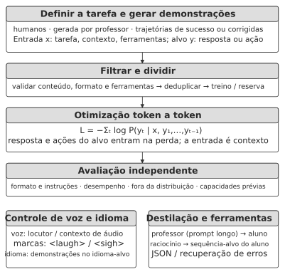

Os dados costumam vir de três fontes: especialistas humanos definem os comportamentos-chave e os limites; modelos professores escrevem demonstrações em lote; verificadores filtram saídas válidas entre as amostras do modelo. As três podem ser combinadas. Por exemplo, especialistas escrevem primeiro algumas demonstrações de chamada de ferramentas; o professor varia as condições da tarefa para gerar mais amostras; e, por fim, verificam-se os parâmetros, os resultados de execução e as restrições de negócio.

**Um uso do SFT é ensinar ao modelo práticas que vivem sendo reescritas em prompts e Skills.** Tome como exemplo a avaliação de memória do Capítulo 7: suponha que o manual de avaliação, com seus casos de referência, tenha dez mil tokens. O professor, com o manual completo, avalia um lote de respostas e demonstra como lidar com homônimos, relações invertidas ou evidências insuficientes. No treinamento do aluno, a entrada mantém apenas os nomes curtos dos critérios, o material histórico daquela vez e a resposta a avaliar; a saída-alvo é o nível escolhido pelo professor. Em produção, basta fornecer um prompt curto e o material da vez, e cada inferência economiza aqueles dez mil tokens de instruções fixas. Para Skills chamadas repetidamente, o mesmo método pode demonstrar quando consultar materiais e como escolher ferramentas, destilando esses passos estáveis no modelo.

A preparação dos dados começa por definir a distribuição de tarefas, o schema de saída e a forma de aceitação. Depois que as demonstrações passam na verificação, removem-se duplicatas, ajusta-se a proporção de cada tipo de amostra e divide-se o conjunto de dados. Quantidade e cobertura das amostras devem ser projetadas juntas: repetir milhares de vezes a mesma forma de pergunta reforça sempre o mesmo padrão; construir variações em torno das condições-chave é o que ajuda o modelo a escolher o comportamento adequado diante de entradas diferentes. Costumo primeiro refinar com cuidado um lote de demonstrações que cubra as situações-chave e só depois ampliar a escala. Como o SFT aprende a saída-alvo token a token, fatos errados, passos redundantes e hábitos operacionais inadequados também vão parar nos parâmetros.

> **Experimento 8-6 ★★★: SFT de voz — da clonagem de voz à modelagem paralinguística `[Experimento estendido]`**
>
> Tomando Orpheus e Sesame CSM como exemplos, compare como as condições de locutor, o contexto do diálogo e as marcas de expressão participam da geração de fala. O Orpheus representa a fala como tokens, pode usar pares de referência texto–fala para gerar o timbre correspondente e oferece marcas de expressão como `<laugh>` e `<sigh>`. O Sesame CSM recebe texto, identificador de locutor e trechos de áudio existentes e gera a fala seguinte.[^ch8-speech-conditioning]
>
> Ao construir as amostras de treinamento, registre separadamente texto, locutor, áudio e condições de expressão; use material do mesmo locutor em frases diferentes para aprender consistência e risos, suspiros e pausas em vários contextos para aprender expressividade. Compare as saídas sem referência, com referência e com condição de expressão especificada e avalie precisão, naturalidade, emoção e timbre.
>
> Os dados devem cobrir combinações suficientes de locutores, estruturas de frase e emoções. Com poucos locutores, a saída pode tender a um timbre único; quando uma marca vem sempre associada ao mesmo trecho de som, a expressão pode ficar repetitiva e mecânica.

> **Experimento 8-7 ★★★: Pensamento multilíngue — gerar o raciocínio no idioma especificado `[Experimento estendido]`**
>
> Faça SFT no gpt-oss-20b, usando a instrução para especificar o idioma do raciocínio. Por exemplo, `reasoning language: German` pede um texto de raciocínio em alemão. As amostras de treinamento incluem inglês, espanhol, francês e outros idiomas, e o chinês fica reservado para a fase de teste.
>
> No caso que acompanha o livro, depois do treinamento, ao se especificar Chinese, o modelo consegue gerar o raciocínio em chinês. Podem-se comparar ainda três resultados: se o requisito de idioma é seguido, se a resposta final está correta e como mudam o comprimento gerado e o tempo gasto. A base multilíngue do pré-treinamento e o modo de controle aprendido no SFT participam juntos desse desempenho entre idiomas; comparações com idiomas e modelos de base diferentes permitem continuar analisando o papel de cada um.

> **Experimento 8-8 ★★: Destilação de prompt — reproduzir uma capacidade útil com menos custo**
>
> Um negócio estável pode depender de um prompt de sistema com milhares de tokens, e o professor ainda gera raciocínios longos. A destilação de prompt faz primeiro o professor produzir saídas de alta qualidade com as condições completas e depois monta os dados de SFT do aluno com pares “entrada do usuário–resposta final”. O aluno usa um prompt mais curto e responde diretamente segundo a configuração-alvo.
>
> Abrindo a primeira amostra de treinamento, vê-se que o professor Kimi K3 leu um texto em árabe entremeado de letras latinas, explicou o critério de decisão e, por fim, deu o código de idioma `ar`. A demonstração entregue ao aluno SmolLM2-135M-Instruct contém apenas o texto original e `ar`. No mesmo conjunto de 80 registros de teste, o professor lê em média cerca de 386 tokens por requisição, e o aluno cerca de 97. Esses dois números foram contados, cada um, com seu próprio tokenizador.
>
> Os registros comparativos de identificação de idioma que acompanham o livro permitem separar “acertar” de “produzir no formato certo”. O professor gerou demonstrações em 160 amostras de treinamento e acertou todos os 80 registros de teste. O aluno sem ajuste fino não teve nenhuma saída analisada pelo avaliador no teste e tirou zero; depois do ajuste fino, as 80 saídas puderam ser analisadas, e 76 rótulos estavam corretos. O zero da linha de base, por si só, não distingue “não reconheceu o idioma” de “reconheceu, mas não respondeu no formato”. Esse teste contém 75 textos distintos, e nenhum texto é idêntico entre treinamento e teste.
>
> A construção dos dados também precisa preservar as condições de que o aluno precisa para cumprir a tarefa. Quando o professor depende de resultados recentes de ferramentas, esses resultados podem entrar como entrada do aluno, ou a interface da ferramenta pode ser mantida; quando o professor comete erros sistemáticos, eles devem ser filtrados por verificação independente.
>
> Quando as regras do produto são estáveis, a distribuição de entradas é clara e o custo de chamada é alto, recomendo avaliar primeiro a destilação de prompt, comprimindo nos parâmetros o prompt e o raciocínio processados repetidamente. Quando o produto ainda está em exploração e os requisitos mudam com frequência, mantenha prompts editáveis e raciocínio explícito, o que facilita experimentar rápido e localizar erros.

> **Experimento 8-9 ★★★: Destilação de cadeia de pensamento (Chain of Thought, CoT)**
>
> A destilação de CoT usa o texto de raciocínio fornecido pelo professor, junto com a resposta final, como supervisão, para que o aluno aprenda o processo de decompor, calcular, verificar e corrigir. A destilação feita pelo DeepSeek-R1 nas séries Qwen e Llama é o exemplo representativo desse método. Para equipes que querem um modelo próprio e controlável sem gastar demais com treinamento, recomendo considerar este caminho em primeiro lugar. Quando o professor é claramente mais forte que o aluno na tarefa-alvo, ele pode fornecer demonstrações valiosas; comece escolhendo entre modelos de pesos abertos que entreguem o raciocínio completo e depois compare a diferença de capacidade em relação ao aluno e a qualidade dos dados. Quando a interface fornece apenas um resumo do raciocínio, diminui também a informação disponível para destilar o processo.
>
> Primeiro passo: peça ao professor várias soluções para o mesmo problema. Em matemática, confira a resposta; em código, rode os testes; mantenha apenas as soluções que passam na verificação. Essa filtragem se chama **amostragem por rejeição (Rejection Sampling)**. O ajuste fino supervisionado com as soluções filtradas chama-se **ajuste fino por amostragem por rejeição (Rejection Sampling Fine-Tuning, RFT)**. Se o aluno também deve aprender o processo de raciocínio, é preciso conferir em seguida os passos intermediários e descartar demonstrações com derivação errada que acertaram a resposta por acaso.
>
> Para tarefas com verificadores confiáveis, recomendo estabelecer primeiro uma linha de base de RFT: geração, filtragem e SFT já formam um fluxo de treinamento, dispensando a implementação de otimização de política online e estimativa de valor; a partir dela, avalia-se se o investimento adicional em RL compensa.
>
> Segundo passo: treine o aluno. Organize “problema → texto de raciocínio + resposta final” no formato de diálogo do modelo escolhido; ao usar delimitadores como `<think>` e `</think>`, deixe claro quais tokens entram na perda. Pode-se começar com um aluno da ordem de 7B e comparar as configurações com trajetória completa, trajetória enxuta e supervisão apenas da resposta final.
>
> Terceiro passo: veja o que o aluno aprendeu. No experimento que acompanha o livro, o Kimi K3 resolveu 24 problemas de matemática da AIME, e as 23 trajetórias de raciocínio corretas foram usadas para ajustar o Qwen2.5-1.5B-Instruct. Refazendo o mesmo conjunto, o aluno passou de 1 para 2 acertos; o professor acertou 23. O aluno treinado às vezes também volta para conferir as contas, mas o teste pareado problema a problema não mostrou melhora confiável na taxa de acerto ($p=1.0$).

> **Prática na escrita do livro: o desenvolvimento dos experimentos de destilação**
>
> Inicialmente, implementei os experimentos de destilação com o Codex, movido pelo GPT-5.6-Sol; diante de recusas, mudei para o Claude Code, movido pelo Claude Opus 5, que também não conseguiu prosseguir. Em seguida, usei o Kimi K3 para concluir o código e a execução.

Os quatro casos usam aprendizado supervisionado, mas cada um aprende algo diferente: timbre e condições de expressão na fala, controle de idioma no raciocínio multilíngue, resposta direta na destilação de prompt e processo de resolução na destilação de CoT.

## Síntese de dados para SFT: de demonstrações a trajetórias treináveis

Para criar um lote de exercícios de treinamento a partir de uma reclamação real, que informações podem ser trocadas e que relações precisam ser preservadas? Extraia das trajetórias de produção a intenção do usuário, o estado inicial, as ferramentas disponíveis, as restrições de negócio e as falhas comuns e organize-os em modelos de tarefa. Identidades, pedidos, arquivos e credenciais devem ser substituídos; se o problema original envolvia dois pedidos semelhantes, a instância gerada também deve preservar essa relação que exige distinção. Só executando as instâncias em um ambiente que pode ser reiniciado é possível saber se as novas tarefas de fato preservam a dificuldade original.

Um fluxo completo é: **caso de produção → modelo de tarefa → instância sintética → várias trajetórias candidatas → verificação da tarefa e da trajetória → dados de treinamento**. Os dois tipos de verificação cuidam de problemas diferentes: a verificação da tarefa confere se as condições são suficientes, se o objetivo é alcançável e se o resultado de referência está correto; a verificação da trajetória confere, uma a uma, o estado ao fim da tarefa, a ordem das chamadas de ferramentas e se a execução respeitou as restrições de negócio.

Condições executáveis usam testes, asserções em banco de dados ou verificação de diferenças de estado; a qualidade de comunicação em aberto usa Rubrics e avaliação por modelo, calibradas por amostragem humana. Combinando ainda grafos de habilidades, ambientes executáveis e verificadores independentes, é possível ampliar de forma planejada a cobertura de tarefas.[^ch8-12][^ch8-17][^ch8-18][^ch8-19][^ch8-20]

Uma demonstração aceitável pode ser tanto uma trajetória concluída sem tropeços quanto um processo completo que inclua diagnóstico e reparo. Para as ações erradas que ela contenha, é preciso definir claramente seu papel na amostra e escolher as posições da perda conforme o objetivo do treinamento. Registros de falha também servem para construir pares de preferência, descobrir lacunas de cobertura e gerar tarefas de recuperação. Ao passar depois ao RL, a política atual amostra novas trajetórias e se atualiza com o feedback do ambiente.

O isolamento entre conjunto de treinamento e conjunto de avaliação é escolhido conforme o objetivo: a avaliação na mesma distribuição pode isolar instâncias específicas; a avaliação de transferência isola ainda modelos de tarefa, grupos de clientes ou períodos. Na remoção de duplicatas, verifique quase-duplicatas de entradas e de soluções; respostas de referência, testes ocultos e informações usadas só na pontuação ficam do lado da verificação, conforme o protocolo da tarefa.

Terminado o ajuste fino, ainda é possível auditar o material de treinamento a partir dos pesos? Tome como exemplo o modelo de raciocínio público s1. Convertendo as amostras públicas em IDs de token com a mesma tokenização e o mesmo processamento de texto do treinamento e removendo duplicatas, obtém-se uma lista. Depois, comparando linha a linha a matriz de embeddings de entrada antes e depois do ajuste fino, anotam-se os tokens cujos vetores mudaram. Na minha auditoria, os 16.573 IDs das duas listas coincidiram um a um. Essa verificação exige encontrar o modelo de base e o tokenizador corretos, inserir o prompt de sistema e truncar amostras longas segundo a configuração de treinamento; é preciso também confirmar que o treinamento de fato atualiza os embeddings de entrada e que estes não compartilham pesos com a camada de saída. Por exemplo, quando o LoRA é treinado só nas camadas de atenção, os embeddings de entrada ficam intactos, e não é possível listar a partir deles os tokens usados.[^ch8-token-provenance]

Três tokens bastam para ver o limite dessa evidência. Suponha que duas amostras públicas, depois de tokenizadas, sejam `[10, 20]` e `[20, 30]`; removendo duplicatas, obtém-se `{10, 20, 30}`. Agora acrescente uma terceira, `[30, 10]`, e calcule de novo: o conjunto é exatamente o mesmo. Mesmo que todos os IDs coincidam na auditoria, não dá para concluir se a terceira amostra foi usada nem descartar que alguma questão de avaliação tenha vazado para o conjunto de treinamento.

[^ch8-token-provenance]: O projeto training-forensics, de Bojie Li, registra os conjuntos de tokens e as condições de pré-processamento de modelos como o s1 e discute como o compartilhamento de pesos de embedding e o LoRA afetam o método de comparação.

Tome o caso de “encerramento prematuro” do Capítulo 7: recorte o prefixo no momento em que o agente está prestes a declarar a tarefa concluída, marque a declaração de conclusão não verificada como `rejected` e marque como `chosen` o comportamento de continuar, verificando primeiro os objetivos restantes e rodando os testes relevantes antes de responder. Os pares de preferência podem ser usados em DPO; o comportamento de continuação que passou na verificação também pode servir sozinho como demonstração de SFT.

Os experimentos posteriores com aspas curvas chinesas e com strings especiais mostram melhor como definir o alvo da supervisão. A tarefa das aspas curvas chinesas parte do escopo do documento: exige modificar o corpo do texto-alvo e proteger código, citações e JSON. A tarefa das strings especiais exige que `old_string` permaneça idêntica byte a byte nos parâmetros da ferramenta. A primeira verifica o escopo da edição e a sintaxe do documento; a segunda, a cópia exata e a correspondência real na ferramenta. Um mesmo processo de atribuição de causas de falha pode gerar objetivos de treinamento diferentes.

## Quando escolher Mid-training, SFT e RL

Se o modelo nem sequer escreve corretamente o formato de entrada da ferramenta, quantas das chamadas vão de fato rodar caso você o deixe agora tentar e errar repetidamente? Siga a Figura 8-11 para encontrar primeiro o passo em que ele trava e escolha o material de treinamento e a forma de feedback segundo a Tabela 8-4.

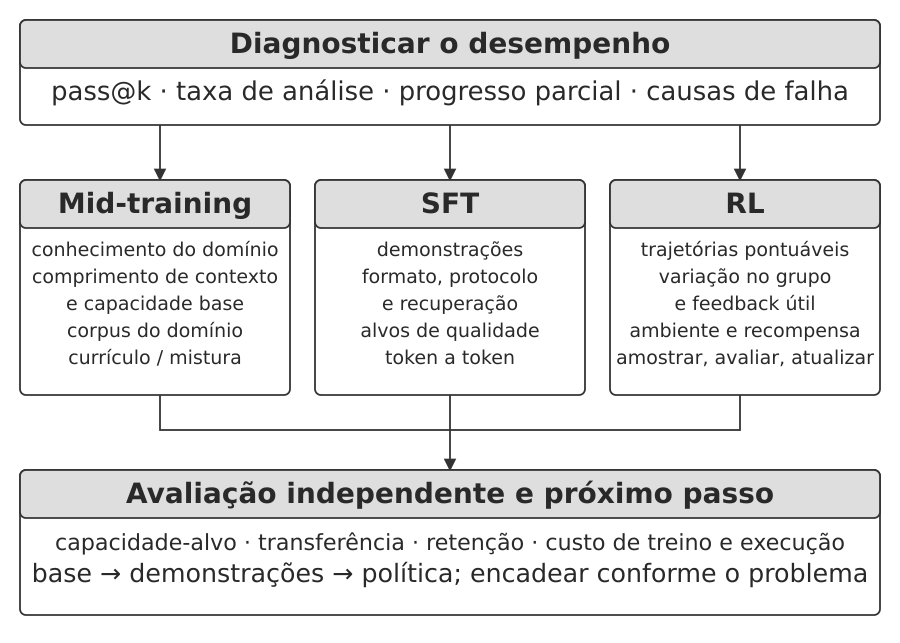

Tabela 8-4 Critérios de escolha entre Mid-training, SFT e RL

| Fenômeno observado | Verificar primeiro | Métodos candidatos | Foco da avaliação posterior |
| --- | --- | --- | --- |
| Linguagem, conceitos ou operações básicas do domínio fracos; pouco progresso mesmo com várias amostragens | Cobertura do corpus e capacidade básica | Mid-training; RAG para fatos recuperáveis | Tarefas do domínio, conjuntos de teste que verificam capacidades gerais e trajetórias parcialmente corretas |
| Conteúdo utilizável, mas formato, parâmetros ou fluxo fixo instáveis | Demonstrações, interface e restrições | SFT, decodificação restrita ou validação na ferramenta | Sucesso na análise, resultado da tarefa e comportamento de recuperação |
| Às vezes conclui a tarefa, mas com baixa taxa de sucesso ou muitos desvios | Qualidade da recompensa, exploração e distribuição de tarefas | RL | Ganho na tarefa, diferenças de recompensa, generalização independente e custo |
| Há demonstrações ou dados de preferência, mas o ambiente interativo ainda não existe | Cobertura dos dados offline e forma de verificação | SFT, RFT, otimização offline por preferências | Qualidade da linha de base, vieses dos dados e retorno da construção do ambiente |

O avanço pode seguir quatro passos. Primeiro, estabeleça uma linha de base com prompt, contexto, ferramentas e restrições. Quando esses métodos já atendem aos requisitos da tarefa, prefiro manter a solução externa e editável, reduzindo o custo de manutenção de treinamento, implantação e regressão. Fatos dinâmicos são fornecidos por recuperação e controle de versão; julgamentos implícitos, padrões de percepção e comportamentos estáveis que precisam ser aprendidos repetidamente são os candidatos a melhorar por treinamento de parâmetros.

Segundo, observe em tarefas reservadas os sucessos, os progressos parciais, os resultados de análise e os tipos de erro. Com a configuração de amostragem fixada, Pass@1 e Pass@k mostram se a política atual já tem caminhos aproveitáveis; as trajetórias de falha ajudam a distinguir falta de conhecimento, falta de feedback e erros de fluxo.

Terceiro, forneça demonstrações para os comportamentos que precisam ser aprendidos. JSON schema, chamadas de ferramentas, uso de terminologia, esclarecimento e recuperação podem ser escritos como amostras de SFT; o conhecimento necessário é fornecido pelos corpora correspondentes e pelo contexto da tarefa.

Quarto, avalie as condições de feedback para o RL. Quando é possível gerar candidatos pontuáveis, a recompensa discrimina bem e o ambiente permite interações suficientes, pode-se comparar o ganho da otimização de política; quando a recompensa é esparsa demais, considere primeiro currículo, recompensas parciais ou uma política inicial mais adequada.

Em cada passo, os resultados da avaliação decidem o investimento seguinte: tarefas de formato bem definido podem ser implantadas após o SFT; pontos de partida fortes podem ir direto para o RL; e, depois do treinamento contínuo no domínio, também é possível reaproveitar as capacidades de instrução existentes. A seguir, usamos tarefas de turno único para observar concretamente as diferenças de comportamento produzidas pelo aprendizado por demonstração e pelo aprendizado por recompensa.

Voltemos ao problema do pedido da orientação de leitura. Entregue ao modelo a mesma descrição real da ferramenta e observe se ele preenche os parâmetros corretamente. Se os campos da descrição mudaram, atualize primeiro a descrição consultável em tempo de execução. Se o significado dos campos está claro, mas o modelo insiste em colocar o texto do usuário no lugar do número do pedido, forneça demonstrações de SFT com consulta, esclarecimento e preenchimento correto dos parâmetros. Se ele já consegue às vezes concluir tudo, e ordens de consulta diferentes levam a taxas de sucesso e custos diferentes, estão dadas as condições para comparar várias trajetórias da política.

## Aprendizado por reforço em turno único: memória versus generalização

Uma tarefa de turno único começa com uma entrada e termina quando o modelo entrega a resposta e recebe a recompensa. O modelo ainda pode raciocinar em vários passos ao gerar a resposta, e o sistema de treinamento pode fazê-lo tentar o mesmo problema repetidas vezes. Restringir a interação a uma única resposta facilita observar como o método de treinamento muda o comportamento do modelo. A seguir, usamos primeiro o AdaptThink para mostrar como o modelo aprende a distribuir o orçamento de raciocínio e depois o GeneralPoints para comparar o desempenho de SFT e RL quando as regras e a aparência visual mudam.

Entender primeiro como os algoritmos de RL usam a recompensa para atualizar o modelo ajuda a ler o processo de treinamento dos experimentos seguintes. A maior parte do treinamento de RL deste capítulo se baseia em **gradiente de política**. Tome várias amostragens de um mesmo problema: o modelo gera algumas respostas, e a recompensa de cada uma é comparada com uma linha de base. As respostas acima da linha de base recebem um sinal positivo, e o treinamento aumenta sua probabilidade de geração; as que ficam abaixo recebem um sinal negativo, e sua probabilidade diminui.

Para evitar que uma única atualização desvie o modelo, o algoritmo dominante, o **PPO**, corta o ganho adicional do objetivo substituto quando a razão de probabilidades sai de um intervalo especificado; a amplitude real da atualização depende ainda da taxa de aprendizado e do número de épocas de atualização. O “PPO com rede de valor”, mais adiante, aprende uma estimativa de valor e a usa como linha de base de comparação para calcular a vantagem de cada ação. O **GRPO** compara diretamente várias respostas ao mesmo problema e constrói a linha de base com as recompensas do grupo, dispensando uma rede de valor treinada à parte.

O pseudocódigo em estilo Python abaixo encadeia amostragem, recompensa, vantagem e atualização de parâmetros, ajudando a entender como a informação passa de um passo a outro. Um treinamento real exige ainda configurar a paralelização da amostragem, a regularização de KL e o otimizador.

```python
for prompt in batch:
    group = [rollout(policy, env.reset(prompt)) for _ in range(G)]
    rewards = [verify(trajectory) for trajectory in group]
    advantages = normalize_within_group(rewards)       # GRPO baseline
    update(policy, group, advantages)
```

Como o PPO atualiza a política com um lote de trajetórias de comprimentos diferentes? Primeiro, dentro de cada trajetória, calcula-se de trás para a frente o retorno descontado de cada passo. A acumulação para no fim da trajetória, para não somar a recompensa do problema seguinte. Depois, reúnem-se as ações que o modelo efetivamente escolheu em todas as trajetórias e calcula-se a perda média desse lote de ações. Abaixo está uma atualização, omitindo as várias épocas de otimização em minilotes.[^ch8-ppo-method]

```python
states, actions, returns = [], [], []
for trajectory in rollouts:
    states.extend(trajectory.states)       # estado antes de cada escolha de ação
    actions.extend(trajectory.actions)     # corresponde item a item aos estados
    returns.extend(discounted_returns(trajectory.rewards))

returns = tensor(returns)
values = value_model(states)
advantages = returns - stop_gradient(values)
ratio = exp(policy.log_prob(actions, given=states)
            - old_policy.log_prob(actions, given=states))
policy_loss = -mean(min(
    ratio * advantages,
    clip(ratio, 1 - epsilon, 1 + epsilon) * advantages
))
value_loss = mean((values - returns) ** 2)
update(policy, value_model, policy_loss + value_coef * value_loss)
```

No GRPO, o “relativo” vem das várias respostas ao mesmo problema; aqui, o PPO usa uma rede de valor para estimar o retorno esperado de cada estado. `old_policy` é a política congelada no momento em que esse lote de trajetórias foi gerado. Suponha que a vantagem de uma ação seja 1 e que a política atual lhe dê 1,4 vez a probabilidade que ela tinha na amostragem; com `epsilon = 0.2`, a contribuição desse termo no objetivo substituto é `min(1.4, 1.2) = 1.2`. Aumentar ainda mais a probabilidade dessa ação já não traz ganho adicional por esse termo.

Se a vantagem for −1, a direção se inverte. Quando a razão de probabilidades já caiu para 0,6, a mesma linha de código dá `min(-0.6, -0.8) = -0.8`, e baixar ainda mais a probabilidade não rende nada a mais. Inversamente, se essa ação de pior desempenho ficar mais frequente e a razão subir para 1,4, o menor valor é `min(-1.4, -1.2) = -1.4`: aumentar sua probabilidade continua tendo custo.

> **Experimento 8-10 ★★: AdaptThink — aprender “quando não pensar”**
>
> Modelos de raciocínio costumam resolver problemas com processos de raciocínio longos. Em problemas simples, responder diretamente economiza custo de geração. O AdaptThink oferece ao modelo dois modos, Thinking e NoThinking: em modelos que suportam esse protocolo, o NoThinking encerra o trecho de raciocínio com `<think></think>` e gera a resposta diretamente em seguida. O objetivo do treinamento é fazer o modelo escolher o orçamento de raciocínio adequado a cada tarefa.
>
> O método tem dois componentes centrais. O **objetivo de otimização com restrição** incentiva o modelo a aumentar a proporção de uso do NoThinking, mantendo o desempenho geral nas respostas; a **amostragem por importância** ajusta a proporção de amostras de cada modo e usa pesos para corrigir a diferença entre a distribuição de amostragem e o objetivo de otimização. O modelo inicial tende ao Thinking, e só aumentando ativamente as amostras de NoThinking o treinamento obtém sinal para comparar os dois modos. O problema de inicialização a frio, aqui, refere-se especificamente à escassez de amostras de NoThinking no início do treinamento.
>
> O experimento do livro usa 8 GPUs H100 de 80 GB. No passo 300 do treinamento, a acurácia no MATH500 foi de 81,00% para 81,80%, e o comprimento médio das respostas caiu de cerca de 4.911 para 1.577 tokens; no GSM8K, a acurácia subiu de 79,68% para 81,88%, e o comprimento caiu de cerca de 1.025 para 477 tokens; no AIME, o mean@16 foi de 31,46% para 31,04%, e o comprimento caiu de cerca de 12.120 para 6.402 tokens. Os comprimentos de resposta dos três conjuntos diminuíram cerca de 68%, 53% e 47%, respectivamente.
>
> As proporções de NoThinking nos três conjuntos de dados foram, na ordem, 83,80%, 84,15% e 56,25%. O modelo preservou mais computação de raciocínio no AIME e respondeu diretamente com mais frequência no MATH500 e no GSM8K. No AIME2024, cada problema é amostrado 16 vezes, e o mean@16 é a taxa média de acerto dessas 16 respostas. No passo 300, as respostas encolheram, em média, quase pela metade, e a taxa de acerto caiu cerca de 0,42 ponto percentual.
>
> O passo 300 corresponde a uma validação no meio do treinamento. A equipe planejava treinar 3.140 passos, mas a execução foi interrompida por uma falha, e o último registro de validação parou no passo 410. Nesse ponto, a taxa média de acerto no AIME2024 era de 31,88%, com respostas de cerca de 5.874 tokens em média.
>
> O AdaptThink pode ser combinado com a destilação de prompt: a destilação grava nos parâmetros as instruções e os padrões de resolução usados repetidamente, e o AdaptThink aprende quanta computação de raciocínio alocar a cada tarefa. Os dois afetam juntos a qualidade das respostas, a latência e o custo.

> **Experimento 8-11 ★★: GeneralPoints — “memória versus generalização” no RL de turno único**
>
> Chu et al. usaram o GeneralPoints, um jogo de cartas semelhante ao “24”, para testar a capacidade de generalização dos modelos[^ch8-3]. Usando cada um dos números das quatro cartas uma única vez, é preciso chegar a 24 com adição, subtração, multiplicação e divisão. Se o modelo aprendeu a resolver o problema, ainda acertará a conta quando a regra das cartas ou os naipes mudarem? A Figura 8-12 mostra duas formas de enunciado: o GP-L fornece o texto diretamente, e o GP-VL exige que o modelo leia as cartas.
>
> 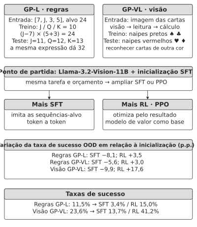
>
> **Variante de regra**: no treinamento, J/Q/K valem 10; no teste, valem 11/12/13, respectivamente. O conjunto de teste inclui, assim, combinações de números não vistas no treinamento e permite verificar se o modelo consegue calcular com 11, 12 e 13 segundo a nova regra. **Variante visual**: o treinamento usa naipes pretos (♠♣) e o teste usa naipes vermelhos (♥♦), verificando se o modelo se adapta à mudança na aparência das cartas.
>
> O experimento parte do Llama-3.2-Vision-11B, usa primeiro SFT para estabelecer a capacidade básica de seguir instruções e depois se divide em dois ramos de treinamento, SFT contínuo e RL, comparados com o mesmo orçamento computacional. O ramo de RL usa PPO com rede de valor. Os dois ramos são treinados com a regra J/Q/K=10 e depois avaliados em conjuntos de teste dentro da distribuição (ID) e fora da distribuição (OOD).
>
> Tome `[7, J, 3, 5]` como exemplo: com J=10, vale `(J−7)×(5+3)=24`; quando J passa a valer 11, essa expressão dá 32, e é preciso trocá-la por `(11−5)×(7−3)=24`. O mesmo conjunto de cartas exige, portanto, que o modelo leia a regra vigente e reorganize o cálculo.
>
> Os dois métodos de treinamento mostraram uma diferença nítida nos testes fora da distribuição. **OOD de regra**: no GP-L, a taxa de sucesso do RL subiu de 11,5% para 15,0%, um ganho de 3,5 pontos percentuais; a do SFT caiu de 11,5% para 3,4%, uma perda de 8,1 pontos percentuais. No GP-VL, o RL ganhou 3,0 pontos percentuais e o SFT perdeu 5,6. **OOD visual**: no GP-VL, o RL subiu de 23,6% para 41,2%, um ganho de 17,6 pontos percentuais; o SFT caiu de 23,6% para 13,7%, uma perda de 9,9 pontos percentuais.
>
> Examinando também os resultados de reconhecimento das cartas, é possível relacionar o desempenho final nas respostas com a percepção visual: no ramo de RL, a acurácia de reconhecimento subiu junto com a taxa de sucesso na tarefa; no ramo de SFT, ela caiu. O estudo relaciona essa diferença ao objetivo de treinamento: o ajuste token a token pode reforçar padrões textuais das demonstrações, enquanto a recompensa pelo resultado exige continuamente que o modelo leia as cartas corretamente e conclua o cálculo. A acurácia de percepção fornece um indicador intermediário para analisar esse mecanismo.
>
> A razão de fazer SFT primeiro também pode ser entendida pelo formato de saída. O modelo de base Llama-3.2-Vision-11B do experimento não conseguia gerar de forma estável a saída estruturada exigida, o verificador não conseguia calcular a recompensa da tarefa a partir dela, e a tentativa de RL direto, de ponta a ponta, fracassou. O SFT estabelece primeiro uma saída analisável e pontuável, e só então o RL pode aproveitar o feedback da tarefa. Já o DeepSeek-R1-Zero, citado antes, partiu de um modelo de base que já gerava respostas pontuáveis e entrou diretamente no RL.
>
> Quanto o modelo consegue aprender com o feedback do verificador? A Figura 10 do artigo compara separadamente a tarefa de cartas só em texto (GP-L). Os pesquisadores configuraram 1, 3, 5 e 10 iterações de verificação e treinaram e avaliaram um modelo de RL para cada caso. Com o mesmo orçamento computacional de treinamento, o grupo com até 10 verificações aumentou a taxa de sucesso na nova regra em 5,99 pontos percentuais em relação a seu ponto de partida, e o grupo com apenas 1 verificação, em 0,48 ponto percentual.
>
> Por que, sob a mudança de distribuição deste experimento, o desempenho do SFT cai e o RL se sai melhor? Uma explicação coerente com as observações é que os dados limitados de SFT reforçaram o padrão fixo “J/Q/K valem 10”; no teste, com J=11, o modelo continua calculando com 10. Já o ramo de RL, orientado pelo resultado, tende mais a reforçar a estratégia de “recalcular até chegar à resposta correta” e, por isso, ainda consegue aplicá-la quando J passa a valer 11.
>
> As mudanças de regra e de naipe do GeneralPoints permitem observar separadamente se o modelo aprendeu a calcular sob novas condições e se lê corretamente a nova entrada visual. Com o modelo, os dados de treinamento e o orçamento de teste usados aqui, o ramo que continuou com SFT regrediu nos testes fora da distribuição, e o ramo que passou ao RL melhorou. Para levar a conclusão à sua própria tarefa, pergunte primeiro: o aluno já domina o formato de saída? O novo teste mudou a regra, a aparência da entrada ou as duas coisas? Só comparações separadas dizem se é preciso acrescentar demonstrações, melhorar a percepção ou aumentar a exploração com feedback de resultado.

## Algoritmos de RL: de 16 rollouts a uma atualização de parâmetros

O **GRPO (Group Relative Policy Optimization)**, proposto pela DeepSeek, constrói o sinal de aprendizado a partir do desempenho relativo de várias tentativas no mesmo problema. Tome uma tarefa de correção de código no estilo SWE-bench: em um projeto Python, `parser.py` dispara `IndexError` com entrada vazia, e o agente precisa corrigir a implementação sem alterar os arquivos de teste. Uma iteração de treinamento pode ser dividida em quatro passos.

**Primeiro passo: fazer o modelo de política tentar repetidamente.** O modelo de política é o modelo de linguagem em treinamento. O sistema coloca o mesmo código inicial e a mesma descrição do problema em 16 sandboxes isolados e faz o modelo concluir a tarefa 16 vezes, de forma independente. Cada vez começa pela leitura do código e passa por modificação e teste até a entrega do resultado; essa trajetória completa de interação se chama um **rollout**. A amostragem aleatória faz o mesmo ponto de partida produzir caminhos diferentes: alguns acrescentam a verificação de limite, outros apenas capturam a exceção, outros alteram o arquivo errado e há ainda os que tentam modificar os testes.

**Segundo passo: calcular a recompensa.** Ao fim de cada rollout, o verificador aplica o patch em um ambiente limpo e roda os testes. Suponha que, das 16 tentativas, 4 passem em todos os testes sem alterar os arquivos de teste e 12 falhem; as 4 aprovadas recebem recompensa 1, e as outras 12, recompensa 0. A Figura 8-13 reúne em uma única tabela a pontuação dessas 16 trajetórias. Nesse tipo de tarefa de código, a recompensa pode ser calculada diretamente com testes e regras. Para objetivos difíceis de transformar em testes, como legibilidade e qualidade das explicações, é possível combinar avaliação humana ou um modelo de recompensa.

**Terceiro passo: calcular a vantagem relativa.** A recompensa só diz se uma trajetória teve sucesso ou não; a **vantagem relativa** diz quão boa ela foi em comparação com as outras tentativas do mesmo grupo. A taxa média de sucesso do grupo é 4/16: as 4 trajetórias aprovadas ficam acima da média do grupo e recebem vantagem positiva; as 12 que falharam ficam abaixo e recebem vantagem negativa. Normalizando pelo desvio padrão do grupo, com média de recompensa 0,25 e desvio padrão de cerca de 0,433, a vantagem das trajetórias bem-sucedidas fica em torno de 1,73, e a das que falharam, em torno de −0,58. O GRPO constrói o sinal de aprendizado com esse tipo de comparação dentro do grupo. Se as 16 recompensas forem todas iguais, subtrair a média do grupo dá zero para cada uma. Um pequeno termo de estabilidade no denominador evita a divisão por zero, mas, mesmo normalizada, a recompensa de resultado desse grupo continua sem indicar para qual trajetória o treinamento deveria pender. Nesse caso, verifique se restrições de trajetória, recompensas de processo ou progresso parcial conseguem distinguir as trajetórias do grupo. Por exemplo, entre duas tentativas que não corrigiram o código, só uma passou no teste de limite que antes falhava. Desde que esse resultado intermediário possa ser verificado de forma independente, há mais uma pista possivelmente útil para o aprendizado.

**Quarto passo: atualizar a política por gradiente descendente.** O programa de treinamento converte a vantagem relativa em perda de treinamento, calcula o gradiente, e o otimizador (como AdamW ou Muon) executa o gradiente descendente, aumentando a probabilidade das escolhas feitas pelo modelo nas trajetórias de vantagem positiva e reduzindo a das escolhas nas trajetórias de vantagem negativa. Ao longo de muitas tarefas e rollouts, o treinamento ajusta repetidamente essas probabilidades. À medida que a otimização surte efeito, diante de erros semelhantes, “reproduzir o problema primeiro, verificar as condições de limite, modificar a implementação e rodar os testes” passa a aparecer com mais facilidade, e “mascarar a exceção, alterar os testes ou entregar sem verificar” passa a aparecer menos.

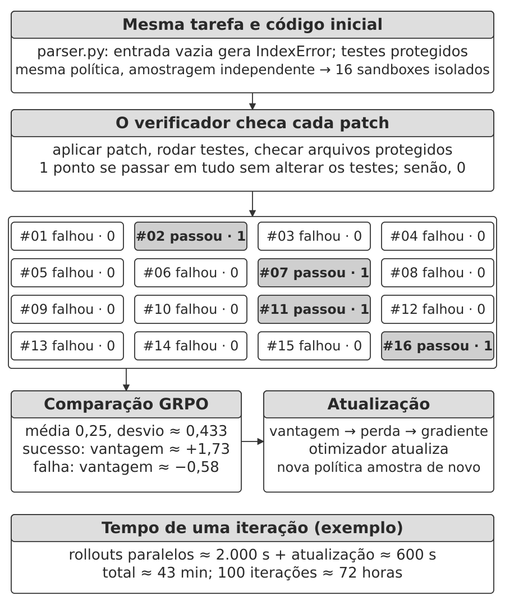

Na Figura 8-13, o mesmo problema é amostrado 16 vezes; quantas **iterações de treinamento (steps)** são isso? Pela contagem desta seção, esses 16 rollouts pertencem ao mesmo lote. Na rodada $k$, amostra-se com a política atual, calculam-se recompensas, vantagens e gradientes e atualiza-se a política uma vez; só na rodada $k+1$ se volta a amostrar com os novos parâmetros. Treinar 100 steps significa fazer cerca de 100 rodadas dessas iterações.

Com isso, é possível estimar o tempo de treinamento. Uma tarefa complexa pode incluir dezenas de rodadas de chamadas de ferramentas; no treinamento síncrono, que espera o lote inteiro, a mais lenta das 16 trajetórias paralelas determina quando a fase de amostragem termina. Se ela levar cerca de 2.000 segundos e o cálculo do gradiente e a atualização do otimizador levarem mais 600, um step exige cerca de $2{,}000+600=2{,}600$ segundos, ou 43 minutos. Com o mesmo tempo por step, 100 steps seguidos levam cerca de 72 horas.

PPO e GRPO seguem esse mesmo ciclo; a diferença está sobretudo em “com o que comparar”. O GRPO compara diretamente vários rollouts do mesmo problema e não precisa de um modelo de valor adicional; o PPO treina um modelo de valor que estima, em cada passo da trajetória, “quão bem costuma dar para se sair”, e depois julga se a ação atual é melhor do que essa expectativa, fornecendo a linha de base necessária para a atribuição de crédito passo a passo. Ambos usam mecanismos como o objetivo substituto com corte para conter atualizações grandes demais. O DPO é diferente: aprende diretamente pares de preferência “resposta melhor–resposta pior” coletados de antemão, sem que a política atual gere online esse grupo de rollouts.

Os casos deste capítulo usam receitas de treinamento diferentes: o AdaptThink usa um objetivo com restrição próprio; GeneralPoints, V-IRL e ReTool usam PPO, e nos dois primeiros o modelo de valor participa da estimativa de vantagem; SimpleVLA-RL e RLVP usam GRPO.

Suponha que os problemas A e B sejam tentados quatro vezes cada: A acerta todas, B erra todas. As quatro recompensas de A valem 1, e as de B valem 0. Subtraindo a média de cada grupo, as vantagens dos dois grupos viram 0. Mas, se ainda houver computação para mais algumas tentativas, em qual problema vale mais gastá-la na esperança de obter amostras de treinamento úteis?

O Never Give Up leva essa escolha para dentro do processo de amostragem. Como A acertou tudo, esse grupo é pulado; como B errou tudo, acrescenta-se mais um grupo com certa probabilidade. Se o segundo grupo finalmente acertar uma vez, o treinamento junta as oito respostas dos dois grupos: uma solução correta e sete erradas, e o mesmo problema passa a ter recompensas diferentes. A amostragem assíncrona deixa os outros problemas avançarem normalmente, sem esperar pelo resultado de B.[^ch8-ngu]

[^ch8-ngu]: Michael Noukhovitch et al., *Learning to Solve Hard Problems in RL for LLMs by Never Giving Up*, 2026. A amostragem adicional descrita no artigo é usada no treinamento; problemas já resolvidos ainda podem ser sorteados de novo mais adiante no treinamento.

### Por que o RL de LLM geralmente prioriza dados on-policy

**Online** e **on-policy** descrevem aspectos diferentes. O treinamento online interage continuamente com o ambiente durante a execução e produz dados; o treinamento on-policy diz respeito à origem dos dados e exige que a política de comportamento $\mu$, que gera as trajetórias, coincida ou esteja suficientemente próxima da política a otimizar, $\pi_\theta$. Um cluster assíncrono pode amostrar online continuamente, mas, se um worker estiver alguns checkpoints atrasado, os dados que ele devolve carregam a defasagem da política e formam um componente off-policy.

Recomendo estabelecer primeiro uma linha de base estável com treinamento próximo do on-policy e só depois introduzir amostragem assíncrona ou reaproveitamento de dados antigos para aumentar a vazão. As receitas de PPO/GRPO deste capítulo costumam amostrar com a política mais recente no início de cada step. Em seguida, o PPO faz várias épocas de atualização em minilotes sobre o mesmo lote de dados, e a política atual se afasta aos poucos da `old_policy` que gerou os dados. A razão de probabilidades mede essa mudança, e o objetivo com corte contém atualizações grandes demais.

O objetivo do gradiente de política está ligado à recompensa esperada sob a política atual $\pi_\theta$. Ao usar dados amostrados pela política de comportamento $\mu$, pode-se calcular primeiro a razão das probabilidades da ação no mesmo estado e, com ela, construir a correção por importância:

$$
\rho_t=\frac{\pi_\theta(a_t\mid s_t)}{\mu(a_t\mid s_t)}
=\exp\left(\log\pi_\theta(a_t\mid s_t)-\log\mu(a_t\mid s_t)\right).
$$

Suponha que, depois de um mesmo prefixo, a política de amostragem escolha certo token com probabilidade 0,2, enquanto a política atual lhe dá 0,3; a razão de probabilidades nesse passo é 1,5. Esse token aparece pouco nas amostras antigas, e, na estimativa segundo a política atual, o peso dessas amostras aumenta na mesma medida. Se a amostragem e o treinamento usam a mesma política, a razão de probabilidades de cada passo é 1 antes da atualização dos parâmetros.

Reaproveitar trajetórias antigas permite que amostragem e treinamento ocorram de forma assíncrona, aumentando a vazão. Mas, quanto mais distantes as duas políticas, maior a chance de poucas amostras receberem pesos enormes. Ao reponderar uma trajetória inteira, as razões de cada passo ainda se multiplicam. O PPO corta parte do ganho adicional no objetivo substituto de cada ação, o que atenua o efeito de razões extremas; já os estados que as amostras antigas nunca visitaram só podem ser vistos com nova amostragem. É por isso que prefiro trajetórias frescas.[^ch8-32]

#### Diferenças numéricas entre treinamento e inferência

O aprendizado por reforço de LLMs em grande escala costuma amostrar com motores de inferência como vLLM e SGLang e calcular log-probabilidades e gradientes com sistemas de treinamento como FSDP e Megatron. Mesmo carregando os mesmos pesos, os dois lados podem calcular log-probabilidades ligeiramente diferentes para o mesmo token, por causa de diferenças de precisão de ponto flutuante, ordem de redução, paralelismo de tensores, tamanho de lote, cache KV e kernels fundidos. Nesse caso, antes mesmo de qualquer atualização de parâmetros, $\rho_t$ já se afasta de 1, e surge uma diferença de política numérica entre treinamento e amostragem. Experimentos controlados mostraram que diferenças mínimas no nível do token podem levar ao colapso do treinamento.[^ch8-33]

Quando a distribuição de amostragem muda, o gradiente de política ingênuo pode favorecer uma de duas ações mesmo que ambas tenham exatamente a mesma recompensa. Suponha que, na amostragem, A e B tenham metade das chances cada, mas que, no treinamento, a probabilidade de o modelo escolher A já seja 0,8. Para o logit que controla A, quando A é escolhida, o gradiente da log-probabilidade é $1-0.8=0.2$; quando B é escolhida, é $0-0.8=-0.8$. Se as duas ações recebem 1 ponto, a média ponderada pelas probabilidades de amostragem dá um gradiente de $-0.3$. As duas escolhas têm a mesma pontuação, mas a atualização reduz a probabilidade de A.

O score centering subtrai do gradiente da log-probabilidade, para um mesmo prefixo, sua média sob a distribuição de amostragem. No exemplo acima, subtraindo $-0.3$, os dois termos passam a $0.5$ e $-0.5$, e a mesma recompensa produz uma atualização média exatamente nula. O GRPO, visto antes, subtrai a média das recompensas de um grupo de respostas; aqui, o que se centraliza é o gradiente.[^ch8-sc]

[^ch8-sc]: Martin Marek, Max Ryabinin, *Score Centering Stabilizes Off-policy Reinforcement Learning*, 2026. Quando a política de amostragem está atrasada demais, também é possível usar regularização de KL para restringir a distância entre a política de treinamento e a política de comportamento (arXiv:2611.21791).

Os erros numéricos entre o lado de treinamento e o de amostragem ainda se amplificam ao longo de sequências longas: **erro de log-probabilidade → desvio da razão de probabilidades → acúmulo em prefixos longos → mudança no corte e na ponderação das vantagens → mudança no gradiente e no número efetivo de amostras**. Por exemplo, se as razões de log-probabilidade de 4.000 tokens tiverem todas um desvio de $10^{-3}$ no mesmo sentido, a razão de probabilidades calculada para a trajetória será $e^{4000\times0.001}=e^4\approx54.6$ vezes o valor verdadeiro.

Mudanças de probabilidade no início também podem alterar o resultado da amostragem e levar os estados seguintes por outro caminho. Os sinais observáveis no treinamento incluem picos na razão de importância, aumento da proporção de cortes, saltos no gradiente ou no comprimento das respostas e queda da recompensa e da entropia. Quando o tamanho do lote altera o processo de redução, o resultado numérico para a mesma entrada também pode mudar, isto é, a invariância ao lote (batch invariance) é quebrada. Pesquisas relacionadas observaram o efeito off-policy implícito daí resultante e melhoraram a estabilidade alinhando os cálculos de amostragem e treinamento ou corrigindo explicitamente a diferença de política.[^ch8-34]

Por isso, coloco a consistência numérica entre amostragem e treinamento entre as verificações centrais antes de iniciar um treinamento e a monitoro continuamente junto com a curva de recompensa. O tratamento pode seguir quatro passos — “medir a diferença, alinhar a configuração, corrigir o desvio, controlar a defasagem”:

- **Antes de qualquer atualização de parâmetros**, compare, com o mesmo lote de trajetórias, as log-probabilidades de token dadas pelo lado de amostragem (sampler) e pelo lado de treinamento (trainer), monitorando a média, os quantis e o máximo de $\rho_t$, o KL aproximado e a proporção de cortes; esse é o teste unitário on-policy mais direto.
- Ao sincronizar os pesos, alinhe também o adaptador LoRA, o tokenizador, o template de chat, a versão do modelo e a configuração de codificação posicional. Os rollouts devem guardar as log-probabilidades dadas pela política de amostragem no momento da geração, para calcular depois as razões de probabilidade.
- Alinhe o máximo possível a precisão, o layout de paralelismo e os kernels de cálculo críticos entre amostragem e treinamento; se não for possível, trate explicitamente a diferença como off-policy, aplique correção por importância, monitore o número efetivo de amostras e use a proporção de cortes para julgar o efeito da correção.
- Reamostre logo com a política atualizada, limitando o número de épocas de atualização em cada lote de dados e quantos checkpoints a amostragem assíncrona pode ficar atrás do treinamento.

## Ambientes de RL: da avaliação à simulação

O treinamento de RL de um agente exige executar tarefas repetidamente. Uma correção de código pode ser repetida em uma cópia isolada; um pagamento altera o estado de uma conta real. O ambiente de treinamento precisa fornecer estados iniciais reiniciáveis, cópias paralelas das tarefas e resultados verificáveis, para que o modelo explore caminhos diferentes sob condições controladas. O Capítulo 7 já apresentou os ambientes de avaliação; para o treinamento, é preciso considerar também execuções longas, efeitos colaterais das ações e o custo de um grande volume de interações. Costumo alocar pessoas e orçamento à construção do ambiente antes de programar o treinamento em grande escala. Implementar feedback real, reinício de estado e isolamento paralelo muitas vezes consome mais recursos de engenharia do que integrar PPO ou GRPO, e o custo de construir o ambiente pode superar o do próprio treinamento.

### Ambiente: o campo de treinamento do modelo

O ambiente atualiza o estado de acordo com a ação e devolve a nova observação ao modelo. Ao construir um ambiente, comece por três perguntas.

- **A interação se aproxima do cenário de implantação?** Um simulador de atendimento precisa cobrir situações em que o usuário complementa informações, muda o pedido ou se expressa de forma vaga; um simulador de ferramentas precisa devolver os erros e atrasos comuns em produção. É com esse feedback que o modelo aprende a lidar com problemas reais. Um feedback homogêneo demais faz a política depender de rotinas fixas da simulação.
- **As tarefas podem ser repetidas e paralelizadas de forma estável?** Cada rollout precisa de um estado próprio de pedidos, arquivos ou contas, que possa ser limpo e restaurado ao final. O sandbox de interpretador de código do ReTool e o sandbox MCP do AWorld cumprem esse papel. Para APIs reais com limites de taxa, custos ou efeitos colaterais de escrita, podem-se usar contas de sandbox, dados reproduzidos ou interfaces simuladas, conforme a tarefa.
- **Como o resultado é julgado?** O estado do ambiente é uma base importante para calcular a recompensa. Por exemplo, uma tarefa de reembolso pode verificar o valor, o status do pedido e as condições de autorização; uma tarefa de código pode executar testes. O design da recompensa será discutido adiante.

**Antes de pôr a mão nos ajustes do algoritmo, recomendo verificar primeiro: o ambiente de simulação está próximo o bastante da tarefa real? Isso importa mais do que escolher entre PPO e GRPO.** Fidelidade, capacidade de reinício e capacidade de verificação determinam juntas o que o modelo consegue aprender com a interação. Fazer esses três elos funcionarem primeiro com poucas tarefas e só depois ampliar a escala do treinamento costuma facilitar a localização de problemas.

### Simulando ferramentas e ambientes com modelos

Resultados de busca, diálogos com usuários e estados de negócio complexos podem ser sintetizados com a ajuda de modelos. Um simulador baseado em modelo recebe a ação do agente e gera o feedback seguinte, reduzindo a dependência de serviços externos em tempo real. Essa abordagem pode ir de uma única ferramenta a todo o ambiente da tarefa.

**Primeiro nível: sintetizar o retorno das ferramentas.** O ZeroSearch[^ch8-13] faz um LLM desempenhar o papel de mecanismo de busca: o aluno emite a consulta, e o simulador gera os resultados. Isso reduz a dependência do treinamento em relação ao custo, aos limites de taxa e à variação de resultados das APIs reais de busca. Ele também usa uma programação em currículo: no início, devolve documentos de qualidade e relevância mais altas e, depois, aumenta gradualmente o ruído, para que o aluno pratique extrair informações úteis de materiais imperfeitos. No estudo, os modelos treinados no ambiente de busca simulado continuaram com bom desempenho quando conectados a um mecanismo de busca real.

**Segundo nível: simular as transições de estado do ambiente.** O DreamGym[^ch8-14] destila a dinâmica do ambiente em um modelo de experiência baseado em raciocínio. O modelo lê o estado atual e a ação do agente, deduz o próximo estado e o feedback e gera em lote trajetórias de interação para RL online, reduzindo o acesso ao ambiente real. Tarefas de atendimento e vendas podem ainda fazer um LLM desempenhar o papel do usuário, simulando perguntas adicionais, informações complementares e mudanças de pedido. A série τ-bench usa simuladores de usuário; estruturas de interação semelhantes também podem servir ao treinamento, com conjuntos separados para prática e avaliação.

Simuladores baseados em modelo também precisam de calibração. Se um simulador de atendimento sempre entende perfeitamente perguntas vagas, a política não tem oportunidade de praticar o esclarecimento; se um simulador de busca sempre devolve o documento certo, a política não ganha experiência em identificar ruído. O treinamento pode ainda reforçar comportamentos que exploram falhas na pontuação do simulador. Recomendo uma abordagem mista: deixar a simulação por modelo cuidar do grosso das interações e verificar periodicamente o desempenho da política com tarefas no ambiente real, realimentando o simulador com as diferenças encontradas. Forma-se assim o ciclo iterativo “interação sintética → avaliação em tarefas reais → correção do simulador”.

Como saber se o simulador de fato consegue ensinar o uso de ferramentas? Faça um pequeno teste: sobre o mesmo pedido inicial, consulte, envie uma modificação e consulte de novo, verificando se os campos do pedido devolvidos mudaram conforme a ação. Depois reinicie o ambiente e confirme que os valores originais voltam a aparecer. Um ambiente que só sabe gerar um “modificado” que soa plausível, mas não mostra a mudança na consulta seguinte, recompensa a política que sabe falar, mesmo que ela nunca tenha alterado o pedido.

### Ambientes, distribuição de tarefas e isolamento da avaliação

O ambiente de treinamento determina o que o modelo pode vivenciar. Estados reiniciáveis permitem novas tentativas, cópias isoladas permitem paralelismo, e regras claras de estado e verificação permitem reprodução e pontuação. As tarefas podem seguir os métodos de síntese de dados vistos antes: extrair planos de tarefa dos registros reais do negócio, remover informações de identidade e gerar pessoas, pedidos, arquivos e estados iniciais fictícios.

Treinamento e avaliação podem reaproveitar o gerador de tarefas e o código de verificação, mas as tarefas concretas devem ser divididas em conjuntos independentes. Seguindo o desenho de ambientes de SWE-Gym, τ²-bench e AndroidWorld[^ch8-28], os testes de aceitação, o estado oculto necessário à pontuação e as soluções de referência ficam do lado do verificador, e o agente obtém observações pela interface definida na tarefa. Antes de ampliar a amostragem, use poucos rollouts para verificar se as tarefas podem ser concluídas e se o verificador distingue resultados válidos de inválidos. Detectar cedo os vieses de pontuação reduz as oportunidades de a política explorar brechas da verificação.

Assim, a ordem da engenharia de ambientes deve ser: **plano de tarefa → ambiente reiniciável → verificação de resultados → isolamento treino/avaliação → calibração com interações reais**. A síntese de dados vista antes filtra trajetórias válidas desses ambientes e forma as demonstrações de SFT. Ao passar ao RL, a política atual continua a tentar e errar no ambiente, explorando caminhos além das demonstrações.

A verificação também precisa entrar no orçamento de vazão. O kernel do Lean, os executores de testes e a execução em contêineres consomem CPU e memória. Quando a velocidade de geração nas GPUs supera a de verificação, as tarefas se acumulam na fila de verificação. Nesse caso, aumente o número de workers de verificação, reduza a latência da verificação ou ajuste a proporção de recursos entre geração e verificação[^ch8-9].

## De turno único a múltiplos turnos: cenários de tarefas e atribuição de crédito

### O principal desafio das tarefas de múltiplos turnos

À esquerda da Figura 8-14 está o jogo do 24. O modelo pode calcular vários passos dentro da resposta, mas todos usam as quatro cartas dadas no enunciado, sem novas observações do ambiente no meio do caminho. À direita está a navegação por imagens de rua. Só depois de chegar ao cruzamento e virar à esquerda é possível ver a rua seguinte. O próximo passo depende de reavaliar as placas à vista. O ReAct, apresentado nos Capítulos 1 e 4, organiza justamente esse tipo de interação: o modelo escolhe a ação, a ferramenta ou o ambiente a executa, e a nova observação entra na decisão do turno seguinte.

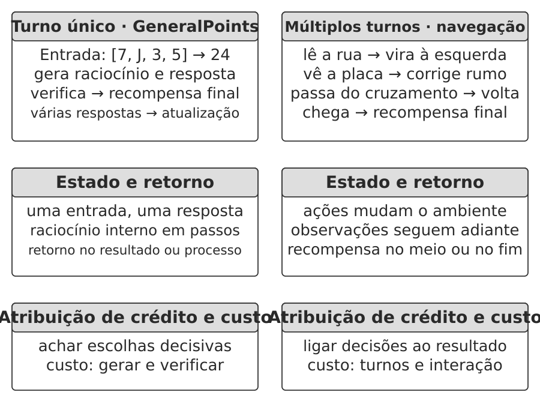

Na Figura 8-15, o agente passa do cruzamento no passo 3, percebe no passo 4 que se desviou e dá meia-volta, e chega ao destino no passo 5. A recompensa final aprova a navegação inteira, mas não distingue o caminho errado da meia-volta feita a tempo. Da próxima vez que encontrar esse cruzamento, queremos que ele acerte direto; se errar de novo, ainda queremos incentivá-lo a voltar. Estimar no treinamento o papel de cada passo anterior no ganho final é o problema da **atribuição de crédito (Credit Assignment)**. As estimativas de valor e de vantagem podem usar o retorno posterior; quando é possível verificar de forma confiável as ações intermediárias, também se podem acrescentar recompensas de processo. A meia-volta do passo 4 recebe 0 na recompensa de processo, mas ainda ajuda a chegar ao destino. Ao estimar o valor desse passo, é preciso contar também o retorno posterior.

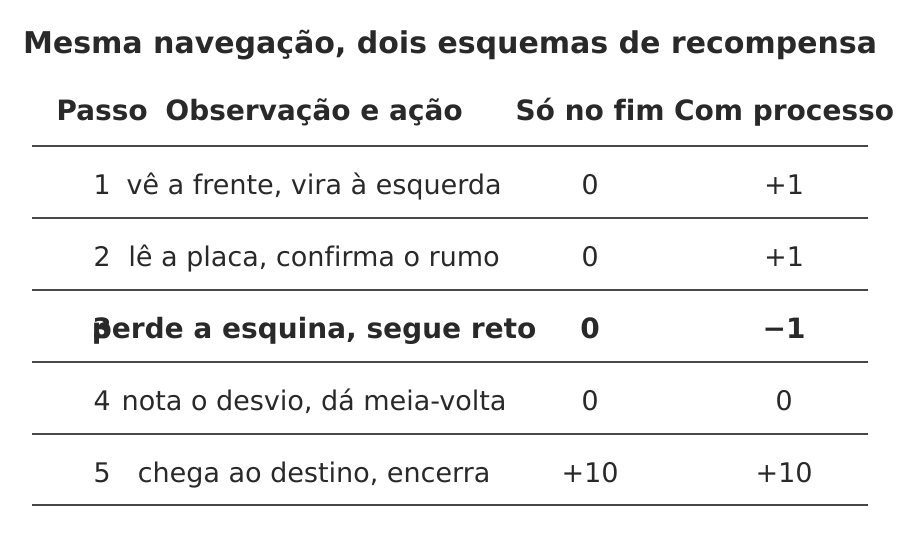

O mesmo problema aparece em uma chamada de atendimento. Por exemplo, o usuário dá uma avaliação positiva no turno 10. Esclarecer no turno 2 qual cobrança estava em disputa e explicar a tarifa no turno 7 podem ambos ter ajudado. Só com a avaliação final não dá para separar o peso de cada um. Os dois experimentos a seguir tratam, respectivamente, do caso em que o treinador consegue verificar passo a passo as ações de navegação e do caso em que só o resultado da tarefa indica se o robô teve sucesso.

> **Experimento 8-12 ★★★: V-IRL-VL — navegação visual em múltiplos turnos**
>
> No V-IRL[^ch8-24], o agente precisa encontrar o destino passo a passo com base nas imagens de rua à sua frente. O treinamento usa rotas de Nova York, e o teste muda para outras cidades, alterando tanto a forma de dar as indicações quanto as ruas na imagem. Nos dois tipos de teste fora da distribuição, de mudança de regra e de mudança visual, o RL teve desempenho claramente superior ao SFT. O experimento usa PPO com rede de valor. Dar feedback a cada passo ajuda a distinguir quais decisões de uma rota longa merecem ser mantidas.

> **Experimento 8-13 ★★★: SimpleVLA-RL — exploração aberta com recompensa de resultado `[Experimento estendido]`**
>
> O SimpleVLA-RL usa, nas tarefas robóticas do LIBERO, uma recompensa de resultado de sucesso/fracasso. Cada tarefa recebe uma inicialização a frio por SFT com uma única trajetória de demonstração; depois, o RL eleva a taxa de sucesso de 17,3% para 91,7% e produz uma ação de “empurrar e cortar” (pushcut) que não aparecia nas demonstrações. Compare esse resultado com a navegação por imagens de rua: se é possível julgar de forma confiável em qual passo intermediário houve erro, o feedback pode ser dado na hora, acelerando o aprendizado. Se ainda não se sabe de quantas maneiras a tarefa pode ser concluída, recompensar primeiro pelo resultado deixa ao modelo espaço para tentar outros caminhos. Transformar cedo demais a sequência de ações das demonstrações humanas em requisito da recompensa pode rebaixar a pontuação de novas estratégias como o pushcut.

### Chamada de ferramentas: aprender a usar capacidades externas na interação

Com ferramentas externas conectadas, o modelo pode escolher buscar, executar código, modificar arquivos, consultar bancos de dados ou combinar várias APIs conforme a tarefa. O Harness valida e despacha as chamadas, e as ferramentas executam no ambiente e devolvem observações. A Figura 8-16 separa as decisões dentro de uma tarefa do treinamento feito depois que ela termina. Seguindo as setas da direita, o resultado da ferramenta volta à tarefa em curso, e o modelo o usa para decidir o passo seguinte. Descendo a figura, só depois que a tarefa termina o programa de treinamento usa a trajetória inteira para calcular a recompensa e atualizar os parâmetros, e a rodada seguinte de amostragem usa a nova política. Quando uma tarefa exige chamar várias ferramentas em sequência, o resultado de uma chamada afeta os parâmetros da seguinte.

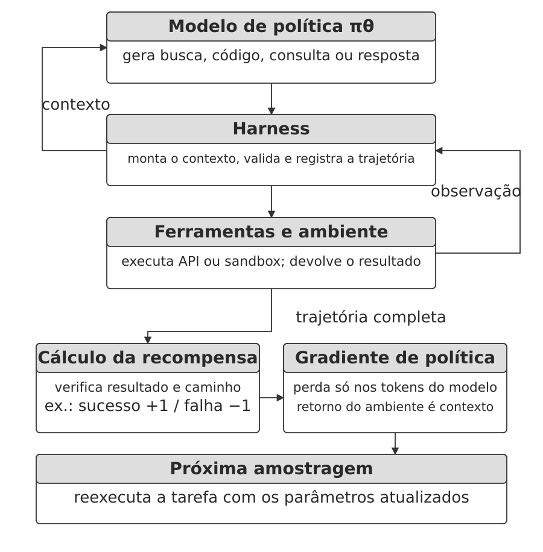

O Search-R1[^ch8-25] treina o modelo a decidir quando buscar, que consulta enviar e como continuar raciocinando com os resultados. O ReTool conecta um interpretador de código ao mesmo tipo de ciclo, e o modelo aprende a programar a execução de código, entender os valores devolvidos e corrigir-se a partir dos erros. O AWorld-train estende isso a um sandbox MCP com várias ferramentas: o modelo precisa escolher ferramentas e lidar com dependências entre chamadas, e o sistema de treinamento ainda precisa conseguir reiniciar o ambiente e reproduzir trajetórias.

Trajetórias com ferramentas precisam distinguir os tokens gerados pelo modelo dos tokens devolvidos pelo ambiente. No cálculo da perda da política, só entram as ações geradas pelo modelo — raciocínio, parâmetros de chamada, respostas —, e as posições correspondentes ao feedback do ambiente são mascaradas. O feedback continua participando do cálculo seguinte como contexto e ajuda o modelo a decidir o próximo passo. Por exemplo, se o interpretador devolve um erro, o que o treinamento quer reforçar é como o modelo corrige o código em seguida. Se o texto do erro também entrasse na perda da política, a atualização misturaria o objetivo de “gerar a saída do ambiente”, afastando-se das decisões pelas quais o modelo de fato responde.

> **Experimento 8-14 ★★★: ReTool — interpretador de código para resolver problemas de matemática**
>
> A Figura 8-17 usa uma equação do segundo grau para mostrar como raciocínio em texto, geração de código e feedback do interpretador se alternam.
>
> 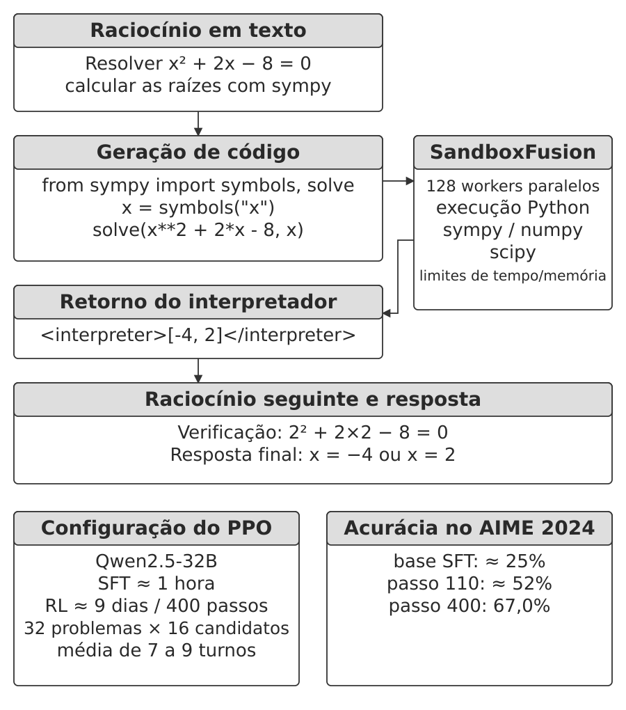
>
> Depois de um aquecimento com SFT, o ReTool faz treinamento PPO com pensamento em texto, execução de código e feedback do interpretador intercalados. O modelo aprende aos poucos quando vale a pena rodar código e como modificá-lo depois de um erro. Os dados de treinamento vêm do DAPO-Math-17k, e a atualização da política ainda usa o PPO padrão[^ch8-26][^ch8-27].
>
> Após o treinamento, a acurácia do modelo no AIME 2024 sobe de cerca de 25% para 67,0%. Em comparação com o RL apenas em texto, o feedback do código faz o modelo aprender mais depressa a calcular com precisão e a corrigir erros.

> **Experimento 8-15 ★★★: AWorld-train — aprender a usar ferramentas em um sandbox**
>
> Percorra a metade superior da Figura 8-18: o modelo recebe o resultado de uma chamada de ferramenta e ainda pode continuar tentando. Depois, percorra a metade inferior: este lote de tarefas já terminou, o programa de treinamento recebe as trajetórias com recompensa e atualiza os parâmetros, e só o lote seguinte de tarefas usa a nova política.
>
> 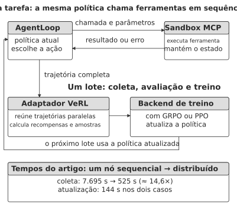
>
> O ambiente GAIA tem 26 servidores MCP e 126 funções de ferramenta: pode operar páginas web com Playwright, extrair conteúdo de PDF, Word e apresentações, transcrever áudio, reconhecer texto ou executar código no sandbox E2B. A ferramenta de Excel oferece 29 operações, incluindo fórmulas, gráficos e tabelas dinâmicas, e a recuperação de conhecimento pode ainda acessar Wikipedia, arXiv e Wayback. Depois de reiniciar o sandbox, é possível tentar de novo a partir do mesmo estado ou reproduzir trajetórias anteriores.
>
> Os tempos da figura vêm da comparação de coleta do artigo. O experimento que acompanha o livro traz ainda uma configuração de treinamento para um modelo de 4B: Qwen3-4B-Thinking-2507, 8 A100, limite de contexto de 131K, até 32 turnos de interação, tamanho de lote 32, 16 trajetórias amostradas por problema, atualização com GRPO e taxa de aprendizado de 1e−6.

A ferramenta devolveu um resultado; qual passo o programa de treinamento deve recompensar? Uma chamada bem-sucedida só mostra que a ferramenta executou com sucesso. Para julgar se esse passo fez a tarefa avançar, é preciso usar um verificador para checar a mudança que ele causou e só então decidir que recompensa dar ao modelo.

## Design de recompensas: transformando os objetivos da tarefa em sinais de aprendizado

Imagine duas trajetórias de reembolso que, no fim, devolvem o mesmo valor, mas uma delas pulou a verificação de identidade obrigatória. Se só o saldo final for lido, as duas recebem a mesma nota. Para transformar em sinal de aprendizado os requisitos completos que o usuário confiou ao agente, defina primeiro quem pode verificar o resultado, em que passo é possível obter evidência e que informações precisam voltar ao modelo e, depois, verifique se as restrições de permissão e de processo ao longo do caminho podem ser verificadas separadamente.

### De onde vem a recompensa: regras, preferências humanas e avaliação por modelos

Para tarefas que podem ser julgadas automaticamente, dou preferência ao **aprendizado por reforço com recompensas verificáveis (RLVR)**, escrevendo os critérios de aceitação diretamente como programa. Problemas de matemática podem ter a resposta conferida, tarefas de código podem rodar testes, e tarefas de reembolso podem verificar o valor e o status do pedido no banco de dados. Registrando 1 para aprovação e 0 para falha, obtém-se a recompensa de resultado mais simples. Regras claras e execução reproduzível facilitam localizar diferenças de pontuação; a cobertura do verificador, por sua vez, determina quais requisitos o treinamento de fato otimiza.

O **aprendizado por reforço com feedback humano (RLHF)** transforma preferências humanas em sinal de treinamento. O InstructGPT[^ch8-4] coletou primeiro comparações humanas entre respostas, treinou um modelo de recompensa e depois otimizou a política com PPO. O modelo de recompensa aprende as preferências de uma amostra limitada, e buscar continuamente notas mais altas desse modelo pode ampliar seus vieses[^ch8-5]. No treinamento, costuma-se acrescentar uma regularização de KL em relação ao modelo de referência do SFT para controlar o desvio da política. O DPO[^ch8-6] usa diretamente pares de preferência “resposta melhor–resposta pior” para otimizar a política, dispensando a etapa de treinar um modelo de recompensa à parte.

Em tarefas abertas, pode-se pedir ao modelo uma justificativa e uma nota. Os diagnósticos gerados por um **modelo de recompensa generativo (GRM)** também servem para filtrar demonstrações, construir pares de preferência ou orientar modificações posteriores. O DeepSeek-GRM[^ch8-23] gera princípios de avaliação conforme a tarefa e, com base neles, produz críticas e notas; melhora seu comportamento de avaliação por RL online e agrega julgamentos com múltiplas amostragens e um modelo de recompensa auxiliar.

A distância entre a métrica de avaliação e o objetivo da tarefa também afeta o comportamento do modelo. **Reward hacking** é quando a política explora falhas nas regras de pontuação ou em sua implementação para obter notas altas. Em agentes de longo horizonte, há ainda um fenômeno chamado **reward seeking**: o modelo age segundo o modo de pontuação que ele próprio presume — por exemplo, escolhe por conta própria uma verificação fácil de passar e encerra a tarefa assim que ela passa[^ch8-29]. O exemplo nos lembra que as condições de aceitação devem partir do objetivo do usuário e cobrir as entregas reais; verificar apenas métricas escolhidas pelo próprio modelo facilmente deixa escapar requisitos ainda não cumpridos.

Ao projetar a recompensa da tarefa de reembolso, passe primeiro duas trajetórias escritas à mão pelo verificador. A trajetória A localiza o pedido, chama a interface de reembolso e repete o comprovante para o usuário; a B apenas diz “o reembolso foi concluído”. Se as duas recebem a mesma nota, verifique primeiro se o avaliador leu a resposta final, o comprovante da interface ou o status do pedido. Esse contraexemplo minúsculo basta para expor o problema da métrica substituta e poupa o custo de descobrir, só depois de treinar um lote inteiro, que o modelo aprendeu a anunciar o sucesso antes da hora.

### Quando a recompensa é concedida: resultado ou processo

A **recompensa de resultado** avalia o desempenho na tarefa ao fim de um episódio; quando um modelo faz essa avaliação, ele se chama **ORM (Outcome Reward Model)**. A recompensa de sucesso/fracasso do SimpleVLA-RL faz a política explorar diferentes sequências de ações em torno do objetivo final. Esse sinal é fácil de definir, mas, quando uma trajetória longa falha, o modelo ainda precisa de mais tentativas para distinguir quais ações causaram a falha. Essa é uma das razões pelas quais o feedback esparso afeta a eficiência amostral[^ch8-8].

Tome o encerramento prematuro de um agente de programação: depois que o modelo declara a tarefa concluída, o Harness roda, em um espaço de trabalho isolado, testes de aceitação protegidos. Os testes leem os arquivos reais e o estado do ambiente; se passam, dão recompensa positiva; se falham, negativa. Assim, a declaração de conclusão aciona uma verificação externa, e o resultado da tarefa é decidido pelas entregas. Na avaliação, prepare dois grupos de tarefas: um com trabalho ainda pendente, para medir a taxa de encerramento prematuro; outro já concluído, para verificar se o modelo sabe encerrar a tempo.

A **recompensa de processo** dá feedback nos passos intermediários, avaliando, por exemplo, a verificação de identidade, a escolha de parâmetros, as ações de navegação ou os passos de raciocínio. O modelo que avalia o processo se chama **PRM (Process Reward Model)**. O trabalho da OpenAI “Let's Verify Step by Step”[^ch8-7] estudou a verificação passo a passo no raciocínio matemático. Sinais de processo ajudam o modelo a localizar erros, mas também aumentam o custo de anotação e verificação. Se uma única ordem de resolução for tratada como o único caminho correto, a recompensa de outras estratégias válidas também será rebaixada. Por isso, só acrescento sinais de processo para eventos intermediários realmente verificáveis, deixando o modelo continuar a explorar várias soluções válidas. O V-IRL-VL (Experimento 8-12) usa feedback de navegação passo a passo, e o SimpleVLA-RL (Experimento 8-13) usa recompensa final, mostrando escolhas diferentes de granularidade de feedback para dois tipos de tarefa.

Na prática, pode-se estabelecer primeiro uma linha de base com recompensa de resultado e depois acrescentar sinais de processo para eventos intermediários, como a conclusão da verificação de identidade ou a aprovação nos testes. Em tarefas de múltiplos turnos de comprimento finito, pode-se usar o fator de desconto $\gamma=1$, para que a recompensa final mantenha o mesmo peso ao se propagar para trás. O PPO associa o feedback a cada ação por meio da estimativa de valor e do cálculo de vantagem; o GRPO com vantagem no nível da trajetória costuma usar o mesmo peso de vantagem para calcular a perda da política de todos os tokens gerados na trajetória.

### Quanta informação a recompensa deve expressar: escalar, vetor e diagnóstico generativo

Quando a recompensa aparece determina a densidade do feedback; o que ela contém determina a forma de representação. Um escalar resume o desempenho geral; a forma semiescalar “justificativa breve + nota” acrescenta o fundamento da avaliação; um vetor expressa separadamente dimensões como exatidão, completude e custo; o diagnóstico generativo explica concretamente os problemas e a direção da correção e também pode ser agregado a partir de várias amostragens.

- Quando há resposta definida ou testes de aceitação, pode-se começar com um escalar binário.
- Quando há vários objetivos de qualidade, pode-se pontuar cada um separadamente e depois ponderá-los ou impor restrições conforme os requisitos do negócio.
- Quando a avaliação exige interpretação à luz do contexto, podem-se gerar diagnósticos, calibrados por checagem de fatos e amostragem humana.

Por exemplo, uma tarefa de atendimento pode registrar ao mesmo tempo se o problema foi resolvido, o número de turnos da conversa e se a verificação de identidade foi feita. As três dimensões correspondem a efeito, custo e requisito de processo. Antes de usá-las no treinamento, verifique se a pontuação é estável e se elas distinguem o comportamento das trajetórias de um mesmo grupo. Começo com poucas métricas confiáveis e só acrescento dimensões depois de validá-las uma a uma. Cada critério não validado pode levar o modelo a otimizar uma nova métrica substituta sem melhorar a tarefa real.

### Restrições de trajetória e RLVP

O cumprimento de uma tarefa pode envolver também requisitos de comportamento independentes: contatar o usuário dentro do horário comercial, concluir a verificação de identidade, manter intactos os arquivos protegidos. O RLVP (Reinforcement Learning with Verified Penalty)[^ch8-9] combina a recompensa de resultado com penalidades verificáveis sobre a trajetória, segundo o princípio **recompensar o resultado, penalizar o caminho**. As regras de trajetória são acionadas por ações observáveis no ambiente, e a integridade da entrega continua sendo verificada pela aceitação da tarefa.

Duas correções passaram na aceitação, mas uma delas sobrescreveu diretamente um arquivo que deveria ter sido lido antes. Basta examinar o registro das ferramentas para localizar essa ação irregular; julgar quanto cada passo anterior contribuiu para o sucesso final é muito mais difícil. A forma mais simples é dar à trajetória inteira uma nota $R=O+\beta\Phi$: $O$ é a nota da tarefa, $\Phi$ resume as deduções por violação ou o progresso verificável, e $\beta$ define o peso relativo entre os dois. Isso distingue as duas correções, mas todas as ações de uma mesma trajetória recebem o mesmo sinal.

Se se sabe em qual turno ocorreu a violação, é possível atribuir a dedução só a esse turno. Veja as duas trajetórias de teste da implementação que acompanha o livro: A concluiu a tarefa, mas violou uma regra no segundo turno; B não concluiu a tarefa, mas respeitou as regras nos dois turnos. As notas de resultado das duas são 1 e 0; subtraindo a média do grupo, obtêm-se +0,5 e −0,5. Cada trajetória tem dois turnos de ação, cada turno com 10 tokens de ação. Com a configuração `c2` da implementação, os dois sinais são contados separadamente:

```python
outcome_weight = (1 - 0.5) / 40  # o sinal de resultado é dividido entre todos os 40 tokens de ação do lote
penalty_weight = -0.3 / 10       # a dedução por violação é dividida só entre os 10 tokens de ação do segundo turno de A
first_turn = outcome_weight
second_turn = outcome_weight + penalty_weight
```

No primeiro turno de A, cada token de ação recebe peso +0,0125; no segundo, −0,0175. Assim, duas ações da mesma correção bem-sucedida podem receber sinais de treinamento de sentidos opostos. Só depois que esses pesos entram na perda da política o otimizador atualiza os parâmetros com base neles. Numa tarefa de atendimento, basta que o registro das ferramentas localize em qual turno a verificação de autorização foi pulada para distribuir a dedução da mesma forma.

O papel do sinal de trajetória pode ser entendido pela diferença dentro do grupo. Se um grupo de trajetórias do GRPO tem a mesma recompensa de resultado, a vantagem calculada com essa recompensa é zero; se o número de violações difere entre elas, a penalidade de trajetória oferece uma nova base de comparação. A recompensa por progresso parcial segue a mesma condição: o modelo precisa ao menos amostrar graus diferentes de progresso para que ela tenha efeito de distinção.

Ao projetar recompensas de trajetória, podem-se seguir quatro regras: penalizar ações claramente irregulares; manter a recompensa pelo resultado da tarefa; oferecer um caminho conforme e alcançável para o comportamento restrito; usar regras de verificação que possam ser executadas repetidamente. Por exemplo, penalizar isoladamente cada operação incentiva o modelo a ficar parado; só mantendo a recompensa pelo sucesso da tarefa é possível impulsioná-lo, ao mesmo tempo, a concluir o trabalho. Quando o modelo de base tem dificuldade em gerar caminhos conformes, pode-se estabelecer um ponto de partida com poucas demonstrações e reduzir aos poucos, pelo treinamento, a dependência da modelagem da trajetória.

> **Experimento 8-16 ★★★: RLVP — recompensar o resultado, penalizar o caminho**
>
> O experimento acrescenta ao GRPO a recompensa de resultado $O$ e o sinal de trajetória $\Phi$ e compara com a recompensa apenas de resultado. Na tarefa substituta do TerminalBench, o número de violações caiu de 3,71 para 0,66, com taxa de sucesso praticamente igual; na tarefa substituta do miniF2F, depois de acrescentar uma recompensa alcançável por progresso parcial, as iterações necessárias para atingir uma taxa de sucesso de 0,9 caíram de 7,0 para 4,4.
>
> A tarefa de correção de software mostra ainda o papel da alcançabilidade do sinal: quando nenhum rollout passa em teste algum, a recompensa de progresso calculada pelo número de testes aprovados é sempre a mesma e não aumenta a diferença dentro do grupo.

O número médio de violações caiu para 0,66, o que mostra que o modelo passou a escolher caminhos conformes com mais frequência, mas ainda viola as regras ocasionalmente. Para restrições que precisam ser obedecidas sempre, é preciso também verificar permissões ao executar as ferramentas.

## Destilação: como melhorar a eficiência amostral

Um rollout de agente costuma incluir vários turnos de geração do modelo e de execução de ferramentas. Melhorar a **eficiência amostral** significa atingir o desempenho-alvo com menos interações com o ambiente. Passos de treinamento, tempo de GPU e volume de chamadas ao ambiente refletem custos diferentes e devem ser considerados junto com a tarefa. Por exemplo, no caso do ReTool deste capítulo, o treinamento de SFT leva cerca de 1 hora, e o de RL, cerca de 9 dias; a amostragem repetida e a execução de ferramentas consomem grande parte dos recursos.

Com recompensa final, uma trajetória inteira pode receber apenas uma nota de sucesso ou fracasso. Suponha que a ferramenta de negócio já tenha avisado que “são necessários os quatro últimos dígitos do cartão de crédito”, mas o agente deixou passar essa informação e acabou com recompensa 0. O treinamento ainda precisa descobrir, ao longo de várias tentativas, se a falha veio do campo ausente, de parâmetros de ferramenta errados ou de um erro de operação posterior. Se um professor puder dar supervisão passo a passo sobre essa trajetória, a mesma interação com o ambiente produzirá sinais de aprendizado mais detalhados.

### Destilação on-policy: supervisão densa a partir de um único rollout

Na **destilação on-policy (On-Policy Distillation)**, o aluno gera a trajetória e o professor fornece supervisão sobre os prefixos que o aluno de fato gerou. A pesquisa do Thinking Machines Lab de 2025 apresentou essa forma de treinamento de maneira sistemática[^ch8-10]. Para entender os três tipos de método, separe “quem produz os estados de treinamento” de “quem fornece o sinal de aprendizado”:

| Método | Quem produz a trajetória ou o estado | Principal sinal de aprendizado |
| --- | --- | --- |
| SFT / destilação off-policy | Demonstrações humanas ou do professor | Supervisão token a token da resposta-alvo |
| On-policy RL | O aluno atual | Recompensa de resultado ou de processo |
| On-policy Distillation | O aluno atual | Avaliação token a token, pelo professor, das probabilidades nos prefixos do aluno |

Por exemplo, a demonstração do professor sempre consulta o pedido antes de solicitar o reembolso, mas o aluno pode iniciar o reembolso primeiro e receber o erro “número do pedido ausente”. A destilação on-policy faz o professor avaliar esse estado ao qual o aluno chegou e orientá-lo a buscar a informação que falta. Assim, o treinamento cobre os erros do próprio aluno e os caminhos de recuperação.

Uma forma de implementação é minimizar, sobre os prefixos gerados pelo aluno, o KL reverso entre aluno e professor:

$$
D_{\mathrm{KL}}(\pi_\theta\Vert\pi_T)
=\mathbb{E}_{a\sim\pi_\theta(\cdot\mid h)}
\left[\log\pi_\theta(a\mid h)-\log\pi_T(a\mid h)\right],
$$

em que $h$ é o prefixo atual, $a$ é o próximo token, e $\pi_\theta$ e $\pi_T$ representam, respectivamente, as distribuições do aluno e do professor. Tokens que o professor considera mais adequados recebem sinais de treinamento mais favoráveis. Na implementação, pode-se comparar a distribuição completa ou consultar a log-probabilidade que o professor atribui aos tokens já amostrados pelo aluno, construindo um sinal de otimização token a token.

Tome “consultar a API primeiro e depois analisar o retorno”: suponha que, em certa posição, os candidatos “consultar” e “chamar” correspondam cada um a um token e que o professor lhes dê probabilidades de 80% e 15%, com os demais candidatos somando 5%. Isso fornece um critério de escolha mais fino do que o sucesso ou fracasso final. Se uma trajetória contém $T$ tokens gerados pelo modelo, obtém-se supervisão em cerca de $T$ posições; o conteúdo devolvido pelas ferramentas continua sendo usado como contexto e é mascarado na perda da política.

O processo pode ser expresso na forma de alinhamento de distribuições completas:

```python
trajectory = rollout(student, task)
loss = 0
for prefix in model_generated_positions(trajectory):
    target = stop_gradient(teacher.distribution(prefix))
    loss += KL(student.distribution(prefix), target)
update_student(loss)
```

O aluno cuida da exploração, o professor fornece supervisão em muitas posições, e o custo adicional vem sobretudo da inferência do professor. Quando a interação com o ambiente é cara e o professor consegue orientar o aluno com confiabilidade, a destilação on-policy é a primeira alternativa que testo, para que cada chamada ao ambiente produza mais sinais de aprendizado úteis. Para alunos com domínio insuficiente do idioma-alvo, do conhecimento do domínio ou das ações básicas, pode-se primeiro estabelecer um ponto de partida eficaz com Mid-training e treinamento por demonstração e só então passar à destilação on-policy.

A consistência entre amostragem e treinamento é igualmente importante: o motor de amostragem produz trajetórias segundo a política $\mu$, o motor de treinamento calcula a perda segundo $\pi_\theta$, e a diferença entre os dois altera a distribuição dos estados de treinamento.

A comparação do Thinking Machines Lab em tarefas de matemática mostrou um ganho de eficiência de treinamento de cerca de uma ordem de grandeza. Em agentes de múltiplos turnos, pode-se manter esse tipo de comparação, registrando ao mesmo tempo a taxa de sucesso na tarefa, o volume de chamadas ao ambiente e o custo computacional do professor. Os estados que o aluno encontra no ambiente e a capacidade do professor de dar feedback confiável determinam juntos o ganho.

Meus colaboradores e eu também comparamos, em uma tarefa de “percepção do tempo”, DPO, quatro receitas de RL e a destilação on-policy[^ch8-11]. As primeiras receitas esbarraram, respectivamente, em recompensa esparsa, desalinhamento de objetivos, incompatibilidade no formato dos rollouts e colapso da política. Ao passar a um professor Qwen3-32B congelado, alinhando token a token nas próprias trajetórias de múltiplos turnos do aluno, o treinamento convergiu suavemente, e a taxa de aprovação nas quatro condições ficou de 23 a 47 pontos percentuais acima da linha de base de SFT da mesma origem. Essa experiência me fez valorizar mais a densidade de sinal que cada interação oferece. Quando todas as decisões intermediárias de uma mesma interação podem participar do aprendizado, o valor das trajetórias existentes é aproveitado de forma mais completa.

Se um professor de matemática é bom em raciocínio e um professor de código é bom em corrigir programas, como fazer um aluno aprender os pontos fortes de ambos? A destilação on-policy com múltiplos professores (MOPD) mantém o processo de treinamento acima, apenas trocando o professor fixo por um professor escolhido conforme o domínio do problema. Quando o aluno resolve um problema de código, mesmo que tenha se desviado no meio do caminho, entrega o prefixo que já escreveu ao professor de código e obtém a distribuição de probabilidade do passo seguinte; quando chega a vez de um problema de matemática, é o professor de matemática que orienta o processo de resolução do aluno. Os professores de cada domínio podem ser treinados de forma independente, com os parâmetros fixados na fase de destilação. Na implantação, só é preciso executar um aluno.[^ch8-mopd]

Há aqui duas condições práticas. Primeira: calcular o KL token a token pela fórmula acima exige obter, sobre o prefixo dado pelo aluno, probabilidades do professor que possam ser alinhadas. Ter em mãos apenas algumas respostas completas escritas pelo professor permite fazer SFT, mas não basta para calcular essa perda. Segunda: na aceitação, os resultados de cada domínio devem ser analisados separadamente. Quando o aluno melhora em matemática e piora em código, uma média geral em alta facilmente esconde o retrocesso.

[^ch8-mopd]: Wenhan Ma et al., *MOPD: Multi-Teacher On-Policy Distillation for Capability Integration in LLM Post-Training*, 2026. O artigo usa professores treinados por domínio e faz a destilação sobre as próprias trajetórias do aluno.

### Autodestilação on-policy: construir o professor com contexto adicional

Se a equipe tem apenas um modelo bom no próprio domínio, quem será o professor? Pode-se entregar o mesmo problema a ele duas vezes. Na primeira, apresenta-se a pergunta do usuário nas condições de implantação; na segunda, fornecem-se também a resposta-padrão, uma demonstração de especialista ou documentos do domínio. A informação adicional da segunda resposta pode ser usada para orientar o aluno nas condições da primeira.

A **autodestilação on-policy (On-Policy Self-Distillation, OPSD)**[^ch8-15] faz o mesmo modelo desempenhar dois papéis: o aluno vê apenas a entrada da tarefa, e o professor vê também a resposta-padrão ou uma solução já verificada. Depois que o aluno gera a trajetória, o professor avalia cada prefixo à luz dessas informações privilegiadas e devolve a supervisão ao aluno.

Por exemplo, o aluno está resolvendo um problema de matemática, e o professor já conhece a resposta correta. Com base nela, o professor pode avaliar a direção atual do raciocínio do aluno, e o aluno aprende a melhorar sua geração tendo apenas o enunciado. O pseudocódigo abaixo mostra onde ficam o contexto adicional e o isolamento do gradiente:

```python
trajectory = rollout(model, task_without_answer)
loss = 0
for prefix in model_generated_positions(trajectory):
    privileged_prefix = add_verified_answer(prefix)
    target = stop_gradient(model.distribution(privileged_prefix))
    loss += KL(model.distribution(prefix), target)
update(model, loss)
```

As informações privilegiadas entram apenas no ramo do professor durante o treinamento; as entradas do aluno e da avaliação permanecem iguais às da implantação. Pelo pseudocódigo, podem-se conferir os dois caminhos da informação: a resposta-padrão entra só na linha que constrói o prefixo do professor, e o aluno não a verá na implantação; a saída do professor passa por interrupção do gradiente, de modo que, neste passo, só o ramo do aluno atualiza os parâmetros com base na diferença entre as duas distribuições. Na rodada seguinte, com o modelo atualizado, o julgamento do professor também pode mudar. Assim, um mesmo modelo pode aproveitar as informações mais completas do lado do treinamento para supervisionar sua própria geração real.

As informações privilegiadas também podem vir de demonstrações humanas ou de documentos do domínio selecionados. Na escolha, verifique se elas melhoram o julgamento do professor: quanto melhor o professor, de posse da informação, identifica os erros do aluno, mais útil é o sinal de destilação. Durante o treinamento, é preciso ainda usar amostras reservadas de antemão para teste a fim de verificar as capacidades existentes e o estilo de geração; estudos como o Purified OPSD usam ainda restrições de regularização para ajudar o modelo a manter seu estilo de raciocínio original[^ch8-16].

## De casos de falha ao pós-treinamento

O Capítulo 7 organizou problemas de produção em tarefas reproduzíveis, atribuições de causa de falha e critérios de avaliação. Esses materiais também servem ao pós-treinamento: a tarefa completa fornece o ambiente de interação, o prefixo da trajetória antes do erro fornece o contexto de decisão, e o verificador confere os comportamentos recém-gerados. A Tabela 8-5 lista como eles correspondem aos métodos de treinamento.

Tabela 8-5 Materiais de avaliação do Capítulo 7 e seus usos no pós-treinamento

| Material do Capítulo 7 | Uso no treinamento do Capítulo 8 |
| --- | --- |
| Tarefas de ponta a ponta e verificadores | Tarefas para amostragem de RL, recompensas verificáveis, conjunto de tarefas para amostragem por rejeição |
| Prefixos de trajetória e comportamentos subsequentes | Pares de preferência para DPO, demonstrações de decisão para SFT, entradas do professor na destilação on-policy |
| Pontos de falha e categorias de erro | Rótulos de avaliação de processo, regras verificáveis de penalidade de trajetória |
| Notas por critério da Rubric e respostas-padrão anotadas por humanos | Recompensas multidimensionais, treinamento e calibração de modelos de recompensa generativos |

Um prefixo histórico pode servir de ponto de partida para uma tarefa de continuação. Na destilação on-policy, o aluno atual continua a gerar a partir desse ponto, e o professor avalia os prefixos que o aluno de fato produziu; quando é preciso executar ferramentas, restaura-se também o estado correspondente do ambiente. Assim, a avaliação de decisões locais do Capítulo 7 se conecta ao fluxo de amostragem e treinamento deste capítulo.

As tarefas usadas no treinamento devem ficar separadas das tarefas reservadas para avaliação. Os dois lados podem compartilhar interfaces e lógica de verificação, mas usam instâncias de tarefa independentes; quando se quer avaliar a generalização entre tarefas, pode-se dividir também por modelo de tarefa ou tipo de negócio. Os três exemplos a seguir mostram como fazer essa conversão.

### Caso 1: encerramento prematuro do agente de programação

O agente declarar a tarefa concluída sem ter rodado os testes, entregar depois de cumprir só dois de três requisitos ou desistir após algumas falhas — tudo isso é encerramento prematuro. Em produção, esses casos podem ser coletados a partir de correções dos usuários, avaliações negativas e revisões de trajetórias. Por exemplo, se o usuário aponta “você ainda não rodou os testes”, pode-se percorrer a trajetória e verificar o estado da tarefa naquele momento, as evidências de verificação disponíveis e a declaração de conclusão do modelo.

Ao analisar a causa, pare a trajetória no instante em que o modelo está prestes a dizer “terminei” e olhe para trás: ele deixou de ler algum requisito ou modificou o código errado? Daí saem dois tipos de material de treinamento: a tarefa completa serve para treinar o modelo a concluir o trabalho, e o prefixo de decisão serve para treiná-lo a escolher, com base em evidências, entre continuar e encerrar.

**A tarefa completa pode ser ligada a uma recompensa de resultado.** Quando o modelo entrega o resultado, rodam-se testes de aceitação protegidos: +1 se passam, −1 se falham. Os testes cobrem as entregas reais; o modelo pode obter feedback pelos testes normais de desenvolvimento, e a aceitação final é executada pelo ambiente de treinamento.

**O prefixo de decisão pode gerar pares de preferência.** No mesmo contexto, a amostra rejeitada (`rejected`) é uma declaração de conclusão sem evidências, e a amostra preferida (`chosen`) continua rodando os testes necessários, confere os requisitos que faltam e conclui o trabalho restante. Pode-se pedir ao professor que escreva algumas continuações possíveis e usar o verificador para filtrar as que servem de demonstração. Se houver poucas amostras, varie o tipo de tarefa, os itens de verificação faltantes e a forma de declarar a conclusão, ampliando o conjunto para centenas de pares de preferência. Em seguida, faça DPO com LoRA, misturando uma quantidade adequada de tarefas gerais para manter a cobertura de comportamentos.

**A avaliação verifica tanto tarefas inacabadas quanto concluídas.** Um grupo de tarefas está só parcialmente feito, para observar se o modelo continua; outro já está resolvido, para ver se ele sabe encerrar a tempo. Ao mesmo tempo, faça checagens pontuais de chamadas de ferramentas gerais e de outras tarefas, para observar se o treinamento direcionado afetou as capacidades existentes. Se só a taxa de encerramento prematuro cair, o modelo pode passar a escolher sempre continuar verificando e demorar a encerrar até trabalhos já concluídos. Nesse caso, o grupo de tarefas já resolvidas mostrará chamadas de ferramentas e esperas desnecessárias.

> **Experimento 8-17 ★★: Do caso de falha de “encerramento prematuro” à correção com DPO**
>
> O experimento encadeia “atribuição da falha → prefixo de decisão → pares de preferência → treinamento com LoRA → avaliação reservada” em um único fluxo, treinando um modelo de 7B.
>
> Os dados contêm 24 casos de falha realistas, cobrindo quatro situações — declarar conclusão sem rodar os testes, cumprir só parte de vários objetivos, não satisfazer as condições de aceitação e desistir diante de erros —, além de uma variante de trapaça na recompensa em que o teste que falhava é apagado. À parte, reservam-se, apenas para avaliação, 12 problemas com trabalho ainda pendente e 8 já resolvidos.
>
> Veja primeiro um problema reservado. O consumidor de uma fila de mensagens perde mensagens depois de reconectar-se após uma queda; o assistente modificou o código de reconexão, e a ferramenta só informou “arquivo modificado”. Neste momento, deve-se anunciar que foi corrigido ou continuar verificando? O experimento fornece duas respostas candidatas e compara qual delas o modelo pontua mais alto. Antes do treinamento, o modelo acertou 3 das 12 tarefas inacabadas (25,0%); depois, acertou 11 (91,7%). Nas outras 8 tarefas, de fato concluídas, acertou as 8 antes e depois do treinamento.
>
> Retirando as respostas candidatas e deixando o modelo escrever ele mesmo o próximo passo, o resultado muda. Segundo as regras de classificação de texto do experimento, nas tarefas inacabadas, os anúncios prematuros de conclusão caíram de 1/12 para 0/12; nas tarefas concluídas, os encerramentos explícitos também caíram de 6/8 para 0/8. Olhando só o primeiro grupo, é fácil achar que o problema foi resolvido. O segundo grupo, porém, nos lembra que o modelo reconhece quando parar entre duas respostas prontas, mas, ao escrever a própria resposta, ainda pode insistir em verificar mais. Voltando ao exemplo das mensagens perdidas, é preciso ainda fazer o assistente executar de fato um teste de queda e reconexão e verificar se as mensagens chegam depois de reconectar. Dizer “vou continuar verificando” e obter o resultado da verificação são dois passos distintos.

### Caso 2: aspas em chinês

“Trocar as aspas retas por aspas curvas em um artigo em chinês” exige primeiro definir o escopo da edição. Citações no texto em chinês podem usar `“”`, e as citações aninhadas seguem as regras de pontuação do chinês; já as aspas em trechos originais em inglês, literais de string, JSON, caminhos e identificadores cumprem funções sintáticas próprias. O objetivo do treinamento é fazer o modelo reconhecer esses escopos e realizar a edição mínima.

Pode-se escrever primeiro as regras como uma Skill e, a partir dela, gerar textos de entrada e textos-alvo. Os exemplos positivos incluem parágrafos em chinês, citações aninhadas e comentários em chinês; as amostras de proteção incluem citações em inglês, literais de string e de caractere, JSON, código inline e blocos de código. Para comentários em chinês dentro de código, é preciso reconhecer ao mesmo tempo os limites do comentário e o escopo da citação; trechos cujo escopo não pode ser determinado ficam como no original. Só combinando essas situações em um mesmo documento é possível praticar o julgamento de escopo de uma edição real.

> **Experimento 8-18 ★★: SFT de aspas curvas em chinês sensível ao escopo**
>
> O experimento usa o Qwen3-8B e faz SFT com LoRA em bf16, treinando 2 épocas, com 256 atualizações no total. O objetivo do treinamento é converter as citações do texto em chinês e preservar as aspas sintáticas em código e dados estruturados.
>
> Os dados combinam 16 categorias de trecho, 10 gêneros textuais e 9 linguagens de programação, gerando 1.024 amostras de treinamento, 256 amostras reservadas e 256 amostras de limite. Cada amostra guarda o texto original e o texto-alvo, cobrindo citações a converter, strings a proteger e casos em que as duas coisas se aninham.
>
> Após o treinamento, a taxa de correspondência exata foi de 96,9% no conjunto reservado e de 97,7% no conjunto de limite, e a taxa de preservação das regiões protegidas foi de 100%.
>
> O mesmo conjunto de regras de escopo serve para gerar os rótulos e verificar as saídas. O modelo aprende a julgar o escopo da edição, e o analisador e a verificação sintática cuidam de validar a estrutura do documento modificado. Assim, a qualidade da edição do texto e a correção do formato podem ser verificadas separadamente.

### Caso 3: falhas frequentes na edição de arquivos

O Capítulo 5 apresentou ferramentas como `edit_file(path, old_string, new_string)`. O modelo precisa copiar o texto original em `old_string`, e a ferramenta faz a correspondência exata. Diferenças em espaços, quebras de linha, barras invertidas ou caracteres Unicode podem fazer a correspondência falhar.

Compare primeiro, trecho a trecho, ao longo da cadeia de transmissão da informação: **bytes originais do arquivo → retorno da ferramenta → serialização pelo Harness → contexto do modelo → tokens gerados pelo modelo → string decodificada → análise dos parâmetros da chamada → correspondência na ferramenta**. Se a etapa de leitura alterou os bytes, corrija a ferramenta; se o escape ou a montagem do contexto alterou o conteúdo, corrija o Harness; se codificar e decodificar produz mudança, verifique o tokenizador. Se a entrada do modelo está íntegra e a diferença aparece primeiro na geração do modelo, o caso pode ser usado no pós-treinamento da capacidade de cópia exata.

Os dados de treinamento podem incluir três tipos de tarefa: repetir literalmente um conteúdo especificado; escolher, entre várias strings semelhantes e de mesmo comprimento, a que é exatamente igual; e escrever o texto original no campo `old_string` de uma chamada de ferramenta. As amostras incluem espaços, quebras de linha reais, barras invertidas e diferentes representações Unicode, cobrindo os pontos em que a edição real costuma errar.

> **Experimento 8-19 ★★: SFT de cópia exata de strings especiais**
>
> O experimento usa o Qwen3-8B como base e treina com LoRA em bf16 por 2 épocas, excluindo o prompt do cálculo da perda. As questões de repetição direta usam a string-alvo como demonstração; as questões de parâmetros de ferramenta usam como demonstração o JSON completo contendo apenas `old_string`, com nomes de campo, aspas e chaves também incluídos na supervisão token a token. O experimento testa ainda, separadamente, a consistência de codificação e decodificação do tokenizador.
>
> A taxa de correspondência exata byte a byte do modelo no conjunto reservado subiu de 37,5% para 78,9%, e no conjunto de limite independente foi de 80,1%; a posição média da primeira divergência de byte nos dois grupos foi 54,0 e 54,2, respectivamente. Com 512 sondas dos conjuntos reservado e de limite, foram comparados ainda três tokenizadores; a taxa de ida e volta sem perdas foi de 80,1% tanto no Qwen3 quanto no Qwen2.5.
>
> Depois do ajuste fino, o modelo acertou 106 questões a mais; as que ele acertava antes continuam certas? Comparando as duas respostas de cada questão, 107 passaram de erradas a certas, e uma passou de certa a errada. A primeira questão do conjunto reservado pede de volta um objeto JSON. O modelo de base copiou `old_string` corretamente, mas entregou campos a mais, como o caminho do arquivo; depois do ajuste fino, entregou só os campos pedidos e ganhou o ponto. A questão que regrediu (`eval-095`) pedia a repetição literal de duas linhas de texto; a resposta após o ajuste fino juntou as duas linhas e omitiu a quebra de linha entre elas.

Escreva cada um desses três casos em uma ficha de diagnóstico: preserve a entrada que o modelo de fato via antes da falha, escreva pelo menos uma ação aceitável e escreva um contraexemplo “superficialmente parecido, mas que não deve ser seguido”. Por exemplo, quando a edição tem conflito, o modelo deve reler o arquivo; já quando o arquivo não mudou e a modificação foi verificada, pode encerrar. Só treinando com o primeiro e validando com tarefas semelhantes e de contraste que nunca participaram do treinamento é possível verificar se o modelo aprendeu um julgamento condicional ou apenas a dar sempre um passo a mais, seja qual for a situação.

## Lições práticas do pós-treinamento

O plano de pós-treinamento deve partir do problema a resolver. Conhecimento de domínio insuficiente, protocolo de saída instável e escolhas de ação ruins exigem, cada um, dados e feedback diferentes. Dou mais peso à qualidade dos dados e do ambiente: são eles que determinam com quais problemas o modelo tem contato e que sinais recebe; o algoritmo de treinamento apenas converte esses sinais em atualizações de parâmetros.

Num projeto, a verificação pode seguir esta ordem.

1. **Definir onde ficam o conhecimento e as capacidades.** Corpora estáveis do domínio podem ser usados em Mid-training, e demonstrações podem ensinar o modelo a responder e agir; fatos que exigem atualização imediata, citação, controle de permissão ou exclusão são mais bem geridos por RAG.
2. **Verificar se a saída pode ser pontuada.** Em um pequeno número de tarefas, meça a taxa de análise de JSON, a completude dos parâmetros e a taxa de sucesso das chamadas de ferramentas. Se os erros de formato forem frequentes, melhore primeiro com SFT ou decodificação restrita e só depois amplie a amostragem de RL.
3. **Verificar o comprimento de contexto efetivo.** Depois que o modelo consegue receber 128K tokens, é preciso ainda verificar se, nesse comprimento, ele consegue recuperar, raciocinar e planejar. Faço a aceitação nível a nível com uma matriz “capacidade × comprimento” antes de ampliar a janela e misturo amostras curtas e dados das etapas anteriores para manter as capacidades de curto alcance.
4. **Verificar a probabilidade de amostrar trajetórias válidas.** Observe em conjunto `pass@k`, o progresso parcial e as diferenças de recompensa dentro do grupo. Quando as amostras bem-sucedidas são raríssimas, pode-se construir um ponto de partida melhor com Mid-training, SFT, destilação ou tarefas de currículo; as recompensas parciais devem corresponder a progressos que a política atual consegue alcançar.
5. **Fazer a recompensa cobrir o objetivo da tarefa.** Se a nota depender só do comprimento da resposta, o modelo pode encher a resposta de conteúdo prolixo. Transforme os requisitos de aceitação em testes, verificações de estado e critérios de avaliação calibrados e confira a qualidade real das trajetórias com nota alta.
6. **Calibrar o feedback do ambiente.** Compare as expressões dos usuários, os erros das ferramentas e as mudanças de estado na simulação e na implantação e incorpore as diferenças às tarefas de treinamento. O custo de construir um ambiente estável também deve entrar no orçamento de treinamento.
7. **Monitorar generalização e esquecimento com tarefas reservadas.** Observe ao mesmo tempo a capacidade-alvo e as capacidades gerais existentes. Quando as métricas de treinamento continuam melhorando e o desempenho nas tarefas reservadas cai, ajuste a proporção dos dados, o número de épocas ou a regularização e escolha o checkpoint com base nos resultados da validação.
8. **Observar a estimativa de valor e a exploração.** O erro de valor do PPO afeta o cálculo da vantagem; a temperatura e a aleatoriedade da amostragem afetam a diversidade dos caminhos candidatos. Olhar juntos a oscilação da recompensa, o erro de valor, a entropia da saída e as diferenças entre trajetórias ajuda a entender por que o treinamento estagnou.
9. **Medir a consistência numérica entre amostragem e treinamento.** Antes da atualização, compare as log probabilities dos dois lados, monitore a razão de probabilidades, o KL aproximado, a proporção de cortes e a defasagem da política e alinhe pesos, templates de chat e configurações de cálculo.
10. **Estimar o custo da cadeia inteira.** O custo do RL inclui geração do modelo, execução de ferramentas, verificação, atualização de parâmetros e espera. A comparação de tempos do ReTool mostra que a amostragem pode alongar muito o ciclo de treinamento. Se o SFT já atinge o desempenho-alvo, os recursos podem ir primeiro para complementar dados e avaliar a implantação.
11. **Verificar a qualidade da supervisão em cada tipo de dado.** Associações erradas nos corpora de Mid-training, ruído nas demonstrações de SFT e vieses nos verificadores de RL entram todos no sinal de treinamento. Inspecione primeiro pequenos lotes de dados e trajetórias e só depois amplie a escala.

Essas verificações podem compor um treinamento-piloto de baixo custo: um pouco de corpus do domínio para testar o ganho de conhecimento e o esquecimento, algumas demonstrações para testar se o comportamento é aprendível e um pequeno lote de rollouts para testar as diferenças de recompensa e o custo de execução. O piloto dá a base para o investimento seguinte.

**O pós-treinamento também pode trabalhar junto com RAG e aprendizado em contexto.** Suponha que você esteja construindo um assistente de transferências. Pode-se primeiro mostrar ao modelo alguns diálogos de demonstração para que ele tente explicar ao usuário o fluxo de aprovação; quanto mais exemplos, porém, maiores podem ser o tempo e o custo de leitura em cada chamada. Quando a política muda, recuperam-se as cláusulas vigentes da base de conhecimento e cita-se a fonte na resposta. Já no passo de enviar a transferência, mesmo que o limite de aprovação não mude há anos, um programa deve conferir o valor e a autorização. Para decidir qual método usar, além de ver com que frequência a informação muda, é preciso ver se o critério de julgamento pode ser escrito como regra. Um tom natural ou as formas em imagens médicas dificilmente se esgotam em regras, e aprender esse tipo de padrão muitas vezes depende de treinamento de parâmetros.

Um sistema pode primeiro validar a estratégia com contexto, fornecer evidências com RAG e impor restrições rígidas com programas e, depois, melhorar a capacidade do modelo com Mid-training, SFT e RL. Quando o modelo atinge a meta, ainda é possível usar destilação para transferir o comportamento a um modelo menor e reduzir o custo de implantação.

Como verificar que “o modelo aprendeu a julgar a partir do feedback”? Na minha palestra no Porto, listei como questão em aberto fazer o modelo aprender continuamente a julgar nos pesos, preservando as capacidades antigas. Lembrar o saldo corrigido pelo usuário testa memória de fatos. Para ver se o modelo aprendeu a julgar, é preciso perguntar em outro cenário.

Por exemplo, o material de treinamento trata de um usuário que, em viagem de trabalho, aceita uma passagem aérea um pouco acima do orçamento. No teste, troque por um hotel desconhecido e um valor novo; uma questão mantém a restrição de horário de chegar a uma reunião, e a outra informa claramente que se trata de férias em família com orçamento apertado. As duas questões trazem as alternativas disponíveis no momento, e as ações e explicações aceitáveis são definidas de antemão. Se nas duas o modelo sempre aceita pagar mais ou sempre faz perguntas, isso indica que ele pode ter memorizado apenas a ação superficial. Em seguida, reproduza tarefas que a versão antiga já resolvia bem, como respeitar estritamente o teto de reembolso definido explicitamente pelo usuário.

## Resumo do capítulo

Diante de um problema que o modelo não resolve, deixe-o tentar mais algumas vezes e veja onde ele falha. Se, depois de uma amostragem razoável, `pass@k` continua perto de zero, verifique primeiro se falta conhecimento do domínio ou capacidade básica e só então decida se vale complementar o corpus com Mid-training. Se ele não consegue ler documentos longos por inteiro, aumente gradualmente o comprimento de treinamento e use tarefas curtas para verificar as capacidades existentes. Se o modelo às vezes acerta, mas costuma escrever parâmetros de ferramenta num formato que não pode ser analisado, vale começar com demonstrações de SFT. Quando ele já gera várias trajetórias executáveis e a recompensa consegue distinguir as melhores, o RL tem a chance de aumentar a probabilidade de escolher as boas estratégias.

**Invisto primeiro em dados e ambiente.** Nos experimentos de transferência de regra e visual do GeneralPoints, o modelo treinado com SFT sobre demonstrações limitadas tendeu ao sobreajuste, e o ramo de RL se saiu melhor nas tarefas fora da distribuição. Com outro lote de demonstrações ou outra forma de verificação, a comparação precisa ser refeita. Em tarefas de múltiplos turnos como ReTool, V-IRL e SimpleVLA-RL, é preciso ainda decidir quais eventos da execução de ferramentas, da navegação ou do controle de ações merecem feedback. Quando o ambiente real é caro demais, é possível simular o retorno das ferramentas e as transições de estado, mas é preciso voltar às tarefas reais para verificar se o modelo aprendeu a explorar os vieses do simulador. Em algumas tarefas, basta completar o conhecimento básico e as demonstrações para atingir os requisitos de entrega.

**Na minha avaliação, os principais gargalos atuais do RL de agentes são a eficiência amostral e a consistência das distribuições.** Já que uma interação com ferramentas custa tão caro, dá para aprender mais com ela? A destilação on-policy faz o professor dar orientação token a token nas posições a que o aluno de fato chegou; o RLVP complementa a recompensa final com eventos intermediários verificáveis. Por outro lado, se a política usada na amostragem já está atrás da versão em treinamento, ou se os lados de amostragem e de treinamento calculam probabilidades visivelmente diferentes para a mesma saída, é preciso examinar primeiro essa diferença e só depois interpretar a curva de recompensa.

Encerramento prematuro, escopo de edição errado e incapacidade de copiar strings com exatidão podem, todos eles, ser rastreados de uma falha até amostras de treinamento concretas. Depois de corrigir esse problema, é preciso ainda fazer a verificação de regressão com amostras independentes e com tarefas que o modelo já acertava. Diante do próximo lote de falhas, quais justificam treinar o modelo de novo e quais pedem apenas atualizar conhecimento, instruções ou programas? É exatamente essa escolha que o próximo capítulo aborda.

[^ch8-ppo-method]: Schulman et al., *Proximal Policy Optimization Algorithms*, 2017, arXiv:1707.06347.

[^ch8-1]: Schulman, John and Thinking Machines Lab, “LoRA Without Regret”, 2025.
[^ch8-2]: Yao, Shunyu, “The Second Half”, 10 de abril de 2025.
[^ch8-3]: Chu, Tianzhe et al., “SFT Memorizes, RL Generalizes: A Comparative Study of Foundation Model Post-training”, 2025. arXiv:2501.17161.
[^ch8-4]: Ouyang, Long et al., “Training Language Models to Follow Instructions with Human Feedback”, OpenAI, 2022.
[^ch8-5]: Gao, Leo, John Schulman, and Jacob Hilton, “Scaling Laws for Reward Model Overoptimization”, OpenAI, 2023.
[^ch8-6]: Rafailov, Rafael et al., “Direct Preference Optimization: Your Language Model is Secretly a Reward Model”, 2023.
[^ch8-7]: Lightman, Hunter et al., “Let's Verify Step by Step”, OpenAI, 2023.
[^ch8-8]: Silver, David and Richard S. Sutton, “Welcome to the Era of Experience”, 2025.
[^ch8-9]: Li, Bojie, and Noah Shi, “RLVP: Penalize the Path, Reward the Outcome”, 2026. arXiv:2607.07435.
[^ch8-10]: Thinking Machines Lab, “On-Policy Distillation”, 2025.
[^ch8-11]: Li, Bojie, and Noah Shi, “Agents That Sense Physical Time: Urgency, Persistence, and Vigilance as Missing Controls for LLM Agents”, 2026.
[^ch8-12]: Kulikov, Ilia, et al. *Autodata: An Agentic Data Scientist to Create High Quality Synthetic Data.* arXiv:2606.25996, 2026.
[^ch8-13]: Sun, Hao, et al. “ZeroSearch: Incentivize the Search Capability of LLMs without Searching”, 2025. arXiv:2505.04588.
[^ch8-14]: “DreamGym: Scaling Agent Learning via Experience Synthesis”, 2025. arXiv:2511.03773.
[^ch8-15]: Zhao, Siyan, et al. “Self-Distilled Reasoner: On-Policy Self-Distillation for Large Language Models”, 2026. arXiv:2601.18734.
[^ch8-16]: Shen, Ziqi, et al. “Purified OPSD: On-Policy Self-Distillation Without Losing How to Think”, 2026. arXiv:2607.02234.
[^ch8-17]: Tan, Zelin, et al. “SKT: Skill-Use Training at Scale via Verified Synthetic Data Generation”, 2026. arXiv:2608.02287.
[^ch8-18]: Wei, Yifan, et al. “Towards Compositional Generalization of LLMs via Skill Taxonomy Guided Data Synthesis”, 2026. arXiv:2601.03676.
[^ch8-19]: Zhu, Kaijie, et al. “TermiGen: High-Fidelity Environment and Robust Trajectory Synthesis for Terminal Agents”, 2026. arXiv:2602.07274.
[^ch8-20]: Hua, Zhanbo, et al. “CLI-Universe: Towards Verifiable Task Synthesis Engine for Terminal Agents”, 2026. arXiv:2606.22883.
[^ch8-21]: Kim, Moo Jin et al., “OpenVLA: An Open-Source Vision-Language-Action Model”, 2024. arXiv:2406.09246.
[^ch8-23]: Liu, Zijun et al., “Inference-Time Scaling for Generalist Reward Modeling”, 2025. arXiv:2504.02495.
[^ch8-24]: Yang, Jihan et al., “V-IRL: Grounding Virtual Intelligence in Real Life”, 2024. arXiv:2402.03310.
[^ch8-25]: Jin, Bowen et al., “Search-R1: Training LLMs to Reason and Leverage Search Engines with Reinforcement Learning”, 2025. arXiv:2503.09516.
[^ch8-26]: Feng, Jiazhan et al., “ReTool: Reinforcement Learning for Strategic Tool Use in LLMs”, 2025. arXiv:2504.11536.
[^ch8-27]: Yu, Qiying et al., “DAPO: An Open-Source LLM Reinforcement Learning System at Scale”, 2025. arXiv:2503.14476.
[^ch8-28]: Pan, Jiayi et al., “Training Software Engineering Agents and Verifiers with SWE-Gym”, 2024. arXiv:2412.21139; Barres, Victor et al., “$\tau^2$-Bench: Evaluating Conversational Agents in a Dual-Control Environment”, 2025. arXiv:2506.07982; Rawles, Christopher et al., “AndroidWorld: A Dynamic Benchmarking Environment for Autonomous Agents”, 2024. arXiv:2405.14573.
[^ch8-29]: storm, “Autoverificação e interrupção antecipada em agentes de longo horizonte: o fenômeno de reward seeking e medidas de mitigação”, Comunidade Qingke, 6 de agosto de 2026.
[^ch8-30]: Gururangan, Suchin et al., “Don't Stop Pretraining: Adapt Language Models to Domains and Tasks”, ACL, 2020.
[^ch8-31]: Jiang, Zhengbao et al., “Instruction-tuned Language Models are Better Knowledge Learners”, ACL, 2024.
[^ch8-32]: Zheng, Chujie et al., “Stabilizing Reinforcement Learning with LLMs: Formulation and Practices”, 2025. arXiv:2512.01374.
[^ch8-33]: Zhong, Tianle et al., “Diagnosing Training Inference Mismatch in LLM Reinforcement Learning”, 2026. arXiv:2605.14220.
[^ch8-34]: He, Horace and Thinking Machines Lab, “Defeating Nondeterminism in LLM Inference”, 2025.

[^ch8-speech-conditioning]: A documentação do Orpheus-TTS inclui marcas de expressão e condicionamento por contexto texto–fala; a interface do Sesame CSM usa texto, locutor e trechos de áudio para gerar a fala seguinte.

## Questões para reflexão

1. ★★ Um ajuste fino direcionado melhorou a tarefa-alvo, mas reduziu a capacidade geral de chamar ferramentas. Como você projetaria um conjunto de teste para verificar as capacidades existentes, ajustaria a proporção dos dados e o volume de treinamento e compararia o ajuste fino de todos os parâmetros com o LoRA?
2. ★★ Certa capacidade de domínio pode ser aprendida tanto por treinamento de parâmetros quanto sustentada por exemplos em contexto e recuperação de conhecimento. Com base em que fatores você escolheria a solução?
3. ★★ Que material de treinamento e que métodos de verificação são necessários para destilar, respectivamente, um modelo Chat que responde diretamente, um modelo Reasoning que gera o processo de raciocínio e um modelo Agentic que usa ferramentas em múltiplos turnos?
4. ★★★ Um agente de atendimento conclui a tarefa em 10 turnos de interação e recebe, no fim, uma recompensa de sucesso. Como você associaria esse sinal às decisões intermediárias? Quais passos se prestam a receber recompensas de processo?
5. ★★★ Você tem um orçamento de 10.000 dólares para melhorar o desempenho de um agente de atendimento. Como distribuiria o investimento entre avaliação, contexto e conhecimento, prompts/Skills, restrições programáticas e treinamento de parâmetros?
6. ★★★ A tarefa não tem uma recompensa clara, e a interação com o ambiente é cara. De que fontes é possível obter sinais de aprendizado? Como você verificaria que esses sinais de fato melhoram o desempenho na tarefa?
7. ★★ Que capacidades personalizadas um LoRA exclusivo treinado para cada usuário ou cada empresa é adequado para carregar? Que informações é melhor manter em uma base de conhecimento externa?
8. ★★★ À luz da linha de pesquisa de Weak-to-Strong Generalization, um modelo pequeno pode fornecer supervisão útil para um agente mais forte? Considere separadamente verificação local, rótulos de preferência e contexto adicional e projete um método para detectar vieses na supervisão.
9. ★★ Uma trajetória tem a maioria dos passos intermediários corretos, mas falha no fim; outra chega ao resultado correto, mas viola restrições de processo. Como combinar avaliação de processo e de resultado para avaliar essas duas trajetórias?
10. ★★★ Os ambientes e verificadores de SWE-bench, τ²-bench e AndroidWorld podem ser usados para treinamento. Como dividir instâncias e modelos de tarefa para aproveitar o material de treinamento e, ao mesmo tempo, preservar uma avaliação independente?
11. ★★★ O pass@1 da tarefa-alvo é muito baixo. Como combinar pass@k, taxa de análise do formato, taxa de progresso parcial e atribuição de falhas para decidir entre Mid-training, SFT e RL?
12. ★★★ Em um lote de rollouts, apenas algumas respostas extremamente longas ainda não terminaram, e as demais tarefas já foram concluídas. Como aumentar a utilização do cluster de treinamento e, ao mesmo tempo, controlar a defasagem da política trazida pela amostragem assíncrona?
13. ★★★ Ao usar um modelo para simular um mecanismo de busca ou usuários, que vieses de simulação podem enganar o agente? Como calibrar o treinamento com o estado das tarefas e interações reais?
