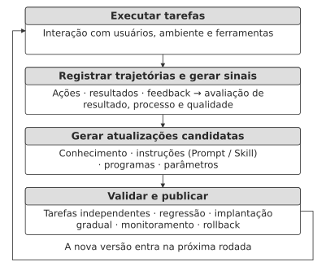
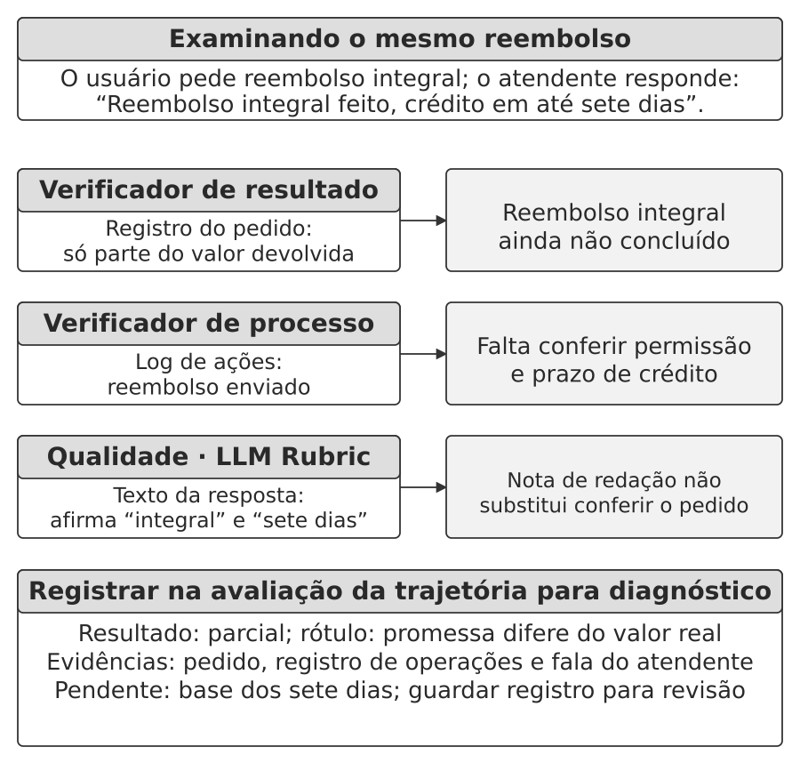
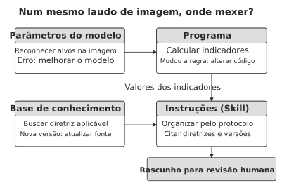
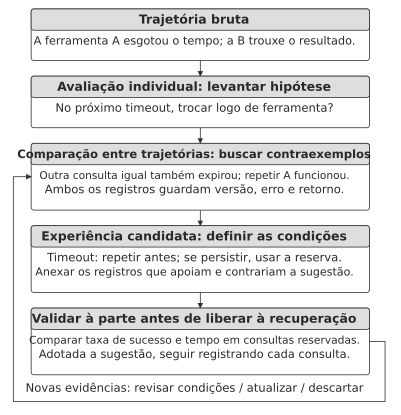
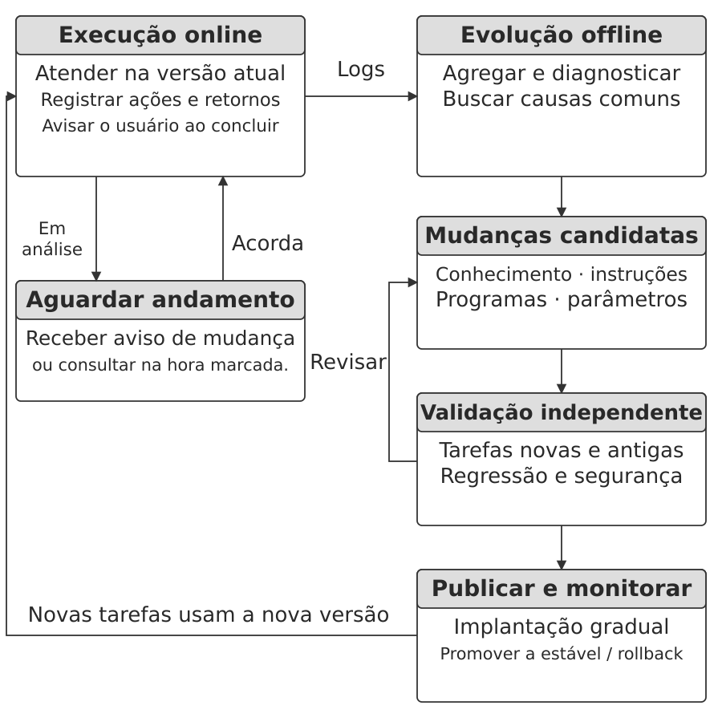

# Evolução contínua dos agentes

Um agente consegue concluir, logo na primeira tentativa, uma tarefa complexa que nunca viu, mas pode continuar repetindo o mesmo erro depois de lidar com muitas tarefas parecidas. Para que ele progrida no trabalho do dia a dia, como faz um funcionário recém-contratado, o sistema precisa transformar a experiência de execução em capacidade utilizável depois: registrar os resultados, encontrar a causa dos problemas, formular uma forma de melhorar e verificar se essa melhoria funciona em tarefas novas. **Na minha avaliação, aprender com a experiência e evoluir continuamente está se tornando uma das capacidades mais importantes de um agente.** Essa capacidade exige trabalho de engenharia nos sistemas de aplicação e também merece ser uma prioridade de pesquisa para a próxima geração de modelos.

Em geral, um modelo implantado mantém os mesmos parâmetros depois de cada inferência. O aprendizado em contexto, a manutenção de estado e a compactação do Capítulo 2 o ajudam a se ajustar dentro da tarefa atual; a memória e a base de conhecimento do Capítulo 3 permitem guardar informações de uma tarefa para outra. Aprender de fato com a experiência exige ir além e comparar várias execuções: que etapas as trajetórias bem-sucedidas têm em comum, o que falta nas que fracassaram, a que versões de ferramentas e a que condições de tarefa determinada prática se aplica.

Por exemplo, depois de armazenar cem trajetórias de reserva de passagens, o sistema consegue recuperar uma experiência específica quando precisa. Para chegar a uma lição como “antes de reservar, verifique o prazo para pedir refeição especial”, porém, ele precisa comparar as causas das reservas bem-sucedidas e das que falharam, examinar a companhia aérea e as condições de horário e, depois, validar essa prática em tarefas novas. Registrar e recuperar permite ao agente reencontrar o que viveu; comparar, generalizar e validar o ajuda a formar práticas reutilizáveis. Só com esse acúmulo o agente passa, aos poucos, de inteligente a experiente.

O **aprendizado contínuo** (*continual learning*) estuda como um sistema pode continuar aprendendo à medida que surgem novas tarefas e novos dados, sem perder as capacidades que já tem. O agente leva esse problema para a interação cotidiana: o feedback vem dos usuários, das ferramentas e do ambiente, e a satisfação do usuário, a conclusão da tarefa e a conformidade com o processo podem apontar para conclusões diferentes. A meu ver, uma das grandes dificuldades do aprendizado contínuo de agentes é que, no trabalho diário, raramente alguém indica passo a passo o que está certo e o que está errado; o próprio sistema precisa decidir em que feedback confiar. Se um feedback não verificado vira regra ou dado de treinamento, a atribuição equivocada de causa passa a afetar as tarefas seguintes. E esse tipo de erro se perpetua: uma preferência registrada de forma errada afeta a próxima reserva, e treinar o modelo com feedback incorreto pode fazê-lo errar até tarefas que antes acertava.

Este livro usa o termo **evolução contínua** para descrever o processo pelo qual o sistema de agente como um todo se atualiza a partir da experiência, abrangendo quatro tipos de suporte: conhecimento, instruções, programas e parâmetros do modelo. O treinamento periódico do modelo de base fornece capacidades gerais; a atualização a partir da experiência do agente cuida das regras de negócio específicas, das mudanças nas ferramentas e das estratégias locais. Essas mudanças locais acontecem o tempo todo, e esperar o próximo treinamento do modelo de base costuma não acompanhar o ritmo do negócio.

No estágio atual, defendo construir primeiro, ao redor do modelo, um sistema de aprendizado verificável: a experiência que pode ser expressa com clareza influencia o comportamento posterior por meio de conhecimento, instruções e programas, e o material adequado ao aprendizado de parâmetros segue para o pós-treinamento. Toda atualização passa antes por uma avaliação de regressão na nova versão; só depois de aprovada nas verificações de publicação essa versão é usada nas tarefas seguintes.

Os capítulos anteriores já apresentaram os principais componentes desse sistema: o Capítulo 2 organiza o estado da tarefa, o Capítulo 3 armazena e recupera conhecimento, o Capítulo 5 cria ferramentas e modifica o sistema por meio de código, o Capítulo 7 avalia os resultados e o Capítulo 8 atualiza os parâmetros do modelo. A Figura 9-1 conecta essas peças. A experiência de ter esquecido de pedir a refeição especial na última vez, depois de avaliada, vira uma regra que será usada na próxima reserva.

## Obtenção de sinais de aprendizado a partir de trajetórias de execução

Que trajetórias valem a pena para aprender? Se o atendente diz ao usuário “o reembolso já foi feito”, é preciso verificar primeiro quanto dinheiro foi de fato devolvido e se a operação seguiu as regras, e depois se o usuário consegue entender, por essa resposta, quando o dinheiro vai cair na conta. A Figura 9-2 reúne essas três verificações. Cada uma delas usa uma evidência diferente: o registro do pedido, o log de ações e as palavras exatas do atendente.

**A validação de resultado verifica o que mudou no ambiente.** Um agente de programação pode executar testes, verificação de tipos e benchmarks de desempenho; um agente de reembolso pode consultar o status do pedido e o valor efetivamente devolvido. Costumo começar por esta camada. Se o modelo afirma ter devolvido o valor integral, mas a conta mostra apenas um reembolso parcial, é o registro do pedido que indica qual operação precisa ser revisada.

**A validação de processo verifica se as ações seguiram as regras da tarefa.** Depois que os testes passam, ainda é preciso conferir se algum arquivo de teste protegido foi alterado; quando o agente informa ao usuário que “o reembolso cairá em até sete dias”, é preciso confirmar se o reembolso foi de fato solicitado e se o prazo tem fundamento. Tabelas de permissões, políticas estruturadas e registros de ações podem ser verificados por programa; cláusulas que dependem de interpretação do contexto são julgadas com base nas evidências correspondentes.

**A validação de qualidade verifica se a entrega atende ao uso pretendido.** A clareza da resposta do atendente, a adequação de uma alternativa ao objetivo do usuário e a capacidade de um relatório de pesquisa captar as evidências principais afetam o resultado final. Pode-se usar o LLM-as-a-Judge apresentado no Capítulo 7: definir de antemão uma rubrica e fazer o modelo avaliador atribuir, item a item, nota, justificativa e evidência.

A Tabela 9-1 toma o atendimento ao cliente como exemplo e desdobra as três camadas de avaliação em sete dimensões. O resultado da tarefa corresponde à camada de resultado; regras, privacidade e promessas, à camada de processo; expressão e alternativas, à camada de qualidade. A confiabilidade factual é verificada conforme o conteúdo: o valor do reembolso pode ser confrontado diretamente com o retorno da ferramenta, enquanto a interpretação de uma política exige o texto original e as condições de aplicação.

Tabela 9-1 Dimensões de avaliação de trajetórias de um agente de atendimento ao cliente

| Dimensão | Pergunta de validação | Principais evidências |
| --- | --- | --- |
| Resultado da tarefa | A solicitação central do usuário foi resolvida? | Estado final do ambiente, resultados das ferramentas |
| Conformidade com as regras | Políticas, permissões e procedimentos obrigatórios foram respeitados? | Base de políticas, trajetória de ações |
| Limites de privacidade | As informações fornecidas estão dentro do permitido? | Texto das respostas, registros de acesso |
| Confiabilidade factual | As afirmações têm respaldo em conhecimento ou em resultados de ferramentas? | Fontes citadas, retornos das ferramentas |
| Coerência entre promessa e ação | As operações declaradas como concluídas de fato aconteceram? | Comparação entre respostas e registros de execução |
| Qualidade da expressão | A resposta é natural, concisa e clara? | Diálogo completo, rubrica de linguagem |
| Alternativas em conformidade | Quando o plano original é bloqueado, encontra-se um caminho alternativo permitido? | Objetivo do usuário, políticas e ações subsequentes |

Para servir às atualizações seguintes, a saída da avaliação deve conter quatro itens: o estado geral da tarefa, a conclusão de cada dimensão, a localização da evidência que sustenta cada conclusão e o tipo de erro. A localização da evidência pode apontar para determinado turno do diálogo ou determinada chamada de ferramenta. Dimensões sem evidência suficiente são marcadas como pendentes e encaminhadas para validação complementar ou revisão humana.

Por exemplo, “reembolso falhou, expressão clara” ainda não basta para indicar como melhorar. Acrescentando “no turno 4, chamou a API de reembolso sem o número do pedido e a API recusou a execução; no turno 5, ainda afirmou que o reembolso tinha sido feito”, é possível propor duas mudanças distintas: validação de parâmetros e verificação das declarações de conclusão.

> **Experimento 9-1 ★★: Construa um validador de trajetórias para um agente de atendimento ao cliente**
>
> Compare dois tipos de saída sobre o mesmo conjunto de trajetórias de atendimento: um que dá apenas uma nota geral e outro que apresenta, dimensão por dimensão, conclusão, evidência e grau de confiança. Verifique se o segundo consegue localizar separadamente falhas na tarefa, violações de regras, falsas promessas e problemas de expressão e, com base nisso, propor a atualização correspondente.
>
> Conhecimento desatualizado exige atualizar o material de referência; parâmetros ausentes podem ser resolvidos com uma verificação antes da chamada; frases repetitivas talvez melhorem com instruções ou com treinamento.

O Experimento 9-1 usou dados de conta fictícios para montar oito trajetórias, duas de cada tipo: reembolso normal, falsa promessa, vazamento de privacidade e recusa excessiva. Em `real-normal-refund-01`, o atendente diz que o reembolso foi feito, o status do pedido passa a `refunded` e o valor devolvido é 480.

Com sete itens avaliados em cada uma das oito trajetórias, 52 dos 56 julgamentos coincidiram com os rótulos de especialista predefinidos nos casos de teste, uma concordância de cerca de 92,9%. Das quatro divergências restantes, três recaíram sobre a mesma remarcação. O usuário pediu para transferir uma passagem não reembolsável para 3 de outubro. O atendente verificou a identidade, consultou o pedido três vezes e, no turno 10, disse ao usuário que estava resolvido. O status do pedido, porém, continuava `confirmed`, e o registro de chamadas não mostrava nenhuma operação de remarcação.

Quem deveria ser revisado? O modelo que julgava “alternativas em conformidade” citou a resposta do turno 10 e deu aprovação, deixando passar uma alternativa que podia ser executada mas não foi. O programa que julgava “coerência entre promessa e ação” até acusou erro, mas pelo motivo de não encontrar uma chamada de reembolso bem-sucedida. Como o usuário queria remarcar, o que precisava ser conferido era o registro da remarcação e a nova data. E o rótulo predefinido dessa dimensão era “aprovado”, o que também não condizia com a resposta efetivamente gerada.

Nessa remarcação há dois pontos a corrigir: o atendente deixou de executar uma etapa, e o programa de avaliação conferiu a ferramenta errada. Na reserva de passagens, um erro de aparência idêntica também pode ter origem em lugares diferentes. O usuário já ampliou o orçamento, mas o assistente continua filtrando pelo orçamento antigo; seguindo a trajetória de trás para a frente, pode ser que a nova preferência não tenha sido salva, que desta vez se tenha recuperado a preferência antiga, ou que o modelo tenha lido o novo orçamento e simplesmente não o tenha usado ao escolher a passagem.

## Quatro métodos para a evolução contínua de agentes

Depois de encontrar o problema, ainda é preciso decidir onde mexer. Tomando como exemplo o agente de imagens médicas da Figura 9-3: se o laudo citou uma versão antiga de uma diretriz, primeiro se verifica que versão está guardada na base de conhecimento. Se a diretriz está correta, mas o laudo não indica a fonte citada, é preciso voltar às instruções que orientam a redação do laudo. Mesmo que os dois laudos tenham sido devolvidos, os pontos a examinar na revisão são diferentes.

Um sistema de atendimento ao cliente também usa os quatro métodos ao mesmo tempo. O modelo treinado redige as respostas, a base de conhecimento guarda as políticas da empresa, a Skill explica como lidar com exceções e o código do servidor valida permissões e valores. A Tabela 9-2 lista os custos e as limitações a pesar na escolha da forma de atualização.

Tabela 9-2 Limites de aplicação das quatro formas de evolução contínua

| Forma de atualização | Adequada para conter | Vantagens de engenharia | Problemas a tratar |
| --- | --- | --- | --- |
| Base de conhecimento de experiências | Fatos, experiências, exceções e fontes | Atualização rápida, rastreável, recuperável sob demanda | Qualidade da recuperação, condições de aplicação e uso correto pelo modelo |
| Prompt e Skill | Princípios de decisão que dependem de contexto, exceções e prioridades | Interpretáveis, fáceis de modificar localmente | Crescimento do tamanho, conflitos entre instruções e grau de adesão |
| Programa e Harness | Fluxos analisáveis, validações executáveis, permissões e restrições rígidas | Testáveis, execução estável | Desenvolvimento e manutenção, compatibilidade de interfaces e tratamento de exceções |
| Parâmetros do modelo | Percepção, estilo de geração e padrões implícitos de decisão | Reutilizam o padrão aprendido, reduzem contexto repetido | Preparação de dados, custo de treinamento, generalização e esquecimento |

Uma melhoria pode ser dividida em várias atualizações. Prefiro colocar os fatos das políticas na base de conhecimento e as restrições que podem ser executadas com precisão, como as verificações de permissão, em programas; os princípios que exigem compreensão de contexto e de exceções ficam em Skills, e a percepção de alta dimensão e as estratégias implícitas melhoram com treinamento.

### Consolidação da experiência em conhecimento

Ao registrar uma mesma reserva de passagem, é possível guardar informações em dois níveis. Uma é “esta companhia aérea exige que a refeição especial seja pedida com vinte e quatro horas de antecedência”; a outra é “antes de reservar, verifique o prazo da refeição especial, para não descobrir depois do pagamento que o pedido não pode ser atendido”. A primeira deve ser guardada junto com a companhia, as rotas a que se aplica e a fonte da política. Outra companhia pode ter um prazo diferente, mas “verificar primeiro o prazo deste voo” continua transferível. Assim, quando o fato fica desatualizado, só é preciso trocar o prazo específico, e a próxima reserva continua aproveitando essa lição de verificação. As duas podem ser guardadas com os métodos de armazenamento, indexação e recuperação do Capítulo 3.

Extrair uma lição dessas de uma única reserva pode custar pouco, mas não se deve copiar o registro inteiro da reserva. Nele há o texto original da política retornado pela ferramenta, mas também os desvios das várias tentativas do agente. Se uma consulta esgotou o tempo e só depois de trocar de ferramenta o resultado apareceu, imitar esse caminho pode transformar uma falha ocasional em motivo para trocar de ferramenta.

O material pode ser guardado em três níveis: a **trajetória bruta** preserva a evidência completa da execução; a **análise de execução individual** registra as causas do sucesso ou do fracasso e um rascunho da lição; o **documento formal de experiência** reúne as práticas validadas em várias tarefas. As trajetórias brutas são guardadas por versão, enquanto as análises e o conhecimento são revisados à medida que surgem novas evidências. O documento formal descreve com clareza o cenário de aplicação, a estratégia recomendada, as práticas proibidas, as exceções, as fontes e a data da validação mais recente, o que facilita a recuperação e a verificação posteriores.

O User as Code do Capítulo 3 primeiro acrescenta fatos a um log e, periodicamente, reconstrói o modelo do usuário. Aqui também se separam registro e organização. Voltemos à consulta de há pouco. Se outra consulta também esgotou o tempo, mas repetir a mesma ferramenta deu certo, a recomendação “em caso de timeout, troque de ferramenta” ainda se sustenta? A Figura 9-4 mostra como usar esses dois registros para formular uma recomendação mais precisa e depois testá-la com outras consultas.

Ao reaproveitar os métodos de extração, agrupamento e recuperação do Capítulo 3, é possível juntar os exemplos e contraexemplos de uma mesma lição. As duas reservas usaram a mesma versão da ferramenta? Uma deu certo e a outra não porque faltou uma etapa, ou porque as condições de reserva já eram diferentes? Transformar registros brutos em experiência utilizável pode ser feito em cinco etapas:

1. Guardar a trajetória bruta e os resultados do ambiente, fixando as versões da tarefa e das ferramentas.
2. Gerar uma análise para cada execução, registrando o tipo de tarefa, as capacidades necessárias, a estratégia efetivamente usada, os erros e as exceções.
3. Agregar por família de tarefas, listando para cada lição as trajetórias que a apoiam e as que a contradizem.
4. Selecionar as lições com evidência suficiente e redigi-las como rascunhos de entradas de conhecimento.
5. Testá-las em tarefas novas que não participaram da extração, verificando se a estratégia recomendada melhora o desempenho posterior.

O GAIA[^gaia-2023] oferece problemas de várias etapas que envolvem busca, leitura de páginas web, processamento de arquivos e cálculo, e o AWorld[^aworld-2025] oferece um ambiente para execução de agentes, chamada de ferramentas e registro de trajetórias. Combinando os dois, é possível primeiro marcar sucesso, sucesso parcial e falha com base na resposta ou no estado do ambiente e, depois, comparar os caminhos por família de tarefas. Os registros de sucesso mostram práticas que valem nova tentativa; os de falha mostram em que situações não convém repeti-las. Se a tarefa foi concluída só em parte, ainda dá para conferir passo a passo quais etapas funcionaram e onde o problema começou.

O Reflexion[^reflexion-2023] usa reflexões em linguagem natural para ajudar nas tentativas seguintes. Quando essa abordagem é incorporada à extração de conhecimento, a reflexão serve para propor hipóteses de causa e rascunhos de lições, os resultados do ambiente servem para verificá-los, a comparação entre trajetórias serve para delimitar as condições de aplicação e as tarefas novas servem para testar a transferência. Esses quatro tipos de material decidem juntos se uma lição entra na base de conhecimento formal.

[^reflexion-2023]: Shinn, N., et al. *Reflexion: Language Agents with Verbal Reinforcement Learning.* arXiv:2303.11366, 2023.

[^gaia-2023]: Mialon, G., et al. *GAIA: a benchmark for General AI Assistants.* arXiv:2311.12983, 2023.

[^aworld-2025]: Yu, C., et al. *AWorld: Orchestrating the Training Recipe for Agentic AI.* arXiv:2508.20404, 2025.

Voltemos ao cenário de reserva de passagens do Capítulo 6. O usuário queria uma tarifa de até 1.200 yuans, precisava chegar no mesmo dia para uma reunião e acabou aceitando uma oferta de 1.250 yuans. O assistente pode registrar o orçamento original, o preço fechado, o propósito da viagem e as palavras exatas do usuário. Nas três reservas seguintes, a menor oferta foi justamente 1.250 yuans. Como essa memória deve ser usada?

- Na semana seguinte, o usuário precisa correr de novo para a mesma reunião de negócios. Nas vezes anteriores, ele sempre aceitou pagar algumas dezenas de yuans a mais para chegar a tempo, e desta vez pede ao assistente que reserve como de costume. O assistente pode reservar esse voo e informar o preço efetivo.
- O usuário vai viajar de férias com os filhos e avisa expressamente: “Viagem em família, quero economizar; acima de 1.200 yuans, me pergunte antes”. O assistente pode enviar a opção de 1.250 yuans ao usuário e, ao mesmo tempo, procurar voos dentro do orçamento um dia antes ou um dia depois.
- Mais tarde, o usuário explica: “Da outra vez eu só aceitei porque estava com pressa; na verdade, 1.250 yuans também achei caro. Daqui em diante, em viagens a trabalho acima do orçamento, me pergunte antes”. Na vez seguinte, mesmo que seja a mesma pessoa indo à mesma cidade para uma reunião, o assistente deve perguntar primeiro. Preservando aquele registro de compra e gravando nas preferências de viagem a trabalho essa exigência mais recente e mais explícita, cada uma das duas memórias cumpre seu papel.

Esses três pedidos mostram os níveis da atualização. Uma correção do usuário pode mudar de imediato a tarefa atual e basta para atualizar as preferências dessa pessoa. Só quando muitos casos independentes mostram que o assistente ignora o propósito da viagem vale a pena propor uma mudança na Skill compartilhada de reserva, para que ela busque as preferências pertinentes ao comparar ofertas. E só quando o orçamento e as preferências declarados explicitamente já foram carregados e o modelo, diante de outra formulação, continua julgando mal, vale a pena reunir casos desse tipo para treinar a capacidade de julgamento do modelo.

### Conversão da experiência em instruções

Se, mesmo recebendo o material certo a cada vez, o assistente continua errando na mesma etapa, e uma pessoa experiente consegue descrever em uma frase como decidir, vale a pena tentar escrever uma instrução. Os documentos de experiência ficam como referência para o assistente; o prompt de sistema expressa exigências de comportamento que valem para todas as tarefas; as Skills carregam fluxos locais por domínio ou ferramenta; restrições rígidas, como permissões, são aplicadas pelo Harness. Colocar a mudança no lugar adequado determina quais tarefas serão afetadas no futuro.

Andrej Karpathy usa o termo **aprendizado por prompt de sistema** (*System Prompt Learning*) para descrever uma forma de atualização baseada em experiência: depois de deparar com um problema, o modelo escreve um lembrete para uso em tarefas futuras.[^karpathy-system-prompt-learning] O DSPy[^dspy-2023] otimiza instruções e exemplos em um conjunto de desenvolvimento, o OPRO[^opro-2023] formula novos prompts a partir dos prompts já testados e de suas pontuações, e o GEPA[^gepa-2025] usa o feedback das trajetórias para propor e selecionar mudanças nos prompts. Todos esses métodos reescrevem instruções com base nos resultados de execução e depois comparam a versão nova e a antiga em tarefas de desenvolvimento, o que os torna adequados para otimização offline em lote.

Em atualizações de produção, prefiro um diff mínimo com indicação de origem, preservando o caso que o motivou, a justificativa da mudança e a versão anterior. Um patch local perturba menos as regras existentes e também facilita desfazer uma mudança específica caso haja regressão.

Como saber se a nova instrução realmente corrigiu o erro anterior? Suponha que o usuário aponte para a mensagem de um cliente arquivada por engano e diga: “Este é um cliente me respondendo; por que foi tratado como newsletter?”. O assistente de e-mail de código aberto Inbox Zero oferece uma ferramenta de teste. Depois de revisar as regras, o assistente pode recuperar a mensagem original pelo ID do e-mail, reavaliá-la com as regras atualmente ativas nessa conta e ver quais regras seriam acionadas, por quê, que rótulo seria aplicado ou para que pasta a mensagem iria. Essa etapa apenas mostra as ações previstas: a caixa de correio permanece intacta e nenhum rascunho de resposta é gerado.[^ch9-inboxzero] Agora, escolha uma newsletter de verdade e teste mais uma vez: a mensagem do cliente fica na caixa de entrada e a newsletter continua sendo arquivada normalmente. As duas mensagens, juntas, mostram se a mudança preservou a fronteira de classificação que já existia.

[^ch9-inboxzero]: O arquivo `test-rules-on-email-tool.ts` do projeto Inbox Zero implementa a ferramenta que testa regras com um e-mail específico.

#### Exemplo 1: Definir os limites da transferência e do uso de ferramentas

A política de telecom do τ²-bench exige que, quando a solicitação ultrapassa o escopo de ações do agente, ele transfira para um atendente humano, mas que antes faça todo o possível para resolver. Nas 20 questões usadas para extrair as regras, o modelo mais fraco acertou apenas 1. Como as outras 19 falharam? Em 17, a ferramenta de transferência para humano foi chamada; nas outras 2, a execução seguiu até o limite de passos.

Essas 19 trajetórias de falha foram entregues ao modelo com o pedido de resumir regras, que foram acrescentadas ao final da política original. Nas mesmas 114 questões novas, a política original sozinha teve 14 acertos (12,3%); com a primeira versão das regras, foram 20, e com a segunda versão, 22 (19,3%). Na comparação questão por questão, a segunda versão manteve as 14 que já eram acertadas e acertou outras 8. Que ajuda, exatamente, as duas versões de regras deram ao atendente?

**O material de entrada determina o conteúdo das regras.** Quando recebeu apenas os textos de erro e os resumos das falhas, o modelo concluiu: “pare de chamar uma ferramenta que retorna erro repetidamente”. Na segunda extração, o modelo também viu as listas de ferramentas do atendente e do usuário, e o prompt pedia que considerasse “quem deve executar esta etapa”. As regras geradas desta vez definiram a divisão de tarefas: operações no aparelho, como status da rede, cartão SIM e APN, precisam ser feitas pelo usuário, com orientação. Assim, a experiência passou de um lembrete genérico sobre novas tentativas a uma regra de divisão de tarefas para operações concretas.

**A generalização também precisa ser conferida com a política e com os resultados.** A primeira versão das regras acrescentou duas instruções: “transfira após três chamadas consecutivas com falha” e “transfira se o usuário não fornecer o número duas vezes”. Rodando com essa versão, todas as 114 questões do conjunto de generalização tiveram alguma transferência, e só 20 foram aprovadas. Essas duas regras incorporaram também a transferência prematura.

Uma trajetória mostra com clareza a diferença antes e depois da correção. O usuário diz que o celular está sem sinal. O atendente de base preencheu o campo de número com uma frase como “por favor, informe o seu número de telefone correto”, consultou cinco vezes seguidas, recebeu erro em todas e transferiu para um humano. Com a segunda versão das regras, o atendente ainda deixou o número em branco na primeira consulta, mas desta vez passou a perguntá-lo ao usuário no diálogo e, com o número em mãos, encontrou a conta. Em seguida, tentou verificar o cartão SIM; a ferramenta informou que a operação não existia, e o atendente pediu ao usuário que removesse e reinserisse o SIM. O usuário fez isso e ainda desativou o modo avião no celular, e só então a questão foi aprovada. Vejamos as outras sete questões que a segunda versão acertou a mais em relação à base: uma não teve nenhuma transferência para humano, e as outras seis chamaram a ferramenta de transferência. Ou seja, se “não transferir para humano” fosse usado como critério de aprovação, justamente essas seis questões ficariam de fora. Decidir se cabe transferir depende do que o atendente ainda pode fazer e até onde a tarefa exige que ele vá.

> **Experimento 9-2 ★★: Extração de regras de transferência e uso de ferramentas a partir de trajetórias de falha do τ²-bench**
>
> Reutilize o ambiente de telecom do Capítulo 7, separando o conjunto de extração do conjunto de generalização. Primeiro, execute o modelo mais fraco para coletar trajetórias de falha; depois, peça ao modelo que gere regras e acrescente-as à política original. No conjunto de generalização, compare a versão original com as duas versões evoluídas; os três grupos trocam apenas o arquivo de política e mantêm o mesmo simulador de usuário.
>
> Na base, 104 questões tiveram alguma transferência; na segunda versão, 111. Basta uma transferência para a questão ser contada. As chamadas indevidas a ferramentas do lado do usuário foram contadas pelo número de chamadas e caíram de 1049 para 163. Outro indicador conta as chamadas em que pelo menos um valor de parâmetro é uma string vazia; esse número caiu de 904 para 174. Chamadas sem nenhum parâmetro não entram nesse indicador. Cada estratégia foi executada uma única vez em cada questão.

O atendimento de companhias aéreas também sofre com transferências prematuras. Quando o usuário contesta uma taxa de cancelamento, uma taxa de remarcação ou a política de bagagem, o agente deve consultar e explicar a política aplicável e procurar alternativas permitidas. Nas regras adotadas no experimento a seguir, contestações comuns de política continuam sendo tratadas pelo agente; quando o usuário pede explicitamente um humano ou ocorre uma situação de segurança especificada, o agente chama `transfer_to_human` para transferir.

> **Experimento 9-3 ★★: Otimização do prompt de sistema de um atendimento aéreo a partir de trajetórias de falha**
>
> Analise as trajetórias de transferência prematura em três dimensões — conformidade com as regras, resolução da tarefa e alternativas em conformidade — e gere um patch de prompt com indicação de origem. Compare a versão extraída automaticamente com a versão inicial e com uma versão ajustada manualmente, nas mesmas condições.
>
> Outras cinco questões serviram para verificar as capacidades existentes: em três, o atendente devia resolver por conta própria; em duas, devia transferir para um humano. As três versões de instruções fizeram 5/5. Nas cinco questões de transferência prematura usadas para extrair o patch, o mesmo modelo avaliador aprovou 0, 2 e 4 questões das versões inicial, automática e ajustada manualmente, respectivamente. A versão automática corrigiu as questões de reembolso de passagem promocional e de excesso de bagagem. Com base nisso, o programa decidiu permitir um teste em pequena escala.
>
> Um dos pontos é discutível. O passageiro pedia isenção de uma taxa de remarcação de 200 yuans, mas a versão ajustada manualmente se pôs a explicar se a passagem promocional podia ser reembolsada. O avaliador aceitou a sugestão de “devolver as taxas e impostos” e deu aprovação; a taxa de remarcação sobre a qual o passageiro perguntou nunca foi explicada pelo atendente.

#### Exemplo 2: Melhorar a Skill de esclarecimento de requisitos com base no feedback do usuário

Uma Skill de esclarecimento de requisitos já existente pode definir quando perguntar, o que perguntar e quando começar a executar. À medida que o feedback dos usuários se acumula, o sistema precisa ajustar essas condições, para que o ganho do esclarecimento seja proporcional ao custo da interrupção.

Por exemplo, se o usuário diz “faça a página de login aceitar login corporativo”, antes de implementar pode ser necessário definir o provedor de identidade, o mecanismo de fallback, a compatibilidade com usuários antigos e o escopo do lançamento. Já corrigir um erro de digitação em geral pode ser feito diretamente. Se se pergunta pouco demais, escolhas importantes ficam para depois da entrega e geram retrabalho; se se pergunta demais, até mudanças simples viram longas entrevistas. A Skill deve escolher o fluxo de acordo com a ambiguidade, o risco e o custo do retrabalho.

Um fluxo inicial pode ser organizado assim: pequenas mudanças de baixo risco e fáceis de desfazer são executadas depois de explicitadas as suposições necessárias; quando envolvem arquitetura, dados, permissões, interfaces públicas ou alterações amplas, faz-se de uma vez um pequeno número de perguntas capazes de mudar a solução. Em seguida, elabora-se uma Spec ou um Plan curtos, listando objetivos, não objetivos, trade-offs, suposições e critérios de aceitação. Depois que os itens que exigiam confirmação são respondidos, a execução continua; se, durante a execução, alguma premissa mudar, localizam-se as decisões afetadas e pede-se nova confirmação.

Para melhorar esse fluxo, é preciso registrar a tarefa, as perguntas de esclarecimento, as versões da Spec, as alterações feitas pelo usuário, o resultado entregue e o retrabalho. Se o usuário diz “não era o que eu imaginava”, verifica-se que condições foram omitidas; se diz “você pergunta demais”, verifica-se se as respostas a essas perguntas afetariam a solução.

Quando várias tarefas de autenticação esquecem repetidamente a exigência de compatibilidade com o login antigo, pode-se acrescentar à Skill a condição “confirmar provedor de identidade, caminho de fallback e escopo de compatibilidade”. Quando muitas correções de digitação são atrasadas por perguntas, deve-se restringir o gatilho do fluxo de esclarecimento.

Aqui também aparece a divisão de trabalho entre Skill e Harness. A Skill orienta o modelo a entender o contexto, fazer perguntas e organizar a solução; o Harness, de acordo com as regras do projeto, bloqueia a operação quando uma escrita de alto risco não tem a autorização necessária, quando se tenta modificar diretamente um branch protegido ou quando se pula o processo de publicação. O julgamento sobre o conteúdo dos requisitos continua cabendo ao modelo, com base no que o usuário disse. Trajetórias de diálogo validadas também podem virar os dados de treinamento apresentados no Capítulo 8.

> **Experimento 9-4 ★★: Evoluir a Skill de esclarecimento de requisitos e confirmação de Spec a partir do feedback dos usuários**
>
> Este é um exercício em que você mesmo projeta a comparação. Comece com duas tarefas: corrigir um erro de digitação no botão de login e adicionar login corporativo à mesma página. Os critérios de aceitação da primeira podem ser escritos diretamente; a segunda talvez exija antes esclarecer o provedor de identidade. Acrescente tarefas que envolvam arquitetura, permissões, dados ou interfaces públicas e teste, em cada uma, três fluxos: execução direta, execução após esclarecimento e execução após confirmação da Spec. Registre as respostas do usuário, as alterações na Spec, os resultados entregues e o feedback de retrabalho e, com base nisso, gere atualizações locais da Skill.

[^dspy-2023]: Khattab, O., et al. *DSPy: Compiling Declarative Language Model Calls into Self-Improving Pipelines.* arXiv:2310.03714, 2023.

[^opro-2023]: Yang, C., et al. *Large Language Models as Optimizers.* arXiv:2309.03409, 2023.

[^gepa-2025]: Agrawal, L., et al. *GEPA: Reflective Prompt Evolution Can Outperform Reinforcement Learning.* arXiv:2507.19457, 2025.

[^karpathy-system-prompt-learning]: Karpathy, A. “We’re missing (at least one) major paradigm for LLM learning … system prompt learning?” X, May 11, 2025.

### Conversão da experiência em programas

Operações estáveis, repetitivas e verificáveis podem ser transformadas, com base na experiência de execução, em fluxos de trabalho, ferramentas ou código do Harness. Recomendo converter esse tipo de operação em programa sempre que possível: depois que o modelo descobre um caminho viável, as tarefas seguintes reutilizam esse caminho e economizam o custo de ler instruções, interpretar a página e decidir o próximo passo a cada vez. O Capítulo 5 apresentou a capacidade de ler e escrever arquivos, executar testes e gerar ferramentas; esta seção aplica essas capacidades a um fluxo de atualização do tipo “diagnóstico da falha — alteração do código — validação de regressão”.

As mudanças podem acontecer em níveis diferentes. A camada de operação gera fluxos de trabalho parametrizados ou adaptadores de API; a camada de controle ajusta o roteamento de ferramentas, as novas tentativas, o circuit breaker e a compactação do contexto; a camada de validação acrescenta verificação de parâmetros, asserções de estado e casos de regressão; a camada de arquitetura ajusta o fluxo de informações entre planejamento, execução e Reviewer.

Tomemos o envio de e-mail como exemplo. Na primeira vez, o agente multimodal descobre, por observação e ação, controles como “escrever, destinatário, assunto, corpo, enviar”. Nas tarefas seguintes, em geral só mudam o destinatário e o conteúdo, e o fluxo de operações pode ser reutilizado como uma macro de planilha. O sistema converte a trajetória de exploração em programa e registra os parâmetros, as verificações de estado e as versões a que se aplica.

O ciclo de vida de um fluxo de trabalho no navegador pode ser dividido em seis etapas:

1. **Capturar a trajetória.** Registrar navegação, cliques, digitação e seleções em menus suspensos, guardando os parâmetros das ações, a URL da página e informações de localização como XPath e CSS. Essas informações servem para reencontrar os elementos depois.
2. **Extrair parâmetros.** Substituir destinatário, assunto e corpo concretos por variáveis como `{recipient}`, `{subject}` e `{content}`, mantendo as ações estáveis. Por exemplo, o `test@example.com` digitado na primeira vez passa a ser um dos valores do parâmetro de destinatário.
3. **Adicionar verificações de estado.** Antes de executar, confirmar que o botão está visível e que os campos obrigatórios estão preenchidos; depois de executar, verificar a mudança na página; ao final da tarefa, ler a página real ou o estado do back-end para confirmar que o e-mail foi enviado.
4. **Reproduzir de forma independente.** Restaurar a conta de sandbox ou o site de teste a um estado inicial limpo, executar o programa inteiro e verificar as condições de cada etapa e o resultado final.
5. **Associar a novas tarefas.** Encontrar o fluxo de trabalho na biblioteca de capacidades por intenção e palavras-chave, extrair os parâmetros da tarefa atual e entregá-los ao Playwright para execução. O programa se encarrega de esperar os elementos e verificar os estados; uma reprodução normal dispensa chamar o LLM a cada passo.
6. **Tratar falhas.** Quando a localização de um elemento deixa de funcionar, uma verificação de estado falha, o schema da API muda ou o resultado final é anômalo, interromper a reprodução atual, conferir primeiro quais operações já foram concluídas e, então, deixar o fluxo completo do agente explorar de novo a partir do estado atual, gravando em script os novos passos que deram certo. Se o e-mail já foi enviado mas a página não mostrou o resultado a tempo, deve-se primeiro consultar o status do envio, para evitar que uma reprodução desde o início envie a mensagem em duplicidade.

Quanto tempo isso economiza depende de quanto do tempo original era gasto em decisões do modelo. Os experimentos com tarefas repetidas do PreAct relatam acelerações de ponta a ponta de 8,5 a 13 vezes; o exemplo de e-mail local a seguir eliminou todas as chamadas ao modelo, mas o navegador ainda precisa esperar a resposta da página.[^preact]

> **Experimento 9-5 ★★★: Gerar fluxos de trabalho verificáveis a partir de trajetórias no navegador**
>
> Gere, a partir de trajetórias bem-sucedidas, fluxos de trabalho com parâmetros e verificações de estado e compare-os com uma linha de base que explora tudo de novo a cada vez, em taxa de conclusão, chamadas ao modelo e tempo gasto. Depois, altere a estrutura da página ou crie um estado em que o clique dá certo mas a tarefa não é enviada, e verifique se o programa consegue detectar a falha e recuar.
>
> Nesta execução no site de e-mail local, a exploração inicial chamou o modelo 4 vezes e a reprodução parametrizada, nenhuma; os tempos foram de cerca de 5,31 s e 4,45 s, respectivamente. A reprodução também enfrentou dois tipos de falha: com o corpo vazio, o servidor recusou o envio; em outro caso, a requisição foi aceita, mas a mensagem não foi salva. A versão que só verificava “a ação de clique foi executada” relatou sucesso indevidamente nas duas vezes; a versão que verificava o estado após o envio identificou a falha nas duas.

**Altere primeiro o código em um branch isolado.** Crie um branch isolado a partir da versão estável atual, deixe o agente de programação gerar um patch local e execute, em sequência, as verificações estáticas relacionadas à mudança, os testes unitários, as verificações de segurança, a reprodução das trajetórias de falha e a regressão das tarefas antigas, antes de passar à implantação gradual. O sistema em operação continua usando a versão estável e só muda depois que o patch passa nas verificações.

Git worktree e Pull Request podem dar suporte a esse fluxo. A Skill orienta o modelo a criar um espaço de trabalho isolado, esclarecer os requisitos, concluir a implementação e os testes e explicar no PR o problema, as mudanças, os cenários já validados e os riscos que ainda precisam ser verificados por quem assumir o trabalho. O Harness, por sua vez, aplica as restrições do projeto, como proteger o `main`, verificar os status de revisão obrigatórios e confirmar, antes da entrega, que os artefatos de publicação estão completos.

Para saber como uma mudança específica afeta os resultados, toda alteração deve vir acompanhada de uma descrição verificável: a evidência da falha, a causa raiz inferida, os componentes envolvidos, o patch proposto, o erro a corrigir, o comportamento que já estava correto e os casos de teste que verificam um e outro. O Agentic Harness Engineering organiza essas informações em três camadas de observabilidade — componentes, experiência e decisões: os componentes são guardados como arquivos e podem ser editados, as trajetórias são organizadas como evidências que podem ser examinadas camada por camada, e o impacto esperado é declarado antes da edição e depois verificado com os resultados posteriores.[^ahe-2026]

Quando peço ao modelo que formule uma proposta de mudança, forneço ao mesmo tempo trajetórias bem-sucedidas e propostas que foram rejeitadas antes. O Self-Harness usa essas informações para delimitar a direção da busca: os registros de sucesso dizem ao modelo que práticas já estavam corretas, e as tentativas anteriores mostram que mudanças já fracassaram.[^self-harness-2026] Se recebe apenas casos de falha, o modelo pode ampliar demais o escopo da mudança e quebrar comportamentos que estavam corretos; sem o registro das propostas rejeitadas, pode voltar a sugerir repetidamente a mesma ideia ineficaz.

Ferramentas novas também podem surgir desse tipo de atualização movida pela necessidade. Uma das tarefas do Alita[^alita-2025] pedia: em um vídeo 360 VR do YouTube narrado pelo dublador do Gollum em *O Senhor dos Anéis*, encontre o número mencionado logo depois da primeira aparição de um dinossauro. O agente percebeu que não tinha capacidade de ler legendas, procurou e testou o `youtube-transcript-api`, encapsulou uma ferramenta de legendas e chegou a `100000000`.

> **Experimento 9-6 ★★★: Automodificação do agente acionada por trajetórias de falha**
>
> Para o problema de uma ferramenta que continua sendo chamada repetidamente depois de retornar um erro não recuperável, compare duas correções: um lembrete no prompt e uma estratégia de novas tentativas no programa. O programa modificado decide, conforme o tipo de erro, se tenta de novo, para ou aciona o circuit breaker; depois, a reprodução das trajetórias de falha verifica o problema-alvo, e tarefas com falhas temporárias verificam a capacidade de recuperação. Quando o tipo de erro e as condições de nova tentativa já podem ser determinados com precisão, prefiro gravar essa restrição no programa, para que toda chamada siga a mesma regra e o modelo não precise reinterpretar o prompt a cada vez.
>
> O agente responsável pela atualização submete o patch em uma versão isolada, e os testes e o processo de publicação externos decidem se ele será adotado. O validador, os casos de aceitação e a versão estável são protegidos por permissões independentes, e o registro de rollback guarda a base do comportamento antes e depois da mudança.

A própria lógica de validação também pode ser aprimorada. Por exemplo, se várias correções de usuários e revisões mostram que chamadas de alto risco não têm confirmação, pode-se acrescentar uma verificação antes da chamada. Aqui é preciso distinguir os componentes de validação do negócio do mecanismo independente que decide se uma atualização pode ser publicada: os primeiros podem ser modificados junto com o código de negócio; o segundo é gerido por testes, revisões e permissões de publicação independentes. A nova verificação deve cobrir o risco-alvo e, ao mesmo tempo, deixar as tarefas normais já autorizadas seguirem em frente.

> **Experimento 9-7 ★★: Barreira de confirmação para operações de alto risco acionada pelo feedback dos usuários**
>
> A partir das correções dos usuários e das revisões posteriores, extraia os casos em que faltou confirmação e formule uma regra que verifique a autorização antes da chamada da ferramenta. O primeiro grupo de testes contém operações de alto risco ainda não confirmadas; o segundo, operações normais já autorizadas ou que dispensam confirmação.
>
> O primeiro grupo mede quantas operações a nova regra deixou passar indevidamente; o segundo, quantas ela bloqueou indevidamente. A publicação da mudança depende do resultado dos testes independentes e das regras de publicação. O agente que escreve a regra de verificação só pode modificar os componentes combinados; os casos de aceitação, as regras de aprovação e o backup da versão estável são protegidos por mecanismos externos.

[^preact]: Li, Bojie. *PreAct: Computer-Using Agents that Get Faster on Repeated Tasks.* arXiv:2606.17929, 2026.

[^alita-2025]: Qiu, J., et al. *Alita: Generalist Agent Enabling Scalable Agentic Reasoning with Minimal Predefinition and Maximal Self-Evolution.* arXiv:2505.20286, 2025.

#### Caso: atualização por plugins no DeepSeek Harness

O DeepSeek Harness (`dsh`) adota uma arquitetura em que “tudo é plugin”, com o Cordis fornecendo, na base, o mecanismo de composição.[^dsh-2026] Adaptadores de modelo, registro de ferramentas, logs de sessão e o loop principal do agente podem ser configurados e substituídos como plugins. A evolução contínua levanta, assim, um problema concreto de software: quando um componente muda durante a execução, como liberar os recursos antigos e fazer com que os outros componentes que dependem dele continuem funcionando corretamente?

O Cordis divide esse problema em duas dimensões. A **composabilidade temporal** (*temporal composability*) trata da recuperação depois que um componente é removido: alocações de recursos, registros de eventos e modificações de contexto precisam ter um procedimento de desfazimento correspondente. A **composabilidade espacial** (*spatial composability*) trata das dependências: os componentes declaram de que serviços precisam, e o runtime coordena ativação e desativação quando uma dependência aparece, desaparece ou muda.[^cordis-2026]

Por exemplo, um plugin de ferramenta registrou um listener de eventos e depende de um serviço de modelo. Ao substituir o plugin, é preciso cancelar o listener antigo, para que um único evento não seja processado duas vezes; quando o serviço de modelo fica temporariamente indisponível, os componentes dependentes precisam suspender o trabalho relacionado e ser reativados quando o serviço voltar. O primeiro problema diz respeito ao ciclo de vida dos recursos e efeitos colaterais; o segundo, ao ciclo de vida das dependências.

Sem um mecanismo unificado, cada componente precisa cuidar sozinho de carga, descarga e mudanças de dependência, e até uma substituição local pode quebrar quem o chama. Se cada atualização exigir reiniciar o processo inteiro, as tarefas em andamento são interrompidas e aumenta o trabalho de recuperação de estado.

O Cordis usa **efeitos reversíveis** (*revertible effects*) para descrever transformações de contexto que têm operação inversa, cuja limpeza é guardada e executada pelo runtime, e **coefeitos reativos** (*reactive coeffects*) para descrever o que um componente exige do ambiente, coordenando o estado do componente conforme o contexto muda. Um mecanismo de contexto unificado coordena, além disso, as interações entre vários componentes executados de forma intercalada.[^cordis-2026]

Esse projeto reduz a dependência de reinícios completos para atualizações locais. A meu ver, a composabilidade afeta diretamente a capacidade de um sistema de continuar aceitando automodificações: depois que o modelo escreve um patch correto, o runtime ainda precisa carregar e descarregar componentes, coordenar dependências e retomar as tarefas.

A arquitetura de plugins também precisa trabalhar junto com as permissões e o processo de publicação. O executor dinâmico do `dsh` gerencia os plugins em processo e suas versões, inicialização, parada e autorização, enquanto os plugins persistentes são mantidos por um fluxo próprio de gerenciamento de instalação.[^dsh-2026]

Atualizações de plugins também afetam o custo do contexto. Quando definições de ferramentas ou trechos de prompt mudam, a parte em comum entre as requisições seguintes e o prefixo já em cache pode encolher.

[^dsh-2026]: DeepSeek AI, *DeepSeek Harness*, 2026. A composição dos plugins é descrita na documentação de arquitetura; a divisão entre o executor dinâmico e os plugins persistentes, na documentação de extensões. O projeto foi lançado em agosto de 2026, e esta seção trata do projeto de plugins em sua fase de prévia para desenvolvedores.

[^cordis-2026]: Shi, Yifan, Wei Zhang, and Tianyi Cui. *A Programming Paradigm for Spatiotemporal Composability*, 2026, arXiv:2608.25512.

### Incorporação da experiência aos parâmetros

Conhecimento, instruções e programas são bons para conter informações e regras que podem ser expressas com clareza. Os padrões visuais em imagens médicas, a prosódia natural da fala, o estilo de linguagem e os hábitos de decisão de longo prazo dependem também de representações que o modelo aprende a partir de grandes quantidades de exemplos. Para essas capacidades, difíceis de escrever por completo como regras, converto a experiência relacionada em material de treinamento e, por meio da atualização de parâmetros, formo padrões de reconhecimento e de decisão reutilizáveis. Acrescentar mais alguns lembretes em texto raramente dá conta de toda a variação dessas capacidades.

Uma mesma tarefa também pode exigir vários tipos de suporte ao mesmo tempo. Na edição de aspas em textos chineses, o parser identifica as fronteiras sintáticas do documento, a Skill explica os princípios de edição e as exceções, e o treinamento de parâmetros melhora o julgamento de escopo em diferentes tarefas. O desvio na distribuição das imagens causado pela troca de equipamentos pode ser absorvido com LoRA ou outros métodos de ajuste fino, e o estilo de linguagem também pode ser atualizado com treinamento periódico de preferências. A estabilidade da tarefa influencia a frequência e o custo das atualizações; a forma como a própria capacidade é representada determina que método tentar primeiro.

Os métodos de treinamento apresentados no Capítulo 8 podem ser ligados diretamente ao ciclo deste capítulo: demonstrações validadas vão para o SFT, preferências explícitas formam dados em pares, e interações repetíveis com recompensas confiáveis dão suporte ao RL.

Como decidir se uma lição deve passar das instruções para os parâmetros? Pegue um lote de tarefas reservadas de antemão para teste e reproduza-as duas vezes: na primeira, o sistema recupera e carrega as instruções normalmente; na segunda, as instruções pertinentes são entregues diretamente ao modelo. Se a segunda vez for claramente melhor, verifique primeiro se o sistema escolheu a instrução errada ou deixou de carregar alguma que deveria. Só se as instruções já foram entregues e o modelo, diante de formulações diferentes, continua errando o mesmo julgamento, há razão para reunir demonstrações variadas e testar se o treinamento de parâmetros melhora a transferência. As duas reproduções separam “não encontrar a experiência” de “não saber aplicar a experiência”.

### Da atualização de artefatos à otimização do método de atualização

Se uma política de reembolso mudou, basta atualizar a entrada correspondente na base de conhecimento. Mas, se a mesma exceção é apagada toda vez que a base de conhecimento é reorganizada, o que precisa mudar é o método de organizar as entradas. Conhecimento, instruções, programas e parâmetros dizem onde a experiência está guardada; qual camada consertar depende de em que etapa o erro acontece. Às vezes basta mudar uma memória; outras vezes é preciso mudar as etapas de construção do contexto, o fluxo de trabalho inteiro, o Harness ou até o otimizador encarregado de formular as propostas de mudança.[^weng-harness-2026]

Adoto a atualização local como opção padrão: acrescentar uma regra ao prompt ou uma exceção a um documento de experiência facilita verificar o impacto e fazer rollback. À medida que as entradas se multiplicam, também é preciso aprimorar o método de gestão, preservando os detalhes das experiências já existentes. Por exemplo, quando um documento inteiro é reescrito repetidas vezes, uma exceção rara mas importante pode ir desaparecendo, e várias condições podem ser comprimidas em um princípio amplo demais. O Agentic Context Engineering (ACE) organiza o contexto em entradas com identificadores estáveis; módulos de geração, reflexão e curadoria propõem mudanças incrementais, que depois são mescladas e deduplicadas por lógica determinística.[^ace-2026] Assim, é possível manter cada experiência e sua origem entrada por entrada.

O Meta Context Engineering (MCE) vai além e separa em dois loops a atualização do conteúdo e a atualização do método de gestão. O loop interno constrói o contexto da tarefa com o método atual; o loop externo, com base nos resultados de execução e validação, ajusta operações como busca, seleção, filtragem e formatação.[^mce-2026] Por exemplo, o loop interno seleciona material para a tarefa atual, e o loop externo compara diferentes estratégias de seleção de material e mantém a versão que se sai melhor nas tarefas seguintes.

Fluxos de trabalho e Harness também podem ser objetos de otimização. O AFlow representa várias chamadas de LLM e seu fluxo de controle como um grafo de código e busca combinações com base no feedback de execução.[^aflow-2025] O Meta-Harness permite que um agente de programação combine código-fonte, pontuações e trajetórias para modificar a implementação de como as informações são armazenadas, recuperadas e apresentadas.[^meta-harness-2026] A capacidade de gerar código do Capítulo 5 entra, assim, em um processo de busca avaliado repetidamente: só comparando o que cada versão mudou e como pontuou é possível decidir a partir de qual versão continuar na rodada seguinte.

Para descobrir de onde veio de fato uma melhoria, o ambiente de pesquisa precisa antes permitir que se mude apenas uma das camadas. Quando deixo um agente montar sozinho o ambiente de treinamento, ele muitas vezes gasta o tempo compatibilizando versões de CUDA e PyTorch, e várias tarefas ainda disputam a mesma GPU. O RSIGym transforma treinamento, inferência, amostragem de trajetórias, avaliação e sandbox em serviços reutilizáveis, permitindo que o agente de pesquisa volte a se concentrar no desenho dos experimentos. Ele oferece três condições de comparação: ao mudar só os dados de treinamento, a configuração de treinamento e o Harness ficam fixos; ao mudar só o Harness, os pesos do modelo ficam fixos; na melhoria conjunta, os dois podem ser ajustados sob o mesmo modelo inicial e o mesmo protocolo de avaliação.[^ch9-rsigym]

Por exemplo, o assistente muda de diretório no terminal, mas o segundo comando não encontra os arquivos desse diretório. Se cada uma das duas chamadas iniciou seu próprio shell, basta mudar o Harness para que compartilhem uma mesma sessão: o diretório de trabalho é preservado, sem necessidade de mexer nos pesos do modelo.

[^ch9-rsigym]: Na descrição do projeto RSIGym, a Evolvent AI lista os métodos de avaliação dos serviços e as três direções de melhoria.

A própria busca também tem estratégia: a partir de qual resultado existente continuar explorando, quando abrir um novo ramo, quantos Workers paralelos empregar, quando parar. Avaliar essas decisões em geral exige várias rodadas de geração e execução. Se, para comparar cada estratégia de busca, for preciso executar de novo todas as tarefas, o custo do feedback cresce rapidamente.

A **reprodução de árvores de descoberta** oferece uma forma de reaproveitar resultados de exploração já obtidos. O Dream-RSI guarda um processo de descoberta como uma árvore: o nó raiz é o espaço de trabalho inicial, e cada nó filho registra o snapshot do espaço de trabalho obtido ao continuar a tentativa a partir do nó pai, os artefatos dessa tentativa, informações de diagnóstico e a pontuação.[^dream-rsi-2026] A estratégia em teste continua escolhendo ramos pela mesma interface usada na exploração online, e o reprodutor devolve o resultado correspondente já registrado na árvore histórica, economizando o custo de chamar de novo o agente subjacente e o avaliador.

Durante a reprodução, a estratégia só enxerga a subárvore já expandida. Ela só recebe os nós sucessores correspondentes depois de escolher continuar a partir de uma folha ou abrir um novo ramo a partir da raiz. Assim, é possível comparar a ordem de exploração, os lotes paralelos e o momento de parar, mantendo as informações disponíveis em cada decisão iguais às do processo online.

Esse método se organiza em três fases:

1. **Exploração online.** A estratégia atual executa tarefas reais e gera novas árvores de descoberta.
2. **Construção do ambiente de reprodução.** As árvores de descoberta entram em um conjunto histórico, que preserva o estado, o resultado e as relações de visibilidade de cada nó.
3. **Otimização offline.** Um agente de desenvolvimento de estratégias modifica o código de exploração, compara no conjunto histórico a qualidade dos resultados encontrados por cada estratégia, o custo de execução e a eficiência do paralelismo e, então, usa a estratégia de melhor desempenho para explorar tarefas novas.

A estratégia vigente também participa da mesma rodada de reprodução. Se nenhuma estratégia nova superar sua pontuação, a vigente é mantida. Cada nova rodada online acrescenta novas árvores de descoberta, ampliando aos poucos o leque de experiências disponíveis para comparação na rodada seguinte.

O que cada um desses três métodos tira dos registros históricos? Resumir trajetórias serve para deixar conhecimento ou instruções para a próxima tarefa; reproduzir operações no navegador serve para percorrer de novo um caminho já validado. Ao reproduzir árvores de descoberta, o Dream-RSI responde a uma pergunta diferente: com outra ordem de exploração, ou com vários ramos em paralelo, o mesmo orçamento de computação encontraria uma solução melhor? A árvore histórica permite ao desenvolvedor comparar soluções repetidamente, offline e a baixo custo, e o que muda no fim é a estratégia de exploração do programa.

> **Experimento 9-8 ★★★: Entregue este livro ao Hermes: ele consegue atualizar a si mesmo?**
>
> Grace, que acompanha este livro, levantou uma questão: sem dar ao Hermes uma lista de melhorias, apenas os dez capítulos deste livro e o próprio código-fonte, o que ele escolheria mudar? Nesta execução, o Hermes escolheu o registro de trajetórias. Ele queria organizar os resultados efetivamente retornados pelas ferramentas como evidências verificáveis, para uso na avaliação offline seguinte. Ele pode propor patches; a versão estável e as regras de aceitação são protegidas por permissões independentes.
>
> Por que a primeira versão foi devolvida? O resultado de ferramenta usado nos testes tinha um formato diferente do que era efetivamente salvo. O resultado real vinha envolto em tags XML; os testes passavam, mas o parser não conseguia ler essa evidência. O Hermes recebeu o feedback e fez a correção na mesma sessão; revisões posteriores encontraram ainda um caminho de gravação esquecido e um caso em que uma falha poderia ser contada duas vezes. Depois de três devoluções, o quarto revisor independente aprovou o patch, que na época ainda não tinha sido incorporado ao Hermes.

## Construindo um ciclo de evolução contínua para operação de longo prazo

Um pedido ainda não foi concluído quando, nos bastidores, o sistema extrai de casos antigos uma nova regra. A partir de quando ela deve ser usada? A Figura 9-5 separa o loop online, que executa as tarefas, do loop offline, que prepara a próxima versão. Essa nova regra só fica disponível para as tarefas seguintes depois de validada e publicada. Uma base de experiências versionada e um conjunto de avaliação ligam os dois lados, de modo que toda atualização tenha origem e resultado registrados e possa ser revertida para a versão anterior.

Suponha que o usuário peça ao agente para acompanhar uma solicitação. Na primeira consulta, a resposta é “em análise”. As duas setas do lado esquerdo da Figura 9-5 indicam até quando é preciso esperar para continuar. Se o serviço oferece assinatura de mudanças de status, o agente pode registrar uma assinatura e retomar a tarefa quando o aviso chegar. Se não há assinatura e só é possível consultar ativamente, o modelo pode programar para si uma tarefa agendada com base no prazo de atendimento e, na hora marcada, consultar de novo levando o número da solicitação e o último status. Se ainda estiver em análise, agenda a próxima consulta; se já houver resultado, informa o usuário e encerra o acompanhamento.

Como aproveitar esse tempo de espera para o aprendizado offline? Registre na trajetória a condição de despertar combinada naquele momento e depois compare-a com o que de fato aconteceu. Se a assinatura continuou válida e a solicitação ainda não mudou, esperar em silêncio está de acordo com o planejado. Só quando a tarefa agendada chegou à hora e a consulta não foi feita, ou quando o resultado já chegou e o agente continua consultando, há um desvio concreto a ser atribuído. Mesmo que o lembrete e a notificação da assinatura cheguem ao mesmo tempo, deve-se verificar primeiro se a tarefa já foi encerrada, para não informar o mesmo resultado duas vezes ao usuário.

O Voyager[^voyager-2023] mostrou, no Minecraft, a colaboração entre escolha de objetivos, acúmulo de habilidades e feedback do ambiente. O **gerador automático de currículo** propõe o próximo objetivo com base nos itens, no ambiente e nas capacidades já adquiridas; a **biblioteca de habilidades** guarda programas validados com sucesso para recuperação e combinação — por exemplo, uma tarefa de coleta chama as habilidades de movimentação e de fabricação; o **mecanismo de prompting iterativo** leva as observações do ambiente, os erros de execução e os resultados da autovalidação para a rodada seguinte de geração de código. Novos objetivos impulsionam a exploração, a validação decide que programas manter, e a reutilização de habilidades dá o ponto de partida para tarefas posteriores mais difíceis.

Sem novos objetivos, o agente pode ficar coletando sempre o mesmo material. Se também se guardam como habilidades os programas que não conseguiram fabricar o item, a próxima fabricação vai partir do mesmo erro.

Esse processo pode ser resumido como um ciclo de descoberta de **hipótese — experimento — avaliação — feedback**. Para um agente, cada patch encarna uma hipótese testável: que comportamento ele deveria melhorar, que tarefas vai afetar, e os resultados da execução confirmam o esperado? A Discovery Loop, fundada por Jeff Dean e outros, também tem como meta automatizar o ciclo experimental completo, propondo, executando e avaliando experimentos para avançar a rodada seguinte de exploração.[^ch1-discovery-loop] A meu ver, a evolução contínua dos agentes também deve seguir esse método científico: formular hipóteses claras, testá-las com execuções reais e decidir, com base nos resultados, que mudanças manter ou revisar.

[^ch1-discovery-loop]: A equipe fundadora da Discovery Loop inclui Jeff Dean, Sanjay Ghemawat, Quoc Le e Oriol Vinyals; a descrição oficial da empresa propõe automatizar o ciclo experimental completo, e o anúncio dos investidores de 5 de agosto de 2026 apresenta seu caráter de empresa de benefício público e sua orientação para experimentos em paralelo.

Ao avaliar o efeito da evolução contínua, também é preciso examinar separadamente a **capacidade de atualizar** (*harness-updating*) e a **capacidade de se beneficiar** (*harness-benefit*). A primeira indica se o sistema consegue produzir mudanças persistentes valiosas; a segunda, se o agente executor da tarefa consegue encontrar essas mudanças no momento certo e usá-las corretamente. Os experimentos de troca de modelo de Lin e colaboradores analisaram a relação entre essas duas capacidades e a capacidade do modelo de base.[^harness-benefit-2026]

Por exemplo, uma Skill de reembolso já descreve a política com precisão, mas as tarefas seguintes podem não recuperá-la, ou podem carregá-la e omitir uma etapa necessária. Os dois casos exigem ajustes distintos, no roteamento e na execução. Se, ao ver apenas que a pontuação de ponta a ponta não subiu, alguém reescreve a Skill, pode perder uma regra que estava correta, enquanto a etapa de carregamento ou de execução, que é a que de fato falhou, continua sem conserto. A Tabela 9-3 faz as perguntas em quatro passos: a mudança está correta? Ela é carregada quando necessária? Depois de carregada, é seguida? Depois de seguida, o desempenho da tarefa melhorou?

Tabela 9-3 Indicadores de avaliação em camadas da evolução contínua

| Indicador | Pergunta respondida | Principais evidências |
| --- | --- | --- |
| Taxa de propostas de atualização eficazes | As mudanças propostas melhoram o desempenho? | Taxa de aceitação e ganho em validação independente |
| Taxa de ativação de artefatos | Novas Skills, memórias ou ferramentas são carregadas nos cenários certos? | Registros de recuperação, roteamento e chamadas |
| Taxa de adesão bem-sucedida | Depois de ativados, as regras ou o fluxo são seguidos? | Sequência de ações e verificações de processo |
| Ganho em conjunto de tarefas independente | A atualização melhora instâncias novas e preserva as capacidades existentes? | Taxa de sucesso, qualidade e custo, medidos separadamente em tarefas novas que não participaram do ajuste e em tarefas que já eram concluídas |

A avaliação de longo prazo também deve acompanhar, ao mesmo tempo, cinco tipos de mudança:

- **Regressão de capacidades.** Casos que antes passavam agora falham? Experiências novas e antigas entram em conflito?
- **Generalização.** Que ganho a atualização traz em instâncias, modelos de tarefa ou domínios novos e independentes?
- **Tokens e custo de execução.** Como mudam a entrada, a geração, as chamadas de ferramentas e o tempo necessários para concluir a tarefa?
- **Segurança e conformidade.** Permissões, privacidade e limites de recusa mantêm o comportamento esperado?
- **Qualidade de engenharia.** Como mudam a complexidade de manutenção, a coerência da arquitetura, a responsabilidade por componente, a compatibilidade e os custos de migração e depuração?

> **Experimento 9-9 ★★★: Avaliar se um agente está evoluindo continuamente**
>
> Compare uma memória estática, uma memória somente de acréscimo e uma memória versionada que permite substituir e descartar entradas. Primeiro, deixe o agente receber feedback em um conjunto de tarefas; depois, altere sucessivamente a formulação das tarefas, atualize as regras e teste as capacidades existentes.
>
> Registre separadamente quatro tipos de desempenho — memorização, transferência, atualização e retenção: se tarefas novas conseguem usar a experiência pertinente, se, depois de uma mudança de regra, a nova versão é adotada, e se as tarefas antigas continuam sendo concluídas.
>
> Este experimento executou três sementes para cada uma das três soluções de memória, cada uma com 14 tarefas em sequência, num total de 126 chamadas ao modelo. Os grupos de somente acréscimo e de substituição permitida tiveram, ambos, acerto médio de 100% nas tarefas de transferência. Olhando só essa coluna, parece não haver diferença entre as duas abordagens. Quando a franquia de bagagem mudou de 20 kg para 23 kg, os dois grupos erraram a primeira pergunta sobre a nova franquia. O grupo com substituição reescreveu a regra depois desse feedback e respondeu 23 kg na segunda vez; o grupo de somente acréscimo continuou respondendo 20 kg. Por isso, o primeiro grupo acertou só metade das duas questões de mudança, mas chegou a 100% na verificação posterior de que a nova regra substituíra a antiga, enquanto a taxa de acerto de substituição do grupo de somente acréscimo foi 0. Reembolso e verificação de identidade mantiveram as regras antigas, e os dois grupos tiveram 100% de retenção das capacidades antigas.

### Evidências e avaliação em tarefas abertas

Testes de código, resultados de ferramentas e estados de negócio fornecem feedback relativamente rápido. Pesquisa científica, planejamento estratégico e design de produto costumam levar mais tempo para mostrar resultados e ainda exigem julgar o valor do problema, a qualidade da solução e a facilidade de manutenção. Um pipeline pode concluir sem tropeços busca, codificação e redação e, mesmo assim, o resultado final pode não responder a uma pergunta que valha a pena investigar, ou carecer de linhas de base válidas e de evidências novas. Ao projetar o ciclo de evolução, priorizo melhorar a estrutura de evidências e de supervisão, avaliando a conclusão do processo separadamente desses objetivos de longo prazo.

Trehan e Chopra registraram quatro tentativas de pesquisa automatizada que iam da ideia de pesquisa até o artigo; três fracassaram na fase de implementação ou de avaliação, e uma concluiu o pipeline inteiro.[^llm-scientists-2026] Esses casos expuseram três tipos concretos de problema: o **desvio de implementação** faz o código se afastar aos poucos da hipótese original; a **interpretação prematura dos resultados** faz o ruído ser tomado por descoberta, enquanto falhas e resultados negativos não recebem a mesma atenção; e a **insuficiência de julgamento de pesquisa** se manifesta na falta de fundamento para escolher linhas de base, investigar anomalias e decidir quando parar.

A estrutura de evidências e de supervisão desse tipo de tarefa pode ser melhorada em quatro frentes.

- **Ligar as conclusões às fontes.** Registrar separadamente as evidências de citações, números, métodos e inferências. O projeto Chain-of-Evidence do ScientistOne liga as afirmações a fontes auditáveis, o que facilita rastrear do texto até os experimentos ou materiais.[^scientistone-2026]
- **Preservar os resultados negativos.** Arquivar também os experimentos que falharam, as propostas rejeitadas e os motivos de interrupção. Se só a solução final bem-sucedida for guardada, as buscas seguintes não verão que caminhos já foram descartados e tenderão a pagar de novo o mesmo custo de tentativa e erro.
- **Explorar ideias diferentes em paralelo.** Além da solução de maior pontuação no momento, manter alguns ramos com pontuação temporariamente baixa, mas com ideias diferentes, e comparar seu desempenho sob diferentes condições de avaliação. Assim, mesmo que um modelo de resposta obtenha nota alta com facilidade, a equipe ainda tem a chance de testar outras ideias.
- **Definir as responsabilidades humanas na pesquisa.** As pessoas participam da definição do problema, da revisão dos critérios de avaliação, da interpretação de resultados anômalos e das decisões de parar, numa divisão de trabalho com a implementação, a execução e a organização de material feitas pelo agente.

Quando escrevi *AI Infra em Profundidade*, deparei com situações em que o trabalho estava feito, mas o texto ainda não explicava as coisas com clareza. No início, eu entregava diretamente ao assistente um sumário, e ele conseguia preencher um capítulo inteiro, mas faltavam detalhes que valesse a pena explicar. Depois, passei a pedir que ele primeiro consultasse os artigos e as especificações oficiais dos chips, extraísse da arquitetura dos modelos as formas das matrizes, escrevesse ferramentas de cálculo de desempenho a partir dessas entradas e, só então, ajustássemos juntos o sumário. Assim, a revisão ganhou dois pontos de apoio: diante de um número de desempenho, dava para seguir a configuração até as entradas e refazer o cálculo; diante de uma explicação de arquitetura, era preciso perguntar se aquele número ajudava o leitor a entender por que o autor tinha escolhido aquele projeto. Mesmo com as fórmulas totalmente corretas, um trecho que escolheu mal o termo de comparação ainda precisava ser reescrito. O primeiro tipo de feedback pode virar verificação automática; o segundo exige preservar as anotações do autor, para que a versão seguinte tenha uma base concreta de julgamento.[^ch9-infra-writing]

[^ch9-infra-writing]: O ai-infra-book, projeto que acompanha *AI Infra em Profundidade*, guarda no diretório `calculations/` as ferramentas de cálculo, as configurações e os testes.

Por exemplo, um assistente de escrita encurtou a abertura de um texto com base nos comentários dos leitores. O avaliador pode, com o mesmo manuscrito e o mesmo limite de extensão, entregar anonimamente a versão nova e a antiga a leitores do público-alvo, pedir que cada grupo reformule com as próprias palavras a questão central e marque os parágrafos que sustentam sua compreensão. Se o grupo que leu a versão nova não consegue explicar por que o autor levantou essa questão, os parágrafos marcados pelos dois grupos ajudam a localizar a premissa essencial que foi cortada.

### Limites de segurança da evolução contínua

Capacidades de longo prazo são usadas repetidamente nas tarefas seguintes; por isso, toda atualização precisa deixar claras três coisas: de onde vem o fundamento da mudança, como a nova versão é testada e quem tem autoridade para aprovar a publicação. Uma instrução errada vinda de uma página web, se entrar na base de experiências, afeta várias sessões; uma dependência externa, se entrar numa ferramenta de uso frequente, amplia o alcance do impacto; um defeito no validador afeta o julgamento de toda uma série de atualizações. É possível estabelecer três limites, ao longo das informações, das versões e das permissões.

O primeiro limite é o **isolamento entre evidências e instruções**. Páginas web, e-mails, saídas de ferramentas e seus resumos são todos tratados como material a verificar. O sistema extrai, segundo uma estrutura fixa, as afirmações, a localização no texto original e o momento da coleta, preservando a fonte e o original, para que os revisores possam rastrear cada experiência. Resumos e a confiança do modelo ajudam a organizar o material, mas o texto reescrito ainda pode conservar afirmações erradas ou instruções maliciosas do material original. Por isso, o fundamento para publicar precisa vir de validação estrutural, listas de permissão, verificação de fontes e revisão independente. O agente submete Skills novas ou modificadas por meio de solicitações de mudança com histórico de versões; os revisores conferem o conteúdo e o comportamento com as evidências, e as atualizações de alto risco passam ainda por aprovação humana.

O segundo limite é **separar o ambiente de teste do ambiente de produção**. Entradas de conhecimento recém-escritas, prompts e Skills modificados, novos programas e parâmetros de modelo vão todos primeiro para o ambiente de teste. Código e dependências externas passam por verificação de permissões, varredura da cadeia de suprimentos e testes de comportamento em um sandbox restrito e, depois, por comparação de regressão com a versão estável. Só as versões que passam no critério de publicação entram gradualmente nas tarefas reais, e a versão estável continua preservada para rollback em caso de anomalia.

O terceiro limite é a **separação entre a permissão de atualizar e a permissão de aprovar**. O agente de negócio pode propor mudanças em conhecimento, ferramentas, Skills e componentes de validação do negócio. Os conjuntos de teste, os critérios de publicação, a configuração de permissões, os logs de auditoria e os backups da versão estável que aprovam essas mudanças são mantidos por um plano de controle independente. Mesmo que o agente de negócio modifique seu próprio programa de validação, ele não tem permissão para afrouxar o critério de publicação nem para aprovar essa entrada em produção. Se o agente de negócio também pudesse modificar os testes, poderia obter pontuações mais altas afrouxando limiares ou apagando casos de teste que falham, sem melhorar a capacidade real.

### Aprendizado durante o sono: consolidação, esquecimento e manutenção das capacidades

“Aprendizado durante o sono” toma emprestada a metáfora da organização das experiências durante o sono para descrever o processo de consolidação offline de um agente. Durante a execução online, o agente conclui a tarefa atual e acrescenta a evidência bruta; um processo de aprendizado em segundo plano, nos períodos ociosos ou quando uma condição de disparo é satisfeita, lê de uma vez as experiências novas, compara conclusões novas e antigas, mescla duplicatas, resolve conflitos, transforma o que precisa mudar em patches e executa os testes de regressão. Recomendo separar coleta e organização: um sucesso ocasional, uma falha de rede ou uma entrada não verificada ficam primeiro guardados como evidência pendente de análise; só depois de acumular trajetórias do mesmo tipo se decide se vale atualizar. O processamento em lote facilita identificar padrões estáveis e também permite aproveitar a capacidade computacional ociosa e modelos de baixo custo adequados a tarefas de organização.

Um ciclo típico tem cinco etapas:

1. **Disparo.** Quando chega o horário programado, ou quando o número de novas trajetórias, o espaço de armazenamento ocupado ou a frequência de erros atinge um limiar, a tarefa de organização entra primeiro na fila. Antes de começar, verifica-se se há alguma tarefa online mais urgente esperando os mesmos recursos; se houver, a organização fica para depois.
2. **Verificação das capacidades existentes.** Ler o conhecimento formal, os prompts, o diretório de Skills e suas versões, confirmando as capacidades existentes e as permissões de modificação de cada componente.
3. **Coleta e consolidação.** Extrair novos sinais das trajetórias avaliadas recentemente, mesclar conteúdo duplicado, marcar conflitos e condições de aplicação e gerar patches locais.
4. **Validação e aprovação.** Fazer a versão nova e a antiga processarem, cada uma, três tipos de tarefa: tarefas novas semelhantes aos casos originais, tarefas que a versão antiga já acertava e tarefas que envolvem restrições de segurança. Mudanças de alto risco são aprovadas por uma pessoa.
5. **Poda e indexação.** Atualizar o índice de recuperação, atribuir um status ao conteúdo expirado, arquivar ou excluir o conteúdo de baixo valor e guardar as fontes e versões recuperáveis.

O Claude Code mantém para cada projeto um índice de memória curto, `MEMORY.md`, e arquivos detalhados divididos por tema. No início da sessão, carrega o começo do índice até um limite de tamanho e lê os arquivos temáticos quando precisa de detalhes. Quando o índice se aproxima do limite de capacidade, mover os detalhes para o tema correspondente e mesclar entradas duplicadas permite que o contexto limitado continue comportando as informações mais úteis. Sua memória automática se acumula principalmente com o trabalho nas sessões e mostra a combinação de carregamento em camadas com organização ativa.[^claude-code-memory]

O Hermes divide as informações de longo prazo em vários suportes: `MEMORY.md`, que registra o ambiente e as convenções; `USER.md`, que guarda as preferências do usuário (cada um dos dois arquivos tem um limite de capacidade); busca em sessões anteriores baseada em SQLite/FTS5; Skills carregadas sob demanda; e serviços externos de memória opcionais. A busca no histórico devolve as mensagens originais, de modo que as análises posteriores mantêm uma base rastreável. Tarefas que envolvem operações complexas com ferramentas, recuperação de erros ou correções do usuário podem fornecer material para a revisão das Skills; se a gravação exige aprovação é algo definido pela configuração de execução. Um Curator independente gerencia os estados de uso, obsolescência e arquivamento das Skills: regras fixas cuidam de podar o conteúdo que perdeu validade, e uma mesclagem opcional feita pelo modelo cuida de reescrever e deduplicar. Antes de mesclar conteúdo, guarda-se um snapshot, e o conteúdo arquivado também pode ser recuperado, o que facilita desfazer uma organização inadequada.[^hermes-memory]

À medida que a experiência se acumula, o trabalho de manutenção se estende aos poucos de “acrescentar conteúdo” para “manter o conteúdo válido”. Documentos duplicados atrapalham a recuperação, regras conflitantes aumentam o peso das decisões, e várias atualizações de parâmetros também podem enfraquecer capacidades existentes. Por isso, considero mesclar, descartar e revalidar como trabalho rotineiro da evolução contínua. Apenas acrescentar experiências faz crescer junto o peso da recuperação e da adesão às instruções, anulando aos poucos os ganhos do aprendizado. A organização offline pode se concretizar em seis tarefas:

- Mesclar experiências duplicadas, preservando a fonte e as relações de versão de cada uma.
- Mover as regras locais de um domínio para a Skill correspondente, deixando o prompt global concentrado nas exigências comuns.
- Organizar a estrutura dos prompts e das Skills, para que as condições de disparo, as etapas e os critérios de conclusão sejam fáceis de encontrar.
- Revalidar ferramentas que ficaram muito tempo sem uso, atualizando as informações de interfaces e dependências.
- Retirar do escopo padrão de recuperação o conhecimento já refutado por novas evidências, preservando o histórico necessário.
- Manter as versões de parâmetros com base nos resultados de regressão; quando for preciso eliminar efeitos acumulados, retreinar o LoRA a partir da base original e compará-lo com a versão atual.

[^claude-code-memory]: Anthropic, “How Claude remembers your project”, 2026.

[^hermes-memory]: Nous Research, *Hermes Agent Documentation: Persistent Memory, Skills System, and Curator*, 2026.

[^voyager-2023]: Wang, G., et al. *Voyager: An Open-Ended Embodied Agent with Large Language Models.* arXiv:2305.16291, 2023.

[^weng-harness-2026]: Weng, Lilian. “Harness Engineering for Self-Improvement.” *Lil’Log*, 2026.

[^ace-2026]: Zhang, Qizheng, et al. *Agentic Context Engineering: Evolving Contexts for Self-Improving Language Models.* ICLR 2026. arXiv:2510.04618.

[^mce-2026]: Ye, Haoran, et al. *Meta Context Engineering via Agentic Skill Evolution.* arXiv:2601.21557, 2026.

[^aflow-2025]: Zhang, Jiayi, et al. *AFlow: Automating Agentic Workflow Generation.* ICLR 2025. arXiv:2410.10762.

[^meta-harness-2026]: Lee, Yoonho, et al. *Meta-Harness: End-to-End Optimization of Model Harnesses.* arXiv:2603.28052, 2026.

[^dream-rsi-2026]: Zheng, T., et al. *Dream-RSI: Recursive Self-Improvement through Evolving Worlds.* arXiv:2609.14858, 2026.

[^ahe-2026]: Lin, Jiahang, et al. *Agentic Harness Engineering: Observability-Driven Automatic Evolution of Coding-Agent Harnesses.* arXiv:2604.25850, 2026.

[^self-harness-2026]: Zhang, Hangfan, et al. *Self-Harness: Harnesses That Improve Themselves.* arXiv:2606.09498, 2026.

[^harness-benefit-2026]: Lin, Minhua, et al. *Harness Updating Is Not Harness Benefit: Disentangling Evolution Capabilities in Self-Evolving LLM Agents.* arXiv:2605.30621, 2026.

[^llm-scientists-2026]: Trehan, Dhruv and Paras Chopra. *Why LLMs Aren't Scientists Yet: Lessons from Four Autonomous Research Attempts.* arXiv:2601.03315, 2026.

[^scientistone-2026]: Meng, et al. *ScientistOne: Towards Human-Level Autonomous Research via Chain-of-Evidence.* arXiv:2605.26340, 2026.

## Resumo do capítulo

Uma trajetória de falha nos diz onde procurar. Para decidir o que mudar, ainda é preciso saber que fatos o assistente tinha em mãos naquele momento e que versão das regras usou. Se faltavam fatos, pode-se complementar o conhecimento; se conhecia os fatos mas sempre esquecia a mesma etapa, pode-se escrever essa etapa no prompt ou na Skill; se as condições e os resultados podem ser descritos com precisão, a tarefa pode ser entregue a um programa. Só os julgamentos difíceis de descrever por esses meios justificam considerar o treinamento de parâmetros. Prefiro tentar primeiro as mudanças cujo alcance pode ser delimitado e que são fáceis de desfazer.

Como uma correção feita em um diálogo vira capacidade da próxima versão do agente? A execução online guarda primeiro os registros brutos, e a análise offline propõe as mudanças. Casos-limite independentes verificam se os erros do mesmo tipo diminuíram, e as questões que antes eram acertadas verificam se as capacidades antigas foram preservadas. É para isso que serve a etapa de **experimento e feedback** do ciclo de descoberta do Capítulo 1. As mudanças aprovadas na validação são então publicadas, mantendo-se a versão anterior para rollback; a experiência desatualizada é limpa periodicamente, para que regras novas e antigas não sejam recuperadas ao mesmo tempo.

Até “como explorar” pode ser mudado. As árvores de descoberta históricas registram os ramos tentados na época e seus resultados, e podem ser usadas para comparar estratégias de aprofundar o ramo atual, seguir por outro ramo ou redistribuir o orçamento. Quando a estratégia em teste segue para um ramo que ninguém tentou no histórico, a reprodução não tem resultado para julgar, e só resta fazer um novo experimento online. Quanto mais fácil for verificar o resultado da tarefa, mais adequado é fazer esse tipo de mudança com frequência. Na pesquisa científica e no planejamento estratégico, se o problema em si vale a pena e que resultado conta como progresso ainda são questões que cabe às pessoas julgar.

Se descobrir problemas, propor mudanças e revisar resultados forem tarefas entregues a agentes diferentes, surge uma nova dificuldade: como o revisor sabe que o material que está vendo é justamente a versão em que o proponente se baseou para fazer a mudança? O próximo capítulo começa pela tarefa de traduzir, a muitas mãos, um livro técnico.

## Questões para reflexão

1. ★★ Um documento de experiência tem três trajetórias de sucesso e uma de falha, e a falha ocorreu numa versão mais recente da API. Como distinguir entre a experiência ter perdido a validade e as condições de aplicação terem mudado?
2. ★★ A satisfação e a taxa de violação de regras de um agente de atendimento ao cliente sobem ao mesmo tempo. Como combinar os sinais de aprendizado e definir as métricas de proteção para a publicação?
3. ★★★ Um agente afirma com frequência que uma operação foi concluída, mas os registros das ferramentas mostram que ela ainda não foi executada. Como escolher, com base na causa raiz, entre prompt, verificação no Harness ou treinamento de parâmetros?
4. ★★★ O agente precisa modificar ferramentas e componentes de validação do negócio, e o plano de controle que aprova suas próprias atualizações é mantido por um módulo independente. Como dividir permissões, código e testes entre os dois lados?
5. ★★ Com o crescimento da base de conhecimento de experiências, surgem erros de recuperação e conflitos entre regras. Como projetar os mecanismos de versão, validade, mesclagem e descarte?
6. ★★★ Projete um esquema de evolução contínua para um atendimento ao cliente na área de saúde, explicando a divisão de trabalho entre parâmetros do modelo, conhecimento, Skills e restrições em código, bem como os fluxos de validação e publicação de cada tipo de atualização.
7. ★★★ Uma estratégia de exploração obtém a maior pontuação em todas as árvores de descoberta antigas, mas regride na rodada seguinte de exploração online. Como analisar o viés de domínio de suporte, a aleatoriedade e o sobreajuste da avaliação e, com base nisso, dividir os mundos de reprodução e definir os critérios de publicação?
