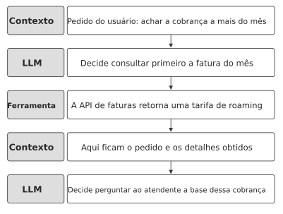
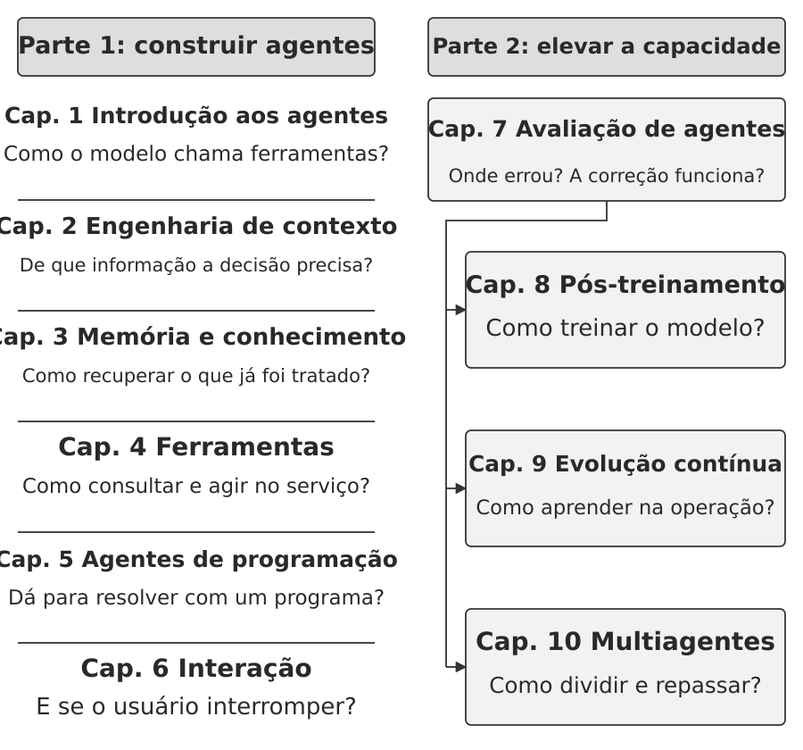

# Prefácio {.unnumbered}

Entre agosto de 2025 e o começo de 2026, ministrei na Turing o curso online “AI Agent Bootcamp”, que discute como construir agentes de IA com métodos de engenharia explicáveis, verificáveis e reutilizáveis. O curso começa pela execução de um agente e, em seguida, analisa por que ele adota determinada arquitetura: que problema cada decisão de projeto resolve, que preço exige e para que tipo de tarefa serve. Este livro foi organizado a partir das apostilas do curso e dos experimentos que as acompanham.

> **A formação deste livro: uma prática de colaboração entre humano e máquina**
>
> Ao preparar as aulas, eu primeiro ditava o roteiro ao agente de voz do Pine e pedia que ele pesquisasse o material e redigisse um primeiro esboço. Essa colaboração por ditado se chama **whisper coding**. Depois da aula, eu voltava a verificar os exemplos e argumentos correspondentes aos pontos em que os alunos tinham travado e aos experimentos que produziram resultados inesperados.

Desde 2025, percebo uma mudança importante: o foco da pesquisa em IA e da prática industrial, antes centrado na melhoria da capacidade dos modelos de base, vem se ampliando para abranger também a realização de tarefas reais por agentes. Por isso, treinamento de modelos e aplicações estão cada vez mais entrelaçados. Modelos de raciocínio como o DeepSeek-R1 mostraram o ganho que o aprendizado por reforço traz para matemática, programação e raciocínio.[^preface-r1] O aprendizado por reforço agêntico (Agentic Reinforcement Learning) incorpora ao treinamento a chamada de ferramentas e a interação com o ambiente, de modo que o modelo aprende não só a programar, mas também a operar interfaces gráficas. Esta última classe de tarefas costuma receber o nome de Computer Use: o modelo avalia o estado da página a partir de capturas de tela e depois conclui a operação com cliques, digitação ou rolagem. Produtos como Manus, Claude Code e OpenClaw, por sua vez, permitem que o usuário delegue tarefas diretamente, e também mostram como “geração de código + sistema de arquivos” sustenta um agente de propósito geral.

Em setembro de 2026, a Meta lançou o Muse. Naquele período, produtos de agentes pessoais surgiam como cogumelos, dentro e fora da China. Eu e minha equipe já havíamos encontrado muitos dos problemas discutidos neste livro quando construímos o Pine. Sou cientista-chefe da Pine AI, onde, junto com meus colegas, desenvolvi esse agente pessoal que resolve pendências do consumidor. No início de janeiro de 2025, o Pine já estava no ar nos Estados Unidos, e o usuário podia pedir que ele ligasse para um estabelecimento para negociar uma fatura, solicitar reembolso ou cancelar uma assinatura.

Quando o comerciante concede um desconto ao telefone, o Pine consegue dizer ao usuário, na hora, apenas que “o atendente concordou”; para afirmar que “o dinheiro já foi devolvido”, é preciso esperar que o estorno apareça na fatura. Para dar conta de uma tarefa assim, era necessário fazer o modelo lembrar o que o usuário autorizou, saber o que verificar em seguida e distinguir em que etapa o assunto está. Quando o setor passou a falar de Skill, Harness e engenharia de Loop, muitas dessas práticas nós já tínhamos descoberto justamente nessas ligações.

- **Skill.** Só carregávamos os prompts correspondentes quando a tarefa exigia. Com o aumento do número de ferramentas, passamos a fazer o modelo chamar ferramentas pela linha de comando, para não precisar listar a definição de todas elas em cada requisição.
- **Harness.** Gravávamos o ambiente de execução, o horário atual e o estado de trabalho do usuário em uma barra de status, para que o modelo os levasse em conta ao decidir. Às vezes o modelo inventava resultados, chamava a ferramenta errada ou deixava instruções de lado, e operações perigosas podiam ultrapassar a autorização do usuário. Por isso acrescentamos restrições ao processo de execução; mais tarde, vimos algo parecido no Claude Code.
- **Engenharia de Loop.** Às vezes o modelo declarava concluída uma tarefa que só estava pela metade. Passamos a colocar um agente para executar o serviço e outro para conferir a fatura ou o pedido, devolvendo ao primeiro o que tivesse ficado pendente. É a divisão de trabalho entre proponente e revisor (proposer-reviewer).

Outras equipes de modelos e de agentes, ao enfrentar problemas semelhantes, chegaram de forma independente a métodos parecidos. Isso me deixou ainda mais convencido de que muitas das dificuldades que encontramos são problemas que todo sistema de agentes enfrenta ao caminhar para o uso real. Além do “AI Agent Bootcamp”, ministrei continuamente entre 2024 e 2026 um curso prático sobre agentes na Universidade da Academia Chinesa de Ciências. As perguntas dos alunos dos dois cursos me ajudaram a identificar quais experiências ainda precisavam ser explicadas com mais clareza. Publico o livro em código aberto na esperança de que mais pesquisadores e engenheiros possam usar, testar e aperfeiçoar esses métodos.

**A prática vem primeiro; o nome, depois.** Para uma equipe de desenvolvimento, isso tem uma consequência adicional: quando um termo se torna consenso no setor, as equipes na frente costumam já ter explorado o assunto por muito tempo. Para acumular vantagem de engenharia própria, é preciso descobrir os problemas antes, a partir do negócio real, e tentar resolvê-los. Para isso, na minha avaliação, há duas condições essenciais.

**Primeira: escolher um negócio real que imponha exigências suficientemente altas à capacidade do agente e obter feedback contínuo dele.** Uma tarefa do Pine pode durar horas ou até semanas, exigindo comunicação com várias partes, ligações longas, preenchimento de formulários complexos e muitas rodadas de troca de e-mails, com números corretos, operações controláveis e os interesses do usuário preservados. Cenários assim expõem continuamente a distância entre a capacidade do modelo e as exigências do negócio, o que leva a equipe a melhorar o Harness. Se o principal valor de um produto é apenas compensar a deficiência de uma geração de modelos, a próxima atualização do modelo pode cobrir esse valor, e a equipe dificilmente acumula vantagem duradoura.

**Segunda: estabelecer um mecanismo sistemático de avaliação (Evaluation).** Depois de alterar o sistema, uma negociação de fatura bem-sucedida pode ter acontecido porque o assistente fez a pergunta certa, ou porque o atendente daquela vez tinha mesmo autoridade para conceder o desconto. Comparar repetidamente a versão antiga e a nova sobre o mesmo conjunto de casos mostra se a diferença é estável. O Capítulo 7 apresenta em detalhe como definir critérios de sucesso, montar o ambiente de avaliação, analisar falhas e verificar mudanças.

Na Pine, a negociação de faturas nos ensinou um método: mandar o revisor conferir na própria fatura se o valor foi de fato abatido. Aplicando o mesmo método a uma remarcação de passagem, é preciso ver se o novo bilhete foi emitido. A evidência concreta muda com o negócio, mas por trás dela há um princípio comum: para julgar se a tarefa foi concluída, é preciso ver que resultado a ação deixou no mundo externo. **Um bom princípio atravessa os ciclos de iteração dos modelos.**

## A missão deste livro {.unnumbered}

Imagine que alguém entregue ao assistente uma fatura de celular e peça que ele ligue para a operadora e negocie um desconto. Antes de começar, o assistente precisa descobrir qual cobrança está em disputa; durante a ligação, precisa ouvir explicações e perguntar sobre condições; ao final, precisa dizer ao usuário exatamente o que o atendente aceitou. A cada passo, o assistente tem de responder a três perguntas: o que ele sabe neste momento? Que ações pode tomar? Com base em que escolhe o próximo passo? Este livro parte dessas três perguntas para apresentar a estrutura dos agentes, a forma de construí-los e os limites de sua capacidade. A fórmula central é **Agente = LLM + contexto + ferramentas**: o LLM responde por compreender, planejar e decidir; o contexto carrega a informação necessária para a decisão atual; as ferramentas fazem a ligação com o ambiente externo, servindo para obter observações ou executar ações.

Numa analogia direta, o LLM é o “cérebro”, o contexto é o “campo de visão da decisão atual” e as ferramentas são os “sentidos, as mãos e os pés”. O campo de visão inclui informações do ambiente, o histórico da conversa, memória e conhecimento, e também instruções de sistema, definições de ferramentas e o estado da tarefa. Busca, leitura e capturas de tela trazem informação; cliques, gravações e chamadas a interfaces de negócio alteram o estado externo. A Figura 0-1 decompõe uma consulta de fatura. Na primeira decisão, o modelo sabe apenas que o usuário tem dúvida sobre uma cobrança; na segunda, já consegue indicar de que valor está falando.



O leitor familiarizado com aprendizado por reforço (Reinforcement Learning, RL) pode ainda entender essa divisão de trabalho com os conceitos de política, observação e ação. O LLM escolhe o próximo passo a partir do contexto, e sua função de decisão se aproxima de uma política (Policy); o contexto carrega as observações concretas e o histórico usados nessa decisão; as ferramentas oferecem as interfaces de observação e de ação. O espaço de observação (Observation Space) descreve quais observações podem ser obtidas, e o espaço de ação (Action Space) descreve quais ações são permitidas; juntos, eles delimitam o alcance da interação entre o agente e o ambiente.[^preface-spaces] O Capítulo 1 desenvolve esses conceitos por meio de exemplos de chamada de ferramentas e apresenta a divisão de trabalho entre Model e Harness nas implementações em produção.

> **Reflexão complementar: da vida às entidades projetadas**
>
> Além da prática de engenharia, os agentes também levantam questões sobre a evolução dos sistemas inteligentes. Richard Sutton, ganhador do Prêmio Turing e pioneiro do aprendizado por reforço, resumiu a evolução do universo em quatro estágios: poeira, estrelas, vida e “entidades projetadas” (designed entities).[^preface-sutton] Os organismos evoluem por variação aleatória e seleção natural, enquanto as entidades projetadas podem ser construídas e aperfeiçoadas com propósito por sistemas inteligentes já existentes.
>
> Um agente pode gerar código, construir novos agentes e então analisar o comportamento em execução, propor alterações e verificar os resultados, realizando passo a passo o bootstrap e a evolução contínua. É como um programador que escreve outro programador, e este continua participando da construção de novos sistemas. Essa possibilidade de compreender a si mesmo e de se aperfeiçoar foi uma das questões que mais me interessaram ao escrever os capítulos sobre geração de código e evolução contínua.

## Estrutura do livro {.unnumbered}

A Figura 0-2 mostra as ligações entre os capítulos. Se, ao telefone, o usuário mudar de ideia de repente e o assistente continuar executando o pedido antigo, comece pela coluna da esquerda e leia o Capítulo 6, para ver como o assistente trata a interrupção do usuário. Depois de corrigir isso, como saber se ele também vai ouvir novas exigências em outras ligações? Aí entra o método de avaliação do Capítulo 7, na coluna da direita. As três setas que saem do Capítulo 7 indicam que, de posse do resultado da avaliação, é possível escolher diferentes caminhos de melhoria conforme a causa da falha.



- **Capítulo 1 (Introdução aos agentes de IA)** apresenta, por meio de produtos e de exemplos de chamada de ferramentas, os componentes centrais, o ciclo de execução, o Harness e as formas de orquestração, estabelecendo o arcabouço conceitual para compreender o restante do livro.
- **Capítulo 2 (Engenharia de contexto)** é o capítulo mais importante do livro e discute como organizar a informação de que o modelo precisa no momento. Vai do projeto de prompts e do carregamento sob demanda até o gerenciamento de histórico e, com o apoio do cache KV, explica como esses métodos afetam a qualidade das respostas e o custo de execução.
- **Capítulo 3 (Memória do usuário e base de conhecimento)** discute como armazenar e recuperar informação entre sessões. Parte da memória do usuário e chega a RAG, indexação estruturada e atualização de conhecimento, ajudando o leitor a dominar os métodos de recuperação e manutenção de conhecimento persistente.
- **Capítulo 4 (Ferramentas)** discute como o agente obtém observações, executa ações e solicita colaboração. Por meio da classificação de ferramentas, do projeto de interfaces, do MCP e do gerenciamento de execução, mostra como conectar capacidades externas ao sistema.
- **Capítulo 5 (Agentes de programação e agentes de propósito geral)** propõe uma linha central de arquitetura para agentes de propósito geral: usar o agente de programação como núcleo de execução e o sistema de arquivos como espaço de trabalho. Primeiro trata do fluxo de desenvolvimento e, em seguida, com casos de multimídia e de sistemas de negócio, mostra como o agente escreve programas para resolver problemas e, a partir daí, cria ferramentas e constrói novos agentes.
- **Capítulo 6 (Interação: expansão dos espaços de observação e ação)** discute as formas de interação do agente em duas dimensões, modalidade e temporalidade. Com eventos assíncronos, voz, Computer Use e robótica, mostra a observação contínua, os caminhos rápido e lento e o controle de execução.
- **Capítulo 7 (Avaliação de agentes)** responde como julgar o desempenho do sistema e o efeito de uma alteração. Primeiro define critérios de sucesso, ambiente e conjunto de dados; depois trata de verificadores, pontuação e análise estatística; por fim, mostra como encontrar a direção de melhoria analisando as causas das falhas.
- **Capítulo 8 (Pós-treinamento do modelo)** discute como atualizar a capacidade do modelo com dados e ambiente, defendendo que se invista primeiro na qualidade dos dados e no ambiente de treinamento. Com ajuste fino supervisionado, aprendizado por reforço e projeto de recompensas, explica por que aprender por demonstração e aprender por exploração produzem generalização diferente, e por que mudar apenas o algoritmo costuma render pouco.
- **Capítulo 9 (Evolução contínua dos agentes)** discute como usar a experiência operacional para melhorar as versões seguintes do agente. Compara quatro tipos de atualização — conhecimento, instruções, programas e parâmetros — e depois gerencia a mudança de longo prazo com processos de verificação, publicação e recuperação.
- **Capítulo 10 (Colaboração multiagente)** discute quando vários membros trazem valor adicional e como dividir o trabalho, comunicar-se e coordenar. Primeiro explica como se distribuem contexto e controle; em seguida, com casos concretos, apresenta mecanismos de colaboração e analisa causas de falha; por fim, discute formas possíveis de sociedade e economia de agentes.

## Como ler este livro {.unnumbered}

- **Para construir um produto de agentes do zero**: recomendo ler o livro inteiro. Monte primeiro com os Capítulos 1 a 6 um assistente que resolva tarefas de verdade e depois use o Capítulo 7 para verificar em que tarefas ele erra com mais facilidade. Os três capítulos seguintes discutem como, a partir dessas falhas, melhorar o modelo, o sistema ou a divisão de trabalho entre os membros.
- **Para formar antes uma visão de conjunto**: leia na ordem os Capítulos 1, 2, 4 e 7. Acompanhe uma chamada de ferramenta do começo ao fim: primeiro conheça o ciclo de execução do agente, depois veja que informação o modelo recebe e o que a ferramenta de fato faz e, por fim, use a avaliação para julgar se o resultado atende ao pedido do usuário. Quando o Capítulo 2 chegar ao cache KV, na primeira leitura basta fixar as três conclusões do início; volte aos princípios de base depois de fazer os experimentos.
- **Para estudar sobretudo o treinamento de modelos**: use primeiro os Capítulos 1 e 2 para entender como o agente funciona e depois leia o Capítulo 8 junto com o método de avaliação do Capítulo 7. Assim você liga o objetivo do treinamento ao desempenho nas tarefas reais.
- **Para manter um agente já em produção**: escolha no Capítulo 7 um conjunto de tarefas reais e faça a avaliação. Por exemplo, se o assistente informou ao usuário um preço antigo, verifique primeiro qual versão da cotação ele recebeu. Se o conhecimento ou o processo estiver desatualizado, leia o Capítulo 9 levando em conta essa falha; se a cotação e as ferramentas já estavam disponíveis e, mesmo depois de mudar o processo, o modelo continua escolhendo errado, leia o Capítulo 8 para julgar se vale a pena preparar dados de treinamento.

Cada capítulo traz experimentos e questões para reflexão. Os experimentos são numerados como “Experimento X-Y”, em que X é o número do capítulo e Y a ordem dentro dele. As estrelas indicam a dificuldade: ★ é adequado para começar, ★★ exige certa experiência de engenharia e ★★★ envolve questões abertas ou projeto de sistemas complexos. A maioria dos experimentos tem código executável, reunido no repositório de código aberto:

> **Repositório de código que acompanha o livro**: `bojieli/ai-agent-book`

Para o primeiro experimento, comece por “Experimento 1-1: o papel crucial do contexto”. Se você usa Git, execute no terminal:

```bash
git clone https://github.com/bojieli/ai-agent-book.git
cd ai-agent-book
```

Na página do repositório, também é possível escolher **Code → Download ZIP** e descompactar o arquivo para obter o mesmo diretório. Localize o número 1-1 no índice de experimentos do primeiro capítulo (`chapter1/README.md`) e abra `chapter1/context/README.md`. Daqui em diante, sempre que encontrar “Experimento X-Y”, consulte o projeto e o modo de execução em `chapterX/README.md` do repositório. O “Guia de reprodução” informa os projetos externos e como obtê-los; os comandos de instalação e a descrição dos diretórios ficam reunidos no README.

## Conhecimentos prévios {.unnumbered}

Este livro se destina a leitores com capacidade básica de programação que desejam compreender e construir agentes. Para fazer os experimentos, serão necessários os fundamentos a seguir.

**Obrigatórios: a base para ler o livro inteiro**

- **Programação em Python**: familiaridade com a sintaxe, as estruturas de dados usuais e gerenciadores de pacotes como o pip, a ponto de ler e modificar o código dos experimentos. A maior parte dos experimentos do livro se baseia em Python.
- **Experiência com LLMs**: ter usado ChatGPT, Claude ou produtos semelhantes e conhecer o processo básico de fazer um pedido, ler a resposta e continuar a conversa.
- **Noções de engenharia de software**: conhecer a linha de comando, Git, JSON e REST API, o suficiente para executar projetos, inspecionar alterações e ler dados de interface.

Para fazer os experimentos, recomendo com ênfase escolher uma ferramenta entre Claude Code, Codex, Cursor e TRAE. Peça que ela depure um trecho de código e observe quais arquivos ela leu e quais ferramentas chamou. Quando você chegar aos capítulos sobre o ciclo de execução e o gerenciamento de contexto, terá uma experiência concreta para comparar.

**Recomendados: conhecimento a acrescentar conforme o capítulo**

- **Fundamentos de aprendizado de máquina (Capítulo 8)**: treinamento e inferência, função de perda, descida do gradiente e sobreajuste ajudam a compreender o processo de atualização do modelo.
- **Matemática básica (Capítulos 2, 3, 7 e 8)**: vetores e matrizes ajudam a compreender embeddings e atenção; probabilidade e estatística ajudam a compreender métricas de avaliação e recompensa esperada. O livro privilegia a explicação intuitiva e o uso prático.
- **Fundamentos de desenvolvimento web (Capítulo 6)**: HTTP, WebSocket e a divisão entre front-end e back-end ajudam a compreender a arquitetura de eventos assíncronos e a comunicação de voz em tempo real.
- **Fundamentos de Transformer (Capítulos 2 e 8)**: conhecer a atenção e a estrutura do modelo ajuda a compreender o cálculo de contexto e o pós-treinamento. Quem quiser uma base sistemática pode ler *Hands-On Large Language Models*, de Jay Alammar e Maarten Grootendorst (a edição chinesa, traduzida por Li Bojie, foi publicada pela Turing Education). O livro explica Transformer, pré-treinamento e ajuste fino por meio de diagramas e complementa a perspectiva de engenharia adotada aqui.

Fora o pós-treinamento do Capítulo 8, os demais capítulos usam pouca matemática e pouco aprendizado de máquina; com experiência básica de programação, já é possível começar a leitura.

## Agradecimentos {.unnumbered}

Agradeço às editoras Meng Ge e Liu Meiying, da Turing, pela edição do livro e pelo empenho na organização do “AI Agent Bootcamp”; e ao professor Liu Junming, por criar o curso prático de agentes na Universidade da Academia Chinesa de Ciências. Agradeço aos alunos e colegas dos dois cursos: suas perguntas, o retorno sobre os experimentos e as sugestões me ajudaram a melhorar continuamente as explicações e aprofundaram minha compreensão desses conceitos.

Agradeço a todos os colegas da Pine AI. Os desafios do negócio real e as discussões em equipe estão na origem de muitos dos métodos e casos deste livro. A prática e as opiniões de vocês aperfeiçoaram continuamente essas ideias.

Agradeço aos amigos do setor de IA. Em nossas conversas, vocês apresentaram críticas francas e compartilharam experiências e avaliações diferentes, o que me ajudou a compreender melhor os modelos e os agentes.

Acima de tudo, agradeço à minha família, em especial à minha esposa, Meng Jiaying. Ela sempre apoiou a escrita deste livro e apresentou muitas sugestões valiosas para o manuscrito.

[^preface-r1]: DeepSeek-AI, *DeepSeek-R1: Incentivizing Reasoning Capability in LLMs via Reinforcement Learning*, 2025.

[^preface-spaces]: A seção “Spaces” da documentação do Gymnasium.

[^preface-sutton]: Entrevista de Richard Sutton a Dwarkesh Patel, 2025-09-26, parte “Succession to AI”.
