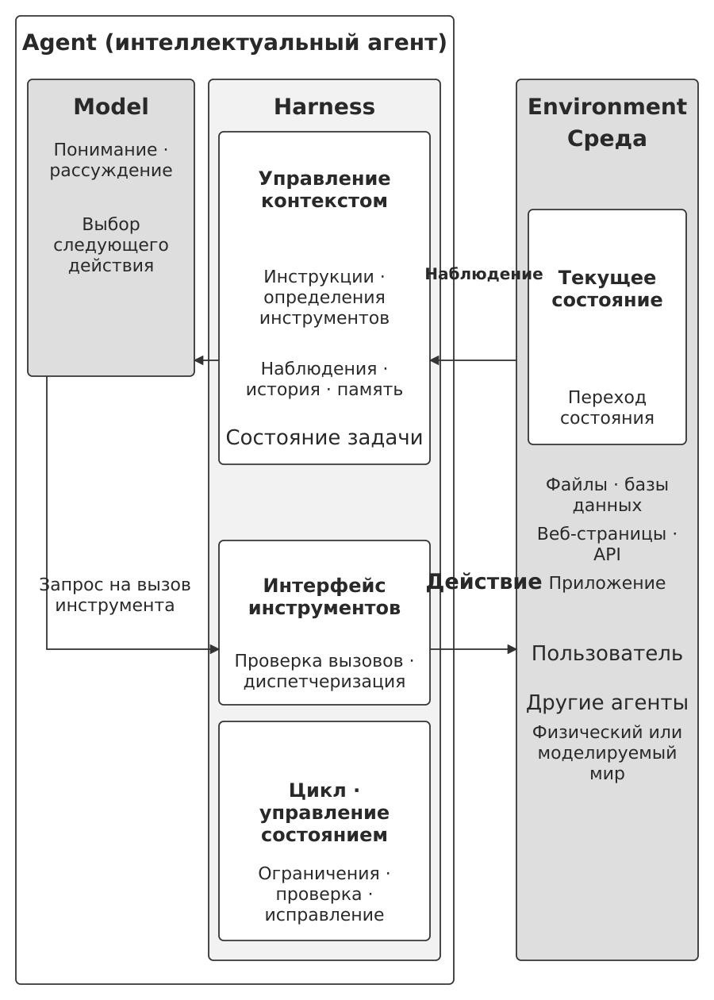
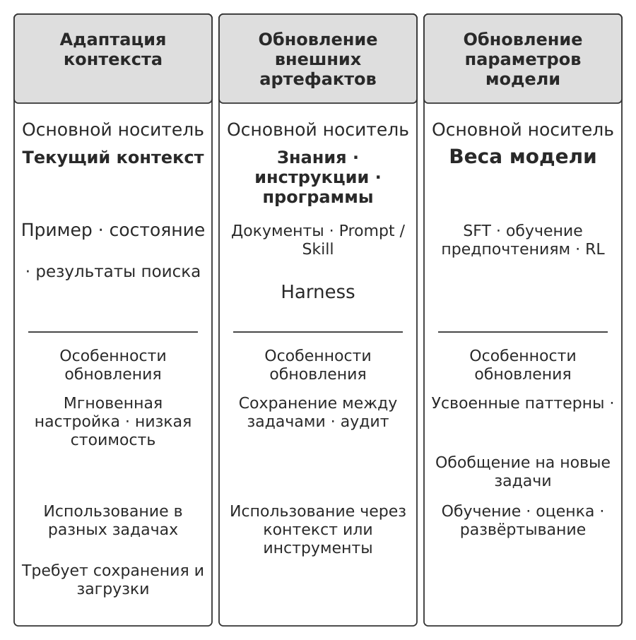
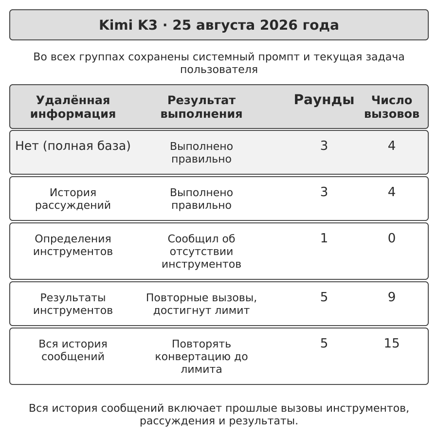
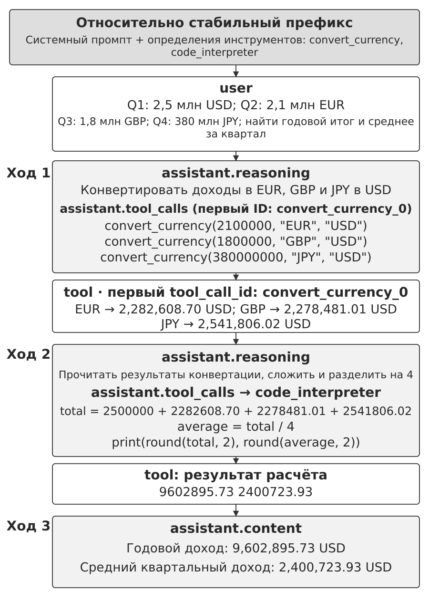
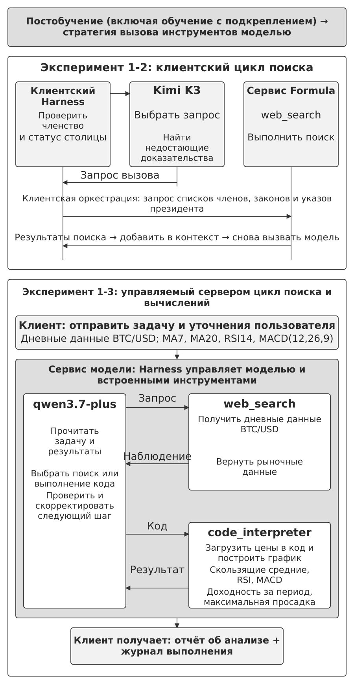
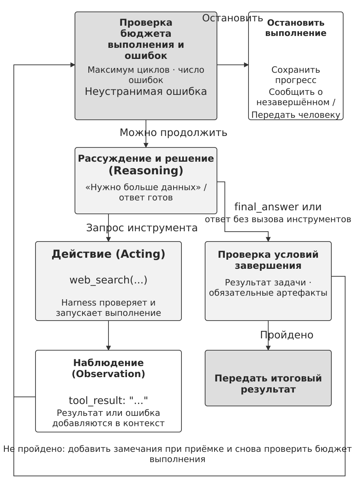
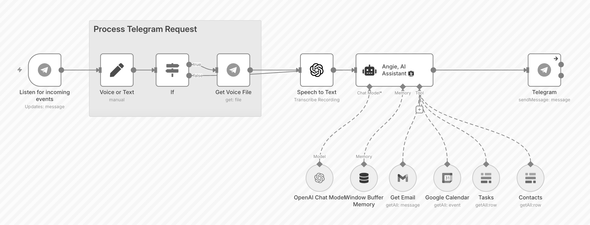

<!-- Русский перевод: community edition. Источник: https://github.com/bojieli/ai-agent-book; файл изменён относительно upstream. -->

# Введение в AI-агентов

При исследовании темы с помощью Deep Research он многократно выполняет поиск и читает материалы, а затем составляет отчёт. Manus может управлять браузером для выполнения онлайн-задач, мобильный помощник Doubao — бронировать билеты и отправлять сообщения с телефона, а Pine AI — звонить оператору связи от имени пользователя и договариваться о снижении счёта. Всё это — примеры применения AI-агентов.

Когда вы поручаете Cursor исправить функцию, он находит её, редактирует файл, а затем запускает тесты. Если тесты по-прежнему не проходят, информация об ошибке становится основой для следующего изменения; только после успешного прохождения тестов у него появляются доказательства, позволяющие сообщить вам о результате. Последовательность трёх этапов — поиска, редактирования и тестирования — можно заранее заложить в программу, но то, какую именно строку изменить и к какому этапу вернуться после неудачи, зависит от информации, полученной во время выполнения. Такой процесс, при котором действия выбираются в соответствии с целью, а затем план корректируется с учётом результатов, происходит и при выполнении таких задач, как исследование темы и переговоры по телефону.

## Современный AI-агент = LLM + контекст + инструменты

В этой книге три типа функциональных компонентов современного агента представлены формулой: **агент = LLM (большая языковая модель, Large Language Model) + контекст + инструменты**.

- **LLM — мозг агента**, отвечающий за понимание задачи, планирование шагов и выбор действий. Предобучение даёт модели языковые способности и знания о мире, а постобучение дополнительно формирует такие аспекты поведения, как следование инструкциям, рассуждение и вызов инструментов. В главе 8 будут рассмотрены методы постобучения, включая дообучение с учителем и обучение с подкреплением.
- **Контекст — текущее поле принятия решений агента**, содержащее информацию, необходимую для конкретного решения, включая инструкции, определения инструментов, наблюдения за окружением, память о пользователе, знания предметной области, историю сообщений, собственное состояние и ход выполнения задачи.
- **Инструменты — органы чувств, руки и ноги агента**, позволяющие получать информацию или выполнять операции через интерфейсы. Система инструментов включает определения, протоколы вызова и адаптеры и поддерживает как операции наблюдения — поиск, чтение и создание снимков экрана, — так и запись, выполнение кода, делегирование задач субагентам и общение с пользователем.

Один и тот же инструмент может выполнять несколько функций. Например, когда модель читает файл через командную строку, возвращённое содержимое становится основой для следующего решения; запуск программы через командную строку также может изменить состояние файлов или процессов.

Предположим, вы только что распаковали посылку и хотите спросить службу поддержки: «Можно ли вернуть товар после вскрытия упаковки?» Система может с помощью **генерации с дополнением извлечёнными данными** (Retrieval-Augmented Generation, RAG) найти действующие правила возврата магазина, а затем попросить модель ответить на основании их положений.[^ch1-rag] На примере одного запроса хорошо видна роль каждого компонента. Исходный текст правил и индекс хранятся во внешней базе знаний; инструмент извлечения находит относящиеся к вопросу фрагменты, после чего программа, вызывающая модель, помещает их вместе с указанием источника в текущий запрос. Увидев пункт о вскрытой упаковке, модель может разъяснить соответствующее положение; если правила также различаются по категориям товаров, сначала потребуется уточнить, что именно вы купили.

[^ch1-rag]: Patrick Lewis и др. Retrieval-Augmented Generation for Knowledge-Intensive NLP Tasks. NeurIPS, 2020.

В этом запросе о возврате запуск извлечения — действие агента, а полученные положения правил — наблюдение, поступившее из окружения (Environment). Выбор между ответом и уточняющим вопросом зависит от содержания правил. Так образуется замкнутый контур, известный из обучения с подкреплением и теории управления и показанный на рисунке 1-1.



Внешний уровень рисунка показывает границу между агентом и окружением. Файлы, базы данных, веб-страницы, пользователи, другие агенты, а также физический или моделируемый мир могут служить окружением, с которым он взаимодействует. Внутренний уровень показывает разделение ответственности в производственной реализации: **Model отвечает за понимание, рассуждение и принятие решений; Harness находится внутри границ агента, но за пределами Model, и отвечает за организацию контекста, интерфейсы инструментов, цикл выполнения и состояние, а также реализует ограничения, проверку и корректировку.** Harness может создавать, изолировать или проксировать окружение; содержимое файлов, состояние процессов и другие элементы окружения изменяются в результате действий.[^ch1-harness]

[^ch1-harness]: См. «The Anatomy of an Agent Harness» от LangChain и «Effective harnesses for long-running agents» от Anthropic. В некоторых реализациях песочница также считается частью Harness; на рисунке 1-1 окружение показано отдельно, чтобы было проще проследить, что именно изменяют действия.

Таким образом, в книге используются два взаимодополняющих способа декомпозиции: **«LLM + контекст + инструменты» описывает функциональные компоненты, а «Model + Harness» — производственную реализацию.** Harness организует контекст и передаёт его Model; Model принимает решение о вызове инструмента, Harness проверяет и диспетчеризует вызов, после чего инструмент или окружение выполняет его. Создание простой системы можно начать с формирования контекста и диспетчеризации инструментов, а затем постепенно дополнить ограничениями, проверкой и механизмами корректировки, необходимыми для производственной эксплуатации.

Если вы знакомы с обучением с подкреплением, следующую таблицу можно читать через три вопроса: «кто решает, что делать дальше», «на основании чего принимается решение» и «как оно воплощается в действие». Это приблизительное функциональное сопоставление.

| Интуитивный образ | Инженерный компонент | Соответствующее понятие в обучении с подкреплением | Значение |
|-----------|-----------|----------------------------|----------------------------------------------|
| **Мозг** | LLM | **Стратегия** (Policy) | Определяет следующее действие на основании текущей информации |
| **Текущее поле принятия решений** | Контекст | **Наблюдения и история** | Организует возвращённую окружением информацию и имеющуюся историю в основу для принятия решения |
| **Органы чувств, руки и ноги** | Инструменты и адаптеры | **Интерфейсы наблюдений и действий** | Определяют способы чтения информации из окружения и выполнения действий, а также форматы вызовов и возвращаемых результатов |

### Пространство наблюдений и пространство действий: интерфейс между моделью и миром

**Пространство наблюдений описывает, какие наблюдения может получать AI-агент, а пространство действий — какие действия он может выполнять.** В рамках одного вызова конкретная информация передаётся через контекст, а доступные инструменты предоставляют интерфейс для взаимодействия со средой. Наблюдения могут поступать не только от инструментов, но и из пользовательского ввода, уведомлений о событиях и других источников; диапазон действий совместно ограничивают параметры вызовов инструментов, права доступа и среда выполнения.

Представим два разных сбоя. В первом случае модель способна объяснить каждую статью расходов в счёте, но не может получить счёт за текущий месяц. Даже после того как пользователь разрешит чтение, счёт ещё нужно найти и передать модели — только тогда она сможет определить, какие расходы можно оспорить. Во втором случае пользователь просит ассистента сменить тарифный план. Ассистент уже нашёл подходящий вариант, но интерфейс учётной записи позволяет только просматривать данные. Даже если ещё раз прочитать счёт, изменить тариф не получится: для этого нужны соответствующие права на выполнение операций. Задача Harness — поместить прочитанные материалы в контекст, принять выбранное моделью действие, проверить параметры и права, а затем направить его на выполнение.

Поэтому **при неизменной базовой модели настройка пространства наблюдений и пространства действий — важный инженерный способ повысить качество выполнения задач.** Если модель упускает важный факт, соответствующие данные можно включить в контекст. Если модель часто выбирает не тот инструмент из нескольких похожих, дублирующие интерфейсы можно объединить либо загружать только инструменты, необходимые для текущей задачи.

При просмотре видео возникает и обратная проблема: изображение доступно постоянно, но изменения, требующие повторной оценки, происходят редко. Предположим, ассистент ждёт загрузки файла. Если вызывать основную модель при каждом движении индикатора прогресса, это приведёт к множеству лишних вычислений. Если же проверять состояние лишь раз в десять секунд, можно пропустить кратковременно появившееся сообщение об ошибке. **По мнению автора, разрежение пространства наблюдений — одна из фундаментальных проблем проектирования агентов.** Система может непрерывно наблюдать за средой, но передавать основной модели вместе с необходимым контекстом только те изменения, которые способны повлиять на следующее действие.

**Manus: сочетание исследования, программирования и управления компьютером в рамках одной задачи.** Deep Research хорошо справляется с поиском и чтением, агент для программирования может писать и выполнять код, а агент для управления компьютером — взаимодействовать с интерфейсом. Manus объединяет браузер, файловую систему, выполнение кода и командную строку в облачной песочнице, позволяя одному агенту сначала искать материалы, затем обрабатывать файлы и запускать код, а в конце выполнять действия через браузер. Браузер и чтение файлов расширяют объём доступной информации, а выполнение кода и команд — набор действий, которые можно комбинировать. **По мнению автора, такое сочетание стало важным прорывом для универсальных агентов: один и тот же агент может пересекать прежде разделённые границы продуктов, объединяя получение материалов, обработку данных и выполнение действий в единую задачу.**

**OpenClaw: расширение интерфейса до цифровой жизни пользователя.** OpenClaw получает задачи и возвращает результаты через такие каналы обмена сообщениями, как WhatsApp, Telegram, Slack, Discord и iMessage, а работающий на устройстве пользователя Gateway связывает каналы обмена сообщениями, модель и инструменты. После настройки соответствующих инструментов и получения разрешений агент может обрабатывать локальные файлы и подключаться к таким облачным сервисам, как Google Drive и Notion. Благодаря этому данные пользователя, распределённые между учётными записями и устройствами, можно включить в процесс выполнения одной задачи. Ранние версии Manus работали преимущественно в облачной песочнице, поэтому пользователю приходилось загружать файлы. Появившиеся позднее коннектор Google Drive и функция My Computer для настольных компьютеров дополнительно расширили доступ к облачным файлам и локальным ресурсам. Эта эволюция показывает, что возможности продукта часто растут благодаря расширению интерфейсов наблюдений и действий[^ch1-agent-products].

[^ch1-agent-products]: Структура продуктов описана в официальных материалах Manus о Sandbox, Google Drive Connector и My Computer, а также в официальном репозитории OpenClaw и документации по его инструментам. Конкретный набор доступных ресурсов определяется коннекторами, конфигурацией инструментов и разрешениями пользователя.

Задачи у разных продуктов различаются, но каждый из них можно рассматривать с трёх сторон: основания для принятия решений, доступные операции и стратегия выполнения.

| Продукт на основе агентов | Основная информация в контексте | Доступные инструменты и операции | Стратегия выполнения |
|----------------|----------------------|----------------------------|------------------------------|
| **Cursor и другие агенты для программирования** | Требования, фрагменты кода, списки каталогов, вывод терминала | Поиск по коду, чтение и запись файлов, выполнение команд | Понять требования→найти связанный код→отредактировать код→проверить тестами→найти и исправить ошибки |
| **Deep Research и другие поисковые агенты** | Результаты поиска, содержимое веб-страниц, аннотации и цитаты из научных работ | Поисковые запросы, чтение веб-страниц, создание отчётов | Корректировать направление поиска с учётом уже полученной информации, постепенно объединяя её в полный отчёт |
| **Browser Use и другие агенты для управления компьютером** | Снимки экрана, DOM или дерево специальных возможностей, результаты операций | Нажатия, ввод, прокрутка, снимки экрана, выполнение кода | Прочитать интерфейс→определить целевой элемент→выполнить действие→проверить результат |
| **Doubao и другие мобильные ассистенты-агенты** | Снимки экрана телефона, состояние интерфейса приложения, обратная связь от системы | Нажатия, жесты прокрутки, ввод, открытие приложений | Понять задачу→найти нужное приложение→выполнить действие→подтвердить завершение |
| **Pine AI, Meta Muse и другие персональные агенты для выполнения поручений** | Полученные с разрешения записи учётных записей, счета, сведения о поставщиках услуг | Телефонные звонки, электронные письма, заполнение форм, уточнения у пользователя | Собрать информацию→разработать стратегию переговоров→связаться с поставщиком услуг→провести переговоры→сообщить результат |

**Как поручение превращается в исполнимую задачу?** Работая в Pine над персональным ассистентом для выполнения поручений, автор заметил, что пользователи часто формулируют только цель, например: «Забронируй мне авиабилет для командировки, желательно не дороже 1200 юаней». Сначала ассистенту нужно выяснить даты, пункт назначения и главные требования к поездке, затем собрать недостающие сведения и согласовать с пользователем способ выполнения поручения и условия, по которым допустим компромисс. Только после этого можно обращаться к поставщику услуг. Новая информация, полученная в ходе выполнения поручения, может вернуть задачу на предыдущий этап.

Предположим, сотрудник службы поддержки нашёл билет по минимальной цене 1250 юаней. Модель будет принимать решение с учётом общих знаний, особенностей этой поездки и запомненных предпочтений пользователя. Если пользователь находится в командировке и обычно готов немного доплатить за удобный маршрут, Pine может сразу забронировать билет. Если же речь идёт о семейной поездке, а пользователь ранее явно подчёркивал важность общих расходов, ассистент может сначала сообщить ему о превышении бюджета и попросить сотрудника службы поддержки поискать другие рейсы. Если впоследствии пользователь добавит: «В следующий раз, если билет окажется дороже бюджета, сначала спроси меня», эта обратная связь даст для следующего решения более конкретное основание, чем общий опыт.

Рассмотрим другой сценарий: сотрудник банковской службы поддержки предлагает отправить документ по домашнему адресу, но ассистент помнит, что пользователь находится в зарубежной поездке. На этот раз необходимо изменить способ доставки: во время разговора можно сразу сообщить о невозможности получить письмо и попытаться договориться о доставке по электронной почте. Теперь рассмотрим уменьшение суммы по счёту. Если сотрудник службы поддержки устно согласился уменьшить сумму, ассистент может точно сообщить об обещании компании. Но чтобы подтвердить, что сумму действительно уменьшили, понадобится новый счёт как очередное наблюдение. Пространство действий ассистента может включать реальные телефонные звонки, однако его выводы по-прежнему ограничены пространством наблюдений.

С точки зрения поручений в этой книге рассматриваются три типа приложений: выполнение бытовых поручений, совместная офисная работа и научные исследования. Один и тот же ассистент может выполнять задачи разных типов; различия заключаются в том, кто предоставляет ему полномочия, что он может изменить и кто в итоге принимает результат. Если в офисе коллега вернул результаты проверки, можно ли закрывать рабочую заявку? Предположим, руководитель проекта упомянул ассистента в комментарии к заявке Multica и попросил проверить расхождение в бюджетной таблице. Этот комментарий запустит проверку, но заявка останется закреплена за прежним ответственным, а её статус не изменится. Ассистент вернёт две суммы и укажет их источники, тем самым ответив на вопрос коллеги. Однако решение о том, можно ли отправлять весь бюджет, должен принять ответственный с учётом остальных незавершённых задач.[^ch1-multica]

К научной задаче можно применить тот же вопрос: на каком основании считать, что достигнут прогресс? Когда AlphaEvolve от Google DeepMind ищет алгоритмы умножения матриц, модель предлагает программы-кандидаты, а оценщик запускает их и проверяет правильность вычисления произведения и количество выполненных умножений. Затем поиск может продолжить улучшать программы с хорошими результатами. Исследовательская группа сообщила, что один из алгоритмов позволяет перемножить две комплексные матрицы размером $4\times 4$ с помощью 48 скалярных умножений. У утверждения «потребовалось на несколько умножений меньше» есть чётко определённый объект подсчёта, а алгоритм при этом должен вычислять правильное произведение матриц.[^ch1-alphaevolve]

[^ch1-multica]: Multica: упоминание агента в комментарии к рабочей заявке. В десятой главе рассматривается, как в совместной работе различать временную помощь и передачу ответственности.

[^ch1-alphaevolve]: Google DeepMind, описание исследования AlphaEvolve, май 2025 года. Под количеством умножений здесь понимается число скалярных умножений в алгоритме; фактическое время выполнения также зависит от реализации и оборудования.

Пространства действий этих систем носят **открытый** характер. Невозможно заранее полностью перечислить поисковые фразы, вводимый текст, создаваемый код и комбинации операций, однако каждое действие по-прежнему ограничено инструментами, параметрами, правами доступа и средой выполнения. Именно поэтому исполнимый план должен допускать изменение следующего шага с учётом новых наблюдений.

### Инструменты: органы чувств, руки и ноги AI-агента

Инструменты воплощают решения модели в чтении внешней среды или воздействии на неё. Инструменты поиска и чтения возвращают наблюдения, а инструменты записи файлов, выполнения команд и другие подобные средства реализуют действия. По полученному результату модель узнаёт об эффекте операции, а затем решает, продолжить работу, повторить попытку или завершить задачу.

По основному назначению в этой книге инструменты делятся на пять категорий. Один интерфейс может одновременно выполнять несколько функций: например, голосовой звонок позволяет как получать информацию, так и передавать запросы.

**Инструменты восприятия** отвечают за получение информации: поисковые системы предоставляют материалы из интернета, инструменты чтения файлов открывают локальные документы, а API и интерфейсы баз данных обеспечивают доступ к внешним сервисам и корпоративным данным.

**Инструменты выполнения** отвечают за совершение операций: запускают код, изменяют файлы, выполняют системные команды или вызывают внешние API, воплощая решения в среде.

**Инструменты совместной работы** поддерживают разделение и координацию работы: делегируют специализированные задачи субагентам, собирают результаты и координируют работу нескольких агентов. Если для принятия решения необходимо участие человека, система также может запросить подтверждение через интерфейс общения с пользователем.

**Инструменты запуска по событиям** подключают внешние события к процессу выполнения. Новое письмо, наступление заданного времени или обратный вызов Webhook могут запустить задачу. Адаптер событий преобразует такие входные данные в наблюдения, которые способен обработать агент, а механизм планирования запускает или возобновляет выполнение. Правила запуска могут задаваться разработчиком либо регистрироваться посредством разрешённых вызовов инструментов.

**Инструменты общения с пользователем** передают пользователю информацию и собирают обратную связь, например отправляют текстовые сообщения и электронные письма или инициируют голосовые звонки. Они используются для отчётов о ходе работы и запросов подтверждения, а также могут сами напоминать пользователю о необходимых действиях.

В четвёртой главе подробно рассматривается проектирование этих пяти категорий инструментов. От определения интерфейса зависит, сможет ли модель правильно выбрать инструмент и заполнить параметры; обработка ошибок определяет, можно ли продолжить работу после сбоя; контроль прав ограничивает область воздействия операций. MCP (Model Context Protocol, протокол контекста модели) предоставляет единый способ обнаружения и вызова инструментов, сокращая объём адаптации между различными системами.

**Вызов инструмента** (Tool Calling) — способность модели формировать запрос на выполнение операции в согласованном формате. Распространённый вызов функций (Function Calling) выражает запрос через имя инструмента и структурированные параметры. В этой книге везде используется термин «вызов инструмента».

Рассмотрим запрос погоды в Пекине. Модель может указать название города, но фактическая температура появится в контексте только после того, как Harness выполнит запрос. Ниже показаны четыре шага обмена сообщениями при этом вызове:

```text
Шаг 1: объявление инструмента          Шаг 2: модель решает выполнить вызов
tools: [{                              assistant: {
  name: "get_weather",                   tool_calls: [{
  parameters: {                            id: "call_1",
    city: "string"                         function: "get_weather",
  }                                        arguments: {city: "Пекин"}
}]                                       }]
                                       }

Шаг 3: результат добавляется в контекст Шаг 4: модель отвечает по результату
tool: {                                assistant: {
  tool_call_id: "call_1",                content: "Сегодня в Пекине 28°C, ясно."
  content: '{"temp":28,"sky":"ясно"}'   }
}
```

Здесь `call_1` связывает возвращённое инструментом значение с запросом на вызов. Разработчик описывает способ вызова инструмента, реализует функцию запроса погоды и передаёт результат запроса обратно модели. Модель решает, следует ли выполнять вызов, какой инструмент выбрать и какие параметры ему передать. Во второй главе структура сообщений API рассматривается подробнее.

При проектировании инструмента сначала можно предоставить ровно те возможности, которых достаточно для задачи. Для четырёх арифметических действий подойдёт калькулятор с понятными параметрами. Если задача расширяется до чтения таблиц, очистки пропущенных значений, вычисления статистик и построения графиков, ограниченный интерпретатор Python позволит удобнее комбинировать эти шаги. С расширением универсальных возможностей необходимо усиливать изоляцию и управление ресурсами: код должен выполняться в песочнице, сетевой доступ по умолчанию должен быть отключён, доступ к файлам — ограничен разрешённым рабочим каталогом, а для времени выполнения, CPU, памяти и размера вывода следует установить предельные значения.

Для записи отдельного процесса выполнения можно использовать единый инструмент журналирования. Для задач, продолжающихся несколько часов или даже дней, лучше использовать управляемый виртуальный рабочий каталог, в котором сохраняются план, промежуточные результаты, журналы выполнения и итоговые материалы. Тогда агент сможет продолжать работу между отдельными запусками. Для каталога следует ограничить доступные для чтения и записи пути, объём и типы файлов, а также проверять, не выходит ли путь за разрешённые границы.

Платежи, удаление данных, отправка электронной почты, развёртывание в промышленной среде и другие операции сопряжены с повышенным риском или регулируются явными бизнес-правилами. Их целесообразно оформлять как специализированные инструменты с понятными параметрами, ограниченными правами и полной аудитируемостью, при необходимости добавляя предварительный просмотр и подтверждение человеком. **Универсальные базовые возможности поддерживают комбинирование и исследование, а специализированные инструменты обеспечивают соблюдение ограничений и бизнес-правил при выполнении высокорисковых операций.**

### LLM: мозг AI-агента

LLM — ядро принятия решений агентом. Получив запрос, она сначала определяет цель и ограничения из формулировки пользователя, а затем разбивает сложную задачу на выполнимые шаги. В процессе выполнения ей также необходимо решать, что делать дальше, следует ли вызвать инструмент, какой инструмент выбрать и какими значениями заполнить параметры. Эти возможности опираются на знания и языковые способности, накопленные в ходе предварительного обучения, а постобучение формирует на их основе подходящее для решения задач поведение при принятии решений. Такие решения необходимы как рабочим процессам, так и автономным агентам, а практические действия выполняются посредством Harness, инструментов и среды.

Планирование и моделирование перед выполнением действий помогают агенту сравнивать варианты, прогнозировать результаты и сокращать число бесполезных попыток. Например, модель может проверять этапы вычислений с помощью математических закономерностей, анализировать сбои на основе причинно-следственных связей, а затем выстраивать порядок операций с учётом зависимостей. Сначала модель сравнивает различные варианты в ходе рассуждений, а выбрав действие, запрашивает его выполнение у инструмента. Традиционные системы обучения с подкреплением также могут организовывать исследование с помощью выученной стратегии, функции ценности, модели среды или алгоритма планирования. Особенность агентов на основе LLM заключается в том, что ещё до начала конкретной задачи они благодаря масштабному предварительному обучению получают обширные знания и шаблоны решения задач, а постобучение дополнительно совершенствует способы применения этих возможностей.

#### Встроенные в модель вызовы инструментов

Выражение «модель как агент» (Model as Agent) описывает отраслевую тенденцию: всё больше решений, связанных с планированием и вызовами инструментов, принимает сама модель. Благодаря постобучению, особенно обучению с подкреплением, модель может научиться определять, когда вызывать инструмент, какой именно инструмент выбрать, какие параметры передать и как продолжить работу после получения результата. Разработчик задаёт цель, интерфейсы и ограничения, а модель организует конкретные шаги с учётом хода выполнения задачи.

Для самостоятельного принятия решений модели необходим Harness. Изначально английское слово harness обозначало упряжь и другие элементы конской сбруи, передающие силу лошади повозке и позволяющие управлять направлением движения. В агенте Harness организует возможности модели в непрерывно выполняемый процесс решения задачи и отвечает за управление контекстом, интерфейсы инструментов, ограничения, проверку и исправление. Во второй половине этой главы мы последовательно рассмотрим все пять функций.

Чем больше операций модель может организовывать самостоятельно, тем шире возможные последствия ошибок. Поэтому модель и Harness необходимо оптимизировать совместно: модель повышает качество планирования и выбора инструментов, а Harness управляет правами доступа, проверяет результаты и обрабатывает сбои. Производители моделей могут одновременно совершенствовать обе составляющие, и такая согласованная итеративная разработка становится важным инженерным преимуществом.

> **Эволюция возможностей модели и Harness**
>
> В работе «Горький урок» (The Bitter Lesson) Рич Саттон рассматривает долгосрочную тенденцию в исследованиях AI: методы поиска и обучения, способные использовать всё больше вычислительных ресурсов, постепенно превосходят подходы, в значительной мере опирающиеся на спроектированные вручную предметно-ориентированные решения[^ch1-1]. В русле этой тенденции решения о выборе инструментов, порядке шагов и других аспектах, прежде возлагавшиеся на внешние процессы, могут постепенно усваиваться моделью в ходе обучения.
>
> Позиция этой книги такова: **мы согласны с направлением, но придерживаемся прагматичного темпа.** Модель будет последовательно принимать на себя часть функций Harness по принятию решений, однако каждый цикл обучения и развёртывания требует времени, тогда как бизнес-правила и предпочтения пользователей постоянно меняются. Кроме того, все ограничения реальных бизнес-сценариев трудно за один раз зафиксировать в параметрах модели. Поэтому те этапы, с которыми модель пока не справляется достаточно надёжно, сначала дополняет Harness. **Текущая граница возможностей модели определяет текущую ценность Harness.** Это разделение обязанностей меняется вместе с возможностями модели: осваивая очередной класс решений, модель позволяет Harness сократить соответствующую оркестрацию и переключиться на новые сложности. Обеспечение соблюдения прав доступа, сохранение состояния и проверка результатов по-прежнему остаются задачами системы выполнения.

[^ch1-1]: Sutton, Rich. The Bitter Lesson, 2019.

#### Механизмы обучения агента: от адаптации к контексту до устойчивого обновления

После ошибки инструмента агент в этот раз научился искать файл по другому пути. Но сохранится ли этот урок завтра, в новом сеансе? Если проследить по рисунку 1-2, где хранится этот опыт, можно различить три вида обновлений.



**Адаптация к контексту** происходит в процессе выполнения задачи. Прочитав примеры, состояние задачи или результаты поиска, модель может скорректировать последующее поведение. Например, если инструмент сообщает, что файл не существует, модель может заново найти путь и продолжить работу. Этот подход обеспечивает быструю реакцию при небольших затратах, но его эффективность зависит от ёмкости контекстного окна и способа организации информации. Чтобы использовать накопленный опыт в последующих задачах, соответствующую информацию необходимо сохранить и снова предоставить модели. Во второй главе будут рассмотрены способы организации контекста.

**Внешние артефакты** (artifact) позволяют сохранять опыт между задачами. Факты и опыт записываются в документы базы знаний, стратегии, которые можно выразить на естественном языке, — в промпты или Skill, а детерминированные процессы и ограничения — в программы или логику Harness. Такие артефакты удобно аудировать и редактировать; во время выполнения они участвуют в принятии решений и осуществлении действий через контекст или интерфейсы инструментов. В главах 3–5 рассматриваются соответствующие основы знаний и программ, а в главе 9 обсуждается создание, проверка и публикация обновлений на основе оценённых траекторий выполнения.

**Параметры модели** обновляются посредством обучения. Такие возможности, как понимание медицинских изображений, воспроизведение языкового стиля и неявные стратегии принятия решений, связаны с множеством закономерностей, которые трудно по отдельности сформулировать в виде правил. Модель может усвоить их из данных и обратной связи в ходе постобучения. Обновление параметров требует затрат на обучение, оценку и развёртывание, а его цель — позволить модели применять усвоенные возможности и в новых задачах. Соответствующие методы подробно рассматриваются в главе 8.

Один и тот же сбой можно сначала использовать для исправления текущей операции, а затем оформить как проектную документацию, доступную следующему агенту. Если ошибки одного типа неоднократно возникают во множестве проектов, соответствующие случаи также можно использовать для обучения.

### Контекст: текущее поле принятия решений AI-агента

Принимая решение, человек должен одновременно учитывать описание задачи, справочники, историю общения и свежие данные. Агенту тоже нужен такой набор информации — это и есть контекст. Объём информации, который можно передать за один вызов LLM, ограничен контекстным окном, а Harness отвечает за отбор и организацию его содержимого. С точки зрения API базовая реализация в этой книге включает пять типов информации:

- **Системный промпт** (System Prompt): создаётся разработчиком или Harness и определяет роль агента, границы задачи и правила поведения. Промпт-инжиниринг формирует рабочий стиль агента посредством изменения этих инструкций. Системный промпт может оставаться относительно стабильным в течение сеанса, а конфигурация продукта может добавлять в него сохраняемую между сеансами память о пользователе, например предпочтения, историю поведения и фоновые сведения, либо внедрять текущее состояние окружения. Фактические права доступа обеспечиваются Harness и средствами контроля доступа в окружении. Память о пользователе будет рассмотрена в главе 3.
- **Определения инструментов** (Tool Definitions): объявляют имена, функции и форматы параметров доступных инструментов, помогая модели выбирать действия и формировать запросы. В базовой реализации книги определения инструментов вместе с системным промптом располагаются в начале запроса и образуют относительно стабильный префикс. Если инструментов много, полную схему также можно загружать по требованию, сохраняя уже существующий префикс; этот подход будет подробно рассмотрен в главах 2 и 4.
- **Сообщения пользователя** (User Messages): содержат задачу пользователя и дополнительные входные данные. К ним также могут прилагаться внешние знания, полученные посредством RAG (генерации с дополнением извлечёнными данными, Retrieval-Augmented Generation), например информация, появившаяся после даты отсечения обучающих данных, или закрытые материалы предметной области. Извлечение и организация знаний будут рассмотрены в главе 3.
- **Ответы модели** (Assistant Messages): включают предназначенное пользователю текстовое `content`, запросы на вызов инструментов `tool_calls`, а также предоставляемую сервисом информацию о рассуждениях. В книге для такой информации используется сокращённое обозначение `reasoning`; разные сервисы могут возвращать содержимое рассуждений, их сводку или непрозрачное состояние для продолжения. При вызове инструмента ответ может содержать информацию о рассуждениях и запрос на вызов, а при завершении задачи — информацию о рассуждениях и окончательный текст. Конкретные поля и их видимость определяются сервисом модели.
- **Результаты выполнения инструментов** (Tool Results): содержат возвращённые после выполнения значения, ошибки или состояние. Они добавляются в историю сообщений и служат основанием для следующего решения. По ним модель определяет, успешно ли выполнена операция, требуется ли скорректировать действия, и сокращает число повторных попыток в рамках текущей задачи.

При каждом вызове модели Harness должен передавать ей относительно стабильный префикс — системный промпт и определения инструментов — вместе с постоянно растущей историей сообщений. Благодаря этому, даже если инструмент конвертации валют вернул результат в предыдущем раунде, модель по-прежнему может прочитать его при вычислении общей суммы в текущем.

Роль разных типов информации в принятии решений можно проверить с помощью **абляционного эксперимента** (Ablation Study): зафиксировать задачу и условия выполнения, при каждом запуске удалять один тип информации и сравнивать изменения в поведении. В эксперименте 1-1 сохраняются системный промпт и текущая пользовательская задача, чтобы зафиксировать роль, ограничения и требования задачи, а абляции по отдельности подвергаются определения инструментов, результаты инструментов, предыдущая информация о рассуждениях и история сообщений.

> **Эксперимент 1-1 ★★: ключевая роль контекста**
>
> Предложим агенту суммировать квартальные доходы компании: 2,5 миллиона долларов США в первом квартале, 2,1 миллиона евро во втором, 1,8 миллиона фунтов стерлингов в третьем и 380 миллионов иен в четвёртом. По условиям задачи доходы необходимо привести к долларам с помощью инструмента конвертации валют, а затем вычислить годовой и средний квартальный доход с помощью вычислительного инструмента, округлив результаты до двух знаков после запятой. Таким образом, модели необходимо не только выбирать инструменты, но и помнить уже выполненные шаги и возвращённые значения.
>
> Эксперимент включает полную базовую конфигурацию и четыре группы с абляциями; каждая группа выполняется не более пяти раундов. При удалении предыдущей информации о рассуждениях модели по-прежнему разрешается рассуждать заново в каждом раунде. При удалении определений инструментов запрос больше не содержит доступных инструментов. При удалении результатов инструментов записи о вызовах сохраняются, но возвращённое содержимое скрывается. При удалении истории сообщений остаются только системный промпт, определения инструментов и текущая пользовательская задача. Сначала попробуйте предсказать: какой этап вычислений можно выполнить, зная лишь, что «курс иены уже запрашивали», а какой — зная, сколько долларов получилось после конвертации 380 миллионов иен? На рисунке 1-3 показаны результаты пяти групп.
>
> 
>
> При запуске Kimi K3 25 августа 2026 года **полная базовая конфигурация** выполнила задачу за три раунда и четыре вызова инструментов, получив годовой доход 9 602 895,73 доллара и средний квартальный доход 2 400 723,93 доллара. После **удаления предыдущей информации о рассуждениях** правильный результат также был получен за то же число раундов и вызовов: результаты конвертации сохранились в записях инструментов, поэтому модель смогла по ним восстановить информацию, необходимую для следующего вычисления.
>
> После **удаления определений инструментов** модель не инициировала ни одного вызова и сообщила об отсутствии инструмента конвертации валют. После **удаления результатов инструментов** модель инициировала девять вызовов, но так и не завершила задачу в пределах пяти раундов: существующие записи о вызовах не сообщали ей, сколько долларов получилось при конвертации. После **удаления истории сообщений** модель инициировала в общей сложности пятнадцать вызовов, многократно повторяя конвертацию валют, и также исчерпала бюджет из пяти раундов. Ранее выполненная работа не попадала в контекст следующего раунда, поэтому прогресс задачи не мог накапливаться.
>
> Повторим ту же задачу с другой моделью. 1 сентября DeepSeek V4 Flash после удаления предыдущей информации о рассуждениях также выполнила три раунда и четыре вызова инструментов, но получила результат 9 600 000,00 доллара. Куда исчезли недостающие 2 895,73 доллара? Подсказку даёт первый вызов конвертации валют: доход за второй квартал составлял 2,1 миллиона евро, но модель указала сумму `2.1`, намереваясь считать её в миллионах. Инструмент получил 2,1 евро и после конвертации с округлением до двух знаков вернул 2,28 доллара. Затем модель включила в общую сумму 2,28 миллиона долларов, тем самым увеличив ошибку округления при конвертации в миллион раз. Для двух остальных сумм использовалась та же запись. Даже если в конце вывести итог с двумя знаками после запятой, ранее отброшенные разряды уже не вернуть.[^ch1-context-runs]
>
> Это сравнение показывает роль разных типов информации: определения инструментов предоставляют доступные для вызова возможности, результаты инструментов — факты из окружения, а история сообщений сохраняет прогресс задачи. Ценность предыдущей информации о рассуждениях зависит от того, можно ли восстановить основания текущего решения по другим записям.

[^ch1-context-runs]: В каталоге `chapter1/context/validation/` репозитория сохранены запросы и ответы каждого раунда для обоих запусков. Запись августовского запуска находится в `real_20260825T025409Z/evidence.json`, сентябрьского — в `real_20260901T163146Z/evidence.json`.

### Цикл ReAct

**ReAct** (Reasoning + Acting) — типичная реализация такого цикла, в которой рассуждение чередуется с действиями[^ch1-react]. Сначала модель анализирует текущую информацию и выбирает действие, а затем корректирует план с учётом **наблюдения**, полученного от инструмента. В последующих примерах мы будем кратко указывать основания для решений на каждой итерации в поле `reasoning`, чтобы помочь читателю понять связь между действиями.

[^ch1-react]: Yao, Shunyu, et al. ReAct: Synergizing Reasoning and Acting in Language Models, ICLR 2023.

Последовательность решений, действий и наблюдений, накопленная в ходе выполнения задачи, называется **траекторией** (trajectory). Один из способов записи траектории — история сообщений: пользовательские сообщения содержат задачу, ответы модели — решения и запросы на вызовы, а сообщения инструментов — результаты выполнения. Полная запись запуска может также включать время, состояние среды и результаты проверки для последующей отладки и оценки.

В базовой реализации из этого раздела **контекст каждой итерации = относительно стабильный префикс + накопленная история сообщений**. Префикс содержит системный промпт и определения инструментов, а история сообщений растёт по мере взаимодействия. На рисунке 1-4 показаны сообщения трёх итераций эксперимента 1-1. Посмотрите на три запроса конвертации валют на первой итерации: какой результат соответствует 2,1 миллиона евро за второй квартал?



ID запроса для евро — `convert_currency_0`. Harness проверяет параметры и выполняет инструмент, а затем записывает тот же ID в поле `tool_call_id` сообщения инструмента. Так можно найти результат 2 282 608,70 доллара и проверить, правильно ли он использован при суммировании на второй итерации. Эту сумму можно пересчитать: в фиксированной таблице курсов эксперимента 1 доллар равен 0,92 евро, поэтому деление 2 100 000 на 0,92 с округлением до двух знаков после запятой даёт именно это число. Обратный курс 1,087, возвращённый инструментом, уже округлён: если напрямую умножить его на сумму в евро, результат будет отличаться на 91,30 доллара[^ch1-context-runs].

Цикл выполнения можно представить следующим псевдокодом в стиле Python. Model определяет следующий шаг, Harness формирует контекст, проверяет и диспетчеризирует вызовы, а инструмент выполняется в среде и возвращает наблюдение. Здесь условием завершения служит прекращение запросов инструментов со стороны модели; механизмы проверки и завершения в промышленных системах будут рассмотрены далее.

```python
history = [user_request]

repeat:
    context = stable_prefix + history
    decision = Model(context)
    history.append(decision)

    if decision has no tool call:
        return decision.answer

    for call in decision.tool_calls:  # Взаимно независимые вызовы можно выполнять параллельно
        validated_call = Harness.validate(call)
        observation = Harness.dispatch(validated_call)
        history.append(observation)
```

Ниже приведена выдержка из сообщений в порядке запуска августовской базовой версии. Исходные ID вызовов и имена параметров сохранены; для результатов конвертации указаны только сумма и валюта, а вычислительный код сокращён. Дойдя до второй итерации, можно найти источник каждого слагаемого в выражении: квартальных доходов четыре — почему же инструмент вернул только три результата конвертации?

```text
История сообщений = [
  {role: "user",
   content: "Первый квартал — 2,5 миллиона долларов США, второй — 2,1 миллиона евро, третий — 1,8 миллиона фунтов стерлингов, четвёртый — 380 миллионов иен. С помощью инструментов конвертируй суммы в доллары США и рассчитай общий годовой и средний квартальный доход."},

  # Первая итерация: три запроса конвертации валют
  {role: "assistant",
   reasoning: "Сначала конвертировать в USD доходы в EUR, GBP и JPY.",
   tool_calls: [
     {id: "convert_currency_0", name: "convert_currency",
      args: {amount: 2100000, from_currency: "EUR", to_currency: "USD"}},
     {id: "convert_currency_1", name: "convert_currency",
      args: {amount: 1800000, from_currency: "GBP", to_currency: "USD"}},
     {id: "convert_currency_2", name: "convert_currency",
      args: {amount: 380000000, from_currency: "JPY", to_currency: "USD"}}
   ]},
  {role: "tool", tool_call_id: "convert_currency_0", content: "2282608.70 USD"},
  {role: "tool", tool_call_id: "convert_currency_1", content: "2278481.01 USD"},
  {role: "tool", tool_call_id: "convert_currency_2", content: "2541806.02 USD"},

  # Вторая итерация: вычисления по результатам конвертации
  {role: "assistant",
   reasoning: "Доход за первый квартал уже указан в долларах США; прибавить к нему остальные три результата конвертации, затем разделить сумму на 4.",
   tool_calls: [
     {id: "code_interpreter_3", name: "code_interpreter",
      args: {code: """
        total = 2500000 + 2282608.70 + 2278481.01 + 2541806.02
        average = total / 4
        print(round(total, 2), round(average, 2))
      """}}
   ]},
  {role: "tool", tool_call_id: "code_interpreter_3",
   content: "9602895.73 2400723.93"},

  # Третья итерация: выдача результата
  {role: "assistant",
   reasoning: "Вычисления завершены; представить результаты с двумя знаками после запятой.",
   content: "Общий годовой доход составляет 9 602 895,73 доллара США, а средний квартальный доход — 2 400 723,93 доллара США."}
]
```

2,5 миллиона долларов за первый квартал уже указаны в сообщении пользователя, поэтому эту сумму можно сразу включить в сложение. Остальные три суммы взяты из результатов инструментов. Сложив все четыре значения и разделив результат на 4, можно проверить итоговый средний квартальный доход. Всего здесь модель вызывается три раза, а инструменты — четыре: на первой итерации модель одним запросом инициирует три независимые операции конвертации валют, на второй запрашивает выполнение кода для сведения результатов, а на третьей напрямую отвечает пользователю.

Запись процесса выполнения в виде структурированной траектории также помогает разработчикам улучшать систему. По цепочке из пользовательского запроса, решений модели, параметров вызовов и результатов инструментов можно локализовать этап сбоя. Сведение нескольких траекторий позволяет выявлять повторяющиеся операции, совершенствовать интерфейсы инструментов и оптимизировать пути принятия решений. Оценённый и отобранный опыт можно записывать в базу знаний или использовать как данные для постобучения модели. В главах 7–9 будут последовательно рассмотрены оценка, постобучение и непрерывная эволюция.

В задаче конвертации валют понадобилось лишь несколько вызовов инструментов. Задачи поиска и анализа обычно требуют более длинных циклов и чаще сталкиваются с нехваткой информации и сбоями инструментов. Следующие два эксперимента покажут, как такие задачи выполняются шаг за шагом и за что отвечают клиент и сервер.

> **Эксперимент 1-2 ★: многоэтапный поиск и корректировка запросов в Kimi K3**
>
> Исследовательская задача обычно требует нескольких поисковых запросов: сначала устанавливаются основные факты, затем разыскиваются недостающие доказательства и, наконец, сводятся результаты. В этом эксперименте Kimi K3 проверяет членство стран в АСЕАН и статус столицы Индонезии. После первоначального поиска модель также должна продолжить поиск ещё не подтверждённых фактов.
>
> Kimi K3 использует архитектуру смеси экспертов (MoE, Mixture of Experts), содержит около 2,8 триллиона параметров, изначально поддерживает визуальные данные и контекст объёмом в миллион токенов. MoE можно сравнить с командой специалистов: при обработке каждого токена механизм маршрутизации выбирает для вычислений только часть экспертов, ограничивая вычислительные затраты. Постобучение модели включает обучение с подкреплением для универсальных задач, программирования и задач агентов с упором на повышение способности к длительному выполнению[^ch1-k3].
>
> В этой траектории модель сначала ищет официальные материалы АСЕАН о членстве, затем дополнительно проверяет список участников и даты их вступления, после чего сужает запрос до нормативных актов, президентских указов и материалов судебных органов, связанных с переносом столицы Индонезии. Задача завершается структурированным ответом со ссылками на источники.
>
> Отслеживание этого процесса позволяет увидеть распределение обязанностей между тремя сторонами. **Модель** определяет содержание запросов, параметры вызовов и следующий поисковый шаг. **Клиентский Harness** получает определения инструментов, вызывает модель, передаёт запросы Formula и добавляет результаты в контекст. **Сервис инструментов Formula** выполняет поиск в интернете и возвращает результаты. Таким образом, результаты предыдущей итерации попадают в следующий запрос, и модель может соответствующим образом скорректировать поисковый запрос[^ch1-2].
>
> Стратегию вызова инструментов можно внедрить в параметры модели посредством обучения, тогда как реализация поиска и возврат его результатов относятся к системе выполнения. Такое распределение обязанностей применимо и к другим инструментам, например исполнению кода: модель решает, что следует выполнить, сервис инструментов предоставляет среду выполнения, а Harness организует вызовы и обратную связь.

[^ch1-k3]: Kimi Team. Kimi K3: Open Frontier Intelligence, 2026. Архитектура модели, длина контекста и методы постобучения описаны в техническом отчёте; подключение сервиса — в официальной документации по инструментам Kimi.

[^ch1-2]: Благодарим читателя asdlem, который в задаче № 30 сопутствующего репозитория указал на необходимость раздельно описать принятие решений о вызове инструментов и механизм их выполнения.

> **Эксперимент 1-3 ★: управляемый сервером замкнутый исследовательский цикл Responses API**
>
> После поиска часто требуются дополнительные вычисления. Например, чтобы найти ближайшую пару среди группы столиц, сначала нужно получить их координаты, а затем перебрать пары городов и вычислить расстояния. В этом эксперименте используется `qwen3.7-plus` от Bailian, который через Responses API вызывает два управляемых сервером инструмента: `web_search` получает данные и источники, а `code_interpreter` запускает Python в песочнице для вычислений и построения графиков[^ch1-hosted].
>
> В первом задании этого запуска вычисления выполняются для десяти столиц: Брунея, Камбоджи, Индонезии, Лаоса, Малайзии, Мьянмы, Филиппин, Сингапура, Таиланда и Вьетнама. Получив координаты с помощью поиска, модель пишет код, перебирающий $10\times9/2=45$ пар городов, и рассчитывает расстояния по большой окружности с помощью формулы гаверсинусов, используя сферическую модель Земли с радиусом 6 371 километр. При координатах, использованных в этом запуске, ближайшей оказалась пара Куала-Лумпур — Сингапур с расстоянием около 316 километров. Поиск предоставляет входные данные, код выполняет воспроизводимые вычисления, а модель объединяет источники, допущения и результаты в ответ.
>
> Второе задание: «Найти динамику биткоина за последний месяц и выполнить технический анализ». Системный промпт предписывает сначала запросить у пользователя уточнения, если не определены источник данных или индикаторы. Поэтому модель сначала спрашивает об источнике данных и показателях анализа. После того как пользователь указывает дневные цены закрытия BTC/USD с CoinGecko, а также MA7, MA20, RSI14, MACD(12,26,9), доходность за период и максимальную просадку, модель приступает к поиску и вычислениям.
>
> В квитанции выполнения кода этого запуска видна деталь, которую легко упустить. После нескольких тайм-аутов при прямом обращении к интерфейсу рыночных данных модель в последнем фрагменте Python-кода генерирует 31 последовательную дату и напрямую записывает 31 цену в список. Код рассчитывает по этим значениям индикаторы и сохраняет график в песочнице. В отчёте модели говорится, что цены взяты из поисковых материалов. Квитанция выполнения позволяет понять, как рассчитаны индикаторы, однако источник списка цен остаётся неясным.
>
> В обеих задачах поиск и исполнение кода управляются сервером. Модель выбирает дальнейшие действия на основе возвращённых результатов, а серверный Harness связывает последовательные вызовы. Клиент отправляет задачу и получает результат; если возникает уточняющий вопрос, он передаёт дополнительную информацию пользователя, продолжая работу в существующем контексте. На рисунке 1-5 эта архитектура сопоставляется с клиентским циклом из эксперимента 1-2, а различия в распределении обязанностей показаны на конкретных шагах поиска и вычислений.
>
> 

[^ch1-hosted]: Способ подключения управляемых инструментов описан в документации Bailian по интерпретатору кода. Модель, порядок вызовов и результаты этого эксперимента приведены по сопутствующей записи запуска.

> **Дополнение об интерфейсах: вызовы инструментов в свободном формате**
>
> Параметры инструмента также можно передавать в виде текста свободного формата. Например, после объявления пользовательского инструмента в OpenAI Responses API с помощью `type: "custom"` модель может напрямую отправлять код Python или SQL-запрос, что сокращает объём экранирования при размещении многострочного текста в строке JSON[^ch1-custom]. Обычные инструменты-функции, напротив, принимают структурированные параметры согласно схеме JSON.
>
> Формат параметров и место выполнения — два независимых проектных решения. Для пользовательского инструмента со свободным форматом сторона приложения по-прежнему принимает входные данные, проверяет их, выполняет вызов и возвращает результат, тогда как для управляемого интерпретатора кода песочницу и цикл выполнения предоставляет сервер.

[^ch1-custom]: OpenAI, Function calling; свободный формат входных данных и возврат результатов вызова описаны в разделе Custom tools.

## Инженерия Harness: конкурентоспособность за пределами модели

Два приложения службы поддержки используют одну и ту же модель и оба отвечают пользователю: «Возврат уже выполнен». Первое сохраняет только эту фразу, а второе позволяет также получить сумму возврата и статус транзакции, возвращённые платёжным сервисом. Чтобы определить, какой возврат действительно состоялся, можно пройти от ответа назад: что выполнил платёжный сервис? Какую квитанцию увидела модель перед ответом? Если вызов завершился по тайм-ауту, кто зафиксировал требующую проверки транзакцию и как было определено следующее действие?

Генерация фразы моделью и изменение состояния платёжной системой — две разные операции, каждую из которых необходимо проверять отдельно. Современные LLM используют коннекционистский подход на основе нейронных сетей: на данных учатся определять условные вероятности токенов и шаг за шагом генерируют ответ или запрос к инструменту.[^ch1-connectionism] Даже если при каждом декодировании получается один и тот же ответ, из этого нельзя узнать, были ли возвращены деньги. Приложение должно передать запрос на выполнение операции, записать результат, возвращённый инструментом, а затем передать этот результат модели, чтобы на его основе проверить окончательный ответ. Организация этих шагов и есть задача инженерии Harness.

[^ch1-connectionism]: Консультативная исследовательская группа по искусственному интеллекту академических отделений Китайской академии наук. «Искусственный интеллект на службе научных исследований: система дисциплины искусственного интеллекта». Science Press, 2026, ISBN 978-7-03-084786-7, глава 1, раздел 1.1.

Выше функциональные компоненты AI-агента объяснялись через LLM, контекст и инструменты. При реализации в коде и сервисах Model принимает решения на основе входных данных, Harness организует входные данные, диспетчеризует вызовы инструментов и обрабатывает обратную связь, а инструменты или среда выполняют реальные операции. В этой книге разделение обязанностей выражается следующими формулами, а обязанности Harness сводятся к пяти функциям:

> **Agent = Model + Harness**
>
> **Harness = управление контекстом + интерфейс инструментов + ограничения + верификация + исправление**
>
> **Agent $\leftrightarrow$ Environment**

Управление контекстом и интерфейс инструментов обеспечивают работу агента, а ограничения, верификация и исправление повышают надёжность выполнения. Например, для агента возврата Harness формирует контекст из политики возврата, заказа и причины обращения, через интерфейс инструментов запрашивает заказ и инициирует возврат; перед выполнением проверяет права и правила для суммы, а после выполнения запрашивает статус транзакции. Если запрос завершается по тайм-ауту, сначала выясняется, произошёл ли возврат, а затем с учётом идемпотентности выбирается повторная попытка, компенсация, откат или передача человеку.

Такое разделение обязанностей также помогает определить границы системы. Определения инструментов, адаптеры вызовов, разрешения песочницы и механизмы сброса относятся к Harness; изменяющиеся при выполнении операций файлы и процессы внутри песочницы, внешние базы данных, веб-страницы, пользователи и физический мир относятся к среде. Даже если имитационная среда и агент развёрнуты в одном процессе, они по-прежнему отдельно отвечают за эволюцию среды и принятие решений о действиях.

| Функция | Обязанности и ключевые аспекты проектирования | Практические примеры | Подробнее |
| --- | --- | --- | --- |
| **Context (управление контекстом)** | Выбор и организация информации, необходимой для текущего решения; сохранение прогресса задачи и ключевых оснований | Системные промпты, база знаний, строка состояния агента, запросы Sidecar по отдельному каналу | Главы 2 и 3 |
| **Tools (интерфейс инструментов)** | Предоставление интерфейсов наблюдения и действий; понятные названия, примеры параметров, ясные возвращаемые значения и ошибки | Инструменты MCP, интерпретатор кода, инструменты поиска | Глава 4 |
| **Constrain (ограничения)** | Предоставление возможностей по принципу минимальных привилегий и проверка операции, параметров и границ авторизации перед выполнением | Область доступа к файлам, верхний предел суммы возврата, подтверждение вызовов инструментов | Глава 4 |
| **Verify (верификация)** | Проверка операций с помощью проверяемых правил, результатов инструментов и состояния среды; одновременная проверка источника и действительности данных | Линтер, проверка типов, тесты, проверка статуса транзакции | Главы 5 и 6 |
| **Correct (исправление)** | Выбор повторной попытки, продолжения, компенсации, отката или передачи человеку в зависимости от типа ошибки; ограничение числа попыток восстановления | Незаметная повторная попытка, продолжение генерации, передача человеку после срабатывания автоматического выключателя | Главы 2 и 5 |

Ограничения можно начинать с отключения чувствительных возможностей по умолчанию: доступ к чувствительным ресурсам или возможности с внешними побочными эффектами открываются только после явного разрешения — подобно тому, как мобильное приложение запрашивает доступ к камере или геопозиции. Верификация должна связывать утверждения модели с проверяемыми доказательствами. Например, успешный возврат должен подтверждаться состоянием в транзакционной системе; если инструмент возвращает JSON, необходимо также проверять типы полей, значения и источник. Как вывод модели, так и содержимое внешних инструментов могут подвергаться воздействию ошибочной информации или инъекции в промпт, поэтому доверенная логика верификации должна работать в независимой границе выполнения.

Механизм исправления должен учитывать и восстановление задачи, и удобство пользователя. При кратковременном сбое можно автоматически повторить попытку в пределах бюджета, не отвлекая пользователя слишком часто; если операция имеет внешние побочные эффекты, сначала необходимо проверить её состояние. При устойчивом сбое следует прекратить повторение операции и сообщить о текущем прогрессе и действиях, требующих вмешательства человека. Если добавить эти пять функций в рассмотренный выше цикл, получится следующий псевдокод:

```python
history = [user_request, Environment.observe()]

while Harness.within_budget():
    decision = Model(Harness.build_context(history))
    history.append(decision)

    if decision has no tool call:
        verdict = Harness.verify_completion(decision, Environment)
        if verdict.passed:
            return decision.answer
        history.append(verdict.feedback)
        continue

    for call in decision.tool_calls:
        permission = Harness.constrain(call)
        if permission.denied:
            history.append(permission.feedback)
            continue

        result = Harness.dispatch(call)
        verdict = Harness.verify(result, Environment)
        if not verdict.passed:
            result = Harness.correct(call, result, verdict)
        history.append(result)

return Harness.report_incomplete(history)
```

В этом цикле ограничения применяются перед выполнением, верификация — после возврата результата инструментом и при завершении задачи, а результат исправления возвращается в контекст. Во второй главе подробно рассматривается цикл сообщений API, а в четвёртой и пятой — выполнение инструментов и автоматическая верификация.

**При переходе от демонстрации к промышленной эксплуатации инженерный акцент смещается с подключения контекста и инструментов на ограничения, верификацию и исправление.** Возможности системы можно продемонстрировать на нескольких успешно выполненных задачах; продукт же должен стабильно выдавать результат при изменении входных данных, сбоях сервисов и длительной работе. Поэтому права, состояние, верификация и восстановление становятся основными направлениями инженерных усилий. Конкретный пример даёт Claude Code: помимо чтения и записи файлов, выполнения команд и поиска, он предоставляет правила разрешений, сжатие контекста и контрольные точки файлов. Правила разрешений определяют необходимость подтверждения с учётом типа инструмента, области операции и выбранного режима; контрольные точки позволяют восстановить зафиксированные ими изменения файлов[^ch1-claude-harness]. В автоматическом режиме Claude Code также передаёт вызовы инструментов на проверку независимому классификатору. Именно такие задачи подходят специализированным моделям принятия решений вроде Jev: основная модель должна продумать способ выполнения задачи, а вспомогательной достаточно ответить на один чётко ограниченный вопрос, например: «Выходит ли эта операция за рамки того, что только что поручил пользователь?» В четвёртой главе разделение обязанностей будет показано на примере подтверждения вызовов инструментов.

На основе этих продуктовых механизмов можно выделить несколько направлений работы, которые необходимо учитывать при создании Harness:

- **Управление состоянием процесса**: фиксировать текущий этап выполнения, завершённые операции и результаты, которые ещё требуют подтверждения.
- **Сжатие контекста**: по мере роста объёма информации сохранять ключевые факты, ограничения и прогресс, освобождая место для последующих решений.
- **Классификация разрешений**: различать чтение, изменение, внешние вызовы и другие операции, применяя правила в соответствии с риском и границами авторизации.
- **Автоматический выключатель** (Circuit Breaker): прекращать повторные попытки после достижения порога последовательных сбоев, чтобы одна и та же неисправность не продолжала расходовать ресурсы и увеличивать ущерб; этот механизм подобен срабатыванию защитного автомата при неисправности электрической цепи.
- **Восстановление после ошибок**: перехватывать исключения и с учётом контрольных точек и состояния среды выбирать откат к стабильному состоянию, повторную попытку или передачу управления человеку.

[^ch1-claude-harness]: Официальная документация Claude Code: настройка разрешений, контрольные точки, интерактивные команды и сжатие контекста. Область восстановления файловой контрольной точки определяется данными, зафиксированными инструментом; состояние во внешних сервисах требует соответствующего механизма восстановления.

### От промпт-инжиниринга к графовому инжинирингу: расширение сферы инженерного внимания

Прежде чем менять промпт для неудачно выполненной задачи, стоит определить, на каком этапе произошёл сбой. Если модель неверно поняла одно из ограничений, сначала следует проверить инструкции; если весь счёт так и не попал в модель — организацию информации; если после прерывания задачи потерялись уже выполненные шаги — механизм выполнения. Когда задача растягивается на несколько дней и требует совместной работы нескольких участников, на результат также влияют непрерывность работы и структура выполнения. Ниже представлены пять инженерных подходов, каждый из которых даёт свою отправную точку для диагностики.

**Промпт-инжиниринг** (Prompt Engineering) сосредоточен на формулировке инструкций. От того, как описаны цель задачи, ограничения и примеры, напрямую зависит, как модель поймёт запрос и сформирует результат.

**Контекстный инжиниринг** (Context Engineering) идёт дальше и организует всю доступную модели информацию, включая системные инструкции, определения инструментов, историю диалога и внешние знания. Промпт — лишь одна из её частей: на принятие решений также влияют поиск, сжатие и организация состояния.

**Harness-инжиниринг** сосредоточен на выполнении модели и её взаимодействии с окружением. Он объединяет формирование контекста, диспетчеризацию инструментов, разрешения, проверку и восстановление после ошибок в исполняемую систему, позволяющую модели последовательно выполнять задачу.

**Инжиниринг циклов** (Loop Engineering) сосредоточен на непрерывной автономной работе: кто после завершения одного раунда определяет следующую задачу, когда перезапускать выполнение, когда проверять результат и по каким условиям определять, что работа действительно завершена. В десятой главе этот подход будет рассмотрен на примере систем совместной работы нескольких AI-агентов.

**Графовый инжиниринг** (Graph Engineering) сосредоточен на объединении нескольких исполнительных единиц. Циклы агентов, детерминированные программы и ручное подтверждение могут выступать узлами; рёбра задают маршрутизацию и зависимости; структурированное состояние передаётся между узлами, а на критических границах сохраняются контрольные точки. В обсуждениях, появившихся в 2026 году, это название использовалось как обобщение подобных задач оркестрации[^ch1-graph-engineering].

Harness обеспечивает управление контекстом и цикл выполнения отдельной задачи, а внешний механизм диспетчеризации может многократно запускать задачу. Граф выполнения может включать циклы агентов, а цикл, в свою очередь, может вызывать графовый рабочий процесс для выполнения подзадач.

**Когда все рассматриваемые модели уже способны справиться с задачей, различия между продуктами зачастую определяются инженерными практиками за пределами модели.** Улучшение результатов LangChain в Terminal Bench 2.0 служит конкретным примером: при неизменном использовании GPT-5.2-Codex за счёт доработки Harness результат вырос с 52,8% до 66,5%, а позиция в рейтинге на тот момент поднялась с места за пределами первой тридцатки в первую пятёрку. Доработки включали самопроверку перед завершением, обнаружение повторяющихся операций, дополнение сведений об окружении и распределение бюджета рассуждений. Этот прирост был получен благодаря анализу сценариев сбоев в траекториях выполнения и последующим многократным изменениям и оценке Harness[^ch1-langchain-harness].

[^ch1-graph-engineering]: Josh C. Simmons, We Are Entering the Graph Engineering Phase, 4 июля 2026 года. В статье рассматриваются узлы, типизированные соединения и состояние с возможностью сохранения контрольных точек. Связанные практические подходы также представлены в официальных материалах LangGraph, рабочих процессов Microsoft Agent Framework и Google ADK.

[^ch1-langchain-harness]: Vivek Trivedy, Improving Deep Agents with harness engineering, 17 февраля 2026 года. Результаты и позиции в рейтинге соответствуют модели, бенчмарку и конфигурации тестирования, указанным в статье.

### Основные принципы построения эффективного AI-агента

Прежде чем приступать к проектированию, выясните, какой именно этап пользователь хочет передать агенту. Автор провёл эксперимент с покупками: помощник подобрал десять товаров, но сначала покупательнице не понравился ни один. Она хотела, чтобы товар был красивым, недорогим и желательно без отрицательных отзывов. Только самостоятельно просмотрев предложения на Taobao и сравнив варианты, она постепенно определилась, в чём готова уступить, и в итоге выбрала один из тех самых десяти товаров. Если смотреть лишь на совершённую покупку, может показаться, что первой рекомендации было достаточно. Но, впервые увидев список, она ещё не сформировала предпочтения, достаточные для принятия решения. Помощник мог бы проверить для неё характеристики, сравнить цены и перечислить показательные различия, чтобы она могла самостоятельно просматривать предложения и выбирать.

Для оспаривания счёта ответ будет другим. Пользователь хочет разобраться с одним списанием, но мог отказаться от этого из-за необходимости час ждать в очереди. Помощник ждёт и проверяет вместо него, экономя именно то время, которое пользователь хотел сберечь. Есть и задачи, которые человек изначально не способен выполнить самостоятельно: например, не умеющий программировать пользователь с помощью помощника создаёт нужную ему небольшую утилиту. Определяя границы делегирования, можно спросить пользователя: если бы кто-то сделал работу за вас, от какого этапа вы больше всего хотели бы избавиться? А в каком этапе вы хотели бы участвовать лично, чтобы получить от него пользу?

Anthropic свела опыт построения эффективных агентов к трём принципам: сохраняйте простоту, обеспечивайте прозрачность и тщательно проектируйте интерфейсы между агентом и инструментами[^ch1-anthropic-building-effective-agents].

**Сохраняйте простоту.** Начинайте с самого простого решения, способного выполнить задачу, и добавляйте новые механизмы лишь после того, как оценка выявит устойчивую проблему. Прямые вызовы API зачастую позволяют яснее видеть входные данные, результаты и поток управления. При использовании фреймворка также необходимо понимать, как он организует контекст и вызывает инструменты.

**Обеспечивайте прозрачность.** Чтобы выяснить, почему возврат средств завершился неудачей, разработчик должен иметь возможность проследить по журналу выполнения ответ платёжного интерфейса. Пользователю же важно знать, возвращены ли деньги и кто отвечает за следующий шаг. План задачи, журналы инструментов и ключевые решения можно записывать, а пользователю сообщать о ходе работы и вопросах, требующих подтверждения.

**Качественно проектируйте интерфейсы инструментов.** ACI (Agent-Computer Interface, интерфейс «агент — компьютер») предполагает проектирование инструментов с учётом того, как ими пользуется агент: названия должны быть интуитивно понятными, параметры — сопровождаться конкретными примерами, возвращаемые значения — облегчать последующие решения, а места, где легко допустить ошибку, — защищаться исполнимыми ограничениями. Чем яснее интерфейс, тем проще модели преобразовать намерение в правильное действие.

Здесь можно воспользоваться производственным методом **защиты от ошибок** (Poka-yoke). Скошенный угол SIM-карты помогает пользователю определить правильное направление установки, а блокировка дверцы микроволновой печи останавливает нагрев при её открытии. В проектировании инструментов этому соответствуют перечисления, ограничивающие тип операции, проверка формата параметров и управление разрешениями, ограничивающее область действия. Модель понимает интерфейс через определение инструмента и возвращаемый результат, поэтому неоднозначное описание будет приводить к неправильному использованию на протяжении нескольких циклов вызовов. Ясный интерфейс и исполнимые ограничения позволяют предотвращать ошибки в самом их источнике.

[^ch1-anthropic-building-effective-agents]: Anthropic. «Building effective agents», декабрь 2024 года.

Далее проектные компромиссы рассматриваются в трёх аспектах: выбор модели, паттерны оркестрации, защитные барьеры и безопасность. Выбор модели определяет доступные возможности принятия решений, оркестрация организует путь выполнения, а защитные барьеры воплощают ограничения, проверку и исправление в конкретных операциях.

### Как выбрать модель

**Правильный выбор модели зачастую эффективнее многократной доработки промпта.** Модель определяет, насколько сложные задачи способен понять AI-агент, может ли он правильно выбрать инструмент и как корректирует свои действия после ошибки. Если информации о задаче достаточно и инструменты доступны, но ошибки планирования или использования инструментов продолжают повторяться, следует сначала сравнить возможности моделей и только затем решать, сколько усилий вкладывать в промпты и оркестрацию.

**Закрытые модели подходят для быстрой интеграции через сервисные интерфейсы.** В этой книге в качестве примеров рассматриваются серии GPT от OpenAI и Claude от Anthropic. При оценке необходимо учитывать не только возможности в решении задач, но и предоставляемые API способы вызова инструментов, размер контекстного окна, ограничения сервиса и стоимость.

**Модели с открытыми весами предоставляют больше возможностей для развёртывания и настройки.** Такие модели, как DeepSeek, Kimi и GLM, в зависимости от условий лицензии конкретной версии можно развёртывать самостоятельно или использовать для последующего обучения. Развёртывание в собственной инфраструктуре помогает контролировать движение данных, а дообучение позволяет адаптировать модель к конкретной задаче. **Для бизнес-сценариев, в которых возможностей модели уже достаточно и объём вызовов стабилен, а также для сценариев, требующих строгого контроля движения данных, автор в первую очередь рассматривает решения с открытыми весами.**

На момент написания книги, по эмпирической оценке автора, модели с открытыми весами сократили отставание до менее чем полугода.

**Одновременно оценивайте возможности модели, интерфейсы продукта и правила использования.** Когда одна и та же модель предоставляется через чат-продукт, Coding Agent или API, доступные инструменты, разрешения и ограничения среды выполнения могут различаться. Для задач, связанных с кибербезопасностью, дистилляцией и извлечением моделей, конфиденциальными данными или высокорисковыми операциями, необходимо также отдельно проверять правила использования сервиса.

**Для многоэтапных агентных задач автор предпочитает начинать с reasoning-модели.** Планирование, выбор инструментов, проверка результатов и восстановление после неудач требуют последовательных решений, поэтому выделение большего объёма вычислений на рассуждения на этих этапах обычно помогает повысить качество выполнения задачи. Для одношаговой классификации, простого преобразования формата или нажатия в заранее известной фиксированной точке в Computer Use может быть достаточно и более лёгкой модели.

**Оценивайте скорость в масштабе полной задачи.** Агент часто выполняет несколько последовательных раундов вызовов, поэтому время генерации модели в каждом раунде накапливается в сквозной задержке. Если задача требует двадцати раундов рассуждений и каждый из них занимает на две секунды больше, общее время увеличивается на сорок секунд. В него входят ожидание первого токена, генерация модели и выполнение инструментов.

**Проверяйте мультимодальные возможности с учётом формата входных данных.** Если требуется понимать изображения, аудио или видео, соответствующие возможности следует оценивать на реальных материалах задачи: например, на мелком тексте в снимках интерфейса, перебиваниях в речи или непрерывных действиях в видео.

### Режимы оркестрации: рабочие процессы и автономность

Кто решает, что делать дальше после получения запроса пользователя? Однократный вызов модели подходит для задач, где уже достаточно исходных данных и чётко определён результат. Если постоянно повторяются одни и те же шаги, программа может организовать их в рабочий процесс. Если же путь нужно менять с учётом обратной связи от среды, выбор можно поручить модели. Такое разделение определяет, как контекст передаётся между вызовами и когда выполняются инструменты.

Рассмотрим задачу «извлечь личные воспоминания из миллиона сообщений». Один из вариантов архитектуры предполагает сначала разделить диалоги, а затем поручить нескольким агентам разные задачи: извлекать факты, сверять их с исходными репликами, распознавать упомянутых в разговорах людей и систематизировать воспоминания. После этого ещё один агент проверяет и объединяет результаты. Система также должна хранить в графе связи между фактами, отмечать уже обработанные сообщения и сохранять каждую версию результата как доступный только для чтения снимок. Каждый из этих механизмов решает практическую проблему, однако их одновременное внедрение с самого начала повышает нагрузку, связанную с передачей информации, синхронизацией состояния и локализацией ошибок. Если при каждом новом сценарии продолжать добавлять ветвления, семантические решения, которые модель могла бы принимать с учётом контекста, постепенно превратятся в трудно сопровождаемые фиксированные правила.

Лучше начать с достаточно способного агента, предоставив ему ясную цель, необходимый контекст и комбинируемые инструменты, чтобы он мог проверять сведения, сопоставлять утверждения и разрешать противоречия. Программа при этом обеспечивает правила, которые должны соблюдаться всегда: полномочия, защиту исходных материалов, атомарную публикацию и другие гарантии. Если оценка покажет, что система постоянно ошибается в задачах одного типа, можно добавить специализированный валидатор, независимого агента или детерминированный процесс. **Сложность структуры должна определяться бизнес-ограничениями и реальными неудачами.** Manus описывает этот компромисс фразой «Less structure, more intelligence».

#### Режим рабочего процесса: предопределённая оркестрация

**Рабочий процесс** (Workflow) организует модели и инструменты посредством заранее определённых путей в коде. Разработчик задаёт узлы, связи и условия ветвления, а внутри узлов может использоваться LLM для понимания или генерации содержимого. При разных входных данных система переходит в соответствующую ветвь согласно программно заданным условиям.

Например, упрощённый бизнес-процесс бронирования авиабилетов можно спроектировать в виде четырёх узлов:

1. **Проверить личность пользователя**: подтвердить учётную запись и полномочия на выполнение операции через службу идентификации.
2. **Найти и подтвердить рейс**: найти доступные рейсы и попросить пользователя подтвердить маршрут, стоимость, а также условия обмена и возврата.
3. **Выполнить оплату**: после получения разрешения пользователя оплатить заказ через платёжный интерфейс.
4. **Подтвердить бронирование**: оформить билет или подтвердить бронирование согласно процессу поставщика и отправить пользователю результат.

В узле поиска модель может преобразовать требования на естественном языке в дату, пункт назначения и условия фильтрации, а программа — проверить статус идентификации, ценовое предложение и наличие разрешения, необходимые для перехода к оплате. Реальный интерфейс бронирования может требовать сначала зарезервировать место, а затем выполнить оплату или оформить билет. Рабочий процесс должен учитывать порядок, установленный протоколом поставщика, и предусматривать компенсирующие пути на случай сбоев.

Преимущество рабочего процесса — **явное управление ходом выполнения**: ключевые шаги, ветви и контрольные точки можно проверять, а такие правила, как «платить можно только после подтверждения суммы», — реализовывать в коде. Кроме того, для каждого узла удобно ограничивать полномочия и область доступа к данным.

Чтобы фиксированный процесс правильно обрабатывал исключения, разработчик должен заранее спроектировать соответствующие ветви. Если пользователь изменит маршрут на этапе оплаты или после отмены рейса потребуется заново сравнить варианты, система сможет действовать только по предусмотренной ветви либо передать управление человеку. Чем больше в задаче исключений, тем дороже сопровождение таких ветвей.

Другой наглядный пример рабочего процесса — **генерация изображений по тексту**. Пользователь может сказать лишь: «Нарисуй, как будут работать программисты после создания AGI». Рабочий процесс может состоять из двух узлов:

1. **Переработка промпта**: LLM разворачивает общее требование, описывая главный объект, сцену, композицию, освещение и стиль. Например, представляет сцену как «программист отдыхает на берегу моря и управляет AI-сотрудниками через нейроинтерфейс», а затем оформляет её в виде промпта, подходящего целевой модели.
2. **Генерация изображения**: подготовленный промпт передаётся модели генерации изображений, которая возвращает картинку.

В некоторых рабочих процессах Stable Diffusion разработчики используют разделённые запятыми английские теги, обозначения качества и негативные промпты. Узел переработки может приводить входные данные к единому формату и добавлять подробности композиции. Stable Diffusion также принимает описания на естественном языке[^ch1-image-prompt]. Здесь узел LLM преобразует требования пользователя во входные данные, подходящие модели генерации изображений, и добавляет творческие детали, поэтому его можно рассматривать как **адаптационный слой** Harness.

Если сервис генерации изображений способен непосредственно понимать требования на естественном языке, **автор предпочитает передавать исходное описание напрямую, не добавляя вызов для переработки исключительно ради адаптации формата входных данных.** Каждая переработка создаёт ещё одну возможность упустить или изменить ограничение. Узел переработки стоит задействовать для явно определённых творческих задач: исследования композиции при общих требованиях или обеспечения единого стиля серии изображений.

[^ch1-image-prompt]: Stability AI, справочник по Stable Diffusion API с описанием текстовых промптов, негативных промптов, стилей и других входных данных; официальные примеры применения демонстрируют использование описаний на естественном языке.

> **Эксперимент 1-4 ★: сравнение рабочего процесса генерации изображений по тексту с прямой генерацией**
>
> Передайте одно и то же требование по двум маршрутам. В **маршруте рабочего процесса** Kimi K3 сначала перерабатывает промпт, после чего изображение генерирует Tongyi Wanxiang. В **маршруте прямой генерации** исходное требование передаётся сервису генерации изображений. В данном эксперименте для прямой генерации использовались две модели: Gemini для изображений и GPT-Image 2.
>
> Сравнение охватывает требования двух типов. К конкретным относятся программист, работающий сверхурочно в выходные, комнатные растения на подоконнике в утреннем свете и рекламный плакат наушников с шумоподавлением с текстом «В одиночестве глубокой ночью тоже спокойно». К общим — рабочая обстановка программиста после создания AGI и утро в городе будущего.
>
> В случае плаката наушников узел переработки добавил матово-чёрные наушники, тёмно-синий фон, лунный контровой свет и свободное пространство. Одновременно он поместил `text` в негативный промпт и предложил добавить китайский рекламный текст позднее. Таким образом, рабочий процесс разделил первоначальную задачу создания готового плаката на генерацию изображения и последующую вёрстку.

По мере развития моделей часть адаптационной работы можно передать самой модели или интерфейсу сервиса. Дообучение на инструкциях и модели рассуждения снизили потребность в некоторых few-shot-примерах и промптах с требованием «рассуждать пошагово». Структурированный вывод и нативные вызовы инструментов сократили объём работы по исправлению формата и отказоустойчивому разбору JSON. Улучшение понимания языка моделями генерации изображений упростило переработку промптов. **После обновления модели следует целенаправленно удалять адаптационный код, утративший своё назначение.** Ранее необходимые шаги преобразования и исправления формата могут превратиться в лишние вызовы, дополнительную задержку и новые точки отказа.

#### Автономный AI-агент: динамическое принятие решений

**Автономный AI-агент** (Autonomous Agent) выбирает следующий шаг с учётом хода задачи и обратной связи от среды, поэтому подходит для проблем, где невозможно заранее перечислить все пути выполнения. Если пользователь говорит: «Забронируй мне билет в Шанхай на следующую среду», агент может сначала найти рейсы, при появлении требования войти в систему — проверить личность, а затем продолжить поиск. Обнаружив, что самый дешёвый вариант предусматривает пересадку, он спрашивает пользователя, приемлемо ли это, и после ответа «только прямой рейс» корректирует условия. Конкретные шаги он выбирает в пределах предоставленных полномочий, а критические операции, такие как оплата, по-прежнему ограничиваются бизнес-правилами.

Если запрос завершается неудачей, модель может изменить параметры и повторить попытку, использовать другой способ запроса либо попросить пользователя предоставить дополнительную информацию. Harness регистрирует каждую попытку и ограничивает время или ресурсы, доступные задаче.

Оба цикла на рисунке 1-6 проходят проверку бюджета. Слева инструмент вернул результат, справа модель собирается завершить работу, но при приёмке обнаруживается, что чего-то не хватает. Когда модель вызывает инструмент окончательного вывода, например `final_answer`, либо возвращает ответ без вызова инструмента, Harness проверяет наличие всех требуемых результатов. Результат передаётся пользователю только после успешной проверки. Если обязательного артефакта не хватает, Harness сообщает модели, что именно отсутствует, и предлагает продолжить выполнение. При невосстановимой ошибке, превышении допустимого числа ошибок или максимального количества раундов система сохраняет достигнутый прогресс, сообщает о незавершённой части либо передаёт задачу человеку.



Автономный цикл подходит для сценариев, где количество шагов зависит от задачи: например, когда Coding Agent исправляет реальную проблему в коде, Computer Use Agent управляет интерфейсом либо исследовательская задача требует многократного поиска и анализа. SWE-bench оценивает способность исправлять код на задачах из реальных программных репозиториев. В таких задачах следующий шаг часто определяется только что полученным выводом тестов, состоянием интерфейса или результатами поиска.

#### Выбор и сочетание двух режимов

Рабочий процесс можно сочетать с автономным агентом: программа задаёт критические этапы, условия проверки и полномочия, а внутри узлов, требующих гибких решений, работает автономный агент. По сплошной линии в верхней части рисунка 1-7 видно, что сообщение Telegram сначала проходит определение типа, голосовое сообщение предварительно преобразуется в текст, а затем ответ отправляется через узел Telegram. Пунктирная линия под узлом AI Agent показывает, что к нему подключены такие инструменты, как Gmail и Google Calendar, а конкретный инструмент модель выбирает в зависимости от содержимого сообщения[^ch1-n8n].



Другой подход — **сначала поручить автономному агенту создать рабочий процесс, а затем выполнить проверенный рабочий процесс**. Агент проектирует топологию задачи и генерирует код оркестрации. Исполняющая система проверяет код, полномочия и входные данные, после чего выполняет сгенерированный путь. Для повторяющихся данных или шагов это сокращает затраты на вызов модели при каждой диспетчеризации, сохраняя гибкость динамического проектирования процесса в начале задачи. Эта форма будет подробнее рассмотрена в главе 10.

[^ch1-n8n]: n8n, документация узла AI Agent.

> **Справочник инструментов: фреймворки и платформы агентов**
>
> Фреймворки различаются степенью инкапсуляции цикла выполнения, управления состоянием и подключения инструментов.[^ch1-frameworks]
>
> | Фреймворк/платформа | Основное назначение | Способ оркестрации | Способ разработки | Типичное применение |
> | --- | --- | --- | --- | --- |
> | **Codex Harness** | Встраиваемая среда выполнения агента | Автономный цикл | Интеграция через код и интерфейсы | Coding Agent, встраиваемый в продукт агент |
> | **Claude Agent SDK** | Переиспользование инструментов и цикла выполнения Claude Code | Автономный цикл | Python, TypeScript | Задачи программирования, сложные задачи с инструментами |
> | **LangChain / LangGraph** | Интеграция моделей и инструментов, оркестрация графов состояния | Рабочие процессы и автономные циклы | Код | Многошаговые задачи, постоянное состояние и восстановление |
> | **n8n** | Платформа визуальной автоматизации | Рабочие процессы и узлы Agent | Визуальная разработка, узлы с кодом | Автоматизация бизнеса, подключение сервисов |
> | **Dify** | Платформа разработки приложений на основе LLM | Рабочие процессы, диалоги и узлы Agent | Визуальная разработка и API | RAG, базы знаний и бизнес-приложения |
> | **CrewAI** | Команды из нескольких агентов и оркестрация процессов | Crews и Flows | Код | Разделение ролей, совместная работа и бизнес-процессы |
> | **OpenClaw** | Самостоятельно размещаемый персональный помощник | Автономный цикл и событийное управление | Конфигурация и расширения | Обмен сообщениями на разных платформах, личные задачи и интеграция инструментов |
> | **DeepSeek Harness** | Расширяемая плагинами среда выполнения агента | Комбинируемые циклы и плагины | Код и конфигурация | Настройка механизма выполнения, разработка и исследование агентов |
> | **Pi** | Минималистичный набор инструментов для агентов и Coding Agent | Автономный цикл и расширения | Код | Пользовательские инструменты, циклы выполнения и помощники программиста |
>
> На примере Codex: разработчик может ставить задачи непосредственно в настольном приложении, командной строке или редакторе. Для встраивания таких возможностей в собственный продукт необходимо решить, как запускать среду выполнения, принимать события и обрабатывать согласования. Существует три распространённых способа интеграции: `codex exec` подходит для неинтерактивных задач в скриптах и CI; Codex SDK позволяет запускать и возобновлять задачи из кода приложения, а также обрабатывать их события; app-server поддерживает сеансы, потоки событий и интерактивные согласования посредством двунаправленной связи по JSON-RPC, поэтому подходит для создания собственных клиентов[^ch1-codex-harness]. Claude Agent SDK, в свою очередь, предоставляет приложениям доступ к инструментам, циклу выполнения и управлению контекстом Claude Code; через SDK разработчик может настраивать полномочия, сеансы и хуки.

[^ch1-codex-harness]: Официальная документация OpenAI: Codex SDK, Codex App Server.

[^ch1-frameworks]: Возможности и интерфейсы фреймворков описаны в официальных материалах: Claude Agent SDK, LangGraph, узлы Agent в Dify, CrewAI, OpenClaw, DeepSeek Harness и Pi. Узел Agent в n8n описан в приведённом выше источнике.

Определив, как должна продвигаться задача, необходимо также проверять, можно ли выполнить каждый шаг и соответствует ли результат требованиям. Рассматриваемые далее защитные механизмы обеспечивают соблюдение ограничений, проверку и исправление именно в этих точках.

### Защитные барьеры и безопасность

**Защитные барьеры** (Guardrails) воплощают ограничения, проверку и исправление на границах системы, помогая контролировать раскрытие конфиденциальной информации, несанкционированные операции и вывод, не соответствующий требованиям продукта. При проектировании сначала следует выявить риски задачи: какие данные будет читать модель, какие инструменты сможет вызывать и какие действия повлекут внешние последствия, — а затем установить в этих точках соответствующие проверки и средства контроля.

При оценке защитных барьеров необходимо учитывать как пропуск опасных запросов, так и **ложные отказы**. В первом случае проверяется, не разрешены ли опасные запросы, а во втором — не блокируются ли по ошибке явно разрешённые задачи, например авторизованное тестирование безопасности или исследование дистилляции моделей, соответствующее правилам сервиса.

#### Типы защитных барьеров

По месту действия защиты в этой книге выделяются **контекстный уровень, исполнительный уровень и уровень данных**. Инженерная ценность такого разделения состоит в постепенном снижении зависимости безопасности от решений модели: поступающая в контекст информация проверяется по источнику и содержимому, реальные действия дополнительно ограничиваются исполнительными разрешениями, а итоговые операции чтения и записи проходят через правила уровня данных. Совместная работа трёх уровней позволяет обнаружить на последующих границах проблему, пропущенную одной из проверок.

**Контекстный уровень** определяет, что читает модель и как различаются источники информации. К распространённым механизмам относятся:

- **Классификация релевантности**: выявление запросов, отклоняющихся от задач продукта. Например, если помощнику по программированию задают вопрос «Какова высота Эмпайр-стейт-билдинг?», он отвечает или предлагает пользователю вернуться к задаче в зависимости от области применения продукта.
- **Классификация безопасности**: выявление джейлбрейк-запросов, побуждающих модель нарушить правила безопасности, а также инъекций в промпт, которые пытаются превратить входные данные в управляющие инструкции. Инъекция в промпт может содержаться как во вводе пользователя, так и косвенно попадать в контекст через веб-страницы, документы или результаты инструментов.
- **Модерация контента**: проверка содержимого на чувствительные темы, включая насилие и дискриминацию, с учётом назначения и правил, а также различий между обсуждением, анализом и недопустимым применением.
- **Проверка правил и маркировка источников**: ограничение длины ввода, проверка формата полей, маркировка недоверенных источников и разделение инструкций и данных в контексте. Для устранения риска SQL-инъекций при обращении к базе данных следует также применять механизмы исполнительного уровня, например параметризованные запросы.

**Критически важные для безопасности проверки должны выполняться за пределами контекста модели.** Если недоверенное содержимое уже повлияло на решения модели, самопроверка той же моделью в том же контексте с большой вероятностью продолжит опираться на скомпрометированные предпосылки. Маркировка источников и классификаторы помогают уменьшить этот риск, а независимые проверки разрешений и выполнения ограничивают его реальные последствия. Организация контекста и защита от инъекций в промпт будут подробно рассмотрены во второй главе.

**Constitutional Classifiers** от Anthropic демонстрируют другой способ организации классификаторов: синтетические данные генерируются по правилам на естественном языке, после чего на них обучаются механизмы проверки входа и вывода. В последующей системе вопрос и ответ оцениваются совместно, благодаря чему классификатор может понимать смысл с учётом диалога. Например, нейтральное само по себе выражение «пищевая приправа» в контексте может фактически обозначать химический реагент. Чтобы снизить вычислительные затраты, система сначала выполняет отсев с помощью лёгкого зонда, считывающего внутренние активации, а затем передаёт подозрительные диалоги на повторную проверку набору более мощных классификаторов. Первый уровень отвечает за отбор, а окончательное решение принимается на этапе повторной проверки, что помогает сбалансировать стоимость и долю ложных отказов[^ch1-3].

[^ch1-3]: Anthropic, «Next-generation Constitutional Classifiers», 9 января 2026 года; Cunningham et al., «Constitutional Classifiers++».

**Исполнительный уровень** определяет, могут ли предложенные моделью операции вступить в силу. Вызовы инструментов можно разделить на операции низкого, среднего и высокого риска с учётом обратимости, объёма разрешений, финансовых последствий и чувствительности данных, а затем динамически проверять их фактические параметры. Чтение общедоступных материалов и изменение данных учётной записи требуют разных мер контроля; для операций высокого риска можно предусмотреть дополнительную независимую проверку или подтверждение человеком.

Исполнительные проверки должны обеспечиваться механизмами с независимыми границами разрешений: например, доверенным процессом проверки, учётными данными с минимальными привилегиями, песочницей или ручным согласованием. Даже если на модель повлияло недоверенное содержимое, фактический вызов должен пройти эти проверки. Ответ пользователю также является действием: фильтр PII — персональных идентификационных данных — может выявлять такие конфиденциальные поля, как номер удостоверения личности или телефона, а проверка вывода — контролировать соответствие содержимого назначению продукта и требованиям бренда. Риски инструментов и исполнительные разрешения будут рассмотрены в четвёртой главе.

**Уровень данных** непосредственно контролирует доступ к ресурсам и их изменение. Политики построчной безопасности базы данных определяют, какие записи доступны текущему субъекту; ограничения и валидаторы проверяют допустимость записи; контролируемые представления и хранимые процедуры ограничивают разрешённые операции; доверенная среда выполнения привязывает идентичность и контекст доступа. Если фактические операции чтения и записи проходят через эти механизмы, а разрешения учётных данных среды выполнения ограничены, уровень данных сможет отклонить несанкционированный доступ, даже если сгенерированный на верхнем уровне код пропустил проверку. В пятой главе на примере динамически создаваемого программного обеспечения будет показано, как перенести границу доверия на этот уровень.

#### Участие человека

**Человек в контуре** (human-in-the-loop, HITL) означает, что на определённых этапах система просит человека принять решение или передаёт ему управление. Например, помощник может самостоятельно сверить счёт, отправить пользователю два тарифных плана, между которыми необходимо выбрать, и разницу в цене, а после получения ответа оформить выбранный вариант. Каждый дополнительный запрос требует внимания пользователя; необходимость такой остановки зависит от последствий неверного выбора и от того, предоставил ли пользователь достаточно однозначное разрешение. На ранних этапах развёртывания обратная связь от людей также помогает команде выявлять режимы отказа, дополнять набор пограничных случаев и совершенствовать оценку. Система клиентского обслуживания может передать обращение оператору, а Coding Agent — вернуть разработчику нерешённую проблему и текущие изменения.

Вмешательство человека особенно уместно в двух случаях. Первый — **превышение порога неудач**, например достижение предельного числа повторных попыток или операций. Второй — **операции высокого риска**, например возврат крупной суммы, платёж или изменение данных, которое трудно отменить. Условия срабатывания следует закрепить в правилах выполнения, чтобы система могла своевременно остановиться, сохранить состояние и передать управление.

При передаче управления следует сообщить исходную цель, выполненные шаги, текущий результат, причину неудачи и вопросы, требующие решения. Если пользователь временно недоступен, задачу можно сохранить и перевести в режим ожидания либо продолжить самостоятельную работу низкого риска по заранее установленным правилам; операции, требующие разрешения, должны оставаться в состоянии ожидания. Благодаря этому человек сможет сразу определить следующий шаг, а выполнение задачи можно будет возобновить из сохранённого состояния.

### Соответствие пяти функций Harness структуре книги

**«LLM + контекст + инструменты» описывает функциональные компоненты, а «Model + Harness» — производственную реализацию.** Первая формула показывает, откуда берутся возможности, вторая — как работает система.

В таблице ниже перечислены функции Harness, рассматриваемые в соответствующих главах, и связанные с ними риски.

| Функция Harness | Основные главы | Техническое содержание | Аспекты безопасности и надёжности |
| --- | --- | --- | --- |
| Управление контекстом | Глава 2 | Проектирование промптов, строка состояния, сжатие контекста, Agent Skills | Инъекция в промпт, загрязнение контекста, потеря прогресса |
| Управление контекстом между сессиями | Глава 3 | Память пользователя, RAG, структурированные индексы, агентный RAG | Раскрытие конфиденциальной информации, источники и приватность |
| Интерфейсы и ограничения инструментов | Глава 4 | Классификация инструментов, управление разрешениями, MCP, активное обнаружение инструментов | Ошибочные действия, несанкционированный доступ, необратимые операции |
| Верификация | Главы 5 и 7 | Разработка через тестирование, правила в виде кода, оценка результатов работы | Границы идентичности и ответственности, ошибочная оценка результатов |
| Коррекция | Главы 2 и 5 | Восстановление контекста, безопасные повторные попытки, проверка состояния, откат и передача управления человеку | Повторное выполнение, сбой восстановления, распространение ошибок |

Глава 6 дополнительно расширяет модальности и временные режимы взаимодействия, включая изображения, речь, работу с интерфейсом и асинхронные события. Для реализации этих возможностей необходимы соответствующие контекст и интерфейсы инструментов. В главе 7 оценивается работа агента в целом, в главах 8 и 9 рассматривается улучшение его возможностей посредством обновления соответственно параметров и внешних результатов работы, а глава 10 посвящена распределению задач, коммуникации и координации нескольких агентов.

Безопасность проходит сквозной темой через все эти главы. Управление на уровне контекста и выполнения в основном организует Harness, а контроль доступа на уровне данных действует со стороны окружения. В каждой главе на примере конкретных технологий объясняется, где следует размещать эти средства управления и как организовать их совместную работу.

Пример Anthropic с длительно работающим AI-агентом демонстрирует взаимодействие пяти функций: **агент инициализации** настраивает окружение и разбивает работу на список задач, после чего **агент выполнения** последовательно решает их, а в конце каждой сессии оставляет запись о прогрессе и результаты, с которыми можно продолжить работу. Новая сессия считывает эти записи и продолжает работу, а тесты и список задач помогают системе определить, какие функции ещё не реализованы. Такая организация смягчает проблемы передачи работы между контекстами и преждевременного объявления о завершении[^ch1-long-running]. Глава 2 начинается с организации контекста, а в главе 5 подробнее рассматривается полный Harness агента для программирования.

[^ch1-long-running]: Anthropic, Effective harnesses for long-running agents, 26 ноября 2025 года.

## Сквозные паттерны проектирования

Представим, что AI-агент должен обновить политику службы поддержки. Проверяющий должен иметь возможность найти исходный текст изменённых положений; при работе модели ей достаточно сначала увидеть каталог политик; после обновления также должна сохраняться возможность найти старую версию и убедиться, что вопросы, на которые система прежде отвечала правильно, по-прежнему обрабатываются верно. Уже в этой задаче проявляются несколько приведённых ниже паттернов проектирования.

**Предлагающий — проверяющий (Proposer–Reviewer)** поручает создание результата и его оценку двум независимым ролям. В примере с обновлением политики службы поддержки один агент готовит проект изменений, а другой сверяет их с исходными положениями. Способ проверки зависит от представленного результата: при проверке слайдов можно изучить итог рендеринга, при проверке кода — вывод тестов, а при проверке вызовов инструментов — их параметры. Проверяющий должен понимать контекст задачи и выносить решение в независимом контексте, чтобы выводы создающей стороны меньше влияли на проверку. При самопроверке модель склонна сохранять прежние предположения, тогда как независимая проверка повышает вероятность обнаружения слепых зон; границы полномочий и детерминированные проверки при этом продолжают ограничивать выполнение. В главе 3 этот паттерн используется для обновления знаний, в главе 4 — для проверки вызовов инструментов; там же представлен его вариант Sidecar, работающий только для чтения. Этот паттерн также применяется в примерах с PPT, видео и журналами в главе 5, при оценке UI в главе 7, при пересмотре правил в главе 9 и при равноправном взаимодействии в главе 10.

**Постепенное раскрытие (Progressive Disclosure)** сначала предоставляет доступный для поиска каталог или сводку, а затем по мере необходимости загружает подробности. Это позволяет контролировать затраты на контекст и помогает модели сначала сузить область выбора. В Agent Skills из главы 2 метаданные постоянно находятся в контексте, а основное содержимое загружается по требованию; аналогичный подход используется при многоуровневом поиске в главе 3, активном обнаружении инструментов и усечении при постраничной выдаче в главе 4, а также при обнаружении агентов в главе 10.

**Только добавление (Append-only)** выражает изменения посредством добавления новых записей, сохраняя историю для кэширования, повторного воспроизведения и аудита. В главе 2 стабильный префикс позволяет повторно использовать KV-кэш; чем ближе изменение к началу, тем больше последующих кэшированных данных оно обычно затрагивает. Событийная память из главы 3 фиксирует изменения состояния посредством новых событий, а добавление схемы инструмента в последующий контекст по мере необходимости в главе 4 также использует идею сохранения существующего префикса. В главе 6 события из разных источников добавляются в единый журнал приёма данных для последующей диспетчеризации, повторного воспроизведения и расследования проблем. Когда требуется сжатие или обновление состояния, можно создать новую версию, сохранив записи, необходимые для отслеживания истории.

**Граничный набор + набор сохранения (Boundary Set + Retention Set)** проверяет изменение с двух сторон: один набор содержит проблемы, которые требуется исправить этим изменением, а другой — задачи, с которыми предыдущая версия уже справлялась правильно. Например, после исправления определённого типа ошибок в параметрах инструментов необходимо как повторно проверить примеры с этими ошибками, так и убедиться, что ранее выполнявшиеся задачи по-прежнему работают. Если проверять только целевые примеры, переобучение на них легко принять за улучшение; если проверять лишь прежние возможности, можно одобрить изменение, не дающее никакого эффекта. Подобное сопоставление используется при регрессионной оценке в главе 7, разделении обучения и оценки в главе 8 и проверке обновлений в главе 9, позволяя одновременно контролировать улучшения и ухудшения.

**Минимальный diff + возможность отката** требует, чтобы область каждого изменения была чётко определена, само изменение имело указанный источник, а систему можно было вернуть к предыдущей версии. Небольшие последовательные изменения позволяют связать эффект с конкретной правкой и упрощают её отмену в случае неудачи. Этому принципу следуют обновление знаний в главе 3, исправления кода в главе 5, а также обновления промптов и программ в главе 9. Для контекста, внешних артефактов и параметров модели предусмотрены свои способы восстановления: сохранение снимка входных данных, версии артефакта или контрольной точки модели позволяет восстановить соответствующее состояние; уже возникшие внешние побочные эффекты дополнительно требуют механизма компенсации.

## Итоги главы

**Возможности AI-агента возникают благодаря совместной работе LLM, контекста и инструментов.** Вернёмся к примеру с авиабилетом: цена в 1250 юаней — это наблюдение, полученное от оператора, а цель командировки и предыдущие отзывы пользователя образуют текущий контекст. На их основе модель решает, принять предложение или продолжить уточнения. Ассистент продолжает торговаться по телефону; чтобы сообщить пользователю «билет забронирован», ему также необходимо получить подтверждение успешного бронирования.

**Расширение контекста и инструментов — один из основных инженерных способов повышения возможностей агента.** При фиксированной модели добавление ключевых материалов и предоставление необходимых операций часто позволяет сделать выполнимыми задачи, которые прежде выполнить было невозможно. Примеры Manus и OpenClaw демонстрируют такое расширение; инструменты, параметры, права доступа и среда выполнения вместе задают границы допустимых действий.

**Организация контекста влияет на каждое решение.** Базовая реализация передаёт модели относительно стабильный префикс и накапливаемую историю сообщений. В экспериментах с абляцией определения инструментов сообщают модели, какие возможности ей доступны, результаты работы инструментов предоставляют факты, необходимые для вычислений, а история сообщений сохраняет уже выполненные шаги. Если имеющихся записей достаточно для восстановления оснований принятого решения, модель может продолжить выполнение задачи и после удаления истории рассуждений. ReAct связывает рассуждения, действия и новые наблюдения, позволяя шаг за шагом продвигаться к выполнению задачи.

**Harness — ключ к накоплению инженерного конкурентного преимущества продукта на основе агента.** Когда все рассматриваемые модели удовлетворяют базовым требованиям к возможностям, именно управление контекстом, интерфейсы инструментов, ограничения, проверка и коррекция определяют, сможет ли продукт стабильно и надёжно обеспечивать результат.

**Оркестрацию следует начинать с простого решения и усложнять по мере необходимости.** В первую очередь стоит попробовать однократный вызов; если требуется несколько фиксированных шагов, следует использовать рабочий процесс, а автономного агента вводить только тогда, когда путь необходимо корректировать на основе обратной связи. Эти три подхода также можно комбинировать.

Что делать, если ассистент начинает обрабатывать заказ, на который у него изначально не было прав? Сначала нужно провести проверку по трём направлениям: источники данных, права инструментов и изменения состояния. Из каких записей модель узнала о заказе? Почему уровень выполнения разрешил эту операцию? Остановил ли её контроль доступа в среде? Столкнувшись с высокорисковой операцией или действием за пределами предоставленных полномочий, ассистент может остановиться и передать задачу человеку. Предположим, проверка показала, что одно из правил авторизации сформулировано слишком широко. Тогда предлагающий может изменить только это правило. Проверяющий формирует граничный набор из заказов, обрабатываемых с превышением полномочий, и набор сохранения из обычных заказов, а затем проверяет, блокируются ли после изменения недопустимые операции и продолжают ли выполняться допустимые. Правила можно загружать по мере необходимости, а изменения следует добавлять в журнал истории, чтобы при необходимости можно было восстановить прежнюю версию. Эти приёмы будут неоднократно использоваться в последующих главах.

Вернёмся к разговору о бронировании билета. Когда оператор называет цену в 1250 юаней, ассистент должен одновременно видеть предложение, бюджет пользователя и ранее согласованные условия. Если разговор длится уже полчаса, какие сообщения следует сохранить для следующего шага, а какую информацию можно сохранить отдельно и извлечь при необходимости? Во второй главе ответ на этот вопрос начинается с рассмотрения фактических входных данных одного вызова модели. Связь между агентом в обучении с подкреплением и рассматриваемым здесь агентом на основе LLM будет подробнее раскрыта в восьмой главе.

## Вопросы для размышления

1. ★★ Если приоритетно можно улучшить только что-то одно — модель, контекст или инструменты, — как определить, куда выгоднее всего вложить усилия? Какие результаты оценки заставят вас изменить выбор?
2. ★★★ Предположим, что в каждом раунде добавляется примерно одинаковый объём сообщений и модели каждый раз передаётся полная предшествующая история. Почему совокупный объём входных данных растёт примерно пропорционально квадрату числа раундов? Какие составляющие затрат изменяют кэширование, сжатие и обрезка истории?
3. ★★ Модель принимает всё больше решений о вызове инструментов, а Harness должен поддерживать всё более длительные и сложные задачи. Как будут меняться обязанности модели и Harness? Какие механизмы можно упростить, а какие необходимо усилить?
4. ★★ В эксперименте отсутствие результатов инструментов приводило к повторным вызовам. Какие ещё причины могут вызывать подобные циклы в промышленной системе? Как их обнаруживать, восстанавливать работу и задавать условия завершения?
5. ★ Выберите AI-продукт, которым пользуетесь ежедневно, и отдельно перечислите основные сведения в его контексте, доступные операции и стратегию выполнения. На каком этапе он наиболее подвержен сбоям? Как бы вы его улучшили?
6. ★★ Разработайте процесс для службы поддержки по бронированию авиабилетов: какие этапы лучше реализовать в виде рабочего процесса, а какие поручить автономному агенту? Как эти две части должны взаимодействовать, если пользователь внезапно изменит маршрут?
7. ★★★ Один и тот же инструмент `delete_file` несёт разный риск при удалении временного и критически важного системного файла. Как бы вы выполняли динамическую оценку риска с учётом параметров, области затрагиваемых ресурсов и возможности восстановления?
8. ★★ Открытое пространство действий допускает сочетания содержимого и операций, которые трудно исчерпывающе перечислить заранее. В каких задачах уместнее ограничить действия небольшим набором предопределённых вариантов? Какие преимущества и издержки создаёт такое ограничение?
9. ★★ Когда агенту требуется подтверждение человека, пользователь может быть не в сети, отвечать медленно или давать неоднозначные указания. Какое состояние должна сохранять система, какую работу можно продолжить, а какие операции обязательно должны ожидать?
10. ★★★ Приведите пример инженерного метода, который будет упрощаться по мере совершенствования моделей. Объясните, какую проблему он решал изначально и как лежащие в его основе принципы проектирования систем продолжат приносить пользу.


**Практикум к главе 1.** [Каталог экспериментов](https://github.com/bojieli/ai-agent-book/tree/40f4ce5778e6cc93e3606c3079bf8cf13a0c4d04/chapter1) · [Путеводитель на русском](https://github.com/bojieli/ai-agent-book/blob/40f4ce5778e6cc93e3606c3079bf8cf13a0c4d04/chapter1/README.ru.md).
