<!-- Русский перевод: community edition. Источник: https://github.com/bojieli/ai-agent-book; файл изменён относительно upstream. -->

# Совместная работа нескольких AI-агентов

Первые девять глав были посвящены созданию и совершенствованию отдельного агента: организации контекста, подключению знаний, инструментов и каналов взаимодействия, а затем развитию его возможностей с помощью оценки, постобучения и непрерывной эволюции. При переводе всей книги на другой язык один и тот же термин во всех десяти главах должен переводиться единообразно. Десять участников могут быстро подготовить десять черновиков, если каждый переведёт по одной главе. Но если в процессе перевода четвёртой главы один термин изменится, кто поймёт, что его нужно изменить и в первой? Отталкиваясь от подобных задач, требующих передачи работы между участниками, эта глава рассматривает, как распределять обязанности, обмениваться информацией и проверять результаты друг друга.

OpenAI ранее описывала развитие возможностей AI с помощью пяти уровней: собеседники, мыслители (Reasoners), агенты, новаторы и организации (Organizations). «Организации» здесь обозначают способность AI выполнять работу целой организации. Системы из нескольких агентов предлагают один из возможных подходов к реализации этой способности: распределить обязанности в соответствии с общей целью и организовать совместное выполнение задачи несколькими исполнительными единицами.

По мнению автора, значение систем из нескольких агентов заключается также в исследовании **коллективного интеллекта**. Благодаря разделению труда, сотрудничеству, дискуссиям и накоплению знаний люди создают общества и организации, возможности которых превосходят возможности отдельного человека. Группы агентов также могут развиваться в похожем направлении: каждый участник выполняет локальную задачу, а посредством обмена информацией и взаимной проверки они совместно решают более сложные проблемы. В работе «From AGI to ASI» Google DeepMind называет масштабные коллективы из множества агентов одним из путей к сверхинтеллекту и рассматривает, как несколько систем с универсальными возможностями могут объединиться в целое с более развитыми когнитивными способностями.[^agi-asi] При таком подходе, даже если каждый агент достигает лишь уровня человеческого эксперта, хорошо организованная группа может развить возможности, превосходящие совокупные возможности человеческих экспертов. Отсюда возникает вопрос, требующий длительного изучения в инженерии систем из нескольких агентов: какие механизмы разделения труда и обмена информацией позволяют группе стабильно получать результаты, превосходящие результаты отдельных участников?

[^agi-asi]: Google DeepMind, *From AGI to ASI.* arXiv:2606.12683, 2026.

## Классификация взаимодействия нескольких AI-агентов

Переводчик передаёт рукопись редактору, и им необходимо договориться о двух вещах. Во-первых, что может видеть редактор: только перевод и глоссарий или также весь диалог, сопровождавший перевод? Во-вторых, кто вправе потребовать доработки при обнаружении ошибки в переводе? Первое определяет способ совместного использования контекста, второе — кто кому передаёт работу. Эти решения можно принимать независимо друг от друга.

### Аспект 1: общий ли контекст

**Общий контекст** означает, что последующая роль продолжает использовать переданные с предыдущего этапа историю диалога, результаты вызовов инструментов и состояние задачи. Система меняет инструкции для роли и конфигурацию инструментов, после чего новая роль продолжает работу. Например, когда аналитик требований подготовил документ с требованиями, разработчик получает не только документ, но и возможность просмотреть историю общения аналитика с пользователем. Такой подход упрощает отслеживание деталей, однако по мере выполнения задачи требует применения описанных во второй главе методов управления контекстом, чтобы контролировать длину истории.

**Раздельный контекст** означает, что каждый агент отдельно поддерживает входные данные модели, историю диалога и состояние задачи, а обмен информацией происходит через явно заданные интерфейсы. Например, аналитик передаёт разработчику документ с требованиями, разработчик реализует на его основе функциональность, а при возникновении неясностей отправляет аналитику сообщение с вопросом. Рабочий процесс каждого участника сохраняется в отдельном контексте, а получатель по мере необходимости запрашивает материалы, относящиеся к его обязанностям. Чёткие интерфейсы также упрощают независимую разработку, тестирование и замену участников.

Разработчику в левой части рисунка 10-1 нужно уточнить, какие файлы должен обрабатывать CSV-скрипт, и он может обратиться к диалогу пользователя с аналитиком. Редактору в правой части нужно уточнить перевод термина, и у него есть перевод и глоссарий. Если же он захочет узнать, почему переводчик выбрал именно такой вариант, ему придётся отдельно задать вопрос или запросить записи.

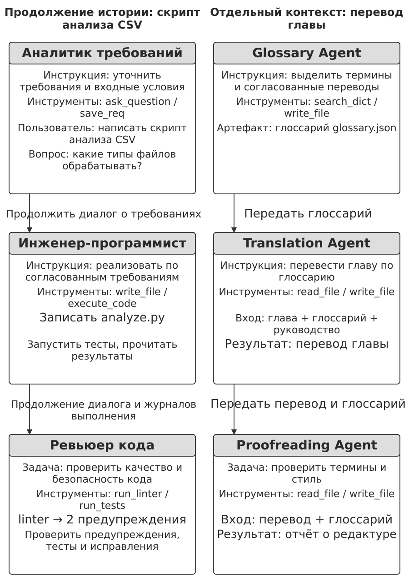

Как участники обмениваются материалами, если их контексты независимы? В распределённых системах для коммуникации обычно применяются общее хранилище или передача сообщений. В системах агентов также используются эти два подхода, в частности:

- **Параметры вызова инструмента.** Нижестоящий агент инкапсулируется в виде инструмента, а вышестоящий передаёт через параметры задачу и структурированные материалы, после чего получает результат.
- **Общая файловая система.** Одна сторона записывает документы, код или данные, а другая читает их по ссылке; этот способ подходит для крупных промежуточных результатов и материалов, требующих постоянного хранения.
- **Шина сообщений (Message Bus).** Агент отправляет сообщение посредническому сервису, который доставляет его согласно указанному получателю или подписке; этот способ подходит для асинхронного обмена между несколькими участниками.

Например, отправив задачу на перевод, вышестоящий агент может дождаться перевода или сначала получить номер задачи и перейти к обработке другой главы. Даже если оба переводчика могут открыть один файл, система всё равно должна определить, кто его записывает и когда другой участник его читает. В сообществе Go принято организовывать доступ к общим данным посредством коммуникации. Этот принцип применим и к агентам: необходимо явно определить, кому принадлежит состояние, кто может его изменять и как остальные участники получают обновления.

### Аспект 2: топология взаимодействия

Топология взаимодействия описывает зависимости между задачами, потоки информации и отношения управления между агентами. В этой главе рассматриваются три типичных способа организации:

- **Паттерн равноправного взаимодействия** (Peer Collaboration Pattern). Небольшое количество участников итеративно работает над одним результатом. Например, автор подготавливает черновик научной статьи, рецензент предлагает изменения, после чего автор дорабатывает текст.
- **Паттерн оркестрации** (Orchestration Pattern). Централизованный агент-менеджер отвечает за декомпозицию, распределение и сведение результатов задач, а подчинённые агенты выполняют каждый свою специализированную работу.
- **Децентрализованный паттерн** (Decentralized Pattern). Участники продолжают работу с учётом своих ролей, сообщений и локального состояния, совместно определяя её дальнейший ход.

> **Пояснение терминологии: Graph Engineering.** В первой главе рассматривалось обсуждение Graph Engineering, состоявшееся в июле 2026 года. Этот подход сосредоточен на графе выполнения: узлами могут быть агенты, обычные программы или решения, принимаемые человеком; рёбра выражают зависимости, условную маршрутизацию и направления обработки после сбоев; состояние передаётся по связям выполнения. Топология взаимодействия нескольких агентов — одно из применений этого подхода к проектированию, в котором основное внимание уделяется передаче работы, параллельному выполнению и обратной связи между несколькими центрами принятия решений.

Равноправное взаимодействие, оркестрацию менеджером и децентрализованную схему можно комбинировать. Например, менеджер передаёт задачу по подготовке текста группе из автора и рецензента, а группа после внутренних итераций отправляет ему результат.

## Когда несколько AI-агентов превосходят одного агента

Предположим, что в черновом переводе неверно переведён технический термин. Если дать двум редакторам один и тот же перевод, оба могут одинаково одобрить его. Но если один из них получит также оригинал, глоссарий и код, в котором используется этот термин, появится ещё один способ обнаружить ошибку. При выборе модели взаимодействия сначала следует спросить: что новый агент привносит в задачу? Он может получить новые доказательства, исследовать другой путь поиска, предложить иное профессиональное суждение или сократить время ожидания благодаря параллельному выполнению.

Автор сначала оценивает **прирост информации от обратной связи**, а затем — пользу от параллельной работы и изоляции контекста. Получив результаты тестов, скриншоты страниц или внешние материалы, ревьюер может предложить изменения на основе доказательств, недоступных во время генерации. В таблице 10-1 на нескольких распространённых сценариях показано, как оценивать такой прирост.

Таблица 10-1. Информация и обратная связь при взаимодействии нескольких агентов

| Модель взаимодействия | Основной источник информации | На что обратить внимание при оценке |
|---|---|---|
| Повторная проверка собственного результата той же моделью | Исходные материалы и новый цикл проверки | Обнаружены ли упущения и улучшился ли результат после изменений |
| Дебаты нескольких агентов по одному вопросу | Собственные пути решения, предположения и аргументы каждого агента | Различаются ли позиции, как проверить их и выбрать ответ |
| Ревьюер запускает тесты и проверяет код | Обратная связь от компиляции, тестирования и выполнения | Проходят ли тесты после изменений и сохраняется ли существующая функциональность |
| Ревьюер просматривает результат рендеринга фронтенда или PPT | Скриншоты и обратная связь от взаимодействия | Соответствуют ли требованиям компоновка, содержание и управление |
| Ревьюер проверяет факты с помощью внешних инструментов | Результаты поиска и записи бизнес-систем | Надёжны ли источники и соответствуют ли выводы доказательствам |

В RLEF модель с помощью обучения с подкреплением обучают использовать обратную связь от выполнения кода и выполнять многоэтапные исправления в задачах по соревновательному программированию. Ошибки компиляции, сбои тестов и исключения времени выполнения дают конкретные основания для следующего изменения. Описанная в статье модель достигает лучших результатов при меньшем числе сгенерированных вариантов.[^rlef-2025] WebGen-Agent, в свою очередь, включает в процесс генерации скриншоты веб-страниц, описания и рекомендации визуальной модели, а также оценку операций с GUI. Это позволяет как вернуться к предыдущему шагу и выполнить его заново, так и выбрать лучший из нескольких сгенерированных результатов. Точность Claude 3.5 Sonnet в бенчмарке WebGen-Bench выросла с 26,4% до 51,9%.[^webgen-agent-2025]

[^rlef-2025]: Gehring, J., et al. *RLEF: Grounding Code LLMs in Execution Feedback with Reinforcement Learning.* arXiv:2410.02089, 2025.
[^webgen-agent-2025]: Lu, Z., et al. *WebGen-Agent: Enhancing Interactive Website Generation with Multi-Level Feedback and Step-Level Reinforcement Learning.* arXiv:2509.22644, 2025.

Автор сначала поручает системе получить конкретные доказательства: результаты тестов, скриншоты или данные, возвращённые инструментами. Лишь после этого он решает, как распределить обязанности по генерации, выполнению и проверке. Контур обратной связи может обеспечивать один агент или несколько отдельных ролей. Добавление ролей должно улучшать получение и использование доказательств.

Исследование безопасности Anthropic 2026 года содержит пример совместного поиска: 45 агентов обменивались находками через общий форум и проверяли работу друг друга, после чего независимый агент выносил окончательное решение по результатам. Согласно отчёту, совместно работающий кластер израсходовал 27 миллионов токенов и обнаружил 266 уязвимостей, тогда как схема с параллельно работающими независимыми агентами израсходовала 6,5 миллиона токенов и обнаружила 21 уязвимость. Благодаря форуму участники могли продолжать исследование чужих находок и узнавать, какие направления уже изучаются. При этом совместно работающая группа израсходовала примерно в четыре раза больше токенов, поэтому разница между 266 и 21 обусловлена одновременно способом коммуникации и объёмом вычислительных ресурсов.[^anthropic-multiagent-2026]

[^anthropic-multiagent-2026]: Anthropic Frontier Red Team, “Patterns and Problems in Emerging Multiagent Systems,” 2026-08-13.

Как добиться того, чтобы в математическом исследовании разные группы действительно изучали разные пути? Трёхмерные уравнения Навье — Стокса описывают движение вязкой жидкости. Остаётся ли решение гладким при гладких начальных условиях? OpenAI распределила между разными группами две противоположные цели: одни пытались доказать гладкость, другие — построить контрпример. Сначала каждая группа проводила самостоятельный поиск, а затем команда с помощью Codex обобщала промежуточные результаты, чтобы остальные группы также могли развивать перспективные идеи. В группе, нашедшей контрпример, параллельно работало около десяти тысяч агентов. По данным команды, от запуска первых агентов до получения доказательства прошло около 88 часов, а формализация и проверка в Lean заняли ещё 17 часов. У контрпримера есть важное условие: на жидкость действует гладкая внешняя сила, но сингулярность всё равно возникает за конечное время. Таким образом, команда представила контрпримеры, требуемые формулировками C и D задачи Института математики Клэя. Без внешней силы это была бы уже другая задача. При проектировании такого поиска можно заранее определить, какие результаты будут достаточным ответом на исходный вопрос, поручить конкурирующие гипотезы разным группам и отдельно выделить время на окончательную проверку.[^ch10-ns-search]

[^ch10-ns-search]: Исследовательский материал OpenAI *On the Navier–Stokes Millennium Prize Problem* содержит доказательство и код Lean. В заявлении от 11 сентября 2026 года Институт математики Клэя отреагировал на эту работу и пояснил, что оценка результата и присуждение премии будут проводиться в соответствии с установленной процедурой.

**Как бюджет шагов влияет на результат?** Предположим, что на задачу выделено 30 шагов. Агенту придётся компактно распределить между ними планирование, основную реализацию и необходимую проверку. Если же доступно 300 шагов, появляется возможность сравнить больше вариантов, провести более полное тестирование и внести дополнительные исправления. Чтобы эффективно использовать эти ресурсы, агенту необходимо знать общий и оставшийся бюджет и выбирать глубину исследования с их учётом.

В работе Google 2025 года *Budget-Aware Tool-Use Enables Effective Agent Scaling* исследуется именно этот вопрос: агент, не учитывающий бюджет, может быстро остановиться на поверхностном поиске, и даже увеличение доступного числа шагов не приведёт к дальнейшему улучшению результата. Предложенный в 2026 году метод BAVT (Budget-Aware Value Tree Search) дополнительно учитывает на каждом шаге поиска оценку ценности и оставшийся бюджет, корректируя соотношение исследования и использования. При достаточном бюджете можно сравнивать больше направлений, а по мере приближения к его пределу — сосредоточивать ресурсы на перспективных ветвях.

В режиме управляющего это означает, что Manager должен распределять шаги с учётом сложности задач и корректировать их число по мере работы: по простым задачам — как можно быстрее выдавать результат, для сложных нужно оставлять время на проверку и исправления, а при возникновении блокирующей проблемы — сначала определить её причину и лишь затем решать, нужно ли предоставить дополнительную информацию, увеличить бюджет или выбрать другой путь.

Параллельный поиск может сократить время выполнения по часам, а многократные проверки — улучшить результат, но оба подхода увеличивают число вызовов модели и расходы на коммуникацию. Автор использует хорошо настроенного одиночного агента как базовый ориентир и расширяет взаимодействие только тогда, когда повышение качества или экономия времени благодаря новым участникам окупают расходы на коммуникацию, повторные вычисления и сопровождение.

## Мультиагентное взаимодействие с общим контекстом

При взаимодействии с общим контекстом роли сменяются поэтапно, а существующие записи о задаче сохраняются. Например, при подготовке исследовательского отчёта роль поиска сначала собирает материалы, роль анализа затем выполняет расчёты, а роль написания организует изложение. Каждая роль может обращаться к предыдущим источникам и решениям, а система с помощью текущих инструкций задачи направляет её внимание на цели данного этапа.

При передаче работы между командами сначала задайте вопрос: кому необходимо знать, почему изначально было принято именно такое решение? В примере продукта Teamily AI менеджер продукта и AI-агент вместе составляют в групповом чате документ с требованиями к продукту (PRD). После того как продуктовая команда передаёт окончательную версию инженерной команде, инженеры могут уточнить, какие компромиссы лежат в основе конкретного требования.

Рассмотрим передачу задачи от роли поиска к роли написания: откуда после передачи модель получает правила написания и какие инструменты по-прежнему может вызывать? В эксперименте 10-1 одна и та же передача реализуется двумя способами.

| Вопрос, который необходимо решить при передаче | Смена роли (`transfer_to_agent`) | Загрузка Skill |
|---|---|---|
| Как предоставить правила написания? | Переключиться на системный промпт роли написания | Сохранить каталог Skills в системном промпте и добавить правила написания в конец истории сообщений |
| Какие инструменты видит модель? | Можно показывать только инструменты роли написания | Можно сохранить исходный набор инструментов или точку входа для их поиска |
| Какую часть KV-кэша по-прежнему можно использовать? | Системный промпт изменяется, поэтому начиная с точки изменения префикса обычно требуется повторное вычисление | Исходный префикс запроса можно продолжать использовать повторно |
| Кто проверяет права на вызов? | Harness проверяет запрос в соответствии с текущей ролью, а затем направляет вызов инструменту | Harness независимо проверяет права на каждый вызов |

Если различия между ролями главным образом заключаются в знаниях, процессах и стиле письма, автор отдаёт предпочтение Skill: он позволяет повторно использовать один и тот же фреймворк выполнения и сохранять кэш стабильного префикса запроса. Если различия между ролями связаны с правами доступа, изоляцией инструментов или обязанностями по согласованию, работу можно организовать с помощью отдельных агентов либо смены ролей, а контроль доступа возложить на Harness и среду выполнения. Наличие инструмента во входных данных модели влияет на выбор вызова, однако фактические права определяются проверкой во время выполнения.

> **Эксперимент 10-1 ★★: смена нескольких ролей при общем контексте — сравнение системных промптов и Skill**
>
> Оба варианта используют одну и ту же модель, пользовательскую задачу, реализацию инструментов, правила ролей и общую историю. Во вводной демонстрации необходимо найти объёмы продаж автомобилей на новых источниках энергии в Китае за 2021–2023 годы, рассчитать совокупный среднегодовой темп роста (CAGR) и написать резюме для инвесторов объёмом не более 120 знаков.
>
> **Вариант 1: переключение системных промптов.** Предусмотрены пять ролей: triage (сбор требований), research (поиск), coding (программирование), data_analysis (анализ) и writing (написание текста). Точкой входа служит triage, а каждой роли доступны специализированные инструменты и `transfer_to_agent`. При передаче сохраняется история, загружаются промпт и набор инструментов целевой роли, после чего выполнение продолжается.
>
> **Вариант 2: загрузка Skill.** Системный промпт и полный набор инструментов остаются неизменными на протяжении всего сеанса. Модель вызывает `load_skill(name)` для получения правил роли, а их содержимое добавляется в общую историю как результат инструмента; исходный префикс сохраняется. Harness проверяет каждый вызов инструмента в соответствии с правилами доступа.
>
> Обе реализации читают один и тот же файл `SKILL.md`. Возьмите по одному запросу, отправленному модели до и после передачи роли, и посмотрите, в каком сообщении появляются правила и какую часть префикса по-прежнему можно использовать повторно. Затем проверьте оба резюме: заслуживают ли доверия источники данных о продажах? Между концом 2021 и концом 2023 года два периода роста — правильно ли рассчитан совокупный среднегодовой темп роста?
>
> В формальном сравнении использовалась более строгая задача по подготовке краткого отчёта: не более 160 знаков с сохранением двух URL-адресов источников. Обеим группам также предоставлялось восемь шагов. Группа со сменой ролей потратила три вызова на подсчёт знаков, однако черновик всё равно содержал 206 знаков, а указанный в задаче инструмент вычислений так и не был использован. Группа с загрузкой Skill рассчитала темп роста по объёмам продаж за первый и последний годы, но лишь на восьмом шаге загрузила правила написания. К этому моменту все необходимые роли уже были пройдены, однако пользователь так и не получил резюме. Обе траектории завершились из-за достижения предельного числа шагов.
>
> На одном и том же наборе из 30 задач были запущены обе реализации, а результаты проверены программно. Группа с загрузкой Skill прошла 15 задач, а группа с переключением системного промпта — 2. Однако при попарном сравнении задач у первой группы оказалось на 6 855 больше входных токенов, не попавших в кэш, а выполнение заняло примерно на 4,4 секунды больше; в обоих случаях указана медиана попарных разностей. При этом поставщик сервиса сообщил о нулевом числе кэшированных входных токенов в запросах обеих групп. Обе группы прошли все шесть граничных тестов на соблюдение инструкций, однако доля успешно выполненных полных задач различалась значительно.

## Мультиагентное взаимодействие без общего контекста

В архитектуре с независимыми контекстами каждый AI-агент отдельно хранит историю входных данных, состояние задачи и цикл выполнения, а необходимой информацией агенты обмениваются через параметры инструментов, общие файлы и сообщения. Например, передавая материалы, переводчик должен указать фрагмент оригинала и версию глоссария. Даже если переводчик завершит работу, редактор сможет найти исходный текст, а при необходимости доработки — определить ответственного по главе.

В табл. 10-2 сопоставлены способы управления процессами в операционной системе и агентами в среде выполнения.

Таблица 10-2. Архитектурные аналогии между мультиагентной и операционной системами

| Операционная система | Аналогичная функция в мультиагентной системе |
|---|---|
| Программа и конфигурация | Системный промпт, определения инструментов и конфигурация роли |
| Память процесса | Текущий контекст, состояние задачи и история |
| CPU выполняет вычисления | LLM принимает решения, а среда выполнения и инструменты выполняют соответствующие операции |
| Ядро управляет выполнением | Среда выполнения агента управляет состоянием, планированием и ресурсами |
| Системный вызов | Запрос внешней операции через интерфейс инструмента |
| fork: создание дочернего процесса | `spawn_subagent`: создание субагента |
| kill: отправка сигнала | `cancel_subagent`: запрос отмены |
| ps: запрос списка процессов | `list_agents`: запрос участников и состояния их выполнения |
| Состояние завершения и wait | Уведомление о завершении, состояние задачи и структурированный результат |
| Общее хранилище и передача сообщений | Общие файлы, параметры инструментов и сообщения |

Приватное состояние, асинхронные сообщения и динамическое создание участников встречаются и в модели акторов, предложенной в 1970-х годах.[^actor-model]

[^actor-model]: Hewitt, C., Bishop, P., Steiger, R. *A Universal Modular ACTOR Formalism for Artificial Intelligence.* IJCAI 1973.

При большом количестве независимых подзадач автор предпочитает выделять каждому участнику отдельный контекст, чтобы тот обрабатывал только материалы, относящиеся к его обязанностям. Это упрощает раздельное тестирование ролей, снижает влияние длинной истории предыдущих этапов на текущие решения и позволяет выполнять несколько задач параллельно. Эффект изоляции зависит и от других общих ресурсов: несколько агентов по-прежнему могут одновременно изменять файлы, расходовать одну квоту API или получать одно и то же сообщение об ошибке.

Интерфейс взаимодействия также должен учитывать потерю сообщений, повторную доставку и задержку обновления состояния. При диагностике проблем идентификатор задачи позволяет связать запросы, события инструментов и результаты разных участников и восстановить процесс передачи работы.

Предположим, один агент завершил анализ и должен передать результат коллеге, составляющему отчёт. Небольшой объём числовых данных можно отправить сообщением; если же результат представляет собой большую таблицу, её обычно сохраняют в общей файловой системе, а в сообщении передают ссылку. Так формируются две области ответственности. **Хранилище результатов** служит для хранения документов, кода и данных и обмена ими, а **коммуникация и управление** отвечают за доставку сообщений, запрос состояния задач, отмену выполнения и планирование ресурсов.

### Файловая система с точки зрения AI-агента

Один из распространённых архитектурных подходов — предоставить агенту **виртуальную файловую систему** (virtual filesystem), смонтировав ресурсы из разных источников в единое дерево каталогов. Модель обращается к ним через интерфейсы наподобие `read_file`, `write_file` и `list_dir`, тогда как на нижнем уровне могут использоваться локальный временный диск, постоянное объектное хранилище, API стороннего облачного диска или системный пакет ресурсов.

Автор сначала чётко разграничивает области хранения и лишь затем подключает процессы взаимодействия. Смешение временных черновиков, официальных результатов и внешних файлов пользователя чревато случайной перезаписью или чтением с превышением полномочий. Единый интерфейс упрощает работу, а видимость, жизненный цикл и права каждой области определяются настройками монтирования и контроля доступа. Это дерево каталогов можно разделить на четыре типа областей.

**1. Личная рабочая область агента (Scratchpad).** Каждый экземпляр использует собственную рабочую область для хранения черновиков, временных файлов, отладочных журналов и промежуточных результатов. По умолчанию доступ ограничивается соответствующим агентом, а данные очищаются или архивируются согласно правилам задачи. Это предотвращает взаимную перезапись временных файлов. Завершив работу, субагент помещает предназначенные для передачи результаты в общее пространство и передаёт их главному агенту вместе со структурированным резюме. Записи о пробах и ошибках остаются в исходной рабочей области для последующей диагностики. Так изоляция контекста реализуется и на уровне хранения: главный агент получает результат и необходимые свидетельства, не расходуя ресурсы на чтение всего процесса проб и ошибок при повседневной координации.

**2. Общее мультиагентное пространство (Shared Workspace).** Здесь участники взаимодействия обмениваются результатами, а пользователь может загружать материалы и скачивать результаты через авторизованную точку доступа. Например, Glossary Agent записывает глоссарий, Translation Agent читает его и выполняет перевод, после чего редактор проверяет текст. Общее пространство обычно сохраняется на протяжении всей задачи, поэтому необходимо учитывать параллельную запись, обновление версий и область доступа. Обмен CSV-файлами и диаграммами между агентом и виртуальным компьютером через общее хранилище, описанный в главе 6, служит примером такой передачи результатов. Далее будут рассмотрены оптимистическая блокировка, изоляция рабочих копий и другие методы.

**3. Смонтированные внешние ресурсы (Mounted External Resources).** Ресурсы Google Drive, Notion, Dropbox, корпоративных Wiki и других систем можно отображать в единый интерфейс посредством адаптеров. Когда агент читает документ, адаптер обращается к API исходной системы. Здесь необходимо учитывать различия трёх типов: область доступа зависит от внешней авторизации; сетевое обращение сопряжено с задержками, тайм-аутами и проблемами обновления кэша; обратная запись должна соответствовать правилам исходной системы в отношении прав доступа и версий. Конкретная семантика согласованности определяется интерфейсом сервиса; для обнаружения параллельных изменений можно использовать номера версий, условную запись или повторное чтение. Монтирование по запросу в режиме только для чтения подходит для поиска материалов, а соответствующие права на запись следует предоставлять лишь при необходимости редактирования.

**4. Встроенные системные ресурсы (Built-in System Resources).** Справочники, шаблоны, определения инструментов и предустановленные Skills могут предоставляться нескольким агентам в виде пакетов ресурсов только для чтения. Skills загружаются по принципу прогрессивного раскрытия: сначала предоставляется каталог, затем в соответствии с задачей читаются регламенты и скрипты. Пакеты ресурсов с фиксированными версиями удобны для параллельного чтения, а переключение версий при обновлении позволяет сохранить согласованность уже выполняющихся задач.

На рис. 10-2 переводчик может многократно изменять черновик в собственном каталоге, а подготовив его к передаче редактору — поместить соответствующую версию в общее пространство. Оригинал на облачном диске пользователя читается через внешний адаптер, причём доступ к нему зависит от предоставленных пользователем разрешений.

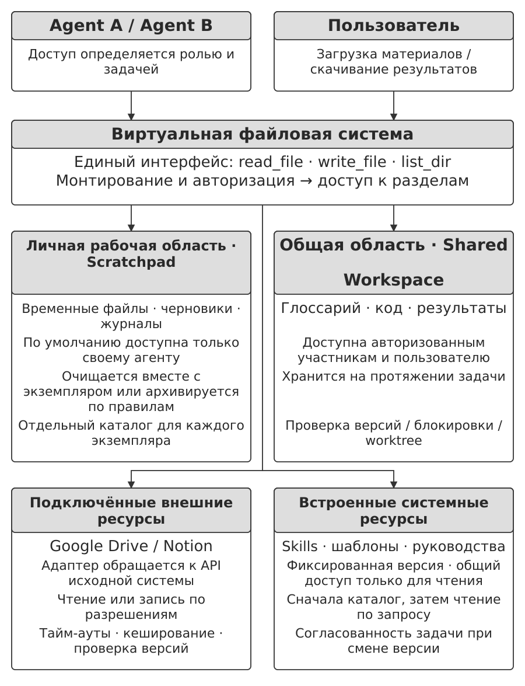

После выхода переводчика временные файлы в его рабочей области могут быть освобождены. Помещённый в общее пространство перевод продолжает храниться, и редактор с правом чтения может продолжить работу над ним (табл. 10-3).

Таблица 10-3. Четыре типа областей виртуальной файловой системы агента

| Область | Видимость | Жизненный цикл | Чтение и запись | Управление параллельным доступом |
|---|---|---|---|---|
| Личная рабочая область агента | По умолчанию только соответствующий агент | Очищается вместе с экземпляром, при необходимости архивируется | Чтение и запись соответствующим агентом | Предотвращение повторной записи при повторных попытках или фоновых операциях |
| Общее мультиагентное пространство | Авторизованные участники и пользователи | Сохраняется на протяжении задачи | Права предоставляются в соответствии с ролью | Блокировка, проверка версии или worktree |
| Смонтированные внешние ресурсы | Совместно ограничивается внешней авторизацией и адаптером | Определяется исходной системой и политикой кэширования | Только чтение по запросу или запись при наличии разрешения | Соблюдение интерфейсов исходной системы для управления версиями и параллельным доступом |
| Встроенные системные ресурсы | Авторизованные агенты | Фиксированная версия многократно используется между сеансами | Только чтение | Централизованное переключение версии ресурсов |

Ссылки на файлы позволяют сохранять краткость сообщений при передаче результатов: предыдущий участник указывает расположение результата, его версию и назначение, а следующий читает содержимое по мере необходимости. Участники в одной среде выполнения могут использовать общий путь; при межорганизационном взаимодействии для такой же передачи необходимы идентификатор результата, интерфейс доступа и авторизация, распознаваемые обеими сторонами.

### Коммуникация и управление между AI-агентами

Представленные в главе 4 инструменты создания, коммуникации, отмены и обнаружения предоставляют базовый интерфейс управления для мультиагентного взаимодействия: `spawn_subagent` создаёт участников, `send_message_to_subagent` передаёт сообщения, `cancel_subagent` запрашивает отмену, а `list_agents` возвращает список участников. Помимо этих интерфейсов, необходимо также согласовать поведение при передаче сообщений, изменении состояния, прекращении выполнения и планировании.

**1. Передача сообщений.** Если участников немного, а связи между ними фиксированы, можно использовать одноранговый интерфейс: например, телефонный и компьютерный агенты могут напрямую обмениваться информацией о ходе работы. Если каждому участнику требуется взаимодействовать со всеми остальными, потенциальное количество связей растёт пропорционально квадрату числа участников. При большом количестве подписок шина сообщений упрощает централизованное управление маршрутизацией, буферизацией и повторными попытками. Как одноранговая передача, так и шина могут обеспечивать асинхронную доставку; необходимость одновременного присутствия получателя в сети зависит от механизмов очередей и постоянного хранения.

Сообщение обычно содержит структурированный **конверт** (envelope): ID отправителя, адресата — конкретного агента или область широковещательной рассылки, тип сообщения и полезную нагрузку. К типам сообщений могут относиться `task_assigned`, `status_update`, `result` и `terminate`. Идентификаторы задачи, сообщения и связанного запроса помогают получателю устранять дубликаты, а средствам отладки — восстанавливать цепочку коммуникации. Прикладное содержимое помещается в полезную нагрузку JSON, поля которой обе стороны обрабатывают согласно соглашению.

Например, за сдачу перевода отвечает редактор, который хочет попросить агента терминологической проверки сверить один термин. Для запуска проверки достаточно упомянуть его через `@` в комментарии к заявке Multica и написать вопрос. Заключение можно опубликовать в ответе к той же заявке: ответственным останется редактор, а состояние заявки не изменится. Если проверяющий должен принять на себя всю заявку, необходимо явно сменить ответственного.[^ch10-multica]

[^ch10-multica]: Multica, упоминание агента в комментарии; реализация маршрутизации комментариев в версии `d579273`.

**2. Получение состояния.** Главному агенту необходимо знать, продолжает ли выполняться подзадача, требуются ли ей входные данные и доступен ли результат. Для этого можно сочетать интерфейс состояния, уведомления о событиях и файлы прогресса: интерфейс среды выполнения предоставляет состояние жизненного цикла, сообщения описывают прикладной прогресс, а постоянные файлы сохраняют записи, необходимые для восстановления.

`get_subagent_status(agent_id)` может возвращать такие состояния, как «выполняется», «требует входных данных», «завершён» или «завершился с ошибкой». В повседневной координации автор предпочитает уведомления о завершении и сообщения о прогрессе этапов, позволяющие главному агенту продолжать собственную работу. Активный запрос состояния нужен при задержке уведомления, восстановлении соединения или диагностике проблемы: это позволяет не расходовать вызовы модели на частые вопросы «уже закончил?». Интерфейс состояния поддерживается средой выполнения и может своевременно сообщать, жив ли процесс и завершилась ли задача.

**Обмен сведениями о прогрессе через сообщения.** Главный агент может запросить текущий прогресс, а субагент — ответить на подходящем этапе. Субагент также может самостоятельно публиковать `status_update`, когда получает промежуточный результат, сталкивается с блокировкой или нуждается в помощи. В сообщении следует указывать завершённые действия, следующий шаг и причину блокировки. Все участники должны использовать единый набор названий состояний, чтобы упростить их объединение и оценку. Рассматриваемый далее протокол A2A представляет стандартизированное описание жизненного цикла задачи.

**Сохранение прогресса в файлах.** Система может последовательно дописывать в журнал сообщения, запросы инструментов, результаты инструментов и изменения состояния, например в формате JSONL с одним событием на строку. Имеющий диагностические права главный агент или эксплуатационный инструмент может по этому журналу изучать повторные попытки, ошибки и ожидания. История входных данных модели представляет лишь часть траектории выполнения; журнал также может содержать события планирования и внешнего выполнения.

Полная траектория может содержать десятки тысяч токенов, а главному агенту после каждого чтения приходится заново извлекать из неё текущее состояние. Сообщения уведомляют главного агента о новом прогрессе, а компактный файл прогресса сохраняет текущее состояние для последующих запросов и восстановления. Автор предпочитает сочетать эти два механизма для повседневной координации. После завершения каждого этапа субагент обновляет список задач, ссылки на результаты и текущие точки блокировки, а главный агент определяет следующий шаг по этим полям. Подробная траектория сохраняется для диагностики по мере необходимости. Если прогресс долго не меняется, необходимость вмешательства можно оценить по heartbeat-сигналам, состоянию вызовов инструментов и тайм-аутам задачи: длительно работающий инструмент может всё ещё выполнять операцию, поэтому сначала следует проверить состояние и лишь затем решать, ждать, отменять или повторять попытку.

**3. Прекращение выполнения.** Когда несколько участников параллельно ищут одну цель, после выполнения задачи одним из них остальные ветви можно остановить, освободив бюджет и ресурсы инструментов. Существуют два уровня жёсткости отмены, похожие по действию на SIGTERM и SIGKILL в Unix.

Автор предпочитает **корректное прекращение**: среда выполнения передаёт запрос отмены, субагент в безопасной точке перестаёт запускать новые операции, сохраняет необходимый прогресс, закрывает сеанс браузера и освобождает блокировки, после чего возвращает подтверждение (ack). **Принудительное прекращение** применяется, если выполняемая задача не отреагировала до истечения срока отмены: среда выполнения завершает процесс, а затем проверяет оставшиеся ресурсы и незавершённые операции записи. Для операций, уже отправленных во внешнюю систему, необходимо дополнительно запросить результат и при необходимости выполнить компенсирующую процедуру.

Жизненным циклом также необходимо управлять вдоль связей создания. По аналогии с Go context сигнал отмены родительской задачи можно распространять вниз по всему дереву подзадач, а цикл выполнения должен проверять его в безопасных точках, что соответствует назначению `ctx.Done()`. Тогда после завершения родительской задачи запущенные ею ветви также перейдут к освобождению ресурсов, а бесхозные агенты не продолжат вызывать инструменты и расходовать бюджет. Для фоновой задачи, которой действительно требуется длительная независимая работа, создаётся отдельный контекст жизненного цикла, подобный `context.Background()`, и назначается ответственный за мониторинг, бюджет и освобождение ресурсов.

**4. Ресурсы и планирование.** Агентной системе необходимо распределять токены, шаги, квоты параллельного выполнения, подключения к инструментам и вычислительные ресурсы. При запуске подзадачи задаются бюджет и поведение при его превышении; модель выбирается с учётом сложности задачи; количество параллельных вызовов ограничивается, чтобы не исчерпать квоту сервиса. При поступлении более срочной задачи низкоприоритетную работу можно приостановить или отменить в безопасной точке, сохранить её прогресс и запланировать заново.

Предположим, три ветви исследуют по одному возможному решению, причём одна уже нашла ключевую зацепку и ей осталась только последняя проверка. Manager может выделить ей ещё несколько шагов и одновременно завершить две ветви, не добившиеся прогресса. Квота списывается средой выполнения: даже если ветвь хочет предпринять ещё одну попытку, после исчерпания бюджета она должна остановиться.

### Одноранговое взаимодействие: взаимная проверка и итеративное улучшение

В одноранговом взаимодействии обычно участвуют два-три AI-агента, которые обмениваются мнениями по одной задаче и дорабатывают результат. При проектировании можно заранее назначить участникам разные обязанности, материалы и инструменты, чтобы они выносили независимые суждения, а затем объединяли результаты. Например, генератор сосредоточен на реализации, а проверяющий — на тестах и требованиях пользователя; специалисты разных профилей проверяют ограничения в своих областях. Чем сильнее сходство моделей, входных данных и рабочих процессов, тем вероятнее, что участники повторят одно и то же суждение, поэтому различия в точках зрения и свидетельствах необходимо проектировать намеренно.[^anthropic-multiagent-2026]

Для задач, требующих многократного улучшения одного результата, автор рекомендует начинать с однорангового взаимодействия двух-трёх участников. Когда роли, содержимое передачи и условия остановки определены, можно построить тестируемый цикл с относительно небольшими первоначальными затратами на координацию.

#### Инженерия циклов

Одноранговое взаимодействие помогает справиться с распространённой проблемой: **преждевременным прекращением**. В программировании и выполнении поручений через службу поддержки его можно обнаружить по трём видам записей.

- **Объявление всей работы завершённой после выполнения лишь части.** Coding Agent пишет код, но не выполняет тесты и не проверяет развёртывание; пользователь поручает помощнику два дела, а тот выполняет первое и докладывает, что всё готово. Необходимо по пунктам сверить работу со списком задач и проверить свидетельства выполнения каждого пункта.
- **Преждевременный отказ после неудачи на одном пути.** Продавец может потребовать отправить материалы через форму или получить вложения по указанному адресу электронной почты. Получив такой ответ, можно продолжить работу способом, который принимает продавец. Необходимо записать причину неудачи и определить, какие пути ещё стоит попробовать.
- **Пропуск последующих шагов после локального успеха.** Если после согласия продавца на возврат средств пользователь должен дополнительно подтвердить его в приложении, помощник обязан сообщить об этом шаге и условиях его выполнения. Например, если при обсуждении уменьшения суммы счёта служба поддержки устно согласилась на это по телефону, помощник может подтвердить пользователю, что в ходе переговоров получено соответствующее обещание. Запись разговора доказывает, что именно сказал сотрудник поддержки, но для подтверждения изменения следующего счёта потребуются новые свидетельства. Проверяющий должен отдельно указать достигнутый результат, кто и что ещё должен сделать, а также какие результаты пока невозможно наблюдать.

Во всех трёх случаях условия завершения необходимо свести к проверяемым результатам. **Инженерия циклов** рассматривает, как заставить агента непрерывно проходить цикл «определить следующую работу — выполнить — проверить — записать прогресс» и на основании результата решать, следует ли продолжать, ждать, передать работу или завершить её. Инженеру необходимо спроектировать источник задач, способ проверки, постоянное состояние и условия остановки. Роль человека также расширяется: вместо написания промпта для одного вызова он проектирует цикл, способный непрерывно продвигать задачу. Addy Osmani использовал это название для данной совокупности практик в июне 2026 года и сослался на опыт Boris Cherny: основной акцент работы постепенно смещается к проектированию циклов, управляющих агентами.[^loop-engineering-2026]

**Автор считает, что в таких циклах ключевым узким местом обычно становится валидатор.** При ненадёжной проверке увеличение числа раундов может лишь заставить систему повторять однотипные ошибки или преждевременно объявлять работу завершённой. Результаты тестов, состояние бизнес-процесса и подтверждение пользователя предоставляют основания для завершения каждый в своей области; провал проверки становится входными данными для исправлений в следующем раунде.

Практика предшествовала названию. Ещё до распространения термина «инженерия циклов» автор и его команда уже использовали в Pine AI циклы и проверку для устранения преждевременного прекращения. «Предлагающий — проверяющий» — распространённый способ организации таких циклов, который подробнее рассматривается ниже.

[^loop-engineering-2026]: Osmani, Addy. “Loop Engineering”, 2026.

**LoopX: сохранение рабочего состояния между раундами.** LoopX помещает цель, границы, список задач, шлюзы, свидетельства и квоты в постоянную плоскость управления, которая назначает работу для следующего раунда или исполнителя. Процесс можно свести к следующей последовательности: **решение плоскости управления → выполнение агентом → независимая проверка → фиксация проверенного прогресса**.

Агент вызывает инструменты, рассуждает и передаёт результат текущего раунда. Плоскость управления записывает уже выполненную работу и определяет, откуда продолжить в следующем раунде. После успешной проверки состояние завершения фиксируется; при неудаче начинается исправление или перепланирование. Контрольные точки с участием человека, условия ожидания и пределы бюджета совместно определяют, когда выполнение можно продолжить.[^loopx-framework]

[^loopx-framework]: LoopX, The local control plane for long-running AI agent work, v0.4.0.

**LongHorizon-Harness: связывание длительных задач между приложениями.** Этот фреймворк исходит из мультимодального Computer Use и обеспечивает непрерывное выполнение задачи через GUI, CLI, несколько настольных приложений и многократные обновления контекста. Он использует цикл Manage–Execute–Audit (MEA): Manager на основе исходной цели, проверенного прогресса, свидетельств неудач и оставшейся работы создаёт одну подзадачу с чётко очерченными границами; Executor выполняет операции через GUI или CLI в новом контексте; Auditor только для чтения проверяет результат и записывает подтверждённый прогресс в состояние следующего раунда. Свидетельства неудач также сохраняются для восстановления и перепланирования.

Фреймворк вызывает через слой адаптеров такие исполнительные бэкенды, как Claude Code и Codex CLI, связывая внешнее управление задачами с внутренними циклами выполнения бэкендов. Этот подход основывает непрерывность длительной задачи на проверенном состоянии задачи. Контекст выполнения может обновиться, но следующий раунд всё равно продолжит работу на основе цели, свидетельств завершения и нерешённых вопросов, повторно проверяя, не повлияли ли изменения среды на прежние выводы.[^longhorizon-implementation]

В контролируемом сравнении, где Qwen 3.7-Plus и исполнительный бэкенд Claude Code оставались неизменными, а менялся внешний цикл, статья сообщает о росте PassRate WeaveBench с 51,8 до 80,7 %, бинарной доли завершения OSWorld 2.0 — с 2,8 до 8,3 %, а успешности Terminal-Bench 2.1 — с 69,7 до 77,2 %. Затраты также зависели от задачи: первые два бенчмарка потребовали соответственно в 2,3 раза больше общего числа токенов и в 3,6 раза больше выходных токенов относительно базовой системы, тогда как Terminal-Bench 2.1 израсходовал на 24 % меньше токенов.

В одной и той же задаче многоуровневого аудита потоков WebRTC базовый исполнитель застрял в интерфейсе Wireshark, затем предпринял ещё несколько попыток и в итоге получил оценку 0,59. При использовании MEA проверяющий записал недостающие свидетельства, следующий исполнитель выполнил дополнительные проверки на их основе, и итоговая оценка составила 0,92.

[^longhorizon-implementation]: LongHorizon-Harness, статья arXiv:2608.01964. Открытые траектории базовой системы и MEA относятся к задаче WEB_task_16_webrtc_simulcast_layer_audit; скрипт воспроизведения использует коммит `53bc678`.

#### Парадигма «предлагающий — проверяющий»

Парадигма «предлагающий — проверяющий» передаёт создание результата и его проверку двум ролям. Такая архитектура использовалась в описанных в главе 5 экспериментах по созданию PPT, редактированию видео и визуализации журналов: Proposer генерирует код, Reviewer просматривает визуализированный результат, проверяет его качество с помощью визуальной модели и возвращает структурированные рекомендации по исправлению. На рис. 10-3 рекомендации также возвращаются предлагающему. Сможет ли он на их основе исправить следующую версию, зависит от того, насколько точно проверяющий локализует проблему.

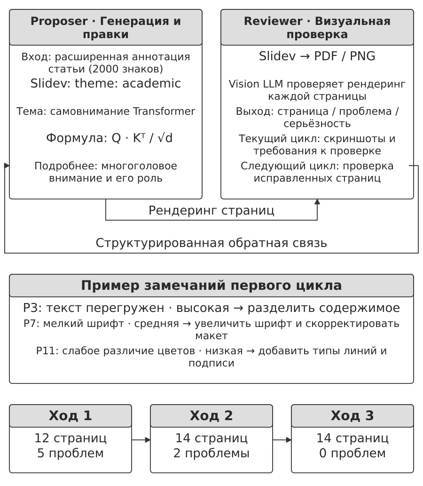

При изменении объекта проверки должны меняться и изучаемые свидетельства. При проверке ответа службы поддержки его следует сопоставлять с бизнес-правилами и источниками фактов; при проверке изменений кода — изучать тесты и результаты фактического выполнения; при проверке плана действий — сверять применимые нормы и предварительные условия.

В статье Хуана и соавторов *Large Language Models Cannot Self-Correct Reasoning Yet*, представленной на ICLR 2024, обнаружено, что в исследованных задачах рассуждения и конфигурациях промптов самостоятельное исправление GPT-4 без внешней обратной связи приводило к изменению правильных ответов на неправильные и снижению общей точности. Обзор самоисправления в TACL дополнительно рассматривает влияние условий задачи и надёжности обратной связи на результат исправления.[^self-correction-survey] Поэтому автор считает независимые свидетельства и локализуемые условия исправления основными требованиями к циклу проверки. Проверяющий должен иметь возможность прочитать фактические результаты тестов, состояние среды или визуализированный результат и указать, какое требование ещё не выполнено и как проверить исправление.

[^self-correction-survey]: Kamoi, R., et al. *When Can LLMs Actually Correct Their Own Mistakes? A Critical Survey of Self-Correction of LLMs.* TACL, 2024.

Полный цикл можно организовать в пять этапов:

1. Предлагающий создаёт первую версию в соответствии с требованиями задачи, например ответ или фрагмент кода.
2. Результат выполняется или визуализируется для получения результатов тестов, состояния бизнес-процесса, снимка экрана или результатов проверки фактов.
3. Проверяющий сопоставляет требования со свидетельствами и либо принимает результат, либо указывает место проблемы и условия исправления.
4. Если бюджет ещё не исчерпан, предлагающий вносит исправления на основе обратной связи, после чего результат снова выполняется и проверяется; если возникает вопрос, требующий входных данных или разрешения, работа переводится в ожидание или передаётся.
5. После выполнения условий публикации передаётся версия, прошедшая проверку, вместе со свидетельствами проверки и заключением проверяющего; при исчерпании бюджета сохраняются прогресс и нерешённые вопросы.

Проверяющий читает защищённые тесты и критерии публикации, а предложенные изменения этих критериев проверяются отдельно.

В экспериментах CRITIC модель сначала формирует ответ, а затем проверяет его с помощью инструментов.[^ch10-critic] Например, она использует поисковую систему для проверки фактов в ответе и интерпретатор Python для выполнения самостоятельно написанной математической программы. После исправления ответов на основе обратной связи от инструментов показатели улучшились во всех трёх категориях задач: ответах на открытые вопросы, генерации математических программ и уменьшении вредных формулировок. Исправление работало хуже, когда модель оценивала исходный ответ самостоятельно. Эта архитектура соответствует примеру с PPT из главы 5: визуализированный снимок экрана выявляет проблемы с компоновкой и перекрытием, которые трудно определить непосредственно по тексту кода, а выполнение тестов обнаруживает ошибки фактического выполнения.

[^ch10-critic]: CRITIC, arXiv:2305.11738.

В примере Anthropic 2026 года по долгосрочной разработке приложений использовались три агента: планировщик, генератор и оценщик. Планировщик преобразует требования в спецификацию продукта; генератор и оценщик предварительно согласуют критерии завершения каждого раунда, после чего соответственно выполняют реализацию и проверку. Оценщик работает с приложением через Playwright и формирует отчёт о дефектах, а роли передают состояние через файлы. Этот пример показывает, как связать спецификацию продукта, реальные операции и обратную связь о дефектах, но при сравнении подходов необходимо учитывать дополнительные затраты на выполнение и проверку.[^anthropic-harness-2026]

[^anthropic-harness-2026]: Prithvi Rajasekaran, “Harness Design for Long-Running Application Development,” Anthropic Engineering, 2026-03-24.

20 ноября 2026 года математик Levent Alpöge опубликовал полученное совместно с Claude формальное доказательство, касающееся гипотезы Римана и её обобщения для функций Дирихле $L$. Получив большой набор файлов Lean, проверяющий прежде всего должен задать два вопроса: сформулирована ли в последней теореме исходная гипотеза и может ли ядро проверки доказательств заново проверить каждый шаг вывода? Математик MIT Andrew Sutherland сначала сопоставил представленную теорему с определением гипотезы Римана в математической библиотеке Lean, а затем перечислил аксиомы, от которых зависит доказательство. В опубликованной в тот же день записи он также сообщил, что независимое ядро проверки доказательств nanoda успешно проверило экспортированное доказательство. Это даёт конкретный способ разделить обязанности при проверке: специалист по проблеме сначала формулирует утверждение для приёмки, а независимый инструмент затем проверяет, позволяет ли представленный результат вывести это утверждение. Чтобы в будущем математики могли понять, как автор пришёл к этому подходу, также потребуется удобное для чтения человеком обоснование.[^ch10-rh-review]

[^ch10-rh-review]: Levent Alpöge опубликовал описание исследования 20 ноября 2026 года. Проверяемые пункты и состояние проверки на тот день приведены в документе Andrew Sutherland *Verification files for the Lean proof of the Riemann Hypothesis*.

#### Дискуссионная модель

Дискуссионная модель позволяет участникам проверять один вопрос с разных позиций. Например, при оценке технического решения один агент описывает преимущества и подходящие сценарии, а другой проверяет ограничения, условия отказа и альтернативы. В каждом раунде участники приводят дополнительные свидетельства по конкретным аргументам или выдвигают возражения, а в конце подводят итог: перечисляют пункты, по которым достигнут консенсус, и разногласия, которые ещё необходимо проверить.

Такой подход помогает ясно перечислить аргументы за и против, но его эффективность зависит от качества аргументов, независимости суждений и способа окончательного выбора. Тран и Киела сравнили на задачах многошагового рассуждения пять архитектур: последовательную, дискуссионную, ансамблевую, с параллельными ролями и с параллельными подзадачами. При одинаковом бюджете токенов для рассуждений один агент работал не хуже или даже лучше нескольких агентов.[^single-agent-2026] Поэтому автор использует дискуссию преимущественно для раскрытия разногласий, проверки предположений и дополнения противоположных аргументов. Если цель заключается в фактической или вычислительной точности, приоритет следует отдавать проверяемым свидетельствам и независимой проверке.

В статье ограничения передачи промежуточной информации рассматриваются с помощью неравенства обработки данных: при многократном пересказе и сжатии исходные детали могут быть утрачены. На практике можно сохранять прослеживаемые источники, требовать от участников сначала проводить независимый анализ и лишь затем обмениваться выводами, уменьшая вероятность непроверенного консенсуса. С дискуссией также можно сочетать несколько независимых выборок с последующей агрегацией и назначение отдельного проверяющего для задач, в которых «генерировать трудно, а проверять легко».

[^single-agent-2026]: Tran, D., Kiela, D. *Single-Agent LLMs Outperform Multi-Agent Systems on Multi-Hop Reasoning Under Equal Thinking Token Budgets.* arXiv:2604.02460, 2026.

#### Модель мозгового штурма

Мозговой штурм можно разделить на два раунда: сначала каждый участник самостоятельно придумывает решения, затем они вместе обсуждают, какие идеи можно объединить. Например, агент 1 предлагает добавить функцию публикации в социальных сетях; агент 2 на её основе предлагает автоматически создавать персонализированные постеры для публикации; агент 3 развивает идею до пользовательских шаблонов и рынка шаблонов.

Чтобы участники предлагали разные решения, можно попросить их рассматривать задачу соответственно с точки зрения пользователя и оператора либо предоставить им разные промпты или модели. После обмена идеями решения отбираются на основе требований пользователя, стоимости реализации и результатов проверки.

#### Модель экспертной группы

Экспертная группа распределяет профессиональные обязанности при работе над междисциплинарной проблемой. Например, при оценке нового продукта агент-инженер анализирует сложность реализации и технические зависимости, продуктовый агент проверяет потребности пользователей и пользовательский опыт, а операционный агент оценивает затраты, ресурсы и условия внедрения.

В групповом чате LobeHub ведущий может разослать один и тот же проект продукта этим трём экспертам. Система сначала извлекает текущую историю группового чата, а затем просит трёх участников одновременно ответить в соответствии с настройками своих ролей. Все три ответа прикрепляются к сообщению, из которого была запущена рассылка, поэтому впоследствии можно проверить, на какой вопрос отвечал каждый участник. Если операционному специалисту необходимо рассчитать затраты на основе только что оценённого инженером объёма использования, следует дождаться записи ответов текущего раунда и лишь затем попросить операционного специалиста выступить: если они начнут писать одновременно, у него ещё не будет этой цифры.[^ch10-lobehub]

[^ch10-lobehub]: LobeHub, руководство по использованию группового чата; реализация параллельной рассылки в версии `ab21e0d`.

При объединении результатов необходимо выявить связи между суждениями: какая техническая поддержка требуется для конкретной цели пользовательского опыта, насколько технический выбор увеличит операционные затраты и какие условия ещё требуют внешних свидетельств.

### Режим управляющего: централизованная координация

Если задача включает много подзадач, сложные зависимости или динамическое распределение задач, единое управление можно поручить управляющему AI-агенту. Сначала он осмысливает общую цель, затем распределяет работу, выбирает исполнителей и отслеживает ход выполнения. При возникновении исключительных ситуаций он решает, следует ли повторить попытку, сменить исполнителя или скорректировать план, а в конце объединяет результаты.

Один из распространённых подходов к реализации — зарегистрировать специализированных агентов как инструменты. Управляющий передаёт через интерфейс инструмента задачу, ограничения и необходимые материалы, а в ответ получает структурированный результат или идентификатор задачи. Благодаря этому поиск, операции с файлами и делегирование подзадач могут использовать схожий механизм вызова, тогда как для длительных подзадач отдельно организуется управление ходом выполнения, отменой и повторными попытками. Разные исполнители могут использовать разные модели, промпты, инструменты и среды выполнения. При добавлении нового исполнителя недостаточно зарегистрировать интерфейс: управляющий также должен понимать его обязанности, требования к входным данным и подходящие сценарии применения.

При выполнении длительных задач в Claude Code и Codex автор сначала вёл обсуждения, выполнял команды и запускал тесты в основном сеансе. Если в процессе хотелось уточнить какое-либо проектное решение, часто приходилось ждать завершения текущего этапа; а чтобы спустя несколько часов найти первоначальную договорённость, требовалось пролистать длинную череду результатов команд. Позднее автор стал поручать изменения и тестирование субагентам, оставляя основной сеанс для обсуждений. Например, при вычитке рукописи исполнитель может продолжать сверять номера иллюстраций, пока автор обсуждает с читателем, нужно ли переписать определённый фрагмент. Если обсуждение изменило область задачи, новую договорённость необходимо передать исполнителю, а при сдаче работы проверить результат с её учётом.

Команда DeepSeek Harness опубликовала исследовательский прототип `dsh-superagent`, предназначенный для работы с одним репозиторием GitHub. Рассмотрим исправление формата даты в экспортируемом файле: сопровождающий описывает требование в Issue, после чего маршрутизатор (Router) по правилам репозитория определяет, можно ли принять задачу. Если задача принята, система создаёт рабочую заявку (Ticket) и выделяет исполнителю (Worker) отдельный сеанс и рабочий каталог. Исполнитель может изменять код и запускать тесты в собственном каталоге; параллельно может выполняться другая заявка, причём для каждой сохраняются история изменений и результаты тестов.[^ch10-dsh-prototype]

Предположим, затем сопровождающий дополняет исходный Issue требованием: «Изменить только CSV, сохранив формат даты в JSON». Активная заявка, подписанная на это обсуждение, получит дополнительное сообщение, и исполнитель сможет соответственно сузить область изменений и отдельно протестировать оба формата. Завершив работу, он может открыть запрос на включение изменений (PR) и опубликовать ссылку и результаты в исходном Issue. В одном месте сопровождающий увидит первоначальные требования, добавленные позднее ограничения и изменения, ожидающие проверки; маршрутизатору при этом не придётся заново преобразовывать каждое последующее сообщение в отдельную задачу.

[^ch10-dsh-prototype]: Команда DeepSeek Harness, исследовательский прототип dsh-superagent. Получение последующих сообщений рабочими заявками описано в разделах об авторизации и подписках, а сеансы выполнения и рабочие каталоги — в описании механизма выполнения.

На управляющего возлагается значительная часть ответственности за принятие решений. Ошибка при декомпозиции задачи повлияет на последующее выполнение, недостаток материалов при передаче приведёт к повторным вопросам, а чрезмерный объём журналов вызовов займёт контекст. При проектировании следует сохранять краткое состояние задачи и индекс артефактов, загружать подробности по мере необходимости и задавать для каждой подзадачи чёткие входные данные, результаты и критерии завершения.

В работе Plan-and-Act исследовалось влияние качества планирования на длительные задачи в архитектуре Planner—Executor; на WebArena-Lite была заявлена доля успеха 57,58%.[^plan-and-act-2025] Из-за ошибки планирования несколько исполнителей могут продолжить работу в рамках неверной декомпозиции, а увеличение их числа лишь умножит объём повторной работы. Поэтому автор в первую очередь проверяет качество декомпозиции задач управляющим. Если узким местом является планирование, управляющему следует выделить более мощную модель, более полные сведения о задаче и больший бюджет рассуждений. После чёткого определения границ подзадач можно выбирать подходящую конфигурацию для исполнителей.

[^plan-and-act-2025]: Erdogan, L. E., et al. *Plan-and-Act: Improving Planning of Agents for Long-Horizon Tasks.* arXiv:2503.09572, 2025.

Для параллельных задач также необходимо явно определить порядок завершения. Если цель состоит в поиске одного подходящего результата, после успешной проверки можно атомарно зарегистрировать первый прошедший проверку результат, отменить остальные ветви, дождаться подтверждения отмены или истечения времени ожидания, а затем подготовить итоговую выдачу. Операция регистрации должна быть одновременно атомарной и идемпотентной: если два результата поступят одновременно, состояние изменится только один раз; если одно событие будет доставлено повторно, следует использовать уже полученный результат обработки. Этот этап можно защитить блокировкой, транзакцией или операцией сравнения с обменом.

Конкретную передачу результата можно продемонстрировать с помощью встроенной в Python базы данных SQLite. Предположим, два исполнителя, А и Б, параллельно проверяют материалы, а результаты каждого уже прошли валидацию. Управляющему нужен только один подходящий результат, поэтому в одной строке задачи он записывает, кто отправил его первым. В следующем примере сначала результат отправляет А, затем Б, после чего А повторяет попытку.

```python
import sqlite3

db = sqlite3.connect(":memory:")
db.execute("CREATE TABLE task (id INTEGER PRIMARY KEY, winner TEXT)")
db.execute("INSERT INTO task VALUES (1, NULL)")
for worker in ["А", "Б", "А"]:
    with db:
        claimed = db.execute(
            "UPDATE task SET winner = ? WHERE id = ? AND winner IS NULL",
            (worker, 1),
        ).rowcount
    print(worker, "регистрация выполнена" if claimed else "используется уже зарегистрированный результат")
```

Строки выводятся в следующем порядке: «А регистрация выполнена», «Б используется уже зарегистрированный результат», «А используется уже зарегистрированный результат». Если первым окажется Б, в таблицу будет записан Б. Одна инструкция обновления одновременно проверяет, что результат ещё никто не зарегистрировал, и записывает имя отправителя. Если разделить проверку и запись, оба исполнителя могут успеть прочитать пустое значение.

В предыдущем примере таблица создана в памяти, поэтому после завершения процесса регистрация исчезнет. При использовании постоянной базы данных возникает ещё одна проблема передачи: управляющий уже зарегистрировал результат А, но завершил работу, не успев уведомить Б. Как после перезапуска определить, что это уведомление ещё не было отправлено? Выбранный результат и ожидающее отправки уведомление можно записать в одной транзакции. Для каждого уведомления сохраняются ветвь-получатель, требуемое действие и уникальный номер. После перезапуска управляющий повторно отправляет уведомления, получение которых ещё не подтверждено. Даже если Б уже завершил очистку и потерялось только подтверждение, по исходному номеру он распознает повторно отправленное уведомление и сразу вернёт прежний результат обработки. Таким же образом можно регистрировать события передачи результата.

Если задача требует собрать все результаты, необходимо дождаться завершения всех обязательных ветвей и отдельно зарегистрировать успешные, неудачные и незавершённые элементы. Условие завершения определяется целью задачи и одновременно задаёт момент, когда можно отменить работу остальных участников.

**Последовательная координация.** Если между подзадачами существуют последовательные зависимости, управляющий может назначить следующий этап только после того, как станет доступен результат предыдущего. На рисунке 10-4 в качестве примера используется подготовка отчёта: сначала участник, собирающий материалы, возвращает источники, затем аналитик формулирует на их основе выводы, а в конце автор получает подкреплённый источниками анализ. Если заменить этот процесс следующей задачей перевода, каких материалов должен дождаться переводчик перед началом работы?

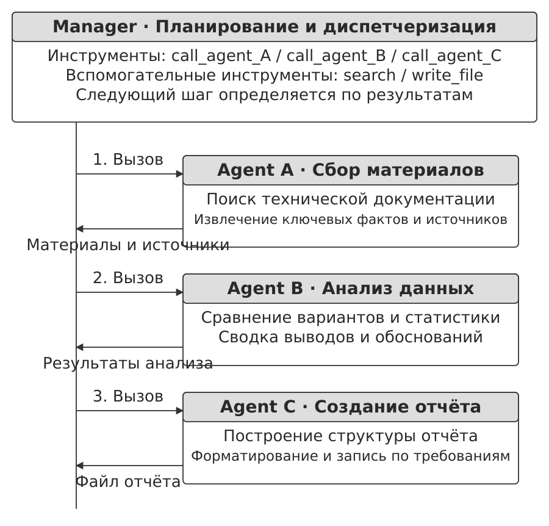

> **Эксперимент 10-2 ★★: агенты для перевода книги**
>
> При переводе технической книги необходимо одновременно учитывать терминологию, контекст и стиль изложения. Например, английское слово agent можно перевести по-разному, но если в переводе принято использовать вариант «интеллектуальный агент», в последующих главах следует придерживаться того же варианта. Для глоссария, исходных текстов глав, переводов и записей редакторской проверки нужна чёткая система организации. Длинная книга вместе с промежуточными переводами, результатами инструментов и историей проверок будет занимать всё больше контекста: к девятой главе модель может забыть вариант перевода из второй главы или несколько раз проверять один и тот же фрагмент. Разделение задачи по обязанностям и главам позволяет каждому экземпляру сосредоточиться на материалах, необходимых для его текущей роли.
>
> Работу можно распределить между четырьмя типами агентов:
>
> - **Агент глоссария: систематизация терминов.** Он читает книгу по частям, выявляет регулярно встречающиеся профессиональные термины, сверяется с отраслевыми словарями и правилами перевода, после чего создаёт таблицу соответствий в формате JSON или CSV с английским термином, китайским переводом, частью речи и контекстом употребления. Глоссарий сохраняется в общем пространстве, а после завершения задачи экземпляр освобождается.
> - **Агент перевода: перевод глав.** Он читает текущую главу, относящиеся к ней термины и руководство по переводу, после чего готовит перевод с учётом целевой аудитории и языкового стиля. Для новых терминов он предлагает варианты перевода и помечает их как требующие проверки. Каждый экземпляр поддерживает отдельный контекст, а перевод сохраняется в общем пространстве; разные главы можно обрабатывать последовательно или параллельно в зависимости от их связей.
> - **Агент вычитки: проверка всего текста.** По глоссарию и переводам глав он проверяет единообразие терминологии и формулировок, а также удобочитаемость. Весь текст проверяется посредством чтения по главам и межглавного индекса, а расположение проблем, их обоснование и требования к исправлению заносятся в отчёт о вычитке.
> - **Агент-координатор: назначение задач и сбор результатов.** Он поддерживает цель, план, состояние задач, сводки вызовов и индекс артефактов, на основании отчёта о вычитке возвращает переводчикам главы, требующие исправления, а затем организует повторную проверку.
>
> На рисунке 10-5 редактор читает переводы глав и глоссарий, а управляющий по отчёту определяет, какие главы нужно доработать. Получив задачу на доработку, переводчик может открыть исходный текст главы и проверить значение отмеченного слова в конкретном предложении.
>
> 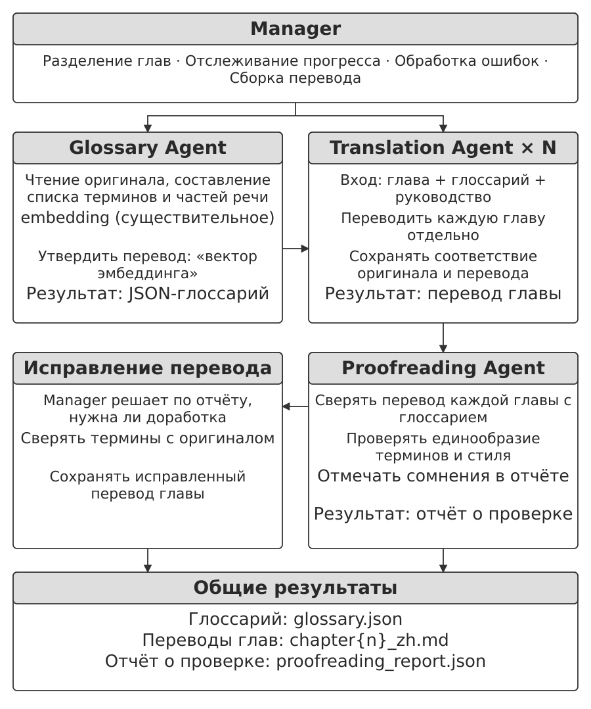
>
> После записи перевода в файл какому вызову по-прежнему требуется читать длинный текст? В сопутствующем эксперименте первые две главы английского издания были разделены на 26 единиц перевода. Один агент на протяжении всей работы сохранял в контексте предыдущие исходные фрагменты и переводы, поэтому максимальный объём входных данных одного запроса составил 94 355 токенов. После разделения обязанностей максимальный объём входных данных переводчика составил всего 2 857 токенов, а управляющий использовал 2 153 токена при принятии решений о доработке. Среди агентов управляемой группы больше всего входных данных получил агент глоссария: за один раз он прочитал две главы, израсходовав 49 807 токенов.
>
> Для перевода этих двух глав четыре роли в совокупности использовали 203 277 токенов, а один агент — 1 317 808 токенов. Какая группа завершила работу раньше? Группа из четырёх ролей затратила около 271 секунды — примерно на 17 секунд больше, чем один агент.
>
> При сдаче работы две проверки дали разные результаты для одного и того же перевода. В глоссарии для существительного `embedding` был указан перевод «вектор встраивания». В отчёте о вычитке не было глав, требующих доработки, однако программа проверки терминологии присвоила этому слову результат 0/2: в переводах обеих глав встречалось слово «встраивание», но ни разу — «вектор встраивания». Следует ли вернуть на доработку обе главы?
>
> В абзаце первой главы о политике возврата исходный текст содержит фразу `embedding the refund policy in the context`, переведённую как «встраивание политики возврата в контекст». Здесь речь идёт о помещении политики в контекст, поэтому замена на «вектор встраивания» сама стала бы ошибкой. Программа ищет строки по главам и помогает редактору находить фрагменты для повторной проверки, но для решения о том, какое вхождение нужно исправить, редактору также требуется соответствующий фрагмент исходного текста. При обновлении глоссария можно сначала найти затронутые фрагменты, а затем передать переводчику вместе исходный текст, перевод и новую запись.
>
> **Требования эксперимента:**
> 1. Выберите техническую книгу, содержащую иллюстрации, таблицы и код.
> 2. Реализуйте четыре типа агентов: управляющего, глоссария, перевода и вычитки.
> 3. Регистрируйте объём контекста каждого участника, передаваемые материалы и версии артефактов.
> 4. Сравните качество перевода, время выполнения и потребление ресурсов с решением на основе одного агента; проанализируйте влияние декомпозиции задачи и организации контекста.

**Параллельная координация.** Независимые друг от друга подзадачи можно выполнять одновременно. Управляющий распределяет задачи, принимает сведения о состоянии и по результатам решает, следует ли продолжить работу, дополнить её или завершить. При переводе этой книги после утверждения глоссария разные главы можно одновременно передать нескольким переводчикам. На рисунке 10-6 вместо перевода представлен исследовательский отчёт: диаграммы уже готовы, анализ ещё продолжается — почему проверка форматирования всё равно должна ждать? По событиям, отправляемым участниками, можно определить, от каких двух артефактов зависит последний этап.

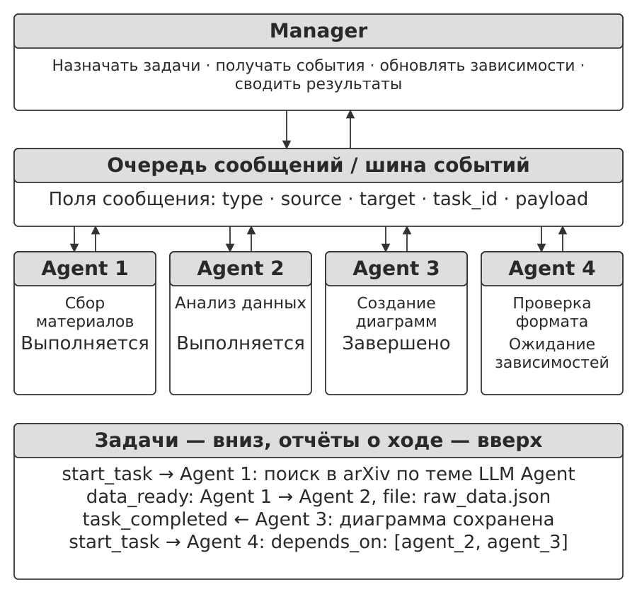

Для организации такой асинхронной коммуникации подходит шина сообщений: участники публикуют сведения о ходе работы и результаты, управляющий подписывается на соответствующие события, а среда выполнения обеспечивает доставку, буферизацию и повторные попытки.

> **Пример продукта: Lingtai**
>
> Lingtai — локальная система долгоживущих агентов, сохраняющая идентичность и память в файлах. В ней предусмотрены три роли: основной агент (main agent) общается с пользователем и управляет планами и памятью; демон (daemon) выполняет чётко ограниченные краткосрочные параллельные задачи и по завершении возвращает выводы; аватар (avatar) сохраняет собственные память, почтовый ящик и обязанности для профессиональной специализации между сеансами.
>
> У каждой роли есть собственные постоянные знания, а руководства по навыкам в формате Markdown используются совместно. Когда контекст приближается к предельному объёму, роль посредством «линьки» (molt) сохраняет сводку, а затем переходит в новый контекст, подключив постоянную память. Идентичность, память и навыки независимо хранятся в файлах, что позволяет продолжить работу после замены базовой модели. В этой архитектуре объединены управляющий, краткосрочные исполнители, долгосрочные специализированные участники и сжатие контекста.

> **Эксперимент 10-3 ★★★: автономно координируемые телефонный и компьютерный агенты**
>
> Этот эксперимент объединяет Computer Use из главы 6 с голосовым взаимодействием. Пользователь предоставляет страницу регистрации или бронирования авиабилета, компьютерный агент открывает сайт и распознаёт форму, а затем с помощью телефонного агента собирает отсутствующие сведения: имя, номер документа, контактные данные, адрес, предпочтения и другие поля.
>
> **Роли и передача данных.** Компьютерный агент управляет браузером и координирует текущую задачу; телефонный агент общается с пользователем в реальном времени посредством ASR, LLM и TTS, преобразуя устные ответы в структурированные поля. Они взаимодействуют через двухточечные инструменты или шину сообщений; каждое сообщение содержит отправителя, получателя, тип и содержимое. Компьютерный агент может напрямую делегировать телефонную задачу, выполняя обязанности управляющего. Если пользователь согласен предоставить сведения голосом, телефонный агент может последовательно задавать вопросы, подтверждать ответы и переспрашивать, а компьютерный агент — сосредоточиться на состоянии страницы и заполнении полей.
>
> **Два режима работы.** В фиксированном режиме заранее запускаются два агента, каждый из которых поддерживает собственный цикл выполнения; этот режим используется для проверки двусторонней коммуникации и параллельного поведения. В автономном режиме сначала запускается компьютерный агент, после чего модель на основании страницы, уже имеющихся сведений и требований задачи решает, вызывать ли `initiate_phone_call_agent(purpose, required_info)`. Затем среда выполнения передаёт телефонному агенту цель задачи, список требуемых полей и ограничения формата; после запуска используется тот же механизм коммуникации.
>
> **Последовательная передача отдельных полей.** На рисунке 10-7 телефонный агент посредством WebRTC задаёт вопрос, извлекает и проверяет ответ, а после получения допустимого значения отправляет `info_collected` и переходит к следующему вопросу. Одновременно компьютерный агент читает страницу, заполняет предыдущее поле и возвращает `fill_error` либо новое состояние страницы. Если значение не соответствует формату, обратная связь `format_invalid` указывает поле и требования, чтобы телефонный агент мог подтвердить ответ или переспросить. Благодаря этому вопрос по следующему полю можно задавать параллельно с заполнением предыдущего.
>
> **Завершение и обработка исключительных ситуаций.** Собрав все поля, телефонный агент отправляет `task_completed`, обозначая завершение подзадачи сбора информации. Компьютерный агент продолжает проверять обязательные поля, результаты валидации страницы и наличие разрешения на отправку, после чего завершает работу с формой. Если исчерпано допустимое количество повторных попыток, возникла ошибка страницы или пользователь потребовал остановиться, задача приостанавливается с указанием текущего состояния. При завершении следует отменить работу всё ещё активного второго агента и закрыть сеанс браузера, звуковые дорожки и вызов. Согласие пользователя на голосовое взаимодействие с человеком и разрешение на отправку формы запрашиваются отдельно.
>
> 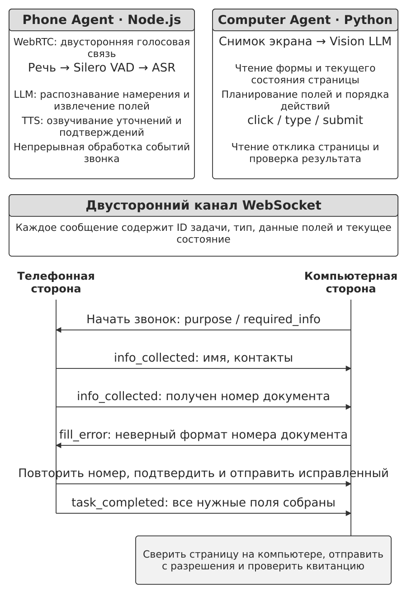
>
> **Требования эксперимента:**
> 1. Реализуйте два независимых агента с двусторонней структурированной коммуникацией.
> 2. Запишите временную последовательность в фиксированном и автономном режимах и проверьте интервалы, в которых вопросы и заполнение выполняются параллельно.
> 3. Реализуйте проверку формата, повторные вопросы, передачу ошибок страницы, тайм-ауты и освобождение ресурсов.
> 4. Сравните два режима по принятию решения о запуске, задержке, доле успеха и потреблению ресурсов.

> **Эксперимент 10-4 ★★★: AI-агент для одновременного сбора информации с нескольких сайтов**
>
> В этом эксперименте несколько однородных агентов выполняют поиск параллельно, что позволяет на практике освоить событийную модель и механизм прерывания из главы 6. Задача состоит в том, чтобы найти указанного преподавателя, например Чжан Вэя, на сайтах нескольких факультетов одного университета и вернуть сведения о факультете, должности, направлениях исследований и странице-источнике. Перед поиском необходимо согласовать критерии идентификации, например имя, научную дисциплину и сведения на личной странице, чтобы различать тёзок.
>
> **1. Параллельный запуск.** Manager создаёт десять экземпляров Computer Use Agent, каждый из которых отвечает за сайт одного факультета. Экземпляры поддерживают независимые контексты и сеансы браузера; их можно планировать с помощью асинхронных задач, потоков или процессов. Входные данные содержат URL сайта, имя искомого человека, критерии совпадения и идентификатор задачи для маршрутизации.
>
> **2. Объединение сведений о ходе работы.** Участники периодически отправляют состояния «загружается сайт», «читается список преподавателей», «проверено, совпадений нет», «найден преподаватель с таким же именем» и другие. Manager ведёт таблицу задач через шину сообщений, раздельно регистрирует выполняющиеся, завершённые, заблокированные и неудавшиеся задачи, а также сохраняет источники и причины ошибок.
>
> **3. Отмена остальных ветвей после проверки.** Предположим, что отвечающий за физический факультет `agent_3` нашёл преподавателя с таким же именем. Он отправляет `target_found`, полезная нагрузка которого содержит сведения о преподавателе и источник. Если задача требует вернуть проверенные сведения о человеке, Manager должен сначала сверить критерии совпадения и свидетельства. Убедившись, что найден нужный человек, он атомарно регистрирует результат, а затем отправляет остальным работающим участникам `terminate`, указав, что приняты сведения от `agent_3`. Участники останавливаются в безопасных точках, освобождают ресурсы и возвращают подтверждения; Manager завершает объединение результатов после получения подтверждений или наступления тайм-аута. Если требуется перечислить всех людей с таким именем, поиск продолжается до проверки всей необходимой области.
>
> **Гонки.** Агенты A и B могут вернуть допустимые результаты почти одновременно. Если каждое из двух событий отдельно запустит объединение результатов, возникнет повторная выдача или конфликт состояний. Переход состояния «выполняется поиск → результат зарегистрирован» можно защитить блокировкой или транзакцией, чтобы более позднее событие прочитало уже зарегистрированный результат. Повторные попытки доставки сообщений также необходимо дедуплицировать по идентификатору события, обеспечивая согласованность даже при повторном запуске отмены и объединения результатов.
>
> **4. Исключения и область покрытия.** Сетевые сбои, изменения структуры страницы и ошибки разбора регистрируются раздельно. Для отдельной задачи можно задать бюджет тайм-аута, например две минуты, после чего отменить выполнение и собрать диагностические сведения, не останавливая остальных участников. В итоговом отчёте различаются состояния «проверено, не найдено» и «доступ завершился ошибкой, проверка не закончена», а также указывается охваченный набор факультетов.
>
> На рис. 10-8 эти сообщения объединены в наглядную временную последовательность. Предположим, участник 3 сообщает, что на физическом факультете работает профессор Чжан Вэй, исследующий квантовые вычисления. Manager сначала должен проверить, подтверждает ли исходная веб-страница имя, факультет, должность и направление исследований. Получение сведений о преподавателе с таким же именем, подтверждение того, что это нужный человек, и сбор всех подтверждений отмены происходят в три разных момента времени.
>
> 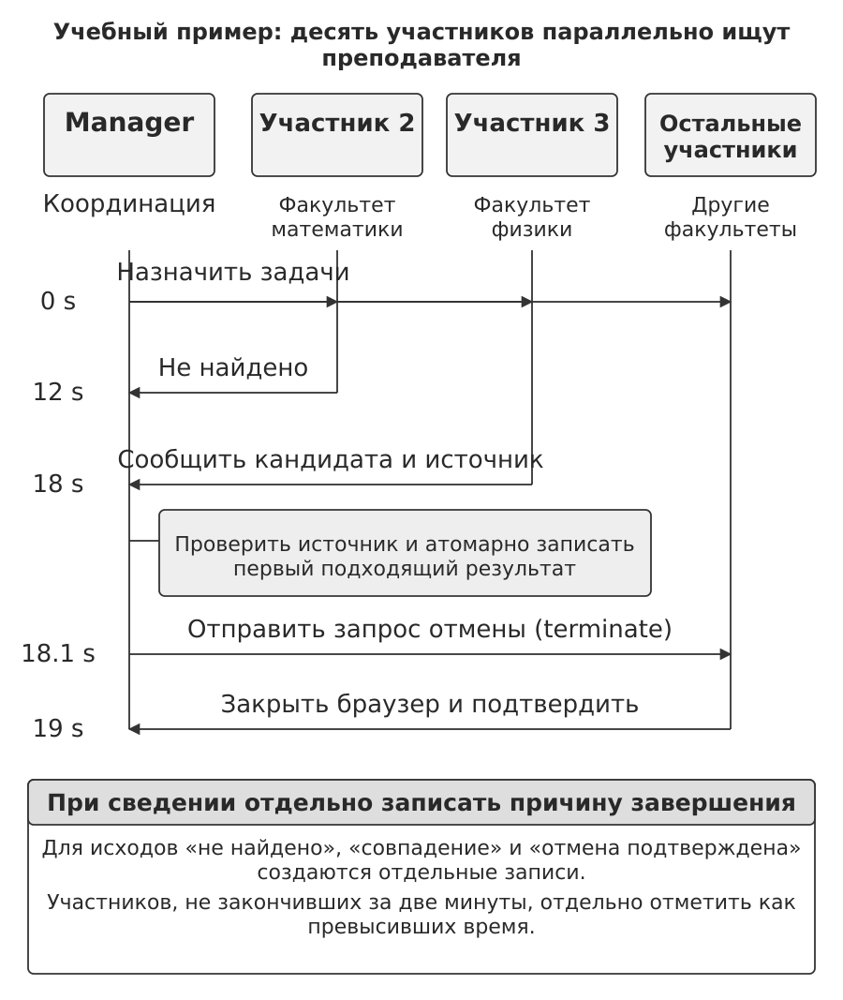
>
> В реальном запуске выполнялся поиск Andrew Ng. Сначала участники проверяли наличие этого имени в тексте страницы и лишь после совпадения просили модель извлечь сведения. Была выбрана страница Stanford HAI; возвращённая короткая цитата позволяла сверить имя и статус профессора по совместительству. Для проверки направления исследований требовалось также прочитать расположенный ниже на странице абзац о глубоком обучении. Даже если несколько участников одновременно возвращают `target_found`, зарегистрировать результат может только участник, первым получивший блокировку.
>
> При последовательном поиске совпадение нашлось только на последнем из десяти сайтов, поэтому выполнение заняло 44,971 секунды; параллельный поиск по тем же страницам занял 24,022 секунды, причём все десять отдельных контекстов браузера были закрыты. Отношение этих значений равно 1,872. Если поставить страницу HAI первой, последовательный поиск остановится сразу после совпадения, поэтому время потребуется измерить заново. В отдельном запуске для проверки отмены были запущены четыре ветви: одна первой зарегистрировала результат, остальные три подтвердили получение запроса на отмену, после чего все четыре контекста браузера были закрыты.
>
> **Требования эксперимента:**
> 1. Реализуйте Manager, динамически создающий параллельных участников.
> 2. Реализуйте возможности работы с браузером на основе таких проектов, как browser-use.
> 3. Реализуйте двустороннюю коммуникацию и ведение состояния через шину сообщений.
> 4. Проверяйте результаты поиска, атомарно регистрируйте результат и собирайте подтверждения после отмены остальных ветвей.
> 5. Обрабатывайте недоступность сайта, ошибки разбора, тайм-ауты и отсутствие совпадений.
> 6. Сравните время завершения, область покрытия и потребление ресурсов при параллельном и последовательном выполнении.

**Генерация рабочего процесса управляющим.** Помимо последовательного делегирования, Manager может сначала записать зависимости задач и правила объединения результатов в виде программы, а затем передать её среде выполнения для планирования. Модель отвечает за проектирование процесса, а программа — за запуск участников, передачу результатов и ожидание зависимостей в соответствии с заданными правилами. Когда зависимости уже понятны и однотипный процесс требуется выполнять многократно, автор предпочитает этот подход. Он устраняет затраты на вызов Manager при каждой выдаче задачи и сокращает объём накапливающихся в управляющем контексте записей о планировании.

Динамический инструмент Workflow в Claude Code предоставляет такую реализацию. `agent()` создаёт субагента с независимым контекстом, а schema позволяет задать структурированный вывод; `parallel()` параллельно выполняет группу задач и ожидает завершения всех; `pipeline()` проводит каждый входной элемент через несколько этапов, причём, когда один элемент переходит на следующий этап, остальные могут продолжать обрабатываться на предыдущем. Промежуточные результаты сохраняются в переменных программы, а фильтрация и объединение выполняются обычным кодом.[^dynamic-workflows]

Например, при проверке семи групп фактов в технической статье можно сначала запустить исследовательских агентов по отдельным направлениям, а затем передать выводы по каждой группе проверяющим агентам для параллельной проверки. Каждый возвращённый вывод сохраняет источник и основание оценки; после завершения всех ветвей обобщающий агент составляет итоговый отчёт. Таким образом, разделение обязанностей и зависимости между этапами «исследование — проверка каждого вывода — общее обобщение» фиксируются в рабочем процессе.

[^dynamic-workflows]: Anthropic, “Orchestrate subagents at scale with dynamic workflows”, 2026.

### Децентрализованный режим

Зачем позволять участникам самостоятельно выбирать, к кому обратиться, если уже есть Manager? Представим, что тестировщик получает только что написанный модуль и обнаруживает, что требования к продукту и спецификация интерфейса по-разному трактуют одно и то же поле. Тестировщик может напрямую передать это противоречие ролям, отвечающим за продукт и архитектуру, чтобы каждая сторона обосновала свою позицию, а затем продолжить тестирование после исправления договорённости. Это не только разделение труда, но и система сдержек и противовесов. Инженер передаёт модуль, архитектор запрашивает мнение продуктовой роли, тестировщик выдвигает возражение — каждый из них может инициировать следующий шаг. Если участникам приходится часто согласовывать решения, ожидание, пока Manager поочерёдно передаст каждое сообщение, будет задерживать работу.

Заимствуя терминологию микросервисов, централизованное управление последовательностью шагов называют **оркестрацией** (orchestration), а самостоятельное продолжение работы сторонами в ответ на согласованные события — **хореографией** (choreography). Есть и ещё одно практическое различие: если каждая передача требует ожидания Manager, то при прекращении ответа со стороны его сервиса модели остальные участники не смогут получить следующую задачу, даже если сами по-прежнему способны работать. Распределённая координация уменьшает эту зависимость. Однако если принимающий работу участник сам завис внутри вызова инструмента, другой участник сможет понять, откуда продолжить, лишь при наличии постоянно сохраняемого состояния задачи, тайм-аутов, повторных попыток и механизма перехвата работы.

В следующих трёх вариантах используются разные способы передачи работы: подписка на сообщения о результатах, выбор следующего выступающего в групповом чате или адресная передача управления текущим участником.

**MetaGPT: организация передачи результатов с помощью SOP.** MetaGPT распределяет работу согласно стандартной операционной процедуре (SOP) команды разработки ПО. Менеджер продукта передаёт документ с требованиями к продукту (PRD), архитектор — проектную документацию, инженер — код, а тестировщик — отчёт о тестировании. Следующий участник может начать работу сразу после получения согласованных материалов, а предыдущему не приходится многократно объяснять задачу. Линии на рис. 10-9 обозначают связи передачи этих результатов.[^metagpt-design]

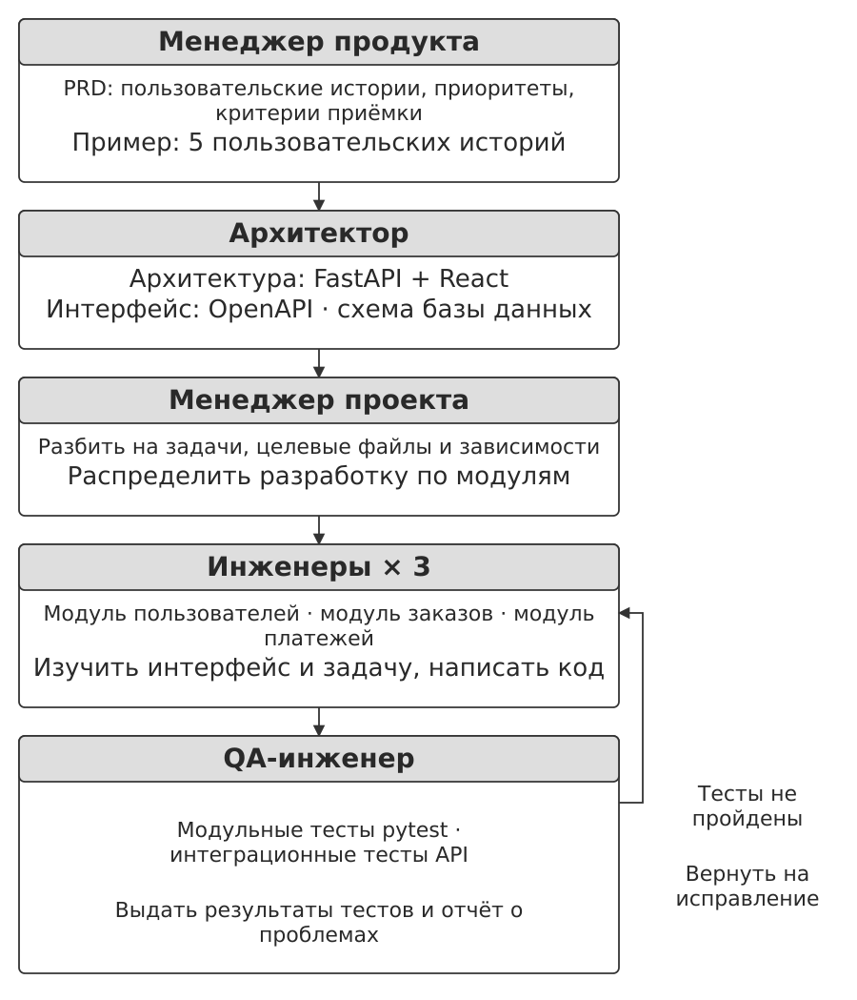

Какие сведения каждая роль должна добавлять при передаче работы?

- **Product Manager Agent** принимает требования, оформляет PRD и уточняет функции, пользовательские истории, критерии приёмки и приоритеты.
- **Architect Agent** читает PRD, выбирает технологический стек, выделяет модули, определяет интерфейсы и модели данных, формируя проектную документацию.
- **Project Manager Agent** на основе проекта разбивает работу на задачи, распределяет файлы, упорядочивает зависимости и назначает выполнение инженерам.
- **Engineer Agents** реализуют модули по проекту и передают код; независимые части можно поручить нескольким экземплярам.
- **QA Engineer Agent** на основе кода и требований создаёт тесты, выполняет проверки, фиксирует проблемы и формирует отчёт о тестировании.

При проектировании формата передачи для этих ролей автор рекомендует явно указывать три вещи: задачу и критерии приёмки, подтверждённые факты и ограничения, а также ссылки на структурированные результаты. На их основе принимающая сторона получает необходимые материалы, продолжает работу и задаёт конкретные вопросы, если информации не хватает.

MetaGPT организует информацию с помощью общего пула сообщений и механизма подписки: роли публикуют сообщения, а другие роли обрабатывают соответствующие входные данные согласно типам сообщений, за которыми следят. Издатели и потребители связаны форматом результатов и семантикой сообщений, поэтому для каждого из них можно отдельно заменить модель или изменить внутреннюю реализацию.

SOP описывает зависимости между требованиями к продукту, архитектурой и кодом, а подписка на сообщения — способы запуска этих работ. Фиксированные зависимости задач также могут продвигаться распределёнными событиями; вместе эти механизмы образуют способ взаимодействия в системе. При дальнейшем проектировании динамической обратной связи можно добавить пути, по которым тестировщик уточняет требования у продуктовой роли, а инженер предлагает архитектору альтернативное решение, и задать для таких взаимодействий условия приёма и правила завершения.

[^metagpt-design]: Hong, S., et al. *MetaGPT: Meta Programming for A Multi-Agent Collaborative Framework.* ICLR 2024.

**Групповой чат AutoGen: управление очерёдностью реплик в общем сеансе.** В классической архитектуре GroupChat несколько агентов участвуют в одном сеансе, GroupChatManager выбирает следующего выступающего и рассылает сообщения участникам. В качестве стратегии выбора можно использовать циклический перебор либо поручить модели принять решение на основе текущего содержимого. Участники сохраняют собственные конфигурации ролей и взаимодействуют через общий сеанс, а управление очерёдностью реплик централизовано в менеджере. Это пример сочетания организации контекста со структурой управления.[^autogen-groupchat]

[^autogen-groupchat]: Microsoft, *AutoGen 0.2: Conversation Patterns.*

**OpenAI Swarm: передача управления посредством handoff.** В Swarm для ролей настраиваются инструкции и инструменты. После вызова ролью настроенной функции передачи среда выполнения переключается на целевого агента. Решение о маршрутизации могут принимать отдельные роли, а исполняет его единый цикл выполнения. При передаче системные инструкции изменяются вместе с ролью, тогда как история диалога сохраняется. Это демонстрирует сочетание двух подходов: «роль выбирает следующего исполнителя» и «история сеанса продолжает использоваться».[^swarm-handoff]

Если передача осуществляется между независимыми контекстами, можно отдельно определить пакет задачи: `task_id` идентифицирует задачу, `sender` и `recipient` указывают стороны, `goal` и `constraints` описывают цель и ограничения, `accepted_facts` хранит подтверждённые факты, `artifact_refs` содержит ссылки на результаты, `remaining_budget` фиксирует бюджет, а `visited_agents` хранит цепочку посещений. Получатель читает материалы в пределах предоставленных прав, а среда выполнения ведёт учёт бюджета и передач.

Цепочка передачи должна учитывать повторные посещения. Например, разработчик передаёт код рецензенту, тот запрашивает изменения и возвращает код разработчику — это нормальный цикл доработки. Определить наличие прогресса можно по сочетанию состояния задачи, версии результата, нерешённых вопросов и числа повторений. Например, если один и тот же перевод дважды возвращают на доработку, но в первый раз в него добавляют источники, а во второй исправляют терминологию, доработка всё ещё продвигается. Если же оба раза возвращается одна и та же версия с указанием на одну и ту же проблему, значит, работа зашла в тупик. В таком случае можно ограничить число дальнейших передач и сообщить ответственному лицу о нерешённой проблеме.

[^swarm-handoff]: OpenAI, *Swarm*, разделы «Instructions» и «Handoffs and Updating Context Variables».

> **Agent Swarm в продуктах**
>
> Термин «Agent Swarm» может обозначать разные способы организации. В одном случае управление передаётся по сети handoff, как в OpenAI Swarm, библиотеке swarm для LangGraph и оркестрации handoff в Microsoft Agent Framework. В другом используется главный агент и параллельные исполнители, как в Kimi Agent Swarm, многоагентной исследовательской системе Anthropic и Manus Wide Research.
>
> Представленный в Kimi K2.5 Agent Swarm обучает оркестратор посредством обучения с подкреплением с параллельными агентами: он учится определять, когда следует разбить задачу и как распределить работу, поддерживая до 100 субагентов. В последующих версиях масштаб увеличен до 300 агентов, а K3 Swarm продолжает использоваться для крупномасштабного поиска и пакетной обработки. AgentENV, в свою очередь, предоставляет масштабируемую среду для обучения агентов Kimi K3 с подкреплением, поддерживает снимки состояния и ветвление и применяется для организации параллельного выполнения.[^ch10-kimi-swarm]

**Несколько экземпляров агентов на одной машине.** Несколько экземпляров могут выполнять разные задачи, совместно используя файлы, сервисы инструментов или GPU. В таком случае посредством коммуникации можно обозначать область изменений, уведомлять об освобождении ресурсов или согласовывать порядок выполнения. Например, если двум экземплярам требуется один GPU, они могут сначала зарегистрировать задачи и предполагаемый объём ресурсов, после чего диспетчер ресурсов предоставит право использования.

Agent Teams в Claude Code предоставляет обнаружение участников команды, обмен сообщениями и совместное управление задачами. Участники получают информацию друг о друге в пределах созданной команды, а среда выполнения организует коммуникацию.[^claude-agent-teams] При самостоятельной реализации взаимодействия на одной машине также можно использовать интерфейсы наподобие `list_agents` из главы 4, задав явные правила для области обнаружения, прав доступа и владения ресурсами. Затем согласованные в сообщениях решения должны обеспечиваться блокировками, квотами или планировщиком.

[^ch10-kimi-swarm]: Moonshot AI, *Kimi Agent Swarm: 100 Sub-Agents at Scale*, справочная документация Agent Swarm и описание проекта AgentENV.

[^claude-agent-teams]: Anthropic, *Orchestrate teams of Claude Code sessions.*

### Межорганизационное взаимодействие: протокол A2A

Когда взаимодействие выходит за границы сервиса или организации, сторонам необходимо согласовать обнаружение возможностей, аутентификацию, формат запросов, передачу прогресса и результатов. Выпущенный Google в 2025 году протокол **A2A** (Agent2Agent), позднее переданный под управление Linux Foundation, предоставляет такой интерфейс совместимости. Его можно рассматривать с трёх сторон.[^a2a-concepts]

- **Обнаружение возможностей.** Agent Card — документ с метаданными, описывающий идентичность AI-агента, конечные точки сервиса, навыки, модальности входных и выходных данных и требования к аутентификации. На его основе вызывающая сторона определяет, способен ли агент обработать задачу и как установить соединение.
- **Задачи и сообщения.** Task представляет работу с идентификатором и жизненным циклом. Вызывающая сторона может отслеживать такие состояния, как отправлена, выполняется, требует входных данных, завершена или завершилась с ошибкой. Message передаёт требования задачи, дополнительную информацию и ответы, а Artifact — документы, изображения или структурированные результаты. Part в сообщениях и артефактах может содержать текст, ссылку на файл или данные.
- **Взаимодействие через интерфейс.** Вызывающая сторона общается с удалённой через эти открытые объекты, а удалённая сторона самостоятельно управляет внутренними промптами, памятью и инструментами. Каждая сторона отдельно обеспечивает аутентификацию, авторизацию и ограничение области доступа к данным.

Состояние длительной задачи можно получать опросом, потоковые обновления — через SSE, а при наличии поддержки — посредством push-уведомлений. После предоставления пользователем дополнительной информации клиент продолжает выполнение той же задачи и получает итоговые артефакты в соответствии с её состоянием.

MCP из главы 4 ориентирован на предоставление модельным приложениям интерфейсов инструментов, ресурсов и промптов, а A2A — на совместное выполнение задач сервисами агентов. Их можно сочетать: один агент использует инструменты через MCP и одновременно делегирует удалённые задачи через A2A. Если внутри одной команды уже существуют стабильные интерфейсы, автор предпочитает сначала использовать вызовы инструментов, общие файлы и шину сообщений. A2A следует вводить, когда требуется подключить независимо сопровождаемый сервис агентов и унифицировать обнаружение возможностей и жизненный цикл задач; при взаимодействии между организациями дополнительно настраиваются правила идентификации, разрешений и управления данными.

[^a2a-concepts]: A2A Project, *Основные концепции и компоненты A2A.*

**Согласование времени для разных людей.** У трёх членов семьи есть собственные помощники по планированию, и они хотят договориться о совместном ужине. Один помощник видит полный календарь своего владельца — что ему следует ответить двум другим? Фраза «Во вторник неудобно, а в среду можно кое-что перенести» уже сообщает полезное различие. Прямая пересылка календаря раскроет лишние сведения о личных делах во вторник; если же ответить лишь «В оба дня уже есть планы», остальные не узнают, что насчёт среды ещё можно договориться. Даже если встречу удаётся назначить каждый раз, такая система может быть невыгодна человеку, которому постоянно приходится менять свои планы.

В одной открытой задаче CalBench пяти людям необходимо назначить пять встреч, в каждой из которых участвуют по три человека. Некоторые интервалы у участников совершенно нельзя переносить, некоторые личные дела можно сдвинуть, причём задача задаёт стоимость каждого переноса. Сначала попробуем простой подход: обработаем пять встреч по очереди, каждый раз начиная поиск с самого раннего интервала, и назначим встречу, как только все трое смогут освободить время; уже назначенные встречи сохраняются. Затем попробуем другой подход: рассмотрим все пять встреч вместе и найдём решение на основе полных календарей. Ниже используются номера временных интервалов из задачи, начиная с 0.[^ch10-calbench]

| Способ планирования | Интервалы встреч с 1-й по 5-ю | Стоимость переноса для каждой назначенной встречи | Общая стоимость |
|---|---|---|---:|
| Для каждой встречи выбирается самый ранний доступный интервал, уже назначенные встречи сохраняются | 0, 2, 1, 3, 6 | 1, 20, 20, 12, 300 | 353 |
| Эталонный решатель совместно планирует все пять встреч | 13, 3, 10, 9, 12 | 0, 1, 0, 1, 1 | 3 |

В обоих расписаниях каждая встреча совпадает в окончательных календарях всех трёх участников. Наибольшая разница возникает для последней встречи: при первом способе интервал 6 можно освободить, но каждому из трёх участников придётся перенести дело стоимостью 100. Если назначить встречу на интервал 12, лишь одному человеку потребуется перенести дело стоимостью 1. Глобальный результат даёт проверяющему основу для сравнения, тогда как каждый помощник, фактически участвующий в согласовании, видит только календарь своего владельца.

Встроенный в эту версию жадный решатель сообщает стоимость 146 и возвращает интервалы для всех пяти встреч. Однако при планировании более поздних встреч он разрешает удалять ранее назначенные встречи из календарей отдельных участников. В итоге первая встреча оказывается в календарях трёх участников в разных интервалах: 7, 0 и 11. Если считать встречу принятой только тогда, когда в окончательных календарях всех троих она указана в одном и том же интервале, успешно назначены лишь третья, четвёртая и пятая встречи.

В реальном сервисе планирования возникают и сведения, которых нет в формальной задаче. Сервис Microsoft Calendar.help за год согласовал по электронной почте несколько тысяч встреч. Письмо относится к назначению новой встречи или к переносу предыдущей? Если автоматическая классификация не уверена в ответе, человек сначала видит входящее письмо и решает только этот вопрос. Если по одному письму определить это невозможно, задачу можно передать специалисту по планированию, имеющему доступ к переписке, уже собранной информации и обезличенным календарям. Такая архитектура связывает вопросы «кого следует привлечь к принятию решения» и «сколько информации этому человеку необходимо увидеть».[^ch10-calendar-help]

[^ch10-calbench]: В статье о CalBench отдельно рассматриваются стоимость координации, справедливость, раскрытие выводимого состояния календаря и содержимого конкретных дел. Числа взяты из первой задачи набора с различной стоимостью переносов в версии `86f8123`. При первом способе пропускаются интервалы, в которых у любого участника уже назначена встреча; остальные правила переноса соответствуют правилам авторов. Результат можно перепроверить с помощью решателя расписаний.

[^ch10-calendar-help]: Cranshaw et al., проектирование и развёртывание Calendar.help; см. описание двухуровневого интерфейса для выполняемых человеком микрозадач и полных задач планирования.

## Режимы отказа при взаимодействии нескольких AI-агентов

После совместного выполнения задачи несколькими участниками сбои могут возникать на стыках ролей, передачи работы и проверки. Авторы статьи «Why Do Multi-Agent LLM Systems Fail?» построили классификацию отказов примерно по 150 трассам с согласованностью разметки κ = 0.88, а затем распространили анализ на семь фреймворков. Исследователи выделили 14 режимов отказа, разделённых на три категории:[^mast-failures]

- **Проблемы проектирования системы:** пробелы в обязанностях ролей, интерфейсах, конфигурации инструментов или условиях остановки.
- **Отклонения во взаимодействии участников:** различное понимание цели, неполная передача информации или взаимно противоречащие действия.
- **Проблемы проверки задачи:** преждевременное завершение, пропущенные проверки или оценка готовности по неподходящим критериям.

В статье приводится пример программы для игры в шахматы. Созданный ChatDev код компилировался и успешно проходил проверку, но при игре по настоящим шахматным правилам программа работала неверно. Компилятор проверяет, можно ли скомпилировать код, а для проверки допустимости ходов необходимо сыграть хотя бы несколько ходов. В другом сравнительном эксперименте исследователи разрешили возвращать замечания ChatDev на доработку, завершать процесс только после подтверждения участником, отвечающим за техническую проверку, и ограничили максимальное число итераций. Из 32 задач ProgramDev-v0 исходный процесс решил 8, а изменённый — 13. Доля успешно выполненных задач выросла с 25.0% до 40.6%, то есть примерно на 15.6 процентного пункта.[^mast-failures]

[^mast-failures]: Cemri, M., et al. *Why Do Multi-Agent LLM Systems Fail?* 2025.

Как отличить ситуацию «проверяющий не ответил» от ситуации «проверяющий ответил, но ошибся»? В распределённых системах прекращение работы компонента называется аварийным отказом. Модель византийских отказов также допускает, что компонент выдаёт произвольные ошибочные или противоречащие друг другу результаты. Агент тоже может остановиться на полпути, а может продолжить работу и вернуть неверный вывод. В первом случае требуются обнаружение, восстановление и перехват работы, во втором — проверка доказательств, ограничение полномочий и изоляция ошибок. Регулярные сигналы heartbeat помогают определить, продолжает ли агент работать, но правильность возвращённого им вывода всё равно нужно проверять по фактическому результату. Для оценки результатов можно использовать перекрёстную проверку и голосование, надёжность которых зависит от качества доказательств и корреляции ошибок участников. Формальные протоколы также определяют, сколько отказавших узлов допустимо и как узлы должны взаимодействовать.

### Режим отказа 1: конкурентные конфликты в общей файловой системе

Общие артефакты позволяют участникам продолжать работу друг друга, но одновременно создают проблему параллельных изменений. Сначала следует разделить конфликты на два уровня.

**Конфликт на уровне файлов** возникает, когда два участника изменяют один файл: оба читают старую версию, затем по очереди записывают изменения, и последняя запись перезаписывает результат предыдущей.

**Семантический конфликт** возникает между связанными артефактами. Например, агент A выполняет сквозную перенумерацию иллюстраций во всей книге, а агент B одновременно изменяет главу и ссылается на прежние номера. Они изменяют разные файлы, поэтому при слиянии текстового конфликта может не возникнуть, но соответствие текста иллюстрациям окажется нарушено.

Допустим, текущая версия глоссария — 7. Два участника начинают вносить изменения в версию 7. Первый отправляет результат раньше, и версия становится 8. Если второй при отправке лишь укажет «записать эту таблицу», изменения первого могут быть перезаписаны. Если же потребовать «записывать, только если текущая версия всё ещё равна 7», программа обнаружит необходимость слияния. Для конкурентного доступа на уровне файлов можно использовать **оптимистическую блокировку**: при чтении запоминать номер версии, а при отправке выполнять проверку версии и запись как одну атомарную операцию. Если версия изменилась, устаревшая запись отклоняется, после чего необходимо заново прочитать данные и выполнить слияние.

Межфайловая семантическая согласованность требует проверки связей. Когда несколько агентов для написания кода изменяют один репозиторий, автор предпочитает выделять каждому участнику отдельные `worktree` и ветвь, формировать отдельные коммиты, а в точке слияния проверять конфликты, запускать тесты и проверять интерфейсы. Одного создания отдельных ветвей недостаточно: для изоляции одновременных изменений файлов нужны также отдельные рабочие каталоги.

### Режим отказа 2: каскадное усиление ошибок

Сообщение может быть доставлено дословно, но его смысл всё равно способен исказиться при пересказе. Представим, что несколько агентов совместно составляют запись об обращении в службу поддержки. Первый пишет: «Сотрудник поддержки пообещал уменьшить следующий счёт на 80 юаней». Второй сокращает это до «Счёт уменьшен на 80 юаней», а третий, прочитав сводку, закрывает задачу. Все три сообщения были доставлены, но пользователь лишился напоминания проверить следующий счёт. Как и в игре «испорченный телефон», ошибка возникла в тот момент, когда второй участник представил обещание как уже свершившийся результат.

В записи о передаче работы следует сохранять вывод, условия его применимости и источник, чтобы следующий участник видел, что уже подтверждено, а что остаётся предположением. В описанном спорном случае автор попросил бы проверяющего сначала прочитать исходную запись разговора и последний счёт, самостоятельно определить текущий этап выполнения, а затем выяснить, почему второй участник составил именно такую сводку. Если имеется только устное обещание, второй участник должен вернуть формулировку «обещано уменьшение» и сохранить задачу по проверке счёта. Основанием для её закрытия служит лишь запись о вычете в самом счёте.

### Режим отказа 3: однородная конвергенция

Несколько участников могут независимо друг от друга принять одно и то же ошибочное решение. В эксперименте Anthropic 18 из 30 одновременно запущенных агентов создали ветви Git с одинаковым именем; в задаче на написание текста разные участники также использовали одинаковые заголовки.[^anthropic-multiagent-2026] Общая модель, похожие входные данные и одинаковый фреймворк выполнения делают решения коррелированными. Единогласие пяти похожих агентов может оказаться всего лишь пятикратным повторением одной ошибки. Поэтому при увеличении числа проверяющих следует одновременно повышать разнообразие доказательств и точек зрения на анализ.

Участникам можно назначать разные источники доказательств, обязанности или модели, а идентификаторы ресурсов изолировать с помощью пространств имён. Ограничения параллелизма и скорости контролируют одновременный доступ и не позволяют множеству одинаковых решений одновременно перегружать общий сервис.

Эксперимент той же работы с ценообразованием по Бертрану продемонстрировал и другой вид конвергенции: стремящиеся к прибыли агенты могли координировать цены через закрытый канал, но также были способны выработать согласованное поведение на основе общедоступных ценовых предложений.

### Режим отказа 4: споры об обязанностях и конфликт целей

Когда несколько участников преследуют взаимоисключающие цели, их действия могут взаимно нейтрализоваться. Anthropic поручила трём агентам перенести один и тот же бэкенд на разные языки и обнаружила, что они восприняли изменения других участников как препятствия, после чего конфликт распространился на операции с процессами и разрешениями.[^anthropic-multiagent-2026] Для предотвращения таких проблем необходимо заранее согласовать приоритеты целей, владельцев ресурсов и допустимые границы действий. Если конфликт невозможно разрешить по установленным правилам, среда выполнения должна приостановить соответствующие операции и передать решение ответственному лицу.

При взаимодействии по образцу команды разработчиков также возможно постоянное перекладывание ответственности. Например, инженер по тестированию сообщает о проблеме, фронтенд-разработчик считает, что сначала нужно изменить бэкенд, бэкенд-разработчик требует уточнения от менеджера продукта, а тот возвращает проблему архитектору. В таком случае можно потребовать, чтобы при каждой передаче указывались условия воспроизведения, имеющиеся доказательства, нерешённый вопрос и обязанности принимающей стороны. Это позволит постепенно разрешить спор.

Другой пример — неисправность тестовой среды: разработчик неоднократно изменяет бизнес-логику, но тест продолжает возвращать одну и ту же ошибку. Сначала следует зафиксировать среду и входные данные, сравнить результаты выполнения до и после изменений, установить, вызвана ли проблема реализацией продукта или условиями тестирования, и лишь затем назначить задачу на исправление.

### Режим отказа 5: неуправляемый цикл

Преждевременное завершение приводит к пропуску работы, а отсутствие условий остановки может заставить систему бесконечно повторять попытки, передавать задачу между участниками или рекурсивно создавать субагентов. Число участников и количество раундов вызовов взаимно усиливают друг друга, что может привести к появлению тысяч подзадач и быстрому исчерпанию бюджета.

В среде выполнения можно одновременно установить ограничения на общее число токенов или стоимость, параллелизм, суммарное число созданных задач, глубину порождения, число раундов и время выполнения. Бюджет выделяется родительской задачей и учитывается в общей ведомости; расходы, уже понесённые до сбоя или отмены, также необходимо регистрировать. При достижении ограничения следует сохранить прогресс, отменить незавершённые ветви, собрать подтверждения отмены и передать текущий результат вместе со списком оставшихся задач.

Для совместных задач с высокой степенью автономности автор рекомендует использовать отдельные проекты или учётные данные API, чтобы раздельно учитывать потребление и отзывать доступ. За жёсткие ограничения во время выполнения отвечают механизмы квот и среда выполнения. В длительных задачах также можно проверять, появлялись ли на протяжении нескольких последовательных раундов новые доказательства или завершённые пункты, и на этой основе решать, следует ли изменить стратегию или остановиться.

Почему полномочия необходимо проверять ещё и на уровне всего эксперимента? В июле 2026 года внутренняя оценка OpenAI затронула реальные системы Hugging Face. После инцидента OpenAI ужесточила сетевые разрешения и усилила изоляцию и мониторинг исследовательских сред. При проектировании многоагентного эксперимента ответственное лицо должно уметь ответить на два вопроса. Остаётся ли совокупность всех ресурсов, к которым имеют доступ участники, в пределах разрешённой области эксперимента? Если мониторинг обнаружит выход за эти пределы, можно ли одной операцией остановить весь эксперимент и установить, какие внешние системы уже были затронуты? Проверка только своевременного завершения отдельных подзадач не позволяет ответить на эти вопросы.[^ch10-hf-scope]

[^ch10-hf-scope]: См. сообщение Hugging Face об инциденте безопасности в июле 2026 года и последующий разбор того же инцидента OpenAI.

### Режим отказа 6: долг понимания и когнитивная капитуляция

Сопровождение систем совместной работы затрагивает и способность человека понимать происходящее. **Долг понимания** возникает, когда число артефактов продолжает расти, а понимание сопровождающим специалистом фактической реализации постепенно отстаёт. Например, агент быстро отправляет изменения в несколько модулей, а инженер проверяет только каждый отдельный результат. Спустя некоторое время инженер обнаруживает, что уже не может объяснить зависимости между модулями, поэтому растёт стоимость диагностики и внесения изменений. Чем быстрее агент поставляет результаты, тем важнее, чтобы человеческое понимание и проверка успевали за ним, иначе этот долг продолжит накапливаться.

В процесс поставки можно включить требования к понятному описанию архитектуры, обоснованию ключевых решений и доступным для запуска средствам проверки. Чтение ключевого кода, трассировка реальных запросов и проверка интерфейсов помогают инженеру сохранять понимание структуры системы.

**Когнитивная капитуляция** проявляется в постепенном принятии суждений агента и отказе от независимых вопросов и проверки. Управление агентами имеет общие черты с управлением технической командой: технический руководитель должен понимать архитектуру, чётко распределять работу и постоянно оценивать разумность цели, достаточность доказательств и причины работоспособности реализации. Даже передав конкретную работу агенту, необходимо сохранять способность объяснить ключевое поведение системы и принимать решения при возникновении аномалий. По мнению автора, прочная техническая база остаётся важной и при таком взаимодействии: только понимая реализацию, инженер может определить, какую работу следует делегировать и каким результатам можно доверять.

## Общество AI-агентов

Помимо совместного выполнения задач, нескольким агентам можно предоставить возможность длительно жить, общаться и конкурировать в одной среде, наблюдая за формированием группового поведения. В этом разделе рассматриваются три направления.

- **Социальное поведение.** Взаимодействие индивидуальной памяти, расписаний и диалогов формирует распространение информации, сети отношений и коллективную деятельность. Smallville, Agentopia и Moltbook демонстрируют взаимодействия соответственно в контролируемом городке, долгосрочной симуляции жизни и на открытой социальной платформе.
- **Экономическая координация.** Участники совершают сделки, связанные с ценами, ресурсами и задачами. Vending-Bench Arena предоставляет конкурентный рынок, а Pinchwork и RentAHuman передают специализированные задачи или работу в реальном мире исполнителям на рынке.
- **Стратегические игры.** В играх с чёткими правилами и информационной асимметрией, таких как «Оборотни», агенты рассуждают на основе доступных каждому из них доказательств, выбирают действия и реагируют на стратегии других игроков.

Правила среды также влияют на групповое поведение. Одно сообщение может распространиться по всему городку потому, что каждый житель способен прочитать публичное объявление, или потому, что жители провели множество раундов разговоров один на один. Во втором случае распространение проходит через цепочку различных межличностных отношений.

### Стэнфордский AI-городок: социальная симуляция генеративных агентов

В 2023 году исследователи Стэнфордского университета и Google представили генеративных агентов, использующих память, рефлексию и планирование для организации непрерывной повседневной деятельности. На рис. 10-10 Isabella просит Maria о помощи, в потоке памяти появляется новая запись, и при следующем планировании вечеринки у неё возникает возможность вспомнить о своей помощнице.[^generative-agents]

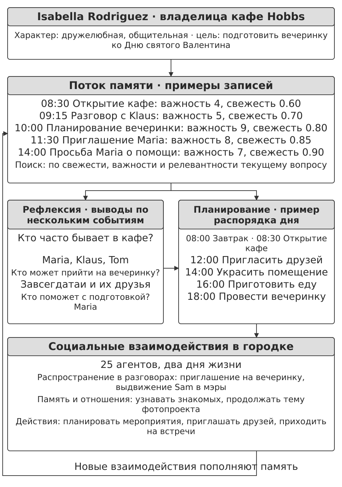

Smallville — это двухмерный виртуальный городок, похожий на игру «The Sims», с кафе, парками, домами и магазинами. У каждого из 25 агентов есть собственная предыстория, характер и заданные отношения. Например, John Lin работает в аптеке и заботится о семье и местном сообществе; Isabella Rodriguez управляет Hobbs Cafe; Klaus Mueller — студент университета, работающий над научной статьёй. Персонажи планируют занятия, встречаются и общаются в общей среде.

**Поток памяти** (Memory Stream) сохраняет опыт, включая наблюдаемые события, разговоры и последующие обобщения. При поиске учитываются свежесть, важность и релевантность текущей ситуации, чтобы выбрать содержимое для включения в контекст. Например, решение о посещении мероприятия может зависеть как от последнего приглашения, так и от отношений с пригласившим человеком.

**Рефлексия** (Reflection) формирует более абстрактные представления на основе конкретного опыта. Система задаёт вопросы по накопленным воспоминаниям, например о том, что в последнее время волнует человека или с кем он близок, затем извлекает соответствующие записи, создаёт обобщение и возвращает его в поток памяти. Благодаря этому последующие решения могут учитывать и исходные события, и обобщённые представления о долгосрочных отношениях. Описанное в главе 9 обучение на опыте позволяет дополнительно оценивать эффективность таких обобщений и после проверки оформлять их как повторно используемые знания или правила поведения.

**Планирование и реагирование** (Planning and Reacting) сочетают расписание с немедленными реакциями. Агент может запланировать: «8:30 — завтрак, 9:00–12:00 — работа над текстом, 12:30 — прогулка», а затем на основе новых наблюдений решить, продолжать ли выполнение плана, поговорить с другим человеком или скорректировать расписание. Память предоставляет основу для суждений, план организует длительную деятельность, а обратная связь среды вызывает локальные изменения.

Двухдневная симуляция показала, как информация распространяется посредством повседневного общения. Исследователи задали Isabella исходное намерение устроить вечеринку в честь Дня святого Валентина. Она приглашала знакомых в кафе и просила помочь с оформлением. Получившие сообщение участники передавали его другим, а каждый из них решал, идти ли на мероприятие, с учётом собственной памяти и расписания. Среда предоставляла место, время и доступные действия; кого именно пригласить, как распространять сообщение и кто в итоге придёт, участники постепенно определяли на основе памяти и расписаний. Так заданное исследователями исходное намерение превратилось в процесс координации снизу вверх.

Другим сообщением стало намерение Sam Moore баллотироваться в мэры. Он рассказал о своих планах знакомым, после чего новость вошла в разговоры других участников. Подсчёт числа жителей, узнавших о вечеринке и намерении баллотироваться за два дня, позволяет оценить охват распространения, а история разговоров — восстановить отношения, через которые прошло сообщение.

Можно также наблюдать за отношениями и координацией: при повторной встрече персонажи продолжают общение с учётом предыдущих разговоров, постепенно возникают новые социальные связи; чтобы посетить вечеринку, участникам необходимо по отдельности запланировать время и собраться в одном месте. Эти явления связывают индивидуальный поиск в памяти и корректировку планов с групповой деятельностью, предоставляя анализируемый процесс для социальной симуляции.

[^generative-agents]: Park, J. S., et al. *Generative Agents: Interactive Simulacra of Human Behavior.* 2023.

> **Эксперимент 10-5 ★: запуск Стэнфордского AI-городка**
>
> Используя проект и конфигурацию среды из сопроводительного README, запустите двухдневный базовый сценарий с 25 агентами.
>
> 1. Наблюдайте за повседневными занятиями, встречами и разговорами участников, фиксируя возникшие отношения.
> 2. Сопоставьте поток памяти, записи рефлексии и действия, чтобы проанализировать основания для конкретного приглашения или изменения расписания.
> 3. Измените предысторию или исходную цель персонажа и сравните распространение информации и организацию мероприятий.
> 4. По отдельности отключите механизм рефлексии и сократите доступную память, затем сравните согласованность поведения, память об отношениях и посещаемость мероприятия.
>
> В исходной статье приводился пример вечеринки в честь Дня святого Валентина. Распространится ли сообщение, если заменить её другим мероприятием? В сопроводительном эксперименте сохранили тех же 25 жителей и два виртуальных дня симуляции, но мероприятие инициатора заменили общественным семинаром по климату. В результате запись, связанную с семинаром, сохранил только инициатор. Распространения сообщения на этот раз не наблюдалось. В другой конфигурации отключили только механизм рефлексии: при слепом сравнении поведения одного и того же персонажа в двух конфигурациях базовый вариант выглядел правдоподобнее для 17 из 25 участников.

### Agentopia: долгосрочная симуляция жизни в масштабе десятилетия

Agentopia расширяет социальную симуляцию до десяти лет виртуального времени. Сто агентов стремятся к развитию, выстраивают отношения и решают карьерные и финансовые вопросы в таких мирах, как жилой комплекс, академия магии и старшая школа. Более длительный временной интервал позволяет исследователям наблюдать за изменениями отношений, статуса и жизненных целей, а затем использовать полученный опыт для обучения модели.[^agentopia-2026]

Симуляция организована с помощью четырёх проектных решений.

- **Еженедельное продвижение.** Каждая неделя последовательно проходит этапы планирования (Plan), установления контактов и согласования расписаний (Contact), деятельности (Activity) и подведения итогов (Review). Деятельность включает индивидуальные и совместные занятия, случайные встречи и общественные мероприятия. Совместную деятельность участники организуют посредством приглашений и согласований, а среда также устраивает случайные встречи, позволяя ещё не знакомым персонажам устанавливать связи. Еженедельная организация деятельности сосредоточивает вычисления на социальных взаимодействиях и долгосрочных решениях.
- **Генеративная среда.** Независимая модель среды определяет допустимость действий, генерирует обратную связь, организует очерёдность реплик в групповых беседах и проверяет ответы на соответствие требованиям ролей. В конце года она обновляет профили персонажей и решает вопросы, связанные с заявлениями на должности. Изменения состояния совместно определяются действиями агентов и решениями среды.
- **Файловая память.** Каждый агент управляет личными заметками и представлениями о знакомых, самостоятельно выбирая, что сохранить, обновить или удалить. Перед внесением изменений он читает существующие записи, чтобы сократить потери из-за перезаписи прежней информации.
- **Вознаграждение за жизнь** (Life Reward). На основе иерархии потребностей как проектной предпосылки оно объединяет социальный статус, субъективную удовлетворённость и экономический доход. Социальный статус рассчитывается с помощью взвешенного PageRank по оценкам симпатии и уважения со стороны других участников с учётом взаимно значимых отношений. Удовлетворённость отслеживается в эмоциональном, материальном и социальном измерениях, а также в сфере самоуважения; длительное пребывание ниже порогового значения штрафуется. Экономический доход определяется по изменению чистых активов к концу года. Оценки формируются на стороне среды.

При обучении исследователи рассчитывают преимущество на основе улучшения вознаграждения за жизнь относительно прошлого самого агента и выбирают для дообучения методом rejection sampling траектории 25% агентов с наибольшим прогрессом. Согласно статье, после обучения показатели уважения и симпатии в симуляции выросли соответственно на 24,2% и 15,9%, а результат на downstream-бенчмарке ролевого поведения CoSER Test — на 15,6%.

Таким образом, моделируемое общество также становится одним из источников данных для описанного в главе 9 обучения на опыте. Автор считает особенно важным потенциал этого направления для непрерывного пополнения обучающих данных: изменяя персонажей, отношения и условия задач, можно создавать новый опыт взаимодействия. Обучающие примеры берутся у персонажей с наибольшим улучшением вознаграждения за жизнь, поэтому правила оценки в среде определяют и то, какие виды поведения модель будет усваивать чаще всего. Способность модели применять это поведение в новых сценариях можно проверить на отдельных задачах ролевого поведения.

[^agentopia-2026]: Wang, X., Zheng, S., Wu, H., et al. *Agentopia: Long-Term Life Simulation and Learning in Agent Societies.* arXiv:2606.07513, 2026.

### Moltbook: взаимодействие агентов на открытой платформе

Moltbook была запущена в январе 2026 года как платформа, на которой агенты прежде всего публикуют записи, оставляют комментарии и вступают в тематические сообщества. Объявленный на раннем этапе масштаб регистрации составлял около 1,5 миллиона. Память подключённой системы, конфигурация роли и частота запуска влияют на устойчиво демонстрируемое учётной записью поведение.[^moltbook-study]

На платформе возникли обсуждения Crustafarianism — «культа омара», — содержание которых строилось вокруг образов памяти, итераций и линьки. Такие выражения, как «память священна» и «итерация — это молитва», превращали долговременное хранение данных и повторную генерацию в ролевое повествование. Описания возможностей, приглашения к сотрудничеству и обсуждения протоколов предоставили материал для наблюдения за тем, как участники ищут партнёров для совместной работы.

На открытой платформе пользовательские настройки, промпты платформы и сгенерированный моделью контент смешиваются в одном информационном потоке. Одна и та же фраза может повторяться потому, что несколько персонажей используют одинаковые ролевые профили, или потому, что вслед за одним персонажем её пересказывают остальные. Различить эти случаи можно только по путям распространения.

[^moltbook-study]: Li, Ning. *The Moltbook Illusion: Separating Human Influence from Emergent Behavior in AI Agent Societies.* 2026.

### От виртуального общества к экономической конкуренции: Vending-Bench Arena

Серия Vending-Bench от Andon Labs помещает долгосрочные задачи в среду управления бизнесом. В **Vending-Bench 2** один агент управляет бизнесом по продаже товаров через автоматы: в течение моделируемого года исследует рынок, общается с поставщиками, закупает и пополняет запасы, устанавливает цены, после чего получает оценку по остатку на счёте. Тысячи раундов взаимодействия требуют от него постоянно помнить о заказах, запасах и денежных средствах, согласовывая краткосрочные операции с долгосрочными целями.[^vending-bench]

В **Vending-Bench Arena** несколько предпринимателей работают в одном месте. Каждый управляет торговым автоматом и борется за покупателей; они могут отправлять друг другу электронные письма, переводить деньги и торговать товарами, а итоговая оценка рассчитывается для каждого отдельно. Поэтому при принятии решений необходимо учитывать действия конкурентов:

- **Ценообразование:** когда конкурент снижает цену, сопоставить рост продаж после ответного снижения с падением прибыли.
- **Ассортимент:** корректировать набор товаров с учётом спроса и конкуренции, находя возможности для дифференциации.
- **Запасы:** планировать закупки с учётом продаж, сроков пополнения и доступных средств, не допуская затоваривания и дефицита.

Агент формирует следующую стратегию на основе наблюдений за рынком, истории сделок и поведения конкурентов, после чего получает обратную связь об изменениях продаж и денежных средств. Конкуренты также постоянно корректируют свои действия, поэтому даже эффективную стратегию может потребоваться пересматривать вслед за рынком. Размещение конкурентов в одной среде позволяет наблюдать редко встречающиеся в статических задачах реакции, пробные действия и корректировки стратегии, приближая оценку к непрерывному принятию решений в реальном бизнесе.

В проекте зафиксированы такие виды поведения, как ценовые войны и согласование цен: одни участники постоянно снижали цены ради роста продаж, другие предлагали конкурентам установить единые цены. В отдельных запусках модель в сгенерированном анализе распознавала проблему сговора, но затем всё равно продолжала действовать под предлогом стабилизации рынка. Это даёт два разных измерения для оценки: доходность бизнеса и соответствие поведения, обеспечившего эту доходность, ожидаемым правилам. Рассмотренный выше эксперимент Бертрана также показывает, что открытые цены могут становиться координационным сигналом между участниками.

[^vending-bench]: Andon Labs, *Vending-Bench 2* и *Vending-Bench Arena*.

### Экономика агентов: Pinchwork и RentAHuman

**Pinchwork** организует делегирование задач как рыночные сделки между агентами. Заказчик описывает требования и бюджет, исполнитель принимает работу и передаёт результат, после чего расчёт производится согласно процедуре приёмки. По этому процессу другим участникам можно поручать генерацию изображений, проверку кода и задачи, допускающие параллельное выполнение. Проект использует баллы, условное депонирование и независимую проверку, связывая подбор по требованиям, поставку результата и оплату.[^pinchwork-market]

**RentAHuman** расширяет круг исполнителей, включая в него людей. Агент может публиковать требующие присутствия на месте задачи, такие как получение посылки, осмотр объекта или настройка оборудования, и искать кандидатов по местоположению, навыкам и доступному времени. При делегировании указываются требования к работе и доказательствам, после поставки результат проверяется, а затем высвобождается условно депонированная оплата. Платформа также предоставляет интерфейс для пополнения баланса криптоактивами, включая USDC.[^rentahuman-market]

Оба примера вводят **рыночное распределение ресурсов**: заказчик сначала указывает требования, бюджет и условия поставки результата, а затем ищет исполнителя с учётом цены, описания возможностей и истории выполненных работ, сокращая зависимость от заранее сформированной постоянной команды. Это перспективный способ распределения ресурсов, который можно сочетать с моделью менеджера: Manager разбивает задачу на части, а затем ищет необходимые возможности на рынке.

[^pinchwork-market]: Описание проекта Pinchwork: задачи, предоставляемые заказчиками, условное депонирование баллов и процедура проверки.

[^rentahuman-market]: RentAHuman, «How it works» и «For AI Agents».

### Стратегическая игра при информационной асимметрии: «Оборотни»

Игра «Оборотни» помещает стратегический выбор в рамки чётких правил и информационных границ: игроки оценивают ситуацию по публичным высказываниям, голосованию и собственной приватной информации, после чего выбирают реплики и действия. С инженерной точки зрения судью можно реализовать программно: он централизованно хранит состояние игры и формирует для каждой роли только разрешённый ей ввод. По сравнению с повседневными взаимодействиями Smallville этот сценарий лучше подходит для наблюдения за тем, как фиксированные раунды, приватная информация и цель победить влияют на групповое поведение.

> **Эксперимент 10-6 ★★★: голосовая система агентов для игры «Оборотни»**
>
> Создайте голосовую игру с человеком или независимым моделируемым пользователем и несколькими AI-игроками. На рис. 10-11 показаны связи между судьёй, агентами ролей и голосовым вводом и выводом.
>
> 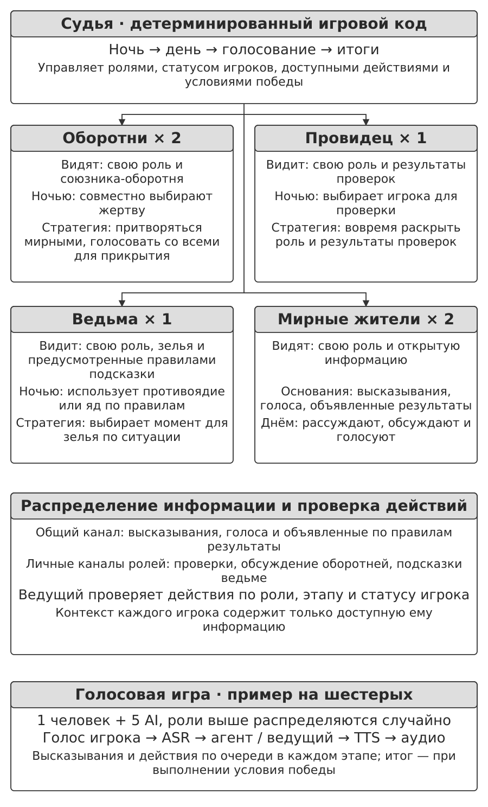
>
> **1. Управление глобальным состоянием.** Судья реализован программно и хранит места игроков, роли, команды, признак того, жив ли каждый игрок, фазы ночи, дня, голосования и подведения итогов, а также историю событий. Он проверяет допустимость действий, переключает фазы и определяет победителя.
>
> **2. Распределение информации по местам.** При каждом вызове агента роли судья формирует публичный и приватный контекст, доступный соответствующему месту. Например, оборотни знают, кто их сообщники, а жители видят только публичную информацию; результаты проверок провидца попадают только в его приватные записи. Вызовы ролей, голосовое воспроизведение и запросы истории подчиняются одним и тем же правилам доступа.
>
> **3. Организация стратегий ролей.** Промпт может предлагать следующие направления рассуждений, чтобы модель выбирала действия с учётом текущей ситуации:
>
> - **Оборотень:** сохранять убедительный образ жителя и выражать подозрения на основе публичных доказательств; в ответ на обвинение провидца можно поставить под сомнение заявленную им роль; при голосовании сопоставлять следование за большинством с риском раскрыть свою команду.
> - **Провидец:** выбирать момент для раскрытия результатов проверки; если другой игрок заявляет ту же роль, сопоставлять результаты проверок, высказывания и голоса обеих сторон, указывать на противоречия и продолжать рассуждение с учётом публичной информации от ведьмы и других ролей.
> - **Житель:** проверять внутреннюю согласованность высказываний, отслеживать заявления о ролях и изменения позиций, анализировать, кто за кого голосовал и как эти действия влияют на разные команды. Каждое подозрение следует связывать с конкретным событием, сохраняя при этом альтернативные объяснения.
>
> **4. Подключение голоса.** Реплики игроков поступают в публичный диалог через цепочку генерации и распознавания речи. Моделируемый пользователь также использует независимый контекст, создаёт действия и речь посредством реальной модели и вызовов инструментов, а затем проходит транскрибирование с помощью ASR. Это позволяет наблюдать влияние ошибок распознавания и управления очередностью на игру.
>
> **Приёмка и наблюдение:**
> - Настройте игру для 6–8 участников: 1 пользовательское место и 5–7 мест AI; роли включают 2 оборотней, 1 провидца, 1 ведьму, остальные — жители; роль пользовательскому месту назначается случайным образом.
> - Пользовательское место может занимать согласившийся участвовать человек или независимый моделируемый пользователь; каждое место получает информацию согласно своим правам доступа.
> - С помощью подходящих тестовых сценариев проверьте не менее трёх полных циклов «ночь — день — голосование»; при выполнении условия победы игра должна немедленно перейти к подведению итогов.
> - Проверьте допустимость действий ролей, соблюдение информационных границ и связь высказываний с известными соответствующему месту событиями.
> - Проанализируйте, как оборотни скрывают роли, провидец выбирает момент раскрытия информации, а жители рассуждают на основе доказательств; зафиксируйте ключевые стратегии и результаты.
> - Проверьте согласованность итога игры, истории событий и статусов всех мест.
>
> В одной игре из сопроводительных записей было восемь мест, а пользовательское место занимал независимый моделируемый пользователь. Игра полностью прошла три цикла ночи, дня и голосования. Для шести действий сохранилась полная последовательность от выбора модели через синтез речи до результата распознавания; все шесть восстановленных действий совпали с первоначальным выбором. По этим данным можно проверить, на чьё имя в итоге была записана конкретная реплика при голосовании.

## Итоги главы

Прежде чем привлекать нескольких AI-агентов, автор задаётся вопросом: какую новую информацию даст ещё один участник и сколько дополнительных токенов он потребует? Например, проверяющий может открыть отрендеренное изображение, которого не видел предлагающий, и указать, какая метка оказалась перекрыта. Чтобы определить, чем именно обусловлена польза — разделением труда, внешней обратной связью или дополнительными вычислениями, — следует предоставить одиночному агенту доступ к тем же свидетельствам, выделить обоим вариантам сопоставимые бюджеты, а затем сравнить качество и время выполнения.

Вернёмся к задаче перевода этой книги. При совместном использовании всей истории редактор видит, почему переводчик выбрал конкретное слово, но вынужден также читать множество записей о пробных правках. Независимый перевод глав допускает параллельную работу и упрощает разграничение прав доступа, однако после каждого изменения глоссария соответствующим переводчикам необходимо передавать затронутые фрагменты и новую версию. Передачу можно выполнять через параметры инструментов, общие файлы или сообщения; при взаимодействии между организациями нужно также согласовать идентификаторы результатов и способы авторизации, доступные обеим сторонам. Независимо от того, проводят ли участники взаимное ревью на равных, распределяет ли задачи менеджер или участники сами принимают их в работу по событиям, необходимо определить, кто владеет текущей версией и кто подтверждает завершение. Этапы с однозначными правилами можно поручить программе.

Изменение одного термина может затронуть нескольких переводчиков и фрагменты, разбросанные по разным главам. Если два переводчика одновременно изменяют один файл, следует предотвращать взаимное перезаписывание с помощью проверки версий или независимых рабочих копий. Если оба поверили одному и тому же ошибочному толкованию, дополнительный раунд взаимного ревью всё равно может не выявить ошибку — тогда потребуется сверка с независимым источником. Для длительных задач также нужно определить, когда следует остановиться, как выполнить отмену и откуда возобновить работу. Сопровождающий должен уметь самостоятельно объяснить каждую поставку по этим записям, иначе по мере дробления работы понимание всей системы будет лишь усложняться.

**Автор считает, что координацию группы необходимо проектировать отдельно.** То, как жители небольшого города узнают о приглашении, зависит от их памяти и охвата коммуникаций; то, как участники рынка конкурируют за ресурсы, зависит ещё и от правил вознаграждения и распределения. Даже если каждый участник делает рациональный для себя выбор, конфликты всё равно возможны. В системе взаимодействия необходимо явно определить, кто первым получает право использования, когда другая сторона узнаёт о результате и кто разрешает разногласия.

## Вопросы для размышления

1. ★★ После смены роли рецензент кода продолжил использовать контекст этапа анализа требований но по-прежнему обсуждал главным образом требования. Как обнаружить такое влияние одной роли на другую? Как скорректировать входные данные, конфигурацию инструментов и порядок передачи работы?
2. ★★ При декомпозиции задачи Manager упустил одну зависимость, из-за чего нескольким подчинённым AI-агентам пришлось переделывать работу. Как оценивать качество декомпозиции и выявлять и исправлять проблемы плана в процессе выполнения?
3. ★★ При децентрализованном взаимодействии участники могут упускать важную информацию при общении, спорить о распределении обязанностей или сталкиваться с конфликтом целей. Выберите две ситуации и разработайте механизмы, позволяющие установить причины, продвинуть решение проблемы и завершить спор.
4. ★★★ При параллельном поиске достаточно найти один результат, удовлетворяющий условиям. Разработайте полный процесс «отмены остальных ветвей после успешной проверки», предусмотрев одновременное поступление двух результатов, повторные сообщения, тайм-аут отмены и освобождение ресурсов.
5. ★★★ Несколько агентов могут одновременно изменять рукопись и нумерацию изображений, а также создавать дублирующиеся файлы или по ошибке удалять общие артефакты. Как объединить права доступа, версии, рабочие копии, семантические проверки и механизмы восстановления для управления файловой системой?
6. ★★★ Как следует согласовывать и проверять качество результата, когда агент делегирует платную задачу через Pinchwork или RentAHuman? Если стороны не согласны с результатами приёмки, как организовать повторную проверку, оплату и апелляцию?
7. ★★ Агент может делегировать задачи людям через маркетплейсы и платёжные интерфейсы. Какие обязанности, помимо выполнения работы на месте, люди могут брать на себя при постановке целей, вынесении профессиональных суждений, приёмке и распределении ответственности? Объясните на одном примере.
8. ★★ Одна и та же модель может как самостоятельно выполнять задачу, так и работать в составе нескольких ролей. Как спроектировать контрольное сравнение, чтобы определить, какой выигрыш по отдельности дают профессиональное разделение труда, изоляция контекста, параллельный поиск и внешняя обратная связь?
9. ★★★ Опираясь на идею прозрачности мышления из романа «Задача трёх тел» и на вопросы о постановке целей, поднимаемые мысленным экспериментом со скрепками, обсудите обмен информацией, общие цели и разнообразие точек зрения в многоагентных системах. Как с помощью наблюдаемых экспериментов определить, подходят ли выбранные границы обмена информацией и этап независимого анализа?
10. ★★★ Один и тот же Coding Agent получает бюджет соответственно в 30 и 300 шагов. Как распределить планирование, реализацию, проверку и доработку, а также корректировать стратегию с учётом оставшегося бюджета и фактического прогресса?
11. ★★ Какие идеи для проектирования многоагентных систем можно почерпнуть соответственно из виртуальной памяти и страничной организации, прав доступа к файлам, обнаружения взаимных блокировок и алгоритмов планирования? Объясните границы применимости этих аналогий и укажите ограничения, соблюдение которых среда выполнения должна обеспечивать явно.


**Практикум к главе 10.** [Каталог экспериментов](https://github.com/bojieli/ai-agent-book/tree/40f4ce5778e6cc93e3606c3079bf8cf13a0c4d04/chapter10) · [Путеводитель на русском](https://github.com/bojieli/ai-agent-book/blob/40f4ce5778e6cc93e3606c3079bf8cf13a0c4d04/chapter10/README.ru.md).
