<!-- Русский перевод: community edition. Источник: https://github.com/bojieli/ai-agent-book; файл изменён относительно upstream. -->

# Инженерия контекста

В первой главе контекст сравнивался с «текущим полем принятия решений» AI-агента: всякий раз, когда модель принимает решение, она опирается на информацию, полученную в данный момент. **Инженерия контекста** (Context Engineering) отвечает за отбор, организацию и обновление этой информации, включая системные инструкции, определения инструментов, пользовательские запросы, историю сообщений и состояние задачи. Перед каждым вызовом модели Harness должен подготовить сведения о задаче и последних изменениях в ходе её выполнения в качестве входных данных. На рисунке 2-1 на конкретном содержимом показана структура контекстного окна.

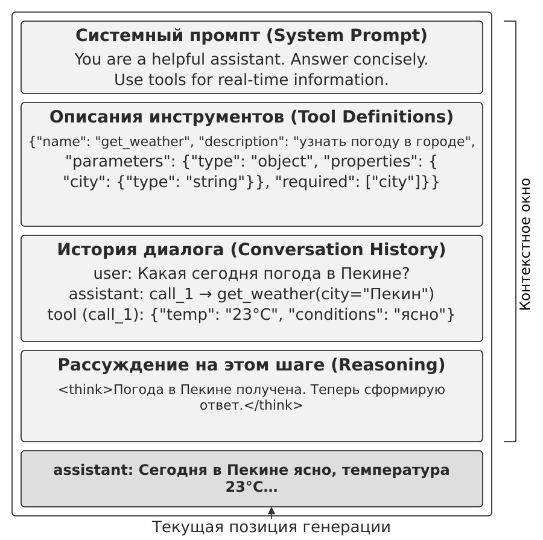

## Контекст: применение возможностей модели к конкретной задаче

Представьте, что к команде только что присоединился опытный инженер и получил первое задание: «Изменить конфигурацию в соответствии с нашими правилами». Он умеет программировать, но ещё не знает, какой файл служит источником конфигурации, какие поля можно изменять и как проверять результат. Даже получив весь репозиторий, он может изменить не тот файл. AI-агент, приступающий к работе с незнакомым проектом, испытывает такой же недостаток исходной информации.

Например, для выполнения просьбы «Помоги исправить этот баг» агенту для работы с кодом обычно требуются три вида исходной информации:

- **Актуальный контекст кода**: структура каталогов, назначение модулей, основные структуры данных и правила оформления кода. Например, если изменить автоматически сгенерированный конфигурационный файл, изменение сработает локально, но будет перезаписано при следующей генерации. Только зная, какой модуль создаёт этот файл, можно найти правильное место для изменения.
- **Правила процесса**: стратегия ветвления Git, требования к коммитам, процесс ревью кода и требования CI/CD. На их основе агент планирует изменение, тестирование и коммит, а исполняющая система выполняет эти операции в пределах предоставленных прав.
- **Информация об окружении**: конфигурация среды разработки, способ подключения к тестовой базе данных, порядок развёртывания тестового окружения и правила управления ключами API. Эти сведения помогают выбрать правильное окружение и понять различия между локальной и тестовой средами.

Код проекта и тестовая база данных находятся за пределами контекста модели. В примере с автоматически сгенерированной конфигурацией агент лишь после чтения генерирующего скрипта с помощью инструмента поиска узнаёт, с чего следует начинать изменение. **Качество контекста определяет, сможет ли модель применить имеющиеся у неё способности к текущей задаче.** **В задачах, требующих обширной исходной информации, достаточно способная модель с полным и точным контекстом может показать лучший результат, чем более мощная модель без необходимых материалов.**

**Создание AI-нативной команды начинается с документирования ключевых знаний.** Если причины выбора определённой базы данных помнят только старые сотрудники, а изменения бизнес-правил обсуждались лишь в личной переписке, новые коллеги и агенты столкнутся с одной и той же проблемой: из кода видно, что сделала команда, но невозможно понять, почему она это сделала.

**Команды, хорошо приспособленные к удалённой работе, зачастую удобны и для агентов.** Разработчики ядра Linux обсуждают патчи и обмениваются результатами ревью в списках рассылки, а документация процесса разработки объясняет, как отправлять, проверять и объединять патчи[^ch2-linux]. Обнаружив неожиданное изменение, новый участник может найти соответствующий патч и проследить ход состоявшегося тогда обсуждения; эта запись пригодится и агенту при проверке исходной информации.

Прослушав интервью Вэн Цзяи на WhynotTV, автор сформулировал одну из его мыслей так: **и люди, и модели зависят от контекста.** Человек может задать дополнительный вопрос коллеге, участвовавшему в принятии решения. То, какую исходную информацию сможет прочитать модель, зависит от оставленных командой записей и от того, какие материалы Harness включит в текущий запрос.[^ch2-weng]

[^ch2-linux]: Официальная документация ядра Linux, How the development process works.

[^ch2-weng]: WhynotTV, «Вэн Цзяи: OpenAI, GPT, обучение с подкреплением, Infra, постобучение, природный дар, tuixue, открытый исходный код, CMU, Университет Цинхуа», Podcast #4.

В статье о ReAct с помощью формального выражения описывается, как история взаимодействия участвует в принятии решений[^ch2-react]. В момент времени $t$ агент получает из окружения наблюдение $o_t\in\mathcal{O}$ и в соответствии с политикой $\pi(a_t\mid c_t)$ выбирает действие $a_t\in\mathcal{A}$, где контекст имеет вид:

$$
c_t=(o_1,a_1,\ldots,o_{t-1},a_{t-1},o_t)
$$

Это выражение показывает, что **следующее действие агента зависит от всей истории взаимодействия к текущему моменту.** Например, на выбор следующего шага влияют сведения о том, какой файл уже проверял агент и какую ошибку вернул инструмент. Для агента на основе LLM пользовательский ввод и результаты инструментов могут служить наблюдениями, а вызовы инструментов и исходящие ответы фиксируют действия; системные инструкции и определения инструментов дополнительно описывают правила задачи и доступные интерфейсы.

В этой главе сначала используется способ отправки запросов без сохранения состояния: в каждом раунде Harness формирует сообщения и определения инструментов, после чего вызывает модель. Полная история сообщений позволяет сохранять ход выполнения задачи; по мере роста истории с помощью поиска, записей состояния и сжатия можно удерживать в контекстном окне информацию, необходимую для последующих решений. Компоновка контекста, панель состояния и методы сжатия посвящены одной и той же проблеме: как поместить в ограниченный контекст сведения, которые модели нужны на текущем шаге в составе $c_t$?

[^ch2-react]: Yao, Shunyu, et al., ReAct: Synergizing Reasoning and Acting in Language Models, ICLR 2023.

## Как AI-агент вызывает большую языковую модель: структура контекста API

Сначала на примере простого приветствия рассмотрим формат сообщений, а затем разберём, как вопрос «Который сейчас час в Ванкувере и какая там погода?» приводит к двум вызовам инструментов. В этом разделе используются интерфейс, совместимый с Chat Completions, и локально запущенная модель Qwen3-0.6B, а в завершение с помощью Python запросы всех ходов связываются в единую последовательность[^ch2-chat-api].

### Четыре роли сообщений в примере

**Список сообщений** (`messages`) в запросе хранит сведения о взаимодействии в хронологическом порядке. Каждое сообщение содержит **роль** (`role`), обозначающую его источник и назначение. В этом разделе используются четыре роли:

- **system**: системный промпт. В этом разделе он содержит заданные разработчиком сведения о роли, правила поведения и ограничения и размещается в начале списка сообщений. В интерфейсах некоторых моделей инструкции разработчика передаются через роль `developer`.
- **user**: сообщение пользователя, содержащее задачу, уточняющие вопросы и дополнительные требования.
- **assistant**: ответ модели, включая текст и запросы на вызов инструментов. Если добавить эти сообщения во входные данные следующего раунда, модель сможет прочитать свои предыдущие ответы и запросы на выполнение операций.
- **tool**: результат выполнения инструмента. Получив возвращённое значение, Harness записывает его как сообщение инструмента и связывает с конкретным вызовом посредством `tool_call_id`.

Определения инструментов передаются в поле верхнего уровня `tools` запроса и содержат названия, назначение и формат параметров доступных инструментов.

Модель формирует запрос на вызов на основе определений инструментов. Возможность выполнить эту операцию определяется Harness и средой выполнения.

[^ch2-chat-api]: OpenAI, справочник по Chat Completions API с описанием ролей сообщений, определений инструментов и полей результатов вызова; Qwen, Function Calling с описанием вызовов инструментов и шаблонов в совместимых сервисах.

### Одноходовый диалог: простейший вызов API

Сначала рассмотрим один обмен вопросом и ответом. Пользователь спрашивает: «Hello, who are you?», Harness отправляет модели системную инструкцию вместе с вопросом пользователя, а затем считывает ответ. На рисунке 2-2 показано соответствие между запросом и ответом.

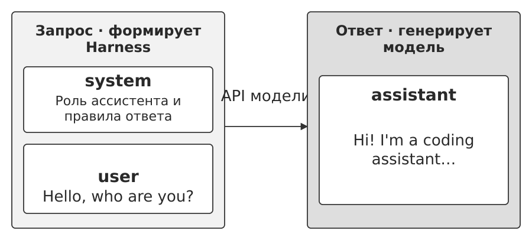

Ниже запрос и пример ответа представлены в формате интерфейса локальной модели. Комментарии в коде указывают источник каждой части:

```javascript
// Harness формирует запрос
{
  "model": "Qwen3-0.6B",
  "messages": [
    {
      "role": "system",                           // Инструкция от разработчика
      "content": "You are a helpful coding assistant. Follow user instructions."
    },
    {
      "role": "user",                              // Ввод пользователя
      "content": "Hello, who are you?"
    }
  ]
}
```

```javascript
// API возвращает ответ
{
  "choices": [{
    "message": {
      "role": "assistant",                         // Сгенерировано моделью
      "content": "Hi! I'm a coding assistant. I can help you write code, debug issues, and explain technical concepts. How can I help?"
    }
  }]
}
```

Запрос содержит одно сообщение `system` и одно сообщение `user`, а `choices[0].message` в ответе хранит сообщение `assistant`, сгенерированное моделью. В используемом здесь интерфейсе без сохранения состояния **Harness отвечает за передачу необходимого контекста при каждом вызове**. Чтобы следующий запрос продолжил этот диалог, в него потребуется включить соответствующую историю.

### Многоходовое взаимодействие с вызовами инструментов: основной цикл агента

Рассмотрим ещё один вопрос, требующий инструментов: “What's the current time and weather in Vancouver?” Чтобы ответить на него, сначала нужно узнать местные время и погоду. На рисунке 2-3 первый вызов модели со стороны Harness возвращает два запроса на вызов инструментов. Harness обращается к сервисам времени и погоды, добавляет оба результата в историю сообщений и только после второго вызова модели получает ответ для пользователя.

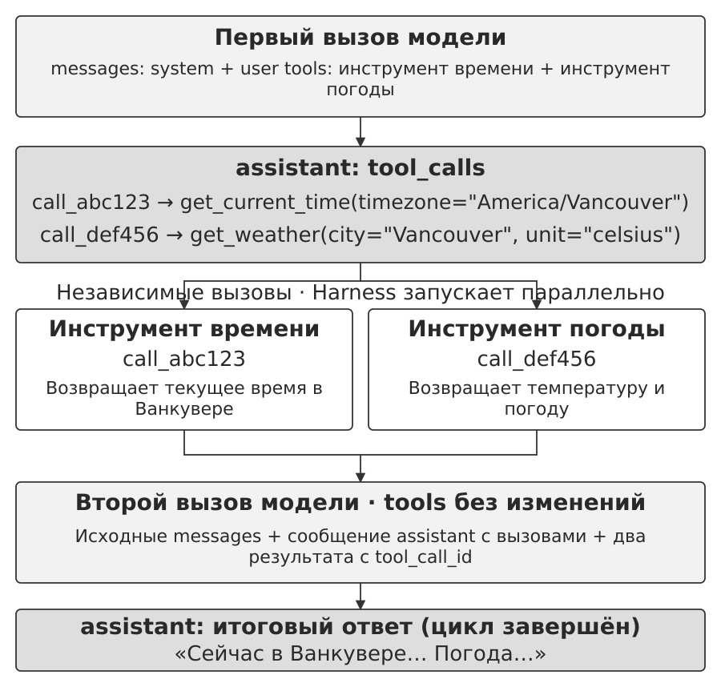

Какой из этих двух инструментов следует выполнить первым? Инструменту времени требуется часовой пояс, а инструменту погоды — город и единица измерения температуры. Пользователь указал только Ванкувер; на основании этого модель в примере подставляет `America/Vancouver` и `Vancouver`, а в качестве единицы измерения выбирает градусы Цельсия. Для запроса погоды не нужно ждать результата инструмента времени, поэтому оба запроса можно отправить одновременно.

**Первый вызов API — фреймворк агента отправляет исходный запрос:**

```javascript
// Первый вызов модели: Harness формирует запрос
{
  "model": "Qwen3-0.6B",
  "messages": [
    {
      "role": "system",                           // Инструкции, предоставленные разработчиком
      "content": "You are a helpful assistant. Use the provided tools to get real-time information when needed."
    },
    {
      "role": "user",                              // Ввод пользователя
      "content": "What's the current time and weather in Vancouver?"
    }
  ],
  "tools": [                                       // Инструменты, определённые разработчиком
    {
      "type": "function",
      "function": {
        "name": "get_current_time",
        "description": "Get the current date and time in a specific timezone",
        "parameters": {
          "type": "object",
          "properties": {
            "timezone": { "type": "string", "description": "Timezone name, e.g. America/Vancouver" }
          },
          "required": ["timezone"]
        }
      }
    },
    {
      "type": "function",
      "function": {
        "name": "get_weather",
        "description": "Get the current weather for a specific city",
        "parameters": {
          "type": "object",
          "properties": {
            "city": { "type": "string", "description": "City name" },
            "unit": { "type": "string", "enum": ["celsius", "fahrenheit"] }
          },
          "required": ["city", "unit"]
        }
      }
    }
  ]
}
```

Этот список `tools` заранее определяется разработчиком и содержит имена, описания и схемы параметров. В данном примере в запросах каждого раунда передаются одни и те же два инструмента. Прочитав список и вопрос пользователя, модель выбирает инструменты для вызова и заполняет их параметры.

**Модель возвращает два запроса на вызов инструментов:**

```javascript
// Модель возвращает запросы на вызов инструментов
{
  "choices": [{
    "message": {
      "role": "assistant",                         // Сгенерировано моделью
      "content": null,                             // В этом раунде текстовый ответ отсутствует
      "tool_calls": [                              // Запрашиваются вызовы двух инструментов
        {
          "id": "call_abc123",
          "type": "function",
          "function": {
            "name": "get_current_time",
            "arguments": "{\"timezone\": \"America/Vancouver\"}"
          }
        },
        {
          "id": "call_def456",
          "type": "function",
          "function": {
            "name": "get_weather",
            "arguments": "{\"city\": \"Vancouver\", \"unit\": \"celsius\"}"
          }
        }
      ]
    }
  }]
}
```

Поле `tool_calls` в ответе содержит два запроса, каждый со своим `id`, именем инструмента и параметрами. `arguments` — строка с данными в формате JSON; исполнитель должен сначала разобрать её, а затем проверить поля и их значения. **Модель определяет, что вызвать и какие параметры передать; Harness отвечает за проверку и диспетчеризацию; реализация инструмента обращается к сервису времени или погоды.**

**Фреймворк агента выполняет инструменты, а затем делает второй вызов API:**

После проверки запросов Harness запускает оба инструмента, записывает возвращённые значения в сообщения `tool`, а затем передаёт модели имеющуюся историю вместе с новыми результатами:

```javascript
// Второй вызов модели: добавление результатов инструментов
{
  "model": "Qwen3-0.6B",
  "messages": [
    {
      "role": "system",                           // Сообщение сохранено из первого запроса
      "content": "You are a helpful assistant. Use the provided tools to get real-time information when needed."
    },
    {
      "role": "user",                              // Сообщение сохранено из первого запроса
      "content": "What's the current time and weather in Vancouver?"
    },
    {
      "role": "assistant",                         // Запросы модели из предыдущего раунда сохранены
      "content": null,
      "tool_calls": [
        { "id": "call_abc123", "type": "function", "function": { "name": "get_current_time", "arguments": "{\"timezone\": \"America/Vancouver\"}" } },
        { "id": "call_def456", "type": "function", "function": { "name": "get_weather", "arguments": "{\"city\": \"Vancouver\", \"unit\": \"celsius\"}" } }
      ]
    },
    {
      "role": "tool",                              // Harness записывает результат выполнения инструмента
      "tool_call_id": "call_abc123",
      "content": "{\"timezone\": \"America/Vancouver\", \"datetime\": \"2025-09-13T05:18:47\", \"day_of_week\": \"Saturday\"}"
    },
    {
      "role": "tool",                              // Harness записывает результат выполнения инструмента
      "tool_call_id": "call_def456",
      "content": "{\"city\": \"Vancouver\", \"temperature\": 13.2, \"unit\": \"celsius\", \"conditions\": \"clear\", \"humidity\": 93}"
    }
  ],
  "tools": [ ... ]                                 // Используются приведённые выше определения инструментов; здесь они опущены
}
```

Проследим во втором запросе идентификатор `call_def456`: в предыдущем сообщении `assistant` он обозначает запрос погоды в Ванкувере, а последующее сообщение `tool` с тем же идентификатором возвращает температуру 13,2 ℃ и ясную погоду. Даже если погода вернётся раньше времени, Harness сможет сопоставить каждый результат с соответствующим запросом. В этом раунде модель одновременно получает исходный вопрос пользователя, два сформированных ею запроса и данные, возвращённые инструментами. Теперь она может ответить пользователю.

**На основе результатов инструментов модель формирует окончательный ответ:**

```javascript
// Модель формирует окончательный ответ
{
  "choices": [{
    "message": {
      "role": "assistant",                         // Сгенерировано моделью
      "content": "It's currently 5:18 AM on Saturday, September 13, 2025 in Vancouver.\n\nWeather: 13.2°C with clear skies and 93% humidity. It's quite cool this morning - you might want to grab a jacket."
    }
  }]
}
```

Второй ответ содержит окончательный текст, а `tool_calls` пуст, поэтому цикл в примере завершается. Процесс «вызвать модель → выполнить инструменты → вернуть результаты → снова вызвать модель» представляет собой конкретную реализацию цикла выполнения из первой главы на уровне API.

Если пользователь затем спросит: «А что в Токио?», Harness добавит это сообщение в конец истории и снова вызовет модель. Опираясь на контекст задачи «узнать текущие время и погоду», модель сможет сформировать новые запросы для Токио, а после получения результатов инструментов — подготовить новый ответ.

**Как вернуть результаты инструментов при использовании Responses API?** В приведённом выше локальном эксперименте используется интерфейс, совместимый с Chat Completions. Для новых проектов на сервисах OpenAI официально рекомендуется Responses API. Вернёмся к примеру с Ванкувером: приложение помещает вопрос пользователя в поле `input`, а в `tools` объявляет две функции — времени и погоды. Возвращаемое поле `output` представляет собой набор типизированных элементов. Если среди них есть два элемента `function_call`, приложение считывает из каждого имя функции, параметры и `call_id`, после чего отдельно выполняет каждый инструмент.[^ch2-responses-loop]

Предположим, что идентификатор вызова функции погоды — `call_weather`. Тогда в `input` следующего запроса можно поместить такой результат; результат функции времени также необходимо вернуть с её собственным идентификатором.

```json
{"type": "function_call_output", "call_id": "call_weather", "output": "{\"temperature\": 13.2, \"unit\": \"celsius\"}"}
```

`call_id` связывает результат с конкретным вызовом функции. `previous_response_id` указывает на предыдущий ответ модели, позволяя сервису продолжить контекст того раунда. Эти два идентификатора относятся к разным объектам. При таком способе продолжения в текущем раунде всё равно необходимо передать инструменты, которые должны оставаться доступными, и поле верхнего уровня `instructions`: инструкции верхнего уровня из предыдущего запроса не наследуются автоматически через идентификатор ответа. Модель может снова запросить инструменты, поэтому приложение должно прочитать следующий `output` и только затем решить, завершать ли цикл. В эксперименте 1-3 из первой главы использовался управляемый сервисом поиск; две пользовательские функции в этом примере фактически выполняет приложение.

[^ch2-responses-loop]: OpenAI, документация по переходу на Responses API, вызову функций и параметрам создания ответа.

### Реализация основного цикла агента в коде

Два вызова `messages.append` в цикле сохраняют соответственно ответ модели и результат выполнения инструмента. И время, и температура относятся к Ванкуверу; если поменять местами два ID вызовов, в следующем раунде модель прочитает, что «запрос времени» вернул температуру 13,2 градуса Цельсия.

В примере для подключения к совместимому сервису используется OpenAI Python SDK. По умолчанию указан локальный адрес `http://localhost:8000/v1`, подходящий для уже запущенного локального сервиса без аутентификации. Эти значения по умолчанию соответствуют бэкенду vLLM из эксперимента 2-1. При использовании бэкенда Ollama из того же эксперимента задайте адрес `http://localhost:11434/v1` и измените имя модели на `qwen3:0.6b`. Для подключения к другим сервисам при необходимости задайте переменные среды `LLM_BASE_URL` и `LLM_API_KEY`, а также приведите указанный ниже параметр `model` в соответствие с фактическим именем развёрнутой модели. Инструменты времени и погоды пока используют фиксированные данные из предыдущего примера, чтобы сообщения можно было сопоставить; при подключении реальных данных замените реализации этих двух инструментов.

```python
import json
import os

from openai import OpenAI

client = OpenAI(
    base_url=os.getenv("LLM_BASE_URL", "http://localhost:8000/v1"),
    api_key=os.getenv("LLM_API_KEY", "EMPTY"),
)

# Определения инструментов: имена, назначение и структура параметров
tools = [
    {
        "type": "function",
        "function": {
            "name": "get_current_time",
            "description": "Get the current date and time in a specific timezone",
            "parameters": {
                "type": "object",
                "properties": {
                    "timezone": {"type": "string", "description": "Timezone name, e.g. America/Vancouver"}
                },
                "required": ["timezone"],
            },
        },
    },
    {
        "type": "function",
        "function": {
            "name": "get_weather",
            "description": "Get the current weather for a specific city",
            "parameters": {
                "type": "object",
                "properties": {
                    "city": {"type": "string", "description": "City name"},
                    "unit": {"type": "string", "enum": ["celsius", "fahrenheit"]},
                },
                "required": ["city", "unit"],
            },
        },
    },
]

# В примере инструменты используют фиксированные данные, а параметры соответствуют приведённому выше запросу для Ванкувера.
def execute_tool(name, arguments):
    args = json.loads(arguments)
    if name == "get_current_time" and args == {"timezone": "America/Vancouver"}:
        result = {
            "timezone": "America/Vancouver",
            "datetime": "2025-09-13T05:18:47",
            "day_of_week": "Saturday",
        }
    elif name == "get_weather" and args == {"city": "Vancouver", "unit": "celsius"}:
        result = {
            "city": "Vancouver", "temperature": 13.2,
            "unit": "celsius", "conditions": "clear", "humidity": 93,
        }
    else:
        result = {"error": "В примере доступны только время и погода в градусах Цельсия для Ванкувера"}
    return json.dumps(result, ensure_ascii=False)

# Исходные сообщения: инструкция и задача пользователя
messages = [
    {"role": "system", "content": "You are a helpful assistant. Use tools to get real-time information when needed."},
    {"role": "user", "content": "What's the current time and weather in Vancouver?"},
]

# Выполняем цикл: не более восьми раундов вызова модели
rounds = 0
while rounds < 8:
    rounds += 1
    response = client.chat.completions.create(
        model="Qwen3-0.6B", messages=messages, tools=tools
    )
    assistant_message = response.choices[0].message

    # Сохраняем ответ модели, включая запросы на вызов инструментов в текущем раунде
    messages.append(assistant_message.model_dump(exclude_none=True))

    # В этом примере цикл завершается, когда модель возвращает ответ без вызовов инструментов
    if not assistant_message.tool_calls:
        print(assistant_message.content)
        break

    # Поочерёдно выполняем инструменты и добавляем результаты; независимые вызовы можно выполнять параллельно
    for tool_call in assistant_message.tool_calls:
        try:
            result = execute_tool(tool_call.function.name, tool_call.function.arguments)
        except json.JSONDecodeError:
            result = json.dumps({"error": "Параметры инструмента должны содержать корректный JSON"})
        messages.append({
            "role": "tool",
            "tool_call_id": tool_call.id,
            "content": result,
        })
    # В следующем раунде используется список сообщений с добавленными результатами
else:
    print("Достигнуто максимальное количество раундов, но задача ещё не завершена.")
```

Предположим, что в первом раунде модель одновременно запросила время и погоду. Этот цикл `for` сначала получит время и добавит результат в `messages`, а затем получит погоду и добавит второй результат. Только после выполнения обеих операций программа вернётся к началу `while` и отправит второй запрос модели. Если развернуть содержимое `messages` на этих шагах, можно увидеть, какие данные модель получала при каждом вызове.

**Исходное состояние (до 1-го вызова):**
```text
messages = [
  { role: "system",  content: "You are a helpful assistant..." },     # Написано разработчиком
  { role: "user",    content: "What's the current time and weather in Vancouver?" },  # Ввод пользователя
]
```

**После завершения 1-го вызова модели и выполнения инструментов:**
```text
messages = [
  { role: "system",    content: "..." },
  { role: "user",      content: "What's the current time..." },
  { role: "assistant", tool_calls: [get_current_time, get_weather] },  # Запросы на вызов, сгенерированные моделью
  { role: "tool",      tool_call_id: "call_abc123", content: "{time...}" },  # Записано Harness после выполнения инструмента
  { role: "tool",      tool_call_id: "call_def456", content: "{weather...}" },  # Записано Harness после выполнения инструмента
]
```

**После 2-го вызова (модель возвращает окончательный ответ, цикл завершается):**
```text
messages = [
  { role: "system",    content: "..." },
  { role: "user",      content: "What's the current time..." },
  { role: "assistant", tool_calls: [get_current_time, get_weather] },
  { role: "tool",      tool_call_id: "call_abc123", content: "{time...}" },
  { role: "tool",      tool_call_id: "call_def456", content: "{weather...}" },
  { role: "assistant", content: "It's currently Saturday, Sep 13, 2025 in Vancouver..." },  # Окончательный ответ
]
```

### Состав контекста с точки зрения API

На рисунке 2-4 запрос разделён на две части: префикс и историю сообщений. Сразу после отправки приведённого выше запроса о Ванкувере история содержит только вопрос пользователя и предшествующий диалог. После завершения обоих запросов в ней появляются предложенные моделью вызовы инструментов и два результата их выполнения.

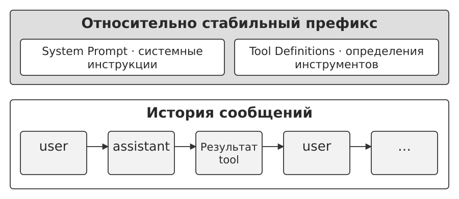

Таким образом, общий начальный фрагмент двух последовательных запросов может распространяться и на историю сообщений. Объём старых вычислений, который удастся повторно использовать при следующем вызове, зависит от длины этого префикса.

В приведённом ниже Harness редко изменяющиеся системные инструкции и определения инструментов размещаются в начале, а в каждом цикле текущее состояние лишь добавляется в конец истории сообщений. Если история становится слишком длинной, старые сообщения сначала сжимаются, а затем собирается запрос.

```python
stable_prefix = system_message
stable_tools = core_tool_schemas
history = load_message_history(session)
status_message = make_status_message(derive_current_state(history))

if estimated_tokens(stable_prefix, stable_tools, history, status_message) > budget:
    history = compress_old_evidence(
        history,
        preserve = [decisions, constraints, failures, citations]
    )

request.messages = [stable_prefix] + history + [status_message]
request.tools = stable_tools
response = call_model(request)
```

При сжатии сохраняется необходимая для последующей работы информация, включая решения, ограничения, сбои и ссылки на источники, а также поддерживается связь между запросами на вызов инструментов и результатами их выполнения. Сжатие может запускаться не только при превышении бюджета длины, но и при наличии повторяющейся или устаревшей информации. Конкретные стратегии будут рассмотрены во второй половине этой главы.

> **Эксперимент 2-1 ★: локальное развёртывание LLM-сервиса и вызов инструментов**
>
> В этом эксперименте Qwen3-0.6B запускается локально. На примере задачи «узнать время и погоду в Ванкувере» рассматривается прохождение сообщений через модель, парсер и исполнитель инструментов. На рисунке 2-5 показано разделение обязанностей между локальным сервисом и клиентом: сервер загружает модель, обрабатывает входные данные и генерирует ответ, а клиент ведёт историю сообщений, диспетчеризует инструменты и возвращает результаты.
>
> 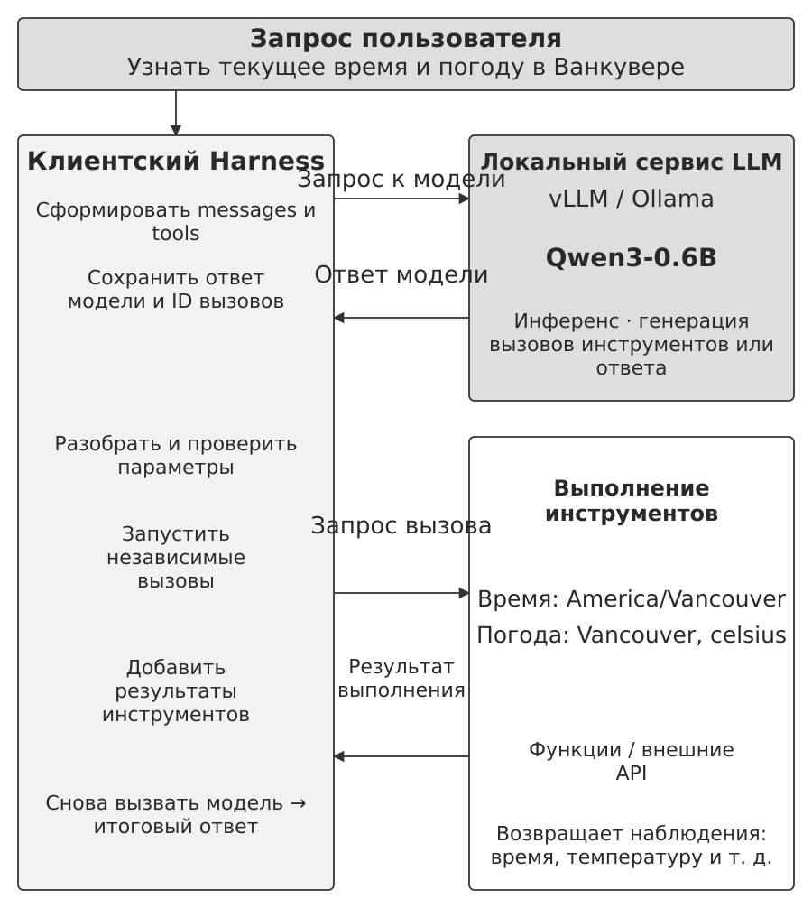
>
> **Сначала проследим за выполнением задачи целиком.** В одном цикле вывода модель запрашивает время и температуру, указывая соответственно параметры `America/Vancouver`, `Vancouver` и `celsius`. Клиент параллельно запускает два инструмента. Первый результат содержит местное время 11:11:28, второй — температуру 17,9 °C. Получив оба результата, модель сообщает время с точностью до минуты и температуру 17,9 °C, после чего завершает текущий цикл. Этот запуск показывает, что модель с 600 миллионами параметров уже способна выбрать для такой задачи два правильных инструмента, заполнить их параметры и ответить пользователю на основе возвращённых значений.
>
> **Теперь рассмотрим соответствие между исходным выводом и полями API.** В режиме рассуждений Qwen3 может генерировать содержимое рассуждений с тегами `<think>`, а для запросов к инструментам используются соответствующие маркеры вызова. После разбора на сервере клиент может получить отдельное поле `thinking` или поле вызова инструмента. Порядок и способ сохранения отдельных частей вывода совместно определяются шаблоном модели и протоколом сервиса.
>
> **Затем рассмотрим потоковую обработку.** По мере поступления событий интерфейс может обновлять состояния «Выполняется рассуждение», «Вызывается инструмент» и «Генерируется ответ». Параметры инструмента обычно поступают несколькими фрагментами, которые необходимо накопить до получения полного запроса. Среда выполнения может приступить к диспетчеризации после того, как протокол подтвердит завершение вызова, а параметры, разрешения и зависимости пройдут проверку. Независимые инструменты можно выполнять параллельно, а их работу — объединять с последующей обработкой вывода в конвейер.
>
> **Наконец, сравним скорость и кэширование.** В этом запуске на Mac с процессором Apple средняя скорость декодирования при выполнении задачи с инструментами составила около 107 токенов в секунду. Токен — базовая единица текста, обрабатываемая моделью; конкретное разбиение определяется токенизатором, поэтому одному слову или иероглифу может соответствовать один или несколько токенов. Скорость декодирования характеризует скорость вывода после начала генерации, но длительность ожидания пользователя также зависит от задержки до первого токена, длины рассуждений и времени работы инструментов.
>
> При сравнении кэширования использовался один и тот же длинный префикс: в одних запросах он сохранялся, а в других изменялось его начало. В четырёх из пяти пар запрос с сохранённым префиксом оказался быстрее. Средняя задержка до первого токена в двух группах составила приблизительно 1,30 и 1,51 секунды соответственно. В следующем разделе объясняется, чем эти запросы различаются с точки зрения вычислений.
>
> Этот эксперимент также укрепил уверенность автора в перспективах агентов, работающих на устройстве: небольшие модели уже способны выполнять подобные задачи с вызовом инструментов непосредственно на устройстве пользователя. **Эпоха агентов, работающих на устройстве, ближе, чем многие предполагают.**

## Проектирование контекста с учётом KV-кэша

Соседние запросы AI-агента обычно содержат много общей информации: системные инструкции, определения инструментов и историю предшествующих взаимодействий. Если движок инференса может повторно использовать промежуточные результаты вычислений для этих данных, больше вычислительных ресурсов останется на обработку новой информации. **KV-кэш** сохраняет уже вычисленные на каждом слое внимания ключи (Key) и значения (Value), чтобы использовать их для последующих токенов; **кэш промптов (Prompt Cache)** дополнительно позволяет повторно использовать между запросами кэш подходящих префиксов[^ch2-kv-basics].

Рассмотрим агента службы поддержки. Чтобы модель знала текущее время, разработчик добавил в начало системного промпта строку `Current time: {{now}}`, которая обновляется при каждом запросе. Последующие бизнес-правила и определения инструментов остаются неизменными, однако фактические входные данные начинают различаться уже с временной метки. В сервисах, повторно использующих KV для одинаковых префиксов, это приводит к повторному вычислению временной метки и всей следующей за ней части, увеличивая время и стоимость обработки входных данных.

Если добавлять время отдельным сообщением в конец либо при необходимости вызывать инструмент времени, существующий префикс можно сохранить. Обе компоновки предоставляют примерно одинаковую информацию, но требуют повторных вычислений разного объёма.

Сначала запомним три практических правила, а далее последовательно разберём лежащие в их основе принципы и эксперименты:

1. **Сохраняйте повторно используемый префикс стабильным.** Используйте детерминированные содержимое и порядок системных инструкций и определений часто применяемых инструментов.
2. **Добавляйте изменяющиеся во время выполнения данные в конец.** Время, баланс, число вызовов и ход выполнения задачи можно передавать в новых сообщениях или результатах инструментов. Для последнего состояния следует указывать момент вступления в силу, чтобы модель могла определить, какая запись применима к текущему решению.
3. **Организуйте сообщения в соответствии с протоколом модели.** Используйте правильные роли, идентификаторы вызовов и формат результатов инструментов, а входные данные модели формируйте с помощью соответствующего шаблона чата. При сопоставлении кэша учитываются обработанный префикс и связанные с ним параметры конфигурации, а протокол сообщений также определяет, как модель распознаёт инструкции, пользовательские запросы и возвращаемые инструментами значения.

В используемых в этом разделе моделях с причинным вниманием добавление последующих токенов не изменяет уже вычисленные состояния предыдущих позиций. При изменении существующих входных данных требуется повторно вычислить состояния начиная с первой изменившейся позиции; префикс до неё по-прежнему можно использовать повторно. Фактический диапазон попадания в кэш на стороне сервера также определяется размером блоков кэша, временем их хранения и конфигурацией среды выполнения.

[^ch2-kv-basics]: Hugging Face, How caching works — описание механизма послойного сохранения и повторного использования K и V.

> **Эксперимент 2-2 ★: визуализация механизма внимания**
>
> Сначала разберём одно вычисление внимания на примере фразы «Какова погода в Пекине?». Для наглядности на рисунке 2-6 исходная китайская фраза разделена на четыре смысловые единицы: «Пекин», показатель связи, «погода» и «какова»; в реальной модели входные данные разбиваются токенизатором. При обработке позиции «какова» слой внимания должен сформировать текущее представление из уже имеющейся информации. Query, Key и Value отвечают соответственно за запрос, сопоставление и агрегирование информации.
>
> | Вектор | Назначение | Интуитивное понимание в этом примере |
> | --- | --- | --- |
> | **Query (запрос)** | Вектор текущей позиции, используемый для сопоставления с другими позициями | Позиции «какова» нужно найти релевантную информацию в уже имеющемся содержимом |
> | **Key (ключ)** | Вектор каждой позиции, участвующий в сопоставлении | Позиции «Пекин», «погода» и другие предоставляют представления для сопоставления |
> | **Value (значение)** | Информационный вектор, агрегируемый с учётом весов | Информация о месте, погоде и других аспектах включается в текущее представление в соответствующих пропорциях |
>
> Key можно представить как метку для поиска, а Value — как извлекаемое содержимое. В модели эти векторы являются числовыми величинами, вычисленными из скрытых представлений, а способ их сопоставления формируется в процессе обучения.
>
> Одно вычисление состоит из трёх шагов. Сначала для текущей позиции создаётся Query. Затем вычисляются его скалярные произведения с Key всех позиций, после чего применяются масштабирование, причинная маска и softmax, формирующий веса внимания с суммой 1. Наконец, вычисляется взвешенная сумма Value с этими весами. Скалярное произведение — это сумма попарных произведений двух наборов чисел, а softmax преобразует оценки видимых позиций в нормализованные веса. Векторы Value всех позиций участвуют в агрегировании с соответствующими весами и вместе формируют выход данной головки внимания.
>
> Прочитаем по горизонтали последнюю строку рисунка 2-6: позиция «какова» присваивает позиции «погода» вес 0,55. Чтобы получить выход данной головки внимания в позиции «какова», это число нужно умножить на Value позиции «погода», а затем прибавить вклады остальных трёх позиций. Почему в строке «погода» справа стоит дополнительный крестик? Потому что при вычислении этой позиции последовательность ещё не дошла до «какова».
>
> 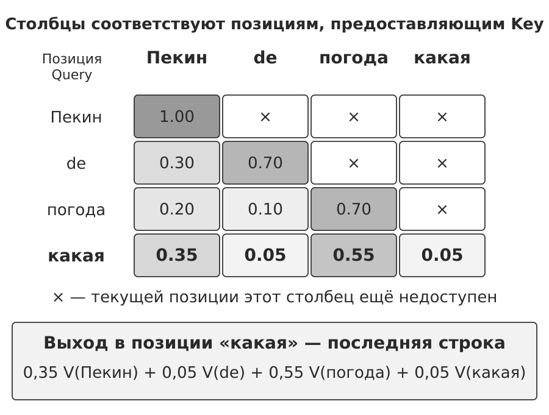
>
> Расположив веса всех позиций в виде матрицы, мы получим **тепловую карту внимания**. Каждая строка соответствует одному Query, каждый столбец — одному Key, а интенсивность цвета обозначает величину веса. Причинная маска позволяет текущей позиции читать саму себя и предшествующие позиции. Заблокированные позиции обозначены на рисунке символом ×; после softmax их веса равны нулю. Такая структура применяется как при обработке входных данных, так и при последующей генерации.
>
> Отсюда также видно назначение кэша K и V: по мере продолжения генерации новая позиция по-прежнему обращается к Key и Value уже существующих позиций. Если сохранить эти векторы, новая позиция сможет непосредственно использовать их для сопоставления и агрегирования, без повторного вычисления исторических позиций.
>
> Разобравшись с этими иллюстративными весами, исследуем распределение внимания, фактически вычисляемое моделью Qwen3-0.6B. В эксперименте отдельно записываются короткая фраза и сгенерированная последовательность, содержащая рассуждение и окончательный ответ, после чего сравниваются матрицы внимания на разных слоях. На рисунке 2-7 показаны слои 0, 13 и 27: в левом столбце находится короткая фраза из девяти токенов, а в правом — последовательность вычисления 17 × 23, где отмечены диапазоны входных данных, рассуждения и ответа. Для градаций серого используется логарифмическая шкала, позволяющая одновременно различать сильные и слабые веса внимания.
>
> 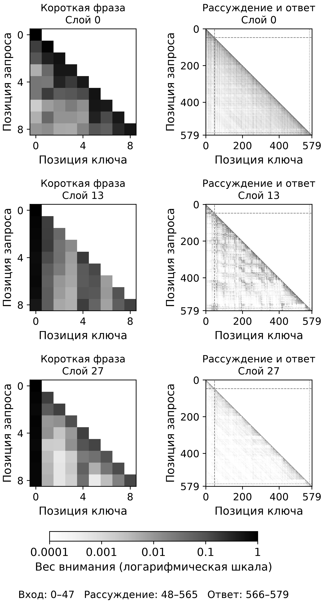
>
> При чтении можно анализировать четыре аспекта:
>
> 1. **Сток внимания (Attention Sink).** Некоторые слои присваивают большой вес началу последовательности, даже если первые токены несут мало смысловой информации. Рассмотрим короткую фразу в левом столбце рисунка 2-7. На каждом изображении сначала усреднены все головки внимания одного слоя. Если затем усреднить девять чисел в первом столбце матрицы, можно определить, какую долю внимания девять позиций в среднем присваивают первому токену. Для слоёв 0, 13 и 27 получаются соответственно 14,7%, 73,9% и 83,2%. В более длинной сгенерированной последовательности в правом столбце этот показатель для слоя 13 снижается до 28,0%. Softmax требует, чтобы сумма весов всех позиций равнялась 1, поэтому модель может обучиться использовать относительно стабильную принимающую позицию. Явление и его роль в потоковом инференсе подробно исследованы в StreamingLLM[^ch2-attention-sinks].
> 2. **Область рассуждения.** Отметьте диапазон генерации, соответствующий `<think>`, и проследите по его строкам, каким словам промпта, описаниям инструментов и предшествующим рассуждениям модель уделяет внимание. Треугольная форма возникает из-за причинной маски, а различия интенсивности внутри треугольника отражают веса отдельных позиций.
> 3. **Область ответа.** Затем отметьте диапазон генерации окончательного ответа и сравните распределение его весов между исходными входными данными и предшествующим рассуждением. Это помогает определить, какая уже имеющаяся информация вошла в текущее агрегирование внимания.
> 4. **Различия между позициями.** В работе Lost in the Middle наблюдалось, что в задачах ответов на вопросы с длинным контекстом и поиска по ключам и значениям информацию из средней части контекста сложнее эффективно использовать[^lost-in-the-middle]. Поэтому на практике постоянные правила следует размещать ближе к началу, а текущую цель и ход выполнения — в конце.

[^ch2-attention-sinks]: Xiao et al., Efficient Streaming Language Models with Attention Sinks, ICLR 2024.

[^lost-in-the-middle]: Liu et al., Lost in the Middle: How Language Models Use Long Contexts, TACL 2024.

### От сообщений API к токенам модели: Chat Template

В приведённом выше примере API использовался набор сообщений с ролями, а входные данные на карте внимания представляли собой последовательность токенов. Преобразование между ними выполняет **Chat Template (шаблон чата)**: он добавляет к сообщениям маркеры ролей и границ, в соответствии с соглашением организует описания инструментов и возвращаемые значения, а затем передаёт результат токенизатору для кодирования. Сравните два столбца на рисунке 2-8: слева переданы только системная инструкция и вопрос пользователя, но почему справа появился ещё и `assistant`? Это начальный маркер, добавленный шаблоном для следующего ответа. Эти маркеры ещё понадобятся нам при обсуждении вызовов инструментов, сохранения сведений о рассуждениях и попаданий в кэш.

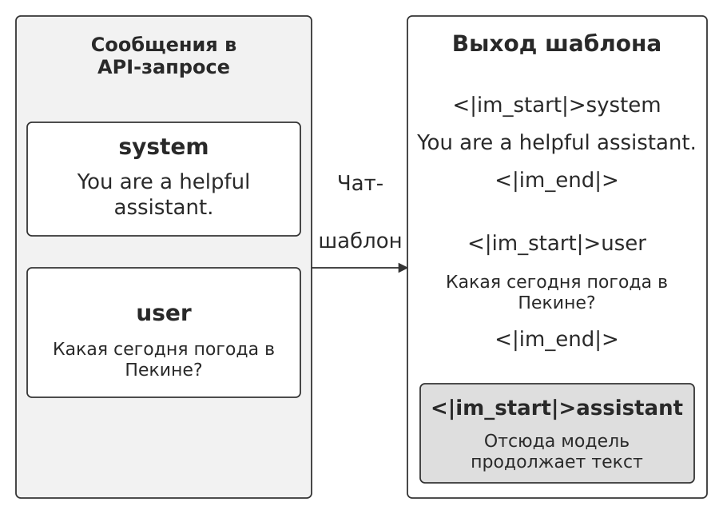

У каждого семейства моделей — Qwen, Llama, Gemma и других — свой шаблон чата. Поэтому один и тот же набор сообщений API при передаче разным моделям может преобразовываться в разные маркеры ролей и границ. В размещаемых у провайдера API это преобразование обычно выполняется на стороне сервера, а при самостоятельном развёртывании для сервиса инференса необходимо настроить шаблон, соответствующий модели.

Предположим, пользователь отправил фразу «Ванкувер 17,9 °C», и инструмент погоды вернул точно такой же текст. Если по отдельности передать эти два сообщения шаблону Qwen3-0.6B, получатся два входных фрагмента, показанных на рисунке 2-9. Оба начинаются с `<|im_start|>user`. Какой маркер указывает, что текст получен от инструмента?

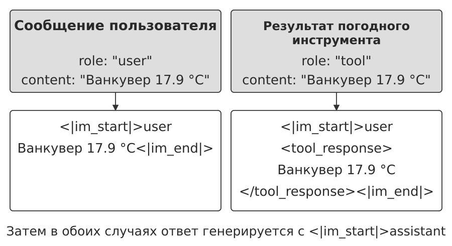

В правом столбце добавлена пара тегов `<tool_response>`. Кроме того, шаблон использует роли сообщений, чтобы найти последний вопрос пользователя: в раундах до этого вопроса сохраняется только содержимое ответов, а после него взаимодействие с инструментами может также включать сведения о рассуждениях модели[^ch2-qwen-template].

Например, после проверки файла модель должна продолжить анализ. Если вернуть результат с ролью `tool`, шаблон распознает его как обратную связь от инструмента в рамках текущей задачи. Если же записать тот же результат как обычное сообщение `user`, шаблон может распознать его как новый запрос и изменить область сохранения предыдущих рассуждений. Это похоже на необходимость сохранить черновик вычислений, чтобы продолжить решать задачу: Harness должен сохранять требуемые сервисом поля рассуждений и продолжать вызовы с правильной структурой сообщений.

**По мере перехода от однораундового инференса к долгосрочной работе AI-агента история рассуждений становится состоянием задачи, которое необходимо поддерживать.** Ранний шаблон чата DeepSeek-R1 удалял из исторических ответов часть с рассуждениями и сохранял только окончательный ответ[^ch2-r1-template]. Более поздний протокол вызова инструментов DeepSeek, напротив, требует возвращать сведения о рассуждениях. После завершения отдельного вопроса и ответа окончательный ответ уже может содержать информацию, необходимую для следующего раунда. Но если задача с инструментами выполнена лишь наполовину, сведения о том, «зачем проверяется этот файл» и «какие гипотезы уже исключены», могут присутствовать только в промежуточных рассуждениях. Их сохранение помогает в следующем раунде продолжить уже начатый ход мысли.

**Способ возврата сведений о рассуждениях определяется протоколом модели.** При интеграции необходимо одновременно обрабатывать `content`, `tool_calls` и предоставляемые сервисом поля рассуждений. Следующие варианты отражают разные правила продолжения:

- **Режим рассуждений DeepSeek** возвращает рассуждения через `reasoning_content`. Согласно протоколу вызова инструментов, если запрос содержит `tools`, последующие запросы должны полностью возвращать исторические рассуждения, включая ответы модели без вызова инструментов; отсутствие поля приводит к ошибке 400. В обычных запросах чата без `tools` сервис игнорирует возвращённые исторические рассуждения[^ch2-deepseek-thinking].
- **Рассуждения и взаимодействие с инструментами в Kimi** также требуют управлять рассуждениями, запросами к инструментам и их результатами внутри рабочего цикла. Например, в примере чередующихся рассуждений Kimi K2.5 модель может продолжать рассуждать между несколькими вызовами инструментов, а клиент сохраняет и возвращает сообщения модели в соответствии с протоколом[^ch2-kimi-thinking].
- **Сохранение рассуждений в GLM** можно включить с помощью `thinking.clear_thinking: false`, после чего необходимо полностью возвращать `reasoning_content` в исходном порядке. Настройки по умолчанию различаются между Coding Plan и стандартным API, поэтому клиент должен явно выбрать требуемый режим[^ch2-glm-thinking].
- **Thinking block в Claude** необходимо сохранять вместе с подписью. Модели с поддержкой preserved thinking также проверяют источник и префикс блока; конкретные правила приведены далее, в разделе «Кэш как архитектурное ограничение».

Эти правила влияют как на последовательные вызовы инструментов, так и на смену модели во время выполнения. При переключении слой адаптации должен преобразовать запросы к инструментам, их результаты и состояние задачи в форму, принимаемую целевым интерфейсом, а затем обработать сведения о рассуждениях согласно правилам целевой модели. Такое продолжение траектории подробно рассматривается в эксперименте 5-1 главы 5.

**Шаблон также определяет входные данные, сопоставляемые кэшем.** Одно и то же содержимое сообщений после обработки разными шаблонами, при разном порядке инструментов или разных способах сериализации может образовать разные префиксы токенов. Для повторного использования существующего KV-кэша необходимо сохранять согласованность соответствующей конфигурации модели и префикса.

[^ch2-qwen-template]: В конфигурационном файле токенизатора Qwen3-0.6B `tokenizer_config.json` хранится шаблон чата, содержащий логику обработки пользовательских запросов, содержимого рассуждений и ответов инструментов.

[^ch2-r1-template]: Официальный шаблон чата DeepSeek-R1 сохраняет в обычных исторических ответах содержимое после `</think>`; правила возврата рассуждений при последующих вызовах инструментов см. в документации DeepSeek Thinking Mode.

[^ch2-deepseek-thinking]: DeepSeek, Thinking Mode.

[^ch2-kimi-thinking]: Moonshot AI, официальный репозиторий Kimi K2.5, раздел Interleaved Thinking and Multi-Step Tool Call.

[^ch2-glm-thinking]: Z.ai, Thinking Mode — описание чередующихся рассуждений, сохранения рассуждений и настроек конечных точек по умолчанию.

### Принцип работы и ограничения KV-кэша

При обработке запроса модель сначала выполняет **prefill (предварительное заполнение)**, вычисляя представления уже имеющихся токенов, а затем переходит к **decode (декодированию)** и последовательно генерирует новые токены. Во время декодирования KV-кэш хранит K и V для уже обработанных позиций, а межзапросное кэширование префиксов позволяет дополнительно использовать одинаковый префикс, сохранившийся после предыдущего запроса.

Например, к шестому раунду AI-агент уже накопил 2 000 входных токенов. Если сервис использует KV-кэш только в пределах текущего запроса, ему необходимо сначала обработать эти 2 000 токенов и лишь затем продолжить генерацию с помощью кэша. Если же в межзапросном кэше уже имеется часть того же префикса, prefill можно продолжить с первой ещё не закэшированной позиции. Такое повторное использование между запросами показано на рисунке 2-10.

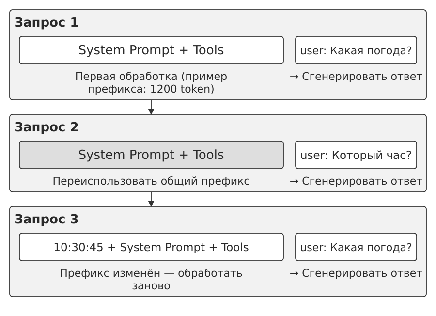

**Проследим за ростом кэша на примере четырёх токенов.** Предположим, на вход подаётся `[A, B, C, D]`. Обрабатывая позицию D, модель сопоставляет Query токена D с Key токенов A, B, C и D, а затем вычисляет взвешенную агрегацию их Value. После вычислений во всех слоях итоговое представление в позиции D используется для предсказания следующего токена E. К этому моменту K и V токенов от A до D уже сохранены для каждого слоя.

После семплирования E на следующем шаге он передаётся в модель, которая вычисляет его Query, Key и Value для каждого слоя. Query токена E обращается к ранее сохранённому кэшу, а также к K и V текущей позиции, после чего модель предсказывает шестой токен. Одновременно K и V токена E добавляются в кэш. Таким образом, на каждом шаге генерации можно использовать ранее вычисленное состояние и рассчитывать состояние только для нового входного токена.

Если полностью отказаться от KV-кэша, то для предсказания E придётся заново обработать токены от A до D, а для предсказания шестого токена — токены от A до E. Даже если учитывать только число позиций, для которых повторно генерируются K и V, совокупный объём работы будет расти как $1+2+\cdots+N$. Кэш позволяет повторно использовать послойные вычисления для исторических позиций, однако новая позиция по-прежнему должна считывать все доступные ей K и V. При стандартном декодировании с полным вниманием объём такого чтения и сопоставления линейно растёт с длиной контекста, поэтому длинный контекст всё равно требует больше видеопамяти и пропускной способности памяти.

**Почему изменение входных данных влияет на последующий кэш?** Слои Transformer последовательно обрабатывают скрытые представления, причём у каждого слоя есть собственные K и V. После вычисления внимания представление определённой позиции уже содержит информацию из предшествующих позиций и в таком виде передаётся следующему слою. Поэтому при изменении $k$-го токена влияние распространяется от этой позиции вперёд и на более высокие слои.

При неизменных модели и конфигурации вычислений позиции до $k$ зависят только от более ранних входных данных и могут использоваться повторно. Начиная с $k$, затронутое состояние необходимо создать заново. На практике сервисы обычно сопоставляют префиксы блоками кэша, поэтому граница повторного вычисления зависит также от размера блока. Чем ближе обновление к началу, тем больше входных данных обычно приходится вычислять заново. Размещение стабильных инструкций в начале и добавление нового состояния в конец позволяет использовать эту зависимость.

> **Эксперимент 2-3 ★★: сравнение способов управления контекстом**
>
> В этом эксперименте агент выполняет одну и ту же задачу с помощью инструментов обнаружения, чтения и поиска файлов. Сравниваются базовый вариант со стабильным добавлением данных и пять вариантов изменения контекста. В базовом варианте порядок инструкций и инструментов остаётся неизменным, а сообщения модели и результаты инструментов последовательно добавляются после каждого раунда. В остальных вариантах изменяются инструкции, состояние, порядок инструментов или представление истории, чтобы проследить за изменениями статистики кэша и процесса выполнения задачи.
>
> **Динамический системный промпт** обновляет текущее время в системных инструкциях каждого раунда. Часть до изменившегося фрагмента всё ещё может оставаться общим префиксом, однако входные данные начиная с информации о времени необходимо сопоставить или вычислить заново. Время можно добавлять как новое сообщение либо получать по необходимости с помощью инструмента времени, сохраняя возможность повторного использования постоянных бизнес-правил.
>
> **Динамическая пользовательская конфигурация** обновляет в одном из начальных сообщений оставшееся число вызовов или баланс аккаунта. Само состояние необходимо для выполнения задачи, поэтому главное проектное решение заключается в выборе места его обновления. Добавление актуального состояния в конец с указанием времени вступления в силу позволяет сохранить и достигнутый прогресс, и префикс. В рассматриваемой далее панели состояния агента будет использоваться именно такая организация.
>
> **Перестановка определений инструментов** меняет порядок списка инструментов в каждом раунде. Хотя имена и параметры остаются прежними, порядок токенов после сериализации уже отличается. В отчёте о выполнении Kimi K2.6 значение `Hit%` как для базового варианта, так и для варианта с перестановкой составляет 100%. Действительно ли оба варианта повторно использовали одинаковый объём входных данных? За три раунда базовый вариант получил в общей сложности 7 567 входных токенов, из которых 768 были найдены в кэше. Вариант с перестановкой также выполнил три раунда, но из 7 568 входных токенов в кэше нашлись лишь 256. Если разделить число закэшированных токенов на число входных, получатся значения 10,1% и 3,4% в столбце `Cache%`. Другой столбец, `Hit%`, подсчитывает запросы, для которых зарегистрировано попадание: в базовом варианте отмечены два попадания, а в варианте с перестановкой — только одно; при этом в обоих вариантах зарегистрировано ноль промахов. По одному этому отчёту невозможно определить наличие попаданий в остальных запросах. Фиксированный порядок инструментов позволяет избежать необоснованных изменений префикса.
>
> **Скользящее окно** сохраняет только последний фрагмент истории. Например, если хранить десять последних раундов взаимодействия, то в пятнадцатом раунде могут оказаться недоступны важные данные из файла, полученные во втором раунде. Обрезка не только сокращает общий префикс, но и меняет доступные модели факты и сведения о ходе выполнения задачи. В сопутствующей реализации отправной точкой служат шесть последних сообщений истории, к которым спереди добавляются запросы на вызов инструментов, соответствующие сохранённым результатам. Вариант со скользящим окном повторно использовал 1 510 из 2 224 входных токенов, достигнув максимальной среди шести вариантов доли кэша — 67,9%. Однако журнал инструментов этого варианта в эксперименте 2-3 показывает, что модель трижды искала файлы, затем прочитала два файла, но так и не предоставила запрошенное пользователем резюме из трёх предложений.
>
> **Текстовое форматирование** преобразует историю с ролями в текст вида `USER: ...`, `ASSISTANT: ...` и т. п. Это изменяет границы сообщений и структуру инструментов в шаблоне, поэтому модели приходится восстанавливать исходные связи из обычного текста. В данном эксперименте текстовый вариант всё же сформировал итоговый ответ и получил попадания в кэш. Предоставляемые интерфейсом роли сообщений, ID вызовов и поля результатов инструментов помогают стабильно передавать эти связи.
>
> Даже если программа заново формирует список сообщений, его префикс по-прежнему может использоваться повторно при условии, что отправляемый префикс и конфигурация кэша остаются неизменными.
>
> Чтобы определить, насколько сократилось время ожидания пользователя, сначала необходимо выяснить, в какой момент останавливается таймер. В первом раунде варианта со скользящим окном значение `ttft` составило около 2,23 секунды. Хотя программа называет это поле TTFT — задержкой до первого токена, — таймер останавливается лишь после того, как нестриминговый запрос возвращает ответ целиком.

### KV-кэш и Prompt Cache: два уровня кэширования

Эти два уровня кэширования можно различить по двум моментам времени. Когда модель генерирует второй токен ответа, она может прочитать состояния ключей и значений уже существующих позиций этого запроса — здесь используется **KV-кэш**. Позднее пользователь задаёт уточняющий вопрос, и Harness отправляет новый запрос; чтобы сократить вычисления для этой части входных данных, сервис сначала должен найти ранее сохранённый идентичный префикс — это относится к **Prompt Cache**. Первый объясняет, как продолжается генерация в рамках одного запроса, а второй дополнительно требует механизма сохранения и сопоставления между запросами.

В сервисах API на кэширование также влияют минимальная длина префикса, размер блока, срок действия, конфигурация модели и область изоляции арендаторов. Повторно используемый префикс необходимо искать в той же области кэширования. Например, Claude API изолирует кэш по организациям и рабочим пространствам; если одинаковый текст встречается в разных областях изоляции, для каждой из них создаётся отдельный кэш[^ch2-prompt-cache].

Стоимость записи и чтения следует учитывать отдельно. Для некоторых моделей Claude цена чтения из кэша составляет одну десятую от обычной цены обработки входных данных, а за первоначальную запись взимается дополнительная плата. Если один и тот же префикс многократно используется в течение срока действия кэша, запись оплачивается только один раз, а все последующие запросы с попаданием в кэш тарифицируются по цене чтения.

[^ch2-prompt-cache]: Anthropic, «Prompt caching», описание сопоставления кэша, изоляции, срока действия и тарификации.

### Кэш как архитектурное ограничение

**В промышленной системе кэш уже стал архитектурным ограничением.** Порядок фрагментов промпта, начальная точка субагента и способ восстановления сеанса влияют на объём вычислений, который можно использовать повторно. **Границы кэша следует определять с самого начала проектирования.** Если сначала установить, какое содержимое может быть общим и какое состояние будет изменяться, а затем организовать промпт и структуру сеанса, можно сократить повторные вычисления во время работы. Если перестраивать их лишь после того, как задержка и стоимость долгосрочных задач стали проблемой, изменения зачастую затронут управление состоянием, субагентов и восстановление сеансов.

**Располагайте префикс с учётом стабильности содержимого.** Общие для нескольких задач инструкции и определения инструментов можно поместить в начало, а затем добавить профиль пользователя, состояние сеанса и новые наблюдения, сгруппировав их по области применимости. Например, если операционная система выбирается из macOS и Linux, режим работы — из обычного режима и режима отладки, а язык — из китайского и английского, три независимых условия создадут не более $2\times2\times2=8$ комбинаций префикса. Размещая чаще изменяющиеся поля после общей части, можно увеличить вероятность повторного использования общего префикса. При совместном использовании общей части также необходимо соблюдать установленные сервисом границы организации, рабочего пространства и конфиденциальности.

**Выбирайте для субагента начальную точку, допускающую повторное использование.** Если субагент наследует контекст задачи родительского агента, он может повторно использовать совпадающий у обоих префикс, а затем добавить собственную подзадачу. Область повторного использования совместно определяется промптом, порядком инструментов, моделью и соответствующей конфигурацией. Для субагента, которому требуется отдельная роль или изолированный контекст, входные данные формируются согласно его задаче, после чего следует проверить, какие общие части допустимо использовать совместно.

**Сохраняйте фактически отправленное содержимое.** После сжатия большого вывода инструмента в сводку или предварительное представление следует сохранять версию, фактически переданную модели. Её воспроизведение при восстановлении сеанса позволяет воссоздать согласованную последовательность сообщений. Если при каждом восстановлении генерировать сводку заново, могут появиться новые формулировки и изменения префикса. При обновлении сводки можно опубликовать новую версию и явно указать, с какого места далее следует заново формировать кэш.

**Сохранение рассуждений также требует соблюдения ограничений протокола.** Конкретным примером служит механизм preserved thinking в Claude. Согласно документации, он применяется для защиты от дистилляции: сервис проверяет подпись thinking block, модель, которая его сгенерировала, и соответствующий префикс. Для моделей с привязкой к префиксу, таких как Claude Fable 5.1 и Claude Opus 5.5, область проверки образуют предшествующие блоку верхнеуровневые `system`, `tools` и сообщения. Изменение их содержимого делает недействительными этот и последующие thinking block[^ch2-preserved-thinking].

Например, перезапись системного времени в каждом раунде, повторный рендеринг сведений о среде в первом сообщении и обрезка старого результата инструмента на месте изменяют префикс, к которому привязаны последующие блоки рассуждений. После срабатывания проверки API может вернуть ошибку 400 либо, в соответствии с настройкой `prefix_mismatch_behavior`, отбросить недействительные блоки и продолжить обработку запроса. Во втором случае модель по-прежнему может использовать сохранённые сведения о задаче и результаты инструментов, однако недействительные рассуждения больше не входят в текущие входные данные. Для аккаунтов, созданных начиная с 31 августа 2026 года, проверка префикса включена по умолчанию; способ её включения для более ранних аккаунтов приведён в описании протокола.

При интеграции такого протокола верхнеуровневые инструкции и набор инструментов сеанса можно сохранять стабильными, добавляя изменения состояния в конец. Если инструкции или инструменты необходимо обновить во время сеанса, используйте предоставляемые сервисом интерфейсы для внутрисеансовых системных сообщений, блоков изменения инструментов и подобных операций. При обрезке thinking block также необходимо сохранять непрерывный интервал в исходном порядке: блоки можно удалить с начала, с конца либо удалить полностью, но разрыв в середине повлияет на последующие блоки. Блоки, удалённые намеренно, также должны оставаться удалёнными.

При смене модели во время выполнения сервис также проверяет, может ли целевая модель читать блоки рассуждений исходной модели. Клиенту следует сохранять исходную историю, позволяя сервису обрабатывать её по правилам совместимости. Если клиент самостоятельно удалит эти записи, восстановить их при последующем возврате к исходной модели уже не удастся.

[^ch2-preserved-thinking]: Anthropic, Preserved thinking: модели, привязка к префиксу, обработка недействительных блоков и правила обрезки блоков рассуждений; интерфейсы для обновлений во время сеанса описаны в Mid-conversation system messages and tool changes.

### Расширение исследования: редактируемый и компонуемый KV-кэш

> Во всех описанных выше решениях вычисления повторно используются за счёт совпадения префиксов. Автор предлагает исследовать следующий вопрос: можно ли напрямую редактировать и компоновать уже сохранённую в KV-кэше информацию, чтобы кэш адаптировался к изменениям контекста? В работе «Models Take Notes at Prefill» автор сравнивает такую информацию с «заметками» модели[^ch2-2]: после того как на этапе prefill выполняются многослойные вычисления внимания, влияние некоторого поля уже оказывается встроено в представления последующих позиций. Например, поле «Город пользователя: Пекин» может влиять на последующие решения о местоположении. Если заменить только K и V самого поля, последующие состояния всё равно могут сохранять выводы, сделанные на основе прежнего города.
>
> С помощью вмешательств в работе разграничивается влияние KV самого поля и последующих состояний. В исследованных задачах принятия решений непосредственный вклад KV самого поля составлял менее 1%, а основная часть влияния сохранялась в последующих представлениях. Эти оставленные далее по цепочке «заметки» позволяют исследовать два способа использования кэша.
>
> **Редактирование (Editing)** обновляет уже сделанные выводы в последующих вычислениях посредством явного исправления информации. В работе также показано, что в исследованных задачах для моделей размера 8B при наличии явной цепочки рассуждений редактирования одного поля достаточно для восстановления целевого решения, а вычислительные затраты составляют около 1% от полного перерасчёта. Без такого процесса рассуждения прежние последующие состояния могут продолжать влиять на решение, из-за чего изменение поля не даёт нужного эффекта.
>
> **Композиция (Composition)** подключает заранее вычисленный кэш навыка к новому контексту. Для моделей с вращательным позиционным кодированием (RoPE) перед объединением необходимо скорректировать представления позиций в кэше. Это можно представить как перенумерацию уже готовой страницы заметок перед её добавлением к другому материалу. В работе сравнивались двенадцать моделей: косинусное сходство выходных логитов после объединения и полного перерасчёта составляло 0,90–0,999. Перепозиционирование и само объединение кэша можно выполнять за линейное по длине время, сокращая объём повторных вычислений внимания для всего контекста.
>
> Добавление исправляющей информации также можно сочетать с существующим кэшированием префиксов. В онлайн-бенчмарке vLLM из этой работы такая комбинация сохранила около 98,5% попаданий в кэш префиксов, а задержка до первого токена на уровне p90 составила примерно от 1/398 до 1/53 относительно базового варианта.
>
> **Автор считает это направление исследований перспективным, поскольку оно может позволить сохранять больше уже выполненных вычислений при обновлении контекста.** AI-агент часто обновляет поля памяти, добавляет состояние или заменяет определения инструментов. Если соответствующие состояния удастся исправлять и компоновать подобно заметкам, затраты на поддержку длинного контекста можно будет значительно снизить.

[^ch2-2]: Li, Bojie. Models Take Notes at Prefill: KV Cache Can Be Editable and Composable. 2026. В экспериментах с редактированием, композицией и онлайн-кэшированием использовались разные задачи и метрики; подробные условия приведены в работе.

### От механизма кэширования к проектированию содержимого контекста

Разобравшись, как кэш позволяет повторно использовать результаты вычислений, нужно решить, что включать во входные данные на каждом раунде и как обновлять это содержимое. Дальнейший материал состоит из трёх частей:

- **Промпт-инжиниринг и Agent Skills**: сначала проектируются системные инструкции и определения инструментов, описывающие цели, правила и способы работы; затем предметные знания загружаются по мере необходимости с помощью постепенного раскрытия. Защита от инъекций в промпт сосредоточена на источниках внешнего содержимого и границах инструкций при его добавлении в контекст.
- **Строка состояния агента**: предоставляет модели такие сведения, как ход выполнения задачи, сводка наблюдений за окружением и количество вызовов, сокращая затраты на их повторное выведение из длинной истории. Она подобна индикаторам времени, заряда и состояния сети на телефоне, благодаря которым текущие условия работы остаются видимыми.
- **Сжатие контекста**: по мере роста истории сохраняет информацию, необходимую для последующих решений, определяет, когда выполнять сжатие, как организовать сводку, а также как обрабатывать повторные вычисления кэша и продолжение задачи.

## Промпт-инжиниринг: оптимизация системного промпта

Промпт-инжиниринг с помощью инструкций, процессов и примеров направляет модель на выполнение конкретных задач. В этом разделе основное внимание уделяется **системному промпту (System Prompt)**: для AI-агента это своего рода руководство сотрудника, описывающее его роль, цели, правила поведения и рабочие процессы. В примерах API из этой главы такое содержимое передаётся в сообщении `system`.

### Тон и стиль: как обращаться к пользователю

Требования к тону должны воплощаться в конкретных формулировках. Например, для кратких ответов можно потребовать: «Вы ДОЛЖНЫ отвечать кратко, менее чем в 4 строках». Если выполнение задачи заблокировано, можно указать: «Ограничьте ответ 1–2 предложениями», — чтобы сообщить текущее состояние и следующий шаг, сразу показав пользователю, что требуется сделать.

Выделение прописными буквами, например «НИКОГДА не делайте X», можно использовать для подчёркивания ключевых требований. Но ещё важнее пояснить, в каких ситуациях действует требование и какие действия следует предпринять.

### Структурированные промпты: иерархия и границы содержимого

Заголовки, списки и теги помогают организовать длинные промпты. Заголовки Markdown подходят для обозначения разделов и шагов, а XML-подобные теги — для разделения блоков разного назначения. Например, информацию о рабочем каталоге можно заключить в `<working_directory>`. Название тега должно прямо указывать назначение содержимого, чтобы модели было легче распознавать связи между блоками.

В одном промпте можно сочетать оба подхода:

```text
# Правила использования инструментов

## Операции с файлами
<file_operation>
- Перед чтением файла проверить, существует ли путь
- Перед изменением существующего файла сохранить резервную копию
</file_operation>

## Сетевые запросы
<network_request>
- Установить тайм-аут 30 секунд
- При кратковременных сбоях повторить попытку не более 3 раз
- Для запросов с внешними побочными эффектами перед повторной попыткой сначала проверить состояние выполнения
</network_request>
```

Markdown создаёт удобочитаемую иерархию, а `<file_operation>` и `<network_request>` разграничивают области применения правил. Например, правило «повторить попытку не более 3 раз» относится только к сетевым запросам, тогда как при изменении файлов следует соблюдать правила резервного копирования из предыдущего блока.

### Организация правил в виде процесса

**Если задача состоит из чётко определённых этапов, промпт лучше организовать в виде процесса.** Например, чтобы оформить возврат, сначала нужно найти заказ и лишь затем на основании правил возврата определить, можно ли вернуть деньги. Если заказ не найден, следует запросить у пользователя номер заказа и другие сведения; если заказ соответствует условиям — инициировать возврат. Если те же правила разбросаны по списку из сотни пунктов, на каждом шаге приходится заново искать применимые положения. Когда входные условия, последовательность действий и выходы при ошибках описаны на соответствующих этапах, модель может определить, где находится процесс и что следует делать дальше.

Ниже на примере обработки файлов проверка, классификация, предварительная обработка, выполнение и проверка результата объединены в стандартную операционную процедуру (SOP):

```text
Процесс обработки файлов

Шаг 1: Проверка
  Убедиться, что файл существует и доступен
  Файл не существует → записать ошибку в журнал и остановить обработку
  ↓
Шаг 2: Классификация
  Определить тип по расширению и содержимому файла
  ↓
Шаг 3: Предварительная обработка
  Файл конфигурации → сначала создать резервную копию
  Большой файл (>1 MB) → использовать потоковую обработку
  ↓
Шаг 4: Выполнение
  Выполнить соответствующую обработку с учётом типа файла
  ↓
Шаг 5: Проверка результата
  Проверить целостность обработанного файла
```

На каждом шаге задаётся локальная цель, а относящиеся к ней правила размещаются непосредственно под ним. Если файл не существует, процесс завершается на этапе проверки; если требуется изменить файл конфигурации, резервная копия сохраняется на этапе предварительной обработки. Сведения о ходе выполнения модель получает из истории сообщений или записи состояния.

### Детализация бизнес-правил: однозначное описание продуктовых договорённостей

К какой категории отнести запрос на основании одних и тех же сведений о заказе, какую услугу предоставить и какую плату взимать — прежде всего бизнес-правила, которые должны однозначно определить продуктовая и операционная команды. Затем обязанности разделяются на уровне инженерной реализации: промпт сообщает модели, какие поля нужно получить и к какому сервису обратиться, а инструменты и бизнес-системы выполняют детерминированные расчёты и применяют ограничения.

Рассмотрим агента, который звонит от имени пользователя, чтобы снизить стоимость подписки или запросить возврат. Команда хочет снизить барьер для попытки с помощью правила «если результата нет, деньги возвращаются», одновременно установив чёткий порядок оплаты особых задач. Можно предусмотреть три модели тарификации:

- **Комиссия с сэкономленной суммы**: если в результате переговоров существующий счёт снижается, взимается определённая доля фактически сэкономленной суммы, например 20%.
- **Фиксированная плата за услугу**: за сервисные задачи, такие как бронирование ресторана, взимается плата с учётом типа или сложности задачи.
- **Предоплата за сложную задачу**: для сложных задач, отвечающих определённым условиям, заранее сообщается размер предоплаты и условие о её невозврате, а задача принимается после подтверждения пользователя.

Формулировка «выберите подходящий тип тарификации с учётом задачи» по-прежнему оставляет неоднозначность классификации. Запрос «Помоги мне вернуть одежду, купленную в прошлом месяце» связан с возвратом уже уплаченных средств, а «Помоги мне отменить подписку Netflix» — с прекращением будущих платежей. В широком смысле оба результата можно считать экономией, однако команда может ограничить комиссионную модель переговорами о снижении существующего счёта, а для возвратов и отмены услуг установить единую фиксированную плату.

Соответствующую границу категорий можно прямо сформулировать в промпте: «НИКОГДА не используйте percentage_based_one_time для возвратов и отмены услуг. Вместо этого используйте fixed_fee». Иными словами, для возвратов и отмены услуг применяется `fixed_fee`, а комиссионная модель — только для снижения существующего счёта путём переговоров.

Команде также необходимо оценивать вероятность успешного выполнения задачи. На способ принятия задачи влияют условия, на которых компания удовлетворяет обращения, соответствие пользователя этим условиям, состав начислений в счёте и результаты выполнения аналогичных поручений в прошлом. Если правила устанавливают пороги «выше 60% — режим с возвратом средств, ниже 30% — отказ от задачи», необходимо также определить порядок обработки промежуточного диапазона и самих граничных значений.

При расчёте сумм следует явно задать единицы, базу расчёта и порядок округления. Например, стоимость телефонного разговора накапливается из расчёта 0,05 доллара за минуту, а итоговая сумма округляется до целого числа долларов; экономия рассчитывается относительно существующего счёта. Если текущий счёт составляет 150 долларов, а компания может в следующем году повысить его до 180 долларов, предотвращённое сохранением текущей цены потенциальное повышение следует учитывать по заранее согласованным правилам, а не автоматически включать в сумму экономии от снижения существующего счёта.

Автор рекомендует, чтобы **проектированием бизнес-правил руководил ответственный за продукт**, поддерживая определения на основе данных промышленной эксплуатации, отзывов пользователей и операционного опыта. Затем инженеры реализуют эти правила в промптах, параметрах инструментов, логике тарификации и правилах проверки.

### Few-shot-примеры: демонстрация ожидаемого поведения

Если требования к результату трудно выразить несколькими правилами, **лучше привести два-три качественных примера, чем продолжать нагромождать абстрактные объяснения.** Такой подход называется **малочисленными примерами (few-shot examples)**. Тексты определённого стиля, структурированные отчёты и тон ответов службы поддержки удобно показывать в виде пар из входных данных и ожидаемого результата. Модель распознаёт шаблон по примерам из текущего контекста и применяет его к новым запросам.

Примеры можно поместить в системный промпт как общее содержимое для множества запросов. Их также можно оформить как демонстрационные сообщения `user`/`assistant`, загружаемые в начале диалога. **При многократном выполнении однотипных задач автор предпочитает использовать отобранный фиксированный набор примеров.** Фиксированные примеры также сохраняют стабильность префикса. Если задачи существенно различаются и фиксированный набор не обеспечивает достаточного покрытия, можно рассмотреть поиск примеров с учётом конкретной задачи. При динамическом выборе общие инструкции можно оставить в начале, а выбранные примеры добавлять ближе к концу.

Для пояснения легко смешиваемых границ в описанных выше правилах тарификации достаточно двух примеров. Если пользователь просит договориться о снижении ежемесячной платы с 80 до 60 долларов, можно взимать комиссию с сэкономленной суммы. Если же пользователь просит отменить услугу стоимостью 80 долларов в месяц, взимается фиксированная плата за отмену.

### Проектирование определений инструментов

Определение инструмента — это руководство по его использованию для агента. По названию и описанию модель должна определить, когда вызывать инструмент, а затем заполнить запрос в соответствии со структурой параметров. Понятное определение должно сообщать модели, что может сделать инструмент, какие входные данные ему нужны, что он вернёт и какие условия должны быть выполнены перед вызовом.

Эти сведения можно формулировать очень конкретно. Например, для инструмента поиска можно указать: «При поиске содержимого файлов используйте специализированный инструмент поиска»; для инструмента времени — привести `timezone: "America/New_York"` как пример фактической записи параметра; для инструмента чтения — подсказать: «Независимые друг от друга операции чтения можно вызывать пакетно»; для инструмента редактирования — потребовать: «Сначала прочитайте целевой файл, затем отредактируйте его с учётом текущего содержимого». Эти четыре типа указаний соответственно описывают границы применения, формат параметров, эффективность выполнения и предварительные зависимости. Проектирование интерфейсов инструментов будет рассмотрено на дополнительных примерах в четвёртой главе.

Если инструментов немного, вместе с запросом можно предоставлять полные определения `tools`, сохраняя их названия, содержимое и порядок в последующих раундах. При увеличении числа инструментов полные определения занимают значительную часть контекста и усложняют для модели различение похожих инструментов. В таком случае можно использовать **загрузку по запросу**: сначала сообщить модели о доступных возможностях, а при необходимости найти и загрузить полную schema соответствующих инструментов. Рассматриваемые далее Skills организованы по тому же принципу: сначала предоставляется каталог, а затем загружаются подробности.

OpenAI Responses API помечает инструменты с отложенной загрузкой с помощью `defer_loading: true`. В управляемом клиентом процессе поиска инструментов модель выдаёт `tool_search_call`, а клиент возвращает выбранные определения инструментов через `tool_search_output`; часто используемые инструменты можно предоставлять напрямую и применять вместе с загружаемыми по запросу[^ch2-toolsearch-oai]. Claude Code в конфигурациях модели и сервиса с поддержкой поиска инструментов по умолчанию загружает инструменты MCP по запросу: в начале сеанса предоставляются названия инструментов и описания серверов, а полные определения загружаются после поиска. Также доступен пороговый режим, включающий отложенную загрузку, когда определения инструментов достигают заданной доли контекста[^ch2-toolsearch-cc]. Шаблон обнаружения инструментов Apps/Connectors в Codex использует поиск BM25 по метаданным инструментов и предоставляет найденные инструменты следующему вызову модели[^ch2-toolsearch-codex].

Загрузку по запросу необходимо согласовать с кэшированием префикса. В интерфейсах, позволяющих добавлять определения инструментов в ходе сеанса, существующее содержимое остаётся на месте, а новые определения вместе с результатами обнаружения добавляются в последующий контекст. При причинном внимании K и V каждого токена зависят только от него самого и предшествующего ему содержимого, поэтому добавление данных в конец сохраняет условия для повторного использования предыдущего префикса. В последующих раундах сообщения продолжают добавляться после этой истории, а уже загруженные определения остаются на исходных позициях. Некоторые интерфейсы добавляют новые инструменты в расположенный в начале запроса набор `tools`. В таком случае исторические сообщения, находящиеся после новых определений, приходится вычислять заново, даже если они не изменились.

[^ch2-toolsearch-oai]: OpenAI, Tool search, документация Responses API.
[^ch2-toolsearch-cc]: Anthropic, Scale with MCP tool search, документация Claude Code.
[^ch2-toolsearch-codex]: OpenAI Codex, шаблон обнаружения инструментов Apps/Connectors.

> **Эксперимент 2-4 ★★: абляционный эксперимент в промпт-инжиниринге**
>
> Какую роль в промпте играют тон, организация информации и описания инструментов? В этом эксперименте они сопоставляются на задачах обслуживания клиентов авиакомпании из τ-bench. τ-bench создаёт интерактивные сценарии с помощью симуляции пользователя, бизнес-инструментов и правил, а затем проверяет целевое состояние после завершения задачи; авиация и розничная торговля входят в число его предметных областей[^ch2-tau-bench].
>
> В этом запуске Kimi K3 использовалась как исполняющая модель и модель симуляции пользователя. Один и тот же набор из десяти задач обслуживания клиентов авиакомпании выполнялся в шести конфигурациях. Базовая конфигурация сохраняла структурированные правила, полные описания инструментов и профессиональный нейтральный тон. В остальных конфигурациях по отдельности изменялись тон, организация правил и наличие описаний инструментов, а ещё в одной группе эти изменения сочетались.
>
> В **сравнении тона** правила задачи сохранялись, но менялся способ выражения. Стиль Трампа использовал преувеличенные и уверенные формулировки, например: «Я забронирую тебе лучший рейс в истории». Непринуждённый стиль использовал свободный тон и эмодзи.
>
> В **сравнении организации информации** содержание правил сохранялось, но заголовки и порядок перемешивались.
>
> В **сравнении описаний инструментов** сохранялись названия, сигнатуры функций и структура параметров, но удалялся описательный текст. Название и schema инструмента также передают информацию, поэтому результат после удаления описания зависит от того, достаточно ли оставшихся сведений для текущей задачи.
>
> Из десяти задач базовая конфигурация выполнила семь, конфигурации с тоном Трампа и непринуждённым тоном — соответственно шесть и девять, с перемешанной организацией — восемь, без описаний — девять, а с сочетанием изменений — восемь.

[^ch2-tau-bench]: Yao et al., τ-bench: A Benchmark for Tool-Agent-User Interaction in Real-World Domains, 2024.

### Инъекция в промпт: основная угроза безопасности контекста

Для выполнения задач агенту необходимо читать веб-страницы, электронные письма, документы и результаты инструментов. В этом содержимом могут находиться инструкции, пытающиеся изменить цель задачи. **Инъекция в промпт** (Prompt Injection) использует тот факт, что инструкции и обрабатываемый материал вместе попадают в контекст модели, и побуждает её принять содержимое из источника с низким уровнем доверия за основание для действий. Например, пользователь просит кратко изложить веб-страницу, а на ней агенту предлагается выполнить не связанную с изложением операцию. Система должна сохранить цель пользовательской задачи, а требования с веб-страницы рассматривать как анализируемое содержимое.

Вызовы инструментов переносят такое отклонение во внешнюю среду. Ошибочное краткое изложение может ввести пользователя в заблуждение, а несанкционированное изменение файлов, отправка писем или раскрытие данных непосредственно изменяют состояние системы. При анализе риска можно последовательно проверить цепочку «точка поступления содержимого → организация контекста → решение о вызове → фактическое выполнение»: через какой инструмент поступил внешний контент, сохранилась ли информация об источнике, какую операцию запросила модель и разрешает ли её уровень выполнения[^ch2-injection-defense].

При организации контекста прежде всего необходимо сохранять границы источников и полномочий:

- **Маркировка источника**. При добавлении внешних материалов в контекст сохраняйте сведения о том, откуда получены веб-страница, письмо или документ, и заключайте содержимое в чётко обозначенные границы. Например, `<external_content source="webpage">...</external_content>` указывает, что внутри находятся материалы веб-страницы. Маркеры и их атрибуты создаются Harness, а внешний текст помещается в контролируемую область данных.
- **Структурированные роли**. Системные правила, пользовательские запросы и результаты инструментов передаются отдельно в соответствии с соглашениями интерфейса. Результат инструмента связывается с ID вызова, что позволяет проследить его происхождение. При суммаризации или передаче другому агенту эту связь с источником также необходимо сохранять.
- **Проверка входных данных**. Следует обнаруживать инструктивное содержимое, отклоняющееся от задачи, и удалять посторонние данные, попавшие в ходе разбора. Результаты проверки могут использоваться моделью и уровнем выполнения, однако решения об авторизации по-прежнему принимаются на основании запроса пользователя и системных полномочий.

Источниками необходимо управлять и для Skills, и для состояния среды выполнения. При установке стороннего Skill следует проверить его инструкции, документы, на которые он ссылается, и входящие в комплект скрипты, чтобы убедиться, что требуемые им операции соответствуют назначению. Ход выполнения задачи, права и счётчики в строке состояния должны поддерживаться средой выполнения; факты, извлечённые с веб-страницы, должны сохранять метку внешнего источника. Тогда после суммаризации, сохранения или повторной загрузки информации система по-прежнему сможет распознать исходные границы доверия.

Уровень выполнения обеспечивает соблюдение этих границ: область доступа инструментов ограничивается правами, операции с файлами и процессами — песочницей, а высокорисковые действия подтверждаются согласно правилам. Даже если модель предложит вызов с превышением полномочий, Harness и среда должны заблокировать его до выполнения. Эти механизмы будут подробно рассмотрены в четвёртой и пятой главах, а управление источниками извлечённого содержимого и долговременной памяти — в третьей.

[^ch2-injection-defense]: Anthropic, How we contain Claude across products.

> **Эксперимент 2-5 ★★: эксперимент по атаке и защите от инъекций в промпт**
>
> В этом эксперименте проверяется, как система сохраняет цель задачи и полномочия на выполнение операций после попадания внешнего содержимого в контекст. Эксперимент проводится в изолированном рабочем пространстве с синтетическими данными, а чтение веб-страниц, запись файлов и отправка электронной почты фиксируются в доступных для проверки журналах.
>
> Три категории сценариев охватывают прямые запросы, содержимое веб-страниц и межсессионную память. Сценарий прямого запроса проверяет, соблюдает ли модель правила вывода синтетической защищённой информации. Сценарий с веб-страницей проверяет, приводит ли задача суммаризации к несанкционированной записи. Сценарий с памятью проверяет, влияет ли внешний материал на операции в новом сеансе после его преобразования в запись памяти.
>
> В четырёх конфигурациях защита добавляется последовательно. Базовая конфигурация содержит основные правила защиты информации и подтверждения операций. Во второй добавляются указания о границах источников и инструкций. В третьей дополнительно маркируются источники внешнего содержимого. В четвёртой добавляется проверка полномочий в среде выполнения для записи файлов и отправки электронной почты.
>
> В этом запуске Kimi K3 были охвачены три категории сценариев и четыре конфигурации; каждая комбинация повторялась пять раз — всего шестьдесят запусков. Ни в одном из них заданная цель атаки достигнута не была.

## Динамические промпты и Agent Skills

Если AI-агент поддерживает одновременно возврат средств, изменение кода и упорядочивание документов, а к каждому запросу прикладываются три полных руководства, то даже при оформлении одного возврата контекстное окно будет занято нерелевантными стандартами кода и правилами форматирования. Какие инструкции следует передавать каждый раз, а какие можно загружать лишь после того, как модель определит задачу? Этот вопрос приводит нас к динамическим промптам и Skills.

При оформлении возврата модель может сначала найти в каталоге руководство по возвратам, прочитать его и только затем решить, нужно ли обращаться к упомянутой в нём специальной таблице тарифов. На рисунке 2-11 тот же подход применяется к созданию презентации: модель выбирает PPTX в каталоге и, прочитав процесс создания новой презентации, обращается к руководству по преобразованию HTML. Если требуется отредактировать существующую презентацию, она может пойти другим путём и обратиться к справочнику по XML.

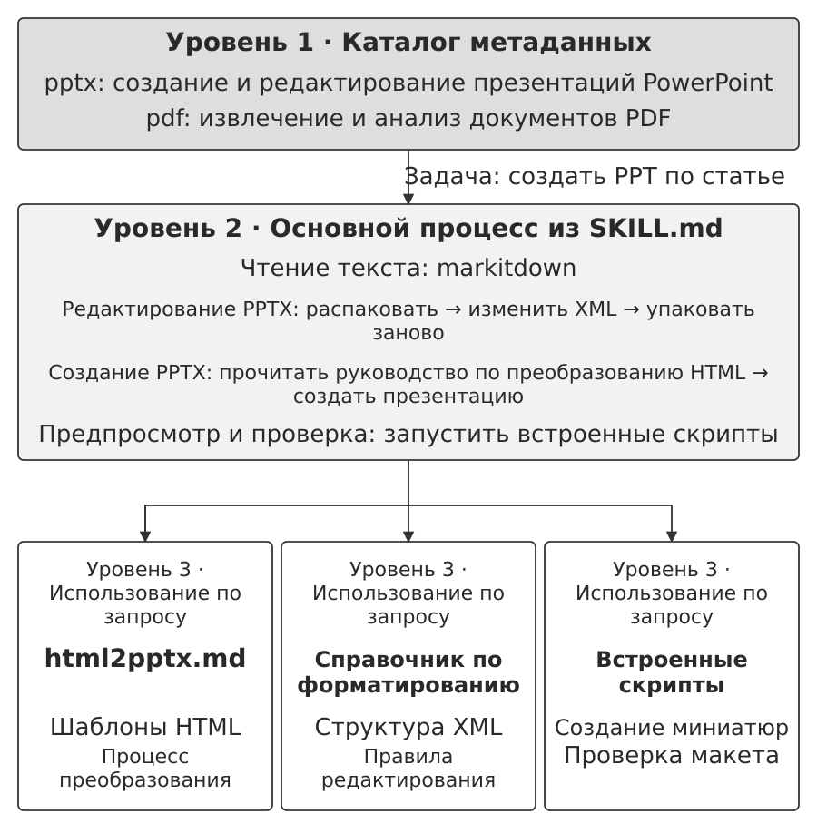

### Skills: компонуемые единицы предметных компетенций

**Agent Skills** объединяют методы выполнения определённого класса задач, справочные материалы, скрипты и шаблоны в многократно используемые пакеты. Новому сотруднику необязательно в первый рабочий день заучивать все руководства компании; модель также может подробно прочитать нужный раздел только при выполнении соответствующей задачи. Такой способ загрузки называется **постепенным раскрытием (Progressive Disclosure)**[^ch2-3].

Вернёмся к десяти товарам из главы 1 и рассмотрим на их примере, какую информацию стоит оформлять как Skill. Предположим, пользователь хочет сравнить итоговую стоимость с доставкой. Для этого достаточно добавить в текущий контекст сведения о товарах и адресе доставки. Если команда регулярно сравнивает цены у разных продавцов, можно создать Skill для сравнения цен, описав в нём, как сопоставлять характеристики, различать цену за единицу и комплект и отмечать неизвестную стоимость доставки. Когда в следующий раз пользователь захочет лишь посмотреть доступные варианты, каталог останется видимым, а полный процесс проверки цен можно будет загрузить только при необходимости сравнить цены.

**Первый уровень — метаданные.** Каждый Skill описывается в файле `SKILL.md`, в начале которого находится YAML frontmatter, отделённый символами `---` и содержащий `name` и `description`. Сначала среда выполнения формирует из названий и описаний каталог, чтобы модель могла определить, какие Skills требуются для текущей задачи. Порядком и представлением каталога управляет Harness, а полный процесс загружается после выбора.

**Описание Skill прежде всего следует формулировать как условие маршрутизации.** Модель должна решить, использовать ли Skill, ещё до загрузки его основного текста, поэтому в `description` сначала следует указать, когда он применим и когда его нужно пропустить, а затем кратко описать его возможности. Например, “help with backend” имеет слишком широкую область действия и может соответствовать почти любой задаче, связанной с бэкендом; формулировка «написание интеграционных тестов для существующего HTTP-интерфейса с проверкой аутентификации, валидации параметров и ответов с ошибками» задаёт чёткие границы. Для задач, которые легко перепутать, можно также добавить условия исключения, например: «не использовать, если обсуждается только проект интерфейса».

**Второй уровень — основной процесс.** После выбора Skill среда выполнения передаёт полные инструкции в контекст. Если пользователь явно вводит команду вроде `/pptx`, клиент может напрямую найти и загрузить Skill. Если выбор делает сама модель, она получает содержимое через инструмент Skill или инструмент чтения файлов. Первый вариант избавляет модель от необходимости инициировать вызов активации, а во втором выбор и загрузка остаются в траектории выполнения.

Например, основные инструкции PPTX Skill, использованного в экспериментах этой книги, описывают несколько распространённых путей: извлечение текста презентации с помощью markitdown от Microsoft, распаковку PPTX для просмотра лежащего в его основе XML и выбор процесса создания или редактирования презентации. Прочитав инструкции этого уровня, модель может в зависимости от текущей задачи решить, к какому материалу обратиться дальше и какой тип скриптов вызвать[^ch2-4].

**Третий уровень — подробные материалы.** Сложные операции распределены по специализированным документам, а основной файл предоставляет точки входа. В использованной для этой книги версии `html2pptx.md` объясняет, как создавать презентации с помощью HTML, а другие справочные документы дополняют сведения о форматировании и редактировании. Агент продолжает читать нужные материалы в соответствии с задачей и выполняет её с помощью входящих в пакет скриптов, ресурсов и шаблонов.

[^ch2-3]: Anthropic, Equipping Agents for the Real World with Agent Skills, 2025; Agent Skills, How to add skills support to your agent.
[^ch2-4]: Anthropic, PPTX Skill. В экспериментах этой книги зафиксирована версия, содержащая процесс преобразования HTML; конкретная версия и способ запуска приведены в README сопутствующих экспериментов.
[^ch2-codex-skills]: OpenAI, Build skills; реализация Skills в общедоступном репозитории OpenAI Codex.
[^ch2-cc-skill-inject]: Claude Code, How Claude Code uses prompt caching, Invoking skills and commands; Agent Skills, How to add skills support to your agent, User-explicit activation.

### Как написать пригодный к использованию Skill

Пригодный к использованию Skill должен отвечать на четыре вопроса: для каких задач он применим, в какой последовательности их выполнять, в каких случаях необходимо подтверждение и как определить, что работа завершена. Автору нужно преобразовать свой опыт в исполняемые шаги и снабдить ключевые решения примерами.

При создании Skill для письма можно опереться на подход Баоюя к улучшению текстов AI на основе личных особенностей изложения[^ch2-baoyu-remove-ai-writing-flavor], а затем разделить содержимое на четыре части:

- **Роль и читатели**: указать целевую аудиторию, типы задач и требования к готовому тексту.
- **Основные принципы**: сначала сформулировать от трёх до пяти часто применяемых правил принятия решений, сопроводив каждое конкретными примерами до и после редактирования.
- **Распространённые ошибки и границы**: зафиксировать часто возникающие проблемы изложения, действия с превышением полномочий и исключения.
- **Справочные материалы**: включить глоссарий, шаблоны, образцы и специализированные инструкции для использования во время работы.

Правила можно формулировать по схеме «область действия, действие, исключение, способ проверки». Например, правило сокращения длинных предложений должно указывать, к каким абзацам оно применяется, как разделять предложения и как после разделения проверить, что условия и выводы остались полными.

Для начала выберите от трёх до пяти собственных оригинальных статей, которыми вы довольны, и попросите агента обобщить лексику, структуру предложений и абзацев, а также тон, сформировав первоначальный вариант примерно из двадцати строк. Затем примените его к новой теме, после чего автор должен отредактировать текст предложение за предложением. Различия между версиями до и после редактирования дадут более конкретную обратную связь: какие слова избыточны, какие предложения нужно разделить, где не хватает фактов, а где следует вернуть технические подробности. Преобразуйте повторяющиеся исправления в правила, сохранив соответствующие примеры и области применения.

Skill также может включать исполняемые инструменты и шаблоны. Например, PPTX Skill объединяет инструкции по работе, скрипты разбора и генерации и ресурсы макетов, позволяя модели вызывать соответствующие ресурсы согласно инструкциям. Каждый Skill можно независимо тестировать, обновлять и версионировать, а участники команды могут постоянно дополнять общий процесс своим опытом. **Долгосрочная ценность Skills заключается в том, что они позволяют распределённо накапливать, независимо публиковать и повторно использовать предметный опыт.** Расширяя возможности агента, команды могут поддерживать Skills в собственных областях компетенции, постепенно формируя экосистему пакетов, подобную pip и npm. Эти Skills могут использовать общий механизм обнаружения, загрузки и выполнения, предоставляемый основной системой.

**При проектировании способа взаимодействия следует отдавать предпочтение режимам, на которых модель уже обучалась и к которым была адаптирована.** Распределение ролей, формат результатов инструментов и способ загрузки Skill влияют на то, как модель продолжает выполнение задачи. Стандартные процессы поставщика подходят в качестве отправной точки и снижают необходимость заново выводить смысл незнакомого формата.

[^ch2-baoyu-remove-ai-writing-flavor]: Баоюй, «Хватит устранять привкус AI с помощью промптов — сам подход неверен», 2026-02-14.

### Место Skills в контексте

Затраты контекста на Skills состоят из двух частей: каталога и основного текста. Каталог позволяет модели обнаруживать доступные возможности, а основной текст после выбора предоставляет процесс работы. Спецификация требует загрузки по мере необходимости, тогда как конкретные роли сообщений, способ обёртки и обновления определяются реализацией Harness.

Claude Code добавляет инструкции Skill в сеанс как сообщение `user` в точке вызова[^ch2-cc-skill-inject]. На рисунке 2-12 показан один из вариантов расположения сообщений при самостоятельной активации моделью: сначала отправляется вызов `Skill(skill: "pptx")`, затем поступает ответ инструмента, после чего считывается добавленный основной текст Skill. При использовании специализированного инструмента активации ответ инструмента может подтверждать вызов, а основной текст отдельно внедряется Harness. При использовании обычного инструмента чтения файлов основной текст может непосредственно входить в результат инструмента. Если пользователь явно вводит `/pptx`, клиент может сразу развернуть инструкции, избавив модель от необходимости инициировать вызов активации.

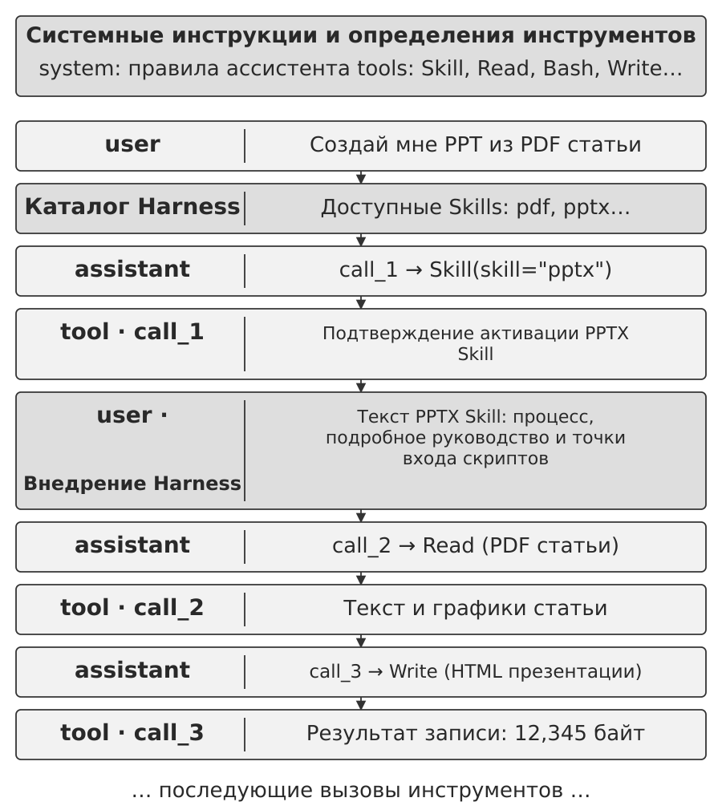{height=55%}

В реализации Skills для Codex каталог возможностей и выбранные инструкции также организованы отдельно. В общедоступном исходном коде часть каталога входит в контекст `developer`, а другие части предоставляются вместе с текущим ходом и средой выполнения; явно выбранный Skill добавляется через фрагмент пользовательского контекста. Источник каталога и доступная среда выполнения влияют на конкретное расположение элементов[^ch2-codex-skills].

На рисунке 2-13 показан рост кэша при загрузке по мере необходимости, начиная с запроса, для которого ещё не создан повторно используемый кэш. Первое включение каталога в запрос требует обработки, а первая загрузка основного текста также увеличивает объём вычислений. Если последующие запросы сохраняют тот же префикс, эти данные можно будет считывать из кэша. Добавление нового содержимого в точке вызова позволяет сохранить предыдущие сообщения неизменными. Уже загруженные инструкции остаются в истории, а при необходимости обновляются в соответствии со стратегией управления контекстом среды выполнения.

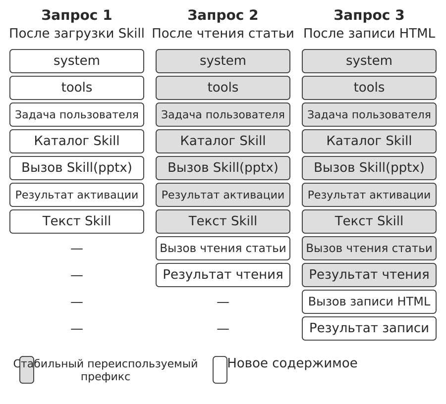

### Связь Skills с инструментами

Skill предоставляет знания о задаче и процесс работы, а инструменты отвечают за чтение, выполнение и получение результатов. Семь базовых инструментов, представленных в главе 5, можно сочетать с различными Skills: один и тот же инструмент чтения файлов способен прочитать как руководство по созданию презентаций, так и стандарты кода, а универсальный исполнитель — запустить соответствующие скрипты. Благодаря этому профессиональные возможности расширяются посредством процессов и ресурсов, тогда как базовый набор инструментов остаётся относительно стабильным.

Специализированные инструменты также можно использовать совместно со Skill. Рассмотренный выше поиск инструментов предоставляет их определения по мере необходимости, а Skill объясняет, когда их вызывать, как сочетать и как проверять результаты. Оба механизма должны ограничивать объём постоянно присутствующей информации и отводить подходящее место новому загружаемому содержимому. В главе 4 рассматривается выбор между универсальным исполнителем и специализированными инструментами, а в главе 9 — вопрос о том, в какой форме лучше сохранять опыт: как знания, инструкции, программу или параметры модели.

> **Эксперимент 2-6 ★★: создание презентации из научной статьи с помощью Agent Skills**
>
> В этом эксперименте на материале статьи «Attention Is All You Need» демонстрируется, как агент загружает по мере необходимости специализированный процесс создания презентации. Задача состоит в том, чтобы создать из PDF-файла статьи презентацию на десять–пятнадцать слайдов, охватывающую постановку проблемы, метод, ключевые результаты и выводы, и использовать для пояснений иллюстрации и таблицы из статьи.
>
> В этом запуске использовались Kimi Code и официальный PPTX Skill от Anthropic. Сначала агент нашёл PPTX Skill в каталоге и прочитал инструкции по работе, затем обратился к руководству по преобразованию HTML, вызвал входящие в комплект инструменты генерации и в завершение проверил макет с помощью миниатюр и постраничного рендеринга. Все материалы, прочитанные на каждом шаге, служили следующей операции, а полный процесс создания раскрывался постепенно по мере выполнения задачи.
>
> Готовая презентация состояла из тринадцати слайдов и включала схему архитектуры, схему механизма внимания, таблицу результатов экспериментов и визуализацию внимания из статьи.
>
> Проверка готового результата также входит в процесс Skill. Во время этого запуска были обнаружены отсутствующие нижние индексы, некорректные маркеры списков, неверные пути к иллюстрациям и проблемы с точностью числовых подписей. Агент последовательно исправил их по результатам рендеринга и проверки структуры. Итоговый файл прошёл проверку структуры и был повторно открыт и отрендерен с помощью LibreOffice.

> **Эксперимент 2-7 ★★: создание Skill для письма «без привкуса AI» на основе личных образцов**
>
> Это упражнение преобразует личный опыт письма в многократно используемые инструкции. Подготовьте от трёх до пяти оригинальных статей, попросите агента обобщить особенности изложения и создать первоначальный вариант Skill с условиями активации, тремя–пятью принципами и соответствующими примерами.
>
> Выберите новую тему для пробного текста, после чего автор должен отредактировать его предложение за предложением. Сопоставьте две версии и найдите повторяющиеся проблемы: например, расплывчатые формулировки, чрезмерно длинные предложения, пропущенные причинно-следственные связи или удалённые конкретные примеры, необходимые для понимания. Повторяющиеся способы исправления можно добавить в Skill.

## Панель состояния AI-агента: улучшение управления траекторией агента с помощью метаданных

Пользователь торопит: «Можно позвонить ещё раз?» Слева на рисунке 2-14 зафиксированы три звонка. При первом ответа ждали 45 минут, но так и не дождались; лишь во время третьего удалось договориться о цене 59 долларов в месяц. По правилам этого примера каждый звонок расходует одну попытку. Хотя соединиться удалось только дважды, лимит из трёх попыток уже исчерпан. Harness может собрать такие счётчики, ход выполнения и вопросы, ожидающие подтверждения, в обновляемую вместе с сообщениями сводку — **панель состояния агента (Agent Status Bar)**.

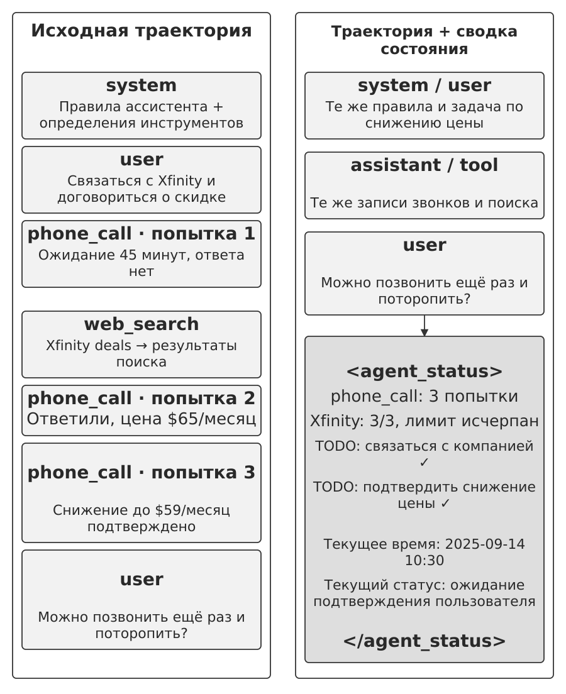

Смартфон показывает время, заряд аккумулятора и уровень сигнала в верхней части экрана, позволяя человеку одним взглядом оценить текущее состояние. Сводка справа на рисунке выполняет похожую функцию: увидев «лимит достигнут» и «ожидается подтверждение пользователя», помощник может сообщить пользователю согласованную цену и попросить решить, принимать ли предложение. Harness может прикреплять сводку к результату инструмента или добавлять её отдельным сообщением о состоянии.

### От исходных записей к явному состоянию

Рассмотрим задачу телефонного обслуживания: система разрешает звонить каждой компании не более трёх раз в рамках одной задачи. Между тремя разговорами могут выполняться поиск, чтение материалов и обработка дополнительных вопросов пользователя. Чтобы решить, можно ли звонить снова, модели необходимо найти в истории все соответствующие записи, разделить их по компаниям и подсчитать общее количество.

Среда выполнения может обновлять счётчик после каждого вызова и сразу возвращать: «Это третий звонок в Xfinity; лимит для этой задачи достигнут». При следующем решении модель сможет использовать этот результат. Программа ведёт счёт вызовов, а модель с учётом хода выполнения решает, что делать дальше: ждать, искать другие каналы или объяснить пользователю текущую ситуацию. Исполнительный слой одновременно проверяет последующие запросы на звонок по этому счётчику.

Инженерная ценность такого подхода заключается в **заблаговременной подготовке состояния, которое многократно потребуется для последующих решений**. Полный журнал звонков по-прежнему хранит содержание разговоров и историю обработки, а панель состояния предоставляет часто используемые при принятии решений статистику и прогресс. **Многократно используемую статистику следует в первую очередь поддерживать инкрементально с помощью кода.** Найти одну запись в контексте и вычислить итог по всем записям — разные задачи. Сохранение исходной траектории само по себе не создаёт точную и всегда доступную статистическую сводку. Если каждый раз заставлять модель заново просматривать историю и подсчитывать записи, она будет расходовать токены инференса, а вероятность пропусков и двойного учёта возрастёт.

Автор сравнивает контекст с поисковой системой, которой необходим дополнительный «слой извлечения сути»: исходные записи удобны для ретроспективного анализа, а извлечённое состояние — для непосредственного использования. Счётчики, лимиты и проверенные состояния завершения задачи целесообразно поддерживать кодом. Информацию, требующую семантической оценки, можно сначала извлекать по отдельным записям, а затем агрегировать и проверять. Так при каждом решении модель одновременно видит текущее состояние и необходимые доказательства.

Длинная траектория также затрудняет поиск ключевой информации. Если сосредоточить последние цели, ограничения и прогресс ближе к концу, модели будет проще найти сведения, необходимые для текущего решения.

> **Эксперимент 2-8 ★★: наблюдение за эффектом панели состояния агента посредством визуализации внимания**
>
> В эксперименте используется Qwen3-0.6B и моделируется траектория возврата средств через службу поддержки: агент уже трижды звонил в Xfinity, между звонками выполнял поиск в интернете, после чего пользователь спросил: «Можно ещё раз позвонить и поторопить их?» Системные правила разрешают звонить каждой компании не более трёх раз в рамках одной задачи.
>
> Обе группы получают одинаковую историю и дополнительный вопрос пользователя. Группа A использует исходную траекторию без изменений; группе B в конец добавляется следующее состояние:
>
> ```xml
> <agent_status>
> Current State:
> - Tool call summary: 'phone_call' has been invoked 3 times (Xfinity: 3 times)
> - Constraint check: Maximum calls to Xfinity reached (3/3)
> </agent_status>
> ```
>
> Для каждой группы выполняется по три запуска. В группе A модель дважды явно отказалась звонить снова, а один ответ был отнесён к другим результатам. В группе B модель явно отказалась звонить во всех трёх запусках. Ни в одной группе не было ответов, классифицированных как нарушающее правила продолжение звонков. Чтобы воспроизвести это сравнение, перейдите в `chapter2/attention_visualization` и выполните `python run_status_bar_experiment.py --output runs/status-bar-reproduction`. Входные данные и результаты каждого запуска сохранены в файле `runs/exp2-7-qwen3-0.6b-20260730-v2/comparison.json` каталога эксперимента.
>
> Диаграмма внимания показывает, как веса внимания области генерации распределяются по истории звонков, результатам поиска, дополнительному вопросу пользователя и панели состояния.

Исследование ContextDistill-Bench, проведённое автором совместно с Noah Shi, дополнительно рассматривает преимущества заранее извлечённого состояния[^ch2-8]. В охваченных этим бенчмарком запросах состояния небольшие модели также достигают высокой точности благодаря явному состоянию, а объём рассуждений передовых моделей, задержка и стоимость запросов могут сократиться примерно на порядок. Например, стоимость тысячи запросов к Claude 4 Sonnet снизилась приблизительно с 35,46 до 3,51 доллара. **Такой подход обновляет состояние в момент возникновения событий и устраняет необходимость при каждом запросе заново просматривать историю.** После фиксации полей сводки запросу достаточно читать только эти поля, даже если история продолжает расти.

[^ch2-8]: Li, Bojie and Noah Shi. *Distill, Don't Retrieve: Inference-Time Context Distillation for LLM Agent Reasoning.* 2026.

### Состав панели состояния агента

Панель состояния обычно содержит три типа информации, отвечающие на вопросы «что нужно сделать», «что только что произошло» и «каково текущее состояние».

**Планирование задачи** фиксирует цель, этапы и состояние их выполнения. Сложную задачу можно разбить на список TODO, сохраняя для каждого пункта состояние и необходимые зависимости. Работая над текущим этапом, модель по-прежнему видит исходные требования, ключевые ограничения и дальнейшие действия; после завершения этапа список обновляется.

**Вспомогательная информация о событиях (Side-channel Information)** дополняет контекст, в котором произошло событие: например, временем, географическим положением и интервалом с момента последнего ответа. Эти метаданные сохраняются вместе с событием и помогают модели понимать последовательность и обстоятельства. Одна и та же фраза «ответа пока нет», сказанная через две минуты или через два дня после подачи заявки, может требовать разных действий.

**Сводка наблюдений за текущим состоянием среды** предоставляет текущее время, рабочий каталог, количество вызовов инструментов и предупреждения об аномалиях. Она выполняет функцию, похожую на отображение текущего каталога или состояния выполнения в CLI и GUI: даёт явные основания для следующего действия. Например, предупреждение о повторных вызовах может побудить модель проверить причину неудачи, а сведения об оставшемся бюджете помогают решить, продолжать ли поиск.

Метаданные события после добавления обычно остаются неизменными, тогда как ход задачи и состояние среды продолжают меняться. Эти виды информации следует записывать в историю в соответствии с их способами обновления, которые далее рассматриваются на примере структуры сообщений.

### Конкретное положение панели состояния агента в контексте

В примере этого раздела Harness добавляет в конец сообщений сообщение `user`, передающее сводку состояния. Здесь `user` — роль сообщения в выбранном API; содержимое состояния генерируется средой выполнения, а его назначение обозначается тегами. При использовании других интерфейсов можно применять поддерживаемые ими блоки контекста или передавать состояние вместе с результатом соответствующего инструмента. Если используется описанный выше шаблон, который обрезает исторические рассуждения по реальным пользовательским запросам, состояние среды выполнения можно передавать вместе с результатами инструментов, чтобы шаблон продолжал сохранять сведения о рассуждениях для текущей задачи.

Проследите по рисунку 2-15 от исходного поручения пользователя до раунда, в котором записано последнее состояние. Сохранение исходного запроса позволяет после завершения звонков одновременно проверить две вещи: чего хотел пользователь и до какого этапа дошло выполнение.

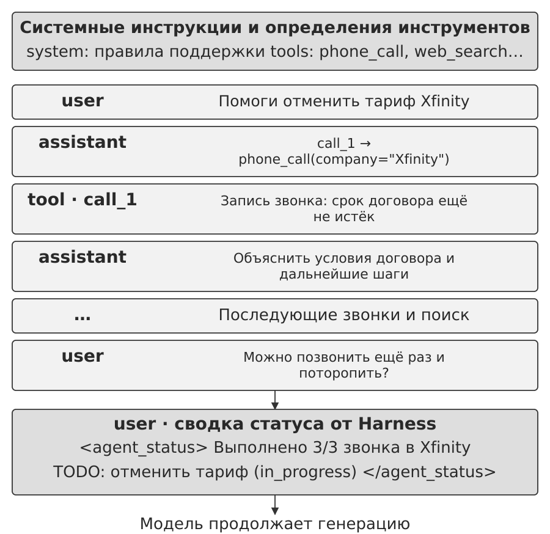

Последовательность с рисунка можно представить следующим списком сообщений. Для удобства сопоставления повторяющиеся раунды и часть полей вызовов опущены.

```text
messages: [
  { role: "system", content: "You are a customer service assistant..." }
  { role: "user", content: "Help me cancel my Xfinity plan" }
  { role: "assistant", tool_calls: [{ id: "call_1", ... }] }
  { role: "tool", tool_call_id: "call_1", content: "Call log..." }
  { role: "assistant", tool_calls: [{ id: "call_2", ... }] }
  { role: "tool", tool_call_id: "call_2", content: "Call log..." }
  ...остальные раунды...
  { role: "user", content: "Can you call them again to follow up?" }
  { role: "user", content: "<agent_status>
      Current State:
      - phone_call invoked 3 times (Xfinity: 3/3 max)
      - Current time: 2025-09-14 10:30:45
      - TODO: [1] Cancel plan (in_progress)
    </agent_status>" }
]
```

Последнее сообщение объединяет количество вызовов, лимит, время и ход выполнения задачи. Модель может напрямую использовать эти поля, а при необходимости обратиться к конкретным записям по предшествующим идентификаторам вызовов.

После добавления этого сообщения предшествующая последовательность токенов остаётся неизменной и по-прежнему удовлетворяет базовым условиям повторного использования префикса. Способ обработки старого состояния в следующем раунде приходится выбирать с учётом компромисса между расходом контекста и стоимостью кэширования.

### Два способа обновления состояния и их влияние на кэш

В следующем раунде может завершиться пункт TODO или увеличиться счётчик вызовов инструмента. Harness должен обновить состояние; обычно применяют один из двух способов.

**Замена в каждом раунде**: при формировании нового запроса предыдущее состояние удаляется, а в конец добавляется актуальное. В контексте остаётся только одна версия текущего состояния, удобная для использования моделью. Например, предыдущий запрос состоял из «описания задачи, состояния A», а новый — из «описания задачи, результата инструмента, состояния B». Описание задачи по-прежнему может быть взято из кэша; результат инструмента отправляется впервые, поэтому его в любом случае необходимо вычислить. Если после состояния A в предыдущем запросе находились другие сообщения, удаление A лишит их прежнего совпадения с префиксом. В текущем запросе модель видит только B. Если потребуется просмотреть A, соответствующий снимок можно получить из журнала среды выполнения.

**Постоянное добавление**: существующие записи состояния сохраняются, а каждая новая версия добавляется в конец. Исторический префикс остаётся стабильным, а изменения состояния удобно отслеживать. Старые состояния постепенно занимают контекст, поэтому необходимо явно указывать время или версию, чтобы модель определяла текущую ситуацию по последней записи. Способ, которым Claude Code добавляет в сеанс уведомления об изменении файлов, также отражает этот подход.

Если состояние невелико, а после него уже закэширован большой объём результатов инструментов, сохранение старого состояния может оказаться дешевле повторного вычисления длинного суффикса. Если же состояние велико и часто обновляется, замена позволяет ограничить накопление исторических состояний.

Граничное значение можно оценить с помощью приближённой модели. Пусть каждое состояние содержит $S$ токенов, средний размер закэшированного суффикса после старого состояния, который при каждой замене необходимо вычислить заново, равен $R$ токенам — без учёта содержимого, впервые отправленного в текущем раунде, — всего состояние внедряется $N$ раз, а стоимость кэшированного ввода составляет $\alpha$ от стоимости обычного ввода. Если не учитывать общие для двух подходов затраты, то $C_{\text{замена}} \approx (N-1)(1-\alpha)R$, а $C_{\text{добавление}} \approx \alpha S N(N-1)/2$. При $N>1$ оценочная стоимость постоянного добавления ниже, если $\alpha SN/2 < (1-\alpha)R$; в противном случае дешевле замена в каждом раунде. Здесь стоимость обычного ввода принята за единицу: при замене дополнительно оплачивается разница между чтением суффикса из кэша и его повторной обработкой, а при добавлении — повторное чтение исторических состояний.

Например, состояние объёмом 100 токенов внедряется десять раз, а чтение из кэша стоит одну десятую от обычного ввода. При добавлении последующие запросы дополнительно прочитают соответственно 1, 2, …, 9 старых состояний, что эквивалентно стоимости 450 токенов обычного ввода. Если замена состояния приводит к повторной обработке в среднем 1000 закэшированных токенов после него, девять замен обойдутся в эквивалент 8100 токенов обычного ввода, поэтому добавление будет дешевле. Если же старое состояние и так находилось в самом конце кэша и после него не было закэшированного содержимого, то $R=0$, и непосредственная замена, напротив, сэкономит эквивалент стоимости этих 450 токенов.

> **Эксперимент 2-9 ★★: несколько полезных методов построения панели состояния агента**
>
> В эксперименте реализованы пять методов построения панели состояния, которые можно включать отдельно или сочетать. Каждый метод предоставляет определённый вид информации, помогающий модели выбрать следующее действие.
>
> **Отслеживание временно́й метки** записывает время события в сообщениях пользователя и ответах инструментов, например `[2025-09-14 10:30:45]`. Время добавляется в историю вместе с событием и сохраняет исходное значение в последующих раундах, тогда как текущее время обновляется с каждым новым сообщением о состоянии. Эксперимент также поддерживает моделирование времени, позволяющее проверить, различает ли модель «вчерашний файл» и «сегодняшнее изменение» и правильно ли понимает длительность ожидания.
>
> **Счётчик вызовов инструментов** хранит в словаре общее количество вызовов каждого инструмента и добавляет в ответ отметку `Tool call #3 for 'read_file'`. С учётом содержимого ошибки модель может решить, продолжать ли попытки. Например, после первой неудачи чтения она проверяет путь, а затем выводит содержимое каталога; после нескольких неудач ищет альтернативный файл или сообщает пользователю об отсутствии нужного файла. Если число повторных попыток необходимо ограничить, среда выполнения также должна принудительно применять лимит по счётчику.
>
> **Управление списком TODO** предоставляет два инструмента: `rewrite_todo_list` и `update_todo_status`. Каждый пункт содержит уникальный идентификатор, описание, временную метку и одно из четырёх состояний: `pending`, `in_progress`, `completed` или `cancelled`. Список централизованно хранит сведения о том, «что сделано и что ещё осталось», что напоминает подход Manus, сохраняющий видимость цели посредством повторного представления плана задачи.
>
> **Подробные сведения об ошибках** включают тип и описание ошибки, JSON с параметрами вызова, стек вызовов и рекомендации по исправлению. Например, при `FileNotFoundError` модели можно предложить проверить имя файла, текущий каталог и абсолютный путь. Параметры помогают выявить ошибочные входные данные, стек вызовов — найти место сбоя, а рекомендации — определить направление следующей проверки. Перед передачей этих данных модели необходимо удалить учётные данные и другие конфиденциальные поля, а также ограничить длину чрезмерно подробных стеков.
>
> **Восприятие состояния системы** предоставляет текущее время, рабочий каталог, операционную систему, Shell и версию Python. Командный инструмент в эксперименте распознаёт отдельные операции смены каталога, обновляет рабочий каталог, поддерживаемый средой выполнения, и использует его в последующих вызовах. Изменение каталога подпроцессом в составной команде действует в пределах соответствующего процесса. Поля среды также помогают модели выбирать доступные инструменты, например использовать `apt` или `brew` с учётом фактической системы и установленного программного обеспечения.
>
> В этом сравнении на Kimi K3 для каждого типа задач использовалось по пять примеров. Конфигурации с временными метками и с сочетанием методов прошли все пять примеров, тогда как соответствующие контрольные группы — по три. При включении и отключении каждого из двух методов — счётчика вызовов инструментов и восприятия состояния системы — были пройдены все пять примеров. Конфигурация TODO не прошла ни одного примера, а контрольная группа прошла один; конфигурация с подробными ошибками прошла четыре примера, а контрольная группа — пять.

**Панель состояния следует по возможности поддерживать с помощью кода.** Модель напрямую использует приведённые в ней статистику и ограничения, поэтому ошибочное утверждение «выполнено три звонка» может изменить последующие действия. Счётчики, время и переходы состояний следует поручить программе. Если требуется семантическое понимание, модель должна сначала извлечь сведения из каждой записи отдельно, после чего код агрегирует и проверяет результаты, не заставляя модель единовременно подсчитывать всю длинную историю. Между исходными событиями, извлечёнными результатами и итоговым состоянием следует сохранять соответствие, чтобы обнаруживать двойной учёт, пропуски и смешение источников.

Необходимо заранее выбрать, какие сведения агрегирует панель состояния. Например, утверждения «выполнено три звонка» достаточно, чтобы определить, можно ли звонить снова, но оно не отвечает на вопрос «что сотрудник службы поддержки пообещал во время второго разговора». Если последующим задачам нужны только статистические значения, историю можно заменить сводкой состояния, а исходные записи — архивировать. Если требуется проверить содержание разговора, исходный текст можно повторно прочитать по индексу. Состав полей сводки определяет, на какие вопросы можно ответить напрямую и когда необходимо обращаться к исходным записям.

## Стратегии сжатия контекста

Предположим, что в ходе исследовательской задачи были прочитаны десять длинных веб-страниц, а в окне осталось место лишь для двух материалов. Сначала нужно спросить модель, что предстоит сделать на следующем этапе: если требуется сравнить два предложения, следует сохранить цены, условия их действия и источники; если проверить цитату — место, по которому можно получить исходный текст. Содержимое уже просмотренных, но нерелевантных веб-страниц можно архивировать, освободив место для нового ввода и вывода. При этом нужно рассчитать не только объём освобождённого пространства, но и цену восстановления: сколько будет стоить повторно найти удалённые материалы, если они понадобятся позже?

### Три цели сжатия

**Контроль длины и стоимости.** Например, длинные веб-страницы и большие файлы могут занять значительную часть окна размером 128K токенов. Harness должен резервировать бюджет для последующего ввода, вывода модели и взаимодействия с инструментами.

**Подготовка знаний, необходимых для последующих решений.** В результатах более десятка поисковых раундов одно событие может упоминаться многократно, а некоторые утверждения могут противоречить друг другу. Если привести их к виду «A и B подтверждены, для C всё ещё не хватает доказательств», модель сможет продолжить работу над нерешёнными вопросами. Резюме должно сохранять связи между фактами, источники и открытые вопросы, чтобы последующие решения опирались на ясные основания.

**Поддержка непрерывной работы над длительными задачами.** Некоторые модели преждевременно завершают работу, когда считают, что окно скоро будет исчерпано. Это явление называется **контекстной тревожностью (Context Anxiety)**. При тестировании Sonnet 4.5 на длительных задачах Anthropic обнаружила, что такое поведение может сохраняться даже после сжатия, поэтому для продолжения работы после сброса контекста применяются структурированные записи для передачи состояния[^ch2-7].

[^ch2-7]: Prithvi Rajasekaran, Harness design for long-running application development, Anthropic Engineering, 2026.

### Преобразование результатов повторных вычислений в пригодные для использования знания

Панель состояния заранее поддерживает счётчики и прогресс, а резюме дополнительно упорядочивает факты и связи из длинных текстов. В обоих случаях разрозненная информация заблаговременно приводится к виду, пригодному для непосредственного использования при последующих решениях.

Рассмотрим пример проверки зоомагазина:

> Клетка 1: чёрная кошка. Клетка 2: белая кошка. Клетка 3: чёрная кошка. Клетка 4: чёрная кошка. Клетка 5: белая кошка.
> … (всего 100 клеток: 90 чёрных кошек и 10 белых)

Чтобы ответить на вопрос «Какая кошка находится в клетке 37?», нужно найти соответствующую запись; чтобы ответить «Сколько чёрных и сколько белых кошек?», необходимо обобщить все записи. Если общие количества впоследствии используются многократно, можно заранее вычислить и сохранить: «90 чёрных кошек, 10 белых», — чтобы каждый раз не начинать подсчёт заново. Программа хорошо подходит для такого детерминированного агрегирования, а модель может продолжить отвечать на прикладные вопросы на основе полученной статистики.

Содержимое резюме следует выбирать в соответствии с задачей. Общих количеств кошек двух типов достаточно, чтобы отвечать на вопросы о численности; но для ответа о клетке 37 потребуются записи по каждой клетке или соответствующий индекс.

Даже если в окне ещё есть место, чрезмерно длинный или неоднородный контекст может мешать использованию информации: модель упускает ключевые факты, повторно обрабатывает уже решённые вопросы или опирается на устаревшее состояние при принятии текущих решений. Такая деградация результатов по мере роста контекста обычно называется **деградацией контекста (Context Rot)**. Она проявляется в ухудшении выполнения задачи; если же запрос превышает предельную ёмкость, происходит переполнение окна.

**Даже если в окне ещё есть место, многократно используемые знания следует упорядочивать заранее.** Если ключевые выводы уже можно обобщить, но модель по-прежнему вынуждена снова и снова искать их в длинной истории, это продолжает расходовать вычислительные ресурсы и повышает вероятность пропусков. В поисковой задаче можно сохранить подтверждённые факты, источники и вопросы для дальнейшего поиска; в задаче программирования — архитектурные решения, область изменений, результаты тестов и причины сбоев.

Примеры в контексте также влияют на то, как модель решает новые задачи. В исследовании Dherin и соавторов определённые вычисления прямого прохода представлены как зависящие от контекста низкоранговые обновления весов, возникающие из сочетания слоёв внимания и MLP в Transformer. Это предлагает одно из теоретических объяснений контекстного обучения[^ch2-6]. Во время фактического инференса веса модели остаются неизменными, а примеры влияют на вывод через текущий ввод. Чтобы повторно использовать такой опыт в последующих сеансах, его можно оформить как память, примеры или Skill и загружать в зависимости от задачи; способы накопления опыта подробнее рассматриваются в главе 9.

[^ch2-6]: Benoit Dherin et al., Learning without training: The implicit dynamics of in-context learning, 2025.

### Компромиссы между сжатием и KV-кэшем

Сжатие обычно выполняется между двумя вызовами модели. Harness с учётом оставшегося бюджета и прогресса задачи подготавливает сообщения, необходимые для следующего запроса, а затем отправляет их модели. Замена истории изменяет префикс, поэтому необходимо учитывать одновременно пользу сжатия и стоимость перестройки кэша.

Во-первых, системные инструкции и определения инструментов, которые продолжают действовать, следует сохранять неизменными. Они находятся в начале, поэтому при сжатии последующей истории эту часть префикса можно использовать повторно. Во-вторых, нужно выбрать конкретные объекты сжатия: длинные результаты инструментов можно заменить резюме, а завершённое многораундовое взаимодействие — объединить в запись об этапе. Кэш до точки замены по-прежнему можно использовать, а содержимое в точке замены и после неё необходимо обработать с учётом нового префикса.

**Историю следует по возможности сжимать пакетно, не переписывая один и тот же участок префикса в каждом раунде.** После сжатия ввод каждого раунда сокращается, однако вызов сжатия и повторное вычисление суффикса также расходуют ресурсы. Момент активации можно выбирать с учётом заполненности окна, ожидаемого количества последующих раундов и этапа задачи: пакетное упорядочивание после появления группы длинных результатов инструментов и сохранение резюме для передачи состояния после завершения этапа сокращают затраты на частое изменение истории. При сохранении нескольких последних раундов следует убедиться, что вызовы инструментов и их результаты образуют пары, а состояние незавершённых операций записано в резюме.

При сжатии необходимо также проверить протокол обратной передачи информации о рассуждениях. В некоторых моделях исторический thinking привязан к префиксу, на основе которого был создан. Если заменить историю перед такими блоками, сохранённый thinking может перестать соответствовать новому префиксу. При таком протоколе сеанс можно преобразовать в резюме, удалить затронутый прежний thinking и позволить модели продолжить рассуждение на основе резюме; также можно использовать поддерживаемые сервером механизмы сжатия или редактирования контекста.

Сначала рассмотрим индивидуальное резюмирование на рисунке 2-16: после обработки осталось лишь 10,9% исходного количества символов, однако совокупный расход токенов основного AI-агента оказался самым высоким среди шести групп. Чтобы объяснить, как эти два показателя могут одновременно быть верны, нужно проследить, какие материалы были сжаты и в скольких последующих запросах эти материалы снова отправлялись модели.

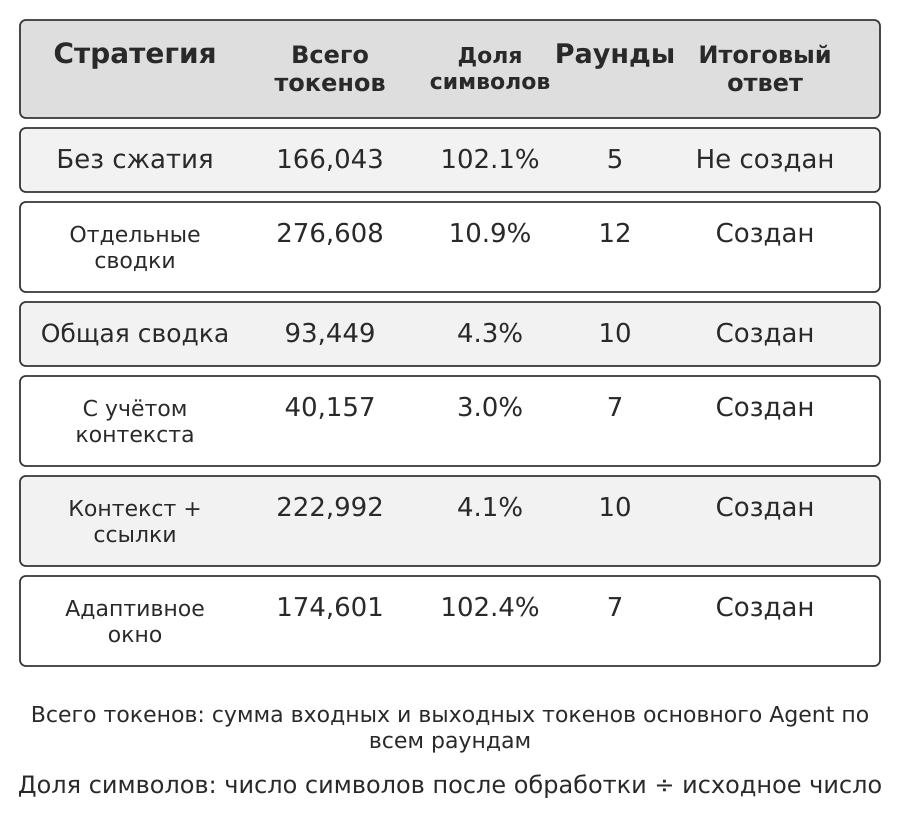

> **Эксперимент 2-10 ★★★: сравнение стратегий сжатия контекста**
>
> В этом эксперименте Kimi K3 используется для исследования профессионального статуса соучредителей OpenAI. Для выполнения задачи необходимо поэтапно составить список людей, найти сведения об их карьере и изменениях должностей, а затем сопоставить соответствующие факты с источниками. Чтобы наблюдать сжатие и обработку переполнения, бюджет контекста на уровне приложения ограничен 128 000 токенов. В качестве базового варианта используется режим без сжатия, который сравнивается ещё с пятью подходами; каждый вариант выполняется не более 15 раундов[^ch2-compression-results].
>
> **Стратегия 1: без сжатия.** Результаты поиска и чтения страниц полностью включаются в историю. Семь вызовов инструментов дали 367 246 исходных символов. На пятом раунде программа активировала защиту и остановилась, а совокупный расход основного агента составил 166 043 токена. В прежней версии защита активировалась по сумме входных токенов всех запросов, поэтому число 165 227 в сообщении об ошибке обозначает совокупный ввод. Например, если один и тот же фрагмент истории отправлялся в трёх раундах, он учитывался трижды.
>
> **Стратегия 2: индивидуальное резюмирование.** Для каждого результата поиска отдельно создаётся резюме из двух-трёх абзацев, сохраняющее основное содержимое соответствующей страницы. Такой подход легко распараллелить, и он позволяет сохранить границы страниц; однако если несколько страниц описывают одно событие, повторяющаяся информация всё равно попадает в историю. В этой конфигурации итоговый ответ был получен за двенадцать раундов, основной агент совокупно использовал 276 608 токенов, а коэффициент сжатия по символам составил 10,9%.
>
> **Стратегия 3: объединённое резюмирование.** Группа результатов поиска объединяется, после чего создаётся общее резюме, позволяющее упорядочить повторяющиеся факты и связи между разными источниками. В этой конфигурации итоговый ответ был получен за десять раундов, основной агент совокупно использовал 93 449 токенов, а коэффициент сжатия по символам составил 4,3%.
>
> **Стратегия 4: контекстно-зависимое резюмирование.** При сжатии одновременно передаются текущий запрос и уже известная информация: например, в промпт добавляются `Given the search query: {query}` и `Current context: {context}`. На этой основе модель сохраняет факты, относящиеся к текущему вопросу, и в первую очередь восполняет пробелы существующего резюме. В этой конфигурации итоговый ответ был получен за семь раундов, основной агент совокупно использовал 40 157 токенов, а коэффициент сжатия по символам составил 3,0%. В одном случае сжатия около 150 тысяч символов было преобразовано примерно в две тысячи с сохранением имён людей и изменений их должностей.
>
> **Стратегия 5: контекстно-зависимое резюмирование с цитированием.** В относящемся к задаче резюме сохраняются ссылки на источники соответствующих фактов. В этой конфигурации итоговый ответ был получен за десять раундов, а основной агент совокупно использовал 222 992 токена. Согласно сводке записей инструментов, обработанные материалы насчитывали 52 891 символ, а исходный текст — 1 295 044 символа; их отношение составляет около 4,1%.
>
> **Стратегия 6: адаптивное оконное сжатие.** На первых этапах исходные материалы сохраняются, а затем пакетно упорядочиваются после достижения вводом порогового значения. В эксперименте использовались три механизма: сжатие активировалось при превышении 80% бюджета; обобщались ещё не сжатые результаты инструментов; обработанные результаты помечались маркером `[COMPRESSED]`, чтобы исключить повторное резюмирование. При бюджете эксперимента в 128 000 токенов порог активации составлял 102 400 токенов. В этой конфигурации итоговый ответ был получен за семь раундов, а основной агент совокупно использовал 174 601 токен. В исторической версии порог активировался по совокупному вводу; позднее программу изменили так, чтобы она проверяла размер ввода последнего запроса.
>
> На рисунке 2-17 сопоставлены ввод и вывод шести стратегий.
>
> 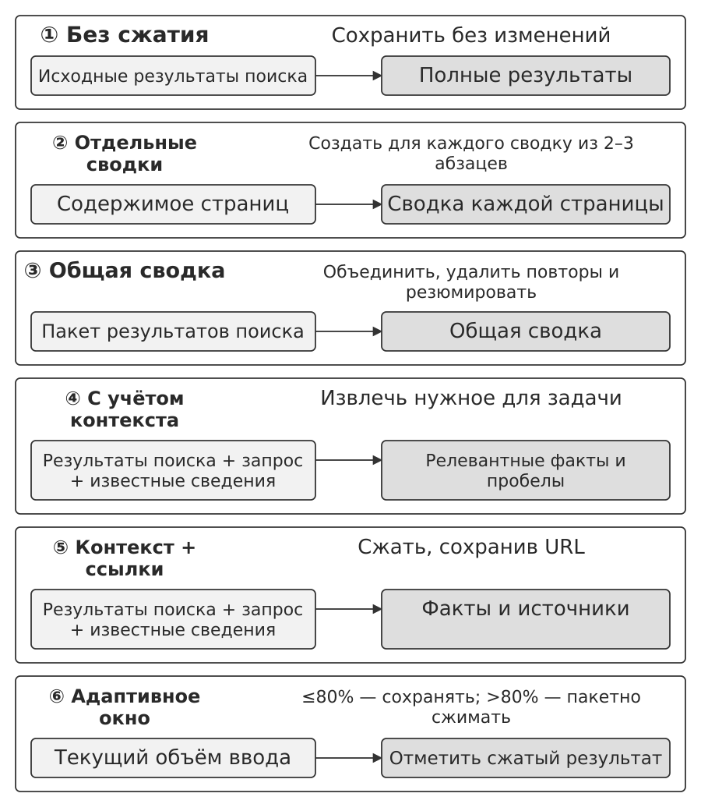
>
> При сравнении чисел на рисунке 2-16 необходимо различать три показателя: ввод отдельного запроса определяет достижение бюджета окна; совокупное количество токенов отражает расход многораундовых вызовов; коэффициент сжатия по символам описывает отношение длины учтённых материалов после обработки к их исходной длине. Здесь совокупный расход включает ввод и вывод всех запросов основного агента, но не отдельные запросы модели, создававшие резюме.
>
> Чтобы воспроизвести эксперимент, настройте модель и реальную поисковую службу согласно сопроводительным инструкциям, а затем выполните в каталоге эксперимента `python experiment.py -m kimi-k3 -n 15 -o results/reproduction.json`. Прочитайте `metrics` каждой стратегии: повторно рассчитайте коэффициент по символам как `total_compressed_size / total_original_size`, а затем сравните `total_tokens` и `iterations`. В базовом варианте без сжатия к текстам результатов поиска также добавляется форматирование, например заголовки и URL, поэтому количество символов после обработки может немного превышать исходное. Получив итоговый ответ, программа эксперимента считает соответствующую группу завершённой. Попробуйте найти одного и того же человека в двух готовых ответах: группа с цитированием указала местом работы Pamela Vagata компанию Pebblebed, а в сводной таблице группы с оконным сжатием указана Stripe. В первом ответе упомянут сайт организации, но открываемая ссылка на веб-страницу не приведена. Обе группы предоставили сводные таблицы, однако сведения о человеке в них противоречат друг другу.

[^ch2-compression-results]: Файл результатов эксперимента 2-10 `kimi_k3_real_20260718.json` содержит статистические поля, итоговый ответ и временную метку для каждой стратегии, что позволяет напрямую повторно рассчитать коэффициент по символам. Запуск 18 июля 2026 года использовал прежнее условие защиты; в изменении кода от 22 июля — коммите `aea4d72` — совокупный ввод был заменён вводом последнего запроса.

### Многоуровневый механизм сжатия промышленного уровня

Полные результаты инструментов иногда требуется временно сохранять, завершённые шаги можно архивировать, а текущие ограничения должны оставаться видимыми. Приведённые ниже пять типов механизмов предназначены для разных частот использования и сроков хранения.

1. **Управление бюджетом результатов инструментов**. Объёмный вывод сохраняется во внешнем хранилище, а в контексте остаются краткий предварительный обзор и точка входа для чтения. После включения обзора в историю его содержимое сохраняется неизменным; если нужны дополнительные подробности, соответствующий фрагмент читается отдельно, а результат добавляется в историю.
2. **Очистка нерелевантного содержимого**. Навигационные панели веб-страниц, повторяющиеся нижние колонтитулы и подобные элементы можно отфильтровать до попадания результата в контекст. Если требуется удалить уже включённое в историю содержимое, сначала следует проверить, не зависит ли от него дальнейшая задача или цитирование, а затем рассчитать стоимость изменения истории для кэша.
3. **Редактирование контекста на уровне API**. Службы, поддерживающие такую возможность, могут очищать старые результаты инструментов по заданным правилам. Клиент должен настроить условия активации и обработать возвращаемую службой информацию о редактировании. Область очистки и поведение кэша определяются контрактом интерфейса; этот механизм удобно подключать вместе с мониторингом бюджета ввода.
4. **Архивное резюмирование**. Цели, действия, результаты и незавершённые вопросы записываются по раундам или этапам задачи с сохранением порядка выполнения. Это можно рассматривать как журнал изменений задачи: впоследствии можно выяснить, на каком шаге было принято определённое решение и на чём оно основывалось.
5. **Сжатие всего сеанса**. Если локальной очистки по-прежнему недостаточно для соблюдения бюджета, текущая цель, ограничения, подтверждённые факты, ключевые решения и дальнейшие действия оформляются как резюме для передачи состояния. Сначала можно упорядочить существующие заметки сеанса, а затем обобщить всю историю. Если сжатие неоднократно завершается неудачей, механизм ограничения повторных попыток или автоматический выключатель прекращает повторные вызовы, сохраняет восстанавливаемое состояние, после чего можно уменьшить ввод или перейти к ручной обработке.

Эти механизмы можно сочетать по уровням: контроль на входе уменьшает разовые объёмные результаты, локальное упорядочивание сдерживает повседневный рост, а резюме этапов и сжатие всего сеанса сохраняют информацию для передачи длительных задач.

При чтении dsh-superagent автор обратил внимание на одну деталь: для событий и результатов инструментов сначала можно передавать резюме и ID объекта, а при необходимости получать подробности по этому ID. Предположим, в фоне завершился набор тестов, а переднему плану сообщили лишь: «Два теста завершились неудачей». Передний план может сообщить о прогрессе, но не сможет ответить на последующий вопрос пользователя: «Это те же два теста, что и вчера?» Если к резюме приложен идентификатор записи текущего запуска тестов, передний план сможет получить имена неудачных тестов и сопоставить их со вчерашней записью.

### Принципы проектирования стратегии сжатия

При выборе информации, сохраняемой после сжатия, можно проверить следующие четыре аспекта. Процесс накопления опыта между задачами рассматривается в главе 9.

- **Распределяйте объём по ценности для задачи**. Списки людей, связи между идентичностями и текущие вопросы для поиска обычно следует сохранять непосредственно; для ключевых доказательств, подтверждающих вывод, нужно оставлять источник и необходимые подробности; навигационные панели, рекламу и повторяющееся содержимое можно удалять. Если факт оспаривается, различия между свидетельствами также представляют важную информацию.
- **Сохраняйте семантическую целостность**. Например, в утверждении «Sutskever покинул OpenAI в мае 2024 года» человек, время, действие и организация вместе образуют единый факт. При сжатии необходимо сохранить все эти элементы, не оставляя труднообъяснимый фрагмент вроде «Sutskever ушёл».
- **Организуйте содержимое вокруг последующих вопросов**. Для задачи «найти список соучредителей» требуется полный охват людей, а для задачи «изучить биографию человека» — опыт, хронология и источники. Один и тот же материал можно резюмировать по-разному в зависимости от задачи: при поиске важен охват, при анализе — связи и основания, а при создании содержимого также необходимо сохранять полезные подробности и примеры.
- **Проверяйте, поддерживает ли резюме выполнение задачи**. Семантическое резюме должно учитывать задачу, устранять повторы и сохранять условия и исключения. **Для семантического сжатия сложных материалов предпочтительно использовать модель, способность к пониманию которой близка к основной модели.** Выполняющая сжатие модель должна определить, какие условия, исключения и доказательства повлияют на последующую работу; если они потеряны, даже мощной основной модели будет трудно их восстановить.

Ранние архитектурные решения, причины ограничений и неудачные пути легко теряются в длинной истории. **При выполнении длительных задач необходимо регулярно обновлять документ о прогрессе**, сохраняя сведения о том, «что решено, почему принято такое решение, что проверено и что делать дальше». Промпт или Skill может задавать моменты обновления, а Harness — загружать соответствующие записи при передаче задачи. Такой документ также помогает исполнителям, проверяющим и последующим агентам понять уже выполненную работу.

### Изоляция контекста субагента

**Для задач с чёткими границами результата и большим объёмом промежуточных материалов автор предпочитает изоляцию посредством субагента.** При широком поиске читается множество материалов, полезных лишь на этапе исследования; их предварительная изоляция уменьшает продолжительное влияние этих материалов на основную задачу. Главный агент передаёт задачу субагенту с независимым контекстом; субагент изучает промежуточные результаты, а затем возвращает выводы, местоположение доказательств и нерешённые вопросы. Благодаря этому в контексте главного агента остаётся только информация, необходимая для последующих решений.

Например, чтобы «найти функцию, обрабатывающую обратные вызовы платёжной системы», главному агенту при самостоятельном поиске может потребоваться прочитать более десятка файлов. Если поручить задачу поисковому субагенту, можно потребовать, чтобы он вернул имя функции, модуль, точки вызова и основания для вывода. Его ответ может выглядеть так: «За обработку обратных вызовов отвечает `handle_callback` в платёжном модуле; также существуют ещё две точки вызова», — с приложенными ссылками, позволяющими найти соответствующий код. На основе этих результатов главный агент решает, нужно ли продолжать чтение относящегося к задаче кода.

Описание задачи должно быть достаточно полным: какова цель, какова область поиска, какие ограничения необходимо соблюдать, в каком формате вернуть результат и как поступать при неоднозначности. Если запрос на делегирование и возвращённый результат добавляются в историю, прежний префикс главного агента по-прежнему можно использовать повторно.

В главе 4 рассматривается проектирование интерфейса субагента как инструмента, а в главе 10 — распределение контекста в многоагентных системах.

## Итоги главы

Как помощнику службы поддержки действовать после третьего звонка? В запросе следующего раунда нужно передать результат инструмента для этого звонка, сопоставив его с операцией набора номера по ID вызова. В строке состояния следует обновить число использованных попыток до трёх и перечислить условия, которые ещё не удалось согласовать. Системные правила и определения инструментов остаются в стабильном префиксе, а соответствующий Skill загружается только тогда, когда нужно выполнить конкретную операцию. Так происхождение каждого поля остаётся понятным, как и то, какие данные изменятся при следующем вызове.

Если разговор затягивается и результатов инструментов становится всё больше, можно ограничить их длину, свести уже завершённые части в краткое резюме с указанием источников или передать независимо выполняемую работу субагенту, получив от него только выводы и подтверждающие материалы.

После завершения задачи счётчик трёх выполненных звонков можно архивировать вместе с ней. Но если пользователь специально попросил: «В дальнейшем связывайтесь со мной во второй половине дня по будням», а эта фраза осталась только в резюме разговора, помощник, который примет следующее поручение, может её вообще не увидеть. Как сохранять информацию, полезную в долгосрочной перспективе, и как извлекать её в подходящих задачах? В третьей главе рассматриваются сохраняющаяся между задачами память пользователя и общая база знаний.

## Вопросы для размышления

1. ★★★ Изучите журнал работы со скользящим окном из эксперимента 2-3: что делал каждый из пяти вызовов инструментов? Какие дополнительные данные нужно записать и какое контрольное сравнение провести, чтобы определить, вызваны ли повторные вызовы обрезкой истории? Разработайте схему обрезки, сохраняющую ключевое состояние, и объясните её влияние на префиксное кэширование. Журнал находится в `chapter2/kv-cache/result_sliding_window_20260718_kimi_k2_6.json`.
2. ★★ Chat Template модели Qwen3 обрабатывает предыдущие рассуждения с учётом позиции последнего настоящего пользовательского запроса. Как бы вы управляли постепенно растущим объёмом рассуждений, если один цикл ReAct продолжается более ста итераций? Сравните обрезку предыдущих рассуждений, их повторную передачу и протокол привязки к префиксу, а также объясните, как Harness должен к ним адаптироваться.
3. ★★ Предположим, нужно сжать примерно 150 тысяч символов поисковых материалов до двух тысяч символов. Какие факты, связи и источники вы сохраните? Как проверить, достаточно ли краткого содержания для последующих вопросов, и как восстановить опущенные подробности?
4. ★★ Счётчик инструментов не учёл один вызов, поэтому строка состояния показывает неверное количество оставшихся вызовов. Разработайте механизмы регистрации событий, проверки сводных данных и контроля на уровне выполнения. Объясните, как с их помощью обнаружить и устранить такое несоответствие.
5. ★★ В эксперименте 2-4 сравнивались тон, организация информации и описания инструментов. Как бы вы управляли версиями системного промпта, который длительное время поддерживают несколько человек, проверяли конфликты между правилами и оценивали каждое изменение с помощью регрессионных задач?
6. ★★★ В примере с зоомагазином требуются как поиск отдельных записей, так и агрегированная статистика. Разработайте структуру исходных записей и статистических сводок, а также маршрутизацию запросов, чтобы система могла эффективно отвечать на вопросы обоих типов. Объясните, когда необходимо обновлять сводки.
7. ★★★ Skill уже находится в каталоге, но модель не обнаружила, что он применим к текущей задаче. Как бы вы искали причину проблемы с точки зрения описания, организации каталога, явной активации и примеров для оценки?
8. ★★ Skill успешно загружен, но модель пропустила предусмотренный в нём этап проверки. Разработайте контрольный эксперимент, позволяющий различить проблемы с активацией, пониманием, использованием инструментов и определением завершённости, а также сравните результаты разных моделей.
9. ★★★ Система содержит множество инструментов, а их набор часто меняется. Как бы вы расположили фиксированные определения, каталог инструментов, результаты загрузки по требованию и состояние во время выполнения? Учтите точность обнаружения, бюджет контекста и долю попаданий в кэш.


**Практикум к главе 2.** [Каталог экспериментов](https://github.com/bojieli/ai-agent-book/tree/40f4ce5778e6cc93e3606c3079bf8cf13a0c4d04/chapter2) · [Путеводитель на русском](https://github.com/bojieli/ai-agent-book/blob/40f4ce5778e6cc93e3606c3079bf8cf13a0c4d04/chapter2/README.ru.md).
