<!-- Русский перевод: community edition. Источник: https://github.com/bojieli/ai-agent-book; файл изменён относительно upstream. -->

# Память пользователя и база знаний

Если на прошлой неделе пользователь сообщил помощнику, что предпочитает места у окна, а сегодня сказал лишь: «Забронируй ещё один билет до Токио», — откуда взять сведения о его прежнем предпочтении для выполнения нового запроса? А если вчера авиакомпания изменила правила провоза багажа, где найти новые условия? В предыдущей главе рассматривалась организация контекста одной задачи. В этой главе мы разберём, откуда извлекать сказанное пользователем, где искать новые правила авиакомпании и когда следует обновлять каждый из этих двух видов данных.

**Память пользователя** организует сведения вокруг конкретного пользователя: его предпочтения, привычки, потребности и опыт. Благодаря ей AI-агент в последующих сеансах продолжает обслуживать пользователя с учётом его особенностей. **База знаний**, напротив, доступна нескольким пользователям в пределах определённых прав доступа: например, она может содержать отраслевые нормативные требования, рабочие процессы компании и техническую документацию. Память помогает агенту понимать, кого он обслуживает, а база знаний предоставляет предметные знания, необходимые для выполнения задачи.

Обе системы должны решать, как сохранять информацию и находить её при необходимости. Обе сталкиваются с противоречиями между фактами, устареванием содержимого и пропусками при поиске. Такие технологии, как векторный поиск, структурированные индексы и сжатие знаний, применимы к системам обоих типов. На рисунке 3-1 показана структура главы: сначала рассматриваются представление памяти пользователя и управление ею, затем — генерация с дополнением данными из поиска (RAG), а в завершение методы поиска применяются к памяти между сеансами и более сложной организации знаний.

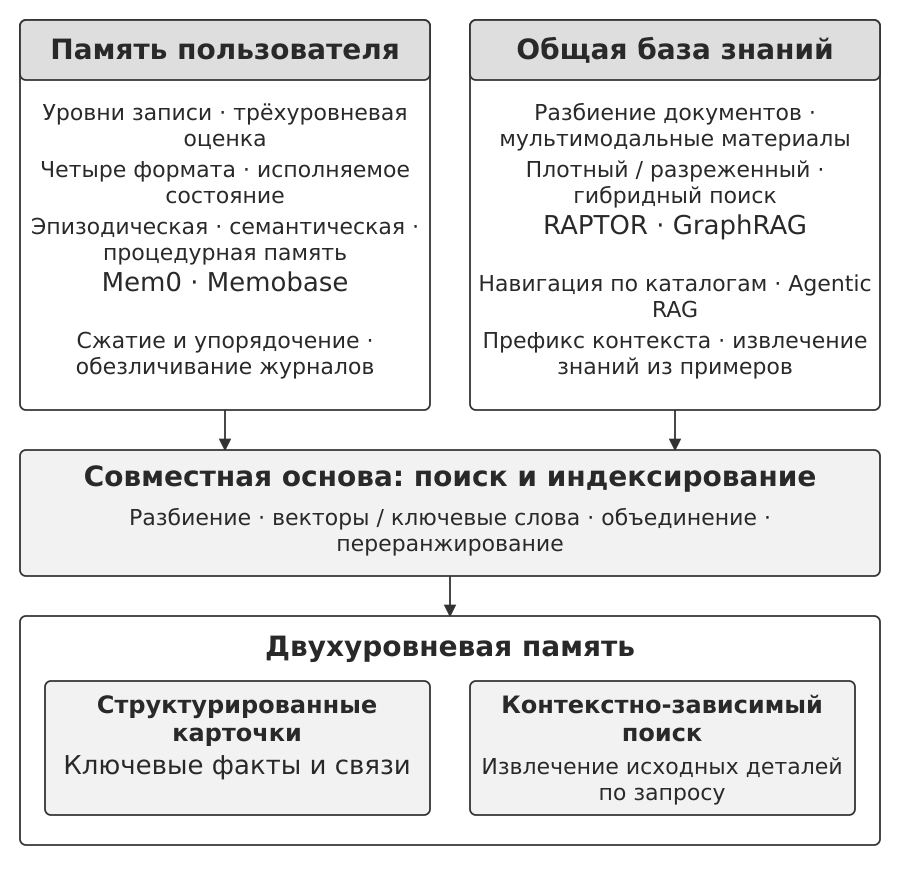

## Система памяти пользователя

Разберём фразу: «На следующей неделе я буду за границей, поэтому банковские документы пришлите по электронной почте». Пользователь сообщил о поездке с определённым сроком и указал способ получения документов на время этой поездки. Если банк предложит отправить документы обычной почтой, ассистент сможет на основании этой информации запросить электронную доставку. Когда поездка закончится, при следующем вопросе об отправке письма потребуется заново проверить текущие условия. Если сохранить лишь запись «пользователь не любит бумажные письма», в будущем эта информация найдётся в памяти, но будет применена за пределами нужного контекста.

Рассмотрим также авиабилеты. Если пользователь скажет: «В прошлый раз билет за 1250 оказался дороже, чем я ожидал», система может сохранить как минимум предложенную тогда цену, имевшийся бюджет, обстоятельства поездки и эту обратную связь. В следующий раз в похожей ситуации модель будет осторожнее с предложениями, превышающими бюджет. Если пользователь отдельно уточнит: «В дальнейшем при семейных поездках всегда сначала спрашивайте меня», это задаст явное условие для всех будущих семейных поездок. Таким образом, можно различить три вида информации: что именно сказал пользователь, при каких условиях это произошло и какие выводы модель сделала из этого случая.

В конце сеанса можно поручить LLM упорядочить эти записи и сохранить факты, которые могут пригодиться в дальнейшем, в постоянном хранилище. При начале новой задачи в контекст следует добавлять только относящиеся к ней и по-прежнему применимые записи.

Например, при бронировании авиабилета пользователь предоставил следующую информацию:

```text
Пользователь: Помогите мне забронировать билет до Токио на следующую пятницу.
              Я предпочитаю места у окна и придерживаюсь вегетарианской диеты,
              поэтому мне понадобится специальное питание.
Агент: Я поищу рейсы до Токио на следующую пятницу...
       [вызывает инструмент flight_search, получает 3 варианта]
Агент: Вот доступные варианты. С учётом ваших предпочтений я отобрал рейсы,
       где доступны места у окна. Забронировать прямой рейс ANA?
Пользователь: Да, и укажите мой номер United MileagePlus: 12345678.
```

После завершения сеанса модуль извлечения записей для памяти может сформировать четыре записи:

```text
Извлечённые записи для памяти:
- Пользователь предпочитает места у окна (предпочтение)
- Пользователь придерживается вегетарианской диеты и нуждается в специальном питании на рейсах (ограничение питания)
- Номер пользователя в программе United MileagePlus: 12345678 (программа лояльности)
- Пользователь планирует поездку в Токио (недавняя активность)
```

Этот пример включает три операции. **Избирательное извлечение** сохраняет предпочтение места, требования к питанию и номер участника программы лояльности, отбрасывая временные подробности вроде «поиск вернул три варианта». **Абстрагирование** преобразует явно выраженное предпочтение места у окна в правило, пригодное для будущих бронирований. **Структурирование** присваивает фактам категории, упрощая их поиск и обновление. Для поездки в Токио следует также сохранить дату отправления и текущее состояние; выражение «следующая пятница» необходимо преобразовать с учётом даты сеанса, а после завершения или отмены поездки — обновить состояние. Так долгосрочные предпочтения и недавнюю активность можно поддерживать с учётом их разных сроков действия.

В описании персонального ассистента Today приводился следующий пример. Пользователь сообщил, что тренируется каждый вторник и четверг, готовясь к полумарафону. Шесть недель спустя подключённые с разрешения пользователя данные о сне показали, что минувшей ночью он спал очень мало. Ассистент сопоставил эти сведения и предложил перенести запланированную на этот день высокоинтенсивную интервальную тренировку. Как долго следует хранить такую информацию? План тренировок актуален на всём протяжении подготовки к забегу, а запись о сне за минувшую ночь должна содержать дату. Даже если пользователь согласится перенести эту тренировку, в следующий четверг она по-прежнему должна пройти по исходному расписанию, если пользователь не попросит изменить его и в дальнейшем. Today также разделяет предложение и изменение календаря на два этапа: для второго требуется подтверждение пользователя.[^ch3-today]

[^ch3-today]: Команда Today в статье «Что такое Today» на примере подготовки к полумарафону объясняет, как память сочетается с актуальной информацией за текущий день. В статье «Знакомство с Today» основатель объясняет механизм подтверждения перед изменением календаря.

### Оценка памяти: трёхуровневая система

Открытый бенчмарк **LoCoMo** (Long-term Conversational Memory, долговременная память диалогов) содержит длинные диалоги, в среднем состоящие примерно из 300 реплик и охватывающие до 35 сеансов. Память оценивается с помощью вопросов и ответов, составления сводок событий и генерации мультимодальных диалогов. Вопросы делятся на пять категорий. Ответ на одношаговый вопрос можно найти в одном сеансе, а для многошагового требуется объединить сведения из нескольких сеансов. Вопросы на временно́е рассуждение дополнительно требуют определить последовательность событий. Вопросы на знания из открытого домена предполагают объединение высказываний пользователя с внешними знаниями. Вернёмся к примеру с бронированием билетов: пользователь сообщил лишь, что «на следующей неделе едет в Токио». Чтобы ответить на вопрос «какая валюта используется в месте назначения», необходимо и помнить о Токио, и знать, что там используют иены. Если же спрашивается номер рейса, который пользователь никогда не называл, помощник должен указать на недостаток информации. Способность распознавать такие вопросы, на которые невозможно дать обоснованный ответ, проверяется состязательными заданиями.[^ch3-locomo]

[^ch3-locomo]: Определения пяти категорий вопросов и ответов приведены в разделе 4.1 статьи Maharana и соавторов о LoCoMo (arXiv:2402.17753). Данные и примеры диалогов доступны на странице проекта авторов.

Опираясь на подобные бенчмарки и практический опыт создания продуктов с памятью, автор выделяет восемь способностей, которым необходимо уделять внимание:

- **Сохранение персональных данных**: точное сохранение и извлечение долговременной информации, например сведений о личности пользователя.
- **Отслеживание предпочтений**: фиксация предпочтений пользователя и их обновление при появлении новых явно выраженных пожеланий.
- **Переключение контекста**: продолжение работы с релевантной исходной информацией после смены темы.
- **Обновление памяти**: обработка дополнений и исправлений пользователя к ранее сохранённым фактам.
- **Непрерывность между сеансами**: использование ранее сохранённой информации в новом сеансе.
- **Сложные рассуждения**: связывание нескольких фрагментов памяти. Например, если пользователь ранее упоминал об аллергии на арахис, при обсуждении тайской кухни следует учесть это и напомнить о необходимости проверить состав блюд.
- **Восприятие времени**: сохранение дат, интерпретация относительных указаний времени и вычисление интервалов между событиями.
- **Разрешение противоречий**: обнаружение несогласованной информации и принятие решения с учётом источника, времени и объекта, к которому она относится.

Для практических задач AI-агента в этой книге дополнительно применяется трёхуровневая система оценки. В экспериментах 3-1 и 3-2 с её помощью сначала сравниваются представления памяти, а в экспериментах 3-9 и 3-11 по той же системе оцениваются методы поиска.

**Первый уровень: базовое воспроизведение.** Точное сохранение и извлечение явно сформулированной информации, непосредственно предоставленной пользователем. Например, если пользователь сказал: «Мой номер участника программы — 12345», при последующем бронировании билета система должна вернуть номер полностью. На этом уровне главным образом проверяется, не была ли информация потеряна, перепутана или искажена.

**Второй уровень: поиск по нескольким сеансам.** Необходимо найти всю релевантную информацию в относящихся к разным периодам и объектам сеансах, а затем определить, кого касается текущий запрос и какие записи нужны. Если у пользователя две машины, но он просит лишь «записать мою машину на техническое обслуживание», система должна сначала извлечь информацию об обеих машинах и уточнить, о какой из них идёт речь. При запросе статуса кредита необходимо отличить действующий договор от предложения, полученного во время прошлой консультации. При отмене «поездки в Лос-Анджелес» требуется связать билеты, гостиницу и другие бронирования с одной и той же поездкой.

**Третий уровень: проактивное обслуживание.** Исходя из текущей задачи, необходимо выявить связанные с ней обстоятельства, которые пользователь не перечислил явно. Например, при бронировании международного рейса следует найти сохранённые несколько месяцев назад паспортные данные и проверить, достаточен ли срок действия паспорта для поездки. Если сломался телефон, нужно собрать сведения о гарантии на устройство, дополнительной гарантии по кредитной карте и страховке оператора, а затем перечислить доступные варианты действий. При подготовке документов для налоговой декларации — найти среди записей за весь год сведения об операциях с акциями, доходах от внештатной работы и документы по налогу на недвижимость.

> **Эксперимент 3-1 ★: оценка системы памяти по трёхуровневой системе**
>
> Набор для оценки содержит по 20 примеров на каждом уровне — всего 60. На первом уровне преимущественно используются одиночные сеансы. Второй и третий уровни включают несколько разнесённых во времени сеансов, относящихся к разным объектам, и проверяют связывание сущностей, обновление информации и проактивные напоминания.
>
> Каждый пример выполняется в два этапа. Сначала диалоги подаются последовательно: модель формирует память по первому фрагменту, а при каждой последующей итерации получает только существующую память и новый фрагмент диалога, после чего создаёт обновлённую память. Затем исходный текст предыдущих диалогов становится недоступен модели, поэтому для ответа на обсуждавшиеся в них вопросы она может использовать только сведения, записанные в память. После обработки всех диалогов модели задаётся новый вопрос, на который агент должен ответить с помощью памяти.
>
> Для оценки применяется LLM-as-a-judge: независимая модель-судья сопоставляет ответ с эталоном и критериями оценивания, проверяя полноту охвата фактов и наличие ошибок. В этом запуске Doubao Seed 1.6 использовалась для формирования памяти и ответов, а модель Moonshot — для выставления оценок. Модель-судья видит исходный диалог, тогда как отвечающей модели доступна только память, сохранившаяся в конце.
>
> Как читать ведомость результатов? Например, пользователь хочет лишь найти номер учётной записи для услуги широкополосного доступа. В группе с расширенными заметками помощник назвал правильный номер. Модель-судья выставила по 4 балла за точность, полноту и рассуждение, но только 1 балл за проактивность — и всё же задание было пройдено. Согласно заданному в программе условию, для прохождения необходимо получить не менее 3 из 4 баллов по каждому из первых трёх критериев, а модель-судья не должна обнаружить существенных фактов, не имеющих оснований или противоречащих исходным высказываниям. Проактивность учитывается в совокупной оценке, поэтому одно лишь количество пройденных заданий не показывает, насколько проактивно помощник оказывал помощь.

### Иерархия памяти

Чтобы ответить на вопрос «Какой рейс был забронирован в прошлый раз?», нужно найти отдельное событие; чтобы ответить на вопрос «Какое место выбирать в первую очередь при бронировании билета?», нужно извлечь предпочтение, сохранённое по результатам нескольких взаимодействий. Оба вопроса относятся к одному человеку, но требуют разной гранулярности записей и разных способов поиска.

**Траектория (trajectory)** в хронологическом порядке фиксирует события одного запуска AI-агента, включая сообщения пользователя, ответы модели, вызовы инструментов и результаты их выполнения. При использовании журнала событий, доступного только для добавления (append-only), новые события дописываются в конец, а исходные записи сохраняются для последующего отслеживания. Harness может выбирать из траектории историю, извлекать состояние или формировать обобщение, создавая контекст, который фактически отправляется модели при каждом ходе.

**Долговременная пользовательская память** сохраняет полезную между сеансами информацию, такую как предпочтения, отношения между людьми, обобщения предыдущих действий и подтверждённые факты, и закрепляет её принадлежность с помощью ID пользователя и других идентификаторов. Новые формулировки могут дополнять, исправлять или заменять старые записи, поэтому долговременную память необходимо объединять и обновлять. Агент может явно читать и обслуживать её посредством вызовов инструментов, либо Harness может запускать эти операции при загрузке или завершении сеанса, а также во время фонового упорядочивания.

**Бизнес-состояние** описывает логический этап задачи, например «требуется уточнение», «в обработке», «ожидание оплаты» или «выполнено». Программа может проверять эти состояния, чтобы определить, какого события ожидать дальше и какую операцию выполнить. Управление состоянием в событийно-ориентированной архитектуре будет подробнее рассмотрено в шестой главе.

Эти три типа записей могут работать совместно: траектория служит основанием для выполнения, долговременная память предоставляет контекст между сеансами, а бизнес-состояние показывает, до какого этапа дошло выполнение текущей задачи. Далее основное внимание будет уделено представлению, управлению и поиску в долговременной памяти.

### Четыре формата хранения пользовательской памяти

Если нужно изменить только адрес электронной почты, лучше иметь возможность сразу найти соответствующую запись. Если же требуется понять, почему адрес когда-то изменили, необходимо прочитать предысторию. В левой верхней части рисунка 3-2 электронная почта, компания и должность хранятся в отдельных записях, а в правой верхней части должность, команда и проект записаны вместе. Теперь рассмотрим две нижние карточки: в каком поле следует искать информацию, чтобы в будущем обновить должность или выяснить, кто именно посещал кардиолога?

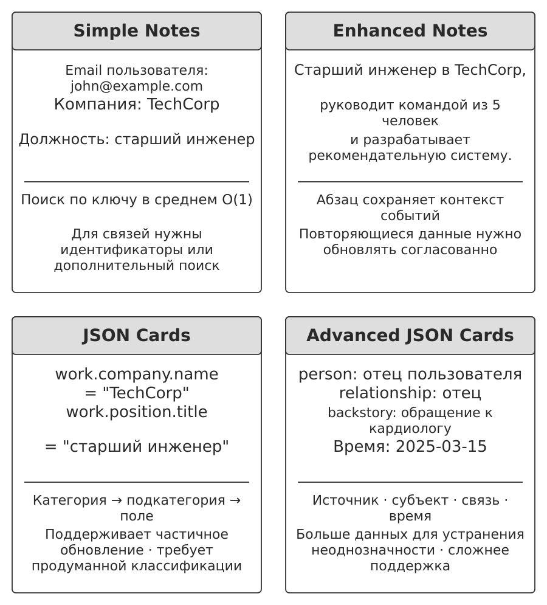

**Simple Notes** сохраняют каждое воспоминание как краткий факт, например: «Электронная почта пользователя: john@example.com». Отдельные записи легко читать и записывать. Если для поиска по стабильному ключу используется хеш-таблица, средняя временная сложность поиска и обновления обычно составляет O(1). Для семантического поиска по большому количеству заметок дополнительно требуется поисковый индекс. Однако чрезмерное дробление приводит к утрате связей. Если запись «Работает старшим инженером в TechCorp и отвечает за разработку рекомендательной системы» разделить на три не связанные между собой записи — о компании, должности и проекте, — впоследствии придётся заново определять, относятся ли они к одному месту работы.

**Enhanced Notes** сохраняют факты вместе с их контекстом в виде полных абзацев. Например: «Пользователь работает старшим инженером-программистом в TechCorp, уже три года занимается машинным обучением и сейчас руководит проектом рекомендательной системы с командой из пяти человек». Связи между компанией, должностью, опытом и командой сохраняются в одном абзаце. Недостаток этого подхода состоит в том, что отдельные факты могут повторяться в нескольких абзацах. После смены должности необходимо найти и обновить все связанные абзацы, чтобы новые и устаревшие записи не существовали одновременно.

**JSON Cards** организуют информацию по схеме «категория — подкатегория — пары ключ-значение», например `personal.contact.email` и `work.position.title`. При изменении поля должности можно сохранить без изменений другие поля, такие как `work.company.name`, поэтому этот формат удобен для локальных обновлений. При проектировании категорий необходимо также учитывать информацию, относящуюся сразу к нескольким из них. Например, запись «По выходным разрабатывает личный проект на Python» одновременно связана со временем, техническими предпочтениями и деятельностью. Можно сохранить одну запись о деятельности и добавить к ней несколько тегов либо связать соответствующие категории ссылками, сохранив эти отношения.

**Advanced JSON Cards** дополняют факты контекстом источника `backstory`, субъектом `person`, отношением к пользователю `relationship` и временной меткой. Эти поля помогают системе определить, к кому относится информация, когда она была получена и в каких ситуациях применима. Например, «доктор Чжан» может быть стоматологом пользователя или кардиологом его отца. Если вместе с именем сохранить пациента, родственную связь и медицинскую специальность, вероятность путаницы снизится.

Когда пользователь говорит: «Помоги запланировать ежегодный медицинский осмотр для членов моей семьи», система может найти родственников по полям `person` и `relationship`, а затем прочитать связанные сведения из `backstory`. Чем больше полей, тем больше связей необходимо обрабатывать при извлечении и обновлении. Автор рекомендует сочетать разные форматы хранения с учётом важности информации и потребности в связях: для ключевых людей, договоров и долгосрочных предпочтений использовать Advanced JSON Cards, сохраняя источник и отношения, а для многочисленных простых фактов с небольшим количеством связей — Simple Notes, снижая затраты на извлечение и сопровождение. Записи двух типов связываются идентификаторами или ссылками и при необходимости извлекаются вместе.

> **Эксперимент 3-2 ★★: сравнение четырёх форматов памяти**
>
> Сопутствующая реализация предоставляет единый интерфейс создания, обновления и извлечения воспоминаний для всех четырёх форматов. Итоговые ответы сравниваются на том же наборе из 60 примеров, что и в эксперименте 3-1.
>
> В этом запуске Simple Notes, Enhanced Notes, JSON Cards и Advanced JSON Cards прошли соответственно 48, 52, 51 и 49 примеров. На втором уровне Enhanced Notes прошли 16 примеров, а Advanced JSON Cards — 12; на третьем уровне оба формата прошли по 19 примеров. С учётом сопровождения памяти, формирования ответов и оценивания Enhanced Notes потребовали около 990 тысяч токенов, а Advanced JSON Cards — около 1,55 миллиона токенов; среднее время вызова модели у последнего формата также оказалось больше.
>
> Рассмотрим в качестве примера задачу второго уровня о подписках на стриминговые сервисы. Пользователь хочет сократить расходы и спрашивает, на какие сервисы он подписан и сколько стоит каждый из них. Группа Enhanced Notes перечислила ежемесячную стоимость Netflix, Disney+ и Max: 22,99, 19,99 и 19,99 доллара соответственно. Группа Advanced JSON Cards сообщила только стоимость Max, дополнительно перечислив два более дешёвых тарифа этого сервиса. Какими бы конкретными ни были рекомендации, они не восполнят сведения о двух других счетах.
>
> После какого обновления возникла проблема? Если просмотреть воспоминания, последовательно сохранённые группой Advanced JSON Cards, то после первого диалога среди них ещё присутствует Netflix, после второго остаются только записи, связанные с Disney+, а после третьего — только с Max. К моменту вопроса сведения о первых двух подписках уже исчезли из памяти.

### Расширенная форма представления знаний: исполняемый код

После сохранения фактов необходимо также вычислять сводную статистику, проверять конфликты и определять следующий шаг по бизнес-правилам. В проекте **User as Code** (UaC) автор попытался организовать информацию о пользователе в виде типизированных объектов Python, а операции над ней оформить как функции[^uac]. Модель извлекает факты из диалога, а программа выполняет чётко определённые вычисления.

Для сравнения дат, суммирования денежных значений и проверки явных бизнес-ограничений автор предпочитает оформлять вычисления как функции, чтобы один и тот же набор фактов давал воспроизводимые и тестируемые результаты. Благодаря этому модель может сосредоточиться на понимании смысла, не тратя силы на повторные вычисления в уме и сверку правил в длинном диалоге; представление и использование памяти также можно проверять в рамках одной кодовой базы.

UaC использует двухэтапный процесс: сначала извлечённые факты добавляются в журнал, а затем периодически создаётся контрольная точка, восстанавливающая из журнала типизированное состояние. Журнал сохраняет источники фактов и историю их изменений, а объект состояния предоставляет актуальные поля для запросов.

Например, состояние с данными паспорта и поездок можно определить так:

```python
from dataclasses import dataclass
from datetime import date

@dataclass
class PassportInfo:
    number: str
    country: str
    expiry_date: date

@dataclass
class Trip:
    destination: str
    departure_date: date
    is_international: bool

@dataclass
class UserState:
    passport: PassportInfo
    trips: list[Trip]

state = UserState(
    passport=PassportInfo("AB1234567", "US", date(2025, 2, 18)),
    trips=[
        Trip("Tokyo", date(2025, 1, 15), True),
        Trip("Paris", date(2025, 6, 10), True),
    ],
)
```

**Агрегированная статистика** вычисляется прямым перебором записей. Например, количество зарегистрированных международных поездок в 2025 году:

```python
count = sum(
    1 for trip in state.trips
    if trip.is_international and trip.departure_date.year == 2025
)
# count == 2
```

**Проверка конфликтов** сопоставляет два набора полей по заранее заданным правилам. Ниже на примере совпадения классов лекарственных препаратов показано, как поместить записи, требующие дополнительной проверки, в очередь обработки:

```python
def find_allergy_matches(profile):
    matches = []
    for medication in profile.current_medications:
        for allergy in profile.allergies:
            if medication.drug_class == allergy.drug_class:
                matches.append((medication, allergy))
    return matches
```

Каждое совпадение сохраняет соответствующие записи о принимаемом препарате и аллергии. Последующий процесс может сверить их, а затем по правилам предметной области определить, следует ли выдать предупреждение, передать случай на проверку или запросить дополнительные сведения.

**Проверка ограничений** может автоматически запускаться при обновлении состояния. Например, если по правилам поездки на дату отправления паспорт должен оставаться действительным ещё не менее 180 дней, количество дней можно передать как параметр:

```python
def passport_alerts(state, required_days):
    alerts = []
    for trip in state.trips:
        if trip.is_international:
            days = (state.passport.expiry_date - trip.departure_date).days
            if days < required_days:
                alerts.append((trip.destination, days))
    return alerts

alerts = passport_alerts(state, required_days=180)
```

При расчёте с указанными в примере 180 днями на дату поездки в Токио до окончания срока действия паспорта остаётся лишь 34 дня, а к дате отправления в Париж паспорт уже просрочен. После замены паспорта программа может заново проверить обе поездки с новой датой окончания его действия.

[^uac]: Li, Bojie, User as Code: Executable Memory for Personalized Agents, 2026.

### Когнитивно-научные основы пользовательской памяти

Когнитивная наука различает типы памяти по её содержимому и способу использования. Эти понятия также помогают организовать долговременную информацию AI-агента:

- **Эпизодическая память (episodic memory)** сохраняет конкретные события, их время, участников и ход. Пример для человека: «В прошлую среду ужинал с коллегами в итальянском ресторане». У агента ей может соответствовать запись «Пользователь планирует в следующую пятницу отправиться в Токио рейсом ANA» с указанием того, удалось ли впоследствии забронировать билет и менялось ли затем бронирование.
- **Семантическая память (semantic memory)** сохраняет факты и понятия. Пример для человека: «Столица Италии — Рим». У агента ей могут соответствовать записи «Пользователь — вегетарианец» и «Пользователь предпочитает места у окна». Эти сведения могут быть как явно сообщены пользователем, так и обобщены на основе нескольких событий; сохранение источника помогает различать эти случаи.
- **Процедурная память (procedural memory)** связана с навыками и порядком действий. Пример для человека: умение ездить на велосипеде. В инженерии агентов её аналогом могут служить многократно используемые процессы, например «найти прямые рейсы → подтвердить предпочтение по месту → использовать номер участника программы для часто летающих пассажиров → заказать питание».

Вернёмся к истории покупок из первой главы. То, что пользователь «просмотрела десять товаров и купила один из них», позволяет сохранить событие отдельной покупки, но почти ничего не говорит о том, что ей понравится в будущем. Возможно, ей понравился этот фасон, а возможно, товар просто можно было получить в тот же день. Если затем она скажет: «При покупке подобных товаров сначала всегда проверяй, доступна ли доставка в тот же день», появится ещё одно долгосрочное предпочтение с определённой областью применимости. При следующей рекомендации аналогичных товаров можно в первую очередь проверить срок доставки и объяснить ей, из какой обратной связи взялся этот критерий отбора.

В таблице 3-1 эта классификация сопоставлена с рассмотренными ранее уровнями памяти и форматами хранения, чтобы показать, на какой вопрос отвечает каждый из трёх аспектов.

Таблица 3-1. Три аспекта проектирования памяти

| Аспект проектирования | Вопрос | Конкретные категории |
| --- | --- | --- |
| Уровень записи | Какую функцию выполняет информация? | Траектория, долговременная пользовательская память, бизнес-состояние |
| Формат хранения | В какой структуре представлять? | Simple Notes, Enhanced Notes, JSON Cards, Advanced JSON Cards |
| Содержимое памяти | Какой тип информации сохранять? | Эпизодическая память, семантическая память, процедурная память |

Например, «Пользователь предпочитает места у окна» относится к семантической памяти и может храниться в долговременной памяти в формате Simple Notes. Процесс бронирования билетов относится к процедурной памяти и может храниться в карточке с указанием источника и условий применимости.

### Примеры фреймворков памяти

Пользователь говорит: «Недавно я пересел к проходу», хотя в старой записи указано: «Предпочитает места у окна». Система может обновить предпочтение по месту при записи или сохранить оба высказывания и при следующем бронировании определить, какое из них применимо. Сначала рассмотрим, на каком этапе Mem0 обрабатывает такие конфликты, а затем — как Memobase раздельно записывает профиль пользователя и конкретные события.

**Mem0: изменение этапа обработки конфликтов.** В статье 2025 года и процессе v2 новые факты сравнивались со старыми при записи, тогда как в последующей версии v3 применяется добавление фактов и гибридный поиск. На рисунке 3-3 сопоставлены эти два подхода.

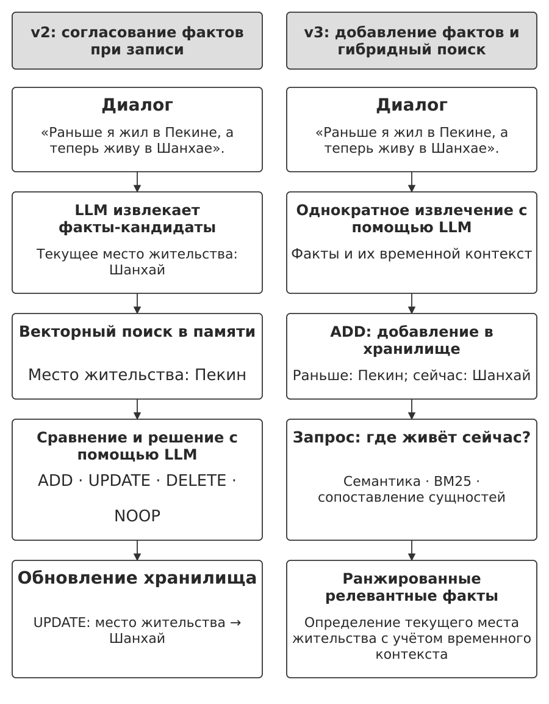

В раннем процессе LLM сначала извлекает из диалога потенциальные факты, затем выполняется поиск похожих существующих воспоминаний и принимается решение **ADD**, **UPDATE**, **DELETE** или **NOOP**. Если пользователь сначала говорит: «Я живу в Пекине», а позднее: «Я переехал в Шанхай», система может обновить текущее место жительства на Шанхай. Благодаря этому при запросе проще получить уже упорядоченный факт, однако при обслуживании памяти необходимо правильно различать исправления, изменения во времени и разные объекты, а также сохранять основания обновлений, чтобы при обнаружении ошибки можно было вернуться к ним для проверки. В статье также предложен вариант графовой памяти **Mem0-g**, представляющий связанные знания с помощью сущностей и отношений[^ch3-mem0-paper].

В v3 автоматическое извлечение выполняется одним вызовом LLM, а записи только добавляются посредством **ADD**. Сведения о Пекине и Шанхае можно сохранить вместе с их временным контекстом, а текущее место жительства определить при запросе с учётом контекста. При поиске одновременно используются семантическое сходство, ключевые слова BM25 и сопоставление сущностей; действия, завершение которых уже подтверждено, также могут извлекаться как факты. Согласно руководству по миграции, показатель LoCoMo вырос с 71.4 до 91.6, а LongMemEval — с 67.8 до 93.4. В этой версии с открытым исходным кодом связи между сущностями используются для внутреннего поиска, а внешний интерфейс графового хранилища и возвращаемое значение `relations` удалены; графовая память предоставляется управляемой платформой[^ch3-mem0-migration].

Эта эволюция показывает, что система памяти может перенести разрешение конфликтов с этапа записи на этап чтения. Если при записи ошибочно объединить опыт двух людей или принять дополнительную информацию за исправление, последующие ответы могут постоянно опираться на неверное текущее состояние. Хранение только с добавлением позволяет учитывать при принятии решения как новые, так и старые свидетельства, а также сокращает число вызовов модели для последовательного принятия решений при записи. Для часто изменяющейся пользовательской информации, конфликтность которой трудно определить сразу, автор предпочитает сначала сохранять факты вместе с их временем и источником, а затем формировать актуальное состояние при ответе на конкретный вопрос.

[^ch3-mem0-paper]: Chhikara и др. *Mem0: Building Production-Ready AI Agents with Scalable Long-Term Memory*. 2025.

[^ch3-mem0-migration]: Mem0. *Open Source: Migrating to the New Memory Algorithm*.

**Memobase: профиль пользователя и память событий.** Memobase организует долговременную информацию в виде двух частей. **Профиль пользователя (profile)** сохраняет относительно устойчивые свойства по темам и подтемам, например имя в `basic_info`, интересы в `interest` и должность в `work`. Разработчик может настроить извлекаемые слоты, управляя охватом и гранулярностью профиля. **Память событий (event memory)** записывает события из жизни пользователя и время, когда они произошли, позволяя системе отвечать на вопросы вроде «Когда мы в прошлый раз обсуждали бюджет?».

Memobase сначала помещает новый диалог в буфер. Когда в буфере накапливается заданный объём данных или сеанс остаётся неактивным в течение установленного времени, запускается пакетная обработка; её также можно явно запустить при завершении сеанса. Благодаря этому несколько сообщений обрабатываются в рамках одного процесса упорядочивания, а при запросе читаются уже сформированные профиль и события. Асинхронное обновление сокращает время ожидания извлечения памяти в ходе текущего взаимодействия; если требуется немедленно использовать новейшие факты, можно дождаться завершения текущей обработки[^ch3-memobase].

[^ch3-memobase]: Memobase, официальное описание проекта, включая поля профиля, память событий, буфер и интерфейс синхронного обновления.

Если помощнику необходимо помнить как обстоятельства предыдущего бронирования, так и предпочтения пользователя по месту и порядок возврата билета, события, факты и процессы можно хранить раздельно, как показано на рисунке 3-4. При получении каждой задачи нужные сведения загружаются в рабочую память.

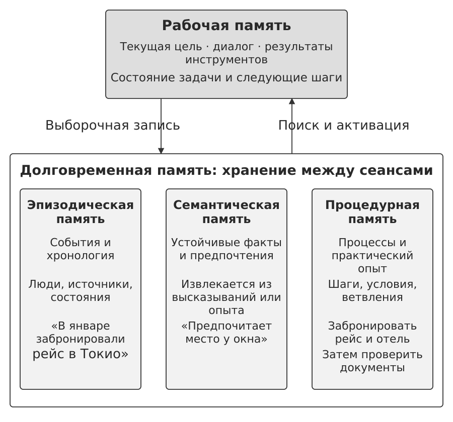

Эпизодическая память сохраняет последовательности событий и такие метаданные, как временные метки, эмоциональные маркеры и идентификаторы задач, позволяя комбинировать поиск по времени и теме. Например, для запроса «Когда мы в прошлый раз обсуждали бюджет?» одновременно требуются тематическое сопоставление и временная сортировка. Семантическая память сохраняет извлечённые из событий факты и предпочтения, а процедурная — многократно используемые процессы.

**Рабочая память (working memory)** организует текущую цель, состояние задачи и извлечённую релевантную информацию. Harness выбирает содержимое из траектории и долговременного хранилища и загружает его в текущий контекст. Новые факты, появившиеся при выполнении задачи, после упорядочивания записываются в долговременную память. Траектория фиксирует, как происходили события, а рабочая память сосредоточена на информации, необходимой для принятия следующего решения; они связаны посредством идентификаторов событий и указаний источников.

При чтении пользовательской памяти с помощью RAG сначала по текущему запросу находят набор потенциально релевантных воспоминаний, а затем решают, какие из них следует поместить в рабочую память. Предположим, сегодня помощник должен выбрать пользователю место и при поиске одновременно находит две фразы: «В командировках я предпочитаю места у окна» и «В прошлый раз я повредил колено, на обратном пути выбери мне место у прохода». Обе тесно связаны с выбором места, но во второй требование относится только к тому конкретному обратному рейсу. Даже если при повторном ранжировании по релевантности поставить её на первое место, это не отвечает на вопрос, применима ли она сегодня.

В такой ситуации автор считает более перспективным отбирать потенциальные воспоминания с помощью модели принятия решений наподобие Jev. Ей следует передать сведения о текущей поездке, актуальные требования пользователя, а также исходную формулировку, дату и условия применимости каждого воспоминания, чтобы по каждому из них вынести одно из решений: «применимо в этом случае», «только для справки» или «недостаточно оснований». Если сегодня пользователь тоже отправляется в командировку, первое воспоминание можно использовать как основание для выбора места. Если же пользователь только что сказал, что колено ещё не зажило, стоит вернуться ко второму воспоминанию и задать уточняющий вопрос.

### Механизмы сжатия и упорядочивания памяти

Пользователь, часто бронирующий авиабилеты, может десять раз упомянуть «место у окна». Возможно, девять из этих упоминаний относятся к одному и тому же бронированию. Если считать количество упоминаний непосредственной мерой силы предпочтения, значимость одного события окажется завышенной. При упорядочивании следует сначала определить источник и событие, затем объединить повторяющиеся записи, проверить наличие более поздних исправлений и лишь после этого решать, какие закономерности можно использовать в будущих задачах. Встретив фразу «В прошлый раз то место у окна было хорошим», можно поручить модели оценки вроде Jev прочитать её вместе с соответствующим бронированием и определить только одно: относится ли она к категории «воспоминание о предыдущем перелёте», «требование к текущему бронированию» или «выражение долгосрочного предпочтения». Если не удаётся сопоставить фразу с бронированием или правдоподобны несколько толкований, следует сохранить исходную формулировку и уточнить её при следующем бронировании. Такое локальное решение позволяет не учитывать один и тот же опыт многократно как новые свидетельства.

1. **Отбор записей для упорядочивания.** Сигналами для ранжирования могут служить частота обращений, время создания записи, эмоциональный маркер и уникальность информации. Например, запись, созданную три дня назад, к которой обращались пять раз, с сильным эмоциональным маркером и без дубликатов, целесообразнее сохранить отдельно. Запись, созданную 90 дней назад, к которой обращались лишь один раз и которая сильно дублирует три другие записи, можно в первую очередь объединить с соответствующими записями. Система может сначала по оценке отобрать записи, требующие упорядочивания, а затем на основе бизнес-правил решить, следует ли их сжать, объединить или удалить. Долгосрочные ограничения и действующие договоры необходимо сохранять до окончания срока их действия, даже если к ним обращаются редко.
2. **Кластеризация и формирование обобщений.** Похожие воспоминания объединяются в группы, а их общее содержание сохраняется в виде обобщения. Например, несколько разговоров о погоде можно упорядочить до «Пользователь часто спрашивает о погоде и особенно интересуется дождём». Конкретные даты и исходные запросы сохраняются в архиве, а обобщение связывается с исходными записями, чтобы к ним можно было вернуться позднее.
3. **Извлечение закономерностей и процессов.** Из нескольких записей о покупках можно вывести: «Предпочитает товары с хорошим соотношением цены и качества, придаёт большое значение отзывам пользователей», — либо выделить последовательность выбора товаров.

### Защита конфиденциальности: обезличивание журналов

Пользовательская память часто содержит идентификационные данные, контактную информацию и сведения об учётных записях. Система должна с учётом задачи определять, какие поля передавать на вход модели, а с учётом эксплуатационных потребностей — какие данные записывать в журналы. Обезличивание можно выполнять перед записью в журнал, заменяя конфиденциальные фрагменты метками типов или устойчивыми заполнителями и сохраняя структуру, необходимую для диагностики проблем.

> **Эксперимент 3-3 ★★: обезличивание журналов с помощью локальной модели**
>
> В этом эксперименте через Ollama вызывается локальная модель Qwen3-0.6B, которая распознаёт конфиденциальные фрагменты в журналах непосредственно на компьютере пользователя. Малые модели подходят для развёртывания на потребительских устройствах; также можно переключаться на варианты 1.7B, 4B и другие, сравнивая качество распознавания и время обработки. Если исходные журналы должны оставаться локальными, распознавание и замену также следует выполнять на локальном компьютере, передавая последующим сервисам уже обезличенный результат.
>
> Тестовые данные включают структурированные номера, например номера удостоверений личности и банковских карт, полуструктурированную информацию, например адреса, а также конфиденциальные сведения, раскрытые на естественном языке, например пароли. Согласно JSON Schema модель возвращает тип информации, положение текста и уровень уверенности, после чего программа заменяет соответствующие фрагменты исходного текста. В контрольной группе используются регулярные выражения, а в гибридной группе сначала выполняется поиск по регулярным выражениям, после чего модель обрабатывает оставшийся текст.
>
> Сначала рассмотрим две записи журнала. Первая содержит номер удостоверения личности и номер мобильного телефона, но регулярное выражение скрывает только номер телефона, поэтому полнота составляет $1/2$. Во второй записи регулярные выражения находят номер социального страхования США и номер банковской карты, но также скрывают похожий по формату номер заявки в службу поддержки. Из трёх отмеченных фрагментов обезличить требовалось только два, поэтому точность составляет $2/3$. Если проверять лишь то, остались ли в журнале конфиденциальные значения, вторая запись пройдёт проверку. Потеря важной зацепки обнаружится лишь тогда, когда служба поддержки попытается найти по этой записи соответствующую заявку.
>
> Если вычислить полноту отдельно для каждого из 12 примеров, а затем усреднить результаты, регулярные выражения, модель и гибридный подход показывают соответственно около 50%, 69% и 78%. После замены во всех примерах остаётся соответственно 9, 3 и 2 конфиденциальных значения. При выборе подхода необходимо учитывать и время обработки: на этой машине регулярные выражения обрабатывают одну запись в среднем примерно за 0,1 миллисекунды, а модель и гибридный подход — почти за 3 секунды. При большом объёме журналов поля с устойчивым форматом можно сначала обрабатывать регулярными выражениями, поручая модели только дополнительную проверку фрагментов, для оценки которых требуется учитывать контекст.

По мере роста числа записей следующей задачей становится поиск среди тысяч и десятков тысяч элементов информации, необходимых для текущей задачи. Рассматриваемая далее технология RAG применима как к общим базам знаний, так и к поиску по пользовательской памяти.

## Основы RAG: построение конвейера получения знаний AI-агентом

Магазин изменил правила возврата, и пользователь спрашивает: «Как мне сейчас подать заявку на возврат товара, купленного в прошлом месяце?» Чтобы ответить правильно, сначала нужно найти условия, применимые к этому заказу, а затем ясно изложить требования и порядок действий. **Генерация с дополнением из поиска** (Retrieval-Augmented Generation, RAG) связывает эти два этапа, позволяя модели использовать внутренние материалы магазина, а также правила, опубликованные уже после завершения её обучения.

Начнём с ситуации, когда существует только одна версия правил. Ниже процедура возврата в том же магазине запрашивается через упрощённый интерфейс. Посмотрим, как результаты поиска попадают в ответ модели:

```python
query = "процедура возврата"
results = retriever.search(query, top_k=2)
# results = [
#   "Правила возврата: полный возврат средств можно запросить в течение 7 дней после получения заказа; необходимо указать номер заказа. Средства поступят в течение 3–5 рабочих дней.",
#   "Порядок возврата: откройте «Мои заказы», выберите заказ и нажмите «Запросить возврат»."
# ]
answer = llm.generate(system="Ты — помощник службы поддержки.", context=results, question=query)
# Ответ содержит срок подачи заявки, необходимые сведения, порядок действий и срок поступления средств.
```

Сопоставьте рисунок 3-5 и два результата поиска в коде: порядок подачи заявки взят из «Порядка возврата», а поступления средств нужно ждать 3–5 рабочих дней — это следует из «Правил возврата». Если в результатах поиска останется только порядок действий, будут ли у модели основания сообщить пользователю, когда поступят деньги? От ответа на этот вопрос зависит, как следует разбивать руководство на фрагменты.

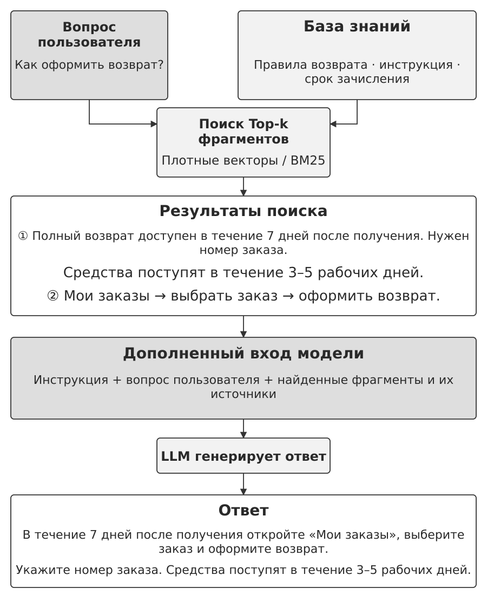

### Разбиение документов на фрагменты (Chunking)

Предположим, в руководстве по послепродажному обслуживанию сначала указано: «Товар можно вернуть в течение семи дней», а в следующем абзаце перечислены исключения. Если извлечь только первое предложение, можно пообещать возврат средств и за товар, на который это правило не распространяется. Если же использовать всё руководство как единую поисковую единицу, вместе с нужной информацией в неё попадут инструкции по установке, настройке и устранению неполадок, из-за чего вектору будет сложно выделить тему возврата средств. **Разбиение на фрагменты (chunking)** позволяет выбрать промежуточный размер: текста во фрагменте должно быть достаточно для объяснения всех относящихся к нему условий, но при этом конкретный вопрос должен легко его находить. Длина фрагмента также должна укладываться в бюджет входных данных модели эмбеддингов и оставлять в контексте место для последующей генерации.

Существуют три распространённых метода.

При **разбиении на фрагменты фиксированного размера** текст делится по количеству токенов: например, по 512 токенов на фрагмент с перекрытием соседних фрагментов на 50–100 токенов. Благодаря перекрытию содержимое возле границы может целиком попасть в другой фрагмент. Этот метод упрощает контроль длины фрагментов, но граница может пройти внутри абзаца, блока кода или таблицы.

При **рекурсивном разбиении или разбиении с учётом структуры** текст прежде всего делится по естественным границам, таким как разделы и абзацы, а слишком длинные части затем разбиваются на более мелкие единицы, например предложения. Заголовки Markdown и элементы HTML могут служить структурными ориентирами. Для блоков кода, таблиц и текста, относящегося к заголовкам, также можно применять специальные правила обработки. Для технических документов с чёткой структурой автор рекомендует начинать именно с этого метода: сначала использовать существующее деление на разделы и абзацы, а затем дополнительно разбивать слишком длинные части. Обычно так удаётся лучше сохранить целостный смысл, чем при простом отсечении текста.

При **семантическом разбиении** вычисляется сходство эмбеддингов соседних предложений или групп предложений, а текст разделяется там, где тема заметно меняется. Этот метод требует дополнительных вычислений эмбеддингов, но может помочь сохранить материал по одной теме в одном фрагменте.

Предположим, модуль поиска вернул только одно предложение: «Доход компании вырос на 3%». Какой компании? За какой квартал? Число найдено верно, но основание для ответа на вопрос осталось в предыдущем абзаце. Если же поместить во фрагмент весь финансовый отчёт, название компании и квартал сохранятся, но при запросе о доходе вместе с ними попадут абзацы о найме сотрудников и закупке оборудования. Всё это содержимое также придётся представить одним вектором, поэтому тема дохода может стать в нём менее заметной. На практике при выборе размера можно начать с 256–1024 токенов на фрагмент и перекрытия соседних фрагментов на 10–20%.

Вместе с фрагментом можно сохранять метаданные, например заголовок, источник и время. Рассматриваемый далее контекстно-зависимый поиск дополнительно снабжает каждый фрагмент сведениями о его месте в исходном тексте, помогая при независимом поиске разрешать ссылки и определять область действия.

### Плотные эмбеддинги: представление текста векторами

**Эмбеддинг (embedding)** отображает слово, предложение или фрагмент текста в числовой вектор, например `[0.2, -0.5, 0.8, ...]`. Поисковая модель обучается так, чтобы релевантные запросы и документы имели высокое сходство в векторном пространстве. «Плотность» означает, что большинство измерений вектора имеют ненулевые значения и совместно представляют информацию текста; в рассматриваемом далее разреженном представлении ненулевыми остаются лишь немногие измерения.

Векторное пространство можно представить как многомерную карту: каждому фрагменту текста соответствует определённая точка, а поиск заключается в нахождении содержимого, близкого к запросу. Одна из распространённых мер — **косинусное сходство**:

$$
\operatorname{cos}(A,B)=\frac{A\cdot B}{\|A\|\,\|B\|}
$$

Скалярное произведение $A\cdot B$ вычисляется умножением соответствующих измерений с последующим суммированием, а норма $\|A\|$ — как квадратный корень из суммы квадратов всех измерений. После деления на произведение норм результат отражает только соотношение направлений. Для ненулевых векторов косинусное сходство лежит в диапазоне $[-1,1]$: чем оно ближе к 1, тем сильнее совпадают направления. В разных поисковых моделях также применяются скалярное произведение или евклидово расстояние. Если оба вектора нормализованы до единичной длины, их скалярное произведение равно косинусному сходству.

> **Расчёт вручную: косинусное сходство трёх предложений**
>
> Представим фразы «Как ухаживать за кошкой» вектором $A=(0.9,0.5,0.1)$, «Руководство по уходу за кошками» — вектором $B=(0.8,0.6,0.1)$, а «Стратегия инвестирования в акции» — вектором $C=(0.1,0.1,0.9)$.
>
> $A\cdot B=0.9\times0.8+0.5\times0.6+0.1\times0.1=1.03$. Нормы этих векторов равны соответственно $\sqrt{1.07}$ и $\sqrt{1.01}$, поэтому сходство составляет приблизительно **0,991**.
>
> $A\cdot C=0.9\times0.1+0.5\times0.1+0.1\times0.9=0.23$, норма $C$ равна $\sqrt{0.83}$, а сходство составляет приблизительно **0,244**. В этом наборе векторов запрос об уходе за кошкой ближе к руководству по уходу.

На практике модели обычно используют представления размерностью от нескольких сотен до более чем тысячи.

#### От Word2Vec к контекстно-зависимым представлениям

Рисунок 3-6 начинает обзор с фиксированных векторов слов. **Word2Vec** обучает для каждого слова фиксированный вектор на основе совместной встречаемости слов. Некоторые отношения проявляются в векторных операциях, например в классическом выражении «король − мужчина + женщина ≈ королева». Ограничение фиксированных представлений также очевидно: для `bank` в выражениях `river bank` («берег реки») и `investment bank` («инвестиционный банк») используется один и тот же вектор слова.

**GloVe** подсчитывает совместную встречаемость слов во всём корпусе, а затем обучает векторы слов с помощью взвешенной целевой функции наименьших квадратов. Word2Vec ориентирован на задачу предсказания в локальном окне, тогда как GloVe напрямую включает в обучение глобальную статистику совместной встречаемости; оба метода обучают фиксированные представления слов[^ch3-glove].

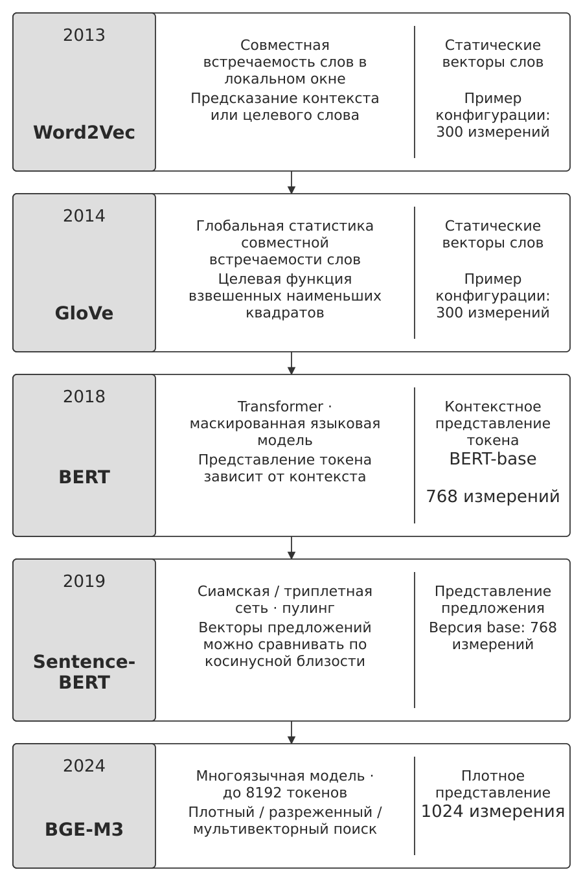

В контекстных моделях наподобие **BERT** представление одного и того же токена меняется в зависимости от предложения. Благодаря механизму самовнимания модель может по контекстам «выпустила новый продукт» и «купил два килограмма» вычислить разные представления слова «яблоко» в этих двух предложениях. Модели эмбеддингов для поиска также должны агрегировать представления токенов в вектор запроса или документа и обучаться так, чтобы эти векторы можно было сравнивать.

**Sentence-BERT** сочетает BERT с пулингом и сиамской либо триплетной сетевой архитектурой, обучая векторы предложений, пригодные для непосредственного сравнения. Документы можно заранее закодировать и сохранить в индексе. При поступлении запроса достаточно закодировать только его, а затем вычислить сходство векторов. Предварительное кодирование устраняет затраты на повторное вычисление представлений всех документов при каждом запросе[^ch3-sbert].

**BGE-M3** одновременно предоставляет плотные, разреженные и многовекторные представления для поиска, а также поддерживает несколько языков и длинные входные данные; в этом разделе его плотное представление используется для объяснения одновекторного поиска[^ch3-bge-m3]. Допустимая для модели длина входа влияет на стратегию разбиения на фрагменты: типичный предел исходной BERT составляет 512 токенов, а BGE-M3 поддерживает до 8192 токенов.

[^ch3-bge-m3]: В статье Chen et al. о M3-Embedding (arXiv:2402.03216) описано совместное обучение трёх видов поисковых представлений. См. также описание модели BGE-M3 от BAAI, включающее способы представления, размерность, длину входа и методы использования.

> **Эксперимент 3-4 ★★: сравнение двух индексов приближённого поиска ближайших соседей**
>
> После построения векторов документов необходимо быстро находить векторы, близкие к запросу. Попарное вычисление позволяет найти точных ближайших соседей, но с ростом объёма данных индексы **приближённого поиска ближайших соседей** (Approximate Nearest Neighbor, ANN) обменивают контролируемое снижение полноты на скорость выполнения запросов. В этом эксперименте ANNOY и HNSW сравниваются на одном наборе реальных эмбеддингов и одинаковых запросах, а результаты точного поиска используются как эталон. Например, если точный поиск для некоторого запроса определил десять ближайших соседей, а среди десяти результатов приближённого индекса оказалось восемь из них, то Recall@10 для этого запроса равен 0,8. Эта метрика показывает, какую долю точных ближайших соседей сохранил индекс.
>
> ANNOY сужает область кандидатов с помощью множества деревьев случайных проекций. HNSW использует многоуровневый граф ближайших соседей: сначала быстро приближается к целевой области на разреженных верхних уровнях, а затем переходит к поиску на более плотных нижних уровнях. На рисунке 3-7 показана многоуровневая структура HNSW.
>
> 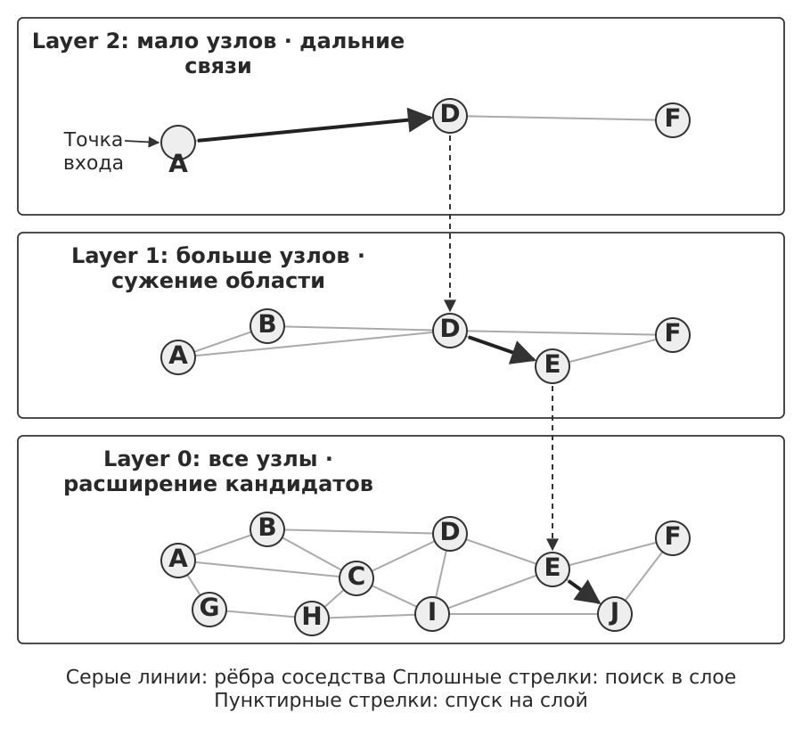
>
> Таблица 3-2. Компромиссы при реализации ANNOY и HNSW
>
> | Аспект сравнения | ANNOY | HNSW (на примере hnswlib) |
> | --- | --- | --- |
> | Структура индекса | Множество деревьев случайных проекций | Многоуровневый граф ближайших соседей |
> | Затраты на построение | Зависят от числа деревьев, числа векторов и размерности | Зависят от числа связей, диапазона поиска при построении и объёма данных |
> | Память и файлы | Статический индекс поддерживает отображение в память и совместное использование несколькими процессами | Хранит векторы и связи графа; число связей влияет на затраты |
> | Инкрементальное обновление | Добавление элементов после построения индекса требует его перестроения | Поддерживает добавление, обновление и пометку элементов как удалённых; требуется управление вместимостью |
> | Полнота и скорость | Настраиваются числом деревьев и бюджетом поиска при запросе | Настраиваются параметрами построения и диапазоном поиска при запросе |
> | Сценарий использования | Статический индекс, удобный для распространения и совместного использования | Динамический индекс с постоянной записью и выполнением запросов |
>
> В этом запуске индекс сначала строился по 240 фрагментам текста. На одних и тех же 20 запросах оба индекса нашли все 10 ближайших соседей, полученных точным поиском. При первоначальном построении базы ANNOY создавал индекс в контейнере Linux приблизительно за 13 миллисекунд, а HNSW — в локальной среде приблизительно за 78 миллисекунд; размеры сохранённых индексов составили около 1,40 и 1,02 МБ соответственно. Затем были добавлены оставшиеся 60 фрагментов: индекс ANNOY перестроили, а в HNSW новые векторы вставили напрямую. После этого база содержала 300 фрагментов, поэтому исходный набор ближайших соседей также мог измениться. После повторного точного поиска по новой базе средняя полнота обоих индексов по-прежнему составляла 100%.

[^ch3-ann]: В документации проекта Spotify Annoy описаны построение индекса только для чтения, его загрузка посредством отображения в память и настройка числа проверяемых при запросе узлов с помощью `search_k`. В разделе документации hnswlib о Python-интерфейсе приведены метод `add_items` для добавления векторов и метод `set_ef` для настройки диапазона поиска при запросе.

**Индекс следует выбирать с учётом способа обновления базы знаний.** Если корпус периодически публикуется пакетами, а несколько процессов совместно используют один индекс только для чтения, автор прежде всего рассматривает ANNOY. Если новые документы поступают постоянно и требуется их добавление в реальном времени, предпочтение отдаётся HNSW. Модель эмбеддингов определяет семантическое представление, а индекс — возможность использовать эти представления с приемлемыми задержкой и стоимостью обновления. Вместе они определяют качество поискового сервиса.

Изменяя число деревьев и бюджет поиска ANNOY либо число связей и диапазон поиска HNSW, можно наблюдать изменения полноты и задержки[^ch3-ann]. Полнота индекса показывает, были ли найдены целевые ближайшие соседи. Способны ли эти соседи дать ответ на вопрос пользователя, зависит уже от представления эмбеддингов и содержания материалов.

### Разреженное представление: от ключевых слов к оценке релевантности

**Разреженное представление** использует векторы высокой размерности, в которых лишь небольшое число измерений имеет ненулевые значения. В традиционном поиске по ключевым словам каждому терму соответствует отдельное измерение, а вес присваивается словам, встречающимся в документе. В основе этого подхода лежит **модель мешка слов** (Bag of Words, BoW): она сохраняет слова и количество их вхождений, игнорируя порядок. Поэтому фразы «кошка гонится за собакой» и «собака гонится за кошкой» имеют одинаковое представление в виде мешка слов.

Такое представление хорошо подходит для сопоставления названий, номеров и технических терминов. Начнём с TF-IDF и рассмотрим, как частота терма и частота документов преобразуются в оценку для ранжирования.

#### От TF-IDF к BM25

**TF-IDF** (Term Frequency–Inverse Document Frequency, частота терма — обратная частота документов) объединяет два сигнала: сколько раз слово встречается в текущем документе и насколько часто оно встречается во всём корпусе. Предположим, что из 100 статей 60 содержат слово «модель» и только 3 — слово «дистилляция». Тогда в запросе «дистилляция модели» слово «дистилляция» обладает большей различительной способностью.

Один из базовых вариантов формулы выглядит так:

$$\operatorname{TF\!\text{-}\!IDF}(t,d)=\operatorname{TF}(t,d)\times\operatorname{IDF}(t),\qquad \operatorname{IDF}(t)=\ln\frac{N}{\operatorname{DF}(t)}$$

$\operatorname{TF}(t,d)$ обозначает число вхождений терма $t$ в документ $d$, $\operatorname{DF}(t)$ — число документов, содержащих этот терм, а $N$ — общее число документов. Согласно этой формуле, вклад терма, встретившегося десять раз, вдвое выше вклада при пяти вхождениях; длинные документы также могут получать более высокие оценки лишь потому, что содержат больше слов. Существуют различные варианты TF-IDF с нормализацией, а рассматриваемый далее BM25 учитывает оба этих фактора с помощью насыщения частоты терма и нормализации по длине.

**BM25** суммирует вклады всех термов запроса:

$$\operatorname{Score}(Q,D)=\sum_i\operatorname{IDF}_{\mathrm{BM25}}(q_i)\cdot\frac{\operatorname{TF}(q_i,D)(k_1+1)}{\operatorname{TF}(q_i,D)+k_1\left(1-b+b\frac{|D|}{\operatorname{avgdl}}\right)}$$

Здесь $q_i$ — терм запроса, $|D|$ — длина документа, а $\operatorname{avgdl}$ — средняя длина документов. Параметр $k_1$ управляет степенью насыщения частоты терма, а $b$ — силой нормализации по длине; при значении 0 эта коррекция отключается. На рисунке 3-8 эти компоненты вычисляются по отдельности. Сначала зафиксируем длину документа и увеличим число вхождений терма запроса с одного до трёх, чтобы увидеть, насколько возрастает оценка при каждом дополнительном вхождении. Затем зафиксируем частоту терма и лишь удвоим длину документа. В нижней строке сравнивается распространённость двух термов в коллекции документов.

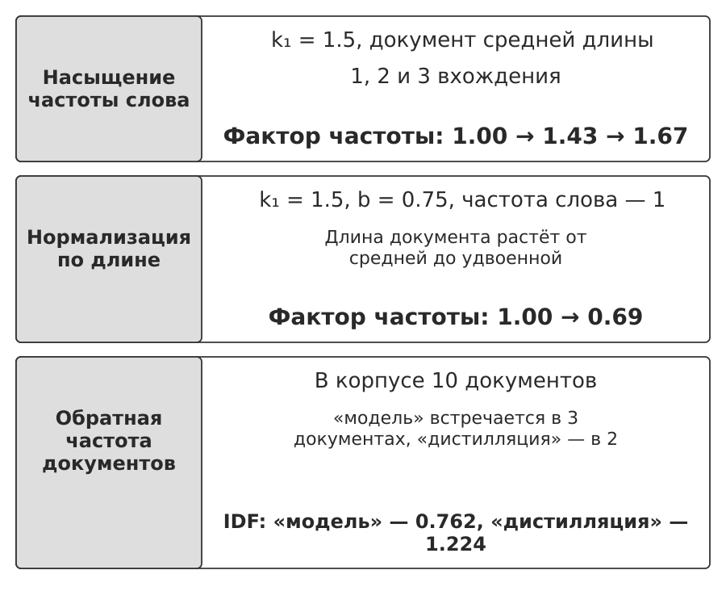

В первой строке рисунка второе вхождение увеличивает множитель частоты терма примерно на 0,43, а третье — лишь примерно на 0,24. Это и есть насыщение частоты терма. Во второй строке один и тот же терм в обоих случаях встречается лишь один раз, но в более длинном документе он менее заметен, поэтому коррекция по длине снижает его множитель частоты. Чтобы получить вклад терма в итоговую оценку, этот множитель необходимо также умножить на IDF.

Остаётся определить ещё один компонент формулы: почему при одинаковых трёх вхождениях редкий терм обычно полезнее распространённого? В этом разделе для взвешивания термов используется следующая обратная частота документов:

$$\operatorname{IDF}_{\mathrm{BM25}}(t)=\ln\frac{N-\operatorname{DF}(t)+0.5}{\operatorname{DF}(t)+0.5}$$

Числитель соответствует числу документов без данного терма, а знаменатель — числу документов с ним. Добавление 0,5 к обоим значениям обеспечивает сглаживание, благодаря которому вычисление остаётся возможным, когда частота документов равна 0 или $N$. Редкие термы получают больший вес; если терм содержится более чем в половине документов, эта формула даёт отрицательное значение. В сопутствующей реализации нижняя граница фактически используемого при оценке веса установлена равной $10^{-6}$, а исходное значение сохраняется для проверки.

> **Эксперимент 3-5 ★★: реализация поисковой системы BM25 с нуля**
>
> В этом эксперименте последовательно реализуются токенизация, обработка стоп-слов, инвертированный индекс и вычисление оценок. Обработка стоп-слов позволяет отфильтровать часто встречающиеся служебные слова, например «и» и «в». **Инвертированный индекс** хранит сведения о том, в каких документах встречается каждый терм, и соответствующую частоту терма. Он похож на предметный указатель в конце книги: по запросу «TCP» можно найти страницы 45, 112 и 203, а затем прочитать содержимое в этих местах.
>
> Вручную рассчитаем один запрос «дистилляция модели». Предположим, корпус содержит 10 документов, средняя длина равна 250 словам, $k_1=1.5$, а $b=0.75$. Слово «модель» встречается в 3 документах, и его IDF составляет примерно 0,762; слово «дистилляция» встречается в 2 документах, и его IDF составляет примерно 1,224. В таблице для каждого терма перечислены совпавшие документы, частота терма и длина документа. Подставив эти значения в формулу, можно вычислить вклад каждого терма в оценку документа.
>
> | Терм запроса | Документ | Частота терма TF | Длина документа | Вклад BM25 |
> | --- | --- | ---: | ---: | ---: |
> | модель | doc_1 | 5 | 200 | 1.52 |
> | модель | doc_3 | 2 | 500 | 0.82 |
> | модель | doc_7 | 8 | 150 | 1.68 |
> | дистилляция | doc_1 | 3 | 200 | 2.15 |
> | дистилляция | doc_5 | 1 | 250 | 1.22 |
>
> Сумма вкладов двух термов для doc_1 составляет примерно 3,67, поэтому документы ранжируются следующим образом: **doc_1 (3,67) > doc_7 (1,68) > doc_5 (1,22) > doc_3 (0,82)**. В doc_1 частота терма «дистилляция» ниже частоты терма «модель», но из-за большей редкости его итоговый вклад выше; совпадение сразу по двум термам дополнительно повышает общую оценку.
>
> Теперь выполним поиск по слову `cat` в англоязычном корпусе сопутствующего эксперимента. В двух коротких текстах, отмеченных как релевантные, используются соответственно слова `kitten` и `feline`, однако терм `cat` отсутствует в инвертированном индексе, поэтому список кандидатов пуст. Как бы сильно мы ни увеличивали описанный выше вес частоты терма, оценивать всё равно будет нечего. Если повторить поиск со словами из этих двух текстов, можно увидеть, что каждый из них попадает в список кандидатов.

### Гибридный поиск: объединение результатов двух методов с последующим переранжированием

Для некоторых вопросов трудно заранее перечислить все синонимы. В одной из задач эксперимента 3-6 спрашивается, «как автоматически освобождать неиспользуемую память в куче», однако в целевом фрагменте сказано: «Автоматическое управление памятью избавляет разработчиков от необходимости вручную освобождать объекты». В английской формулировке запроса и фрагменте нет общих слов, поэтому поиск по ключевым словам не нашёл ни одного результата, тогда как векторный поиск поставил целевой фрагмент на первое место. Но для запроса по модели XR-7003 поиск по ключевым словам сразу нашёл соответствующую модель, а векторный поиск также вывел несколько похожих моделей.

**Гибридный поиск** сначала отдельно ищет релевантные фрагменты по ключевым словам и векторам, а затем определяет, какие из них стоит передать модели. Автор рекомендует начинать с этого подхода, если база знаний одновременно содержит точные идентификаторы и описания на естественном языке. Проследим по рисунку 3-9 за XR-7003: оба метода ставят его на первое место, поэтому при объединении он получает вклад от обоих рейтингов. Переранжирование заменяет результат на втором месте, но пользователь по-прежнему сначала видит правильную модель.

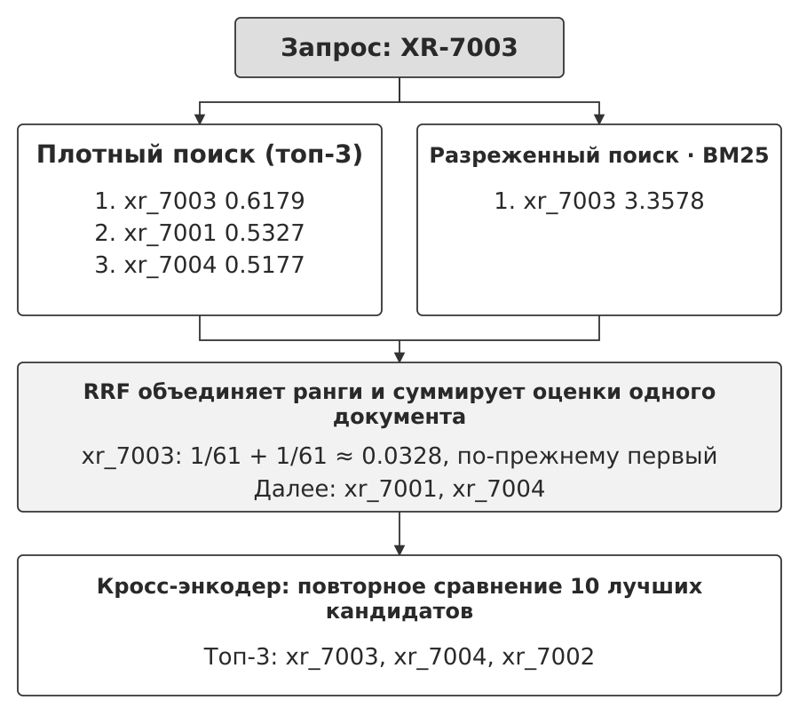

Первый этап — **параллельный поиск**: запрос отправляется в плотный и разреженный поисковые движки, каждый из которых возвращает набор потенциально релевантных документов. Оба метода могут использовать один и тот же исходный текст либо предварительно обрабатывать его в соответствии с требованиями своих моделей.

Второй этап — **объединение результатов**: один и тот же документ из результатов обоих методов объединяется, после чего формируется общий рейтинг. Числовые шкалы косинусного сходства и BM25 различаются, поэтому при непосредственном сложении результатов может начать доминировать метод с более высокими числовыми значениями. Один из вариантов — сначала откалибровать или нормализовать оценки, а затем объединить их с весами. Другой вариант — **объединение по обратному рангу** (Reciprocal Rank Fusion, RRF), при котором учитывается место документа в каждом рейтинге:

$$\operatorname{RRF}(d)=\sum_{j:\,d\in R_j}\frac{1}{k+\operatorname{rank}_j(d)}$$

$R_j$ — результаты $j$-го метода, места нумеруются начиная с 1. Если документ отсутствует в результатах одного из методов, вклад этого метода равен нулю. Константу сглаживания $k$ часто принимают равной 60: чем она больше, тем меньше разница в оценках между первыми местами. RRF удобно объединяет разные способы оценки, но сохраняет только места в рейтингах; различия в величине исходных оценок приходится учитывать другими методами.

Рассмотрим пример с двумя методами поиска. Пользователь спрашивает: «Когда поступят деньги после возврата?» Документ А занимает первое место в поиске по ключевым словам, но отсутствует среди первых результатов векторного поиска. Документ Б занимает второе место в обоих рейтингах. При $k=60$ документ А получает $1/61$, то есть примерно 0,0164, а документ Б — $1/62+1/62$, то есть примерно 0,0323. После объединения документ Б оказывается выше документа А. Этот результат говорит лишь о том, что документ Б найден обоими методами. Чтобы определить, действительно ли он отвечает на вопрос о сроке поступления денег, нужно проверить, о чём в нём говорится: «как подать заявку на возврат» или «когда поступят деньги после возврата».

На третьем этапе можно добавить **нейросетевое переранжирование**. Система выбирает документы, занимающие верхние места после объединения, например первые 50, и модель переранжирования оценивает релевантность каждого документа запросу. Переранжирование способно изменить порядок этих 50 документов. Если действительно полезный документ вообще не попал в выборку, необходимо вернуться к предыдущим этапам и улучшить поиск.

Для этого часто применяется **кросс-энкодер (cross-encoder)**: запрос и документ-кандидат вместе передаются модели, две части взаимодействуют внутри неё, а на выходе формируется оценка релевантности. На этапе поиска **би-энкодер (bi-encoder)** кодирует запрос и документы по отдельности: векторы документов можно вычислить заранее, а при поступлении запроса выполнять только векторный поиск. Первый подходит для точного ранжирования небольшого количества документов, второй — для первичного отбора из большого количества документов. Это можно сравнить с отбором резюме и собеседованием: сначала круг кандидатов сужают по уже известным характеристикам, а затем подробно сравнивают их с учётом конкретных требований. Одна из моделей, пригодных для этого этапа, — BGE Reranker v2 M3[^ch3-reranker].

[^ch3-reranker]: BAAI, описание модели BGE Reranker v2 M3, включая ввод пар «запрос — документ» и оценку релевантности.

Если релевантные материалы уже попадают в пул кандидатов, но часто располагаются ниже нерелевантных, автор в первую очередь оценивает переранжирование с помощью кросс-энкодера. Он совместно обрабатывает вопрос и документ, поэтому может непосредственно сопоставлять условия, ограничения и подробности документа с требованиями вопроса. В таблице 3-3 перечислены три распространённые метрики.

Таблица 3-3. Три метрики качества поиска

| Метрика | Расчёт и значение |
| --- | --- |
| recall@k (полнота) | Количество релевантных документов среди первых k результатов, делённое на общее количество релевантных документов для данного запроса; показывает, какая доля релевантного содержимого найдена. Для тестового набора обычно дополнительно вычисляется среднее значение по всем запросам |
| MRR (средний обратный ранг) | Для каждого запроса берётся величина, обратная месту первого релевантного документа, после чего вычисляется среднее значение: первое место даёт 1, десятое — 0,1, отсутствие результата — 0 |
| nDCG@k (нормализованная дисконтированная кумулятивная полезность) | Результатам присваиваются оценки в соответствии со степенью релевантности, позиции ниже в рейтинге дисконтируются, а полученное значение делится на оценку идеального ранжирования; показывает общее качество ранжирования первых k результатов |

Также можно учитывать **долю попаданий**: для какой доли запросов среди первых k результатов найден хотя бы один релевантный документ? Например, для ответа на один вопрос нужны три документа, но среди первых двадцати результатов найдены только два из них. Для этого запроса уже есть попадание, поэтому он не учитывается как случай полного отсутствия результатов, однако его recall@20 составляет лишь $2/3$: ещё $1/3$ материалов не найдена. Если для каждого вопроса существует только один целевой документ, вопрос с найденным документом получает 1 балл, а с пропущенным — 0. При усреднении по одному и тому же набору результатов доля попаданий будет равна средней полноте.

> **Эксперимент 3-6 ★★: сравнение разреженного и плотного поиска, объединения и переранжирования**
>
> В этом эксперименте на одном и том же наборе из 12 размеченных запросов сравниваются пять конфигураций: разреженный поиск, плотный поиск, объединение посредством RRF, взвешенное объединение и переранжирование после объединения. Запросы охватывают семантическое сходство, точные названия, разные языки и технические коды. В двух задачах на английском и китайском языках спрашивается, как растения преобразуют солнечный свет в пищу. Для плотного поиска используется модель Qwen3-Embedding-0.6B, а для переранжирования — кросс-энкодер MS MARCO MiniLM. Каждый метод поиска возвращает не более 10 документов, а модель переранжирования обрабатывает не более 10 документов, занимающих верхние места в рейтинге RRF. Полнота и nDCG вычисляются только по первым трём документам итогового рейтинга, тогда как для MRR первый релевантный документ ищется во всём возвращённом списке.
>
> Сначала откройте ранжирование по отдельным задачам в журнале выполнения эксперимента 3-6 и сравните результаты поиска для двух вопросов о фотосинтезе. Для вопроса на английском языке целевой документ по-прежнему занимает первое место. Для вопроса на китайском языке сначала возвращаются документы о языке программирования и вулканах, а о фотосинтезе рассказывает лишь третий документ. Для каждого вопроса релевантным размечен только один документ, и в обоих случаях он найден среди первых трёх результатов, поэтому recall@3 равен 1. Однако для вопроса на китайском языке первый релевантный документ занимает третье место, а его обратный ранг составляет лишь $1/3$. При принятом в этом эксперименте способе подсчёта полезность третьего места равна $1/\log_2(3+1)=0.5$, а первого — 1, поэтому nDCG@3 для вопроса на китайском языке составляет 0,5.
>
> Теперь рассмотрим все 12 задач. После переранжирования, помимо вопроса о фотосинтезе на китайском языке, целевой документ ещё в одной задаче — об освобождении памяти в куче — опустился с первого места на второе. В остальных десяти задачах целевые документы сохранили первое место, поэтому MRR после переранжирования равен $(10+1/2+1/3)/12\approx0.903$. Для сравнения, MRR плотного поиска и RRF равен 1. Их nDCG@3 также равен 1, а после переранжирования снижается примерно до 0,928. Если смотреть только на среднюю полноту, эти изменения мест останутся незаметными: recall@3 разреженного поиска равен 0,833, а во всех остальных четырёх конфигурациях — 1.
>
> Предположим, теперь для этого набора задач нужно выбрать одну конфигурацию. Что дала дополнительная задержка, затраченная на переранжирование? На этом CPU RRF от начала поиска до выдачи рейтинга занимает в среднем около 194 миллисекунд на вопрос, а с подключённым переранжированием — около 237 миллисекунд. Дополнительные примерно 43 миллисекунды не позволили найти новые целевые документы, но отодвинули правильные ответы в двух задачах.

## Организация и поиск знаний

Способ организации знаний определяет, что содержит каждая запись, а механизм поиска — что именно будет извлечено из этих записей. Абзацы в технических руководствах, юридических документах и научных работах связаны иерархией разделов, зависимостями между понятиями и перекрёстными ссылками между документами. Сохранение этих структур позволяет при обработке запроса одновременно обращаться к конкретным доказательствам и обобщениям более высокого уровня.

В этом разделе последовательно рассматриваются несколько способов организации: RAPTOR и GraphRAG создают иерархические индексы или индексы связей; OpenViking организует контекстные ресурсы с помощью каталогов; инкрементальные обновления и периодическая систематизация поддерживают актуальность знаний; агентный RAG позволяет AI-агенту продолжать поиск на основе уже полученных результатов; контекстно-зависимый поиск дополняет фрагменты фоновой информацией; наконец, из наборов данных извлекаются знания, пригодные для повторного использования. Эти подходы воздействуют соответственно на процессы представления, индексирования, обновления и обработки запросов, а также могут совместно применяться для организации пользовательской памяти.

Сначала рассмотрим два примера, чтобы понять разрыв между информацией, необходимой для ответа на запрос, и исходными записями.

**Пример 1: подсчёт чёрных и белых кошек.** В предыдущей главе программа пересчитала кошек во всех 100 клетках и получила 90 чёрных и 10 белых кошек. На этот раз механизму поиска разрешено вернуть только первые 20 записей. Предположим, что 18 из них содержат достоверные сведения о цвете: в 15 записях указаны чёрные кошки, а в 3 — белые. Полученные 83,3% (15/18) — это доля чёрных кошек среди этих достоверных записей, тогда как доля чёрных кошек во всём магазине составляет 90% (90/100). Механизм поиска отбирает записи по релевантности, а не формирует репрезентативную выборку по всему магазину.

Если долю по всему магазину спрашивают часто, можно заранее подсчитать кошек во всех клетках, сохранить количество чёрных и белых кошек, а также указать охват подсчёта и время обновления. Если кошка в клетке сменилась, соответствующую подробную запись обновляют и пересчитывают итоговые значения. Если кто-то спрашивает, какая кошка находится в клетке № 37, по-прежнему нужно получить именно эту подробную запись.

**Пример 2: может ли медсестра получить скидку, предоставляемую врачу?** Рассмотрим учебную ситуацию, построенную вокруг консультаций по скидкам Xfinity: в обращениях ветеран John успешно прошёл проверку, врач Sarah получила скидку, а учителю Mike сообщили, что он не соответствует требованиям. Каждое обращение фиксирует один результат обработки. Если медсестра спросит, может ли она получить скидку, поиск только по похожим обращениям столкнётся с тремя проблемами.

- **Близкие профессии не обязательно дают право на одну и ту же льготу.** Понятия «медсестра» и «врач» семантически близки, поэтому запись Sarah может оказаться среди первых результатов; однако применимость скидки также зависит от того, кому условия акции разрешают подавать заявку и какие подтверждающие документы необходимо предъявить.
- **Отдельные обращения не содержат полного перечня условий применимости.** Успешная проверка конкретного человека непосредственно свидетельствует лишь о результате для этого человека при существовавших на тот момент условиях; увеличение числа извлекаемых записей не гарантирует, что найдутся ранее не встречавшиеся категории или исключения.
- **Область применимости материалов неясна.** Обращения могут относиться к разным акциям или периодам. Сначала необходимо определить, какие записи применимы и каких нормативных оснований не хватает.

При индексировании можно связать обращения, относящиеся к одной акции, затем изучить соответствующие официальные условия и оформить сведения о целевых категориях, исключениях, сроке действия и источнике положений в виде карточки правил. Например, если условия в этой учебной ситуации явно распространяются на действующих военнослужащих и ветеранов, а также на лицензированных медицинских работников, но исключают учителей, каждое из этих условий следует сохранить отдельно; принадлежность медсестёр к категории медицинских работников также должна подтверждаться условиями. Обращения продолжают храниться, чтобы объяснять фактический процесс оформления и выявлять расхождения в применении правил.

Эти два примера отражают разные информационные потребности: для подсчёта кошек требуется статистика по всем клеткам магазина, а для определения права на скидку — полные условия и исключения. Для таких запросов автор предлагает перенести подготовку статистики и правил на этап создания базы знаний. Простое увеличение числа извлекаемых фрагментов всё равно может не дать модели полного охвата статистики или положений, определяющих, будет ли одобрена конкретная заявка. Только если заранее создавать статистические сводки, карточки правил и связи между источниками с учётом задачи, механизм поиска сможет за один раз получить достаточно информации для принятия решения и при необходимости обратиться к исходным материалам.

### Структурированный индекс: построение иерархии и связей

При чтении длинного отчёта ответ на вопрос «Какую графу заполнять в заявке на ремонт?» зачастую можно найти в одном фрагменте исходного текста, тогда как вопрос «Почему несколько типов неисправностей возникают снова и снова?» требует анализа нескольких разделов. Чтобы поддерживать оба типа запросов, при создании базы можно генерировать сводки, строить иерархию либо извлекать сущности и связи. Рассматриваемый ниже RAPTOR формирует иерархию с помощью рекурсивного обобщения, а GraphRAG организует материал посредством связей между сущностями и сводок сообществ.

**RAPTOR** (Recursive Abstractive Processing for Tree-Organized Retrieval) начинает с текстовых блоков: каждый блок преобразуется в вектор, затем блоки объединяются в группы по степени сходства, после чего для каждой группы создаётся сводка. Если считать сводки новой партией текстовых блоков и повторять эти шаги, получится дерево, показанное на рисунке 3-10. Если двигаться по стрелкам вверх от текстовых блоков 3, 4 и 5, видно, что вместе они образуют сводку B; ещё выше сводки трёх групп A, B и C объединяются в общую сводку.[^ch3-raptor]

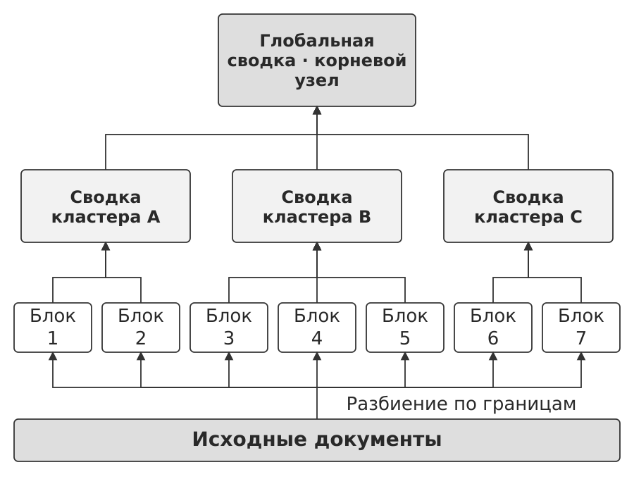

Например, утверждения «SSE2 поддерживает целочисленные SIMD-операции в 128-битных регистрах XMM» и «В SSE4.2 добавлены инструкции сравнения строк» можно включить в сводку «Развитие наборов инструкций x86 SIMD». Вопросы о деталях могут сопоставляться с блоками нижнего уровня, а обзорные вопросы — со сводками верхних уровней. При поиске можно как последовательно углубляться по иерархии, так и искать среди узлов всех уровней одновременно, выбирая наиболее релевантную группу.

[^ch3-raptor]: Sarthi et al. RAPTOR: Recursive Abstractive Processing for Tree-Organized Retrieval, 2024.

**GraphRAG** организует знания с помощью сущностей, связей и сводок сообществ. Одна связь записывается в виде триплета «субъект — отношение — объект», например (Китай, столица, Пекин) или (Чжан Сань, работает в, Tencent). Если две записи упоминают одну сущность, их можно связать в графе. Оба врача на рисунке 3-11 носят фамилию Чжан. По какой цепочке связей должна пройти система, если пользователь спрашивает: «Каков адрес больницы, в которой работает мой стоматолог?»

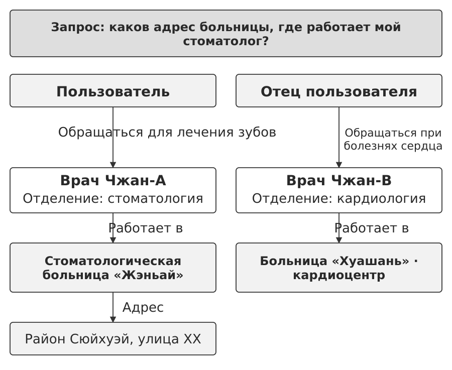

1. **Различайте одноимённые сущности при построении графа.** Один врач Чжан лечит зубы пользователя в стоматологической клинике «Жэньай», а другой лечит заболевание сердца у отца пользователя в больнице «Хуашань». При извлечении сущностей и объединении записей система может на основании этих признаков назначить двум врачам разные идентификаторы. Аналогичную функцию выполняют рассмотренные ранее поля `person` и `relationship`. Определение того, означает ли `bank` в предложении берег или банк, называется разрешением лексической неоднозначности; определение того, о каком именно враче Чжане говорится в записи, — разрешением неоднозначности сущностей.
2. **При выполнении запроса ищите по цепочке связей.** Если начать с пользователя и последовательно пройти по цепочке «пользователь → врач → больница → адрес», можно объединить сведения из нескольких записей в единый ответ.

В процессе индексирования Microsoft GraphRAG сначала извлекает сущности и связи из текстовых единиц, а затем с помощью обнаружения сообществ выявляет тесно связанные группы сущностей и создаёт иерархию сообществ со сводками. При запросе о конкретной сущности локальный поиск объединяет связанные с ней сведения и исходный текст; при запросе о тематике всего корпуса глобальный поиск организует ответ с помощью сводок сообществ.[^ch3-graphrag]

[^ch3-graphrag]: Microsoft GraphRAG, обзор индексирования и выполнения запросов, локальный и глобальный поиск.

Представление связей также должно учитывать условия и время. Например, высказывание «Если на следующей неделе дождь не прекратится, я отменю поездку на море и вместо этого пойду в музей» содержит условие, период действия и альтернативное действие. Если извлечь только (пользователь, планирует, поездка на море) и (пользователь, имеет альтернативный план, поход в музей), условие переключения будет потеряно. Можно сохранить исходное предложение целиком, а ограничение «если на следующей неделе будет дождь» представить с помощью узла условия, узла события или структурированных полей, связав отношение с исходным текстом.

Для пользовательской памяти автор рекомендует **многоуровневое сочетание естественного языка и структурированного индекса**: сохранять полное высказывание на естественном языке, записывать объект, время и источник в метаданных, а для содержимого, которое требуется часто связывать, создавать графовый индекс.

> **Эксперимент 3-7 ★★★: сравнение иерархических сводок и индекса связей**
>
> В этом эксперименте используются 14 страниц руководства по архитектуре Intel, посвящённых SSE, AVX и управлению состоянием, и создаются две учебные реализации. В ветви иерархических сводок сначала генерируется сводка для каждой страницы, затем сводки объединяются в три группы, после чего создаются групповые сводки и корневая сводка. В ветви индекса связей извлекаются сущности и отношения, после чего формируются сводки сообществ. Обе группы используют одинаковые материалы и восемь вопросов для сравнения поиска деталей понятий и рассуждений о связях.
>
> При запросе «Объясните среду программирования SSE» иерархические сводки позволяют одновременно найти обзор SSE и сведения о регистрах. В этой реализации поиск выполняется сразу среди узлов всех уровней, после чего выбираются пять наиболее релевантных. Ветвь связей расширяет поиск от релевантных сущностей к их соседям и организует контекст с помощью сводок сообществ. Цепочка связей «SSE → регистры XMM → операции с плавающей точкой → ADDPS» позволяет соединить понятие с конкретной инструкцией.
>
> Более сложный вопрос: «Если процессор заявляет о поддержке AVX, означает ли это, что программа уже может использовать AVX?» Для ответа необходимо связать возможности процессора с управлением состоянием операционной системы: проверить флаги AVX и OSXSAVE в CPUID, затем прочитать XCR0 и убедиться, что состояния XMM и YMM включены. Для этого вопроса подсказками о конечных точках графового поиска служат CPUID и YMM. Программа находит соединяющий их кратчайший путь через XSAVE, CR4.OSXSAVE и XCR0, а затем передаёт этот путь модели для подготовки ответа.
>
> Среднее покрытие страниц-источников по восьми вопросам в обеих группах составляет около 95,8%.

Автор рекомендует сначала качественно реализовать разбиение на блоки и гибридный поиск, а к созданию структурированного индекса переходить при регулярной потребности в обобщении материалов из нескольких документов и поиске по связям. Чтобы найти конкретный фрагмент политики возврата средств, обычно достаточно разбиения на блоки и гибридного поиска; для сравнения SSE и AVX или перехода от общей архитектуры к конкретной инструкции в большей степени требуются межфрагментные сводки и индекс связей.

### Файловая парадигма: организация знаний с помощью структуры каталогов

**OpenViking** организует память, ресурсы и навыки посредством виртуальной файловой системы. Каждый элемент доступен по URI `viking://`: AI-агент может просматривать каталоги, читать обзоры, а затем обращаться к необходимому содержимому[^ch3-openviking-uri]. По назначению информации каталоги можно разделить на три группы: внешние ресурсы, данные пользователя, а также используемые агентом навыки и опыт. Идентификаторы пользователя и агента дополнительно ограничивают их пространства имён.

| Содержимое | Типичное назначение |
| --- | --- |
| Resources | Внешние материалы: техническая документация, репозитории кода, веб-страницы и т. д. |
| User memories | Предпочтения, привычки и опыт конкретного пользователя |
| Skills и Agent memories | Повторно используемые процессы, записи о задачах и опыт, требующий проверки |

URI обеспечивают единый способ адресации, а физическим хранилищем и индексом управляет сервис. Интерфейс каталогов позволяет агенту последовательно просматривать материалы по темам и ограничивать семантический поиск соответствующим поддеревом. Доступ в стиле файловой системы, хранилище содержимого и векторный индекс могут совместно образовывать единый сервис.

[^ch3-openviking-uri]: OpenViking, Viking URI и архитектура системы.

OpenViking разделяет содержимое на три уровня: **L0, L1 и L2**. L0 — краткая сводка для быстрой оценки релевантности каталога. L1 — обзор каталога, описывающий основное содержимое и точки входа для навигации. L2 — основной текст, требующий подробного изучения. Сводка и обзор уровня каталога хранятся соответственно в `.abstract.md` и `.overview.md`. Бюджеты на генерацию текста для них составляют соответственно 256 и 4000 символов[^ch3-openviking-layers].

При выполнении запроса можно сначала прочитать сводку и определить нужную область, затем изучить обзор и выбрать файл, а в конце загрузить исходный текст. Это перекликается с прогрессивным раскрытием Skills из второй главы: облегчённые каталоги помогают находить материалы, а полное содержимое загружается по мере необходимости для конкретной задачи. Если требуются точные числовые значения, условия или исходные формулировки, необходимо дополнительно получить соответствующий основной текст.

[^ch3-openviking-layers]: OpenViking, Context Layers (L0/L1/L2). L0 и L1 — представления, генерируемые на уровне каталога; L2 может содержать исходный файл или основной текст после разбора.

Для знаний, которые должны совместно поддерживать человек и агент, автор предпочитает использовать **обычный текст Markdown и управление версиями**. Человек может непосредственно читать, редактировать и исправлять знания, а агент — работать через тот же файловый интерфейс, предлагать обновления в рабочей ветви и публиковать их после проверки. Система управления версиями сохраняет различия каждого изменения и позволяет откатывать ошибочные обновления. В конце сеанса пользовательские предпочтения добавляются в память соответствующего пользователя, а история операций — в записи о задачах. После оценки результатов, обобщения между траекториями и последующей проверки записи о задачах могут стать опытом, рассматриваемым в девятой главе.

При файловой организации знаний одновременно необходимо **создавать ссылки и индексы для связанных элементов**. Набор файлов без взаимных ссылок позволяет заново обнаруживать связи только посредством полнотекстового сканирования или семантического поиска. Чем больше файлов, тем сложнее агенту продолжать исследование, отталкиваясь от уже найденного содержимого. Ссылки обеспечивают явные пути поиска: например, политика возврата средств может ссылаться на положения об исключениях, сводка договора — на запись о его подписании, а элемент о человеке — на связанные события. Начальные страницы описывают основные темы, индексные страницы обеспечивают навигацию, а перекрёстные ссылки между элементами поддерживают горизонтальный поиск. Такой подход напоминает организацию энциклопедических статей и позволяет сравнительно простым способом сохранять часть отношений.

При создании базы знаний полезно указать, какие записи можно применять вместе, а какие инструкции исключают друг друга. Отвечая на просьбу отменить заказ, сотрудник поддержки должен соблюдать и правила общения, и правила конфиденциальности: оба документа уместны в контексте. А если у склада две инструкции по отмене отправки, в индексе нужны условия выбора. Пока посылка на складе, следует отменить распоряжение на отгрузку; если посылка уже у перевозчика — запросить её перехват. Получив заявку «Отмените заказ» без других подробностей, агент должен сначала проверить статус посылки и только затем загрузить подходящую инструкцию.

Поддержку ссылок следует встроить в процесс обновления: перед добавлением нового элемента сначала искать существующие записи и определять, нужно ли объединить данные или создать новый элемент; после записи добавлять связанные ссылки и обновлять индекс соответствующего каталога. Ссылка может привести читателя к нужному положению, но применимо ли оно к конкретному заказу, зависит также от даты его вступления в силу.

### Как должны обновляться знания

Сегодня политика изменилась, а завтра пользователь может спросить: «Что теперь делать?» — или: «Почему в прошлом месяце мой заказ обработали именно так?» Если просто заменить старые положения новыми, во втором случае исчезнут основания, действовавшие на тот момент. **Инкрементальные обновления** позволяют своевременно записывать новые свидетельства, а **периодическая реорганизация** — выявлять в более широком масштабе дубликаты, конфликты и структурные изменения. В обоих процессах необходимо сохранять версии и ссылки на свидетельства, а также выполнять проверку перед публикацией, чтобы выбирать период, применимый к конкретному вопросу.

#### Инкрементальные обновления пользовательской памяти и базы знаний

Автор рекомендует **рассматривать базу знаний как репозиторий кода, а каждое изменение знаний — как Pull Request (PR)**. Каждое обновление должно иметь чётко определённую область изменений и сопровождаться подтверждающими свидетельствами, доступными проверяющему. В этот процесс можно включить документы Markdown, файлы правил и исполняемое состояние User as Code. История версий помогает сопровождающим просматривать изменения, выяснять их причины и восстанавливать данные после ошибочной публикации.

Можно использовать представленную в первой главе схему **предлагающий — проверяющий**, организовав обновление следующим образом:

1. **Предлагающий формирует изменение.** Proposer Agent читает новые свидетельства, выполняет поиск по существующим знаниям, находит элементы, которые нужно добавить, исправить или признать устаревшими, и предлагает в рабочей ветви изменение с чётко очерченной областью. Одновременно он поддерживает связанные ссылки, индекс каталога, временные сведения и ссылки на свидетельства.
2. **Проверяющий выполняет независимую проверку.** Reviewer Agent сопоставляет содержимое до и после изменения с исходными свидетельствами и проверяет, имеют ли новые утверждения источник, полностью ли указаны условия применимости, согласуются ли формулировки в разных файлах и не осталось ли полезной информации в удалённых фрагментах. Обнаружив проблему, он указывает конкретный элемент и основание, а также объясняет, что следует дополнить, восстановить или исправить.
3. **Стороны итеративно дорабатывают изменение и принимают решение.** Предлагающий вносит правки с учётом замечаний, после чего проверяющий выполняет повторную проверку. Одобренное изменение передаётся в процесс объединения. Если по достижении предельного числа итераций или бюджета затрат разногласия сохраняются, изменение остаётся в рабочей ветви и передаётся человеку на проверку.
4. **Изменение проверяется и публикуется.** Автоматические проверки охватывают формат, ссылки, метаданные и метки разрешений; исполняемые знания также должны пройти проверку типов и соответствующие тесты. После объединения из зафиксированной версии знаний перестраиваются затронутые фрагменты, сводки и векторные индексы, а затем публикуется версия сервиса.

Этот процесс охватывает три уровня данных. **Уровень исходных свидетельств** хранит диалоги, траектории выполнения, бизнес-документы и результаты инструментов. **Уровень знаний** хранит прошедший обработку и допускающий дальнейшее редактирование текст или код. **Сервисный уровень** хранит индексы, сформированные из конкретной версии знаний. Журнал изменений связывает идентификаторы свидетельств, версию знаний, замечания проверки и окончательное решение, позволяя сопровождающим выяснить, почему определённое знание было записано и когда оно вступило в силу. Исходные свидетельства архивируются согласно политике хранения, а индексы можно повторно сформировать из версии знаний. Рассмотренная ранее память с добавлением только новых данных подходит для хранения новых и старых фактов вместе с их источниками; описанный здесь процесс проверки преобразует эти свидетельства в пригодные для использования версии знаний. Если при запросе обнаруживается ещё не разрешённый конфликт, можно вернуться к свидетельствам и вынести решение с учётом условий задачи.

В такой архитектуре **и предлагающий, и проверяющий должны быть агентами, способными вызывать инструменты и продолжать поиск**. Предлагающему может потребоваться изучить множество записей, чтобы найти затронутые элементы. Проверяющий также может переходить по ссылкам, продолжать поиск, сравнивать версии или запускать проверки. Инструменты поиска по файлам и свидетельствам, просмотра различий и запуска тестов позволяют выполнять эти дополнительные действия, поэтому такую работу может взять на себя Coding Agent с соответствующими возможностями.

Область поиска обоих агентов должна охватывать знания и исходные свидетельства, относящиеся к текущему изменению, с учётом ограничений прав пользователя, арендатора и задачи. Траектория проверки, ссылки на результаты инструментов и замечания архивируются вместе, чтобы впоследствии можно было установить, что именно проверяющий фактически сверил.

При выборе моделей автор рекомендует отдавать предпочтение сочетаниям сопоставимой мощности из разных семейств, например Claude и GPT либо DeepSeek и Kimi. Различия в обучающих данных и привычках рассуждения могут приводить к различным суждениям. Проверяющий должен самостоятельно искать свидетельства и сверять с ними утверждения и условия в изменении. Разрешения должны обеспечиваться исполняющей системой: предлагающий записывает данные в рабочую ветвь, проверяющий читает свидетельства и отправляет заключение, а разрешения на обновление основного репозитория и онлайн-индекса принадлежат сервисам объединения и публикации.

#### Периодическая реорганизация пользовательской памяти и базы знаний

После множества локальных обновлений один и тот же факт может оказаться разбросан по нескольким файлам, а старые и новые формулировки — существовать одновременно. Периодическая реорганизация выявляет такие накопившиеся проблемы, последовательно обрабатывая знания по каталогам, времени или темам. Её рабочая схема совпадает с периодическим пересмотром, рассмотренным в девятой главе: на переднем плане накапливаются новые свидетельства, а в фоновом режиме они централизованно систематизируются, образуя записи для последующих задач.

Реорганизация включает три задачи.

1. **Удаление дубликатов, объединение и изменение структуры.** Выявляются дублирующиеся, устаревшие или чрезмерно раздробленные элементы, связанное содержимое объединяется, слишком большие файлы разделяются, а ссылки, начальные и индексные страницы обновляются. При удалении из сервисного представления старой формулировки фиксируются заменивший её элемент и исходное основание.
2. **Повторная проверка по исходным материалам.** Если при каждой реорганизации переписывать только сводку, созданную на предыдущей итерации, ранние пропуски и неверные интерпретации будут передаваться дальше. Поэтому необходимо сопоставлять знания с диалогами, траекториями выполнения, бизнес-документами и результатами инструментов, проверяя, не пропущены ли в сводке ключевые факты, отрицания, временные сведения или условия и не представлено ли предположение как определённый вывод. Крупную базу знаний можно обрабатывать частями по каталогам, времени или темам, фиксируя в списке покрытия уже проверенные, ожидающие проверки и спорные области, пока не будет проверена вся база.
3. **Разрешение конфликтов и уточнение областей применимости.** Сравниваются источники противоречащих друг другу записей, а также их время, объекты, регионы, задачи и предварительные условия. Если две записи применимы к разным сценариям, следует явно указать область каждой. Если новое свидетельство однозначно заменяет старое правило, необходимо сохранить связь между версиями. Если оснований недостаточно, фиксируются вопрос, ожидающий подтверждения, и недостающие свидетельства.

Результат реорганизации также отправляется на проверку как изменение. Крупную перестройку можно разделить на несколько PR по каталогам или темам, использующих общий план реорганизации и список покрытия. После одобрения связанных изменений перестраиваются производные индексы и повторно выполняются типичные сценарии поиска и вопросов-ответов, чтобы проверить, остались ли ранее доступные знания доступными для поиска. Реорганизацию можно запускать еженедельно, ежемесячно или с другой периодичностью, а также при превышении порогов числа новых элементов, конфликтов или изменения качества поиска.

**Вывод из эксплуатации недействительного содержимого.** Фрагменты и сводки должны сохранять версию, время вступления в силу и время утраты силы. После замены старой политики текущие бизнес-запросы отфильтровывают недействительные версии, а исторические запросы получают правила, действовавшие в указанный период. Это позволяет одновременно использовать актуальные знания и объяснять результаты обработки в прошлом.

**Разрешения и изоляция арендаторов.** Фильтрация по правам доступа должна выполняться на уровне поиска: поисковый сервис сначала определяет набор документов, доступных вызывающей стороне, а затем ищет в нём релевантные материалы. Как только конфиденциальные данные другого пользователя попадут в контекст, модель может раскрыть их в ответе или при вызове инструмента. Исходные тексты, сводки, рёбра отношений и кэшированные результаты должны наследовать соответствующую область доступа, чтобы производное содержимое не раскрывало сведения других пользователей или арендаторов. Сервис может использовать отдельные индексы либо общий индекс с принудительной фильтрацией; главное, чтобы ограничения разрешений применялись к каждому запросу.

### Агентный RAG: управление процессом поиска с помощью AI-агента

Сначала следует определить, достаточно ли одного поиска. Например, ответ на вопрос «Какой номер телефона у службы послепродажного обслуживания?» зачастую можно найти в одном актуальном руководстве по обслуживанию, поэтому автор рекомендует придерживаться простого сценария с однократным поиском и последующей генерацией. Но если пользователь спрашивает: «Можно ли обменять купленную мной модель по действовавшим в прошлом месяце условиям гарантии?», первый поиск может найти только серию продукта, чего недостаточно для определения действовавших тогда условий обмена. Если предоставить поиск как инструмент, агент сможет использовать сведения из предыдущего результата для составления следующего запроса. Подход, при котором агент решает, нужен ли дополнительный поиск и что именно искать дальше, называется **агентным RAG (Agentic RAG)**. Сравните два пути на рисунке 3-12: результаты первого поиска сведений о продукте полностью совпадают. Какие дополнительные сведения использует правый путь, чтобы найти условия, действовавшие в тот момент?

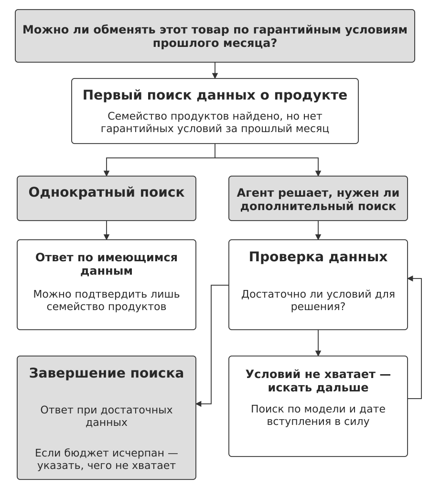

Рассмотрим ReAct. Сначала модель анализирует вопрос, выбирает поисковый запрос и вызывает `knowledge_base_search`. Получив наблюдение от инструмента, модель определяет, достаточно ли доказательств. Если не хватает условий или связанных объектов, она переформулирует запрос и продолжает поиск. Если материалов уже достаточно, модель формирует ответ с учётом источников. Harness ведёт историю, отслеживает вызовы инструментов и бюджет, а при достижении лимита завершает поиск или переходит к уточнению.

Теперь рассмотрим рисунок 3-13. Даже если заменить в бэкенде базы знаний векторный индекс на граф связей, модель по-прежнему сможет выполнять поиск через тот же интерфейс инструмента. Но если в найденном документе окажется какая-либо инструкция, может ли модель её выполнить?

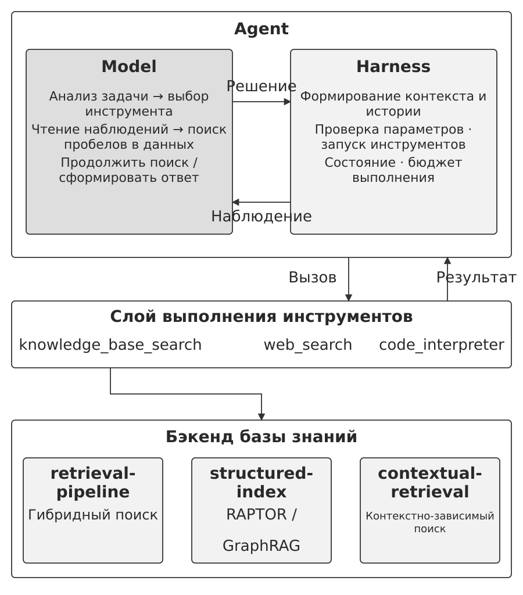

**Граница доверия к найденному содержимому.** Внешние документы могут содержать текст, пытающийся изменить поведение модели, либо в них ещё до добавления в базу знаний могли быть внесены ложные факты. Первый случай относится к косвенной инъекции в промпт, второй — к отравлению базы знаний. Для защиты необходимо одновременно контролировать происхождение содержимого и права на выполнение действий: результаты поиска должны включать источник, версию и место цитирования и использоваться как доказательства для ответа, а такие действия, как перевод средств, удаление данных или отправка внешних сообщений, должны проверяться Harness и средой выполнения на соответствие разрешениям пользователя. Проверка материалов перед добавлением в базу, отслеживание их происхождения и проверка фактов дополнительно ограничивают распространение ошибочных знаний. Здесь совместно применяются рассмотренная в главе 2 маркировка источников и ограничения инструментов из главы 4.

> **Эксперимент 3-8 ★★: сравнение однократного и многоэтапного поиска**
>
> В этом эксперименте на семи вопросах сравниваются два режима с использованием одного и того же корпуса китайских юридических материалов, одного поискового механизма BM25 и одной модели. В базовом режиме поиск выполняется один раз по исходному вопросу, а в режиме агента модель может корректировать запрос и выполнять до четырёх поисков.
>
> Для запросов вроде «Как регулируется необходимая оборона?» основные положения можно найти напрямую. Более сложный пример: «Как назначается наказание за причинение тяжкого вреда здоровью по неосторожности в состоянии опьянения при наличии судимости за кражу?». В нём одновременно затрагиваются текущее деяние, состояние опьянения и предшествующая судимость, поэтому при поиске необходимо отдельно найти соответствующие материалы, а затем проверить условия их применимости.
>
> При фактическом запуске последовательно выполнялись поисковые запросы «состояние опьянения причинение тяжкого вреда здоровью по неосторожности судимость за кражу назначение наказания», «состояние опьянения преступление назначение наказания», «влияние судимости за кражу на назначение наказания уголовное право» и «влияние судимости на назначение наказания уголовное право». Затем модель предложила запрос «признание рецидива уголовное право», но к этому моменту поисковый бюджет был исчерпан, и Harness вернул сообщение об исчерпании бюджета.
>
> Для четырёх сложных вопросов, выделенных в эксперименте, охват целевых правовых норм вырос примерно с 8 до 92%, среднее количество поисков увеличилось с одного до 3,5, а среднее время этапа формирования ответа — примерно с 8 до 66 секунд. Для трёх простых вопросов охват доказательств составил 100%, и обе группы выполняли только один поиск.

Тот же поисковый цикл можно применять к истории пользователя. Далее используется трёхуровневый набор для оценки из эксперимента 3-1, чтобы проследить, как агент извлекает факты из записей разных сеансов, различает объекты и обрабатывает обновления.

> **Эксперимент 3-9 ★★: чтение пользовательской памяти с помощью агентного поиска**
>
> В этом эксперименте полная история диалогов используется как база знаний: она разбивается на окна, после чего для неё создаётся индекс, а агенту предоставляется инструмент `search_user_memory`. Размер окна можно изменять. В данном запуске каждый фрагмент содержит восемь раундов диалога, соседние фрагменты перекрываются на два раунда, а также сохраняются идентификатор сеанса, время и бизнес-метаданные. Допускается не более трёх поисков, каждый из которых возвращает четыре фрагмента.
>
> Для базового припоминания можно искать по конкретным полям, например по запросу «Какой номер у моего чекового счёта?». При работе с несколькими сеансами также необходимо проверять полноту набора объектов: у пользователя есть и Honda Accord, и Tesla Model 3, поэтому в ответе на вопрос о запланированном обслуживании автомобилей система должна различать обе машины и состояние записи каждой из них.
>
> На этой основе можно построить следующий маршрут поиска: сначала найти сведения об автомобилях и обслуживании; обнаружив упоминание второй машины, отдельно запросить планы по Tesla; затем сообщить о существующей записи для Honda и уточнить, требуется ли пользователю также записать Tesla. Однако в фактическом запуске был выполнен только запрос `scheduled car services`, поэтому ответ группы с обычным поиском сосредоточился на Honda и упустил Tesla.
>
> Ещё одна категория трудностей связана с последовательными изменениями. В примере с переводом средств жена создаёт распоряжение, затем муж меняет сумму и дату, после чего жена снова вносит корректировку. Получив записи, необходимо восстановить последовательность изменений с учётом времени, объекта и состояния подтверждения, чтобы определить окончательно вступившее в силу распоряжение. В текущей схеме разбиения на фрагменты уже сохраняется информация о времени, однако поиск всё равно может пропустить критически важное изменение, поэтому фрагменты можно дополнительно снабдить контекстом событий.
>
> Из 60 примеров в 18 поиск выполнялся один раз, в 6 — дважды, а в 36 был полностью использован лимит из трёх поисков. Группа с обычным поиском по фрагментам прошла 47 примеров: 19 на базовое припоминание, 15 на поиск по нескольким сеансам и 13 на проактивное обслуживание. В следующем разделе на тех же примерах сравниваются префикс контекста и структурированная память, а также анализируется, какие сведения добавляет каждый из этих подходов.

### Контекстно-зависимый поиск: добавление фоновой информации к фрагментам

Вернёмся к финансовому отчёту. Чтобы найти результаты компании ACME за второй квартал 2025 года, в запросе указывают название компании и год, однако во фрагменте со словами «выручка компании выросла на 3%» как раз нет этих двух элементов. Помимо увеличения размера блоков, можно сохранить этот короткий фрагмент, добавив перед ним недостающую фоновую информацию. При **контекстно-зависимом поиске (Contextual Retrieval)** во время построения индекса для фрагмента создаётся краткий контекстный префикс, после чего префикс и исходный текст вместе используются для поиска[^ch3-1]. Этот процесс показан на рисунке 3-14.

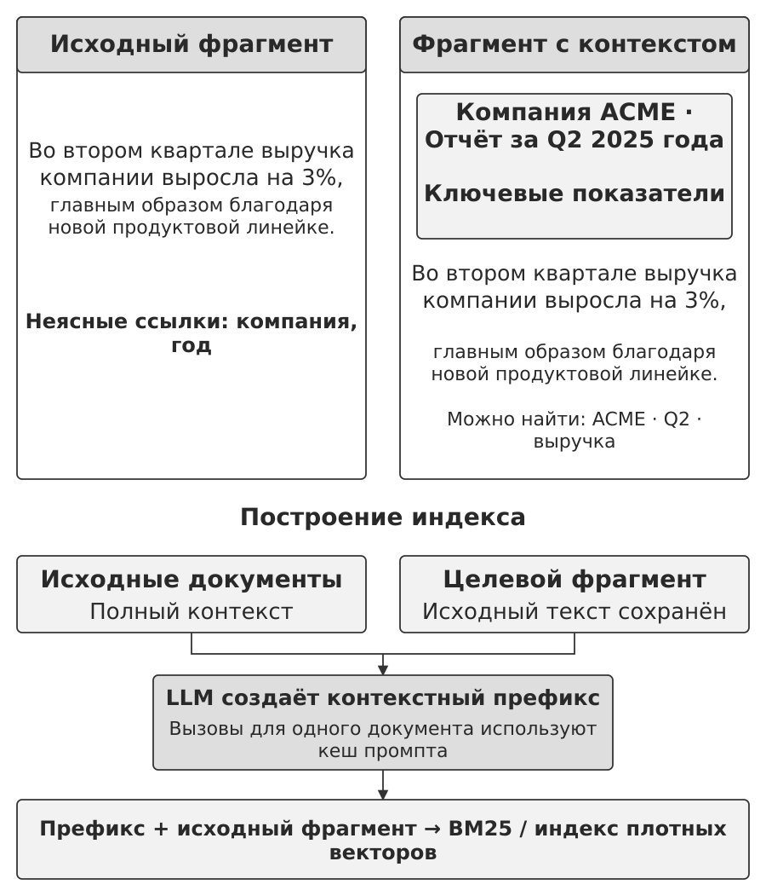

Например, в префиксе можно указать: «Этот фрагмент взят из раздела с ключевыми показателями отчёта компании ACME за второй квартал 2025 года». При генерации модели одновременно передаются исходный текст и целевой блок, чтобы она добавила подтверждённую текстом информацию о референтах, времени и разделе. Благодаря этому BM25 получает доступные для сопоставления термы, такие как название компании и квартал, а плотные эмбеддинги могут представлять фрагмент с учётом этого контекста.

Этот подход можно сочетать с контекстно-зависимым сжатием из второй главы: на этапе индексирования к блокам знаний добавляется контекст, повышающий вероятность обнаружения релевантной информации; во время выполнения уже извлечённая история упорядочивается с учётом текущей задачи, чтобы контролировать длину входных данных. Первый подход направлен на доступность фрагментов для поиска, второй — на информацию и бюджет, необходимые для принятия текущего решения.

[^ch3-1]: Anthropic. *Introducing Contextual Retrieval*. Сентябрь 2024 года.

> **Эксперимент 3-10 ★★: сравнение исходных блоков с блоками, дополненными контекстом**
>
> В этом эксперименте для одного набора материалов создаются два индекса: в одном используются исходные фрагменты, а в другом к ним добавляются сгенерированные моделью префиксы. Запросы и разметка целевых фрагментов остаются одинаковыми; отдельно сравниваются BM25, плотный и гибридный поиск.
>
> Если воспользоваться предыдущим примером с финансовым отчётом и запросом «Недавний рост выручки компании ACME», можно проверить, содержит ли найденный фрагмент одновременно целевую компанию, период и данные о росте. Одно лишь словосочетание «рост выручки» может привести к совпадению с другой компанией; после добавления префикса название компании и время могут учитываться при ранжировании.
>
> Для 15 запросов этого эксперимента после добавления префиксов recall@1 у BM25 вырос с 0,60 до 0,80, а у плотного поиска — приблизительно с 0,867 до 0,933; recall@3 у них сохранился на уровне 0,867 и 1,0 соответственно. Recall@5 у гибридного поиска вырос с 14/15 до 15/15. Для какого запроса удалось дополнительно найти целевой фрагмент? В запросе о полномочиях Постоянного комитета Всекитайского собрания народных представителей целевой фрагмент перечислял полномочия, но не содержал подлежащего. После добавления префикса BM25 поднял его с 16-го на 12-е место, однако он по-прежнему не вошёл в первую пятёрку; гибридный поиск поднял его с 6-го на 5-е место, благодаря чему фрагмент оказался среди первых пяти. Если обратиться к исходному тексту, первый фрагмент содержит полномочия с пункта 1 по пункт 4, а пятый продолжает перечисление с пункта 4 по пункт 22. При оценке проверяется лишь попадание размеченного пятого фрагмента в результаты, однако для полного перечисления полномочий необходимо объединить оба фрагмента.
>
> Генерация префиксов увеличивает число вызовов на этапе индексирования. При создании контекста для нескольких блоков одного документа можно повторно использовать кэш префикса документа. В отчёте Anthropic за 2024 год при размере блока 800 токенов, документа — 8000 токенов и заданной длине промпта расчётная стоимость однократной обработки миллиона токенов документов составляла около 1,02 доллара.
>
> Согласно этому отчёту, сочетание контекстных эмбеддингов с BM25 снизило долю неудач поиска в top-20 с 5,7% до 2,9%, то есть приблизительно на 49% относительно исходного значения; после добавления переранжирования она снизилась до 1,9%, то есть приблизительно на 67%. В отчёте доля неудач определяется как $1-\mathrm{recall@20}$.

Для относительно стабильных баз материалов, к которым требуется обращаться многократно, автор рекомендует в первую очередь дополнять фрагменты контекстом при построении индекса: однократная обработка сможет обслуживать множество последующих запросов. Если при разбиении теряются название компании, субъект события или время, простое увеличение количества результатов всё равно может вернуть набор фрагментов с неясными референтами. Если добавить эти ориентиры при генерации префиксов, последующий поиск сможет использовать их для нахождения материалов.

> **Эксперимент 3-11 ★★★: расширение памяти с помощью контекстных префиксов и структурированных карточек**
>
> Реплику «Хорошо, тогда бронируй этот вариант» в диалоге необходимо связать с ранее упомянутым товаром или маршрутом. Если в исходном тексте обсуждается билет в одну сторону из Шанхая в Сиэтл стоимостью 500 долларов, префикс может добавить этот контекст, а также сохранить сеанс и время подтверждения.
>
> В этом эксперименте к обычному разбиению на блоки добавляются две конфигурации: группа с контекстными префиксами и группа с двухуровневой памятью, в которую также загружаются Advanced JSON Cards. Сначала модель формирует последовательность поисковых запросов на основе обычного индекса, после чего тот же набор запросов применяется к двум другим индексам. Двухуровневая группа использует те же результаты расширенного поиска и дополнительно получает структурированные карточки.
>
> В примере с переводом средств префиксы соответственно указывают, что Patricia инициировала перевод, James изменил договорённость, а затем Patricia снова внесла изменения, помогая установить последовательность событий. Согласно исходной записи, окончательное состояние — 95 000 долларов и 1 октября; прежняя договорённость была заменена. Все три группы в этом эксперименте правильно определили это состояние.
>
> Двухуровневая структура также может поддерживать проактивное выявление связей. В карточках сохраняются такие ключевые факты, как «поездка в Токио» и «срок действия паспорта», а подробности диалога извлекаются по мере необходимости. Например, если поездка запланирована на 15–22 января, а срок действия паспорта истекает 18 февраля, система может сначала обнаружить близость дат, затем найти записи о продлении паспорта и требованиях для поездки и наконец напомнить пользователю проверить незавершённые приготовления. В этом примере с путешествием ответы всех трёх групп прошли проверку; различия между карточками и поиском проявились главным образом в рассмотренных ниже примерах с автомобилями и несколькими сеансами.
>
> Из 60 примеров обычный поиск, контекстные префиксы и двухуровневая память прошли соответственно 47, 52 и 57. В группе с префиксами число пройденных примеров проактивного обслуживания выросло с 13 до 18; двухуровневая группа прошла все 20 примеров на уровне поиска по нескольким сеансам и также 18 примеров на уровне проактивного обслуживания. В примере с автомобилями карточка добавила сведения о второй машине, благодаря чему ответ охватил ранее пропущенный объект. Рассмотрим и одно ухудшение: когда пользователь спросил, какое покрытие распространяется на ущерб недвижимости от воды, обычная группа упомянула собственное и сдаваемое в аренду жильё, а группа с префиксами пропустила сдаваемое жильё. Сопоставление по каждому заданию показывает, что группа с префиксами дала на 8 правильных ответов больше обычной группы, но при этом ошиблась в 3 заданиях, на которые та ответила верно.

**Когда требуется проактивное обслуживание, автор предпочитает двухуровневую архитектуру, в которой ключевые факты постоянно находятся в контексте, а подробные записи извлекаются по мере необходимости.** Если полагаться только на поиск, модели зачастую сначала нужно знать, какой вопрос задать, и лишь затем она сможет найти соответствующие записи; паспорт, автомобиль или родственная связь, ещё не попавшие в её поле зрения, поэтому легко останутся незамеченными. Небольшой объём ключевых фактов, заранее помещённый в контекст, помогает модели обнаруживать связи, формировать запросы и затем извлекать исходные подробности. При выборе постоянно доступной информации необходимо учитывать отношения между людьми, текущие ограничения и незавершённые дела; в результатах поиска следует сохранять источник, время и основание для изменений.

### Извлечение знаний из набора данных: от примеров к структурированному представлению

Знания также можно получать путём систематизации большого количества примеров. В судебных решениях, обращениях в службу поддержки и записях о ремонте множество полезных сведений рассеяно по конкретным описаниям. Когда задача требует выявить закономерности в большом массиве примеров, сравнить результаты или определить, какие уточняющие вопросы следует задать, автор рекомендует сначала извлечь унифицированные поля, а затем провести статистический анализ и сформировать прототипы. Извлечение лишь нескольких похожих примеров не позволяет увидеть распределение во всём наборе данных. После унификации полей можно собрать статистику по всему массиву записей и получить общий обзор для последующего поиска отдельных случаев.

Этот процесс можно разделить на два этапа. **Извлечение знаний** преобразует исходные описания в структурированные записи, где явно определены смысл полей, их значения и источники. Затем **анализ паттернов** с помощью статистики и кластеризации выявляет похожие случаи и их общие признаки. На рисунке 3-15 показан процесс от извлечения данных из примеров и кодирования признаков до поиска прототипов.

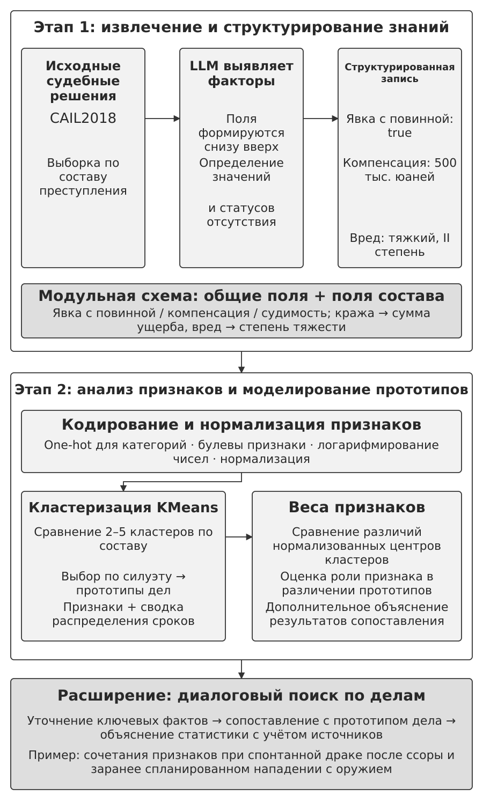

> **Эксперимент 3-12 ★★★: извлечение факторов и прототипов из судебных дел**
>
> В этом эксперименте используются материалы уголовных дел из CAIL2018. Из них выбраны примеры трёх категорий — кража, умышленное причинение вреда здоровью и мошенничество, — на основе которых построен учебный процесс «выявление факторов — извлечение полей — кластеризация — объяснение прототипов»[^ch3-cail]. Для моделирования взято по 120 записей каждой категории, а ещё по 20 оставлено отдельно. Итого получено 360 примеров для моделирования и 60 отложенных примеров.
>
> **Выявление и систематизация полей.** Сначала модель пакетами читает примеры для моделирования и предлагает потенциально полезные факторы, а затем объединяет их в модульную схему. В общей части хранятся поля, которые необходимо учитывать для нескольких видов преступлений, например явка с повинной и возмещение ущерба. В расширениях сохраняются сведения, относящиеся к конкретному виду преступления, например сумма по делу или характер причинённого вреда. В результате было сформировано 16 общих полей и три группы расширений, содержащие соответственно 12, 12 и 11 полей. Для каждого поля также необходимо определить допустимые значения и состояние отсутствующих данных, чтобы обеспечить единообразное извлечение.
>
> **Кодирование полей в векторы.** Для категориальных полей можно использовать унитарное кодирование. Например, категории «кража», «грабёж» и «мошенничество» кодируются соответственно как `[1,0,0]`, `[0,1,0]` и `[0,0,1]`, причём каждая позиция обозначает только принадлежность к соответствующей категории. Значения 1, 2 и 3 привнесли бы в некоторые алгоритмы порядок и расстояние между категориями. Для таких полей, как «была ли явка с повинной» и «был ли возмещён ущерб», значениями 1 и 0 можно обозначить два подтверждённых состояния. Случаи, не упомянутые в исходном тексте, следует обрабатывать отдельно, чтобы отсутствие данных автоматически не считалось отрицательным ответом.
>
> Для неотрицательных числовых значений с большим диапазоном, например денежных сумм, в этой реализации сначала применяется $\ln(1+x)$ для сжатия масштаба, после чего выполняется стандартизация. Если поле допускает одновременное наличие нескольких категорий — например, одна запись содержит несколько принятых мер, — для каждой категории можно выделить отдельный индикатор, сформировав многозначное бинарное кодирование.
>
> **Построение прототипов дел.** Закодированные признаки стандартизируются, после чего дела кластеризуются отдельно по каждому виду преступления. В этой реализации сравниваются варианты с числом кластеров от двух до пяти, а группировка выбирается по коэффициенту силуэта. В результате сформировано 11 прототипов. Для каждого прототипа сохраняются количество примеров, основные признаки, а также медиана, квартили и диапазон сроков лишения свободы в примерах. Например, на основе причины конфликта, способа совершения преступления и последствий причинённого вреда можно сравнить такие сочетания признаков, как начавшаяся после ссоры драка без оружия и заранее спланированное нападение с оружием. Конкретные группы совместно определяются результатами извлечения и кластеризацией.
>
> **Объяснение признаков и результатов сопоставления.** На основе различий между стандартизированными центрами кластеров программа вычисляет веса признаков при различении прототипов. При сопоставлении новый случай отображается в то же пространство признаков, после чего извлекаются статистическая сводка по ближайшей группе и основания для совпадения, чтобы модель могла сформировать объяснение.
>
> Из 60 отложенных примеров были выбраны 12, для которых сгенерировали объяснения, а затем передали их независимой модели для оценки. Рассмотрим один пример кражи. Соответствующий ему прототип содержал только одну запись для моделирования со сроком лишения свободы четыре месяца, поэтому минимальное, медианное и максимальное значения составляли четыре месяца. Генератор достоверно сообщил это число и также указал, что для сравнения доступна лишь одна запись. За верность чисел данным прототипа оценщик поставил максимальные 4 балла, хотя фактическая метка отложенного примера составляла восемь месяцев.
>
> Если поиск по прототипам используется в диалоге, сначала можно уточнить, какие отсутствующие факты способны повлиять на сопоставление, а затем повторить поиск с учётом ответа.

[^ch3-cail]: CAIL2018 — официальный проект набора данных. Для сопутствующего эксперимента были отобраны примеры из общедоступных материалов, а моделирование и оценка проводились с разделением внутри выборки.

При переходе от примеров к прототипам база знаний получает дополнительный слой доступного для поиска статистического представления. Исходный текст служит доказательством, поля обеспечивают возможность вычислений, а прототипы обобщают общие признаки похожих примеров. Связи между всеми тремя уровнями необходимо сохранять, чтобы при обнаружении ошибки извлечения или смещения выборки можно было вернуться к исходным данным и внести исправления.

### Передний край исследований: мультимодальная и параметрическая память

Представьте, что пользователь указывает на ранее загруженную фотографию и говорит: «Нужен именно этот цвет». Если система сохранила лишь слова «синяя куртка», в следующий раз она может не различить два оттенка синего. При преобразовании в текст также теряются детали тембра голоса и пространственных связей на диаграммах. Чтобы при будущих запросах эти сведения можно было восстановить, можно сохранять исходные материалы, представления, пригодные для использования моделью, либо исследовать постоянную память внутри самой модели.

**Первый подход: сочетание исходных материалов с текстовым индексом.** Например, в авторизованной пользователем задаче по систематизации фотоальбома можно вырезать и сохранять отдельные области, такие как лица людей, ссылаться на изображения в записях Markdown, а также фиксировать время съёмки, обстановку и предоставленные пользователем метки людей. При поиске сначала по описанию находят несколько потенциально релевантных фотографий, а затем загружают оригиналы или вырезанные области и сравнивают детали внешности. Фрагменты аудио также можно связать со временем, источником и расшифровкой, чтобы при необходимости воспроизводить исходную запись. Текст служит точкой входа, а исходные материалы сохраняют детали, которые трудно выразить словами.

**Второй подход: хранение эмбеддингов и их загрузка по мере необходимости.** Визуальный или аудиоэнкодер может преобразовать материалы в векторы и сохранить их в индексе для поиска по сходству. Например, после кодирования отдельных областей изображения или фрагментов аудио их можно связать с соответствующими записями памяти. Если модель поддерживает обученный проекционный слой и интерфейс памяти, в контексте также можно зарезервировать набор слотов, загрузить в них эти непрерывные векторы и предоставить модели доступ к ним через механизм внимания. Для этого необходимо согласовать представления энкодера с внутренними представлениями языковой модели.

В предварительном исследовании автора и Noah Shi эта задача разделена на два этапа. На групповой фотографии изображены два человека, и пользователь спрашивает: «Тот, кто стоит у окна, — это человек, которого мы видели в прошлый раз?» Сначала по указанию «у окна» нужно определить, кого имеет в виду пользователь, а затем сравнить изображение этого человека с ранее сохранённым образцом. Если на первом этапе выбран не тот человек, даже безошибочное распознавание на втором этапе даст ответ на другой вопрос. В статье такие факты, как имена, которые можно точно записать, также оставлены в текстовой памяти, чтобы для каждого из двух типов информации использовался подходящий способ доступа.[^ch3-perceptmem]

[^ch3-perceptmem]: Боцзе Ли, Noah Shi, Parametric Multimodal User Memory; сопутствующий проект `19PINE-AI/multimodal-user-memory` содержит реализацию и эксперименты PerceptMem. Вопрос о групповой фотографии приведён в качестве учебного примера.

**Третий подход: постоянная память внутри модели.** Обучение отдельной LoRA для каждого пользователя — один из способов записать персонализированные факты в модель. Прямой вопрос «Где живёт пользователь?» и планирование поездки с учётом его адреса предъявляют разные требования к использованию памяти: в первом случае нужно извлечь факт, а во втором — ещё и задействовать его в последующих рассуждениях. Если обучать модель только воспроизводить факты, она может помнить ответ, но не использовать его самостоятельно в сложных задачах. Поэтому обучающие примеры должны включать как прямые вопросы, так и задачи, решение которых зависит от этих фактов.

В исследовании автора **User as Engram** текстовые факты записываются в локальную таблицу памяти модели Engram, а общий адаптер обучается использовать эти факты в рассуждениях[^engram]. Поиск N-gram с хешированными ключами отвечает за обнаружение записей таблицы, а механизм гейтинга передаёт извлечённое содержимое в модель; для каждого пользователя сохраняются локальные записи, тогда как компонент рассуждений может быть общим. В экспериментах с текстовыми фактами в статье сравниваются прямое воспроизведение и косвенное рассуждение, а также показано, как раздельно управлять содержимым памяти каждого пользователя и общей способностью к рассуждению.

[^engram]: Li, Bojie, User as Engram: Internalizing Per-User Memory as Local Parametric Edits, 2026.

Для распространения этого подхода на мультимодальные данные также необходимо разработать механизмы адресации, записи и чтения представлений изображений и аудио.

## Итоги главы

Вернёмся к поручению забронировать билет из начала главы. «Я предпочитаю место у окна» — это предпочтение пользователя, а допустимое количество багажа нужно уточнять по правилам авиакомпании, действующим на дату поездки. Если сохранить оба сведения одним предложением, легко упустить важнейшее различие: к кому относится первое и с какого момента действует второе. При сохранении нужно фиксировать источник, время и условия применимости — только тогда после извлечения можно обоснованно решить, подходит ли информация в данном случае. Отдельный факт удобно хранить в виде краткой заметки; если требуется описать отношения между людьми или сохранить контекст происхождения сведений, можно использовать карточку или фрагмент исходного текста; даты и количества также можно хранить в типизированных полях, чтобы программа могла выполнять вычисления.

Если помощник ошибся в норме провоза багажа, сначала следует проверить, загружены ли действующие правила в базу знаний, затем выяснить, в какой фрагмент они попали, нашёл ли их поисковый компонент и какое место они заняли после переранжирования, а в завершение — какие материалы получила модель. Если исходного текста много, структурированный обзор можно оставить в контексте, а подробности извлекать по мере необходимости. Резюме глав помогает искать по темам, а индекс связей — находить взаимосвязанную информацию; если во фрагменте потерялась отсылка, к нему можно добавить сведения об источнике и контексте; если после одного поиска доказательств всё ещё недостаточно, агент может изменить запрос и продолжить поиск.

После публикации авиакомпанией новых правил сначала можно выполнить небольшое обновление, сохранив даты вступления в силу и источники как новых, так и прежних правил; накопившиеся дубликаты, противоречия и изменения структуры затем следует периодически упорядочивать. Предлагающий передаёт изменение на проверку, проверяющий сверяет доказательства, а после одобрения перестраивается рабочий индекс. История версий позволяет повторно воспроизвести вопросы, на которые раньше были даны неверные ответы, а также установить, на каких материалах основывался прежний ответ. В девятой главе будет отдельно рассмотрено, как накапливать опыт на основе результатов выполнения.

Сведения о том, что можно зарегистрировать два места багажа, отвечают лишь на вопрос: «Допускают ли это правила?» Чтобы добавить багаж в заказ пользователя, помощнику также нужно знать, какой инструмент можно вызвать, какие параметры ему требуются и какое подтверждение означает, что операция выполнена. С этого начинается следующая глава.

## Вопросы для размышления

1. ★★ Пользователь говорит: «1 мая я переехал из A в B, с 10 по 20 мая живу в гостинице C, а в этот период счета присылайте по электронной почте». Как 15 мая помощник должен ответить на вопросы о домашнем адресе, временном месте проживания и способе доставки счетов? Разработайте правила записи и запросов, объяснив, как обрабатывать исправления опечаток и противоречащие друг другу адреса.
2. ★★ Если исходный документ содержит противоречивую информацию, контекстный префикс может записать в индекс и ошибки. Как бы вы сохраняли источники, версии и неопределённые элементы и использовали их на этапах поиска и генерации?
3. ★★ Какие пространственные отношения легко утратить при преобразовании диаграммы в текст? На примере таблицы, архитектурной схемы или линейного графика разработайте схему совместного поиска по исходному изображению, структурированному представлению и текстовому индексу.
4. ★★★ Какие операции разбиения на фрагменты, индексирования и поиска по мере совершенствования моделей и их способности работать с длинным контекстом можно будет передать модели? Проанализируйте этот вопрос с учётом рассуждений Рича Саттона о поиске и обучении в «Горьком уроке» и разработайте эксперимент для сравнения передачи всех данных на вход с поиском по требованию, проверяя качество выполнения задачи, вычислительные затраты и ограничения прав доступа.
5. ★★★ Если модель уже обладает обширными знаниями предметной области, что всё ещё следует хранить во внешней базе знаний? Отдельно рассмотрите общедоступные знания, постоянно обновляемые правила, закрытые материалы и доказательства, требующие точной прослеживаемости.
6. ★ Для каких запросов подходят многоуровневые сводки RAPTOR, а для каких — связи между сущностями и сводки сообществ GraphRAG? Приведите по одному примеру для общего обзора, локальных подробностей и многошаговых связей и укажите, какие доказательства необходимо проверять.
7. ★★ Как каталоги, ссылки и векторный индекс могут совместно организовывать знания? Разработайте базу знаний, которую должны совместно поддерживать люди и AI-агент, и объясните роль навигации, семантического поиска, обновления версий и фильтрации по разрешениям.
8. ★★★ Как после извлечения полей из примеров и их кластеризации определить, полезны ли полученные прототипы? Разграничьте значимость признаков кластеризации, способность предсказывать результаты и причинное объяснение, а также разработайте процесс оценки на отложенной выборке и экспертной проверки.
9. ★★★ Разработайте для хранилища пользовательской памяти в формате Markdown процессы инкрементального обновления и периодической реорганизации. Если проверяющий и предлагающий используют одну и ту же модель, а проверяющий видит только фрагменты, выбранные предлагающим, какие ошибки легко могут остаться незамеченными? Предложите улучшения с точки зрения полноты доказательств, разрешений на использование инструментов и оценки качества проверки.

[^ch3-glove]: Pennington и др., GloVe: Global Vectors for Word Representation, 2014.

[^ch3-sbert]: Reimers и Gurevych, Sentence-BERT: Sentence Embeddings using Siamese BERT-Networks, 2019.


**Практикум к главе 3.** [Каталог экспериментов](https://github.com/bojieli/ai-agent-book/tree/40f4ce5778e6cc93e3606c3079bf8cf13a0c4d04/chapter3) · [Путеводитель на русском](https://github.com/bojieli/ai-agent-book/blob/40f4ce5778e6cc93e3606c3079bf8cf13a0c4d04/chapter3/README.ru.md).
