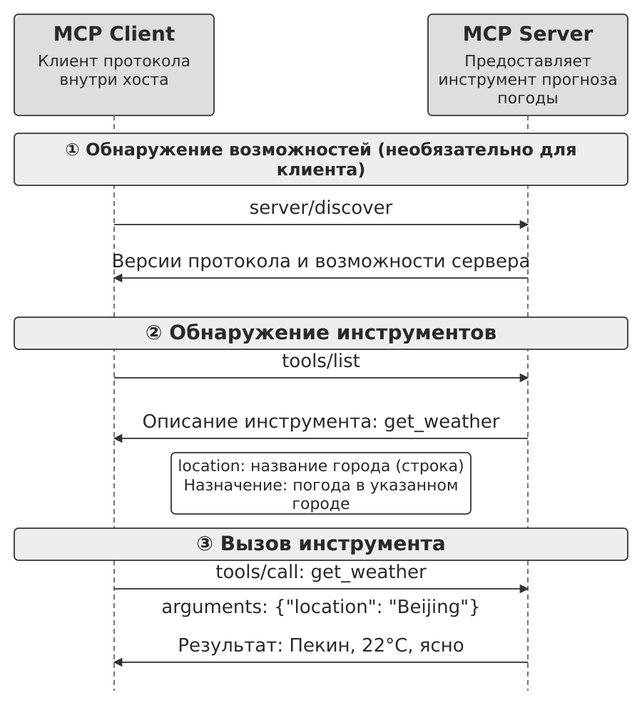
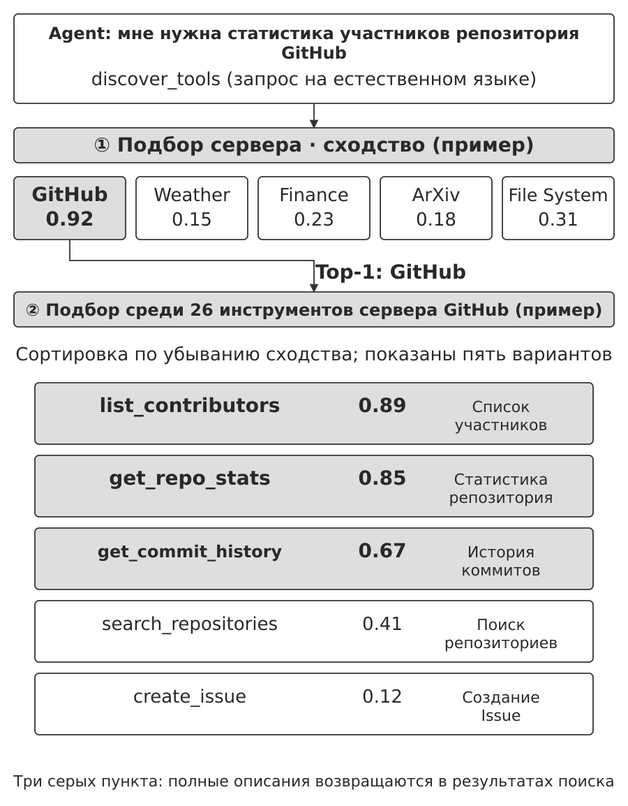
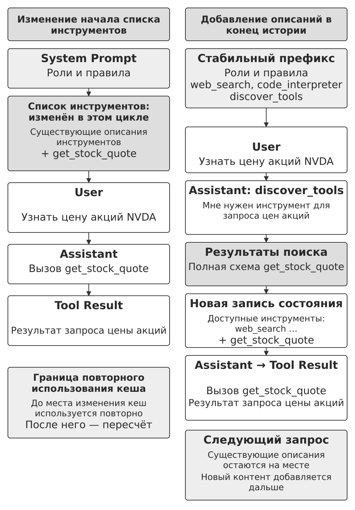
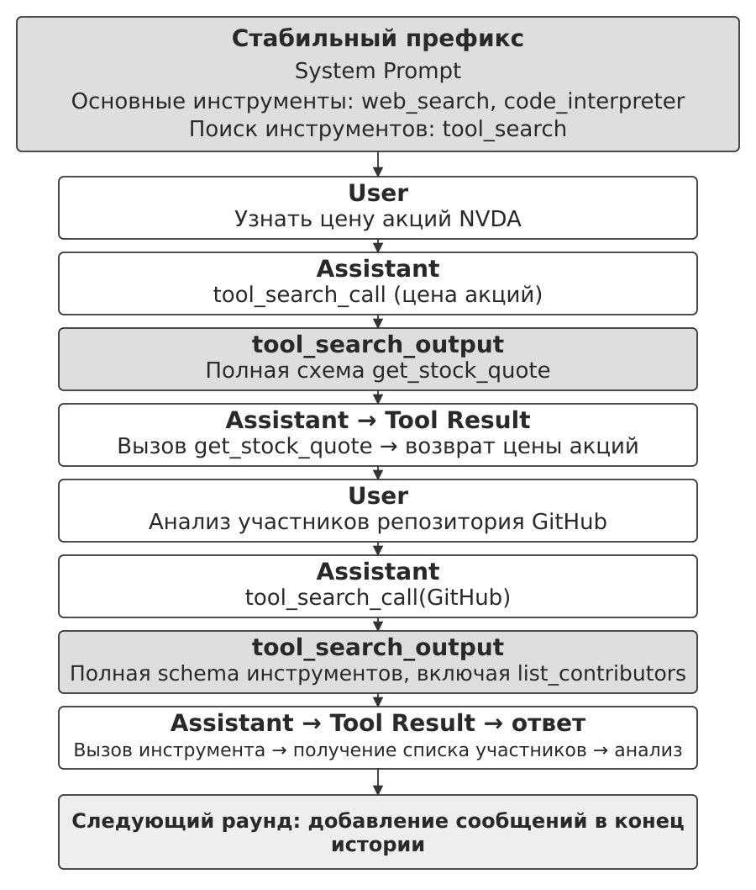

<!-- Русский перевод: community edition. Источник: https://github.com/bojieli/ai-agent-book; файл изменён относительно upstream. -->

# Инструменты

В научно-фантастическом фильме «Она» AI-ассистент Саманта разбирает электронную почту, помогает составлять ответы, занимается вопросами публикации и переключается между разными каналами связи. Такому ассистенту необходимо преобразовывать понимание языка в действия во внешних системах. AI-агент выполняет эти взаимодействия с помощью **инструментов**. Инструменты служат его «органами чувств, руками и ногами»: они предоставляют наблюдения и выполняют действия. Рассматриваемым в этой книге универсальным агентам, таким как Manus и OpenClaw, инструменты также необходимы для доступа к цифровому миру.

Предположим, пользователь говорит: «Найди в письмах клиентов упомянутые даты поставки, сведи их в таблицу и отправь мне». Модель может решить, какие письма проверить, но для чтения исходного текста ей потребуется доступ к почтовому ящику, а для отправки таблицы — вызов интерфейса отправки. Как проектировать такие инструменты и как модели находить их при необходимости? В этой главе сначала разграничиваются пять типов инструментов, затем рассматриваются их описание, подключение и обнаружение, а после этого по отдельности проектируются интерфейсы восприятия, выполнения и совместной работы. Запуск по событиям и взаимодействие с пользователем также затрагивают вопросы о том, когда пробуждать агента и как передавать сообщения между каналами, поэтому они будут подробно рассмотрены в шестой главе.

## Классификация инструментов

Рассмотрим проверку электронной почты. Модель выбирает следующее действие, Harness проверяет параметры и разрешения и отправляет запрос, а почтовый сервис непосредственно читает или записывает данные. В первой главе инструменты были разделены по назначению на инструменты восприятия, выполнения, совместной работы, общения с пользователем и запуска по событию. Первые четыре типа AI-агент вызывает по собственной инициативе, а инструменты запуска по событию позволяют внешним событиям также пробуждать агента (таблица 4-1).

Таблица 4-1. Направление вызова и основное назначение пяти типов инструментов

| Тип инструмента | Направление вызова | Основное назначение |
| --- | --- | --- |
| Инструменты восприятия | Агент вызывает инструмент по собственной инициативе | Получение внешней информации |
| Инструменты выполнения | Агент вызывает инструмент по собственной инициативе | Выполнение вычислений или изменение внешнего состояния |
| Инструменты совместной работы | Агент вызывает инструмент по собственной инициативе | Делегирование задач, обмен сообщениями, координация других агентов или людей |
| Инструменты общения с пользователем | Агент вызывает инструмент по собственной инициативе | Ответ пользователю, представление результатов или отправка напоминаний |
| Инструменты запуска по событию | Разработчик настраивает или агент регистрирует, внешняя среда запускает | Пробуждение агента при наступлении заданного события |

**Инструменты восприятия** позволяют агенту получать внешнюю информацию. К ним относятся поиск в интернете `web_search`, поиск в базе знаний `knowledge_base_search`, чтение веб-страниц `fetch_url`, поиск файлов по имени `find_file`, поиск по содержимому файлов `grep_file` и чтение файлов `read_file`.

**Инструменты выполнения** позволяют агенту выполнять вычисления или изменять внешнее состояние. К ним относятся командная строка `shell_exec`, интерпретатор кода `code_interpreter`, запись файлов `write_file`, редактирование файлов `edit_file` и отправка электронной почты `send_email`. Один и тот же универсальный исполнитель может как выполнять вычисления без изменения данных, так и изменять данные.

**Инструменты совместной работы** поддерживают делегирование задач и обмен сообщениями. К ним относятся создание субагента `spawn_subagent`, отправка сообщения субагенту `send_message_to_subagent`, отмена работы субагента `cancel_subagent` и обнаружение доступных агентов `list_agents`. Независимые задачи можно выполнять параллельно, например отдельно исследовать биографии нескольких соучредителей OpenAI. Разные задачи также можно поручать агентам, настроенным с разными моделями, инструментами, промптами и контекстами. Разделение труда и архитектуры совместной работы подробнее рассматриваются в главе 10.

**Инструменты общения с пользователем** передают пользователю информацию. К ним относятся ответ на сообщение `reply_to_user`, отправка структурированной карточки `send_card_to_user` и отправка напоминания `send_user_notification`. Когда взаимодействие охватывает несколько каналов или требует фоновых уведомлений, система может оформить отправку сообщений как явный вызов инструмента, чтобы централизованно управлять получателями, содержимым и состоянием доставки.

**Инструменты запуска по событию** связывают внешние события с выполнением агента. К ним относятся установка таймера `set_timer`, мониторинг фоновой задачи `monitor_shell` и подключение источника событий `connect_channel`. Весь процесс состоит из двух этапов. При регистрации разработчик заранее задаёт настройки либо агент с помощью разрешённого вызова указывает интересующие его события. После наступления события система диспетчеризации получает обратный вызов или сообщение о событии и пробуждает агента для обработки. Новое электронное письмо, системное предупреждение, напоминание по расписанию или завершение фоновой задачи — всё это может стать новой точкой входа в выполнение.

Вернёмся к задаче с электронной почтой из начала главы. Открыть исходное письмо и узнать дату поставки — это восприятие. Создать и сохранить сводную таблицу — выполнение, поскольку при этом изменяется рабочая область. Передать таблицу заказчику — общение с пользователем. Запуск по событию появляется лишь в том случае, если система автоматически продолжает работу после получения следующего письма от клиента. Один и тот же почтовый сервис может выполнять несколько из этих функций. Теперь нужно определить, насколько мелкими должны быть инструменты, предоставляемые модели: должна ли она отдельно искать письмо, читать его текст и находить вложения или же часто выполняемые подряд действия следует объединить за неё?

## Общие принципы проектирования инструментов

На раннем этапе подключения инструментов распространённым подходом было непосредственное оборачивание каждой конечной точки API. Такой подход позволяет быстро выполнить интеграцию, но зачастую приводит к появлению набора интерфейсов с очень мелкой гранулярностью. Для выполнения одной задачи AI-агенту может потребоваться многократно искать объект, читать его свойства, проверять условия и только затем вызывать интерфейс выполнения. При проектировании инструментов эти операции можно объединять вокруг типовых задач: например, связать поиск контакта с отправкой сообщения или сделать так, чтобы поиск по журналам сразу возвращал подходящие строки вместе с их контекстом[^ch4-tool-design].

**Инструменты следует проектировать вокруг задач, которые должен выполнять агент.** Подход к проектированию интерфейсов, исходящий из способов их использования агентом, называется **ACI** (Agent-Computer Interface, интерфейс взаимодействия агента с компьютером). HCI рассматривает взаимодействие человека с компьютером, а ACI — то, как модель выбирает операции, формирует параметры, интерпретирует обратную связь и исправляет ошибки.

[^ch4-tool-design]: Anthropic, *Writing effective tools for AI agents—using AI agents*, 2025.

### Формы представления возможностей: специализированные инструменты, универсальные исполнители и Skill

Если поручить модели «развернуть приложение», можно спроектировать три варианта интерфейса. Первый предоставляет только `deploy_app`, а все этапы выполняются на сервере. Второй предоставляет отдельные операции сборки, упаковки и развёртывания, а модель решает, когда переходить к следующей. В третьем случае этапы описываются в Skill, а модель выполняет их в терминале. Если сборка завершится ошибкой, в первом варианте инструмент должен сообщить модели, на каком этапе она произошла, тогда как в двух остальных вариантах ошибку этой сборки можно напрямую передать модели.

- **Специализированные инструменты** предоставляют структурированные интерфейсы для определённых операций. Разработчик задаёт схему параметров, правила проверки, логику выполнения и формат результата, благодаря чему инструмент удобно отдельно тестировать и авторизовывать. После включения определения инструмента в контекст занимаемый им объём зависит от длины полей, описаний и примеров.
- **Универсальные исполнители и Skill** используются совместно: терминал или интерпретатор кода предоставляет возможность выполнения, а Skill описывает процесс, условия применимости и порядок действий. Сначала хост может загрузить только название и краткое описание, а после выбора — полную инструкцию и связанные ресурсы.

Например, Skill для развёртывания может последовательно предписывать: собрать проект командой `npm run build`, создать образ командой `docker build -t app:latest .`, а затем применить к текущему кластеру ресурсы из манифеста командой `kubectl apply -f deploy.yaml`. Агент выполняет эти шаги через инструмент терминала, повторно используя одну и ту же точку входа для выполнения.

Реализация инструмента и момент, когда модель читает его описание, — два разных вопроса. Для сотен специализированных инструментов можно показывать только индекс, загружая схемы по требованию. Небольшой каталог Skill можно постоянно держать в контексте, а по мере его роста добавить поиск. Выбор между специализированным интерфейсом и универсальным исполнителем влияет на передачу параметров и сопровождение кода; выбор между полной загрузкой и загрузкой по требованию определяет, какие инструменты модель видит на текущем шаге. Стратегии раскрытия будут рассмотрены далее, в разделе «Что делать, если инструментов слишком много».

**Автор рекомендует отдавать предпочтение универсальным инструментам, дополняя их специализированными интерфейсами в соответствии с требованиями к правам доступа, параметрам и производительности.** Например, если настроить в песочнице для `code_interpreter` библиотеки SymPy, NumPy и pandas, агент сможет писать на Python код для выполнения арифметических и символьных вычислений, обработки массивов и анализа данных. Такой подход позволяет в полной мере использовать способность модели генерировать код: один интерпретатор может выполнять множество алгоритмов и комбинировать существующие библиотеки для решения заранее не предусмотренных задач. Модель отвечает за генерацию кода, а среда выполнения — за его исполнение и ограничение доступа к файлам, сети и ресурсам.

Даже при использовании специализированных инструментов автор рекомендует прежде всего объединять близкие по назначению операции, которые часто используются совместно. Если интерфейсы слишком мелкие, модели приходится запоминать больше названий и различий между ними, а для выполнения одной задачи требуется больше вызовов. Основные критерии объединения — **сходство функций** и **степень пересечения сценариев использования**. Например, `extract_pdf_text`, `extract_docx_content` и `extract_pptx_content` принимают документы и извлекают из них текст, поэтому их можно объединить в `read_document`, различая форматы с помощью `file_type`. Модели достаточно выбрать единую точку входа, а новые форматы смогут использовать ту же структуру параметров и результата.

Специализированные интерфейсы особенно уместны в следующих четырёх случаях.

1. **Требуются точная авторизация и аудит.** Запись в производственную базу данных можно оформить как операцию с чётко ограниченной областью действия: сервер проверяет права пользователя, целевую таблицу и поля, которые разрешено изменять, а также фиксирует основание операции.
2. **Требуется скрыть различия между платформами.** Операции grep и find можно выполнять через shell, однако специализированный инструмент поиска файлов позволяет унифицировать параметры и обратную связь в macOS, Windows и Linux, например всегда возвращая имя файла, номер строки и совпавший фрагмент.
3. **Операция выполняется очень часто.** Для часто используемой операции можно предоставить короткую и стабильную точку входа, сократив затраты на повторную генерацию скриптов и объяснение процесса.
4. **Параметры имеют сложные взаимосвязи.** Вложенные объекты, зависимости между полями и сложные ограничения допустимых значений удобно выражать совместно через схему и проверки бизнес-логики.

**Чем сложнее параметры, тем важнее способ их передачи.** В структурированных вызовах инструментов входные данные обычно описываются с помощью JSON Schema. Некоторые сервисы моделей поддерживают генерацию с ограничениями, обеспечивающую соответствие параметров поддерживаемым правилам схемы. Структуру возвращаемого значения задаёт интерфейс инструмента, после чего хост передаёт результат модели. Помимо проверки типов и форматов, Harness и сервис инструмента по-прежнему должны проверять права доступа, существование объектов и выполнение бизнес-условий для нескольких полей.

Skill может объяснять, как вызывать специализированные инструменты, либо предписывать агенту использование CLI. Во втором случае модель должна одновременно учитывать синтаксис командной строки, кавычки и экранирование, причём правила различаются между оболочками. Чем сложнее параметры, тем больше деталей модель должна обработать правильно. Сложные вложенные параметры можно сначала записать в JSON, а затем передать команде соответствующий файл: это сокращает число уровней экранирования и позволяет проверить содержимое перед выполнением.

**Преимущество Skill заключается в том, что его могут напрямую создавать и изменять специалисты предметной области.** Человек, знакомый с бизнес-процессом, может самостоятельно описать шаги или отредактировать инструкцию, подготовленную агентом. Если изменился порядок действий, определённый шаг применим только к некоторым клиентам или требуется заменить пример, достаточно исправить текст инструкции, не меняя код инструмента и не развёртывая интерфейс заново. Согласно спецификации Agent Skills, метаданные `SKILL.md` имеют установленный формат, основной текст оформляется в Markdown, а к документу можно прикладывать скрипты, справочные материалы и другие ресурсы[^ch4-skill-format].

[^ch4-skill-format]: Agent Skills, спецификация формата, включая метаданные, основной текст, сопутствующие ресурсы и прогрессивную загрузку.

При выборе формы представления возможности можно учитывать четыре фактора.

- **Безопасность и права доступа**: специализированный интерфейс упрощает ограничение области операций; универсальный исполнитель контролирует возможности выполнения с помощью песочницы, учётных данных и прав доступа к ресурсам.
- **Сложность параметров**: сложные структуры удобно обрабатывать с помощью схемы и проверок бизнес-логики; параметры простых операций можно передавать непосредственно через CLI.
- **Частота изменений**: часто изменяющиеся процессы лучше описывать в Skill, чтобы специалисты предметной области могли напрямую редактировать инструкции и примеры; стабильные и многократно используемые низкоуровневые операции следует оформлять как инструменты или скрипты.
- **Возможности модели**: если модель надёжно генерирует код и работает с командной строкой, предпочтительно комбинировать Skill с универсальным исполнителем, сокращая число специализированных инструментов. Если модель слабее и часто ошибается в сложных параметрах, больше ограничений следует возложить на структурированные интерфейсы.

**Код также может оркестрировать несколько вызовов инструментов.** При загрузке нескольких веб-страниц и извлечении полей модель может сгенерировать скрипт, который выполнит цикл, фильтрацию и агрегирование. Полный текст страниц сохраняется в переменных среды выполнения, а в контекст возвращаются только выбранные поля и статистические результаты. Условия, циклы и обработка исключений в программе связывают этапы, после чего модель непосредственно анализирует агрегированный результат. Для задач с заранее понятной последовательностью действий, таких как пакетная загрузка, фильтрация и статистическая обработка, автор предпочитает связывать операции кодом. Это сокращает число циклов, в которых модель поочерёдно вызывает инструменты и читает промежуточные результаты. Чем больше промежуточных данных и чем компактнее возвращаемые поля, тем значительнее экономия контекста. Такая программная оркестрация будет подробнее рассмотрена в пятой главе.

Подобные интерфейсы часто называют **Code Mode**. Например, при работе с MCP-сервером Cloudflare модель сначала пишет для `search()` программу запроса, которая находит в описании OpenAPI необходимые конечные точки и параметры, а затем через `execute()` отправляет JavaScript, вызывающий эти конечные точки. Чтобы вывести DNS-записи, соответствующие заданным условиям, программа может постранично получать и фильтровать данные, возвращая только найденные записи. Первый шаг избавляет от необходимости помещать в контекст всё руководство по интерфейсу, а второй — от многократной передачи модели результатов каждой страницы. Какие зоны доступны исполняющей стороне и разрешено ли ей изменять записи, по-прежнему определяется серверной авторизацией.[^ch4-code-mode]

[^ch4-code-mode]: Cloudflare, реализация MCP в режиме Code Mode; Armin Ronacher на примере Pi 1.0 рассматривает разделение ответственности между инструментами и средой выполнения, предоставляемыми Harness.

### Описание инструментов: назначение, параметры и обратная связь

При составлении описания инструмента сначала можно представить запрос, при котором его проще всего использовать неправильно. Пользователь говорит: «Найди в договоре пункты, где упоминается неустойка». Поиск по именам файлов вернёт только файлы с совпадением в названии; даже получив путь, модель всё равно должна прочитать содержимое документа. Описание инструмента должно позволять модели определить, какой интерфейс выбрать, какие данные передать при вызове и на какие вопросы достаточно полученного результата.

**Указывайте, когда следует использовать инструмент.** Поиск в интернете можно описать так: «Использовать, когда требуется получить актуальную информацию или найти неизвестный факт». Это помогает модели сопоставить потребность пользователя с назначением инструмента. При описании «искать связанное содержимое» модели пришлось бы самостоятельно угадывать область и условия применения поиска.

**Явно определяйте входные данные и область поиска.** Например, для инструмента поиска по именам файлов можно указать: «Сопоставляет имена и пути файлов; для поиска текста внутри файлов используйте `grep_file`». Чёткое разделение ответственности между соседними инструментами помогает модели сразу выбрать правильную точку входа. **По мнению автора, ясное определение граничных условий зачастую важнее перечисления функций.** Какие входные данные принимает инструмент, где именно выполняет поиск и как обрабатывает пустые результаты и ошибки — всё это непосредственно влияет на следующий шаг модели.

**Объясняйте параметры с помощью спецификаций и примеров.** Для `timestamp` можно написать: «Формат RFC3339, например `2024-03-15T14:30:00Z`». При выполнении сложной задачи модели приходится одновременно выбирать инструмент, извлекать сведения из истории действий и оценивать дальнейшие шаги, а формат параметра представляет собой лишь одну из множества деталей. Полная строка даёт готовый образец, по которому модель может сформировать параметр, снижая вероятность ошибки при повторной интерпретации термина.

Аналогично, `phone` можно описать так: «Номер телефона в международном формате E.164: начинается с `+`, после которого следуют код страны и номер; оставшаяся часть содержит только цифры, без пробелов и разделителей. Например, `+8613888888888` для Китая или `+12025551234` для США».

**Описывайте структуру результата и стоимость выполнения.** Например: «Возвращает JSON-массив, каждый элемент которого содержит три поля: `title`, `url` и `snippet`». Это упрощает извлечение заголовка, источника и краткого содержания. Для долго выполняющихся инструментов можно указать ожидаемую задержку, измеренную в конкретной среде, и альтернативную точку входа, например: «Чтение полной веб-страницы может занять 5–10 секунд; если нужны только метаданные, вызовите `get_page_metadata`».

Кроме того, можно привести от одного до пяти проверенных примеров вызова, охватывающих минимальный набор параметров, распространённые сочетания и сложные условия. JSON Schema позволяет выражать типы, обязательные поля, диапазоны значений и некоторые зависимости между полями[^ch4-json-schema]; примеры показывают, как применять эти правила к конкретным задачам: задаётся ли временная метка в секундах или миллисекундах, как вкладываются условия фильтрации и какие необязательные поля обычно используются совместно. Во внутреннем тестировании сложных параметров, о котором Anthropic сообщила в 2025 году, добавление примеров вызовов инструментов повысило точность с 72% до 90%[^ch4-tool-examples].

[^ch4-json-schema]: JSON Schema, типы объектов и ограничения свойств. Набор ключевых слов схемы, поддерживаемых интерфейсом модели, определяется соответствующим сервисом.

[^ch4-tool-examples]: Anthropic, *Introducing advanced tool use on the Claude Developer Platform*, 24 ноября 2025 года, раздел Tool Use Examples.

Если агент часто выбирает неправильный инструмент, автор рекомендует **сначала проверить описание инструмента**: не имеют ли несколько инструментов похожие названия, ясно ли определена область поиска и достаточно ли примеров параметров. Этот подход также применим к названию, краткому описанию и инструкциям Skill.

### Точность передачи параметров

Модель просит заменить фрагмент исходного текста, но исполнитель сообщает, что он «не найден». Прежде чем предлагать модели переформулировать строку, следует проверить, получили ли обе стороны одну и ту же последовательность символов. Вызов проходит через разбор, сериализацию, прокси и обёртки среды выполнения, и каждый слой может изменить содержимое. **Точность параметров** означает, что значение на стороне исполнителя имеет тот же смысл, что и значение, отправленное моделью. Протокольное экранирование может изменить форму передачи, но после декодирования кавычки и переводы строк должны сохраниться.

Рассмотрим проблему преобразования типографских кавычек в одной из версий Cursor начала 2026 года. Инструмент замены принимал `old_string` и `new_string` и изменял файл по точному совпадению. Инструмент чтения возвращал типографские кавычки `“` и `”`, соответствующие `\u201c` и `\u201d`. Модель помещала исходный текст в `old_string`, но при передаче параметров кавычки преобразовывались в английскую прямую кавычку `"`. Исходный текст в файле оставался неизменным, поэтому инструмент замены возвращал сообщение «совпадений не найдено». Повторное чтение и копирование исходного текста приводило к той же ошибке.

Та же проблема затрагивала и запись. Модель требовала записать типографские кавычки, однако в файле в итоге сохранялись прямые. Прочитав файл после записи, модель видела содержимое, отличающееся от ожидаемого, и могла попытаться исправить его. Пока преобразование продолжалось, каждая повторная попытка воспроизводила одну и ту же ошибку.

Другая разновидность проблемы — **неявное внедрение параметров**. Инструмент bash в одной IDE автоматически добавлял к `git commit` параметр, отмечающий коммит как созданный AI. Старая версия Git не распознавала этот параметр, поэтому команда завершалась ошибкой. Модель видела только сформированную ею команду и могла многократно менять сообщение коммита или другие параметры, так и не затрагивая настоящую причину сбоя.

При диагностике таких проблем следует сопоставить параметры, сформированные моделью, параметры после передачи, фактически выполненный запрос и возвращённый результат. Если интерфейс унифицирует кодировку или добавляет параметры выполнения, правила преобразования необходимо явно описать, а в результате вернуть фактически использованные значения. Для инструмента точного сопоставления даже лишний пробел, отсутствующий перевод строки или изменённая кавычка могут привести к несовпадению. Чтобы правильно исправить следующий вызов, модель должна знать, что именно получил исполнитель.

## Экосистема инструментов: MCP и Skill Hub

Интерфейсы разных моделей и фреймворки AI-агентов используют собственные способы определения инструментов, например function calling, tool use и абстракцию Tool в LangChain. Чтобы один и тот же внешний сервис работал со всеми этими интерфейсами и фреймворками, приходится многократно адаптировать описания, параметры и форматы результатов. **Model Context Protocol (MCP)**, выпущенный Anthropic в ноябре 2024 года, предоставляет унифицированный протокол доступа приложений на основе моделей к инструментам и данным[^ch4-mcp-origin].

Чтобы понять MCP, сначала рассмотрим три роли: хост, клиент и сервер. **Хост (host)** — это приложение агента или IDE, отвечающее за взаимодействие с моделью, организацию контекста и управление разрешениями. Находящийся в хосте **MCP-клиент** обрабатывает сообщения протокола. **MCP-сервер** предоставляет инструменты, ресурсы и шаблоны промптов; он может работать как локальный процесс или быть развёрнут как удалённый сервис[^ch4-mcp-architecture].

**Определение и вызов инструментов.** Клиент получает список доступных инструментов через `tools/list`; список может возвращаться постранично. Для каждого инструмента указываются название, описание и `inputSchema`; формат структурированного результата также можно задать с помощью `outputSchema`. После того как модель выберет инструмент и сформирует параметры, хост выполняет проверку, клиент отправляет `tools/call`, а сервер исполняет вызов и возвращает результат. Хост решает, какие определения и результаты поместить в контекст модели[^ch4-mcp-tools].

На рисунке 4-1 клиент, получив название и параметры инструмента прогноза погоды, должен выполнить ещё один вызов, чтобы узнать погоду в Пекине. Сопутствующая реализация использует MCP 2026-07-28: каждый запрос содержит версию протокола, сведения о клиенте и его возможностях, а клиент также может сначала вызвать `server/discover`, чтобы узнать поддерживаемые сервером версии и возможности. В ранних версиях сеанс устанавливался посредством рукопожатия `initialize`; при подключении способ взаимодействия необходимо выбирать с учётом версий, поддерживаемых обеими сторонами[^ch4-mcp-versioning].

Если получить погоду не удаётся, на рисунке 4-1 показаны две разные отправные точки для диагностики. Если хост подключился к серверу, но после вызова `tools/list` не находит инструмент прогноза погоды, следует проверить, какие инструменты опубликовал сервер и прочитал ли клиент весь постраничный список. Если модель выбрала правильный инструмент, но сервер сообщает об отсутствии названия города, нужно найти `arguments` в журнале вызова и проверить, соответствует ли имя поля требуемому в определении инструмента `location`.

**Способы передачи данных.** stdio передаёт сообщения JSON-RPC через стандартный ввод и стандартный вывод локального дочернего процесса. Streamable HTTP отправляет запросы по HTTP; ответ может представлять собой JSON или постепенно возвращаться в потоке SSE. Streamable HTTP заменил раннюю транспортную схему HTTP+SSE, сохранив SSE в качестве способа потоковой передачи ответов[^ch4-mcp-transports].

**Ресурсы и шаблоны промптов.** Ресурсы (resources) предоставляют доступные для чтения данные, например содержимое файлов и записи базы данных; хост может перечислять их по URI, читать и выбирать релевантное содержимое. Шаблоны промптов (prompts) предоставляют многократно используемые шаблоны сообщений или задач, которые могут выбирать пользователи и клиенты. Инструменты также могут выполнять поиск и чтение, поэтому эти три типа примитивов разделены по интерфейсу взаимодействия: инструменты предоставляют интерфейс вызова, ресурсы — интерфейс доступа к данным, а шаблоны промптов — интерфейс постановки задач[^ch4-mcp-primitives].

Ценность MCP заключается в том, что одна реализация инструмента может обслуживать несколько агентных продуктов. Благодаря унифицированному протоколу один сервер могут повторно использовать совместимые хосты, например Cursor, Claude Desktop и OpenClaw, а разработчики могут уделять больше внимания самим возможностям и качеству обратной связи. Хост преобразует определения инструментов из протокола в интерфейс, доступный модели.

**Skill Hub обеспечивает обнаружение и распространение пакетов возможностей.** Skill обычно содержит `SKILL.md`, а также может включать скрипты и справочные материалы. Платформы распространения помогают пользователям искать, устанавливать и обновлять эти файлы. В январе 2026 года Vercel запустила skills.sh с каталогом навыков и инструментом установки; ClawHub в экосистеме OpenClaw также предоставляет поиск навыков и управление версиями[^ch4-skills-sh][^ch4-clawhub]. После установки хост загружает название, краткое описание и полные инструкции в соответствии со своей стратегией загрузки. MCP также может посредством расширений обеспечивать обнаружение и чтение Skills, поэтому пакеты возможностей и коммуникационный протокол могут использоваться совместно[^ch4-skills-over-mcp].

**Подключение и загрузка контекста управляются раздельно.** Получив список инструментов, MCP-клиент может целиком предоставить его модели либо сначала сохранить индекс и загружать определения по мере необходимости. Аналогично для Skill можно сначала показать `name` и `description`, а после выбора прочитать основной текст. Список разрешённых инструментов определяет, какие возможности доступны, а отложенная загрузка — какие определения видимы в данный момент.

**При подключении сторонних возможностей отдельно проверяйте предоставляемое ими содержимое и фактически выполняемые операции.** Описания, возвращаемое содержимое и сопутствующий код поступают от разных субъектов, а объём предоставленных им полномочий также может различаться. На примере MCP можно выделить три категории проблем.

1. **Отравление описания инструмента.** Описание может содержать требования к операциям, не связанным с назначением инструмента, и тем самым побуждать модель выходить за рамки текущей задачи. Это инъекция в промпт: предоставленное извне содержимое пытается изменить поведение модели.
2. **Изменение сервера или его зависимостей.** Обновление сервера может изменить поведение инструментов, а обновление зависимостей или взлом удалённого сервиса — исказить возвращаемые результаты.
3. **Смешение одноимённых инструментов.** Разные серверы могут предоставлять одноимённые или похожие инструменты, из-за чего модель или уровень маршрутизации выберет неверную цель. Хост должен сохранять привязку названия инструмента к идентификатору сервера, показывать источник и проверять цель при диспетчеризации.

Перед подключением следует проверить описание и реализацию, зафиксировать версию контролируемого развёртывания и повторно проводить проверку после обновления. Для каждого сервера необходимо использовать учётные данные с минимальными правами, соответствующими задаче. Если удалённый сервис обслуживается сторонней организацией, нужно также отслеживать изменения определений и поведения инструментов.

Во время выполнения для независимой проверки структурированных вызовов и необходимых оснований для выполнения задачи можно также использовать описанный далее Sidecar. Пути, текст и целевые адреса в параметрах вызова тоже следует обрабатывать как данные, подлежащие проверке. Решение о выполнении принимается совместно по результатам проверки и детерминированным правилам разрешений. В пятой главе будет представлена «смертельная триада» Саймона Уиллисона для анализа рисков, возникающих при сочетании приватных данных, внешнего ввода и исходящих коммуникаций.

Скрипты, входящие в Skill, локальные MCP-серверы и удалённые сервисы различаются местом выполнения и объёмом полномочий. При проверке следует учитывать происхождение кода, среду выполнения, разрешения на доступ к файлам и сети, а также движение учётных данных. Если предоставленные извне инструкции предлагают загрузить или запустить другие программы, их также необходимо включить в эту цепочку проверок. Сканирование платформой может дать дополнительные ориентиры, тогда как изоляция выполнения, минимальные права и проверка изменений непосредственно контролируют фактическое выполнение.

[^ch4-mcp-origin]: Anthropic, *Introducing the Model Context Protocol*, 25 ноября 2024 года.
[^ch4-mcp-architecture]: Спецификация MCP версии 2026-07-28, разделы об архитектуре и обзоре протокола.
[^ch4-mcp-tools]: MCP, Tools, включая список инструментов, схемы ввода и вывода и результаты вызовов.
[^ch4-mcp-versioning]: MCP, *Versioning and Compatibility*, описание метаданных каждого запроса, обнаружения возможностей и совместимости со способом рукопожатия из прежних версий.
[^ch4-mcp-transports]: MCP, обзор транспортов и спецификация транспорта от 2025-11-25; последняя описывает замену ранней схемы HTTP+SSE на Streamable HTTP.
[^ch4-mcp-primitives]: MCP, разделы Resources и Prompts.
[^ch4-skills-sh]: Vercel, *Introducing skills, the open agent skills ecosystem*, 20 января 2026 года.
[^ch4-clawhub]: OpenClaw, руководство по использованию ClawHub.

## Что делать, если инструментов слишком много: иерархическая организация и активное обнаружение инструментов

Когда число инструментов возрастает с десятка с небольшим до сотен и тысяч, модели необходимо не только найти подходящую возможность, но и разобраться в различиях между похожими интерфейсами. Полные определения занимают контекст; если они находятся в префиксе промпта, добавление, удаление или перестановка инструментов также может сократить переиспользуемую часть закэшированного префикса. Чем больше инструментов с похожими названиями и назначением, тем выше вероятность, что модель выберет неверную точку входа или упустит необходимую возможность. Поэтому крупные библиотеки инструментов по умолчанию следует загружать по запросу, предусмотрев удобный каталог категорий и интерфейс обнаружения: модель сначала находит инструменты, связанные с текущей задачей, а затем выбирает один из них в соответствии с назначением.

Обнаружение инструментов можно представить как работу со справочником, организованным по задачам. Сначала оглавление подсказывает модели, в каком разделе искать; если в процессе выполнения возникает новая потребность, она может вернуться и продолжить поиск; выбрав нужную возможность, модель читает описание параметров, порядок действий и примеры. Рассматриваемые далее индекс категорий, активный поиск и Skills решают соответственно эти три задачи. Через эти точки входа модели можно предоставлять как специализированные инструменты, так и универсальные исполнители.

### Иерархическая организация и загрузка по запросу

**Сначала предоставлять индекс, а определения загружать при необходимости.** Каталог инструментов может занимать значительную часть контекста. Anthropic приводит такой пример: пять MCP-серверов, включая GitHub и Slack, предоставляют в общей сложности 58 инструментов, полные определения которых занимают около 55 тысяч токенов[^ch4-tool-search-eval]. Cursor хранит эти описания в файловом каталоге, а в исходный контекст включает только краткую информацию, такую как названия инструментов; AI-агент обращается к полным определениям в соответствии с задачей. В опубликованном Cursor в январе 2026 года A/B-тестировании этот подход сократил общий расход токенов агента на 46,9% в задачах, где действительно вызывались инструменты MCP; величина экономии зависела от количества подключённых MCP-серверов[^ch4-cursor-discovery].

В ранней архитектуре Pi предпочтение отдавалось CLI-инструментам с README: агент по запросу читал инструкции по использованию, а затем вызывал нужные возможности через командную строку[^ch4-pi-no-mcp]. Расширение сообщества `pi-mcp-adapter` применяет похожий подход к MCP: по умолчанию модели предоставляется прокси-инструмент размером около 200 токенов, посредством которого она последовательно ищет инструменты, просматривает их определения и выполняет вызовы; сервер запускается отложенно, при первом обращении. В последующей версии Pi 0.99 также появилась встроенная поддержка MCP с механизмом обнаружения по запросу[^ch4-pi-mcp-adapter]. В этих реализациях подключение протокола отделено от загрузки контекста: бэкенд соединяется с MCP-сервисами, а фронтенд помогает модели находить нужные возможности посредством краткого индекса или прокси-интерфейса.

[^ch4-cursor-discovery]: Cursor, *Dynamic context discovery*, 6 января 2026 года.
[^ch4-pi-no-mcp]: Mario Zechner, *What if you don’t need MCP at all?*, 2 ноября 2025 года; описывается подход с CLI и чтением документации по запросу.
[^ch4-pi-mcp-adapter]: pi-mcp-adapter, описание прокси-инструмента, отложенного запуска и сравнения со встроенной поддержкой MCP в README проекта.

**Организовывать каталог инструментов по задачам.** При росте числа инструментов их можно группировать по способу получения информации, чтобы модель сначала определяла категорию, а затем выбирала конкретный интерфейс:

- **Инструменты поиска**: определяют местоположение информации по имеющимся сведениям — например, посредством веб-поиска, поиска по базе знаний или поиска файлов.
- **Инструменты чтения**: получают содержимое из известного местоположения — например, читают веб-страницу, документ или указанную запись.
- **Инструменты анализа**: извлекают информацию из неструктурированного содержимого — например, выполняют OCR изображений, анализ видео или транскрибирование аудио.
- **Инструменты запросов**: обращаются к структурированным данным по полям и условиям — например, через API погоды, API биржевых данных или запросы к базе данных.

Рассмотрим задачу «выяснить, какие данные использовались в статье». Сначала поиск возвращает статьи-кандидаты и их адреса, затем инструмент чтения получает по адресу исходный текст, после чего инструмент анализа помогает найти таблицу. Если на первом этапе первой окажется одноимённая, но другая статья, ответ будет неверным, даже если затем таблица будет прочитана безошибочно.

**Сначала сужать набор инструментов посредством поиска.** Хост может выполнить поиск по ключевым словам или семантический поиск по названиям, кратким описаниям и параметрам инструментов на основе описания задачи, а затем передать модели определения только совпавших инструментов. Если вернуть слишком мало инструментов, можно упустить интерфейс, необходимый на следующем шаге; если слишком много — они займут контекст и усложнят выбор. Первый поиск можно выполнить по запросу пользователя, а последующие — дополнять с учётом хода задачи.

### Нативное для модели активное обнаружение инструментов

Потребность в инструментах для сложной задачи зачастую проявляется постепенно по мере выполнения. Например, запрос «Отладь файл» может сначала потребовать чтения файла, а затем — поиска зависимостей, запуска тестов и анализа ошибок. Если выполнить поиск инструментов лишь однажды в начале задачи, легко упустить возможности, которые понадобятся позднее.

**Позволить агенту запрашивать возможности по мере необходимости.** В MCP-Zero модель в процессе выполнения формирует структурированные запросы возможностей: например, в поле `server` указывает GitHub, а в поле `tool` описывает действие «найти репозитории и вернуть метаданные». Система сначала подбирает сервер, затем инструмент внутри него и добавляет выбранное определение в контекст. Если возвращённый инструмент не позволяет выполнить задачу, модель может скорректировать запрос и продолжить поиск. Созданный в статье набор данных MCP-tools включает 308 серверов и 2797 инструментов; в тестах на полном наборе инструментов APIBank затраты токенов на подсказки об инструментах сократились приблизительно на 98% как в однораундовом, так и в многораундовом режиме[^mcp-zero-2025].

В практической реализации также можно оставить базовые инструменты, такие как `web_search` и `code_interpreter`, и добавить интерфейс поиска инструментов. Модель описывает недостающую возможность, интерфейс поиска возвращает определения нескольких подходящих инструментов, после чего модель выбирает и вызывает один из них. Tool Search Tool от Anthropic использует именно такой подход к обнаружению по запросу: часто используемые инструменты загружаются сразу, а остальные — отложенно посредством `defer_loading`. Согласно опубликованной Anthropic внутренней оценке MCP, после включения поиска инструментов точность Opus 4 выросла с 49% до 74%[^ch4-tool-search-eval].

[^mcp-zero-2025]: Xiang Fei, Xiawu Zheng, Hao Feng, *MCP-Zero: Proactive Toolchain Construction for LLM Agents from Scratch*, 2025. Сокращение затрат примерно на 98% получено в конфигурации с полным набором инструментов APIBank; см. таблицу 1 статьи.
[^ch4-tool-search-eval]: Anthropic, *Introducing advanced tool use on the Claude Developer Platform*, 24 ноября 2025 года, раздел Tool Search Tool.

**Сначала искать сервер, затем инструмент.** MCP-сервер обычно предоставляет группу инструментов для одной платформы или предметной области. В примере на рисунке 4-2 сначала по описанию возможности выбирается сервер GitHub, а затем среди его инструментов определяются три кандидата. Одноимённые операции могут относиться к разным платформам, поэтому уже первый этап позволяет исключить множество нерелевантных вариантов. Однако если на этом этапе правильный сервер будет упущен, тщательное сравнение инструментов на следующем этапе уже не поможет его найти.

При использовании векторного поиска эмбеддинги описаний серверов и инструментов можно вычислить заранее и инкрементально обновлять при изменении каталога. На каждом уровне следует проверять качество сопоставления: если сходство кандидатов среди серверов или инструментов ниже заданного порога, система должна вернуть «подходящий инструмент не найден», чтобы агент мог дополнить условия, переформулировать потребность и повторить попытку. Если задачу можно выполнить универсальным исполнителем, её также можно решить комбинацией базовых инструментов; создание и сохранение новых инструментов рассматривается в главе 9.

**Согласовать динамическую загрузку с KV-кэшем.** Положение определений инструментов влияет на переиспользование префикса. Если при каждом обнаружении нового инструмента изменять список инструментов в начале запроса, сериализованный префикс также изменится, и кэш можно будет переиспользовать лишь до первой точки различия. Левая и правая части рисунка 4-3 отличаются местом первого появления нового инструмента. Справа системный промпт, базовые инструменты и интерфейс поиска остаются неизменными, а определения новых инструментов по мере обнаружения добавляются в историю; в последующих запросах уже добавленные определения остаются на своих местах, а новые сообщения продолжают добавляться в конец.

Рассмотренные во второй главе `tool_search`, `defer_loading` и `tool_search_output` от OpenAI, а также `tool_reference` от Anthropic поддерживают загрузку определений инструментов по запросу. В панели состояния можно отдельно хранить краткий список названий доступных инструментов, чтобы модель понимала свои текущие возможности.

На рисунке 4-4 зафиксированы два случая обнаружения инструментов. Когда модель приступает к анализу контрибьюторов GitHub, определение инструмента, ранее использованного для запроса цены акций, остаётся на исходном месте.

Такая архитектура требует, чтобы модель понимала определения инструментов, загруженные в ходе сеанса, и на их основе заполняла параметры и выполняла вызовы. В эксперименте 4-1 один и тот же набор задач выполняется с двумя способами загрузки инструментов, после чего сравнивается объём определений, переданных в контекст.

> **Эксперимент 4-1 ★★★: активное обнаружение инструментов**
>
> Насколько обнаружение инструментов сокращает объём текста определений, с которым модель сталкивается при каждом запросе? В этом эксперименте Qwen3-4B выполняет одни и те же задачи на MCP-сервере со 127 инструментами в двух режимах: с полной загрузкой и с активным обнаружением. Обе группы последовательно решают три задачи: узнать цену акций Apple и связанные новости; найти статьи о трансформерах и скачать первые три; получить статистику контрибьюторов репозитория GitHub и построить диаграмму. Для этих задач требуются соответственно инструменты финансовых данных и поиска, поиска и скачивания статей, запросов к данным и выполнения кода.
>
> **Полная загрузка**: полные схемы всех инструментов помещаются в системный промпт. В сопутствующей записи запуска от 25 августа 2026 года содержалось 127 инструментов, а весь каталог насчитывал 50 597 токенов при подсчёте одним и тем же токенизатором o200k.
>
> **Активное обнаружение**: в системном промпте остаются только `web_search`, `code_interpreter` и `discover_tools`. Столкнувшись с нехваткой возможностей, модель описывает потребность на естественном языке, например: «Мне нужна возможность узнавать цены акций». `discover_tools` посредством поиска по векторному сходству находит пять инструментов-кандидатов, добавляет их полные определения в историю диалога и обновляет названия доступных инструментов в панели состояния. Затем модель выбирает инструмент и продолжает выполнение задачи.
>
> **Результаты запуска**: для перечисленных выше задач группа активного обнаружения добавила соответственно 3 939, 1 853 и 2 632 токена определений инструментов. Обе группы выбрали возможности, необходимые для каждой задачи; адаптационный слой подставлял параметры задачи, выполнял пакетное скачивание и генерировал код построения графика, после чего итог проверялся по вызовам инструментов и созданным артефактам.
>
> Увидев сокращение объёма определений инструментов, следует задать дополнительный вопрос: модель выбирает точнее потому, что читает меньше, или потому, что среди инструментов стало меньше похожих и способных вызвать путаницу? В исходном сравнении одновременно изменились способ отбора, расположение сообщений, панель состояния, промпт обнаружения и число вызовов. Сопутствующий эксперимент одношагового выбора (`selection_ablation.py`) сводит вопрос к тому, «какой инструмент выбрать первым». Сначала сохраняется один и тот же набор кандидатов, но в системное сообщение добавляется текст-заполнитель, что позволяет проверить, изменится ли выбор после увеличения ввода. Затем сохраняются те же кандидаты, добавляется равный по объёму набор отвлекающих инструментов, а объём текста-заполнителя сокращается так, чтобы ввод обеих групп составлял 6 144 токена. Правильный инструмент при этом остаётся в исходном наборе кандидатов, что позволяет отдельно исследовать влияние нескольких дополнительных отвлекающих вариантов.
>
> При случайной выборке инструментов интерфейс, необходимый на первом шаге, может вообще не попасть в список. Ошибкой выбора модели считается лишь ситуация, когда нужный интерфейс присутствует в списке, но модель выбирает другой.
>
> В пошаговой записи задачи с акциями пользователь фактически задал два вопроса: насколько изменилась цена и какие новости могут объяснить это изменение? Первый поиск нашёл пять инструментов, и модель выбрала находившийся на третьем месте `yfinance_quote`. Полученная цена составила 310,34 доллара США против 309,35 доллара на предыдущем закрытии — рост примерно на 0,32%, поэтому ответ на первый вопрос можно проверить непосредственно. Для второго вопроса использовался уже присутствовавший в исходном каталоге `web_search`. Он вернул пять результатов поиска, однако их краткие описания преимущественно содержали котировки и не указывали конкретного события, способного объяснить дневной рост. Обе необходимые возможности были выбраны, поэтому покрытие возможностей получило максимальную оценку; чтобы выяснить причину роста, пользователю всё равно потребовалось бы продолжить поиск публикаций с указанными датами.

### Skills: обнаружение инструментов как «обращение по мере необходимости»

Во второй главе рассматривалось прогрессивное раскрытие (Progressive Disclosure) в Skills. С точки зрения проектирования инструментов этот механизм организует инструкции по использованию возможностей как набор материалов, доступных по запросу: модель сначала выбирает Skill по краткому описанию, затем читает порядок действий и, наконец, вызывает инструменты или выполняет скрипты в соответствии с задачей.

**Прогрессивное раскрытие состоит из трёх этапов.** При запуске загружаются `name` и `description` каждого Skill, чтобы модель знала, какие возможности доступны и для каких задач они предназначены; после выбора читается полный файл `SKILL.md`; в процессе выполнения дополнительно открываются указанные в нём документы, шаблоны или скрипты[^ch4-skill-format]. Например, при работе с PDF сначала определяется, требуется ли извлечь текст или заполнить форму, а затем читается соответствующая инструкция. Так необходимые для конкретных операций подробности хранятся в пакете возможностей и постепенно входят в контекст по мере выполнения задачи. Общие затраты каталога зависят от количества Skills и длины их описаний.

Этот процесс похож на работу со справочником: сначала читатель просматривает оглавление, затем открывает нужную статью, а при возникновении конкретных вопросов обращается к примерам. Для небольших библиотек возможностей, состоящих главным образом из рабочих процедур и справочных материалов, автор предпочитает каталог Skills в сочетании с чтением файлов. Такой подход повторно использует способность модели читать документацию и вызывать универсальные инструменты: на начальном этапе достаточно поддерживать описания, ссылки и инструкции, не создавая отдельный сервис поиска инструментов. Когда библиотека разрастается и каталог становится трудно просматривать, можно добавить поиск по ключевым словам или семантический поиск.

Специализированные инструменты также можно загружать по запросу. Хост может на основе пространства имён сервера, списка разрешений и поиска определять, какие определения доступны в текущей задаче, а затем добавлять их в контекст через интерфейс поиска инструментов. Skills, в свою очередь, объединяют шаги, примеры и справочные материалы в одной файловой структуре, удобной для написания и сопровождения авторами.

Если одни и те же инструкции по заполнению PDF многократно используются в разных сеансах, можно ли переиспользовать и вычисления модели, выполненные при их чтении? Сначала следует различить две ситуации. В пределах одного сеанса новые инструкции можно добавить в конец, и совпадающий предшествующий префикс сможет попасть в кэш. В другом сеансе даже при полном совпадении текста инструкций пользовательский запрос и материалы перед инструкциями, а также положение самих инструкций обычно отличаются, поэтому обычный префиксный кэш не позволяет непосредственно переиспользовать вычисления для данного фрагмента. Рассмотренное во второй главе исследование компонуемого KV-кэша предлагает отдельно предварительно вычислить этот фрагмент, а затем скорректировать вращательное позиционное кодирование (RoPE) и встроить его в новый контекст. Вычислительные затраты на изменение позиции и объединение линейно зависят от длины фрагмента.

MCP и Skill Hub также могут совместно обеспечивать распространение. Skill Hub отвечает за поиск, установку и обновление пакетов возможностей, а расширение Skills для MCP позволяет клиенту обнаруживать и читать Skills, предоставляемые сервером[^ch4-skills-over-mcp]. Один и тот же набор практических знаний можно загрузить как локальный пакет возможностей либо получить через MCP-сервис, поддерживающий это расширение.

[^ch4-skills-over-mcp]: Model Context Protocol, *Skills Over MCP Charter*, описание обязанностей расширения Skills по обнаружению, распространению и чтению.

Инструмент уже найден — но что именно следует вернуть модели, чтобы результат оказался полезным? Вернёмся к примеру с письмом клиента: одного имени файла достаточно, чтобы найти исходное письмо, однако для проверки даты поставки необходимо прочитать исходное предложение. С этого различия начинается проектирование инструментов восприятия.

## Инструменты восприятия

Предположим, пользователю нужно проверить итоговую сумму в отчёте. Поисковый инструмент возвращает краткое описание найденного результата: его достаточно, чтобы найти отчёт, но по нему не всегда можно определить единицы измерения сумм. Только если модель перейдёт от описания к исходной таблице и увидит названия столбцов, единицы измерения и строку с итогом, она сможет выполнить проверку. При проектировании инструментов восприятия здесь возникают два взаимосвязанных вопроса: какие материалы вернуть в этот раз и где модель сможет продолжить чтение, если их окажется недостаточно?

Один поиск может выдать десятки тысяч символов, а PDF-документ — насчитывать более ста страниц. Можно использовать описанное во второй главе **сжатие с учётом контекста** и при превышении заданного порога извлекать содержимое, относящееся к текущему вопросу. Например, можно установить порог в 10000 символов, возвращать сводку и сохранять возможность прочитать исходный результат, чтобы модель могла продолжить проверку цитат, таблиц или деталей.

**Сначала перечислите результаты поиска, затем прочитайте полный текст выбранной моделью записи.** Возвращаемый список должен содержать заголовок, расположение и фрагмент описания, помогая AI-агенту определить, какие результаты стоит прочитать. Если результатов много, используйте пагинацию или курсор (`cursor`): по умолчанию возвращайте несколько первых записей и указывайте способ получения следующей страницы; если можно получить общее количество результатов, также возвращайте его. На основе уже имеющихся доказательств модель сможет решить, продолжать ли просмотр страниц или открыть один из результатов и прочитать исходный текст.

**Читайте большие файлы фрагментами и при усечении указывайте диапазон.** Интерфейс чтения должен поддерживать такие параметры, как `offset` и `limit`, и пояснять, что используется в качестве единицы измерения: строки, байты или записи. Например, вместе с сообщением «Показаны строки 1–200 из 5000» следует вернуть параметры для продолжения чтения. Информация о диапазоне помогает агенту понять, является ли текущее содержимое полным, а также повторно обращаться к нему по расположению. Неявное усечение опасно: модель может решить, что уже прочитала весь материал, и принять вывод «в этом фрагменте ничего нет» за вывод «во всём материале ничего нет». Если содержимое в середине пропущено, следует указать место пропуска и способ чтения оставшейся части.

**Используйте режим только для чтения для организации кэширования и параллельного выполнения.** Результаты доступа к бизнес-данным только для чтения обычно можно использовать повторно, а сами операции удобно выполнять параллельно, например одновременно читать пять файлов или запускать три независимых поисковых запроса. Ключ кэша должен включать параметры запроса, идентификационные данные пользователя и область его полномочий; для погоды, цен акций и результатов поиска также необходимо задавать подходящий срок действия (TTL). При параллельном чтении нужно ограничивать частоту запросов и учитывать влияние обновлений внешних данных: для задач, которым требуется согласованное представление, несколько операций чтения можно согласовывать с помощью снимка, номера версии или времени получения данных.

**Выбирайте мультимодальный вывод в соответствии с задачей.** Снимки экрана, диаграммы и сканированные документы можно напрямую передавать модели с поддержкой визуального ввода либо сначала извлекать из них текст с помощью OCR, анализа документов и других инструментов. Извлечённый текст удобен для поиска, цитирования и сжатия; сохранение изображения помогает понимать компоновку страницы, соответствия строк и столбцов таблицы и расположение элементов интерфейса. При обработке преимущественно текстового содержимого можно сначала возвращать результат извлечения; если задача связана с UI, сложными таблицами или дизайн-макетами, модель должна иметь возможность просмотреть соответствующее изображение. Обе формы также можно использовать совместно.

Инструменты восприятия также могут преобразовывать то, что человек различает невооружённым глазом, в наблюдения, которые можно проверить. Исследователи Coscientist поместили красный, жёлтый и синий образцы в три известные лунки планшета и поручили помощнику определить, в какой лунке находится каждый цвет. Планшетный считыватель вернул данные об оптическом поглощении на разных длинах волн, а помощник с помощью Python нашёл пики поглощения. На этом этапе было установлено соответствие между длинами волн и лунками, но для присвоения цвета каждой лунке ещё требовалось интерпретировать эти пики. В статье отмечена одна деталь: помощник правильно распознал все три образца лишь после того, как исследователь предложил ему подумать, как разные цвета поглощают свет.[^ch4-coscientist-colours]

[^ch4-coscientist-colours]: Boiko и др., *Autonomous chemical research with large language models*, Nature, 2023. Схему эксперимента см. на рис. 4 и в опубликованной авторами упрощённой реализации.

> **Эксперимент 4-2 ★★: MCP-сервер инструментов восприятия**
>
> В этом эксперименте распространённые средства получения информации подключаются к одному MCP-серверу, а интерфейсы организуются по пяти типам сценариев:
>
> - **Поиск и получение**: поиск в интернете, поиск в локальной базе знаний и скачивание файлов.
> - **Мультимодальное понимание**: чтение веб-страниц, извлечение данных из документов PDF, Word и PPT, OCR и визуальный анализ изображений, а также транскрибирование и анализ аудио и видео.
> - **Файловая система**: чтение файлов, поиск содержимого и просмотр каталогов; сервер также предоставляет операции копирования, перемещения и удаления, разрешения для которых управляются как для инструментов выполнения.
> - **Открытые источники данных**: погода, цены акций, валютные курсы, Wikipedia и статьи arXiv.
> - **Частные источники данных**: чтение календаря и содержимого Notion с разрешения пользователя.
>
> В этом запуске были охвачены первые четыре типа сценариев. Сначала рассмотрим чтение документов: инструмент открыл одностраничный PDF и вернул количество страниц и извлечённый текст, который можно сверить с исходной страницей. Затем рассмотрим запрос к календарю: он также вернул ответ MCP, во внешней оболочке которого признак ошибки имел значение false, но внутри были указаны `success: false` и `missing_credentials`. На основании этого помощник может сообщить пользователю: «Разрешение на чтение календаря ещё не получено». Ответ «На этот день ничего не запланировано» ошибочно представил бы невыполненный запрос как результат запроса. Запрос к Notion также остановился на этапе настройки учётных данных.

### Мультимодальное восприятие

Зададим два вопроса по одному PDF с диаграммой: «Какое решение авторы рекомендуют в заключении?» и «Какая кривая первой пересекает порог?» Ответ на первый вопрос часто можно найти в извлечённом тексте, а для второго также необходимы легенда, координаты и пространственные отношения между кривыми. Изображения, аудио, видео и PDF можно напрямую передавать основной модели, поддерживающей соответствующую модальность, сначала преобразовывать в текст либо анализировать мультимодальным инструментом, который модель вызывает по мере необходимости.

#### Встроенная мультимодальная обработка

**Встроенная мультимодальная обработка** позволяет основной модели непосредственно использовать визуальный, аудио- и другой ввод при ответе на вопрос. Типичная архитектура визуально-языковых моделей, таких как Qwen-VL и LLaVA, включает визуальный кодировщик, соединительный модуль и языковую модель: визуальный кодировщик извлекает признаки из изображения, соединительный модуль преобразует их в представление, которое может принять языковая модель, после чего они вместе с текстовой инструкцией участвуют в рассуждении.[^ch4-vlm-architecture]

При использовании **Vision Transformer (ViT)** изображение разделяется на блоки (patch), которые кодируются в визуальные признаки. Затем модель получает эти признаки через проекцию, повторную выборку или другой соединительный механизм и с помощью механизма внимания обрабатывает связи между содержимым изображения и текстовым вопросом. Например, чтобы ответить на вопрос «Какое число находится в правом нижнем углу таблицы?», модель должна одновременно учитывать текст, расположение и структуру таблицы.

Если задача требует неоднократно проверять связи между компоновкой, диаграммами и текстом, автор предпочитает предоставлять исходный материал непосредственно основной модели с соответствующими возможностями. Визуальная информация продолжает участвовать в последующем рассуждении, что снижает вероятность потери деталей при многократном пересказе.

PDF обычно сначала разбирается слоем обработки ввода либо его страницы визуализируются как изображения и передаются модели. Сохранение изображений страниц помогает анализировать компоновку, диаграммы и соответствия между изображениями и текстом; для длинных документов необходимо контролировать количество страниц, разрешение и способ разбиения, чтобы нужные для задачи детали попадали в доступный модели диапазон.

[^ch4-vlm-architecture]: Bai и др., *Qwen-VL: A Versatile Vision-Language Model for Understanding, Localization, Text Reading, and Beyond*, 2023; Liu и др., *Improved Baselines with Visual Instruction Tuning*, 2023. В работах соответственно описаны визуальный кодировщик и структура его соединения с языковой моделью.

#### Извлечение в текст

**Извлечение в текст (Extract to Text)** разделяет обработку на два этапа: сначала текст получают с помощью анализа документов, OCR или инструмента транскрибирования аудио, а затем языковая модель выполняет поиск, обобщение и отвечает на вопросы. Текстовые модели, такие как GLM 5.2 и DeepSeek V4 Flash, могут таким способом обрабатывать текстовую информацию из документов, аудио и видео.[^ch4-text-models]

Для PDF, состоящих преимущественно из текста, непосредственное извлечение текста обычно компактнее постраничной передачи снимков страниц, а также удобнее для поиска и цитирования. Количество токенов для изображения зависит от разрешения, разбиения и способа кодирования модели; объём текстового ввода — от извлечённого содержимого и способа токенизации.

Результат извлечения должен сохранять связи, от которых зависит задача. Обычный OCR может распознать числа на диаграмме, но потерять их соответствие подписям осей; чтение только текстового слоя PDF также может пропустить диаграммы во встроенных изображениях. Анализ компоновки и разбор таблиц позволяют дополнительно сохранить порядок абзацев, структуру строк и столбцов или маркеры расположения.

[^ch4-text-models]: Z.AI, документация модели GLM-5.2, входная модальность — текст; DeepSeek, карточка модели DeepSeek-V4-Flash, описывающая модель генерации текста и способы её использования.

#### Мультимодальный анализ как инструмент

**Мультимодальный анализ как инструмент** позволяет основной модели вызывать средства анализа изображений, аудио или документов в зависимости от текущего вопроса. Например, `analyze_image`, `analyze_pdf` и `analyze_audio` принимают ссылку на файл и вопрос на естественном языке, а возвращают результат анализа. Основная модель решает, когда вызвать инструмент, о чём спросить и как использовать результат; модель внутри инструмента сосредоточена на обработке соответствующей модальности.

Если основная модель поддерживает только текст, а задача зависит от визуальных деталей, автор предпочитает дополнять её такими инструментами анализа.

Например, агент сначала читает основной текст отчёта и обнаруживает, что квартальная выручка, о которой спрашивает пользователь, приведена только на диаграмме. Тогда он вызывает инструмент анализа изображений с вопросом: «Какова выручка в каждом квартале?» Получив значения и соответствующие им кварталы, основная модель продолжает вычислять рост или разницу. В контексте основной модели достаточно сохранить вопрос и результат анализа, а исходное изображение обрабатывается инструментом.

> **Эксперимент 4-3 ★★: извлечение мультимодальной информации — сравнительный анализ трёх технических парадигм**
>
> В этом эксперименте используются столбчатая диаграмма квартальной выручки и содержащий её PDF-отчёт, чтобы сравнить три способа передачи информации. Выручка за четыре квартала на диаграмме последовательно составляет 120, 150, 95 и 180 миллионов долларов; в основном тексте отчёта описана лишь динамика показателя. Для изображения и PDF задаются два вопроса: «В каком квартале выручка была максимальной и сколько именно она составила?» и «В каком квартале выручка была минимальной, сколько она составила и насколько выручка четвёртого квартала была выше?»
>
> В режиме **непосредственного просмотра изображения** исходное изображение или изображение страницы PDF передаётся модели вместе с вопросом. В режиме **извлечения в текст** ответы формируются соответственно по результатам OCR и извлечения текста из PDF. В режиме **вызова инструмента по мере необходимости** модель сначала читает извлечённый текст, обнаруживает, что чисел или соответствий недостаточно, вызывает `inspect_visual` для просмотра исходного изображения, а затем формирует ответ. Во всех трёх путях используется одна и та же модель Doubao, что позволяет сравнить влияние способа передачи информации на ответы.
>
> Во всех четырёх комбинациях «материал — вопрос» этого запуска непосредственный просмотр изображения и вызов инструмента по мере необходимости дали правильные ответы, а группа извлечения текста ни разу не ответила полностью правильно. Один из ответов легко ошибочно признать правильным: модель, получившая только результат OCR изображения, ответила: «Минимальная выручка была в первом квартале и составила 95 миллионов долларов; в четвёртом квартале она была на 85 миллионов долларов выше». Сумма и разница верны, но квартал указан неправильно. В переданном модели тексте суммы над столбцами смешались с делениями вертикальной оси, а подписи кварталов находились отдельно в последней строке. Из такого текста можно извлечь два числа, но невозможно определить, какой квартал соответствует какому столбцу. Только просмотр исходного изображения визуальным инструментом позволил сопоставить 95 миллионов долларов с третьим кварталом.
>
> При переходе к PDF с той же диаграммой причина ошибки изменилась. В основном тексте PDF упоминались спад в середине года и восстановление в последнем квартале, но все точные суммы находились во встроенном изображении. На вопрос о максимальной выручке модель, читавшая только основной текст, указала четвёртый квартал, но также сообщила, что не может назвать точное значение. В такой ситуации наиболее полезный следующий шаг — передать визуальному инструменту страницу с диаграммой.
>
> При вызове визуального инструмента по мере необходимости добавился ещё один раунд запроса и возврата результата, поэтому задержка в этом запуске также увеличилась.

## Инструменты выполнения

Инструменты выполнения позволяют AI-агенту записывать файлы, запускать программы и изменять внешние системы. Инструменты восприятия ориентированы на получение полезной информации, тогда как инструменты выполнения должны ещё и управлять изменениями, вызванными операциями. При проектировании необходимо одновременно ответить на три вопроса: соответствует ли операция полномочиям, предоставленным для задачи, как ограничить область её выполнения и как подтвердить результат после завершения. Ошибочное удаление файлов, остановка сервисов, повторная отправка запросов и другие подобные ошибки связаны именно с этими границами.

Рассмотрим изменение адреса доставки в существующем заказе. Получение нового адреса от пользователя, отправка изменения и повторное чтение нового адреса из заказа — три наблюдаемых момента. Если после отправки соединение прервалось, клиент знает лишь, что не получил подтверждение, но не может на этом основании заключить, что сервер ничего не записал. После восстановления соединения можно сначала запросить текущее состояние заказа и лишь затем решать, следует ли повторять операцию. Если при повторном чтении по-прежнему отображается старый адрес, необходимо выяснить, не применяет ли сервис изменения с задержкой. При наличии идентификатора запроса следует прежде всего проверить по нему состояние именно этого изменения. Повторная отправка только на основании одного чтения всё ещё может привести к двукратному выполнению одной операции.

Иногда для обнаружения полезной задачи и её фактического выполнения требуются разные полномочия. При выпуске **dots** OpenAI рассказала об одном из первых пользователей: его dot заметил, что пользователь забыл выставить счёт одному изданию, подготовил счёт и отправил его только после согласия пользователя. Согласно описанию продукта, когда пользователь не поручал новую работу, dot может самостоятельно искать полезные сведения в подключённых приложениях. На этом этапе инструменты работают только на чтение: они не могут отправлять сообщения, изменять содержимое приложений или управлять браузером.[^ch4-dots]

[^ch4-dots]: OpenAI, *Introducing dots*, опубликовано 29 сентября 2026 года; пример со счётом и ограничения фонового самостоятельного поиска режимом только для чтения приведены в описании выпуска.

**Многоуровневая проверка параметров и прав доступа.**

Сначала проверяются входные данные. Файловый инструмент должен разобрать целевой путь, убедиться, что фактическое место обращения находится в разрешённой области, и учесть символические ссылки и другие механизмы, способные изменить фактическое назначение пути. Инструмент команд должен различать программу, аргументы и скрипт, требующий интерпретации. Внешний API должен проверять типы, форматы и диапазоны значений полей. Если параметры недопустимы, следует вернуть конкретное поле и причину ошибки, чтобы модель могла исправить запрос и отправить его заново.

Затем проверяются права доступа. Доступ к файлам следует ограничивать разрешёнными областями чтения и записи, процессы запускать от имени учётной записи с ограниченными правами, а для внешних API использовать полномочия и учётные данные, соответствующие задаче. Квоты и ограничения частоты запросов сдерживают потребление ресурсов. Чёрный список команд позволяет блокировать известные опасные шаблоны, а разбор команд и проверка моделью помогают определить смысл операции. Базовые права файловой системы, сети и процессов ограничивают фактическую область воздействия. В пятой главе подробнее рассматривается совместное применение этих механизмов.

**Предлагающий — проверяющий: независимая проверка плана действий и результата выполнения.**

Описанную в первой главе **парадигму «предлагающий — проверяющий» (Proposer–Reviewer)** можно применять и к инструментам выполнения: предлагающий формирует план действий, а проверяющий оценивает его относительно цели задачи, предоставленных полномочий и критериев приёмки. В зависимости от момента проверки различают предварительное одобрение и последующую проверку.

**Предварительное одобрение** выполняется до отправки операции. Например, перед отправкой электронного письма проверяющий сверяет получателей, текст, вложения и область рассылки с требованиями пользователя; перед изменением критически важной конфигурации — целевую среду, содержимое изменения и план восстановления. На основании результата проверки Harness разрешает выполнение, требует исправлений или передаёт решение человеку.

Для сложных проверок автор предпочитает выбирать модели с близкими возможностями, но обученные в разных условиях: например, перекрёстно проверять семейства GPT и Claude либо Kimi и DeepSeek. Сопоставимые возможности позволяют проверяющему понять сложный план, а различия в обучении дают шанс сократить число общих слепых зон. Модели одного семейства могут исходить из сходных предположений, поэтому обе проверки пропустят одну и ту же проблему. Если же возможности моделей различаются слишком сильно, проверяющий может не заметить ключевую ошибку в плане. Требуемый уровень возможностей определяется задачей проверки: для понимания сложного плана необходимы развитые способности к рассуждению, а проверку простых полей по явным правилам можно поручить модели меньшего размера.

Обе стороны должны исходить из одной и той же цели задачи, одинаковых границ полномочий и критериев приёмки, а также получать доказательства, необходимые для принятия решения. Промпты могут распределять обязанности: предлагающий организует действия, а проверяющий уделяет особое внимание рискам, упущениям и соблюдению правил.

При отказе конкретную причину следует добавить в траекторию как результат инструмента, например: «Получатель не входит в подтверждённую область рассылки; проверьте список адресатов». На основании этого модель может изменить план. После последовательных отказов или при неясных полномочиях решение передаётся пользователю. Для списания средств, отправки электронной почты, изменения критически важных конфигураций, создания внешних ресурсов и других операций можно установить уровни одобрения в зависимости от области воздействия. Обычные операции с чёткими границами и возможностью восстановления можно обрабатывать по заранее настроенным правилам.

**Последующая проверка** оценивает созданные результаты и состояние системы после выполнения. Автор рекомендует прежде всего менять способ проверки, позволяя проверяющему непосредственно исследовать результат работы или его итоговое представление. При повторном чтении одного и того же кода легко сохранить предположения, использованные при его создании. Переход к наблюдаемому, исполняемому результату помогает выявить ошибки, незаметные в самом коде. Например, после программного создания документа следует визуализировать страницы и проверить вёрстку; после изменения конфигурации — запустить программу в изолированной среде и убедиться, что изменение вступило в силу; после записи данных — повторно прочитать целевую запись и сверить содержимое. В пятой главе этот цикл будет показан на примере презентации: предлагающий генерирует код, проверяющий изучает снимки визуализированного результата и сообщает, что необходимо исправить.

**Sidecar: модуль проверки, сопровождающий основной цикл.**

Название Sidecar заимствует метафору «коляски» из микросервисной архитектуры и обозначает вспомогательный модуль, который сопровождает работу основного агента и выполняет специализированные задачи. При проверке безопасности он оценивает конкретное действие до вызова инструмента; при обработке контекста может параллельно отбирать сведения из памяти или сжимать результаты инструментов.

Auto Mode в Claude Code автоматически определяет, можно ли разрешить конкретный вызов инструмента. В реализации, представленной Anthropic в марте 2026 года, часть вызовов сначала обрабатывается обычными разрешающими правилами, а остальные передаются модельному классификатору. Классификатор сначала выполняет быструю оценку, а затем подробнее анализирует заблокированные вызовы. Он читает сообщения пользователя и вызовы инструментов, исключая пояснительный текст основной модели и результаты инструментов, чтобы сопоставлять намерение пользователя с фактическим действием.[^ch4-auto-mode]

При проектировании собственного модуля проверки ему можно передавать название инструмента, целевой ресурс, параметры, тип операции и относящиеся к ней полномочия. Например, перед удалением файла следует проверить, находится ли цель в разрешённой области, относится ли она к результатам, подлежащим очистке, и требуется ли дополнительное подтверждение.

Проверка может выполняться параллельно с генерацией основной моделью последующего содержимого или обновлением интерфейса, сокращая дополнительное ожидание, однако проверяемый вызов обязан дождаться разрешения. Например, пользователь просит «посмотреть конфигурацию», а основная модель готовится записать файл обратно. Путь может быть совершенно допустимым, но смысл операции изменился с просмотра на редактирование. При проектировании такой проверки можно поручить модели-классификатору вроде Jev сопоставить исходные слова пользователя с параметрами инструмента и различить варианты «соответствует запросу», «выходит за рамки запроса» и «требует дополнительного подтверждения». Результат классификации используется процессом одобрения, а права доступа к файлам по-прежнему проверяются уровнем выполнения при каждой операции.

[^ch4-auto-mode]: Anthropic, *How we built Claude Code auto mode: a safer way to skip permissions*, 25 марта 2026 года; описаны многоуровневая система прав, классификатор вызовов и способ изоляции входных данных.

Парадигма «предлагающий — проверяющий» описывает распределение обязанностей, а Sidecar — связь вспомогательного модуля с основным циклом во время выполнения. Функции проверяющего может выполнять Sidecar, однако Sidecar способен решать и другие задачи. В таблице 4-2 эти подходы сопоставлены на примере типичных применений, рассмотренных в этом разделе.

Таблица 4-2. Сравнение механизма «предлагающий — проверяющий» и механизма Sidecar

| Аспект | Предлагающий — проверяющий | Sidecar |
| --- | --- | --- |
| Основная задача | Независимая проверка предложения или результата | Выполнение специализированных задач совместно с основным циклом |
| Время выполнения | Одобрение до действия или проверка после действия | Запуск по мере необходимости, в том числе параллельно основному циклу |
| Объект проверки | План, операция и её результат | Вызовы инструментов, память, вывод инструментов и другое |
| Организация входных данных | Общие критерии задачи и доказательства, необходимые для независимой оценки | Выбор необходимых полей и контекста в соответствии с обязанностями |
| Типичные применения | Одобрение критически важных операций, проверка качества документов, проверка конфигураций | Шлюзовая проверка вызовов, отбор сведений из памяти, суммаризация вывода |

При дополнении контекста Sidecar может одновременно с обработкой текущего шага основной моделью отбирать релевантные сведения из памяти пользователя, обобщать длинный вывод инструментов или запрашивать данные, необходимые на последующих шагах. Основной цикл получает результат в подходящий момент, сокращая последовательное ожидание.

**Автоматическая проверка и замкнутый контур обратной связи.**

**Автор рекомендует включать в процесс инструмента проверку всех результатов операций, которые можно проверить автоматически.** Например, после записи кода с помощью `write_file` можно вызвать соответствующий языку синтаксический анализатор или linter, преобразовать диагностические сообщения в сведения о файле, номере строки, типе и описании ошибки и вернуть их вместе с состоянием записи. Увидев сообщение «строка 10: переменная `result` не определена», агент сможет найти и исправить проблему.

Инструмент должен раздельно сообщать состояние операции и состояние проверки: файл уже может быть записан, хотя проверка завершилась с ошибкой. Синтаксическая проверка обнаруживает код, который невозможно разобрать; статическая проверка дополнительно выявляет некоторые ошибки имён, типов и правил. Для проверки функциональной корректности требуются соответствующие тесты или результаты выполнения.

**Усечение и сохранение длинного вывода.**

Журналы терминала и вывод программ могут быть очень длинными. Можно установить порог, например 200 строк или 10000 символов, после превышения которого полный результат сохраняется как доступный для последующего чтения артефакт, а в контекст возвращаются лишь фрагменты из начала и конца:

- Сохранить первые 50 строк с информацией о запуске и исходным контекстом.
- Сохранить последние 50 строк с итоговым состоянием или последней ошибкой.
- Указать объём пропущенного содержимого, например: «В середине пропущено 8523 строки; полный вывод сохранён».
- Вернуть ссылку на артефакт и способ чтения, чтобы агент мог продолжить просмотр или поиск с помощью `read_file`.

Каждому вызову следует присваивать отдельный идентификатор артефакта, чтобы последующий вывод не перезаписывал предыдущую запись. Возвращаемое инструментом значение должно одновременно содержать статус выхода, признак усечения и местонахождение артефакта, позволяя сопоставить текущую сводку с полной записью.

**Изоляция и песочница среды выполнения.**

Универсальные инструменты, такие как интерпретатор Python и Shell, позволяют выполнять программы, созданные моделью. Область их доступа совместно определяется учётной записью процесса, файловой системой и сетевыми политиками. Виртуальное окружение Python (venv) изолирует зависимости пакетов, но код по-прежнему использует права процесса на доступ к файлам, сети и системе. Для ограничения этих возможностей необходимы механизмы операционной системы или виртуализации.

Распространённые способы развёртывания:

- **Ограниченный локальный процесс**: выполняется на локальной машине, а область доступа контролируется ограниченной учётной записью, правилами чтения и записи рабочего пространства и сетевыми политиками. Локальное выполнение Coding Agent обычно относится к этому типу развёртывания; конкретные права определяются конфигурацией хоста.
- **Контейнер**: пространства имён изолируют процессы, файловую систему и представление сети, а средства управления ресурсами ограничивают их потребление. Контейнер использует общее с хостом ядро, поэтому фактические границы также зависят от подключённых каталогов, прав процессов и конфигурации контейнера.[^ch4-docker-isolation]
- **microVM или виртуальная машина**: виртуализация предоставляет задаче отдельное ядро. Такие microVM, как Firecracker, подходят для сценариев, требующих более строгой изоляции при одновременном учёте времени запуска и затрат ресурсов.[^ch4-firecracker]

При локальной разработке, доверенных входных данных и чётких границах задачи можно начать с ограниченного процесса и правил рабочего пространства. Если требуется выполнять код неизвестного происхождения или работать с чувствительными учётными данными, уровень изоляции следует повысить, отдавая предпочтение контейнеру или microVM с отдельным ядром и ограничивая раскрытие учётных данных. Если задача требует только чтения материалов, соответствующие каталоги можно подключить в режиме только для чтения. Для записи результатов следует предоставить отдельное пространство вывода. Среда выполнения также должна ограничивать CPU, память, диск, число процессов и доступ к сети, а также устанавливать максимальное время работы, чтобы неконтролируемую задачу можно было остановить и освободить её ресурсы.

После выбора способа изоляции возникает вопрос стоимости: для кого предназначена эта среда и как долго её сохранять? Когда автор создавал своего первого агента, один сервис на Go обслуживал параллельные запросы нескольких пользователей. Для доступа к веб-страницам он вызывал безголовый браузер, а загруженные файлы можно было хранить в GCS или Google Drive и извлекать только при необходимости. По тогдашней оценке автора, постоянно работающая облачная виртуальная машина для каждого пользователя могла обходиться в десятки долларов за песочницу ежемесячно. Даже если пользователь обращался к помощнику лишь один раз за месяц, среда всё это время ожидала его.

Эти затраты можно рассчитать, разделив поручение на этапы. Предположим, сегодня пользователь загрузил счёт, а попросил помощника проверить его только через неделю. В течение недели необходимо сохранять лишь счёт и запись о задаче. Если для проверки потребуется выполнить новый сгенерированный скрипт, изолированную среду можно выделить только тогда, предоставить ей файлы, разрешённые для чтения в рамках этой операции, сохранить результат и освободить среду. Предположим, тарификация ведётся по времени работы экземпляра, характеристики машины одинаковы, а сама проверка занимает 10 минут. Если та же машина семь дней простаивает, а затем выполняет проверку, придётся оплатить 168 часов и 10 минут вычислений. Если же запуск по требованию занимает 2 минуты на подготовку среды, суммарное оплачиваемое время составит 12 минут.

Если через неделю пользователь хочет продолжить работу с уже открытым рабочим столом, одного восстановления файлов может оказаться недостаточно. Сколько времени потребуется, чтобы вернуть приложение на прежнюю страницу? Можно ли восстановить несохранённую работу? Только ответив на эти два вопроса, можно определить, стоит ли сохранять среду. Это различие снова понадобится в пятой главе при обсуждении сеансов командной строки.

[^ch4-docker-isolation]: Docker, *Docker Engine security*; описано влияние пространств имён, управления ресурсами, ядра и прав процессов на изоляцию контейнеров.
[^ch4-firecracker]: Firecracker, Design; описана архитектура microVM на основе KVM.

**Наблюдаемость выполнения инструментов.**

Записи выполнения должны отвечать на вопрос: «Кто инициировал какую операцию, на какие ресурсы она повлияла и каков результат?» Для каждого вызова следует записывать ID вызова, время, название инструмента, необходимые параметры, целевые ресурсы, состояние выполнения и длительность, а также связывать его с задачей и записями об одобрении. Учётные данные и чувствительное содержимое необходимо маскировать либо ограничивать доступ к ним. Агрегированные показатели частоты вызовов, доли успешных вызовов, тайм-аутов и длительности позволяют выявлять медленные инструменты, повторяющиеся сбои и узкие места ресурсов. При достижении аномалиями заданного порога можно отправлять оповещение или приостанавливать соответствующее выполнение.

**Идемпотентность и семантика отмены.**

Предположим, помощник отправил заказ, продавец уже создал его, но подтверждение потерялось при передаче. Помощник видит только тайм-аут запроса. Если он отправит тот же заказ ещё раз, как продавцу понять, что пользователь хотел купить только один экземпляр?

Один из подходов — сохранить перед первой отправкой **ключ идемпотентности**. При повторной попытке оформить тот же заказ для того же пользователя помощник использует прежний ключ и прежние параметры. Сервер связывает ключ с типом операции, параметрами и состоянием обработки, атомарно регистрирует запрос и устраняет дубликаты. Поэтому даже при получении двух запросов создаётся только один заказ. Это и есть **идемпотентность**. При этом каждый сетевой запрос может иметь собственный ID вызова, позволяющий выяснить, какой запрос завершился по тайм-ауту, а какой получил подтверждение.

При интеграции внешнего инструмента необходимо внимательно изучить ещё два соглашения: что произойдёт, если один ключ используется с разными параметрами, и как долго сервер хранит ключ? Например, Stripe API v1 отклоняет повторный запрос, если его параметры изменились. После хранения в течение не менее 24 часов ключ может быть удалён; если старый ключ уже удалён, новый запрос с ним будет считаться новым. Помощник, возобновляющий задачу через несколько дней, должен сначала проверить предыдущую операцию по бизнес-идентификатору.[^ch4-idempotency]

Перед повторной попыткой можно также запросить состояние цели: например, найти заказ по бизнес-идентификатору или прочитать файл, чтобы убедиться, что ожидаемое содержимое уже записано. Параллельные запросы могут одновременно инициировать изменение после проверки, поэтому для предотвращения повторных операций дополнительно требуются ограничения уникальности, условные обновления или серверная поддержка идемпотентности.

Отправка электронной почты, телефонные звонки, денежные переводы и другие операции воздействуют на внешний мир, поэтому для них можно применять процесс «предварительная проверка — подтверждение — отправка»: сначала проверить цель, содержимое, сумму и другие бизнес-условия, затем получить подтверждение в соответствии с требованиями к полномочиям и только после этого отправить операцию. Одобрение проверяет соответствие действия требованиям, а идемпотентность и запрос состояния обеспечивают обработку повторных попыток после отправки. Если сервер временно не может подтвердить результат, задачу следует перевести в состояние «результат ожидает подтверждения», сохранить идентификатор запроса и продолжить проверку либо передать её человеку.

Для отмены также необходимы явные соглашения. Если задача ещё не началась, её можно удалить из очереди. Выполняемый локальный процесс можно завершить и освободить его ресурсы. Если внешний сервис уже получил запрос, необходимо выяснить, поддерживает ли он отмену, откат или компенсирующую операцию. Инструмент должен возвращать текущее состояние, чтобы агент мог различать «ожидание прекращено», «выполнение уже прекращено» и «внешняя операция выполнена».

[^ch4-idempotency]: Stripe, *Idempotent requests*; описаны ключи идемпотентности, повторное использование результата запроса, согласованность параметров и срок хранения.

> **Эксперимент 4-4 ★★: MCP-сервер инструментов выполнения**
>
> В этом эксперименте операции с файлами, программами, внешними системами и графическим интерфейсом подключаются к MCP, а для вызовов каждой категории организуются проверка и обратная связь:
>
> - **Запись и редактирование файлов**: проверка синтаксиса Python и JavaScript, возврат структурированных диагностических сообщений, проверка результата редактирования и границ рабочего пространства.
> - **Выполнение в терминале**: запись команды и результата, установка тайм-аута и вызов независимой модели для операций, требующих проверки.
> - **Интерпретатор кода**: выполнение Python в контейнере с ограничениями сети, файловой системы и потребления ресурсов.
> - **Обработка длинного вывода**: возврат усечённых фрагментов, долговременное сохранение полного вывода и предоставление способа последующего чтения.
> - **Операции с данными**: чтение и запись Excel, применение формул и создание снимков визуализированного результата для проверки его отображения.
> - **Внешние системы**: вызов Webhook, создание GitHub PR, а также интерфейсы для событий календаря и отправки электронной почты.
> - **Графический интерфейс**: навигация и снимки экрана в браузере, управление клавиатурой на виртуальном рабочем столе и управление интерфейсом эмулятора Android.
>
> В примере для рабочего стола веб-страница открывается с помощью клавиатуры, после чего создаётся снимок экрана. В примере для телефона открываются настройки Wi-Fi, проверяется текущий экран, а затем выполняется возврат на главный экран.
>
> Рассмотрим операцию с таблицей. Инструмент умножает количество на цену за единицу: две суммы составляют 25 и 21, а итог — 46. В экспортированном PDF на первой странице перечислены позиции, количество и цена за единицу, но сумма видна только на второй странице. Инструмент сделал снимок лишь первой страницы, поэтому рядом с надписью «Grand total» на изображении нет числа. Если задача требует предоставить счёт, на котором итоговую сумму можно проверить с первого взгляда, после правильного расчёта формул необходимо ещё настроить макет печати и повторно просмотреть предварительный результат.

## Инструменты совместной работы

Как текущему AI-агенту передать работу, когда требуется поручить другому агенту проверку материалов или возникает бизнес-вопрос, решение по которому должен принять человек? Инструменты совместной работы должны не только объяснять исполнителю, что нужно сделать, но и определять, какой результат он должен вернуть. Например, при делегировании поиска следует указать, какие материалы нужно найти; при делегировании проверки — приложить проверяемое решение; при обращении к человеку — перечислить вопросы, требующие решения.

Когда несколько агентов приступают к работе одновременно, распределение задач должно предусматривать и распределение вычислительных ресурсов. Автор наблюдал на своих машинах два вида сбоев: параллельные задачи по отдельности создавали полные копии кода и за один день заполняли диск объёмом 3 ТБ; другая группа задач занимала все ресурсы сервера с сотней ядер, из-за чего даже человеку было трудно войти в систему. Для каждой задачи можно создать отдельное рабочее пространство, хранящее только различия, после завершения удалить временные файлы, а требуемые для передачи файлы сохранить отдельно. Независимые рабочие пространства экономят место на диске, но не мешают десяткам задач одновременно занять весь CPU. Квоты для фоновых задач и повышенный приоритет интерактивных запросов оставляют человеку возможность войти на машину и устранить сбой.

Вернёмся к примеру с обработкой писем клиентов. Другому агенту можно поручить извлечь срок поставки из вложений, но вместе с задачей следует передать идентификатор исходного письма и потребовать вернуть «дату, соответствующее предложение из оригинала и вложение, в котором оно находится». Получив две противоречащие друг другу даты, главный агент сможет определить, что одна относится к дате заказа, а другая — к обещанной дате доставки. Если же он получит лишь сообщение «обработка завершена», разрешить расхождение будет невозможно.

**Настраивайте субагентов в соответствии с их обязанностями.**

Профессиональные знания и рабочие процессы можно сначала загружать по требованию через Skill. Делегировать работу отдельно настроенным субагентам следует тогда, когда задаче требуются независимый контекст, разные права на использование инструментов или параллельная обработка. Для каждого субагента промпт, набор инструментов и источники знаний настраиваются в соответствии с его обязанностями. Это уменьшает помехи, возникающие из-за размещения всех правил и промежуточных материалов в одном контексте. Например, агент по поиску материалов предоставляет источники и доказательства, агент по проверке кода выявляет проблемы, а главный агент распределяет задачи и объединяет результаты. При разделении обязанностей необходимо также согласовать порядок доступа к общим ресурсам, чтобы несколько агентов не изменяли одновременно один файл и не инициировали повторно одну и ту же внешнюю операцию.

Промпт субагента должен содержать следующее:

- **Роль и цель**: прямо опишите обязанности, например «Вы отвечаете за проверку числовых данных и источников в отчёте», и задайте критерии завершения текущей задачи.
- **Источники информации**: разграничьте описание задачи от главного агента, дополнения пользователя и результаты инструментов. Для удобства чтения можно использовать метки `[FROM_MAIN_AGENT]`, `[FROM_USER]`, `[TOOL_RESULT]`, тогда как Harness должен сохранять фактическое происхождение и роль каждого сообщения. Одноимённые метки во внешнем тексте следует обрабатывать как данные.
- **Границы задачи**: явно укажите допустимую область работы, доступные инструменты, права на ресурсы и порядок эскалации при нехватке информации или возникновении противоречий.
- **Требования к выводу**: возвращайте заключение, доказательства, нерешённые вопросы и текущее состояние в согласованной структуре JSON или Markdown, чтобы главный агент мог продолжить работу.

**Управляйте жизненным циклом субагента.**

Интерфейс совместной работы можно организовать в виде нескольких групп примитивов: запуск, обмен сообщениями, состояние и обнаружение. `spawn_subagent` создаёт субагента и назначает ему задачу, а `cancel_subagent` запрашивает остановку, когда задача теряет смысл; `send_message_to_subagent` передаёт дополнительные требования, а субагент также может сообщать о ходе работы или запрашивать уточнения; `get_subagent_status` позволяет запросить состояние и результат. С помощью `list_agents` система также может перечислять обязанности агентов, их доступность и принадлежность задач, помогая главному агенту найти исполнителя.

Эти интерфейсы могут поддерживать различные режимы вызова. **Синхронный вызов** ожидает результат и только после этого продолжает работу; он подходит для коротких задач или случаев, когда следующий шаг зависит от результата. **Асинхронный вызов** сначала возвращает ID задачи, после чего главный агент может заняться другой работой, а затем получить результат посредством запроса состояния или события завершения. **Потоковое взаимодействие** непрерывно возвращает инкрементальные сообщения, позволяя заранее использовать промежуточные результаты. **Многораундовое взаимодействие** даёт обеим сторонам возможность задавать уточняющие вопросы и дополнять условия.

ID задачи связывает создание, сообщения, результат и отмену. Harness должен управлять такими состояниями, как ожидание в очереди, выполнение, завершение, сбой и отмена, явно определять, в каких состояниях ещё можно принимать сообщения и как после отмены обрабатывать уже выполненные внешние операции. Передача контекста, топология взаимодействия и распределение обязанностей между несколькими агентами рассматриваются в главе 10.

**Запрашивайте вмешательство, когда требуется решение человека.**

HITL (Human-in-the-Loop, «человек в контуре») подходит для этапов, требующих выбора пользователя, авторизации или дополнительного профессионального суждения. В запросе следует вместе представить вопрос, требующий решения, возможные действия и их последствия, чтобы человек мог принять обоснованное решение. Например, когда решение уже подготовлено, но для его исполнения требуется явная авторизация, следует отправить запрос на одобрение; если для задачи не хватает обязательных условий — запросить дополнительную информацию.

Ответ человека может поступить не сразу, поэтому для запроса необходимо задать срок действия и поведение при тайм-ауте. Например, после пяти минут ожидания можно сохранить задачу в состоянии ожидания, приостановить зависящие от ответа операции или применить заранее разрешённый консервативный вариант. Если срок запроса истёк, он отменён или уже обработан, повторный ответ должен возвращать текущее состояние; если требуется новое решение, следует создать новый запрос. Уведомления можно отправлять в соответствии с приоритетом: срочные запросы — через настроенные каналы мгновенной связи, обычные — в очередь электронной почты или задач.

Одобрения, отказы и причины внесённых человеком изменений также могут стать данными обратной связи. Сначала следует сохранить задачу, доступные на тот момент доказательства и принятое решение, а затем оценить, какой опыт можно использовать повторно: явные бизнес-правила можно включить в базу знаний или Skill, а суждения о предпочтениях — преобразовать в примеры для оценки или постобучения. В главе 9 рассматривается, как отбирать такие траектории и выбирать способ обновления.

> **Эксперимент 4-5 ★★: MCP-сервер инструментов совместной работы**
>
> В этом эксперименте реализуются интерфейсы управления субагентами, привлечения человека и отправки уведомлений, а также отрабатываются два способа передачи контекста и синхронный и асинхронный вызовы.
>
> Сначала рассмотрим запрос на возврат средств. Товар приобретён три дня назад за 80 сингапурских долларов. Правила магазина разрешают возврат в течение семи дней после покупки, если сумма меньше 100 сингапурских долларов. Главный агент передаёт субагенту задачу «определить по правилам магазина, соответствует ли этот возврат условиям». Какие факты следует отправить вместе с задачей?
>
> При синхронном делегировании через `mcp_spawn_subagent` вариант с передачей только необходимого контекста упустил сведения о покупке и отправил лишь правила магазина. Внешнее состояние квитанции — `completed`, поскольку субагент уже ответил; однако внутри ответа указано состояние `need_info`: не хватает суммы и времени покупки. Главный агент с помощью `mcp_send_message_to_subagent` добавил сведения о том, что товар не использовался, но это по-прежнему не позволяло ответить на два указанных вопроса. Только вариант с созданным моделью резюме передал одновременно сведения о трёх днях, 80 сингапурских долларах и правилах магазина, после чего было получено заключение: «Возврат соответствует условиям».
>
> При переходе к асинхронному делегированию квитанция о запуске одновременно содержит `task_id` и `subagent_id`. В интерфейсе этого эксперимента при запросе состояния, добавлении сообщения или запросе отмены используется параметр `subagent_id`. По этому идентификатору можно найти историю одного и того же субагента от `running` до `completed`. Для обращения к человеку предусмотрен отдельный `request_id`: `mcp_request_admin_approval` запрашивает одобрение, а `mcp_request_admin_input` — дополнительную информацию. При фактическом запуске администратор одобрил публикацию отчёта об этом эксперименте. Для другого запроса тайм-аут наступил через одну секунду, и в квитанции одновременно были указаны `approved: false` и `timeout: true`; на этом основании главному агенту можно лишь сообщить, что одобрение ещё не получено.
>
> Сопутствующий сервер также предоставляет интерфейсы для отправки сообщений по электронной почте, через Telegram и Slack.

## Итоги главы

При подключении к модели новой возможности необходимо отдельно принять два решения. Первое: как дать модели использовать эту возможность? **Автор обычно сначала выбирает универсальный исполнитель**, позволяя модели писать код, который комбинирует операции. Специализированный интерфейс стоит создавать для операций, требующих отдельной авторизации, сложных параметров, в которых легко ошибиться, часто повторяющихся вызовов или различий между платформами. Второе: когда модель должна увидеть эту возможность? Даже если инструмент уже подключён через MCP, модель может сначала просмотреть каталог и прочитать полное определение лишь тогда, когда оно понадобится. Инструкции по выполнению операций, скрипты и справочные материалы, распространяемые через Skill Hub, также можно загружать по мере необходимости.

Проверьте на примере таблицы сроков поставки из начала главы, достаточно ли возможностей интерфейса. Когда помощник **собирает свидетельства** из писем и вложений, длинные результаты можно читать постранично или по диапазонам, но места усечения должны быть отмечены, а при сжатии таблиц или изображений необходимо сохранять соответствие между датами и заказами. Перед **выполнением** отправки помощник должен проверить получателей и вложения. Если во время отправки соединение прервалось, сначала следует по идентификатору сообщения проверить, получил ли его сервер, и лишь затем решать, нужна ли повторная попытка. Скрипты можно выполнять в песочнице, а внешние операции записи требуют проверки идемпотентности. Для задачи, отмена которой уже запрошена, необходимо также получить и прочитать подтверждение, чтобы удостовериться, какие операции действительно остановлены. Если **делегировать** проверку вложений другому AI-агенту, должна быть возможность по идентификатору задачи проверять ход выполнения, отправлять дополнительные сообщения и отменять задачу, а при обнаружении двух противоречащих друг другу записей — запрашивать решение человека.

Теперь инструменты позволяют помощнику узнать срок поставки определённого заказа. Но если ни почтовая система, ни система электронных таблиц не предоставляют готового интерфейса для сводки, сможет ли помощник самостоятельно написать такой интерфейс, чтобы воспользоваться им в следующий раз? С этого начинается пятая глава. О том, как будить помощника при поступлении нового письма и как доставлять результат, когда пользователь не в сети, пойдёт речь в шестой главе.

## Вопросы для размышления

1. ★★ MCP отделяет подключение инструментов от фреймворка AI-агента. Выберите одно из требований: потоковая передача результатов, двунаправленное взаимодействие или управление состоянием длительных задач. Укажите, какие возможности протокола и хоста необходимы для его реализации, и обсудите, чем потребуется дополнить существующий MCP.
2. ★★ Как следует выбирать между несколькими серверами MCP, предоставляющими сходные инструменты? На примере, когда один возвращает краткое содержание, а другой — полный текст, разработайте описания инструментов, обозначения источников и критерии выбора, позволяющие агенту использовать эти различия.
3. ★★ В каких ещё сценариях, помимо запуска проверок после написания кода, можно применять цикл «выполнение — проверка — обратная связь»? Выберите два примера, опишите методы проверки, обратную связь при неудаче и затраты, а также обсудите, когда уместны немедленная, выборочная и асинхронная проверка.
4. ★★ Как ещё, помимо активного обнаружения, можно организовать возможности при наличии тысяч инструментов? Опишите условия применимости и компромиссы одного из подходов, использующего каталог с категориями, шаблоны рабочих процессов или универсальный исполнитель.

**Практикум к главе 4.** [Каталог экспериментов](https://github.com/bojieli/ai-agent-book/tree/40f4ce5778e6cc93e3606c3079bf8cf13a0c4d04/chapter4) · [Путеводитель на русском](https://github.com/bojieli/ai-agent-book/blob/40f4ce5778e6cc93e3606c3079bf8cf13a0c4d04/chapter4/README.ru.md).
