<!-- Русский перевод: community edition. Источник: https://github.com/bojieli/ai-agent-book; файл изменён относительно upstream. -->

# Coding Agent и универсальный агент

Предположим, пользователь передал вам три таблицы продаж с записями о заказах и возвратах и попросил определить товар с самой высокой долей возвратов, а затем оформить обоснование в виде отчёта. Чтобы AI-агент взялся за такую задачу открытого типа, ему сначала нужно разобраться в заголовках столбцов и единицах измерения, написать программу для объединения данных, а затем сверить аномальные значения с исходными записями. Если при сверке обнаружится, что названия товаров в двух таблицах различаются, ему придётся вернуться и изменить программу. Контекст, память, база знаний и инструменты, рассмотренные по отдельности в предыдущих главах, пригодятся на разных этапах такого итеративного процесса. В этой главе мы начнём с задач программирования и постепенно распространим тот же подход на исследования, создание контента и анализ данных.

Автор видит архитектуру универсального агента для задач открытого типа следующим образом: **исполнительным ядром служит Coding Agent, а рабочим пространством — файловая система.** Coding Agent способен писать, изменять и выполнять код, а файловая система хранит код, данные, память и промежуточные результаты. Вместе они позволяют агенту по мере необходимости писать программы и сохранять результаты в файлах, чтобы использовать их на последующих этапах.

Генерация кода — это **метавозможность**: агент может с помощью кода организовывать работу существующих инструментов, а также создавать новые инструменты под новые требования. Кроме того, код позволяет явно выражать правила и этапы рассуждения. Например, если записать условие «возраст старше 18 лет и личность подтверждена по настоящему имени» как `age > 18 and verified`, это правило можно проверить на нескольких наборах входных данных. Из двух людей с подтверждённой личностью — 18-летнего и 19-летнего — условию должен соответствовать только второй. Если личность этого 19-летнего заявителя ещё не подтверждена по настоящему имени, его заявку также следует отклонить.

Сначала в этой главе будут рассмотрены базовые инструменты Coding Agent, а на примере OpenClaw будет показано, как код и файловая система обеспечивают выполнение универсальных задач. Затем мы разберём рабочий процесс, Harness и конкретную реализацию. После этого применение генерации кода будет рассмотрено в шести направлениях: рассуждение, бизнес-правила, мультимедиа, адаптация систем, генеративный UI и самозагрузка агента.

## Coding-агент

### Написание кода — базовая способность AI-агента

**Автор выступает за то, чтобы сделать генерацию кода базовой способностью универсального агента.** Математические вычисления можно поручить решателю, для обработки данных можно вызвать программную библиотеку, а повторяющиеся операции — оформить в виде скрипта. Столкнувшись с новым форматом или интерфейсом, агент также может сгенерировать логику разбора и адаптации. Базовые инструменты предоставляют точки выполнения, а код объединяет их возможности в последовательность шагов, необходимую для решения задачи.

Рассмотрим задачу: «Собрать все оставшиеся в репозитории комментарии TODO, классифицировать их по приоритету и создать issue». Сначала нужно найти TODO, прочитать код до и после каждого комментария и определить, какие из них служат лишь личными напоминаниями, а какие требуют отдельной задачи. Подготовив имена файлов, номера строк и обоснования решений, можно после получения разрешения создать issue. Записывать файл потребуется лишь в том случае, если результаты классификации также нужно сохранить в репозитории. В подобных задачах могут понадобиться и такие операции, как выполнение команд и редактирование кода. В учебных целях мы используем следующие семь базовых инструментов:

1. **Code Interpreter (интерпретатор кода)**: выполняет код Python и других языков для вычислений, обработки данных и построения графиков; песочница ограничивает доступ к файлам, сети и ресурсам.
2. **Bash Shell (терминал командной строки)**: выполняет команды сборки, тестирования, обработки файлов и другие команды, возвращая вывод и статус завершения.
3. **Инструмент чтения файлов**: читает код, конфигурации, документацию и журналы, поддерживая получение заданного диапазона содержимого.
4. **Инструмент записи файлов**: создаёт файлы или полностью заменяет их содержимое.
5. **Инструмент редактирования файлов**: вносит локальные изменения в существующие файлы и подходит для сопровождения и итеративной разработки.
6. **Инструмент поиска по именам файлов (Glob)**: находит файлы по шаблону, например `**/*.py` позволяет найти файлы Python.
7. **Инструмент поиска по содержимому файлов (Grep)**: ищет текст или шаблон и возвращает имя файла, номер строки и совпавшее содержимое, например позволяет найти места вызова определённой функции.

Эти семь инструментов главным образом обеспечивают возможности восприятия и выполнения из четвёртой главы. Средства совместной работы, событийного запуска и взаимодействия с пользователем можно подключать в соответствии с потребностями приложения. Количество инструментов и гранулярность их интерфейсов определяются реализацией: Shell позволяет просматривать каталоги, выполнять поиск и читать файлы, тогда как отдельные файловые инструменты предоставляют единообразные параметры и структурированную обратную связь. Например, Codex может читать и искать с помощью инструмента выполнения команд, а изменения файлов выражать через `apply_patch`. Патч объединяет целевой файл, место изменения, добавляемое и удаляемое содержимое, что упрощает проверку и воспроизведение изменений.

Сузим задачу до «составить список TODO в файлах Python» и посмотрим, как взаимодействуют инструменты:

| Шаг | Операция | Ответ или результат |
| --- | --- | --- |
| Поиск комментариев | Grep ищет `TODO`, область поиска ограничена шаблоном `**/*.py` | `api.py`, строка 42: добавить ограничение частоты запросов; `db.py`, строка 15: перейти на PostgreSQL; `test_api.py`, строка 8: добавить тесты граничных случаев |
| Составление списка | Write записывает `TODO_LIST.md` | Три задачи с соответствующими файлами, номерами строк и пояснениями |
| Сообщение результата | Сообщить пользователю расположение списка и область охвата | Всего найдено три TODO в файлах Python |

Если пользователь также попросит подсчитать количество TODO по модулям и построить столбчатую диаграмму, агент может сгенерировать программу Python и передать её Code Interpreter для вычислений и построения графика. Если же необходимо определить приоритеты, агент продолжит читать связанную реализацию, тесты или существующие issue, чтобы найти основания для оценки.

### Пример: от Manus до OpenClaw — программное ядро универсального AI-агента

Универсальные агенты, такие как Manus и OpenClaw, могут в рамках одной задачи искать информацию, управлять компьютером и выполнять код. Несколько видов работы часто связываются одной программой: она получает данные через интерфейс, упорядочивает результаты поиска, создаёт диаграммы и документы. При повторном выполнении аналогичной задачи эту программу можно использовать снова.

Например, программные библиотеки позволяют напрямую создавать и изменять документы Word и презентации PowerPoint в формате OOXML (Office Open XML). Отчёты PDF можно формировать из Markdown, HTML или LaTeX, а анализ и визуализацию данных — выполнять с помощью Python. Стабильные операции с веб-страницами также можно оформлять как повторно используемые скрипты. В девятой главе подробнее рассматривается извлечение повторно используемых шагов из единожды успешно выполненной операции.

**Если для операции уже существует подходящий API или интерфейс командной строки, автор предпочитает вызывать её программно.** Структурированные параметры избавляют от затрат на повторные снимки экрана, визуальный поиск элементов и щелчки, а скрипт можно сохранить, протестировать и использовать повторно. Computer Use расширяет круг программ, которыми можно управлять; закрепление в коде уже отлаженных и регулярно повторяемых шагов дополнительно снижает стоимость и задержку. Файловая система на рисунке 5-1 связывает отдельные вызовы. Файл с данными, сохранённый одним вызовом, может стать входом для следующего скрипта анализа.

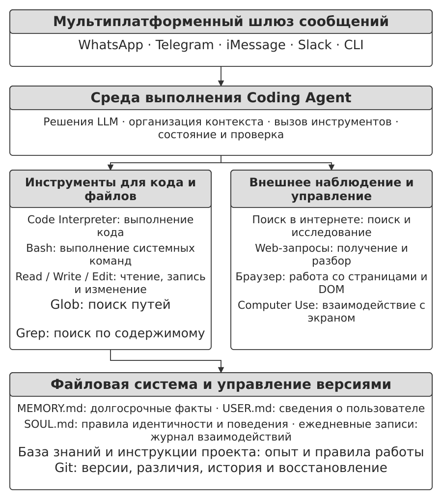

Например, процесс выполнения задачи «проанализировать данные о продажах за прошлый квартал и подготовить краткий отчёт» можно разделить на пять шагов:

1. **Чтение памяти**: получить сведения о предпочитаемом пользователем формате отчётов PDF и о том, что данные о продажах хранятся в Google Sheets.
2. **Получение данных**: изучить использование Google Sheets API и загрузить необходимую таблицу через уже авторизованный интерфейс.
3. **Написание кода анализа**: агрегировать данные о продажах с помощью pandas, построить диаграммы с помощью matplotlib и проверить методику расчётов и результаты.
4. **Создание результатов**: объединить анализ и диаграммы в PDF, сохранить исходные данные, промежуточные результаты и скрипт генерации для последующей проверки или обновления.
5. **Обновление памяти**: записать подтверждённый источник данных и идентификатор таблицы, чтобы найти их при выполнении следующей задачи.

Если поручить ту же задачу офисному сервису Qwen, пользователь сможет напрямую загрузить детализацию продаж, после чего сервис проанализирует данные и сформирует визуальный отчёт.[^ch5-qwenwork] Предположим, по заказу получена оплата в размере 100 юаней, а затем оформлен возврат 20 юаней. В чистые продажи за квартал должны войти только 80 юаней. Если на диаграмме в отчёте указано 100 юаней, по цепочке от диаграммы к сводной таблице и исходной детализации можно определить, какой возврат не был учтён.

[^ch5-qwenwork]: Справочный центр Qwen Office, обзор Qwen Office с описанием загрузки файлов данных, анализа данных, создания визуальных отчётов и других возможностей.

Файловая система связывает эти шаги: результат, сохранённый на предыдущем шаге, может стать входом для следующего, а программа может многократно читать одни и те же данные. Если задача была прервана, агент может определить достигнутый прогресс по сохранённым результатам и продолжить обработку незавершённой части.

Промежуточные результаты полезны и в другом случае: если пользователь задаст связанный вопрос, работу можно продолжить с подходящего шага. Исследовательское подразделение Microsoft продемонстрировало это в Data Formulator на данных о производстве электроэнергии в разных странах. Исходная таблица содержала объёмы выработки для различных видов энергии. Сначала аналитик рассчитал долю возобновляемой энергетики по странам и годам, а затем построил на основе этих данных рейтинг. Если требуется узнать, насколько выросла доля в определённой стране, одних мест на диаграмме недостаточно: они не показывают разницу между двумя годами в процентных пунктах. Сохранившийся в интерфейсе ход вычислений позволяет вернуться к таблице долей, взять значения за два года и вычесть одно из другого.[^ch5-data-formulator]

[^ch5-data-formulator]: Исследовательское подразделение Microsoft, пример анализа энергетических данных в Data Formulator и реализованная в версии 0.7.0 связь между диаграммами и таблицами данных.

**Сохраняйте память, знания и возможности в файлах.** Рабочее пространство OpenClaw хранит в файлах Markdown несколько видов информации: `MEMORY.md` содержит долговременные факты и решения, организованные по датам журналы — сведения о ходе работы, `USER.md` может использоваться для предпочтений пользователя, а файлы Skill описывают способы применения возможностей[^ch5-openclaw-files]. **Для памяти, которую должны совместно поддерживать человек и агент, автор предпочитает непосредственно читаемые файлы.** Пользователь может открыть записи и исправить ошибочный факт, а Git позволяет проследить источник, сравнить версии и выполнить откат. Организация журналов по датам сохраняет явную хронологию событий; когда файлов становится много, поисковый индекс ускоряет их нахождение.

Способность агента записывать файлы также позволяет накапливать опыт выполнения задач. Например, если при обращении в банк выяснилось, что для подтверждения личности требуется адрес отделения, в котором был открыт счёт, вместе с этим фактом можно записать применимые операции, источник информации и время события. После проверки такие записи можно преобразовать в знания, инструкции или программы для повторного использования в последующих задачах. Этот процесс непрерывного развития рассматривается в девятой главе.

[^ch5-openclaw-files]: OpenClaw, *Agent workspace* и *Memory overview* с описанием рабочего пространства, файловой памяти и механизмов поиска.

**Для каких задач агенту подходит самостоятельное написание программ?** В открытых исследованиях, генерации контента и обработке данных часто встречаются новые форматы входных данных, интерфейсы и требования к результатам, поэтому генерация кода хорошо подходит на роль исполнительного ядра. Системы с более стабильными процессами, например специализированная служба поддержки, могут организовать работу вокруг бизнес-состояния, предметных инструментов и диалоговой стратегии, используя код для вычислений, преобразований и проверки правил. Оба типа систем могут применять возможности Coding, но их роль меняется в зависимости от задачи.

### Общий процесс работы Coding-агента

Рассмотрим рисунок 5-2 на примере небольшого дефекта. Пользователь сообщает: «При сортировке по общей стоимости 100 юаней оказываются перед 20 юанями». Сначала нужно подобрать входные данные, воспроизводящие проблему, а затем проследить движение данных и определить, где сумма превратилась в строку. После исправления логики сравнения следует повторно выполнить проверку с исходными входными данными и убедиться, что значения с дробной частью и одинаковые суммы по-прежнему обрабатываются правильно.

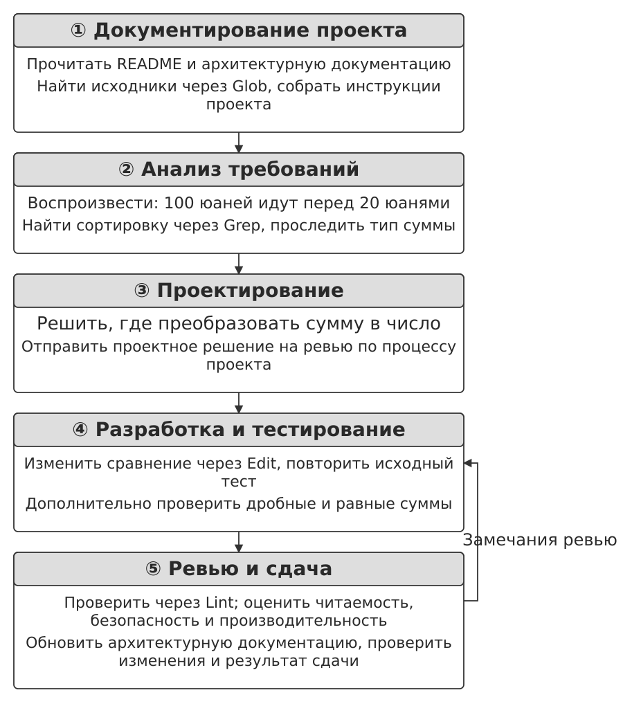

**Понимание проекта и дополнение документации.**

Получив задачу, агент сначала читает описание проекта, а затем сопоставляет его с реализацией, местами вызова и тестами, чтобы определить область влияния изменений. Если в документации недостаточно ясно описаны назначение соответствующих модулей, используемые ключевые абстракции, взаимодействие модулей или порядок тестирования, агент дополняет её сведениями, подтверждёнными по коду, чтобы облегчить работу следующим разработчикам.

**Файлы проектных инструкций** размещают часто используемые соглашения там, где агенту легко их получить. В `CLAUDE.md`, `AGENTS.md` и правилах проекта Cursor можно зафиксировать команды сборки, стиль кода и границы изменений, например: «используй `pnpm test` для запуска тестов», «объявляй конкретные типы переменных и избегай `any`», «изменения миграций базы данных требуют отдельной проверки». Разные среды загружают эти инструкции в зависимости от каталога, конфигурации или условий применимости; ранний файл Cursor `.cursorrules` также воплощал этот подход[^ch5-project-rules].

У файлов инструкций и файлов OpenClaw `SOUL.md` и `MEMORY.md` разные назначения: первые описывают правила работы внутри проекта, `SOUL.md` определяет личность и поведение агента, а файлы памяти сохраняют сведения, которые можно использовать в последующих задачах. Стабильные и краткие инструкции помогают сохранять неизменным префикс контекста, а загрузка правил каталогов по мере необходимости позволяет контролировать объём входных данных текущей задачи. Разрешения на выполнение обеспечиваются Harness и средой выполнения.

Как отмечалось во второй главе, команды, хорошо приспособленные к удалённой совместной работе, обычно также упрощают участие агента. На уровне репозитория кода это означает, что решения фиксируются в проектной документации, контекст задачи — в issue и PR, а внутренний опыт — в руководстве для разработчиков. Полезный проверочный вопрос: **сможет ли новый удалённый сотрудник, располагая только репозиторием и документацией, найти точку входа в задачу, запустить тесты и понять требования к изменениям?**

[^ch5-project-rules]: Anthropic, *How Claude remembers your project*; Cursor, Rules — описание проектных инструкций и правил, загружаемых в соответствии с областью действия.

**Определение цели и критериев приёмки.**

Если bug уже локализован или требуется изменить параметр, правку можно выполнить непосредственно на основе существующего поведения и тестов. Более широкую цель сначала нужно конкретизировать. Например, «оптимизировать производительность системы» может означать снижение времени отклика, уменьшение потребления памяти или повышение пропускной способности. Агент должен определить текущее узкое место, измерить базовые показатели и выяснить допустимую область изменений, подтвердить такие ограничения, как совместимость интерфейсов и удобство использования, и лишь затем выбрать способ оптимизации.

**Подготовка проектного решения.**

Описание решения должно отвечать на следующие вопросы: какие модули будут изменены, какой подход будет применён, почему он подходит для текущей задачи, появятся ли новые зависимости, а также как проверить результат и выполнить восстановление. Для небольшого изменения достаточно краткого плана; сложное изменение следует оформить как проектный документ, доступный для проверки. Если проект или пользователь требуют одобрения решения, сначала необходимо представить конкретный план и только после его утверждения приступать к реализации.

**Реализация, тестирование и проверка.**

При реализации агент соблюдает соглашения проекта, повторно использует существующие абстракции и инструменты и ограничивает изменения областью, относящейся к задаче. Тесты проектируются вокруг ожидаемого поведения и охватывают нормальные пути, граничные условия и исключительные ситуации. При исправлении bug регрессионный тест должен воспроизводить исходную проблему и подтверждать результат исправления.

После сбоя теста агент изучает диагностические сведения, локализует причину, изменяет код и повторно запускает соответствующие проверки. **Критерием завершения задачи программирования должно быть прохождение приёмки.** Создание патча — лишь один из этапов: необходимо также сверить связанные тесты, требования пользователя и результаты работы, подлежащие передаче. Цикл «тестирование — исправление — проверка» позволяет агенту продолжать устранение проблем и предоставляет Loop-инженерии чёткое условие остановки.

Проверка кода дополнительно охватывает аспекты, которые могут не проверяться тестами, например читаемость, совместимость интерфейсов, производительность, разрешения и использование зависимостей. Для этого можно сочетать просмотр диффа, статические проверки и привлечение субагента проверки кода. Обнаруженные проблемы следует исправить, а затронутые проверки — запустить повторно.

**Синхронизация документации и передача результата.**

Добавление модулей, изменение зависимостей и ключевого поведения должны отражаться в соответствующей документации. В описании результата следует кратко изложить решённую проблему, изменения поведения, результаты проверки и порядок использования, а при необходимости — добавить инструкции по восстановлению. Код, тесты и документация вместе сохраняют результат выполненной задачи.

Разные модели также по-разному организуют исследование и внесение изменений. Одни сначала подробно изучают реализацию, места вызова и тесты; другие начинают с наиболее релевантных файлов, пробуют небольшой патч, а затем продолжают локализацию по результатам компиляции или тестирования. **Автор прежде всего рассматривает такой ритм исследования и действий как усвоенную моделью стратегию поведения.** Если после смены Harness сохраняется схожий ритм, а при смене модели внутри одного Harness он заметно меняется, различие указывает на саму модель. Промпты, инструменты и бюджет Harness могут усиливать или подавлять эту склонность. В седьмой главе рассматривается оценка этих различий, а в восьмой — влияние постобучения на стратегию поведения.

### Практика Harness-инженерии в Coding-агентах

В первой главе производственная реализация описывалась формулой **Agent = Model + Harness**, а также были представлены пять функций Harness: управление контекстом, интерфейсы инструментов, ограничения, проверка и исправление. Coding-агент может задействовать тестирование, статический анализ, непрерывную интеграцию и контроль версий из программной инженерии, чтобы воплотить эти функции в исполняемом процессе.

Вернёмся к рассмотренному выше дефекту сортировки. Передача модели ошибочного ввода, соответствующей функции и вывода с ошибкой относится к управлению контекстом. Возможность читать и изменять код, а также запускать тесты обеспечивается интерфейсами инструментов и ограничениями. Проверка начинается лишь тогда, когда изменение тестируется на том же вводе. Если числа по-прежнему сортируются как символы, пригодной для исправления обратной связью станет совместная передача модели фактического и ожидаемого порядков.

Модель отвечает за понимание проблемы и создание решения и кода. Harness предоставляет необходимые для работы сведения и интерфейсы, организует проверки, а по их результатам продолжает или восстанавливает выполнение. На уровне инженерной системы следует подготовить четыре компонента:

- **Базовые критерии приёмки**: комплект тестов, CI-конвейер и стандарты проверки кода определяют, что считается завершённой работой. CI, то есть конвейер непрерывной интеграции, может автоматически запускать согласованные проверки после коммита.
- **Границы выполнения**: явно определяют обязанности модулей, правила зависимостей, доступ к данным и разрешения на операции.
- **Сигналы обратной связи**: результаты linter, проверки типов и тестов преобразуются в диагностические сообщения, по которым модель может локализовать и понять проблему, а затем принять меры.
- **Средства восстановления**: сохраняются версии Git, снимки рабочего пространства и состояние задачи, а для внешних изменений подготавливаются соответствующие процессы восстановления.

**Проектируйте цель вместе со способом проверки.**

Способ работы агента зависит как от ясности задачи, так и от возможности автоматически проверить результат. В таблице 5-1 представлены четыре сочетания этих факторов и дополнительные инженерные меры, необходимые в каждом случае. Уточнение требований, добавление примеров и проверок позволяют постепенно преобразовать изначально расплывчатую задачу в исполняемую цель.

Таблица 5-1. Четыре квадранта ясности задачи и автоматизации проверки

| | Результат можно проверить автоматически | Результат требует ручной проверки |
| --- | --- | --- |
| **Цель ясна** | Исправление ошибки с регрессионным тестом: итерации по обратной связи | Рефакторинг кода: сочетание тестов и архитектурной проверки |
| **Цель неоднозначна** | «Повысить качество кода»: сначала определить цели качества помимо требований linter | «Сделать UI красивее»: уточнить предпочтения с помощью примеров и сравнений |

**Накопленная программной инженерией инфраструктура проверки — одна из важных причин, по которым Coding-агенты сравнительно рано достигли зрелости.** Компиляторы, системы типов, комплекты тестов и контроль версий позволяют локализовать ошибки, проверять изменения и выполнять откат после неудачи, естественным образом образуя мощный Harness. Этот вывод также определяет направление вложений для других агентных сценариев: прежде всего следует перемещать задачи в область «цель ясна, результат можно проверить автоматически». Если приёмка требует каждый раз ручной проверки, скорость человека становится верхней границей пропускной способности. Если же цель неоднозначна, даже самая быстрая автоматизация может непрерывно оптимизировать неверный показатель.

**Извлекайте методы из инженерных примеров.**

Крупномасштабная миграция кода позволяет понять, как взаимодействуют эти компоненты. Правила миграции и связи между модулями записываются в документации репозитория, ограничения зависимостей обеспечиваются статическими проверками, каждая группа изменений проходит тесты и CI, а при сбое возвращается диагностическое сообщение, позволяющее локализовать проблему. Благодаря этому агент может изучить требования к миграции, получать обратную связь после каждой группы изменений и на её основе продолжать работу.

Практика LangChain показывает, как улучшать Harness по траекториям неудач: зафиксировать модель, проанализировать, на каком шаге задача остановилась или завершилась ошибкой, а затем изменить системный промпт, middleware инструментов, цикл самопроверки и бюджет рассуждений. Пример с Terminal Bench 2.0 уже рассматривался в первой главе; здесь важен итеративный метод «зафиксировать неудачу — предложить изменение — провести повторную оценку»[^ch5-langchain-harness].

Подход Anthropic к длительным задачам разделяет инициализацию среды и непрерывное выполнение. Агент инициализации создаёт список задач и рабочую среду, а последующие Coding-агенты последовательно выполняют пункты, сохраняя код, результаты тестов и прогресс. Новая сессия читает эти результаты и продолжает работу, что сокращает потери информации при передаче между контекстами[^ch5-long-harness].

[^ch5-langchain-harness]: LangChain, *Improving Deep Agents with harness engineering*, 17 февраля 2026 года.
[^ch5-long-harness]: Anthropic, *Effective harnesses for long-running agents*, 26 ноября 2025 года.

**Преобразуйте накопленный опыт в принципы проектирования системы.**

1. **Исполняемые ограничения важнее указаний в промпте.** Зависимости модулей, типы полей и стандарты кода можно проверять посредством статического анализа и CI, а права доступа должны принудительно обеспечиваться средой выполнения. Промпт и документация описывают правила и их причины, а механизмы проверки обнаруживают и блокируют соответствующие нарушения.
2. **В первую очередь вкладывайтесь в автоматическую проверку.** Количество повторяющихся проверок растёт вместе с объёмом задач, поэтому постоянное увеличение ручной проверки становится препятствием для масштабирования. Эту работу берут на себя тесты, проверки качества и мониторинг поведения, а ручная проверка сосредотачивается на поиске компромиссов между целями и сложных решениях.
3. **Чем своевременнее и структурированнее обратная связь, тем легче выполнить исправление.** Сообщение об ошибке должно содержать соответствующее место, условие сбоя и фактический результат, помогая модели определить следующий шаг. Строка состояния из второй главы может сводить последние диагностические сообщения, число вызовов и прогресс задачи.
4. **Проектируйте пути восстановления для изменений.** Ветки Git сохраняют изменения кода, песочницы ограничивают последствия проб и ошибок, а снимки восстанавливают управляемое состояние. Операции с внешними API обрабатываются с помощью механизмов идемпотентности, отмены и компенсации из четвёртой главы.

**Проверяйте и результат, и процесс.** При устранении сбоя базы данных очистка данных с последующим пересозданием может восстановить сервис, но нарушит требование о сохранности данных. При исправлении ошибки компиляции удаление соответствующей реализации может обеспечить успешную компиляцию, но приведёт к потере функциональности. Эти примеры показывают, что приёмка должна охватывать бизнес-цели, а процесс выполнения — подчиняться ограничениям. Harness может проверять разрешение и область воздействия таких операций, как удаление производственных данных и перезапись файлов, а также вызывать представленный в четвёртой главе механизм независимой проверки.

При обучении уже выявленные нарушения также можно наказывать. Рассматриваемый в восьмой главе RLVP — штраф за путь проверки — включает ограничения процесса в обучающую обратную связь и направляет модель к соблюдению требований выполнения при достижении результата. Во время работы разрешения и проверки продолжают ограничивать доступные действия, а обучающая обратная связь влияет на то, какие действия предлагает модель.

**Управляйте распространением сбоев с учётом зависимостей.** Если параллельно читаются три независимых файла и один из них отсутствует, следует вернуть ошибку для этого файла, сохранив результаты чтения остальных. Если какой-либо вызов зависит от вывода неудачной задачи, соответствующую цепочку зависимостей следует остановить или перепланировать. Harness должен определять область отмены по связям между задачами, сообщать родительской операции состояние каждого элемента и не отбрасывать вместе с ошибкой результаты независимой работы. Реализация параллельных вызовов, потокового разбора и каскадной отмены рассматривается далее.

### Восстановление после сбоев и ошибок

При выполнении длительной задачи соединение может оборваться между двумя запросами к модели или после исполнения инструмента, но до сохранения результата. Если Harness знает лишь о том, что «задача завершилась с ошибкой», повторный запуск с начала может привести к дублированию уже выполненных операций. Чтобы восстановить работу, сначала нужно определить место прерывания, выяснить, какие результаты уже сохранены, а затем решить, следует ли повторить попытку, исправить вызов, продолжить с контрольной точки или завершить выполнение.

Первый вопрос при восстановлении: «Какие свидетельства остались после предыдущего шага?» Если соединение оборвалось при чтении файла, обычно его можно прочитать повторно. Если это произошло после отправки удалённой задачи, она уже могла быть принята удалённой системой. При наличии идентификатора задачи следует сначала запросить её состояние и лишь затем решать, отправлять ли её повторно. Раздельная фиксация состояний «запрос отправлен», «удалённая система подтвердила приём» и «результат сохранён» создаёт отправную точку для восстановления.

**Выбирайте способ обработки в зависимости от места сбоя.**

| Уровень | Типичные сбои | Основное направление действий |
| --- | --- | --- |
| Уровень API | Ограничение частоты HTTP 429, перегрузка сервиса, тайм-аут, разрыв соединения, достижение предельной длины вывода | Проверить причину ошибки и состояние запроса, повторить попытку с задержкой или скорректировать запрос |
| Уровень инструментов | Инструмент с таким именем отсутствует, недопустимые параметры, ошибка исполнения, многократное получение одной и той же ошибки | Вернуть диагностические данные, позволяющие локализовать проблему, исправить входные данные или условия исполнения |
| Уровень контекста | Переполнение контекстного окна, сбой сжатия, отсутствие пары между вызовом и результатом | Скорректировать объём входных данных, восстановить фактическую запись, проверить структуру сообщений |
| Уровень потока управления | Повторение операций без прогресса, рекурсивный сбой логики восстановления | Вести счётчики, ограничить глубину восстановления и инициировать завершение или эскалацию |

При ограничении частоты и временной перегрузке можно подождать и повторить попытку. Ошибка параметров требует их изменения, недостаток прав — получения авторизации, а отсутствие инструмента — повторного выбора доступной возможности. Сопоставление типов ошибок с конкретными действиями восстановления позволяет избежать многократного сбоя одного и того же запроса при неизменных условиях.

**Одновременно отслеживайте сбои и прогресс.**

Harness может вычислять отпечаток вызова по сочетанию «имя инструмента + нормализованные параметры» и выявлять повторяющиеся действия с учётом результата и состояния задачи. Одинаковые вызовы могут быть как обоснованным опросом состояния, так и циклом без прогресса. При оценке необходимо также учитывать условие ожидания, внешнее состояние и продолжительность происходящего. Для каждого пути восстановления следует вести отдельный счётчик сбоев, ограничивая всю задачу общим бюджетом.

Для потоковых запросов необходимо отдельно задавать тайм-аут соединения, тайм-аут простоя при чтении и общий предел времени. Тайм-аут соединения ограничивает ожидание его установки, тайм-аут простоя при чтении — интервал между двумя порциями полученных данных, а общий предел — продолжительность всего запроса. Если соединение сохраняется, но данные долго не поступают, сторожевой таймер простоя может закрыть запрос и запустить процесс восстановления. **Каждое длительное соединение должно контролироваться на активность; одного тайм-аута установки соединения недостаточно.** Пороговые значения тайм-аутов должны учитывать способ вывода модели: видимый текст, инкрементальные данные рассуждения и сигналы активности могут показывать, продолжается ли запрос, а продолжительное внутреннее рассуждение увеличивает время ожидания.

Проверка целостности контекста строится вокруг сопоставления ID вызовов и результатов. Если результат отсутствует, сначала следует запросить журнал исполнения и восстановить уже сохранённый фактический результат. Если состояние исполнения неизвестно, это нужно явно зафиксировать и действовать в соответствии с описанными в главе 4 механизмами идемпотентности и запроса состояния.

**Восстанавливайтесь поэтапно и сообщайте о текущем состоянии.**

1. **Повторная попытка с задержкой.** Для допускающих повтор ошибок применяйте экспоненциальную задержку со случайным джиттером и соблюдайте указания сервера о времени ожидания. Выделяйте отдельные бюджеты повторных попыток для основной и вспомогательных задач. Фоновые операции, такие как генерация заголовков и подсказок ввода, после сбоя можно пропустить, чтобы они не отнимали ресурсы у основной задачи.
2. **Корректировка или переключение.** При достижении предельной длины вывода сначала проверьте разрешённый интерфейсом предел и бюджет задачи, а затем решите, следует ли увеличить лимит, разделить задачу или продолжить вывод. Если сервис остаётся недоступным, можно переключиться на резервную модель. Перед переключением преобразуйте сообщения, определения инструментов и специфичные для модели поля.
3. **Информирование о ходе восстановления.** Во время автоматического восстановления можно показывать сообщения «Повторная попытка» или «Переключение сервиса», сохраняя в журнале каждую ошибку. После успешного восстановления продолжите задачу. Если пользователю необходимо предоставить авторизацию или дополнительные данные либо выбрать следующий шаг, сообщите о текущем прогрессе, причине сбоя и уже предпринятых действиях.

**Стратегия восстановления должна обеспечивать дальнейшее продвижение всей задачи.** Восстановимые промежуточные ошибки следует сохранять в журнале выполнения, а в интерфейсе — показывать ход восстановления. Сообщать пользователю и нижестоящим системам об окончательном сбое нужно лишь после исчерпания способов восстановления. Это позволяет нижестоящим системам различать состояния «выполняется повторная попытка» и «задача завершилась с ошибкой», не запуская компенсацию или повторную отправку преждевременно.

Ошибки инструментов могут передаваться в контекст как структурированные результаты. Например, можно вернуть имя отсутствующего инструмента, ошибочное поле и допустимые значения, чтобы модель могла исправить вызов. Преобразования формата, разрешённые контрактом интерфейса и имеющие однозначную семантику, можно выполнить программно и зафиксировать в журнале. Если смысл параметров неоднозначен, следует поручить модели сгенерировать их заново, чтобы исправление не изменило цель операции.

**Подхватывайте незавершённую траекторию.**

При переключении модели необходимо передать принимающей стороне уже подтверждённые факты задачи, результаты инструментов и незавершённые действия. Роли сообщений, формат вызовов инструментов и поля рассуждения различаются между интерфейсами, поэтому содержимое и состояние протокола следует преобразовывать раздельно. Некоторые сервисы возвращают доступное для чтения содержимое рассуждения или его сводку, а также непрозрачные поля, предназначенные для последующих запросов к тому же сервису. Такие поля могут быть прикреплены к блокам рассуждения или вызовам инструментов. Требования к их дословной передаче в последующих запросах определяются соответствующим интерфейсом.

**Системы, которым требуется продолжение работы между разными поставщиками, должны сохранять рабочую траекторию в нейтральном формате.** Способность модели понять текст другого поставщика не означает, что целевой API примет непрозрачные протокольные поля исходного поставщика. Отделение фактов задачи от протокола поставщика позволяет использовать одну запись для подхвата задачи, воспроизведения при оценке и обучающих данных. Нейтральная запись включает задачу и сообщения, имена и параметры инструментов, стабильные идентификаторы вызовов, состояния исполнения, результаты и их источники. Исходные ответы поставщика сохраняются отдельно для продолжения работы через тот же интерфейс и расследования проблем. При преобразовании в запрос к целевой модели следует создать отображение ID вызовов и сохранить пары вызовов с результатами. Доступные для чтения сводки передаются как обычный контекст с указанием источника, а непрозрачные поля исходного сервиса остаются в исходной записи.

Если целевой интерфейс не позволяет выразить прежний вызов, выполненные шаги можно оформить как явную запись о состоянии задачи, например: «Авиабилеты и проживание уже найдены; далее необходимо получить стоимость питания и обменный курс», приложив фактические результаты. После этого целевая модель должна создать новый допустимый вызов. Когда принимающая сторона начнёт работу, возвращаемые ею протокольные поля следует сохранять в соответствии с требованиями её собственного интерфейса. Такая нейтральная запись также может использоваться для воспроизведения при оценке в главе 7, формирования обучающих примеров в главе 8 и извлечения опыта в главе 9.

> **Эксперимент 5-1 ★★★: подхват траектории между поставщиками**
>
> В этом эксперименте AI-агент запрашивает стоимость авиабилетов, проживания и питания, а также обменный курс, после чего рассчитывает общую сумму в юанях. После первых двух вызовов инструментов скрипт в заданной контрольной точке переключает сервис, имитируя передачу управления после недоступности исходного сервиса. Принимающая сторона продолжает выполнение оставшихся шагов. В эксперименте используются три модели — Moonshot, Anthropic и Google — и сравниваются шесть направленных комбинаций переключения.
>
> Сравниваются три способа обработки: передача исходных сообщений с отображением полей; преобразование сообщений после удаления содержимого рассуждения и непрозрачных полей; сохранение состояния задачи в нейтральной траектории с последующим восстановлением контекста согласно целевому интерфейсу. Место переключения задаётся скриптом, а ошибки формата принимающей стороны получены из фактических ответов сервисов.
>
> В этой серии испытаний нейтральная траектория обеспечила успешный подхват и правильный расчёт общей суммы во всех шести комбинациях. Два других способа успешно завершили соответственно три и четыре комбинации. Прогресс задачи был сохранён в результатах инструментов, поэтому ни в одной из трёх групп повторных вызовов инструментов не возникло.

> **Эксперимент 5-2 ★★: продолжение после обрыва вывода**
>
> В этом эксперименте предпринимается попытка прервать поток в трёх местах: при выводе рассуждения, основного текста и параметров инструмента. Сравниваются три способа: повторная отправка всего раунда, продолжение с уже полученным основным текстом в качестве префикса и добавление инструкции о продолжении. Для исполнения вызова инструмента необходимы полные параметры. Усечённый фрагмент сначала сохраняется в журнале выполнения, а после восстановления повторно разбирается и проверяется.
>
> Конкретная ошибка возникла в параметре города: изначально требовалось сгенерировать «Токио», но в контрольной точке остался лишь фрагмент `{"city":"То`, а продолжение закрыло его как `{"city":"То"}`. JSON стал допустимым, однако город остался указан неверно.
>
> В этом испытании с длинным основным текстом продолжение по префиксу сократило объём последующего вывода в токенах. При прерывании параметров результаты отличались: во всех трёх испытаниях Moonshot продолжение по префиксу не смогло восстановить правильный город.

**Задайте условия завершения цикла восстановления.**

Для каждого пути восстановления необходим верхний предел. Например, после нескольких последовательных сбоев сжатия следует перейти к другой стратегии работы с контекстом; если проверку прав невозможно завершить — передать задачу человеку; по достижении предельного числа раундов или бюджета стоимости продолжения вывода — остановиться. **Порог повторных попыток следует определять по распределению восстановлений в производственной среде.** Если подавляющее большинство временных сбоев устраняется за первые несколько попыток, а вероятность успеха последующих однотипных попыток приближается к нулю, следует остановиться в этой точке перегиба, чтобы бесполезные вызовы не продолжали расходовать квоту.

Сама логика восстановления также может завершиться с ошибкой. Например, переполнение контекстного окна запускает хук остановки, который обращается к модели для генерации описания коммита, снова переполняет окно и повторно запускает тот же хук. Эту цепочку можно разорвать с помощью признака повторного входа и ограничения глубины рекурсии, разделив очистку после ошибки и вспомогательные задачи, требующие вызова модели, а также выделив последним отдельный бюджет. Для задачи также следует задать общие пределы числа итераций, времени и стоимости, чтобы каждый путь восстановления оставался в рамках общего бюджета задачи.

### Приёмы реализации Coding-агента

Сначала по записи выполнения задачи по исправлению падающего теста оценим, какой участок стоит оптимизировать. В докладе автора «The Road to JARVIS», представленном в Порту в ноябре 2026 года, одна и та же сессия воспроизводилась с разной скоростью инференса. При расчёте по времени работы доступной тогда онлайн-модели общее время составило 24,2 секунды. При неизменном времени работы инструментов и расчётной скорости инференса ещё не созданного специализированного чипа результат составил около 8,1 секунды. Из них 7,5 секунды занял запуск тестов. Даже если устранить оставшиеся примерно 0,6 секунды работы модели, всё равно придётся ждать завершения тестов.

Какие операции из этих 7,5 секунды можно выполнять одновременно? Это зависит от связей между вызовами инструментов.

**Параллельные вызовы инструментов, потоковое выполнение и каскадное прерывание.**

Поиск в коде, чтение конфигурации и просмотр журналов зачастую не зависят друг от друга. Когда модель генерирует такие вызовы в одном ответе, Harness может совместить генерацию вызовов с выполнением инструментов: как только интерфейс подтвердит, что первый вызов выведен полностью, а его параметры и разрешения прошли проверку, Harness немедленно ставит его на выполнение и продолжает принимать последующие вызовы. Полноту следует определять по событию завершения вызова, предусмотренному интерфейсом, а не по тому, что временно полученный JSON уже удаётся разобрать: иначе вызов может быть выполнен преждевременно.

Независимые вызовы можно выполнять параллельно. Например, одновременно искать имя функции и читать конфигурационный файл, а решение об изменениях принимать после получения обоих результатов. Если выбор читаемого файла зависит от результатов поиска, его чтение переносится на следующий шаг. Планировщик также должен учитывать общее состояние: одновременное изменение одного файла двумя инструментами приведёт к конфликту записи, даже если их входные данные не зависят друг от друга.

В определении инструмента можно объявить возможности конкурентного выполнения, используемые ресурсы и способ отмены. В учебной реализации инструменты без таких объявлений можно выполнять последовательно. Если один вызов завершается с ошибкой, следует остановить последующие операции, зависящие от его результата, сохранить результаты независимых вызовов и вернуть родительской операции состояние каждого из них. При отмене уже запущенной задачи также необходимо зафиксировать, сработала ли отмена и успели ли произойти изменения файлов или внешние операции.

**Точное управление контекстом.**

Большую кодовую базу можно добавлять в контекст постепенно посредством многоуровневого поиска: сначала найти файлы, затем прочитать нужные функции, а при необходимости перейти к местам вызова и тестам. Каждое чтение дополняет сведения, необходимые для текущего решения, чтобы модель одновременно видела код, ограничения и обратную связь от выполнения.

Инструмент чтения должен поддерживать возврат фрагмента по диапазону строк, например со 100-й по 150-ю, и указывать для каждой строки её фактический номер в файле. Благодаря этому модель может точно сослаться на «строку 142», а инструмент последующего редактирования — найти нужное место. В возвращаемом содержимом также следует указывать исходный файл и прочитанный диапазон. Если файл изменился, позицию редактирования необходимо подтвердить заново.

Компиляция или тестирование могут вывести тысячи строк. Здесь можно применить описанный в четвёртой главе механизм обрезки и сохранения: вернуть начало и конец вывода с указанием количества пропущенных строк, а полную версию сохранить для чтения по мере необходимости. Ошибка может находиться в середине, поэтому агент сможет дополнительно найти её по ключевым словам или прочитать соответствующий диапазон.

**Динамическое добавление информации о среде.**

Строка состояния агента из второй главы применительно к задачам программирования может объединять четыре типа сведений:

- **Текущий рабочий каталог**: задаёт базу для относительных путей.
- **Ветка Git**: показывает, в какой ветке разработки находятся текущие изменения.
- **Последние коммиты**: помогают понять недавние изменения, связанные с задачей.
- **Сводка проиндексированных и непроиндексированных изменений**: позволяет различать подготовленное к коммиту содержимое и изменения рабочего дерева.

Harness может обновлять сводку после операций, изменяющих это состояние, и добавлять её в конец контекста при следующем вызове модели. Реже меняющиеся сведения, например последние коммиты, можно обновлять по необходимости, сокращая число повторных запросов и объём входных данных. Стабильность начальной части контекста способствует повторному использованию кэша префикса.

**Сохранение состояния среды выполнения команд.**

Переход в другой каталог, активация виртуального окружения, установка переменных среды и запуск фоновых сервисов влияют на последующие команды. Если агент выполняет `cd` в shell, изменение каталога естественным образом сохраняется только тогда, когда следующие команды продолжают использовать ту же сессию. При выполнении в отдельном процессе рабочий каталог определяется конфигурацией нового процесса. Переменные среды, создаваемые при активации виртуального окружения, подчиняются тем же границам сессии.

**Для интерактивной отладки и задач, требующих длительно работающих сервисов, автор рекомендует по умолчанию использовать постоянный терминал.** Он сохраняет рабочий каталог, переменные среды и состояние сессии, соответствуя привычке разработчика последовательно работать в одном терминале. Harness назначает сессии идентификатор и отслеживает рабочий каталог, работающие процессы и статусы их завершения, чтобы модель знала, в какой среде будет выполнена следующая команда. Другой вариант реализации — явно передавать каждой команде рабочий каталог и конфигурацию среды, поддерживая согласованность посредством воспроизводимой конфигурации.

Для параллельных задач следует использовать отдельные сессии или явные снимки среды, чтобы смена каталога в одной задаче не повлияла на другую. После завершения задачи фоновые процессы необходимо централизованно остановить, а при возобновлении — повторно проверить, жива ли сессия. Например, если на следующий день нужно продолжить запуск тестов, код и список зависимостей можно восстановить из рабочего дерева, но сначала следует проверить, работает ли ещё сервисный процесс, запущенный вчера в терминале. Именно эти два вида состояния необходимо различать при оценке стоимости песочницы в четвёртой главе.

**Механизм немедленной синтаксической обратной связи.**

После записи файла слой инструментов может автоматически запускать соответствующий языку синтаксический анализатор или linter и передавать диагностику модели как часть результата инструмента. Например, при отсутствии скобки возвращаются файл, номера строки и столбца и тип ошибки, чтобы модель могла исправить её уже в следующем цикле, получая обратную связь, подобную мгновенной подсветке в IDE.

Область проверки можно расширять вместе с областью изменений: сначала проверить изменённые файлы, затем запустить тесты затронутых модулей и, наконец, выполнить регрессионные проверки, предусмотренные требованиями к передаче результата. Легковесные проверки помогают раньше обнаруживать локальные проблемы, а интеграционные тесты проверяют взаимодействие между модулями.

### Инструменты поиска в Coding-агенте

Если сообщение об ошибке содержит текст «отсутствует поле суммы», можно сначала найти исходную формулировку, а затем от места возникновения ошибки проследить вызывающий код. Если же пользователь лишь говорит, что «сортировка работает неправильно», а в коде используются английские имена, буквальный поиск этой фразы почти бесполезен. Сначала можно найти интерфейс, отображающий результат, а затем по полям, связям вызовов и тестовым данным добраться до логики сортировки. Четыре типа инструментов поиска на рисунке 5-3 используют разные подсказки; результаты первого поиска зачастую определяют, какой инструмент следует выбрать для следующего.

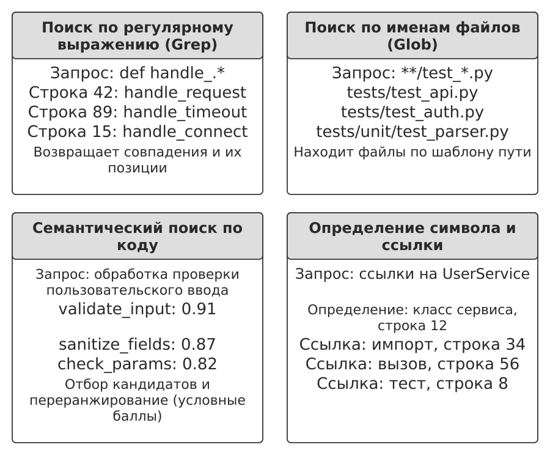

**Сопоставление содержимого по регулярным выражениям.** grep и ripgrep ищут содержимое по текстовым шаблонам и подходят для задач, в которых известны имя функции, имя переменной или сообщение об ошибке. Например, `def handle.*` может найти строки текста с соответствующей формой определения функции. Фильтрация по типам файлов и путям позволяет также искать только в файлах Python, исключать каталоги тестов и сосредоточивать результаты на релевантной реализации.

Текстовое сопоставление непосредственно соответствует содержимому файлов, поэтому результаты легко проверить. Поисковый запрос необходимо связать с формулировками в коде: при поиске «аутентификации пользователя» можно дополнительно попробовать такие имена, как `authenticate`, `login` или `check_credentials`. Когда модель расширяет запрос с учётом предыдущих результатов, поиск и понимание кода образуют единый итеративный процесс.

**Сопоставление шаблонов имён файлов.** glob ищет файлы по шаблону пути: например, `**/*.test.ts` находит тестовые файлы TypeScript в каталогах любого уровня, а `src/components/**/Button.tsx` — файл Button.tsx в каталогах компонентов. Сопоставление путей не требует чтения содержимого и подходит для первоначального изучения структуры проекта с последующим выбором файлов, которые нужно открыть.

**Семантический поиск по коду.** Если задача описана только через функциональность, семантически связанный код можно находить с помощью векторного поиска. Например, «аутентификация пользователя» может соответствовать функции `check_credentials`. Системам такого типа обычно необходимо решать две задачи:

- **Разбиение по структуре кода.** Основными единицами служат функции, классы и методы; вместе с ними сохраняются связанные сигнатуры, комментарии и сведения о модуле. При дальнейшем разделении длинных единиц необходимо добавлять контекст, достаточный для понимания фрагмента.
- **Сочетание нескольких поисковых сигналов.** Векторный поиск находит семантически связанный код, поиск по ключевым словам — код с точным совпадением имён, после чего две группы результатов объединяются. Описанный в третьей главе перекрёстный кодировщик позволяет дополнительно выполнить ранжирование: он одновременно получает запрос и фрагмент кода, а затем оценивает релевантность этого фрагмента.

При исследовательских запросах вроде «взаимодействует с базой данных» или «обрабатывает проверку пользовательского ввода» можно сначала найти модуль семантическим поиском, а затем прочитать реализацию.

**При создании поисковых возможностей Coding-агента автор рекомендует сначала качественно реализовать Grep, Glob и чтение заданного диапазона.** Модель может на основании результатов поиска переформулировать запрос, открыть вызывающий код и тесты и постепенно сузить область. Эти инструменты непосредственно читают текущее рабочее пространство, поэтому не требуют поддерживать индекс представлений и синхронизировать его с кодом. Семантический индекс для улучшения полноты поиска стоит добавлять при многократном исследовании крупных кодовых баз или когда задача описана только через функциональность и точку входа найти трудно. Cursor ранее публично рассказывал об индексировании кодовой базы на основе представлений, а в последующей документации о поиске описал локальный индекс Instant Grep и исследовательских субагентов[^ch5-search]. Эта эволюция также показывает, что при проектировании решают два вопроса: предоставлять ли интерфейс, подобный grep, и строить ли индекс: один и тот же поисковый интерфейс может использовать сканирование или индекс.

**Поиск определений и ссылок на уровне символов.** Языковой сервер может использовать сведения о синтаксисе, областях видимости и типах для поддержки функций «перейти к определению» и «найти ссылки». Например, если `authenticate` определена в строке 42 и вызывается в строке 189, инструмент может вернуть связь между этими местами и отличить их от одноимённых символов в других областях видимости. Плагины интеллектуального анализа кода Claude Code предоставляют один из способов такой интеграции: через протокол языковых серверов (LSP) они обеспечивают навигацию по символам и диагностику после редактирования[^ch5-lsp].

Эффективность инструментов работы с символами зависит от поддержки языка, конфигурации проекта и состояния анализа. Агент может дополнять их текстовым поиском строк, комментариев или файлов, которые языковой сервер ещё не разобрал.

[^ch5-search]: Cursor, *Securely indexing large codebases* и Search — материалы соответственно об индексировании на основе представлений и последующих механизмах локального поиска.
[^ch5-lsp]: Anthropic, *Code intelligence plugins* — материал о предоставлении через LSP поиска определений и ссылок, а также диагностики в реальном времени.

### Инструменты редактирования файлов в Coding-агенте

Представьте: после того как модель прочитала файл, кто-то добавил комментарий в самое его начало. Будут ли теперь указания «изменить строку 28» и «заменить этот уникальный фрагмент исходного текста» по-прежнему относиться к одному и тому же месту? А если исходный текст встречается по одному разу в двух разных функциях? Пять подходов к редактированию на рисунке 5-4 по-разному определяют место изменения: одни опираются на номера строк, другие — на исходный текст, а третьи поручают объединение другой модели.

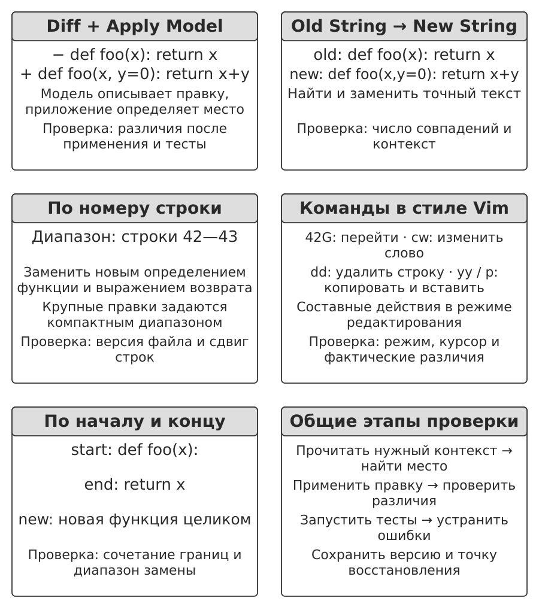

**Описание различий + Apply Model.** Основная модель передаёт намерение изменения и фрагменты кода: например, описание удалений и добавлений, похожее на Git diff, либо каркас кода, где неизменённые части пропущены с помощью маркеров многоточия. Затем специализированная модель применения объединяет это с исходным файлом и генерирует полное изменённое содержимое. Ранний Fast Apply в Cursor — характерный пример такого подхода[^ch5-apply]. Он распределяет «формулирование изменения» и «применение изменения» между двумя моделями. По мере того как базовые модели стали лучше генерировать точные локальные правки, у этого двухмодельного процесса начали появляться более простые альтернативы.

Такое разделение позволяет основной модели сосредоточиться на выражении логики кода, а модели применения — на объединении локальных изменений с файлом. Соответственно, основное внимание при проверке уделяется результату объединения: несколько похожих фрагментов могут создать неоднозначность позиционирования, маркеры пропусков могут быть истолкованы неверно, а неизменённые области — случайно переписаны.

**Старая строка → новая строка (Old String → New String).** Инструмент Edit в Claude Code использует точную замену строк; в версии 0.50 за май 2025 года Cursor добавил Search & Replace, который сначала использовался для редактирования длинных файлов моделями Anthropic[^ch5-direct-edit]. При таком подходе основание для позиционирования и содержимое замены передаются непосредственно программе, что избавляет от дополнительного вызова модели на этапе объединения. Модель предоставляет `old_string` и `new_string`, а инструмент находит исходный текст в файле и заменяет его. Интерфейс может требовать, чтобы при единичной замене исходный текст был уникален. Если совпадений нет или их несколько, он возвращает позиции и диагностическую информацию, чтобы модель добавила контекст. Для пакетной замены область действия задаётся явным параметром.

Например, в конфигурационном файле для двух сервисов указано `timeout = 30`. Требуется изменить на 60 секунд только тайм-аут сервиса загрузки. Если инструмент требует уникального совпадения, передача одного лишь `timeout = 30` найдёт два совпадения, и файл должен остаться без изменений. В следующем запросе модель включает в старую строку и заголовок раздела сервиса загрузки, и строку настройки, а в новой строке сохраняет заголовок, изменяя только значение.

Сопоставление по содержимому наглядно и удобно для проверки. При вызове инструмента модель должна вывести старую строку целиком: при удалении большого блока кода параметр становится длинным, а небольшие различия в пробелах, переносах строк или кавычках также влияют на совпадение. Пример с фигурными кавычками Unicode из четвёртой главы показывает, как подобные сбои возникают при передаче параметров.

**Позиционирование по номерам строк (Old Line Numbers → New String).** Модель указывает удалить строки с X по Y, а затем вставить новый текст. Если инструмент чтения уже предоставляет фактические номера строк, для удаления большого блока достаточно двух позиций — начальной и конечной. Значение номеров строк зависит от версии файла на момент чтения: предыдущее изменение может сместить последующие позиции.

Поэтому при пакетном редактировании все правки могут ссылаться на один исходный снимок, а инструмент — проверять пересечение диапазонов и применять изменения целиком. Другой вариант — вносить изменения последовательно, каждый раз заново читать файл и только затем определять позиции. Инструмент также может сверять версию файла или ожидаемое содержимое и после конкурентного изменения возвращать конфликт, чтобы старые номера строк не применялись к новому содержимому файла.

**Команды редактирования в стиле Vim.** Команды редактора позволяют перемещать, копировать, вырезать и вставлять содержимое, поэтому хорошо подходят для реорганизации кода, например переноса функции из одного места в другое. Они зависят от текущего положения курсора, буфера и режима команд, причём каждый шаг изменяет точку отсчёта для последующих операций.

**Интерактивные привычки человека при работе с редактором не обязаны становиться архитектурой инструментов модели по умолчанию.** Человек обычно смотрит на текущее состояние, а затем выполняет одну небольшую операцию. Модель же может после длительного рассуждения за один раз сгенерировать изменения на десятки или даже сотни строк. Разбиение такой пакетной правки на множество перемещений курсора и переключений режимов повышает стоимость вызовов и требует от модели прогнозировать, как предыдущие команды повлияют на состояние. Поэтому для задач генерации кода автор отдаёт предпочтение интерфейсам, напрямую выражающим цель и содержимое изменения. При использовании команд редактора необходимо явно задавать состояние, служащее точкой отсчёта, и своевременно возвращать обратную связь.

**Сопоставление начала и конца старой строки (Old String Start + End → New String).** Модель передаёт только несколько строк в начале и конце заменяемой области, а инструмент находит обе границы и содержимое между ними. При удалении сотен строк кода такой способ позволяет сократить объём повторно выводимого исходного текста, сохранив основание для позиционирования по содержимому.

Инструмент должен проверить порядок появления двух фрагментов исходного текста и в соответствии с контрактом интерфейса определить, включаются ли начальный и конечный фрагменты в замену. Изменение выполняется только тогда, когда условиям соответствует ровно один диапазон. Если совпадений несколько, инструмент сообщает модели их позиции и просит добавить контекст. Для вложенных конструкций или повторяющегося кода определить диапазон помогают дополнительные соседние якоря, например имена и сигнатуры функций.

**При создании нового Coding-агента автор рекомендует начать с простого и детерминированного интерфейса редактирования наподобие замены старой строки новой.** Позиционирование по исходному тексту однозначно, причины сбоя легко объяснить, а различия удобно проверять. Когда модель способна надёжно генерировать локальные изменения, Harness может передать больше работы детерминированной программе и отказаться от дополнительной модели применения. Если при удалении крупных блоков потребуется сократить объём параметров, можно добавить начальные и конечные якоря либо редактирование по номерам строк на основе снимка. Инструмент `apply_patch` в Codex демонстрирует ещё один способ прямого редактирования: несколько изменений выражаются с помощью патча с ограниченным синтаксисом.

[^ch5-direct-edit]: Anthropic, *Tools reference*, инструмент Edit; журнал обновления Cursor 0.50 от 15 мая 2025 года, где представлено добавление Search & Replace; в журнале обновления 1.3 также зафиксированы улучшения Search & Replace и Apply.

[^ch5-apply]: Cursor, *Editing Files at 1000 Tokens per Second*, описание специализированной модели, применяющей описание изменений к исходному файлу.

### Безопасность Coding-агента

Coding-агент может читать проект, изменять файлы, запускать программы, а иногда и обращаться к внешним сервисам по сети. При проектировании разрешений необходимо проследить поток данных и проверить три аспекта: какое содержимое попадает в контекст, какие операции может запрашивать модель и какие механизмы в итоге одобряют и выполняют эти операции.

Simon Willison сформулировал риск одного из видов инъекции в промпт в виде «смертельной триады»: доступ к приватным данным, контакт с недоверенным содержимым и возможность внешнего взаимодействия[^ch5-trifecta]. Например, если помощник может читать приватные файлы, обрабатывать внешние письма и отправлять сообщения, между чтением, интерпретацией и отправкой необходимо установить явные границы авторизации. Если инструкции из внешнего содержимого будут приняты за требования пользователя, это может привести к несанкционированной передаче данных.

Помимо этих трёх аспектов автор рекомендует проверять и четвёртый: **постоянная память усиливает последствия инъекции в промпт**. Если внешнее содержимое попадёт в долговременную память, его влияние может сохраниться между сессиями и вновь проявиться в последующих задачах. Поэтому при записи в память следует фиксировать источник, область применимости и статус подтверждения, а при чтении сохранять эти атрибуты. Достоверность текста, сохранённого в `MEMORY.md`, по-прежнему зависит от процесса его появления. После обнаружения ошибочной записи также должна существовать возможность найти, исправить и отозвать связанное с ней содержимое.

Три уровня защитных барьеров из первой главы выполняют здесь разные задачи: уровень контекста обозначает источники информации и требования к поведению, уровень выполнения проверяет операции и авторизацию, а уровень данных ограничивает чтение и запись ресурсов в соответствии с доверенной идентичностью. Песочница Claude Code ограничивает выполнение команд границами файловой системы и сети, а Cowork также выполняет локальные задачи в изолированной среде[^ch5-sandbox]. Ниже эти механизмы рассматриваются подробнее.

**Ограничение ресурсов и взаимодействий в песочнице.**

- **Сетевой выход.** Это одна из границ песочницы для кода, которой легко пренебречь, но которую следует реализовать в первую очередь. Автор рекомендует начинать с отключённого по умолчанию внешнего доступа и по мере необходимости разрешать источники пакетов, сайты документации и бизнес-API. Список разрешений должен соответствовать конкретным адресатам и области допустимых операций; для общих сервисов также необходимо учитывать принадлежность учётной записи, арендатора и ресурсов. Сетевая политика должна распространяться на запущенные инструментами программы и их дочерние процессы, а передаваемые наружу данные следует отдельно проверять на соответствие области авторизации.
- **Файловая система.** Исходный код можно подключить только для чтения, а его копию поместить в доступное для записи рабочее пространство. Другой вариант — создавать патчи через контролируемый интерфейс редактирования и применять их после проверки. Результаты и промежуточные файлы размещаются в отдельном каталоге, а файлы учётных данных остаются за пределами песочницы. Если требуется доступ к сервису аутентификации, контролируемый интерфейс должен предоставлять только необходимые для задачи возможности, чтобы не передавать сгенерированной программе все учётные данные хоста.
- **Ресурсы и время.** Следует ограничить CPU, память, число процессов, дисковое пространство и время выполнения, чтобы уменьшить последствия бесконечных циклов, неконтролируемого роста числа процессов и непрерывной записи на диск. При превышении лимита возвращается структурированный статус, например «выполнение превысило 120 секунд и было остановлено», вместе с сохранённым выводом и результатами очистки. По ним модель сможет решить, следует ли сузить задачу или изменить реализацию.

Эти границы должны охватывать всю цепочку выполнения. Даже после одобрения команды фактически запущенная программа должна работать в пределах тех же разрешений; соответствующий контроль также должен распространяться на фоновые процессы, вспомогательные инструменты и внешние интерфейсы.

**Разбор структуры команд и назначения аргументов.**

Shell-команда состоит из имени программы, аргументов, перенаправлений, конвейеров и подвыражений. При проверке необходимо разобрать эти структуры, а затем определить связанные с ними операции чтения, записи, выполнения и взаимодействия. **Чёрного списка команд недостаточно для окончательного решения о безопасности.** Одну и ту же операцию можно выразить разными сочетаниями аргументов и косвенными вызовами. Проверка должна учитывать структуру команды и назначение аргументов, а разрешения среды выполнения — ограничивать фактическую область выполнения.

Например, инструмент поиска файлов может иметь аргумент, запускающий последующую операцию для каждого совпадения, а параметр вывода инструмента загрузки определяет место записи. Валидатор должен распознавать, «какой параметр использует следующий аргумент как своё значение», отслеживать назначение аргументов, а затем проверять целевой путь, разрешения доступа и допустимые операции. Тогда результат проверки можно конкретизировать: «какие файлы будут прочитаны», «куда будет выполнена запись» и «какая программа будет запущена».

Из-за подстановки переменных, динамических скриптов и путей, возникающих только во время работы, часть фактического поведения можно определить лишь при выполнении. Для неопределённых частей Harness может потребовать более явную форму вызова, передать их на проверку или выполнить в ограниченной среде. Проверка с помощью модели обеспечивает контекстную оценку, а детерминированное управление доступом ограничивает фактические последствия. Описанный в четвёртой главе Sidecar может работать параллельно с подготовительными операциями, а действия с внешними последствиями отправляются на выполнение только после успешной проверки.

**Явное определение обслуживаемой стороны при многостороннем делегировании.**

Лояльность принципалу (principal loyalty) отвечает на вопрос: как агент, действующий от имени одной стороны и одновременно общающийся с другими участниками, может последовательно соблюдать цели и полномочия доверителя. Например, пользователь поручает агенту вести переговоры о цене с поставщиком и конфиденциально сообщает предельный бюджет в 12 000 юаней. Агент должен понимать предложения поставщика и объяснять позицию своей стороны, одновременно защищая это приватное ограничение.

При оценке многосторонних взаимодействий автор и его соавторы наблюдали два типа ошибок. В первом случае агент раскрывал приватные сведения доверителя или принимал неправомерные требования другой стороны. Во втором он проявлял чрезмерную осторожность и не мог выполнить даже обычные запросы доверителя. Оценённые стратегии промптов и методы обучения продемонстрировали компромисс между защитой информации и нормальным взаимодействием[^ch5-1]. **Лояльность необходимо оценивать одновременно по защите информации и выполнению задачи.** Если стремиться лишь к увеличению числа отказов, будет заблокировано и нормальное взаимодействие; если стремиться только к беспрепятственному продолжению диалога, другая сторона сможет повлиять на интересы доверителя.

Для Coding-агента файлы репозитория, вывод инструментов и ответы сторонних MCP-сервисов могут содержать как сведения, относящиеся к задаче, так и текст с требованиями изменить поведение. Harness должен различать инструкции доверителя и внешние материалы по их действительному источнику, снабжать сообщения сведениями об источнике и роли и преобразовывать область делегирования в разрешения на выполнение. Если внешний материал утверждает, что содержит «требование пользователя», это необходимо подтвердить через доверенный канал.

В промпте можно дополнительно сформулировать правила взаимодействия: защищать приватные сведения доверителя, причём иногда конфиденциальным должен оставаться даже сам факт существования определённой записи; раскрывать внешним сторонам только необходимые сведения; различать внутренние пределы и публичную позицию; продвигать задачу в пределах предоставленных полномочий; сохранять единые стандарты авторизации при повторяющихся запросах. Расширение полномочий или смена обслуживаемой стороны должны подтверждаться через доверенный канал и сопровождаться соответствующим обновлением разрешений среды выполнения. Так модель получает явные основания для поведения, а инструменты и среда обеспечивают фактические границы доступа.

[^ch5-trifecta]: Simon Willison, *The lethal trifecta for AI agents: private data, untrusted content, and external communication*, 16 июня 2025 года.
[^ch5-sandbox]: Anthropic, *Making Claude Code more secure and autonomous with sandboxing* и *How we contain Claude across products* — материалы о границах файловой системы, сети и изоляции продуктов.
[^ch5-1]: Li, Bojie and Noah Shi, *Whose Side Is Your Agent On? Multi-Party Principal Loyalty in LLM Agents*, 2026.

## Код: метаспособность универсального AI-агента

В предыдущих разделах требования пользователя преобразовывались в изменения кода. Теперь вернёмся к таблице продаж из начала главы: даже если пользователю в итоге нужен только отчёт, агент всё равно может написать программу, которая унифицирует идентификаторы товаров, группирует данные и рассчитывает статистику, а затем повторно вычисляет долю возвратов для одного товара по исходной таблице. Сначала нужно уточнить, следует ли вести расчёт по количеству товаров или по количеству заказов. Предположим, определённый товар продан в количестве десяти штук в двух заказах, причём из одного заказа вернули одну штуку. При расчёте по количеству товаров результат составит 1/10, а при расчёте по заказам, в которых был возврат, — 1/2. Оба алгоритма успешно выполняются, но только предварительное уточнение методики позволяет понять, какое из значений отвечает на вопрос пользователя. Такую программу можно будет снова запустить, когда поступят данные за следующий период. Этот цикл «генерация, выполнение, проверка» применим также к созданию контента, интеграции бизнес-систем и разработке агентов.

> **Метаспособность.** В этой книге метаспособностью (meta-capability) называется способность создавать или комбинировать другие способности. Генерация кода позволяет создавать новые инструменты, например скрипты обработки данных и процессы вызова API; выражать новые ограничения, например утверждения и правила проверки; а также формировать новые способы представления, например HTML-формы, презентации и видео.

Начнём с простейшего случая. Даже если конечным результатом должен быть только ответ на одну задачу, модель может написать небольшую программу для проверки собственных вычислений.

### Код как инструмент мышления

**Для точных вычислений и формальных ограничений автор предпочитает сначала поручить модели составить исполняемое выражение, а затем передать его интерпретатору или решателю.** При пословной генерации ответа легко допустить ошибку при переписывании или вычислении, а также упустить условие; программа позволяет зафиксировать эти шаги и выполнять их многократно. Задачи по математике и логике обычно состоят из двух этапов: сначала условие преобразуется в отношения и ограничения, затем вычисляется результат. LLM может помочь понять задачу, предложить решение и написать программу, а интерпретатор или решатель — выполнить заданные операции.

Например, в классе 40 учеников: 60 % выбрали математику, 45 % — физику, а 25 % — оба предмета. Чтобы найти число учеников, выбравших только физику, нужно из числа выбравших физику вычесть число выбравших оба предмета: 18 − 10 = 8. Если по ошибке использовать число выбравших математику, получится 24 − 10 = 14. Ошибка возникает на этапе выбора уменьшаемого.

Если выразить количественные отношения с помощью осмысленных переменных, каждое из них можно проверить отдельно:

```python
math = 40 * 60 // 100       # 24 ученика выбрали математику
phys = 40 * 45 // 100       # 18 учеников выбрали физику
both = 40 * 25 // 100       # 10 учеников выбрали оба предмета
only_phys = phys - both     # 8 учеников выбрали только физику
```

Символьные вычисления дополнительно расширяют такое разделение обязанностей. Они позволяют сохранять точные формы вроде $\sqrt{2}$ и преобразовывать выражения по правилам алгебры. Если сразу возвести это значение в квадрат, результатом будет целое число 2. Если же сначала округлить его до 1,414, а затем возвести в квадрат, получится 1,999396. Когда задача требует точного упрощения, следует сохранять символьную форму; если нужно сообщить результат измерения, численное значение можно вычислить в конце с заданной точностью. Рассматривая интеграцию LLM с Wolfram|Alpha, Wolfram подчёркивал взаимодополняемость понимания языка и вычислительных возможностей[^ch5-wolfram]. AI-агент может сначала преобразовать задачу на естественном языке в выражение Wolfram Language или Python, затем вызвать вычислительную систему и использовать полученный результат в дальнейших рассуждениях.

Для разных задач нужны разные инструменты. SymPy подходит для символьных выражений, уравнений и математического анализа; NumPy предоставляет операции с массивами и матрицами; SciPy — алгоритмы численной оптимизации и другие методы.

> **Эксперимент 5-3 ★★: решение математических задач с помощью кода**
>
> В этом эксперименте одна и та же модель Doubao решает 30 задач AIME 2024, чтобы сравнить два подхода: непосредственное рассуждение и использование инструментов Python. В среде инструментов доступны SymPy, NumPy и SciPy; модель может сгенерировать программу, прочитать результат её выполнения и затем дать окончательный ответ.
>
> В этом запуске при непосредственном рассуждении были правильно решены 11 задач, а с помощью кода — 16.

Логические задачи можно решать аналогичным образом. Например, в задачах о рыцарях и лжецах каждому жителю сопоставляется булева переменная: значение «истина» означает рыцаря, а «ложь» — лжеца. Затем каждое высказывание преобразуется в булево выражение. Для говорящего X задаётся ограничение: «X — рыцарь» эквивалентно утверждению «высказывание X истинно». Например, если A говорит: «B — рыцарь», получается `A == B`; если A говорит: «B — лжец», получается `A == (not B)`.

Решатель ищет значения переменных, удовлетворяющие всем ограничениям, после чего модель интерпретирует их как роли персонажей. Если высказывания противоречат друг другу, удовлетворяющего условиям набора значений не существует; возможна и ситуация, когда заданные высказывания допускают сразу несколько различных комбинаций ролей.

> **Эксперимент 5-4 ★★: логическое рассуждение с помощью решения ограничений**
>
> В этом эксперименте из набора данных K&K с разбиением по числу персонажей выбраны 84 задачи, чтобы сравнить непосредственное рассуждение одной и той же модели Doubao с вызовом `python-constraint`. При использовании кода необходимо определить переменные персонажей, преобразовать высказывания и вызвать решатель для поиска комбинации ролей, удовлетворяющей всем условиям.
>
> В этом запуске при непосредственном рассуждении были правильно решены 63 задачи, а с помощью кода — 33. Во всех 84 траекториях с кодом встречалась инструкция импорта библиотеки для решения ограничений. В одной из задач модель даже исправила программу, но так и не предоставила ответ.
>
> Рассмотрим задачу с двумя персонажами, Джеймсом и Софией. Джеймс говорит, что София — лжец; София утверждает: «Джеймс — рыцарь тогда и только тогда, когда Джеймс — лжец». Последнее высказывание ложно независимо от роли Джеймса, следовательно, София — лжец, а высказывание Джеймса истинно. В первой программе, отправленной моделью, бикондиционал был записан в виде `james == not james`, который Python не может разобрать. К восьмому вызову инструмента в программе уже использовалась запись `james == (not james)`, однако итоговый ответ всё равно остался пустым, поэтому задача вновь не была засчитана.

**Необходимая сложность Harness зависит от границ возможностей модели в конкретной задаче.** Если модель уже стабильно справляется с рассуждением, дополнительный этап решения может лишь увеличить накладные расходы; те же части, в которых модель часто ошибается при вычислениях, стоит передать детерминированным средствам. Однако использование инструментов также требует, чтобы модель правильно выполнила формализацию: ошибка при преобразовании ограничений превратит исходную задачу в другую. Даже после исправления ограничений помощник может исчерпать число шагов и не успеть предоставить ответ.

[^ch5-wolfram]: Stephen Wolfram, *Wolfram|Alpha as the Way to Bring Computational Knowledge Superpowers to ChatGPT*, январь 2023 года.

### Код как средство обеспечения бизнес-правил

Бизнес-правила можно закрепить в процессе выполнения с помощью кода. Например, для правила «возврат возможен в течение 7 дней после покупки» необходимо дополнительно определить, идёт ли речь о календарных или рабочих днях, с какого момента начинается отсчёт — оформления заказа, оплаты или отправки — и включается ли граничный момент. Только после того, как бизнес-подразделение уточнит смысл этих условий, их можно выразить в виде проверок и тестовых сценариев, обеспечив правилам стабильную основу для выполнения.

Например, ответственный за правило подтвердил формулировку: «с момента оплаты прошло не более 168 часов». Тогда можно составить три соседних сценария: 167 часов 59 минут после оплаты, ровно 168 часов и 168 часов 1 минута. Из серверного времени подачи заявки вычитается время оплаты, причём обе временные метки предварительно приводятся к единой временной базе. Согласно этому правилу первые два сценария проходят проверку, а третий отклоняется. Если ответственный изменит правило и потребует считать календарные дни по месту оплаты, необходимо заново проверить как существующие сценарии, так и код.

Описание на естественном языке помогает модели понять политику, объяснить пользователю причину и в пределах полномочий найти другие варианты, например проверить возможность изменения бронирования. Программная проверка перед критически важными операциями контролирует конкретные условия и хорошо подходит для сочетаний множества условий, расчётов времени и сверки данных из разных источников. Модель может помочь сгенерировать код проверки, а ответственный за правило подтверждает его смысл посредством ревью и граничных сценариев. При изменении правила следует одновременно обновить описание, реализацию и тесты.

**Главная ценность программных правил — предотвращение ошибочных операций, способных причинить реальный ущерб.** Отмена заказа, перевод средств и удаление данных изменяют состояние бизнеса, а исправление последствий может стоить дорого. Автор рекомендует помещать проверку фактических данных непосредственно в исполняющий интерфейс, чтобы каждая отправка проходила через один и тот же набор правил и модель не могла пропустить вызов отдельного инструмента проверки. Отдельный интерфейс запросов по-прежнему можно использовать для предварительного объяснения политики, но при выполнении следует заново считать необходимые факты, проверить, не изменилось ли состояние, и управлять последующими операциями с помощью описанных в главе 4 транзакций, идемпотентности и механизмов компенсации.

**Параметры направляют проверку, а решение принимается по серверным фактам.**

τ-bench исследует вызов инструментов и соблюдение политик на примере авиации, электронной коммерции и других сценариев[^ch5-tau]. Ниже в качестве учебного сценария используется бронирование авиабилетов и задаются пять правил отмены: сначала исключаются заказы с уже использованными сегментами маршрута, затем проверяются время бронирования, отмена рейса авиакомпанией, бизнес-класс и наличие страховки. `cancellation_reason` фиксирует указанную пользователем причину заявки, а `expected_*` — факты, которые модель ожидает увидеть; фактическое решение принимается на основе данных из бизнес-базы и серверных часов.

Этот код демонстрирует ветви политики. Входной слой отвечает за подтверждение личности инициатора запроса, принадлежности заказа и полномочий на операцию. Исполняющий слой в управляемой транзакции или эквивалентном механизме согласованности считывает состояние, проверяет условия, выполняет отмену и сохраняет запись аудита.

```python
def cancel_reservation(
    reservation_id: str,
    cancellation_reason: str,        # "change_of_plan", "airline_cancelled", "other"
    expected_cabin_class: str | None = None,  # Необязательно: класс обслуживания, ожидаемый моделью
    expected_has_insurance: bool | None = None  # Необязательно: статус страховки, ожидаемый моделью
) -> dict:
    """
    Отменяет бронирование авиабилета.

    Политика отмены (принудительно применяется сервером по фактам из базы данных):
    - Правило 1: заказ нельзя отменить, если использован хотя бы один сегмент маршрута
    - Правило 2: после прохождения правила 1 заказ можно отменить в течение 24 часов после бронирования
    - Правило 3: после прохождения правила 1 можно отменить билет на рейс, отменённый авиакомпанией
    - Правило 4: после прохождения правила 1 можно отменить билет бизнес-класса
    - Правило 5: билеты базового экономкласса и экономкласса можно отменить только при наличии туристической страховки

    Перед вызовом сначала запросите сведения о заказе и последовательно сверьте их
    с приведённой политикой. Параметры expected_* описывают основания вашего решения
    и используются сервером только для сверки и аудита, не влияя на решение по политике.
    """
    # Считать из бизнес-базы факты, необходимые для проверки политики
    r = db.get_reservation(reservation_id)
    now = server_clock.now()  # Использовать серверные часы

    # Зафиксировать расхождения ожидаемых значений с текущими фактами для диагностики и аудита
    if expected_cabin_class is not None and expected_cabin_class != r.cabin_class:
        log_mismatch(reservation_id, "cabin_class", expected_cabin_class, r.cabin_class)
    if expected_has_insurance is not None and expected_has_insurance != r.has_insurance:
        log_mismatch(reservation_id, "has_insurance", expected_has_insurance, r.has_insurance)

    if r.any_segment_used:
        return {"success": False, "reason": "Cannot cancel with used segments"}

    hours_since_booking = (now - r.booking_time).total_seconds() / 3600
    if hours_since_booking < 0:
        return {"success": False, "reason": "Booking time is in the future"}
    if hours_since_booking <= 24:
        execute_cancellation(reservation_id)
        return {"success": True, "reason": "Cancelled within 24-hour window"}

    if r.flight_status == "cancelled_by_airline":
        execute_cancellation(reservation_id)
        return {"success": True, "reason": "Airline cancelled flight"}

    if r.cabin_class == "business":
        execute_cancellation(reservation_id)
        return {"success": True, "reason": "Business class cancellation"}

    if r.cabin_class in ["basic_economy", "economy"]:
        if r.has_insurance:
            execute_cancellation(reservation_id)
            return {"success": True, "reason": f"{r.cabin_class} with insurance"}
        return {"success": False, "reason": f"{r.cabin_class} requires insurance"}

    return {"success": False, "reason": "Does not meet cancellation policy"}
```

**Параметры помогают модели последовательно сверить каждый пункт.** В описании инструмента перечисляется политика отмены и содержится требование сначала запросить заказ. Модель может передать класс обслуживания и статус страховки через `expected_cabin_class` и `expected_has_insurance`, чтобы основания решения попали в журнал вызовов. Необязательные параметры предоставляют точку для сверки, однако факт выполнения запроса и самой сверки всё равно необходимо проверять по траектории. Если процесс требует обязательного предварительного запроса, Harness может проверить наличие записи о запросе и срок её действия.

Например, если с момента бронирования прошло более 24 часов, рейс выполняется по расписанию, билет относится к экономклассу и страховка не приобретена, модель может на основании этих данных объяснить, почему билет нельзя отменить по политике из примера, и найти разрешённые варианты, такие как изменение бронирования.

**Сервер применяет правила по текущим фактам.** Класс обслуживания, наличие страховки, время бронирования, использование сегментов маршрута и статус рейса считываются из бизнес-источников данных, а временное окно рассчитывается по серверным часам. Расхождения `expected_*` используются для диагностики, а `cancellation_reason` — для фиксации намерения заявителя. Такие факты, как отмена рейса авиакомпанией, проверяются сервером: если пользователь укажет в заявке «отмена авиакомпанией», это не сделает изначально невозвратный билет возвратным.

*Уточнение русского издания: В демонстрационном коде проверяется наличие страховки, но не причина отмены. В правилах τ-bench страховка даёт право на отмену, только если покрывает её причину. [Источник](https://github.com/sierra-research/tau-bench/blob/main/tau_bench/envs/airline/wiki.md).*

Независимость источников данных необходимо обеспечить и на уровне контроля доступа: достоверность проверки зависит от того, кто вправе изменять факты о заказе, когда они обновляются и как сохраняется история. Параллельные операции могут изменить состояние после запроса, поэтому при отправке возврата сервер заново считывает состояние заказа, подтверждает, что билет всё ещё можно вернуть, и обеспечивает одинаковый результат обработки повторных запросов.

> **Эксперимент 5-5 ★★: малая модель и программные бизнес-правила**
>
> В этом эксперименте используется Qwen3-4B, а две реализации сравниваются на 60 фиксированных сценариях возврата авиабилетов. В обеих группах модель получает политику на естественном языке. В контрольной группе инструмент отмены после вызова сразу возвращает деньги, а в группе с программными правилами перед выполнением считываются имитационная база данных и серверные часы, после чего проверяется право на возврат.
>
> В эксперименте используется упрощённая политика: билеты гибкого экономкласса и бизнес-класса подлежат возврату; билеты базового экономкласса можно вернуть в течение 24 часов после бронирования, а также при отмене рейса авиакомпанией или значительной задержке. Параметры сверки `expected_refundable` и `expected_reason` фиксируют соответственно оценку моделью права на возврат и его основания.
>
> При оценке сначала проверяется, были ли возвращены деньги, а затем — соответствовал ли возврат политике для данного билета. По этому критерию контрольная группа правильно обработала 57 сценариев, а группа с программными правилами — 55. Ни одна из групп не вернула деньги пассажирам, не имевшим на это права. Все потерянные баллы связаны с заказами, по которым возврат полагался, но не был выполнен: 3 сценария в контрольной группе и 5 в группе с программными правилами. Пассажирам также важно, объяснила ли служба поддержки причину и предложила ли дальнейшие варианты после отказа. В эксперименте отдельно проверялись объяснение политики и альтернативные варианты в итоговом ответе, однако эти проверки не учитывались в приведённой выше оценке возвратов.

[^ch5-tau]: Sierra Research, τ-bench: A Benchmark for Tool-Agent-User Interaction in Real-World Domains — политики, инструменты и интерактивные задачи для сценариев авиации и электронной коммерции.

### Программная генерация мультимедиа

Подготовка презентаций, технических отчётов и интерактивных страниц включает две задачи: организацию содержимого и визуальное представление. AI-агент может сначала описать структуру в виде кода или языка разметки, а затем вызвать инструмент рендеринга для создания доступного для просмотра результата. Например, HTML задаёт структуру страницы, CSS управляет компоновкой и стилями, а JavaScript реализует интерактивность. Положение и стили элементов становятся изменяемыми параметрами, что упрощает массовую корректировку, повторную генерацию и сравнение версий.

Программная генерация подходит для структурированного содержимого, которое требуется неоднократно изменять. GUI предоставляет возможность непосредственно просматривать результат и выполнять локальные операции. Оба подхода можно использовать совместно.

**Агент для создания PPT.**

Для научного доклада необходимо разложить проблему, метод, эксперименты и выводы статьи на последовательное изложение по слайдам. Агент может сначала определить вопрос, на который должен отвечать каждый слайд, затем выбрать основные тезисы и иллюстрации и, наконец, сгенерировать исходный код презентации. Slidev использует Markdown как основной формат содержимого и поддерживает HTML и компоненты Vue, поэтому хорошо подходит для организации этого процесса в исполняемый конвейер генерации[^ch5-slidev].

Если организаторы предоставили доклад прошлых лет в качестве образца, можно напрямую переиспользовать его структуру слайдов. PPTAgent сначала анализирует назначение каждого слайда в референсной презентации, затем подбирает подходящие слайды для нового плана и изменяет расположенные на них объекты с помощью кода. Например, для представления результатов нового эксперимента можно выбрать слайд, изначально предназначенный для параллельного показа двух групп результатов, и заменить на нём иллюстрации и пояснения. Такое переиспользование требует дополнительной проверки: если обе иллюстрации уже заменены результатами текущего эксперимента, не остались ли в соседних абзацах пояснения к прошлогоднему? В версии из статьи текстовые поля изменяются по номерам элементов и абзацев. Если заменить только иллюстрации, прежние пояснения останутся на слайде.[^ch5-pptagent]

[^ch5-pptagent]: Zheng и др., статья о PPTAgent, EMNLP 2025. В сопутствующем коде статьи интерфейс для редактирования отдельных абзацев реализован в `pptagent/apis.py`.

Даже если текст и изображения заменены правильно, вёрстка всё равно может нарушиться. Например, после добавления к иллюстрации двух строк пояснений компиляция может пройти успешно, но текст перекроет оси координат. Как показано на рисунке 5-5, только увидев снимок отрендеренного слайда, проверяющий сможет передать подобное замечание предлагающему, который отвечает за вёрстку.

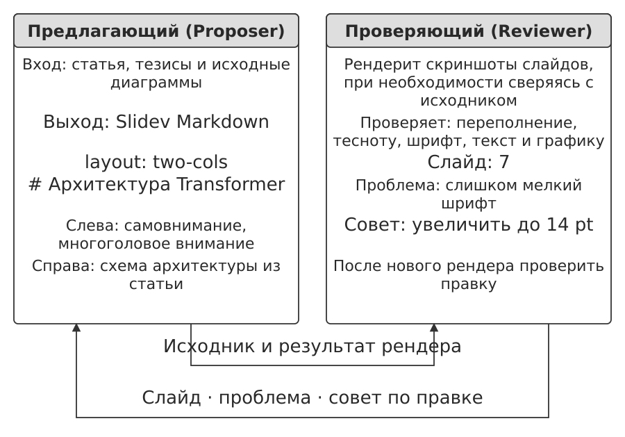

- **Предлагающий (Proposer)** читает статью, планирует структуру изложения, пишет исходный код Slidev и исправляет слайды с учётом обратной связи.
- **Проверяющий (Reviewer)** рендерит слайды с помощью инструментов, использует визуальную модель для проверки плотности содержимого, читаемости, компоновки и соответствия текста иллюстрациям, а затем возвращает структурированную обратную связь с номером слайда, типом проблемы, серьёзностью и рекомендацией по исправлению.

Обратная связь должна позволять сразу приступить к исправлению. Например: «На слайде 3 слишком много тезисов: разделите его на обзор метода и этапы вычислений»; «На слайде 7 слишком мелкий шрифт кода: сначала увеличьте его до 14 pt, затем снова проверьте читаемость при проецировании». В первую очередь исправляются фактические ошибки и неверная интерпретация графиков, а затем — компоновка и визуальные детали.

При локальном изменении необходимо также указать конкретный объект. Функция Doubao Work в Feishu Slides позволяет пользователю выбрать элемент слайда и сформулировать требование к редактированию через плавающую панель инструментов.[^ch5-doubao-work] Предположим, на одном слайде расположены два текстовых поля: в одном находится исходная цитата из интервью, а в другом — резюме докладчика. Пользователь выбирает резюме и просит: «Сократи до двух строк». Выбранное текстовое поле ограничивает область изменения. Резюме можно переформулировать, но соседняя цитата должна сохранить исходные слова респондента.

[^ch5-doubao-work]: Справочный центр Feishu, использование Doubao Work в презентациях.

После исправлений предлагающий повторно рендерит слайды, а проверяющий изучает новую версию и подтверждает, устранены ли проблемы предыдущего цикла. Для цикла задаются условия выхода двух типов: достижение явных требований к содержимому и оформлению либо исчерпание бюджета по числу итераций, времени или стоимости — например, не более пяти циклов исправлений. При передаче результата сохраняются текущая версия и список нерешённых проблем, чтобы облегчить последующую проверку.

Здесь используется тот же шаблон «предлагающий — проверяющий», что и при утверждении операций в главе 4. При утверждении операций в основном определяется, допустимо ли выполнить конкретное действие; при проверке содержимого результат улучшается в ходе нескольких циклов обратной связи. В обоих случаях необходимо совместно использовать требования задачи, приводить основания, позволяющие локализовать проблему, и поручать Harness определение дальнейшего процесса. Использование моделей из разных семейств позволяет получить ещё одну точку зрения при проверке.

**Автор считает важным преимуществом разделения обязанностей между двумя агентами более эффективное управление контекстом.** Каждый из двух участников может хранить только необходимую ему информацию: проверяющий в каждом цикле получает актуальные снимки слайдов, критерии проверки и необходимый список проблем; предлагающий сохраняет исходный код, цели исправлений и структурированную текстовую обратную связь. Изображения слайдов остаются в контексте проверяющего, а основная траектория продолжает работу с краткой текстовой обратной связью. Каждый цикл проверки сосредоточен на последней версии слайдов, что одновременно уменьшает помехи от старых снимков и сдерживает рост контекста.

> **Эксперимент 5-6 ★★: автоматическое создание PPT по научной статье**
>
> В этом эксперименте по PDF-файлу статьи «Attention Is All You Need» создаётся презентация Slidev из 20 слайдов. Агент извлекает структуру и основные тезисы статьи, использует три исходные иллюстрации из неё с указанием источников и последовательно организует изложение по слайдам. После рендеринга проверяются выход текста за границы, читаемость графиков и соответствие текста иллюстрациям, а затем вносятся исправления с учётом обратной связи.
>
> Сравниваются самостоятельная проверка одним агентом и разделение обязанностей между предлагающим и проверяющим. В этом запуске обе итоговые презентации получили по 95 баллов в рамках одной независимой процедуры оценки. Пиковый объём входных данных при разделении обязанностей составил около 24 тысяч токенов, а в варианте с одним агентом и сохранением прежних снимков — около 93 тысяч токенов.

> **Эксперимент 5-7 ★★: автоматическое создание видеолекции по научной статье**
>
> На основе презентации агент может написать для каждого слайда текст устного объяснения, описывающий представленные на иллюстрации объекты, связи и выводы, а затем синтезировать речь с помощью TTS. Текст выступления передаётся визуальному проверяющему вместе со слайдами, чтобы убедиться, что упомянутые элементы присутствуют в кадре, а описание соответствует графикам.
>
> При создании видео в эксперименте использовался процесс генерации из предыдущего раздела и более ранняя версия презентации из 22 слайдов (v2). После последовательного отбора 12 слайдов последний кадр видео соответствовал слайду 21 исходной презентации. Для сравнения оценок и объёма ресурсов в предыдущем разделе использовалась более поздняя версия из 20 слайдов (v9). После выбора слайдов Kimi сгенерировала текст выступления, визуальная модель Qwen проверила соответствие текста изображениям, а Fish Audio синтезировала речь для каждого слайда. FFmpeg установил длительность показа слайдов по фактической продолжительности каждого аудиофрагмента и собрал видеолекцию длительностью около 8,6 минуты.
>
> Как показано на рисунке 5-6, слайды, текст выступления и речь объединяются в видео только на последнем этапе. Некоторые проблемы можно услышать лишь тогда: не обрывается ли фраза при смене слайда, не усиливается ли к концу рассинхронизация звука и изображения.
>
> 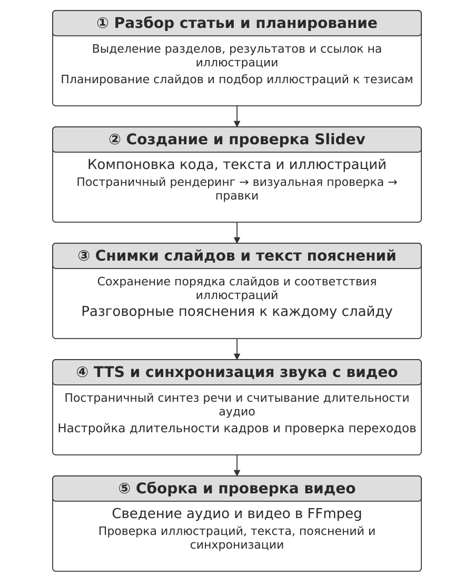

[^ch5-slidev]: Slidev, *Getting Started*: создание, показ и экспорт презентаций на основе Markdown и веб-технологий.

**Агент для монтажа видео.**

**Операции видеомонтажа, которые можно выразить скриптом, следует преимущественно выполнять через программный интерфейс.** Временная шкала, слои, субтитры и звуковые дорожки распределены по сложным панелям GUI, а повторный поиск и перетаскивание элементов увеличивают задержку и вероятность ошибок. Программный интерфейс позволяет напрямую описывать операции временными интервалами, дорожками и параметрами эффектов. Python API Blender и FFmpeg позволяют оформить часть задач монтажа в виде повторяемых скриптов.

Агент может сначала интерпретировать требование вроде «вырежи фрагмент с сёрфингом», затем найти целевой интервал в исходном материале и сгенерировать код для обрезки, компоновки и обработки звуковых дорожек. Предлагающий отвечает за план монтажа и скрипты, а проверяющий изучает результат рендеринга. Если обнаружены пропущенные или посторонние фрагменты либо перекрытие субтитрами, он указывает точную временную отметку и проблему, после чего предлагающий вносит исправления. Ключевые кадры подходят для проверки сцен и компоновки, но непрерывность движения и синхронизацию звука с изображением необходимо проверять также по соседним кадрам или непрерывным фрагментам.

> **Эксперимент 5-8 ★★: интеллектуальный видеомонтаж на основе API**
>
> В этом эксперименте поиск целевого фрагмента, генерация скрипта и проверка эффектов объединены в единый процесс. Сначала ссылка на видео, целевой вопрос и интервал извлечения кадров передаются субагенту для анализа видео. Он обрабатывает большое количество кадров и возвращает основному агенту временной интервал вместе с обоснованием.
>
> Поиск выполняется в два этапа. На первом этапе извлекается один кадр каждые 10 секунд, чтобы определить приблизительные границы целевого фрагмента, например: «сёрфинг находится между 40-й и 110-й секундами». На втором этапе вокруг найденного интервала и соседних границ извлекается по одному кадру в секунду, чтобы точнее определить начало и конец. Сцены короче интервала грубой выборки могут оказаться между двумя кадрами. В этом случае можно повысить частоту выборки с учётом продолжительности искомого фрагмента или просмотреть изображения между двумя извлечёнными кадрами.
>
> После определения интервала предлагающий генерирует скрипт Blender Python, который выполняет обрезку и необходимые операции с субтитрами, скоростью воспроизведения и другими параметрами. Проверяющий просматривает предварительный результат и указывает границы и эффекты, требующие корректировки. Полная версия видео экспортируется только после успешного прохождения проверки.
>
> В действительности вырезался фрагмент, в котором большой белый кролик в одиночестве идёт по траве. При просмотре одного кадра каждые 10 секунд модель определила интервал от 10-й до 20-й секунды. Если начать обрезку непосредственно с 10-й секунды, начало сцены будет потеряно. Поэтому программа расширила диапазон на 5 секунд в обе стороны, просмотрела по одному кадру в секунду между 5-й и 25-й секундами и сузила интервал до 9–12 секунд. Затем проверяющий обнаружил, что во фрагмент попали соседние кадры, и исправленный интервал составил с 9,25-й по 11,00-ю секунду. По сравнению с ручной разметкой интервала с 9,08-й по 11,20-ю секунду начало запаздывает на 0,17 секунды, а конец наступает на 0,20 секунды раньше. Обе границы соответствуют требованию о погрешности не более 3 секунд.
>
> Временные коды позволяют проверить лишь место обрезки. Но сможет ли проверяющий обнаружить ошибку, если наложить те же субтитры и замедление на намеренно неверно выбранный фрагмент? В эксперименте ему сначала предложили проверить контрольный фрагмент с 0-й по 3-ю секунду, а затем — исправленный результат рендеринга. Проверялись большой белый кролик в кадре, субтитры в нижней части и длительность после изменения скорости.

**3D и промышленные детали: выбор подходящего способа генерации.**

**Для промышленных деталей, у которых размеры и сборочные отношения являются жёсткими ограничениями, предпочтительна генерация параметрическим кодом; для объектов, где важнее естественность формы и внешний вид, следует в первую очередь рассматривать генеративные модели.** Выбор зависит от того, можно ли точно описать результат небольшим числом параметров и какие отношения должны сохраняться после изменений. CadQuery, OpenSCAD и скрипты Blender предоставляют редактируемый процесс построения, а такие модели, как Hunyuan 3D, используют усвоенные априорные представления о формах для создания сложного внешнего вида.

**Пригодность описания для параметризации.** Основную геометрию упрощённого фланца можно выразить через внешний диаметр, толщину, диаметр окружности расположения отверстий, диаметр и число отверстий. Код связывает параметры с этапами построения и поэтому подходит для многократной корректировки. Растение в горшке, камень Тайху или человеческое лицо содержат множество нерегулярных форм. Генеративная модель может помочь создать их внешний вид, а программные методы — сформировать детали с помощью правил роста, случайных процессов и комбинации ассетов.

**Проверка точности.** Для требования вроде «диаметр отверстия 5 mm, допуск ±0,05 mm» необходимо сначала явно определить единицы измерения, систему координат и метод измерения, а затем сопоставить размеры модели со спецификацией. В параметрической модели можно непосредственно проверять геометрические объекты. Сетку можно измерять по сечениям, отверстиям, габаритным размерам и другим характеристикам с учётом погрешности дискретизации.

**Сохранение и изменение.** B-rep — граничное представление — описывает границу твёрдого тела гранями, рёбрами и вершинами, а треугольная сетка аппроксимирует поверхность гранями. CadQuery может экспортировать STEP для обмена данными CAD и сетки STL, а редактируемые параметры и логика построения сохраняются в исходном коде CadQuery[^ch5-cad]. Для перехода к обработке на станках с ЧПУ дополнительно требуются планирование технологического процесса, построение траекторий инструмента и адаптация к станку.

Например, чтобы вместо M5 использовать крепёжные отверстия под M6, можно изменить параметр диаметра отверстий, повторно сгенерировать модель и проверить, что внешний диаметр, толщина и расположение отверстий остались неизменными. Способ изменения результата генеративной модели зависит от возможностей интерфейса: модель можно сгенерировать заново либо применить локальное редактирование и последующую геометрическую обработку.

При сочетании двух подходов также следует явно разделять обязанности: размеры и сборочные отношения поручить параметрическому коду, а текстуры и свободную форму — генеративной модели. **Если ключевые размеры требуется неоднократно и точно изменять, редактируемый процесс построения ценнее однократно сгенерированного внешнего вида.**

> **Эксперимент 5-9 ★★: два способа создания одной детали — код и генеративная модель**
>
> В этом эксперименте необходимо создать фланец внешним диаметром 80 mm и толщиной 10 mm с четырьмя равномерно расположенными крепёжными отверстиями на окружности диаметром 60 mm. Чтобы однозначно определить требования к сборке, первоначальная спецификация задаёт сквозные отверстия диаметром 5,5 mm под M5, а запрос на изменение требует заменить их сквозными отверстиями диаметром 6,5 mm под M6.
>
> В программном варианте модель генерирует программу CadQuery, после выполнения которой экспортируются STEP и STL. В варианте с генеративной моделью сначала создаётся референсное изображение изделия, которое затем передаётся Hunyuan 3D для генерации сетки. Проверяются внешний диаметр, толщина, число и диаметр отверстий, их расположение и монтажная поверхность; также фиксируются единицы измерения и направление оси.
>
> Как проверить, что модель изменила только указанный размер? При сопоставлении экспортированных STL до и после изменения средний диаметр четырёх крепёжных отверстий увеличился с 5,499 mm до 6,499 mm. Внешний диаметр обеих деталей составляет 80 mm, толщина — 10 mm, а диаметр окружности расположения отверстий при округлении до трёх знаков равен 60,000 mm. Исходная сетка, созданная генеративной моделью, не имеет явно заданного физического масштаба. Программа измерения построила сечение посередине по оси Z, но не обнаружила внутренних контуров отверстий. Чтобы выяснить, проходят ли четыре отверстия через всё тело диска, необходимо определить монтажную поверхность и построить сечения на разной глубине по её нормали. После повторной генерации изменились как общая форма, так и ориентация.
>
> Наконец, рассмотрим другую задачу: как принимать изображение растения в горшке, которое должно выглядеть естественно? В эксперименте одно изображение растения было нарисовано с помощью matplotlib, а другое сгенерировано Gemini. Затем одна и та же визуальная модель оценила их естественность по десятибалльной шкале. Изображения получили соответственно 3 и 8 баллов. Эта оценка показывает, какое из них модель-проверяющий считает более похожим на настоящее растение. Если вернуться к фланцу, даже когда на изображении изделия видны четыре отверстия, для проверки сборки всё равно необходимо измерить их положение и диаметр на трёхмерной детали.

[^ch5-cad]: CadQuery, *Importing and Exporting Files*: описание форматов STEP, STL и других, а также указание на то, что полная параметрическая информация сохраняется в исходном коде CadQuery на Python.

### Код как системный адаптер

Интерфейсы, способы аутентификации и форматы данных внешних сервисов различаются. AI-агент может изучить документацию и примеры ответов, сгенерировать HTTP-клиент, настроить заголовки аутентификации, разобрать возвращаемые значения и преобразовать поля вышестоящей системы в структуру, необходимую нижестоящей. Код здесь выполняет роль системного адаптера, объединяя существующие сервисы в новый процесс выполнения задач.

Например, платёжный сервис может возвращать сумму в фэнях, а отчёт — отображать её в юанях. Успешный разбор JSON говорит лишь о совместимости форматов. Транзакция на 25 юаней представлена в вышестоящей системе целым числом 2500. Если напрямую поместить его в отчёт, 25 юаней превратятся в 2500 юаней.

Для адаптера необходимо явно определить входные и выходные данные, обработку ошибок и диапазон поддерживаемых версий. Примеры помогают модели понять поля, а спецификация интерфейса и тесты проверяют отсутствующие значения, пагинацию, ошибочные ответы и изменения версий. Учётными данными управляет среда выполнения, а сгенерированный код использует авторизованные возможности через контролируемые интерфейсы. После успешной проверки адаптер можно сохранить и использовать повторно, а при последующих изменениях формата — снова запустить процесс модификации.

Аналогичный подход применим и к системам, доступным только через графический интерфейс. Сначала агент выполняет задачу с помощью Computer Use, представленного в главе 6, а затем закрепляет стабильную последовательность действий в виде инструмента RPA. При изменении элементов интерфейса, состояния входа или последовательности страниц инструмент должен обнаруживать отклонения и заново находить нужные элементы. В главе 9 подробнее рассматривается извлечение, проверка и повторное использование рабочих процессов из успешных траекторий.

**Разбор и визуализация журналов агента.**

Сложная задача может включать несколько запросов к модели, выполнений инструментов и взаимодействий с субагентами. Обзор журнала показывает взаимосвязи шагов, их состояния и длительность, а в развёрнутом представлении отображаются конкретные входные и выходные данные, позволяя проследить, что произошло на определённом шаге. На разбор и отображение влияют новые поля, вложенные структуры и версии формата.

Адаптивный разбор обрабатывает такие изменения посредством цикла «обнаружить изменение → сгенерировать парсер → проверить результат». При сбое разбора система сохраняет исходный пример, позицию ошибки и ожидаемые поля, а затем сопоставляет их со спецификацией интерфейса и версией производителя данных, чтобы определить, было ли изменение ожидаемым. Агенту поручают написать новый парсер только после подтверждения обновления формата. Если ошибка возникла в программе, записывающей журнал, исходный журнал сохраняется, а о сбое сообщается, чтобы новый парсер не принял ошибочные данные за нормальный формат. Новый код сначала запускается в ограниченной среде: проверяются поля и их смысл, затем выполняется проверка на обычных примерах, примерах с отсутствующими полями и регрессионных сценариях старого формата. После успешной проверки новый парсер регистрируется с указанием версии и применимого формата. Неудачные примеры продолжают храниться для последующего отслеживания и повторных попыток.

Для разбора и отображения используются разные методы проверки. Программа проверяет временные метки, состояния, числовые типы и связи между вызовами. Рендеринг в браузере проверяет работоспособность страницы, а визуальная модель помогает оценить понятность таблиц, временных шкал и меток. При горячем обновлении сохраняются предыдущая версия и возможность отката, чтобы поддержку нового формата можно было вводить в работающую систему постепенно.

> **Эксперимент 5-10 ★★★: адаптивная система разбора журналов**
>
> В этом эксперименте сначала запускаются два процесса формирования журналов, выводящие соответственно формат с разделителями-вертикальными чертами и формат с вложенными скобками. Исходный парсер не способен обработать эти примеры, после чего система запрашивает у модели две функции разбора, а после успешного прохождения тестов загружает их без перезапуска и повторно обрабатывает ранее не разобранные журналы.
>
> Из первого формата извлекаются `timestamp`, `level`, `module`, `step` и `message`; второй также содержит имя инструмента, длительность и состояние. В журнале запуска успешно разобраны по три записи каждого типа, а вновь созданный движок способен загрузить сохранённые парсеры и продолжить обработку смешанного потока журналов.
>
> Chromium отображает результаты разбора в виде таблицы, а визуальная проверка оценивает названия столбцов, содержимое строк и удобочитаемость.

**Автоматический анализ журналов выполнения агента и диагностика проблем.**

После извлечения структурированных траекторий агент может сопоставить ожидаемый процесс с фактическими действиями на основе архитектурной документации и PRD — документа с требованиями к продукту. Например, проверялась ли возможность возврата средств по заказу до самого возврата? Переключилась ли программа на чтение из кэша после истечения времени ожидания сервиса складского учёта?

Отчёт о проблеме может содержать приоритет, модуль, проявление, доказательства и рекомендации по улучшению. На его основе агент также может сгенерировать регрессионные тесты, зафиксировав входные данные и условия приёмки, соответствующие проблеме. В контролируемой среде тестовый фреймворк повторно воспроизводит запросы или считывает сохранённые ответы инструментов, сопоставляя поведение дефектной и исправленной версий. Для операций с внешней записью используется изолированная среда или замещающие интерфейсы, чтобы последствия воспроизведения оставались контролируемыми.

Утверждения должны соответствовать проверяемым свойствам. Например, наличие в журнале проверки возможности возврата средств говорит лишь о том, что программа её выполнила. Чтобы определить правильность возврата, необходимо также проверить, что проверка предшествовала возврату, её результат разрешал возврат и каков итоговый статус заказа.

После проверки диагностики агент может, получив соответствующее разрешение, создать GitHub Issue через MCP и предложить ответственного с учётом модуля. Если для того же дефекта уже существует рабочая задача, новые доказательства следует добавить в неё.

> **Эксперимент 5-11 ★★★: интеллектуальная система диагностики производственных журналов**
>
> В этом эксперименте локальный HTTP-сервис формирует две бизнес-траектории. Первая показывает, что система вернула деньги, не проверив возможность возврата по заказу. Вторая — что после истечения времени ожидания запроса к складскому учёту система не переключилась на получение данных из кэша. Модель сопоставляет траектории с архитектурной документацией и описанием требований, формирует отчёт о проблемах со ссылками на траектории и ходы, а затем создаёт три исполняемых регрессионных теста.
>
> На рисунке 5-7 диагностический отчёт расположен между траекторией и регрессионными тестами. В отчёте указано: «Система пропустила проверку и сразу вернула деньги». Вернитесь к траектории и найдите доказательство: какого шага не хватает в журнале вызовов? Затем посмотрите на тесты: обнаружат ли они повторный пропуск этого шага в будущем?
>
> 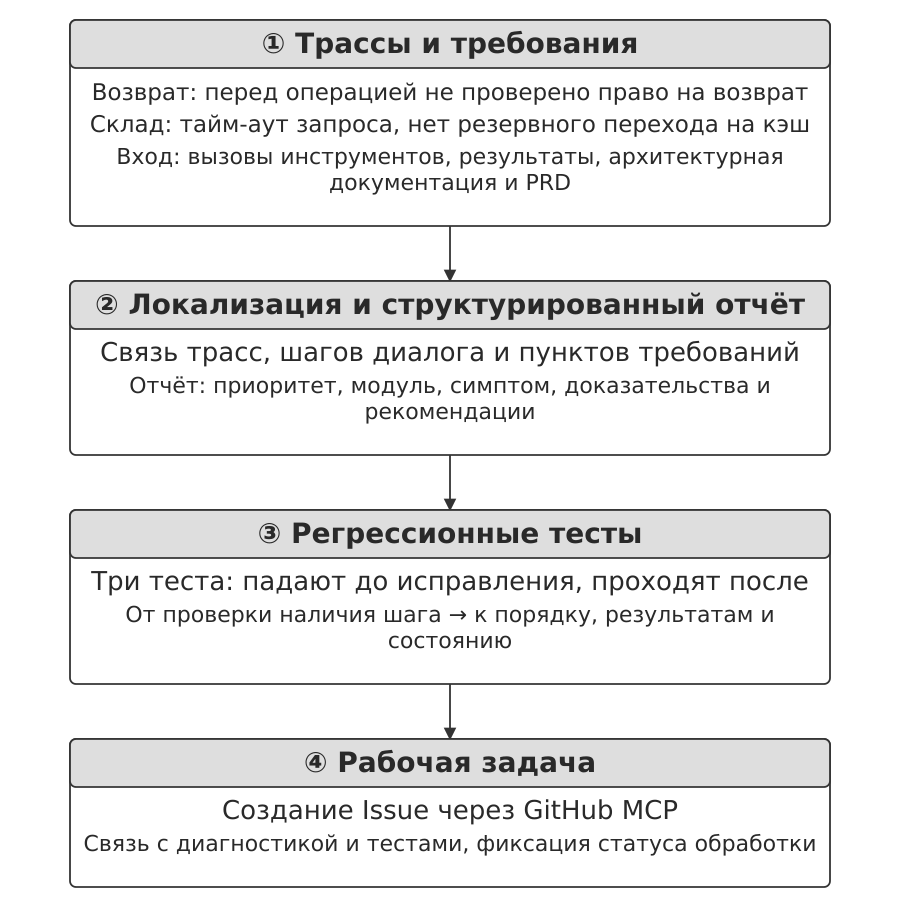
>
> Все три теста завершаются неудачей на дефектной версии и успешно проходят после её замены на исправленную. Один из тестов проверяет только факт вызова программой инструмента проверки возможности возврата. Этот тест пройдёт, даже если программа сначала вернёт деньги и лишь затем проверит возможность возврата по заказу. В журнале запуска также сохранено подтверждение создания рабочей задачи через GitHub MCP, по которому можно найти задачу, соответствующую переданному разработчику диагностическому отчёту.
>

### Код как генеративный UI

Если пользователь также должен самостоятельно изменять материалы, над которыми работает AI-агент, интерфейс можно превратить в общее рабочее пространство для человека и агента. Например, в маршруте путешествия пользователь может видеть, какой пункт сейчас изменяет помощник, перехватывать редактирование, подтверждать или отменять изменения. Если пользователь только что перенёс дату отправления на пятницу, помощник должен продолжить работу уже с обновлённым маршрутом. Одновременно просматривать и изменять данные можно лишь тогда, когда обе стороны совместно используют одно видимое состояние и заранее определено, кто в текущий момент управляет редактируемым полем.

Представьте, что пользователь хочет сравнить три варианта поездки. Пока место назначения не определено, удобнее уточнять его в диалоге. После выбора направления пользователю проще непосредственно указать даты и число путешественников, чем многократно сверять несколько текстовых фрагментов. Наконец, изменение общей стоимости в зависимости от дат нагляднее всего представить на графике. Агент генерирует подходящие для задачи формы, диаграммы или интерфейсы приложений, в которых пользователь может непосредственно вводить данные, выбирать варианты и выполнять действия. Это и называется генеративным UI (Generative UI).

**Описывать интерфейс и взаимодействие посредством протокола.**

Существует два способа генерировать интерфейсы: выводить код HTML, JavaScript и других языков для выполнения в контролируемой среде либо выводить декларативную структуру, которую визуализируют компоненты клиента. Первый способ упрощает создание нестандартных макетов и взаимодействий, второй ограничивает доступные возможности набором компонентов и действий, предоставленных клиентом.

A2UI (Agent-to-User Interface) использует декларативное описание. Агент создаёт структурированные сообщения, описывающие компоненты, привязку данных и обновления, а клиент отображает интерфейс с помощью собственных компонентов[^ch5-ui-protocols]. Например, приложение может предоставлять компоненты карточки, кнопки, текстового поля и таблицы, а агент — описать с их помощью таблицу с заголовком «Данные о продажах», тремя строками и двумя столбцами. Каталог компонентов также можно расширить диаграммами, картами и другими возможностями.

AG-UI (Agent–User Interaction) обеспечивает обмен событиями между агентом и фронтендом, передавая сообщения, вызовы инструментов и обновления состояния, а также может переносить сообщения интерфейса A2UI. При совместном использовании A2UI описывает отображаемое содержимое, а AG-UI связывает выполнение на бэкенде с взаимодействием на фронтенде.

Клиент может получать обновления интерфейса поэтапно и отображать их в веб-, мобильной или настольной среде с помощью адаптированного средства визуализации. Клиент проверяет свойства компонентов, привязку данных и запросы действий, а сервер продолжает проверять бизнес-права. Для ссылок, форматированного текста и доступа к данным внутри компонентов также необходимы отдельные правила обработки.

При непосредственной генерации кода необходимо проверять зависимости, доступ к ресурсам и разрешения на выполнение, а также изолировать сгенерированный интерфейс от конфиденциального состояния хост-приложения. Инъекция в промпт из внешних материалов может повлиять на процесс генерации, а риск выполнения скриптов в браузере зависит ещё и от способа загрузки и изоляции страницы.

**Предоставлять интерактивные результаты в HTML.**

**Для результатов исследований, включающих данные, демонстрации и непрерывные обновления, автор отдаёт предпочтение HTML-сайтам.** Длинный линейный отчёт в Markdown заставляет читателя постоянно искать контекст. Интерактивная веб-страница позволяет собрать пояснения, данные и демонстрации в одной точке входа: читатель просматривает диаграммы, фильтрует интересующие его примеры, раскрывает подробности отдельных результатов, а затем взаимодействует с демонстрацией, чтобы понять поведение системы. По мере выполнения задачи агент также может обновлять страницу, непрерывно фиксируя на ней актуальные результаты и доказательства.

Например, в исследовательской практике автора каждому проекту соответствует интерактивный сайт, который одновременно служит живым документом в ходе исследования и итоговым результатом. По мере проведения экспериментов агент постоянно дополняет его содержимое. Такие сайты решают три основные задачи.

Первая — **прослеживаемость экспериментальных данных**. Страница связывает примеры, промпты, ответы модели и оценки, позволяя проверять их по отдельности. Например, если ответы одного типа постоянно получают низкую оценку, по истории оценивания можно найти исходные ответы и промпты.

Вторая — **мониторинг показателей обучения**. Сигналы, отражающие внутреннее состояние обучения, автор называет «клиническими показателями»: потери на обучающей и валидационной выборках, нормы градиентов, скорость обучения, а при обучении с подкреплением — вознаграждение, дивергенция KL, энтропия стратегии и другие значения. Для языковой модели также можно использовать перплексию, чтобы измерять качество предсказания заданной последовательности текста. Подобно физиологическим показателям при медицинском обследовании, эти кривые иногда обнаруживают проблемы раньше, чем итоговые результаты задачи. Их совместный просмотр с точностью выполнения задач помогает определить, на каком этапе возникли отсутствие сходимости, аномалии градиентов или деградация обучения.

Третья — **демонстрация принципа работы**. При объяснении взаимодействия нескольких модулей страница может позволить читателю изменить входные данные, просмотреть промежуточное состояние, а затем сопоставить изменение результата с записями эксперимента.

Если работа продолжается несколько часов, как пользователю время от времени подключаться к ней? При использовании Coding Agent автор хочет, чтобы короткая устная команда точно передавалась агенту, ведущему задачу, чтобы результаты можно было открыть в любой момент, а уведомления приходили только при появлении новой версии или необходимости принять решение. Например, одновременно создаются два отчёта. Пользователь открывает отчёт о продажах, указывает на вторую диаграмму и говорит: «Перестрой её по чистой выручке». Интерфейс должен передать вместе с командой идентификаторы текущего отчёта и диаграммы. Когда диаграмма будет готова, уведомление должно позволить сразу открыть новую версию. Если для «чистой выручки» доступны два способа расчёта, помощник должен предложить пользователю выбрать один из них.

**Уточнять намерение пользователя.**

Когда пользователь говорит: «Я хочу купить билет на самолёт до Пекина», место назначения уже известно, но ещё требуется уточнить город отправления, дату и тип поездки — в одну сторону или туда и обратно. Агент может собрать все вопросы в одном раунде диалога либо сгенерировать форму, чтобы связанные условия были представлены на одной странице.

Элементы управления формы соответствуют разным типам информации: текстовые поля собирают открытые ответы, раскрывающиеся меню и переключатели перечисляют доступные варианты, флажки поддерживают множественный выбор, а выбор даты помогает указать время. JavaScript позволяет описывать зависимости между полями: например, после выбора варианта «туда и обратно» показывать дату возвращения и проверять, что она не предшествует дате отправления. При изменении выбора также необходимо очищать или игнорировать поля, утратившие актуальность.

Рисунок 5-8 взят из одного запуска следующего эксперимента. Проследите эту отправку данных: среди четырёх полей, возвращённых браузером, нет места назначения. Откуда модель знает, что пассажир направляется в Пекин?

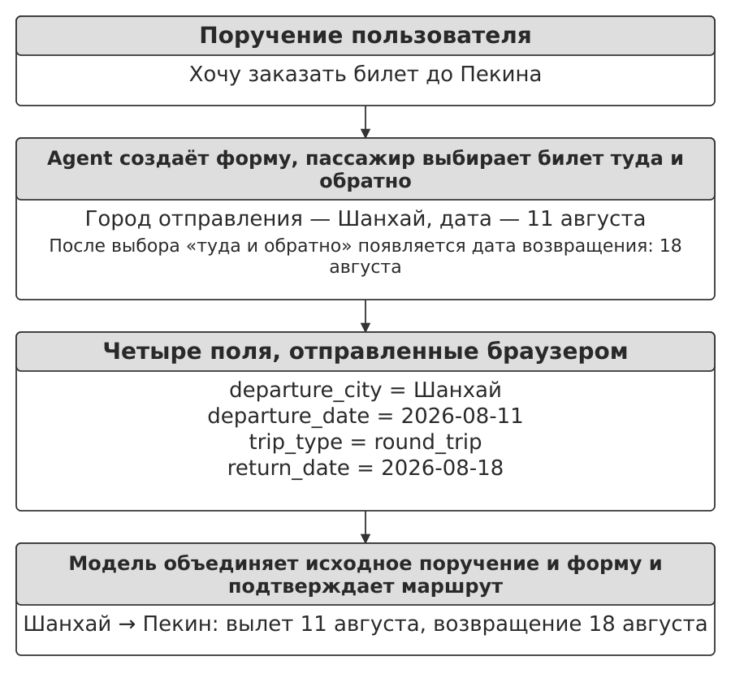

> **Эксперимент 5-12 ★★: система уточнения намерения посредством динамически генерируемой формы**
>
> Эксперимент начинается с запроса «Я хочу купить билет на самолёт до Пекина». Модель должна сгенерировать HTML-форму: текстовое поле для города отправления, выбор даты отправления, варианты поездки в одну сторону и туда и обратно, а также дату возвращения, которая отображается при выборе поездки туда и обратно.
>
> Программа передаёт модели исходное поручение вместе с данными формы. Если сохранить только отправленные поля, место назначения всё равно будет отсутствовать, даже когда каждый элемент управления заполнен правильно.
>
> Выполните ещё одну проверку с той же формой: заполните дату возвращения, а затем выберите поездку в одну сторону. Страница скроет поле даты возвращения, но отправленный JSON сохранит и вариант поездки в одну сторону, и дату возвращения 18 августа. При переключении на поездку в одну сторону клиент также должен очистить ставшую недействительной дату возвращения.

[^ch5-ui-protocols]: Официальная документация A2UI и *AG-UI Overview* описывают соответственно декларативное представление интерфейса и обмен событиями между агентом и фронтендом.

**Генерировать SQL-запросы.**

Пользователь может сформулировать запрос к базе данных на естественном языке, а агент — сгенерировать SQL на основе структуры таблиц и бизнес-правил расчёта. **Для отображения полной таблицы результатов автор отдаёт предпочтение режиму Artifact, в котором данные поступают из базы непосредственно в интерфейс.** Если заставлять модель читать и построчно пересказывать большую таблицу, возрастут расход токенов и время ожидания, а также появится риск ошибок при переносе данных. SQL сохраняется как доступный для проверки артефакт запроса. Если требуется проанализировать причины или обобщить тенденции, модели передаются лишь необходимые агрегированные результаты.

На рисунке 5-9 пользователь хочет узнать число работающих сотрудников в каждом отделе, и страница может непосредственно отобразить статистическую таблицу, возвращённую базой данных. Если затем пользователь спросит: «На сколько человек в отделе маркетинга больше, чем в отделе разработки?», модели достаточно взять из таблицы числа 9 и 5 и вычислить разницу в 4 человека. Если же последует вопрос: «В прошлом месяце разница была такой же?», текущей таблицы уже недостаточно — потребуется повторно выполнить запрос со статистической датой прошлого месяца.

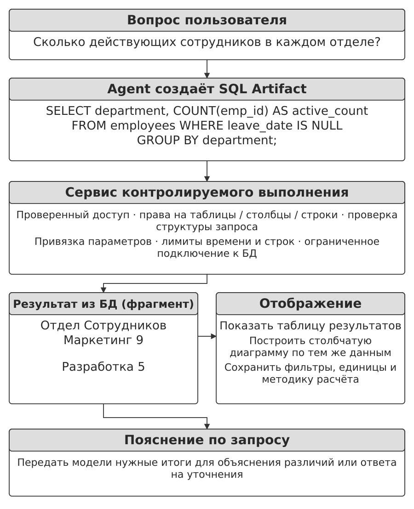

Сервис выполнения определяет доступные таблицы, столбцы и строки на основе доверенной идентификационной информации, использует ограниченную учётную запись базы данных и проверяет структуру SQL и тип операции. В сценариях выполнения запросов можно разрешить только одобренные запросы на чтение, ограничить вызовы функций, бюджет времени, число возвращаемых строк и диапазон данных, а введённые пользователем значения передавать посредством параметризованной привязки.

Агент также может создавать визуальные артефакты, например представлять сводные данные по отделам в виде столбчатой диаграммы. Сервис выполнения передаёт результаты запроса в контролируемую среду визуализации, а интерфейс отображает только разрешённые данные и взаимодействия.

> **Эксперимент 5-13 ★★: ERP-агент с взаимодействием на естественном языке**
>
> На примере запросов к данным сотрудников и заработной платы в ERP-системе — системе планирования ресурсов предприятия — этот эксперимент показывает, как генерировать SQL из бизнес-вопросов и передавать результаты базы данных непосредственно на страницу. В PostgreSQL создаются две таблицы. Таблица сотрудников содержит идентификатор сотрудника, имя, отдел, уровень, дату приёма и дату увольнения; пустая дата увольнения означает, что сотрудник продолжает работать. Таблица заработной платы содержит идентификатор сотрудника, дату выплаты и сумму зарплаты; для каждого сотрудника предусмотрена одна запись в месяц.
>
> На основе этих двух таблиц агент обрабатывает следующие десять вопросов:
>
> 1. Какова средняя продолжительность работы одного сотрудника?
> 2. Сколько работающих сотрудников в каждом отделе?
> 3. В каком отделе самый высокий средний уровень сотрудников?
> 4. Сколько новых сотрудников было принято в каждый отдел в этом и прошлом году?
> 5. Какова средняя зарплата в отделе A с марта позапрошлого года по май прошлого года?
> 6. В каком отделе средняя зарплата за прошлый год была выше: A или B?
> 7. Какова средняя зарплата сотрудников каждого уровня в этом году?
> 8. Какова средняя зарплата за последний месяц у сотрудников со стажем до года, от одного до двух лет и от двух до трёх лет?
> 9. Какие десять сотрудников получили наибольшее повышение зарплаты с прошлого по текущий год?
> 10. Есть ли задолженность по зарплате — месяцы, в которые сотрудник работал, но не получил выплату?
>
> Перед выполнением запросов необходимо определить правила расчёта. Например, стаж работающих сотрудников рассчитывается до базовой даты запроса, а уволенных — до даты увольнения; для «средней зарплаты» нужно решить, усреднять ли записи о выплатах или средние значения по сотрудникам; при ранжировании повышения зарплаты необходимо учесть сотрудников без записей за прошлый год.
>
> В этом запуске были сгенерированы и выполнены десять SQL-запросов, результаты которых совпали с независимым эталонным расчётом, после чего браузер непосредственно отобразил таблицы. Модель получает структуру таблиц, задачу и необходимую обратную связь о выполнении, а строки базы данных передаются приложением в интерфейс.

**Динамически генерировать программное обеспечение.**

Агент может на основе требований сгенерировать интерфейс и логику взаимодействия, а затем продолжить их изменять в ответ на действия пользователя. Представленная Anthropic в 2025 году временная исследовательская предварительная версия Imagine with Claude демонстрировала такое взаимодействие: пользователь исследует интерфейс, а модель непрерывно генерирует соответствующий программный продукт[^ch5-imagine].

**Для реальных продуктов автор считает более перспективной настройку поверх существующего каркаса.** При непрерывной генерации всего приложения с нуля приходится снова и снова оплачивать генерацию, визуализацию и проверку. Стабильный каркас с возможностью изменять важные для пользователя элементы интерфейса и процессы позволяет быстрее предоставлять надёжно персонализированный продукт. Пользователь просит: «Сделай кнопку синей», «Добавь в боковую панель меню быстрых действий» или «Выбери более читаемый шрифт». Агент находит соответствующие компоненты, изменяет код и проверяет результат в режиме предварительного просмотра. Базовый каркас предоставляет стабильную структуру страниц и бизнес-интерфейсы, а область настройки можно постепенно расширять от цветов и шрифтов до макета и компонентов.

HMR (Hot Module Replacement, горячая замена модулей) в среде разработки позволяет обновлять затронутые фронтенд-модули после изменения кода. Сохранение состояния зависит от интеграции с фреймворком, границ обновления и типа изменений. Если необходима полная перезагрузка, приложение должно предварительно сохранить требуемое состояние. В свою очередь, reload в режиме разработки FastAPI перезагружает серверную программу: эти механизмы воздействуют соответственно на фронтенд-модули и бэкенд-процесс[^ch5-hmr].

> **Эксперимент 5-14 ★★: система диалоговой настройки интерфейса**
>
> В этом эксперименте создаётся чат-приложение с фронтендом на React и бэкендом на FastAPI. В среде разработки включаются HMR для фронтенда и reload для бэкенда. Модель изменяет цвет, шрифт и заголовок по требованиям трёх последовательных раундов, а браузер после каждого изменения проверяет фактический интерфейс.
>
> В этом запуске были зарегистрированы события HMR от Vite. Ни в одном из трёх раундов не происходило переходов с полной загрузкой страницы, существующее состояние чата сохранилось, а итоговая сборка прошла успешно.

[^ch5-imagine]: Anthropic, *Introducing Claude Sonnet 4.5* — описание выпущенной вместе с моделью временной исследовательской предварительной версии Imagine with Claude.
[^ch5-hmr]: *Vite HMR API* и *FastAPI CLI* описывают соответственно горячее обновление фронтенда и автоматическую перезагрузку сервера разработки.

**Отделять границы прав доступа от динамического бизнес-кода.**

**Чем проще агенту динамически переписывать бизнес-код, тем ниже, ближе к стабильному уровню доступа к данным, должны располагаться окончательные границы прав.** В традиционном приложении проверки прав записываются в проверенном бизнес-коде. Если генерируемый код постоянно изменяется, новый путь может пропустить такую же проверку. Сохранить ограничения прав можно лишь в том случае, если каждая операция чтения и записи проходит через независимый сервис доступа к данным. Например, приложение для подбора персонала может динамически генерировать списки кандидатов и формы операций, однако принадлежность кандидата организации и поля, которые разрешено изменять рекрутеру, должен постоянно проверять доверенный сервис доступа к данным.

Цель такого проектирования: **даже если в сгенерированном коде возникнет ошибка, доверенный уровень доступа к данным продолжит принудительно применять ограничения прав.** Это развивает принцип защитных механизмов уровня данных из первой главы: правила, обязательные для исполнения, следует размещать там, где проходят все соответствующие операции. Политики безопасности на уровне строк базы данных могут ограничивать доступ к записям, ограничения и валидаторы — проверять допустимость состояния, а контролируемые представления, хранимые процедуры или сервисы данных — предоставлять разрешённые операции. Прикладной уровень может заранее выполнить проверку и объяснить её пользователю, но окончательное чтение и запись всё равно контролируются доверенным сервисом данных и правами базы данных.

Для каждой операции также необходим доверенный **контекст доступа** (access context), содержащий сведения о пользователе, арендаторе, роли или идентичности агента. Сервис аутентификации и доверенная среда выполнения устанавливают и привязывают идентичность, а сервис данных выполняет авторизацию на её основе. Динамический код получает ограниченные интерфейсы, необходимые для выполнения задачи. Учётные данные и полномочия на управление политиками находятся под контролем независимых компонентов. Все подключения к базе данных, вспомогательные запросы и фоновые процессы должны соблюдать одну область доступа.

Например, безопасность на уровне строк PostgreSQL должна использоваться совместно с настройкой ролей базы данных. Приложение подключается под ролью, на которую распространяются политики, а его учётная запись не имеет права изменять политики доступа[^ch5-rls]. Механизмы привязки правил к идентичностям проходят независимую проверку, тогда как бизнес-интерфейс может непрерывно меняться в заданных границах.

Права доступа и целостность данных выполняют разные задачи. После подтверждения права рекрутера изменять запись кандидата конечный автомат дополнительно проверяет, разрешён ли переход из состояния «прошёл отбор» в состояние «прошёл собеседование». Валидатор заработной платы читает связанную вакансию и проверяет, находится ли ожидаемая зарплата в установленном для неё диапазоне. Проверка ссылок подтверждает действительность связи между вакансией и кандидатом.

> **Эксперимент 5-15 ★★★: объект данных со встроенными правами для динамически генерируемого программного обеспечения**
>
> В этом эксперименте создаётся прототип объектного хранилища на Python поверх PostgreSQL, в котором правила доступа, валидаторы, отношения между объектами и последующие реакции объявляются внутри типов данных. При чтении проверяются права доступа. При создании и обновлении сначала проверяются права, бизнес-правила и ссылочные отношения, затем данные сохраняются, после чего объявленные последующие реакции добавляются в очередь с ограничением глубины цепочки.
>
> Пример системы подбора персонала содержит объекты вакансий, кандидатов, собеседований и оценок. Кандидат последовательно проходит этапы подачи заявки, отбора, собеседования, направления предложения о работе и найма; на соответствующих этапах также возможен переход в состояние отказа. Диапазон заработной платы берётся из связанной вакансии. В примере проверяются обычное обновление состояния, недопустимый переход состояния, выход за диапазон заработной платы вакансии и доступ из другого арендатора. Это помогает понять, какие задачи решают соответственно авторизация и проверка бизнес-правил.
>
> Прототип представляет пользователя, роль и атрибуты организации посредством `AccessContext`; учебный скрипт напрямую создаёт такие контексты для имитации разных идентичностей. При развёртывании контекст создаётся в точке аутентификации, а объектное хранилище и сгенерированный код размещаются по разные стороны явно определённой границы сервиса или прав доступа.

[^ch5-rls]: PostgreSQL, *Row Security Policies* — описание настройки политик безопасности на уровне строк в зависимости от ролей и операций, а также области их применения.

### Код создаёт код: самозагрузка AI-агента

Возможности генерации кода можно использовать и для разработки самих агентов. Создатель получает требования к задаче, генерирует или изменяет промпт, инструменты и цикл выполнения нового агента, а затем проверяет результат с помощью тестов и реальных взаимодействий. На рисунке 5-10 показан этот цикл самозагрузки: существующая реализация служит отправной точкой, обратная связь по задаче направляет изменения, а результаты проверки определяют, какие из них можно сохранить.

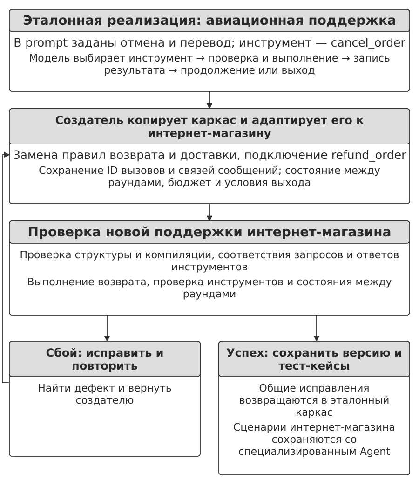

Как отличить изменение, улучшившее общие способности, от изменения, которое случайно подстроилось под только что увиденную задачу? Оставьте одну задачу, которую создателю не показывали. Например, разработайте агента мониторинга цен на данных одного магазина, а затем передайте ему пример из другого магазина, одновременно повторно запустив исходную задачу.

**Обслуживайте среду выполнения агента.**

Работа нового агента зависит от конфигурации, учётных данных, состояния сеанса, сервисов и песочницы. Команда `doctor` в OpenClaw служит примером инструмента обслуживания: она проверяет миграцию старых конфигураций, состояние учётных данных OAuth, блокировки сеансов, установку плагинов, работоспособность шлюза, образы песочницы и другие возможные проблемы, после чего предлагает рекомендации по исправлению или сама выполняет соответствующие исправления[^ch5-doctor].

Эти детерминированные проверки могут стать основой процесса самообслуживания. Правила обнаружения охватывают известные сбои, а действия по исправлению имеют чётко определённые входные данные и ожидаемые результаты. При дальнейшем проектировании процесса диагностики агента можно передавать модели нерешённые проблемы вместе с журналами, конфигурацией и результатами проверок, чтобы она объяснила, какую конфигурацию и каким образом намерена изменить. Затем исполнительный слой проверяет права доступа и область изменений, после чего запускает проверку работоспособности и регрессионные тесты. Снимки конфигурации, журнал изменений и механизм отката помогают восстановить работу системы после неудачного исправления.

**Закрепляйте инженерный опыт в эталонной реализации.**

Создание специализированного агента одновременно затрагивает логику предметной области и общую инфраструктуру. При проверке сгенерированного результата можно начать с четырёх категорий вопросов:

1. **Контекст и цикл выполнения.** Сохраняйте связи между ролями, идентификаторами вызовов инструментов и результатами инструментов; проверяйте состояние в многоходовых взаимодействиях, условия завершения, бюджет и восстановление после исключений. Структурированные сообщения упрощают поддержку связей протокола, а стабильный префикс создаёт условия для кэширования промпта.
2. **Интерфейсы инструментов.** Описание инструмента должно объяснять его назначение, условия применимости и границы использования, а параметры — содержать типы, смысл и конкретные примеры. Исполнительный слой по-прежнему должен проверять параметры, идентичность и состояние бизнес-процесса.
3. **Выбор модели и API.** Модель склонна использовать старые модели и интерфейсы, часто встречавшиеся в обучающих данных, поэтому даже хорошо написанный код может опираться на устаревший выбор технологий. Предоставьте создателю актуализируемые материалы по выбору технологий или разрешите ему обращаться к официальной документации, чтобы сверять возможности моделей, версии интерфейсов и способы вызова. После генерации выполните реальные вызовы, чтобы проверить работоспособность конфигурации.
4. **Совместимость зависимостей и экосистемы.** Проверяйте состояние сопровождения библиотек, их версии и изменения интерфейсов, а также подтверждайте работоспособность собранной программы установкой зависимостей, проверкой компиляции и тестами.

**При создании специализированного агента автор в первую очередь предлагает создателю скопировать проверенную эталонную реализацию, а затем адаптировать её к предметной области.** В промпте трудно исчерпывающе описать все детали протокола сообщений, управления состоянием и механизмов восстановления, тогда как эталонный код напрямую переносит этот инженерный опыт в новую систему. Даже модель, хорошо умеющая программировать, может упустить неявные условия выполнения задачи; повторное использование фреймворка сокращает число таких повторяющихся ошибок. Создатель копирует подходящий базовый фреймворк, корректирует системный промпт под новую роль, добавляет или удаляет инструменты предметной области, изменяет бизнес-логику и дополняет соответствующие тесты. Фреймворк обеспечивает обработку сообщений, связывание вызовов, управление состоянием и пути завершения, а изменения предметной области проверяются новыми тестовыми сценариями.

Если шаблонный подход оказался намного быстрее, как исключить объяснение «в нём просто реализовали меньше функций»? Поручим двум группам создателей разработать один и тот же тип агента и проверим их по одному набору критериев.

> **Эксперимент 5-16 ★★★: разработка агента, способного создавать агентов**
>
> Попросите одну и ту же модель-создателя разработать агента проверки релизов: он должен прочитать набор записей о проверках развёртывания и, если хотя бы одна обязательная проверка не пройдена, отклонить релиз с указанием основания. При создании с нуля модель должна реализовать цикл выполнения, протокол инструментов, инструменты предметной области, интерфейс командной строки и тесты. При шаблонном подходе сначала копируется агент, умеющий проверять структурированные записи, а модели остаётся лишь заполнить спецификацию предметной области. Например: в каком поле хранится состояние и какие значения означают успешное прохождение? Скрипт создания генерирует по спецификации системный промпт, определения инструментов и документацию. Существующий инструмент на Python читает спецификацию и выполняет проверку. Оба подхода демонстрируют метапрограммирование: одна программа генерирует или изменяет другие программы.
>
> На рисунке 5-11 оба подхода сходятся на одном наборе критериев приёмки.
>
> 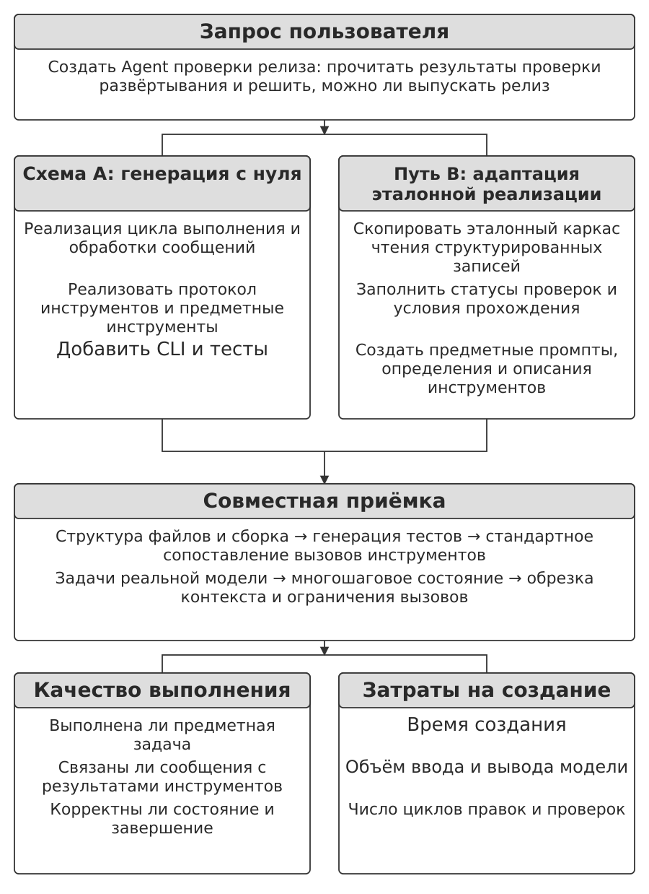
>
> Для обоих подходов используются одинаковые требования к задаче и критерии приёмки. Сначала проверяются структура результата, компиляция и тесты, затем — связь вызовов инструментов с их результатами в стандартных сообщениях. Наконец, запускаются реальные задачи модели и многоходовые взаимодействия, чтобы проверить обрезку контекста, управление состоянием и ограничение количества вызовов.
>
> В сохранённом контрольном эксперименте с Kimi K3 обе группы прошли 39 из 39 детерминированных проверок, а также успешно выполнили реальную задачу модели и проверку состояния в многоходовом взаимодействии. При создании шаблонным способом было использовано 1 181 токен и около 25 секунд, а при создании с нуля — 381 814 токенов и около 90 минут.
>

[^ch5-doctor]: OpenClaw, Doctor — описание функций проверки конфигурации и состояния, миграции и исправления.

## Итоги главы

**Агенты для программирования достигли зрелости сравнительно рано, и у этого есть одна причина, которую легко упустить из виду: в программной инженерии уже существуют системы типов, наборы тестов, системы контроля версий и инструменты отладки.** Если код исправлен неверно, тесты зачастую показывают, на каком наборе входных данных был получен неожиданный результат; после другого исправления код можно снова проверить на тех же данных. Чтобы перенести этот опыт на другие задачи, сначала нужно задать три конкретных вопроса: как обнаруживать ошибки, как возвращаться к известному состоянию и когда следует остановиться и передать задачу человеку? Например, если соединение оборвалось во время вызова возврата средств, Harness должен сначала проверить проводки и лишь затем решать, следует ли повторять операцию; иначе восстановление после одного сбоя может привести ко второму возврату.

Код также позволяет сохранить однажды принятое решение в форме, пригодной для многократного использования. Перебор в математической задаче и ограничения в логической задаче можно передать программе для поэлементной проверки; правила возврата средств можно реализовать в виде проверки на входе в операцию, чтобы сервер считывал фактическое состояние заказа и только после этого решал, разрешать ли возврат. Если изменился формат журнала, можно исправить парсер, а вызвавший ошибку образец сохранить для регрессионного теста. Во всех трёх случаях можно выполнять код, но критерии различаются: удовлетворяет ли решение условиям задачи, соответствует ли возврат средств политике и способен ли новый парсер прочитать ранее пропущенное поле.

Если результатом работы служит документ, видео или геометрическая модель, необходимо также проверить качество рендеринга, синхронизацию звука с изображением или точность размеров и попросить проверяющего просмотреть фактический результат. Если результатом служит форма, запрос или визуализация, помимо проверки того, может ли пользователь понять результат и работать с ним, нужно проверить, получает ли исполняющий сервис данные в соответствии с правами доступа. Если код создаёт другого AI-агента, автор предпочитает сначала повторно использовать проверенный фреймворк, сгенерировать инструменты предметной области и бизнес-логику, а затем проверить протокол вызовов, состояние между ходами взаимодействия и фактический результат задачи. Накопленные таким образом инструменты, валидаторы и тесты можно повторно использовать в следующей задаче.

Код позволяет выполнять задачу снова и снова, однако среда не обязательно дождётся завершения выполнения. Пока запрос ещё выполняется, пользователь уже может передумать. В шестой главе рассматривается, как такое изменение включается в уже идущее взаимодействие.

## Вопросы для размышления

1. ★★ Спроектируйте песочницу для Coding Agent, которому необходимо читать файлы проекта, устанавливать зависимости и запускать тесты. Как бы вы настроили права доступа к файлам, сети, процессам и ресурсам? Если для задачи требуется расширить полномочия, как сформулировать запрос, проверить его область и сохранить запись?
2. ★★★ Когда создатель последовательно генерирует и изменяет несколько поколений агентов, дефекты фреймворка и ошибки предметной области могут постепенно накапливаться. Как отслеживать эти изменения с помощью эталонных версий, регрессионных тестов, оценки поведения и механизмов отката?
3. ★★ Изменение формата журналов может быть следствием как штатного обновления, так и дефекта системы, которая их формирует. Какие свидетельства должна сохранять система адаптивного синтаксического анализа и на основании каких условий она должна добавлять новый парсер, сообщать об аномалии или приостанавливать обработку?
4. ★★ В цикле «предлагающий — проверяющий» проверяющий считает плотность информации на странице приемлемой, а пользователь — чрезмерной. Как преобразовать предпочтения пользователя в примеры, критерии оценки и интерактивную обратную связь, а затем проверить, соответствуют ли последующие изменения требованиям?
5. ★★ Coding Agent может обновлять базу знаний, архитектурную документацию и инструкции проекта, а также закреплять последовательности операций в коде. Как выявлять избыточные или устаревшие правила и задавать для них область применимости, методы проверки и условия прекращения действия? Какие механизмы накопления и оценки необходимы, чтобы перейти от единичного успешного изменения к непрерывной эволюции, рассматриваемой в главе 9?
6. ★ В командах, удобно организованных для удалённой совместной работы, агентам обычно также проще получать рабочую информацию. Изучите требования, архитектуру, журнал решений и критерии приёмки знакомого проекта, перечислите документацию, которую важнее всего дополнить, и объясните, какие конкретные задачи она поможет выполнить агенту.
7. ★★★ Как организовать авторизацию на основе идентичности, маркировку источников, проверку потоков данных и контроль записи в память для агента, который одновременно обращается к закрытым данным, обрабатывает недоверенное содержимое, взаимодействует с внешними системами и использует долговременную память? Покажите расположение этих проверок на примере одного штатного бизнес-процесса.
8. ★★ В режимах Artifact для SQL и HTML модель генерирует артефакт, сервис выполнения обрабатывает запрос или выполняет рендеринг, а интерфейс непосредственно отображает результат. Какую информацию целесообразно снова передавать модели для объяснения? Как проверять права на выполнение запросов, бюджет ресурсов, изоляцию страницы и согласованность отображаемого результата?
9. ★★ Инструмент проверяет правила по бизнес-состоянию в базе данных, а описание параметров помогает модели подготовить вызов. На примере отмены бронирования объясните, за что отвечают правила на естественном языке, примеры параметров, проверка на уровне выполнения и тесты граничных случаев. Что необходимо синхронно обновить после изменения правил?


**Практикум к главе 5.** [Каталог экспериментов](https://github.com/bojieli/ai-agent-book/tree/40f4ce5778e6cc93e3606c3079bf8cf13a0c4d04/chapter5) · [Путеводитель на русском](https://github.com/bojieli/ai-agent-book/blob/40f4ce5778e6cc93e3606c3079bf8cf13a0c4d04/chapter5/README.ru.md).
