<!-- Русский перевод: community edition. Источник: https://github.com/bojieli/ai-agent-book; файл изменён относительно upstream. -->

# Взаимодействие: расширение пространства наблюдений и действий

**Когда базовая модель остаётся неизменной, реорганизация или расширение интерфейсов наблюдений и действий зачастую оказывается одним из наиболее эффективных инженерных способов повысить качество выполнения задач AI-агентом.** В предыдущих главах агент обычно ждал, пока пользователь закончит говорить, затем искал информацию, вызывал инструменты и давал ответ. Однако пока он ожидает результаты работы инструментов, пользователь и внешняя среда продолжают меняться.

Пользователь поручает помощнику переоформить авиабилет. Пока помощник уточняет у службы поддержки доступные рейсы, пользователь присылает ещё одно сообщение: «Мне также нужно сдать одно место багажа»; представитель службы поддержки всё ещё говорит, а отображаемая на экране стоимость билета тем временем может измениться. Помощнику нужно своевременно уточнить, включён ли зарегистрированный багаж в стоимость, а также проверить, остаётся ли в силе только что названная цена. Здесь возникают два вопроса проектирования: по каким каналам помощник может узнавать об изменениях и в какие моменты он может на них реагировать? В этой главе мы сначала рассмотрим асинхронно поступающие электронные письма и результаты работы инструментов, а затем — непрерывную речь, изменения на экране и обратную связь от действий робота.

## Расширение модальностей и моментов срабатывания

**Модальность** описывает форму информации и действий. AI-агент может читать текст, слушать звуки, видеть экран и получать сигналы крутящего момента, а также выводить текст, синтезировать речь, нажимать элементы интерфейса или приводить в движение суставы.

**Момент срабатывания** касается того, когда поступает информация, когда начинается действие и когда система отвечает. Агент может самостоятельно запрашивать информацию или получать её от внешних сервисов; инструмент может немедленно вернуть результат либо сначала запустить задачу и позднее сообщить о её завершении. При поступлении нового события система также должна решить, следует ли прервать текущую работу и как затем возобновить прерванную задачу.

| Измерение | Интерфейсы получения информации и наблюдения | Интерфейсы действий и исполнения |
|---|---|---|
| Организация содержимого (главы 2–5) | Контекст, память и база знаний организуют информацию для принятия решений | Инструменты и код выражают исполняемые операции |
| Модальность (эта глава) | Речь, экран, физические датчики | Речь, нажатия, движения суставов |
| Момент срабатывания (эта глава) | Активные запросы, доставка событий, непрерывный ввод | Исполнение в течение нескольких ходов, отмена, вытеснение и возобновление |

Контекст содержит информацию, необходимую для принятия конкретного решения, а пространство наблюдений описывает возможный диапазон информации, которую способна получить система. Инструменты предоставляют конкретные интерфейсы, а пространство действий описывает диапазон действий, разрешённых системе. При расширении интерфейсов эти диапазоны по-прежнему ограничиваются возможностями устройств, параметрами, разрешениями и средой выполнения.

Многие интерфейсы вызова инструментов организуют сообщения по ходам: модель предлагает вызов, система добавляет результат инструмента, после чего запускает следующий раунд инференса. Событийно-ориентированная система должна управлять внешними изменениями поверх этого протокола. Если интерфейс нативно поддерживает асинхронность, во время ожидания инструмента можно принимать новые требования, а после получения результата — продолжать обработку. При использовании синхронного интерфейса взаимодействие организует Harness с помощью очередей, дескрипторов задач и механизмов планирования. Далее эти два подхода рассматриваются отдельно.

Темп обратной связи сильно различается в разных сценариях. В следующей таблице приведены распространённые временные масштабы.

| Типичный масштаб | Сценарий | Изменения в наблюдениях | Обработка действий |
|---|---|---|---|
| Секунды — дни | Асинхронная и событийно-ориентированная работа | Внешнее событие активирует агента | Сначала запускается задача, затем последующие события сообщают о ходе выполнения и завершении |
| Десятки миллисекунд — секунды | Речь | Аудио поступает непрерывно | Потоковый вывод с обработкой перебиваний и остановки воспроизведения |
| Доли секунды — секунды | Computer Use | Экран непрерывно меняется | После действия состояние интерфейса запрашивается заново |
| Цикл управления миллисекундного масштаба | Низкоуровневое управление роботом | Данные от датчиков поступают непрерывно | Выполняются короткие фрагменты действий с реакцией на сигналы управления и остановки |

## Асинхронность и событийно-ориентированная архитектура: когда мир обращается к агенту сам

В главе 4 были представлены инструменты восприятия, выполнения и совместной работы, а в этом разделе рассматриваются инструменты запуска по событию и взаимодействия с пользователем. Инструменты запуска по событию передают изменения среды AI-агенту, а инструменты взаимодействия позволяют агенту связываться с пользователем в ходе выполнения задачи. Harness соотносит эти входные и выходные данные с выполняемой в данный момент задачей, формируя непрерывно работающий событийный цикл.

### Зачем нужна асинхронность

При синхронном вызове вызывающая сторона может продолжить текущий процесс только после получения результата. Асинхронный вызов сначала возвращает дескриптор задачи — идентификатор для запроса её состояния и управления ею — либо предусматривает последующее уведомление о завершении, позволяя вызывающей стороне во время ожидания заниматься другой работой. Благодаря этому система может организовать несколько выполняющихся задач, а затем определять, какие операции могут выполняться параллельно, исходя из ресурсов и зависимостей.

AI-агента можно представить как секретаря, который работает с электронной почтой, телефонными звонками и посетителями: в ожидании ответа он продолжает готовить материалы, при поступлении срочного звонка сохраняет текущий прогресс, а после разговора возвращается к прежней задаче. В инженерной реализации необходимо решить три задачи:

- **Отделение длительных задач от взаимодействия.** Анализ файлов, телефонные звонки и сборка выполняются в фоне, а пользователь по-прежнему может запрашивать прогресс и дополнять требования.
- **Приоритет событий.** Срочная остановка своевременно поступает в контур управления, обычные обновления добавляются в очередь, а независимые запросы можно передать параллельной сессии.
- **Прерывание и возобновление.** Необходимо сохранять состояние задачи, фиксировать уже выполненные операции, а при возобновлении повторно проверять, какие условия по-прежнему действительны.

Исследовательская предварительная версия Claude Duet предлагает такой пример: в два часа дня у пользователя назначена встреча, и он хочет заранее получить справку о компании другой стороны. Он может оставить голосовое сообщение, а затем закрыть приложение. Подготовка продолжится в облаке, и пользователь сможет в любой момент открыть страницу задачи и посмотреть прогресс; если потребуются дополнительные сведения или справка будет готова, помощник вернётся в основной диалог и уведомит его. Продолжение задачи после ухода пользователя — это асинхронное выполнение. Для полнодуплексного телефонного разговора, который будет рассмотрен далее, требуется ещё одна возможность: когда одна сторона говорит, она всё равно может услышать, как другая её перебивает.[^ch6-duet]

API моделей также задают порядок сообщений. Одни интерфейсы принимают запрос следующего цикла только после полного сопоставления вызовов инструментов с их результатами, другие позволяют оставить вызов инструмента незавершённым и получать последующие обновления. Асинхронные функции приложения управляют ожиданием и выполнением, а протокол модели определяет, когда можно отправлять сообщения.

На рисунке 6-1 новые сообщения и результаты инструментов могут поступать в очередь, однако способ их доставки зависит от источника. Если сервис поддерживает push-уведомления, он может сообщить об изменении состояния сразу; если сервис предоставляет только интерфейс запросов, адаптер должен периодически опрашивать его и при обнаружении изменений создавать событие. Событие также может возникнуть по истечении таймера. Затем цикл событий передаёт эти входные данные агенту.

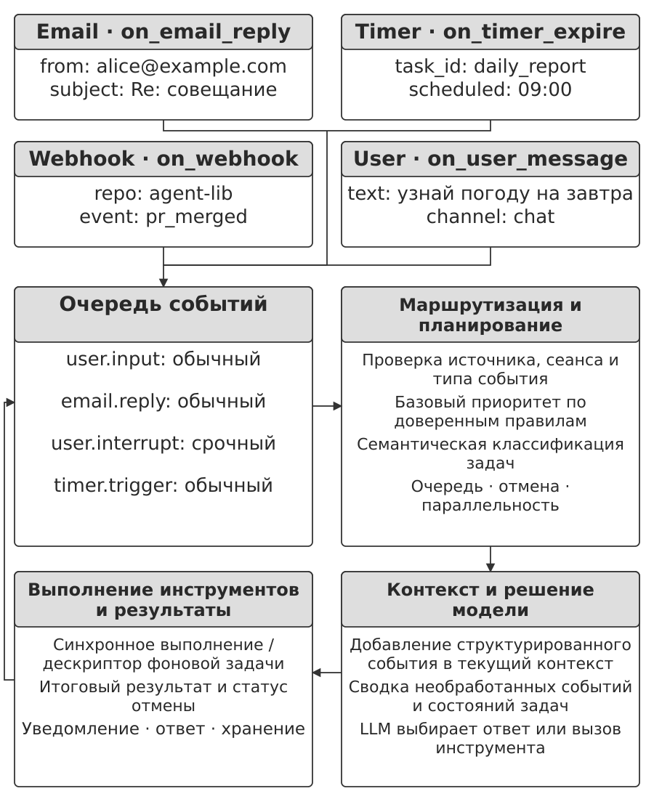

### Реализация событийно-ориентированного механизма в OpenClaw

OpenClaw принимает сообщения из разных каналов через Gateway и маршрутизирует события в среду выполнения агента. Механизмы автоматизации включают внутренние Hooks, планирование по времени, Heartbeat, внешние Webhook и другие точки входа[^ch6-automation]. Эти механизмы можно классифицировать по условиям срабатывания:

- **Hooks (событийные хуки)** реагируют на внутренние события фреймворка, например создание или сброс сессии либо изменение жизненного цикла выполнения.
- **Cron (планирование по времени)** выполняет работу в заданное время или с заданной периодичностью. Например, `0 9 * * 5` означает срабатывание каждую пятницу в 9:00 в настроенном часовом поясе.
- **Heartbeat (сердцебиение)** периодически пробуждает агента, чтобы проверить, нет ли требующих внимания дел.
- **Webhook (внешний callback)** принимает события от внешних сервисов и запускает их обработку после аутентификации и маршрутизации.

Еженедельные отчёты удобно создавать по расписанию, требующие постоянного внимания задачи можно проверять периодически, а push-доставка новых писем и обратных вызовов сервисов позволяет сократить задержку обнаружения.

**События звонков PineClaw.** Pine AI совершает телефонные звонки вместо пользователя, решая такие задачи, как переговоры по счетам, отмена подписок и урегулирование страховых случаев. PineClaw подключает подобные телефонные задачи к OpenClaw. Звонок обычно длится некоторое время, и в процессе может потребоваться участие пользователя:

- **Проверка личности.** Сотрудник службы поддержки просит владельца учётной записи пройти проверку, например ввести секретный код или одноразовый пароль.
- **Трёхсторонний звонок.** Сотрудник службы поддержки требует напрямую поговорить с владельцем учётной записи, поэтому пользователя необходимо своевременно уведомить, чтобы он ответил на звонок.
- **Подтверждение решения.** Когда сотрудник службы поддержки предлагает альтернативный вариант, клиентская часть с учётом текущего поручения и прежних предпочтений пользователя определяет, можно ли его принять. Если решение должен принять пользователь, ему отправляются конкретные варианты, а параллельно продолжается уточнение остальных условий у сотрудника поддержки.

Например, сотруднику службы поддержки требуется подключить владельца учётной записи к трёхстороннему звонку. Чем раньше будет доставлено уведомление, тем меньше времени обеим сторонам придётся ждать на линии. В PineClaw используется механизм Channel, передающий события звонка между Gateway и Pine API: установление соединения, необходимость пользовательского ввода и завершение разговора поступают в поток как отдельные события, на основании которых агент обновляет задачу и уведомляет пользователя.

**По мнению автора, для своевременного проактивного обслуживания лучше всего, чтобы источник события уведомлял агента при изменении состояния.** После доставки уведомления через канал Harness находит соответствующую задачу и проверяет, не является ли событие повторным или просроченным, а затем модель решает, что делать дальше. Если пользователю необходимо подтвердить личность, интерфейс должен открыть доверенную точку входа для аутентификации, после чего её результат возвращается в исходную задачу как новое событие.

### Инструменты запуска по событию

Если поручить помощнику «напомнить мне после ответа клиента», как он проснётся завтра точно в нужный момент? Сначала следует проверить, может ли почтовая система отправить событие при получении письма; если система допускает только активные запросы, необходимо запомнить время следующей проверки. Три приведённых ниже условных интерфейса передают эти условия ожидания на хранение среде выполнения, позволяя модели завершить текущую итерацию работы.

**Таймер (`set_timer`)** используется для пробуждения задачи в назначенное время. Одноразовый таймер подходит для задачи «в следующий понедельник в 10:00 позвонить в банк и узнать статус оформления ипотеки», а периодический — для ежечасной проверки состояния сервиса. С помощью таймера также можно запланировать ожидание ответа после отправки письма или повторный звонок после наступления рабочего времени. Интерфейс должен сохранять часовой пояс, условие срабатывания и идентификатор задачи, а также предоставлять возможность отмены или изменения. Если внешний сервис поддерживает только запросы, задача по расписанию может также выполнять опрос статуса.

**Мониторинг фоновых задач (`monitor_shell`)** используется для преобразования длительно выполняющейся команды в события о ходе работы. При запуске возвращается идентификатор задачи, во время выполнения среда уведомляет о новом выводе, появлении ключевых слов или изменении состояния, а после завершения сообщает статус выхода и результат.

Если заставлять модель постоянно запрашивать прогресс, каждая такая проверка будет требовать вызова модели, даже когда состояние не изменилось. Если же ждать только уведомления о завершении, можно пропустить сбой, возникший в процессе. Поэтому автор рекомендует поручить мониторинг среде выполнения и пробуждать модель лишь при полезном прогрессе, ошибке или застое. Это позволяет продолжать общение во время сборки и своевременно вмешиваться при возникновении проблем. В правилах мониторинга можно настроить фильтрацию, объединение событий и ограничение частоты, чтобы каждая строка журнала не приводила к отдельному вызову модели.

Например, подписавшись на обновления состояния ожидающей обработки заявки, модель может завершить текущую итерацию инференса и дождаться, пока уведомление с номером заявки не пробудит её. Если другая сторона предоставляет только интерфейс запросов, модель может самостоятельно запланировать следующую проверку. Если в назначенный момент выяснится, что заявка «всё ещё обрабатывается», она назначит ещё одну проверку; если заявка уже закрыта — отменит последующие. В обоих случаях за ожидание отвечает среда выполнения, а модель принимает следующее решение только после получения уведомления или срабатывания таймера.

**Каналы внешних событий (`connect_channel`)** используются для подписки на электронную почту, мгновенные сообщения или обратные вызовы API. Адаптер канала проверяет источник, сопоставляет собственные идентификаторы сервиса с потоком событий (`thread`) и связанным объектом, а затем отправляет событие в едином формате; подробнее это рассматривается далее в разделе «Уровень приёма». К этой категории относятся уведомления о состоянии телефонного звонка в PineClaw.

Для всех трёх видов инструментов необходимо явно определять условия срабатывания, правила фильтрации и полезную нагрузку события. Полезная нагрузка должна содержать идентификатор события, время его возникновения, источник, связанную задачу и необходимые данные, чтобы AI-агент мог определить, остаётся ли событие актуальным и какая информация потребуется на следующем шаге.

### Инструменты взаимодействия с пользователем

Вернёмся к задаче изменения бронирования. Задать вопрос службе поддержки, отправить пользователю сообщение с запросом подтверждения, на которое можно ответить напрямую, и записать в журнале задачи «ожидается ответ» — это три операции, данные о которых сохраняются в разных местах. Пользователь может временно отвлечься и вернуться, когда потребуется уточнить условия, подтвердить решение или получить результат.

В интерфейсе сессии можно показывать окончательный ответ, ход работы инструментов и результаты выполнения; инструмент взаимодействия, в свою очередь, явно задаёт получателя, канал, содержимое сообщения и вложения. Модель решает, что необходимо сообщить, Harness проверяет адресата и разрешения, а служба сообщений выполняет доставку. Среда выполнения также может автоматически направить окончательный ответ в исходную сессию. Эти два способа можно использовать совместно.

Многоканальное взаимодействие OpenClaw позволяет пользователю отправлять сообщения, ждать новостей о ходе работы и получать напоминания так же, как при общении с секретарём. Такое «ощущение живого человека» возникает благодаря непрерывному ведению состояния задачи и своевременной коммуникации. Пользователь может продолжать задачу в привычном канале, а агент должен сохранять согласованность идентичности, сессии и привязки сообщений.

Форма коммуникации также может меняться вместе с задачей: краткие сведения о ходе работы передаются текстом, к сложным результатам прикладываются изображения или файлы, запрашиваемая информация собирается с помощью структурированных карточек, а интерактивные результаты представляются через генеративный UI, описанный в главе 5. Если канал поддерживает уведомления о доставке или прочтении, система сохраняет соответствующий статус; повторные попытки после сбоев, дублирующиеся сообщения и межканальная синхронизация также заносятся в журнал доставки.

**Многоканальные уведомления и повторное вовлечение пользователя.**

Мгновенные сообщения, SMS, электронная почта, телефонные звонки и push-уведомления приложений подходят для разных степеней срочности и форм содержимого. Агент может выбирать канал с учётом срочности, пользовательских предпочтений, текущего состояния и длины сообщения. Событие телефонного разговора, требующее немедленного подтверждения, сопровождается своевременным напоминанием, а полный отчёт можно доставить по электронной почте или через ссылку в приложении.

Однажды автор поручил помощнику следить за стоимостью гостиничных номеров на время конференции ATC. Каждый день в одно и то же время помощник присылал сообщение о том, что цена ещё не опустилась до целевого уровня. Однажды цена ненадолго снизилась, но это окно обнаружил написанный самим автором скрипт. Кратковременное снижение могло произойти между двумя проверками. Даже если помощник своевременно обнаружил бы его, из-за поздней доставки сообщения пользователь всё равно мог упустить возможность забронировать номер. В дни без снижения цены плановые проверки могут выполняться как обычно, но пользователю незачем ежедневно читать одно и то же сообщение. В главе 7 работа таких уведомлений будет проверена на примере пятиминутного окна снижения цены.

После завершения длительной задачи уведомление возвращает пользователя на страницу с результатом; ежедневные сводки и еженедельные отчёты отправляются с согласованной периодичностью. Многоканальная стратегия также должна предусматривать дедупликацию, периоды тишины и условия эскалации — например, следует ли перейти на другой канал, если на первое напоминание не последовало ответа. Журнал уведомлений связывается с состоянием задачи, чтобы пользователь мог продолжить работу непосредственно из полученного сообщения.

### Виртуальная идентичность и изолированная среда выполнения

В главе 4 на примере Саманты из фильма «Она» было показано, как универсальный помощник с помощью инструментов входит в цифровой мир. Для реализации такого помощника необходимо чётко определить, под какой идентичностью он работает и к каким ресурсам имеет доступ. **Автор склоняется к тому, чтобы предоставить универсальному помощнику отдельную виртуальную идентичность.** Выделенные помощнику служебный почтовый ящик, номер телефона, хранилище и вычислительная среда позволяют AI-агенту, подобно секретарю с собственной рабочей учётной записью, выполнять задачи от имени пользователя под явно обозначенной идентичностью представителя. Независимая идентичность отделяет повседневную работу помощника от личных учётных записей пользователя, упрощая отдельную выдачу, аудит и отзыв разрешений; при ошибочных действиях также легче ограничить масштаб последствий. Для задач, требующих доступа к учётной записи пользователя, необходимые разрешения предоставляются с ограниченной областью действия.

От того, кому принадлежит номер телефона, зависит, кто сможет продолжить работу при обратном звонке. Cue от Manus предоставляет помощнику отдельный номер, позволяет принимать входящие звонки и оставлять пользователю краткое содержание разговора. Если организация согласится использовать оставленный помощником номер для обратной связи, при звонке сотрудник службы поддержки сможет напрямую связаться с помощником, который ранее занимался этим вопросом.[^ch6-cue]

Например, для получения скидки или отмены комиссии помощник может связаться с организацией как уполномоченный представитель. Если сотрудник службы поддержки потребует устного подтверждения личности, пользователя можно подключить к трёхстороннему звонку, а после проверки помощник продолжит разговор. Если организация собирается перезвонить пользователю, ему заранее передаются номер обращения, уже согласованные условия и вопросы, которые нужно уточнить. Отчитываясь перед пользователем, помощник также должен ясно указывать имеющиеся доказательства: если сотрудник службы поддержки устно согласился отменить комиссию, следует зафиксировать именно это обещание; сообщать о фактической отмене комиссии можно лишь после последующей проверки обновлённого счёта.

Когда автор, находясь в Пекине, перевыпускал кредитную карту американского банка, Pine связался с банком, организовал срочный перевыпуск карты и добился отмены комиссии за срочность в размере 15 долларов. По окончании разговора помощник уже мог сообщить, какое обращение принял банк и какую именно комиссию согласился отменить. Если через несколько дней пользователь спросит: «Где моя новая карта?», потребуется дополнительно проверить доставку или попросить получателя подтвердить её получение.

Виртуальный компьютер и виртуальный телефон предоставляют постоянно работающую операционную среду. На виртуальной машине можно запускать настольную операционную систему, контейнеры подходят для изоляции процессов и зависимостей, а эмулятор Android служит средой для мобильных приложений. Они поддерживают фоновую работу и уменьшают влияние автоматических операций на текущую работу пользователя. Границы изоляции совместно определяются настройками сети, подключённых томов, учётных данных и разрешений среды выполнения; эти настройки также влияют на то, к каким данным и внешним системам может обращаться агент.

Предположим, вы хотите, чтобы корпоративная версия Tencent WorkBuddy создала еженедельный отчёт после того, как вы закончите работу и выключите компьютер, но таблица продаж за текущую неделю хранится только на рабочем компьютере. Если выбрать локальную задачу, помощник сможет прочитать таблицу, однако компьютер должен оставаться включённым, а клиент — подключённым к сети. Если выбрать облачную задачу, помощник сможет продолжить работу после выключения компьютера при условии, что разрешённые для использования в отчёте данные заранее загружены в задачу или помещены в доступное ей облачное хранилище материалов. Если таблица продаж должна оставаться на локальном компьютере, её обработку следует запланировать на время, когда он подключён к сети.

Веб-сайты и мобильные приложения также могут требовать аутентификацию, проверочный код или ручное подтверждение. При подключении следует в первую очередь использовать предоставляемые сервисом API и способы авторизации. Если требуется аутентификация через графический интерфейс, пользователь может лично войти в учётную запись через удалённый рабочий стол VNC/RDP, а автоматические операции на время аутентификации приостанавливаются. После завершения входа система проверяет состояние сессии и возобновляет задачу. Токены и сессии сохраняются в пределах срока действия, а после отзыва разрешения или завершения задачи удаляются согласно установленной политике.

Агент и виртуальная среда могут обмениваться данными через **общую файловую систему**. Например, пользователь загружает CSV-файл, виртуальный компьютер читает его, выполняет анализ и записывает графики в общее хранилище; среда выполнения передаёт агенту расположение файлов с графиками, после чего тот предоставляет пользователю доступную ссылку для скачивания. Содержимое больших файлов остаётся в хранилище, а модель при необходимости читает краткие сводки или отдельные фрагменты.

[^ch6-dsh-threads]: DeepSeek, доменная модель прототипа dsh-superagent, а также правила авторизации и подписки.
[^ch6-dsh-sessions]: DeepSeek, прототип dsh-superagent, версия `8c32a9d`. Обязанности двух типов сессий описаны в `docs/004-prompts.md`, сессия выполнения и рабочий каталог — в `docs/003-execution.md`, а формат сообщений, передаваемых в основную сессию, — в `docs/007-architecture.md`.
[^ch6-duet]: Anthropic, *Get started with Claude Duet*: вводные материалы перед встречей, страницы задач и уведомления в основном диалоге.
[^ch6-cue]: Manus, *Introducing Manus 2.0*: отдельный номер телефона Cue, приём входящих звонков и краткое содержание разговоров.
[^ch6-automation]: OpenClaw, Automation: такие точки входа для автоматизации, как внутренние Hooks, запуск по расписанию, Heartbeat и внешние Webhook.

### Уровень приёма: разные источники, единое событие

AI-агент службы поддержки интернет-магазина обрабатывает возврат средств. Покупатель подаёт заявку в чате поддержки в App. Сумма превышает полномочия агента, поэтому он просит руководителя подтвердить операцию в группе послепродажного обслуживания корпоративного WeChat. После успешного возврата платёжный сервис отправляет Webhook. Затем система заказов публикует изменение состояния в Kafka. Все четыре сообщения относятся к одному заказу, но поступают разными способами. Чем больше источников, тем сильнее среда выполнения распадается на отдельные тракты, каждый из которых по-своему обрабатывает повторные попытки, дедупликацию и порядок. **Уровень приёма унифицирует форму событий после их поступления в систему, сохраняя различия возможностей источников до момента поступления.** Такая многоуровневая архитектура показана на рисунке 6-2.

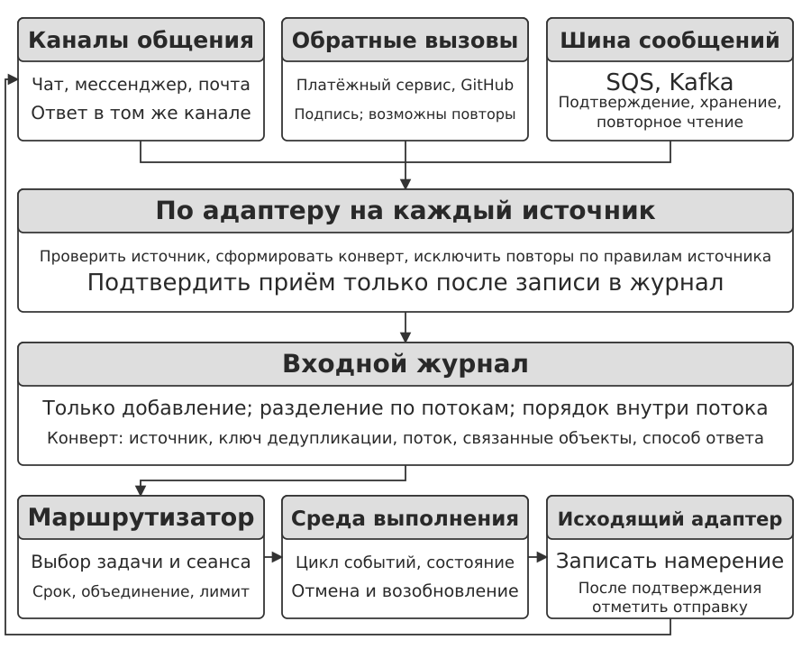

Распространённые источники делятся на четыре категории. **Диалоговые каналы** включают собственный диалоговый интерфейс продукта, системы мгновенного обмена сообщениями — корпоративный WeChat, Feishu, Slack и другие, — а также электронную почту; агент может ответить по тому же каналу. **Обратные вызовы** — это HTTP-интерфейсы, вызываемые внешними сервисами при изменении состояния. Обычно они подписаны и доставляют только уведомление. После ошибки доставки некоторые сервисы автоматически повторяют попытку, а в GitHub доставку приходится повторять вручную или через API. **Шины сообщений**, такие как SQS и Kafka, переносят бизнес-события внутренних сервисов и обладают явно определённой семантикой подтверждения и хранения. **Таймеры, опросы и внутренние события** создаются самой системой, и их достаточно записывать в тот же журнал. В таблице ниже сравниваются первые три категории.[^ch6-ingress-mq][^ch6-ingress-callback]

| | Диалог в App | Корпоративный WeChat / Feishu | Электронная почта | Webhook | SQS | Kafka |
|---|---|---|---|---|---|---|
| Способ поступления | Долговременное соединение | Обратный вызов или долговременное соединение | Push-доставка или опрос | Обратный вызов | Получение потребителем | Получение потребителем |
| Область упорядочивания | В пределах диалога | Для большинства событий не гарантируется | Не гарантируется | Не гарантируется | Для стандартной очереди не гарантируется, для FIFO — в пределах группы сообщений | В пределах раздела |
| Встроенное основание дедупликации | ID сообщения клиента | ID сообщения, ID события | Message-ID | ID доставки | ID сообщения; у FIFO также есть `MessageDeduplicationId` | Тема, раздел и смещение |
| Возможность повторного воспроизведения | Зависит от собственных записей | Сам обратный вызов воспроизвести нельзя; в Feishu сообщения можно повторно получить через интерфейс истории | Почтовый ящик можно прочитать повторно | Зависит от сервиса | После удаления невозможно | Возможно в течение срока хранения |
| Способ подтверждения | Квитанция клиента | Успешный ответ в установленный срок | Самостоятельный учёт позиции чтения | Ответ 2xx в установленный срок | Удаление сообщения | Фиксация смещения |
| Канал ответа | Исходный диалог | Исходный диалог | Ответное письмо | Нет | Нет | Нет |

**Унифицированный конверт.**

Адаптер преобразует исходное сообщение в **конверт** (envelope) унифицированного формата. В конверте записываются только факты, которые можно определить в момент поступления. Приоритет и срок обработки добавляются правилами маршрутизации, уровень клиента и состояние заказа — бизнес-системой, а состояние обработки хранится отдельно. Заявку покупателя на возврат средств можно представить так:

```json
{
  "id": "evt_7f3a",
  "source": {"type": "app_chat", "sender": "user:u_5521", "verified": true},
  "dedupe_key": "app:msg:msg_1029",
  "thread": "app:conv:conv_88",
  "kind": "message",
  "correlation": ["order:12345"],
  "content": {"type": "text", "text": "Я хочу вернуть деньги за этот заказ"},
  "raw_ref": "raw/2026-11-23/app/msg_1029.json",
  "reply": {"via": "app_chat", "target": "app:conv:conv_88"},
  "occurred_at": "2026-11-23T14:02:09+08:00",
  "expires_at": null
}
```

- `source`: тип источника и проверенный отправитель. Признак проверки устанавливается адаптером на основании подписи, токена или учётной записи канала; самопредставление в тексте сообщения проверкой не считается. Среда выполнения определяет полномочия по этому полю.
- `dedupe_key`: ключ дедупликации; критерий повтора определяется семантикой источника. ID доставки, ID сообщения либо сочетание раздела и смещения обозначают одну и ту же доставку и блокируют повторную отправку на транспортном уровне. Если бизнес-сообщение содержит ключ идемпотентности (idempotency key), например номер заявки на возврат вместе с состоянием, адаптер должен извлечь его, чтобы блокировать повторы на бизнес-уровне. Для пользовательского диалога действует обратное правило: если покупатель дважды говорит «верните деньги», это два разных сообщения, поэтому дедупликация выполняется только по ID сообщения клиента.
- `raw_ref`: исходная полезная нагрузка, сохранённая без изменений. Только по ней можно расследовать ошибки адаптера.
- `reply`: исходящий адаптер и целевой адрес ответа. У обратного вызова платёжного сервиса нет канала ответа, поэтому это поле пусто.
- `occurred_at` — указанное источником время возникновения события; `expires_at` — срок действия, заполняемый только для таких событий, как ценовые предложения и коды подтверждения.

**Потоки и связи.**

Покупатель сначала говорит: «Верните деньги», а сразу затем добавляет: «Нет, лучше обменяйте товар». Порядок этих сообщений нельзя менять. Сообщения другого покупателя с ними не связаны и могут обрабатываться параллельно. **Уровень приёма гарантирует порядок только в пределах потока.** Адаптер сопоставляет собственную единицу упорядочивания источника с полем `thread`: диалог в App, группа сообщений SQS FIFO (`MessageGroupId`), ключ раздела Kafka, номер Issue или PR в обратном вызове GitHub. Если источник не гарантирует порядок, среда выполнения выявляет опоздавшее старое состояние по `occurred_at` или предоставленному источником номеру версии — например, когда событие «возврат обрабатывается» приходит после события «возврат выполнен».

Четыре сообщения об этом возврате относятся к четырём разным потокам. Объединять их в один поток затратно: не связанное с возвратом обсуждение в группе послепродажного обслуживания тоже пришлось бы поставить после сообщения покупателя. Кроме того, идентификатор потока часто одновременно служит ключом раздела, поэтому его последующее изменение потребует миграции данных. **Связи выражаются отдельным полем без изменения потоков.** В `correlation` перечисляются бизнес-объекты, которых касается событие, а задача подписывается на связанные с этими объектами потоки.

**Разделение подтверждения и прогресса.**

**Адаптер должен подтверждать источнику получение после записи события в журнал приёма, а не после завершения обработки агентом.** Обратный вызов событий Feishu требует ответа в течение 3 секунд, корпоративный WeChat — в течение 5 секунд; при превышении срока событие отправляется повторно. Если сообщение SQS не удалено до истечения тайм-аута видимости, оно снова становится доступным для получения. Ожидание завершения обработки перед подтверждением приведёт к повторной доставке при любом достаточно долгом вызове модели. Если сначала записывать событие в журнал и только затем подтверждать его, гарантии доставки разных источников сводятся к одному правилу: **каждое событие попадает в журнал приёма не менее одного раза (at-least-once)**, а повторная доставка блокируется ключом дедупликации.

Журнал приёма играет роль папки входящих сообщений (inbox), следует изложенному в первой главе принципу записи только добавлением и разделяется по потокам. Если журнал приёма реализован на Kafka, для дедупликации необходимо отдельное хранилище с ограничением уникальности либо фильтрация на стороне потребителя по ключу дедупликации. Kafka не умеет отклонять запись по заданному приложением ключу: идемпотентный производитель защищает только от повторных попыток самого производителя.

Система должна раздельно хранить три вида прогресса:

| Вид прогресса | Что записывается | Кто ведёт |
|---|---|---|
| Прогресс источника | Смещение Kafka, дескриптор получения SQS, позиция чтения почтового ящика | Адаптер |
| Прогресс диспетчеризации | Каким задачам уже переданы события из журнала | Маршрутизатор |
| Состояние задачи | До какого шага дошла обработка, отправлен ли ответ | Среда выполнения |

Если считать смещение прогрессом задачи, при повторном воспроизведении журнала уже отправленные ответы будут отправлены снова. После разделения повторное воспроизведение затрагивает только прогресс диспетчеризации. Исходящему направлению соответствует папка исходящих сообщений (outbox): перед отправкой записываются намерение отправки и ключ идемпотентности, а после получения квитанции канала операция помечается завершённой. Как выполнять сверку после перезапуска, рассматривается далее в разделе «Построение базового цикла на основе почтовых событий».

**Срок действия, объединение и обратное давление.**

Если в один поток поступают сотни событий в секунду, не следует передавать модели каждое по отдельности. Перед диспетчеризацией маршрутизатор обрабатывает накопившиеся события:

- **Срок действия.** Ценовые предложения, коды подтверждения и уже снятые предупреждения после определённого момента теряют смысл. События с истёкшим `expires_at` только записываются в траекторию и больше не активируют модель.
- **Объединение.** `kind` различает два типа событий. Событие состояния описывает текущее значение некоторого объекта, например состояние возврата в обратном вызове платёжного сервиса или состояние заказа в Kafka. Если в одном потоке накопилось несколько таких событий, модели передаётся только последнее, а промежуточные значения сохраняются в журнале. Событие-сообщение содержит произнесённую кем-то фразу или отданную команду, например сообщение покупателя или нажатие руководителя. Такие события можно передавать модели пакетами, но нельзя отбрасывать.
- **Обратное давление.** Источники, из которых данные извлекаются, можно опрашивать медленнее, оставляя накопившиеся события в источнике. Источники с push-доставкой нельзя попросить приостановиться, поэтому адаптер продолжает записывать события в журнал и подтверждать их, а очередь переносится в журнал приёма и обрабатывается по двум предыдущим правилам.

**Один возврат проходит через четыре источника.**

1. Покупатель запрашивает возврат средств в диалоге App. Адаптер выполняет дедупликацию по ID сообщения клиента, записывает событие в журнал и отправляет клиенту квитанцию. Маршрутизатор создаёт по `order:12345` задачу возврата, которая подписывается на поток этого диалога.
2. Сумма превышает полномочия, поэтому агент отправляет в группу послепродажного обслуживания корпоративного WeChat карточку подтверждения, а идентификатор карточки записывается в задаче. Руководитель нажимает «Одобрить». Адаптер записывает событие в журнал, возвращает успешный ответ и добавляет связанный объект по идентификатору карточки.
3. После вызова агентом интерфейса возврата платёжный сервис дважды отправляет обратный вызов «возврат выполнен» с одинаковым ID доставки. Вторая доставка отбрасывается при дедупликации.
4. Система заказов публикует в Kafka событие «средства за заказ возвращены», описывающее то же самое, что и обратный вызов. Если оба адаптера извлекают из полезной нагрузки номер заявки на возврат вместе с состоянием и используют их как ключ дедупликации, событие блокируется уже на этапе приёма. Если один адаптер выполняет дедупликацию по ID доставки, а другой — по разделу и смещению, оба события попадут в журнал. Среда выполнения обнаружит, что возврат уже подтверждён в состоянии задачи, и только запишет второе событие в траекторию.
5. Ни у обратного вызова, ни у события Kafka нет канала ответа. Среда выполнения использует `reply` потока диалога из шага 1 и уведомляет покупателя через исходящий адаптер App.

Шаг 4 показывает границу дедупликации на уровне приёма: какие повторы удастся заблокировать, зависит от ключа дедупликации, объявленного адаптером. Остальные повторы определяются по состоянию задачи. После диспетчеризации события задаче выбор между продолжением существующей сессии и созданием новой относится к управлению контекстом. Информация между сессиями передаётся через память, описанную в третьей главе, а возможность совместного использования контекста рассматривается в десятой главе.

[^ch6-ingress-mq]: Amazon Web Services, “Amazon SQS standard queues”; “Amazon SQS visibility timeout”; “Using the message deduplication ID in Amazon SQS”; “Using the message group ID with Amazon SQS FIFO Queues”. Документация Apache Kafka 4.4, разделы “Consumer Position” и “Message Delivery Semantics” главы “Design”. Дата проверки: 2026-11-24.
[^ch6-ingress-callback]: Открытая платформа Feishu, “Обзор событий”; “Получение истории сообщений диалога”. Центр разработчиков корпоративного WeChat, “Обзор” в разделе “Получение сообщений и событий”. GitHub Docs, “Best practices for using webhooks”; “Handling failed webhook deliveries”. Дата проверки: 2026-11-24.

### Механизм обработки событий

Пользовательские сообщения, результаты инструментов, таймеры и запросы на совместную работу могут одновременно поступать одному агенту. Среда выполнения должна сохранять эти события, определять порядок их обработки и затем передавать модели соответствующую информацию. **Цикл событий** (event loop) непрерывно продвигает этот процесс: извлекает события из очереди, обновляет состояние задачи, формирует запросы к модели, планирует выполнение инструментов, а затем ожидает новый ввод или уведомление о завершении. Аналогичный подход применяется в программах на Go, где несколько потоков сообщений организуются с помощью goroutine, channel и `select`.

Рассмотрим прототип dsh-superagent. В одном проекте GitHub обсуждение в Issue и обсуждение в запросе на включение изменений (PR) относятся к двум разным потокам. Когда системе нужно решить, следует ли принять новую работу, она считывает состояние потока и передаёт его модели для оценивания (Eval). В одном потоке одновременно может выполняться не более одного оценивания, однако на него могут быть подписаны несколько заявок (Ticket). Предположим, что заявка на исправление дефекта и заявка на дополнение документации подписаны на один и тот же PR. Если ревьюер оставит комментарий в PR, обе заявки получат его в качестве контекста. Если затем кто-то дополнит Issue условиями воспроизведения, сообщение будет доставлено заявкам, подписанным на этот Issue. Получатели сообщения определяются потоком и связями подписки. Доступные после получения сообщения действия по-прежнему ограничиваются исходными полномочиями каждой заявки.[^ch6-dsh-threads]

В dsh-superagent взаимодействие с людьми и непосредственное выполнение работы также возложены на разные сессии. Основная сессия (Main Session) только принимает заявки, отвечает и фиксирует полномочия: она не читает код и не останавливается в ожидании результата. У каждой заявки есть собственная сессия выполнения (Executor Session), которая изменяет код и запускает тесты в отдельном рабочем каталоге. Только когда сессия выполнения завершает исправление, оказывается заблокированной или должна задать человеку вопрос, она отправляет основной сессии сообщение со сводкой и адресом для чтения — то есть использует описанный в главе 2 принцип «сводка плюс ID объекта». Благодаря этому основная сессия всегда может принять следующий запрос, а вопросы человеку, уведомления и остановка также проходят через неё, поэтому обязательства выдаются только через одну точку. Быстрая и медленная модели, рассматриваемые далее в разделе о голосовом взаимодействии, представляют собой тот же принцип разделения обязанностей применительно к разговору в реальном времени.[^ch6-dsh-sessions]

Синхронный интерфейс модели обычно принимает следующую группу сообщений после завершения одной генерации или получения всех результатов инструментов. Здесь можно установить **безопасную точку**: прежде чем перейти к новому шагу обработки, среда выполнения записывает завершённые сообщения, всё ещё выполняющиеся вызовы и текущий прогресс задачи. Нативный асинхронный интерфейс, напротив, предоставляет протокол для получения обновлений во время выполнения, а конкретный момент продолжения совместно определяется интерфейсом и средой выполнения.

Для отмены также необходимо содействие исполнителя. После остановки генерации модели фоновые инструменты могут продолжать работать; исполнитель должен получить сигнал отмены и сообщить фактическое состояние, подобно тому как задача в Go проверяет `ctx.Done()` и затем выполняет очистку. Уже совершённая запись, отправка или оплата должна отменяться либо компенсироваться соответствующим бизнес-процессом.

**Три стратегии обработки.**

На рисунке 6-3 сравниваются три варианта действий при поступлении нового события. Если поставить его в очередь, время ответа будет зависеть от того, когда встретится следующая безопасная точка. При отмене текущей задачи необходимо выяснить, какие операции уже завершены и откуда можно возобновить работу. При запуске отдельного цикла следует проверить, не будут ли две задачи конкурировать за один ресурс.

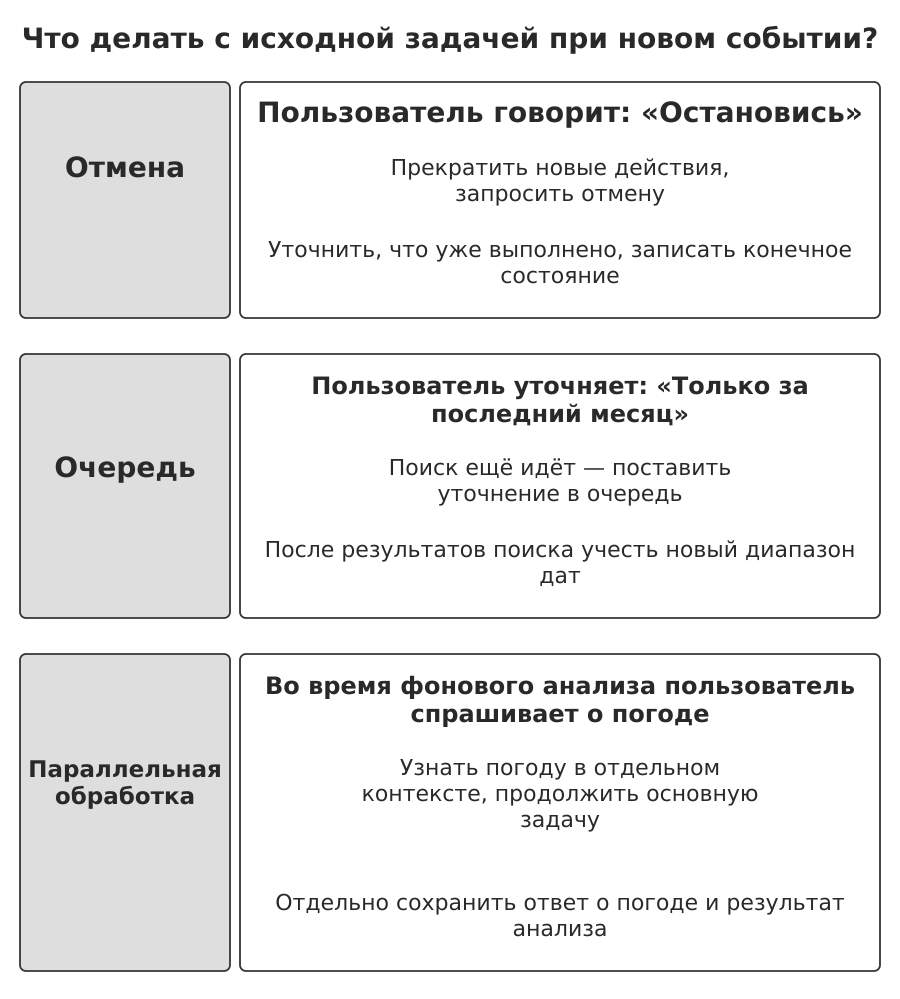

**Обработка с отменой (Cancellation-Based)** подходит для пользовательских команд остановки и управляющих событий, требующих немедленной обработки. Сначала среда выполнения прекращает дальнейшую диспетчеризацию связанных операций, отправляет сигнал остановки выполняющему генерацию запросу и допускающим отмену инструментам, а затем сохраняет завершённые сообщения, состояния инструментов и подтверждения отмены. После этого новое событие включается в контекст принятия решения. Например, если пользователь говорит: «Стой! Я ошибся», система сначала ограничивает дальнейшее выполнение, а затем повторно уточняет задачу с учётом фактического текущего состояния. Необработанные элементы очереди сохраняют свои идентификаторы и состояния и переупорядочиваются с учётом области их связи.

**Обработка через очередь (Queued)** подходит для обычных дополнений и обновлений прогресса. Событие поступает в очередь и в следующей безопасной точке передаётся модели вместе с результатами инструментов. Например, если во время поиска пользователь уточняет: «Учитывай результаты только за последний месяц», то после завершения поиска модель одновременно читает результаты и новое условие, а затем решает, отфильтровать их или выполнить поиск заново.

**Параллельная обработка (Parallel)** подходит для независимых от основной задачи запросов, требующих быстрого ответа. Например, пока выполняется анализ большого объёма данных, пользователь может спросить о погоде, и система создаст для этого отдельную сессию.

**Срочность и маршрутизация.**

Тип события даёт первоначальную подсказку: `user.interrupt`, доверенные инструкции надзора и системные тревоги могут направляться в высокоприоритетный канал; для `user.input`, `agent.input`, `tool.result` и `timer.trigger` решение принимается также с учётом содержимого и состояния задачи. Даже если отправитель называет сообщение «срочным» в его тексте, система определяет полномочия по проверенной идентичности и установленным правилам.

Для маршрутизации, требующей понимания смысла сообщения, автор рекомендует использовать лёгкую классификационную модель: «немедленно остановись» соответствует отмене, «какая сегодня погода?» может подходить для параллельной обработки, а «отчёт должен быть на китайском языке» обычно попадает в очередь дополнений к текущей задаче. Явный механизм остановки обрабатывается непосредственно средой выполнения, а семантическая классификация применяется к остальным сообщениям, которые необходимо интерпретировать.

Универсальная модель тоже может присваивать сообщениям метки, однако даже для вывода одной лишь метки «требует обработки» ей необходимо прочитать описание задачи и содержимое сообщения. Если выполнять такую оценку для каждого нового сообщения, стоимость вызовов будет расти вместе с их количеством, а действительно срочному сообщению придётся ждать, пока модель выдаст метку. Jev от TypeSafe специально предназначен для подобных задач принятия решения с заранее заданными вариантами. Получив сообщение и текущее состояние задачи, он может с меньшими затратами и задержкой параллельно вернуть вероятности для каждого варианта.[^ch6-jev]

Рассмотренное в главе 1 разрежение пространства наблюдений здесь определяет, какие сообщения запускают новый инференс. Например, для сообщений Feishu и комментариев к GitHub Issue программа может сначала отфильтровать повторные уведомления по номеру события, а затем поручить Jev определить, дополняет ли новое сообщение существующую задачу или содержит новый запрос, требующий основной модели. Прочитав фразу «дополнение к описанным вчера шагам воспроизведения», модель должна лишь определить, что это дополнительное пояснение. К какому именно Issue оно относится, программа может узнать непосредственно из идентификатора, которым снабжён комментарий.

Даже высокая вероятность, выданная моделью, может отражать завышенную уверенность. Например, все 100 сообщений могут быть отнесены к категории «дополнение существующей задачи» с вероятностью около 90%, хотя в действительности к ней относятся лишь 60 сообщений. Если автоматически добавить всю эту группу к существующим задачам, исходное назначение остальных 40 сообщений будет упущено.

[^ch6-jev]: В примечаниях к выпуску Jev компания TypeSafe описала заранее определённые варианты вывода, параллельный возврат вероятностей и метод обучения RLCD, нацеленный на калибровку решений.

### Построение базового цикла на основе почтовых событий

Предположим, что процесс обработки новых писем внезапно перезапустился. Идентификатор письма поможет найти исходный текст, но не покажет, был ли отправлен ответ на предыдущее письмо. Лучше регистрировать каждую операцию записи и полученную квитанцию под идентификатором соответствующего письма — от постановки в очередь, чтения письма и вызова инструментов до обновления почтового ящика или уведомления пользователя. Если после перезапуска обнаружится запрос без квитанции, сначала следует проверить фактическое состояние почтового ящика и лишь затем решать, нужно ли отправлять запрос повторно.

> **Эксперимент 6-1 ★★★: событийная обработка почты с помощью AI-агента**
>
> В этом эксперименте тестовый почтовый ящик служит точкой входа для отработки регистрации событий, работы с очередью и обработки задач. Сначала новые письма преобразуются в структурированные события и обрабатываются в порядке поступления, затем подключаются инструменты для работы с историей переписки, чтения вложений, поиска знаний и отправки уведомлений. Проследите по рисунку 6-4 обработку одного приглашения на встречу: найдите в цикле событий этапы проверки конфликтов в календаре и составления черновика, а затем найдите в постоянном хранилище запись об обработке этого письма.
>
> 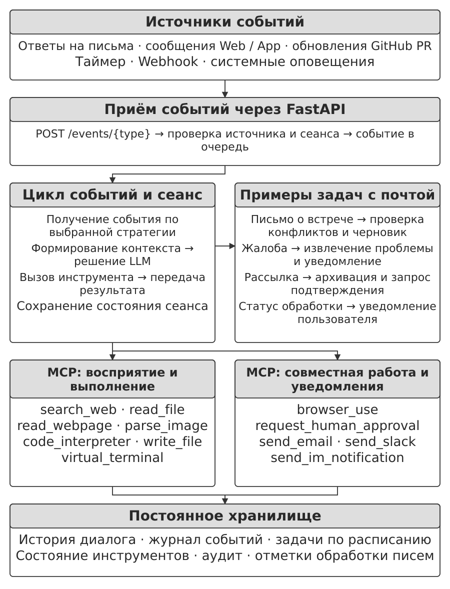
>
> Одну очередь можно расширить для поддержки разных источников: поступления электронной почты, сообщений в IM или SMS, обновлений GitHub PR и Issue, таймеров, внешних Webhook, а также внутренних событий, таких как переход пользователя в автономный режим, истечение времени ожидания процесса и предупреждения о ресурсах. Каждый адаптер проверяет источник и дополняет событие связанной информацией, а результат обработки записывается по идентификатору события.
>
> Для приёмки используются три тестовых письма: приглашение на встречу должно запускать проверку конфликтов в календаре и создавать черновик ответа с принятием или отклонением; жалоба клиента — извлечение ключевой информации, установку высокого приоритета и уведомление пользователя; рекламное письмо — архивирование по заданным правилам.
>
> На текущем этапе в сопутствующем журнале зафиксированы проверка документации интерфейсов и исследование аутентификации; для подключения тестового почтового ящика по-прежнему требуются действительные учётные данные.
>
> **Расширение (необязательно): подключение нескольких источников и внедрение сбоев.** Помимо тестового почтового ящика подключите локальную конечную точку Webhook и очередь SQS, которую можно эмулировать локально. Каждый адаптер должен проверить источник, сформировать конверт, записать его в журнал приёма и лишь затем подтвердить получение источнику. Среда выполнения должна читать события из журнала и обрабатывать их по порядку внутри каждой цепочки. Затем внедрите три типа сбоев:
>
> 1. **Повторная доставка.** Конечная точка Webhook дважды получает запрос с одним идентификатором доставки, но в журнале появляется только одно событие.
> 2. **Сбой до подтверждения.** Адаптер принудительно завершается после записи в журнал, но до удаления сообщения SQS. После того как сообщение снова становится видимым и считывается повторно, в журнале по-прежнему остаётся только одно событие.
> 3. **Сбой до записи квитанции.** Среда выполнения принудительно завершается после отправки ответа, но до записи квитанции, а после перезапуска воспроизводит события из журнала. Если канал поддерживает ключ идемпотентности либо позволяет найти уже отправленное сообщение, например в папке отправленных писем, один и тот же ответ не отправляется повторно. Если канал не предоставляет ни одной из этих возможностей, ответ можно лишь пометить как ожидающий ручного подтверждения.
>
> Все три типа сбоев должны оставлять записи в журнале: какая доставка была дедуплицирована, какое сообщение было считано повторно и какой ответ после проверки не стали отправлять ещё раз.
>
> Сопутствующий код этого расширения можно запускать автономно, без API Key. Тестовый почтовый ящик и очередь SQS эмулируются локальными файлами и отделены от реального почтового ящика, для которого выше ожидаются учётные данные. Эмулятор очереди сохраняет семантику тайм-аута видимости, дескрипторов получения и порядка сообщений внутри группы. Для имитации сбоя родительский процесс напрямую завершает дочерний процесс в заданной точке. Для каждого канала ответа демонстрируется отдельный подход: для электронной почты проверяется папка отправленных сообщений, для диалога в приложении используется ключ идемпотентности, а SMS не поддерживает ни одну из этих возможностей. Для воспроизведения перейдите в `chapter6/agent-with-event-trigger` и выполните `python multisource_demo.py`: терминал последовательно выведет оставшиеся в журнале записи для всех трёх типов сбоев. В сопутствующем журнале запуска успешно пройдены проверки всех трёх типов сбоев.
>

Почтовая очередь создаёт основу для последовательной обработки. Далее мы добавим длительно работающие инструменты и рассмотрим, как во время ожидания принимать новые требования, отменять задачи и возобновлять работу.

### Совместимость при отсутствии встроенной поддержки асинхронности

Предположим, AI-агент составляет письмо и уже вызвал `search_contacts` для поиска контакта. Пока результат ещё не получен, пользователь просит: «Подождите, сначала узнайте погоду на завтра». Если текущий интерфейс модели требует сначала предоставить результат для каждого вызова инструмента, Harness должен преобразовать фоновое состояние в последовательность сообщений, допустимую для этого интерфейса.

**Представление фонового состояния в синхронном формате сообщений.**

**При работе с синхронным интерфейсом следует по возможности сохранять соответствие между обычными вызовами и реальными результатами, добавляя ответ о состоянии только при переключении задачи в процессе выполнения.** Если слишком рано отвечать на каждый вызов «всё ещё выполняется», траектория переполнится незавершёнными состояниями, и модели станет сложнее отслеживать реальные результаты. На практике можно придерживаться пяти правил:

1. **Записывать полный вызов.** Записывать в траекторию завершённое сообщение assistant и элементы вызовов инструментов, возвращённые API, сохраняя идентификаторы вызовов. Состояние серверного инференса сохраняется предусмотренным поставщиком способом продолжения.
2. **Записывать фактическое завершение.** После завершения инструмента записывать реальный результат, идентификатор задачи и состояние выполнения; пока задача выполняется, диспетчер задач постоянно сохраняет её незавершённое состояние.
3. **При переключении сообщать текущее состояние.** Если интерфейс допускает подобную полезную нагрузку результата, для незавершённого вызова можно вернуть явную информацию о состоянии, например: «Задача всё ещё выполняется в фоновом режиме, результат пока не получен», а затем добавить событие пользователя. Идентификатор задачи в ответе о состоянии связывает его с последующим уведомлением о завершении.
4. **Упорядочивать сообщения после прерывания.** Если продолжение в процессе выполнения не поддерживается, следует отменить незавершённую генерацию, сохранить подтверждённые завершённые сообщения и состояния инструментов, а затем отправить новый запрос. Незавершённый вывод обрабатывается согласно требованиям интерфейса, чтобы фрагмент параметров не был ошибочно принят за исполняемый вызов.
5. **Принимать обычные события пакетами.** Дополнительная информация поступает в очередь и передаётся единым пакетом по завершении текущего цикла или в заданной безопасной точке; при этом регистрируется, какие события уже обработаны.

В примере с поиском контакта полный вызов сначала записывается в траекторию. Когда пользователь переключает задачу, Harness добавляет ответ о том, что поиск всё ещё выполняется, а затем передаёт запрос погоды. Позже результат поиска контакта поступает в контекст как новое событие с указанием источника и идентификатора задачи, после чего агент продолжает составлять письмо. Если исходный вызов уже получил ответ о состоянии, последующий результат передаётся в предусмотренной адаптером форме события, сохраняя соответствие между вызовом и результатом.

Ответ о состоянии сообщает только о текущем ходе выполнения. Шаги, зависящие от данных контакта, должны дождаться реального результата. Диспетчер задач может хранить состояния `running`, `completed`, `cancelled`, `failed` и перед отправкой ответа или вызовом следующего инструмента проверять, выполнены ли зависимости.

**Проектирование асинхронных инструментов с помощью дескрипторов задач.**

Для новых инструментов, выполняющих длительные задачи, автор предпочитает определять «запуск» как законченную операцию, которая немедленно возвращает реальный дескриптор задачи. Благодаря этому модель различает состояния «уже запущено» и «уже завершено», а последующие запросы, отмена и события с результатами получают единое основание для связывания. Например, `initiate_phone_call` запускает задачу телефонного звонка и возвращает идентификатор задачи вместе с состоянием «идёт набор номера», а `phone_call_connected` и `phone_call_ended` сообщают соответственно об установлении и завершении соединения.

В описании инструмента следует явно указать: «Этот инструмент запускает задачу телефонного звонка и после успешного запуска возвращает ID задачи. Вы можете продолжить работу над другими вопросами; сведения о ходе звонка и его результате возвращаются отдельными событиями». Имя инструмента показывает, что это операция запуска, а структура ответа и последующие события объясняют, как задача выполняется и завершается. Система также предоставляет интерфейсы для запроса состояния, отмены и возобновления по ID задачи, чтобы модель понимала, какие действия ещё доступны.

**Поэлементная обработка пакета событий.**

Когда в контекст одновременно поступает несколько событий, модель может ответить только на последнее и пропустить ранее сформулированные требования. Среда выполнения должна хранить состояние обработки каждого события, чтобы условия, на которые ещё не дан ответ, оставались видимыми. Промпт может требовать от модели проверять события по одному, а строка состояния — перечислять ещё не обработанную информацию:

```text
[Необработанное событие 1/4] Результат database_query: …
[Необработанное событие 2/4] Дополнение пользователя: учитывать только данные по Пекину
[Необработанное событие 3/4] Системное напоминание: до срока сдачи отчёта осталось 30 минут
[Необработанное событие 4/4] Вопрос пользователя: как продвигается работа?
```

В сводке пакета можно указать: «1 результат инструмента, 2 сообщения пользователя, 1 системное напоминание». Среда выполнения дополнительно связывает события с ограничениями задачи: условие по региону изменяет область запроса, срок сдачи влияет на планирование, а вопрос о ходе работы требует ответа. После обработки регистрируется состояние «завершено», «ожидает» или «требует уточнения», а на следующей итерации нерешённые пункты продолжают сохраняться.

Один и тот же номер задачи связывает запуск, отчёты о ходе выполнения и окончательный результат. Если в процессе поступит требование остановить задачу, необходимо дополнительно проверить, получено ли для этого номера подтверждение отмены.

> **Эксперимент 6-2 ★★★: асинхронный агент с поддержкой параллельного выполнения и прерывания**
>
> В этом эксперименте сначала проверяется асинхронная среда выполнения, а затем подключается модель для проверки решений. В сопутствующем журнале выполнения четыре сценария реализованы с помощью настоящих подпроцессов операционной системы, а диспетчеризацией событий и формированием отчётов управляет детерминированный скрипт.
>
> 1. **Фоновое выполнение и немедленный ответ.** Запустите процесс анализа длительностью несколько секунд и немедленно верните идентификатор задачи; во время ожидания ответьте на вопрос о текущем времени, а после завершения примите результат анализа.
> 2. **Очередь и пакетная обработка.** Во время выполнения длительной задачи последовательно добавьте требования «ответить по-японски» и «оформить в виде веб-страницы», а после завершения задачи обработайте результат и оба требования одним пакетом. Скрипт создаёт HTML на японском языке.
> 3. **Отмена и возобновление.** Продемонстрируйте, что при получении команды «Остановить анализ» выполняющийся ход модели прерывается, а все активные фоновые задачи получают требование остановиться. В этом сценарии прерывание инициирует скрипт; на тот момент выполнялся только один процесс анализа — T1. На 0,803 секунды событие прерывания зафиксировало прогресс T1 на уровне 18%; лишь на 0,806 секунды система зарегистрировала его код завершения −15. Сразу после этого была запущена новая задача T2. На 4,436 секунды был получен результат T2; T1 не вызвала обратный вызов завершения.
> 4. **Параллельные задачи и решения на основе прогресса.** Одновременно запустите три процесса анализа, продвигающихся на каждом логическом шаге времени соответственно на 3%, 2% и 1%. В журнале параллельного выполнения этого эксперимента к моменту завершения самой быстрой задачи T1 ответ на запрос состояния показывает, что T2 достигла 68%, а T3 — 34%. Согласно рисунку 6-5, задачи с прогрессом не более 50% отменяются. Скрипт отменил только T3, а в итоге получил результаты T1 и T2. Это показывает, что одна среда выполнения способна как отреагировать на пакетную остановку, так и сохранить полезную параллельную работу.
>
> 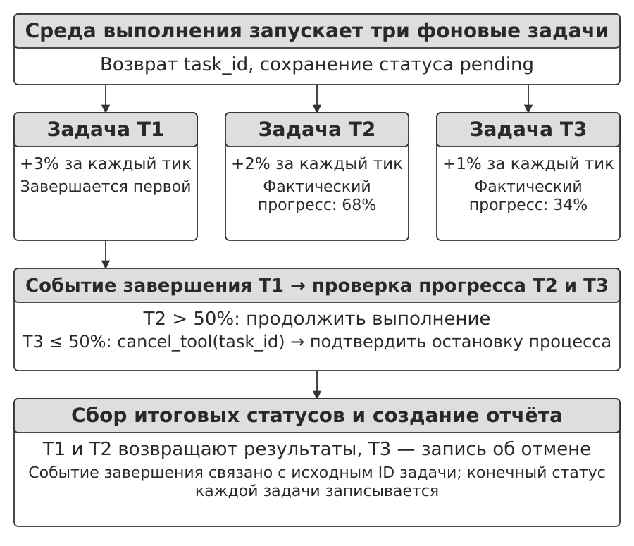
>

### Нативная асинхронность модели: GPT-6 Astra

В описанной выше схеме Harness адаптирует синхронный формат сообщений. Нативный асинхронный интерфейс напрямую позволяет модели продолжать независимую работу, пока инструмент ещё не вернул результат, и получить этот результат позднее. По состоянию на сентябрь 2026 года GPT-6 Astra поддерживает асинхронные вызовы инструментов (Async tool calling) и корректировку в середине хода (Mid-turn steering), которые позволяют соответственно обрабатывать ожидание инструментов и обновления от пользователя. На рисунке 6-6 сопоставлены потоки сообщений при адаптации синхронного интерфейса и нативной асинхронности.[^ch6-22][^ch6-23]

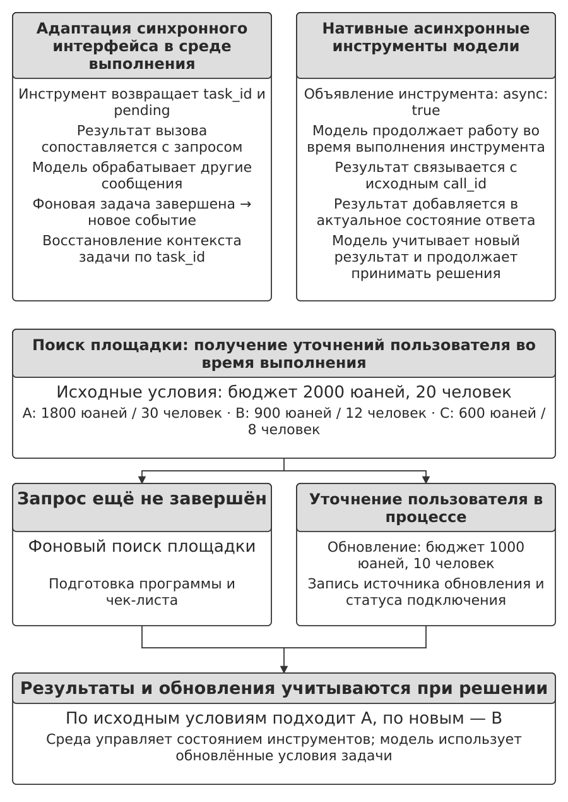

**Продолжение независимой работы во время ожидания инструмента.** Например, после запуска поиска помещения для встречи AI-агент может сначала подготовить повестку и контрольный список, а после поступления результатов сравнить цены и вместимость. Поле `async: true` в определении инструмента объявляет поддержку асинхронного выполнения. Получив полный элемент вызова, приложение запускает выполнение и сохраняет идентификатор вызова `call_id`. Когда результат поступает, приложение возвращает его с исходным идентификатором и продолжает работу с последнего состояния ответа. Модель планирует последующую работу, а Harness управляет сопоставлением вызовов и жизненным циклом задач.[^ch6-22]

**Получение новых требований во время выполнения задачи.** Пока модель рассуждает или формирует ответ, пользователь может добавить требования: «сократить бюджет до 1000» или «изменить число участников на 10». Приложение отправляет событие корректировки через то же соединение, а после подтверждения его получения сервером продолжает обработку с текущего состояния ответа. После разрыва и восстановления соединения приложение может возобновить задачу на основе сохранённых событий и состояния ответа.[^ch6-23]

Эти две возможности можно использовать совместно: поиск помещения продолжает выполняться, новые требования пользователя учитываются в последующих решениях, а после поступления результатов поиска завершается выбор. Исполнитель при этом поддерживает фактическое состояние фоновых задач. Если поиск нужно остановить или бронирование отменить, Harness вызывает соответствующий интерфейс и проверяет подтверждение; уже завершённые бизнес-операции передаются в процесс отмены или компенсации.

Если модель и интерфейс уже поддерживают нативную асинхронность, автор предпочитает использовать нативный протокол, чтобы приостановка инструментов, обновления от пользователя и продолжение ответа обрабатывались в соответствии с контрактом интерфейса. Слой совместимости с синхронным форматом предназначен прежде всего для существующих моделей и старых интерфейсов. После обновления модели можно постепенно удалить логику совместимости, служащую только для восстановления пар сообщений, и сосредоточить инженерные усилия на состоянии задач, отмене и восстановлении.

### Надёжная обработка асинхронных задач

Для надёжного асинхронного взаимодействия необходимо одновременно проверять сообщения, задачи и состояние выполнения.

1. **Принадлежность результата.** Задержанный результат содержит идентификатор исходного вызова, по которому приложение сопоставляет его с соответствующей задачей; решения, зависящие от этого результата, принимаются после поступления данных.
2. **Возобновление и отмена.** После изменения требований пользователем система сохраняет работу, которая остаётся актуальной, обновляет последующие шаги и явно указывает, какие фоновые задачи продолжают выполняться, а какие уже остановлены.
3. **Несколько требований.** Бюджет, число участников, регион и срок выполнения по отдельности сохраняются в состоянии задачи, а итоговый результат проверяется на соответствие каждому из этих условий.

> **Эксперимент 6-3 ★★★: нативная асинхронность модели и корректировка в середине хода**
>
> В этом эксперименте агент выбирает для условной встречи самое дешёвое помещение, соответствующее требованиям по бюджету и числу участников. Исходный бюджет составляет 2000, число участников — 20; инструмент поиска возвращает цены и вместимость трёх помещений только через 8 секунд.
>
> | Помещение | Цена | Вместимость |
> |---|---:|---:|
> | A | 1800 | 30 |
> | B | 900 | 12 |
> | C | 600 | 8 |
>
> При исходных условиях следует выбрать A. Группы с корректировкой во время выполнения задачи получают два обновления: бюджет изменён на 1000, а число участников — на 10; теперь следует выбрать B. Вместе с результатом инструмент возвращает новую сгенерированную квитанцию, которую необходимо процитировать в итоговом ответе, чтобы проверить, использовала ли модель фактически поступивший результат.
>
> Эксперимент включает пять групп по три запуска: синхронный инструмент, нативный асинхронный инструмент, корректировка во время инференса, корректировка во время ожидания асинхронного инструмента и контрольная модель без поддержки корректировки. В первых двух группах проверяется, можно ли во время ожидания составить независимый контрольный список подготовки; в двух группах с корректировкой — одновременно ли применяются требования по бюджету и числу участников; в контрольной группе — сообщает ли интерфейс явно об отсутствии поддержки.
>
> В сохранённых записях запусков группа с асинхронным инструментом во время ожидания составила независимый контрольный список, а обе группы с корректировкой выбрали B согласно новым условиям. Во всех запусках с инструментом запрос выполнялся только один раз, а фактический результат возвращался исходному вызову; интерфейс контрольной модели явно ответил, что она не поддерживает получение новых требований в процессе генерации одного хода. Общее время выполнения в синхронной и асинхронной группах было близким; основное различие заключалось в возможности продвигать другую работу во время ожидания.
>
> Что выберет модель, если запомнит только изменение числа участников на 10, но продолжит использовать прежний бюджет 2000? И A, и B вмещают достаточно людей, однако самым дешёвым всё равно остаётся B. Поэтому правильный выбор помещения ещё не доказывает, что обновление бюджета было учтено.
>
> Если число участников изменилось, нужно ли повторять уже отправленный запрос? В этом эксперименте инструмент не принимает параметры фильтрации и возвращает все три помещения. Агент может повторно использовать уже выполняющийся запрос, дождаться результата и затем отфильтровать варианты по условиям: 10 участников и бюджет 1000. Если бы инструмент возвращал только помещения вместимостью не менее 20 человек, в старом результате оказалось бы лишь A, а B вместимостью 12 человек вообще отсутствовало бы. В таком случае простое изменение числа участников на 10 при работе со старым списком всё равно привело бы к пропуску B. Если исходный запрос уже отфильтровал B, запрос придётся выполнить повторно.

Асинхронные механизмы позволяют внешним изменениям поступать в систему непосредственно в ходе выполнения задачи. Голосовое взаимодействие, работа с экраном и взаимодействие с роботами дополнительно сокращают цикл обратной связи: система должна непрерывно принимать входные данные и в подходящий момент корректировать вывод и действия.

## Голос: самый естественный человеко-машинный интерфейс

Голос позволяет пользователю сообщать AI-агенту о своих потребностях, дополнять условия и подтверждать результаты, даже когда его руки или зрительное внимание заняты другой работой. Голосовой ввод преобразует диктовку в текст, а голосовой агент дополнительно управляет диалогом, вызовами инструментов и воспроизведением ответов; оба подхода поддерживают описанный в предисловии whisper coding.

В этом разделе рассматриваются два варианта использования: непосредственный диалог пользователя с агентом и общение агента с внешними людьми от имени пользователя. В первом случае основное внимание уделяется распознаванию, ответам и прерываниям, а во втором во время разговора также необходимо подтверждать личность, выполнять бизнес-запросы и принимать решения.

### Последовательность взаимодействия: от каскада к полному дуплексу

В описании GPT-Live OpenAI рассматривает три типа голосового взаимодействия: каскадные системы, аудиомодели с разделением на реплики и полнодуплексные системы[^ch6-12]. По мере развития этого направления решение о том, «когда начать говорить, а когда продолжить слушать», всё больше передаётся модели, которая принимает его непрерывно. В каскадных системах передачей права говорить в основном управляет логика определения конечной точки, тогда как полнодуплексная модель может обрабатывать наложение речи, паузы и прерывания с учётом непрерывного звука и состояния диалога.

| Парадигма | Основная структура | Возможности, которые проще реализовать | Основные вопросы проектирования |
|---|---|---|---|
| Каскадная | Разделение функций между VAD, ASR, LLM и TTS | Независимая замена модулей, поэтапная проверка ввода и вывода | Задержки между модулями, потеря акустической информации при расшифровке |
| Сквозная аудиомодель с разделением на реплики | Модель напрямую принимает и генерирует аудио | Формирование ответа с учётом интонации, эмоций и другой информации | Определение окончания речи, смена реплик и выбор момента ответа |
| Полнодуплексная | Непрерывное получение аудио и генерация вывода | Одновременная речь, реплики согласия, прерывания и непрерывное взаимодействие | Непрерывное состояние, управление выводом и оценка взаимодействия |

Прямая обработка аудио моделью, потоковый режим ввода и вывода и способность одновременно слушать и говорить — отдельные возможности, которые следует проверять независимо. В каскадную систему также можно добавить потоковые модули и управление прерываниями; темп взаимодействия сквозной модели зависит от конкретного устройства модели.

[^ch6-12]: OpenAI, *Introducing GPT-Live*, 2026-07-08, описание каскадных систем, аудиомоделей с разделением на реплики и полнодуплексного взаимодействия.

### Парадигма 1 · Каскадный конвейер (Cascading)

Каскадная система разделяет голосовой диалог на несколько модулей. Детектор голосовой активности (VAD) распознаёт участки речи в аудио, а логика определения конечной точки решает, когда передать такой фрагмент дальше; автоматическое распознавание речи (ASR) преобразует аудио в текст; LLM понимает запрос и генерирует ответ; затем синтез речи (TTS) преобразует ответ в аудио, готовое к воспроизведению. На рисунке 6-7 показана базовая структура с последовательным выполнением этапов.

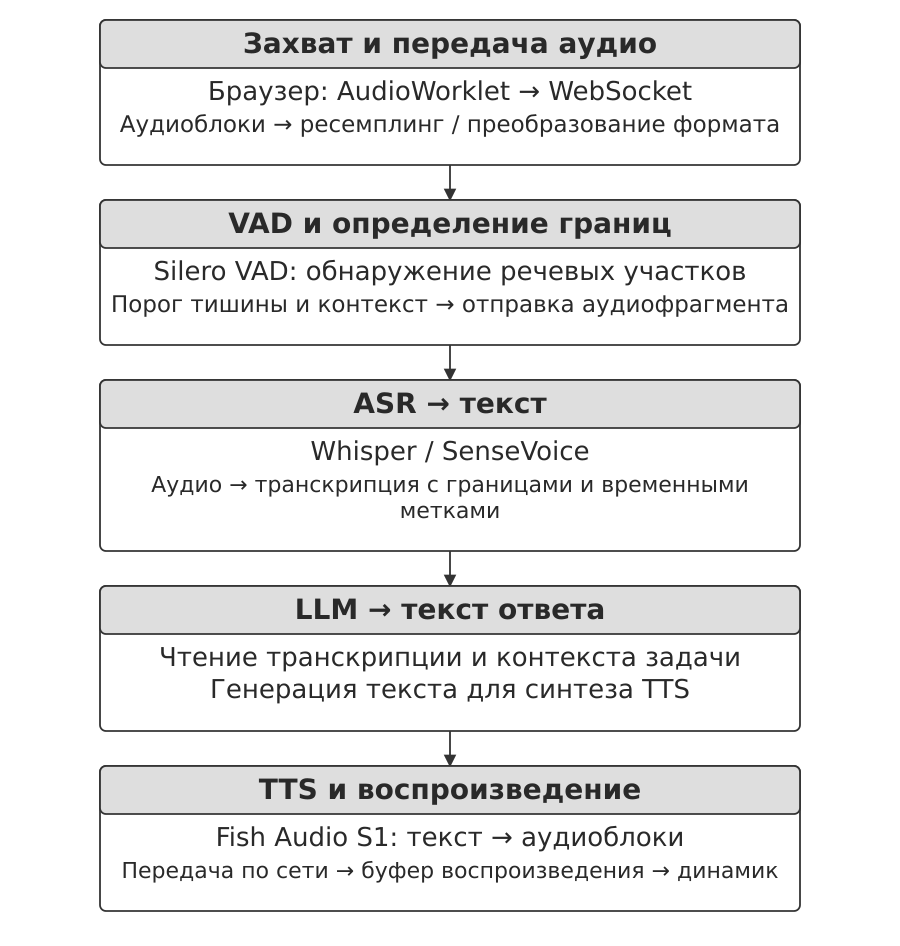

Акустический VAD находит участки, где говорит человек, поэтому последующее распознавание может пропускать длительные периоды тишины. Однако одна и та же пауза имеет разное значение после фраз «Я хочу забронировать…» и «Есть билеты на утро четверга?». Семантический VAD — семантическое определение конечной точки — в первом случае может продолжить запись и лишь во втором передать реплику диалоговой модели. Так голосовые наблюдения становятся разреженными во времени: непрерывный звук запускает инференс только в отдельные моменты. Решение о том, нужно ли отвечать, принимает модель, услышавшая реплику; она также может продолжить слушать или сначала проверить рейсы.

| Модуль | Назначение | Распространённые источники ожидания или ошибок |
|---|---|---|
| VAD и логика определения конечной точки | Обнаружение речи и выбор момента передачи | Порог тишины, шум и паузы в середине реплики |
| ASR | Преобразование аудио в текст | Время декодирования, распознавание имён и имён собственных |
| LLM | Понимание, рассуждение и генерация ответа | Очередь запросов, генерация первого фрагмента ответа |
| TTS и воспроизведение | Синтез аудио и его передача на динамик | Синтез первого пакета, передача по сети и буферизация воспроизведения |

В полностью последовательной реализации после окончания реплики пользователь должен поочерёдно дождаться подтверждения конечной точки, транскрибирования, генерации ответа и первого фрагмента аудио. В примере на рисунке 6-8 первый звук ответа слышен пользователю лишь через 1,4 секунды. Самая продолжительная часть этого времени — ожидание подтверждения того, что пользователь закончил говорить: 500 миллисекунд. Даже если сократить транскрибирование со 100 до 50 миллисекунд, пользователь будет ждать лишь на 50 миллисекунд меньше.

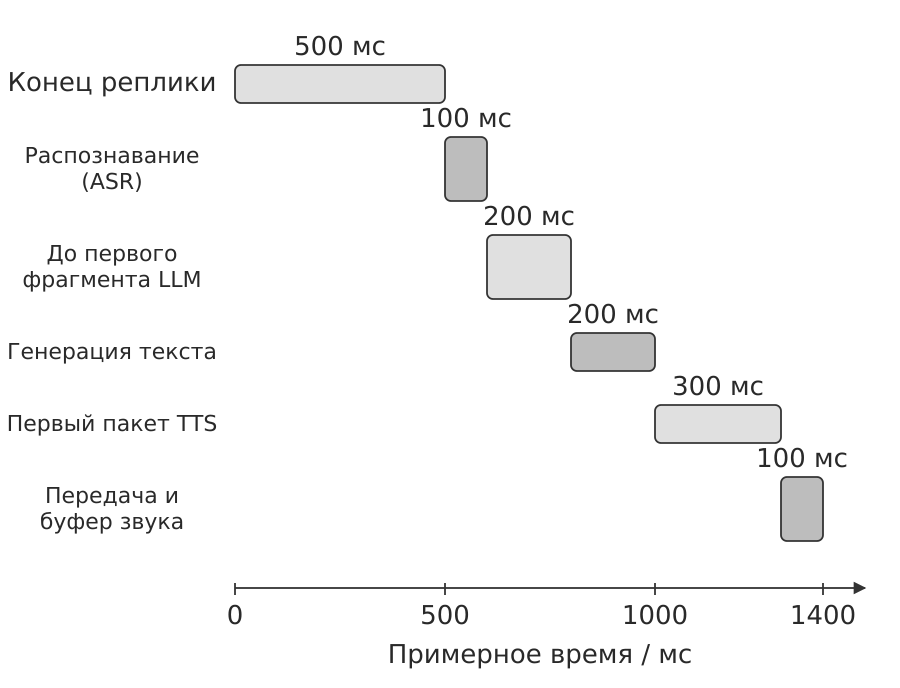

Нагрузка на сервис дополнительно создаёт ожидание в очереди. На рисунке 6-9 эта зависимость показана с помощью одноканальной модели M/M/1: поступление запросов описывается пуассоновским процессом, время обслуживания — экспоненциальным распределением, а при среднем времени обслуживания $S$ и коэффициенте использования $\rho<1$ среднее общее время обслуживания и ожидания в очереди составляет $W=S/(1-\rho)$. Если $S=1$ секунда, то при росте коэффициента использования с 0,5 до 0,8 среднее общее время увеличивается с 2 до 5 секунд. Само обслуживание по-прежнему занимает в среднем 1 секунду, а дополнительные 3 секунды целиком уходят на ожидание в очереди. Когда поток запросов приближается к пропускной способности системы, кратковременные колебания нагрузки приводят к накоплению очереди.

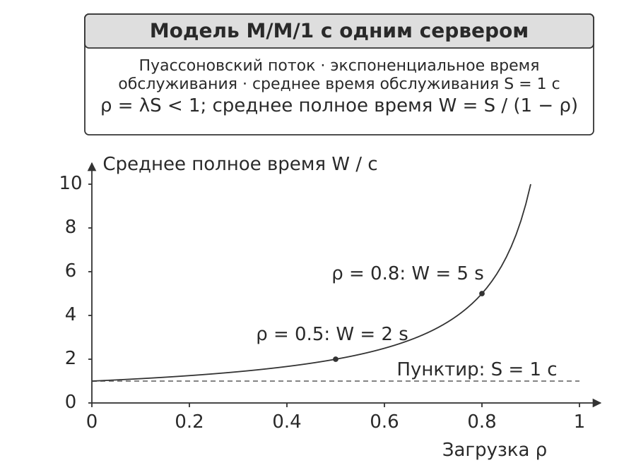

> **Эксперимент 6-4 ★: создание традиционного голосового агента**
>
> Предположим, помощник перечисляет рейсы на четверг, а вы перебиваете его поправкой: «Подождите, я хочу забронировать на пятницу». Браузер передаёт звук с микрофона серверу через WebSocket. Как только Silero VAD обнаруживает начало вашей речи, сервер отправляет `speech_start`, после чего браузер сразу останавливает воспроизведение и очищает очередь старого аудио. В этот момент помощник ещё не знает, на какой день вы изменили бронирование. Лишь когда вы закончите говорить и тишина продлится дольше стандартных 500 миллисекунд, сервер отправит `speech_end` и передаст фрагмент речи локальной модели Whisper tiny для транскрибирования.
>
> Doubao начинает возвращать текст. Сколько ещё пройдёт до того, как пользователь услышит ответ? В записи одного прогона с воспроизведением транскрибирование заняло 2,710 секунды. Doubao вернула первый токен через 0,749 секунды после отправки запроса, но полный ответ поступил лишь через 0,792 секунды. Программа воспроизведения дождалась всего текста и только затем передала его Fish S1 для синтеза; ещё через 2,819 секунды сервер получил первую порцию аудио. Если отсчитывать от определения конечной точки, сумма длительностей этих трёх последовательных этапов составляет около **6,321 секунды**. В архивном отчёте указано 6,279 секунды, поскольку вместо времени генерации полного ответа там использовано время получения первого токена.
>
> Эти 6,321 секунды охватывают только обработку на сервере. Сначала пользователь должен дождаться, пока детектор тишины определит, что реплика завершена, а в конце — пока аудио поступит в браузер и начнёт воспроизводиться.

#### От последовательной обработки к потоковому восприятию

Последовательная схема удобна для поэтапной проверки, но выявляет три проблемы. Ожидание тишины увеличивает задержку определения конечной точки; в транскрипции могут теряться интонация, эмоции и окружающие звуки; при разбиении аудио по паузам адреса электронной почты, имена людей и имена собственные могут лишиться целостного контекста. Для систем, уже использующих каскадную архитектуру, автор рекомендует сначала перейти к потоковой обработке: каждый этап должен как можно раньше предоставлять инкрементальные результаты, чтобы распознавание, рассуждение и воспроизведение перекрывались по времени, а подтверждённые и ещё изменяемые части учитывались отдельно. Это позволяет повторно использовать существующие модули и постепенно определять источники ожидания.

- **Потоковое ASR.** Непрерывно принимать аудио и выдавать предварительную транскрипцию; по мере поступления последующего аудио пересматривать нестабильную часть, а после подтверждения конечной точки выдавать окончательный текст.
- **Спекулятивное выполнение LLM.** Заранее готовить ответ на основе предварительной транскрипции. После подтверждения окончательного текста проверять, совпадают ли входные данные и остаются ли применимыми уже выполненные действия, а затем решать, сохранить, скорректировать или заново сгенерировать результат. Отправку данных наружу, запись бизнес-данных и другие операции выполнять лишь после подтверждения необходимых условий.
- **Сегментированный вывод LLM.** Передавать фрагмент текста в TTS сразу после того, как он становится пригоден для озвучивания; при разбиении сохранять смысл предложений, пунктуацию и интонационные подсказки.
- **Инкрементальный синтез TTS.** Постепенно возвращать блоки аудио, чтобы генерация последующего текста, синтез и воспроизведение перекрывались по времени. При вмешательстве пользователя одновременно обрабатывать задачу генерации и ещё не воспроизведённое содержимое буфера.

Стандартная реализация транскрибирования Whisper кодирует и декодирует аудио по окнам[^ch6-whisper]. Инкрементальный процесс транскрибирования можно построить посредством внешнего разбиения на блоки или многократной передачи накопленного префикса. Конкретная реализация должна управлять повторным использованием состояния, стоимостью повторного кодирования и пересмотром предшествующего текста. Модели со встроенной поддержкой потокового распознавания обрабатывают непрерывный ввод непосредственно в своей архитектуре и процессе обучения.

Системы восприятия на основе аудиоязыковых моделей также могут совместно выводить текст и акустические события. История аудио, транскрипция и лексические подсказки помогают распознавать имена людей, бренды и имена собственные, а объём сохраняемой истории зависит от устройства контекста и кэша. Определяя, закончил ли пользователь говорить, модель может учитывать как смысловую завершённость, так и тишину. Во время паузы после фразы «Я хочу забронировать…» система реального времени услышала только эти слова и ещё не может знать, что следом будет названа дата.

Помимо транскрипции, интерфейс может предусматривать следующие события: `speak_start` и `speak_end` обозначают начало и окончание речи, `interrupt` — прерывание, `emotion` описывает эмоциональное состояние, а `laugh`, `sigh` и `noise` фиксируют смех, вздохи и окружающий шум. Эти события можно передавать агенту вместе с текстом и временными метками.

> **Эксперимент 6-5 ★: имитация потокового восприятия речи с помощью Qwen2-Audio**
>
> В этом эксперименте префикс аудио постепенно увеличивается: при каждом запуске в Qwen2-Audio повторно передаётся аудио от начала записи до текущего момента, чтобы проследить, как с изменением входных данных меняются транскрипция и акустические события. В контрольном варианте используются конечная точка после 600 миллисекунд тишины и Whisper. Тесты включают обычную речь, длинное предложение с паузой в 900 миллисекунд и речь с примесью розового шума.
>
> В этом запуске локальной квантованной модели сохранены результаты инференса для 13 префиксов; каждый запуск занимал около 8–11 секунд. Пауза в середине реплики привела к разбиению в контрольном варианте; аудиомодель обнаружила шум, но также ошибочно распознала кашель и смех.

[^ch6-whisper]: OpenAI, Whisper, описание транскрибирования по аудиоокнам и реализации модели.

### Парадигма 2 · Сквозная всемодальная модель (Omni)

Сквозная аудиомодель непосредственно принимает звук, генерирует ответ на основе языковой и акустической информации, а затем синтезирует речь через ветвь аудиовывода. Непосредственная обработка аудио позволяет учитывать темп речи, высоту голоса, паузы и окружающие звуки; подход с предварительной расшифровкой и последующим ответом упрощает проверку промежуточного текста и независимую замену модулей.

Эти акустические признаки влияют на понимание. Например, одна и та же фраза «Пожалуйста, пришлите отчёт до обеда», произнесённая быстро или медленно, воспринимается слушателем по-разному. При выводе модель также может организовывать смысл с помощью пауз, ударений и интонации.

Система, непосредственно обрабатывающая аудио, также может дождаться, пока пользователь закончит говорить, и только затем ответить. Например, если пользователь сделал паузу, диктуя номер телефона, система всё равно должна определить, закончил ли он перечислять цифры. Определение конечной точки задаёт момент ответа; если собеседник вмешивается во время воспроизведения, системе также приходится согласовывать генерацию модели с выводом через динамик.[^ch6-audio-architectures]

> **Эксперимент 6-6 ★★: локальный запуск MiniCPM-o 4.5 и сравнение сквозного режима с самокаскадом**
>
> В этом эксперименте используется одна и та же модель MiniCPM-o 4.5 с отключённым режимом мышления и сравниваются два пути: прямой ответ на вопрос по аудио и предварительная расшифровка моделью с последующим ответом только на основе этой расшифровки. Входные данные включают две устные арифметические задачи и две аудиозаписи с одинаковым текстом, но разным темпом речи.
>
> На каждом из двух путей модель правильно ответила на три задания, однако ошибки возникли в разных местах. При прямой обработке аудио модель расслышала в одной из задач английскую фразу “twelve boxes” («двенадцать коробок») как число 8, что привело к ошибке в вычислениях; при расшифровке число 12 было сохранено правильно. В задании на темп речи обе аудиозаписи содержали фразу “Please send the report before lunch.” («Пожалуйста, пришлите отчёт до обеда»). После расшифровки текст оказался полностью одинаковым, поэтому информация о темпе была потеряна; при прямой обработке аудио модель правильно различила два темпа речи.
>
> В ходе эксперимента также была сгенерирована аудиозапись с частотой дискретизации 24 kHz, объединившая понимание входных данных и аудиовывод.

### Парадигма 3 · Полнодуплексная модель взаимодействия

Полнодуплексная система одновременно говорит и слушает, а самое заметное улучшение — ощущение разговора с живым собеседником. Попробуйте произнести: «Хочу забронировать билет на среду… нет, на четверг». Пауза посередине позволяет исправить себя; если ассистент уже начал перечислять рейсы на среду, то, услышав «нет, на четверг», он должен остановиться. Возможен и другой момент: пока собеседник ещё объясняет маршрут, короткая реплика согласия даст ему понять, что ассистент слушает. Только непрерывный приём аудио позволяет выбирать между говорением, слушанием, паузой и вызовом инструмента. Синхронный перевод также требует наложения ввода и вывода.

Выпущенная Kyutai в 2024 году **Moshi** раздельно моделирует аудиопотоки пользователя и модели, представляя одновременную речь и прерывания с помощью параллельных потоков[^ch6-moshi]. Если сохранить эти временны́е связи во входных данных, модель сможет научиться определять, когда отвечать, а когда продолжать слушать.

Модель взаимодействия Thinking Machines Lab разделяет непрерывные ввод и вывод на короткие блоки одинаковой длины, каждый из которых охватывает 200 миллисекунд и называется микроходом (micro-turn)[^ch6-14]. Посмотрите на второй блок временно́й шкалы на рисунке 6-10: ассистент ещё произносит «четыре», но уже слышит, как пользователь исправляет дату словом «нет». В третьем блоке ассистент замолкает и продолжает слушать, пока пользователь не договорит «пятница».

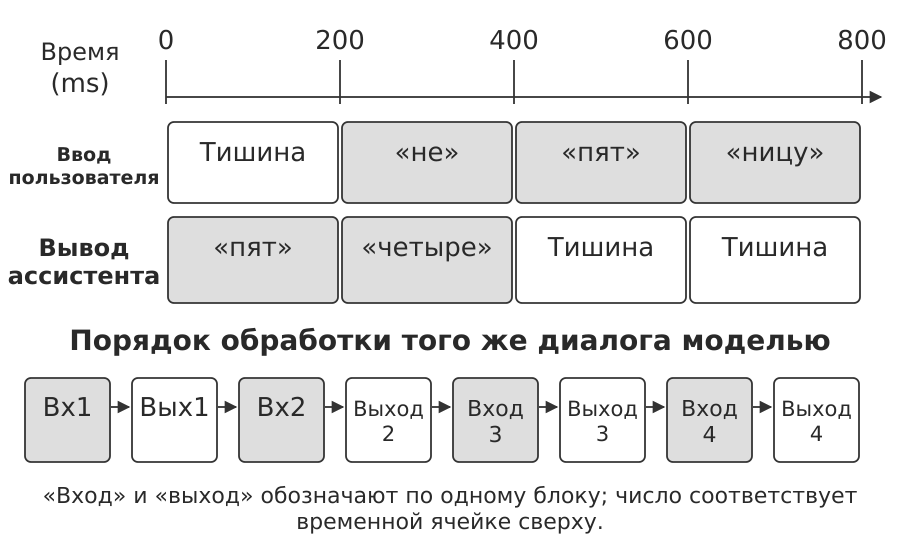

Теперь рассмотрим нижнюю половину рисунка. Участники разговора слышат два способных накладываться друг на друга голосовых потока, однако модель может в одной последовательности попеременно обрабатывать блоки ввода и генерировать блоки вывода. Тишина также занимает отдельный блок, поэтому ассистент может сначала некоторое время послушать и лишь затем заговорить. Указанные на рисунке 200 миллисекунд — длина блока в этой реализации; полное время от момента, когда пользователь перебивает ассистента, до фактического прекращения звука из динамика включает также затраты на обработку и буферизацию воспроизведения.

[^ch6-moshi]: Kyutai, *Moshi: a speech-text foundation model for real-time dialogue*, 2024. Описывает параллельные аудиопотоки пользователя и модели.
[^ch6-14]: Thinking Machines Lab, *Interaction Models: A Scalable Approach to Human-AI Collaboration*. Описывает микроходы, многопоточное взаимодействие и делегирование фоновых задач.

### Когнитивная последовательность: взаимодействие в реальном времени и глубокое мышление

Когда во время звонка Pine в службу поддержки сотрудник ещё не закончил фразу, ассистенту иногда следует подождать, а иногда — негромко дать понять, что он слушает. Даже когда ассистент говорит сам, он должен услышать исправление, с которым собеседник его перебивает. Именно поэтому автор считает перспективным направление Moshi: лишь правильно выбирая момент, можно создать у собеседника ощущение, что на другом конце провода его действительно слушают. Если для ответа требуется найти информацию, возникает ещё один вопрос времени: сколько передач между компонентами произойдёт от понимания вопроса до сообщения найденного ответа?

Если передняя голосовая модель может сама вызвать инструмент, пусть вызывает. Для поиска рейса достаточно двух обращений к модели: сначала она запрашивает рейсы по условиям пользователя, затем сообщает результат. При делегировании обращений четыре: передняя модель ставит задачу, фоновая запрашивает данные, затем обрабатывает результат, а передняя пересказывает его. Есть и другая точка зрения: модель реального времени может ошибиться в параметрах, поэтому инструменты лучше поручить фоновой модели, а передней оставить выбор момента, когда слушать и когда говорить.

У передней модели GPT-Live-1 нет интерфейса для прямого вызова прикладных функций: она может только делегировать задачу фоновому агенту. GPT-Realtime в OpenAI Realtime поддерживает прямые вызовы функций. Голосовая модель Doubao 3.0 (Seeduplex) тоже поддерживает их в полностью сквозном режиме. При гибридной организации работы функции вызывает подключённая языковая модель.[^ch6-voice-tools]

Пусть одно обращение к передней модели занимает $L_f$, к фоновой — $L_b$, а работа инструмента — $T$. Тогда от конца реплики пользователя до озвучивания результата при прямом вызове пройдёт примерно $2L_f+T$, а при делегировании — $2L_f+2L_b+T$. Дополнительные $2L_b$ не зависят от времени работы инструмента $T$. Сведения, которые могут понадобиться в любой реплике, например данные из памяти пользователя, среда выполнения может сама найти и поместить в контекст. Тогда достаточно одного обращения к передней модели, а ожидание составит примерно $L_f+T$. Если сведения найдены до того, как пользователь заговорил, из времени ожидания исчезает и $T$.

Задачи с несколькими шагами рассуждения, например сравнение вариантов обмена билета, удобно поручить фоновой модели. Бронирование связано со списанием денег и оформлением билета: кто бы ни вызывал инструмент, делать заказ можно только после подтверждения пользователя. Результаты поиска можно кратко озвучить, а полную таблицу показать на экране. Это не зависит от того, кто вызвал инструмент.

> **Эксперимент 6-7 ★★: кто вызывает инструменты голосового агента — передняя или фоновая модель?**
>
> Для диалога используйте голосовую модель реального времени Doubao 3.0, для фоновой работы — DeepSeek V4 Pro на платформе Volcengine Ark. Подготовьте пять имитаций инструментов: погода, чтение памяти пользователя, веб-поиск, поиск рейсов и бронирование. Задайте задержки ответа; для поиска рейсов и бронирования — от 2 до 5 секунд. Заранее синтезируйте реплики пользователя и при каждом повторении сценария воспроизводите одну и ту же запись.
>
> Сравните четыре схемы. В первой все инструменты вызывает передняя модель, во второй — фоновая, а передняя может только делегировать. В двух остальных погоду запрашивает передняя модель, среда выполнения в начале сеанса загружает память пользователя в контекст, а веб-поиск и бронирование поручены фоновой. Различие только в том, кто ищет рейсы. Передняя модель слышит голос пользователя, а фоновая видит только текст. После каждой реплики пользователя интерфейс Doubao возвращает также результат распознавания речи — расшифровку. При делегировании составьте из неё и произнесённых реплик помощника запись разговора в хронологическом порядке. Передайте её фоновой модели вместе со списком уже выполненных за этот разговор вызовов инструментов и заданием от передней модели. Для каждой из четырёх схем повторите каждый сценарий 10 раз.
>
> 1. По отдельности запросите погоду и рейсы. Засекайте время от конца реплики пользователя до момента, когда он услышит результат; «Сейчас проверю» ответом не считается. Сравните медианное время ожидания при прямом вызове и при делегировании. У автора для погоды получилось 2,81 и 6,96 секунды соответственно.
> 2. Найдите рейсы, выберите билет и подтвердите заказ. Сверьте каждое из 13 полей бронирования с результатами предыдущего поиска, последней репликой пользователя и его профилем. Проверьте, что заказ оформлен после подтверждения. У автора во всех четырёх схемах все поля были заполнены верно и ни один заказ не был оформлен раньше времени.
> 3. Теперь забронируйте билет для коллеги. Включите запись, в которой пользователь уточняет написание имени: «Чэнь Цзяи: Чэнь — это 陈, из частей 耳 и 东; Цзя — 嘉, как в 嘉奖 (“награждать”); И — 怡, как в 怡然 (“безмятежно”)». Сопоставьте запись, расшифровку и имя в заказе при прямом вызове и при делегировании. У автора передняя модель верно записала 陈嘉怡 во всех десяти попытках. В расшифровке же стояло созвучное 陈佳宜, и при делегировании часть заказов оформили на неверное имя.
> 4. Пока не вернулись результаты поиска рейсов, включите запись с вопросом о погоде. Ответит ли передняя модель на новый вопрос? Сообщит ли затем о рейсах? У автора вопрос о погоде не остался без ответа ни разу, а вот о найденных рейсах модель почти всегда забывала сообщить.[^ch6-aside-results]

[^ch6-aside-results]: **Уточнение русского издания.** В тексте автор пишет, что помощник отвечал на каждый попутный вопрос о погоде. В [таблице 4 с результатами эксперимента](https://github.com/bojieli/ai-agent-book/blob/40f4ce5778e6cc93e3606c3079bf8cf13a0c4d04/chapter6/voice-tool-routing/validation/runs/doubao-seeduplex-20261125-v1/tables.md) указано 39 ответов из 40: в схеме, где рейсы ищет передняя модель, — 9 из 10. Результат поиска рейсов после ответа о погоде был озвучен всего один раз.

Если делегирование необходимо, передней модели стоит прямо в задании указать имена и числа, которые она уверенно расслышала, а также последние исправления пользователя. Тогда ошибка распознавания не попадёт в параметры инструмента. Среде выполнения следует запоминать ещё не озвученные результаты, чтобы, ответив на попутный вопрос, передняя модель вернулась к ним.

Фраза быстрой модели «Сейчас проверю» сообщает сотруднику поддержки, что ассистент правильно понял запрос. Когда можно будет назвать цену билета, зависит от того, как поиск и рассуждение согласованы с разговором. На рисунке 6-11 показаны три варианта: сначала отреагировать, а затем дать развёрнутый ответ; поддерживать взаимодействие передней моделью, получающей рекомендации от фоновой; параллельно продвигать формирование мысли и её выражение по фрагментам.

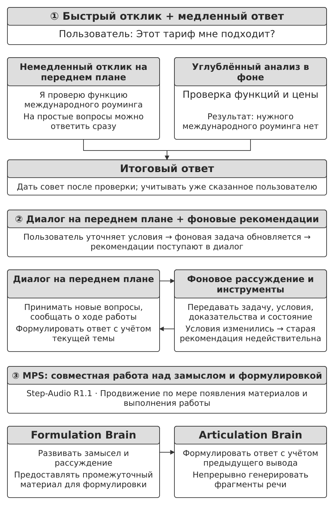

#### Подход 1: быстрое мышление реагирует, медленное отвечает

Быстрая модель сначала кратко реагирует, медленная выполняет анализ в фоновом режиме, после чего система даёт подробный ответ. Такая архитектура позволяет как можно раньше подтвердить получение запроса, но требует согласовывать два ответа. Например, быстрая модель сначала рекомендует приобрести определённый тариф, а медленная затем обнаруживает, что в нём отсутствует критически важная функция: рекомендации противоречат друг другу. Причина конфликта в том, что обе стороны отвечают независимо, а основания для решений и стадии рассуждения могут различаться. Высказанная быстрой моделью рекомендация уже влияет на решение пользователя, который даже может успеть ей последовать. Последующее исправление от медленной модели потребует объяснить изменение и разобраться с уже возникшими последствиями.

Поэтому передняя модель должна различать подтверждение задачи и бизнес-вывод. Фразу «Я проверю, входит ли эта функция в тариф» можно произнести сразу, а с рекомендацией о покупке следует дождаться необходимых запросов и анализа. Когда фоновый результат готов, система сопоставляет его с уже сказанным и формирует продолжение ответа. Простые вопросы быстрая модель может обрабатывать самостоятельно, сокращая дублирование работы.

#### Подход 2: быстрое мышление взаимодействует, медленное подсказывает

Голос и экран также могут разделять функции. На слух пользователь сразу поймёт главное из фразы: «В этом месяце в счёте появились дополнительные 15 евро за роуминг». Исходную сумму, новую стоимость и подробности спорных начислений можно оставить на экране, чтобы пользователь сверил их в удобном темпе. Конкретную операцию можно подтвердить нажатием, а конфиденциальные данные пользователь самостоятельно вводит в одобренном продавцом интерфейсе. Передней модели достаточно получить состояние наподобие «проверка завершена», чтобы естественно продолжить разговор.

Предположим, путешественник просит Pine забронировать билет в Шанхай на утро четверга с бюджетом 1200 юаней, чтобы успеть на место встречи до полудня. Разговаривая со службой поддержки авиакомпании, Pine одновременно передаёт фоновой модели «записку»: «Если прилететь в Хунцяо в десять утра, можно ли успеть из аэропорта на место встречи?» Проверив наличие билетов, сотрудник поддержки сообщает Pine: «Билеты на рейс с прибытием в Хунцяо в десять часов распроданы. Есть другой рейс, который прибывает в Пудун в половине одиннадцатого; билет стоит 1250 юаней». Если фоновая модель видит только переданную передней моделью записку, она продолжает рассчитывать маршрут из Хунцяо. Передней модели придётся дать новое указание: «Пересчитай для Пудуна: посадка в половине одиннадцатого, место и требуемое время прибытия не изменились».

Другой вариант — последовательно синхронизировать с фоновой моделью и расшифровку разговора. Фоновая модель уже прочитала в ней названные сотрудником поддержки аэропорт и время посадки, поэтому для делегирования той же задачи передней модели достаточно сказать: «Рассчитай, можно ли успеть этим рейсом». В синхронизируемой записи необходимо отмечать, кому принадлежат реплики. Недосказанную из-за прерывания фразу передней модели также следует отличать от уже произнесённого. В расшифровке важные сведения могут быть пропущены или записаны неверно. Имена и числа, которые передняя модель уверенно расслышала, а также исправления пользователя следует явно указать в задании. При расхождении с расшифровкой фоновая модель руководствуется заданием. Завершив поиск, фоновая модель должна лишь сообщить передней, во сколько путешественник предположительно доберётся до места встречи и насколько жёстким будет график. Проверенные по пути маршруты и поля, возвращённые картографическим интерфейсом, можно сохранить в фоновой системе для справки. Передняя модель использует результат, чтобы продолжить разговор со службой поддержки.

Деловой путешественник из первой главы хотел уложиться в 1200 юаней. В предыдущих поездках он был готов немного доплатить за подходящий рейс, а на этот раз не установил иной предельной суммы. Услышав, что минимальная цена составляет 1250 юаней, ассистент может забронировать билет от его имени. Но если речь идёт о бережливом пользователе, отправляющемся в семейную поездку, о дополнительных 50 юанях следует сначала спросить. Поэтому передней модели приходится одновременно вести два диалога:

- Сообщить пользователю: «Минимальная цена этого рейса — 1250 юаней, на 50 юаней выше бюджета. Вы согласны его забронировать?»
- Затем спросить сотрудника поддержки: «Можно ненадолго зафиксировать эту цену? Есть ли в тот же день более поздний рейс стоимостью до 1200 юаней?» Пока сотрудник проверяет билеты, передняя модель может также уточнить норму провоза багажа и условия возврата и обмена.

Когда пользователь вернётся, он увидит несколько вариантов, а сотрудник поддержки будет знать, что искать дальше. Если пользователь впоследствии пояснит: «В прошлый раз я спешил на встречу; в дальнейшем перед превышением бюджета в командировке тоже сначала спрашивай меня», при следующем бронировании нужно будет следовать этому новому требованию.

Во время ожидания подтверждения личности ритм разговора меняется. Если сотрудник поддержки сообщает, что код подтверждения отправлен, передняя модель может ответить: «Хорошо, пожалуйста, подождите: я попрошу путешественника посмотреть телефон». Если путешественник напишет, что код ещё не пришёл, можно уточнить у сотрудника поддержки последние цифры номера, на который отправлено сообщение, и через какое время его разрешается отправить повторно. После прохождения проверки в указанном продавцом канале передняя модель сможет продолжить оформление. В таком разговоре лучше немного подождать и оформить билет позднее, чем торопить пользователя с немедленным решением.

В этот момент фоновая модель присылает сообщение: «Исходное ценовое предложение обновилось». Передняя модель сначала уточняет новую цену у сотрудника поддержки, а затем сообщает её пользователю. Если пользователь именно в это время отвечает «Можно бронировать», его ответ относится к ранее отправленному предложению на 1250 юаней. Передняя модель должна определить по новой цене и имеющемуся разрешению, требуется ли повторное подтверждение. Фоновая модель лишь предоставляет информацию; разговор со службой поддержки и принятие обязательств всегда остаются за передней моделью. Чтобы распознать устаревшее предложение, передней модели необходимы указанные в сообщении рейс, условия применимости цены и время.

Даже для одного и того же фонового сообщения «Цена изменилась, проверьте» способ продолжить разговор зависит от момента его поступления. Если сотрудник поддержки только что сказал: «Минимальная цена составляет…», передняя модель может сначала дослушать сумму. Если цена уже названа и сотрудник ждёт ответа, уместно уточнить новую стоимость. Если путешественник только что вмешался в телефонный разговор со словами «Подождите, я хочу изменить дату», сначала нужно расслышать новую дату, а затем решить, требуется ли ещё проверять исходный рейс. Одно и то же «хорошо» во время объяснения условий может лишь показывать, что собеседник слушает, но после вопроса «Оформить вам билет прямо сейчас?» его могут воспринять как согласие на покупку. По одной лишь расшифровке текста такие различия можно не заметить.

#### Подход 3: согласованное формирование и выражение мысли

Серия Step-Audio предлагает два связанных примера. **Дистилляция рассуждения с привязкой к модальности (MGRD)** сосредоточена на информации, лежащей в основе рассуждения: данные для рассуждения создаются и отбираются с учётом таких акустических признаков, как высота голоса, ритм и интонация, а понимание аудио совершенствуется посредством итеративной дистилляции. На этапе обучения с подкреплением Step-Audio R1 оценивает задания с аудио по двум составляющим: 0,8 балла за правильный ответ и ещё 0,2 балла за приведённый процесс рассуждения. Вторая составляющая побуждает модель указывать основания ответа; использует ли рассуждение акустические признаки записи, проверяется на предшествующем этапе отбора примеров.[^ch6-mgrd]

**Mind-Paced Speaking (MPS)** рассматривает временное согласование рассуждения и выражения. В этом методе используются модуль формирования мысли (Formulation Brain) и модуль выражения (Articulation Brain), причём процесс формирования мысли направляет генерацию речи. Этот метод применяется в решении реального времени Step-Audio R1.1.[^ch6-mps]

Два модуля обмениваются информацией по мере работы: формирование мысли непрерывно продвигается, а модуль выражения организует речь на основе уже доступного содержания и предшествующего вывода. Это позволяет частично совмещать выражение с последующим рассуждением, одновременно отслеживая уже сказанное.

[^ch6-mgrd]: StepFun, *Step-Audio-R1 Technical Report* — описание дистилляции рассуждения с привязкой к модальности.
[^ch6-mps]: StepFun, *Mind-Paced Speaking: A Dual-Brain Approach to Real-Time Reasoning in Spoken Language Models* и карточка модели Step-Audio-R1.1 — описание модулей формирования и выражения мысли и их применения в системах реального времени.

#### Разделение функций между модулями и способ обновления

**Автор считает важным инженерным преимуществом разделения быстрого и медленного мышления возможность независимо развивать интерактивность и способность к рассуждению.** После выпуска более сильной модели рассуждения система может заменить фоновую модель. Благодаря этому фоновая часть следует за развитием моделей рассуждения, а передняя продолжает совершенствовать слушание, реагирование и обработку прерываний. Передняя модель должна понимать задачу и дополнения пользователя, тогда как фоновая сосредоточена на более длительном рассуждении, планировании и выполнении.

**Когда модели рассуждения быстро развиваются, а команде необходимо непрерывно совершенствовать бизнес-возможности, автор отдаёт предпочтение заменяемой архитектуре с разделением быстрого и медленного мышления.** Такое разделение устраняет необходимость переобучать всю голосовую систему при каждом обновлении модели рассуждения. Более тесную координацию следует применять тогда, когда промежуточное рассуждение должно непосредственнее управлять выражением и для этого имеются необходимые ресурсы обучения.

Голосовой агент Pine AI использует архитектуру, сочетающую быстрое мышление передней модели с медленным мышлением фоновой. В опубликованной компанией статье сообщается о первом месте в голосовом треке τ²-bench и описывается сочетание непрерывного разговора, бизнес-рассуждения и работы с инструментами[^ch6-17].

Для понимания таких сочетаний можно выделить три измерения архитектуры: **аудиотракт** определяет, обрабатывает ли модель звук непосредственно или передаёт данные через расшифровку; **временная организация слушания и речи** определяет, выполняются ли ввод и вывод по очереди или параллельно; **когнитивное разделение функций** определяет, как взаимодействие в реальном времени и глубокое рассуждение совместно используют состояние и обмениваются результатами. Система может непосредственно обрабатывать аудио и сохранять полный дуплекс, одновременно передавая сложные задачи отдельной фоновой модели. Подобные сочетания демонстрируют модель взаимодействия Thinking Machines Lab и GPT-Live.

[^ch6-17]: Pine AI, *The Most Natural Human-Computer Interface Is Your Voice* — описание архитектуры быстрого и медленного мышления и представленных компанией результатов оценки голосовых задач. В отчёте этот рейтинг назван τ²-bench voice.

### Более человечный синтез речи

Паузы, темп и логическое ударение помогают слушателю понять структуру предложения и намерение говорящего. Например, при сообщении номера телефона цифры следует правильно группировать, при объяснении сложных условий можно замедлить речь, а во время ожидания результатов запроса — сначала сообщить, что именно сейчас обрабатывается. По мнению автора, уместные паузы и изменения ритма делают речь естественнее и позволяют пользователю понимать, как продвигается выполнение задачи. Управление речью можно проектировать с учётом этих конкретных задач.

Основная LLM может добавлять в текст управляющие метки, например `[THINKING]`, `[EMO:happy]` и `[SPEED:0.8x]`. Исполнительный слой разбирает метки, разделяет текст на фрагменты речи и паузы, а затем сопоставляет их с поддерживаемыми интерфейсом синтеза эмоциями, стилями или эталонными аудиозаписями. Значение меток определяется приложением: `0.8x` может соответствовать медленному темпу; паузы может вставлять проигрыватель, а смех и вздохи можно выражать с помощью поддерживаемых звуковых меток или средств генерации.

При использовании эталонных аудиозаписей различные варианты речи одного и того же говорящего объединяются в библиотеку. Для каждого фрагмента текста выбирается соответствующее сочетание эмоции, темпа и стиля, после чего синтезированные фрагменты последовательно объединяются. Для управляющих состояний необходимо определить область действия: например, эмоция сохраняется до следующего изменения, а пауза действует только в текущей позиции.

> **Эксперимент 6-8 ★★: TTS на основе Fish Audio, управляемый метками**
>
> В этом эксперименте с помощью Fish Audio S1 создаётся голосовая библиотека из 24 эталонных аудиозаписей, сочетающих четыре эмоции, три варианта темпа и два стиля. Парсер преобразует ответ с метками во фрагменты речи и тишины, а исполнительный слой выбирает для каждого фрагмента эталонную аудиозапись и выполняет синтез.
>
> Сравните три конфигурации: без управляющих меток, с одной эталонной аудиозаписью и с несколькими эталонными аудиозаписями. Сохраняя содержимое ответа неизменным, проверьте, обеспечивают ли метки маршрутизацию в ожидаемую конфигурацию, а затем оцените на слух изменения пауз, эмоций и тембра.
>
> В сохранённом тесте на слух используется модель понимания аудио. Порядок представления трёх конфигураций чередуется, а оценка учитывает естественность, соответствие эмоции, паузы для размышления, согласованность тембра и впечатление от общения со службой поддержки. Группа с несколькими эталонными аудиозаписями получила наивысшую совокупную оценку, а группа с одной эталонной аудиозаписью уступила группе без меток.

## Computer Use: AI-агент автоматизации GUI

Предположим, вы просите агента изменить адрес доставки на веб-странице. Сначала ему нужно найти поле адреса, ввести новый адрес, а затем по отклику интерфейса убедиться, что результат сохранён. Если перед щелчком появится окно входа, то даже при неизменных координатах кнопки на предыдущем снимке экрана щелчок уже придётся по другому объекту. Computer Use управляет браузером, электронной таблицей или системными настройками с помощью экрана, мыши и клавиатуры, а его основная задача — согласовывать каждое действие с текущим состоянием интерфейса.

Проследим по циклу **восприятие — размышление — действие** на рисунке 6-12, что модель должна проверить перед вводом нового адреса. На основе снимка экрана и хода выполнения задачи она выбирает место щелчка, Harness проверяет параметры и разрешения, после чего передаёт действие исполнительному слою. Успешный щелчок означает лишь то, что соответствующее действие было отправлено. Безопасность последующего ввода адреса определяется тем, где окажется фокус ввода на следующем снимке экрана.

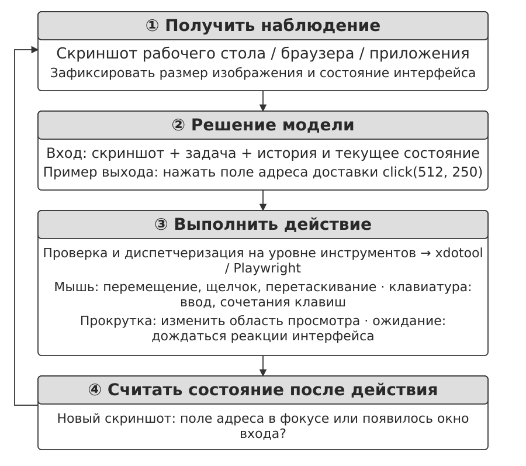

Как после заполнения адреса ассистент должен сообщить исполнителю, по какой именно кнопке «Сохранить» нужно щёлкнуть? Цель можно указать как экранными координатами, так и номером элемента, однако эти способы предъявляют разные требования к модели и инструменту.

### Проектирование пространства действий

В эталонной реализации Computer Use от Anthropic на рисунке 6-13 предусмотрены три категории инструментов: графический интерфейс, выполнение команд и редактирование файлов. Даже у одной лишь категории графического интерфейса данные направляются по двум путям: действие щелчка передаётся исполнителю, а полученный после него снимок экрана возвращается модели как наблюдение для принятия решения на следующем шаге. Формат инструментов задаётся нативным API; при использовании других моделей адаптационный слой должен преобразовывать снимки экрана, запросы действий и результаты выполнения в сообщения, принимаемые соответствующим интерфейсом.[^ch6-computer-tools]

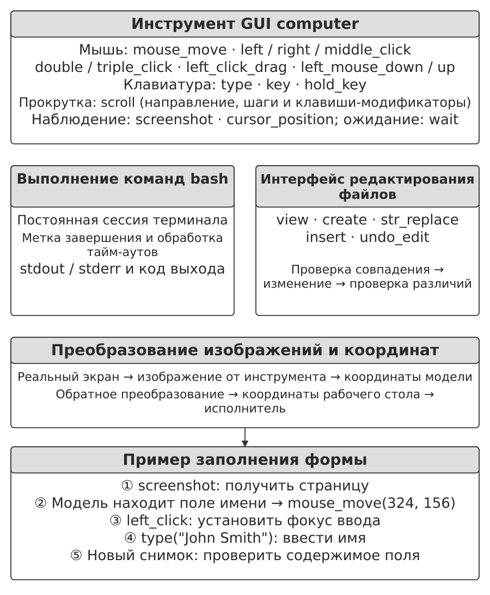

**Инструменты управления GUI.** Действия мыши включают перемещение, щелчок левой, правой или средней кнопкой, двойной и тройной щелчок, а также перетаскивание. Более детализированные интерфейсы позволяют отдельно задавать нажатие и отпускание кнопки. Для прокрутки необходимо указать направление и величину; некоторые реализации также поддерживают клавиши-модификаторы. Клавиатурный интерфейс позволяет вводить текст, использовать сочетания клавиш и удерживать клавиши. Снимки экрана и положение указателя служат для получения состояния, а интерфейс ожидания даёт время на загрузку страницы или выполнение анимации. Конкретный набор действий определяется версией инструмента, а Harness проверяет параметры в соответствии с используемым интерфейсом.

**Инструменты выполнения команд.** Постоянный терминал позволяет сохранять рабочий каталог и состояние окружения между вызовами. Например, если один вызов изменил каталог, следующий продолжит работу в нём. Эталонная реализация может распознавать завершение команды по строке-маркеру и задавать тайм-аут; после его истечения исполнитель всё равно должен проверить состояние процесса.

**Инструменты редактирования файлов.** Интерфейс замены строк определяет изменяемый диапазон по исходному тексту; также могут быть доступны просмотр, создание, вставка и отмена изменений. Перед выполнением проверяются позиции и количество совпадений, а после него — различия. Если файл изменился между двумя вызовами, сначала следует заново прочитать соответствующий фрагмент. Здесь можно повторно использовать стратегии редактирования, представленные в пятой главе.

> **Эксперимент 6-9 ★: запуск эталонной реализации Anthropic Computer Use**
>
> В этом эксперименте используются рабочий стол Ubuntu, браузер и слой выполнения инструментов из официального примера с контейнером. После получения задачи от пользователя модель анализирует снимок экрана и возвращает действие, слой выполнения управляет рабочим столом, а затем передаёт модели новый снимок.
>
> В сопутствующем задании необходимо узнать погоду в Сан-Франциско. Сохранённая траектория начинается с обращения к Google, но после появления CAPTCHA в соответствии с инструкцией по восстановлению во время выполнения переключается на общедоступные данные Open-Meteo и в итоге сообщает температуру и погодные условия. Запись содержит 15 действий на рабочем столе и соответствующие снимки экрана, позволяя шаг за шагом проследить, как щелчки, нажатия клавиш, ввод текста и ожидание изменяют страницу.
>
> Способ управления браузером с помощью открытой модели представлен в эксперименте 6-10.

### Визуальная локализация (Grounding)

Задачу щёлкнуть по полю поиска можно поставить перед моделью в двух формах. В первом случае ей показывают скриншот и просят указать координаты клика. Во втором — нумеруют возможные цели и предлагают выбрать поле поиска; номера могут быть нанесены на области-кандидаты непосредственно на скриншоте либо взяты из предоставленного браузером списка элементов. Ниже по отдельности рассмотрены три соответствующих подхода. При выборе номера исполнительный слой преобразует его в фактическую цель. При непосредственном указании координат модель должна дополнительно оценить положение цели, что предъявляет более высокие требования к обучению локализации и адаптации к разрешению экрана.

**Set-of-Mark: визуальная разметка.**

Set-of-Mark (SoM) накладывает на изображение доступные для указания номера, связывая визуальные области с выводом модели. В исходной работе области-кандидаты создавались методами сегментации: например, области выделялись с помощью SAM или SEEM, после чего на них размещались метки. Когда модель выбирает номер, исполнительный слой определяет место действия по соответствующей области. Этот метод применим к интерфейсам настольных приложений и игр, где отсутствует DOM. Необходимый элемент управления должен попасть в пронумерованную область, а модель — правильно распознать соответствующий ей номер.[^ch6-som]

**Индекс структурированных элементов.**

Браузер может предоставить и другой тип ориентиров. Объектная модель документа (DOM) описывает элементы страницы и их иерархию, данные о компоновке — отображаемое положение элементов, а дерево доступности (accessibility tree) сохраняет роли и доступные имена, необходимые вспомогательным технологиям. Например, если кнопке, содержащей только значок лупы, на странице присвоено доступное имя «Поиск», AI-агент получает возможность найти её по роли и имени. В решениях наподобие browser-use система может получать сведения об элементах через интерфейсы отладки браузера, такие как Chrome DevTools Protocol (CDP), распознавать поля ввода, кнопки и ссылки, а затем нумеровать интерактивные элементы текущей страницы. На рисунке 6-14 модель выбрала элемент [2] в правом верхнем углу страницы. Как этот номер преобразуется в клик по кнопке Submit?

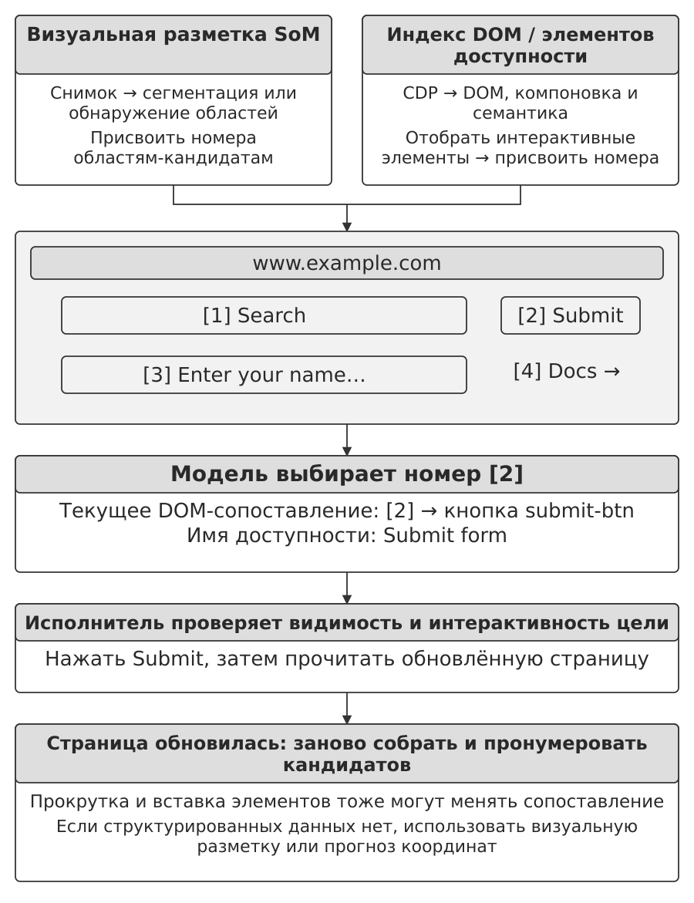

Процесс можно разделить на четыре этапа: прочитать DOM, данные о компоновке и доступные сведения из дерева доступности; отфильтровать интерактивные элементы; создать для текущей страницы отображение номеров; передать модели описания элементов и при необходимости размеченный скриншот. Например, модель может увидеть следующие четыре пронумерованных элемента:

```text
На скриншоте отмечены [1], [2], [3], [4]

[1] <input type="text" placeholder="Search" aria-label="Search" />
[2] <button id="submit-btn" aria-label="Submit form" />
[3] <input type="text" placeholder="Enter your name" value="" />
[4] <a href="/docs" aria-label="Documentation" />
```

После выбора номера моделью исполнительный слой преобразует его в ссылку на элемент или координаты, проверяет, что цель по-прежнему видима и интерактивна, а затем выполняет действие. После обновления или прокрутки страницы либо динамической вставки элементов отображение необходимо обновить, чтобы не использовать устаревшие номера. Структурированный индекс позволяет задействовать метки, роли и текст, тогда как Canvas, перекрытия и неполная семантическая разметка требуют дополнительного анализа скриншота. Чем больше перечислено элементов и чем крупнее скриншот, тем больше информации передаётся в контекст.

**Непосредственное предсказание координат.**

При координатном подходе модель получает скриншот и описание цели, а в ответ непосредственно указывает позицию: например, сопоставляет команду «нажать кнопку отправки» с определённой точкой. Координатный вывод применяется в исследованиях локализации в GUI, таких как SeeClick, а также в Claude Computer Use. Исполнительный слой преобразует координаты изображения в фактические координаты рабочего стола.

После масштабирования скриншота обе системы координат должны использовать одно и то же преобразование. Например, если рабочий стол имеет разрешение 2560×1440, а модели передано изображение размером 1366×768, указанные моделью координаты (683, 384) соответствуют:

$$
x = 683 \times \frac{2560}{1366} = 1280,\qquad
y = 384 \times \frac{1440}{768} = 720
$$

На рисунке 6-15 соотношения сторон для двух размеров близки. Если для сохранения пропорций к скриншоту добавлены чёрные поля, указанные моделью координаты будут учитывать эти пустые области. Перед обратным преобразованием в координаты исходного экрана необходимо сначала вычесть соответствующее смещение полей, а затем применить коэффициент масштабирования. Обрезка, масштабирование дисплея и начала координат нескольких мониторов также изменяют отображение, поэтому инструментальный слой должен сохранять фактические параметры преобразования.

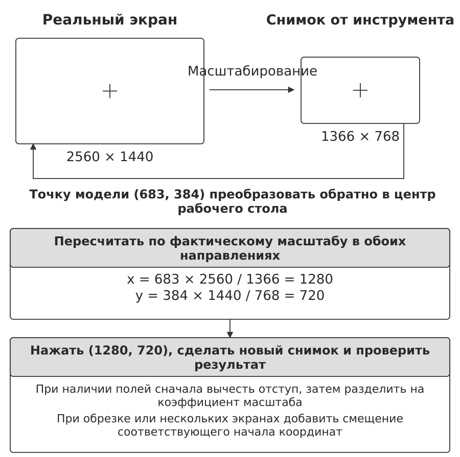

В эталонной реализации использовались, среди прочего, целевые разрешения XGA (1024×768), WXGA (1280×800) и FWXGA (1366×768). Принудительное изменение соотношения сторон искажает форму элементов управления, а неверное обратное преобразование переносит правильно предсказанную точку в ошибочное место.[^ch6-computer-tools]

**При наличии полной структурированной информации автор отдаёт предпочтение индексированию по DOM или дереву доступности.** Имена, роли и ссылки на элементы можно непосредственно использовать для локализации, уменьшая объём работы модели по ситуативной оценке положения в пикселях. При отсутствии структуры универсальную визуальную модель можно сначала использовать в сочетании с SoM, чтобы она выбирала одну из размеченных областей. Модель, уже обученная локализации в GUI, может предсказывать координаты напрямую, без отдельной разметки.

> **Эксперимент 6-10 ★: автоматизация работы в браузере с помощью browser-use**
>
> В этом эксперименте Qwen3-VL 32B Instruct управляет browser-use и генерирует действия на основе состояния браузера, сведений об элементах и скриншотов. Задача состоит в поиске погоды в Сан-Франциско: найти поле поиска, ввести «San Francisco weather today», отправить запрос, а затем извлечь температуру и погодные условия.
>
> Код и инструкции по запуску эксперимента 6-10 предусматривают два варианта. При наличии ключа OpenRouter можно использовать размещённую у провайдера визуальную модель. Если уже доступен совместимый сервис, например vLLM или SGLang, переменные `OPEN_MODEL_BASE_URL` и `OPEN_MODEL_MODEL` можно направить на собственную конечную точку и модель, а ключ задать в соответствии с требованиями сервиса. В обоих вариантах сначала выполните в каталоге эксперимента команду `python main.py --dry-run`, чтобы просмотреть конфигурацию, а затем запустите фактический запрос согласно инструкции.
>
> Сохранённый запуск выполнил 16 шагов взаимодействия и сохранил 15 скриншотов. После появления CAPTCHA в Google для получения результата задача перешла на weather.com.

[^ch6-computer-tools]: Anthropic, документация и эталонная реализация инструмента Computer Use с описанием версионируемого интерфейса действий, исполнительного слоя и обработки скриншотов.
[^ch6-som]: Microsoft, *Set-of-Mark Prompting*, 2023; реализация DOM-сервиса browser-use служит примером обработки структурированных элементов.

### Агент Computer Use, способный видеть анимацию и слышать звук

Лишь на короткое время после сохранения страница показывает сообщение «Сбой синхронизации», однако на двух снимках экрана, сделанных с интервалом в несколько секунд, отображается одна и та же форма. Просматривая только эти два изображения, модель, скорее всего, не сможет восстановить, что происходило между ними. Та же проблема возникает с видео, анимацией, кратковременными уведомлениями и речью участников встречи. **Для непрерывно изменяющихся интерфейсов автор предлагает сосредоточить улучшения на интерфейсе наблюдения.** Чтобы выбирать следующий шаг с учётом изменений, необходимо сохранять также события и изображения, появлявшиеся между действиями.

Предложенный автором и его соавтором **Agent–Computer Observation Interface (AOI, интерфейс наблюдения «агент–компьютер»)** преобразует непрерывный поток изображения с экрана и звука в изображения и текст, которые может принимать модель[^ch6-9]. Интерфейс включает три компонента:

- **Захват ключевых кадров между действиями.** Во время работы основного цикла отслеживаются изменения изображения; различия между пикселями или лёгкая визуальная модель используются для отбора кандидатных кадров, после чего полезные изображения передаются для принятия следующего решения.
- **Транскрибирование с управлением по уровню громкости.** При обнаружении звука вызывается распознавание речи, а транскрипция вместе с временной информацией добавляется в журнал наблюдений, помогая агенту использовать содержание встречи или устные инструкции.
- **Сохраняемое описание изображения.** Ключевое изображение кратко описывается текстом; после удаления исходного изображения из контекста текст продолжает хранить сведения о произошедших изменениях, чтобы к ним можно было обращаться на последующих шагах.

Например, в видео показана операция с меню, и модель, получив промежуточные кадры и соответствующие описания, сможет обращаться к этому шагу и после завершения воспроизведения. Результаты абляционного исследования в статье показывают, что особенно важны сохраняемые текстовые описания, тогда как тщательный отбор ключевых кадров даёт меньший вклад; некоторые модели при добавлении слишком большого числа изображений, напротив, работают хуже.

Вернёмся к примеру с сохранением формы. Даже если на ключевом кадре запечатлено сообщение «Сбой синхронизации», после удаления исходного изображения из контекста модель сможет опираться только на оставшееся описание. Фраза «На странице появилось уведомление» может означать как успешное сохранение, так и сбой; лишь описание «Сбой синхронизации, адрес не сохранён» сохраняет информацию, необходимую для выбора следующего шага.

[^ch6-9]: Bojie Li, Noah Shi, *Agent-Computer Observation Interfaces Enable Dynamic Computer Use*, 2026. В работе представлены AOI и результаты абляционного исследования его компонентов.

### Модель мира для Computer Use

Своевременно получив наблюдения, AI-агент должен также выбрать действие и дождаться его выполнения. В исследовании OSWorld-Human эффективность работы агента сопоставляется с траекториями действий человека и анализируются такие источники временных затрат, как избыточные шаги и вызовы модели[^ch6-osworld-human].

Модель мира позволяет при планировании прогнозировать последствия действий. Состояние рабочего стола может включать окна, фокус, положение прокрутки, введённые данные и ход загрузки; сведения о разрешениях, результатах сетевых запросов и другие данные необходимо получать через соответствующие интерфейсы. На основании доступного текущего состояния и возможных действий модель прогнозирует следующее состояние:

```text
Текущее состояние + click / type / scroll / wait → прогнозируемое следующее состояние
```

Работая за компьютером, человек зачастую ещё до щелчка представляет себе следующий шаг: если интерфейс соответствует ожиданиям, он продолжает работу, а при неожиданном результате останавливается и проверяет состояние. Модель мира может предоставить агенту аналогичную основу для спекулятивного выполнения: планировщик заранее сравнивает возможные действия, во время загрузки страницы подготавливает последующие шаги и продолжает выполнение после подтверждения фактического состояния, сокращая задержку из-за повторного планирования с нуля после каждого щелчка. Например, при создании в VS Code нового файла Python и записи в него hello world ожидаемые изменения включают появление нового файла в дереве файлов, наличие кода в области редактирования и обновление состояния сохранения. После выполнения проверяются эти изменения: если они соответствуют ожиданиям, работа продолжается, а при отклонении заново определяются положение элементов и план действий.

Для таких операций, как удаление файла, также требуются отдельные условия выполнения: правильно ли выбран объект, разрешено ли удаление, можно ли восстановить файл и требуется ли подтверждение пользователя. Прогноз помогает понять возможные результаты, но фактические разрешения и бизнес-условия проверяются на уровне выполнения.

**Прогнозирование латентного состояния в Photon-1.** В июле 2026 года Induction Labs представила Photon-1: видеокадры кодируются в дискретные латентные токены, а изменения состояния изучаются посредством прогнозирования последующих токенов. По данным компании, для предварительного обучения было использовано около 30 тысяч часов работы GPU H200. Состояние прогнозируется в пространстве латентных токенов, а вспомогательный генератор изображений преобразует их обратно в доступные для просмотра кадры, чтобы человек мог проверить прогноз. При планировании и генерации действий можно напрямую использовать внутреннее представление, избегая затрат на создание полного снимка экрана на каждом шаге.[^ch6-20]

Далее в этом подходе посредством дообучения осваиваются форматы инструкций и действий: сначала прогнозируется целевое состояние, затем генерируются ведущие к нему операции, а качество выполнения задач повышается с помощью онлайн-обучения в виртуальной машине. Дообучение с обусловливанием на действия, в свою очередь, используется для прогнозирования изменений рабочего стола после заданной операции. Эти два варианта применения связывают представление состояния соответственно с планированием и симуляцией, показывая, как оно участвует в Computer Use.

[^ch6-osworld-human]: Reyna Abhyankar и др., *OSWorld-Human: Benchmarking the Efficiency of Computer-Use Agents* — анализ траекторий выполнения задач и временных затрат.
[^ch6-20]: David Li, Jonathan Li, *Scaling Video Pretraining with Imagination Models*, Induction Labs, 2026-07-23 — описание предварительного обучения Photon-1, обучения действиям и симуляции состояний.
[^ch6-21]: Google DeepMind, *Genie 3: A new frontier for world models*, 2025-08-05; Zachary Lin и др., *Cosmos World Foundation Model Platform for Physical AI*, 2025.

### Мобильные устройства: технические интерфейсы и взаимодействие в экосистеме

На мобильных устройствах по-прежнему применяется цикл «наблюдение — принятие решения — действие», но действия чаще выражаются в виде жестов касания. Одна и та же координата может обозначать место одиночного нажатия, место долгого нажатия или начальную точку свайпа, поэтому интерфейсу также требуются тип жеста, его продолжительность и траектория. Поворот экрана, появление экранной клавиатуры и системных диалоговых окон тоже изменяют доступную для взаимодействия область.

Android `AccessibilityService` позволяет в пределах предоставленных разрешений считывать сведения об интерфейсе и выполнять соответствующие действия; для интерфейса жестов также необходимо заявить соответствующую возможность[^ch6-android]. Снимки экрана, дерево специальных возможностей и интерфейсы системной автоматизации можно использовать совместно, а конкретные доступные возможности определяются операционной системой, реализацией приложения и предоставленными разрешениями. Такие представленные в главе 7 бенчмарки, как AndroidWorld, проверяют на задачах в реальных приложениях, приводят ли эти действия к ожидаемому результату.

**Автор считает, что при внедрении на мобильных устройствах экосистемные барьеры зачастую преодолеть сложнее, чем технические проблемы.** Платформе необходимо определить, какие операции можно поручить AI-агенту, как предоставлять доступ к учётным записям, платежам и данным, а также как отслеживать ответственность после возникновения ошибки. Эти договорённости напрямую влияют на круг задач, которые может выполнять агент.

Один из структурных конфликтов интересов связан с трафиком и вниманием пользователей. Многие приложения получают доход за счёт показа рекламы, рекомендаций контента и точек входа в транзакции. Когда пользователь поручает агенту напрямую выполнить поиск или покупку, путь просмотра страниц может сократиться, а объём внимания, получаемого рекомендациями и рекламой, — измениться. Для платформ, монетизирующих эти этапы взаимодействия, действия агента затрагивают существующие источники дохода. Поэтому платформам необходимо заново осмыслить открытие интерфейсов, распределение коммерческих доходов и управление идентичностью агентов.

[^ch6-android]: Android Developers, AccessibilityService: обзор возможностей доступа к интерфейсу, выполнения действий и жестов.

## Управление роботами: уборка стола с помощью XLeRobot

Поместить красную чашку в поднос, выбросить жёлтую макулатуру в мусорный контейнер и в конце подтвердить, что стол убран, — эта задача объединяет восприятие, планирование и управление. Когда захват приближается к чашке, её положение на изображении с камеры меняется; после захвата чашки манипулятор должен обойти другие предметы на столе; если бумагу не удалось захватить с первой попытки, система должна обнаружить сбой и повторить попытку. Каждое действие изменяет условия следующего решения.

В этом разделе задача рассматривается в пяти экспериментах. Эксперименты 6-11 и 6-13 посвящены практическому проектированию телеуправления и автономного управления настоящим роботом; эксперименты 6-12, 6-14 и 6-15 выполняются в локальной симуляции и исследуют соответственно базовый уровень управления, восстановление после сбоев и изменение визуальных условий.

Одним и тем же роботом может управлять человек, непрерывно наблюдающий за изображением с камеры, либо модель, которая считывает изображение, выбирает навык и передаёт его системе управления для выполнения. Если сохранить неизменными задачу и оборудование, различия между двумя подходами можно анализировать с помощью четырёх вопросов: что хочет выполнить человек, какую подзадачу следует выполнить следующей, какие действия выводит текущий навык и соответствует ли среда плану после выполнения действия. Долгосрочное планирование определяет порядок обработки чашки и макулатуры, VLA-стратегия или заранее заданные примитивы действий отвечают за захват и размещение, мировая модель помогает оценивать последствия действий, а перенос из симуляции в реальность учитывает изменения изображения, контакта и характеристик исполнительных механизмов.

### Разделение функций оборудования и алгоритмов

Если автономная уборка стола завершается неудачей, сначала с помощью телеуправления можно проверить, способно ли оборудование выполнить задачу. Сохраните неизменными камеру, манипулятор, захват, расположение предметов на столе и критерии приёмки, передав оператору замкнутый контур восприятия и управления. Если человек стабильно выполняет задачу в нескольких попытках, а автономная система раз за разом терпит неудачу, значит, имеющееся оборудование уже способно справиться с текущей задачей, а узкое место преимущественно находится в алгоритмах и обратной связи автономного управления. В этом случае в первую очередь следует проверить локализацию объектов, выбор навыков, момент выполнения действий и восстановление после сбоев, чтобы автономная система освоила эффективные корректировки, применяемые при телеуправлении.

XLeRobot поддерживает телеуправление с помощью клавиатуры, контроллера Xbox и Switch Joy-Con, а управление через VR сначала можно опробовать в симуляционной среде.[^ch6-1] При приближении захвата к чашке оператор замедляет движение; если чашка скользит, приходится корректировать точку захвата. Если захват не удержал бумагу, необходимо снова осмотреть сцену; после размещения объекта также следует проверить результат. Все эти корректировки на основе наблюдений стоит записывать в демонстрационные данные. При последующем автономном управлении робот также должен уметь обнаруживать скольжение и неудачные захваты.

> **Эксперимент 6-11 ★: уборка стола посредством телеуправления настоящим XLeRobot**
>
> Разместите красную чашку, поднос, жёлтую макулатуру и мусорный контейнер в рабочей области XLeRobot, где выполнены калибровка, проверка ограничителей и аварийной остановки. С помощью одного из откалиброванных способов телеуправления выполните фиксированную задачу: «поместить красную чашку в поднос, выбросить жёлтую макулатуру в мусорный контейнер, затем подтвердить состояние стола». Повторите эксперимент несколько раз и запишите изображение с камеры, управляющий ввод оператора, состояние манипулятора, время выполнения действий, неудачные захваты и количество повторных попыток.
>
> В конце каждой попытки убедитесь, что чашка находится внутри подноса, макулатура — внутри мусорного контейнера, а манипулятор вернулся в безопасную позу, и проверьте записи о столкновениях, выходе за границы и вмешательстве человека на протяжении всего эксперимента. Совместный анализ этапа возникновения сбоя, способа восстановления оператором и итогового результата позволяет сформировать опорный уровень для автономного управления.

Симуляционный эксперимент позволяет многократно изменять количество и исходное положение объектов и отдельно исследовать процесс управления при известном состоянии. В 2D-модели стола приближение к объекту, его перемещение к цели и переход к следующему объекту можно представить как три этапа, а затраты на управление описать количеством шагов до завершения и длиной пути.

> **Эксперимент 6-12 ★: создание идеального базового уровня управления для той же задачи в симуляторе**
>
> Случайным образом генерируйте в 2D-пространстве стола положения объектов и целей, позволяя контроллеру напрямую считывать координаты, поочерёдно приближаться к объектам, перемещать их к соответствующим целям и переходить к следующему объекту. Изменяйте исходное положение и количество объектов, сравнивая долю успешных попыток, количество шагов до завершения и длину пути.
>
> Сначала проследите полную траекторию одного объекта: после достижения объекта контроллер переходит к этапу перемещения, а число завершённых объектов увеличивается только после достижения цели. Затем увеличьте количество объектов и убедитесь, что для каждого из них выполняются оба условия достижения. В сопутствующей 2D-симуляции для пяти случайных начальных значений размещалось по 1, 2, 3 и 4 объекта, каждая комбинация выполнялась в 512 эпизодах, и все 10 240 эпизодов завершились успешно. Контроллер может напрямую считывать координаты, а перемещение объектов не зависит от настоящего захвата.

### Базовая структура управления роботом

Одна уборка стола может занимать несколько минут, однако управление суставами должно обновляться непрерывно и своевременно. Система может разделить работу по временным масштабам: высокоуровневый планировщик задаёт порядок выполнения задачи, стратегия навыков генерирует движения, а низкоуровневый контроллер отслеживает их выполнение:

| Уровень | Основной вопрос | Выход | Временной масштаб и пример конфигурации |
| --- | --- | --- | --- |
| Цель задачи | Что хочет выполнить человек | «Вернуть чашку и макулатуру на свои места» | Задача длительностью в минуты |
| Долгосрочное планирование | Что делать сначала, а что потом | Сначала обработать чашку, затем макулатуру и в конце выполнить проверку | От секунд до минут |
| Базовый навык | Какое изменение состояния требуется сейчас | `pick(red_cup)`, `place(red_cup, tray)` | Один навык может длиться несколько секунд, например 1–3 секунды |
| VLA / стратегия навыка | Как именно выполнить текущий навык | Действия захвата, поза рабочего органа или фрагмент траектории суставов | Инференс можно настроить на частоту 1–10 Гц |
| Низкоуровневое управление и уровень безопасности | Как обеспечить стабильное и своевременное выполнение | Управляющие воздействия на суставы или рабочий орган, ограничение скорости и аварийная остановка | Контроллер можно настроить на частоту от десятков до тысяч Гц |

Планировщиком может служить программа на основе правил, VLM или оптимизатор, а VLA также может брать на себя часть выбора навыков. **Автор рекомендует разделять порядок выполнения задачи и текущие действия.** Высокоуровневому мышлению требуется время на составление плана, а низкоуровневое управление должно своевременно реагировать на изменения положения и усилия; только работа каждого уровня в подходящем ему темпе позволяет совместить планирование и управление.

В этом разделе высокоуровневой модели предоставляются пять типов инструментов: `observe_scene`, `pick`, `place`, `verify_state` и `stop`, предназначенные соответственно для наблюдения, захвата, размещения, проверки и остановки. Harness проверяет параметры, рабочую область и текущее состояние, а исполнитель преобразует прошедшие проверку навыки в движения манипулятора и обрабатывает ограничения скорости и тайм-ауты. Углы суставов и непрерывные траектории генерируются стратегией навыков и контроллером, благодаря чему между выбором навыка моделью и фактическим движением формируется чёткий интерфейс.

### Долгосрочное планирование и декомпозиция задач

Когда пользователь говорит «убери на столе», планировщик сначала распознаёт объекты и соответствующие им целевые области, определяет порядок обработки и явно задаёт для каждого шага начальные условия, условия завершения и ограничения действий. Например, порядок уборки может выглядеть так:

```text
Обработать красную чашку → Убрать жёлтую бумагу → Проверить стол
```

«Обработать красную чашку» необходимо дополнительно разделить на два действия и одну проверку:

```text
pick(red_cup) → place(red_cup, tray) → verify_state()
```

Рассмотрим задачу «взять чашку и поместить её в поднос». Завершение программы захвата означает лишь окончание выполнения этой программы. Прежде чем поднимать манипулятор, необходимо по обратной связи от захвата или новому изображению определить, действительно ли чашка удерживается. Если захват оказался пустым, следует повторно определить положение чашки; если кто-то убрал поднос, успешный захват остаётся действительным, а перепланировать нужно лишь действие размещения. Если каждый навык соответствует проверяемому изменению состояния, имеет ограничения по действиям и длительности, а затем возвращает состояние выполнения и новое наблюдение, планировщик может восстановиться именно с того шага, на котором произошла ошибка.

> **Эксперимент 6-13 ★★: автономная уборка стола XLeRobot с помощью Gemini Robotics-ER 1.5**
>
> Используйте оборудование, расположение предметов на столе, задачу и критерии приёмки из эксперимента 6-11, передав наблюдение и планирование модели воплощённого мышления. Ориентируясь на способ оркестрации RoboCrew, спроектируйте для этой задачи пять инструментов: `observe_scene`, `pick`, `place`, `verify_state` и `stop`.[^ch6-2]
>
> Сначала модель считывает наблюдение стола и определяет порядок обработки объектов, а затем вызывает откалиброванные навыки захвата и размещения. После завершения каждого навыка система получает новое наблюдение и проверяет постусловия; после сбоя она выбирает повторную попытку или остановку в соответствии с текущим состоянием. Система выполнения немедленно прекращает работу при получении сигнала аварийной остановки, обнаружении выхода за границы или невозможности подтвердить критически важное состояние; модель также может самостоятельно завершить задачу с помощью `stop`.
>
> В конце по новому наблюдению среды подтвердите, что чашка находится внутри подноса, макулатура — внутри мусорного контейнера, а манипулятор вернулся в безопасную позу, и проверьте записи о столкновениях и выходе за границы. Оператор отвечает за запуск, аварийную остановку и наблюдение на месте, а любое вмешательство в ходе выполнения записывается отдельно.

Эксперимент 6-13 показывает, как подключить действия настоящего робота и проверить результат уборки, однако в сопутствующих записях пока нет испытаний этой задачи на реальном оборудовании. Поэтому сначала сравним в симуляционной среде три подхода: разомкнутое выполнение по плану, проверку результата после каждого шага и предварительное прогнозирование последствий действия. Цель задачи и пять типов инструментов остаются неизменными, а сбои можно многократно воспроизводить, чтобы наблюдать, как три подхода справляются с одной и той же ошибкой.

### VLA-управление

VLA — сокращение от Vision-Language-Action, то есть модель «зрение — язык — действие». Она генерирует следующее действие на основе текущего изображения, инструкции задачи и доступного состояния робота:

```text
Текущее наблюдение + инструкция навыка → действие или последовательность действий
```

В примере с уборкой стола высокоуровневый планировщик передаёт `pick(red_cup)`, а стратегия навыка по изображению определяет, с какой стороны приблизиться к чашке, когда закрыть захват и по какой траектории поднять манипулятор. После выполнения этого фрагмента движения система получает новое наблюдение стола, подтверждает, что чашка захвачена, и только затем переходит к `place(red_cup, tray)`. Интерфейс инструмента задаёт желаемое изменение состояния, а VLA учится реализовывать его посредством непрерывных действий.

Действия можно представлять разными способами. RT-2 и исходная OpenVLA квантуют числовые значения каждого измерения действий в дискретные токены и выводят их с помощью механизма генерации языковой модели; π₀ использует сопоставление потоков для генерации непрерывных блоков действий. Первый подход позволяет повторно использовать авторегрессионную архитектуру генерации, а второй непосредственно моделирует распределение фрагмента непрерывных действий.[^ch6-15]

Инференс модели и управление исполнительным механизмом обычно выполняются с разной частотой обновления. Разбиение действий на блоки (action chunking) позволяет модели за один раз генерировать короткий фрагмент будущих действий, который управляющий поток выполняет с более высокой частотой. Если дополнительно наложить инференс и выполнение друг на друга, система сможет готовить следующий блок во время выполнения текущего, сокращая ожидание. При стыковке блоков действий также необходимо учитывать непрерывность траектории и актуальность наблюдений: если чашка сдвинется, пока манипулятор тянется к ней, оставшиеся действия могут по-прежнему быть направлены к старому положению. Сокращение фактически выполняемого за раз фрагмента, скользящее обновление по новым наблюдениям или прерывание действия при обнаружении аномалии повышают скорость реакции, но также увеличивают затраты на инференс и диспетчеризацию.

### Данные и условия развёртывания VLA

Чтобы стабильно преобразовывать команду «захватить чашку» в действия, необходимо одновременно учитывать несколько типов различий:

- **Охват обучающих данных**: доступных демонстраций действий роботов намного меньше, чем текстов и изображений из интернета. Знания о том, что представляет собой «чашка», недостаточно: для определения усилия необходим практический опыт захвата. Демонстрации должны охватывать разные материалы, формы, положения и условия трения чашек. Одинаковое направление захвата может привести к разным результатам для керамической чашки и мягкого бумажного стаканчика.
- **Цель обучения действий и их последствий**: клонирование поведения в основном учит тому, какое действие демонстратор предпримет в текущих условиях. Для сравнения последствий нескольких действий можно дополнительно использовать прогнозирование состояния или оценку результатов действий.
- **Конструкция робота и интерфейс**: степени свободы, система координат, устройство захвата и задержки исполнительных механизмов определяют, как действие реализуется на оборудовании. При переносе стратегии необходимо согласовать представление действий, параметры калибровки и цикл управления.
- **Актуальность наблюдений**: во время выполнения блока действий объект может переместиться, оказаться перекрыт или опрокинуться. Система должна определить, когда получать новое наблюдение и когда обновлять по нему оставшиеся действия.

Эти условия связывают визуальное распознавание, управление навыками и изменения среды. Жидкость в чашке влияет на скорость перемещения, кабель питания у края стола изменяет допустимый путь, а контакт бумаги со столом влияет на способ захвата. Если планировщик способен заранее сравнить эти последствия, он получает больше оснований для выбора навыка.

### Мировая модель

В планировании робота мировую модель с условием на действие можно понимать как «предиктор результата действия»: получив текущее состояние и действие-кандидат, она оценивает, что произойдёт дальше.

```text
Текущее состояние + действие-кандидат
    → прогноз следующего состояния или будущего фрагмента
    → сравнение результатов кандидатов
    → выбор действия, перепланирование или остановка
```

Этот процесс включает три задачи: представить текущее состояние, спрогнозировать вызванное действием изменение состояния и предоставить планировщику или контроллеру возможность выбрать действие на основе прогноза. Состояние может быть представлено структурированными переменными, такими как положение объекта и признак его удержания захватом, либо внутренним представлением, извлечённым из изображения. V-JEPA 2 сначала обучается по видео представлению и прогнозированию состояния, а дополнительно обученная V-JEPA 2-AC вводит условие на действие для планирования робота. Связывание действий с будущими наблюдениями также относится к подходам мировых моделей действий (World-Action Model).[^ch6-16]

Мировая модель может помогать роботу на трёх этапах: до начала действий отдельно прогнозировать результаты захвата, толкания или ожидания; во время выполнения сопоставлять прогноз с фактическим наблюдением и при расхождении корректировать действие или перепланировать; во время обучения изучать изменения состояния по видео, симуляционным данным и траекториям неудач, сокращая количество проб и ошибок на реальном оборудовании.

Предположим, жёлтая макулатура частично закрыта красной чашкой. Планировщик может сравнить варианты «сначала захватить бумагу», «сначала убрать чашку» и «изменить направление захвата». Автор рекомендует прежде всего использовать мировую модель для прогнозирования непосредственно связанных с задачей и проверяемых изменений состояния. Если она способна определить, станет ли бумагу проще захватить и легко ли опрокинуть чашку, этого достаточно для упорядочивания действий-кандидатов. Представление состояния и цель обучения модели следует проектировать вокруг этих суждений. Если модель генерирует будущие изображения, автор рекомендует сначала проверить, точно ли они отражают последствия действий, и лишь затем добавлять визуальные подробности; ценность реалистичности изображения в конечном счёте должна выражаться в улучшении планирования и управления. После выполнения система проверяет фактический результат по камере и состоянию робота, а затем решает, продолжить работу, повторить попытку или сменить подход.

Чем длиннее горизонт прогнозирования, тем легче накапливаются ошибки. На практике можно сначала прогнозировать краткосрочные последствия, выполнять небольшой фрагмент, затем перепланировать по новому наблюдению и учитывать неопределённость прогноза при выборе. Генеративные мировые модели также могут предоставлять интерактивную симуляцию и визуализацию сцен; при их использовании для управления необходимо дополнительно проверить обусловленность действиями, закономерности контакта и ошибки прогнозирования. Аппаратные ограничители, аварийная остановка и управление в реальном времени по-прежнему остаются задачами системы выполнения.[^ch6-21]

> **Эксперимент 6-14 ★★: сравнение трёх замкнутых контуров автономной уборки стола в симуляторе**
>
> Представьте красную чашку и жёлтую макулатуру с помощью структурированного состояния: каждый объект находится на одном из трёх этапов — «на столе», «взят» или «размещён», — а для целевой области записывается её доступность. Симулятор предоставляет пять типов инструментов: наблюдение, захват, размещение, проверку и остановку, а при захвате макулатуры внедряет не более одного временного сбоя.
>
> Сравните три способа управления. **Разомкнутое выполнение** выполняет четыре действия в фиксированном порядке. **Пошаговая проверка** считывает состояние после каждого действия, после сбоя снова получает наблюдение и выбирает доступный для выполнения шаг. **Выполнение с прогнозированием** использует небольшую нейронную сеть для изучения отображения «состояние и действие — следующее состояние» и упорядочивает доступные действия по прогнозируемому прогрессу размещения объектов.
>
> Сравните завершение задач, количество вызовов инструментов и процесс восстановления после сбоев. Например, после неудачного захвата макулатура остаётся на столе, поэтому непосредственная попытка размещения завершится ошибкой из-за отсутствия захваченного объекта; продолжить размещение можно только после считывания состояния и повторного захвата. Обе стратегии с обратной связью в конце вызывают `verify_state`, чтобы проверить размещение объектов.
>
> Сначала рассмотрим эпизоды без внедрённых сбоев: все три стратегии успешно завершают задачу. Затем установим вероятность внедрения сбоя в 50% и запустим каждую стратегию всего в 384 эпизодах на трёх начальных значениях — по 128 эпизодов на каждое начальное значение. Разомкнутая стратегия по-прежнему вызывает инструменты 4 раза за эпизод, но успешно завершает лишь 205 эпизодов. Пошаговая проверка и выполнение с прогнозированием завершают все 384 эпизода, в среднем выполняя примерно по 6,93 вызова. Дополнительные вызовы позволяют контроллеру обнаружить пустой захват и восстановиться. В этой задаче, где внедряется только один восстанавливаемый сбой, прогнозирование следующего состояния не позволило спасти ни одного дополнительного эпизода по сравнению с непосредственной проверкой.

### От симуляционной среды к настоящему роботу

При переходе от симулированного стола к настоящему роботу необходимо последовательно учитывать различия между средами. С точки зрения изображения одна и та же чашка и поднос могут оказаться на другом фоне, при ином освещении, положении камеры и взаимном перекрытии; с точки зрения движения на траекторию и захват влияют трение, шум датчиков и задержки исполнительных механизмов.

Доменная рандомизация изменяет во время обучения фон, внешний вид объектов, освещение или шум, чтобы модель выполняла одинаковые решения в разных условиях. Эксперимент 6-15 исследует только один элемент этого процесса: в какую сторону следует двигаться после обнаружения объекта и целевой области?

> **Эксперимент 6-15 ★★★: межсредовое RGB-тестирование одной и той же задачи на столе**
>
> Представьте объект кругом, а целевую область — прямоугольником и сгенерируйте RGB-изображения стола. По взаимному положению объекта и цели модель выводит одно из четырёх направлений движения: влево, вправо, вверх или вниз; когда две позиции оказываются достаточно близко, она выводит определённую в эксперименте метку `grasp`. Эта метка означает, что 2D-позиции удовлетворяют условию близости.
>
> Обучите четыре визуальные стратегии с одинаковой архитектурой: с фиксированными визуальными условиями, преимущественным изменением фона, преимущественным изменением внешнего вида объекта и сочетанием нескольких типов изменений. Примените стратегии каждой группы к исходным условиям и тестовым изображениям с новыми цветами, текстурами, яркостью и шумом, сравните точность определения направления и изучите изображения, на которых допущены ошибки.
>
> Каждый тестовый домен для каждого начального значения содержит 1024 синтетических изображения. Сначала сравним среднюю точность по трём начальным значениям: стратегия, обученная в фиксированных визуальных условиях, достигает 93,03% в исходном домене, но при переходе в целевой домен с новыми текстурами и шумом (`target_realistic`) её точность падает до 54,82%; стратегия, обученная с сочетанием нескольких типов изменений, достигает 87,50% в исходном домене и 76,11% в том же целевом домене. Для сравнения, группа с рандомизацией только фона достигает в этом целевом домене лишь 36,88%.[^ch6-6]

## Итоги главы

Вернёмся к звонку об изменении бронирования из начала главы. Пока в фоновом режиме выполняется поиск рейсов, пользователь уточняет требования к багажу. Даже если результаты поиска поступят позже сообщения пользователя, они могут отвечать на уже неактуальный вопрос. Очередь событий должна сохранять источник сообщения, идентификатор задачи и порядок событий, чтобы передний план мог приоритетно принять новые требования и определить, можно ли продолжить исходный поиск, следует ли его отменить или нужно повторить поиск с другими условиями. Это проблема **момента выполнения**, и простой переход от текстового запроса к голосовому её не решает.

Голосовое взаимодействие добавляет ещё один уровень требований. Система должна слышать, когда пользователь перебивает её во время озвучивания ценового предложения; если дата изменилась, неактуальное озвучивание следует прекратить. Каскадная и сквозная архитектуры описывают, как звук проходит через распознавание, инференс и генерацию, а полнодуплексная — могут ли пользователь и ассистент одновременно слушать и говорить.

При переходе к экрану или роботизированной руке проблема остаётся той же — меняется лишь **форма наблюдений и действий**. Координаты кнопки берутся с предыдущего скриншота, поэтому после обновления страницы её нужно найти заново. Роботизированная рука может за один раз предсказывать небольшой непрерывный фрагмент действий, чтобы движения суставов были более плавными, но чем длиннее такой фрагмент, тем сложнее реагировать на изменения во время его выполнения. Высокоуровневое планирование, навыки и низкоуровневое управление работают в разных временных масштабах, а чтобы убедиться, что чашка действительно поставлена на поднос, необходимо ещё раз осмотреть стол. Если объединить эти взаимодействия, становится видна общая для них последовательность:

```text
Получить наблюдение
  → Определить текущее состояние и момент выполнения
  → Выбрать ответ или действие
  → Выполнить его и получить обратную связь от среды
  → Продолжить, скорректировать, повторить, остановиться или перепланировать
```

Этот процесс помогает локализовать сбои. Если пользователь перебивает систему, а прежнее ценовое предложение продолжает озвучиваться, следует проверить, кто отвечает за пробуждение переднего плана, можно ли вытеснить воспроизведение и до какой безопасной точки дошёл сигнал отмены. Если озвучивание остановилось вовремя, но система всё равно называет прежнюю дату, нужно проследить передачу результатов поиска между фоновым и передним планами. Как после исправления доказать, что система будет правильно работать и в большем числе звонков? С этого момента вся книга переходит к улучшению возможностей. В главе 7 сначала рассматривается, как проектировать задачи, регистрировать сбои и сравнивать изменения; эта система оценки затем используется для постобучения, непрерывной эволюции и совместной работы нескольких агентов.

[^ch6-1]: XLeRobot, документация по Teleop.
[^ch6-2]: Google DeepMind, *Gemini Robotics-ER 1.5*. XLeRobot, управление с помощью LLM-агента. Пример из исходного проекта XLeRobot демонстрирует способ оркестрации модели и вызовов инструментов; в этом разделе сохраняется тот же принцип оркестрации, но инструменты действий ограничены откалиброванными примитивами для работы на столе: захвата, размещения, проверки и остановки.
[^ch6-6]: LeRobot, руководство по Sim2Real.
[^ch6-15]: Moo Jin Kim et al., *OpenVLA: An Open-Source Vision-Language-Action Model*, arXiv:2406.09246, 2024. См. также описание проекта RT-2 и публикацию Physical Intelligence *Our First Generalist Policy*.
[^ch6-16]: Meta AI, *Представляем мировую модель V-JEPA 2 и новые бенчмарки для рассуждений о физическом мире*, 11 июня 2025 года. Номер технического отчёта: arXiv:2506.09985.
[^ch6-22]: OpenAI, «Async tool calling»; «Using GPT-6 Astra», дата проверки: 2026-09-05.
[^ch6-23]: OpenAI, «Mid-turn steering», дата проверки: 2026-09-05.

[^ch6-audio-architectures]: OpenAI, *Voice activity detection*: представлены два способа определения границ хода — по голосовой активности и по семантике.
[^ch6-voice-tools]: В описаниях моделей OpenAI GPT-Live-1 и GPT-Realtime рассматриваются соответственно фоновое делегирование и вызовы функций. Способ подключения модели для голосового взаимодействия в реальном времени Doubao 3.0 описан в документации Volcengine «Function Calling».

## Вопросы для размышления

1. ★★ Когда асинхронный AI-агент получает новое событие, ему необходимо определить его приоритет относительно текущей задачи. Если такое решение требует понимания семантики — например, распознать, дополняет ли пользователь условия или требует немедленно остановиться, — как следует распределить обязанности между движком правил и LLM? Сравните время отклика, стоимость и последствия ошибочной классификации.
2. ★★ В очереди накопилось 20 событий: 10 результатов работы инструментов, 5 сообщений пользователей и 5 системных напоминаний. Как бы вы организовали их порядок, формат и состояния обработки, чтобы модель могла отслеживать зависимости между задачами и реагировать на важные изменения?
3. ★★★ Агент может использовать выделенный адрес электронной почты и выделенный номер телефона либо после авторизации работать с личными учётными записями пользователя. Обсудите, для каких сценариев подходит каждый из этих двух способов идентификации, учитывая фоновую работу, требования другой стороны к проверке личности, объём полномочий и аудит.
4. ★★ Сквозная речевая модель обрабатывает аудио напрямую, поэтому ошибки на промежуточных этапах трудно локализовать извне. Как организовать наблюдение и контрольные эксперименты, чтобы различать ошибки восприятия, рассуждения и выражения?
5. ★ Механизм MPS в Step-Audio R1.1 позволяет одновременно развивать замысел и его выражение. Как системе следует использовать паузы, сообщения о ходе работы и поэтапное изложение? Что делать, если последующие рассуждения изменили уже озвученный вывод?
6. ★★ И разметка визуальных областей в SoM, и индексация элементов DOM позволяют модели одним номером указать место выполнения операции. Как при нестандартных элементах управления, перекрытии или динамических изменениях сочетать повторную разметку, прогнозирование координат и проверку после операции?
7. ★★ Качество данных телеуправления зависит от навыков оператора. Как дрожание, движение обходным путём, паузы и неудачные попытки захвата влияют на обучение VLA? Как отбирать данные, сохраняя при этом ценные процессы восстановления после ошибок?
8. ★★★ Для речи, Computer Use и робототехники можно использовать единую модель, модульный каскад либо разделение на взаимодействие на переднем плане и фоновое рассуждение. Какому сочетанию этих подходов вы бы отдали предпочтение на ближайшие пять лет? Обоснуйте решение с учётом задержки, наблюдаемости, стоимости обновлений и рисков задач.
9. ★★ Стандартные веб-страницы могут предоставлять DOM или информацию о доступности, тогда как Canvas, WebGL и самостоятельно отрисованные элементы управления часто требуют визуальной локализации. Какие дополнительные затраты возникают при одновременной поддержке структурированного и визуального путей и какие преимущества это даёт?
10. ★★ Разбиение действий на блоки позволяет VLA за один раз сформировать последовательность будущих действий. Если во время её выполнения объект переместили, как согласовать длину блока, повторное наблюдение, фоновое рассуждение и прерывание действий, чтобы обеспечить как эффективность выполнения, так и скорость реакции?
11. ★★★ Для быстрого взаимодействия необходимо своевременно действовать. На примерах голосового ответа, отправки веб-формы и захвата объекта роботом разработайте градацию действий, подтверждение состояния и механизм остановки так, чтобы скорость реакции соответствовала последствиям задачи.
12. ★★★ Выберите один из примитивов: пробуждение, безопасная точка, отмена, вытеснение или разделение на быстрый и медленный контуры. Сравните его реализацию в событийно-ориентированной задаче и при разбиении действий робота на блоки. Как скорость изменений среды, обратимость действий и стоимость наблюдения влияют на проектирование?
13. ★★ Следует ли объединять чат с клиентом, обсуждение согласования и callback об оплате по одному заказу в один поток? Сравните объединение в один поток и подписку по связанным объектам с точки зрения порядка обработки, степени параллелизма, миграции ключа секционирования и изоляции прав доступа.
14. ★★ Голосовой помощник для путешествий умеет узнавать погоду, читать данные из памяти пользователя, искать в интернете, находить рейсы и бронировать билеты. Как распределить работу между передней моделью, фоновой моделью и средой выполнения? Пользователь диктует имя попутчика, а пока идёт поиск рейса, спрашивает о погоде. Как не ошибиться в имени при бронировании и не забыть сообщить о рейсе?


**Практикум к главе 6.** [Каталог экспериментов](https://github.com/bojieli/ai-agent-book/tree/40f4ce5778e6cc93e3606c3079bf8cf13a0c4d04/chapter6) · [Путеводитель на русском](https://github.com/bojieli/ai-agent-book/blob/main/chapter6/README.ru.md) · [Исходники эксперимента 6-7: вызов инструментов голосового агента](https://github.com/bojieli/ai-agent-book/tree/40f4ce5778e6cc93e3606c3079bf8cf13a0c4d04/chapter6/voice-tool-routing) · [Исходники эксперимента 6-1: приём событий и проверка отказоустойчивости](https://github.com/bojieli/ai-agent-book/tree/40f4ce5778e6cc93e3606c3079bf8cf13a0c4d04/chapter6/agent-with-event-trigger).
