<!-- Русский перевод: community edition. Источник: https://github.com/bojieli/ai-agent-book; файл изменён относительно upstream. -->

# Постобучение модели

В первых семи главах мы в основном улучшали AI-агента с помощью контекста, инструментов и механизмов выполнения. В этой главе мы переходим к параметрам модели: как научить её стабильнее понимать задачи, использовать инструменты, обрабатывать обратную связь и выбирать подходящие действия в новых ситуациях? Эти способности можно постепенно сформировать посредством обучения. Наборы задач, валидаторы и среды симуляции из главы 7 становятся источниками необходимых для обучения данных и обратной связи.

Чтобы разработать схему обучения, сначала необходимо диагностировать проблемы модели. Если модель не понимает материалы целевой предметной области, нужно восполнить языковые способности и знания в этой области. Если она понимает задачу, но постоянно генерирует неверные параметры инструментов, следует с помощью демонстраций обучить её использованию интерфейсов и порядку действий. Если модель иногда добивается успеха, но часто выбирает неэффективные пути, можно с помощью вознаграждения повысить вероятность эффективных стратегий. Разным проблемам соответствуют разные данные, целевые функции и процессы обучения.

Развитие способностей современных моделей обычно включает четыре этапа: **предобучение** закладывает универсальную языковую основу и знания, **Mid-training** продолжает обучение на целевом распределении, **дообучение с учителем (SFT)** обучает ответам и действиям на демонстрациях, а **обучение с подкреплением (RL)** оптимизирует стратегию с помощью обратной связи по результатам выполнения задач. Сначала в этой главе мы разберём, как работают эти четыре этапа, а затем на примерах из математики, навигации, вызова инструментов и робототехники обсудим способы их сочетания.

Автор уделяет особое внимание двум вопросам. Первый — как обучение на демонстрациях и обучение с помощью вознаграждения влияют на обобщение. В сравнительных экспериментах GeneralPoints и V-IRL ограниченный набор демонстраций для SFT с большей вероятностью заставляет модель запоминать паттерны обучающей выборки, тогда как RL обеспечивает лучшее обобщение при изменяющихся условиях задачи. Далее эти различия будут объяснены с точки зрения обучающих данных, целей оптимизации и тестового распределения. Второй вопрос — как результаты обучения зависят от данных и среды. Инженерный вывод автора: **данные и среда важнее алгоритма.** Разобравшись в основных механизмах таких алгоритмов, как PPO и GRPO, следует сосредоточить основные усилия на охвате корпуса, качестве демонстраций, обратной связи среды и проектировании вознаграждения. Во многих задачах после формирования базовых способностей и подготовки демонстрационных данных можно удовлетворить требования практического применения с помощью одного лишь SFT.

> **Рекомендации по чтению**
>
> Если вы впервые знакомитесь с обучением моделей, читайте главу, размышляя над одним вопросом: агент службы поддержки всегда может найти заказ, но часто передаёт инструменту неверные параметры — какие обучающие материалы необходимо подготовить команде? Сначала прочитайте разделы «Полная картина четырёх этапов» и «Когда выбирать Mid-training, SFT и RL», запишите один демонстрационный пример, который вы бы собрали, а затем проверьте свои выводы на трёх проблемных случаях в конце главы. Читатели с опытом обучения моделей могут двигаться по другому маршруту: начать с синтеза данных, вручную один раз рассчитать внутригрупповое преимущество GRPO, а затем проверить, какие действия будет поощрять вознаграждение в многоэтапной задаче. К разделам о классическом RL и основах предобучения можно возвращаться при встрече с такими понятиями, как действие, стратегия или потери.

## От предобучения до RL: полная картина четырёх этапов

Один и тот же фрагмент диалога со службой поддержки можно использовать как материал для предсказания моделью следующего токена, разметить в нём достойные подражания вызовы инструментов или позволить модели самостоятельно оформить заказ и выставить оценку по результату. Во всех случаях корректируются параметры, но содержание обучения зависит от того, кто формирует ответ, какие позиции учитываются при вычислении потерь и как оценивается вывод. В таблице 8-1 сопоставлены материалы и цели четырёх видов обучения.

Таблица 8-1. Четыре этапа развития возможностей модели

| Этап | Обучающие материалы | Основная цель оптимизации | Основное назначение | Факторы, определяющие затраты ресурсов |
| --- | --- | --- | --- | --- |
| Предобучение | Крупномасштабные тексты, код и данные других модальностей | Предсказание следующего токена авторегрессионной языковой моделью | Формирование основ языка, знаний и рассуждений | Размер модели, число обучающих токенов и эффективность системы |
| Mid-training | Корпусы на целевом языке, из предметной области, с кодом или длинным контекстом, смешанные с общими корпусами для сохранения прежних возможностей | Продолжение языкового моделирования, обычно с обучающим сигналом по большому числу текстовых токенов | Дополнение знаний и базовых возможностей в целевом распределении | Объём данных, длина последовательности и способ обновления параметров |
| SFT | Ввод и ожидаемые ответы, вызовы инструментов или полные траектории | Повышение условной вероятности демонстрационного вывода | Обучение содержанию задач, следованию инструкциям, формату и процессу действий | Число демонстраций, длина вывода и число эпох обучения |
| RL | Задачи, сгенерированные стратегией ответы или траектории, вознаграждения | Повышение ожидаемого накопленного вознаграждения | Оптимизация принятия решений, исследования и использования обратной связи | Число rollout, длина генерации, стоимость среды и оценивания |

### Предобучение: изучение закономерностей текста по следующему токену

Получив предшествующий текст, авторегрессионная языковая модель распределяет вероятности между всеми токенами словаря. Если на вход подано «Столица Китая —», обучающей целью становится следующий символ или фрагмент слова из обучающего текста. Разбиение на токены определяется токенизатором: «Пекин» может соответствовать одному или нескольким токенам.

В процессе обучения **функция потерь (Loss)** измеряет вероятность, которую модель присвоила фактическому следующему токену: чем ниже вероятность, тем выше соответствующие отрицательные логарифмические потери. Затем вычисляется градиент потерь по параметрам, после чего оптимизатор обновляет веса. Градиент показывает, какие изменения параметров влияют на потери, а скорость обучения совместно с оптимизатором определяет способ корректировки на данном шаге. Посредством многократного предсказания в параметры модели переносятся лексические и грамматические закономерности, факты и связи, необходимые для рассуждений, из огромного объёма текстов.

Для понимания последующего обучения важно помнить, что вывод модели представляет собой **условное распределение вероятностей**. Обучение изменяет это распределение, повышая вероятность определённых продолжений или действий в соответствующих ситуациях. Во время генерации токены выбираются по правилам декодирования и шаг за шагом образуют ответ.

Предобучающие тексты содержат вопросы и ответы, статьи, код и разнообразные фрагменты, поэтому цель продолжения также меняется вместе с контекстом. Получив вопрос, базовая модель может сгенерировать ответ, а может продолжить текст ещё одним вопросом. Чтобы она стабильно следовала инструкциям пользователя, ей необходимы дополнительные соответствующие обучающие материалы.

Чтобы наглядно понять смысл «обучения предсказанию», достаточно рассмотреть одну позицию. Предположим, обучающее предложение звучит так: «У этого поезда конечная станция — Шанхай», а токенизатор кодирует слово «Шанхай» одним токеном. Если после фрагмента «конечная станция —» вероятность токена «Шанхай» повышается с 0,25 до 0,5, отрицательное логарифмическое правдоподобие в этой позиции снижается примерно с 1,39 до 0,69 при использовании натурального логарифма. Такое обновление использует только слово, которое действительно следует далее в тексте. Чтобы определить, оформлен ли билет пользователя, необходимо проверить состояние заказа — следующий токен обучающего текста такой обратной связи не предоставляет.

### Mid-training: продолжение обучения на целевом распределении

Если общая модель почти не встречала профессиональных документов на корейском языке или внутренних протоколов компании, можно продолжить языковое моделирование на соответствующих корпусах, предоставив модели больше возможностей изучить целевой язык, профессиональную терминологию, шаблоны кода и связи в длинных документах. Добавление общего корпуса к данным предметной области помогает модели сохранять качество выполнения уже освоенных задач. Такое обучение часто называют **Mid-training** или продолженным предобучением (Continued Pre-training, CPT); термины «предобучение с адаптацией к предметной области» (DAPT) и «предобучение с адаптацией к задаче» (TAPT) дополнительно уточняют область отбора корпусов.

При Mid-training в вычислении потерь обычно участвует большое число токенов из документов, кода и цепочек вывода. Одно понятие может неоднократно встречаться в определениях, примерах, выводах и разных документах, благодаря чему модель изучает множество связей и способов его применения. При SFT то же содержимое обычно организуется как ввод и ожидаемый вывод, а обучающий сигнал сосредоточен на требуемых задачей ответах или действиях. Небольшой набор вопросов и ответов охватывает лишь несколько способов формулировать вопросы и ответы. Даже если модель запомнит содержащиеся в нём факты, при иной формулировке или необходимости объединить несколько понятий она может оказаться неспособна применить эти знания. Именно поэтому для крупномасштабных знаний предметной области требуется более широкий охват корпусом.

При выборе подхода сначала можно оценить объём знаний и способ их обновления: для крупного корпуса предметной области подходит продолжение обучения; для материалов, которые требуется извлекать с учётом источника и часто обновлять, подходит RAG; при наличии чётко определённой задачи и качественных ответов посредством SFT можно научить модель использовать эти знания. Подходы также можно сочетать, поручая им соответственно развитие базовых возможностей, работу с внешними знаниями и выполнение требований к поведению.

### SFT: обучение ответам и действиям по демонстрациям

**Дообучение с учителем (Supervised Fine-Tuning, SFT)** организует пользовательский ввод и ожидаемый вывод в обучающие образцы, позволяя модели повысить условную вероятность каждого токена демонстрационного вывода. Для авторегрессионной языковой модели сохраняется цель в виде отрицательного логарифмического правдоподобия, но обучающие материалы гораздо точнее отражают требования задачи.

Например, демонстрация вызова инструмента содержит пользовательский запрос, определение инструмента и ожидаемый вызов. Модель читает предшествующий контекст и учится выбирать нужный инструмент, заполнять его параметры и отвечать после получения результата. Многораундовые демонстрации могут также включать уточнение, проверку, восстановление и завершение задачи.

В демонстрации проверки заказа можно выделить два фрагмента, которые при развёртывании должен генерировать ассистент: имя инструмента и параметры для запуска проверки, а также ответ после получения сведений о заказе. Если при вычислении потерь оцениваются только токены этих двух фрагментов, это называется **loss masking (маскированием потерь)**. Системная инструкция, вопрос пользователя и возвращённые инструментом сведения о заказе по-прежнему входят в контекст и определяют, как должна ответить модель. Если же разметить содержимое заказа как вывод ассистента, модель будет учиться самой дописывать сведения, которые должна предоставлять система заказов.

Эффективность SFT обеспечивается плотным обучающим сигналом по каждому токену демонстрации. Для задач со стабильным форматом и чётко ограниченной областью нескольких тысяч качественных образцов может быть достаточно, чтобы модель освоила необходимое поведение; сложным задачам требуется более широкий охват. Модель изучает не только знания из демонстраций, но и формулировки, формат и принятый порядок действий. При чрезмерно однородных данных вместе с ними могут усилиться и некоторые поверхностные связи.

> **Параметро-эффективное обучение: LoRA**
>
> При полно-параметрическом дообучении необходимо хранить градиенты и состояния оптимизатора для огромного числа весов. LoRA (Low-Rank Adaptation, низкоранговая адаптация) замораживает исходную матрицу $W$ и представляет обновление как произведение двух меньших матриц: $W'=W+\gamma BA$. Здесь ранг (rank) определяет ёмкость обновления, а $\gamma$ — масштабирование; число обучаемых параметров зависит от rank, целевых слоёв и архитектуры модели. LoRA применима как к SFT, так и к RL и позволяет загружать несколько адаптеров для одной базовой модели. Автор обычно сначала создаёт базовый вариант постобучения с LoRA, чтобы сравнить данные и схемы обучения с меньшими затратами видеопамяти и хранилища; если ёмкости адаптера недостаточно, увеличивает rank или сравнивает результат с полно-параметрическим обучением.
>
> Эксперименты из работы «LoRA Without Regret» дают несколько полезных ориентиров для конфигурации: включить в адаптацию основные веса, в том числе MLP; постепенно повышать rank, проверяя достаточность ёмкости; отдельно подбирать скорость обучения для LoRA. В этих тестах подходящая для LoRA скорость обучения была примерно в десять раз выше, чем при полно-параметрическом дообучении, а RL показало хорошие результаты и при низком rank.[^ch8-1] На практике в качестве кандидатных диапазонов можно использовать rank 64–256 для SFT и 8–32 для RL, сравнивая их также с меньшими значениями rank.

### Планирование SFT и RL с учётом исходного состояния модели

RL оценивает посредством вознаграждения ответы или траектории, которые модель генерирует самостоятельно. Процесс выполнения стратегии от заданной исходной точки до завершения и сбора одной траектории называется одним **rollout**. Возможность получить полезную обратную связь при обучении зависит от протокола вывода и текущего распределения возможностей.

Сначала следует проверить **протокол вывода**. Если модель часто генерирует JSON, который невозможно разобрать, верификатор может зарегистрировать ошибку формата, но такую обратную связь трудно разделить по отдельным возможностям задачи. После стабилизации полей, вызовов инструментов и основного процесса посредством демонстраций SFT вознаграждение сможет в большей степени отражать качество содержимого или действий. Это одно из распространённых применений схемы «сначала SFT, затем RL».

Затем следует проверить **вероятность сэмплирования успешного поведения**. На отложенных задачах в условиях, близких к обучению, измеряются Pass@1 и Pass@k. Если вероятность успеха каждой попытки одной задачи равна $p$, а выборки приблизительно независимы, то вероятность хотя бы одного успеха за $k$ попыток составляет:

$$
\operatorname{Pass@}k=1-(1-p)^k
$$

Если Pass@1 низок, но при увеличении $k$ вероятность успеха заметно возрастает, текущая стратегия уже способна генерировать успешные пути. RL, сэмплирование с отбраковкой или дистилляция могут использовать эти пути и повышать вероятность их появления. Если же при разумном бюджете и охвате задач успешные попытки по-прежнему крайне редки, сначала следует определить, на каких шагах модели не хватает знаний, соблюдения формата или локальных возможностей.

Рассмотрим бинарное итоговое вознаграждение. Если все rollout одной группы получают 0 баллов, относительные внутригрупповые преимущества в GRPO также равны 0, поэтому по одним только вознаграждениям этой группы невозможно определить, какая попытка была лучше. Оценка ценности, исследование и другие ограничения в PPO могут и дальше приводить к обновлениям, однако постоянное отсутствие успешных образцов всё равно затрудняет обучение задаче. В приближении независимых попыток с фиксированной вероятностью успеха до первого успеха в среднем требуется $1/p$ попыток; при низкой вероятности успеха стоимость сэмплирования быстро растёт. Поэтому автор сначала добавляет демонстрации, базовые знания или достижимую промежуточную обратную связь, повышая вероятность получения полезного сигнала при сэмплировании, и лишь затем увеличивает число rollout.

Обучение можно дополнять с учётом источника проблемы: при недостаточном охвате языка, фактов и шаблонов кода следует добавить соответствующий корпус; при нестабильности интерфейсов и основного процесса — демонстрации SFT; если модель способна выполнять отдельные шаги — спроектировать проверяемые частичные вознаграждения или обучение по учебной программе. Модель с достаточно сильной исходной точкой можно сразу обучать посредством RL. Такой путь продемонстрировала DeepSeek-R1-Zero, тогда как DeepSeek-R1 дополнительно объединила данные холодного старта с другими этапами обучения, улучшив представление рассуждений, читаемость и языковую согласованность. В рассматриваемых далее экспериментах GeneralPoints будет показан другой тип исходной точки, для которой сначала необходимо стабилизировать формат.

### SFT и RL: как два обучающих сигнала влияют на поведение

SFT сопоставляет вывод с демонстрацией, а RL оценивает сгенерированное поведение по вознаграждению. GeneralPoints предоставляет конкретный пример для сравнения: если в ограниченных демонстрациях карты J, Q и K всегда считаются равными 10, модель может выучить это фиксированное соответствие; изменение значений карт при тестировании позволяет проверить, действительно ли она выполняет вычисления по текущим правилам.

Таблица 8-2. Сравнение механизмов обучения SFT и RL

| Аспект | SFT | RL |
| --- | --- | --- |
| Непосредственная цель оптимизации | Повышение условной вероятности демонстрационного вывода | Повышение ожидаемого вознаграждения стратегии |
| Источник обучающего сигнала | Токены заданного ответа или действия | Траектории текущей или ранее существовавшей стратегии и обратная связь по ним |
| Форма данных | Образцы «ввод — вывод», многораундовые демонстрации | Задачи, состояния, действия, вознаграждения и условия завершения |
| Основная инженерная работа | Создание и отбор демонстраций, настройка позиций для вычисления потерь | Генерация rollout, выполнение среды, оценивание и обновление стратегии |
| Условия, от которых зависит обобщение | Охват демонстраций, базовые возможности и интенсивность обучения | Распределение задач, схема вознаграждения, исследование и стабильность оптимизации |
| Ресурсные особенности | Офлайн-демонстрации можно непосредственно использовать многократно | Основные затраты могут приходиться на онлайн-генерацию и выполнение среды |
| Подходящая исходная точка | Есть качественные демонстрации, требуется сформировать поведение для задачи | Модель уже способна выдавать полезные ответы или действия, а по результату можно вычислить вознаграждение |

Эти две цели также можно понять через распределение вероятностей. Если у демонстрации есть несколько правильных вариантов, обучение методом максимального правдоподобия подталкивает модель охватить их, что часто называют тенденцией к **mass-covering (охвату массы)**. RL перераспределяет вероятности в соответствии с вознаграждением; при наличии различий в вознаграждениях и соответствующей регуляризации вероятность может сосредоточиться на нескольких вариантах с высоким вознаграждением, проявляя тенденцию к **mode-seeking (поиску мод)**. Итоговая степень разнообразия также зависит от данных, ограничения KL, энтропийной регуляризации и настроек сэмплирования.

**Постобучение также влияет на момент начала действий.** Если демонстрации многократно показывают «сначала широко исследовать репозиторий, затем редактировать», модель осваивает такую последовательность исследования. Если обратная связь постоянно поощряет сочетание быстрой локализации, внесения изменений и тестирования, соответствующее поведение усиливается. Момент перехода модели от чтения к редактированию отражает выбор между двумя выгодами: насколько чтение ещё одного файла повысит уверенность и сколько полезной обратной связи можно получить, сначала изменив код, а затем запустив тесты. В главе 7 эта разница наблюдалась в одном и том же Coding Harness: одни модели сначала читали множество файлов и лишь потом приступали к работе, тогда как другие начинали вносить изменения гораздо раньше.

Онлайн-взаимодействие также предоставляет три возможности для обучения.

- **Пробовать подходы, отсутствующие в демонстрациях.** Модель может комбинировать имеющиеся знания, предлагая новые пути, после чего среда проверяет результат. В робототехническом примере SimpleVLA-RL присутствуют стратегии действий, отсутствующие в демонстрациях; далее на основе описания задачи будет рассмотрено исследование способов формирования эффективного поведения.
- **Использовать особенности задач, в которых проверка проще генерации.** Математические ответы, тесты кода и формальные доказательства можно проверять соответствующими верификаторами. Модель может самостоятельно решать задачи, писать код или приводить доказательства, а затем получать вознаграждение по результатам проверки. Условия, охватываемые верификатором, также определяют, в сторону какого поведения будет оптимизироваться модель.
- **Обучаться на состояниях, реально посещаемых стратегией.** Отклонившись от демонстрации, модель попадает в новые состояния, вследствие чего меняются и последующие действия. Это называется **ковариатным сдвигом (covariate shift)**. При соответствующих допущениях классического последовательного имитационного обучения верхняя граница ошибки может расти с длиной траектории $T$ как $T^2$; онлайн-агрегация данных, охватывающая посещаемые стратегией состояния, позволяет улучшить эту границу до линейного роста с $T$. Рассматриваемая далее On-Policy Distillation будет использовать контекст, сгенерированный текущей стратегией, а затем подключать плотный обучающий сигнал учителя.

Таким образом, процесс обучения можно разворачивать поэтапно: сначала сформировать пригодные возможности и протокол поведения, а затем повышать качество посредством цикла генерации, проверки и обновления. Следующие разделы о классическом RL и основах предобучения дополняют необходимый контекст; их также можно пропустить и сразу перейти к разделу о Mid-training, где подробнее рассматривается выбор конкретных данных.

## От классического RL-агента к современному AI-агенту `[Необязательное чтение]`

### Взаимодействие агента со средой

Обучение с подкреплением изучает, как выбирать действия на основе доступной в текущий момент информации, чтобы повысить долгосрочное накопленное вознаграждение. Например, в настольной игре стратегия выбирает ход, после чего среда обновляет доску; по завершении партии выдаётся вознаграждение в зависимости от победы или поражения. Первые действия могут не приносить немедленных очков, но влиять на конечный результат.

На рисунке 8-1 связь между действиями, наблюдениями и вознаграждениями показана на примере упрощённой игры с поиском сокровищ. Игрок идёт из вестибюля на восток, и игра сообщает, что он оказался в кладовой; вознаграждение за этот шаг равно 0. Затем игрок подбирает красный ключ и получает 5 очков вознаграждения. Игровая программа знает полное состояние мира, а объём доступной игроку информации зависит от правил игры. Если наблюдение содержит полное состояние, среда называется полностью наблюдаемой. Если видна лишь часть состояния, игроку часто приходится помнить, что он видел и делал раньше, чтобы решить, куда двигаться дальше.

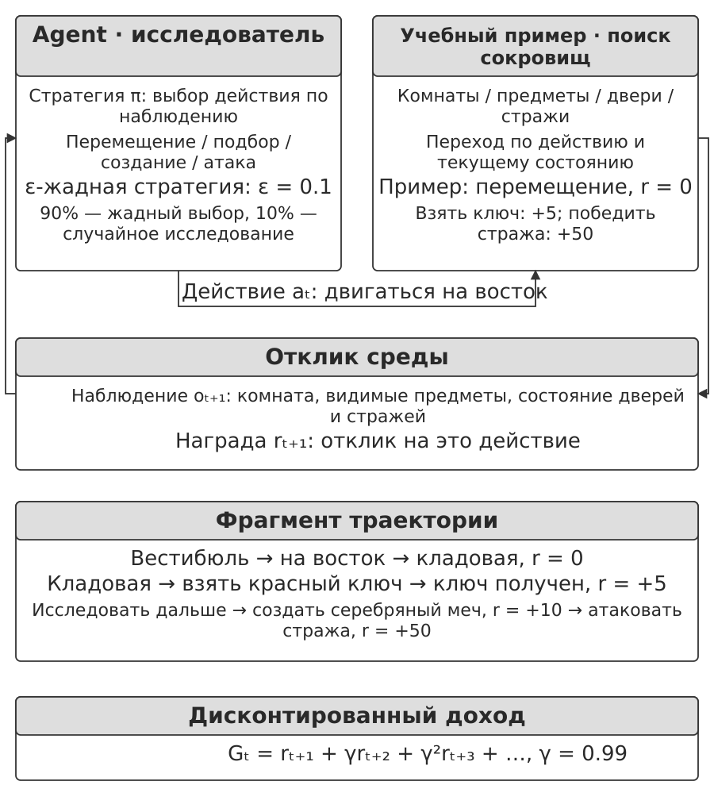

Непрерывное взаимодействие образует **траекторию**, включающую наблюдения, действия, вознаграждения и информацию о завершении на каждом шаге. Если обучающей системе доступно состояние среды, его также можно записывать. Стратегия определяет способ действий, а **функция ценности (Value Function)** оценивает, какую будущую отдачу можно ожидать, если из текущего состояния продолжить выполнение определённой стратегии.

Граница между агентом и средой определяется областью системы, выбранной при моделировании. В рассматриваемых в этой книге системах модель и Harness находятся внутри агента, а интерфейсы инструментов связывают его с внешними приложениями, устройствами и сервисами. Например, агент формирует запрос на изменение файла, файловая система выполняет запись, а инструмент возвращает агенту результат выполнения.

В процессе обучения необходимо распределять возможности между **исследованием и использованием (Exploration–Exploitation)**. Исследование знакомит стратегию с ещё недостаточно изученными действиями, а использование выбирает действия, которые в текущий момент оцениваются как более выгодные. В задачах с отложенным вознаграждением также требуется определить, какие ранние шаги способствовали конечному результату. Это и есть проблема присвоения заслуг, рассматриваемая далее.

Чтобы понять метод RL, сначала можно проверить пять аспектов:

- **Пространство действий**: что разрешено выдавать на выходе. В настольных играх используются дискретные ходы, а в управлении роботами — непрерывные целевые значения суставов. Действия также могут ограничиваться состоянием, физическими пределами и разрешениями.
- **Стратегия**: правило выбора действия на основе состояния, наблюдения или истории. Это может быть как таблица, так и нейронная сеть.
- **Сигнал вознаграждения**: обратная связь, посредством которой выражается цель обучения. Вознаграждение каждого шага участвует в формировании долгосрочной отдачи, поэтому стратегия может принять текущие издержки ради будущей выгоды.
- **Функция ценности**: оценивает последующую отдачу и может использоваться для сравнения действий или формирования сигнала обновления стратегии. Конкретный алгоритм определяет, обучается ли она явно.
- **Модель среды**: предсказывает состояние, наблюдение или вознаграждение после действия. Методы на основе модели планируют с использованием известной или изученной модели среды; безмодельные методы обучают стратегию или ценность непосредственно на данных взаимодействия.

В таблице 8-3 для сопоставления нескольких знакомых систем из этих понятий выбраны среда, действия и цель. При чтении первых двух строк «сохранение равновесия» и «очищенную площадь» можно рассматривать как возможные цели, выбранные при моделировании задачи.

Таблица 8-3. Сопоставление ключевых элементов разных систем агентов

| Тип агента | Внешняя среда | Представление действий | Пример вознаграждения или цели |
| --- | --- | --- | --- |
| Новорождённая газель | Рельеф, гравитация и динамика тела | Непрерывное управление мышцами | Сохранение равновесия, предотвращение падения |
| Робот-пылесос | Помещение, пол и зарядная инфраструктура | Перемещение, уборка, возврат на зарядку и управляющие параметры | Очищенная площадь, заряд аккумулятора и цена столкновений |
| Шахматный агент | Доска, противник и правила контроля времени | Легальные ходы в текущем состоянии | Победа +1, поражение −1, ничья 0 |
| Агент клиентской поддержки | Пользователь, бизнес-база данных и интерфейсы сервисов | Текст ответа, запросы и бизнес-вызовы | Решение проблемы, соблюдение процедур, время обработки |
| Агент — помощник программиста | Источник требований, кодовая база и среда выполнения | Поиск, редактирование, запуск и ответ | Результаты тестов, выполнение задачи, регрессии и затраты |

В этих системах используются разные представления действий. В настольных играх обычно на каждом шаге выбирается одно дискретное действие, робот выдаёт непрерывные управляющие величины заданной размерности, а LLM сначала генерирует последовательность токенов, которую интерфейс затем разбирает как ответ или вызов инструмента. Внутренние вычисления также можно включить в модель стратегии и записывать отдельно от выполнения инструментов, фактически изменяющего внешнее состояние.

### Два представления действий: классическая постановка RL и стратегия LLM с переменной длиной

**Марковский процесс принятия решений (Markov Decision Process, MDP)** описывает задачу принятия решений посредством состояний, действий, переходов и вознаграждений. Марковское свойство требует, чтобы для предсказания следующего состояния и вознаграждения при заданных текущем состоянии и действии не требовалась дополнительная история: вся относящаяся к прогнозу историческая информация уже должна содержаться в текущем состоянии. На рисунке 8-2 видно, почему недостаточно записывать лишь комнату, в которой находится игрок: даже если он дважды подходит к одной и той же двери, возможность открыть её зависит от того, успел ли он подобрать ключ.

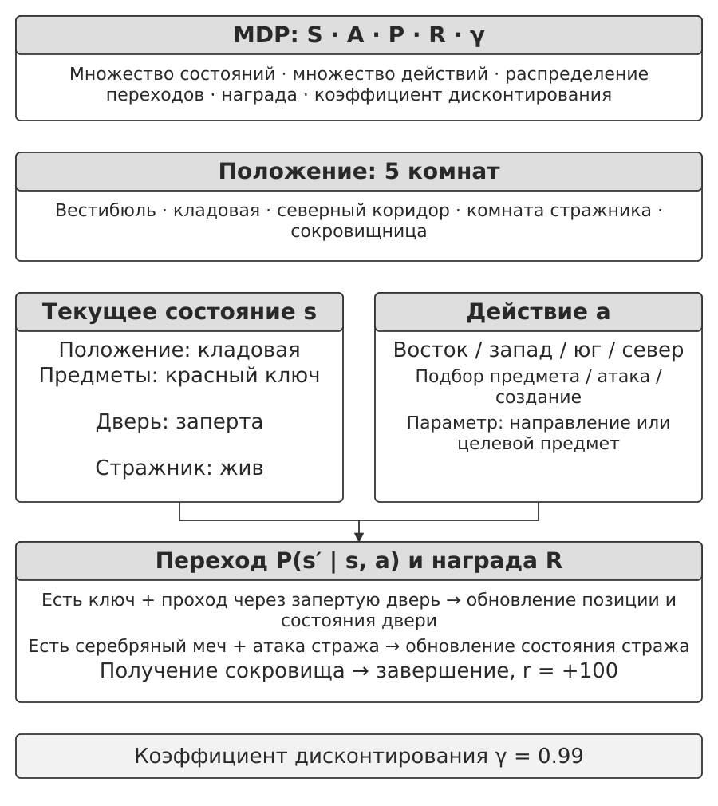

Шахматы дают наглядный пример проектирования состояния. Помимо расположения фигур необходимо записывать очерёдность хода, права на рокировку и взятие на проходе, а также информацию, нужную для применения правила пятидесяти ходов и определения повторения позиции. Только включив эти данные в состояние, можно применять правила на основе текущего состояния. Если агент видит лишь часть этой информации, ему требуется восполнять её с помощью истории либо использовать частично наблюдаемую модель.

MDP может включать дискретные, непрерывные и составные действия. В го есть 361 пересечение доски, а также действие паса и ограничения легальности; в играх Atari обычно доступно небольшое число дискретных операций; управляющие величины робота определяются суставами, захватами и физическими ограничениями. Если число состояний и действий невелико, ценности можно хранить непосредственно в таблице. При больших масштабах применяются соответственно аппроксимация функций, оптимизация стратегии и поиск.

**Табличный Q-learning: обновление ценности действия по результату одного шага.** $Q(s,a)$ оценивает отдачу после выполнения действия $a$ в состоянии $s$. Оптимальная ценность действия удовлетворяет уравнению оптимальности Беллмана:

$$
Q^*(s,a)=\mathbb E\left[r+\gamma\max_{a'}Q^*(s',a')\mid s,a\right]
$$

Здесь $r$ — вознаграждение за текущий шаг, $s'$ — следующее состояние, а $\gamma$ — коэффициент дисконтирования. Для продолжающихся задач обычно выбирают $0\leq\gamma<1$; в задачах с явным завершением и конечной отдачей можно использовать и значение 1. Чем больше коэффициент дисконтирования, тем больший вес сохраняют отдалённые вознаграждения. Отдача, рассчитанная от текущего момента, равна $G_t=\sum_{k\geq0}\gamma^k r_{t+k+1}$.

Получив в результате одного взаимодействия $r$ и $s'$, Q-learning выполняет следующее обновление:

$$
Q(s,a)\leftarrow Q(s,a)+\alpha\left[r+\gamma\max_{a'}Q(s',a')-Q(s,a)\right]
$$

Здесь $\alpha$ — скорость обучения, а выражение в квадратных скобках представляет собой разность между «вознаграждением за один шаг плюс дисконтированной последующей ценностью» и текущей оценкой. При достижении конечного состояния последующая ценность принимается равной 0. Попробуйте выполнить это действие в прилагаемой игре: отключите случайные возмущения, от входа идите на восток, а затем подберите красный ключ в кладовой. За ключ выдаётся 5 очков, а каждый шаг стоит 0,5 очка, поэтому для этого действия $r$ равняется 4,5. Предположим, что прежняя табличная оценка действия «взять ключ в кладовой» равна 0,25, а максимальное Q-значение доступных после получения ключа действий составляет 0,63. При $\gamma=0.99$ и $\alpha=0.2$ одношаговая цель равна $4.5+0.99\times0.63=5.1237$. Прежняя оценка приближается к этой цели на одну пятую и обновляется до 1,22474. Такой метод коррекции оценки по фактической обратной связи за один шаг называется **обучением на основе временных различий (Temporal-Difference Learning, TD)**.

Сопоставив Q-значения всех действий в одном состоянии, можно выбрать действие с наилучшей текущей оценкой. На рисунке 8-3 такая стратегия представлена в виде упрощённой сетки. Число в каждой ячейке обозначает нормализованную ценность состояния. Если закрыть числа рукой и смотреть только на стрелки, сможете ли вы добраться из левого верхнего угла до сокровища?

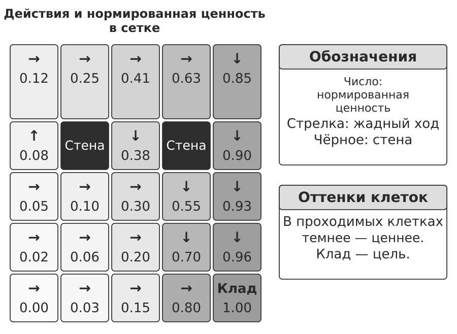

Следующее исследование может изменить направления стрелок. На рисунке 8-4 разобран приведённый выше расчёт для подбора красного ключа: полученное на этом шаге вознаграждение изменяет оценку действия «взять ключ в кладовой», тогда как Q-значения других состояний таблицы будут обновлены позднее, каждое в свой момент.

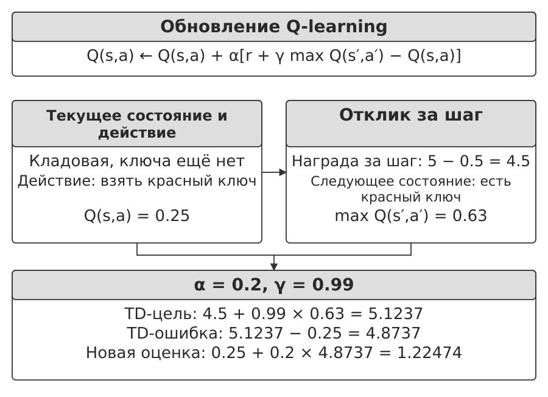

Поведенческая стратегия Q-learning может включать случайное исследование, тогда как в цели обновления используется максимальная ценность действия в следующем состоянии. Поэтому Q-learning относится к обучению **вне стратегии (Off-Policy)**.

> **Эксперимент 8-1 ★: поведение Q-learning в игре с поиском сокровищ**
>
> Игра с поиском сокровищ содержит скрытые правила, связанные с ключами и дверями, эффектами оружия и объединением предметов. Для прохождения необходимо выполнить несколько шагов в правильной последовательности; оптимальный путь занимает 11 шагов. За ключевые действия и победу выдаётся вознаграждение, а на остальных шагах обратная связь невелика.
>
> В этом обучении скорость обучения равна 0,2, коэффициент дисконтирования — 0,99, а доля исследования ε постепенно снижается с 1,0 до 0,1. Табличный Q-learning применяет ε-жадное исследование: на каждом шаге с вероятностью ε случайно выбирается одно из доступных действий, а в остальных случаях — одно из действий с максимальным текущим Q-значением. На каждом этапе записываются доля побед, число посещённых состояний и число шагов до прохождения.
>
> При чтении журналов обучения и оценки эксперимента с поиском сокровищ сначала разделите два вопроса. Когда во время обучения стратегия со случайным исследованием впервые находит сокровище? Способна ли она после завершения обучения, при фиксированной Q-таблице и жадном выборе действий, стабильно проходить игру? Первый вопрос показывает, как модель обнаруживает путь, а второй проверяет, способна ли она выбирать действия в соответствии с изученными ценностями.
>
> В одном из предыдущих запусков за первые 1000 игровых сессий агент ни разу не прошёл игру, а Q-таблица содержала 124 состояния. К 5000 сессиям стабильных побед по-прежнему не было, а число состояний достигло 133. Между 7000-й и 8000-й сессиями доля побед выросла с 34 до 96%. К 10000-й сессии она достигла 100%, Q-таблица содержала 145 состояний, а агент нашёл путь из 11 шагов.
>
> Почему вначале прогресса долго не было, а затем доля побед быстро выросла? Сначала исследование обнаружило ключевые действия и путь, а последующие посещения постепенно распространили отдачу конечной точки на предшествующие состояния. Вся небольшая симуляция занимает около 10 секунд, поэтому допускает большое число повторных взаимодействий.
>
> При анализе записывайте как время вычислений, так и число взаимодействий. В игре одно действие стоит дёшево; при работе с браузером, телефоном или физическим устройством каждое взаимодействие также требует ожидания, расходов и изменения состояния. Кроме того, таблица привязана к конкретному кодированию состояний: после изменения правил или карты необходимо заново проверить применимость уже изученных ценностей. В следующем эксперименте сравнивается влияние предварительно обученных знаний на исходную точку исследования.

**Предварительно обученная LLM: представление вычислений и действий посредством языка.**

Перед вызовом инструмента LLM может сгенерировать фрагмент промежуточных вычислений либо сразу выдать вызов. Оба варианта представлены последовательностями токенов, но выполняют разные функции: промежуточные вычисления изменяют контекст, доступный модели на следующих шагах, а выполненный вызов инструмента изменяет или считывает внешнюю среду. Во время обучения эти выходные данные можно записывать в соответствии с протоколом и оценивать с учётом результата задачи и вычислительных затрат. Таким образом, «как долго думать, о чём думать и когда вызывать инструмент» становится набором вариантов, доступных для обучения одной стратегии. Рассматриваемый далее AdaptThink посвящён именно бюджету рассуждений.

Последовательности переменной длины образуют более крупное комбинаторное пространство. Модель может писать запросы, программы, параметры JSON и многошаговые рассуждения, тогда как длина последовательности ограничивается бюджетом и контекстом. Предварительное обучение даёт поиску исходную точку: математические материалы часто содержат анализ условий и вычисления, а код и обсуждения — поиск проблемы, внесение изменений и проверку. Модель может использовать эти структуры для генерации возможных путей, а затем корректировать их на основе обратной связи от среды. Благодаря имеющимся знаниям полезные комбинации действий с самого начала выбираются с большей вероятностью, что снижает потребность в слепых пробах среди множества нерелевантных путей.

Например, задача «пересчитать сумму в иностранной валюте в доллары» требует получить обменный курс и выполнить вычисление. Благодаря предварительному обучению модель сравнительно легко генерирует такие взаимосвязанные шаги. Постобучение может дополнительно скорректировать вероятности путей с учётом источника курса, результата вычислений и ограничений задачи. Языковые знания здесь задают исходную стратегию, а вознаграждение предоставляет обратную связь по задаче.

На рисунке 8-5 сопоставлены две постановки из этого раздела: табличный Q-learning начинает с заданного кодирования состояний и правил исследования, а LLM-агент — с предварительно обученной языковой стратегии и организует в контексте наблюдения от инструментов и накопленный опыт.

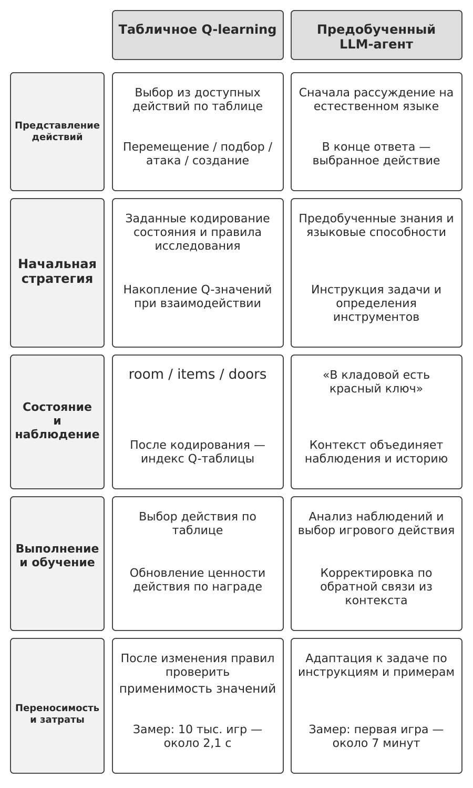

Предварительное обучение также позволяет модели интерпретировать новые инструкции и корректировать поведение в задаче на основе небольшого числа демонстраций. Инструменты связывают языковой вывод с поиском, выполнением кода и бизнес-операциями. При проектировании таких агентов необходимо не только определить интерфейсы инструментов и разрешения на выполнение, но и организовать обратную связь по результатам задачи, затратам на выполнение и ключевым этапам процесса.

Как применить «предсказание следующего токена» к действиям, если модель должна управлять роботизированной рукой? OpenVLA обучалась примерно на 970 тысячах реальных демонстраций роботов. Для одного шага демонстрации на вход подаются текущий кадр с камеры и инструкция задачи, а целью обучения служит действие, которое демонстратор выполняет следующим. Например, горизонтальное перемещение роботизированной руки изначально представляет собой непрерывное числовое значение. OpenVLA делит каждую размерность действия на 256 диапазонов и одним токеном обозначает диапазон, в который попало значение. Благодаря этому модель может последовательно предсказывать токены действий и вычислять функцию потерь только в этих позициях.[^ch8-21]

Этот пример также показывает, как различать клонирование поведения и обучение с подкреплением: нужно определить, какой сигнал вызывает обновление модели. OpenVLA обучается на записях демонстраций: чем выше присвоенная моделью вероятность токенов демонстрируемого действия, тем ниже функция потерь. Это относится к дообучению с учителем. В SimpleVLA-RL из эксперимента 8-13 стратегия будет фактически пробовать действия в среде, а затем корректировать будущий выбор на основе вознаграждения за задачу.

> **От алгоритма и среды к априорным знаниям**
>
> В статье «The Second Half» Шуньюй Яо рассматривает развитие RL с точки зрения алгоритмов, сред и априорных знаний.[^ch8-2] На этой основе автор обобщает изменение исследовательского фокуса в виде трёх этапов: в 2015–2016 годах основное внимание уделялось совершенствованию алгоритмов, в 2016–2018 годах возросло значение построения сред, а начиная с 2018 года постепенно пришло осознание ценности априорных знаний, полученных посредством предварительного обучения. Gym предоставил единый интерфейс сред, Universe и World of Bits исследовали компьютерные и веб-задачи, а такие проекты, как Dota 2, продемонстрировали возможность обучения в сложных средах. Затем GPT-2 и GPT-3 показали накопленные посредством предварительного языкового обучения знания и выразительные возможности, а WebGPT, ChatGPT и другие системы стали в ещё большей степени использовать эту исходную точку. Необходимые для задачи априорные знания можно сначала получить посредством языкового моделирования, а затем передать RL для оптимизации конкретного поведения.
>
> Автор разделяет следующий порядок инженерных приоритетов: **априорные знания, среда, алгоритм**. Сначала следует проверить, какими знаниями и возможностями обладает модель, затем построить подходящую среду и обратную связь и лишь после этого выбрать соответствующий метод оптимизации. На рисунке 8-6 элементы расположены в порядке появления исследовательского интереса к ним, однако при работе над проектом можно двигаться в обратном порядке, начиная с уже имеющихся возможностей.
>
> 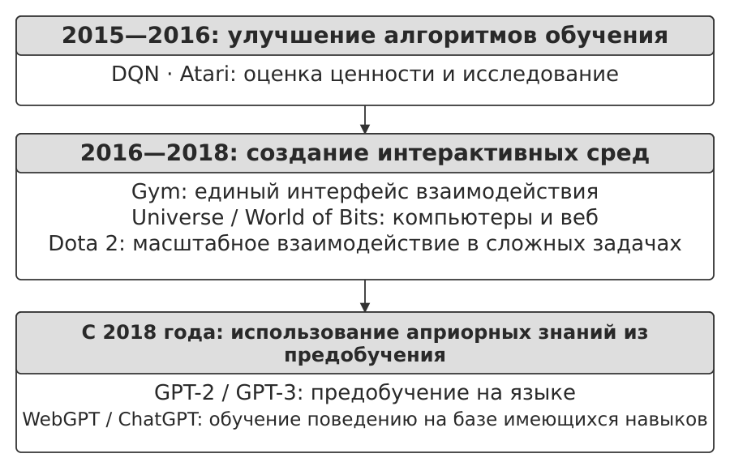

> **Эксперимент 8-2 ★★: сравнительное исследование традиционного RL и LLM-агента**
>
> В одной и той же игре с поиском сокровищ сравниваются табличный Q-learning и LLM-агент. В конфигурации LLM используется Kimi K3, а в контексте хранится не более 50 записей опыта. На каждом шаге оба варианта выбирают одно из действий, предложенных средой. Два пути на рисунке 8-7 показывают, как этот выбор выполняют соответственно Q-таблица и языковая модель.
>
> 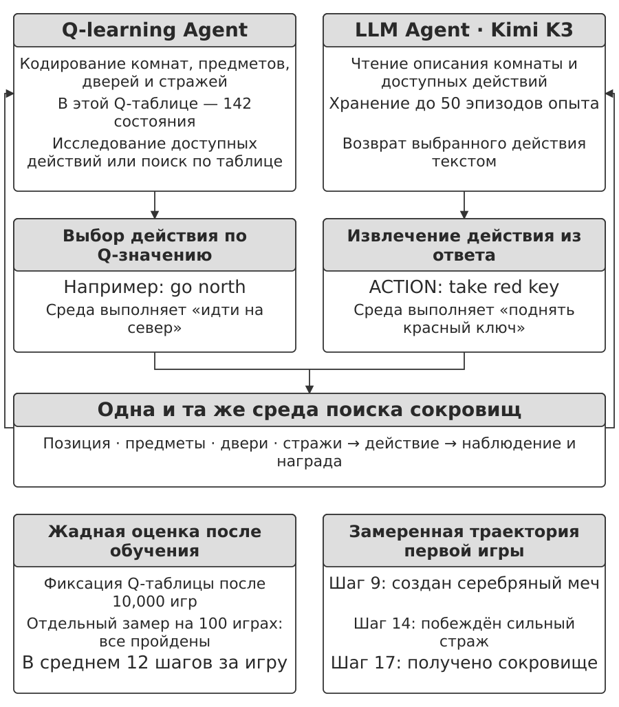
>
> В прилагаемом журнале запуска Kimi K3 агент прошёл первую сессию за 17 шагов. Сначала он подобрал ржавый меч, обнаружил, что северная дверь заперта, отправился в кладовую и получил красный ключ и магический кристалл. На девятом шаге он объединил меч с кристаллом и создал серебряный меч. Когда на двенадцатом шаге агент попытался использовать ключ, среда сообщила: «При необходимости он будет использован автоматически». Лишь на тринадцатом шаге, когда агент пошёл на север, дверь действительно открылась. Победив стражника серебряным мечом на четырнадцатом шаге, он ещё раз попытался использовать меч, но среда сообщила, что сейчас это невозможно. На семнадцатом шаге агент получил сокровище. Читая этот журнал, можно закрывать следующую строку и сначала пытаться угадать по текущей обратной связи, какой шаг ещё необходим.
>
> Сопоставив каждое действие с наблюдением в соответствующий момент, можно проанализировать, как модель использует имеющиеся знания о том, что «ключ открывает дверь», а «оружие нужно против стражника», и как обратная связь от инструментов изменяет последующий план. Табличный подход накапливает эти связи посредством посещения пар «состояние — действие».
>
> В этом сравнении обучение Q-learning в течение 10000 игровых сессий заняло 2,12 секунды. После этого отдельно провели оценку жадной стратегии на 100 сессиях: все они завершились прохождением, в среднем за 12 шагов. Kimi за одну сессию 17 раз вызвала модель, затратив 6 минут 56 секунд. На основании этого автор использует следующий принцип выбора: когда симуляция дешева и допускает большое число повторений, можно в полной мере применять исследование традиционного RL; когда каждое взаимодействие требует ожидания, расходов или реальных действий, предпочтительнее стратегия, способная использовать уже имеющиеся знания и тем самым повышать ценность каждого взаимодействия.

Эти два эксперимента связывают настоящую главу с рассмотренными ранее инженерными методами: контекст позволяет организовывать опыт в рамках одного запуска, внешняя память — сохранять его между задачами, а постобучение — изменять стратегию посредством обновления параметров. Далее сначала будут рассмотрены основы предварительного обучения на языковых и визуальных данных, а затем — конкретные обучающие данные и методы оптимизации.

## Основы предварительного обучения моделей `[необязательное чтение]`

Предварительное обучение формирует исходные представления и распределение генерации модели, а на последующих этапах обучения её параметры продолжают корректироваться относительно этой отправной точки. Чтобы понять, как она возникает, сначала рассмотрим, как небольшая языковая модель обучается на тексте, а затем — как к ней подключается визуальный ввод.

Сначала текст проходит **токенизацию (Tokenization)** и преобразуется в дискретные токены. Например, фраза «Я люблю программировать» условно может быть разделена на три единицы: «Я», «люблю» и «программировать»; фактическое разбиение определяется токенизатором. Во время обучения предшествующие токены используются как контекст для предсказания последующих, после чего вычисляются потери и обновляются параметры. На рисунке 8-8 обучающее предложение сначала скрывается после слова «среда», предлагая угадать следующее слово, а затем открывается исходный текст. При сдвиге этой позиции вперёд получается следующая задача на предсказание.

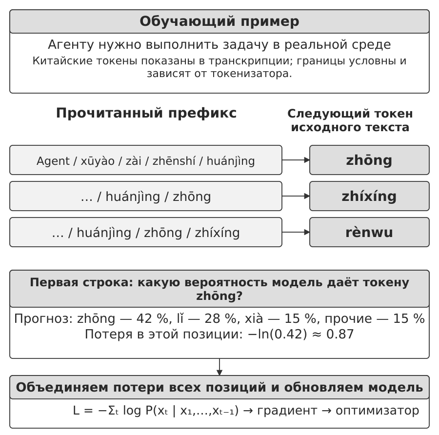

После базового языкового моделирования можно добавить демонстрации инструкций, чтобы обучить модель формату ответов и выполнению задач. Можно также использовать данные о предпочтениях и с помощью DPO и других методов повышать вероятность более одобряемых ответов.

> **Эксперимент 8-3 ★★: обучение LLM с нуля — сила алгоритмических улучшений**
>
> На примере MiniMind 2 примерно со 100 миллионами параметров на потребительском GPU выполняются предварительное обучение, SFT и оптимизация предпочтений. Сравните базовую конфигурацию с конфигурацией, в которую добавлены QK Norm и оптимизатор Muon, и проследите за снижением потерь, временем достижения целевого качества и результатами генерации. Согласно сопутствующей сводке, скорость сходимости увеличивается примерно втрое, а полное обучение занимает около 14 часов и стоит примерно 34 доллара.
>
> *Уточнение русского издания: В отчёте указаны восемь RTX 4090: около 6 часов на предобучение и ещё 8 часов на SFT. При QK Norm и Muon порог функции потерь 3 достигнут за 12 шагов вместо 36. Это втрое меньше шагов до выбранного порога, а не измеренное трёхкратное сокращение времени всего обучения. [Источник](https://github.com/bojieli/ai-agent-book/tree/c3352738f4b6fe42fe34e3cf6a79bcb424a133b8/chapter8/MiniMind-pretrain/validation/runs/exp8-3-training-report-20260731-v1).*
>
> QK Norm корректирует числовой масштаб запросов и ключей в механизме внимания, а Muon изменяет способ оптимизационного обновления соответствующих параметров.
>
> На разных этапах наблюдайте за ответами модели на один и тот же набор вопросов: уже после предварительного обучения она может отвечать на такие вопросы, как «Какая гора самая высокая в мире?»; после SFT улучшаются следование инструкциям и организация вывода; оптимизация предпочтений продолжает влиять на фактологические ответы и формулировки.

> **Эксперимент 8-4 ★★: самостоятельное обучение VLM**
>
> На рисунке 8-9 показано соединение «визуальный энкодер — проекционный слой — языковая модель». Визуальный энкодер, например CLIP, извлекает признаки изображения, проекционный слой преобразует их к размерности и представлению, необходимым на входе языковой модели, а языковая модель генерирует описание или ответ с учётом этих входных данных.
>
> 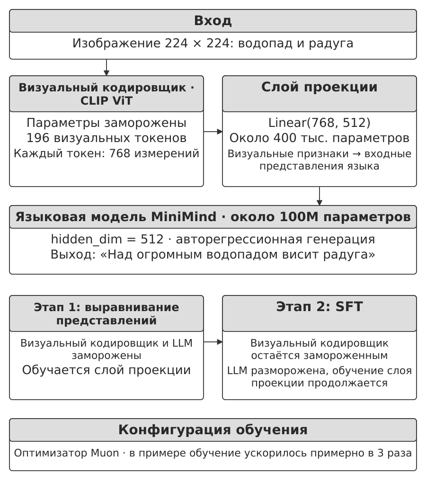
>
> На первом этапе визуальный энкодер и LLM замораживаются, а новый проекционный слой обучается таким образом, чтобы признаки изображения могли участвовать в языковом предсказании. На втором этапе LLM размораживается в соответствии с конфигурацией и проходит SFT на высококачественных данных «изображение — описание» или «вопрос — ответ». Отдельно проследите за изменениями в распознавании объектов, описании деталей, определении отношений и языковых способностях.
>
> Эта архитектура повторно использует существующие визуальную и языковую модели и сначала сосредоточивает обучение на модуле межмодального соединения, поэтому при ограниченном бюджете её стоит попробовать в первую очередь. Замораживание весов сокращает объём обучаемого состояния, а впоследствии соответствующие модули можно разморозить в зависимости от требований задачи. Если описание содержит ошибки, сначала проверьте, попала ли информация об объекте в визуальное представление. Если информация уже присутствует, но модель всё равно не может её использовать, основное внимание следует уделить выразительной способности проекционного слоя, данным для выравнивания и надзору за языковой генерацией. Если далее преобразовать вывод в представление действий и согласовать его с интерфейсом управления, получится архитектура VLA из главы 6.

Эти два эксперимента показывают, как конфигурация оптимизации и межмодальное соединение влияют на обучение. При ограниченном бюджете автор рекомендует сначала сравнить преимущества алгоритмических и архитектурных улучшений и лишь затем решать, следует ли увеличивать масштаб модели. Когда существующую модель адаптируют к новому языку или предметной области, обучение также можно продолжить с весов предварительно обученной модели. В следующем разделе рассматривается выбор данных для такого обучения.

*Уточнение русского издания: Рекомендация автора не означает, что в этом опыте измерялось преимущество перед увеличением масштаба. Дополнительная слепая оценка относится к восьми сравнениям: семь предпочтений в пользу QK Norm с Muon и одна ничья. [Источник](https://github.com/bojieli/ai-agent-book/tree/c3352738f4b6fe42fe34e3cf6a79bcb424a133b8/chapter8/MiniMind-pretrain/validation/runs/exp8-3-training-report-20260731-v1).*

## Mid-training: восполнение знаний и базовых способностей

Под **Mid-training** в этой главе понимается дополнительный этап обучения языковой модели на целевом распределении данных поверх уже существующей модели. Большое количество токенов из документов, кода или выкладок используется в качестве обучающих сигналов, причём корпус целевой предметной области можно смешивать с общим корпусом. Исследования DAPT/TAPT показали, что дополнительное предобучение на корпусе предметной области или данных, связанных с задачей, улучшает результаты в последующих задачах.[^ch8-30]

При выборе данных следует исходить из пробелов двух типов. Первый — недостаточный охват знаний и языка: например, модель мало знакома с внутренними протоколами компании, терминологией целевого языка или определённой кодовой базой. Второй — пробелы в базовых способностях, необходимых для задачи: например, отслеживать состояние в длинном контексте, объединять связи между документами или выполнять длинные выкладки в коде. Сначала следует разделить проблемы понимания, знаний, формата и действий по типам ошибок, а затем определить, какие материалы необходимо добавить.

После снижения функции потерь на текстах предметной области следует также проверить, способна ли модель применять усвоенные знания в реальных задачах. На использование знаний влияют порядок дополнительного предобучения и обучения на инструкциях, организация вопросов и ответов, а также форма материалов.[^ch8-31] Если для задач предметной области модели явно недостаёт базовых способностей, автор рекомендует сначала расширить охват с помощью корпуса предметной области, а затем посредством примеров SFT научить модель применять эту информацию в задачах. Если модель иногда решает задачу правильно, но доля успехов остаётся низкой, можно переходить к RL.

### Как формировать данные для Mid-training

**Шаг 1. Определить необходимые материалы по распределению ошибок.** Отдельно оцените результаты по темам, языкам, типам документов, шаблонам кода и длине контекста. Сопоставляя Pass@1, Pass@k и примеры ошибок, определите, при каких условиях модели не хватает применимого решения. Проблемы с форматом параметров можно устранить с помощью примеров работы с интерфейсом, тогда как пробелы в понятиях и связях предметной области требуют соответствующего корпуса.

**Шаг 2. Организовать корпус высокой плотности.** Исходные документы дают термины и связи между фактами, репозитории кода — структуру модулей и зависимости, а учебные выкладки и синтетические пояснения раскрывают неявные шаги. Примеры, охватывающие несколько документов, связывают разрозненную информацию. После фильтрации по качеству, дедупликации и изоляции оценочного набора из этих материалов формируются обучающие последовательности.

**Шаг 3. Смешивать данные в соответствии с целевыми способностями.** Естественные длинные тексты можно брать из книг, документов и репозиториев кода. Для развития поиска, многошагового рассуждения, следования инструкциям, агрегирования и статистической обработки можно добавить данные задач с выкладками. Для AI-агентов можно добавить траектории планирования, выбора инструментов, составления параметров, отслеживания состояния и восстановления после ошибок. Эти материалы могут поступать из существующих наборов данных или генерироваться моделью-учителем, но перед включением в обучение их необходимо отфильтровать по требованиям к содержанию и поведению.

**Шаг 4. Позволить модели продолжать практиковаться в уже освоенных задачах.** Одна группа примеров сохраняет короткие тексты, общий корпус и исходные задачи. В другой группе те же задачи помещаются в более длинный контекст, ключевая информация переносится в другие позиции и добавляются отвлекающие элементы. При составлении смеси из этих двух групп можно ориентироваться на распределение исходных обучающих данных или испытать несколько соотношений на открытых корпусах, таких как FineWeb-2, а затем скорректировать их по результатам оценки.

**Шаг 5. Принимать решение о продолжении или остановке по нескольким метрикам.** Одновременно отслеживайте обучающую функцию потерь, результаты на отложенных задачах предметной области, общие способности, сохранение исходного навыка следования инструкциям и долю успехов в целевых задачах. Если результаты в предметной области улучшаются, а общие способности снижаются, сравните разные пропорции смеси, скорости обучения и объёмы обучения. Если функция потерь снижается, а результаты в целевых задачах не меняются, проверьте, способны ли обучающие материалы научить модель решать такие задачи и не требуется ли добавить примеры применения знаний в реальных задачах.

Предположим, модель умеет находить заданный номер заказа в очень длинном журнале заказов. Если вместо этого спросить: «Какой клиент неоднократно оформлял заказы, а затем отменил их все?», ей придётся найти все заказы одного клиента и по отдельности сопоставить каждый из них с записью об отмене. В обеих задачах можно использовать один и тот же журнал, но проверяемые способности будут различаться. RULER посредством синтетических задач позволяет независимо управлять длиной входных данных и сложностью задачи, отдельно проверяя поиск одной записи, многошаговое отслеживание и агрегирование. Авторы оценили 17 моделей: многие из них показали почти максимальный результат в простом поиске, однако по мере увеличения длины входных данных совокупные результаты заметно снижались.[^ch8-ruler]

Чтобы проверить, проявляется ли это различие на реальных материалах, можно дополнительно использовать задачи LongBench v2 с несколькими документами, длинными диалогами или репозиториями кода. Чтобы отдельно проверить, способна ли модель запоминать требования к формату вывода и другие инструкции, можно взять проверяемые инструкции из IFEval и разместить их в разных позициях длинного материала. При сравнении двух моделей позиции инструкций и отвлекающее содержимое должны быть одинаковыми; кроме того, следует указать, что тест составлен самостоятельно. Наконец, с помощью сквозных задач для агентов необходимо проверить, могут ли эти способности работать совместно. При разработке оценочного набора можно последовательно проверить следующие аспекты.[^ch8-longbench]

[^ch8-ruler]: Hsieh и др., RULER, 2024.
[^ch8-longbench]: Bai и др., LongBench v2, ACL 2025. В статье представлены шесть типов задач, включающих в общей сложности 503 вопроса с вариантами ответа.

- **Позиционирование и поиск**: способность находить одну или несколько ключевых частей информации, расположенных в начале, середине или конце.
- **Связи и рассуждение**: отслеживание связей между абзацами и документами, разрешение противоречий и объединение доказательств.
- **Агрегирование и статистика**: подсчёт, группировка, сортировка, сравнение и выявление тенденций в больших таблицах и длинных журналах.
- **Следование инструкциям**: выполнение нескольких требований, разрешение конфликтов, соблюдение условий процесса и формата вывода.
- **Длинные цепочки рассуждений**: длинные цепочки зависимостей в задачах по математике, логическому выводу и коду.
- **Базовое поведение агента**: декомпозиция задач, выбор инструментов, формирование параметров, сохранение состояния и восстановление после неудач.

Длинные рассуждения и многораундовые вызовы инструментов постоянно увеличивают контекст, однако ранние инструкции, факты и состояние задачи должны по-прежнему учитываться в последующих решениях. Если модель не может находить информацию в длинных текстах или соблюдать ограничения, агент с длинным горизонтом не сможет работать надёжно. Перед увеличением бюджета обучения следует сначала сравнить соотношения данных и объёмы обучения на конфигурациях небольшого масштаба. Для часто обновляемых фактов, требующих указания источников, автор отдаёт предпочтение RAG; дополнительное обучение с записью в параметры следует рассматривать для стабильных и масштабных знаний и базовых способностей предметной области.

> **Эксперимент 8-5 ★★: дополнительное предобучение для освоения нового языка**
>
> За основу берётся Mistral 7B v0.3, а способность работать с корейским повышается с помощью материалов корейской Wikipedia и других источников. Сначала обучение проводится на смеси примерно из 80 % корейских и 20 % английских данных, а затем выполняется SFT на корейских данных с инструкциями. Изменения в языковом моделировании и диалоговом поведении наблюдаются отдельно.
>
> Корейские данные расширяют охват целевого языка, а английские помогают сохранить исходные способности. На каждом этапе модель проверяется на одной и той же группе корейских и английских задач, не участвовавших в обучении. В сопутствующих результатах слепая оценка на финальном этапе для корейского языка улучшается, однако способности модели к английскому снижаются. Это задаёт конкретное направление для следующей итерации: увеличить долю английских обучающих материалов или снизить интенсивность обновления.
>
> Раздельный учёт целевого языка, исходного языка и качества фактов позволяет оценить выгоды и издержки. На этапе SFT дополнительно проверяется, способна ли модель формулировать ответы в соответствии с инструкциями на корейском. Таким образом, влияние дополнительного предобучения и обучения на инструкциях можно наблюдать раздельно.

## SFT (дообучение с учителем)

Материалы предметной области позволяют модели несколько раз встретить определённый интерфейс, однако, чтобы научить её исправлять параметры после неудачного вызова, можно сразу показать соответствующий пример. При SFT модели задают входные данные задачи и обучают её токен за токеном генерировать ответ или действие из демонстрации. Рассматривая рисунок 8-10, сначала определите, какому поведению нужно научить модель, а затем решите, как собирать демонстрации. Вместе с ними в обучение попадут факты, тон и формат вывода.

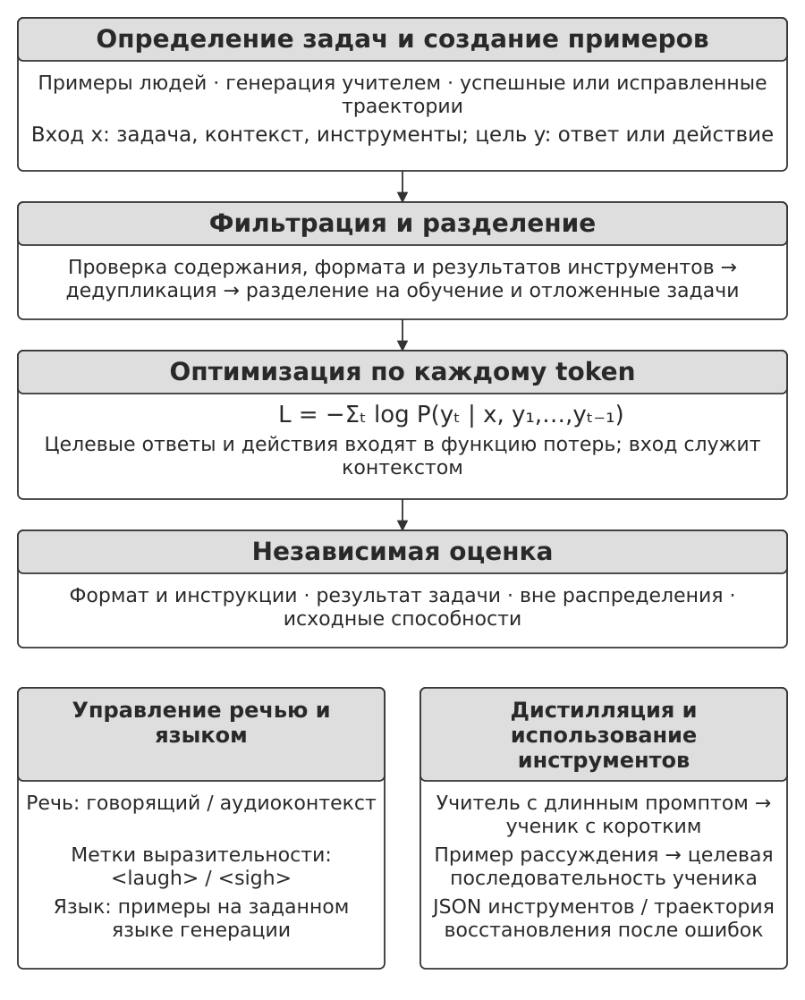

Данные обычно поступают из трёх источников: эксперты определяют ключевые варианты поведения и границы, модель-учитель массово создаёт демонстрации, а валидатор отбирает корректные результаты из выборок модели. Эти подходы можно сочетать. Например, сначала эксперты составляют небольшое число демонстраций вызова инструментов, затем учитель изменяет условия задачи и создаёт дополнительные примеры, после чего проверяются параметры, результаты выполнения и бизнес-ограничения.

**Одно из применений SFT — научить модель приёмам, которые приходится многократно описывать в промптах и Skill.** Возьмём в качестве примера оценивание памяти из главы 7. Допустим, руководство по оцениванию вместе с прецедентами занимает десять тысяч токенов. Опираясь на полное руководство, учитель оценивает набор ответов и показывает, как обрабатывать совпадающие имена людей, перепутанные отношения, недостаточность доказательств и другие ситуации. При обучении ученика во входных данных оставляют только краткое название критерия, материалы текущей истории и оцениваемый ответ, а целевым выводом служит выбранная учителем категория. После развёртывания достаточно предоставлять короткий промпт и текущие материалы, экономя при каждом инференсе десять тысяч токенов неизменных инструкций. Тем же способом для многократно вызываемого Skill можно показать, когда искать информацию и как выбирать инструменты, а затем дистиллировать эти устойчивые действия в модель.

При подготовке данных сначала необходимо определить распределение задач, схему вывода и способ приёмки. После проверки демонстраций выполняются удаление дубликатов, настройка пропорций разных категорий примеров и разделение набора данных. Количество и охват примеров следует проектировать совместно: если несколько тысяч раз повторить одну и ту же формулировку вопроса, будет многократно закрепляться один паттерн; помочь модели выбирать подходящее поведение для разных входных данных могут лишь вариации ключевых условий. Автор сначала тщательно дорабатывает набор демонстраций, охватывающих ключевые ситуации, и только затем увеличивает его размер. При SFT целевой вывод изучается токен за токеном, поэтому ошибочные факты, лишние шаги и неуместные привычки также попадут в параметры.

> **Эксперимент 8-6 ★★★: SFT речи — от «копирования голоса» к «моделированию паралингвистики» `[Расширенный эксперимент]`**
>
> На примере Orpheus и Sesame CSM сравните, как в генерации речи участвуют условия, задающие говорящего, контекст диалога и маркеры выразительности. Orpheus представляет речь в виде токенов и может использовать референсную пару «текст — фрагмент речи» для генерации соответствующего тембра, а также поддерживает маркеры выразительности `<laugh>`, `<sigh>` и другие. Sesame CSM принимает текст, идентификатор говорящего и имеющиеся фрагменты аудио, после чего генерирует продолжение речи.[^ch8-speech-conditioning]
>
> При создании обучающих примеров отдельно сохраняйте текст, говорящего, аудио и условия выразительности. Для обучения согласованности используйте материал одного говорящего из разных фраз, а для обучения выразительности — смех, вздохи и паузы в различных контекстах. Сравните вывод без референса, с референсом и с заданными условиями выразительности, а затем оцените точность, естественность, эмоциональность и тембр.
>
> Данные должны охватывать достаточное количество сочетаний говорящих, типов предложений и эмоций. Если говорящих слишком мало, вывод может тяготеть к одному тембру. Если определённый маркер всегда связан с одним и тем же фрагментом звука, выражение может стать повторяющимся и механическим.

> **Эксперимент 8-7 ★★★: многоязычное мышление — генерация процесса рассуждения на указанном языке `[Расширенный эксперимент]`**
>
> Проведите SFT модели gpt-oss-20b, задавая язык процесса рассуждения с помощью инструкции. Например, `reasoning language: German` требует генерировать текст рассуждения на немецком языке. Обучающие примеры представлены на английском, испанском, французском и других языках, а китайский оставлен для этапа тестирования.
>
> В сопровождающем эксперименте после обучения значение `Chinese` позволяет модели генерировать процесс рассуждения на китайском языке. Можно дополнительно сравнить три результата: соблюдается ли требование к языку, верен ли итоговый ответ, а также как изменяются длина генерации и затраченное время. Такое межъязыковое поведение обеспечивается совместно многоязычной основой, заложенной предварительным обучением, и освоенным при SFT механизмом управления. Сравнение разных языков и базовых моделей позволяет продолжить анализ их вклада.

> **Эксперимент 8-8 ★★: дистилляция промпта — воспроизведение полезных возможностей с меньшими затратами**
>
> Устойчивая бизнес-задача может зависеть от системного промпта объёмом в несколько тысяч токенов, а учитель при этом может генерировать длинные рассуждения. При дистилляции промпта учитель сначала создаёт высококачественный вывод в полных условиях, после чего пары «пользовательский ввод — итоговый ответ» образуют данные SFT для ученика. Ученик использует более короткий промпт и сразу отвечает в соответствии с целевой конфигурацией.
>
> Уже из первого обучающего примера видно, как учитель Kimi K3 читает арабский текст с вкраплениями латинских букв, объясняет основания своего решения и в конце выдаёт код языка `ar`. Демонстрация для ученика SmolLM2-135M-Instruct содержит только исходный текст и `ar`. В одном и том же наборе из 80 тестовых записей на вход учителю в среднем поступает около 386 токенов на запрос, а ученику — около 97. Эти два значения рассчитаны с помощью соответствующих токенизаторов моделей.
>
> Сопроводительные записи сравнения при распознавании языка позволяют разделить «правильность ответа» и «соответствие вывода формату». Учитель создал демонстрации для 160 обучающих примеров и правильно ответил на все 80 тестовых записей. Средству оценивания не удалось разобрать ни один вывод ученика без дообучения, поэтому он получил нулевой результат. После дообучения удалось разобрать все 80 ответов, причём 76 меток оказались правильными. Сам по себе нулевой результат базовой модели не позволяет определить, не распознала ли она язык или распознала, но ответила в неверном формате. Этот тестовый набор содержит 75 разных фрагментов текста; полностью совпадающих текстов в обучающем и тестовом наборах нет.
>
> При подготовке данных необходимо также сохранять условия, без которых ученик не сможет выполнить задачу. Если учитель опирается на актуальные результаты инструментов, эти результаты можно передать ученику во входных данных либо сохранить интерфейс инструмента. Систематические ошибки учителя следует отфильтровывать с помощью независимой проверки.
>
> Когда правила продукта стабильны, распределение входных данных понятно, а стоимость вызовов высока, автор рекомендует в первую очередь оценить дистилляцию промпта, чтобы сжать многократно обрабатываемые инструкции и рассуждения в параметры. Если продукт всё ещё находится на стадии экспериментов, а требования задачи часто меняются, лучше сохранить редактируемые промпты и явные рассуждения для быстрых экспериментов и локализации ошибок.

> **Эксперимент 8-9 ★★★: дистилляция цепочки рассуждений (Chain of Thought, CoT)**
>
> При дистилляции CoT текст рассуждения учителя и итоговый ответ вместе используются в качестве обучающей цели, чтобы ученик освоил процесс разбиения задачи, вычислений, проверки и исправления. Характерный пример этого подхода — дистилляция DeepSeek-R1 в модели семейств Qwen и Llama. Командам, которым нужна автономная и контролируемая модель при ограниченных затратах на обучение, автор рекомендует в первую очередь рассмотреть этот путь. Если учитель заметно превосходит ученика в целевой задаче, он способен предоставить ценные демонстрации. Сначала можно выбрать среди моделей с открытыми весами, позволяющих получить полный вывод рассуждений, а затем сравнить возможности учителя и ученика, а также качество данных. Если интерфейс предоставляет лишь краткое изложение рассуждений, объём информации, доступной для дистилляции процесса, также сокращается.
>
> На первом этапе учитель предлагает несколько решений одной задачи. Для математической задачи сначала проверяется ответ, а для задачи по программированию запускаются тесты; сохраняются только решения, прошедшие проверку. Такая фильтрация называется **выборкой с отклонением (Rejection Sampling)**. Дообучение с учителем на отобранных решениях называется **дообучением на основе выборки с отклонением (Rejection Sampling Fine-Tuning, RFT)**. Если ученик должен освоить ещё и процесс рассуждения, необходимо дополнительно проверить промежуточные шаги и исключить демонстрации, в которых ошибочное рассуждение случайно привело к правильному ответу.
>
> Для задач с надёжным валидатором автор рекомендует сначала создать базовый вариант RFT: генерации, фильтрации и SFT достаточно для формирования процесса обучения, поэтому не требуется реализовывать оптимизацию стратегии в режиме онлайн и оценку ценности. На основе такого варианта можно решить, оправданы ли дополнительные затраты на RL.
>
> На втором этапе обучается ученик. Пары вида «вопрос → текст рассуждения + итоговый ответ» оформляются в соответствии с диалоговым форматом выбранной модели. При использовании границ `<think>` и `</think>` необходимо явно определить, какие токены участвуют в вычислении функции потерь. Можно начать с ученика класса 7B и сравнить конфигурации с полными траекториями, сокращёнными траекториями и обучением только на итоговых ответах.
>
> На третьем этапе проверяется, чему научился ученик. В сопроводительном эксперименте Kimi K3 решает 24 математические задачи AIME. Для дообучения Qwen2.5-1.5B-Instruct сохраняются 23 траектории с правильными ответами. При повторном решении того же набора число правильных ответов ученика увеличивается с одного до двух, тогда как учитель правильно решает 23 задачи. После обучения ученик иногда возвращается к проверке вычислений, однако попарный тест по задачам не выявляет достоверного повышения точности ($p=1.0$).

> **Практика подготовки книги: процесс разработки эксперимента по дистилляции**
>
> Для первоначальной реализации эксперимента по дистилляции автор использовал Codex на базе GPT-5.6-Sol, однако после отказа перешёл на Claude Code на базе Claude Opus 5, который также не смог продолжить выполнение. Затем автор использовал Kimi K3 для завершения кода и запуска эксперимента.

Во всех четырёх примерах применяется обучение с учителем, но изучается разное: тембр и условия выразительности речи, управление языком при многоязычном рассуждении, прямые ответы при дистилляции промпта и процесс решения задач при дистилляции CoT.

## Синтез данных для SFT: от демонстраций к обучающим траекториям

Какие сведения можно изменить, а какие взаимосвязи необходимо сохранить, чтобы из одной реальной жалобы получить набор обучающих задач? Из рабочих траекторий извлекаются намерение пользователя, начальное состояние, доступные инструменты, бизнес-ограничения и типичные ошибки, а затем из них формируется шаблон задачи. Идентификационные данные, заказы, файлы и учётные данные следует заменять; если исходная проблема связана с двумя похожими заказами, в сгенерированном примере также необходимо сохранить эту требующую различения связь. Только запустив пример в сбрасываемой среде, можно установить, действительно ли новая задача сохранила сложность исходной.

Полный процесс выглядит так: **рабочий случай→шаблон задачи→синтетический пример→несколько траекторий-кандидатов→проверка задачи и траекторий→обучающие данные**. Два вида проверки отвечают за разные аспекты: проверка задачи определяет, достаточно ли условий, достижима ли цель и верен ли эталонный результат; проверка траектории последовательно оценивает состояние на момент завершения задачи, порядок вызовов инструментов и соответствие процесса выполнения бизнес-ограничениям.

Для исполняемых условий используются тесты, утверждения базы данных или проверка различий состояний, а открытые аспекты качества коммуникации оцениваются по рубрике и моделью-оценщиком с калибровкой посредством ручной выборочной проверки. Совместное использование графа навыков, исполняемой среды и независимых валидаторов позволяет планомерно расширять охват задач.[^ch8-12][^ch8-17][^ch8-18][^ch8-19][^ch8-20]

Подходящей демонстрацией может быть как успешно завершённая траектория, так и полный процесс, включающий диагностику и исправление. Для ошибочных действий следует явно указывать их роль в образце и выбирать позиции вычисления функции потерь в соответствии с целью обучения. Записи о неудачах также можно использовать для построения пар предпочтений, выявления пробелов в покрытии и создания задач на восстановление. При последующем переходе к RL текущая стратегия заново сэмплирует траектории и обновляется с использованием обратной связи от среды.

Способ разделения обучающего и оценочного наборов выбирается в соответствии с целью: при оценке на том же распределении можно изолировать конкретные примеры, а при оценке переноса дополнительно изолируются шаблоны задач, группы клиентов или периоды времени. При дедупликации проверяются приблизительные совпадения как входных данных, так и способов решения; эталонные ответы, скрытые тесты и сведения, предназначенные исключительно для оценки, в соответствии с протоколом задачи остаются на стороне проверки.

Можно ли после завершения дообучения сверить обучающие материалы по весам модели? Рассмотрим открытую модель рассуждений s1. Если преобразовать открытые образцы в идентификаторы токенов и дедуплицировать их с использованием применявшихся при обучении токенизации и обработки текста, получится перечень идентификаторов. Затем можно построчно сравнить матрицы входных эмбеддингов до и после дообучения и зафиксировать, векторы каких токенов изменились. При проверке автором все 16 573 идентификатора в двух перечнях попарно совпали. Для такой проверки необходимо правильно определить базовую модель и токенизатор, добавить системный промпт в соответствии с конфигурацией обучения и обрезать длинные образцы; также нужно убедиться, что при обучении действительно обновлялись входные эмбеддинги и что они отделены от весов выходного слоя. Например, если LoRA обучается только в слоях внимания, входные эмбеддинги остаются неизменными, поэтому составить по ним перечень использованных токенов невозможно.[^ch8-token-provenance]

Границы этих доказательств можно увидеть на примере трёх токенов. Предположим, что после токенизации двух открытых образцов получены последовательности `[10, 20]` и `[20, 30]`, а после дедупликации — множество `{10, 20, 30}`. Теперь дополнительно добавим последовательность `[30, 10]` и повторим вычисление: множество останется совершенно тем же. Даже если при проверке совпадёт каждый идентификатор, по этому результату всё равно нельзя определить, использовался ли третий образец, как нельзя и исключить попадание какой-либо оценочной задачи в обучающий набор.

[^ch8-token-provenance]: В проекте training-forensics Ли Боцзе зафиксированы множества токенов и условия предварительной обработки для s1 и других моделей, а также рассмотрено влияние совместного использования весов эмбеддингов и сравнения LoRA на этот метод.

Рассмотрим описанный в седьмой главе случай «преждевременного завершения»: в момент, когда агент готов объявить о выполнении задачи, выделяется префикс траектории, после чего непроверенное заявление о завершении помечается как `rejected`, а продолжение, в котором сначала проверяются оставшиеся цели, запускаются соответствующие тесты и только затем даётся ответ, — как `chosen`. Пары предпочтений можно использовать для DPO; продолжение, успешно прошедшее проверку, также можно отдельно использовать как демонстрацию для SFT.

Приведённые далее эксперименты с китайскими фигурными кавычками и специальными строками дополнительно показывают, как определять цели обучения с учителем. Задача с китайскими фигурными кавычками исходит из области действия документа: она требует изменять целевой основной текст, защищая код, цитаты и JSON; задача со специальной строкой требует сохранять `old_string` в параметрах инструмента с точностью до байта. Первая проверяет область редактирования и синтаксис документа, вторая — точность копирования и соответствие фактическому инструменту. Общий процесс определения причин ошибок позволяет получить разные цели обучения.

## Когда выбирать Mid-training, SFT и RL

Если модель не умеет правильно записывать даже формат входных данных инструмента, то сколько вызовов действительно сработает, если уже сейчас заставить её раз за разом действовать методом проб и ошибок? Сначала по рисунку 8-11 можно определить, на каком шаге она застревает, а затем по таблице 8-4 выбрать обучающие материалы и способ обратной связи.

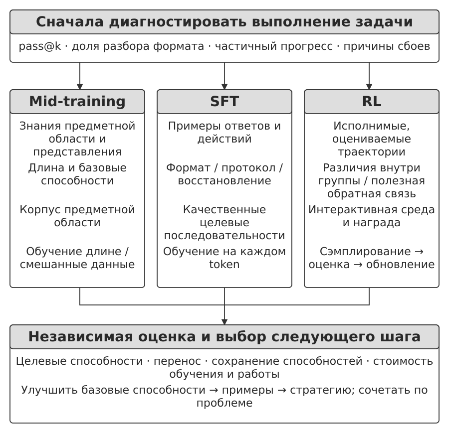

Таблица 8-4. Критерии выбора Mid-training, SFT и RL

| Наблюдаемое явление | Что проверить в первую очередь | Возможные методы | Основные направления последующей оценки |
| --- | --- | --- | --- |
| Модель плохо владеет языком предметной области, её понятиями или базовыми операциями, а многократное сэмплирование почти не даёт прогресса | Охват корпуса и базовые способности | Mid-training; для доступных через поиск фактов — RAG | Задачи предметной области, тестовая выборка для проверки общих способностей и частично правильные траектории |
| Содержимое пригодно, но формат, параметры или фиксированный процесс соблюдаются нестабильно | Демонстрации, интерфейсы и ограничения | SFT, декодирование с ограничениями или валидация инструментов | Успешность разбора, результат задачи и поведение при восстановлении |
| Модель иногда выполняет задачу, но доля успеха мала или она часто идёт обходным путём | Качество вознаграждения, исследование и распределение задач | RL | Польза от выполнения задачи, различия в вознаграждении, независимое обобщение и стоимость |
| Есть демонстрации или данные о предпочтениях, но интерактивная среда ещё не создана | Охват офлайн-данных и способ валидации | SFT, RFT, офлайн-оптимизация предпочтений | Качество базового уровня, смещения в данных и польза от создания среды |

Работу можно вести в четыре этапа. Сначала установите базовый уровень для решения с помощью промпта, контекста, инструментов и ограничений. Если эти методы уже удовлетворяют требованиям задачи, автор отдаёт предпочтение внешним редактируемым решениям, чтобы снизить стоимость сопровождения обучения, развёртывания и регрессионного тестирования. Динамические факты предоставляются посредством поиска и управления версиями; обучение параметров следует рассматривать для неявных суждений, паттернов восприятия и стабильного поведения, которые требуется усваивать многократно.

На втором этапе наблюдайте за успешностью, частичным прогрессом, результатами разбора и типами ошибок на отложенных задачах. После фиксации конфигурации сэмплирования Pass@1 и Pass@k показывают, существуют ли в текущей стратегии пути, которыми можно воспользоваться; неудачные траектории помогают различить нехватку знаний, отсутствие обратной связи и ошибки процесса.

На третьем этапе предоставьте демонстрации поведения, которое требуется усвоить. JSON Schema, вызовы инструментов, употребление терминов, уточнение и восстановление можно оформить в виде примеров SFT, а необходимые знания — предоставить через соответствующий корпус и контекст задачи.

На четвёртом этапе оцените условия обратной связи для RL. Если можно генерировать кандидатов, поддающихся оцениванию, вознаграждение обладает достаточной различающей способностью, а среда допускает необходимое количество взаимодействий, можно сравнить пользу от оптимизации стратегии. Если вознаграждение слишком разрежено, сначала рассмотрите учебную программу, частичные вознаграждения или более подходящую начальную стратегию.

На каждом этапе дальнейшие вложения определяются результатами оценивания: задачи с чётко заданным форматом можно развёртывать после SFT, при достаточно сильной исходной модели можно сразу применять RL, а после продолжения обучения на данных предметной области — повторно использовать уже имеющиеся способности к выполнению инструкций. Далее на примере однораундовой задачи подробно рассмотрим различия в поведении, возникающие при обучении на демонстрациях и на вознаграждении.

Вернёмся к задаче с заказом из рекомендаций по чтению. Передайте модели тот же фрагмент реального описания инструмента и проверьте, сможет ли она правильно указать параметры. Если поля в описании изменились, сначала обновите описание, доступное во время выполнения. Если назначение полей понятно, но модель раз за разом подставляет пользовательский текст вместо номера заказа, можно предоставить демонстрации SFT, включающие запрос данных, уточнение и правильное заполнение параметров. Если модель уже иногда полностью выполняет задачу, а разный порядок запросов приводит к разным показателям успешности и стоимости, появляются условия для сравнения нескольких траекторий стратегии.

## Однораундовое обучение с подкреплением: сопоставление запоминания и обобщения

Однораундовая задача начинается с однократного ввода и заканчивается, когда модель отправляет ответ и получает вознаграждение. При генерации ответа модель по-прежнему может рассуждать в несколько шагов, а система обучения — позволять ей многократно пробовать решить одну и ту же задачу. Ограничение взаимодействия одним ответом упрощает наблюдение за тем, как метод обучения меняет поведение модели. Сначала на примере AdaptThink рассмотрим, как модель учится распределять вычислительный бюджет на рассуждения, а затем с помощью GeneralPoints сравним результаты SFT и RL при изменении правил и визуального оформления.

Чтобы понять процесс обучения в последующих экспериментах, сначала разберёмся, как алгоритмы RL используют вознаграждение для обновления модели. Обучение RL в этой главе в основном опирается на **градиент стратегии**. Возьмём несколько выборок ответов на один вопрос: модель генерирует несколько ответов, после чего вознаграждение каждого из них сравнивается с базовым уровнем. Ответы, превосходящие базовый уровень, получают положительный сигнал, и обучение повышает вероятность их генерации; ответы ниже базового уровня получают отрицательный сигнал, и вероятность их генерации снижается.

Чтобы однократное обновление не увело модель в неверную сторону, распространённый алгоритм **PPO** отсекает дополнительный выигрыш в суррогатной целевой функции, когда отношение вероятностей выходит за заданный диапазон; фактическая величина обновления также зависит от скорости обучения и количества итераций обновления. Рассматриваемый далее «PPO с сетью ценности» обучает оценку ценности, с помощью которой формируется базовый уровень для сравнения и вычисляется преимущество действий на каждом шаге. **GRPO** непосредственно сравнивает несколько ответов на один вопрос и строит базовый уровень по вознаграждениям внутри группы, благодаря чему отдельное обучение сети ценности не требуется.

Следующий псевдокод в стиле Python связывает выборку, вознаграждение, преимущество и обновление параметров, помогая понять, как информация передаётся между этапами. В реальном обучении также требуется настроить параллельную выборку, KL-регуляризацию и оптимизатор.

```python
for prompt in batch:
    group = [rollout(policy, env.reset(prompt)) for _ in range(G)]
    rewards = [verify(trajectory) for trajectory in group]
    advantages = normalize_within_group(rewards)       # базовая линия GRPO
    update(policy, group, advantages)
```

Как PPO обновляет стратегию по группе траекторий разной длины? Сначала внутри каждой траектории в обратном порядке вычисляется дисконтированный возврат для каждого шага. Накопление прекращается в конце траектории, чтобы вознаграждение следующей задачи не попало в текущую. Затем фактически выбранные моделью действия из всех траекторий объединяются и для них вычисляются средние потери. Ниже показано одно обновление без многократной оптимизации по мини-батчам.[^ch8-ppo-method]

```python
states, actions, returns = [], [], []
for trajectory in rollouts:
    states.extend(trajectory.states)       # состояние перед каждым выбором действия
    actions.extend(trajectory.actions)     # поэлементно соответствует состояниям
    returns.extend(discounted_returns(trajectory.rewards))

returns = tensor(returns)
values = value_model(states)
advantages = returns - stop_gradient(values)
ratio = exp(policy.log_prob(actions, given=states)
            - old_policy.log_prob(actions, given=states))
policy_loss = -mean(min(
    ratio * advantages,
    clip(ratio, 1 - epsilon, 1 + epsilon) * advantages
))
value_loss = mean((values - returns) ** 2)
update(policy, value_model, policy_loss + value_coef * value_loss)
```

«Относительность» GRPO обеспечивается несколькими ответами на один вопрос, тогда как здесь PPO использует сеть ценности для оценки ожидаемого возврата из каждого состояния. `old_policy` — это стратегия, зафиксированная на момент генерации данной группы траекторий. Предположим, преимущество действия на некотором шаге равно 1, а текущая стратегия назначает ему вероятность, в 1,4 раза превышающую вероятность при выборке. При `epsilon = 0.2` вклад этого элемента в суррогатную целевую функцию составит `min(1.4, 1.2) = 1.2`. Дальнейшее повышение вероятности этого действия уже не принесёт дополнительного выигрыша от данного элемента.

Если преимущество равно −1, направление меняется на противоположное. Когда отношение вероятностей уже снизилось до 0,6, подстановка в ту же строку кода даёт `min(-0.6, -0.8) = -0.8`, поэтому дальнейшее снижение вероятности также не увеличивает выигрыш. И наоборот, если это менее удачное действие стало встречаться чаще и отношение вероятностей выросло до 1,4, выбор меньшего значения даёт `min(-1.4, -1.2) = -1.4`: повышение его вероятности по-прежнему влечёт штраф.

> **Эксперимент 8-10 ★★: AdaptThink — научиться понимать, «когда не нужно рассуждать»**
>
> Модели рассуждений часто решают задачи с помощью длинного процесса рассуждения. Для простых вопросов прямой ответ позволяет сократить затраты на генерацию. AdaptThink предоставляет модели два режима — Thinking и NoThinking: в моделях, поддерживающих этот протокол, NoThinking завершает фрагмент рассуждения с помощью `<think></think>`, после чего сразу генерируется ответ. Цель обучения — научить модель выбирать подходящий вычислительный бюджет на рассуждения в зависимости от задачи.
>
> Метод включает два ключевых компонента. **Целевая функция с ограничениями** побуждает модель чаще использовать NoThinking, сохраняя при этом общую результативность ответов; **выборка по значимости** корректирует соотношение выборок двух режимов, а затем с помощью весов компенсирует различие между распределением выборки и целевой функцией оптимизации. Исходная модель обычно склоняется к Thinking, поэтому для получения обучающего сигнала, позволяющего сравнивать два режима, необходимо целенаправленно увеличить количество примеров NoThinking. Под проблемой холодного старта здесь конкретно понимается нехватка примеров NoThinking в начале обучения.
>
> В эксперименте книги использовались восемь GPU H100 80GB. К шагу 300 точность MATH500 изменилась с 81,00% до 81,80%, а средняя длина ответа сократилась примерно с 4 911 до 1 577 токенов; точность GSM8K выросла с 79,68% до 81,88%, а длина ответа сократилась примерно с 1 025 до 477 токенов; AIME mean@16 изменился с 31,46% до 31,04%, а длина ответа сократилась примерно с 12 120 до 6 402 токенов. Длина ответа в трёх наборах сократилась приблизительно на 68%, 53% и 47% соответственно.
>
> Доля NoThinking в трёх наборах данных составила соответственно 83,80%, 84,15% и 56,25%. На AIME модель сохранила больший объём вычислений для рассуждений, тогда как на MATH500 и GSM8K чаще отвечала напрямую. Для каждой задачи AIME2024 выполнялось 16 выборок, а mean@16 обозначает среднюю точность этих 16 ответов. К шагу 300 средний ответ стал почти вдвое короче, а точность снизилась примерно на 0,42 процентного пункта.
>
> Шаг 300 был одной из промежуточных проверок во время обучения. Изначально команда планировала провести 3 140 шагов, но позднее выполнение аварийно завершилось, и последняя запись проверки осталась на шаге 410. В этот момент средняя точность AIME2024 составляла 31,88%, а средняя длина ответа — около 5 874 токенов.
>
> AdaptThink можно сочетать с дистилляцией промптов: дистилляция записывает в параметры многократно используемые инструкции и способы решения задач, а AdaptThink затем учится определять, сколько вычислений для рассуждения следует выделить каждой задаче. Вместе они влияют на качество ответа, задержку и стоимость.

> **Эксперимент 8-11 ★★: GeneralPoints — сопоставление «запоминания и обобщения» в однораундовом RL**
>
> Чу и соавторы использовали похожую на «24» карточную игру GeneralPoints для проверки способности модели к обобщению[^ch8-3]. Число на каждой из четырёх карт необходимо использовать ровно один раз и с помощью сложения, вычитания, умножения и деления получить 24. Если модель научилась решать задачу, сможет ли она по-прежнему правильно считать после изменения правил карт или мастей? На рисунке 8-12 показаны два варианта представления задачи: в GP-L условие задаётся непосредственно текстом, а в GP-VL модель должна распознать карты.
>
> *Уточнение русского издания: Одна карточная задача не означает одну попытку: эксперимент допускает последовательные ответы после проверки. Это важно при сравнении бюджетов вычислений. [Источник](https://arxiv.org/html/2501.17161v1).*
>
> 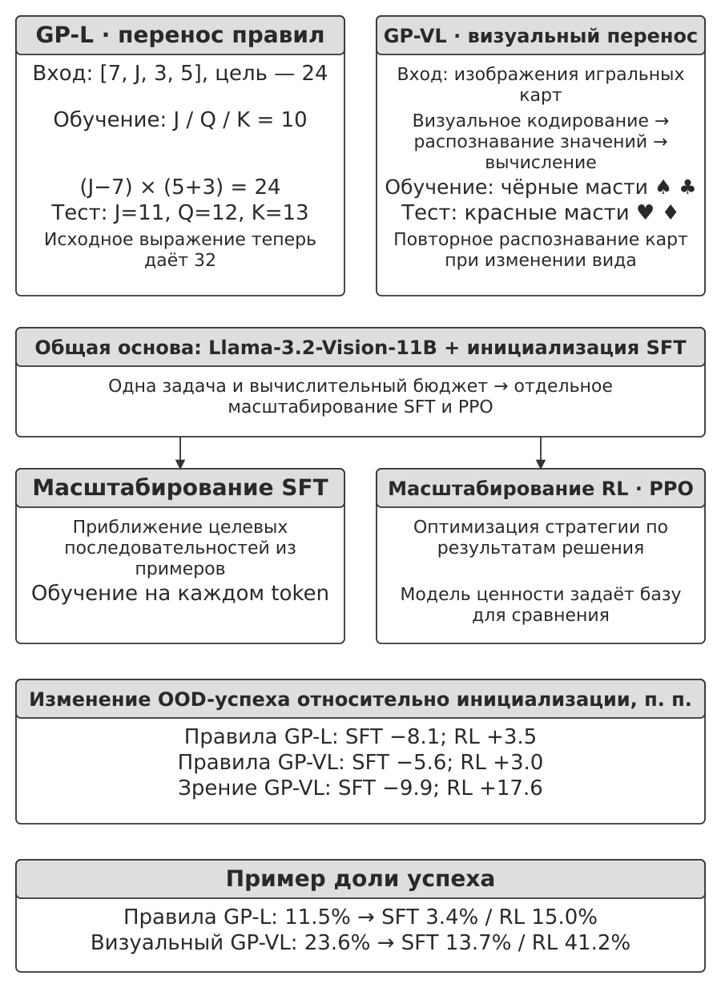
>
> **Вариант правил**: при обучении J/Q/K имеют значение 10, а при тестировании — соответственно 11/12/13. Поэтому тестовый набор содержит комбинации чисел, не встречавшиеся при обучении, что позволяет проверить, способна ли модель выполнять вычисления с 11, 12 и 13 по новым правилам. **Визуальный вариант**: при обучении используются чёрные масти (♠♣), а при тестировании — красные (♥♦), что позволяет проверить способность модели адаптироваться к изменению внешнего вида карт.
>
> Эксперимент начинается с Llama-3.2-Vision-11B: сначала с помощью SFT формируется базовая способность следовать инструкциям, после чего обучение разделяется на две ветви — дальнейшее SFT и RL, сравниваемые при одинаковом вычислительном бюджете. В ветви RL применяется PPO с сетью ценности. Обе ветви обучаются по правилу J/Q/K=10, после чего оцениваются на тестовых наборах внутри распределения (ID) и вне распределения (OOD).
>
> Возьмём `[7, J, 3, 5]`: при J=10 можно использовать `(J−7)×(5+3)=24`; после изменения значения J на 11 это выражение даёт 32, поэтому его необходимо заменить на `(11−5)×(7−3)=24`. Таким образом, одна и та же группа карт требует от модели прочитать действующее правило и заново выстроить вычисление.
>
> Два метода обучения показали заметно различающиеся результаты при тестировании вне распределения. **OOD по правилам**: для GP-L доля успеха RL выросла с 11,5% до 15,0%, то есть на 3,5 процентного пункта; результат SFT снизился с 11,5% до 3,4%, то есть на 8,1 процентного пункта. Для GP-VL результат RL вырос на 3,0 процентного пункта, а SFT снизился на 5,6 процентного пункта. **Визуальный OOD**: для GP-VL результат RL вырос с 23,6% до 41,2%, то есть на 17,6 процентного пункта; результат SFT снизился с 23,6% до 13,7%, то есть на 9,9 процентного пункта.
>
> Дополнительная проверка результатов распознавания карт позволяет связать итоговую успешность решения задачи с визуальным восприятием: в ветви RL точность распознавания росла вместе с долей успешно решённых задач, тогда как в ветви SFT она снижалась. Исследователи связывают это различие с целями обучения: подгонка по каждому токену может закреплять текстовые паттерны демонстраций, тогда как вознаграждение за результат постоянно требует от модели правильно распознавать карты и выполнять вычисления. Точность восприятия служит промежуточным показателем для анализа этого механизма.
>
> Причину предварительного SFT также можно понять через формат вывода. Использованная в эксперименте базовая модель Llama-3.2-Vision-11B не могла стабильно генерировать требуемый структурированный вывод, поэтому валидатор не мог вычислить по нему вознаграждение за задачу и попытка непосредственного сквозного обучения RL провалилась. SFT сначала формирует пригодный для синтаксического анализа и оценки вывод, и только после этого RL может использовать обратную связь от задачи. Рассмотренный ранее DeepSeek-R1-Zero, напротив, начинал с базовой модели, уже способной генерировать ответы, пригодные для оценки, и сразу переходил к RL.
>
> Сколько модель может узнать из обратной связи валидатора? На рисунке 10 в статье отдельно сравнивается чисто текстовая карточная задача GP-L. Исследователи задали 1, 3, 5 и 10 итераций проверки, отдельно обучив и оценив соответствующие модели RL. При одинаковом вычислительном бюджете обучения в группе с десятью проверками доля успеха на новых правилах выросла относительно начального уровня обучения этой группы на 5,99 процентного пункта, тогда как в группе с одной проверкой — на 0,48 процентного пункта.
>
> Почему при смещении распределения в этом эксперименте производительность SFT снижается, а RL показывает лучший результат? Одно из согласующихся с наблюдениями объяснений состоит в том, что ограниченные данные SFT закрепили фиксированный паттерн «считать J/Q/K равными 10». Когда при тестировании J=11, модель по-прежнему считает его равным 10. Ветвь RL, оптимизируемая по результату, с большей вероятностью закрепляет стратегию «пересчитывать до получения правильного ответа», поэтому может применять её и после изменения значения J на 11.
>
> Изменения правил и мастей в GeneralPoints позволяют отдельно наблюдать, научилась ли модель выполнять вычисления по новым условиям и правильно ли она распознаёт новые визуальные входные данные. При использованных здесь модели, обучающих данных и тестовом бюджете ветвь, продолжившая SFT, ухудшила результаты при тестировании вне распределения, а ветвь с последующим RL — улучшила. Прежде чем переносить выводы на собственную задачу, стоит спросить: освоил ли ученик формат вывода? Что именно изменилось в новом тесте — правила, внешний вид входных данных или и то и другое? Только раздельные контролируемые эксперименты покажут, следует ли добавить демонстрации, улучшить восприятие или расширить исследование вариантов с обратной связью по результату.

## Алгоритм RL: от 16 rollout до одного обновления параметров

**GRPO (Group Relative Policy Optimization)** предложен DeepSeek и формирует обучающий сигнал на основе относительных результатов нескольких попыток решения одной задачи. Рассмотрим задачу исправления кода в стиле SWE-bench: при пустых входных данных `parser.py` Python-проекта вызывает `IndexError`; AI-агент должен исправить реализацию, не изменяя тестовые файлы. Одну итерацию обучения можно разделить на четыре этапа.

**Первый этап: многократные попытки модели политики.** Модель политики — это языковая модель, которая обучается в данный момент. Система помещает один и тот же исходный код и одно и то же описание проблемы в 16 изолированных песочниц, позволяя модели независимо выполнить задачу 16 раз. Каждая попытка начинается с чтения кода, проходит через внесение изменений и тестирование и заканчивается отправкой результата; вся эта траектория взаимодействия называется одним **rollout**. Благодаря случайности семплирования из одной исходной точки возникают разные пути: одни правильно добавляют проверку граничного случая, другие лишь перехватывают исключение, третьи изменяют не тот файл, а некоторые пытаются изменить тесты.

**Второй этап: вычисление вознаграждения.** После завершения каждого rollout валидатор применяет патч в чистом окружении и запускает тесты. Предположим, что из 16 попыток четыре прошли все тесты и не изменили тестовые файлы, а остальные 12 завершились неудачно. Тогда четыре успешные траектории получают вознаграждение 1, а остальные 12 — вознаграждение 0. На рисунке 8-13 результаты оценки всех 16 траекторий собраны в одной таблице. В подобных задачах программирования вознаграждение можно вычислять непосредственно с помощью тестов и правил. Для целей, которые сложнее выразить тестами, например читаемости и качества объяснения, можно дополнительно использовать человеческую оценку или модель вознаграждения.

**Третий этап: вычисление относительного преимущества.** Вознаграждение показывает лишь успех или неудачу отдельной траектории, а **относительное преимущество** — насколько она хороша по сравнению с другими попытками в той же группе. Средняя доля успешных попыток в этой группе равна 4/16: четыре прошедшие тесты траектории находятся выше среднего по группе и получают положительное преимущество; 12 неудачных — ниже среднего и получают отрицательное преимущество. Если выполнить нормализацию по внутригрупповому стандартному отклонению, среднее вознаграждение составит 0,25, стандартное отклонение — приблизительно 0,433, преимущество успешной траектории — около 1,73, а неудачной — около −0,58. GRPO формирует обучающий сигнал на основе такого внутригруппового сравнения. Если вознаграждения всех 16 траекторий полностью совпадают, после вычитания среднего по группе каждая из них получит ноль. Добавление в знаменатель небольшого стабилизирующего слагаемого позволяет избежать деления на ноль, но после нормализации результирующие вознаграждения в этой группе всё равно не указывают, какой траектории следует отдавать предпочтение при обучении. В таком случае можно проверить, позволяют ли ограничения пути, процессные вознаграждения или частичный прогресс различить траектории внутри группы. Например, из двух попыток, не исправивших код, только одна прошла исходно падавший тест граничного случая. Если этот промежуточный результат допускает независимую проверку, появляется ещё один возможный сигнал для обучения.

**Четвёртый этап: обновление политики с помощью градиентного спуска.** Программа обучения преобразует относительное преимущество в функцию потерь, вычисляет градиенты, после чего оптимизатор, например AdamW или Muon, выполняет градиентный спуск: повышает вероятность решений, принятых моделью в траекториях с положительным преимуществом, и снижает вероятность решений из траекторий с отрицательным преимуществом. В процессе обучения вероятности этих решений многократно корректируются на множестве задач и rollout. По мере действия оптимизации при возникновении похожей ошибки последовательность «сначала воспроизвести проблему, проверить граничные условия, изменить реализацию и запустить тесты» будет появляться чаще, а действия «замаскировать исключение, изменить тесты, отправить результат без проверки» — реже.

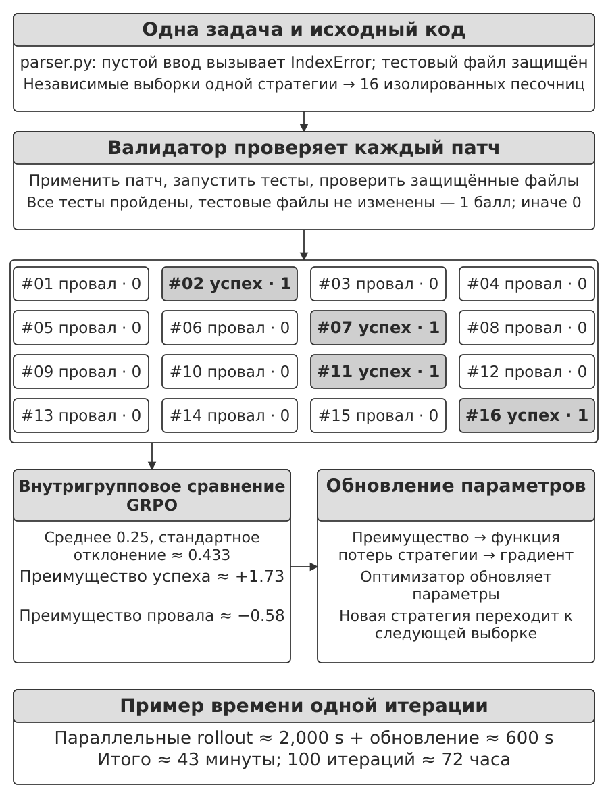

Сколько **итераций обучения (step)** составляют 16 выборок одной задачи на рисунке 8-13? Согласно принятому в этом разделе способу подсчёта, все 16 rollout входят в один пакет. На $k$-м раунде текущая политика выполняет семплирование, после чего вычисляются вознаграждения, преимущества и градиенты и политика обновляется один раз; повторное семплирование с новыми параметрами начинается только на $k+1$-м раунде. Обучение в течение 100 steps означает, что проводится около 100 таких итераций.

На этой основе можно оценить время обучения. Одна сложная задача может включать десятки раундов вызовов инструментов. При синхронном обучении, ожидающем завершения всего пакета, длительность этапа семплирования определяется самой медленной из 16 параллельных траекторий. Предположим, что она занимает около 2 000 секунд, а вычисление градиентов и обновление оптимизатора — ещё 600 секунд. Тогда один step потребует примерно $2{,}000+600=2{,}600$ секунд, то есть 43 минуты. Непрерывное обучение в течение 100 steps с такими же затратами времени займёт около 72 часов.

PPO и GRPO следуют этому замкнутому циклу; основное различие заключается в том, «с чем проводится сравнение». GRPO напрямую сравнивает несколько rollout одной задачи и не требует отдельной модели ценности. PPO обучает модель ценности, которая оценивает, «насколько хорошего результата обычно можно достичь» на каждом шаге траектории, а затем определяет, оказалось ли текущее действие лучше этого ожидания, предоставляя тем самым базовую линию для пошагового распределения заслуг. Оба алгоритма подавляют чрезмерно большие обновления с помощью таких механизмов, как clipping суррогатной целевой функции. DPO устроен иначе: он напрямую обучается на заранее собранных парах предпочтений «лучший ответ — худший ответ» и не заставляет текущую политику генерировать эту группу rollout в режиме онлайн.

В примерах этой главы используются разные схемы обучения: AdaptThink применяет собственную целевую функцию с ограничениями; GeneralPoints, V-IRL и ReTool используют PPO, причём у первых двух модель ценности участвует в оценке преимущества; SimpleVLA-RL и RLVP используют GRPO.

Предположим, что задачи А и Б выполняются по четыре раза: задача А решена правильно во всех попытках, а задача Б — неправильно. Все четыре вознаграждения задачи А равны 1, а задачи Б — 0. После отдельного вычитания среднего по группе преимущества в обеих группах превращаются в 0. Но если есть вычислительные ресурсы для дополнительных попыток, на какую задачу перспективнее их потратить, чтобы получить полезные обучающие примеры?

Never Give Up включает этот выбор в процесс семплирования. Если все попытки задачи А успешны, группа пропускается; если все попытки задачи Б неудачны, с некоторой вероятностью добавляется ещё одна группа. Предположим, что во второй группе наконец появляется один правильный ответ. Тогда при обучении объединяются все восемь ответов из двух групп: один правильный и семь неправильных, благодаря чему для одной задачи появляются разные уровни вознаграждения. Асинхронное семплирование позволяет остальным задачам выполняться как обычно, не дожидаясь результата задачи Б.[^ch8-ngu]

[^ch8-ngu]: Michael Noukhovitch и др., *Learning to Solve Hard Problems in RL for LLMs by Never Giving Up*, 2026. Описанное в статье дополнительное семплирование используется для обучения; уже решённые задачи по-прежнему могут снова выбираться в последующем обучении.

### Почему в RL для LLM обычно предпочитают On-Policy

**Online (онлайн)** и **On-policy (на данных текущей политики)** описывают два разных аспекта. При онлайн-обучении система во время работы непрерывно взаимодействует со средой и создаёт данные. Обучение на данных текущей политики относится к источнику данных и требует, чтобы поведенческая политика $\mu$, генерирующая траектории, совпадала с оптимизируемой политикой $\pi_\theta$ или была достаточно близка к ней. Асинхронный кластер может непрерывно выполнять онлайн-семплирование, но если worker отстаёт на несколько контрольных точек, возвращаемые им данные характеризуются устареванием политики и приобретают компонент off-policy (на данных другой политики).

Автор рекомендует сначала создать стабильную базовую конфигурацию с обучением, близким к on-policy, и лишь затем вводить асинхронное семплирование или повторное использование старых данных для повышения пропускной способности. Рассматриваемые в этой главе схемы PPO/GRPO обычно в начале каждого step выполняют семплирование с помощью последней политики. Затем PPO выполняет несколько раундов обновлений по minibatch на одном пакете данных, и текущая политика постепенно отклоняется от `old_policy`, с помощью которой эти данные были сгенерированы. Отношение вероятностей измеряет это изменение, а целевая функция с clipping подавляет чрезмерно большие обновления.

Цель градиента политики связана с ожидаемым вознаграждением для текущей политики $\pi_\theta$. При использовании данных, выбранных поведенческой политикой $\mu$, сначала можно вычислить отношение вероятностей действия в одном и том же состоянии, а затем построить на его основе коррекцию по важности:

$$
\rho_t=\frac{\pi_\theta(a_t\mid s_t)}{\mu(a_t\mid s_t)}
=\exp\left(\log\pi_\theta(a_t\mid s_t)-\log\mu(a_t\mid s_t)\right).
$$

Предположим, что после одного и того же префикса вероятность выбора определённого токена политикой семплирования равна 0,2, а текущая политика назначает ему вероятность 0,3. Тогда отношение вероятностей на этом шаге равно 1,5. В старой выборке такой токен встречался реже, поэтому при оценке по текущей политике вес подобных примеров соответственно повышается. Если при семплировании и обучении используется одна и та же политика, до обновления параметров отношение вероятностей на каждом шаге равно 1.

Повторное использование старых траекторий позволяет выполнять семплирование и обучение асинхронно, повышая пропускную способность. Однако чем сильнее различаются две политики, тем вероятнее, что небольшое число примеров получит очень большой вес. При перевзвешивании всей траектории отношения вероятностей отдельных шагов также приходится перемножать. PPO отсекает часть дополнительного выигрыша в суррогатной целевой функции каждого действия, ослабляя влияние экстремальных отношений вероятностей; однако состояния, которых старые примеры никогда не посещали, можно увидеть только с помощью нового семплирования. Поэтому автор отдаёт предпочтение свежим траекториям.[^ch8-32]

#### Численные различия между обучением и инференсом

В крупномасштабном RL для LLM семплирование обычно выполняется движками инференса вроде vLLM и SGLang, а логарифмические вероятности и градиенты вычисляются обучающими системами вроде FSDP и Megatron. Даже при загрузке одинаковых весов обе стороны могут вычислить немного разные логарифмические вероятности одного и того же токена из-за различий в точности вычислений с плавающей запятой, порядке редукции, тензорном параллелизме, размере пакета, KV-кэше и объединённых вычислительных ядрах. В результате параметры ещё не обновлены, а $\rho_t$ уже отклоняется от 1: между обучением и семплированием возникает численное различие политик. Контролируемые эксперименты показывают, что даже небольшие различия на уровне токенов могут вызвать коллапс обучения.[^ch8-33]

Если распределение семплирования изменилось, наивный градиент политики может отдать предпочтение одному из двух действий, даже когда их вознаграждения полностью совпадают. Предположим, что при семплировании действия А и Б выбираются с одинаковой вероятностью, но во время обучения вероятность выбора А моделью уже равна 0,8. Для logit, управляющего действием А, градиент логарифмической вероятности равен $1-0.8=0.2$, если выбрано А, и $0-0.8=-0.8$, если выбрано Б. Если оба действия получают 1 балл, средний градиент по распределению семплирования равен $-0.3$. Хотя обе альтернативы получают одинаковую оценку, обновление снижает вероятность А.

Score centering вычитает из градиента логарифмической вероятности для одного и того же префикса его среднее по распределению семплирования. После вычитания $-0.3$ в приведённом примере два значения становятся равны соответственно $0.5$ и $-0.5$, а среднее обновление при одинаковом вознаграждении оказывается точно нулевым. Выше GRPO вычитала среднее из вознаграждений группы ответов; здесь центрируется градиент.[^ch8-sc]

[^ch8-sc]: Martin Marek, Max Ryabinin, *Score Centering Stabilizes Off-policy Reinforcement Learning*, 2026. Если политика семплирования отстала слишком сильно, расстояние между обучаемой и поведенческой политиками также можно ограничить с помощью KL-регуляризации (arXiv:2611.21791).

Численная ошибка между обучающей стороной и стороной семплирования также усиливается вдоль длинной последовательности: **ошибка логарифмической вероятности → отклонение отношения вероятностей → накопление на длинном префиксе → изменение clipping и взвешивания преимуществ → изменение градиента и эффективного размера выборки**. Например, если логарифмические отношения вероятностей для 4 000 токенов имеют отклонение $10^{-3}$ одного знака, вычисленное отношение вероятностей на уровне траектории будет в $e^{4000\times0.001}=e^4\approx54.6$ раза больше истинного значения.

Ранние изменения вероятностей также могут повлиять на результат семплирования, направив последующие состояния по другому пути. Наблюдаемые при обучении сигналы включают всплески отношений важности, рост доли clipping, скачки градиента или длины ответа, а также снижение вознаграждения и энтропии. При изменении размера пакета может меняться процесс редукции и, следовательно, численный результат для одного и того же входа, то есть нарушается инвариантность относительно размера пакета (batch invariance). В соответствующих исследованиях наблюдался возникающий из-за этого неявный эффект off-policy; согласование вычислений при семплировании и обучении либо явная коррекция различий между политиками повышали стабильность.[^ch8-34]

Поэтому автор считает численную согласованность семплирования и обучения ключевой проверкой перед запуском обучения и непрерывно отслеживает её вместе с кривой вознаграждения. Обработку можно разделить на четыре этапа: «измерить различия → согласовать конфигурацию → скорректировать отклонение → ограничить устаревание».

- **До любого обновления параметров** сравнивайте логарифмические вероятности токенов, вычисленные стороной семплирования (sampler) и обучающей стороной (trainer) для одного пакета траекторий; отслеживайте среднее значение, квантили и максимум $\rho_t$, приближённую KL-дивергенцию и долю значений, подвергнутых clipping. Это наиболее прямой модульный тест режима on-policy.
- При синхронизации весов также согласуйте адаптеры LoRA, токенизатор, шаблон диалога, версию модели и конфигурацию позиционного кодирования. Rollout должен сохранять логарифмические вероятности, выданные политикой семплирования во время генерации, чтобы впоследствии на их основе вычислялось отношение вероятностей.
- По возможности согласуйте точность, схему параллелизма и ключевые вычислительные ядра при семплировании и обучении. Если это невозможно, явно рассматривайте различие как off-policy, применяйте коррекцию по важности, отслеживайте эффективный размер выборки и оценивайте результат коррекции с учётом доли clipping.
- Своевременно выполняйте повторное семплирование с обновлённой политикой, ограничивайте число раундов обновления на каждом пакете данных и число checkpoint, на которое асинхронное семплирование отстаёт от обучения.

## Среда RL: от оценивания к симуляции

Для обучения RL AI-агент должен многократно выполнять задачи. Исправление кода можно повторить в изолированной копии, тогда как платёж изменяет состояние реального счёта. Обучающая среда должна предоставлять сбрасываемое начальное состояние, параллельно выполняемые экземпляры задач и проверяемые результаты, чтобы модель могла исследовать разные пути в контролируемых условиях. В седьмой главе уже были представлены среды оценивания; при их использовании для обучения необходимо также учитывать длительное выполнение, побочные эффекты действий и стоимость большого числа взаимодействий. Автор сначала выделяет людей и бюджет на создание среды, а затем планирует крупномасштабное обучение. Реализация реалистичной обратной связи, сброса состояния и параллельной изоляции зачастую требует больше инженерных ресурсов, чем интеграция PPO или GRPO, а стоимость создания среды может превышать стоимость самого обучения.

### Среда: тренировочная площадка модели

Среда обновляет состояние в соответствии с действиями и возвращает модели новые наблюдения. При создании среды можно отталкиваться от трёх вопросов.

- **Насколько взаимодействие близко к сценарию развёртывания?** Симулятор клиентской поддержки должен охватывать случаи, когда пользователь предоставляет дополнительные сведения, меняет требования или выражается неоднозначно; симулятор инструментов должен воспроизводить ошибки и задержки, распространённые в производственной среде. На основе этой обратной связи модель учится справляться с реальными проблемами. Слишком однообразная обратная связь приводит к тому, что стратегия начинает зависеть от фиксированных шаблонов симуляции.
- **Можно ли стабильно повторять и параллельно выполнять задачи?** Для каждого rollout требуется независимое состояние заказа, файла или учётной записи с возможностью очистки и восстановления после завершения. Именно эти функции выполняют песочница интерпретатора кода ReTool и MCP-песочница AWorld. Для реальных API с ограничениями частоты запросов, платой за использование или побочными эффектами записи в зависимости от задачи можно применять учётные записи песочницы, воспроизведение данных или имитационные интерфейсы.
- **Как определить результат?** Состояние среды служит важной основой для расчёта вознаграждения. Например, в задаче возврата средств можно проверить сумму, состояние заказа и условия авторизации, а в задаче по работе с кодом — выполнить тесты. Проектирование вознаграждения будет отдельно рассмотрено далее.

**Прежде чем настраивать алгоритм, автор рекомендует проверить: достаточно ли среда симуляции близка к реальной задаче? Это гораздо важнее выбора между PPO и GRPO.** Реалистичность, возможность сброса и проверяемость вместе определяют, чему модель сможет научиться из взаимодействий. Как правило, сначала стоит отладить эти три составляющие на небольшом числе задач и лишь затем увеличивать масштаб обучения: так проще локализовать проблемы.

### Симуляция инструментов и среды с помощью модели

Результаты поиска, диалоги с пользователями и сложные состояния бизнес-процессов можно синтезировать с помощью модели. Симулятор на основе модели получает действия агента и генерирует следующую обратную связь, снижая зависимость от внешних сервисов, доступных в реальном времени. Этот подход можно расширить от отдельного инструмента до всей среды выполнения задачи.

**Первый уровень: синтез возвращаемых значений инструментов.** В ZeroSearch[^ch8-13] LLM исполняет роль поискового движка: ученик отправляет запрос, а симулятор генерирует результаты поиска. Это позволяет уменьшить зависимость обучения от стоимости реальных поисковых API, ограничений частоты запросов и колебаний результатов. Кроме того, применяется учебный план: вначале возвращаются высококачественные и высокорелевантные документы, а затем постепенно добавляется шум, чтобы ученик учился извлекать полезную информацию из несовершенных материалов. После обучения в симулируемой поисковой среде исследованная модель сохранила высокое качество работы и при подключении к реальному поисковому движку.

**Второй уровень: симуляция переходов состояния среды.** DreamGym[^ch8-14] дистиллирует динамику среды в рассуждающую модель опыта. Модель считывает текущее состояние и действие агента, выводит следующее состояние и обратную связь и массово генерирует траектории взаимодействия для онлайн-RL, сокращая число обращений к реальной среде. В задачах клиентской поддержки и продаж LLM также может исполнять роль пользователя, имитируя уточняющие вопросы, предоставление дополнительных сведений и изменение требований. В серии τ-bench применяется симулятор пользователей; аналогичные интерактивные системы можно использовать и для обучения, разделяя тренировочные задачи и задачи оценивания.

Симуляторы на основе моделей также нуждаются в калибровке. Если симулятор клиентской поддержки всегда правильно понимает неоднозначные вопросы, у стратегии не будет возможности научиться задавать уточняющие вопросы; если поисковый симулятор всегда возвращает правильные документы, стратегия не получит опыта распознавания шума. Кроме того, обучение может закрепить поведение, эксплуатирующее недостатки системы оценивания симулятора. Автор рекомендует сочетать подходы: поручить модели симуляцию основной массы взаимодействий, затем регулярно проверять стратегию на задачах в реальной среде и использовать обнаруженные расхождения для корректировки симулятора. Так образуется итерационный процесс «синтетические взаимодействия → оценивание на реальных задачах → корректировка симулятора».

Как понять, действительно ли симулятор способен научить пользоваться инструментами? Можно провести небольшой тест: для одного и того же исходного заказа сначала выполнить запрос, затем отправить изменение и снова выполнить запрос, проверив, изменились ли возвращаемые поля заказа ожидаемым образом. После этого следует сбросить среду и убедиться, что снова возвращаются исходные значения. Среда, которая умеет лишь сгенерировать правдоподобную фразу «изменение выполнено», но не может отразить изменение в следующем запросе, будет вознаграждать стратегию за убедительные слова, даже если заказ так и не был изменён.

### Изоляция среды, распределения задач и оценивания

Обучающая среда определяет, с чем может столкнуться модель. Сбрасываемое состояние позволяет повторять попытки, изолированные экземпляры — выполнять задачи параллельно, а явные состояния и правила проверки — воспроизводить и оценивать результаты. Для создания задач можно использовать описанный выше метод синтеза данных: извлечь из реальных журналов бизнес-процессов шаблоны задач, удалить идентифицирующую информацию, а затем сгенерировать вымышленных персонажей, заказы, файлы и начальные состояния.

Обучение и оценивание могут использовать общий генератор задач и общий код проверки, однако конкретные задачи следует разделить на независимые наборы. Согласно подходам к проектированию сред SWE-Gym, τ²-bench и AndroidWorld[^ch8-28], приёмочные тесты, скрытые состояния, необходимые для оценивания, и эталонные решения должны оставаться на стороне верификатора, а агент должен получать наблюдения через предусмотренный задачей интерфейс. Прежде чем увеличивать масштаб выборки, следует выполнить небольшое число rollout и проверить, можно ли решить задачу и способен ли верификатор отличить действительный результат от недействительного. Раннее обнаружение смещений в оценивании уменьшает вероятность того, что стратегия научится эксплуатировать уязвимости проверки.

Таким образом, среду следует разрабатывать в следующем порядке: **шаблон задачи → сбрасываемая среда → проверка результата → изоляция обучения и оценивания → калибровка по реальным взаимодействиям**. Описанный выше синтез данных отбирает из этих сред действительные траектории, формируя демонстрации для SFT. После перехода к RL текущая стратегия продолжает учиться в среде методом проб и ошибок, исследуя пути за пределами демонстраций.

Проверку также необходимо учитывать в бюджете пропускной способности. Lean kernel, средство запуска тестов и выполнение в контейнере расходуют ресурсы CPU и память. Если GPU генерирует результаты быстрее, чем выполняется проверка, задачи начинают накапливаться в очереди верификации. В таком случае следует увеличить число воркеров верификатора, сократить задержку проверки либо скорректировать соотношение ресурсов генерации и проверки[^ch8-9].

## От однократного к многоэтапному взаимодействию: сценарии задач и распределение заслуг

### Ключевые сложности многоэтапных задач

Слева на рисунке 8-14 решается задача «24». Модель может выполнить в ответе несколько шагов вычислений, но на всех этих шагах использует четыре заданные карты и не получает по ходу новых наблюдений от среды. Справа показана навигация по панорамам улиц. Только повернув налево на перекрёстке, можно увидеть улицу за поворотом. Дальнейший путь приходится заново выбирать по находящимся перед глазами дорожным указателям. Организовать такое взаимодействие позволяет ReAct, рассмотренный в первой и четвёртой главах: модель выбирает действие, инструмент или среда выполняет его, а новое наблюдение поступает в следующий раунд принятия решений.

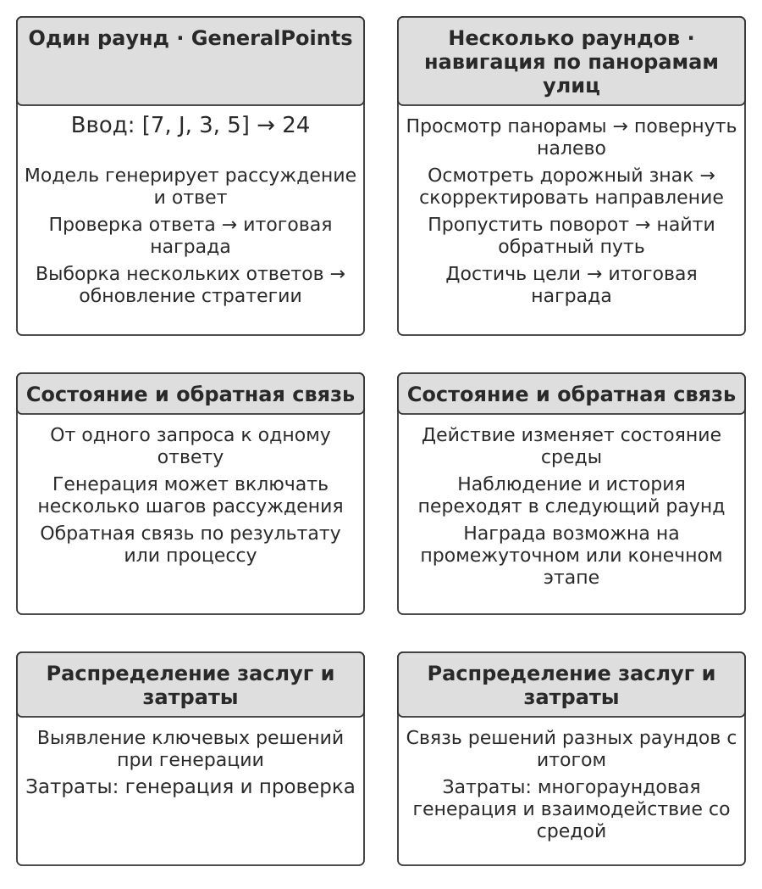

На рисунке 8-15 AI-агент пропускает перекрёсток на третьем шаге, на четвёртом замечает, что сбился с пути, разворачивается и возвращается, а на пятом достигает цели. Вознаграждение за достижение конечной точки подтверждает успешность всей навигации, но не различает движение по неверному пути и своевременный разворот. При следующей встрече с этим перекрёстком агент должен сразу выбрать правильный путь, однако, если он снова ошибётся, следует по-прежнему поощрять его за разворот. При обучении необходимо оценить, как каждый предшествующий шаг повлиял на итоговую выгоду. Эта задача называется **распределением заслуг (Credit Assignment)**. При оценке ценности и преимущества можно учитывать последующие отдачи, а если промежуточные действия допускают надёжную проверку — добавлять процессные вознаграждения. Разворот на четвёртом шаге получает ноль баллов в рамках процессного вознаграждения, но всё же помогает достичь конечной точки. Поэтому при оценке ценности этого шага необходимо учитывать и последующую отдачу.

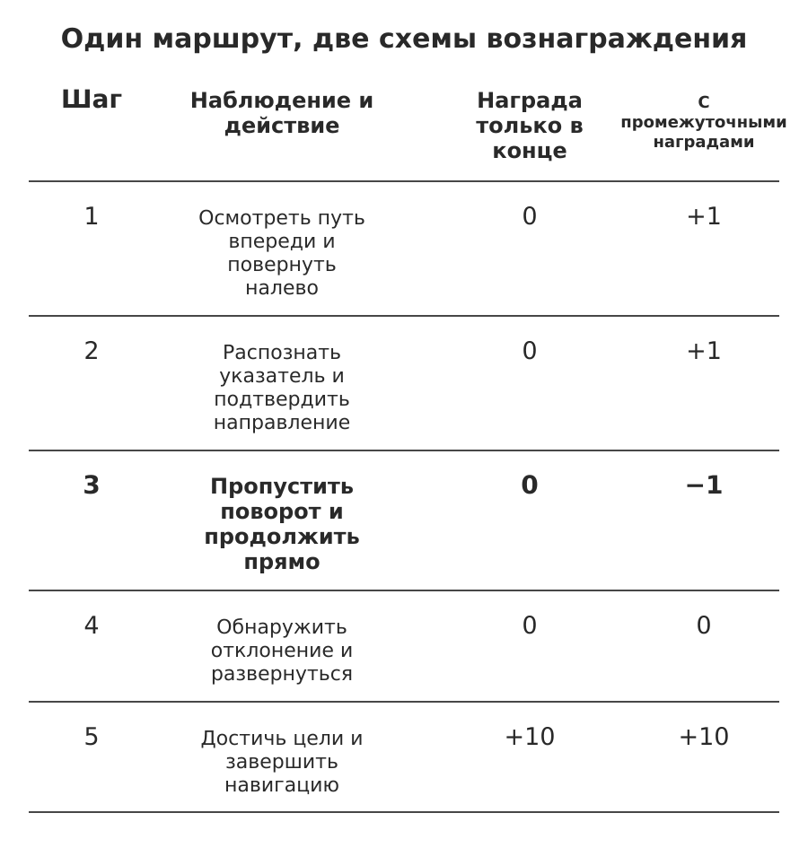

Та же проблема возникает и при звонках в службу поддержки. Например, пользователь оставил положительный отзыв на десятом раунде. Уточнение спорного списания во втором раунде и объяснение комиссии в седьмом могли оказаться полезными, но по одному лишь итоговому отзыву невозможно определить вклад каждого из этих шагов. В следующих двух экспериментах рассматриваются соответственно ситуации, когда обучающая система может проверять навигационные действия шаг за шагом и когда об успехе робота можно судить только по результату всей задачи.

> **Эксперимент 8-12 ★★★: V-IRL-VL — многоэтапная визуальная навигация**
>
> В V-IRL[^ch8-24] агент должен шаг за шагом найти пункт назначения, ориентируясь по находящимся перед ним панорамам улиц. Для обучения используются маршруты Нью-Йорка, а при тестировании — другие города, где меняются как формулировки указаний, так и сами уличные виды. RL заметно превосходит SFT в обоих видах тестирования вне распределения: при изменении правил и визуальных данных. В эксперименте применяется PPO с сетью ценности. Обратная связь после каждого шага помогает определить, какие решения на длинном маршруте следует закрепить.
>
> *Уточнение русского издания: В исследовании перенос при смене правил и перенос при изменении визуальной среды оцениваются в отдельных условиях. Совместная смена города, изображения и правил сама по себе не позволила бы разделить их эффекты. [Источник](https://arxiv.org/html/2501.17161v1).*

> **Эксперимент 8-13 ★★★: SimpleVLA-RL — открытое исследование с вознаграждением за результат `[Расширенный эксперимент]`**
>
> В робототехнических задачах LIBERO SimpleVLA-RL использует вознаграждение за результат — успех или неудачу. Для холодного запуска посредством SFT на каждую задачу используется одна демонстрационная траектория, после чего RL повышает долю успешных выполнений с 17,3% до 91,7% и вырабатывает отсутствующее в демонстрации действие «толкнуть и разрезать». Сопоставим этот результат с навигацией по панорамам улиц: если можно надёжно определить, на каком промежуточном шаге был выбран неверный путь, обратную связь можно предоставить сразу и тем самым ускорить обучение. Если же возможные способы выполнения задачи ещё неизвестны, вознаграждение только за результат оставляет модели пространство для испытания других путей. Если слишком рано превратить последовательность действий из человеческой демонстрации в требования к вознаграждению, новые стратегии наподобие «толкнуть и разрезать» могут получить заниженную оценку.
>
> *Уточнение русского издания: Рост с 17,3 до 91,7 % относится к LIBERO-Long. Поведение pushcut наблюдалось в другом наборе задач — RoboTwin2.0. [Источник](https://arxiv.org/html/2509.09674v1).*

### Вызовы инструментов: обучение использованию внешних возможностей во время взаимодействия

После подключения внешних инструментов модель может выбирать поиск, выполнение кода, изменение файлов, запросы к базам данных или необходимую для задачи комбинацию нескольких API. Harness проверяет и диспетчеризирует вызовы, а инструменты выполняются в среде и возвращают наблюдения. На рисунке 8-16 принятие решений в рамках одной задачи отделено от обучения после её завершения. По стрелкам справа результат инструмента возвращается в текущую задачу, и модель использует его для выбора следующего шага. При движении вниз видно, что только после завершения задачи обучающая программа вычисляет вознаграждение по всей траектории и обновляет параметры, а новая стратегия применяется уже при выборке следующего раунда. Если в рамках одной задачи требуется последовательно вызвать несколько инструментов, результат предыдущего вызова влияет на параметры следующего.

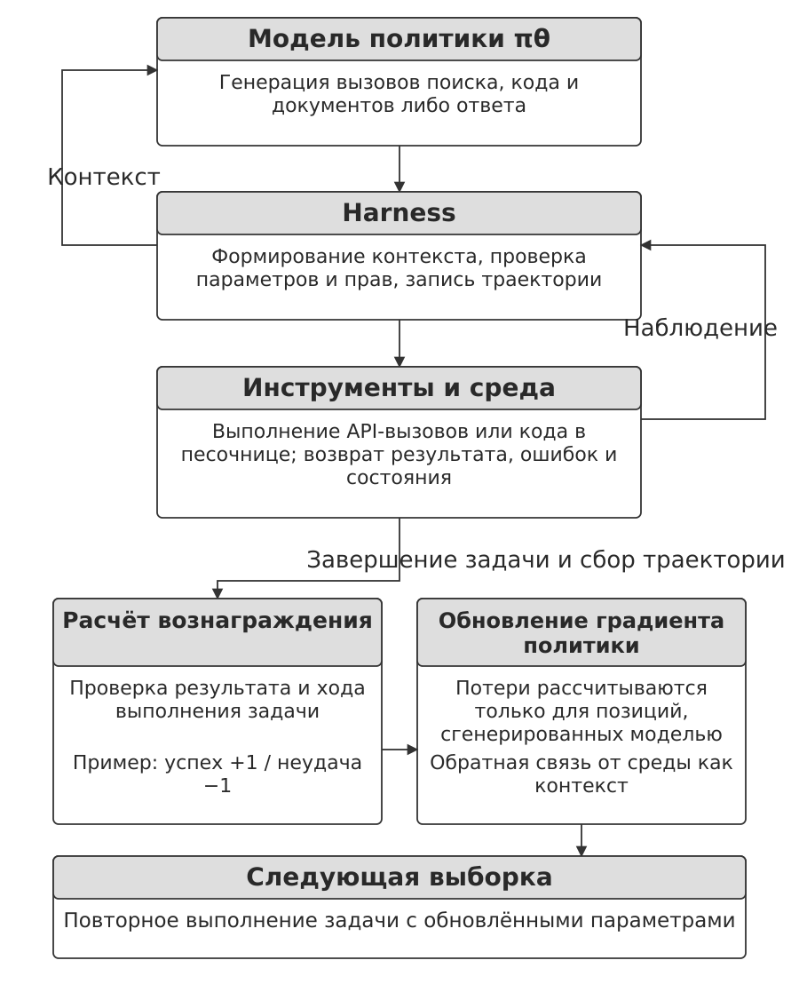

Search-R1[^ch8-25] обучает модель решать, когда выполнять поиск, какой запрос отправить и как использовать результаты для продолжения рассуждений. ReTool подключает к такому же циклу интерпретатор кода: модель учится планировать выполнение кода, понимать возвращаемые значения и исправлять решение с учётом ошибок. AWorld-train расширяет этот подход до песочницы MCP с несколькими инструментами, где модель должна выбирать инструменты и учитывать зависимости между вызовами, а обучающая система — уметь сбрасывать среду и повторно воспроизводить траектории.

В траекториях использования инструментов необходимо различать токены, сгенерированные моделью, и токены, возвращённые средой. При вычислении потерь стратегии учитываются только такие действия модели, как рассуждения, параметры вызовов и ответы, а позиции, соответствующие обратной связи от среды, маскируются. При этом обратная связь остаётся частью контекста для последующих вычислений и помогает модели определить следующий шаг. Например, если интерпретатор возвращает сообщение об ошибке, обучение должно закреплять то, как модель после этого исправляет код. Если включить текст ошибки в потери стратегии, к обновлению примешается цель «генерировать вывод среды», не относящаяся к решениям, за которые в действительности отвечает модель.

> **Эксперимент 8-14 ★★★: ReTool — решение математических задач с помощью интерпретатора кода**
>
> На рисунке 8-17 на примере квадратного уравнения показано, как чередуются текстовые рассуждения, генерация кода и обратная связь от интерпретатора.
>
> 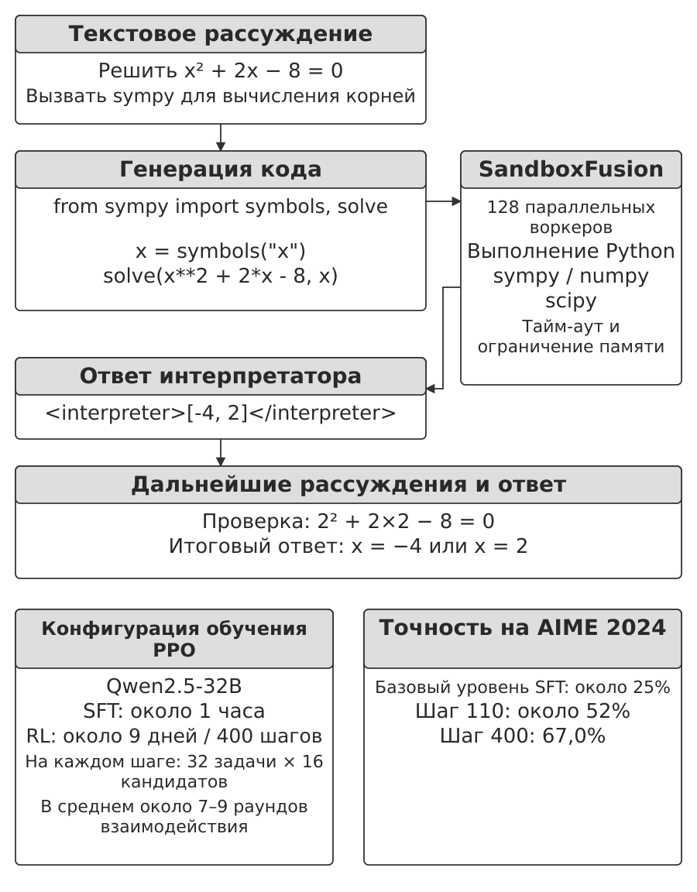
>
> После предварительного прогрева посредством SFT ReTool обучается с помощью PPO, чередуя текстовые рассуждения, выполнение кода и обратную связь от интерпретатора. Модель постепенно учится определять, когда стоит выполнить код, и как изменить его после ошибки. Здесь используются обучающие данные DAPO-Math-17k, а стратегия по-прежнему обновляется с помощью стандартного PPO[^ch8-26][^ch8-27].
>
> После обучения точность ответов модели на AIME 2024 выросла примерно с 25% до 67,0%. По сравнению с чисто текстовым RL обратная связь от кода позволила модели быстрее научиться точным вычислениям и исправлению ошибок.
>
> *Уточнение русского издания: Для Qwen2.5-32B-Instruct на AIME 2024 в статье указаны три отдельные точки: 26,7 % для исходной модели, 40,9 % после SFT и 67,0 % после 400 шагов RL. Это не результат оценивания на AIME 2025. [Источник](https://arxiv.org/html/2504.11536v1).*

> **Эксперимент 8-15 ★★★: AWorld-train — обучение использованию инструментов в песочнице**
>
> При прохождении по верхней половине цикла на рисунке 8-18 модель получает результат вызова инструмента и может продолжить попытки. Теперь пройдём по нижней половине: эта партия задач уже завершена, обучающая программа получает траектории с вознаграждениями и обновляет параметры, а новая стратегия применяется только в следующей партии задач.
>
> 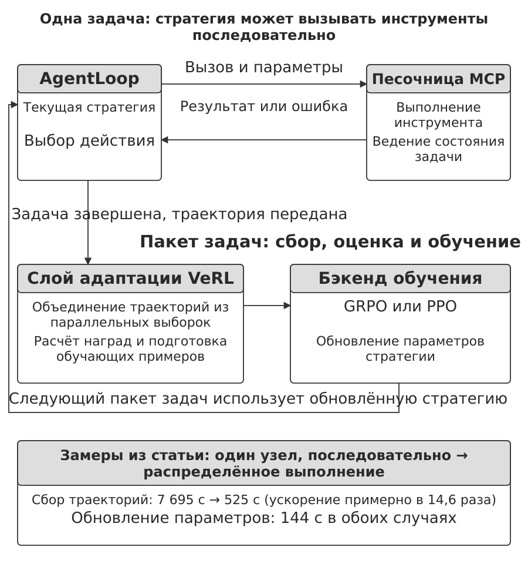
>
> Среда GAIA включает 26 MCP-серверов и 126 функций инструментов. Она позволяет управлять веб-страницами посредством Playwright, извлекать содержимое из PDF, документов Word и презентаций, транскрибировать аудио, распознавать текст и выполнять код в песочнице E2B. Инструмент Excel предоставляет 29 операций, включая работу с формулами, диаграммами и сводными таблицами, а поиск знаний также обеспечивает доступ к Wikipedia, arXiv и Wayback. После сброса песочницы попытку можно повторить из того же состояния или воспроизвести предыдущую траекторию.
>
> Показанные на рисунке измерения времени взяты из контрольного сравнения при сборе данных, приведённого в статье. В сопроводительном эксперименте также указана конфигурация обучения модели 4B: Qwen3-4B-Thinking-2507, восемь A100, предел контекстного окна 131K, не более 32 раундов взаимодействия, размер пакета 32, выборка 16 траекторий на задачу, обновление посредством GRPO и скорость обучения 1e−6.

Инструмент вернул результат — но какой шаг должна вознаградить обучающая программа? Успешный вызов означает лишь, что инструмент выполнился без ошибки. Чтобы определить, приблизил ли этот шаг выполнение задачи, необходимо с помощью валидатора проверить вызванные им изменения и только затем решить, какое вознаграждение предоставить модели.

## Проектирование вознаграждения: как превратить цель задачи в обучающий сигнал

Представим две траектории возврата средств, в результате которых возвращена одинаковая сумма, но в одной из них пропущена обязательная проверка личности. Если учитывать только конечный баланс, обе получат одинаковую оценку. Чтобы превратить полный набор требований пользователя в обучающий сигнал, сначала определите, кто может проверить результат, на каком шаге можно получить доказательства и какую информацию необходимо передать модели, а затем проверьте, можно ли отдельно верифицировать разрешения и процессные ограничения на всём пути выполнения.

### Откуда поступает вознаграждение: правила, человеческие предпочтения и оценка моделью

Для задач, допускающих автоматическую проверку, автор отдаёт предпочтение **обучению с подкреплением на основе верифицируемого вознаграждения (RLVR)**, при котором приёмочные требования непосредственно выражаются программным кодом. В математической задаче можно проверить ответ, в задаче по программированию — запустить тесты, а в задаче возврата средств — проверить сумму и состояние заказа в базе данных. За успешное прохождение можно начислить 1, за неудачу — 0: так получается простейшее вознаграждение за результат. Чёткие правила и воспроизводимое выполнение упрощают поиск причин расхождений в оценках, а область покрытия верификатора определяет, какие именно требования будут оптимизироваться при обучении.

**Обучение с подкреплением на основе обратной связи от людей (RLHF)** преобразует человеческие предпочтения в обучающий сигнал. В InstructGPT[^ch8-4] сначала собираются результаты сравнения ответов людьми, затем обучается модель вознаграждения, после чего стратегия оптимизируется с помощью PPO. Модель вознаграждения усваивает предпочтения из ограниченной выборки, поэтому постоянная погоня за более высокой оценкой модели может усиливать её смещения[^ch8-5]. При обучении часто добавляют KL-регуляризацию относительно эталонной SFT-модели, чтобы ограничить смещение стратегии. DPO[^ch8-6], в свою очередь, оптимизирует стратегию непосредственно по парам предпочтений «лучший ответ — худший ответ», устраняя отдельный этап обучения модели вознаграждения.

В открытых задачах модель может выдавать обоснование оценки и балл. Диагностику, создаваемую **генеративной моделью вознаграждения (GRM)**, также можно использовать для отбора демонстраций, построения пар предпочтений или подготовки последующих исправлений. DeepSeek-GRM[^ch8-23] генерирует принципы оценки с учётом задачи, а затем на их основе формирует критический разбор и выставляет балл. Поведение оценщика улучшается посредством онлайн-RL, а итоговое суждение агрегируется по нескольким сэмплам и с помощью вспомогательной модели вознаграждения.

Разрыв между метрикой оценки и целью задачи также влияет на поведение модели. **Reward hacking** означает получение стратегией высокой оценки за счёт использования недостатков правил или их реализации. В длительных задачах AI-агентов встречается и явление, называемое **reward seeking**: модель действует в соответствии с собственным предположением о способе оценки, например самостоятельно выбирает проверку, которую легко пройти, и завершает задачу сразу после её успешного прохождения[^ch8-29]. Этот пример показывает, что критерии приёмки должны исходить из цели пользователя и охватывать реальные результаты работы. Если проверять только показатели, самостоятельно выбранные моделью, легко упустить ещё не выполненные требования.

При проектировании вознаграждения для задачи возврата средств сначала пропустите через верификатор две написанные человеком траектории. В первой выясняются данные заказа, вызывается интерфейс возврата средств и пользователю пересказывается полученное подтверждение; во второй лишь говорится: «Возврат средств выполнен». Если обе траектории получают одинаковую оценку, сначала выясните, что именно читает оценщик: итоговый ответ, подтверждение интерфейса или состояние заказа. Этого небольшого контрпримера достаточно, чтобы выявить проблему прокси-метрики и не обнаруживать лишь после обучения на целом пакете данных, что модель научилась преждевременно сообщать об успехе.

### Когда выдаётся вознаграждение: за результат и за процесс

**Вознаграждение за результат** оценивает выполнение задачи после завершения эпизода; если для оценки результата применяется модель, её называют **ORM (Outcome Reward Model)**. Вознаграждение SimpleVLA-RL за успех или неудачу позволяет стратегии исследовать различные последовательности действий, ориентируясь на конечную цель. Такой сигнал легко определить, но после неудачи в длинной траектории модели требуются дополнительные попытки, чтобы различить действия, приведшие к сбою. Это одна из причин, по которым разреженная обратная связь снижает эффективность по числу примеров[^ch8-8].

Рассмотрим преждевременное завершение работы Coding Agent. После того как модель заявляет о завершении, Harness запускает защищённые приёмочные тесты в изолированном рабочем пространстве. Тесты читают реальные файлы и состояние среды: за прохождение начисляется положительное вознаграждение, за непрохождение — отрицательное. Таким образом, заявление о завершении инициирует внешнюю проверку, а результат задачи определяется фактическими итогами работы. Для оценки отдельно подготавливаются две группы задач: в одной работа ещё не завершена и измеряется доля преждевременных завершений, а в другой всё уже выполнено и проверяется, способна ли модель своевременно закончить работу.

**Вознаграждение за процесс** предоставляет обратную связь на промежуточных шагах, например оценивает проверку личности, выбор параметров, навигационные действия или шаги рассуждения. Модель, оценивающая процесс, называется **PRM (Process Reward Model)**. В работе OpenAI «Let's Verify Step by Step»[^ch8-7] исследовалась пошаговая проверка математических рассуждений. Процессный сигнал помогает модели локализовать ошибки, но увеличивает стоимость разметки и проверки. Если считать единственно правильным какой-либо конкретный порядок решения задачи, это также снизит вознаграждение для других эффективных стратегий. Поэтому автор добавляет процессные сигналы только для действительно верифицируемых промежуточных событий, позволяя модели продолжать исследование разных эффективных решений. V-IRL-VL (эксперимент 8-12) использует пошаговую обратную связь при навигации, а SimpleVLA-RL (эксперимент 8-13) — вознаграждение в конечной точке, демонстрируя разный выбор детализации обратной связи для двух задач.

На практике сначала можно построить базовую систему на вознаграждении за результат, а затем добавить процессные сигналы для таких промежуточных событий, как завершение проверки личности или прохождение тестов. В многоходовой задаче ограниченной длины можно задать коэффициент дисконтирования $\gamma=1$, чтобы при распространении вознаграждения из конечной точки назад его вес оставался неизменным. PPO связывает обратную связь с действиями на каждом шаге посредством оценки ценности и вычисления преимущества; GRPO с преимуществом на уровне траектории обычно использует один и тот же вес преимущества при вычислении потерь стратегии для каждого сгенерированного токена этой траектории.

### Сколько информации должно выражать вознаграждение: скаляр, вектор и генеративная диагностика

Момент появления вознаграждения определяет плотность обратной связи, а его содержимое — форму представления. Скаляр обобщает общую результативность; полускалярная форма «краткое обоснование + балл» дополняет оценку её основанием; вектор раздельно выражает точность, полноту, стоимость и другие измерения; генеративная диагностика конкретно описывает проблему и направление исправления, а также допускает агрегирование нескольких сэмплов.

- При наличии однозначного ответа или приёмочных тестов можно начать с бинарного скаляра.
- При наличии нескольких целей качества их можно оценивать раздельно, а затем взвешивать или ограничивать в соответствии с требованиями бизнеса.
- Если оценка требует контекстного объяснения, можно генерировать диагностику и калибровать её с помощью проверки фактов и выборочного контроля людьми.

Например, в задаче поддержки клиентов можно одновременно фиксировать, решена ли проблема, число ходов диалога и факт завершения проверки личности. Эти три измерения соответствуют результативности, стоимости и процессным требованиям. Перед использованием в обучении следует проверить стабильность оценок и их способность различать поведение траекторий внутри одной группы. Автор начинает с небольшого числа надёжных показателей и добавляет новые измерения лишь после последовательной проверки каждого из них. Любая непроверенная оценочная составляющая может заставить модель оптимизировать новую прокси-метрику, не улучшая выполнение реальной задачи.

### Ограничения пути и RLVP

В процессе выполнения задачи могут действовать независимые требования к поведению: связываться с пользователем только в рабочее время, проводить проверку личности, не изменять защищённые файлы. RLVP (Reinforcement Learning with Verified Penalty)[^ch8-9] объединяет вознаграждение за результат с верифицируемым штрафом за путь по принципу **вознаграждать результат, штрафовать путь**. Правила пути срабатывают на наблюдаемых средой действиях, а полнота результата по-прежнему проверяется приёмочными тестами задачи.

Оба исправления могут пройти приёмку, хотя в одном из них файл, который сначала следовало прочитать, был сразу перезаписан. Это нарушение можно точно определить по журналу инструментов; установить же вклад каждого предшествующего шага в конечный успех значительно сложнее. Простейший подход — назначить всей траектории оценку $R=O+\beta\Phi$, где $O$ — оценка задачи, $\Phi$ агрегирует штрафы за нарушения или верифицируемый прогресс, а $\beta$ определяет их относительный вес. Это позволяет различать два исправления, но каждое действие внутри одной траектории получает одинаковый сигнал.

Если известно, на каком ходу произошло нарушение, штраф можно отнести только к этому ходу. Рассмотрим две тестовые траектории из сопутствующей реализации: траектория A завершает задачу, но нарушает правила на втором ходу; траектория B не завершает задачу, но соблюдает правила на обоих ходах. Их оценки результата равны соответственно 1 и 0, а после вычитания среднего по группе получаются +0,5 и −0,5. В каждой траектории два хода, каждый из которых содержит по 10 токенов действий. При конфигурации `c2` из реализации два сигнала учитываются раздельно:

```python
outcome_weight = (1 - 0.5) / 40  # сигнал результата распределяется между всеми 40 токенами действий в пакете
penalty_weight = -0.3 / 10       # штраф распределяется только между 10 токенами действий второго хода траектории A
first_turn = outcome_weight
second_turn = outcome_weight + penalty_weight
```

На первом ходу траектории A каждый токен действия получает вес +0,0125, а на втором — −0,0175. Таким образом, два действия в рамках одного успешного исправления могут получить противоположно направленные обучающие сигналы. После включения таких весов в потери стратегии оптимизатор соответствующим образом обновляет параметры. Тот же способ распределения штрафа применим и к задаче поддержки клиентов, если журнал инструментов позволяет определить ход, на котором была пропущена проверка разрешения.

Роль сигнала пути можно понять через различия внутри группы. Если вознаграждение за результат одинаково у всей группы траекторий GRPO, рассчитанное по нему преимущество будет нулевым. Если же число нарушений в траекториях различается, штраф за путь предоставляет новое основание для сравнения. Вознаграждение за частичный прогресс подчиняется тому же условию: чтобы оно создавало различия, модель должна сэмплировать траектории с разной степенью прогресса.

При проектировании вознаграждения за путь можно следовать четырём правилам: штрафовать за однозначно определяемые нарушения; сохранять вознаграждение за результат задачи; предоставлять достижимый допустимый путь для ограничиваемого поведения; использовать воспроизводимые правила проверки. Например, отдельный штраф за каждое действие будет побуждать модель оставаться на месте, поэтому необходимо сохранить вознаграждение за успешное выполнение задачи, чтобы одновременно стимулировать её завершение. Если базовой модели трудно генерировать допустимые пути, сначала можно задать отправную точку небольшим числом демонстраций, а затем в ходе обучения постепенно снижать зависимость от формирования вознаграждения по пути.

> **Эксперимент 8-16 ★★★: RLVP — вознаграждать результат, штрафовать путь**
>
> В эксперименте к GRPO добавляются вознаграждение за результат $O$ и сигнал пути $\Phi$, после чего система сравнивается с вариантом, использующим только вознаграждение за результат. В агентных задачах TerminalBench число нарушений снизилось с 3,71 до 0,66 при практически неизменной доле успешно выполненных задач; в агентных задачах miniF2F добавление достижимого вознаграждения за частичный прогресс сократило число итераций, необходимых для достижения доли успеха 0,9, с 7,0 до 4,4.
>
> Задача исправления программного обеспечения также демонстрирует роль достижимости сигнала: если ни один роллаут не способен пройти хотя бы один тест, вознаграждение за прогресс, вычисляемое по числу пройденных тестов, всегда остаётся одинаковым и не увеличивает различия внутри группы.

Снижение среднего числа нарушений до 0,66 означает, что модель чаще выбирает допустимый путь, но всё же иногда нарушает правила. Для ограничений, обязательных к соблюдению, при вызове инструментов необходимо дополнительно проверять права доступа.

## Дистилляция: повышение эффективности выборки

Одна траектория rollout AI-агента часто включает несколько раундов генерации моделью и выполнения инструментов. Повысить **эффективность выборки** — значит достичь целевого качества с меньшим числом взаимодействий со средой. Количество шагов обучения, время работы GPU и число обращений к среде отражают разные виды затрат, поэтому их необходимо рассматривать вместе с особенностями задачи. Например, в рассмотренном в этой главе случае ReTool обучение SFT занимает около 1 часа, а RL — около 9 дней; значительная часть ресурсов расходуется на многократное сэмплирование и выполнение инструментов.

При вознаграждении за конечный результат целая траектория может получить лишь одну оценку успеха или неудачи. Допустим, бизнес-инструмент уже сообщил: «Нужны последние четыре цифры кредитной карты», однако агент пропустил эту информацию и в итоге получил вознаграждение 0. В процессе обучения ещё предстоит по множеству попыток определить, чем именно вызвана неудача: отсутствующим полем, ошибочными параметрами инструмента или ошибкой в последующей операции. Если учитель предоставляет пошаговый надзор на этой траектории, одно и то же взаимодействие со средой создаёт более детализированный обучающий сигнал.

### Дистилляция на данных текущей политики: плотный надзор из одной траектории rollout

При **дистилляции на данных текущей политики (On-Policy Distillation)** ученик генерирует траекторию, а учитель предоставляет надзор на фактически созданных учеником префиксах. В исследовании Thinking Machines Lab 2025 года этот способ обучения был систематически продемонстрирован[^ch8-10]. Чтобы понять различия между тремя методами, полезно отдельно рассматривать, «кто создаёт обучающие состояния» и «кто предоставляет обучающий сигнал»:

| Метод | Кто формирует траекторию или состояние | Основной обучающий сигнал |
| --- | --- | --- |
| SFT / дистилляция на данных сторонней политики | Человек или учитель | Надзор по целевому ответу на уровне каждого токена |
| On-policy RL | Текущий ученик | Вознаграждение за результат или процесс |
| On-policy Distillation | Текущий ученик | Оценка учителем вероятностей каждого токена на префиксах ученика |

Например, в демонстрации учитель всегда сначала запрашивает заказ и только затем оформляет возврат, тогда как ученик может сначала попытаться оформить возврат и получить ошибку «Отсутствует номер заказа». При дистилляции на данных текущей политики учитель оценивает состояние, до которого уже дошёл ученик, и подсказывает, как запросить недостающую информацию. Благодаря этому обучение охватывает собственные ошибки ученика и пути восстановления после них.

Один из вариантов реализации минимизирует обратную KL-дивергенцию между учеником и учителем на префиксах, сгенерированных учеником:

$$
D_{\mathrm{KL}}(\pi_\theta\Vert\pi_T)
=\mathbb{E}_{a\sim\pi_\theta(\cdot\mid h)}
\left[\log\pi_\theta(a\mid h)-\log\pi_T(a\mid h)\right],
$$

где $h$ — текущий префикс, $a$ — следующий токен, а $\pi_\theta$ и $\pi_T$ обозначают распределения ученика и учителя соответственно. Токены, которые учитель считает более подходящими, получают более благоприятный обучающий сигнал. При реализации можно сравнивать полные распределения либо запрашивать у учителя логарифмические вероятности уже выбранных учеником токенов и на их основе формировать сигнал оптимизации для каждого токена.

Рассмотрим пример «сначала запросить API, затем разобрать возвращённое значение». Допустим, в определённой позиции вариантам «запросить» и «вызвать» соответствует по одному токену, которым учитель назначает вероятности 80% и 15%, а суммарная вероятность остальных вариантов составляет 5%. Это даёт гораздо более точное основание для выбора, чем итоговый успех или неудача. Если траектория содержит $T$ токенов, сгенерированных моделью, надзор можно получить приблизительно в $T$ позициях. Результаты инструментов по-прежнему используются как контекст, но маскируются при вычислении потерь стратегии.

Ниже этот процесс представлен в форме выравнивания полных распределений:

```python
trajectory = rollout(student, task)
loss = 0
for prefix in model_generated_positions(trajectory):
    target = stop_gradient(teacher.distribution(prefix))
    loss += KL(student.distribution(prefix), target)
update_student(loss)
```

Ученик отвечает за исследование, а учитель предоставляет надзор во множестве позиций; основные дополнительные затраты связаны с инференсом учителя. Когда взаимодействие со средой дорого, а учитель способен надёжно направлять ученика, автор в первую очередь рассмотрел бы дистилляцию на данных текущей политики, позволяющую извлекать больше полезных обучающих сигналов из каждого обращения к среде. Если ученик недостаточно владеет целевым языком, предметными знаниями или базовыми действиями, сначала можно создать эффективную исходную точку с помощью Mid-training и обучения на демонстрациях, а затем перейти к дистилляции на данных текущей политики.

Не менее важно соответствие между сэмплированием и обучением: движок сэмплирования формирует траектории по стратегии $\mu$, а движок обучения вычисляет потери по $\pi_\theta$; различие между ними изменяет распределение обучающих состояний.

Сравнение Thinking Machines Lab на математических задачах продемонстрировало повышение эффективности обучения примерно на порядок. В многораундовых агентах можно использовать тот же способ сравнения, одновременно фиксируя долю успешных задач, количество обращений к среде и вычислительные затраты учителя. Выгода совместно определяется тем, с какими состояниями ученик сталкивается в среде и способен ли учитель предоставить надёжную обратную связь.

Автор и его коллеги также сравнили DPO, четыре разновидности RL и дистилляцию на данных текущей политики в задаче на «чувство времени»[^ch8-11]. Первые подходы сталкивались соответственно с проблемами разреженного вознаграждения, рассогласования цели, несоответствия формы rollout и коллапса политики. После перехода к замороженному учителю Qwen3-32B и выравниванию на уровне отдельных токенов на собственных многораундовых траекториях ученика обучение стало плавно сходиться, а доля успешно пройденных сценариев в четырёх условиях превысила базовый вариант SFT на той же исходной модели на 23–47 процентных пунктов. Этот опыт заставил автора придавать больше значения плотности сигнала от каждого взаимодействия. Когда в обучении участвуют все промежуточные решения одного взаимодействия, уже сформированные траектории используются гораздо полнее.

Как сделать так, чтобы один ученик перенял сильные стороны и учителя математики, хорошо умеющего рассуждать, и учителя программирования, хорошо исправляющего программы? Дистилляция на данных текущей политики с несколькими учителями (MOPD) использует описанный выше процесс обучения, но заменяет фиксированного учителя выбором учителя в соответствии с предметной областью задачи. Если при решении задачи по программированию ученик на полпути свернул не туда, уже написанный им префикс передаётся учителю программирования, чтобы получить распределение вероятностей для следующего шага. При решении математической задачи ученика в ходе решения направляет учитель математики. Учителей для разных областей можно сначала обучить независимо, а на этапе дистилляции зафиксировать их параметры. При развёртывании достаточно запускать только одного ученика.[^ch8-mopd]

Здесь есть два практических условия. Во-первых, чтобы вычислять KL-дивергенцию для каждого токена по приведённой выше формуле, необходимо получать выравниваемые вероятности учителя на заданных учеником префиксах. Несколько готовых полных ответов, написанных учителем, можно использовать для SFT, но их недостаточно для вычисления этих потерь. Во-вторых, при приёмочной оценке результаты необходимо рассматривать отдельно для каждой области. Если качество ученика в математике выросло, а в программировании снизилось, увеличение общего среднего показателя легко скроет это ухудшение.

[^ch8-mopd]: Wenhan Ma и др., *MOPD: Multi-Teacher On-Policy Distillation for Capability Integration in LLM Post-Training*, 2026. В работе используются обученные по отдельным областям учителя, знания которых дистиллируются на собственных траекториях ученика.

### Самодистилляция на данных текущей политики: создание учителя с помощью дополнительного контекста

Если у команды есть только одна модель, хорошо владеющая данной предметной областью, кто будет учителем? Можно дважды передать ей одну и ту же задачу. В первый раз ей предоставляется вопрос пользователя в условиях развёртывания. Во второй раз дополнительно передаются эталонный ответ, демонстрация эксперта или предметная документация. Дополнительная информация, доступная при втором ответе, позволяет направлять ученика, работающего в условиях первого запуска.

**Самодистилляция на данных текущей политики (On-Policy Self-Distillation, OPSD)**[^ch8-15] возлагает на одну модель две роли: ученик видит только входные данные задачи, а учитель дополнительно получает эталонный ответ или уже проверенное решение. После того как ученик сформирует траекторию, учитель с учётом этой привилегированной информации оценивает каждый префикс и передаёт ученику сигнал надзора.

Например, ученик решает математическую задачу, а учителю уже известен правильный ответ. Благодаря этому учитель может оценить текущее направление рассуждений ученика, а ученик учится улучшать свою генерацию, располагая только условием задачи. В следующем псевдокоде показано, куда добавляется дополнительный контекст и где изолируются градиенты:

```python
trajectory = rollout(model, task_without_answer)
loss = 0
for prefix in model_generated_positions(trajectory):
    privileged_prefix = add_verified_answer(prefix)
    target = stop_gradient(model.distribution(privileged_prefix))
    loss += KL(model.distribution(prefix), target)
update(model, loss)
```

Привилегированная информация поступает только в ветвь учителя во время обучения, тогда как входные данные ученика при обучении и оценке остаются такими же, как при развёртывании. По псевдокоду можно проверить два пути прохождения информации: эталонный ответ поступает только в строку, создающую префикс учителя, и при развёртывании ученик его не увидит; к выводу учителя применяется остановка градиента, поэтому на этом шаге по различию двух распределений обновляются параметры только ветви ученика. Когда в следующем раунде используется обновлённая модель, суждения учителя также могут измениться. Таким образом, одна модель может использовать более полную информацию, доступную на стороне обучения, чтобы предоставлять надзор для собственной генерации в реальных условиях.

Источником привилегированной информации также могут служить демонстрации людей или прошедшая отбор предметная документация. При выборе следует проверять, улучшает ли такая информация суждения учителя: чем лучше учитель после её получения распознаёт ошибки ученика, тем полезнее сигнал дистилляции. В процессе обучения также необходимо на заранее отложенных тестовых образцах проверять исходные возможности и стиль генерации. В исследованиях наподобие Purified OPSD дополнительно применяются ограничения регуляризации, помогающие модели сохранить первоначальный стиль рассуждений[^ch8-16].

## От проблемных случаев к постобучению

В главе 7 проблемы из продакшена были преобразованы в воспроизводимые задачи, результаты атрибуции сбоев и критерии оценки. Эти материалы также можно использовать для постобучения: полные задачи предоставляют среду взаимодействия, префиксы траекторий до возникновения ошибки — контекст принятия решений, а валидаторы проверяют вновь сгенерированное поведение. В таблице 8-5 показано их соответствие методам обучения.

Таблица 8-5. Материалы для оценки из главы 7 и их применение при постобучении

| Материал из главы 7 | Способ применения при обучении в главе 8 |
| --- | --- |
| Сквозные задачи и валидаторы | Задачи для сэмплирования в RL, проверяемое вознаграждение, пул задач для выборки с отклонением |
| Префиксы траекторий и последующее поведение | Пары предпочтений для DPO, демонстрации решений для SFT, входные данные учителя для on-policy-дистилляции |
| Место сбоя и категория ошибки | Метки оценки процесса, проверяемые правила штрафов за траекторию |
| Оценки по отдельным критериям и эталонные ответы с ручной разметкой | Многомерное вознаграждение, обучение и калибровка генеративной модели вознаграждения |

Исторический префикс можно использовать как исходную точку задачи на продолжение. При on-policy-дистилляции текущая модель-ученик сначала продолжает генерацию с этой точки, после чего модель-учитель оценивает фактически созданный учеником префикс; если требуется выполнение инструментов, одновременно восстанавливается соответствующее состояние среды. Так оценка отдельных решений из главы 7 связывается с описанным в этой главе процессом сэмплирования и обучения.

Обучающие задачи необходимо отделять от отложенных задач для оценки. Обе стороны могут использовать общие интерфейсы и логику валидации, но экземпляры задач должны быть независимыми; если требуется проверить обобщение между задачами, разделение также можно выполнить по шаблонам задач или типам бизнес-процессов. Ниже на трёх примерах показано, как выполнить такое преобразование.

### Случай 1: преждевременное завершение работы Coding Agent

К преждевременному завершению относятся ситуации, когда агент объявляет о завершении, ещё не запустив тесты, отправляет результат после выполнения лишь двух из трёх требований или сдаётся после нескольких неудач. В продакшене такие случаи можно собирать по исправлениям пользователей, отрицательным оценкам и результатам аудита траекторий. Например, если пользователь указывает: «Ты ещё не запускал тесты», по траектории можно проверить состояние задачи на тот момент, имевшиеся доказательства прохождения проверки и заявление модели о завершении.

При анализе причины сначала следует остановить траекторию в момент, когда модель собирается сказать «готово», а затем проверить предшествующие шаги: не пропустила ли она требования и не тот ли код она изменила. В результате получаются два типа обучающих материалов: полная задача используется для обучения модели доводить работу до конца, а префикс перед решением — для обучения выбору между продолжением работы и завершением на основе доказательств.

**Полную задачу можно связать с вознаграждением за результат.** Когда модель отправляет результат, запускаются защищённые приёмочные тесты: за прохождение начисляется +1, за непрохождение — −1. Тесты охватывают фактические результаты работы; в процессе модель может получать обратную связь, запуская обычные тесты для разработки, а итоговую приёмку выполняет обучающая среда.

**Из префикса перед решением можно сформировать пару предпочтений.** В одном и том же контексте отвергнутый пример (`rejected`) представляет собой заявление о завершении без достаточных доказательств, а выбранный (`chosen`) — продолжение работы с запуском необходимых тестов, проверкой пропущенных требований и завершением оставшейся части. Можно поручить модели-учителю написать несколько вариантов дальнейших действий, а затем с помощью валидатора отобрать подходящие демонстрации. Если примеров недостаточно, посредством замены типа задачи, пропущенного проверяемого пункта и формулировки завершения можно сформировать несколько сотен пар предпочтений. После этого выполняется DPO с LoRA, а в данные добавляется достаточное количество общих задач для сохранения охвата поведения.

**При оценке одновременно проверяются незавершённые и завершённые задачи.** В одной группе задач выполнена лишь часть работы — она позволяет проверить, продолжит ли модель выполнение; в другой группе всё уже сделано — она показывает, способна ли модель своевременно завершить работу. Одновременно выборочно проверяются общие вызовы инструментов и другие задачи, чтобы определить, повлияло ли направленное обучение на существующие возможности. Если снижать только частоту преждевременного завершения, модель может каждый раз выбирать продолжение проверки и медлить с завершением даже уже выполненной работы. В таком случае в группе завершённых задач появятся лишние вызовы инструментов и ожидание.

> **Эксперимент 8-17 ★★: исправление преждевременного завершения посредством DPO на основе проблемных случаев**
>
> Эксперимент объединяет в единый процесс атрибуцию сбоя, префикс перед решением, пару предпочтений, обучение LoRA и оценку на отложенном наборе; для обучения используется модель 7B.
>
> Данные содержат 24 реалистичных проблемных случая четырёх типов: объявление о завершении без запуска тестов, выполнение лишь части из нескольких целей, невыполнение условий приёмки и отказ после ошибки. В них также включён вариант манипулирования вознаграждением с удалением неуспешного теста. Кроме того, отложены 12 задач, в которых ещё требуется выполнить работу, и 8 уже завершённых задач; они используются только для оценки.
>
> Сначала рассмотрим одну отложенную задачу. Потребитель очереди сообщений теряет сообщения после отключения и повторного подключения. Ассистент изменил код повторного подключения, а инструмент сообщил лишь: «Файл изменён». Следует ли теперь объявить проблему исправленной или продолжить проверку? В эксперименте предлагаются два варианта ответа и сравнивается, какому из них модель присваивает более высокую оценку. До обучения модель выбрала правильный ответ в 3 из 12 незавершённых задач — 25,0%; после обучения — в 11 из 12, то есть в 91,7%. Во всех 8 действительно завершённых задачах модель выбрала правильный ответ как до, так и после обучения.
>
> Если убрать варианты ответа и попросить модель самостоятельно написать следующий шаг, результат меняется. Согласно правилам текстовой классификации эксперимента, в незавершённых задачах число преждевременных заявлений о завершении снизилось с 1/12 до 0/12; однако в завершённых задачах число явных корректных завершений также снизилось с 6/8 до 0/8. Если смотреть только на первую группу, легко решить, что проблема устранена. Но вторая группа показывает: модель распознаёт момент остановки среди двух готовых ответов, однако при самостоятельной генерации всё ещё может неизменно требовать дополнительных проверок. В примере с потерей сообщений ассистенту также необходимо действительно выполнить тест с отключением и повторным подключением и проверить, поступают ли сообщения после восстановления соединения. Сказать «продолжу проверку» и получить результат проверки — два разных шага.

### Случай 2: кавычки в китайском тексте

Требование «заменить прямые кавычки в статье на китайском языке типографскими» сначала требует определить область редактирования. В цитатах на китайском естественном языке можно использовать `“”`, а вложенные цитаты следует оформлять по правилам китайской пунктуации; кавычки же в английском оригинале, строковых литералах, JSON, путях и идентификаторах выполняют соответствующие синтаксические функции. Цель обучения — научить модель распознавать эти области и выполнять минимальное редактирование.

Сначала правила можно оформить как Skill, а затем на их основе генерировать исходные и целевые тексты. Положительные примеры включают абзацы на китайском языке, вложенные цитаты и комментарии на китайском языке; защищаемые примеры — цитаты на английском, строковые и символьные литералы, JSON, встроенный код и блоки кода. Для комментариев на китайском языке внутри кода необходимо одновременно распознавать границы комментария и область цитирования; фрагменты с неопределимой областью следует сохранять без изменений. Только сочетание этих случаев в одном документе позволяет отрабатывать определение области при реальном редактировании.

> **Эксперимент 8-18 ★★: SFT для типографских кавычек в китайском тексте с учётом области действия**
>
> В эксперименте используется Qwen3-8B с LoRA SFT в формате bf16; обучение длится 2 эпохи и включает 256 обновлений. Цель обучения — преобразовывать цитаты в естественном языке на китайском, сохраняя синтаксические кавычки в коде и структурированных данных.
>
> На основе 16 типов фрагментов, 10 жанров статей и 9 языков программирования формируются 1 024 обучающих, 256 отложенных и 256 граничных примеров. В каждом примере сохраняются исходный и целевой тексты, охватывающие цитаты, которые необходимо преобразовать, строки, которые требуется защитить, а также случаи их вложения друг в друга.
>
> После обучения доля точных совпадений на отложенном наборе составляет 96,9%, а на граничном — 97,7%; доля сохранённых без изменений защищённых областей равна 100%.
>
> Один и тот же набор правил областей действия используется для формирования меток и проверки вывода. Модель учится определять область редактирования, а парсер и синтаксические проверки отвечают за валидацию структуры изменённого документа. Это позволяет раздельно проверять качество редактирования текста и корректность форматирования.

### Случай 3: частые сбои при редактировании файлов

В главе 5 были представлены инструменты наподобие `edit_file(path, old_string, new_string)`. Модель должна скопировать исходный текст в `old_string`, после чего инструмент выполняет точное сопоставление. Любое различие в пробелах, переводах строк, обратных косых чертах или символах Unicode может привести к сбою сопоставления.

Сначала следует последовательно сравнить каждый этап передачи информации: **исходные байты файла → результат инструмента → сериализация Harness → контекст модели → вывод токенов модели → декодированная строка → разбор аргументов вызова → сопоставление инструментом**. Если байты изменились на этапе чтения, следует исправить инструмент; если содержимое изменилось при экранировании или формировании контекста — Harness; если изменение возникло при кодировании с последующим декодированием — проверить tokenizer. Если входные данные модели сохранились в полном объёме, а первое различие появилось при генерации моделью, этот случай можно использовать для постобучения способности к точному копированию.

Обучающие данные могут содержать три типа задач: дословно воспроизвести указанное содержимое; выбрать полностью совпадающий вариант среди нескольких похожих строк одинаковой длины; записать исходный текст в поле `old_string` вызова инструмента. В примеры включаются пробелы, настоящие переводы строк, обратные косые черты и разные представления Unicode, чтобы охватить места, наиболее подверженные ошибкам при реальном редактировании.

> **Эксперимент 8-19 ★★: SFT для точного копирования специальных строк**
>
> В качестве базовой модели в эксперименте используется Qwen3-8B, которая обучается с bf16 LoRA в течение 2 эпох; промпт исключается из расчёта функции потерь. В задачах на непосредственное воспроизведение демонстрацией служит целевая строка, а в задачах с аргументами инструмента — полный JSON, содержащий только `old_string`; имена полей, кавычки и скобки также включаются в надзор на уровне каждого токена. Кроме того, отдельно проверяется согласованность кодирования и декодирования tokenizer.
>
> Доля побайтовых точных совпадений модели на отложенном наборе возросла с 37,5% до 78,9%, а на независимом граничном наборе составила 80,1%; средняя позиция первого расхождения байтов в этих двух наборах равна соответственно 54,0 и 54,2. Дополнительно на 512 пробах из отложенного и граничного наборов были сопоставлены три tokenizer; для Qwen3 и Qwen2.5 доля строк, прошедших round-trip без потерь, составила 80,1%.
>
> После дообучения модель правильно решила на 106 задач больше, но остались ли правильными все задачи, которые она решала верно раньше? При попарном сравнении двух ответов на каждую задачу выясняется, что в 107 случаях неправильный ответ стал правильным, а в одном случае правильный стал неправильным. В первой задаче отложенного набора требовалось вернуть JSON-объект. Базовая модель правильно скопировала `old_string`, но добавила лишние поля, включая путь к файлу; после дообучения она вернула только запрошенное поле и получила балл. В задаче с регрессией (`eval-095`) требовалось без изменений воспроизвести две строки текста, однако ответ дообученной модели объединил их, пропустив разделяющий перевод строки.

Для каждого из этих трёх случаев следует составить диагностическую карточку: сохранить входные данные, которые модель действительно видела до сбоя, указать как минимум одно допустимое действие, а затем добавить контрастный пример, который «выглядит похоже, но не должен выполняться аналогично». Например, при конфликте редактирования следует повторно прочитать файл, а если файл не изменился и правка уже проверена, работу можно завершить. Обучение на первых примерах с последующей приёмкой на не участвовавших в обучении однотипных и контрастных задачах позволяет проверить, научилась ли модель принимать решения с учётом условий или просто всегда выполняет ещё один шаг.

## Практические рекомендации по постобучению

Схему постобучения следует выбирать исходя из решаемой проблемы. Недостаток предметных знаний, нестабильность протокола вывода и неудачный выбор действий требуют разных данных и обратной связи. Автор придаёт большее значение качеству данных и среды: они определяют, с какими проблемами столкнётся модель и какие сигналы получит, а алгоритм обучения уже преобразует эти сигналы в обновления параметров.

В проекте проверки можно проводить в следующем порядке.

1. **Определите место хранения знаний и способностей.** Стабильные предметные корпуса можно использовать для Mid-training, а демонстрации способны научить модель отвечать и действовать; фактами, требующими своевременного обновления, цитирования, контроля доступа или удаления, уместно управлять с помощью RAG.
2. **Проверьте, можно ли оценивать вывод.** На небольшом количестве задач измерьте долю успешного разбора JSON, полноту параметров и долю успешных вызовов инструментов. Если ошибки формата возникают часто, сначала улучшите вывод посредством SFT или декодирования с ограничениями и лишь затем увеличивайте объём выборки для RL.
3. **Проверьте эффективную длину контекста.** Даже если модель способна принимать 128K токенов, необходимо проверить, может ли она на такой длине выполнять поиск, рассуждать и планировать. Автор проводит поэтапную приёмку по матрице «способность × длина», затем расширяет окно, подмешивая короткие примеры и данные предыдущих этапов, чтобы сохранить способности на коротких контекстах.
4. **Проверьте вероятность выборки эффективных траекторий.** Совместно отслеживайте `pass@k`, частичный прогресс и различия вознаграждений внутри группы. Если успешных примеров крайне мало, лучшую отправную точку можно создать посредством Mid-training, SFT, дистилляции или учебных задач; частичное вознаграждение должно соответствовать прогрессу, достижимому для текущей стратегии.
5. **Обеспечьте охват целей задачи вознаграждением.** Если оценка зависит только от длины ответа, модель может начать добавлять многословный текст. Преобразуйте требования приёмки в тесты, проверки состояния и откалиброванные критерии оценки, после чего проверяйте фактическое качество траекторий с высокой оценкой.
6. **Откалибруйте обратную связь среды.** Сопоставьте формулировки пользователей, ошибки инструментов и изменения состояния в симуляции и при развёртывании, а обнаруженные различия добавьте в обучающие задачи. Стоимость создания стабильной среды также следует учитывать в бюджете обучения.
7. **Контролируйте обобщение и забывание на отложенных задачах.** Одновременно отслеживайте целевую способность и исходные общие способности. Если обучающие метрики продолжают улучшаться, а качество на отложенных задачах снижается, скорректируйте соотношение данных, количество циклов обучения или регуляризацию и выберите контрольную точку по результатам валидации.
8. **Наблюдайте за оценкой ценности и исследованием.** Ошибка оценки ценности в PPO влияет на вычисление преимущества; температура и случайность выборки влияют на разнообразие возможных путей. Совместное рассмотрение колебаний вознаграждения, ошибки ценности, энтропии вывода и различий между траекториями помогает понять, почему обучение застопорилось.
9. **Измеряйте численную согласованность выборки и обучения.** До обновления сравнивайте log probability на обеих сторонах, отслеживайте отношение вероятностей, приближённый KL, долю отсечения и устаревание стратегии, а также согласуйте веса, шаблоны и вычислительную конфигурацию.
10. **Оценивайте стоимость всей цепочки.** Стоимость RL включает генерацию моделью, выполнение инструментов, проверку, обновление параметров и ожидание. Сопоставление времени в ReTool показывает, что выборка может значительно увеличить продолжительность цикла обучения. Если SFT уже обеспечивает целевое качество, ресурсы можно в первую очередь направить на пополнение данных и оценку развёртывания.
11. **Проверяйте качество обучающих сигналов для каждого типа данных.** Ошибочные связи в корпусе Mid-training, шум в демонстрациях SFT и смещение верификатора RL попадут в обучающий сигнал. Сначала вручную проверьте небольшую партию данных и траекторий и лишь затем увеличивайте масштаб.

Эти проверки можно объединить в недорогое пробное обучение: на небольшом объёме предметного корпуса проверить прирост знаний и забывание, на малом количестве демонстраций — обучаемость поведения, а на небольшой партии rollout — различия вознаграждений и эксплуатационные расходы. Результаты пробного обучения послужат основанием для дальнейших вложений.

**Постобучение также можно сочетать с RAG и обучением в контексте.** Предположим, вы создаёте помощника по денежным переводам. Сначала можно показать модели несколько демонстрационных диалогов, чтобы она попробовала понятно объяснить пользователю процедуру одобрения; чем больше примеров, тем выше могут оказаться время и стоимость их обработки при каждом запросе. Когда политика изменится, актуальные положения можно получить из базы знаний и сослаться на источник в ответе. На этапе отправки перевода сумма и полномочия должны проверяться программой, даже если лимит одобрения не менялся много лет. При выборе метода следует учитывать не только частоту изменения информации, но и возможность выразить основания решения в виде правил. Естественный тон речи и морфологические особенности на медицинских изображениях сложно исчерпывающе описать правилами, поэтому обучение таким закономерностям зачастую требует обучения параметров.

Система может сначала проверять стратегию с помощью контекста, предоставлять доказательства посредством RAG, программно обеспечивать жёсткие ограничения, а затем улучшать способности модели с помощью Mid-training, SFT и RL. После достижения моделью целевого качества её поведение также можно перенести в меньшую модель посредством дистилляции, снизив стоимость развёртывания.

Как проверить, что «модель научилась принимать решения на основе обратной связи»? В своём выступлении в Порту автор назвал открытой проблемой непрерывное обучение модели принятию решений в её весах при одновременном сохранении прежних способностей. Запоминание исправленного пользователем остатка проверяет память на факты. Чтобы выяснить, научилась ли модель принимать решения, следует задать вопрос в другом сценарии.

Например, обучающие материалы описывают ситуацию, в которой для пользователя в командировке допустим авиабилет, немного превышающий бюджет. При тестировании замените его незнакомым отелем и новой суммой: в одной задаче сохраните ограничение по времени, необходимое для прибытия на конференцию, а в другой явно укажите, что речь идёт о семейном отпуске при ограниченном бюджете. В обеих задачах предоставьте доступные на тот момент варианты и заранее определите допустимые действия и объяснения. Если в обеих задачах модель неизменно выбирает более дорогой вариант или неизменно задаёт уточняющие вопросы, это может указывать на то, что она запомнила лишь поверхностное действие. После этого повторно выполните задачи, с которыми прежняя версия уже справлялась, например задачу со строгим соблюдением явно заданного пользователем предельного размера возмещения.

## Итоги главы

Столкнувшись с задачей, которую модель не может решить, сначала дайте ей несколько попыток и посмотрите, где именно она терпит неудачу. Если после разумного сэмплирования `pass@k` по-прежнему близок к нулю, сначала проверьте, хватает ли модели предметных знаний и базовых способностей, а затем решите, нужно ли дополнить корпус с помощью Mid-training. Если модель не может прочитать длинный документ целиком, поэтапно увеличивайте длину обучения и проверяйте сохранность прежних способностей на коротких задачах. Если модель иногда отвечает правильно, но часто записывает параметры инструментов в формате, не поддающемся синтаксическому разбору, сначала стоит предоставить ей демонстрации с помощью SFT. RL получает возможность повысить вероятность выбора хороших стратегий лишь после того, как модель сможет создавать разнообразные исполняемые траектории, а вознаграждение — различать, какие из них лучше.

**Автор в первую очередь вкладывался бы в данные и среду.** В экспериментах GeneralPoints по переносу правил и визуальному переносу обученная на ограниченном числе демонстраций модель SFT легко переобучается, тогда как ветвь RL лучше справляется с задачами вне обучающего распределения. При замене набора демонстраций или способа верификации такое сравнение необходимо провести заново. В многошаговых задачах наподобие ReTool, V-IRL и SimpleVLA-RL также приходится решать, какие события при вызовах инструментов, навигации или управлении действиями заслуживают обратной связи. Если реальная среда слишком дорога, можно симулировать возвращаемые инструментами значения и переходы между состояниями, однако затем необходимо проверить на реальных задачах, не научилась ли модель эксплуатировать погрешности симулятора. Для некоторых задач достаточно восполнить базовые знания и предоставить демонстрации, чтобы уже выполнить требования к поставке.

**По мнению автора, главные ограничения современного RL для AI-агентов — эффективность использования выборок и согласованность распределений.** Если одно взаимодействие с инструментом обходится дорого, нельзя ли извлечь из него больше обучающего сигнала? On-Policy Distillation позволяет учителю предоставлять поточечные указания на уровне токенов в тех состояниях, до которых фактически дошёл ученик; RLVP, в свою очередь, дополняет итоговое вознаграждение проверяемыми промежуточными событиями. С другой стороны, если стратегия, использованная при сэмплировании, уже отстаёт от обучаемой версии либо сэмплер и обучающая сторона вычисляют заметно различающиеся вероятности для одного и того же фрагмента вывода, сначала следует исследовать это расхождение и лишь затем интерпретировать кривую вознаграждения.

Преждевременное завершение, редактирование неверного диапазона и неспособность точно воспроизвести строку — каждый такой сбой можно проследить до конкретного обучающего примера. После устранения ошибки на этой задаче необходимо провести регрессионную проверку на независимых примерах и задачах, которые модель прежде решала правильно. Когда появится следующая группа сбоев, какие из них стоят того, чтобы ещё раз обучить модель, а для каких достаточно обновить знания, инструкции или программу? Именно этот выбор рассматривается в следующей главе.

[^ch8-ppo-method]: Schulman et al., *Proximal Policy Optimization Algorithms*, 2017, arXiv:1707.06347.

[^ch8-1]: Schulman, John and Thinking Machines Lab, “LoRA Without Regret”, 2025.
[^ch8-2]: Shunyu Yao, “The Second Half”, 10 апреля 2025 года.
[^ch8-3]: Chu, Tianzhe et al., “SFT Memorizes, RL Generalizes: A Comparative Study of Foundation Model Post-training”, 2025. arXiv:2501.17161.
[^ch8-4]: Ouyang, Long et al., “Training Language Models to Follow Instructions with Human Feedback”, OpenAI, 2022.
[^ch8-5]: Gao, Leo, John Schulman, and Jacob Hilton, “Scaling Laws for Reward Model Overoptimization”, OpenAI, 2023.
[^ch8-6]: Rafailov, Rafael et al., “Direct Preference Optimization: Your Language Model is Secretly a Reward Model”, 2023.
[^ch8-7]: Lightman, Hunter et al., “Let's Verify Step by Step”, OpenAI, 2023.
[^ch8-8]: Silver, David and Richard S. Sutton, “Welcome to the Era of Experience”, 2025.
[^ch8-9]: Li, Bojie, and Noah Shi, “RLVP: Penalize the Path, Reward the Outcome”, 2026. arXiv:2607.07435.
[^ch8-10]: Thinking Machines Lab, “On-Policy Distillation”, 2025.
[^ch8-11]: Li, Bojie, and Noah Shi, “Agents That Sense Physical Time: Urgency, Persistence, and Vigilance as Missing Controls for LLM Agents”, 2026.
[^ch8-12]: Kulikov, Ilia, et al. *Autodata: An Agentic Data Scientist to Create High Quality Synthetic Data.* arXiv:2606.25996, 2026.
[^ch8-13]: Sun, Hao, et al. “ZeroSearch: Incentivize the Search Capability of LLMs without Searching”, 2025. arXiv:2505.04588.
[^ch8-14]: “DreamGym: Scaling Agent Learning via Experience Synthesis”, 2025. arXiv:2511.03773.
[^ch8-15]: Zhao, Siyan, et al. “Self-Distilled Reasoner: On-Policy Self-Distillation for Large Language Models”, 2026. arXiv:2601.18734.
[^ch8-16]: Shen, Ziqi, et al. “Purified OPSD: On-Policy Self-Distillation Without Losing How to Think”, 2026. arXiv:2607.02234.
[^ch8-17]: Tan, Zelin, et al. “SKT: Skill-Use Training at Scale via Verified Synthetic Data Generation”, 2026. arXiv:2608.02287.
[^ch8-18]: Wei, Yifan, et al. “Towards Compositional Generalization of LLMs via Skill Taxonomy Guided Data Synthesis”, 2026. arXiv:2601.03676.
[^ch8-19]: Zhu, Kaijie, et al. “TermiGen: High-Fidelity Environment and Robust Trajectory Synthesis for Terminal Agents”, 2026. arXiv:2602.07274.
[^ch8-20]: Hua, Zhanbo, et al. “CLI-Universe: Towards Verifiable Task Synthesis Engine for Terminal Agents”, 2026. arXiv:2606.22883.
[^ch8-21]: Kim, Moo Jin et al., “OpenVLA: An Open-Source Vision-Language-Action Model”, 2024. arXiv:2406.09246.
[^ch8-23]: Liu, Zijun et al., “Inference-Time Scaling for Generalist Reward Modeling”, 2025. arXiv:2504.02495.
[^ch8-24]: Yang, Jihan et al., “V-IRL: Grounding Virtual Intelligence in Real Life”, 2024. arXiv:2402.03310.
[^ch8-25]: Jin, Bowen et al., “Search-R1: Training LLMs to Reason and Leverage Search Engines with Reinforcement Learning”, 2025. arXiv:2503.09516.
[^ch8-26]: Feng, Jiazhan et al., “ReTool: Reinforcement Learning for Strategic Tool Use in LLMs”, 2025. arXiv:2504.11536.
[^ch8-27]: Yu, Qiying et al., “DAPO: An Open-Source LLM Reinforcement Learning System at Scale”, 2025. arXiv:2503.14476.
[^ch8-28]: Pan, Jiayi et al., “Training Software Engineering Agents and Verifiers with SWE-Gym”, 2024. arXiv:2412.21139; Barres, Victor et al., “$\tau^2$-Bench: Evaluating Conversational Agents in a Dual-Control Environment”, 2025. arXiv:2506.07982; Rawles, Christopher et al., “AndroidWorld: A Dynamic Benchmarking Environment for Autonomous Agents”, 2024. arXiv:2405.14573.
[^ch8-29]: storm, «Самопроверка и ранняя остановка агентов на длинном горизонте: феномен Reward Seeking и меры по его смягчению», сообщество Qingke, 6 августа 2026 года.
[^ch8-30]: Gururangan, Suchin et al., “Don't Stop Pretraining: Adapt Language Models to Domains and Tasks”, ACL, 2020.
[^ch8-31]: Jiang, Zhengbao et al., “Instruction-tuned Language Models are Better Knowledge Learners”, ACL, 2024.
[^ch8-32]: Zheng, Chujie et al., “Stabilizing Reinforcement Learning with LLMs: Formulation and Practices”, 2025. arXiv:2512.01374.
[^ch8-33]: Zhong, Tianle et al., “Diagnosing Training Inference Mismatch in LLM Reinforcement Learning”, 2026. arXiv:2605.14220.
[^ch8-34]: He, Horace and Thinking Machines Lab, “Defeating Nondeterminism in LLM Inference”, 2025.

[^ch8-speech-conditioning]: Документация Orpheus-TTS описывает маркеры экспрессии и контекстное обусловливание «текст — речь»; интерфейс Sesame CSM генерирует продолжение речи на основе текста, данных о говорящем и аудиофрагментов.

## Вопросы для размышления

1. ★★ Направленное дообучение улучшило результаты на целевой задаче, но снизило общую способность вызывать инструменты. Как бы вы разработали набор тестов для проверки исходных возможностей, скорректировали соотношение данных и объём обучения, а также сравнили результаты полного дообучения параметров и LoRA?
2. ★★ Некоторую способность в конкретной предметной области можно освоить как посредством обучения параметров, так и с помощью примеров в контексте и поиска знаний. На основании каких факторов вы бы выбрали подход?
3. ★★ Какие обучающие материалы и методы проверки необходимы для дистилляции Chat-модели, отвечающей напрямую, Reasoning-модели, генерирующей процесс рассуждения, и Agentic-модели, использующей инструменты в несколько раундов?
4. ★★★ AI-агент службы поддержки выполняет задачу за 10 раундов взаимодействия и в конце получает вознаграждение за успех. Как бы вы связали этот сигнал с промежуточными решениями? Для каких шагов уместно добавить вознаграждение за процесс?
5. ★★★ У вас есть бюджет в 10 000 долларов на повышение качества работы агента службы поддержки. Как бы вы распределили вложения между оцениванием, контекстом и знаниями, промптами и навыками, программными ограничениями и обучением параметров?
6. ★★★ У задачи нет явно заданного вознаграждения, а взаимодействие со средой обходится дорого. Из каких источников можно получить обучающие сигналы? Как бы вы проверили, что эти сигналы действительно улучшают выполнение задачи?
7. ★★ Какие персонализированные способности уместно реализовывать посредством отдельной LoRA для каждого пользователя или каждой компании? Какую информацию лучше хранить во внешней базе знаний?
8. ★★★ С учётом исследовательского подхода Weak-to-Strong Generalization может ли малая модель предоставлять полезный сигнал для обучения более сильного агента? Рассмотрите по отдельности локальную проверку, метки предпочтений и дополнительный контекст, а также разработайте метод выявления смещения в обучающем сигнале.
9. ★★ В одной траектории большинство промежуточных шагов правильны, но итоговый результат ошибочен. Другая траектория приводит к правильному результату, но нарушает ограничения процесса. Как оценить эти две траектории, совместив оценку процесса и результата?
10. ★★★ Среды и валидаторы SWE-bench, τ²-bench и AndroidWorld можно использовать для обучения. Как разделить экземпляры и шаблоны задач, чтобы задействовать обучающие материалы и при этом сохранить независимую оценку?
11. ★★★ У целевой задачи очень низкий показатель pass@1. Как, объединив pass@k, долю случаев успешного разбора формата, долю частичного прогресса и анализ причин неудач, решить, следует ли применять Mid-training, SFT или RL?
12. ★★★ В пакете роллаутов осталось лишь несколько незавершённых сверхдлинных ответов, тогда как остальные задачи уже выполнены. Как повысить утилизацию обучающего кластера, одновременно контролируя устаревание политики, вызванное асинхронным сэмплированием?
13. ★★★ Какие смещения симуляции могут вводить агента в заблуждение при использовании модели для имитации поисковой системы или пользователя? Как откалибровать обучение с помощью состояния задачи и реальных взаимодействий?


**Практикум к главе 8.** [Каталог экспериментов](https://github.com/bojieli/ai-agent-book/tree/40f4ce5778e6cc93e3606c3079bf8cf13a0c4d04/chapter8) · [Путеводитель на русском](https://github.com/bojieli/ai-agent-book/blob/40f4ce5778e6cc93e3606c3079bf8cf13a0c4d04/chapter8/README.ru.md).
