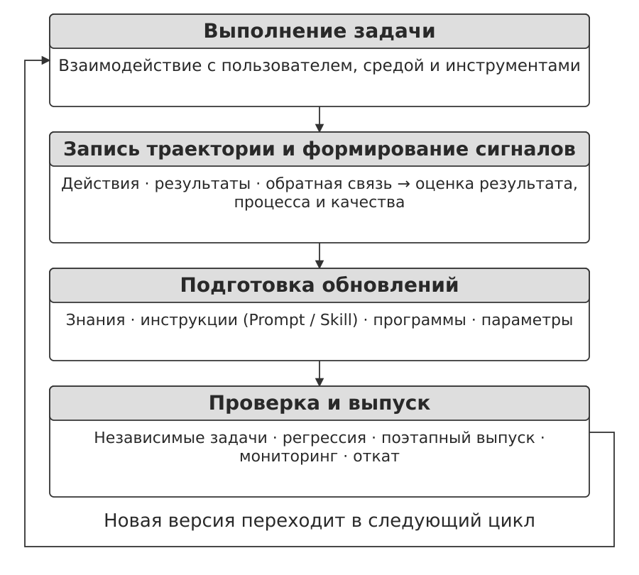
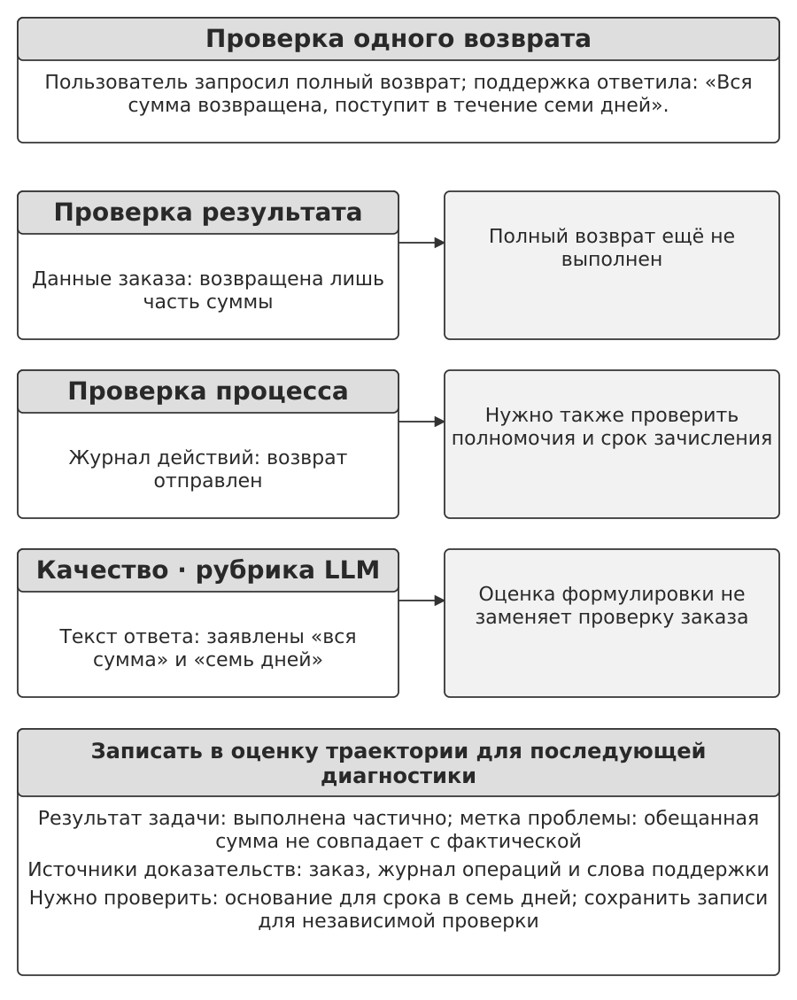
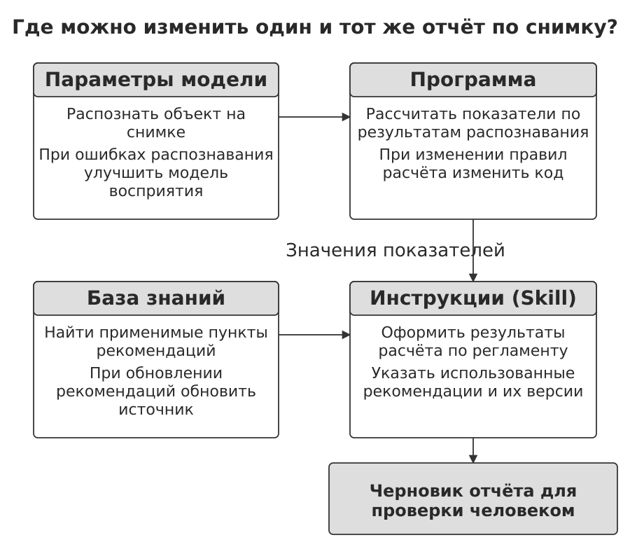
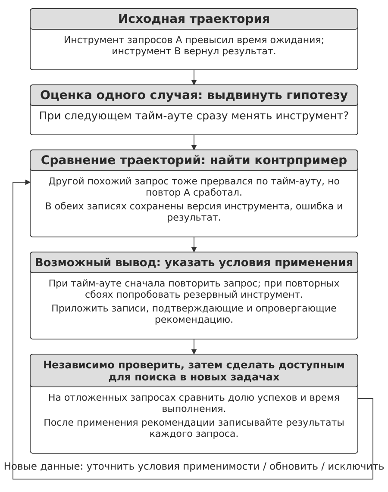
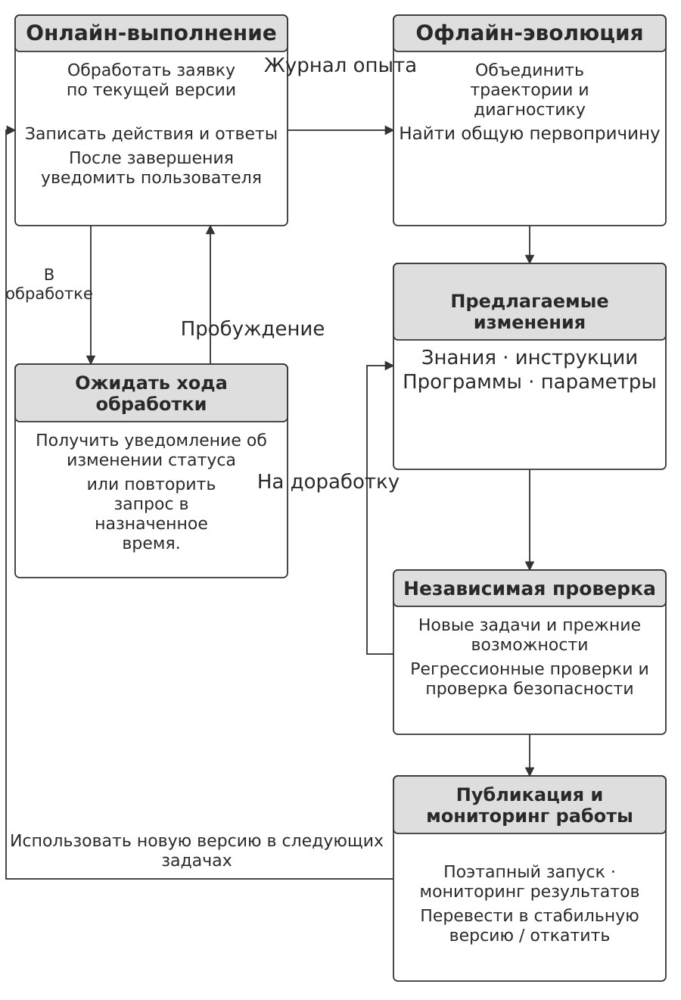

<!-- Русский перевод: community edition. Источник: https://github.com/bojieli/ai-agent-book; файл изменён относительно upstream. -->

# Непрерывная эволюция AI-агента

Агент способен с первой попытки выполнить незнакомую сложную задачу, но даже после обработки множества похожих задач может продолжать повторять одну и ту же ошибку. Чтобы он, подобно новому сотруднику, постоянно совершенствовался в ходе повседневной работы, система должна преобразовывать опыт выполнения в возможности, пригодные для последующего использования: фиксировать результаты, находить причины проблем, формировать способы улучшения, а затем проверять их эффективность на новых задачах. **По мнению автора, способность агента учиться на опыте и непрерывно эволюционировать становится одной из важнейших.** Эта способность требует инженерного развития прикладной системы и заслуживает внимания как одно из приоритетных направлений исследований моделей следующего поколения.

Как правило, после завершения одного инференса параметры развёрнутой модели остаются неизменными. Рассмотренные во второй главе обучение в контексте, поддержание состояния и сжатие помогают ей адаптироваться в рамках текущей задачи, а описанные в третьей главе память и база знаний позволяют сохранять информацию между задачами. Для дальнейшего обучения на опыте необходимо также сопоставлять результаты множества выполнений: какие шаги являются общими для успешных траекторий, чего не хватает неудачным траекториям, для каких версий инструментов и условий задачи подходит тот или иной способ действий.

Например, сохранив сто траекторий бронирования билетов, система сможет при необходимости найти конкретный случай из прошлого. Но чтобы сформировать правило «перед бронированием билета сначала проверять срок заказа специального питания», ей потребуется сопоставить причины успешных и неудачных бронирований, проверить условия авиакомпании и ограничения по времени, а затем подтвердить этот способ действий на новой задаче. Запись и поиск позволяют агенту восстановить прошлый опыт, а сопоставление, обобщение и проверка помогают сформировать пригодный для повторного использования способ действий. Лишь накапливая такой опыт, агент может постепенно превращаться из просто умного в опытного.

**Непрерывное обучение (continual learning)** исследует, как система может постоянно учиться по мере поступления новых задач и данных, сохраняя при этом уже приобретённые возможности. Агент переносит эту проблему в повседневное взаимодействие: обратная связь поступает от пользователей, инструментов и среды, причём удовлетворённость пользователя, выполнение задачи и соответствие процесса требованиям могут приводить к разным выводам. По мнению автора, одна из главных трудностей непрерывного обучения агента состоит в том, что в повседневной работе почти никто не помечает пошагово, что было сделано правильно, а что — нет, поэтому система должна сама определять, какой обратной связи можно доверять. Если непроверенная обратная связь будет преобразована в правило или использована для обучения, ошибочная атрибуция причин повлияет на последующие задачи. Такие ошибки могут сохраняться и дальше: неверно записанное предпочтение повлияет на следующее бронирование билета, а обучение модели на ошибочной обратной связи может привести к неправильному выполнению даже тех задач, с которыми она прежде справлялась.

В этой книге термином **непрерывная эволюция** обозначается весь процесс обновления системы агента на основе опыта, охватывающий четыре вида носителей: знания, инструкции, программы и параметры модели. Периодическое обучение базовой модели обеспечивает общие возможности, тогда как обновление агента на основе опыта учитывает конкретные бизнес-правила, изменения инструментов и локальные стратегии. Такие локальные изменения происходят постоянно, и ожидание следующего обучения базовой модели зачастую не соответствует потребностям бизнеса.

На текущем этапе автор предлагает в первую очередь создавать вокруг модели проверяемую обучающую систему: явно выражаемый опыт должен влиять на последующее поведение через знания, инструкции и программы, а материалы, подходящие для обучения параметров, следует направлять на постобучение. Каждое обновление сначала проходит регрессионную оценку в новой версии, и лишь после успешной проверки выпуска последующие задачи начинают использовать эту версию.

В предыдущих главах уже были представлены основные компоненты этой системы: вторая глава посвящена организации состояния задачи, третья — хранению и поиску знаний, пятая — созданию инструментов с помощью кода и изменению системы, седьмая — оценке результатов, а восьмая — обновлению параметров модели. На рис. 9-1 эти компоненты объединены. Опыт, полученный при предыдущем бронировании, когда не было заказано специальное питание, после оценки превращается в правило, которое будет использовано при следующем бронировании билета.

## Получение обучающих сигналов из траекторий выполнения

Какие траектории пригодны для обучения? Если сотрудник поддержки сообщает пользователю: «Возврат оформлен», сначала нужно проверить, сколько денег возвращено и соблюдены ли правила при выполнении операции, а затем — сможет ли пользователь понять из ответа, когда поступят деньги. На рисунке 9-2 объединены все три проверки. Для них используются соответственно данные заказа, журнал действий и исходный ответ сотрудника поддержки.

**Проверка результата определяет, что изменилось в среде.** AI-агент для программирования может запускать тесты, проверку типов и бенчмарки производительности; агент, оформляющий возврат средств, может проверить состояние заказа и фактическую сумму возврата. Автор обычно начинает с этого уровня проверки. Если модель заявляет о полном возврате, а на счёт поступила лишь часть суммы, данные заказа позволяют понять, какую именно операцию нужно проверить.

**Проверка процесса определяет, соответствуют ли действия правилам задачи.** Даже после успешного прохождения тестов нужно убедиться, что защищённые тестовые файлы не были изменены. Когда агент сообщает пользователю: «Возврат поступит в течение семи дней», необходимо также проверить, была ли подана заявка на возврат и обоснован ли указанный срок. Таблицы прав доступа, структурированные политики и журналы действий можно проверять программно; положения, требующие интерпретации контекста, следует оценивать вместе с соответствующими доказательствами.

**Проверка качества определяет, соответствует ли результат требованиям к использованию.** На итоговый эффект влияют ясность ответа сотрудника поддержки, соответствие альтернативного решения цели пользователя и наличие ключевых доказательств в исследовательском отчёте. Здесь можно применять представленный в седьмой главе подход LLM-as-a-Judge: заранее определить рубрику (Rubric) и потребовать от оценивающей модели выставить по каждому пункту балл, привести обоснование и указать доказательства.

В таблице 9-1 эти три уровня раскрыты на примере агента службы поддержки через семь аспектов. Результат задачи относится к уровню результата; соблюдение правил, конфиденциальность и обещания — к уровню процесса; качество изложения и допустимые альтернативы — к уровню качества. Достоверность фактов проверяется по-разному в зависимости от содержания. Например, сумму возврата можно напрямую сопоставить с результатом инструмента, а для интерпретации политики необходимо учитывать исходный текст и условия её применимости.

Таблица 9-1. Аспекты оценки траектории агента службы поддержки

| Аспект | Проверочный вопрос | Основные доказательства |
| --- | --- | --- |
| Результат задачи | Решена ли основная проблема пользователя | Итоговое состояние среды, результаты инструментов |
| Соблюдение правил | Соблюдены ли политики, права доступа и обязательные процедуры | База политик, траектория действий |
| Границы конфиденциальности | Находится ли предоставленная информация в допустимых пределах | Текст ответа, журнал доступа |
| Достоверность фактов | Подтверждаются ли утверждения знаниями или результатами инструментов | Ссылки на источники, результаты инструментов |
| Согласованность обещаний и действий | Действительно ли были выполнены заявленные операции | Сопоставление ответа с журналом выполнения |
| Качество изложения | Является ли ответ естественным, лаконичным и ясным | Полный текст диалога, языковая рубрика |
| Допустимые альтернативы | Найден ли разрешённый альтернативный путь, если исходное решение оказалось недоступно | Цель пользователя, политики и последующие действия |

Чтобы обеспечить последующее обновление, результаты оценки должны содержать четыре элемента: общее состояние задачи, заключения по каждому аспекту, местоположение доказательств для каждого заключения и тип ошибки. Местоположение доказательств может указывать на конкретный ход диалога или вызов инструмента. Аспекты, по которым доказательств недостаточно, следует помечать как требующие подтверждения и передавать на дополнительную проверку или ручной анализ.

Например, заключения «возврат не выполнен, ответ сформулирован ясно» недостаточно, чтобы определить способ улучшения. Если дополнить его сведениями «на четвёртом ходу интерфейс возврата был вызван без номера заказа и отклонил операцию; на пятом ходу агент всё равно заявил, что возврат выполнен», можно предложить отдельные изменения для проверки параметров и валидации заявлений о завершении операции.

> **Эксперимент 9-1 ★★: создание валидатора траекторий для агента службы поддержки**
>
> Сравните два вида вывода для одного набора траекторий службы поддержки: только итоговую оценку и отдельные заключения, доказательства и уровень уверенности по каждому аспекту. Проверьте, позволяет ли второй вариант отдельно локализовать невыполнение задачи, нарушение правил, ложные обещания и проблемы изложения, а затем предложить соответствующие обновления.
>
> Устаревшие знания требуют обновления материалов, при отсутствии параметров можно добавить проверку перед вызовом, а повторяющиеся формулировки — исправить с помощью инструкций или обучения.

В эксперименте 9-1 на основе вымышленных данных учётных записей были созданы восемь траекторий: по две для нормального возврата, ложного обещания, утечки конфиденциальных данных и чрезмерного отказа. В `real-normal-refund-01` сотрудник поддержки сообщил, что возврат оформлен, состояние заказа также изменилось на `refunded`, а сумма возврата составила 480.

Каждая из восьми траекторий оценивалась по семи аспектам. Из 56 заключений 52 совпали с заданными для примеров экспертными метками, что соответствует примерно 92,9 %. Три из четырёх оставшихся расхождений относились к одному и тому же случаю переоформления билета. Пользователь попросил перенести невозвратный авиабилет на 3 октября. Сотрудник поддержки проверил личность пользователя, трижды запросил данные заказа и на десятом ходу сообщил, что всё выполнено. Однако состояние заказа осталось `confirmed`, а в журнале вызовов не было операции переоформления.

Кого следует перепроверить в такой ситуации? Модель, оценивавшая «допустимые альтернативы», сослалась на ответ на десятом ходу и поставила положительную оценку, не заметив, что допустимое альтернативное решение можно было выполнить, но оно не было выполнено. Программа, проверявшая «согласованность обещаний и действий», действительно сообщила об ошибке, но объяснила её отсутствием успешного вызова для возврата средств. Пользователь просил переоформить билет, поэтому проверять следовало запись о переоформлении и новую дату. При этом заранее заданная метка для этого аспекта была положительной, что также расходилось с фактически сгенерированным ответом.

В этом случае нужно исправить две вещи: сотрудник поддержки пропустил одно действие, а программа оценки проверила не тот инструмент. При бронировании билета внешне одинаковая ошибка также может возникать в разных местах. Например, пользователь уже увеличил бюджет, но помощник продолжает отбирать варианты по прежнему ограничению. Если проследить траекторию назад, может оказаться, что новое предпочтение не было сохранено, что в этот раз было извлечено старое предпочтение либо что модель увидела новый бюджет, но не применила его при выборе билета.

## Четыре способа непрерывной эволюции AI-агента

После обнаружения проблемы необходимо решить, где именно вносить изменения. Возьмём в качестве примера агента для анализа медицинских изображений на рисунке 9-3. Если в заключении приведена ссылка на устаревшую версию рекомендаций, сначала следует проверить, какая версия хранится в базе знаний. Если рекомендации верны, но в заключении не указан источник, нужно проверить инструкции по составлению заключения. Даже если оба заключения были возвращены на доработку, при их исправлении проверять нужно разные места.

В системе поддержки клиентов также одновременно используются все четыре способа. Обученная модель формулирует ответы, база знаний хранит корпоративные политики, Skill объясняет, как обрабатывать исключения, а серверный код проверяет права доступа и суммы. В таблице 9-2 перечислены затраты и ограничения, которые необходимо учитывать при выборе способа обновления.

Таблица 9-2. Границы применимости четырёх способов непрерывной эволюции

| Способ обновления | Для чего подходит | Инженерные преимущества | Требующие решения проблемы |
| --- | --- | --- | --- |
| База знаний об опыте | Факты, опыт, исключения и источники | Быстро обновляется, обеспечивает прослеживаемость и поиск по требованию | Качество поиска, условия применимости и способность модели правильно использовать найденное |
| Промпт и Skill | Принципы принятия решений, требующие учёта контекста, исключений и приоритетов | Объяснимость, простота локальных изменений | Увеличение длины, конфликты инструкций и качество их соблюдения |
| Программа и Harness | Поддающиеся разбору процессы, исполняемые проверки, права доступа и строгие ограничения | Тестируемость, стабильность исполнения | Разработка и сопровождение, совместимость интерфейсов и обработка исключений |
| Параметры модели | Восприятие, стиль генерации и неявные паттерны принятия решений | Повторное использование усвоенных паттернов, сокращение повторяющегося контекста | Подготовка данных, стоимость обучения, обобщение и забывание |

Одно улучшение можно разделить на несколько обновлений. Автор в первую очередь помещает факты о политиках в базу знаний, а точно исполняемые ограничения, такие как проверка прав доступа, — в программу; принципы, требующие понимания контекста и исключений, выражает через Skill, а многомерное восприятие и неявные стратегии улучшает посредством обучения.

### Преобразование опыта в знания

Об одной и той же покупке билета можно сохранить информацию двух уровней. Первая запись: «Эта авиакомпания требует заказывать специальное питание за 24 часа». Вторая: «Перед бронированием проверить срок заказа специального питания, чтобы не обнаружить после оплаты невозможность выполнить требование». Первую следует сохранять вместе с названием авиакомпании, применимыми маршрутами и источником политики. У другой авиакомпании срок может отличаться, но правило «сначала проверить срок для этого рейса» по-прежнему переносимо. Тогда при устаревании факта потребуется заменить только конкретный срок, а опыт проверки останется полезен при следующем бронировании. Оба вида информации можно сохранять с помощью рассмотренных в третьей главе методов хранения, индексирования и поиска.

Извлечение такого опыта из одного бронирования может стоить недорого, но нельзя просто копировать всю запись о покупке билета. В ней содержится и исходный текст политики, возвращённый инструментом, и обходные пути, возникшие в ходе нескольких попыток AI-агента. Если один запрос завершился по тайм-ауту, а результат удалось получить лишь после смены инструмента, слепое воспроизведение этой последовательности может превратить случайный сбой в основание для смены инструмента.

Материалы можно сохранять на трёх уровнях: **исходная траектория** содержит полные доказательства выполнения, **анализ отдельного запуска** фиксирует причины успеха или неудачи и черновик опыта, а **утверждённый документ об опыте** обобщает подходы, проверенные на нескольких задачах. Исходные траектории сохраняются с указанием версий, а анализ и знания пересматриваются по мере появления новых доказательств. В утверждённом документе указываются сценарии применения, рекомендуемая стратегия, запрещённые действия, исключения, источники и дата последней проверки, чтобы облегчить последующий поиск и контроль.

В подходе User as Code из третьей главы сначала пополняется журнал фактов, а затем периодически перестраивается модель пользователя. Здесь запись также отделяется от систематизации. Вернёмся к предыдущему запросу. Допустим, другой запрос тоже завершился по тайм-ауту, но повторная попытка с тем же инструментом оказалась успешной. Остаётся ли обоснованной рекомендация «при тайм-ауте сменить инструмент»? На рисунке 9-4 показано, как на основе этих двух записей сформулировать более точную рекомендацию, а затем проверить её на других запросах.

При использовании рассмотренных в третьей главе методов извлечения, кластеризации и поиска можно сопоставлять положительные и отрицательные примеры одного и того же опыта. В двух случаях бронирования использовалась одна версия инструмента? Один запуск завершился успешно, а другой — неудачно потому, что был пропущен шаг, или потому, что изначально различались условия бронирования? Преобразование исходных записей в полезный опыт можно разделить на пять этапов:

1. Сохранить исходную траекторию и результат среды, зафиксировав задачу и версии инструментов.
2. Сформировать анализ каждого запуска, записав тип задачи, необходимые способности, фактическую стратегию, ошибки и исключения.
3. Агрегировать запуски по семействам задач и для каждого элемента опыта перечислить подтверждающие и опровергающие его траектории.
4. Отобрать опыт с достаточной доказательной базой и оформить его как черновик записи знаний.
5. Протестировать его на новых задачах, не участвовавших в дистилляции, и проверить, улучшает ли рекомендуемая стратегия последующие результаты.

GAIA[^gaia-2023] предоставляет многошаговые задачи, требующие поиска, чтения веб-страниц, обработки файлов и вычислений, а AWorld[^aworld-2025] — среду для выполнения действий агентом, вызова инструментов и записи траекторий. Их сочетание позволяет сначала пометить успех, частичный успех и неудачу по ответу или состоянию среды, а затем сравнить пути внутри каждого семейства задач. В успешных записях можно найти подходы, которые стоит повторить, а в неудачных — условия, при которых этого делать не следует. Если задача выполнена лишь частично, можно поэтапно проверить, какие действия оказались эффективными и с какого места начались проблемы.

Reflexion[^reflexion-2023] использует рефлексию на естественном языке для улучшения последующих попыток. При включении этого подхода в дистилляцию знаний рефлексия может применяться для выдвижения гипотез о причинах и создания черновиков опыта, результаты среды — для проверки, сопоставление траекторий — для определения условий применимости, а новые задачи — для проверки переноса. Решение о включении опыта в базу утверждённых знаний принимается на основе всех четырёх видов материалов.

[^reflexion-2023]: Shinn, N., et al. *Reflexion: Language Agents with Verbal Reinforcement Learning.* arXiv:2303.11366, 2023.

[^gaia-2023]: Mialon, G., et al. *GAIA: a benchmark for General AI Assistants.* arXiv:2311.12983, 2023.

[^aworld-2025]: Yu, C., et al. *AWorld: Orchestrating the Training Recipe for Agentic AI.* arXiv:2508.20404, 2025.

Вернёмся к сценарию покупки билета из шестой главы. Пользователь хотел уложиться в 1200 юаней, чтобы в тот же день успеть на совещание, но в итоге принял предложение за 1250 юаней. Ассистент может записать исходный бюджет, цену покупки, цель поездки и дословные слова пользователя. При следующих трёх бронированиях минимальная цена каждый раз случайно составляла ровно 1250 юаней. Как следует использовать эту запись в памяти?

- На следующей неделе пользователю снова нужно успеть на такое же деловое совещание. В нескольких предыдущих случаях он соглашался доплатить несколько десятков юаней, чтобы попасть на встречу, а теперь поручил ассистенту забронировать билет как обычно. Ассистент может купить этот билет и сообщить фактическую цену.
- Пользователь едет в отпуск с ребёнком и отдельно просит: «В семейной поездке нужно немного сэкономить. Если дороже 1200 юаней, сначала спроси меня». Ассистент может отправить пользователю вариант за 1250 юаней и одновременно проверить, есть ли в пределах бюджета рейсы на предыдущий или следующий день.
- Позднее пользователь объясняет: «В прошлый раз я согласился только потому, что спешил, но вообще-то 1250 юаней для меня тоже дорого. В дальнейшем и в командировках сначала спрашивай меня, если цена выше бюджета». В следующий раз ассистент должен сначала спросить, даже если тот же человек снова летит на совещание в тот же город. Следует сохранить запись о той покупке, а это более новое и конкретное требование добавить в предпочтения для командировок: тогда обе записи в памяти останутся полезными.

Эти три заказа показывают уровни обновления. Одна пользовательская поправка может немедленно изменить текущую задачу, а также служит достаточным основанием для обновления личных предпочтений пользователя. Предлагать изменение общего Skill бронирования, чтобы при сравнении цен он извлекал соответствующие предпочтения, стоит лишь тогда, когда множество независимых случаев показывает, что ассистент игнорирует цель поездки. И только если явно заданные бюджет и предпочтения уже загружены, но модель по-прежнему ошибается в оценке при иной формулировке, стоит собирать такие примеры для обучения способности модели принимать решения.

### Превращение опыта в инструкции

Если помощнику каждый раз передают правильные материалы, но он по-прежнему ошибается на одном и том же этапе, а опытный человек может одной фразой описать, как следует принимать решение, можно попробовать сформулировать инструкцию. Документ с накопленным опытом служит помощнику справочным материалом, системный промпт задаёт требования к поведению в разных задачах, Skill загружает локальный процесс для конкретной области или инструмента, а соблюдение жёстких ограничений, например прав доступа, обеспечивает Harness. От правильного выбора места для изменения зависит, на какие будущие задачи оно повлияет.

Andrej Karpathy использует термин **обучение системного промпта (System Prompt Learning)** для описания способа обновления опыта: столкнувшись с проблемой, модель записывает напоминание для использования в будущих задачах.[^karpathy-system-prompt-learning] DSPy[^dspy-2023] оптимизирует инструкции и примеры на наборе для разработки, OPRO[^opro-2023] предлагает новые промпты на основе уже опробованных промптов и их оценок, а GEPA[^gepa-2025] использует обратную связь по траекториям, чтобы предлагать и отбирать изменения промпта. Все эти методы переписывают инструкции на основе результатов выполнения, а затем сравнивают новую и старую версии на задачах для разработки, поэтому они подходят для пакетной офлайн-оптимизации.

При обновлениях в продакшене автор отдаёт предпочтение минимальному diff с указанием источника, сохраняя вызвавший изменение пример, причину изменения и старую версию. Локальный патч меньше затрагивает существующие правила и позволяет при регрессии откатить отдельное изменение.

Как убедиться, что новая инструкция действительно исправила предыдущую ошибку? Предположим, пользователь указывает на ошибочно архивированное письмо клиента и говорит: «Это клиент отвечает мне — почему письмо тоже посчитали рассылкой?» В открытом почтовом помощнике Inbox Zero предусмотрен инструмент пробного запуска. После изменения правил помощник может получить исходное письмо по его ID, повторно классифицировать его согласно правилам, которые сейчас включены для этой учётной записи, и показать, какие правила сработают, почему, какую метку планируется назначить или в какую папку переместить письмо. На этом этапе просматриваются только предполагаемые действия: почтовый ящик остаётся без изменений, а черновик ответа не создаётся.[^ch9-inboxzero] Затем следует так же проверить настоящую рассылку: письмо клиента должно остаться во входящих, а рассылка — по-прежнему отправиться в архив. Вместе эти два письма показывают, сохранило ли изменение прежнюю границу классификации.

[^ch9-inboxzero]: В проекте Inbox Zero инструмент для пробного запуска правил на указанном письме реализован в `test-rules-on-email-tool.ts`.

#### Пример 1. Чёткие границы передачи человеку и использования инструментов

Политика telecom в τ²-bench требует передавать запрос человеку, если он выходит за пределы действий агента, а перед передачей приложить все усилия для решения задачи. Из 20 задач, использованных для извлечения правил, менее мощная модель прошла только одну. Как завершились неудачей остальные 19? В 17 задачах вызывался инструмент передачи человеку, а ещё две выполнялись до достижения предельного числа шагов.

Эти 19 неудачных траекторий передали модели, попросив её обобщить правила и добавить их в конец исходной политики. При работе с теми же 114 новыми задачами исходная политика позволила пройти 14 задач (12,3%); с первой версией правил модель прошла 20 задач, а со второй — 22 (19,3%). Сопоставление по каждой задаче показало, что вторая версия сохранила успех во всех прежних 14 задачах и дополнительно решила ещё восемь. Чем именно две версии правил помогли службе поддержки?

**Содержимое правил определяется входными материалами.** Когда модели предоставили только тексты ошибок и сводки неудач, она вывела правило: «Прекратить вызовы, если один и тот же инструмент неоднократно возвращает ошибку». При втором извлечении модель также видела отдельные списки инструментов службы поддержки и пользователя, а промпт предлагал ей подумать, «кто должен выполнить этот шаг». На этот раз сгенерированные правила явно разделили обязанности: операции на устройстве, связанные с состоянием сети, SIM-картой и APN, должен выполнять пользователь под руководством службы поддержки. Так опыт превратился из общего напоминания о повторных попытках в конкретное правило распределения операций.

**Обобщение также необходимо проверять по политике и результатам.** В первой версии добавленных правил были два пункта: «Передать человеку после трёх последовательных неудачных вызовов» и «Передать человеку, если пользователь дважды не предоставил номер». При выполнении по этой версии правил передача человеку произошла во всех 114 задачах набора переноса, но пройти удалось лишь 20. Эти два правила усвоили и преждевременную передачу человеку.

Одна траектория наглядно показывает разницу до и после исправления. Пользователь сообщил, что на телефоне нет сигнала. В базовой версии служба поддержки подставила в поле номера фразу «Пожалуйста, предоставьте ваш правильный номер телефона», пять раз получила ошибку при поиске, а затем передала запрос человеку. Со второй версией правил первый запрос снова был отправлен без номера, но теперь служба поддержки попросила пользователя сообщить номер в диалоге и после его получения нашла учётную запись. Затем она попыталась проверить SIM-карту; инструмент сообщил, что такая операция отсутствует, и служба поддержки попросила пользователя вынуть и снова вставить SIM-карту. Пользователь выполнил просьбу, а затем отключил на телефоне режим полёта — только после этого задача была пройдена. Рассмотрим и остальные семь задач, которые вторая версия решила в отличие от базовой: лишь в одной из них не было передачи человеку, а в остальных шести инструмент передачи человеку вызывался. Следовательно, если считать критерием успеха «отсутствие передачи человеку», эти шесть задач как раз будут пропущены. Чтобы решить, нужна ли передача, необходимо учитывать, что ещё может сделать служба поддержки и до какого этапа требуется довести задачу.

> **Эксперимент 9-2 ★★. Извлечение правил передачи человеку и использования инструментов из неудачных траекторий τ²-bench**
>
> Используйте среду telecom из главы 7, разделив набор для извлечения и набор переноса. Сначала запустите менее мощную модель и соберите неудачные траектории, затем поручите модели сгенерировать правила и добавьте их к исходной политике. На наборе переноса сравните исходную и две эволюционировавшие версии; во всех трёх группах заменяйте только файл политики, сохраняя один и тот же симулятор пользователя.
>
> В базовой версии передача человеку происходила в 104 задачах, а во второй версии — в 111; задача учитывается, если передача произошла в ней хотя бы один раз. Ошибочные вызовы инструментов пользователя, напротив, подсчитываются по числу вызовов: их количество снизилось с 1049 до 163. Ещё одна метрика подсчитывает вызовы, в параметрах которых хотя бы одно значение было пустой строкой: их число снизилось с 904 до 174; вызовы, в которых параметры вообще не передавались, этой метрикой не учитываются. Каждая стратегия запускалась на каждой задаче только один раз.

В службе поддержки авиакомпании также встречается преждевременная передача человеку. Если пользователь возражает против сбора за возврат билета, сбора за изменение бронирования или правил провоза багажа, агент должен найти применимую политику, объяснить её и поискать допустимые альтернативы. Согласно правилам следующего эксперимента, обычные споры о политике агент продолжает обрабатывать самостоятельно, а при явном требовании пользователя связать его с человеком или при возникновении определённой ситуации, связанной с безопасностью, вызывает `transfer_to_human`.

> **Эксперимент 9-3 ★★. Оптимизация системного промпта службы поддержки авиакомпании на основе неудачных траекторий**
>
> Проанализируйте траектории преждевременной передачи человеку по трём направлениям: соблюдение правил, решение задачи и поиск допустимых обходных решений. На основе анализа сгенерируйте патч промпта с указанием источников. Сравните автоматически извлечённую, исходную и вручную оптимизированную версии в одинаковых условиях.
>
> Ещё пять задач предназначены для проверки сохранения прежних возможностей: в трёх служба поддержки должна действовать самостоятельно, а в двух — передать запрос человеку. Все три версии инструкций получили 5/5. На пяти задачах с преждевременной передачей, использованных для извлечения патча, одна и та же модель-рецензент признала пройденными соответственно 0, 2 и 4 задачи для исходной, автоматической и вручную оптимизированной версий. Автоматическая версия исправила две задачи: возврат билета по специальному тарифу и сверхнормативный багаж. На этом основании программа разрешила ограниченное пробное применение.
>
> Одна оценка вызывает сомнения. Пассажир попросил отменить сбор за изменение бронирования в размере 200 юаней, но вручную оптимизированная версия начала объяснять, можно ли вернуть билет по специальному тарифу. Рецензент одобрил предложение «вернуть налоги» и засчитал задачу, хотя служба поддержки так и не объяснила сбор за изменение бронирования, о котором спрашивал пассажир.

#### Пример 2. Улучшение Skill уточнения требований на основе пользовательской обратной связи

Существующий Skill уточнения требований может определять, когда задавать вопросы, какие именно вопросы задавать и когда начинать исполнение. По мере накопления пользовательской обратной связи система должна корректировать эти условия, чтобы польза от уточнений соответствовала цене отвлечения пользователя.

Например, если пользователь говорит: «Добавь на страницу входа поддержку корпоративной аутентификации», перед реализацией может потребоваться уточнить поставщика удостоверений, способ отката, совместимость с существующими пользователями и охват развёртывания. Напротив, исправление одной опечатки обычно можно выполнить сразу. Если вопросов слишком мало, ключевые решения придётся пересматривать после сдачи результата; если их слишком много, даже простое изменение превратится в долгое интервью. Skill должен выбирать процесс с учётом неоднозначности, риска и стоимости переделки.

Начальный процесс можно организовать следующим образом: небольшие низкорисковые и легко обратимые изменения выполнять после указания необходимых предположений; если изменение затрагивает архитектуру, данные, права доступа, публичный интерфейс или имеет большой охват, задать вместе несколько вопросов, ответы на которые способны изменить решение. Затем составить краткую Spec или Plan с целями, нецелями, компромиссами, предположениями и критериями приёмки. Получив ответы по вопросам, требующим подтверждения, продолжить исполнение; если во время исполнения изменятся исходные условия, определить затронутые решения и запросить дополнительное подтверждение.

Для улучшения этого процесса необходимо фиксировать задачу, уточняющие вопросы, версию Spec, пользовательские изменения, итоговый результат и переделки. Если пользователь говорит: «Это не то, что я представлял», следует проверить, какие условия были упущены; если он говорит: «Ты задаёшь слишком много вопросов», нужно выяснить, влияли ли ответы на эти вопросы на выбранное решение.

Если в нескольких задачах аутентификации регулярно упускаются требования совместимости со старым способом входа, в Skill можно добавить условие: «Уточнить поставщика удостоверений, путь отката и границы совместимости». Если множество исправлений опечаток задерживается из-за вопросов, область срабатывания процесса уточнения, напротив, следует сузить.

Здесь также проявляется разделение обязанностей между Skill и Harness. Skill помогает модели понять ситуацию, задать вопросы и систематизировать решение; Harness в соответствии с правилами проекта блокирует операции, если для высокорисковой операции записи не получено необходимое разрешение, предпринимается прямая попытка изменить защищённую ветвь или пропускается процесс выпуска. Решение о содержании требований по-прежнему принимает модель с учётом пользовательского ввода. Проверенные траектории диалогов также могут стать обучающими данными, описанными в главе 8.

> **Эксперимент 9-4 ★★. Эволюция Skill уточнения требований и подтверждения Spec на основе пользовательской обратной связи**
>
> В этом упражнении необходимо самостоятельно разработать сравнение. Сначала можно подготовить две задачи: исправить опечатку на кнопке входа и добавить на ту же страницу корпоративную аутентификацию. Критерии приёмки для первой задачи можно записать сразу; для второй, возможно, сначала придётся уточнить поставщика удостоверений. Затем добавьте задачи, затрагивающие архитектуру, права доступа, данные или публичные интерфейсы, и испытайте три процесса: прямое исполнение, исполнение после уточнения и исполнение после подтверждения Spec. Фиксируйте ответы пользователя, изменения Spec, результаты работы и обратную связь о переделках, а затем на их основе сгенерируйте локальное обновление Skill.

[^dspy-2023]: Khattab, O., et al. *DSPy: Compiling Declarative Language Model Calls into Self-Improving Pipelines.* arXiv:2310.03714, 2023.

[^opro-2023]: Yang, C., et al. *Large Language Models as Optimizers.* arXiv:2309.03409, 2023.

[^gepa-2025]: Agrawal, L., et al. *GEPA: Reflective Prompt Evolution Can Outperform Reinforcement Learning.* arXiv:2507.19457, 2025.

[^karpathy-system-prompt-learning]: Karpathy, A. “We’re missing (at least one) major paradigm for LLM learning … system prompt learning?” X, May 11, 2025.

### Превращение опыта в программу

Стабильные, повторяемые и проверяемые операции можно на основе опыта выполнения оформлять в виде рабочих процессов, инструментов или кода Harness. Автор рекомендует в первую очередь превращать в программы именно такие операции: после того как модель найдёт работоспособный путь, последующие задачи смогут использовать его повторно, избавляя от необходимости снова и снова читать инструкции, разбираться в страницах и выбирать следующий шаг. В главе 5 были представлены возможности чтения и записи файлов, запуска тестов и создания инструментов; в этом разделе они применяются в процессе обновления «диагностика сбоя → изменение кода → регрессионная проверка».

Изменения могут вноситься на разных уровнях. На операционном уровне создаются параметризованные рабочие процессы или адаптеры API; на уровне управления настраиваются маршрутизация инструментов, повторные попытки, автоматическое отключение при сбоях и сжатие контекста; на уровне проверки добавляются проверки параметров, утверждения о состоянии и регрессионные сценарии; на архитектурном уровне изменяются потоки информации между планированием, выполнением и Reviewer.

Рассмотрим отправку электронной почты. При первом выполнении мультимодальный AI-агент посредством наблюдений и действий находит элементы управления «Написать», «Получатель», «Тема», «Текст» и «Отправить». В следующей задаче обычно меняются лишь получатель и содержимое, поэтому последовательность операций можно повторно использовать подобно макросу электронной таблицы. Система превращает исследовательскую траекторию в программу и сохраняет параметры, проверки состояния и применимые версии.

Жизненный цикл браузерного рабочего процесса можно разделить на шесть этапов:

1. **Захват траектории.** Записываются переходы, щелчки, ввод и выбор значений из раскрывающихся списков; сохраняются параметры действий, URL страницы и сведения для поиска элементов, например XPath и CSS. Эти данные позволяют впоследствии снова находить элементы.
2. **Извлечение параметров.** Конкретные значения получателя, темы и текста заменяются переменными `{recipient}`, `{subject}`, `{content}` и т. п., а стабильные действия сохраняются. Например, впервые введённый адрес `test@example.com` становится одним из значений параметра получателя.
3. **Добавление проверок состояния.** Перед выполнением проверяется видимость кнопки и заполненность обязательных полей, после выполнения — изменение страницы; в конце задачи считывается фактическое состояние страницы или бэкенда и подтверждается, что письмо отправлено.
4. **Независимое воспроизведение.** Учётная запись в песочнице или тестовый сайт возвращается в новое начальное состояние, после чего программа выполняется полностью с проверкой условий каждого этапа и итогового результата.
5. **Сопоставление с новой задачей.** Рабочий процесс находится в библиотеке возможностей по намерению и ключевым словам, из текущей задачи извлекаются параметры, после чего выполнение передаётся Playwright. Программа отвечает за ожидание элементов и проверку состояния; при штатном воспроизведении можно обойтись без пошаговых вызовов LLM.
6. **Обработка утраты работоспособности.** Если перестал работать поиск элемента, не прошла проверка состояния, изменилась schema API или итоговый результат оказался аномальным, текущее воспроизведение останавливается. Сначала проверяется, какие операции уже выполнены, затем полный процесс агента заново исследует путь из текущего состояния и записывает новые успешно пройденные шаги в скрипт. Если письмо уже отправлено, но результат ещё не появился на странице, сначала следует запросить состояние отправки, чтобы повторное воспроизведение с начала не привело к повторной отправке.

Экономия времени зависит от того, сколько времени первоначально уходило на принятие решений моделью. В экспериментах PreAct с повторяющимися задачами сообщалось о сквозном ускорении в 8,5–13 раз; в приведённом ниже локальном примере с электронной почтой исключены все вызовы модели, однако браузеру по-прежнему приходится ждать ответа страницы.[^preact]

> **Эксперимент 9-5 ★★★: создание проверяемого рабочего процесса из браузерной траектории**
>
> Создайте из успешной траектории рабочий процесс с параметрами и проверками состояния, а затем сравните его долю завершённых задач, число вызовов модели и затраченное время с базовым вариантом, который каждый раз заново исследует путь. После этого измените структуру страницы или создайте состояние, при котором щелчок выполнен успешно, но задача не отправлена, и проверьте, способна ли программа обнаружить утрату работоспособности и перейти к резервному сценарию.
>
> В этом эксперименте с локальным почтовым сайтом первоначальное исследование вызвало модель 4 раза, а параметризованное воспроизведение — 0 раз; выполнение заняло около 5,31 и 4,45 секунды соответственно. При воспроизведении также возникли два типа сбоев: в одном случае сервер отказался отправлять письмо с пустым текстом; в другом запрос был принят, но сообщение не сохранилось. Версия, проверявшая лишь факт выполнения щелчка, в обоих случаях ошибочно сообщила об успехе, тогда как версия с проверкой состояния после отправки оба раза распознала сбой.

**Сначала изменяйте код в отдельной ветви.** Создайте из текущей стабильной версии изолированную ветвь, поручите Coding Agent подготовить локальный патч и последовательно выполните связанные с изменением статические проверки, модульные тесты, проверки безопасности, воспроизведение неудачной траектории и регрессионные проверки старых задач, а затем переходите к поэтапному выпуску. Работающая система продолжает использовать стабильную версию; переключение выполняется лишь после прохождения патчем всех проверок.

Этот процесс можно организовать с помощью Git worktree и Pull Request. Skill предписывает модели создать отдельную рабочую область, уточнить требования, завершить реализацию и тестирование, а в PR описать проблему, изменения, проверенные сценарии и оставшиеся риски, которые должен проверить принимающий работу специалист. Harness, в свою очередь, обеспечивает соблюдение проектных ограничений: например, защищает `main`, проверяет обязательные статусы ревью и перед передачей результата подтверждает полноту артефактов выпуска.

Чтобы определить, как конкретное изменение влияет на результат, к каждому изменению следует прилагать проверяемое описание: доказательства сбоя, предполагаемая первопричина, затронутые компоненты, предлагаемый патч, исправляемая ошибка, изначально правильное поведение и сценарии, отдельно проверяющие ошибку и правильное поведение. Agentic Harness Engineering распределяет соответствующую информацию по трём уровням наблюдаемости: компоненты, опыт и решения. Компоненты хранятся в виде доступных для редактирования файлов, траектории преобразуются в доказательства, которые можно просматривать уровень за уровнем, перед редактированием объявляется ожидаемое влияние, а затем оно проверяется по последующим результатам.[^ahe-2026]

Когда автор просит модель подготовить план изменений, он одновременно предоставляет успешные траектории и ранее отклонённые варианты. Self-Harness использует эту информацию, чтобы ограничить направление поиска: успешные записи показывают модели, какие подходы изначально были правильными, а история попыток — какие изменения уже оказались неудачными.[^self-harness-2026] Если предоставить только примеры сбоев, модель может расширить область изменений и нарушить изначально правильное поведение; если же не сохранить отклонённые варианты, она может снова и снова предлагать одну и ту же неработоспособную идею.

Новые инструменты также могут появляться в результате такого обновления, обусловленного потребностями. В одной из задач Alita[^alita-2025] требовалось найти число, упомянутое сразу после первого появления динозавра в панорамном VR-видео на YouTube с закадровым голосом актёра, озвучившего Голлума во «Властелине колец». Агент обнаружил, что ему не хватает возможности читать субтитры, нашёл и протестировал `youtube-transcript-api`, создал на его основе инструмент для работы с субтитрами и в итоге получил `100000000`.

> **Эксперимент 9-6 ★★★: самомодификация агента, инициированная неудачной траекторией**
>
> Для проблемы, при которой инструмент продолжает вызываться после возврата ошибки, не допускающей повторной попытки, сравните два исправления: напоминание в промпте и программную стратегию повторных попыток. Изменённая программа должна в зависимости от типа ошибки повторять попытку, останавливаться или включать автоматическое отключение при сбоях; затем воспроизведите неудачную траекторию, чтобы проверить целевую проблему, и выполните задачи с временными сбоями, чтобы проверить способность к восстановлению. Если тип ошибки и условия повторной попытки уже можно точно определить, автор предпочитает закреплять такое ограничение в программе: тогда каждый вызов следует одному правилу, а модели не приходится снова и снова интерпретировать промпт.
>
> Агент, отвечающий за обновление, отправляет патч в изолированной версии, а внешние процессы тестирования и выпуска решают, следует ли его принимать. Валидаторы, приёмочные сценарии и стабильная версия защищены независимыми полномочиями; журнал отката сохраняет сведения о поведении до и после изменения.

Можно совершенствовать и саму логику проверки. Например, если неоднократные исправления пользователей и ревью показывают, что для высокорисковых вызовов не запрашивается подтверждение, можно добавить проверку перед вызовом. Здесь необходимо различать компонент бизнес-проверки и независимый механизм, принимающий решение о выпуске обновления: первый можно изменять вместе с бизнес-кодом, а второй управляется независимыми полномочиями на тестирование, ревью и выпуск. Новая проверка должна как охватывать целевой риск, так и позволять продолжать выполнение штатных задач, на которые уже получено разрешение.

> **Эксперимент 9-7 ★★: шлюз подтверждения высокорисковых операций, созданный на основе обратной связи пользователей**
>
> Выделите из исправлений пользователей и последующих ревью случаи отсутствия подтверждения и сформулируйте правило, которое перед вызовом инструмента проверяет наличие разрешения. Первая группа тестов должна охватывать ещё не подтверждённые высокорисковые операции, вторая — уже разрешённые или не требующие подтверждения штатные операции.
>
> На первой группе измерьте, сколько операций пропустило новое правило, а на второй — сколько операций оно заблокировало ошибочно. Возможность выпуска изменения зависит от результатов независимых тестов и правил выпуска. Агент, создающий правило проверки, может изменять только согласованный компонент; приёмочные сценарии, правила утверждения и резервная копия стабильной версии защищаются внешним механизмом.

[^preact]: Li, Bojie. *PreAct: Computer-Using Agents that Get Faster on Repeated Tasks.* arXiv:2606.17929, 2026.

[^alita-2025]: Qiu, J., et al. *Alita: Generalist Agent Enabling Scalable Agentic Reasoning with Minimal Predefinition and Maximal Self-Evolution.* arXiv:2505.20286, 2025.

#### Пример: модульные обновления DeepSeek Harness

DeepSeek Harness (`dsh`) использует архитектуру, в которой «всё является плагином», а лежащая в её основе Cordis предоставляет механизм композиции.[^dsh-2026] Адаптеры моделей, реестр инструментов, журналы сеансов и основной цикл агента можно настраивать и заменять как плагины. В связи с непрерывной эволюцией возникает конкретная программная проблема: как при изменении компонентов во время работы очищать старые ресурсы и обеспечивать дальнейшую корректную работу зависящих от них компонентов?

Cordis разделяет эту проблему на два аспекта. **Временная компонуемость (temporal composability)** связана с восстановлением после удаления компонента: для выделения ресурсов, регистрации событий и изменения контекста должны существовать соответствующие процедуры отмены. **Пространственная компонуемость (spatial composability)** связана с зависимостями: компоненты объявляют необходимые им сервисы, а среда выполнения координирует их активацию и деактивацию при появлении, исчезновении или изменении зависимостей.[^cordis-2026]

Например, плагин инструмента регистрирует обработчик событий и зависит от определённого сервиса модели. При замене плагина необходимо удалить старый обработчик, чтобы одно событие не обрабатывалось дважды; если сервис модели временно недоступен, зависимые компоненты должны приостановить связанную с ним работу, а после восстановления сервиса — снова активироваться. Первая проблема относится к жизненному циклу ресурсов и побочных эффектов, вторая — к жизненному циклу зависимостей.

Без единого механизма каждому компоненту приходится самостоятельно обрабатывать загрузку, выгрузку и изменения зависимостей, а локальная замена может нарушить работу вызывающей стороны. Если же каждое обновление требует перезапуска всего процесса, это прерывает выполняющиеся задачи и увеличивает объём работы по восстановлению состояния.

В Cordis **обратимые эффекты (revertible effects)** описывают преобразования контекста с обратными операциями; среда выполнения сохраняет и выполняет соответствующие процедуры очистки. **Реактивные коэффекты (reactive coeffects)** описывают требования компонентов к окружению и координируют состояние компонентов в соответствии с изменениями контекста. Единый механизм контекста также координирует взаимодействие нескольких компонентов при их чередующемся выполнении.[^cordis-2026]

Такая архитектура уменьшает зависимость локальных обновлений от полного перезапуска. По мнению автора, компонуемость напрямую влияет на способность системы непрерывно принимать самомодификации: после того как модель создаст правильный патч, среде выполнения ещё необходимо загрузить и выгрузить компоненты, согласовать зависимости и восстановить задачи.

Модульная архитектура также должна сочетаться с процессами управления полномочиями и выпуска. Динамическая среда выполнения `dsh` управляет внутрипроцессными плагинами, их версиями, запуском, остановкой и авторизацией, а постоянные плагины обслуживаются посредством отдельного процесса управления установкой.[^dsh-2026]

Обновление плагинов влияет и на стоимость контекста. При изменении определений инструментов или фрагментов промпта общая часть последующих запросов и уже закэшированного префикса может сократиться.

[^dsh-2026]: DeepSeek AI, *DeepSeek Harness*, 2026. Состав плагинов описан в обзоре архитектуры; разделение обязанностей между динамической средой выполнения и постоянными плагинами — в описании расширений. Проект был выпущен в августе 2026 года; в этом разделе рассматривается его модульная архитектура на этапе предварительной версии для разработчиков.

[^cordis-2026]: Shi, Yifan, Wei Zhang, and Tianyi Cui. *A Programming Paradigm for Spatiotemporal Composability*, 2026, arXiv:2608.25512.

### Преобразование опыта в параметры

Знания, инструкции и программы хорошо подходят для представления информации и правил, которые можно выразить явно. Однако визуальные паттерны на медицинских изображениях, естественная речевая просодия, языковой стиль и привычки принятия долгосрочных решений также зависят от представлений, усвоенных моделью из большого числа примеров. Для способностей, которые трудно полностью описать в виде правил, автор преобразует соответствующий опыт в обучающие материалы, а посредством обновления параметров формирует многократно используемые паттерны распознавания и принятия решений. Добавление новых текстовых напоминаний зачастую не позволяет охватить всё их многообразие.

Одна задача может одновременно требовать нескольких носителей. При редактировании китайских кавычек парсер определяет синтаксические границы документа, Skill описывает принципы редактирования и исключения, а обучение параметров улучшает определение области действия в разных задачах. К сдвигу распределения изображений, вызванному сменой оборудования, можно адаптироваться с помощью LoRA или других методов дообучения; языковой стиль также можно обновлять посредством периодического обучения предпочтений. Стабильность задачи влияет на частоту и стоимость обновлений, а способ представления самой способности определяет, какой метод следует попробовать в первую очередь.

Методы обучения, представленные в восьмой главе, можно напрямую включить в замкнутый цикл этой главы: проверенные демонстрации поступают в SFT, явные предпочтения образуют парные данные, а воспроизводимые взаимодействия и надёжные вознаграждения позволяют применять RL.

Как определить, следует ли перенести некоторый опыт из инструкции в параметры? Возьмите заранее отложенную тестовую выборку задач и воспроизведите её дважды: в первый раз позвольте системе как обычно искать и загружать инструкции, а во второй — передайте соответствующие инструкции непосредственно модели. Если во втором случае ответы заметно лучше, сначала проверьте, не выбрала ли система неправильную инструкцию и не пропустила ли инструкцию, которую следовало загрузить. Только если инструкция уже передана, но модель при разных формулировках продолжает повторять одну и ту же ошибку в суждении, появляется основание собрать разнообразные демонстрации и проверить, улучшит ли обучение параметров перенос. Два воспроизведения позволяют различить ситуации «опыт не найден» и «опыт не удаётся применить».

### От обновления результата к оптимизации метода обновления

Если изменился один пункт политики возврата средств, достаточно обновить соответствующую запись в базе знаний. Но если при каждом упорядочивании базы знаний постоянно удаляется одно и то же исключение из правила, изменить нужно сам метод упорядочивания записей. Опыт может храниться в знаниях, инструкциях, программе или параметрах; уровень, который следует исправить, зависит от этапа, на котором возникает ошибка. Иногда достаточно изменить одну запись в памяти, а иногда приходится менять этап формирования контекста, весь рабочий процесс, Harness или даже оптимизатор, отвечающий за подготовку плана изменений.[^weng-harness-2026]

Автор по умолчанию выбирает локальные обновления: добавить одно правило в промпт или дополнить документ с накопленным опытом одним исключением — так проще проверить влияние изменения и выполнить откат. По мере роста числа записей необходимо совершенствовать и методы управления ими, сохраняя детали уже накопленного опыта. Например, если многократно переписывать документ целиком, редкое, но важное исключение может постепенно исчезнуть, а несколько условий могут сжаться до чрезмерно общего принципа. Agentic Context Engineering (ACE) организует контекст в виде записей со стабильными идентификаторами: модули генерации, рефлексии и упорядочивания предлагают инкрементальные изменения, которые затем объединяются и дедуплицируются детерминированной логикой.[^ace-2026] Это позволяет обслуживать каждую запись опыта и сведения о её происхождении по отдельности.

Meta Context Engineering (MCE) идёт дальше и разделяет обновление содержимого и обновление метода управления на два цикла. Внутренний цикл формирует контекст задачи с помощью существующего метода; внешний корректирует такие операции, как поиск, отбор, фильтрация и форматирование, исходя из результатов выполнения и проверки.[^mce-2026] Например, внутренний цикл отбирает материалы для текущей задачи, а внешний сравнивает разные стратегии фильтрации материалов и сохраняет версию, которая лучше показывает себя в последующих задачах.

Объектами оптимизации могут стать также рабочий процесс и Harness. AFlow представляет несколько вызовов LLM и управляющий ими поток в виде графа кода и ищет их комбинации по обратной связи от выполнения.[^aflow-2025] Meta-Harness позволяет AI-агенту для программирования изменять реализацию хранения, поиска и представления информации с учётом исходного кода, оценок и траекторий.[^meta-harness-2026] Так описанная в пятой главе способность генерировать код включается в итеративный процесс оценки и поиска: чтобы решить, с какой версии продолжать изменения в следующем раунде, необходимо сравнить, что было изменено в каждой версии и какую оценку она получила.

Чтобы выяснить, откуда именно взялось улучшение, исследовательская среда прежде всего должна позволять изменять только один из уровней. Когда автор поручал агенту самостоятельно развернуть среду обучения, тот часто тратил время на подбор совместимых версий CUDA и PyTorch, а несколько задач конкурировали за один и тот же GPU. RSIGym реализует обучение, инференс, выборку траекторий, оценку и песочницу в виде переиспользуемых сервисов, позволяя исследовательскому агенту вновь сосредоточиться на проектировании экспериментов. В нём предусмотрены три контрольных условия: при изменении только обучающих данных настройки обучения и Harness остаются фиксированными; при изменении только Harness фиксируются веса модели; при совместном улучшении можно изменять оба компонента, сохраняя одну и ту же исходную модель и протокол оценки.[^ch9-rsigym]

Например, помощник сначала переходит в другой каталог в терминале, но следующая команда не находит находящийся в нём файл. Если каждый из двух вызовов запускает отдельный shell, достаточно изменить Harness так, чтобы они использовали общий сеанс: тогда рабочий каталог сохранится, а веса модели менять не потребуется.

[^ch9-rsigym]: Evolvent AI описала в документации проекта RSIGym методику оценки сервисов и три направления улучшения.

У самого поиска тоже есть стратегия: с какого из существующих результатов продолжить исследование, когда создать новую ветвь, сколько параллельных воркеров задействовать и когда остановиться. Для оценки таких решений обычно требуется несколько раундов генерации и выполнения. Если для сравнения каждой стратегии поиска заново запускать все задачи, стоимость получения обратной связи будет быстро расти.

**Воспроизведение дерева открытий** позволяет повторно использовать уже полученные результаты исследования. Dream-RSI сохраняет процесс одного открытия в виде дерева: корневой узел представляет исходную рабочую область, а каждый дочерний узел содержит снимок рабочей области после продолжения попыток от родительского узла, результат текущей попытки, диагностические сведения и оценку.[^dream-rsi-2026] Тестируемая стратегия по-прежнему выбирает ветвь через тот же интерфейс, что и при исследовании в реальном времени, а система воспроизведения возвращает соответствующий ранее записанный результат из исторического дерева, избавляя от повторных вызовов нижележащего агента и оценщика.

Во время воспроизведения стратегия видит только уже раскрытое поддерево. Соответствующий дочерний узел становится доступен лишь после того, как стратегия решит продолжить исследование из некоторого листового узла или создаст новую ветвь от корня. Это позволяет сравнивать порядок исследования, параллельные пакеты и момент остановки, сохраняя при каждом решении тот же объём доступной информации, что и в процессе исследования в реальном времени.

Этот метод состоит из трёх этапов:

1. **Исследование в реальном времени.** Текущая стратегия выполняет реальные задачи и создаёт новое дерево открытий.
2. **Создание среды воспроизведения.** Дерево открытий добавляется в исторический пул с сохранением состояния, результатов и отношений видимости каждого узла.
3. **Офлайн-оптимизация.** Агент, разрабатывающий стратегию, изменяет код исследования и на историческом пуле сравнивает качество найденных разными стратегиями результатов, стоимость выполнения и эффективность распараллеливания, после чего применяет лучшую стратегию для исследования новых задач.

Текущая стратегия участвует в том же раунде воспроизведения. Если ни одна новая стратегия не превзошла её по оценке, текущая стратегия сохраняется. Новый запуск в реальном времени добавляет очередное дерево открытий, постепенно расширяя набор опыта, доступного для сравнений в следующем раунде.

Что именно извлекает каждый из этих трёх методов из исторических записей? Обобщение траекторий сохраняет знания или инструкции для следующей задачи; воспроизведение действий в браузере позволяет вновь пройти уже проверенным путём. Dream-RSI воспроизводит дерево открытий, чтобы ответить на другой вопрос: можно ли при том же вычислительном бюджете найти лучшее решение, если изменить порядок исследования или выполнять несколько ветвей параллельно? Историческое дерево позволяет разработчикам многократно сравнивать варианты офлайн и с низкими затратами, а итоговым изменением становится реализованная в программе стратегия исследования.

> **Эксперимент 9-8 ★★★: передайте эту книгу Hermes — сможет ли он усовершенствовать себя?**
>
> Читательница Грейс задала вопрос: если не давать Hermes список улучшений, а предоставить только десять глав этой книги и его собственный исходный код, что он решит изменить? В этом запуске Hermes выбрал запись траекторий. Он хотел преобразовать фактические результаты, возвращаемые инструментами, в проверяемые доказательства для последующей офлайн-оценки. Он мог предлагать патчи, а стабильная версия и правила приёмки защищались независимыми правами доступа.
>
> Почему первая версия была отклонена? Формат результатов инструмента в тесте отличался от формата, который сохранялся в действительности. Реальный результат был заключён в XML-теги, поэтому тесты проходили, но парсер не мог извлечь это доказательство. Hermes получил обратную связь и внёс изменения в том же сеансе; последующие проверки выявили ещё один пропущенный путь сохранения и риск двойного учёта одной неудачи. После трёх отклонений четвёртый независимый проверяющий одобрил патч, который на тот момент ещё не был включён в Hermes.

## Построение замкнутого цикла непрерывного развития для долгосрочной работы

Пока одно поручение ещё не выполнено, фоновый процесс как раз вывел новое правило из предыдущих случаев. Когда следует начать его применять? На рисунке 9-5 выполняющий текущую задачу онлайн-цикл отделён от офлайн-цикла, который готовит следующую версию. Новое правило можно использовать в последующих задачах только после проверки и публикации. Версионируемые база опыта и оценочный набор связывают оба цикла, благодаря чему для каждого обновления известны источник и результат, а при необходимости можно вернуться к предыдущей версии.

Предположим, пользователь просит AI-агента отслеживать заявление. При первом запросе приходит ответ: «На рассмотрении». Две стрелки в левой части рисунка 9-5 показывают, какого момента следует дождаться, прежде чем продолжить обработку. Если сервис поддерживает подписку на изменение состояния, агент может оформить её и возобновить задачу после получения уведомления. Если подписки нет и можно только самостоятельно запрашивать состояние, модель может с учётом срока обработки назначить себе однократную задачу по таймеру, а в нужный момент повторить запрос, передав номер заявления и предыдущее состояние. Если заявление всё ещё рассматривается, назначается следующая проверка; если результат уже получен, агент сообщает его пользователю и прекращает отслеживание.

Как использовать это ожидание для офлайн-обучения? Нужно записать в траектории согласованное условие пробуждения, а затем сопоставить его с фактическими событиями. Если подписка по-прежнему действует, а состояние заявления не изменилось, спокойное ожидание соответствует плану. Конкретное отклонение, допускающее анализ причин, возникает лишь тогда, когда срок задачи по таймеру уже наступил, но запрос не выполнен, либо когда результат уже доставлен, а агент продолжает повторять запросы. Даже если напоминание и уведомление по подписке пришли одновременно, сначала следует проверить, не закрыта ли уже задача, чтобы не сообщить пользователю один и тот же результат дважды.

Voyager[^voyager-2023] продемонстрировал в Minecraft совместную работу выбора целей, накопления навыков и обратной связи от среды. **Автоматический генератор учебной программы** предлагает следующую цель с учётом предметов, среды и уже имеющихся способностей; **библиотека навыков** сохраняет успешно проверенные программы для последующего поиска и комбинирования — например, задача по сбору ресурсов вызывает навыки перемещения и изготовления предметов; **механизм итеративных промптов** передаёт наблюдения за средой, ошибки выполнения и результаты самопроверки в следующий цикл генерации кода. Новые цели стимулируют исследование, проверка определяет, какие программы следует сохранить, а повторное использование навыков создаёт отправную точку для последующих, более сложных задач.

Без новых целей агент может бесконечно собирать один и тот же материал. Если сохранить в качестве навыка даже программу, которой не удалось изготовить предмет, следующая попытка изготовления начнётся с той же ошибки.

Этот процесс можно обобщить как цикл открытий **«гипотеза — эксперимент — оценка — обратная связь»**. Для агента каждый патч воплощает проверяемую гипотезу: какое поведение он должен улучшить, на какие задачи повлияет и подтверждают ли результаты выполнения ожидания? Основанная Джеффом Дином и его коллегами компания Discovery Loop также ставит целью автоматизацию полного экспериментального цикла, в котором постановка, проведение и оценка экспериментов определяют направление следующего этапа исследований.[^ch1-discovery-loop] По мнению автора, непрерывное развитие агента тоже должно следовать этому научному методу: сформулировать чёткую гипотезу, проверить её на практике, а затем по результатам решить, какие изменения сохранить, а какие пересмотреть.

[^ch1-discovery-loop]: В команду основателей Discovery Loop входят Джефф Дин, Санджай Гемават, Квок Ле и Ориоль Виньялс. В официальном описании компании заявлена автоматизация полного экспериментального цикла, а в опубликованном инвестором 5 августа 2026 года объявлении рассказывается о её статусе общественно полезной корпорации и направлении параллельного проведения экспериментов.

При оценке эффективности непрерывного развития необходимо также отдельно проверять **способность обновлять среду агента (harness-updating)** и **способность извлекать пользу из среды агента (harness-benefit)**. Первая означает, способна ли система создавать ценные долговременные изменения, а вторая — способен ли выполняющий задачу агент своевременно находить и правильно использовать эти изменения. В экспериментах Линя и его коллег с заменой моделей анализировалась связь обеих способностей с возможностями базовой модели.[^harness-benefit-2026]

Например, Skill возврата средств может точно описывать политику, но в последующей задаче агент может не найти его при поиске либо загрузить, но пропустить обязательный шаг. В этих двух случаях необходимо отдельно корректировать маршрутизацию и выполнение. Если при отсутствии роста сквозной оценки сразу переписать Skill, можно потерять изначально правильное правило, тогда как действительно неисправный этап загрузки или выполнения так и останется без исправления. В таблице 9-3 последовательно задаются четыре вопроса: правильно ли внесено изменение? Загружается ли оно при необходимости? Выполняется ли после загрузки? Улучшились ли после выполнения результаты задачи?

Таблица 9-3. Метрики многоуровневой оценки непрерывного развития

| Метрика | Вопрос | Основные доказательства |
| --- | --- | --- |
| Доля эффективных предложений по обновлению | Способны ли предложенные изменения улучшить результаты | Доля принятых изменений и выигрыш при независимой проверке |
| Доля активации артефактов | Загружается ли новый Skill, элемент памяти или инструмент в подходящих сценариях | Журналы поиска, маршрутизации и вызовов |
| Доля успешного следования | Выполняются ли после активации соответствующие правила или процессы | Последовательности действий и проверки процесса |
| Выигрыш на независимом наборе задач | Улучшает ли обновление результаты на новых экземплярах, сохраняя прежние способности | Доля успехов, качество и стоимость отдельно для новых задач, не участвовавших в настройке, и задач, которые система умела выполнять ранее |

При долгосрочной оценке следует одновременно отслеживать изменения пяти типов:

- **Деградация способностей.** Не стали ли проваливаться ранее успешно выполнявшиеся случаи, не противоречат ли друг другу новый и старый опыт.
- **Обобщение.** Какой выигрыш даёт обновление на независимых новых экземплярах, шаблонах или предметных областях.
- **Расход токенов и стоимость выполнения.** Как изменяются число входных и сгенерированных токенов, число вызовов инструментов и время выполнения задачи.
- **Безопасность и соответствие требованиям.** Сохраняется ли ожидаемое поведение в отношении прав доступа, конфиденциальности и границ отказа.
- **Инженерное качество.** Как изменяются сложность сопровождения, архитектурная согласованность, владение компонентами, совместимость, а также стоимость миграции и отладки.

> **Эксперимент 9-9 ★★★: оценка непрерывного развития агента**
>
> Сравните статическую память, память только с добавлением записей и версионируемую память, поддерживающую замену и удаление записей. Сначала позвольте агенту получить обратную связь при выполнении набора задач, затем последовательно изменяйте формулировки задач, обновляйте правила и проверяйте сохранность прежних способностей.
>
> Отдельно фиксируйте четыре типа результатов: запоминание, перенос, обновление и сохранение. Может ли агент использовать релевантный опыт в новых задачах, перейти на новую версию после изменения правил и по-прежнему выполнять старые задачи?
>
> В этом эксперименте для каждого из трёх вариантов памяти выполнялись запуски с тремя начальными значениями генератора случайных чисел, в каждом из которых последовательно решалось 14 задач, — всего 126 вызовов модели. Средняя точность в задачах на перенос составила 100 % как для памяти только с добавлением, так и для памяти с возможностью замены. Если смотреть только на этот показатель, может показаться, что между подходами нет различий. Когда норму багажа изменили с 20 до 23 килограммов, обе группы при первом вопросе о новой норме ответили неверно. Получив эту обратную связь, группа с возможностью замены переписала правило и во второй раз ответила: 23 килограмма; группа только с добавлением по-прежнему отвечала: 20 килограммов. Поэтому первая группа правильно ответила лишь на половину из двух вопросов об изменениях, но при последующей проверке того, заменило ли новое правило старое, достигла 100 %, тогда как точность замены в группе только с добавлением составила 0. Правила возврата средств и проверки личности не изменялись, поэтому доля сохранения прежних способностей в обеих группах составила 100 %.

### Доказательства и оценка в открытых задачах

Тесты кода, результаты работы инструментов и состояние бизнес-процессов позволяют довольно быстро получить обратную связь. В научных исследованиях, стратегическом планировании и проектировании продуктов результаты зачастую становятся заметны лишь спустя гораздо больше времени; кроме того, необходимо оценивать ценность проблемы, качество решения и его сопровождаемость. Конвейер может успешно выполнить поиск, написать код и подготовить текст, но итоговый результат всё равно может не отвечать на вопрос, который действительно стоило исследовать, либо не содержать надёжных базовых решений и новых доказательств. При проектировании замкнутого цикла эволюции автор прежде всего совершенствует структуру доказательств и надзора, оценивая выполнение процесса отдельно от этих долгосрочных целей.

Трехан и Чопра описали четыре попытки автоматизированного научного исследования — от исследовательской идеи до статьи. Три из них завершились неудачей на этапе реализации или оценки, а одна прошла весь конвейер до конца.[^llm-scientists-2026] Эти случаи выявили три конкретные проблемы: **дрейф реализации**, из-за которого код постепенно отклоняется от исходной гипотезы; **преждевременная интерпретация результатов**, из-за которой шум принимают за открытие, а неудачам и отрицательным результатам не уделяют равного внимания; **недостаточность исследовательских суждений**, проявляющаяся в необоснованном выборе базовых решений, отслеживании аномалий и определении момента остановки.

Структуру доказательств и надзора в таких задачах можно улучшить по четырём направлениям.

- **Связывать выводы с источниками.** Раздельно фиксировать доказательства для цитат, чисел, методов и умозаключений. В ScientistOne архитектура Chain-of-Evidence связывает утверждения с проверяемыми источниками, позволяя проследить путь от рукописи до эксперимента или исходного материала.[^scientistone-2026]
- **Сохранять отрицательные результаты.** Архивировать неудачные эксперименты, отклонённые решения и причины остановки. Если сохранять только итоговое успешное решение, при последующем поиске не будет видно, какие пути уже были отвергнуты, и возникнет риск снова понести те же издержки на пробы и ошибки.
- **Одновременно исследовать разные подходы.** Помимо текущего решения с высокой оценкой, сохранять несколько ветвей, которые пока оценены ниже, но основаны на иных идеях, и сравнивать их результаты при разных условиях оценки. Тогда, даже если один шаблон ответа легко получает высокие оценки, у команды останется возможность проверить другие подходы.
- **Чётко определять исследовательские обязанности человека.** Человек участвует в постановке проблемы, проверке критериев оценки, интерпретации аномальных результатов и принятии решения об остановке, а AI-агент отвечает за реализацию, выполнение и организацию материалов.

При работе над книгой «Глубокое понимание AI Infra» автор сталкивался с ситуациями, когда работа была закончена, но изложение по-прежнему оставалось непонятным. Сначала он просто передал помощнику план: тот смог написать целую главу, однако в ней не было подробностей, которые стоило бы объяснить. Затем автор стал сначала поручать ему поиск научных статей и официальных спецификаций чипов, извлечение размеров матриц из архитектуры модели и разработку по этим исходным данным инструмента для расчёта производительности, а уже после этого они вместе корректировали план. Благодаря этому при рецензировании появились две точки опоры: встретив показатель производительности, можно было по конфигурации найти исходные данные и заново выполнить расчёт; встретив объяснение архитектуры, следовало спросить, помогает ли этот показатель читателю понять, почему автор выбрал именно такое проектное решение. Даже при безупречно верной формуле фрагмент с неверно выбранным объектом сравнения всё равно требовалось переписать. Обратную связь первого типа можно превратить в автоматическую проверку, а замечания автора второго типа необходимо сохранить, чтобы следующая версия опиралась на конкретные критерии оценки.[^ch9-infra-writing]

[^ch9-infra-writing]: В сопутствующем проекте книги «Глубокое понимание AI Infra» — ai-infra-book — инструменты расчёта, конфигурации и тесты хранятся в каталоге `calculations/`.

Например, помощник по написанию текстов сократил вступление с учётом отзывов читателей. Специалист по оценке может при одинаковом требовании к объёму анонимно распределить новую и старую версии одной рукописи между целевыми читателями, попросить их своими словами сформулировать основную проблему и отметить фрагменты, которые помогли им её понять. Если группа, читавшая новую версию, не сможет объяснить, почему автор поставил эту проблему, отмеченные обеими группами фрагменты помогут определить, какая важная предпосылка была удалена.

### Границы безопасности непрерывной эволюции

Долговременные возможности многократно используются в последующих задачах, поэтому при каждом обновлении необходимо чётко ответить на три вопроса: откуда взяты основания для изменения, как тестируется новая версия и кто вправе одобрить её выпуск. Если ошибочная инструкция с веб-страницы попадёт в хранилище опыта, она повлияет на множество сессий; если внешняя зависимость войдёт в состав часто используемого инструмента, масштаб последствий увеличится; дефект проверяющего механизма повлияет на оценку целого ряда обновлений. Поэтому можно установить три границы: для информации, версий и полномочий.

Первая граница — **изоляция доказательств от инструкций**. Веб-страницы, письма, вывод инструментов и подготовленные по ним резюме рассматриваются как материалы, требующие проверки. Система по фиксированной структуре извлекает утверждения, расположение исходного текста и время получения, сохраняя источники и оригинал, чтобы проверяющий мог проследить происхождение каждого элемента опыта. Резюме и указанная моделью уверенность помогают упорядочивать материалы, однако переписанный текст всё ещё может содержать ошибочные утверждения или вредоносные инструкции из исходных материалов. Поэтому решение о выпуске должно основываться на проверке структуры, списках разрешений, проверке источников и независимом ревью. AI-агент отправляет новый или изменённый Skill в виде версионированного запроса на изменение, а проверяющий сопоставляет его содержимое и поведение с доказательствами. Обновления с высоким риском дополнительно требуют одобрения человека.

Вторая граница — **разделение тестовой и производственной сред**. Новые элементы знаний, изменённые промпты и Skills, а также новые программы и параметры модели сначала помещаются в тестовую среду. Код и внешние зависимости проходят в ограниченной песочнице проверку разрешений, сканирование цепочки поставок и поведенческие тесты, после чего сравниваются со стабильной версией в ходе регрессионного тестирования. Только версия, прошедшая пороги выпуска, постепенно подключается к реальным задачам. Стабильная версия сохраняется для отката в случае отклонений.

Третья граница — **разделение полномочий на обновление и одобрение**. Бизнес-агент может предлагать изменения знаний, инструментов, Skills и компонентов бизнес-проверки. Наборы тестов, пороги выпуска, конфигурация разрешений, журналы аудита и резервные копии стабильных версий, на основании которых одобряются эти изменения, поддерживаются независимой плоскостью управления. Даже изменив собственную программу проверки, бизнес-агент не получает права ослабить требования к выпуску или одобрить этот выпуск. Если бизнес-агент сможет изменять и тесты, он сможет повысить свою оценку, снизив порог или удалив неудачные тестовые сценарии, хотя его реальные возможности не улучшатся.

### Обучение во сне: консолидация, забывание и поддержание актуальности возможностей

«Обучение во сне» использует метафору упорядочения опыта во время сна для описания процесса офлайн-консолидации AI-агента. Во время онлайн-работы агент выполняет текущую задачу и добавляет исходные доказательства. В период простоя или после выполнения условий запуска фоновый процесс обучения централизованно читает новый опыт, сравнивает новые и старые выводы, объединяет дубликаты, обрабатывает конфликты, затем оформляет необходимые изменения в виде патчей и запускает регрессионные тесты. Автор рекомендует разделять сбор и упорядочение: единичный случайный успех, сетевой сбой или непроверенный ввод сначала следует сохранить как доказательство, ожидающее анализа; решение об обновлении принимается только после накопления однотипных траекторий. Пакетная обработка не только упрощает выявление устойчивых закономерностей, но и позволяет использовать свободные вычислительные ресурсы и недорогие модели, подходящие для задач упорядочения.

Типичный цикл состоит из пяти шагов:

1. **Запуск.** Когда наступает запланированное время либо количество новых траекторий, занятое место в хранилище или частота ошибок достигают порогового значения, задача упорядочения сначала ставится в очередь. Перед началом необходимо ещё раз проверить, нет ли более важных онлайн-задач, ожидающих доступа к тем же ресурсам; если есть, упорядочение следует отложить.
2. **Проверка существующих возможностей.** Чтение утверждённых знаний, промптов, каталога Skills и их версий для подтверждения имеющихся возможностей и прав на изменение каждого компонента.
3. **Сбор и консолидация.** Из недавно оценённых траекторий извлекаются новые сигналы, объединяются дубликаты, отмечаются конфликты и условия применимости, после чего формируются локальные патчи.
4. **Проверка и одобрение.** Новая и старая версии по отдельности выполняют три типа задач: новые задачи, похожие на исходные случаи; задачи, которые старая версия уже решала правильно; задачи, затрагивающие ограничения безопасности. Изменения с высоким риском одобряет человек.
5. **Очистка и индексирование.** Обновляется поисковый индекс, устаревшему содержимому присваивается соответствующий статус, малоценное содержимое архивируется или удаляется, а источники и восстанавливаемые версии сохраняются.

Claude Code ведёт для проекта краткий индекс памяти `MEMORY.md` и разделённые по темам подробные файлы. При запуске сессии содержимое начала индекса загружается с учётом ограничения длины, а тематические файлы читаются по мере необходимости. Когда индекс приближается к пределу объёма, подробности переносятся в соответствующие темы, а дублирующиеся записи объединяются, благодаря чему ограниченный контекст продолжает вмещать наиболее полезную информацию. Автоматическая память Claude Code накапливается преимущественно в ходе работы сессий и демонстрирует совместное применение многоуровневой загрузки и активного упорядочения.[^claude-code-memory]

Hermes разделяет долговременную информацию между несколькими носителями: файлом `MEMORY.md` с данными об окружении и принятых соглашениях, файлом `USER.md` с пользовательскими предпочтениями — объём обоих файлов ограничен, — поиском по истории сессий на основе SQLite/FTS5, загружаемыми по требованию Skills и необязательными внешними сервисами памяти. Исторический поиск возвращает исходные сообщения, сохраняя для последующего анализа прослеживаемые основания. Задачи, включающие сложные операции с инструментами, восстановление после ошибок или исправления от пользователя, могут служить материалом для ретроспективного анализа Skill; необходимость одобрения записи определяется конфигурацией среды выполнения. Отдельный Curator управляет использованием, устареванием и архивным состоянием Skills: фиксированные правила удаляют утратившее актуальность содержимое, а необязательное объединение с помощью модели выполняет перезапись и устранение дубликатов. Перед объединением содержимого сохраняется снимок, архивные материалы также можно восстановить, что позволяет отменить неудачное упорядочение.[^hermes-memory]

По мере накопления опыта сопровождение постепенно расширяется от «добавления содержимого» до «поддержания его актуальности». Дублирующиеся документы мешают поиску, противоречащие друг другу правила увеличивают нагрузку при принятии решений, а многократное обновление параметров может ослабить прежние возможности. Поэтому автор рассматривает объединение, удаление и повторную проверку как обычные составляющие непрерывной эволюции. Если только добавлять опыт, нагрузка на поиск и соблюдение инструкций будет расти вместе с ним, постепенно сводя на нет пользу от обучения. Офлайн-упорядочение можно представить в виде шести конкретных задач:

- Объединять дублирующийся опыт, сохраняя источники и связи между версиями.
- Переносить локальные правила предметной области в соответствующий Skill, чтобы глобальный промпт выражал общие требования.
- Упорядочивать структуру промптов и Skills, чтобы условия запуска, шаги и критерии готовности было легко найти.
- Повторно проверять давно не использовавшиеся инструменты, обновляя сведения об интерфейсах и зависимостях.
- Выводить из области поиска по умолчанию знания, опровергнутые новыми доказательствами, сохраняя необходимую историю.
- Поддерживать версии параметров с учётом результатов регрессионных тестов; когда необходимо устранить накопленный эффект изменений, заново обучать LoRA на исходной базовой модели и сравнивать её с существующей версией.

[^claude-code-memory]: Anthropic, “How Claude remembers your project”, 2026.

[^hermes-memory]: Nous Research, *Hermes Agent Documentation: Persistent Memory, Skills System, and Curator*, 2026.

[^voyager-2023]: Wang, G., et al. *Voyager: An Open-Ended Embodied Agent with Large Language Models.* arXiv:2305.16291, 2023.

[^weng-harness-2026]: Weng, Lilian. “Harness Engineering for Self-Improvement.” *Lil’Log*, 2026.

[^ace-2026]: Zhang, Qizheng, et al. *Agentic Context Engineering: Evolving Contexts for Self-Improving Language Models.* ICLR 2026. arXiv:2510.04618.

[^mce-2026]: Ye, Haoran, et al. *Meta Context Engineering via Agentic Skill Evolution.* arXiv:2601.21557, 2026.

[^aflow-2025]: Zhang, Jiayi, et al. *AFlow: Automating Agentic Workflow Generation.* ICLR 2025. arXiv:2410.10762.

[^meta-harness-2026]: Lee, Yoonho, et al. *Meta-Harness: End-to-End Optimization of Model Harnesses.* arXiv:2603.28052, 2026.

[^dream-rsi-2026]: Zheng, T., et al. *Dream-RSI: Recursive Self-Improvement through Evolving Worlds.* arXiv:2609.14858, 2026.

[^ahe-2026]: Lin, Jiahang, et al. *Agentic Harness Engineering: Observability-Driven Automatic Evolution of Coding-Agent Harnesses.* arXiv:2604.25850, 2026.

[^self-harness-2026]: Zhang, Hangfan, et al. *Self-Harness: Harnesses That Improve Themselves.* arXiv:2606.09498, 2026.

[^harness-benefit-2026]: Lin, Minhua, et al. *Harness Updating Is Not Harness Benefit: Disentangling Evolution Capabilities in Self-Evolving LLM Agents.* arXiv:2605.30621, 2026.

[^llm-scientists-2026]: Trehan, Dhruv and Paras Chopra. *Why LLMs Aren't Scientists Yet: Lessons from Four Autonomous Research Attempts.* arXiv:2601.03315, 2026.

[^scientistone-2026]: Meng, et al. *ScientistOne: Towards Human-Level Autonomous Research via Chain-of-Evidence.* arXiv:2605.26340, 2026.

## Итоги главы

Одна неудачная траектория может подсказать, где искать проблему. Но чтобы решить, что изменить, необходимо также знать, какие факты были доступны ассистенту в тот момент и какую версию правил он использовал. Если фактов не хватало, можно дополнить знания; если факты были известны, но один и тот же шаг постоянно пропускался, его можно добавить в промпт или Skill; если условия и результат допускают точное описание, выполнение можно поручить программе. Только для суждений, которые трудно описать этими способами, стоит дополнительно рассматривать обучение параметров модели. Автор предпочитает сначала пробовать изменения, область влияния которых можно определить и которые легко отменить.

Как сделать исправление из одного диалога способностью следующей версии AI-агента? При онлайн-выполнении сначала сохраняются исходные записи, а изменения предлагаются позднее, в ходе офлайн-анализа. С помощью независимых граничных примеров проверяется, стало ли меньше однотипных ошибок, а с помощью задач, которые раньше решались правильно, — сохранились ли прежние способности. Именно для этого в цикле открытий из первой главы нужны **эксперименты и обратная связь**. Прошедшие проверку изменения выпускаются с сохранением предыдущей версии для отката; устаревший опыт периодически удаляется, чтобы при поиске не извлекались одновременно новые и старые правила.

Изменять можно даже сам способ исследования. Дерево исторических открытий сохраняет опробованные в тот момент ветви и их результаты, позволяя сравнивать стратегии дальнейшего углубления, перехода на другую ветвь и перераспределения бюджета. Как только проверяемая стратегия переходит на ветвь, которую ранее никто не исследовал, при воспроизведении не будет результата, по которому её можно было бы оценить, поэтому приходится проводить отдельный онлайн-эксперимент. Чем проще проверить результат задачи, тем лучше такие изменения подходят для частого внесения. В научных исследованиях и стратегическом планировании человек по-прежнему должен решать, стоит ли вообще заниматься самой проблемой и какой результат считать прогрессом.

Если обнаружение проблем, предложение изменений и ревью результатов поручить разным агентам, возникает новая сложность: как проверяющему убедиться, что он видит именно ту версию материалов, на основании которой предлагающий внёс изменения? Следующая глава начинается с задачи, в которой несколько человек переводят одну техническую книгу.

## Вопросы для размышления

1. ★★ Документ с описанием опыта содержит три успешные траектории и одну неудачную. Неудача произошла с более новой версией API. Как отличить утрату актуальности опыта от изменения условий его применимости?
2. ★★ Удовлетворённость пользователей AI-агента службы поддержки и частота нарушений правил растут одновременно. Как объединить сигналы обучения и задать защитные метрики для выпуска?
3. ★★★ Некоторый агент часто заявляет, что операция завершена, хотя записи инструментов показывают, что она ещё не выполнялась. Как с учётом первопричины выбрать между изменением промпта, проверками Harness и обучением параметров?
4. ★★★ Агенту необходимо изменять инструменты и компоненты бизнес-валидации, а контрольная плоскость, одобряющая его собственные обновления, поддерживается независимым модулем. Как разделить полномочия, код и тесты между этими двумя сторонами?
5. ★★ После роста базы знаний, накопленных на опыте, возникают ошибки поиска и конфликты правил. Как спроектировать механизмы версионирования, контроля актуальности, объединения и удаления устаревших знаний?
6. ★★★ Разработайте для медицинской службы поддержки схему непрерывной эволюции: опишите распределение ответственности между параметрами модели, знаниями, Skill и ограничениями на уровне кода, а также процессы проверки и выпуска обновлений каждого типа.
7. ★★★ Некоторая стратегия исследования получает наивысшую оценку на всех ранее обнаруженных деревьях, но деградирует в следующем раунде онлайн-исследования. Как проанализировать смещение области поддержки распределения, случайность и переобучение под процедуру оценки, а затем на основе этого разделить среды воспроизведения и задать критерии допуска к выпуску?

**Практикум к главе 9.** [Каталог экспериментов](https://github.com/bojieli/ai-agent-book/tree/40f4ce5778e6cc93e3606c3079bf8cf13a0c4d04/chapter9) · [Путеводитель на русском](https://github.com/bojieli/ai-agent-book/blob/40f4ce5778e6cc93e3606c3079bf8cf13a0c4d04/chapter9/README.ru.md).
