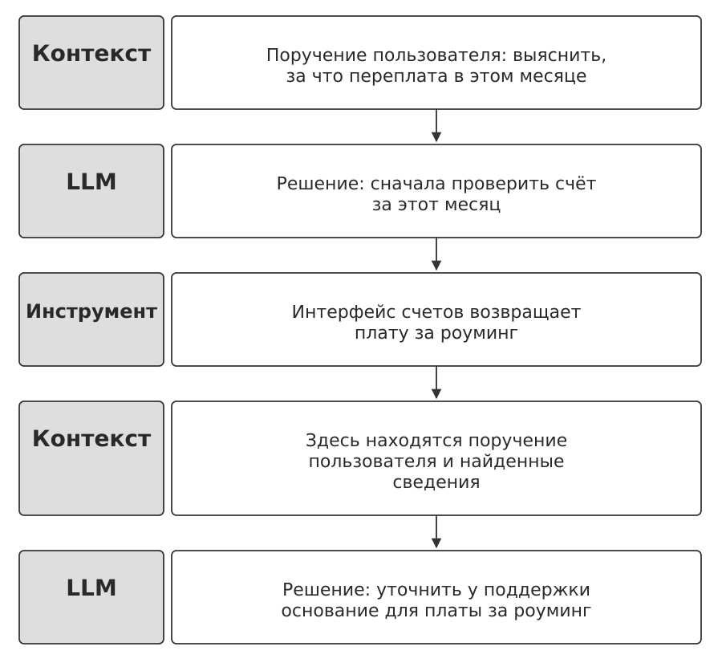
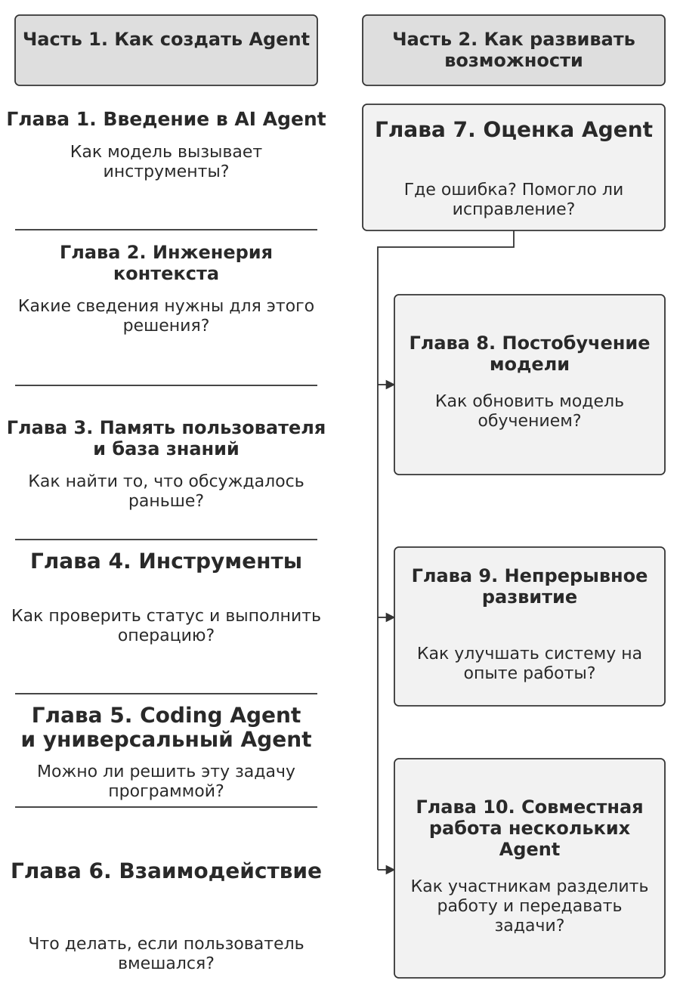

<!-- Русский перевод: community edition. Источник: https://github.com/bojieli/ai-agent-book; файл изменён относительно upstream. -->

# Предисловие {.unnumbered}

С августа 2025 года до начала 2026 года автор проводил у издательства «Тьюринг» онлайн-видеокурс «Практикум по агентам», посвящённый созданию AI-агентов с помощью объяснимых, проверяемых и переиспользуемых инженерных методов. Курс начинался с запуска агента, после чего разбиралось, почему он устроен именно так: какую проблему решает каждое проектное решение, какой ценой и для каких задач оно подходит. Эта книга подготовлена на основе материалов курса и сопутствующих практических работ.

> **Как создавалась эта книга: опыт сотрудничества человека и машины**
>
> При подготовке к занятиям я сначала надиктовывал план голосовому агенту Pine, а тот искал материалы и составлял черновик. Такой формат совместной работы с помощью диктовки называется **whisper coding**. После занятий, если слушатели застревали на каком-то шаге или результат эксперимента оказывался неожиданным, я возвращался к соответствующим примерам и аргументам и перепроверял их.

С 2025 года автор наблюдает важное изменение: фокус исследований и прикладных разработок в области AI расширяется — от повышения возможностей базовых моделей до выполнения агентами реальных задач. Благодаря этому обучение моделей и их практическое применение становятся всё теснее связаны. Модели рассуждений, такие как DeepSeek-R1, продемонстрировали, как обучение с подкреплением повышает способности в математике, программировании и рассуждениях.[^preface-r1] Обучение агентов с подкреплением (Agentic Reinforcement Learning) включает в процесс обучения вызовы инструментов и взаимодействие со средой, благодаря чему модель учится не только программировать, но и работать с графическими интерфейсами. Задачи второго типа часто называют Computer Use: модель определяет состояние страницы по снимку экрана, а затем выполняет необходимые действия с помощью щелчков мыши, ввода текста и прокрутки. Такие продукты, как Manus, Claude Code и OpenClaw, позволяют пользователям напрямую поручать задачи, а также показывают, как сочетание «генерации кода и файловой системы» может служить основой для универсального агента.

В сентябре 2026 года Meta представила Muse. В тот период продукты с персональными агентами начали появляться один за другим как в Китае, так и за его пределами. Со многими проблемами, рассматриваемыми в этой книге, мы с командой столкнулись ещё раньше, работая над Pine. Я занимал должность главного научного сотрудника в Pine AI и вместе с коллегами разрабатывал персонального агента, который выполняет поручения потребителей. Уже в начале января 2025 года Pine был запущен в США: пользователи могли попросить его позвонить компании, договориться об уменьшении счёта, запросить возврат средств или отменить подписку.

Если представитель компании по телефону соглашался списать часть начислений, Pine мог сразу сообщить пользователю только одно: «Сотрудник службы поддержки согласился». Чтобы сказать: «Деньги уже вернули», нужно было дождаться, пока возврат появится в выписке. Для выполнения таких поручений модель должна помнить, на что пользователь дал разрешение, понимать, что следует проверить дальше, и различать этапы выполнения задачи. Позднее в отрасли начали говорить о Skill, Harness и инженерии Loop, однако многие из соответствующих подходов мы нащупали именно во время таких телефонных разговоров.

- **Skill.** Мы загружали соответствующие промпты только тогда, когда они требовались для текущей задачи. Когда инструментов стало больше, мы также научили модель вызывать их через командную строку, чтобы не перечислять определения всех инструментов в каждом запросе.
- **Harness.** Мы выводили среду выполнения, текущее время и рабочее состояние пользователя в строку состояния, чтобы модель могла учитывать их при принятии решений. Иногда модель выдумывала результаты, вызывала не тот инструмент или упускала инструкции, а опасные действия могли выйти за пределы полномочий, предоставленных пользователем. Поэтому мы ввели ограничения для процесса выполнения; позднее похожие решения появились и в Claude Code.
- **Инженерия Loop.** Иногда модель объявляла задачу выполненной, сделав лишь половину работы. Мы поручали одному агенту выполнить задачу, а другому — проверить счёт или заказ. Если проверяющий обнаруживал упущение, задача возвращалась первому агенту на доработку. Так устроено разделение ролей «предлагающий — проверяющий» (proposer-reviewer).

Другие команды, разрабатывавшие модели и агентов и решавшие похожие задачи, независимо пришли к близким методам. Это ещё сильнее убедило автора в том, что многие трудности, с которыми столкнулась наша команда, являются общими для агентных систем, переходящих к практическому применению. Помимо «Практикума по агентам», в 2024–2026 годах автор также регулярно преподавал практический курс по агентам в Университете Китайской академии наук. Вопросы слушателей обоих курсов помогли понять, какие аспекты накопленного опыта требуют более ясного объяснения. Публикуя книгу в открытом доступе, автор также надеется, что больше исследователей и инженеров смогут применять, проверять и совершенствовать эти методы.

**Сначала практика, потом название**. Для команд разработчиков это означает ещё и следующее: когда какой-либо термин становится общепринятым в отрасли, ведущие команды зачастую уже давно исследуют стоящее за ним направление. Чтобы накопить собственные инженерные преимущества, необходимо заранее выявлять проблемы в реальном бизнесе и пробовать их решать. По мнению автора, для этого нужны два ключевых условия.

**Во-первых, нужно выбрать реальный бизнес, предъявляющий достаточно высокие требования к возможностям агентов, и постоянно получать обратную связь.** Одна задача Pine могла длиться от нескольких часов до нескольких недель, требовать общения с несколькими сторонами, продолжительных телефонных разговоров, заполнения сложных форм и многоэтапной переписки по электронной почте. При этом необходимо было обеспечивать точность чисел, управляемость действий и защиту интересов пользователя. Такие сценарии постоянно выявляют разрыв между возможностями модели и требованиями бизнеса, побуждая команду совершенствовать Harness. Если основная ценность продукта заключается лишь в компенсации недостатков конкретного поколения моделей, следующее обновление модели может устранить эти недостатки, и команде будет трудно накопить устойчивые преимущества.

**Во-вторых, необходимо создать системный механизм оценки (Evaluation).** Если после изменения системы переговоры об уменьшении счёта завершились успешно, причиной могло быть как то, что помощник задал правильные вопросы, так и то, что именно в этот раз сотрудник службы поддержки случайно обладал полномочиями списать начисления. Многократное сравнение новой и старой версий на одном и том же наборе примеров позволяет понять, устойчивы ли различия. В седьмой главе подробно рассматривается, как задавать критерии успеха, создавать среду оценки, анализировать неудачи и проверять изменения.

Работая над Pine, мы извлекли из задач по уменьшению счетов один метод: проверяющий должен посмотреть, появилась ли соответствующая сумма в выписке. Если применить тот же метод к обмену билета, нужно проверить, выпущен ли новый билет. Конкретные подтверждения зависят от бизнеса, но за ними стоит общий принцип: чтобы определить, выполнена ли задача, нужно проверить, какой результат действие оставило во внешнем мире. **Хорошие принципы сохраняют силу при смене поколений моделей**.

## Миссия этой книги {.unnumbered}

Представьте, что человек передаёт помощнику счёт за мобильную связь и просит связаться с оператором, чтобы договориться о снижении суммы или освобождении от оплаты. Прежде чем начать, помощник должен выяснить, какое именно начисление оспаривается; во время разговора — выслушать объяснения и уточнить условия; по завершении — сообщить пользователю, что именно пообещала служба поддержки. На каждом шаге помощнику необходимо отвечать на три вопроса: что ему известно в данный момент? Какие действия он может предпринять? На каком основании он выбирает следующий шаг? Отталкиваясь от этих трёх вопросов, книга знакомит со структурой AI-агента, методами его построения и границами возможностей. Основная формула: **агент = LLM + контекст + инструменты**. LLM отвечает за понимание, планирование и принятие решений, контекст содержит информацию, необходимую для текущего решения, а инструменты связывают агента с внешней средой, позволяя получать наблюдения или выполнять действия.

Если воспользоваться наглядной аналогией, LLM — это «мозг», контекст — «поле зрения при принятии текущего решения», а инструменты — «органы чувств, руки и ноги». В поле зрения входят сведения о среде, история диалога, память и знания, а также системные инструкции, определения инструментов и состояние задачи. Поиск, чтение и создание снимков экрана приносят информацию, тогда как нажатия, запись и вызовы бизнес-интерфейсов изменяют внешнее состояние. На рисунке 0-1 показан процесс одного запроса по счёту. При первом решении модель знает лишь, что пользователь сомневается в правильности начисления, а при втором уже может указать, о какой именно сумме следует спросить.



Читатели, знакомые с обучением с подкреплением (Reinforcement Learning, RL), могут также осмыслить это разделение через политику, наблюдения и действия. LLM выбирает следующий шаг на основе контекста, поэтому её функция принятия решений близка к политике (Policy); контекст содержит конкретные наблюдения и историю, используемые при этом решении; инструменты предоставляют интерфейсы наблюдений и действий. Пространство наблюдений (Observation Space) описывает, какие наблюдения можно получить, а пространство действий (Action Space) — какие действия разрешено выполнять; вместе они очерчивают границы взаимодействия агента со средой.[^preface-spaces] В первой главе эти понятия будут раскрыты на примерах вызова инструментов, а также будет рассмотрено распределение обязанностей между Model и Harness в производственной реализации.

> **Дополнительное размышление: от жизни к спроектированным сущностям**
>
> Помимо инженерной практики агенты поднимают вопросы об эволюции интеллектуальных систем. Лауреат премии Тьюринга и один из основоположников обучения с подкреплением Richard Sutton разделяет эволюцию Вселенной на четыре этапа: пыль, звёзды, жизнь и «спроектированные сущности» (designed entities).[^preface-sutton] Биологические организмы эволюционируют посредством случайных мутаций и естественного отбора, тогда как спроектированные сущности могут целенаправленно создаваться и совершенствоваться уже существующими интеллектуальными системами.
>
> Агент может генерировать код, создавать новых агентов, затем анализировать их поведение во время выполнения, предлагать изменения и проверять результат, постепенно реализуя самозагрузку (bootstrap) и непрерывную эволюцию. Это похоже на то, как один программист создаёт другого программиста, который затем продолжает участвовать в построении новых систем. Возможность понимать и совершенствовать себя — один из вопросов, которые больше всего интересовали автора при написании глав о генерации кода и непрерывной эволюции.

## Структура книги {.unnumbered}

На рис. 0-2 показаны связи между главами. Допустим, во время телефонного разговора пользователь внезапно меняет требования, но ассистент продолжает действовать по старым. Тогда можно начать с главы 6 в левой части рисунка и посмотреть, как ассистент обрабатывает реплики, прерывающие его работу. А как после исправления убедиться, что в других разговорах он тоже будет учитывать новые требования? Для этого применяются методы оценки из главы 7 в правой части рисунка. Три стрелки, исходящие из главы 7, показывают, что после получения результатов оценки можно выбрать разные способы улучшения в зависимости от причин неудачи.



- **Глава 1 (Введение в AI-агенты)** на примерах продуктов и вызовов инструментов знакомит с основными компонентами, рабочим циклом, Harness и способами оркестрации, формируя понятийную основу для понимания всей книги.
- **Глава 2 (Контекстная инженерия)** — ключевая глава книги, посвящённая организации информации, которая нужна модели в текущий момент. Рассматриваются проектирование промптов, загрузка по требованию и управление историей, а на примере KV-кэша объясняется, как эти методы влияют на качество ответов и стоимость работы.
- **Глава 3 (Пользовательская память и база знаний)** посвящена сохранению и использованию информации между сеансами. Рассматриваются пользовательская память, RAG, структурированные индексы и обновление знаний, помогающие читателю освоить методы поиска и сопровождения постоянных знаний.
- **Глава 4 (Инструменты)** рассматривает, как агент получает наблюдения, выполняет действия и запрашивает совместную работу. Классификация инструментов, проектирование интерфейсов, MCP и управление выполнением помогают понять, как подключать к системе внешние возможности.
- **Глава 5 (Coding Agent и агенты общего назначения)** предлагает одну из ключевых архитектурных идей для агента общего назначения: использовать Coding Agent как исполнительное ядро, а файловую систему — как рабочее пространство. Сначала рассматривается процесс разработки, а затем на примерах мультимедиа и бизнес-систем показывается, как агент пишет программы для решения задач, создаёт инструменты и строит новых агентов.
- **Глава 6 (Взаимодействие: расширение пространств наблюдений и действий)** рассматривает взаимодействие агента в двух измерениях — модальности и времени. Асинхронные события, голосовое взаимодействие, Computer Use и робототехника помогают понять непрерывное наблюдение, быстрый и медленный пути, а также управление выполнением.
- **Глава 7 (Оценка AI-агента)** отвечает на вопрос, как оценивать работу системы и эффект отдельного изменения. Сначала определяются критерии успеха, среда и набор данных, затем рассматриваются верификаторы, выставление оценок и статистический анализ, а в завершение причины неудач анализируются для поиска направлений улучшения.
- **Глава 8 (Постобучение моделей)** посвящена обновлению возможностей модели с помощью данных и среды, причём приоритет отдаётся качеству данных и среды обучения. На примере дообучения с учителем, обучения с подкреплением и проектирования вознаграждений объясняется, почему обучение по демонстрациям и исследование дают разные результаты обобщения и почему изменение одного лишь алгоритма часто приносит мало пользы.
- **Глава 9 (Непрерывная эволюция AI-агента)** рассматривает использование опыта эксплуатации для улучшения последующих версий агента. Сравниваются четыре типа обновлений — знаний, инструкций, программ и параметров, — после чего обсуждается управление долгосрочными изменениями посредством верификации, выпуска и восстановления.
- **Глава 10 (Совместная работа нескольких AI-агентов)** рассматривает, когда несколько участников создают дополнительную ценность и как распределять между ними задачи, организовывать коммуникацию и координацию. Сначала объясняется распределение контекста и полномочий управления, затем на примерах разбираются механизмы совместной работы и причины неудач, а в завершение обсуждаются возможные формы общества и экономики агентов.

## Как читать эту книгу {.unnumbered}

- **Создание продукта на основе AI-агента с нуля**: рекомендуется прочитать всю книгу. Сначала с помощью глав с первой по шестую создайте помощника, способного выполнять задачи, а затем в седьмой главе проверьте, в каких задачах он чаще ошибается. Последние три главы посвящены тому, как на основе этих неудач улучшать модель, систему или распределение обязанностей между участниками.
- **Сначала сформировать целостное представление**: последовательно прочитайте первую, вторую, четвёртую и седьмую главы. Проследите один вызов инструмента от начала до конца: сначала разберитесь в рабочем цикле агента, затем посмотрите, какую информацию получает модель и что в действительности делает инструмент, а в конце с помощью оценки определите, соответствует ли результат требованиям пользователя. При первом чтении раздела второй главы о KV-кэше можно сначала усвоить три вывода, приведённые в начале, а к низкоуровневым принципам вернуться после проведения экспериментов.
- **Сосредоточиться на обучении моделей**: сначала с помощью первой и второй глав разберитесь в принципах работы агента, а затем читайте восьмую главу вместе с методами оценки из седьмой. Это позволит связать цели обучения с результатами на реальных задачах.
- **Сопровождать уже запущенного агента**: выберите в седьмой главе набор реальных задач и проведите оценку. Например, если помощник сообщил пользователю устаревшую цену, сначала выясните, какую версию ценового предложения он получил. Если устарели знания или процесс, изучите эту неудачу с помощью девятой главы. Если же и ценовое предложение, и инструменты были предоставлены в полном объёме, но модель даже после изменения процесса продолжает раз за разом выбирать неверный вариант, прочитайте восьмую главу и определите, стоит ли готовить данные для обучения.

В каждой главе предусмотрены эксперименты и вопросы для размышления. Эксперименты пронумерованы в формате «Эксперимент X-Y», где X — номер главы, а Y — порядковый номер внутри неё. Сложность обозначается звёздами: ★ — начальный уровень, ★★ — требуется определённый инженерный опыт, ★★★ — затрагиваются открытые вопросы или проектирование сложных систем. Для большинства экспериментов предоставлен исполняемый код, собранный в открытом репозитории:

> **Репозиторий с сопутствующим кодом**: `bojieli/ai-agent-book`

Если вы впервые выполняете эксперименты, можно начать с «Эксперимента 1-1: Ключевая роль контекста». Если вы используете Git, выполните в терминале:

```bash
git clone https://github.com/bojieli/ai-agent-book.git
cd ai-agent-book
```

Тот же каталог можно получить, выбрав **Code → Download ZIP** на странице репозитория и распаковав архив. Найдите номер 1-1 в указателе экспериментов первой главы (`chapter1/README.md`) и откройте `chapter1/context/README.md`. В дальнейшем проекты и инструкции по запуску для любого «Эксперимента X-Y» можно найти в файле `chapterX/README.md` соответствующей главы. В «руководствах по воспроизведению» указаны внешние проекты и способы их получения, а команды установки и описание каталогов собраны в README.

## Предварительные знания {.unnumbered}

Книга предназначена для читателей, обладающих базовыми навыками программирования и желающих понять, как устроены AI-агенты, и научиться создавать их. Для практических экспериментов потребуются следующие базовые знания.

**Обязательно: основа для чтения всей книги**

- **Программирование на Python**: необходимо знать синтаксис, распространённые структуры данных, инструменты управления пакетами, такие как pip, а также уметь читать и изменять код экспериментов. Большинство экспериментов в книге основано на Python.
- **Опыт использования LLM**: необходимо иметь опыт работы с ChatGPT, Claude или аналогичными продуктами, уметь формулировать запросы, читать ответы и задавать уточняющие вопросы.
- **Основы программной инженерии**: необходимо знать командную строку, Git, JSON и REST API, чтобы уметь запускать проекты, проверять изменения и читать данные API.

Для практических экспериментов автор настоятельно рекомендует выбрать один из следующих инструментов: Claude Code, Codex, Cursor или TRAE. Попросите его помочь с отладкой фрагмента кода и посмотрите, какие файлы он прочитает и какие инструменты вызовет. Тогда при дальнейшем чтении о цикле выполнения и управлении контекстом у вас уже будет собственный опыт для сопоставления.

**Рекомендуется: знания, дополняемые по главам**

- **Основы машинного обучения (глава 8)**: понимание обучения и инференса, функции потерь, градиентного спуска и переобучения поможет разобраться в процессе обновления модели.
- **Основы математики (главы 2, 3, 7 и 8)**: знание векторов и матриц поможет понять эмбеддинги и механизм внимания, а основы теории вероятностей и статистики — метрики оценки и ожидаемое вознаграждение. В книге основное внимание уделяется наглядным объяснениям и практическому применению.
- **Основы веб-разработки (глава 6)**: знание HTTP, WebSocket и разделения задач между фронтендом и бэкендом поможет понять архитектуру асинхронных событий и голосовую коммуникацию в реальном времени.
- **Основы Transformer (главы 2 и 8)**: понимание механизма внимания и структуры модели поможет разобраться в вычислениях с контекстом и постобучении. Читателям, желающим изучить эту тему системно, рекомендуется книга «Большие модели в иллюстрациях: принципы и практика генеративного AI» Джея Аламмара и Мартена Гротендорста, переведённая Ли Боцзе и выпущенная издательством «Тьюринг». В ней с помощью наглядных схем объясняются Transformer, предобучение и дообучение, что дополняет инженерный взгляд, представленный в этой книге.

За исключением постобучения в главе 8, в остальных главах требуется лишь небольшой объём знаний математики и машинного обучения, поэтому начать чтение можно, имея базовый опыт программирования.

## Благодарности {.unnumbered}

Благодарю редакторов издательства Turing Мэн Гэ и Лю Мэйин за работу над этой книгой и усилия по организации «Практического интенсива по AI-агентам»; благодарю Лю Цзюньмина за проведение практического курса по агентам в Университете Китайской академии наук. Благодарю слушателей и студентов обоих курсов: ваши вопросы, отзывы об экспериментах и рекомендации помогали автору постоянно совершенствовать объяснения и глубже понимать эти концепции.

Благодарю всех коллег из Pine AI. Вызовы реального бизнеса и обсуждения в команде стали источником многих методов и примеров из этой книги. Благодаря вашему практическому опыту и идеям эти представления постоянно совершенствовались.

Благодарю друзей из AI-индустрии. Во время наших многочисленных бесед вы откровенно высказывали свои замечания, делились разным опытом и суждениями, помогая автору глубже понять модели и агентов.

Но больше всего автор благодарен своей семье, особенно жене Мэн Цзяин. Она неизменно поддерживала его работу над этой книгой и высказала множество ценных замечаний к рукописи.

[^preface-r1]: DeepSeek-AI, *DeepSeek-R1: Incentivizing Reasoning Capability in LLMs via Reinforcement Learning*, 2025.
[^preface-spaces]: Раздел «Spaces» документации Gymnasium.
[^preface-sutton]: Интервью Ричарда Саттона и Дваркеша Пателя от 26 сентября 2025 года, раздел «Succession to AI».
