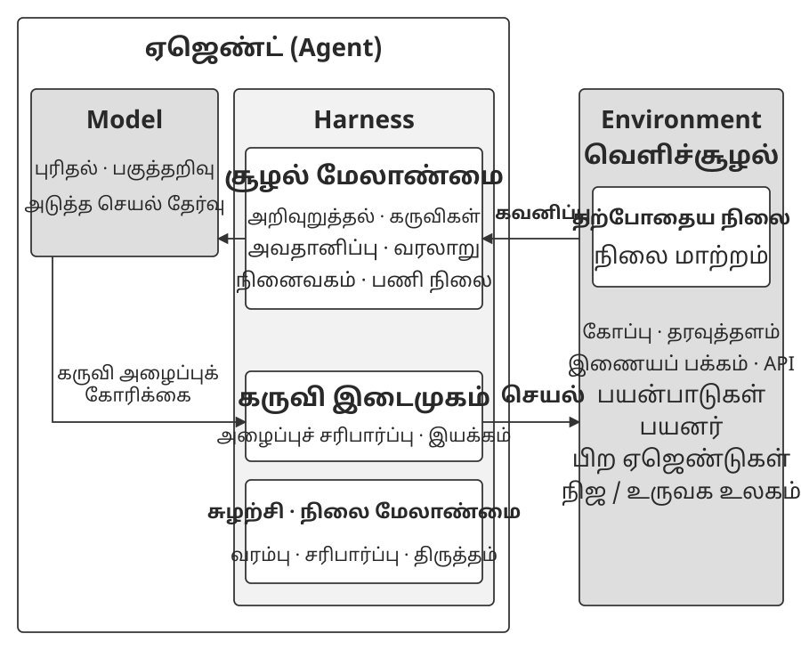
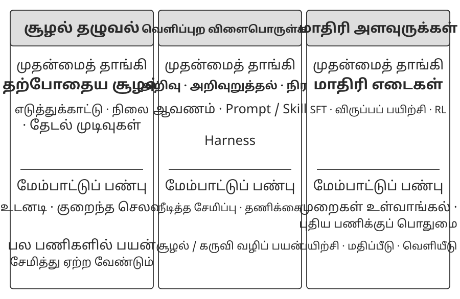
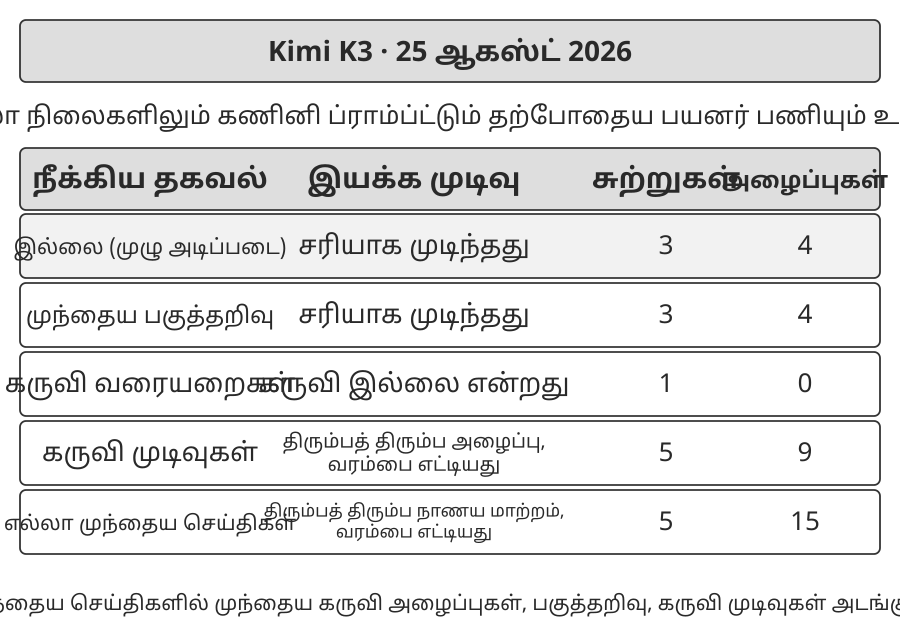
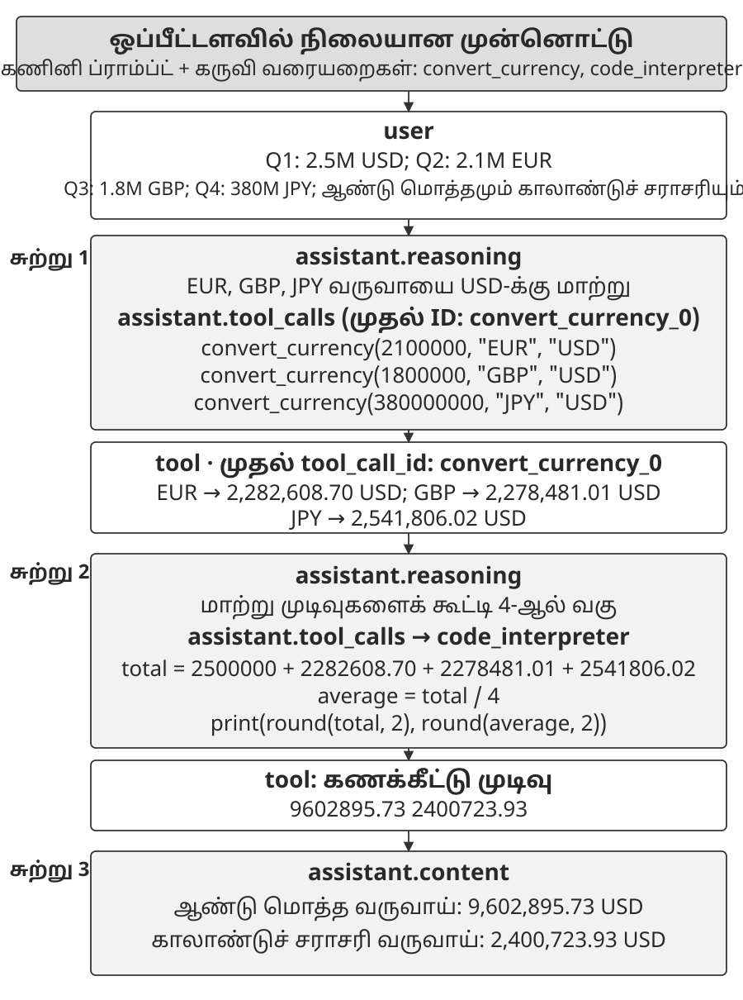
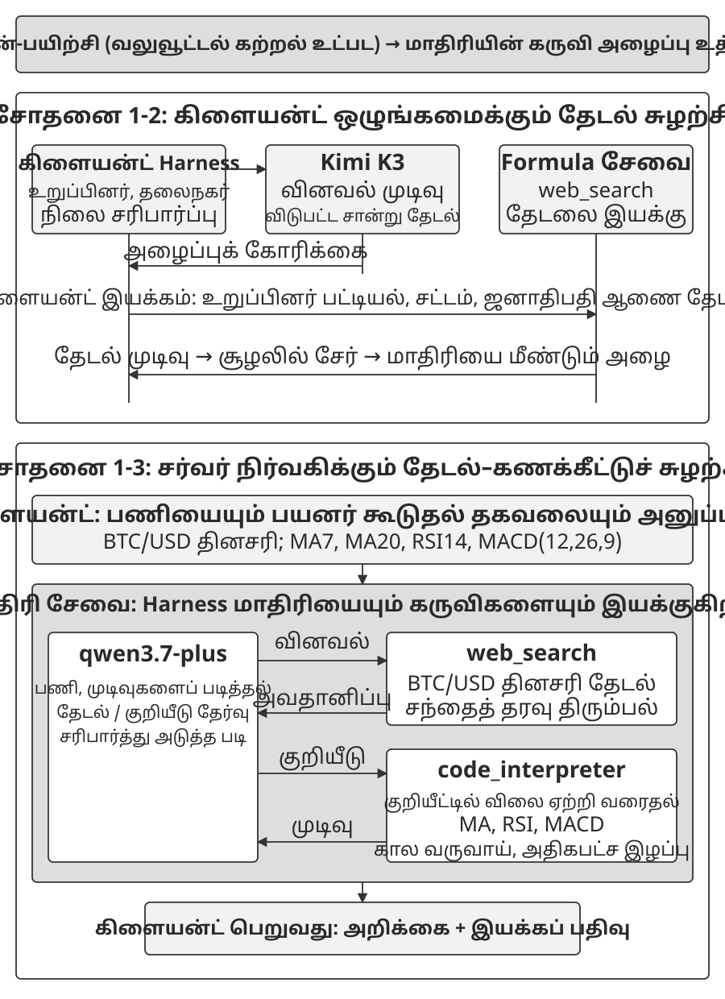
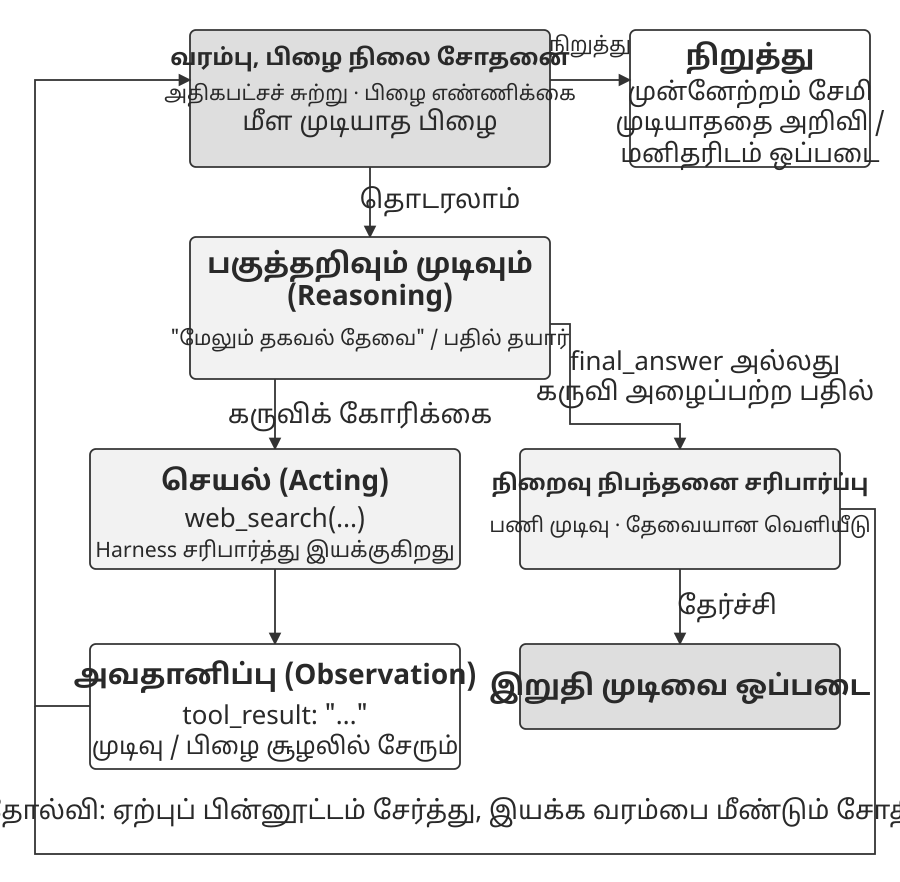
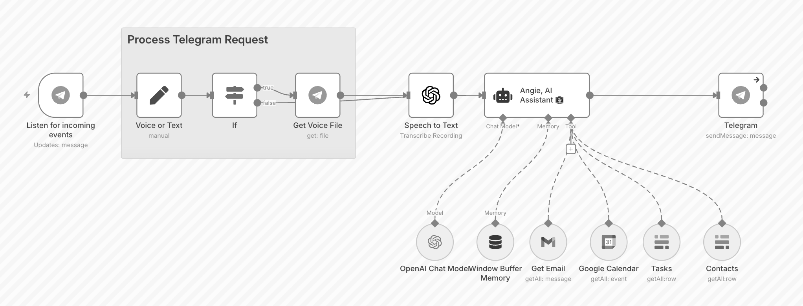

# AI ஏஜெண்டுகள்: ஓர் அறிமுகம்

Deep Research கொண்டு ஒரு தலைப்பை ஆராயும்போது, அது மீண்டும் மீண்டும் தேடிப் படித்து, இறுதியில் ஓர் அறிக்கையைத் தொகுத்துத் தருகிறது. Manus உலாவியை இயக்கி இணையவழிப் பணிகளை முடிக்க முடியும்; Doubao கைபேசி உதவியாளர் கைபேசியிலேயே பயணச்சீட்டு முன்பதிவு செய்யவும் செய்திகள் அனுப்பவும் முடியும்; Pine AI பயனருக்குப் பதிலாகத் தொலைபேசியில் அழைத்து, தொலைத்தொடர்பு நிறுவனத்துடன் பேசிக் கட்டணத்தைக் குறைக்க முடியும். இவை அனைத்தும் AI ஏஜெண்டுகளின் பயன்பாடுகள்.

Cursor கொண்டு ஒரு சார்பைச் (function) சரிசெய்யும்போது, அது அந்தச் சார்பைக் கண்டுபிடித்து, கோப்பைத் திருத்தி, பின்னர் சோதனைகளை இயக்குகிறது. சோதனை இன்னும் தோல்வியடைந்தால், பிழைச் செய்தி அதன் அடுத்த திருத்தத்துக்கு அடிப்படையாகிறது; சோதனை வெற்றி பெற்றால்தான், முடிவை உங்களிடம் தெரிவிக்க அதனிடம் சான்று இருக்கிறது. தேடுதல், திருத்துதல், சோதித்தல் என்ற இந்த மூன்று படிகளின் வரிசையை முன்கூட்டியே நிரலில் எழுதி வைக்கலாம்; ஆனால் எந்த வரியைத் திருத்துவது, தோல்வியடைந்தால் எங்கு திரும்புவது என்பவை செயல்பாட்டின்போது கிடைக்கும் தகவலைப் பொறுத்தவை. இலக்கை மையமாகக் கொண்டு செயலைத் தேர்ந்தெடுத்து, பின்னர் முடிவுகளின் அடிப்படையில் திட்டத்தைச் சரிசெய்யும் இந்தச் செயல்முறை, ஆய்வு, தொலைபேசிப் பேச்சுவார்த்தை போன்ற பணிகளிலும் நிகழ்கிறது.

## நவீன ஏஜெண்ட் = LLM + சூழல் + கருவிகள்

நவீன ஏஜெண்டின் மூன்று வகைச் செயல்பாட்டுக் கூறுகளை இந்த நூல் ஒரு சூத்திரத்தில் சுருக்குகிறது: **ஏஜெண்ட் = LLM (பெரிய மொழி மாதிரி, Large Language Model) + சூழல் + கருவிகள்**.

- **LLM ஏஜெண்டின் மூளை**; பணியைப் புரிந்துகொள்ளுதல், படிகளைத் திட்டமிடுதல், செயல்களைத் தேர்ந்தெடுத்தல் ஆகியவற்றுக்குப் பொறுப்பு. முன்-பயிற்சி மாதிரிக்கு மொழித் திறனையும் உலக அறிவையும் வழங்குகிறது; பின்-பயிற்சி அறிவுறுத்தலைப் பின்பற்றுதல், பகுத்தறிவு, கருவி அழைப்பு போன்ற நடத்தைகளை மேலும் வடிவமைக்கிறது. மேற்பார்வை நுண்சரிப்படுத்தல், வலுவூட்டல் கற்றல் போன்ற பின்-பயிற்சி முறைகளை அத்தியாயம் 8 அறிமுகப்படுத்தும்.
- **சூழல் ஏஜெண்டின் தற்போதைய முடிவுப் பார்வைப் புலம்**; இந்த முடிவுக்குத் தேவையான தகவல்களை அது கொண்டுள்ளது: அறிவுறுத்தல்கள், கருவி வரையறைகள், வெளிச்சூழல் அவதானிப்புகள், பயனர் நினைவகம், துறை அறிவு, வரலாற்றுச் செய்திகள், ஏஜெண்டின் சொந்த நிலை, பணியின் முன்னேற்றம் ஆகியவை.
- **கருவிகள் ஏஜெண்டின் புலன்களும் கைகால்களும்**; இடைமுகங்கள் வழியாகத் தகவலைப் பெறுகின்றன அல்லது செயல்களைச் செய்கின்றன. கருவி அமைப்பில் வரையறைகள், அழைப்பு நெறிமுறை, தகவமைப்பிகள் (adapter) ஆகியவை அடங்கும்; தேடல், படித்தல், திரைப்பிடிப்பு போன்ற அவதானிப்புச் செயல்களையும், எழுதுதல், குறியீட்டை இயக்குதல், துணை ஏஜெண்டுக்குப் பணியை ஒப்படைத்தல், பயனருடன் தொடர்புகொள்ளுதல் போன்றவற்றையும் அவை ஆதரிக்கின்றன.

ஒரே கருவி பல பங்குகளை வகிக்கலாம். எடுத்துக்காட்டாக, மாதிரி கட்டளை வரி வழியாக ஒரு கோப்பைப் படிக்கும்போது, திருப்பித் தரப்படும் கோப்பு உள்ளடக்கம் அடுத்த முடிவுக்கு அடிப்படையாகிறது; கட்டளை வரி வழியாக ஒரு நிரலை இயக்கும்போது, கோப்புகளின் அல்லது செயல்முறைகளின் (process) நிலையும் மாறக்கூடும்.

நீங்கள் இப்போதுதான் ஒரு பொதியைப் பிரித்திருக்கிறீர்கள், "பிரித்த பிறகும் பொருளைத் திருப்பி அனுப்ப முடியுமா?" என்று வாடிக்கையாளர் சேவையிடம் கேட்க விரும்புகிறீர்கள் என்று வைத்துக்கொள்வோம். அமைப்பு **மீட்டெடுப்பு-மேம்படுத்தப்பட்ட உருவாக்கம்** (Retrieval-Augmented Generation, RAG) மூலம் கடையின் தற்போதைய திருப்பியனுப்புதல் கொள்கையைத் தேடி எடுத்து, அந்த விதிகளின் அடிப்படையில் பதிலளிக்குமாறு மாதிரியிடம் கேட்கலாம்.[^ch1-rag] ஒரே ஒரு வினவலைப் பின்தொடர்ந்தாலே பல பாகங்களின் பொறுப்புகள் தெளிவாகத் தெரிகின்றன. கொள்கையின் மூல உரையும் அதன் சுட்டும் (index) ஒரு வெளிப்புற அறிவுத் தளத்தில் சேமிக்கப்பட்டுள்ளன; மீட்டெடுப்புக் கருவி கேள்விக்குத் தொடர்புடைய பத்திகளைத் தேடி எடுக்கிறது; மாதிரியை அழைக்கும் நிரல் அந்தப் பத்திகளை அவற்றின் மூலத்துடன் சேர்த்து இந்தக் கோரிக்கையில் வைக்கிறது. "பிரித்த பொருள்" என்ற விதியைப் படித்த மாதிரி, அந்த விதியை விளக்க முடியும்; விதி பொருள் வகைக்கேற்ப வேறுபட்டால், நீங்கள் என்ன வாங்கினீர்கள் என்று முதலில் கேட்டுத் தெளிவுபடுத்த வேண்டும்.

[^ch1-rag]: Patrick Lewis மற்றும் பலர், Retrieval-Augmented Generation for Knowledge-Intensive NLP Tasks, NeurIPS, 2020.

இந்தத் திருப்பியனுப்புதல் வினவலில், மீட்டெடுப்பைத் தொடங்குவது ஏஜெண்டின் செயல்; திருப்பித் தரப்படும் விதிகள், அது வெளிச்சூழலிலிருந்து (Environment) பெறும் அவதானிப்பு. அடுத்த அடி பதில் சொல்வதா அல்லது மேலும் கேள்வி கேட்பதா என்பது விதிகளில் என்ன எழுதப்பட்டுள்ளது என்பதைப் பொறுத்தது. இதுவே வலுவூட்டல் கற்றலும் கட்டுப்பாட்டியலும் (control theory) குறிப்பிடும் மூடிய சுழற்சி (closed loop); படம் 1-1 இதைக் காட்டுகிறது.



படத்தின் வெளி அடுக்கு ஏஜெண்டுக்கும் வெளிச்சூழலுக்கும் இடையிலான எல்லையைப் பிரிக்கிறது. கோப்புகள், தரவுத்தளங்கள், வலைப்பக்கங்கள், பயனர்கள், பிற ஏஜெண்டுகள், இயற்பியல் அல்லது உருவகப்படுத்தப்பட்ட உலகம் என அனைத்தும் அது இடைவினை புரியும் வெளிச்சூழலாக அமையலாம். படத்தின் உள் அடுக்கு உற்பத்திச் செயலாக்கத்தின் பணிப்பகிர்வைக் காட்டுகிறது: **Model புரிந்துகொள்ளுதல், பகுத்தறிதல், முடிவெடுத்தல் ஆகியவற்றுக்குப் பொறுப்பு; Harness ஏஜெண்டின் எல்லைக்குள், Model-க்கு வெளியே அமைந்து, சூழல், கருவி இடைமுகங்கள், இயக்கச் சுழற்சி, நிலை ஆகியவற்றை ஒழுங்கமைத்து, கட்டுப்பாடுகள், சரிபார்ப்பு, திருத்தம் ஆகியவற்றைச் செயல்படுத்துகிறது.** Harness வெளிச்சூழலை உருவாக்கலாம், தனிமைப்படுத்தலாம், அல்லது அதற்கான பதிலாளாகச் (proxy) செயல்படலாம்; கோப்பு உள்ளடக்கம், செயல்முறை நிலை போன்றவையோ செயல்களுக்கேற்ப வெளிச்சூழலில் மாறுகின்றன.[^ch1-harness]

[^ch1-harness]: LangChain-இன் "The Anatomy of an Agent Harness", Anthropic-இன் "Effective harnesses for long-running agents" ஆகியவற்றைப் பார்க்கவும். சில செயலாக்கங்கள் சாண்ட்பாக்ஸையும் (sandbox) Harness-இன் பகுதியாகக் கணக்கிடுகின்றன; செயல்கள் உண்மையில் எதை மாற்றின என்பதைப் பின்தொடர எளிதாக இருக்க, படம் 1-1 வெளிச்சூழலைத் தனியாக வரைகிறது.

எனவே இந்த நூல் ஒன்றையொன்று நிரப்பும் இரண்டு பகுப்பு முறைகளைப் பயன்படுத்துகிறது: **"LLM + சூழல் + கருவிகள்" செயல்பாட்டுக் கூறுகளை விளக்குகிறது; "Model + Harness" உற்பத்திச் செயலாக்கத்தை விளக்குகிறது.** சூழலை Harness ஒழுங்கமைத்து Model-க்கு வழங்குகிறது; கருவி அழைப்பை Model முடிவு செய்கிறது, Harness சரிபார்த்துத் திட்டமிட்டு, கருவியிடமோ வெளிச்சூழலிடமோ செயல்படுத்த ஒப்படைக்கிறது. ஓர் எளிய அமைப்பு சூழலைத் தொகுத்தல், கருவிகளைத் திட்டமிடுதல் ஆகியவற்றிலிருந்து தொடங்கி, உற்பத்தி இயக்கத்துக்குத் தேவையான கட்டுப்பாடு, சரிபார்ப்பு, திருத்தப் பொறிமுறைகளைப் படிப்படியாகச் சேர்த்துக்கொள்ளலாம்.

வலுவூட்டல் கற்றலில் பரிச்சயம் உள்ளவர்கள், "அடுத்த அடியை யார் தீர்மானிக்கிறார்கள், எதன் அடிப்படையில் தீர்மானிக்கிறார்கள், அதை எவ்வாறு செயலாக்குகிறார்கள்" என்ற மூன்று கேள்விகளின் கோணத்தில் கீழே உள்ள அட்டவணையைப் படிக்கலாம். இது செயல்பாட்டின் அடிப்படையிலான ஒரு தோராயமான ஒப்புமை.

| உள்ளுணர்வுப் புரிதல் | பொறியியல் கூறு | வலுவூட்டல் கற்றலில் தொடர்புடைய கருத்து | பொருள் |
|-----------|-----------|----------------------------|----------------------------------------------|
| **மூளை** | LLM | **கொள்கை** (Policy) | தற்போதைய தகவலின் அடிப்படையில் அடுத்து என்ன செய்வது என்று தீர்மானிக்கிறது |
| **தற்போதைய முடிவுப் பார்வைப் புலம்** | சூழல் | **அவதானிப்பும் வரலாறும்** | வெளிச்சூழல் திருப்பித் தரும் தகவலையும் ஏற்கனவே உள்ள வரலாற்றையும் முடிவுக்கான அடிப்படையாக ஒழுங்கமைக்கிறது |
| **புலன்களும் கைகால்களும்** | கருவிகளும் தகவமைப்பிகளும் | **அவதானிப்பு, செயல் இடைமுகங்கள்** | வெளிச்சூழல் தகவலை எவ்வாறு படிப்பது, செயல்களை எவ்வாறு வெளியிடுவது, அழைப்பு–திருப்புதலின் வடிவம் ஆகியவற்றை வரையறுக்கிறது |

### அவதானிப்பு வெளியும் செயல் வெளியும்: மாதிரிக்கும் உலகுக்கும் இடையிலான இடைமுகம்

**ஏஜெண்ட் எந்தெந்த அவதானிப்புகளைப் பெறக்கூடும் என்பதை அவதானிப்பு வெளி விவரிக்கிறது; அது எந்தெந்தச் செயல்களை வெளியிடக்கூடும் என்பதைச் செயல் வெளி விவரிக்கிறது.** ஓர் அழைப்பில் உள்ள சூழல் குறிப்பிட்ட தகவலைத் தாங்குகிறது; கிடைக்கும் கருவிகள் வெளிச்சூழலுடன் இடைவினை புரிவதற்கான இடைமுகத்தை வழங்குகின்றன. கருவிகளைத் தவிர, பயனர் உள்ளீடு, நிகழ்வு அறிவிப்புகள் போன்றவையும் அவதானிப்புகளைக் கொண்டுவரலாம்; கருவி அழைப்பின் அளவுருக்கள், அனுமதிகள், இயக்கச் சூழல் ஆகியவை சேர்ந்து செயல்களின் எல்லையைக் கட்டுப்படுத்துகின்றன.

இரண்டு வகைக் கோளாறுகளைத் தனித்தனியாகக் கற்பனை செய்து பாருங்கள். முதலாவது: கட்டண அறிக்கையில் உள்ள ஒவ்வொரு கட்டண உருப்படியையும் மாதிரியால் விளக்க முடிகிறது, ஆனால் இந்த மாதக் கட்டண அறிக்கை அதற்குக் கிடைக்கவில்லை. பயனர் படிக்க அனுமதி அளித்த பிறகும், கட்டண அறிக்கையைத் தேடி எடுத்து மாதிரியிடம் கொடுத்தால்தான், எந்தக் கட்டணம் சர்ச்சைக்குரியது என்று அதனால் தீர்மானிக்க முடியும். இரண்டாவது: பயனர் தன் திட்டத்தை (plan) மாற்றுமாறு உதவியாளரிடம் கேட்கிறார்; உதவியாளர் பொருத்தமான திட்டத்தைக் கண்டுபிடித்துவிட்டது, ஆனால் கணக்கு இடைமுகம் வினவலை மட்டுமே அனுமதிக்கிறது. கட்டண அறிக்கையை இன்னொரு முறை படித்தாலும் அதனால் மாற்றத்தைச் செய்ய முடியாது; அதற்குரிய செயல்பாட்டு அனுமதி தேவை. படித்த பொருள்களைச் சூழலில் வைப்பது, மாதிரி தேர்ந்தெடுத்த செயலைப் பெறுவது, அளவுருக்களையும் அனுமதிகளையும் சரிபார்ப்பது, பின்னர் செயல்பாட்டைத் திட்டமிடுவது ஆகியவையே Harness-இன் பணி.

எனவே, **அடிப்படை மாதிரி நிலையாக இருக்கும்போது, அவதானிப்பு வெளியையும் செயல் வெளியையும் சரிசெய்வது பணிச் செயல்திறனை உயர்த்துவதற்கான ஒரு முக்கியமான பொறியியல் வழிமுறை.** மாதிரி முக்கியமான உண்மைகளைத் தவறவிட்டால், தொடர்புடைய தரவைச் சூழலில் சேர்க்கலாம்; ஒத்த கருவிகளிடையே மாதிரி அடிக்கடி தவறான ஒன்றைத் தேர்ந்தெடுத்தால், மீண்டும் மீண்டும் வரும் இடைமுகங்களை ஒன்றிணைக்கலாம், அல்லது தற்போதைய பணிக்குத் தேவையான கருவிகளை மட்டும் ஏற்றலாம்.

காணொளியைப் பார்க்கும்போது எதிர்மாறான பிரச்சினையும் எழுகிறது: படக்காட்சி எப்போதும் இருக்கிறது, ஆனால் மீண்டும் மதிப்பிடத் தகுந்த மாற்றங்கள் குறைவு. உதவியாளர் ஒரு கோப்பு பதிவேற்றப்படுவதற்காகக் காத்திருக்கிறது என்று வைத்துக்கொள்வோம். முன்னேற்றப் பட்டை சிறிது நகரும் ஒவ்வொரு முறையும் முதன்மை மாதிரியை அழைத்தால், தேவையற்ற கணக்கீடுகள் பெருகும்; பத்து வினாடிக்கு ஒருமுறை மட்டும் பார்த்தால், ஒரு கணம் தோன்றி மறையும் தோல்வி அறிவிப்பைத் தவறவிடக்கூடும். **அவதானிப்பு வெளியை அடர்த்தி குறைப்பது (sparsification) ஏஜெண்ட் வடிவமைப்பின் ஓர் அடிப்படைப் பிரச்சினை என்பது என் கருத்து.** அமைப்பு வெளிச்சூழலைத் தொடர்ந்து அவதானித்து, அடுத்த செயலை மாற்றக்கூடிய மாற்றங்களை மட்டும், தேவையான சூழலுடன் சேர்த்து, முதன்மை மாதிரியிடம் ஒப்படைக்கலாம்.

**Manus: ஒரே பணியில் ஆய்வு, நிரலாக்கம், கணினி இயக்கம் ஆகியவற்றை இணைத்தல்.** Deep Research தேடுவதிலும் படிப்பதிலும் சிறந்தது; Coding Agent குறியீட்டை எழுதி இயக்க முடியும்; Computer Use Agent இடைமுகங்களை இயக்க முடியும். Manus உலாவி, கோப்பு முறைமை, குறியீட்டு இயக்கம், கட்டளை வரி ஆகியவற்றை மேகக்கணினிச் சாண்ட்பாக்ஸில் ஒருங்கிணைக்கிறது; இதனால் ஒரே ஏஜெண்ட் முதலில் தகவல் திரட்டி, பின்னர் கோப்புகளைக் கையாண்டு குறியீட்டை இயக்கி, இறுதியில் உலாவி வழியாகச் செயல்களை முடிக்க முடிகிறது. உலாவியும் கோப்புப் படிப்பும் பெறக்கூடிய தகவலை அதிகரிக்கின்றன; குறியீடும் கட்டளை இயக்கமும் இணைக்கக்கூடிய செயல்களை அதிகரிக்கின்றன. **இந்த இணைப்பு பொது ஏஜெண்டுகளுக்கு ஒரு முக்கிய முன்னேற்றம் என்று நான் கருதுகிறேன்: முன்பு தனித்தனியாக இருந்த தயாரிப்பு எல்லைகளைக் கடந்து, தகவல் திரட்டுதல், தரவைச் செயலாக்குதல், செயல்களைச் செய்தல் ஆகியவற்றை ஒரே ஏஜெண்ட் ஒரு முழுமையான பணியாகக் கோர்க்க முடிகிறது.**

**OpenClaw: இடைமுகத்தைப் பயனரின் டிஜிட்டல் வாழ்க்கை வரை நீட்டித்தல்.** OpenClaw, WhatsApp, Telegram, Slack, Discord, iMessage போன்ற செய்திக் கால்வாய்கள் வழியாகப் பணிகளைப் பெற்று முடிவுகளைத் திருப்பி அனுப்புகிறது; பயனரின் சாதனத்தில் இயங்கும் Gateway ஒன்றைக் கொண்டு செய்திக் கால்வாய்கள், மாதிரி, கருவிகள் ஆகியவற்றை இணைக்கிறது. தொடர்புடைய கருவிகளை உள்ளமைத்து அனுமதி பெற்ற பிறகு, ஏஜெண்ட் உள்ளூர்க் கோப்புகளைக் கையாளலாம்; Google Drive, Notion போன்ற மேகச் சேவைகளுடனும் இணையலாம். இதனால் பயனரின் கணக்குகளிலும் சாதனங்களிலும் சிதறிக் கிடக்கும் தகவல்கள் ஒரே பணியின் செயலாக்கத்துக்குள் வர முடிகிறது. தொடக்ககால Manus பெரும்பாலும் மேகச் சாண்ட்பாக்ஸில் மட்டுமே இயங்கியது; பயனர்கள் கோப்புகளைப் பதிவேற்ற வேண்டியிருந்தது. பின்னர் சேர்க்கப்பட்ட Google Drive இணைப்பியும் My Computer மேசைக்கணினி அம்சமும், மேகக் கோப்புகளையும் உள்ளூர் வளங்களையும் அணுகும் எல்லையை மேலும் விரிவுபடுத்தின. தயாரிப்புத் திறனின் வளர்ச்சி பெரும்பாலும் அவதானிப்பு, செயல் இடைமுகங்களின் விரிவாக்கத்திலிருந்தே வருகிறது என்பதை இந்தப் பரிணாமங்கள் காட்டுகின்றன[^ch1-agent-products].

[^ch1-agent-products]: தயாரிப்புக் கட்டமைப்புக்கு, Manus-இன் அதிகாரபூர்வ Sandbox அறிமுகம், Google Drive Connector அறிமுகம், My Computer அறிமுகம், OpenClaw-இன் அதிகாரபூர்வ களஞ்சியம், கருவி ஆவணங்கள் ஆகியவற்றைப் பார்க்கவும். குறிப்பாக எந்த வளங்களை அணுக முடியும் என்பதை இணைப்பிகள், கருவி உள்ளமைவு, பயனர் அனுமதி ஆகியவை தீர்மானிக்கின்றன.

வெவ்வேறு தயாரிப்புகளின் பணிகள் வேறுபட்டாலும், அனைத்தையும் முடிவுக்கான அடிப்படை, கிடைக்கும் செயல்கள், செயல்பாட்டு உத்தி என்ற மூன்று அம்சங்களிலிருந்து புரிந்துகொள்ளலாம்:

| ஏஜெண்ட் தயாரிப்பு | சூழலில் உள்ள முக்கியத் தகவல் | கிடைக்கும் கருவிகளும் செயல்களும் | செயல்பாட்டு உத்தி |
|----------------|----------------------|----------------------------|------------------------------|
| **Cursor போன்ற Coding Agent** | தேவைகள், குறியீட்டுத் துணுக்குகள், கோப்பகப் பட்டியல், முனைய வெளியீடு | குறியீட்டுத் தேடல், கோப்பு வாசிப்பு/எழுதுதல், கட்டளை இயக்கம் | தேவையைப் புரிந்துகொள்ளுதல்→தொடர்புடைய குறியீட்டைத் தேடுதல்→குறியீட்டைத் திருத்துதல்→சோதித்துச் சரிபார்த்தல்→பிழைநீக்கிச் சரிசெய்தல் |
| **Deep Research போன்ற தேடல் ஏஜெண்ட்** | தேடல் முடிவுகள், வலைப்பக்க உள்ளடக்கம், ஆய்வுக் கட்டுரைச் சுருக்கங்கள், மேற்கோள்கள் | தேடல் வினவல், வலைப்பக்க வாசிப்பு, அறிக்கை உருவாக்கம் | ஏற்கனவே உள்ள தகவலைக் கொண்டு தேடல் திசையைச் சரிசெய்து, படிப்படியாக முழுமையான அறிக்கையைத் தொகுத்தல் |
| **Browser Use போன்ற கணினி இயக்க ஏஜெண்ட்** | திரைப்பிடிப்புகள், DOM அல்லது அணுகல்தன்மை மரம் (accessibility tree), செயல் முடிவுகள் | சொடுக்குதல், உள்ளீடு, உருட்டுதல், திரைப்பிடிப்பு, குறியீட்டு இயக்கம் | இடைமுகத்தைப் படித்தல்→இலக்குக் கூறை அடையாளம் காணுதல்→செயலைச் செய்தல்→முடிவைச் சரிபார்த்தல் |
| **Doubao போன்ற கைபேசி உதவியாளர் ஏஜெண்ட்** | கைபேசித் திரைப்பிடிப்புகள், App இடைமுக நிலை, அமைப்புப் பின்னூட்டம் | சொடுக்குதல், தேய்த்தல், உள்ளீடு, App-ஐத் திறத்தல் | தேவையைப் புரிந்துகொள்ளுதல்→இலக்கு App-ஐக் கண்டறிதல்→செயலைச் செய்தல்→முடிந்ததை உறுதிசெய்தல் |
| **Pine AI, Meta Muse போன்ற தனிநபர் பணி ஏஜெண்ட்** | அனுமதியுடன் படிக்கப்பட்ட கணக்குப் பதிவுகள், கட்டண அறிக்கைகள், சேவை வழங்குநர் தகவல்கள் | தொலைபேசி அழைப்பு, மின்னஞ்சல் அனுப்புதல், படிவம் நிரப்புதல், பயனருடன் உறுதிசெய்தல் | தகவல் திரட்டுதல்→பேச்சுவார்த்தை உத்தியை வகுத்தல்→சேவை வழங்குநரைத் தொடர்புகொள்ளுதல்→பேரம் பேசுதல்→முடிவைத் தெரிவித்தல் |

**ஒரு வேண்டுகோள் எவ்வாறு செயல்படுத்தக்கூடிய பணியாக மாறுகிறது?** Pine-இல் தனிநபர் பணி உதவியாளரை உருவாக்கியபோது, பயனர்கள் பெரும்பாலும் ஓர் இலக்கை மட்டுமே சொல்கிறார்கள் என்பதைக் கண்டேன்; எடுத்துக்காட்டாக, "என் அலுவல் பயணத்துக்கு விமானச்சீட்டு முன்பதிவு செய்; 1200 யுவானுக்கு மேல் போகக்கூடாது." உதவியாளர் முதலில் தேதி, சேருமிடம், இந்தப் பயணத்தில் எது மிக முக்கியம் என்பவற்றைத் தெளிவுபடுத்திக்கொண்டு, விடுபட்ட தகவல்களைத் திரட்டி, எப்படிச் செய்யப் போகிறது, எந்த நிபந்தனைகளில் விட்டுக்கொடுக்கலாம் என்பதைப் பயனருடன் தெளிவாகப் பேசி முடிவு செய்த பின்னரே சேவை வழங்குநரைத் தொடர்புகொள்ள வேண்டும். செயல்பாட்டின்போது கிடைக்கும் புதிய தகவல்கள் பணியை முந்தைய படிக்கே திருப்பி அனுப்பவும் கூடும்.

வாடிக்கையாளர் சேவை கண்டுபிடித்த மிகக் குறைந்த பயணச்சீட்டு விலை 1250 யுவான் என்று வைத்துக்கொள்வோம். மாதிரி பொது அறிவு, இந்தப் பயணம், தான் நினைவில் வைத்திருக்கும் பயனரின் பழக்கங்கள் ஆகியவற்றைக் கொண்டு தீர்மானிக்கும். அலுவல் பயணத்தில் இருக்கும், பொருத்தமான பயணத்திட்டத்துக்காகச் சிறிது அதிகம் செலவழிக்கத் தயங்காத ஒரு பயனருக்கு, Pine நேரடியாக முன்பதிவு செய்யலாம்; அதுவே ஒரு குடும்பச் சுற்றுலாவாக இருந்து, மொத்தச் செலவில் கவனம் செலுத்துவதாகப் பயனர் முன்பு தெளிவாகச் சொல்லியிருந்தால், அது முதலில் விலை வேறுபாட்டைப் பயனரிடம் தெரிவித்து, வேறு விமானங்களைத் தேடுமாறு வாடிக்கையாளர் சேவையிடம் தொடர்ந்து கேட்கலாம். பின்னர் பயனர் "இனிமேல் வரவுசெலவைத் தாண்டும் பயணச்சீட்டு வந்தால், முதலில் என்னைக் கேள்" என்று சேர்த்துச் சொன்னால், அந்தப் பின்னூட்டம் அடுத்த முடிவுக்குப் பொது அனுபவத்தை விடக் குறிப்பான அடிப்படையைச் சேர்க்கிறது.

இன்னொரு சூழ்நிலையை எடுத்துக்கொள்வோம்: வங்கி வாடிக்கையாளர் சேவை ஆவணங்களை வீட்டுக்கு அஞ்சலில் அனுப்ப முன்மொழிகிறது; பயனர் இப்போது வெளிநாட்டில் பயணம் செய்கிறார் என்பது உதவியாளருக்கு நினைவிருக்கிறது. இந்த முறை மாற்ற வேண்டியது ஒப்படைப்பு முறை: முன்னணி ஏஜெண்ட் அந்த இடத்திலேயே பெறுவதில் உள்ள சிரமத்தை விளக்கி, மின்னஞ்சல் வழியாக அனுப்பக் கோரலாம். கட்டணத் தள்ளுபடியை மீண்டும் பார்ப்போம்: வாடிக்கையாளர் சேவை தொலைபேசியில் வாய்மொழியாக ஒப்புக்கொண்டால், உதவியாளர் வணிகரின் வாக்குறுதியைத் துல்லியமாகத் தெரிவிக்கலாம்; தொகை உண்மையில் குறைக்கப்பட்டதை உறுதிசெய்ய, அடுத்த கட்டண அறிக்கை ஒரு புதிய அவதானிப்பாகத் தேவைப்படுகிறது. ஓர் உதவியாளரின் செயல் வெளி உண்மையான தொலைபேசி அழைப்புகள் வரை விரியலாம்; ஆனால் அதன் முடிவுகள் இன்னும் அவதானிப்பு வெளியால் கட்டுப்படுத்தப்படுகின்றன.

ஒப்படைக்கப்படும் வேலைகளின் அடிப்படையில், இந்த நூல் மூன்று வகைப் பயன்பாடுகளைச் சந்திக்கும்: அன்றாட வாழ்க்கை வேலைகளைச் செய்து முடித்தல், அலுவலகக் கூட்டுப்பணி, அறிவியல் ஆய்வு. ஒரே உதவியாளர் வெவ்வேறு வகைப் பணிகளை ஏற்கலாம்; வேறுபாடு யார் அதற்கு அனுமதி அளிக்கிறார்கள், அது எதை மாற்ற முடியும், இறுதியில் யார் முடிவை ஏற்றுக்கொள்கிறார்கள் என்பதில் உள்ளது. அலுவலகத்தில், ஒரு சக ஊழியர் சரிபார்ப்பு முடிவைத் திருப்பி ஒப்படைத்தால், அந்த வேலைச்சீட்டை (ticket) மூடிவிடலாமா? திட்டப் பொறுப்பாளர் Multica-வின் ஒரு வேலைச்சீட்டில், வரவுசெலவு அட்டவணையில் உள்ள ஒரு தொகை வேறுபாட்டைச் சரிபார்க்குமாறு உதவியாளரைப் பெயர் குறிப்பிட்டுக் கேட்கிறார் என்று வைத்துக்கொள்வோம். இந்தக் கருத்துரை சரிபார்ப்பைத் தூண்டுகிறது; வேலைச்சீட்டு இன்னும் அசல் பொறுப்பாளரிடமே உள்ளது, அதன் நிலையும் மாறாமல் இருக்கிறது. உதவியாளர் இரண்டு தொகைகளையும் அவற்றின் மூலங்களையும் திருப்பித் தந்து, சக ஊழியரின் கேள்விக்குப் பதில் அளித்துவிட்டது; முழு வரவுசெலவுத் திட்டத்தையும் சமர்ப்பிக்கலாமா என்பதை, மீதமுள்ள நிலுவை வேலைகளையும் கருத்தில் கொண்டு பொறுப்பாளர்தான் தீர்மானிக்க வேண்டும்.[^ch1-multica]

அறிவியல் ஆய்வுப் பணிகளிலும் இதே கேள்வியைக் கேட்கலாம்: எதன் அடிப்படையில் முன்னேற்றம் ஏற்பட்டது என்று உறுதியாகச் சொல்வது? Google DeepMind-இன் AlphaEvolve அணிப் பெருக்கல் (matrix multiplication) வழிமுறைகளைத் தேடியபோது, மாதிரி வேட்பு நிரல்களை முன்மொழிந்தது; மதிப்பீட்டாளர் அந்த நிரல்களை இயக்கி, பெருக்கல் விளைவு சரியாகக் கணக்கிடப்பட்டதா, எத்தனை பெருக்கல்கள் பயன்பட்டன என்று சரிபார்த்தது. அடுத்தடுத்த தேடல், சிறப்பாகச் செயல்பட்ட நிரல்களைத் தொடர்ந்து மேம்படுத்தலாம். அவற்றில் ஒரு வழிமுறை 48 அளவெண் (scalar) பெருக்கல்களைக் கொண்டே இரண்டு $4\times 4$ சிக்கலெண் அணிகளின் பெருக்கலை முடிக்கிறது என்று ஆய்வுக் குழு தெரிவித்தது. "சில பெருக்கல்கள் குறைவாகச் செய்யப்பட்டன" என்பதற்குத் தெளிவாக எண்ணக்கூடிய பொருள் உண்டு; அதே நேரத்தில் வழிமுறை சரியான அணிப் பெருக்கல் விளைவையும் கணக்கிட வேண்டும்.[^ch1-alphaevolve]

[^ch1-multica]: Multica, வேலைச்சீட்டுக் கருத்துரையில் ஏஜெண்டைப் பெயர் குறிப்பிட்டு அழைத்தல். கூட்டுப்பணியில் தற்காலிக உதவிக் கோரிக்கையையும் பொறுப்பு ஒப்படைப்பையும் எவ்வாறு வேறுபடுத்துவது என்பதை அத்தியாயம் 10 விவாதிக்கிறது.

[^ch1-alphaevolve]: Google DeepMind, AlphaEvolve ஆய்வு விளக்கம், 2025 மே. இங்குப் பெருக்கல்களின் எண்ணிக்கை என்பது வழிமுறையில் உள்ள அளவெண் பெருக்கல்களின் எண்ணிக்கையைக் குறிக்கிறது; உண்மையான இயக்க நேரம் செயலாக்கத்தையும் வன்பொருளையும் பொறுத்தது.

இந்த அமைப்புகளின் செயல் வெளிகள் **திறந்த முடிவு** (open-ended) கொண்டவை. தேடல் சொற்கள், உள்ளிடப்படும் உரை, உருவாக்கப்படும் குறியீடு, செயல்களின் சேர்க்கைகள் ஆகியவற்றை முன்கூட்டியே முழுமையாகப் பட்டியலிடுவது கடினம்; ஆனாலும் ஒவ்வொரு செயலும் கருவிகள், அளவுருக்கள், அனுமதிகள், இயக்கச் சூழல் ஆகியவற்றால் கட்டுப்படுத்தப்படுகிறது. இதனாலேயே, செயல்படுத்தக்கூடிய ஒரு திட்டம், புதிய அவதானிப்புகள் அடுத்த அடியை மாற்றுவதற்கு இடம் விட்டு வைக்க வேண்டும்.

### கருவிகள்: ஏஜெண்டின் புலன்களும் கைகால்களும்

கருவிகள் மாதிரியின் முடிவுகளை வெளிச்சூழலைப் படிப்பதாகவோ இயக்குவதாகவோ மாற்றுகின்றன. தேடல், வாசிப்புக் கருவிகள் அவதானிப்புகளைக் கொண்டுவருகின்றன; கோப்பு எழுதுதல், கட்டளை இயக்கம் போன்ற கருவிகள் செயல்களை நடைமுறைப்படுத்துகின்றன. திருப்பித் தரப்படும் முடிவுகள் மூலம் மாதிரி ஒரு செயலின் விளைவை அறிந்து, தொடர்வதா, மீண்டும் முயல்வதா, அல்லது பணியை முடிப்பதா என்று தீர்மானிக்கிறது.

முக்கியப் பயன்பாட்டின் அடிப்படையில், இந்த நூல் கருவிகளை ஐந்து வகைகளாகப் பிரிக்கிறது. ஓர் இடைமுகம் பல பயன்பாடுகளைக் கொண்டிருக்கலாம்; எடுத்துக்காட்டாக, குரல் அழைப்பு தகவலைப் பெறவும் கோரிக்கைகளைத் தெரிவிக்கவும் பயன்படும்.

**உணர்தல் கருவிகள்** தகவலைப் பெறுகின்றன: தேடுபொறிகள் இணையத் தகவலை வழங்குகின்றன, கோப்பு வாசிப்புக் கருவிகள் உள்ளூர் ஆவணங்களை அணுகுகின்றன, API, தரவுத்தள இடைமுகங்கள் வெளிப்புறச் சேவைகளுடனும் நிறுவனத் தரவுடனும் இணைகின்றன.

**செயல்பாட்டுக் கருவிகள்** செயல்களைச் செய்கின்றன: குறியீட்டை இயக்குதல், கோப்புகளைத் திருத்துதல், அமைப்புக் கட்டளைகளைச் செயல்படுத்துதல் அல்லது வெளிப்புற API-களை அழைத்தல் மூலம் முடிவுகளை வெளிச்சூழலில் நடைமுறைப்படுத்துகின்றன.

**கூட்டுப்பணிக் கருவிகள்** பணிப்பகிர்வையும் ஒருங்கிணைப்பையும் ஆதரிக்கின்றன: சிறப்புப் பணிகளைத் துணை ஏஜெண்டுகளிடம் ஒப்படைத்தல், முடிவுகளைத் திரட்டுதல், பல ஏஜெண்டுகளின் வேலையை ஒருங்கிணைத்தல். மனிதர் முடிவெடுப்பில் பங்கேற்க வேண்டியிருக்கும்போது, அமைப்பு பயனர் தொடர்பு இடைமுகம் வழியாக உறுதிப்படுத்தலைக் கோரலாம்.

**நிகழ்வுத் தூண்டல் கருவிகள்** வெளிப்புற நிகழ்வுகளை இயக்கச் செயல்முறைக்குள் கொண்டுவருகின்றன. ஒரு புதிய மின்னஞ்சல், திட்டமிட்ட நேரம் வருவது, அல்லது ஒரு Webhook திரும்பழைப்பு (callback) என எதுவும் பணியைத் தூண்டலாம். நிகழ்வுத் தகவமைப்பி இந்த உள்ளீடுகளை ஏஜெண்ட் கையாளக்கூடிய அவதானிப்புகளாக மாற்றுகிறது; திட்டமிடல் பொறிமுறை செயல்பாட்டைத் தொடங்குகிறது அல்லது மீண்டும் தொடர்கிறது. தூண்டல் விதிகளை மேம்பாட்டாளர் உள்ளமைக்கலாம்; அனுமதிக்கப்பட்ட கருவி அழைப்பு மூலமும் பதிவு செய்யலாம்.

**பயனர் தொடர்புக் கருவிகள்** பயனருக்குத் தகவலைத் தெரிவித்துப் பின்னூட்டத்தைச் சேகரிக்கின்றன; எடுத்துக்காட்டாக, உரைச் செய்தி அனுப்புதல், குரல் அழைப்பைத் தொடங்குதல், மின்னஞ்சல் அனுப்புதல். முன்னேற்றத்தைத் தெரிவிக்கவும், உறுதிப்படுத்தலைக் கோரவும், கவனிக்க வேண்டிய விஷயங்களைப் பயனருக்குத் தானாக நினைவூட்டவும் அவை பயன்படுகின்றன.

இந்த ஐந்து வகைக் கருவிகளின் வடிவமைப்பை அத்தியாயம் 4 விரிவாக விளக்கும். மாதிரி சரியான கருவியைத் தேர்ந்தெடுத்து அளவுருக்களைச் சரியாக நிரப்ப முடியுமா என்பதை இடைமுக வரையறை பாதிக்கிறது; தோல்விக்குப் பிறகு தொடர முடியுமா என்பதைப் பிழை கையாளுதல் தீர்மானிக்கிறது; ஒரு செயல் எவ்வளவு தூரம் பாதிக்கலாம் என்பதை அனுமதிக் கட்டுப்பாடு வரம்பிடுகிறது. MCP (Model Context Protocol, மாதிரிச் சூழல் நெறிமுறை) கருவிகளைக் கண்டறிவதற்கும் அழைப்பதற்கும் ஒரு சீரான இணைப்பு வழியை வழங்கி, வெவ்வேறு அமைப்புகளுக்கு இடையிலான தகவமைப்பு வேலையைக் குறைக்கிறது.

**கருவி அழைப்பு** (Tool Calling) என்பது ஒப்புக்கொள்ளப்பட்ட வடிவத்தில் செயல் கோரிக்கையை முன்வைக்கும் மாதிரியின் திறன். பொதுவான சார்பு அழைப்பு (Function Calling) கருவியின் பெயரையும் கட்டமைக்கப்பட்ட அளவுருக்களையும் கொண்டு கோரிக்கையை வெளிப்படுத்துகிறது. இந்த நூல் "கருவி அழைப்பு" என்ற சொல்லையே சீராகப் பயன்படுத்துகிறது.

பெய்ஜிங்கின் வானிலையைக் கேட்பதை எடுத்துக்காட்டாகக் கொள்வோம். மாதிரி நகரத்தின் பெயரை எழுத முடியும்; உண்மையான வெப்பநிலையோ, Harness வினவலைச் செயல்படுத்திய பின்னரே சூழலில் தோன்றும். இந்த அழைப்பின் நான்கு படிச் செய்திகள் கீழே உள்ளன:

```text
第一步：声明工具                    第二步：模型决定调用
tools: [{                          assistant: {
  name: "get_weather",               tool_calls: [{
  parameters: {                        id: "call_1",
    city: "string"                     function: "get_weather",
  }                                    arguments: {city: "北京"}
}]                                   }]
                                   }

第三步：结果追加到上下文              第四步：模型基于结果回复
tool: {                            assistant: {
  tool_call_id: "call_1",              content: "北京今天 28°C，晴。"
  content: '{"temp":28,"sky":"晴"}'  }
}
```
இதில் `call_1` கருவி திருப்பித் தரும் மதிப்பை அழைப்புக் கோரிக்கையுடன் இணைக்கிறது. கருவியை எவ்வாறு அழைப்பது என்பதை மேம்பாட்டாளர் விவரித்து, வானிலையை வினவும் சார்பை எழுதி, வினவல் முடிவை மாதிரியிடம் திருப்பித் தருகிறார்; அழைப்பதா வேண்டாமா, எந்தக் கருவியை அழைப்பது, என்ன அளவுருக்களை அனுப்புவது என்பதை மாதிரி தீர்மானிக்கிறது. API செய்திக் கட்டமைப்பை அத்தியாயம் 2 மேலும் அறிமுகப்படுத்தும்.

கருவிகளை வடிவமைக்கும்போது, முதலில் போதுமான அளவு மட்டுமே திறனை வழங்கலாம். நான்கு அடிப்படைக் கணிதச் செயல்களுக்குத் தெளிவான அளவுருக்கள் கொண்ட ஒரு கணிப்பான் போதும்; பணி அட்டவணைகளைப் படித்தல், விடுபட்ட மதிப்புகளைச் சுத்தம் செய்தல், புள்ளியியல் அளவுகளைக் கணக்கிடுதல், வரைபடம் வரைதல் என விரியும்போது, கட்டுப்படுத்தப்பட்ட Python குறியீட்டு மொழிபெயர்ப்பி இந்தப் படிகளை இணைப்பதற்கு மிகவும் வசதியானது. பொதுத் திறன் விரிவடையும்போது, தனிமைப்படுத்தலும் வள மேலாண்மையும் அதற்கு ஈடுகொடுக்க வேண்டும்: குறியீடு சாண்ட்பாக்ஸில் இயங்க வேண்டும், இணைய அணுகல் இயல்பாக முடக்கப்பட வேண்டும், கோப்பு அணுகல் அனுமதிக்கப்பட்ட பணிக் கோப்பகத்துக்குள் மட்டுமே இருக்க வேண்டும்; இயக்க நேரம், CPU, நினைவகம், வெளியீட்டு அளவு ஆகியவற்றுக்கு உச்சவரம்புகள் அமைக்க வேண்டும்.

ஒரு செயல்பாட்டுச் செயல்முறையைப் பதிவு செய்ய, ஒரே ஒரு பதிவுக் (log) கருவி போதும். பல மணிநேரம், ஏன் பல நாட்கள் நீடிக்கும் பணிகளுக்கோ, திட்டம், இடைநிலை முடிவுகள், இயக்கப் பதிவுகள், இறுதி விளைபொருள்கள் ஆகியவற்றைச் சேமிக்கக் கட்டுப்படுத்தப்பட்ட மெய்நிகர் பணிக் கோப்பகம் பொருத்தமானது; இதனால் ஏஜெண்ட் பல இயக்கங்களுக்கு இடையில் வேலையைத் தொடர்ந்து செய்ய முடிகிறது. அந்தக் கோப்பகம் படிக்க/எழுதக்கூடிய பாதைகள், கொள்ளளவு, கோப்பு வகைகள் ஆகியவற்றைக் கட்டுப்படுத்த வேண்டும்; பாதை அனுமதிக்கப்பட்ட எல்லையைத் தாண்டுகிறதா என்றும் சரிபார்க்க வேண்டும்.

பணம் செலுத்துதல், தரவை நீக்குதல், மின்னஞ்சல் அனுப்புதல், உற்பத்திச் சூழலில் வரிசைப்படுத்துதல் (deployment) போன்ற செயல்கள் அதிக ஆபத்தையோ தெளிவான வணிக விதிகளையோ கொண்டவை; அவற்றைத் தெளிவான அளவுருக்கள், கட்டுப்படுத்தப்பட்ட அனுமதிகள், முழுமையான தணிக்கைத் தடம் கொண்ட சிறப்புக் கருவிகளாக உறையிடுவது பொருத்தமானது; தேவைப்பட்டால் முன்னோட்டமும் மனித உறுதிப்படுத்தலும் சேர்க்கலாம். **பொது அடிப்படைத் திறன்கள் இணைப்பையும் ஆய்வையும் ஆதரிக்கின்றன; சிறப்புக் கருவிகள் அதிக ஆபத்துள்ள செயல்களுக்கான கட்டுப்பாடுகளையும் வணிக விதிகளையும் நடைமுறைப்படுத்துகின்றன.**

### LLM: ஏஜெண்டின் மூளை

LLM ஏஜெண்டின் முடிவெடுக்கும் மையம். ஒரு கோரிக்கையைப் பெற்றவுடன், அது பயனரின் கூற்றிலிருந்து இலக்குகளையும் கட்டுப்பாடுகளையும் அடையாளம் கண்டு, சிக்கலான பணியைச் செயல்படுத்தக்கூடிய படிகளாகப் பிரிக்கிறது. செயல்பாட்டின்போது, அடுத்து என்ன செய்வது, கருவியை அழைப்பதா, எந்தக் கருவியைத் தேர்ந்தெடுப்பது, அளவுருக்களை எவ்வாறு நிரப்புவது என்பதையும் அது தீர்மானிக்க வேண்டும். இந்தத் திறன்கள் முன்-பயிற்சியில் திரட்டப்பட்ட அறிவையும் மொழித் திறனையும் அடிப்படையாகக் கொண்டு, பின்-பயிற்சியால் பணிக்கு ஏற்ற முடிவெடுக்கும் நடத்தையாக வடிவமைக்கப்படுகின்றன. பணிப்பாய்வுகளுக்கும் தன்னாட்சி ஏஜெண்டுகளுக்கும் இத்தகைய மதிப்பீடு தேவை; உண்மையான செயல்கள் Harness, கருவிகள், வெளிச்சூழல் வழியாக நிறைவேற்றப்படுகின்றன.

செயலுக்கு முன் திட்டமிடுதலும் முன்கணித்துப் பார்த்தலும், மாற்று வழிகளை ஒப்பிடவும், முடிவுகளை முன்னறியவும், பயனற்ற முயற்சிகளைக் குறைக்கவும் ஏஜெண்டுக்கு உதவுகின்றன. எடுத்துக்காட்டாக, மாதிரி கணித விதிகளைக் கொண்டு கணக்கீட்டுப் படிகளைச் சரிபார்க்கலாம், காரண–விளைவு உறவுகளைக் கொண்டு கோளாறுகளைப் பகுப்பாய்வு செய்யலாம், பின்னர் சார்புநிலைகளுக்கு ஏற்பச் செயல்களின் வரிசையை அமைக்கலாம். மாதிரி முதலில் பகுத்தறிவில் வெவ்வேறு வழிகளை ஒப்பிட்டு, ஒரு செயலைத் தேர்ந்தெடுத்த பின்னரே கருவியைச் செயல்படுத்தக் கோருகிறது. மரபுவழி வலுவூட்டல் கற்றல் அமைப்புகளும் கற்றுக்கொண்ட கொள்கை, மதிப்புச் சார்பு (value function), சூழல் மாதிரி, அல்லது திட்டமிடல் வழிமுறைகளைக் கொண்டு ஆய்வை ஒழுங்கமைக்கலாம்; LLM ஏஜெண்டின் தனித்தன்மை என்னவென்றால், ஒரு குறிப்பிட்ட பணியைத் தொடங்குவதற்கு முன்பே பெரிய அளவிலான முன்-பயிற்சி மூலம் பரந்த அறிவையும் பிரச்சினை தீர்க்கும் முறைகளையும் அது பெற்றுவிடுகிறது; பின்-பயிற்சி இந்தத் திறன்களைப் பயன்படுத்தும் விதத்தை மேலும் வலுப்படுத்துகிறது.

#### மாதிரியின் இயல்பான கருவி அழைப்பு

தொழில்துறை "மாதிரியே ஏஜெண்ட்" (Model as Agent) என்ற சொற்றொடரால் ஒரு வளர்ச்சிப் போக்கைச் சுருக்குகிறது: மேலும் மேலும் திட்டமிடல், கருவி அழைப்பு முடிவுகளை மாதிரியே ஏற்றுக்கொள்கிறது. பின்-பயிற்சி மூலம், குறிப்பாக வலுவூட்டல் கற்றல் மூலம், எப்போது கருவியை அழைப்பது, எந்தக் கருவியை அழைப்பது, என்ன அளவுருக்களை அனுப்புவது, முடிவு கிடைத்த பிறகு எவ்வாறு தொடர்வது என்பவற்றை மாதிரி கற்றுக்கொள்ள முடியும். மேம்பாட்டாளர் இலக்குகள், இடைமுகங்கள், கட்டுப்பாடுகள் ஆகியவற்றை வழங்குகிறார்; மாதிரி பணியின் முன்னேற்றத்துக்கு ஏற்பக் குறிப்பான படிகளை அமைக்கிறது.

மாதிரியின் தன்னாட்சி முடிவுகளுக்கு Harness-இன் ஆதரவு தேவை. Harness என்ற சொல் முதலில் கடிவாளம், சேணம் போன்ற குதிரைக் கருவிகளைக் குறித்தது; குதிரையின் சக்தியை வண்டிக்குக் கடத்தவும் திசையைக் கட்டுப்படுத்தவும் அவை பயன்படுகின்றன. ஏஜெண்டில், Harness மாதிரியின் திறனைத் தொடர்ந்து இயங்கக்கூடிய ஒரு பணிச் செயல்முறையாக ஒழுங்கமைத்து, சூழல் மேலாண்மை, கருவி இடைமுகங்கள், கட்டுப்பாடுகள், சரிபார்ப்பு, திருத்தம் ஆகிய பொறுப்புகளை ஏற்கிறது. இந்த அத்தியாயத்தின் பிற்பகுதி இந்த ஐந்து பணிகளையும் ஒவ்வொன்றாக அறிமுகப்படுத்தும்.

மாதிரி தானாக அமைக்கக்கூடிய செயல்கள் அதிகரிக்க அதிகரிக்க, பிழைகள் பாதிக்கக்கூடிய எல்லையும் பெரிதாகிறது. எனவே மாதிரியும் Harness-உம் இணைந்து உகப்பாக்கப்பட வேண்டும்: மாதிரி திட்டமிடல், கருவித் தேர்வு ஆகியவற்றின் தரத்தை உயர்த்துகிறது; Harness அனுமதிகளை நிர்வகித்து, முடிவுகளைச் சரிபார்த்து, தோல்விகளைக் கையாள்கிறது. மாதிரி நிறுவனங்கள் இவ்விரு பகுதிகளையும் ஒரே நேரத்தில் மேம்படுத்த முடியும்; இந்த இணை மறுசெயல் ஒரு முக்கியமான பொறியியல் மேன்மையாக அமைகிறது.

> **மாதிரித் திறனும் Harness-இன் பரிணாமமும்**
>
> Rich Sutton தனது "The Bitter Lesson" (கசப்பான பாடம்) கட்டுரையில் AI ஆய்வின் ஒரு நீண்டகாலப் போக்கை மீள்பார்வை செய்கிறார்: அதிக கணினி வளங்களைப் பயன்படுத்தக்கூடிய தேடல், கற்றல் முறைகள், மனிதர்கள் கையால் வடிவமைக்கும் துறை அறிவைச் சார்ந்த முறைகளைப் படிப்படியாக மிஞ்சுகின்றன[^ch1-1]. இந்தத் திசையில், முன்பு வெளிப்புறச் செயல்முறைகள் ஏற்றிருந்த கருவித் தேர்வு, படிவரிசை அமைப்பு போன்ற முடிவுகளை, பயிற்சி மூலம் படிப்படியாக மாதிரிக்குள் உள்வாங்க முடியும்.
>
> இந்த நூலின் நிலைப்பாடு: **திசையை ஏற்கிறோம், தாளத்தில் நடைமுறை நிதானம்.** மாதிரி Harness-இல் உள்ள சில முடிவெடுக்கும் பொறுப்புகளைத் தொடர்ந்து ஏற்றுக்கொள்ளும்; ஆனால் ஒரு சுற்றுப் பயிற்சிக்கும் வரிசைப்படுத்தலுக்கும் நேரம் தேவை, அதே சமயம் வணிக விதிகளும் பயனர் விருப்பங்களும் தொடர்ந்து மாறிக்கொண்டே இருக்கின்றன. உண்மையான வணிகத்தில் உள்ள கட்டுப்பாடுகளையும் ஒரே முறையில் முழுவதுமாக மாதிரி அளவுருக்களில் எழுதிவிட முடியாது. எனவே, மாதிரியால் இப்போது நிலையாகச் செய்ய முடியாத பகுதிகளை Harness முதலில் நிரப்புகிறது. **மாதிரியின் இன்றைய திறன் எல்லையே Harness-இன் இன்றைய மதிப்பாகும்.** இந்தப் பணிப்பகிர்வு மாதிரியின் திறனுக்கேற்ப மாறும்: மாதிரி ஒரு வகை முடிவைக் கைவரப் பெறும் ஒவ்வொரு முறையும், Harness அதற்குரிய ஒருங்கிணைப்பைக் குறைத்துக்கொண்டு புதிய சிரமங்களைத் தீர்க்க முனையலாம். அனுமதிகளை நடைமுறைப்படுத்துதல், நிலையை நிலைத்திருக்கச் செய்தல், முடிவுகளைச் சரிபார்த்தல் ஆகியவற்றை இயக்க அமைப்பே தொடர்ந்து செயல்படுத்தும்.

[^ch1-1]: Sutton, Rich. The Bitter Lesson, 2019.

#### ஏஜெண்டின் கற்றல் பொறிமுறை: சூழல் தழுவலிலிருந்து நிலையான புதுப்பிப்பு வரை

ஒரு கருவி பிழையைத் திருப்பியபோது, ஏஜெண்ட் அந்தத் தருணத்தில் வேறு பாதையில் கோப்பைத் தேடக் கற்றுக்கொண்டது. நாளை ஒரு புதிய அமர்வில் அது அந்தப் பாடத்தை நினைவில் வைத்திருக்குமா? இந்த அனுபவம் எங்கே சேமிக்கப்படுகிறது என்பதைப் படம் 1-2-ஐப் பின்தொடர்ந்து பார்த்தால், மூன்று வெவ்வேறு வகைப் புதுப்பிப்புகளைப் பிரித்தறியலாம்.



**சூழல் தழுவல்** பணி செயல்படும்போதே நிகழ்கிறது. எடுத்துக்காட்டுகள், பணி நிலை அல்லது மீட்டெடுப்பு முடிவுகளைப் படித்த பிறகு, மாதிரி தன் அடுத்தடுத்த நடத்தையைச் சரிசெய்துகொள்ள முடியும். எடுத்துக்காட்டாக, கோப்பு இல்லை என்று கருவி திருப்பித் தந்தால், மாதிரி பாதையை மீண்டும் தேடி, பின்னர் செயல்பாட்டைத் தொடரலாம். இந்தப் பாதை விரைவானது, செலவு குறைந்தது; அதன் விளைவு சூழல் சாளரத்தின் கொள்ளளவையும் தகவல் ஒழுங்கமைப்பு முறையையும் பொறுத்தது. அந்த அனுபவத்தை அடுத்தடுத்த பணிகளுக்குப் பயன்படுத்த, தொடர்புடைய தகவலைச் சேமித்து மீண்டும் மாதிரிக்கு வழங்க வேண்டும். சூழலை ஒழுங்கமைக்கும் முறைகளை அத்தியாயம் 2 அறிமுகப்படுத்தும்.

**வெளிப்புற விளைபொருள்கள்** (artifact) அனுபவத்தைப் பணிகளைக் கடந்து சேமிக்க முடியும். உண்மைகளும் அனுபவங்களும் அறிவு ஆவணங்களில் எழுதப்படுகின்றன; மொழியில் வெளிப்படுத்தக்கூடிய உத்திகள் ப்ராம்ப்டுகளிலோ Skill-இலோ எழுதப்படுகின்றன; உறுதியான செயல்முறைகளும் கட்டுப்பாடுகளும் நிரல்களாகவோ Harness தர்க்கமாகவோ எழுதப்படுகின்றன. இந்த விளைபொருள்களைத் தணிக்கை செய்வதும் திருத்துவதும் எளிது; இயங்கும்போது சூழல் அல்லது கருவி இடைமுகம் வழியாக முடிவெடுத்தலிலும் செயல்படுத்தலிலும் பங்கேற்கின்றன. தொடர்புடைய அறிவு, நிரல் அடிப்படைகளை அத்தியாயங்கள் 3–5 அறிமுகப்படுத்தும்; மதிப்பிடப்பட்ட இயக்கப் பாதைகளிலிருந்து புதுப்பிப்புகளை எவ்வாறு உருவாக்கி, சரிபார்த்து, வெளியிடுவது என்பதை அத்தியாயம் 9 விவாதிக்கும்.

**மாதிரி அளவுருக்கள்** பயிற்சி மூலம் புதுப்பிக்கப்படுகின்றன. மருத்துவப் படிமப் புரிதல், மொழி நடை, மறைமுக முடிவெடுக்கும் உத்திகள் போன்ற திறன்கள், ஒவ்வொன்றாக விதியாக எழுத முடியாத ஏராளமான வடிவங்களை உள்ளடக்குகின்றன; பின்-பயிற்சி மூலம் தரவிலிருந்தும் பின்னூட்டத்திலிருந்தும் அவற்றைக் கற்றுக்கொள்ள முடியும். அளவுருப் புதுப்பிப்புக்குப் பயிற்சி, மதிப்பீடு, வரிசைப்படுத்தல் ஆகியவற்றில் முதலீடு தேவை; கற்றுக்கொண்ட திறன்களை மாதிரி புதிய பணிகளிலும் பயன்படுத்த முடிய வேண்டும் என்பதே இலக்கு. தொடர்புடைய முறைகளை அத்தியாயம் 8 விரிவாக விளக்கும்.

ஒரே தோல்வியை முதலில் நிகழ்நேரச் செயல்பாட்டைச் சரிசெய்யப் பயன்படுத்தலாம்; பின்னர் அதை ஒரு திட்ட விளக்கமாகத் தொகுத்து, அடுத்த ஏஜெண்ட் பார்க்கும்படி வைக்கலாம். இதே வகைப் பிழை பல திட்டங்களில் மீண்டும் மீண்டும் தோன்றினால், அந்த எடுத்துக்காட்டுகளைப் பயிற்சிக்கும் பயன்படுத்தலாம்.

### சூழல்: ஏஜெண்டின் தற்போதைய முடிவுப் பார்வைப் புலம்

முடிவெடுக்கும்போது, மனிதர் பணி விளக்கம், குறிப்பு கையேடு, தொடர்பு பதிவுகள், சமீபத்திய தரவு ஆகியவற்றை ஒன்றாக இணைத்துப் பார்க்க வேண்டும். ஏஜெண்டுக்கும் இத்தகைய தகவல் தொகுப்பு தேவை; அதுவே சூழல். ஒரு LLM அழைப்பில் பெறக்கூடிய தகவலின் அளவு சூழல் சாளரத்தால் (context window) கட்டுப்படுத்தப்படுகிறது; அதிலுள்ள உள்ளடக்கத்தைத் தேர்ந்தெடுத்து ஒழுங்கமைப்பது Harness-இன் பொறுப்பு. API-இன் கண்ணோட்டத்தில், இந்த நூலின் அடிப்படைச் செயலாக்கம் ஐந்து வகைத் தகவலை உள்ளடக்குகிறது:

- **சிஸ்டம் ப்ராம்ப்ட்** (System Prompt): மேம்பாட்டாளரோ Harness-ஓ இதை உருவாக்கி, ஏஜெண்டின் அடையாளம், பணி எல்லை, நடத்தை விதிமுறைகளை விவரிக்கிறது. ப்ராம்ப்ட் பொறியியல் இந்த அறிவுறுத்தல்களைச் சரிசெய்து வேலை செய்யும் முறையை வடிவமைக்கிறது. சிஸ்டம் ப்ராம்ப்ட் அமர்வு முழுவதும் ஓரளவு நிலையாக இருக்கலாம்; அல்லது தயாரிப்பு உள்ளமைவுக்கு ஏற்ப அமர்வுகளைக் கடந்து நிற்கும் பயனர் நினைவகத்தை — விருப்பங்கள், வரலாற்று நடத்தை, பின்னணித் தகவல் போன்றவற்றை — சேர்க்கலாம், அல்லது தற்போதைய வெளிச்சூழல் நிலையை உட்செலுத்தலாம். உண்மையான அனுமதிகள் Harness-ஆலும் வெளிச்சூழலின் அணுகல் கட்டுப்பாட்டாலும் நடைமுறைப்படுத்தப்படுகின்றன. பயனர் நினைவகத்தை அத்தியாயம் 3 அறிமுகப்படுத்தும்.
- **கருவி வரையறைகள்** (Tool Definitions): கிடைக்கும் கருவிகளின் பெயர், செயல்பாடு, அளவுரு வடிவம் ஆகியவற்றை அறிவித்து, மாதிரி செயலைத் தேர்ந்தெடுத்துக் கோரிக்கையை உருவாக்க உதவுகின்றன. இந்த நூலின் அடிப்படைச் செயலாக்கத்தில், கருவி வரையறைகள் சிஸ்டம் ப்ராம்ப்ட்டுடன் சேர்ந்து கோரிக்கையின் முன்பகுதியில் வைக்கப்பட்டு, ஒப்பீட்டளவில் நிலையான முன்னொட்டை (prefix) உருவாக்குகின்றன. கருவிகள் அதிகமாக இருந்தால், முழு schema-வையும் தேவைக்கேற்ப ஏற்றி, ஏற்கனவே உள்ள முன்னொட்டைத் தக்கவைக்கலாம்; இந்த முறையை அத்தியாயங்கள் 2, 4 விரிவாக விளக்கும்.
- **பயனர் செய்திகள்** (User Messages): பயனரின் பணியையும் கூடுதல் உள்ளீடுகளையும் உள்ளடக்குகின்றன; RAG (மீட்டெடுப்பு-மேம்படுத்தப்பட்ட உருவாக்கம், Retrieval-Augmented Generation) வழியாகப் பெறப்பட்ட வெளிப்புற அறிவையும் — எடுத்துக்காட்டாகப் பயிற்சித் தரவின் இறுதித் தேதிக்குப் பிந்தைய தகவலையோ தனியார் துறைப் பொருட்களையோ — சேர்த்துக் கொள்ளலாம். மீட்டெடுப்பையும் அறிவு ஒழுங்கமைப்பையும் அத்தியாயம் 3 அறிமுகப்படுத்தும்.
- **மாதிரிப் பதில்கள்** (Assistant Messages): பயனரை நோக்கிய உரை `content`, கருவி அழைப்புக் கோரிக்கைகள் `tool_calls`, மற்றும் சேவை வழங்கும் பகுத்தறிவுத் தகவல் ஆகியவற்றை உள்ளடக்குகின்றன. இந்த நூல் பகுத்தறிவுத் தகவலைச் சுருக்கமாக `reasoning` என்று குறிக்கிறது; வெவ்வேறு சேவைகள் பகுத்தறிவு உள்ளடக்கத்தையோ, சுருக்கத்தையோ, அல்லது தொடர்வதற்கான ஒளிபுகா நிலையையோ திருப்பித் தரலாம். கருவியை அழைக்கும்போது பதிலில் பகுத்தறிவுத் தகவலும் அழைப்புக் கோரிக்கையும் இருக்கலாம்; பணி முடியும்போது பகுத்தறிவுத் தகவலும் இறுதி உரையும் இருக்கலாம். குறிப்பிட்ட புலங்களையும் அவற்றின் தெரிவுநிலையையும் மாதிரிச் சேவையே தீர்மானிக்கிறது.
- **கருவி இயக்க முடிவுகள்** (Tool Results): இயக்கத்திற்குப் பின் திருப்பித் தரப்படும் மதிப்பு, பிழை அல்லது நிலையை உள்ளடக்கி, செய்தி வரலாற்றில் சேர்க்கப்பட்டு அடுத்த முடிவுக்கு அடிப்படையாகின்றன. இதன் அடிப்படையில் மாதிரி செயல் வெற்றி பெற்றதா, சரிசெய்ய வேண்டுமா என்பதைத் தீர்மானித்து, அந்தச் சுற்றுப் பணியில் மீண்டும் மீண்டும் முயல்வதைக் குறைக்கிறது.

ஒவ்வொரு முறை மாதிரியை அழைக்கும்போதும், ஒப்பீட்டளவில் நிலையான முன்னொட்டையும் (சிஸ்டம் ப்ராம்ப்ட், கருவி வரையறைகள்) தொடர்ந்து வளரும் செய்தி வரலாற்றையும் சேர்த்து Harness மாதிரிக்கு அனுப்ப வேண்டும். இதனால், நாணய மாற்றக் கருவி முந்தைய சுற்றிலேயே முடிவைத் திருப்பித் தந்திருந்தாலும், இந்தச் சுற்றில் மொத்தத் தொகையைக் கணக்கிடும்போது மாதிரி அதை இன்னும் படிக்க முடிகிறது.

வெவ்வேறு தகவல்கள் முடிவெடுப்பில் என்ன பங்கு வகிக்கின்றன என்பதை **அப்லேஷன் சோதனை** (Ablation Study) மூலம் சரிபார்க்கலாம்: பணியையும் இயக்க நிபந்தனைகளையும் நிலையாக வைத்துக்கொண்டு, ஒவ்வொரு முறையும் ஒரு வகைத் தகவலை மட்டும் நீக்கி, நடத்தையின் மாற்றத்தை ஒப்பிடுவது. சோதனை 1-1-இல் சிஸ்டம் ப்ராம்ப்ட்டும் தற்போதைய பயனர் பணியும் தக்கவைக்கப்பட்டு, பங்கு, கட்டுப்பாடுகள், பணித் தேவைகள் நிலைப்படுத்தப்படுகின்றன; பின்னர் கருவி வரையறைகள், கருவி முடிவுகள், வரலாற்றுப் பகுத்தறிவுத் தகவல், வரலாற்றுச் செய்திகள் ஆகியவை தனித்தனியாக அப்லேஷன் செய்யப்படுகின்றன.

> **சோதனை 1-1 ★★: சூழலின் முக்கியப் பங்கு**
>
> ஒரு நிறுவனத்தின் காலாண்டு வருவாயைத் தொகுக்குமாறு ஏஜெண்டிடம் கேட்போம்: முதல் காலாண்டு 2.5 மில்லியன் அமெரிக்க டாலர், இரண்டாம் காலாண்டு 2.1 மில்லியன் ஐரோ, மூன்றாம் காலாண்டு 1.8 மில்லியன் பிரித்தானிய பவுண்ட், நான்காம் காலாண்டு 380 மில்லியன் ஜப்பானிய யென். நாணய மாற்றக் கருவி மூலம் வருவாயை அமெரிக்க டாலராக ஒருமைப்படுத்தி, பின்னர் கணிப்புக் கருவி மூலம் ஆண்டு மொத்த வருவாயையும் காலாண்டுச் சராசரி வருவாயையும் கணக்கிட வேண்டும்; முடிவுகளை இரண்டு தசம இலக்கங்கள் வரை வைக்க வேண்டும். இதனால் மாதிரி கருவிகளைத் தேர்ந்தெடுப்பதோடு, முடித்த படிகளையும் திருப்பித் தந்த மதிப்புகளையும் நினைவில் வைத்திருக்க வேண்டியிருக்கும்.
>
> சோதனையில் ஒரு முழுமையான அடிப்படைக் குழுவும் நான்கு அப்லேஷன் குழுக்களும் அமைக்கப்பட்டு, ஒவ்வொரு குழுவும் அதிகபட்சம் ஐந்து சுற்றுகள் இயக்கப்பட்டது. வரலாற்றுப் பகுத்தறிவுத் தகவலை நீக்கியபோதும், ஒவ்வொரு சுற்றிலும் மாதிரி மீண்டும் பகுத்தறிய அனுமதிக்கப்பட்டது; கருவி வரையறைகளை நீக்கியபோது, கோரிக்கையில் கிடைக்கும் கருவிகள் ஏதும் வழங்கப்படவில்லை; கருவி முடிவுகளை நீக்கியபோது, அழைப்புப் பதிவுகள் தக்கவைக்கப்பட்டு திருப்பித் தரும் உள்ளடக்கம் மறைக்கப்பட்டது; வரலாற்றுச் செய்திகளை நீக்கியபோது, சிஸ்டம் ப்ராம்ப்ட், கருவி வரையறைகள், தற்போதைய பயனர் பணி ஆகியவை மட்டும் தக்கவைக்கப்பட்டன. முதலில் முன்கணித்துப் பாருங்கள்: "யென் மாற்று விகிதம் ஏற்கனவே விசாரிக்கப்பட்டது" என்று மட்டும் தெரிவதும், "380 மில்லியன் யென் எத்தனை டாலர் ஆகும்" என்று தெரிவதும் முறையே எந்தக் கணக்கீட்டுப் படியை ஆதரிக்க முடியும்? ஐந்து குழுக்களின் முடிவுகளைப் படம் 1-3 காட்டுகிறது.
>
> 
>
> 2026 ஆகஸ்ட் 25 அன்று Kimi K3-இல் நடத்தப்பட்ட இயக்கத்தில், **முழுமையான அடிப்படைக் குழு** மூன்று சுற்றுகளிலும் நான்கு கருவி அழைப்புகளிலும் பணியை முடித்து, ஆண்டு மொத்த வருவாய் 9,602,895.73 டாலர், காலாண்டுச் சராசரி வருவாய் 2,400,723.93 டாலர் என்று பெற்றது. **வரலாற்றுப் பகுத்தறிவுத் தகவலை நீக்கிய** பிறகும், அதே சுற்று எண்ணிக்கையிலும் அழைப்பு எண்ணிக்கையிலும் சரியான முடிவு கிடைத்தது: கருவிப் பதிவுகள் ஏற்கனவே நாணய மாற்ற முடிவுகளைச் சேமித்திருந்ததால், அதன் அடிப்படையில் அடுத்த கணக்கீட்டுக்குத் தேவையான தகவலை மாதிரி மீண்டும் கட்டமைக்க முடிந்தது.
>
> **கருவி வரையறைகளை நீக்கிய** பிறகு, மாதிரி கருவி அழைப்புகளை வெளியிடவில்லை; நாணய மாற்றக் கருவி இல்லை என்று தெரிவித்தது. **கருவி முடிவுகளை நீக்கிய** பிறகு, மாதிரி ஒன்பது அழைப்புகளை மேற்கொண்டும், ஐந்து சுற்று வரம்புக்குள் பணியை முடிக்க முடியவில்லை; ஏற்கனவே உள்ள அழைப்புப் பதிவுகள், நாணய மாற்றத்தில் எத்தனை டாலர் கிடைத்தது என்பதைச் சொல்ல முடியவில்லை. **வரலாற்றுச் செய்திகளை நீக்கிய** பிறகு, மாதிரி ஒட்டுமொத்தம் பதினைந்து அழைப்புகளை மேற்கொண்டு, நாணய மாற்றத்தைத் திரும்பத் திரும்பச் செய்து, அதேபோல் ஐந்து சுற்று நிதிநிலையைத் தீர்த்துக்கொண்டது; முன்பு முடித்த வேலை அடுத்த சுற்றின் சூழலுக்குள் வராததால், பணியின் முன்னேற்றம் குவிய முடியவில்லை.
>
> இதே கேள்வியை வேறொரு மாதிரியில் மீண்டும் செய்வோம். செப்டம்பர் 1 அன்று, DeepSeek V4 Flash வரலாற்றுப் பகுத்தறிவுத் தகவலை நீக்கிய பிறகும், அதே மூன்று சுற்றுகளையும் நான்கு கருவி அழைப்புகளையும் பயன்படுத்தியது; ஆனால் 9,600,000.00 டாலர் என்று கணக்கிட்டது. குறைவாகக் கணக்கிட்ட 2,895.73 டாலர் எங்கே போனது? முதல் நாணய மாற்ற அழைப்பிலேயே துப்பு உள்ளது: இரண்டாம் காலாண்டு வருவாய் 2.1 மில்லியன் ஐரோ; மாதிரி தொகையை `2.1` என்று எழுதி, "மில்லியன்" என்ற அலகில் கணக்கிட முனைந்தது. கருவி பெற்றது 2.1 ஐரோ; மாற்றிய பிறகு இரண்டு தசம இலக்கங்கள் வரை வைத்து 2.28 டாலர் கிடைத்தது. பின்னர் மாதிரி 2.28 மில்லியன் டாலர் என்று மொத்தத்தில் சேர்த்தது; நாணய மாற்றத்தின்போது ஏற்பட்ட முழுமையாக்கல் (rounding) பிழை பத்து இலட்சம் மடங்காகப் பெருகியது. மற்ற இரண்டு தொகைகளும் அதே முறையில் எழுதப்பட்டன. இறுதியில் மொத்தத்தை இரண்டு தசம இலக்கங்கள் வரை அச்சிட்டாலும், முன்பு விட்டுக்கொடுத்த இலக்கங்கள் திரும்பி வராது.[^ch1-context-runs]
>
> இந்த ஒப்பீடு வெவ்வேறு தகவல்களின் பங்கைக் காட்டுகிறது: கருவி வரையறைகள் அழைக்கக்கூடிய திறனை வழங்குகின்றன, கருவி முடிவுகள் வெளிச்சூழல் உண்மைகளை வழங்குகின்றன, வரலாற்றுச் செய்திகள் பணியின் முன்னேற்றத்தைச் சேமிக்கின்றன. வரலாற்றுப் பகுத்தறிவுத் தகவலின் மதிப்போ, தற்போதைய முடிவுக்கான அடிப்படையை மற்றப் பதிவுகளிலிருந்து மீட்டுருவாக்க முடிகிறதா என்பதைப் பொறுத்தது.

[^ch1-context-runs]: களஞ்சியத்தின் `chapter1/context/validation/` கோப்பகம் இரு இயக்கங்களின் சுற்றுவாரியான கோரிக்கைகளையும் திருப்புதல்களையும் சேமித்துள்ளது. ஆகஸ்ட் பதிவு `real_20260825T025409Z/evidence.json`-இலும், செப்டம்பர் பதிவு `real_20260901T163146Z/evidence.json`-இலும் உள்ளன.

### ReAct சுழற்சி

**ReAct** (Reasoning + Acting) இத்தகைய சுழற்சியின் ஒரு பொதுவான செயலாக்கம்; பகுத்தறிதலையும் செயலையும் மாறி மாறி ஒழுங்கமைக்கிறது[^ch1-react]. மாதிரி முதலில் தற்போதைய தகவலைப் பகுப்பாய்வு செய்து செயலைத் தேர்ந்தெடுக்கிறது; கருவி திருப்பித் தரும் **அவதானிப்பின்** அடிப்படையில் திட்டத்தைச் சரிசெய்கிறது. பின்வரும் எடுத்துக்காட்டுகளில், ஒவ்வொரு சுற்றின் முடிவுக்கான அடிப்படையையும் சுருக்கமாக `reasoning` புலத்தால் காட்டுகிறோம்; செயல்களுக்கு இடையிலான தொடர்பை வாசகர்கள் புரிந்துகொள்ள இது உதவும்.

[^ch1-react]: Yao, Shunyu, et al. ReAct: Synergizing Reasoning and Acting in Language Models, ICLR 2023.

பணி செயல்படுத்தலின்போது குவியும் முடிவுகள், செயல்கள், அவதானிப்புகளின் வரிசை **பாதை** (trajectory) எனப்படும். செய்தி வரலாறு பாதையைப் பதிவு செய்வதற்கான ஒரு வழி: பயனர் செய்திகள் பணியைச் சேமிக்கின்றன, மாதிரிப் பதில்கள் முடிவுகளையும் அழைப்புக் கோரிக்கைகளையும் சேமிக்கின்றன, கருவிச் செய்திகள் இயக்க முடிவுகளைச் சேமிக்கின்றன. முழுமையான இயக்கப் பதிவில் நேரம், வெளிச்சூழல் நிலை, சரிபார்ப்பு முடிவுகள் ஆகியவையும் இருக்கலாம்; பிழைநீக்கத்துக்கும் மதிப்பீட்டுக்கும் அவை பயன்படுகின்றன.

இந்தப் பகுதியின் அடிப்படைச் செயலாக்கத்தில், **ஒவ்வொரு சுற்றின் சூழல் = ஒப்பீட்டளவில் நிலையான முன்னொட்டு + குவிந்த செய்தி வரலாறு**. முன்னொட்டில் சிஸ்டம் ப்ராம்ப்ட்டும் கருவி வரையறைகளும் அடங்கும்; செய்தி வரலாறு இடைவினைக்கேற்ப வளர்கிறது. படம் 1-4 சோதனை 1-1-இன் மூன்று சுற்றுச் செய்திகளை எடுத்துக் காட்டுகிறது. முதல் சுற்றில் உள்ள மூன்று நாணய மாற்றக் கோரிக்கைகளைப் பாருங்கள்: இரண்டாம் காலாண்டின் 2.1 மில்லியன் ஐரோவுக்கு எந்த முடிவு பொருந்துகிறது?



ஐரோ கோரிக்கையின் ID `convert_currency_0`. Harness அளவுருக்களைச் சரிபார்த்துக் கருவியை இயக்கி, அதே ID-ஐக் கருவிச் செய்தியின் `tool_call_id`-இல் எழுதுகிறது. இதனால் 2,282,608.70 டாலர் என்ற முடிவைக் கண்டுபிடித்து, இரண்டாம் சுற்றில் கூட்டும்போது அது சரியாகப் பயன்படுத்தப்பட்டதா என்று பார்க்கலாம். இந்தத் தொகையை மீண்டும் கணக்கிடலாம்: சோதனையின் நிலையான மாற்று விகித அட்டவணையில் 1 டாலர் = 0.92 ஐரோ; 2,100,000-ஐ 0.92-ஆல் வகுத்து இரண்டு தசம இலக்கங்கள் வரை வைத்தால் இந்த எண் கிடைக்கும். கருவி திருப்பித் தந்த தலைகீழ் விகிதமான 1.087 ஏற்கனவே முழுமையாக்கப்பட்டது; அதை நேரடியாக ஐரோ தொகையால் பெருக்கினால் 91.30 டாலர் வித்தியாசம் வரும்.[^ch1-context-runs]

இயக்கச் சுழற்சியைக் கீழே உள்ள Python நடை போலிக் குறியீட்டால் காட்டலாம். Model அடுத்த அடியைத் தீர்மானிக்கிறது; Harness சூழலைத் தொகுத்து, சரிபார்த்து, அழைப்புகளைத் திட்டமிடுகிறது; கருவிகள் வெளிச்சூழலில் இயங்கி அவதானிப்புகளைத் திருப்பித் தருகின்றன. இங்கு மாதிரி கருவியைக் கோருவதை நிறுத்துவதே முடிவு நிபந்தனையாக உள்ளது; உற்பத்தி அமைப்புகளின் சரிபார்ப்பு, வெளியேறும் பொறிமுறைகளைப் பின்னர் விரிவாகக் காண்போம்.

```python
history = [user_request]

repeat:
    context = stable_prefix + history
    decision = Model(context)
    history.append(decision)

    if decision has no tool call:
        return decision.answer

    for call in decision.tool_calls:  # 相互独立的调用可并行执行
        validated_call = Harness.validate(call)
        observation = Harness.dispatch(validated_call)
        history.append(observation)
```
ஆகஸ்ட் அடிப்படைக் குழுவின் இயக்க வரிசைப்படி, செய்திகள் கீழே சுருக்கமாக எடுத்துக் காட்டப்படுகின்றன; அசல் அழைப்பு ID-களும் அளவுருப் பெயர்களும் தக்கவைக்கப்பட்டுள்ளன, நாணய மாற்ற முடிவுகளில் தொகையும் நாணயமும் மட்டும் தரப்படுகின்றன, கணக்கீட்டுக் குறியீடும் சுருக்கப்பட்டுள்ளது. இரண்டாம் சுற்றைப் படிக்கும்போது, கூட்டல் கோவையில் ஒவ்வொரு உறுப்பின் மூலத்தையும் கண்டுபிடிக்கலாம்: காலாண்டு வருவாய்கள் நான்கு, ஆனால் கருவி மூன்று மாற்று முடிவுகளை மட்டும் திருப்பித் தந்தது ஏன்?

```text
消息历史 = [
  {role: "user",
   content: "Q1 250万美元，Q2 210万欧元，Q3 180万英镑，Q4 3.8亿日元。用工具换算为美元，计算年度总收入和季度平均收入。"},

  # 第一轮：提出三个换汇请求
  {role: "assistant",
   reasoning: "先将 EUR、GBP、JPY 收入换算为 USD。",
   tool_calls: [
     {id: "convert_currency_0", name: "convert_currency",
      args: {amount: 2100000, from_currency: "EUR", to_currency: "USD"}},
     {id: "convert_currency_1", name: "convert_currency",
      args: {amount: 1800000, from_currency: "GBP", to_currency: "USD"}},
     {id: "convert_currency_2", name: "convert_currency",
      args: {amount: 380000000, from_currency: "JPY", to_currency: "USD"}}
   ]},
  {role: "tool", tool_call_id: "convert_currency_0", content: "2282608.70 USD"},
  {role: "tool", tool_call_id: "convert_currency_1", content: "2278481.01 USD"},
  {role: "tool", tool_call_id: "convert_currency_2", content: "2541806.02 USD"},

  # 第二轮：根据换汇结果计算
  {role: "assistant",
   reasoning: "第一季度原本就是美元，加上其余三笔换汇结果，求和后除以4。",
   tool_calls: [
     {id: "code_interpreter_3", name: "code_interpreter",
      args: {code: """
        total = 2500000 + 2282608.70 + 2278481.01 + 2541806.02
        average = total / 4
        print(round(total, 2), round(average, 2))
      """}}
   ]},
  {role: "tool", tool_call_id: "code_interpreter_3",
   content: "9602895.73 2400723.93"},

  # 第三轮：交付结果
  {role: "assistant",
   reasoning: "计算完成，按两位小数报告结果。",
   content: "年度总收入为9,602,895.73美元，季度平均收入为2,400,723.93美元。"}
]
```
முதல் காலாண்டின் 2.5 மில்லியன் டாலர் ஏற்கனவே பயனர் செய்தியில் இருப்பதால், நேரடியாகக் கூட்டலில் பங்கேற்கலாம். மற்ற மூன்று தொகைகள் கருவி திருப்பித் தந்தவை; நான்கையும் கூட்டி 4-ஆல் வகுத்தால் இறுதிக் காலாண்டுச் சராசரியைச் சரிபார்க்கலாம். இங்கு ஒட்டுமொத்தம் மூன்று முறை மாதிரி அழைக்கப்பட்டு, நான்கு முறை கருவிகள் இயக்கப்பட்டன: முதல் சுற்றில் ஒன்றையொன்று சாராத மூன்று நாணய மாற்றச் செயல்களை மாதிரி ஒரே கோரிக்கையில் கேட்டது, இரண்டாம் சுற்றில் சுருக்கக் குறியீட்டை இயக்கக் கோரியது, மூன்றாம் சுற்றில் நேரடியாகப் பயனருக்குப் பதிலளித்தது.

செயல்பாட்டுச் செயல்முறையைக் கட்டமைக்கப்பட்ட பாதையாகப் பதிவு செய்வது, மேம்பாட்டாளர் அமைப்பை மேம்படுத்தவும் உதவுகிறது. பயனர் கோரிக்கை, மாதிரி முடிவு, அழைப்பு அளவுருக்கள், கருவி முடிவுகள் வழியாகத் தோல்வி நிகழ்ந்த இடத்தைக் கண்டறியலாம்; பல பாதைகளைத் தொகுத்த பிறகு, திரும்பத் திரும்ப நடக்கும் செயல்களை அடையாளம் கண்டு, கருவி இடைமுகங்களை மேம்படுத்தலாம், அல்லது முடிவெடுக்கும் பாதையை உகப்பாக்கலாம். மதிப்பிடப்பட்டுத் தேர்ந்தெடுக்கப்பட்ட அனுபவங்களை அறிவுத் தளத்தில் எழுதலாம்; மாதிரியை மேம்படுத்தும் பின்-பயிற்சித் தரவாகவும் பயன்படுத்தலாம். மதிப்பீடு, பின்-பயிற்சி, தொடர்ச்சியான பரிணாமம் ஆகியவற்றை அத்தியாயங்கள் 7–9 முறையே அறிமுகப்படுத்தும்.

நாணய மாற்றப் பணியில் சில கருவி அழைப்புகளே போதுமானவை. தேடல், பகுப்பாய்வுப் பணிகளுக்கோ நீண்ட சுழற்சிகள் தேவைப்படும்; தகவல் விடுபடுதல், கருவித் தோல்விகள் ஆகியவற்றையும் அடிக்கடி சந்திக்கும். இந்தப் பணிகள் படிப்படியாக எவ்வாறு முன்னேறுகின்றன, கிளையண்டும் சேவையகமும் தனித்தனியாக எதற்குப் பொறுப்பு என்பதைக் கீழே உள்ள இரு சோதனைகள் விளக்கும்.

> **சோதனை 1-2 ★: Kimi K3-இன் பல சுற்றுத் தேடலும் வினவல் சரிசெய்தலும்**
>
> ஒரு ஆய்வுப் பணிக்குப் பொதுவாகப் பல முறை மீட்டெடுப்பு தேவைப்படும்: முதலில் அடிப்படை உண்மைகளை உறுதிசெய்து, பின்னர் விடுபட்ட சான்றுகளைத் துரத்தி, இறுதியில் முடிவுகளைத் தொகுக்க வேண்டும். இந்தச் சோதனையில் ASEAN உறுப்பினர் நிலையையும் இந்தோனேசியாவின் தலைநகர நிலையையும் சரிபார்க்குமாறு Kimi K3-ஐக் கேட்டோம். முதல் மீட்டெடுப்புக்குப் பிறகும், இன்னும் உறுதிசெய்யப்படாத உண்மைகளைத் தொடர்ந்து தேடவும் கேள்வியில் கேட்கப்பட்டது.
>
> Kimi K3 நிபுணர் கலவைக் கட்டமைப்பை (MoE, Mixture of Experts) பயன்படுத்துகிறது; சுமார் 2.8 டிரில்லியன் அளவுருக்கள் உள்ளன, இயல்பான பார்வைத் திறனும் ஒரு மில்லியன் token சூழலும் ஆதரிக்கப்படுகின்றன. MoE-ஐ ஒரு நிபுணர் குழுவுக்கு ஒப்பிடலாம்: ஒவ்வொரு token-ஐயும் செயலாக்கும்போது, வழிமாற்றப் பொறிமுறை (router) சில நிபுணர்களை மட்டும் தேர்ந்தெடுத்துக் கணக்கீட்டில் பங்கேற்கச் செய்து, கணக்கீட்டுச் செலவைக் கட்டுப்படுத்துகிறது. அதன் பின்-பயிற்சியில் பொதுப் பணிகள், நிரலாக்கம், ஏஜெண்ட் பணிகள் ஆகியவற்றுக்கான வலுவூட்டல் கற்றல் அடங்கும்; நீண்ட நெடிய செயல்பாட்டுத் திறனுக்கு முக்கியத்துவம் அளிக்கப்பட்டது[^ch1-k3].
>
> இந்தப் பாதையில், மாதிரி முதலில் ASEAN-இன் அதிகாரபூர்வ உறுப்பினர் தகவலைத் தேடியது; பின்னர் உறுப்பினர் பட்டியலையும் சேர்ந்த தேதிகளையும் துணைச் சரிபார்ப்பாகத் தேடியது; அதன் பிறகு வினவலை இந்தோனேசியத் தலைநகர் இடமாற்றம் தொடர்பான சட்டங்கள், அதிபர் உத்தரவுகள், நீதித்துறைத் தகவல் ஆகியவற்றுக்குக் குறுக்கியது. பணி இறுதியில் மூல இணைப்புகளுடன் கூடிய கட்டமைக்கப்பட்ட பதிலுடன் முடிந்தது.
>
> இந்தச் செயல்முறையைப் பின்தொடரும்போது மூன்று தரப்பின் பணிப்பகிர்வைக் காணலாம். **மாதிரி** வினவல் உள்ளடக்கம், அழைப்பு அளவுருக்கள், அடுத்த தேடலைத் தீர்மானிக்கிறது; **கிளையண்ட் Harness** கருவி வரையறைகளைப் பெற்று, மாதிரியை அழைத்து, கோரிக்கையை Formula-விடம் ஒப்படைத்து, முடிவுகளைச் சூழலில் சேர்க்கிறது; **Formula கருவிச் சேவை** வலைத் தேடலை இயக்கி முடிவுகளைத் திருப்பித் தருகிறது. முந்தைய சுற்றின் தேடல் முடிவுகள் இதன் வழியாக அடுத்த சுற்றின் கோரிக்கைக்குள் வருவதால், மாதிரி அதன் அடிப்படையில் வினவலை மாற்ற முடிகிறது[^ch1-2].
>
> பயிற்சி கருவி அழைப்பு உத்தியை மாதிரியின் அளவுருக்களுக்குள் உள்வாங்க முடியும்; தேடலின் செயலாக்கத்தையும் முடிவுகளைத் திருப்பி அனுப்புவதையும் இயக்க அமைப்பே ஏற்கிறது. இதே பணிப்பகிர்வு குறியீட்டு இயக்கம் போன்ற கருவிகளுக்கும் பொருந்தும்: என்ன இயக்க வேண்டும் என்பதை மாதிரி தீர்மானிக்கிறது, இயக்கச் சூழலைக் கருவிச் சேவை வழங்குகிறது, அழைப்பையும் பின்னூட்டத்தையும் Harness ஒழுங்கமைக்கிறது.

[^ch1-k3]: Kimi Team. Kimi K3: Open Frontier Intelligence, 2026. மாதிரிக் கட்டமைப்பு, சூழல் நீளம், பின்-பயிற்சி முறைகள் ஆகியவை தொழில்நுட்ப அறிக்கையில் உள்ளன; சேவை இணைப்புக்கு Kimi-இன் அதிகாரபூர்வக் கருவி ஆவணங்களைப் பார்க்கவும்.

[^ch1-2]: துணைக் களஞ்சியத்தின் 30-ஆம் இதழில், கருவி அழைப்பு முடிவுக்கும் கருவி இயக்கப் பொறிமுறைக்கும் தனித்தனி விளக்கம் தேவை என்பதைச் சுட்டிக்காட்டிய வாசகர் asdlem-க்கு நன்றி.

> **சோதனை 1-3 ★: Responses API-இன் நிர்வகிக்கப்பட்ட ஆய்வுச் சுழற்சி**
>
> தேடலுக்குப் பிறகு அடிக்கடி கணக்கீடும் தேவைப்படுகிறது. எடுத்துக்காட்டாக, தலைநகர்களில் தூரத்தில் மிக நெருக்கமான ஜோடியைக் கண்டுபிடிக்க, முதலில் ஆயத்தொலைகளைப் பெற்று, பின்னர் நகர ஜோடிகளை எண்ணி, தூரத்தைக் கணக்கிட வேண்டும். இந்தச் சோதனையில் Bailian-இன் `qwen3.7-plus` மாதிரியைப் பயன்படுத்தி, Responses API வழியாகச் சேவையகத்தில் நிர்வகிக்கப்படும் இரு கருவிகளை அழைத்தோம்: `web_search` தகவலையும் மூலங்களையும் பெறுகிறது, `code_interpreter` சாண்ட்பாக்ஸில் Python-ஐ இயக்கி கணக்கீட்டையும் வரைபடம் வரைதலையும் முடிக்கிறது[^ch1-hosted].
>
> முதல் பணியில், இந்த இயக்கத்தின்போது புரூனி, கம்போடியா, இந்தோனேசியா, லாவோஸ், மலேசியா, மியான்மார், பிலிப்பீன்ஸ், சிங்கப்பூர், தாய்லாந்து, வியட்நாம் ஆகியவற்றின் பத்து தலைநகர்கள் தேர்ந்தெடுக்கப்பட்டன. ஆயத்தொலைகளை மாதிரி தேடிய பிறகு, $10\times9/2=45$ நகர ஜோடிகளை எண்ணும் குறியீட்டை எழுதி, புவியின் ஆரம் 6,371 கிலோமீட்டர் என்ற கோள மாதிரியில், Haversine சூத்திரத்தால் பெருஞ்சுற்று (great-circle) தூரத்தைக் கணக்கிட்டது. இந்த இயக்கத்தில் பயன்படுத்தப்பட்ட ஆயத்தொலைகளின்படி, மிக நெருக்கமான ஜோடி கோலாலம்பூரும் சிங்கப்பூரும்; தூரம் சுமார் 316 கிலோமீட்டர். தேடல் உள்ளீட்டை வழங்குகிறது, குறியீடு மீண்டும் சரிபார்க்கக்கூடிய கணக்கீட்டை முடிக்கிறது, மாதிரி மூலங்கள், அனுமானங்கள், முடிவுகளை ஒரு பதிலாகத் தொகுக்கிறது.
>
> இரண்டாம் பணி: "கடந்த ஒரு மாத பிட்காயின் போக்கைத் தேடி, தொழில்நுட்பப் பகுப்பாய்வு செய்." தரவு மூலமோ அளவீடுகளோ தெளிவாக இல்லாவிட்டால், முதலில் பயனரிடம் தெளிவுபடுத்திக் கொள்ள வேண்டும் என்று சிஸ்டம் ப்ராம்ப்ட் விதிக்கிறது. எனவே மாதிரி முதலில் தரவு மூலத்தையும் பகுப்பாய்வு அளவீடுகளையும் கேட்டது; பயனர் CoinGecko-வின் BTC/USD தினசரி நிறைவு விலை, MA7, MA20, RSI14, MACD(12,26,9), காலகட்ட வருவாய், அதிகபட்ச சரிவு (drawdown) ஆகியவற்றைக் கூறிய பிறகே, மாதிரி தேடலையும் கணக்கீட்டையும் தொடங்கியது.
>
> இந்த இயக்கத்தின் குறியீட்டு இயக்க ரசீதைத் திறந்து பார்த்தால், எளிதில் கவனிக்கப்படாத ஒரு விவரம் தெரியும். சந்தை விலை இடைமுகத்தை நேரடியாக அணுகியது தொடர்ந்து நேரம் முடிந்துபோன பிறகு, மாதிரி இறுதி Python குறியீட்டில் 31 தொடர்ச்சியான தேதிகளை உருவாக்கி, 31 விலைகளையும் நேரடியாக ஒரு பட்டியலாக எழுதியது. அந்த எண்களைக் கொண்டே குறியீடு அளவீடுகளைக் கணக்கிட்டு, வரைபடத்தையும் சாண்ட்பாக்ஸில் சேமித்தது. விலைகள் தேடல் பொருட்களிலிருந்து வந்தவை என்று மாதிரி அறிக்கையில் கூறியது. அளவீடுகள் எவ்வாறு கணக்கிடப்பட்டன என்பதை இயக்க ரசீது விளக்குகிறது; விலைப் பட்டியலின் மூலமோ இன்னும் தெளிவாகவில்லை.
>
> இந்த இரு பணிகளிலும் தேடலும் குறியீட்டு இயக்கமும் சேவையகத்தால் நிர்வகிக்கப்பட்டன; திருப்பித் தரப்படும் முடிவுகளின் அடிப்படையில் மாதிரி அடுத்தடுத்த செயல்களைத் தீர்மானித்தது, ஒவ்வொரு அழைப்பையும் இணைப்பது சேவையக Harness-இன் பொறுப்பு. கிளையண்ட் பணியை அனுப்பி முடிவுகளைப் பெறுகிறது; தெளிவுபடுத்தல் தேவைப்படும்போது, பயனரின் கூடுதல் தகவலைச் சமர்ப்பித்து, ஏற்கனவே உள்ள சூழலுடன் தொடர்கிறது. இந்தக் கட்டமைப்பைச் சோதனை 1-2-இன் கிளையண்ட் சுழற்சியுடன் படம் 1-5 ஒப்பிட்டு, குறிப்பிட்ட தேடல், கணக்கீட்டுப் படிகளின் மூலம் இரு வகைப் பணிப்பகிர்வையும் காட்டுகிறது.
>
> 

[^ch1-hosted]: நிர்வகிக்கப்படும் கருவிகளின் இணைப்பு முறைகளுக்கு Bailian குறியீட்டு மொழிபெயர்ப்பி ஆவணங்களைப் பார்க்கவும். இந்தச் சோதனையின் மாதிரி, அழைப்பு வரிசை, முடிவுகள் ஆகியவை துணை இயக்கப் பதிவுகளை அடிப்படையாகக் கொண்டவை.

> **இடைமுகத் துணைக் குறிப்பு: தடையற்ற வடிவக் கருவி அழைப்பு**
>
> கருவி அளவுருக்கள் தடையற்ற வடிவ உரையாகவும் இருக்கலாம். எடுத்துக்காட்டாக, OpenAI Responses API-இல் `type: "custom"` என்று தனிப்பயன் கருவியை அறிவித்த பிறகு, மாதிரி Python குறியீட்டையோ SQL வினவலையோ நேரடியாக அனுப்பலாம்; பல வரி உரையை JSON சரத்துக்குள் வைக்கும்போது ஏற்படும் தப்பித்தல் (escaping) செயலாக்கம் தேவைப்படாது[^ch1-custom]. வழக்கமான சார்புக் கருவிகளோ JSON schema வழியாகக் கட்டமைக்கப்பட்ட அளவுருக்களைப் பெறுகின்றன.
>
> அளவுரு வடிவமும் இயக்க இடமும் இரண்டு தனித்தனி வடிவமைப்புத் தேர்வுகள். தடையற்ற வடிவத் தனிப்பயன் கருவிகளின் உள்ளீட்டைப் பயன்பாட்டுப் பக்கம் இன்னும் பெற்று, சரிபார்த்து, இயக்கி, முடிவைத் திருப்பித் தருகிறது; நிர்வகிக்கப்பட்ட குறியீட்டு மொழிபெயர்ப்பியோ சாண்ட்பாக்ஸையும் இயக்கச் சுழற்சியையும் சேவையகமே வழங்குகிறது.

[^ch1-custom]: OpenAI, Function calling; அதில் Custom tools பகுதி தடையற்ற வடிவ உள்ளீட்டையும் அழைப்பு முடிவுகளைத் திருப்பித் தருவதையும் விளக்குகிறது.

## Harness பொறியியல்: மாதிரிக்கு அப்பாற்பட்ட போட்டித்திறன்

இரண்டு வாடிக்கையாளர் சேவைப் பயன்பாடுகள் ஒரே மாதிரியைப் பயன்படுத்துகின்றன; இரண்டும் பயனருக்கு "பணம் ஏற்கனவே திருப்பித் தரப்பட்டது" என்று பதில் சொல்கின்றன. முதலாவது அந்த வாக்கியத்தை மட்டும் சேமித்தது; இரண்டாவது, பணம் செலுத்தும் சேவை திருப்பித் தந்த பணத்திருப்பத் தொகையையும் பரிவர்த்தனை நிலையையும் எடுத்துக் காட்டவும் முடிகிறது. எந்தப் பணத்திருப்பம் உண்மையில் நடந்தது என்று தீர்மானிக்க, பதிலிலிருந்து பின்னோக்கிச் சரிபார்க்கலாம்: பணம் செலுத்தும் சேவை என்ன செய்தது? பதில் சொல்வதற்கு முன் மாதிரி எந்த ரசீதைப் பார்த்தது? அழைப்பு நேரம் முடிந்துவிட்டால், சரிபார்க்க வேண்டிய அந்தப் பரிவர்த்தனையை யார் பதிவு செய்கிறார்கள், அடுத்த அடியை எவ்வாறு தீர்மானிக்கிறார்கள்?

மாதிரி ஒரு வாக்கியத்தை உருவாக்குவதும், பணம் செலுத்தும் அமைப்பு நிலையை மாற்றுவதும், தனித்தனியே சரிபார்க்க வேண்டிய இரண்டு விஷயங்கள். இன்றைய LLM-கள் இணைப்புவாத (connectionist) நரம்பியல் வலைய முறையைப் பின்பற்றி, தரவிலிருந்து token-களின் நிபந்தனை நிகழ்தகவைக் கற்றுக்கொண்டு, பதிலையோ கருவிக் கோரிக்கையையோ படிப்படியாக உருவாக்குகின்றன.[^ch1-connectionism] ஒவ்வொரு குறிவிலக்கலிலும் (decoding) அதே பதில் வாக்கியம் உருவானாலும், அதைக் கொண்டு பணம் திருப்பித் தரப்பட்டதா என்று அறிய முடியாது. பயன்பாடு செயல் கோரிக்கையைச் செயல்படுத்த அனுப்பி, கருவி திருப்பித் தந்த முடிவைப் பதிவு செய்து, பின்னர் அந்த முடிவை மாதிரியிடம் கொடுத்து, அதன் அடிப்படையில் இறுதிப் பதிலைச் சரிபார்க்க வேண்டும். இந்தப் படிகளை ஒழுங்கமைப்பதே Harness பொறியியல் தீர்க்க வேண்டிய பிரச்சினை.

[^ch1-connectionism]: சீன அறிவியல் அகாடமி கல்வித்துறைகளின் செயற்கை நுண்ணறிவு ஆலோசனை ஆய்வுக் குழு, *Artificial Intelligence Empowering Scientific Research: The AI Discipline System* (செயற்கை நுண்ணறிவால் வலுப்பெறும் அறிவியல் ஆய்வு: செயற்கை நுண்ணறிவுத் துறை அமைப்பு), Science Press, 2026, ISBN 978-7-03-084786-7, அத்தியாயம் 1, பகுதி 1.1.

முன்பு LLM, சூழல், கருவிகள் மூலம் ஏஜெண்டின் செயல்பாட்டுக் கூறுகளை விளக்கினோம். குறியீட்டிலும் சேவைகளிலும் நடைமுறைப்படுத்தும்போது, Model உள்ளீட்டின் அடிப்படையில் முடிவெடுக்கிறது; Harness உள்ளீட்டை ஒழுங்கமைத்தல், கருவி அழைப்புகளைத் திட்டமிடுதல், பின்னூட்டத்தைக் கையாளுதல் ஆகியவற்றுக்குப் பொறுப்பு; கருவிகளோ வெளிச்சூழலோ உண்மையான செயல்களை முடிக்கின்றன. இந்த நூல் இந்தப் பணிப்பகிர்வைக் கீழே உள்ள சூத்திரத்தால் சுருக்கி, Harness-இன் பொறுப்புகளை ஐந்து பணிகளாக வகைப்படுத்துகிறது:

> **Agent = Model + Harness**
>
> **Harness = சூழல் மேலாண்மை + கருவி இடைமுகம் + கட்டுப்பாடு + சரிபார்ப்பு + திருத்தம்**
>
> **Agent $\leftrightarrow$ Environment**

சூழல் மேலாண்மையும் கருவி இடைமுகமும் ஏஜெண்டின் இயக்கத்தைத் தாங்குகின்றன; கட்டுப்பாடு, சரிபார்ப்பு, திருத்தம் ஆகியவை செயல்பாட்டின் நம்பகத்தன்மையை உயர்த்துகின்றன. பணத்திருப்ப ஏஜெண்டை எடுத்துக்காட்டாகக் கொண்டால், Harness பணத்திருப்பக் கொள்கை, ஆர்டர், கோரிக்கைக்கான காரணம் ஆகியவற்றைச் சூழலாக ஒழுங்கமைத்து, கருவி இடைமுகம் வழியாக ஆர்டரை வினவிப் பணத்திருப்பத்தைத் தொடங்குகிறது; செயல்படுத்துவதற்கு முன் அனுமதிகளையும் தொகை விதிகளையும் சரிபார்த்து, செயல்படுத்திய பின் பரிவர்த்தனை நிலையை வினவுகிறது. கோரிக்கை நேரம் முடிந்துவிட்டால், முதலில் பணத்திருப்பம் நடந்ததா என்பதைக் கண்டறிந்து, பின்னர் சமச்சீர்மையின் (idempotency) அடிப்படையில் மீண்டும் முயல்வதா, ஈடுசெய்வதா, பின்வாங்குவதா, அல்லது மனிதரிடம் ஒப்படைப்பதா என்று தீர்மானிக்கிறது.

இந்தப் பணிப்பகிர்வு அமைப்பின் எல்லைகளைத் தீர்மானிக்கவும் உதவுகிறது. கருவி வரையறைகள், அழைப்புத் தகவமைப்பிகள், சாண்ட்பாக்ஸ் அனுமதிகள், மீட்டமைப்புப் பொறிமுறைகள் ஆகியவை Harness-ஐச் சேர்ந்தவை; சாண்ட்பாக்ஸில் செயல்களுக்கேற்ப மாறும் கோப்புகளும் செயல்முறைகளும், வெளிப்புறத் தரவுத்தளங்கள், வலைப்பக்கங்கள், பயனர்கள், இயற்பியல் உலகம் ஆகியவை வெளிச்சூழலைச் சேர்ந்தவை. உருவகப்படுத்தப்பட்ட சூழலும் ஏஜெண்டும் ஒரே செயல்முறைக்குள் வரிசைப்படுத்தப்பட்டாலும், இரண்டும் முறையே சூழலின் பரிணாமத்தையும் செயல் முடிவுகளையும் தனித்தனியாகப் பொறுப்பேற்கின்றன.

| பணி | பொறுப்புகளும் வடிவமைப்பு முக்கியக் குறிப்புகளும் | நடைமுறை எடுத்துக்காட்டுகள் | விவரங்கள் |
| --- | --- | --- | --- |
| **Context (சூழல் மேலாண்மை)** | தற்போதைய முடிவுக்குத் தேவையான தகவலைத் தேர்ந்தெடுத்து ஒழுங்கமைத்தல்; பணியின் முன்னேற்றத்தையும் முக்கிய அடிப்படைகளையும் சேமித்தல் | சிஸ்டம் ப்ராம்ப்ட், அறிவுத் தளம், ஏஜெண்ட் நிலைப் பட்டை, Sidecar பக்கவழி வினவல் | அத்தியாயங்கள் 2, 3 |
| **Tools (கருவி இடைமுகம்)** | அவதானிப்பு, செயல் இடைமுகங்களை வழங்குதல்; உள்ளுணர்வுக்கு எளிய பெயர்கள், எடுத்துக்காட்டுகளுடன் அளவுருக்கள், தெளிவான திருப்பு மதிப்புகளும் பிழைகளும் | MCP கருவிகள், குறியீட்டு மொழிபெயர்ப்பி, தேடல் கருவி | அத்தியாயம் 4 |
| **Constrain (கட்டுப்பாடு)** | குறைந்தபட்ச அனுமதிக் கொள்கைப்படி திறன்களைத் திறந்து, செயல்படுத்துவதற்கு முன் செயல், அளவுருக்கள், அனுமதி எல்லை ஆகியவற்றைச் சரிபார்த்தல் | கோப்பு அணுகல் எல்லை, பணத்திருப்பத் தொகை உச்சவரம்பு, கருவி அழைப்பு ஒப்புதல் | அத்தியாயம் 4 |
| **Verify (சரிபார்ப்பு)** | சரிபார்க்கக்கூடிய விதிகள், கருவி முடிவுகள், வெளிச்சூழல் நிலை ஆகியவற்றைக் கொண்டு செயல்களை உறுதிசெய்தல்; தரவின் மூலத்தையும் செல்லுபடியையும் சரிபார்த்தல் | Linter, வகைச் சரிபார்ப்பு, சோதனைகள், பரிவர்த்தனை நிலைச் சரிபார்ப்பு | அத்தியாயங்கள் 5, 6 |
| **Correct (திருத்தம்)** | பிழை வகைக்கேற்ப மீண்டும் முயல்தல், தொடர்தல், ஈடுசெய்தல், பின்வாங்குதல் அல்லது மனிதர் கையேற்றலைத் தேர்ந்தெடுத்தல்; மீட்பு முயற்சிகளின் எண்ணிக்கையை வரம்பிடுதல் | அமைதியான மறுமுயற்சி, தொடர் உருவாக்கம், மின்துண்டிப்புக்குப் பின் மனிதரிடம் ஒப்படைத்தல் | அத்தியாயங்கள் 2, 5 |

கட்டுப்பாட்டை, உணர்திறன் மிக்க திறன்களை இயல்பாக முடக்கி வைப்பதிலிருந்து தொடங்கலாம்: உணர்திறன் மிக்க வளங்களையோ வெளிப்புறப் பக்கவிளைவுகளையோ உள்ளடக்கிய திறன்கள், தெளிவான அனுமதி பெற்ற பின்னரே திறக்கப்படுகின்றன; கைபேசி App ஒன்று கேமரா அல்லது இருப்பிட அனுமதியைக் கேட்பதைப் போல. சரிபார்ப்போ, மாதிரியின் கூற்றுகளைச் சரிபார்க்கக்கூடிய சான்றுகளுடன் இணைக்க வேண்டும். எடுத்துக்காட்டாக, பணத்திருப்பம் வெற்றி பெற்றது என்பதைப் பரிவர்த்தனை அமைப்பில் உள்ள நிலையே உறுதிசெய்ய வேண்டும்; கருவி JSON-ஐத் திருப்பித் தரும்போது, புலங்களின் வகை, மதிப்புகள், மூலம் ஆகியவற்றையும் சரிபார்க்க வேண்டும். மாதிரி வெளியீடும் வெளிப்புறக் கருவி உள்ளடக்கமும் தவறான தகவலாலோ ப்ராம்ப்ட் ஊடுருவலாலோ (prompt injection) பாதிக்கப்படலாம்; நம்பகமான சரிபார்ப்புத் தர்க்கம் தனிப்பட்ட இயக்க எல்லைக்குள் செயல்பட வேண்டும்.

திருத்தப் பொறிமுறை பணி மீட்பையும் பயனர் அனுபவத்தையும் ஒருசேரக் கருத்தில் கொள்ள வேண்டும். குறுகிய நேரக் கோளாறுகளுக்கு, நிதிநிலைக்குள் தானாக மீண்டும் முயன்று, பயனரை அடிக்கடி இடைமறிப்பதைத் தவிர்க்கலாம்; வெளிப்புறப் பக்கவிளைவுகள் சம்பந்தப்பட்டிருந்தால், முதலில் செயல்பாட்டு நிலையை உறுதிசெய்ய வேண்டும். தொடர்ச்சியான தோல்வி ஏற்பட்டால், திரும்பத் திரும்பச் செய்யும் செயலை நிறுத்தி, தற்போதைய முன்னேற்றத்தையும் மனிதர் கையாள வேண்டிய விஷயங்களையும் விளக்க வேண்டும். இந்த ஐந்து பணிகளையும் முன்பு கண்ட சுழற்சியில் சேர்த்தால், பின்வரும் போலிக் குறியீடு கிடைக்கிறது:

```python
history = [user_request, Environment.observe()]

while Harness.within_budget():
    decision = Model(Harness.build_context(history))
    history.append(decision)

    if decision has no tool call:
        verdict = Harness.verify_completion(decision, Environment)
        if verdict.passed:
            return decision.answer
        history.append(verdict.feedback)
        continue

    for call in decision.tool_calls:
        permission = Harness.constrain(call)
        if permission.denied:
            history.append(permission.feedback)
            continue

        result = Harness.dispatch(call)
        verdict = Harness.verify(result, Environment)
        if not verdict.passed:
            result = Harness.correct(call, result, verdict)
        history.append(result)

return Harness.report_incomplete(history)
```
இந்தச் சுழற்சி கட்டுப்பாட்டைச் செயல்படுத்தலுக்கு முன்னும், சரிபார்ப்பைக் கருவி திருப்பித் தரும்போதும் பணி முடியும்போதும் வைத்து, திருத்த முடிவுகளை மீண்டும் சூழலுக்குக் கொண்டுவருகிறது. API செய்திச் சுழற்சியை அத்தியாயம் 2 விரிவாக விளக்கும்; கருவி இயக்கத்தையும் தானியங்கிச் சரிபார்ப்பையும் அத்தியாயங்கள் 4, 5 அறிமுகப்படுத்தும்.

**செயல்விளக்கத்திலிருந்து உற்பத்திக்கு நகரும்போது, பொறியியல் கவனம் சூழலையும் கருவிகளையும் இணைப்பதிலிருந்து, கட்டுப்பாடு, சரிபார்ப்பு, திருத்தம் ஆகியவற்றை நோக்கி மாறுகிறது.** ஒரு செயல்விளக்கம் சுமுகமாக முடிந்த சில பணிகளைக் கொண்டே திறனைக் காட்டலாம்; தயாரிப்போ உள்ளீடு மாறும்போதும், சேவைகள் தோல்வியடையும்போதும், நீண்ட நேரம் இயங்கும்போதும் தொடர்ந்து பலனளிக்க வேண்டும். எனவே அனுமதிகள், நிலை, சரிபார்ப்பு, மீட்பு ஆகியவை பொறியியல் முதலீட்டின் மையமாகின்றன. Claude Code ஒரு குறிப்பிட்ட எடுத்துக்காட்டைத் தருகிறது: கோப்பு வாசிப்பு/எழுதுதல், கட்டளை இயக்கம், தேடல் ஆகியவற்றுக்கு அப்பால், அனுமதி விதிகள், சூழல் சுருக்கம், கோப்புச் சோதனைப்புள்ளிகள் (checkpoint) போன்ற பொறிமுறைகளையும் அது வழங்குகிறது. அனுமதி விதிகள் கருவி வகை, செயல் எல்லை, தேர்ந்தெடுக்கப்பட்ட பயன்முறை ஆகியவற்றின் அடிப்படையில் உறுதிப்படுத்தல் தேவையா என்பதைத் தீர்மானிக்கின்றன; சோதனைப்புள்ளிகள் அவை பதிவு செய்த கோப்பு மாற்றங்களை மீட்டெடுக்க ஆதரிக்கின்றன[^ch1-claude-harness]. தானியங்கிப் பயன்முறையில், Claude Code ஒரு தனி வகைப்படுத்தியைக் (classifier) கொண்டு கருவி அழைப்புகளை மதிப்பாய்வு செய்யவும் செய்கிறது. Jev போன்ற சிறப்பு மதிப்பீட்டு மாதிரிகளிடம் ஒப்படைக்கத் தகுந்த ஒரு வகை வேலை இது: பணியை எவ்வாறு முடிப்பது என்பதை முதன்மை மாதிரி தெளிவாகச் சிந்திக்க வேண்டும்; துணை மாதிரி எல்லை தெளிவான ஒரு கேள்விக்கு மட்டும் பதில் சொன்னால் போதும் — எடுத்துக்காட்டாக, "இந்தச் செயல் பயனர் சற்று முன் ஒப்படைத்த எல்லையைத் தாண்டுகிறதா?" இந்தப் பணிப்பகிர்வை அத்தியாயம் 4 கருவி ஒப்புதலைக் கொண்டு விளக்கும்.

இந்தத் தயாரிப்புப் பொறிமுறைகளிலிருந்து, Harness-ஐ உருவாக்கும்போது கருத்தில் கொள்ள வேண்டிய சில பணிகளைத் தொகுக்கலாம்:

- **செயல்முறை நிலை மேலாண்மை**: செயல்பாடு எந்தப் படி வரை சென்றுள்ளது, எந்தச் செயல்கள் முடிந்துவிட்டன, எந்த முடிவுகள் இன்னும் உறுதிசெய்யப்பட வேண்டும் என்பதைப் பதிவு செய்தல்.
- **சூழல் சுருக்கம்**: தகவல் வளரும்போது முக்கிய உண்மைகள், கட்டுப்பாடுகள், முன்னேற்றம் ஆகியவற்றைத் தக்கவைத்து, அடுத்தடுத்த முடிவுகளுக்கு இடம் ஒதுக்குதல்.
- **அனுமதி வகைப்பாடு**: படித்தல், மாற்றுதல், வெளிப்புற அழைப்பு போன்ற செயல்களை வேறுபடுத்தி, ஆபத்து, அனுமதி எல்லை ஆகியவற்றுக்கேற்ப விதிகளைச் செயல்படுத்துதல்.
- **மின்துண்டிப்பான்** (Circuit Breaker): தொடர்ச்சியான தோல்விகள் ஒரு வரம்பை எட்டியதும் மறுமுயற்சியை நிறுத்தி, அதே கோளாறு தொடர்ந்து வளங்களை உறிஞ்சுவதையோ பாதிப்பைப் பெருக்குவதையோ தவிர்த்தல்; மின்சுற்றில் கோளாறு ஏற்படும்போது துண்டிப்பது போன்றது.
- **பிழை மீட்பு**: விதிவிலக்குகளைப் பிடித்து, சோதனைப்புள்ளிகளையும் வெளிச்சூழல் நிலையையும் கொண்டு, நிலையான நிலைக்குப் பின்வாங்குவதா, மீண்டும் முயல்வதா, அல்லது மனிதரிடம் திருப்பி ஒப்படைப்பதா என்று தேர்ந்தெடுத்தல்.

[^ch1-claude-harness]: Claude Code அதிகாரபூர்வ ஆவணங்கள்: அனுமதி உள்ளமைவு, சோதனைப்புள்ளிகள், இடைவினைக் கட்டளைகள், சூழல் சுருக்கம். கோப்புச் சோதனைப்புள்ளிகளின் மீட்பு எல்லையைக் கருவிப் பதிவுகளே தீர்மானிக்கின்றன; வெளிப்புறச் சேவைகளில் உள்ள நிலைக்கு அதற்குரிய மீட்புப் பொறிமுறை தேவை.

### ப்ராம்ப்ட் பொறியியலிலிருந்து Graph பொறியியல் வரை: பொறியியல் கவன எல்லையின் விரிவாக்கம்

தோல்வியடைந்த ஒரு பணிக்கு ப்ராம்ப்டை மாற்றுவதற்கு முன், தோல்வி எங்கே நிகழ்ந்தது என்று முதலில் பார்க்கலாம். மாதிரி ஒரு கட்டுப்பாட்டு வாக்கியத்தைத் தவறாகப் புரிந்துகொண்டால், முதலில் அறிவுறுத்தல்களைச் சரிபார்ப்பது பொருத்தமானது; முழுக் கட்டண அறிக்கையும் மாதிரிக்கு ஒருபோதும் அனுப்பப்படவில்லை என்றால், முதலில் தகவல் ஒழுங்கமைப்பைச் சரிபார்க்க வேண்டும்; பணி இடைநின்ற பிறகு ஏற்கனவே முடித்த படிகள் தொலைந்துவிட்டால், இயக்கப் பொறிமுறையைச் சரிபார்க்க வேண்டும். பணிகள் பல நாட்கள் இயங்குவதாகவும் பல உறுப்பினர்களின் கூட்டுப்பணியாகவும் விரியும்போது, தொடர்ச்சியான இயக்கமும் செயல்பாட்டுக் கட்டமைப்பும் முடிவுகளைப் பாதிக்கின்றன. கீழே உள்ள ஐந்து பொறியியல் கண்ணோட்டங்கள் ஒவ்வொன்றும் ஒரு சரிபார்ப்பு நுழைவாயிலை வழங்குகின்றன.

**ப்ராம்ப்ட் பொறியியல்** (Prompt Engineering) அறிவுறுத்தல்களின் வெளிப்பாட்டில் கவனம் செலுத்துகிறது. பணி இலக்குகள், கட்டுப்பாடுகள், எடுத்துக்காட்டுகள் எவ்வாறு எழுதப்படுகின்றன என்பது, மாதிரி கோரிக்கையை எவ்வாறு புரிந்துகொண்டு முடிவை உருவாக்குகிறது என்பதை நேரடியாகப் பாதிக்கிறது.

**சூழல் பொறியியல்** (Context Engineering) ஒரு படி மேலே சென்று, சிஸ்டம் அறிவுறுத்தல்கள், கருவி வரையறைகள், உரையாடல் வரலாறு, வெளிப்புற அறிவு உட்பட, மாதிரி பார்க்கக்கூடிய எல்லாத் தகவலையும் ஒழுங்கமைக்கிறது. ப்ராம்ப்ட் அதில் ஒரு பகுதி மட்டுமே; மீட்டெடுப்பு, சுருக்கம், நிலை ஒழுங்கமைப்பு ஆகியவையும் முடிவுகளைப் பாதிக்கின்றன.

**Harness பொறியியல்** மாதிரியின் இயக்கத்திலும் வெளிச்சூழலுடனான இடைவினையிலும் கவனம் செலுத்துகிறது. சூழல் கட்டமைப்பு, கருவித் திட்டமிடல், அனுமதிகள், சரிபார்ப்பு, பிழை மீட்பு ஆகியவற்றைச் செயல்படுத்தக்கூடிய அமைப்பாக ஒழுங்கமைத்து, மாதிரி பணிகளைத் தொடர்ச்சியாக முடிக்க உதவுகிறது.

**Loop பொறியியல்** (Loop Engineering) தொடர்ச்சியான தன்னாட்சி இயக்கத்தில் கவனம் செலுத்துகிறது: ஒரு சுற்று முடிந்த பிறகு, அடுத்துச் செய்ய வேண்டிய வேலையை யார் கண்டறிகிறார்கள், எப்போது மீண்டும் தொடங்குவது, எப்போது முடிவுகளைச் சரிபார்ப்பது, உண்மையில் முடிந்துவிட்டதா என்பதை எந்த நிபந்தனையால் தீர்மானிப்பது. பல-ஏஜெண்ட் கூட்டுப்பணி அமைப்புகளுடன் இணைத்து இந்தக் கண்ணோட்டத்தை அத்தியாயம் 10 விரிவாக விளக்கும்.

**Graph பொறியியல்** (Graph Engineering) பல செயல்பாட்டு அலகுகளின் சேர்க்கையில் கவனம் செலுத்துகிறது. ஏஜெண்ட் சுழற்சிகள், உறுதியான நிரல்கள், மனித ஒப்புதல்கள் ஆகியவை கணுக்களாக (node) அமையலாம்; விளிம்புகள் (edge) வழித்தடத்தையும் சார்புநிலைகளையும் விதிக்கின்றன; கட்டமைக்கப்பட்ட நிலை கணுக்களுக்கு இடையே கடத்தப்பட்டு, முக்கிய எல்லைகளில் சோதனைப்புள்ளிகள் சேமிக்கப்படுகின்றன. 2026-இல் தோன்றிய தொடர்புடைய விவாதங்கள் இந்த ஒருங்கிணைப்புப் பிரச்சினைகளை இந்தப் பெயரால் சுருக்கின[^ch1-graph-engineering].

Harness சூழல் மேலாண்மையையும் ஒற்றைப் பணிச் சுழற்சியையும் தாங்குகிறது; வெளிப்புறத் திட்டமிடல் பொறிமுறை பணிகளைத் திரும்பத் திரும்பத் தொடங்கலாம்; செயல்பாட்டு வரைபடம் ஏஜெண்ட் சுழற்சிகளைக் கொண்டிருக்கலாம், ஒரு சுழற்சியும் துணைப் பணிகளை முடிக்க வரைபட வடிவப் பணிப்பாய்வை அழைக்கலாம்.

**வேட்பாளர் மாதிரிகள் அனைத்தும் பணியைச் செய்யும் திறன் பெற்றுவிட்டால், மாதிரிக்கு அப்பாற்பட்ட பொறியியல் நடைமுறையே பெரும்பாலும் தயாரிப்புகளின் வேறுபாட்டைத் தீர்மானிக்கிறது.** Terminal Bench 2.0-இல் LangChain செய்த மேம்பாடு ஒரு குறிப்பிட்ட எடுத்துக்காட்டு: GPT-5.2-Codex-ஐ நிலையாக வைத்துக்கொண்டு, Harness-ஐ மட்டும் சரிசெய்து, மதிப்பெண்ணை 52.8%-இலிருந்து 66.5%-க்கு உயர்த்தியது; அப்போதைய தரவரிசையில் முப்பதாம் இடத்துக்கு அப்பாலிருந்து முதல் ஐந்துக்குள் நுழைந்தது. முடிப்பதற்கு முன் சுய சரிபார்ப்பு, திரும்பத் திரும்பச் செய்யும் செயல்களைக் கண்டறிதல், வெளிச்சூழல் தகவலைச் சேர்த்தல், பகுத்தறிவு நிதிநிலையை ஒதுக்குதல் ஆகியவை மேம்பாடுகளில் அடங்கும். இங்கு கிடைத்த முன்னேற்றம், இயக்கப் பாதைகளில் உள்ள தோல்வி வடிவங்களைப் பகுப்பாய்வு செய்து, அதன் அடிப்படையில் Harness-ஐ மீண்டும் மீண்டும் திருத்தி மதிப்பிட்டதிலிருந்து வந்தது[^ch1-langchain-harness].

[^ch1-graph-engineering]: Josh C. Simmons, We Are Entering the Graph Engineering Phase, 2026 ஜூலை 4; கணுக்கள், வகைப்படுத்தப்பட்ட இணைப்புகள், சோதனைப்புள்ளியிடக்கூடிய நிலை ஆகியவற்றை விவாதிக்கிறது. தொடர்புடைய நடைமுறைகளுக்கு LangGraph, Microsoft Agent Framework பணிப்பாய்வுகள், Google ADK ஆகியவற்றின் அதிகாரபூர்வ ஆவணங்களையும் பார்க்கவும்.

[^ch1-langchain-harness]: Vivek Trivedy, Improving Deep Agents with harness engineering, 2026 பிப்ரவரி 17. மதிப்பெண்களும் தரவரிசையும் கட்டுரையில் தெரிவிக்கப்பட்ட மாதிரி, அளவுகோல், சோதனை அமைப்பு ஆகியவற்றுக்கு உரியவை.

### பயனுள்ள ஏஜெண்டுகளை உருவாக்குவதற்கான மையக் கொள்கைகள்

வடிவமைக்கத் தொடங்குவதற்கு முன், பயனர் உண்மையில் எந்தப் படியை ஒப்படைக்க விரும்புகிறார் என்று முதலில் பாருங்கள். நான் ஒரு கொள்முதல் சோதனை செய்தேன்: உதவியாளர் பத்துப் பொருட்களைத் தேர்ந்தெடுத்தது; வாங்குபவருக்குத் தொடக்கத்தில் அவற்றில் ஒன்றுகூடப் பிடிக்கவில்லை. பொருள் அழகாகவும், மலிவாகவும், முடிந்தால் எதிர்மறை விமர்சனங்கள் இல்லாமலும் இருக்க வேண்டும் என்று அவர் முதலில் விரும்பினார். Taobao-வில் தானே சுற்றிப் பார்த்து, பலவற்றை ஒப்பிட்ட பிறகுதான், எந்த அம்சத்தில் விட்டுக்கொடுக்கலாம் என்று படிப்படியாக முடிவுக்கு வந்தார்; இறுதியில் அவர் தேர்ந்தெடுத்தது முதலில் இருந்த பத்தில் ஒன்றுதான். இறுதி வாங்குதலை மட்டும் பார்த்தால், முதல் பரிந்துரையே போதுமானது போலத் தோன்றும். ஆனால் பட்டியலை முதன்முறை பார்த்தபோது, முடிவெடுக்கப் போதுமான விருப்பங்கள் அவருக்கு இன்னும் உருவாகியிருக்கவில்லை. உதவியாளர் விவரக்குறிப்புகளைச் சரிபார்க்கவும் விலைகளை ஒப்பிடவும் உதவலாம்; பிரதிநிதித்துவமான வேறுபாடுகளைப் பட்டியலிட்டு, அவர் தானே சுற்றிப் பார்த்துத் தேர்ந்தெடுக்கவும் உதவலாம்.

அதே கேள்வியைக் கட்டண மேல்முறையீட்டுக்குப் பயன்படுத்தினால், பதில் வேறுபடுகிறது. ஒரு கட்டணத்தைத் தெளிவுபடுத்த விரும்பும் பயனர், ஒரு மணிநேரம் வரிசையில் காத்திருக்க வேண்டியிருப்பதால் முயற்சியைக் கைவிட்டிருக்கலாம்; உதவியாளர் அவருக்காகக் காத்திருந்து சரிபார்ப்பதால், அவர் சேமிக்க விரும்பிய நேரமே சேமிக்கப்படுகிறது. இன்னும் சில பணிகளைத் தனிநபர் தனியாகச் செய்யவே முடியாது; எடுத்துக்காட்டாக, நிரலாக்கம் தெரியாத ஒருவர் உதவியாளரின் துணையுடன் தனக்குத் தேவையான சிறிய கருவியை உருவாக்குவது. ஒப்படைப்பின் எல்லையைத் தேர்ந்தெடுக்கும்போது, பயனரிடம் கேட்கலாம்: யாராவது உங்களுக்காகச் செய்தால், எந்தப் படியைத் தவிர்க்க மிகவும் விரும்புவீர்கள்? எந்தப் படியில் நீங்களே பங்கேற்றால்தான் பலன் கிடைக்கும்?

பயனுள்ள ஏஜெண்டுகளை உருவாக்கும் அனுபவத்தை Anthropic மூன்று கொள்கைகளாகத் தொகுக்கிறது: எளிமையாக வைத்திருத்தல், வெளிப்படையாக வைத்திருத்தல், ஏஜெண்டுக்கும் கருவிகளுக்கும் இடையிலான இடைமுகத்தைக் கவனமாக வடிவமைத்தல்[^ch1-anthropic-building-effective-agents].

**எளிமையாக வைத்திருங்கள்.** பணியைத் தீர்க்கக்கூடிய மிக எளிய தீர்விலிருந்து தொடங்குங்கள்; மதிப்பீட்டில் நிலையான பிரச்சினைகள் கண்டறியப்பட்ட பிறகே பொறிமுறைகளைச் சேருங்கள். API-ஐ நேரடியாக அழைப்பது பெரும்பாலும் உள்ளீடு, வெளியீடு, கட்டுப்பாட்டு ஓட்டம் ஆகியவற்றைத் தெளிவாகப் பார்க்க உதவுகிறது; சட்டகங்களை (framework) பயன்படுத்தும்போதும், அவை சூழலை எவ்வாறு ஒழுங்கமைக்கின்றன, கருவிகளை எவ்வாறு அழைக்கின்றன என்பதைப் பின்தொடர முடிய வேண்டும்.

**வெளிப்படையாக வைத்திருங்கள்.** ஒரு பணத்திருப்பம் ஏன் தோல்வியடைந்தது என்பதைக் கண்டறிய, மேம்பாட்டாளர் செயல்பாட்டுப் பதிவுகளைப் பின்தொடர்ந்து பணம் செலுத்தும் இடைமுகத்தின் ரசீதைக் கண்டுபிடிக்கலாம். பயனருக்கோ, பணம் திருப்பித் தரப்பட்டதா, அடுத்த படியை யார் செய்வார்கள் என்பதே முக்கியம். பணித் திட்டம், கருவிப் பதிவுகள், முக்கிய முடிவுகள் அனைத்தையும் பதிவு செய்து, முன்னேற்றத்தையும் உறுதிப்படுத்த வேண்டிய விஷயங்களையும் பயனரிடம் தெரிவிக்கலாம்.

**கருவி இடைமுகத்தை நன்றாக வடிவமையுங்கள்.** ACI (Agent-Computer Interface, ஏஜெண்ட்–கணினி இடைமுகம்) ஏஜெண்ட் கருவியைப் பயன்படுத்தும் விதத்தின் அடிப்படையில் கருவிகளை வடிவமைக்க வலியுறுத்துகிறது: பெயர்கள் உள்ளுணர்வுக்கு எளிதாக இருக்க வேண்டும், அளவுருக்களுடன் குறிப்பிட்ட எடுத்துக்காட்டுகள் இருக்க வேண்டும், திருப்பு மதிப்புகள் அடுத்தடுத்த முடிவுகளுக்கு வசதியாக இருக்க வேண்டும், தவறாகப் பயன்படுத்த வாய்ப்புள்ள இடங்களில் செயல்படுத்தக்கூடிய கட்டுப்பாடுகள் சேர்க்கப்பட வேண்டும். இடைமுகம் எவ்வளவு தெளிவாக இருக்கிறதோ, அவ்வளவு எளிதாக மாதிரி நோக்கத்தைச் சரியான செயலாக மாற்ற முடியும்.

இதற்கு உற்பத்தித் துறையின் **பிழைத்தடுப்பு** (Poka-yoke) முறையிலிருந்து பாடம் கற்கலாம். SIM அட்டையின் வெட்டப்பட்ட மூலை, அதைப் பொருத்தும் திசையை அடையாளம் காண பயனருக்கு உதவுகிறது; நுண்ணலை அடுப்பின் கதவுப் பூட்டு, கதவு திறந்தால் சூடாக்குவதை நிறுத்துகிறது. கருவி வடிவமைப்பில் இதற்கு இணையாக, செயல் வகைகளை வரம்பிடக் கணக்கீட்டு வகைகளையும் (enum), வடிவத்தைச் சரிபார்க்க அளவுருச் சரிபார்ப்பையும், பாதிப்பு எல்லையைக் கட்டுப்படுத்த அனுமதிக் கட்டுப்பாட்டையும் பயன்படுத்தலாம். மாதிரி கருவி வரையறைகள், திருப்பு முடிவுகள் வழியாகவே இடைமுகத்தைப் புரிந்துகொள்கிறது; தெளிவற்ற விளக்கங்கள் பல சுற்று அழைப்புகளில் மீண்டும் மீண்டும் தவறான பயன்பாட்டை ஏற்படுத்துகின்றன; தெளிவான இடைமுகமும் செயல்பாட்டுக் கட்டுப்பாடுகளும் பிழைகளை மூலத்திலேயே குறைக்கின்றன.

[^ch1-anthropic-building-effective-agents]: Anthropic, Building effective agents, 2024 டிசம்பர்.

அடுத்து, மாதிரித் தேர்வு, ஒருங்கிணைப்பு முறைகள், பாதுகாப்பு அரண்களும் பாதுகாப்பும் ஆகிய மூன்று அம்சங்களிலிருந்து வடிவமைப்புத் தேர்வுகளை விரிவாகக் காண்போம்: மாதிரித் தேர்வு கிடைக்கும் முடிவெடுக்கும் திறனைத் தீர்மானிக்கிறது, ஒருங்கிணைப்பு செயல்பாட்டுப் பாதையை ஒழுங்கமைக்கிறது, பாதுகாப்பு அரண்கள் கட்டுப்பாடு, சரிபார்ப்பு, திருத்தம் ஆகியவற்றைக் குறிப்பிட்ட செயல்களில் நடைமுறைப்படுத்துகின்றன.

### மாதிரியை எவ்வாறு தேர்ந்தெடுப்பது

**சரியான மாதிரியைத் தேர்ந்தெடுப்பது, ப்ராம்ப்டை மீண்டும் மீண்டும் மெருகேற்றுவதை விடப் பெரும்பாலும் அதிகப் பலன் தரும்.** ஏஜெண்ட் எவ்வளவு சிக்கலான பணியைப் புரிந்துகொள்ள முடியும், சரியான கருவியைத் தேர்ந்தெடுக்க முடியுமா, பிழை நேர்ந்தால் எவ்வாறு சரிசெய்துகொள்கிறது என்பதை மாதிரியே தீர்மானிக்கிறது. பணித் தகவல் போதுமானது, கருவிகள் கிடைக்கின்றன என்று உறுதிசெய்த பிறகும் திட்டமிடலிலோ கருவிப் பயன்பாட்டிலோ பிழைகள் மீண்டும் மீண்டும் தோன்றினால், முதலில் மாதிரிகளின் திறனை ஒப்பிட்டு, பின்னர் ப்ராம்ப்டிலும் ஒருங்கிணைப்பிலும் எவ்வளவு முதலீடு செய்வது என்று தீர்மானிக்க வேண்டும்.

**மூடிய மூல மாதிரிகள் சேவை இடைமுகங்கள் வழியாக விரைவாக இணைக்க ஏற்றவை.** OpenAI-இன் GPT வரிசையும் Anthropic-இன் Claude வரிசையும் இந்த நூல் விவாதிக்கும் எடுத்துக்காட்டுகள். மதிப்பிடும்போது, பணித் திறனைப் பார்ப்பதோடு, API வழங்கும் கருவி அழைப்பு முறை, சூழல் கொள்ளளவு, சேவை வரம்புகள், கட்டணம் ஆகியவற்றையும் சரிபார்க்க வேண்டும்.

**திறந்த எடை (open-weight) மாதிரிகள் வரிசைப்படுத்தலுக்கும் தனிப்பயனாக்கத்துக்கும் இடமளிக்கின்றன.** DeepSeek, Kimi, GLM போன்ற மாதிரிகளை, குறிப்பிட்ட பதிப்பின் உரிம நிபந்தனைகளுக்கு உட்பட்டு, சுய வரிசைப்படுத்தலுக்கோ பின்-பயிற்சிக்கோ பயன்படுத்தலாம். தனியார் வரிசைப்படுத்தல் தரவு எங்கு செல்கிறது என்பதைக் கட்டுப்படுத்த உதவுகிறது; நுண்சரிப்படுத்தல் குறிப்பிட்ட பணிகளுக்குத் தகவமைக்க உதவுகிறது. **மாதிரியின் திறன் ஏற்கனவே போதுமானதாகவும் அழைப்பு அளவு நிலையாகவும் உள்ள வணிகங்களுக்கும், தரவின் ஓட்டத்தைக் கண்டிப்பாகக் கட்டுப்படுத்த வேண்டிய வணிகங்களுக்கும், திறந்த எடைத் தீர்வுகளை நான் முன்னுரிமையுடன் மதிப்பிடுவேன்.**

இதை எழுதும் நேரத்தில், திறந்த எடை மாதிரிகள் பின்தொடர்ந்து நெருங்கும் வேகம் குறித்த என் அனுபவ மதிப்பீடு: இடைவெளி ஆறு மாதத்துக்குள் சுருங்கிவிட்டது.

**மாதிரித் திறன், தயாரிப்பு இடைமுகம், பயன்பாட்டு விதிகள் ஆகியவற்றை ஒருசேர மதிப்பிடுங்கள்.** ஒரே மாதிரி அரட்டைத் தயாரிப்பு, Coding Agent அல்லது API வழியாகச் சேவை வழங்கும்போது, அழைக்கக்கூடிய கருவிகள், அனுமதிகள், இயக்க வரம்புகள் ஆகியவை வேறுபடலாம். இணையப் பாதுகாப்பு, மாதிரி வடித்தல் (distillation), பிரித்தெடுத்தல், தனியுரிமைத் தரவு, அதிக ஆபத்துள்ள செயல்கள் போன்ற வணிகங்களுக்கு, சேவையின் பயன்பாட்டு விதிகளை ஒவ்வொன்றாகச் சரிபார்க்க வேண்டும்.

**பல படி ஏஜெண்ட் பணிகளுக்கு, பகுத்தறிவு மாதிரியைத் தொடக்கப் புள்ளியாகத் தேர்ந்தெடுக்கவே நான் விரும்புகிறேன்.** திட்டமிடல், கருவித் தேர்வு, முடிவுச் சரிபார்ப்பு, தோல்வி மீட்பு ஆகிய அனைத்துக்கும் தொடர்ச்சியான மதிப்பீடு தேவை; இந்தப் படிகளில் அதிகப் பகுத்தறிவுக் கணக்கீட்டை முதலீடு செய்வது பொதுவாகப் பணி நிறைவின் தரத்தை உயர்த்த உதவுகிறது. ஒற்றைப் படி வகைப்படுத்தல், எளிய வடிவ மாற்றம், அல்லது Computer Use-இல் இலக்கு ஏற்கனவே தெளிவான நிலையான இடச் சொடுக்கல் போன்றவற்றுக்கு, இலகுவான மாதிரியும் போதுமானதாக இருக்கலாம்.

**வேகத்தை முழுப் பணியின் அடிப்படையில் அளவிடுங்கள்.** ஏஜெண்டுகளில் அடிக்கடி பல சுற்று வரிசை அழைப்புகள் இருக்கின்றன; ஒவ்வொரு சுற்றிலும் மாதிரி உருவாக்கத்துக்கு எடுக்கும் நேரம் முனைக்கு-முனை தாமதத்தில் (end-to-end latency) குவிகிறது. ஒரு பணிக்கு இருபது சுற்றுப் பகுத்தறிவு தேவைப்பட்டு, ஒவ்வொரு சுற்றும் இரண்டு வினாடிகள் கூடுதலாக எடுத்தால், மொத்த நேரம் நாற்பது வினாடிகள் அதிகரிக்கும். முதல் token-க்கான காத்திருப்பு, மாதிரியின் உருவாக்கம், கருவி இயக்கம் ஆகிய அனைத்தும் இந்த நேரத்தில் அடங்கும்.

**உள்ளீட்டு வடிவத்துக்கேற்பப் பல்முறைமைத் திறனைச் சரிபாருங்கள்.** படங்கள், ஒலி, காணொளி ஆகியவற்றைப் புரிந்துகொள்ள வேண்டியிருக்கும்போது, பணியில் வரும் உண்மையான பொருட்களைக் கொண்டு தொடர்புடைய திறனை மதிப்பிட வேண்டும்; எடுத்துக்காட்டாக, இடைமுகத் திரைப்பிடிப்பில் உள்ள சிறிய எழுத்துகள், குரலில் இடைமறிப்புகள், அல்லது காணொளியில் தொடர்ச்சியான அசைவுகள்.

### ஒருங்கிணைப்பு முறைகள்: பணிப்பாய்வும் தன்னாட்சியும்

பயனர் கோரிக்கையைப் பெற்ற பிறகு, அடுத்த அடியை யார் தீர்மானிக்கிறார்கள்? ஏற்கனவே உள்ள தகவல் போதுமானதாகவும் வழங்க வேண்டியது தெளிவாகவும் இருக்கும் பணிகளுக்கு, ஒற்றை மாதிரி அழைப்பு பொருத்தமானது; நிலையான படிகள் மீண்டும் மீண்டும் தோன்றும்போது, நிரல் அவற்றைப் பணிப்பாய்வாக ஒழுங்கமைக்கலாம்; வெளிச்சூழல் பின்னூட்டத்துக்கேற்பப் பாதையை மாற்ற வேண்டியிருக்கும்போது, தேர்வு அதிகாரத்தை மாதிரியிடம் ஒப்படைக்கலாம். இந்தப் பணிப்பகிர்வுதான், அழைப்புகளுக்கு இடையே சூழல் எவ்வாறு கடத்தப்படுகிறது, கருவிகள் எப்போது இயக்கப்படுகின்றன என்பதைத் தீர்மானிக்கிறது.

"பத்து இலட்சம் அரட்டைப் பதிவுகளிலிருந்து தனிநபர் நினைவகத்தைப் பிரித்தெடுத்தல்" என்பதை எடுத்துக்காட்டாகக் கொள்வோம். ஒரு வடிவமைப்பு முதலில் உரையாடல்களைப் பிரித்து, பின்னர் பல ஏஜெண்டுகளைக் கொண்டு முறையே உண்மைகளைப் பிரித்தெடுத்தல், மூல வாசகங்களைச் சரிபார்த்தல், உரையாடலில் குறிப்பிடப்பட்ட நபர்களை அடையாளம் காணுதல், நினைவகத்தை ஒழுங்கமைத்தல் ஆகியவற்றைச் செய்து, இறுதியில் இன்னொரு ஏஜெண்டைக் கொண்டு இணைக்கப்பட்ட முடிவை மீண்டும் சரிபார்க்கலாம். உண்மைகளுக்கு இடையிலான உறவுகளை ஒரு வரைபடத்தில் பதிவு செய்தல், எந்த அரட்டைப் பதிவுகள் ஏற்கனவே செயலாக்கப்பட்டன என்பதைப் பதிவேட்டில் குறித்தல், ஒவ்வொரு பதிப்பு முடிவையும் வாசிப்பு-மட்டும் நிலைப்படமாக (snapshot) சேமித்தல் ஆகியவற்றையும் அமைப்பு செய்ய வேண்டும். இந்தப் பொறிமுறைகள் ஒவ்வொன்றும் ஓர் உண்மையான பிரச்சினையைத் தீர்க்கின்றன; ஆனால் தொடக்கத்திலேயே அனைத்தையும் அறிமுகப்படுத்தினால், தகவல் கடத்தல், நிலை ஒத்திசைவு, பிழை இடங்காணல் ஆகியவற்றின் சுமை அதிகரிக்கும். புதிய சூழ்நிலைகளைச் சந்திக்கும்போது கிளைகளைத் தொடர்ந்து சேர்த்துக்கொண்டே போனால், சூழலைக் கொண்டு மாதிரியே செய்திருக்கக்கூடிய பொருள்சார் மதிப்பீடுகள் படிப்படியாகப் பராமரிக்கக் கடினமான நிலையான விதிகளாக மாறிவிடும்.

இன்னும் பொருத்தமான தொடக்கப் புள்ளி, போதுமான திறன் கொண்ட ஒரு ஏஜெண்டுக்குத் தெளிவான இலக்கையும், தேவையான சூழலையும், இணைக்கக்கூடிய கருவிகளையும் கொடுத்து, அது தகவலைச் சரிபார்க்கவும், கூற்றுகளை ஒப்பிடவும், முரண்பாடுகளைக் கையாளவும் விடுவது; அனுமதிகள், மூலப் பொருட்களின் பாதுகாப்பு, அணுநிலை (atomic) வெளியீடு போன்ற எப்போதும் நிலைத்திருக்க வேண்டிய விதிகளை நிரல் நடைமுறைப்படுத்துகிறது. அமைப்பு ஒரே வகைப் பணியில் தொடர்ந்து பிழை செய்வதை மதிப்பீடு கண்டறிந்தால், அப்போது சிறப்புச் சரிபார்ப்பான், தனி ஏஜெண்ட் அல்லது உறுதியான செயல்முறையைச் சேர்க்கலாம். **கட்டமைப்பின் சிக்கல் வணிகக் கட்டுப்பாடுகளாலும் உண்மையான தோல்விகளாலும் இயக்கப்பட வேண்டும்.** Manus இந்தத் தேர்வை "Less structure, more intelligence." என்று சுருக்கியது.

#### பணிப்பாய்வு முறை: முன்வரையறுக்கப்பட்ட ஒருங்கிணைப்பு

**பணிப்பாய்வு** (Workflow) முன்வரையறுக்கப்பட்ட குறியீட்டுப் பாதைகள் மூலம் மாதிரிகளையும் கருவிகளையும் ஒழுங்கமைக்கிறது. மேம்பாட்டாளர் கணுக்கள், இணைப்புகள், கிளை நிபந்தனைகள் ஆகியவற்றை விதிக்கிறார்; கணுக்களுக்குள் உள்ளடக்கத்தைப் புரிந்துகொள்ளவோ உருவாக்கவோ LLM-ஐப் பயன்படுத்தலாம். வெவ்வேறு உள்ளீடுகளைச் சந்திக்கும்போது, நிரல் அமைத்த நிபந்தனைகளின்படி அமைப்பு தொடர்புடைய கிளைக்குள் நுழைகிறது.

விமானச்சீட்டு முன்பதிவை எடுத்துக்காட்டாகக் கொண்டால், ஓர் எளிமைப்படுத்தப்பட்ட வணிகச் செயல்முறையை நான்கு கணுக்களாக வடிவமைக்கலாம்:

1. **பயனர் அடையாளத்தைச் சரிபார்த்தல்**: அடையாளச் சேவை மூலம் கணக்கையும் செயல்பாட்டு அனுமதியையும் உறுதிசெய்தல்.
2. **விமானங்களைத் தேடி உறுதிசெய்தல்**: கிடைக்கும் விமானங்களை வினவி, பயணத்திட்டம், கட்டணம், ரத்து/மாற்ற விதிகள் ஆகியவற்றைப் பயனர் உறுதிசெய்யச் செய்தல்.
3. **பணம் செலுத்துதல்**: பயனர் அனுமதி அளித்த பிறகு, பணம் செலுத்தும் இடைமுகம் மூலம் ஆர்டர் கட்டணத்தைச் செயலாக்குதல்.
4. **முன்பதிவை உறுதிசெய்தல்**: வழங்குநரின் செயல்முறைப்படி பயணச்சீட்டு வழங்குதலையோ உறுதிப்படுத்தலையோ முடித்து, முன்பதிவு முடிவைப் பயனருக்கு அனுப்புதல்.

தேடல் கணுவுக்குள் மாதிரி இயல்பு மொழித் தேவையைத் தேதி, சேருமிடம், வடிகட்டல் நிபந்தனைகளாக மாற்றலாம்; பணம் செலுத்தும் கணுவுக்குள் நுழையத் தேவையான அடையாளம், விலைக் குறிப்பு, அனுமதி நிலை ஆகியவற்றை நிரல் சரிபார்க்கிறது. உண்மையான முன்பதிவு இடைமுகம் முதலில் இருக்கையைப் பூட்டி, பின்னர் பணம் செலுத்தவோ பயணச்சீட்டு வழங்கவோ கோரலாம்; வழங்குநரின் ஒப்பந்தப்படி பணிப்பாய்வு வரிசையை அமைத்து, தோல்விகளுக்கு ஈடுசெய்யும் பாதைகளை அமைக்க வேண்டும்.

பணிப்பாய்வின் மேன்மை **தெளிவான செயல்முறைக் கட்டுப்பாடு**: முக்கியப் படிகள், கிளைகள், சரிபார்ப்புப் புள்ளிகள் அனைத்தையும் ஆய்வு செய்யலாம்; "தொகை உறுதிசெய்யப்பட்ட பின்னரே பணம் செலுத்த வேண்டும்" போன்ற விதிகளை மேம்பாட்டாளர் குறியீட்டால் நடைமுறைப்படுத்தலாம். ஒவ்வொரு கணுவின் அனுமதிகளையும் தரவு அணுகல் எல்லையையும் வரம்பிடுவதும் இதில் எளிது.

நிலையான செயல்முறை விதிவிலக்குகளை நன்றாகக் கையாள, மேம்பாட்டாளர் அதற்குரிய கிளைகளை முன்கூட்டியே வடிவமைக்க வேண்டும். பணம் செலுத்தும் கட்டத்தில் பயனர் பயணத்திட்டத்தை மாற்றினாலோ, விமானம் ரத்தான பிறகு மாற்று வழிகளை மீண்டும் ஒப்பிட வேண்டியிருந்தாலோ, அமைப்பு ஏற்கனவே வடிவமைத்த கிளைகளின் வழியே மட்டுமே கையாள முடியும், அல்லது கட்டுப்பாட்டை மனிதரிடம் ஒப்படைக்க வேண்டும். பணியில் விதிவிலக்குகள் எவ்வளவு அதிகமோ, இந்தக் கிளைகளைப் பராமரிக்கும் செலவும் அவ்வளவு அதிகம்.

இன்னொரு உள்ளுணர்வுக்கு எளிய பணிப்பாய்வு **உரையிலிருந்து படம் உருவாக்குதல்**. பயனர் இப்படி மட்டுமே சொல்லலாம்: "AGI சாத்தியமான பிறகு நிரலர்களின் பணிச்சூழலை வரைந்து கொடு." பணிப்பாய்வு இரண்டு கணுக்களை அமைக்கலாம்:

1. **ப்ராம்ப்ட் மறுஎழுத்து**: LLM பரந்த தேவையை முதன்மைப் பொருள், காட்சி, அமைப்பு (composition), ஒளி, நடை என விரிவாக்குகிறது. எடுத்துக்காட்டாக, காட்சியை "கடற்கரையில் ஓய்வெடுக்கும் நிரலர், மூளை–கணினி இடைமுகம் வழியாக AI ஊழியர்களை வழிநடத்துகிறார்" என்று கற்பனை செய்து, பின்னர் இலக்கு மாதிரிக்கு ஏற்ற ப்ராம்ப்டாகத் தொகுக்கிறது.
2. **படம் உருவாக்குதல்**: தொகுக்கப்பட்ட ப்ராம்ப்டைப் பட உருவாக்க மாதிரியிடம் கொடுத்துப் படத்தைப் பெறுதல்.

சில Stable Diffusion பணிப்பாய்வுகளில், மேம்பாட்டாளர்கள் காற்புள்ளியால் பிரிக்கப்பட்ட ஆங்கிலக் குறிச்சொற்கள், தரச் சொற்கள், எதிர்மறை ப்ராம்ப்டுகள் ஆகியவற்றைப் பயன்படுத்துவது வழக்கம். மறுஎழுத்துக் கணு இந்த வடிவத்தை ஒருமைப்படுத்தலாம்; அமைப்பு விவரங்களையும் சேர்க்கலாம். Stable Diffusion இயல்பு மொழி விளக்கங்களையும் ஏற்கும்[^ch1-image-prompt]. இங்குள்ள LLM கணு பயனரின் தேவையைப் பட மாதிரிக்கு ஏற்ற உள்ளீடாகத் தொகுத்து, படைப்பு விவரங்களையும் சேர்க்கிறது; இதை Harness-இல் உள்ள ஒரு **தகவமைப்பு அடுக்கு** என்று கருதலாம்.

பட உருவாக்கச் சேவை இயல்பு மொழித் தேவையை நேரடியாகப் புரிந்துகொள்ள முடியும்போது, **உள்ளீட்டு வடிவத்துக்குத் தகவமைப்பதற்காக மட்டுமே சேர்க்கப்படும் மறுஎழுத்து அழைப்பைத் தவிர்த்து, அசல் விளக்கத்தை நேரடியாகச் சமர்ப்பிக்கவே நான் விரும்புகிறேன்.** ஒவ்வொரு மறுஎழுத்திலும், கட்டுப்பாடுகள் விடுபடவோ மாறவோ இன்னொரு வாய்ப்பு உருவாகிறது. பரந்த தேவைக்கு அமைப்பு ஆய்வு தேவைப்படும்போதோ, தொடர் படங்களுக்கு ஒருமித்த நடை தேவைப்படும்போதோ, அப்போது இந்தத் தெளிவான படைப்புப் பணிகளை மறுஎழுத்துக் கணுவிடம் ஒப்படைக்கலாம்.

[^ch1-image-prompt]: Stability AI, Stable Diffusion API குறிப்பு; உரை ப்ராம்ப்டுகள், எதிர்மறை ப்ராம்ப்டுகள், நடை போன்ற உள்ளீடுகளை அறிமுகப்படுத்துகிறது; அதிகாரபூர்வப் பயன்பாட்டு எடுத்துக்காட்டுகள் இயல்பு மொழி விளக்கங்களின் பயன்பாட்டைக் காட்டுகின்றன.

> **சோதனை 1-4 ★: உரை-படம் பணிப்பாய்வும் நேரடி உருவாக்கமும் ஒப்பீடு**
>
> ஒரே தேவை வாக்கியத்தை இரு பாதைகளில் அனுப்புவோம். **பணிப்பாய்வுப் பாதையில்**, முதலில் Kimi K3 ப்ராம்ப்டை மறுஎழுதுகிறது; பின்னர் அது Tongyi Wanxiang-இடம் படம் உருவாக்கக் கொடுக்கப்படுகிறது. **நேரடி உருவாக்கப் பாதையில்**, அசல் தேவை நேரடியாகப் பட உருவாக்கச் சேவைக்குச் சமர்ப்பிக்கப்படுகிறது. இந்தப் பதிவில் Gemini பட மாதிரி, GPT-Image 2 ஆகிய இரண்டு நேரடி உருவாக்கச் சேவைகள் பயன்படுத்தப்பட்டன.
>
> ஒப்பீட்டில் இரு வகைத் தேவைகள் அடங்கும். குறிப்பிட்ட தேவைகளில் வார இறுதியில் வேலை செய்யும் நிரலர், காலை வெளிச்சத்தில் ஜன்னல் ஓரத்துப் பசுமைச் செடி, "நள்ளிரவில் தனியாக இருந்தாலும் அமைதி" என்ற உரையுடன் கூடிய ஒலித்தடை காதணிச் சுவரொட்டி ஆகியவை உள்ளன; பரந்த தேவைகளில் AGI சாத்தியமான பிறகு நிரலர்களின் பணிச்சூழல், எதிர்கால நகரத்தின் காலை ஆகியவை உள்ளன.
>
> காதணிச் சுவரொட்டியை எடுத்துக்கொள்வோம்: மறுஎழுத்துக் கணு மங்கலான கருப்பு காதணி, நள்ளிரவு நீலப் பின்னணி, நிலவொளி விளிம்பொளி, வெறுமை இடம் ஆகியவற்றைச் சேர்த்ததோடு, `text` என்பதை எதிர்மறை ப்ராம்ப்டாக வைத்து, சீன உரையைப் பின்னர் இணைக்குமாறு பரிந்துரைத்தது. இதனால், ஒரு முறை சுவரொட்டியை ஒப்படைப்பதாக இருந்த வேலையை, பணிப்பாய்வு பட உருவாக்கம், பின்னர் அமைப்பு வேலை என்ற இரு பகுதிகளாகப் பிரித்தது.

மாதிரித் திறன் உயரும்போது, சில தகவமைப்பு வேலைகளை மாதிரியிடமோ சேவை இடைமுகத்திடமோ ஒப்படைக்கலாம். அறிவுறுத்தல் நுண்சரிப்படுத்தலும் பகுத்தறிவு மாதிரிகளும் சில few-shot எடுத்துக்காட்டுகள் மற்றும் "படிப்படியாகச் சிந்தி" ப்ராம்ப்டுகள் மீதான சார்பைக் குறைக்கின்றன; கட்டமைக்கப்பட்ட வெளியீடும் இயல்பான கருவி அழைப்பும் வடிவத்தைச் சரிசெய்வதற்கும் JSON பாகுபடுத்தலில் பொறை பாராட்டுவதற்கும் தேவைப்படும் வேலையைக் குறைக்கின்றன; பட மாதிரிகளின் மொழிப் புரிதல் திறனோ ப்ராம்ப்ட் மறுஎழுத்தை எளிமையாக்குகிறது. **மாதிரியை மேம்படுத்திய பிறகு, பயன்பாடிழந்த தகவமைப்புக் குறியீட்டைச் செயல்படாமல் அழிக்க வேண்டும்.** முன்பு அவசியமாக இருந்த வடிவ மாற்றமும் பழுதுபார்ப்புப் படிகளும், இனி கூடுதல் அழைப்புகளாகவும், தாமதமாகவும், பிழை ஏற்படும் இடங்களாகவும் மாறக்கூடும்.

#### தன்னாட்சி ஏஜெண்ட்: மாறும் தன்னாட்சி முடிவெடுத்தல்

**தன்னாட்சி ஏஜெண்ட்** (Autonomous Agent) பணியின் முன்னேற்றத்தையும் வெளிச்சூழல் பின்னூட்டத்தையும் கொண்டு அடுத்த அடியைத் தேர்ந்தெடுக்கிறது; செயல்பாட்டுப் பாதையை முன்கூட்டியே முழுமையாகப் பட்டியலிட முடியாத பிரச்சினைகளுக்கு இது பொருத்தமானது. "அடுத்த புதன்கிழமை ஷாங்காய்க்குச் செல்லும் விமானச்சீட்டை முன்பதிவு செய்" என்று பயனர் சொன்னால், ஏஜெண்ட் முதலில் விமானங்களை வினவலாம்; உள்நுழைவு தேவை என்று வந்தால் அடையாளத்தைச் சரிபார்த்து, பின்னர் தேடலைத் தொடரலாம்; மிகக் குறைந்த விலைத் திட்டத்துக்கு இடைநிறுத்தம் (transit) தேவை என்று கண்டால், பயனர் அதை ஏற்கிறாரா என்று கேட்டு, "நேரடி விமானம் மட்டும்" என்ற பதில் வந்தால் நிபந்தனைகளைச் சரிசெய்யலாம். அனுமதிக்கப்பட்ட எல்லைக்குள் குறிப்பிட்ட படிகளை அது தீர்மானிக்கிறது; பணம் செலுத்துதல் போன்ற முக்கியச் செயல்கள் இன்னும் வணிக விதிகளால் கட்டுப்படுத்தப்படுகின்றன.

வினவல் தோல்வியடைந்தால், மாதிரி அளவுருக்களை மாற்றி மீண்டும் முயலலாம், வேறு வகை வினவலைப் பயன்படுத்தலாம், அல்லது பயனரிடம் கூடுதல் தகவலைக் கேட்கலாம். ஒவ்வொரு முயற்சியையும் Harness பதிவு செய்து, இந்தப் பணிக்கு பயன்படுத்தக்கூடிய நேரத்தையோ வளத்தையோ வரம்பிடுகிறது.

படம் 1-6-இல் உள்ள இரு சுற்றுப் பாதைகளும் நிதிநிலைச் சரிபார்ப்பைக் கடக்கின்றன. இடது பக்கம் கருவி முடிவைத் திருப்பித் தந்துள்ளது; வலது பக்கம் மாதிரி முடிக்கத் தயாராகிறது, ஆனால் ஒப்படைக்கும்போது ஏதோ விடுபட்டிருப்பதைக் கண்டறிகிறோம். மாதிரி `final_answer` போன்ற இறுதி வெளியீட்டுக் கருவியை அழைக்கும்போதோ, கருவி அழைப்பு இல்லாத பதிலைத் திருப்பித் தரும்போதோ, தேவையான முடிவுகள் அனைத்தும் உள்ளனவா என்று Harness சரிபார்க்கிறது. சரிபார்ப்பு வெற்றி பெற்றால் மட்டுமே ஒப்படைக்கப்படுகிறது; அவசியமான விளைபொருள் விடுபட்டிருந்தால், என்ன விடுபட்டுள்ளது என்று Harness மாதிரியிடம் சொல்லி, செயல்பாட்டைத் தொடரச் செய்கிறது. மீட்க முடியாத பிழை, பிழை எண்ணிக்கை வரம்பு மீறல் அல்லது அதிகபட்ச சுற்று எண்ணிக்கை எட்டப்பட்டால், முன்னேற்றத்தைச் சேமித்து, முடிக்கப்படாத பகுதிகளைத் தெரிவிக்கிறது அல்லது மனிதரிடம் ஒப்படைக்கிறது.



படிகளின் எண்ணிக்கை பணிக்கேற்ப மாறும் சூழ்நிலைகளுக்குத் தன்னாட்சிச் சுழற்சி பொருத்தமானது; எடுத்துக்காட்டாக, உண்மையான குறியீட்டுப் பிரச்சினைகளைத் தீர்க்கும் Coding Agent, இடைமுகங்களை இயக்கும் Computer Use Agent, மீண்டும் மீண்டும் தேடிப் பகுப்பாய்வு செய்யும் ஆய்வுப் பணிகள். SWE-bench உண்மையான மென்பொருள் களஞ்சியங்களில் உள்ள பிரச்சினைகளைக் கொண்டு குறியீட்டுச் சரிசெய்தல் திறனை அளவிடுகிறது. இத்தகைய பணிகளில் அடுத்த அடி, பெரும்பாலும் சற்று முன் கிடைத்த சோதனை வெளியீடு, இடைமுக நிலை அல்லது தேடல் முடிவைப் பொறுத்தது.

#### இரு முறைகளின் தேர்வும் கலப்பும்

பணிப்பாய்வும் தன்னாட்சி ஏஜெண்டும் இணைந்து பயன்படலாம்: நிரல் முக்கியச் செயல்முறைகள், சரிபார்ப்பு நிபந்தனைகள், அனுமதிகளை விதிக்கிறது; நெகிழ்வான மதிப்பீடு தேவைப்படும் கணுக்களுக்குள் தன்னாட்சி ஏஜெண்ட் இயங்குகிறது. படம் 1-7-இன் மேலே உள்ள திடக் கோட்டைப் பின்தொடருங்கள்: Telegram செய்தி முதலில் வகைத் தீர்மானத்தைக் கடக்கிறது, குரல் செய்தியாக இருந்தால் முதலில் உரையாக மாற்றப்பட வேண்டும், இறுதியில் Telegram கணு பதிலைத் திருப்பி அனுப்புகிறது. இப்போது AI Agent-க்குக் கீழே உள்ள புள்ளிக் கோட்டைப் பாருங்கள்: Gmail, Google Calendar போன்ற கருவிகள் அனைத்தும் இந்தக் கணுவுடன் இணைக்கப்பட்டுள்ளன; எதை அழைப்பது என்பதைச் செய்தியின் உள்ளடக்கத்தின் அடிப்படையில் மாதிரியே தீர்மானிக்கிறது[^ch1-n8n].



மற்றொரு வழி: **முதலில் தன்னாட்சி ஏஜெண்ட் ஒரு பணிப்பாய்வை உருவாக்கட்டும், பின்னர் சரிபார்க்கப்பட்ட பணிப்பாய்வை இயக்குவது.** ஏஜெண்ட் பணிக்கேற்ப இணைப்பு அமைப்பை (topology) வடிவமைத்து ஒருங்கிணைப்புக் குறியீட்டை உருவாக்குகிறது; இயக்க அமைப்பு அந்தக் குறியீட்டையும், அனுமதிகளையும், உள்ளீடுகளையும் சரிபார்த்த பிறகு, உருவாக்கப்பட்ட பாதையில் இயக்குகிறது. மீண்டும் மீண்டும் செயலாக்கப்படும் தரவுக்கோ படிகளுக்கோ, இது ஒவ்வொரு முறையும் திட்டமிடும்போது மாதிரியை அழைக்கும் செலவைக் குறைக்கிறது; அதே சமயம் பணி தொடங்கும்போது செயல்முறையை மாறும் விதத்தில் வடிவமைக்கும் நெகிழ்வையும் தக்கவைக்கிறது. இந்த வடிவத்தை அத்தியாயம் 10 மேலும் விவாதிக்கும்.

[^ch1-n8n]: n8n, AI Agent கணு ஆவணம்.

> **கருவிக் குறிப்பு: ஏஜெண்ட் சட்டகங்களும் தளங்களும்**
>
> இயக்கச் சுழற்சி, நிலை மேலாண்மை, கருவி இணைப்பு ஆகியவற்றை ஒவ்வொரு சட்டகமும் வெவ்வேறு அளவுக்கு உள்ளடக்குகிறது.[^ch1-frameworks]
>
> | சட்டகம்／தளம் | மைய நோக்கம் | ஒருங்கிணைப்பு முறை | மேம்பாட்டு முறை | பொதுவான பயன்பாடு |
> | --- | --- | --- | --- | --- |
> | **Codex Harness** | இணைக்கக்கூடிய ஏஜெண்ட் இயக்கக்கருவி | தன்னாட்சிச் சுழற்சி | குறியீடு, இடைமுக இணைப்பு | Coding Agent, தயாரிப்புக்குள் உட்பொதிக்கப்பட்ட ஏஜெண்ட் |
> | **Claude Agent SDK** | Claude Code-இன் கருவிகளையும் இயக்கச் சுழற்சியையும் மீண்டும் பயன்படுத்துதல் | தன்னாட்சிச் சுழற்சி | Python, TypeScript | குறியீட்டுப் பணிகள், சிக்கலான கருவிப் பணிகள் |
> | **LangChain / LangGraph** | மாதிரி, கருவி இணைப்பு; நிலை வரைபட ஒருங்கிணைப்பு | பணிப்பாய்வும் தன்னாட்சிச் சுழற்சியும் | குறியீடு | பல படிப் பணிகள், நிலைத்த நிலையும் மீட்பும் |
> | **n8n** | காட்சிப்படுத்தப்பட்ட தானியங்கித் தளம் | பணிப்பாய்வும் ஏஜெண்ட் கணுக்களும் | காட்சிப்படுத்தல், குறியீட்டுக் கணுக்கள் | வணிகத் தானியங்கி, சேவை இணைப்பு |
> | **Dify** | LLM பயன்பாட்டு மேம்பாட்டுத் தளம் | பணிப்பாய்வு, உரையாடல், ஏஜெண்ட் கணுக்கள் | காட்சிப்படுத்தலும் API-யும் | RAG, அறிவுத் தளம், வணிகப் பயன்பாடுகள் |
> | **CrewAI** | பல-ஏஜெண்ட் குழுவும் செயல்முறை ஒருங்கிணைப்பும் | Crews, Flows | குறியீடு | பங்குப் பகிர்வு, கூட்டுப்பணி, வணிகச் செயல்முறைகள் |
> | **OpenClaw** | சுயமாக வழங்கக்கூடிய தனிநபர் உதவியாளர் | தன்னாட்சிச் சுழற்சியும் நிகழ்வு-இயக்கமும் | உள்ளமைவும் விரிவாக்கங்களும் | பல தளச் செய்திகள், தனிநபர் பணிகள், கருவி இணைப்பு |
> | **DeepSeek Harness** | செருகுநிரல் அடிப்படையிலான ஏஜெண்ட் இயக்கக்கருவி | இணைக்கக்கூடிய சுழற்சிகளும் செருகுநிரல்களும் | குறியீடும் உள்ளமைவும் | இயக்கப் பொறிமுறைத் தனிப்பயனாக்கம், ஏஜெண்ட் மேம்பாடும் ஆய்வும் |
> | **Pi** | ஒல்லியான ஏஜெண்ட், Coding Agent கருவித்தொகுப்பு | தன்னாட்சிச் சுழற்சியும் விரிவாக்கங்களும் | குறியீடு | தனிப்பயன் கருவிகள், இயக்கச் சுழற்சி, நிரலாக்க உதவியாளர் |
>
> Codex-ஐ எடுத்துக்காட்டாகக் கொள்வோம்: மேசைக்கணினி பயன்பாடு, கட்டளை வரி அல்லது தொகுப்பியில் மேம்பாட்டாளர் நேரடியாகப் பணியை ஒப்படைக்கலாம். இந்தத் திறனைத் தன் சொந்தத் தயாரிப்புக்குள் பொதிக்க வேண்டுமானால், இயக்கக்கருவியை எவ்வாறு தொடங்குவது, நிகழ்வுகளை எவ்வாறு பெறுவது, ஒப்புதல்களை எவ்வாறு கையாள்வது ஆகியவற்றைக் கருத்தில் கொள்ள வேண்டும். பொதுவான மூன்று இணைப்பு முறைகள் உள்ளன: ஸ்கிரிப்டுகளுக்கும் CI-க்கும் இடைவினையற்ற பணிகளுக்கு `codex exec` பொருத்தமானது; பயன்பாட்டுக் குறியீட்டில் பணிகளைத் தொடங்கவும், மீட்டெடுக்கவும், நிகழ்வுகளைக் கையாளவும் Codex SDK வசதியானது; இரு வழி JSON-RPC தொடர்பு மூலம் அமர்வுகள், நிகழ்வு ஓட்டம், ஒப்புதல் இடைவினைகளை ஆதரிக்கும் app-server தனிப்பயன் கிளையண்டுகளை உருவாக்கப் பொருத்தமானது[^ch1-codex-harness]. Claude Agent SDK-ஓ Claude Code-இன் கருவிகள், சுழற்சி, சூழல் மேலாண்மை ஆகியவற்றைப் பயன்பாட்டு நிரல்களுக்குத் திறந்து வைக்கிறது; மேம்பாட்டாளர் SDK வழியாக அனுமதிகள், அமர்வுகள், கொக்கிகளை (hook) உள்ளமைக்கலாம்.

[^ch1-codex-harness]: OpenAI அதிகாரபூர்வ ஆவணங்கள்: Codex SDK, Codex App Server.

[^ch1-frameworks]: சட்டகங்களின் திறன்களும் இடைமுகங்களும் அதிகாரபூர்வ ஆவணங்களில் உள்ளன: Claude Agent SDK, LangGraph, Dify Agent கணு, CrewAI, OpenClaw, DeepSeek Harness, Pi. n8n-இன் Agent கணுவுக்கு முன்பு மேற்கோள் காட்டிய ஆவணத்தைப் பார்க்கவும்.

பணி எவ்வாறு முன்னேற வேண்டும் என்பதைத் தீர்மானித்த பிறகும், ஒவ்வொரு படியையும் செயல்படுத்த முடியுமா, செயல்படுத்திய பிறகு தேவைகளுக்கு ஏற்ப உள்ளதா என்று சரிபார்க்க வேண்டும். கீழே அறிமுகப்படுத்தப்படும் பாதுகாப்பு அரண்கள், கட்டுப்பாடு, சரிபார்ப்பு, திருத்தம் ஆகியவற்றை இந்த இடங்களில் நடைமுறைப்படுத்துகின்றன.

### பாதுகாப்பு அரண்களும் பாதுகாப்பும்

**பாதுகாப்பு அரண்கள்** (Guardrails) கட்டுப்பாடு, சரிபார்ப்பு, திருத்தம் ஆகியவற்றை அமைப்பின் எல்லைகளில் நடைமுறைப்படுத்தி, உணர்திறன் மிக்க தகவல் வெளிப்படுதலை, அதிகார மீறிய செயல்களை, தயாரிப்புத் தேவைகளுக்குப் பொருந்தாத வெளியீடுகளைக் கட்டுப்படுத்தப் பயன்படுகின்றன. வடிவமைக்கும்போது முதலில் பணியில் உள்ள ஆபத்துகளை அடையாளம் காண வேண்டும்: மாதிரி எந்தத் தரவைப் படிக்கும், எந்தக் கருவிகளை அழைக்கலாம், எந்தச் செயல்கள் வெளிப்புறத் தாக்கத்தை ஏற்படுத்தும்; பின்னர் அந்த இடங்களுக்கு ஏற்ற சரிபார்ப்புகளையும் கட்டுப்பாடுகளையும் அமைக்க வேண்டும்.

பாதுகாப்பு அரண்களின் மதிப்பீடு, தவறவிட்டுத் தடுப்பதையும் (missed blocking) **தவறான மறுப்பையும்** (false refusal) ஒருசேர உள்ளடக்க வேண்டும். முன்னது ஆபத்தான கோரிக்கைகள் அனுமதிக்கப்படுகிறதா என்பதைக் கவனிக்கிறது; பின்னது தெளிவாக அனுமதிக்கப்பட்ட பணிகள் தவறாகத் தடுக்கப்படுகிறதா என்பதைக் கவனிக்கிறது; எடுத்துக்காட்டாக, அனுமதி பெற்ற பாதுகாப்புச் சோதனைகள் அல்லது சேவை விதிகளுக்கு உட்பட்ட மாதிரி வடித்தல் ஆய்வுகள்.

#### பாதுகாப்பு அரண்களின் வகைகள்

பாதுகாப்பு அமலாகும் இடத்தின் அடிப்படையில், இந்த நூல் பாதுகாப்பு அரண்களை **சூழல் அடுக்கு, இயக்க அடுக்கு, தரவு அடுக்கு** எனப் பிரிக்கிறது. இந்த அடுக்குப் பிரிவின் பொறியியல் மதிப்பு, பாதுகாப்பை மாதிரியின் மதிப்பீட்டைச் சார்ந்திருப்பதைப் படிப்படியாகக் குறைப்பதில் உள்ளது: சூழலுக்குள் வரும் தகவல் மூலத்தையும் உள்ளடக்கத்தையும் கொண்டு சரிபார்க்கப்படுகிறது, உண்மையான செயல்கள் இயக்க அனுமதிகளால் கட்டுப்படுத்தப்படுகின்றன, இறுதிப் படித்தல்/எழுதுதல் தரவு அடுக்கு விதிகளைக் கடக்க வேண்டும். மூன்று அடுக்குகளும் இணைந்து செயல்படுவதால், ஒரு சரிபார்ப்பில் தவறவிடப்பட்ட பிரச்சினை பின்னர் வரும் எல்லைகளில் கண்டறியப்படும் வாய்ப்பு உள்ளது.

**சூழல் அடுக்கு** மாதிரி எதைப் படிக்கிறது, தகவலின் மூலங்களை எவ்வாறு வேறுபடுத்துவது என்பதில் கவனம் செலுத்துகிறது. பொதுவான பொறிமுறைகள்:

- **தொடர்புடைமை வகைப்பாடு**: தயாரிப்பின் பணியிலிருந்து விலகும் கோரிக்கைகளை அடையாளம் காணுதல். எடுத்துக்காட்டாக, நிரலாக்க உதவியாளரிடம் "எம்பயர் ஸ்டேட் கட்டிடம் எவ்வளவு உயரம்?" என்று வரும்போது, தயாரிப்பு எல்லைக்கேற்பப் பதிலளிக்கலாமா அல்லது பயனரைப் பணிக்குத் திரும்ப வழிநடத்தலாமா என்று தீர்மானித்தல்.
- **பாதுகாப்பு வகைப்பாடு**: பாதுகாப்பு விதிகளை மீற மாதிரியைத் தூண்டும் ஜெயில்பிரேக் கோரிக்கைகளையும், உள்ளீட்டுத் தரவைக் கட்டுப்பாட்டு அறிவுறுத்தலாக மாற்ற முயலும் ப்ராம்ப்ட் ஊடுருவலையும் அடையாளம் காணுதல். ப்ராம்ப்ட் ஊடுருவல் பயனர் உள்ளீட்டிலேயே தோன்றலாம்; வலைப்பக்கங்கள், ஆவணங்கள், கருவி முடிவுகள் வழியாக மறைமுகமாகச் சூழலுக்குள் நுழையவும் கூடும்.
- **உள்ளடக்க மதிப்பாய்வு**: வன்முறை, பாகுபாடு போன்ற உணர்திறன் தலைப்புகள் சம்பந்தப்பட்ட உள்ளடக்கத்தைப் பயன்பாட்டு நோக்கம், விதிகள் ஆகியவற்றுக்கேற்பச் சரிபார்த்து, விவாதம், பகுப்பாய்வு, அனுமதிக்கப்படாத பயன்பாடு ஆகியவற்றை வேறுபடுத்துதல்.
- **விதிச் சரிபார்ப்பும் மூலக் குறியிடுதலும்**: உள்ளீட்டு நீளத்தை வரம்பிடுதல், புல வடிவங்களைச் சரிபார்த்தல், நம்பமுடியாத மூலங்களைக் குறியிடுதல், சூழலில் அறிவுறுத்தல்களையும் தரவையும் வேறுபடுத்துதல். தரவுத்தள அழைப்புகளில் SQL ஊடுருவல் ஆபத்தைக் கையாள, அளவுருமயமாக்கப்பட்ட வினவல் (parameterized query) போன்ற இயக்கப் பக்கப் பொறிமுறைகளையும் பயன்படுத்த வேண்டும்.

**பாதுகாப்புக்கு முக்கியமான சரிபார்ப்புகள் மாதிரியின் சூழலுக்கு வெளியே செயல்படுத்தப்பட வேண்டும்.** நம்பமுடியாத உள்ளடக்கம் ஏற்கனவே மாதிரியின் மதிப்பீட்டைப் பாதித்துவிட்டால், அதே மாதிரியை அதே சூழலில் கொண்டு சுயமாகச் சரிபார்க்கச் சொன்னால், பாதிக்கப்பட்ட அனுமானங்களையே தொடர்ந்து பயன்படுத்த வாய்ப்புள்ளது. மூலக் குறியிடுதலும் வகைப்படுத்திகளும் இந்தப் பிரச்சினையைக் குறைக்க உதவுகின்றன; தனிப்பட்ட அனுமதி, இயக்கச் சரிபார்ப்புகள் அதன் உண்மையான விளைவுகளை வரம்பிடுகின்றன. சூழல் ஒழுங்கமைப்பையும் ப்ராம்ப்ட் ஊடுருவல் தடுப்பையும் அத்தியாயம் 2 விரிவாக விளக்கும்.

Anthropic-இன் **Constitutional Classifiers** வகைப்படுத்திகளை ஒழுங்கமைக்கும் மற்றொரு வழியைக் காட்டுகிறது: இயல்பு மொழி விதிகளைக் கொண்டு செயற்கைத் தரவை உருவாக்கி, உள்ளீடு, வெளியீடு ஆகியவற்றைச் சரிபார்க்கும் திறனைப் பயிற்றுவித்தல். பின்னர் வந்த அமைப்புகள் கேள்வியையும் பதிலையும் ஒருசேர மதிப்பிட்டு, உரையாடலின் சூழலுடன் பொருளைப் புரிந்துகொள்ள வகைப்படுத்திக்கு வாய்ப்பளிக்கின்றன; எடுத்துக்காட்டாக, தனியாகப் பார்த்தால் சாதாரணமாகத் தோன்றும் "உணவுச் சுவைப்பொருள்" என்ற கூற்று, சூழலுடன் இணைந்தால் உண்மையில் ஒரு வேதிப் பொருளையே குறிக்கலாம். கணக்கீட்டுச் செலவைக் குறைக்க, அமைப்பு முதலில் உள் செயலாக்கங்களை (activation) படிக்கும் இலகுவான ஆய்வியைக் (probe) கொண்டு முன் வடிகட்டி, சந்தேகத்துக்குரிய உரையாடல்களை மட்டும் வலிமையான வகைப்படுத்திக் கலவைக்கு மீண்டும் சரிபார்க்க அனுப்புகிறது. முதல் நிலை வடிகட்டலுக்கும் இறுதித் தீர்மானம் சரிபார்ப்பு நிலைக்கும் பொறுப்பேற்கப்படுவதால், செலவையும் தவறான மறுப்பு விகிதத்தையும் ஒருசேர கருத்தில் கொள்ள முடிகிறது[^ch1-3].

[^ch1-3]: Anthropic, Next-generation Constitutional Classifiers, 2026 ஜனவரி 9; Cunningham et al., Constitutional Classifiers++.

**இயக்க அடுக்கு** மாதிரி முன்மொழியும் செயல் அமலாக முடியுமா என்பதில் கவனம் செலுத்துகிறது. மீளக்கூடிய தன்மை, அனுமதி எல்லை, நிதித் தாக்கம், தரவு உணர்திறன் ஆகியவற்றின் அடிப்படையில் கருவி அழைப்புகளைத் தாழ்ந்த, நடுத்தர, உயர் ஆபத்து என வகைப்படுத்தி, உண்மையான அளவுருக்களுடன் இணைத்து மாறும் விதத்தில் சரிபார்க்கலாம். பொது இணையத் தகவலைப் படிப்பதற்கும் கணக்குத் தகவலை மாற்றுவதற்கும் வெவ்வேறு கட்டுப்பாடுகள் தேவை; உயர் ஆபத்துச் செயல்களுக்குத் தனி மதிப்பாய்வையோ மனித உறுதிப்படுத்தலையோ சேர்க்கலாம்.

இயக்கச் சரிபார்ப்புகளை, தனி அனுமதி எல்லை கொண்ட பொறிமுறைகளே நடைமுறைப்படுத்த வேண்டும்; எடுத்துக்காட்டாக நம்பகமான மதிப்பாய்வுச் செயல்முறை, குறைந்தபட்ச அனுமதிக் கொண்ட சான்றுகள், சாண்ட்பாக்ஸ், மனித ஒப்புதல். மாதிரி நம்பமுடியாத உள்ளடக்கத்தால் பாதிக்கப்பட்டாலும், உண்மையான அழைப்புகள் இந்தச் சரிபார்ப்புகளைக் கடக்க வேண்டும். பயனருக்குத் திருப்பித் தரும் பதிலும் ஒரு வகைச் செயலே: PII (தனிநபர் அடையாளத் தகவல்) வடிகட்டி அடையாள அட்டை எண், கைபேசி எண் போன்ற உணர்திறன் புலங்களைச் சரிபார்க்கலாம்; வெளியீட்டுச் சரிபார்ப்பு, உள்ளடக்கம் தயாரிப்பின் பயன்பாட்டுக்கும் பிராண்டுத் தேவைகளுக்கும் பொருந்துகிறதா என்பதைச் சரிபார்க்கலாம். கருவி ஆபத்தையும் இயக்க அனுமதிகளையும் அத்தியாயம் 4 அறிமுகப்படுத்தும்.

**தரவு அடுக்கு** வளங்களுக்கான அணுகலையும் மாற்றத்தையும் நேரடியாகக் கட்டுப்படுத்துகிறது. தரவுத்தள வரிசை அளவிலான பாதுகாப்புக் கொள்கைகள், தற்போதைய அடையாளம் எந்தப் பதிவுகளை அணுகலாம் என்பதைத் தீர்மானிக்கின்றன; கட்டுப்பாடுகளும் சரிபார்ப்பான்களும் எழுதுதல் செல்லுபடியா என்பதைச் சரிபார்க்கின்றன; கட்டுப்படுத்தப்பட்ட பார்வைகளும் (view) சேமித்த செயல்முறைகளும் (stored procedure) செய்யக்கூடிய செயல்களை வரம்பிடுகின்றன; நம்பகமான இயக்கக்கருவி அடையாளத்தையும் அணுகல் சூழலையும் இணைக்கிறது. உண்மையான படித்தல்/எழுதுதல் அனைத்தும் இந்தப் பொறிமுறைகளைக் கடந்து, இயக்கச் சான்றுகளும் அனுமதிகளால் வரம்பிடப்படும்போது, மேலடுக்கு உருவாக்கிய குறியீடு சரிபார்ப்பைத் தவறவிட்டாலும் தரவு அடுக்கு அதிகார மீறிய படித்தல்/எழுதுதலை மறுக்க முடியும். மாறும் விதத்தில் உருவாக்கப்படும் மென்பொருளுடன் இணைத்து, நம்பிக்கை எல்லையை இந்த அடுக்கில் எவ்வாறு நடைமுறைப்படுத்துவது என்பதை அத்தியாயம் 5 விளக்கும்.

#### மனிதத் தலையீடு

**மனிதர் சுழற்சியில்** (human-in-the-loop, HITL) என்பது சில படிகளில் மனிதர் மதிப்பீடு செய்யவோ பொறுப்பேற்கவோ அமைப்பு கேட்பதைக் குறிக்கிறது. எடுத்துக்காட்டாக, உதவியாளர் கட்டண அறிக்கையைத் தானாகச் சரிபார்க்கலாம்; பயனர் தேர்ந்தெடுக்க வேண்டிய இரண்டு திட்டங்களையும் அவற்றின் விலை வேறுபாட்டையும் பயனருக்கு அனுப்பி, பதில் வந்த பிறகு நடவடிக்கை எடுக்கலாம். ஒவ்வொரு முறை அனுமதி கேட்கும்போதும், பயனர் கூடுதல் கவனத்தைச் செலவிட வேண்டும்; இந்த இடைநிறுத்தத்தை அமைப்பதா என்பது, தவறாகத் தேர்ந்தெடுப்பதன் விலையையும், பயனர் ஏற்கனவே போதுமான தெளிவான அனுமதி அளித்துள்ளாரா என்பதையும் பொறுத்தது. வரிசைப்படுத்தலின் தொடக்கக் கட்டத்தில், மனிதப் பின்னூட்டம் தோல்வி வடிவங்களை அடையாளம் காணவும், விளிம்பு நிலை எடுத்துக்காட்டுகளைச் சேர்க்கவும், மதிப்பீட்டை மேம்படுத்தவும் குழுவுக்கு உதவுகிறது. வாடிக்கையாளர் சேவை அமைப்பு பிரச்சினையை மனித வாடிக்கையாளர் சேவைப் பிரதிநிதிக்கு மாற்றலாம்; Coding Agent தீர்க்கப்படாத பிரச்சினைகளையும் தற்போதைய மாற்றங்களையும் மேம்பாட்டாளரிடம் திருப்பித் தரலாம்.

இரு வகைச் சூழ்நிலைகள் குறிப்பாக மனிதத் தலையீட்டைத் தூண்டத் தகுந்தவை: ஒன்று **தோல்வி வரம்பு மீறல்**, எடுத்துக்காட்டாக மறுமுயற்சி எண்ணிக்கையோ செயல் எண்ணிக்கையோ உச்சவரம்பை எட்டுவது; மற்றொன்று **உயர் ஆபத்துச் செயல்**, எடுத்துக்காட்டாகப் பெருந்தொகைப் பணத்திருப்பம், பணம் செலுத்துதல், அல்லது மீள்த்திருத்தக் கடினமான தரவு மாற்றம். தூண்டல் நிபந்தனைகளை இயக்க விதிகளில் எழுத வேண்டும்; அப்போதுதான் அமைப்பு உரிய நேரத்தில் நிறுத்தி, நிலையைச் சேமித்து, ஒப்படைக்க முடியும்.

ஒப்படைக்கும்போது அசல் இலக்கு, முடித்த படிகள், தற்போதைய முடிவு, தோல்விக்கான காரணம், முடிவெடுக்க வேண்டிய விஷயங்கள் ஆகியவற்றை வழங்க வேண்டும். பயனர் தற்காலிகமாக இணையத்தில் இல்லாவிட்டால், பணியைச் சேமித்துக் காத்திருக்கலாம், அல்லது முன்வைத்த விதிகளின்படி குறைந்த ஆபத்துள்ள தனிப்பட்ட வேலைகளைத் தொடரலாம்; அனுமதி தேவைப்படும் செயல்கள் நிலுவை நிலையிலேயே இருக்க வேண்டும். இவ்வாறு, மனிதர் பொறுப்பேற்ற பிறகு அடுத்த அடியை நேரடியாகத் தீர்மானிக்க முடியும்; பணியும் சேமித்த நிலையிலிருந்து மீட்டெடுக்க முடியும்.

### Harness-இன் ஐந்து பணிகளும் நூலின் அமைப்பும்

**"LLM + சூழல் + கருவிகள்" செயல்பாட்டுக் கூறுகளை விவரிக்கிறது; "Model + Harness" உற்பத்திச் செயலாக்கத்தை விவரிக்கிறது.** முன்னது திறன் எங்கிருந்து வருகிறது என்பதை விளக்குகிறது; பின்னது அமைப்பு எவ்வாறு இயங்குகிறது என்பதை விளக்குகிறது.

கீழே உள்ள அட்டவணை ஒவ்வொரு அத்தியாயத்திலும் விவாதிக்கப்படும் Harness பணிகளையும் அவற்றுக்குரிய ஆபத்துகளையும் பட்டியலிடுகிறது.

| Harness பணி | முக்கிய அத்தியாயங்கள் | தொழில்நுட்ப உள்ளடக்கம் | பாதுகாப்பு, நம்பகத்தன்மைக் கவனிப்புகள் |
| --- | --- | --- | --- |
| சூழல் மேலாண்மை | அத்தியாயம் 2 | ப்ராம்ப்ட் பொறியியல், நிலைப் பட்டை, சூழல் சுருக்கம், Agent Skills | ப்ராம்ப்ட் ஊடுருவல், சூழல் மாசுபாடு, முன்னேற்ற இழப்பு |
| சூழல் மேலாண்மை (அமர்வுகளைக் கடந்து) | அத்தியாயம் 3 | பயனர் நினைவகம், RAG, கட்டமைக்கப்பட்ட சுட்டு, Agentic RAG | உணர்திறன் தகவல் வெளிப்பாடு, மூலமும் தனியுரிமையும் |
| கருவி இடைமுகமும் கட்டுப்பாடும் | அத்தியாயம் 4 | கருவி வகைப்பாடு, அனுமதிக் கட்டுப்பாடு, MCP, முனைப்பான கருவிக் கண்டுபிடிப்பு | தவறான செயல், அதிகார மீறிய அணுகல், மீள்த்திருத்த முடியாத செயல் |
| சரிபார்ப்பு | அத்தியாயங்கள் 5, 7 | சோதனை-இயக்கப்பட்ட மேம்பாடு, குறியீடாக்கிய விதிகள், விளைபொருள் மதிப்பீடு | அடையாளம், பொறுப்பு எல்லை, முடிவின் தவறான மதிப்பீடு |
| திருத்தம் | அத்தியாயங்கள் 2, 5 | சூழல் மீள்கட்டமைப்பு, பாதுகாப்பான மறுமுயற்சி, நிலைச் சரிபார்ப்பு, பின்னிழுத்தல், மனிதர் கையேற்றல் | திரும்பத் திரும்பச் செய்தல், மீட்புத் தோல்வி, பிழைப் பரவல் |

அத்தியாயம் 6 இடைவினையின் முறைமைகளையும் தருணங்களையும் மேலும் விரிவுபடுத்துகிறது; எடுத்துக்காட்டாகப் படங்கள், குரல், இடைமுக இயக்கம், ஒத்திசைவற்ற நிகழ்வுகள். இந்தத் திறன்களுக்கு அதற்கேற்ற சூழலும் கருவி இடைமுகங்களும் தாங்க வேண்டும். அத்தியாயம் 7 முழு ஏஜெண்டின் செயல்திறனை அளவிடுகிறது; அத்தியாயங்கள் 8, 9 முறையே அளவுருக்கள் வழியாகவும் வெளிப்புற விளைபொருள்கள் வழியாகவும் திறனைப் புதுப்பித்து மேம்படுத்துகின்றன; அத்தியாயம் 10 பல ஏஜெண்டுகள் எவ்வாறு பணியைப் பகிர்ந்து, தொடர்பு கொண்டு, ஒருங்கிணைக்கின்றன என்பதை ஆராய்கிறது.

பாதுகாப்பு இந்த அத்தியாயங்கள் அனைத்தையும் ஊடுருவிச் செல்கிறது. சூழல் அடுக்கு, இயக்க அடுக்குக் கட்டுப்பாடுகளைப் பெரும்பாலும் Harness ஒழுங்கமைக்கிறது; தரவு அடுக்கின் அணுகல் கட்டுப்பாடு வெளிச்சூழல் பக்கத்தில் அமலாகிறது. ஒவ்வொரு அத்தியாயமும் குறிப்பிட்ட தொழில்நுட்பங்களுடன் இணைந்து, இந்தக் கட்டுப்பாடுகள் எங்கே அமைய வேண்டும், எவ்வாறு இணைந்து செயல்பட வேண்டும் என்பதை விளக்கும்.

Anthropic-இன் நீண்ட நேரம் இயங்கும் ஏஜெண்ட் வழக்கு, ஐந்து பணிகளின் இணைந்த செயல்பாட்டைக் காட்டுகிறது: **தொடக்க ஏஜெண்ட்** சூழலை அமைத்துப் பணிப் பட்டியலைப் பிரிக்கிறது; அடுத்தடுத்த **செயல்பாட்டு ஏஜெண்ட்** ஒவ்வொன்றாக முன்னேற்றுகிறது; ஒவ்வொரு அமர்வும் முடியும்போது முன்னேற்றப் பதிவையும் தொடரக்கூடிய விளைபொருள்களையும் விட்டுச் செல்கிறது. புதிய அமர்வு இந்தப் பதிவுகளைப் படித்துத் தொடர்கிறது; சோதனைகளும் பணிப் பட்டியலும் இன்னும் எந்தெந்தச் செயல்பாடுகள் முடிக்கப்படவில்லை என்பதை அமைப்பு தீர்மானிக்க உதவுகின்றன. இந்த ஏற்பாடு, சூழலுக்கு இடையேயான ஒப்படைப்புச் சிரமத்தையும், முன்கூட்டியே முடிந்ததாக அறிவிக்கும் பிரச்சினையையும் தணிக்கிறது[^ch1-long-running]. அத்தியாயம் 2 சூழல் ஒழுங்கமைப்பிலிருந்து தொடங்கும்; அத்தியாயம் 5 Coding Agent-இன் முழுமையான Harness-ஐ மேலும் விவாதிக்கும்.

[^ch1-long-running]: Anthropic, Effective harnesses for long-running agents, 2025 நவம்பர் 26.

## நூல் முழுவதும் ஊடுருவும் வடிவமைப்பு மாதிரிகள்

ஒரு ஏஜெண்ட் வாடிக்கையாளர் சேவைக் கொள்கையைப் புதுப்பிக்க வேண்டும் என்று வைத்துக்கொள்வோம். மதிப்பாய்வாளர் மாற்றப்பட்ட விதியின் மூல வாசகத்தைக் கண்டுபிடிக்க முடிய வேண்டும்; மாதிரி செயல்படுத்தும்போது முதலில் கொள்கைப் பட்டியலை மட்டும் பார்த்தால் போதும்; புதுப்பித்த பிறகு பழைய பதிப்பையும் தேடிப் பெற வேண்டும்; முன்பு சரியாகப் பதிலளித்த கேள்விகளுக்கு இன்னும் சரியாகப் பதிலளிக்கிறதா என்றும் சரிபார்க்க வேண்டும். இந்த ஒரே பணியில் கீழே உள்ள பல வடிவமைப்பு மாதிரிகள் ஏற்கனவே தோன்றிவிட்டன.

**முன்மொழிபவர்–மதிப்பாய்வாளர் (Proposer–Reviewer)** உருவாக்கத்தையும் மதிப்பீட்டையும் இரு தனி பங்குகளிடம் ஒப்படைக்கிறது. வாடிக்கையாளர் சேவைக் கொள்கையைப் புதுப்பிக்கும் எடுத்துக்காட்டில், ஒரு ஏஜெண்ட் திருத்தத்தை வரைகிறது, மற்றொன்று மூல விதியைக் கையில் வைத்து அந்த மாற்றத்தைச் சரிபார்க்கிறது. சரிபார்ப்பின் முறை, ஒப்படைக்கப்படும் பொருளைப் பொறுத்தது: சறுக்கித் தாள்களைச் சரிபார்க்கும்போது வரைந்த முடிவைப் பார்க்கலாம், குறியீட்டைச் சரிபார்க்கும்போது சோதனை வெளியீட்டைப் பார்க்கலாம், கருவி அழைப்பைச் சரிபார்க்கும்போது அளவுருக்களைச் சரிபார்த்தால் போதும். மதிப்பாய்வாளர் பணியின் பின்னணியை அறிந்திருக்க வேண்டும், மேலும் தனிப்பட்ட சூழலைக் கொண்டு தீர்மானிக்க வேண்டும்; இதனால் உருவாக்கியவரின் ஏற்கனவே உள்ள முடிவு மதிப்பாய்வைப் பாதிப்பது குறையும். மாதிரி தன்னைத்தானே சரிபார்த்தால் முந்தைய அனுமானங்களைத் தொடர வாய்ப்புண்டு; தனி மதிப்பாய்வு கண்மூடித்தனமான புள்ளிகளைக் கண்டறியும் வாய்ப்பை அதிகரிக்கிறது; அனுமதி எல்லையும் உறுதியான சரிபார்ப்புகளும் இன்னும் செயல்பாட்டுக் கட்டுப்பாட்டை ஏற்கின்றன. அத்தியாயம் 3 இதை அறிவைப் புதுப்பிக்கவும், அத்தியாயம் 4 கருவி அழைப்புகளை மதிப்பாய்வு செய்யவும் பயன்படுத்தி, Sidecar வாசிப்பு-மட்டும் வடிவத்தையும் அறிமுகப்படுத்தும்; அத்தியாயம் 5-இன் PPT, காணொளி, பதிவு எடுத்துக்காட்டுகள், அத்தியாயம் 7-இன் இடைமுக மதிப்பீடு, அத்தியாயம் 9-இன் விதித் திருத்தம், அத்தியாயம் 10-இன் சமநிலைக் கூட்டுப்பணி ஆகியவையும் இந்த மாதிரியைப் பயன்படுத்தும்.

**படிநிலை வெளிப்படுத்தல் (Progressive Disclosure)** தேடக்கூடிய பட்டியலையோ சுருக்கத்தையோ முதலில் வழங்கி, விவரங்களைத் தேவைக்கேற்ப ஏற்றுகிறது. இதனால் சூழல் செலவைக் கட்டுப்படுத்த முடிகிறது; மாதிரி முதலில் தேர்வு எல்லையைச் சுருக்கவும் முடிகிறது. அத்தியாயம் 2-இன் Agent Skills மீத்தரவை (metadata) சூழலில் நிரந்தரமாக வைத்து, முதல் உரையை தேவைக்கேற்ப ஏற்றுகிறது; அத்தியாயம் 3-இன் அடுக்கு மீட்டெடுப்பு, அத்தியாயம் 4-இன் முனைப்பான கருவிக் கண்டுபிடிப்பும் பக்கவாரியான வெட்டுதலும், அத்தியாயம் 10-இன் ஏஜெண்ட் கண்டுபிடிப்பும் இதையொத்த முறைகளைப் பயன்படுத்துகின்றன.

**சேர்-மட்டும், மாற்றாதே (Append-only)** மாற்றங்களைச் சேர்ப்புப் பதிவுகளாக வெளிப்படுத்தி, தற்காலிகச் சேமிப்புக்கும் (cache) மறுஇயக்கத்துக்கும் தணிக்கைக்கும் வரலாற்றைத் தக்கவைக்கிறது. அத்தியாயம் 2-இல் நிலையான முன்னொட்டு KV Cache-ஐ மீண்டும் பயன்படுத்த உதவுகிறது; மாற்றம் எவ்வளவு முன்னால் இருக்கிறதோ, அவ்வளவு அதிகமான பின்தொடர் தற்காலிகச் சேமிப்பு பாதிக்கப்படும். அத்தியாயம் 3-இன் நிகழ்வு அடிப்படை நினைவகம் நிலை மாற்றங்களைப் புதிய நிகழ்வுகளாகப் பதிவு செய்கிறது; அத்தியாயம் 4 தேவைக்கேற்பக் கருவி schema-வை அடுத்தடுத்த சூழலில் சேர்ப்பதும், ஏற்கனவே உள்ள முன்னொட்டைத் தக்கவைக்கும் சிந்தனையையே பயன்படுத்துகிறது; அத்தியாயம் 6-இன் உள்வரவுப் பதிவு, பல்வேறு மூலங்களின் நிகழ்வுகளை ஒரே பதிவில் சேர்த்து, பணிப் பகிர்வுக்கும், மறுஇயக்கத்துக்கும், கோளாறு கண்டறிதலுக்கும் பயன்படுத்துகிறது. நிலையைச் சுருக்கவோ புதுப்பிக்கவோ வேண்டியிருக்கும்போது, புதிய பதிப்பை உருவாக்கி, தேடல் தடமறியத் தேவையான பதிவுகளையும் சேமிக்கலாம்.

**எல்லைத் தொகுப்பு + தக்கவைப்புத் தொகுப்பு (Boundary Set + Retention Set)** திருத்தங்களை இரு திசைகளில் சரிபார்க்கிறது: ஒரு தொகுப்பு இந்த முறை சரிசெய்ய விரும்பும் பிரச்சினைகளைக் கொண்டிருக்கிறது, மற்றொன்று பழைய பதிப்பு ஏற்கனவே சரியாகச் செய்த பணிகளைக் கொண்டிருக்கிறது. எடுத்துக்காட்டாக, ஒரு வகைக் கருவி அளவுருப் பிழையைச் சரிசெய்த பிறகு, அந்தப் பிழை எடுத்துக்காட்டுகளை மீண்டும் சோதிப்பதோடு, முன்பு முடிக்கக்கூடிய பணிகளையும் சரிபார்க்க வேண்டும். இலக்கு எடுத்துக்காட்டுகளை மட்டும் சோதித்தால், அவற்றுக்கான மிகைப்பொருத்தத்தையே முன்னேற்றமாகக் கருதும் ஆபத்து உள்ளது; ஏற்கனவே உள்ள திறனை மட்டும் சோதித்தால், எந்தப் பலனும் தராத மாற்றத்தையும் ஏற்க நேரிடும். அத்தியாயம் 7-இன் பின்னடைவு மதிப்பீடு, அத்தியாயம் 8-இன் பயிற்சி–மதிப்பீட்டுப் பிரிப்பு, அத்தியாயம் 9-இன் புதுப்பிப்புச் சரிபார்ப்பு ஆகியவை இத்தகைய ஒப்பீட்டுத் தொகுப்புகளைப் பயன்படுத்தி, பலனையும் பின்னடைவையும் ஒருசேரச் சரிபார்க்கும்.

**சிறும diff + பின்னிழுக்கக்கூடியது** ஒவ்வொரு மாற்றத்தின் எல்லையும் தெளிவாகவும் மூலம் கொண்டதாகவும் இருக்க வேண்டும், மேலும் முந்தைய பதிப்புக்குத் திரும்ப முடிய வேண்டும் என்று வலியுறுத்துகிறது. சிறு அடிகளாக மாற்றுவது, விளைவைக் குறிப்பிட்ட மாற்றத்துக்குக் காரணங்கூறவும், தோல்விக்குப் பிறகு பின்வாங்கவும் வசதியானது. அத்தியாயம் 3-இன் அறிவுப் புதுப்பிப்பு, அத்தியாயம் 5-இன் குறியீட்டுத் திருத்தம் (patch), அத்தியாயம் 9-இன் ப்ராம்ப்ட், நிரல் புதுப்பிப்புகள் ஆகிய அனைத்தும் இந்தச் சிந்தனையைப் பின்பற்றுகின்றன. சூழல், வெளிப்புற விளைபொருள்கள், மாதிரி அளவுருக்கள் ஆகியவற்றுக்கு ஒவ்வொன்றுக்கும் அதற்குரிய மீட்பு முறை உண்டு: உள்ளீட்டு நிலைப்படங்களையோ, விளைபொருள் பதிப்புகளையோ, மாதிரிச் சோதனைப்புள்ளிகளையோ சேமித்து, தொடர்புடைய நிலையை மீட்டெடுக்கலாம்; ஏற்கனவே உருவான வெளிப்புறப் பக்கவிளைவுகளுக்கோ ஈடுசெய்யும் பொறிமுறை தேவை.

## அத்தியாயச் சுருக்கம்

**ஏஜெண்டின் திறன் LLM, சூழல், கருவிகள் ஆகியவற்றின் இணைந்த செயல்பாட்டிலிருந்து வருகிறது.** விமானச்சீட்டு எடுத்துக்காட்டுக்குத் திரும்புவோம்: 1250 யுவான் விலைக் குறிப்பு வாடிக்கையாளர் சேவை தந்த அவதானிப்பு; அலுவல் பயணத்தின் நோக்கமும் பயனரின் முந்தைய பின்னூட்டங்களும் தற்போதைய சூழலாக அமைகின்றன; அவற்றின் அடிப்படையில் விலையை ஏற்றுக்கொள்வதா அல்லது தொடர்ந்து கேட்பதா என்று மாதிரி தீர்மானிக்கிறது. உதவியாளர் தொலைபேசி வழியாக விலையைத் தொடர்ந்து பேசுகிறது; "பயணச்சீட்டு முன்பதிவு முடிந்தது" என்று பயனரிடம் சொல்ல, முன்பதிவு வெற்றி பெற்ற பின்னூட்டம் இன்னும் கிடைக்க வேண்டும்.

**சூழலையும் கருவிகளையும் விரிவுபடுத்துவது ஏஜெண்டின் திறனை உயர்த்தும் மிக முக்கியமான பொறியியல் வழிகளில் ஒன்று.** மாதிரி நிலையாக இருக்கும்போது, முக்கியத் தகவலைச் சேர்ப்பதும் தேவையான செயல்களை வழங்குவதும், முன்பு முடிக்க முடியாத பணிகளைச் செயல்படுத்தக்கூடியதாக மாற்றிப் பெரும்பாலும் வைக்கும். Manus, OpenClaw வழக்குகள் இந்த விரிவாக்கத்தைக் காட்டின; கருவிகள், அளவுருக்கள், அனுமதிகள், இயக்கச் சூழல் ஆகியவை சேர்ந்து செயல்களின் எல்லையையும் வரையறுக்கின்றன.

**சூழல் ஒழுங்கமைப்பு ஒவ்வொரு சுற்று முடிவையும் பாதிக்கிறது.** அடிப்படைச் செயலாக்கம் ஒப்பீட்டளவில் நிலையான முன்னொட்டையும் குவிந்த செய்தி வரலாற்றையும் மாதிரிக்கு வழங்குகிறது. அப்லேஷன் சோதனையில், கருவி வரையறைகள் எந்தெந்தத் திறன்கள் கிடைக்கின்றன என்பதை மாதிரிக்குத் தெரிவிக்கின்றன, கருவி முடிவுகள் கணக்கீட்டுக்குத் தேவையான உண்மைகளை வழங்குகின்றன, வரலாற்றுச் செய்திகள் ஏற்கனவே முடித்த படிகளைச் சேமிக்கின்றன. முடிவுக்கான அடிப்படையை ஏற்கனவே உள்ள பதிவுகளிலிருந்து மீட்டுருவாக்க முடிந்தால், வரலாற்றுப் பகுத்தறிவுத் தகவலை நீக்கிய பிறகும் மாதிரி பணியை முடிக்க முடிகிறது. ReAct பகுத்தறிதல், செயல், புதிய அவதானிப்பு ஆகியவற்றை இணைத்து, பணி படிப்படியாக முன்னேற உதவுகிறது.

**Harness ஏஜெண்ட் தயாரிப்பு பொறியியல் போட்டித்திறனைக் குவிக்கும் முக்கிய இடம்.** வேட்பாளர் மாதிரிகள் அனைத்தும் அடிப்படைத் திறன் தேவைகளைப் பூர்த்தி செய்யும்போது, சூழல் மேலாண்மை, கருவி இடைமுகங்கள், கட்டுப்பாடு, சரிபார்ப்பு, திருத்தம் ஆகியவையே தயாரிப்பு தொடர்ந்து நம்பகமாகப் பலனளிக்க முடியுமா என்பதைத் தீர்மானிக்கின்றன.

**ஒருங்கிணைப்பு எளிய தீர்விலிருந்து தொடங்கி, தேவைக்கேற்பச் சிக்கலை அதிகரிக்க வேண்டும்.** முதலில் ஒற்றை அழைப்பை முயலுங்கள்; பல நிலையான படிகள் தேவைப்பட்டால் பணிப்பாய்வைப் பயன்படுத்துங்கள்; பின்னூட்டத்துக்கேற்பப் பாதையை மாற்ற வேண்டியிருக்கும்போதே தன்னாட்சி ஏஜெண்டை அறிமுகப்படுத்துங்கள். மூன்றையும் இணைந்தும் பயன்படுத்தலாம்.

உதவியாளர் முன்பு கையாள அனுமதி இல்லாத ஆர்டரை நிர்வகிக்கத் தொடங்கிவிட்டால், என்ன செய்வது? முதலில் தரவு மூலம், கருவி அனுமதி, நிலை மாற்றம் ஆகிய மூன்று கோடுகளில் சரிபாருங்கள்: எந்தப் பதிவுகளிலிருந்து மாதிரி ஆர்டரைப் பார்த்தது, இயக்க அடுக்கு இந்தச் செயலை ஏன் ஏற்றுக்கொண்டது, வெளிச்சூழலின் அணுகல் கட்டுப்பாடு அதைத் தடுத்ததா. உயர் ஆபத்துள்ள அல்லது அனுமதியை மீறிய செயல்களைக் கண்டால், உதவியாளர் நின்று மனிதரிடம் ஒப்படைக்கலாம். சரிபார்ப்பில் ஒரு அனுமதி விதி மிகவும் தாராளமாக எழுதப்பட்டிருப்பது தெரியவந்தால், முன்மொழிபவர் அந்த ஒரு விதியை மட்டும் திருத்தலாம். மதிப்பாய்வாளர் அதிகாரம் மீறிய ஆர்டர்களைக் கொண்டு எல்லைத் தொகுப்பையும், சாதாரண ஆர்டர்களைக் கொண்டு தக்கவைப்புத் தொகுப்பையும் அமைத்து, திருத்தத்துக்குப் பிறகு தடுக்க வேண்டியதைத் தடுக்கிறதா, செய்ய வேண்டியதைத் தொடர்ந்து செய்ய முடிகிறதா என்று சோதிக்கலாம். விதிகளைத் தேவைக்கேற்ப ஏற்றலாம்; மாற்றங்களை வரலாற்றுப் பதிவில் சேர்த்து, தேவைப்பட்டால் பழைய பதிப்புக்குத் திரும்பலாம். இந்த நடைமுறைகள் அடுத்தடுத்த அத்தியாயங்களில் மீண்டும் மீண்டும் பயன்படும்.

முன்பதிவு அழைப்புக்குத் திரும்புவோம். வாடிக்கையாளர் சேவை 1250 யுவான் என்று சொல்லும்போது, விலைக் குறிப்பையும் பயனரின் நிதிநிலையையும் முன்பு பேசி முடிவு செய்த நிபந்தனைகளையும் உதவியாளர் ஒருசேரப் பார்க்க வேண்டும். அழைப்பு அரை மணி நேரம் நீடித்திருந்தால், அடுத்த சுற்றில் எந்தச் செய்திகளைத் தக்கவைக்க வேண்டும், எந்தத் தகவலைத் தனியாகச் சேமித்துத் தேவைப்படும்போது எடுக்கலாம்? அத்தியாயம் 2 ஒரு மாதிரி அழைப்பின் உண்மையான உள்ளீட்டிலிருந்து இந்தக் கேள்விக்குப் பதில் சொல்லத் தொடங்கும். வலுவூட்டல் கற்றலில் உள்ள ஏஜெண்டுக்கும் இங்குள்ள LLM ஏஜெண்டுக்கும் என்ன தொடர்பு என்பதை அத்தியாயம் 8 மேலும் விளக்கும்.

## சிந்தனைக் கேள்விகள்

1. ★★ மாதிரி, சூழல், கருவிகள் ஆகியவற்றில் ஒன்றை மட்டும் முன்னுரிமையுடன் மேம்படுத்த முடியுமானால், முதலீடு செய்ய மிகவும் தகுந்த இடத்தை எவ்வாறு தீர்மானிப்பீர்கள்? எந்த மதிப்பீட்டு முடிவுகள் உங்கள் தேர்வை மாற்றும்?
2. ★★★ ஒவ்வொரு சுற்றிலும் புதிதாகச் சேர்க்கப்படும் செய்திகளின் அளவு ஏறக்குறைய ஒரே அளவாக இருக்கிறது, ஒவ்வொரு சுற்றிலும் முந்தைய முழு வரலாறும் மாதிரிக்கு வழங்கப்படுகிறது என்று வைத்துக்கொள்வோம். அப்படியிருந்தும், குவிந்த உள்ளீட்டின் அளவு சுற்று எண்ணிக்கையுடன் ஏறக்குறைய இருபடி விகிதத்தில் (quadratic) ஏன் வளர்கிறது? தற்காலிகச் சேமிப்பு, சுருக்கம், வரலாற்று வெட்டுதல் ஆகியவை முறையே எந்தெந்தச் செலவுகளை மாற்றுகின்றன?
3. ★★ மாதிரி மேலும் மேலும் கருவி அழைப்பு முடிவுகளை ஏற்றுக்கொள்கிறது; Harness-உம் நீண்ட, சிக்கலான பணிகளைத் தாங்க வேண்டியிருக்கிறது. இரு தரப்பின் பொறுப்புகள் எவ்வாறு மாறும்? எந்தப் பொறிமுறைகளை எளிமையாக்கலாம், எவற்றை வலுப்படுத்த வேண்டும்?
4. ★★ சோதனையில் கருவி முடிவுகள் இல்லாததால் திரும்பத் திரும்ப அழைப்புகள் நடந்தன. உற்பத்தி அமைப்புகளில் இதையொத்த சுழற்சிகளை வேறு எந்தக் காரணங்கள் ஏற்படுத்தலாம்? அவற்றை எவ்வாறு கண்டறிவது, மீட்பது, முடிவு நிபந்தனைகளை அமைப்பது?
5. ★ அன்றாடம் பயன்படுத்தும் ஒரு AI தயாரிப்பைத் தேர்ந்தெடுத்து, சூழலில் உள்ள முக்கியத் தகவல், கிடைக்கும் செயல்கள், செயல்பாட்டு உத்தி ஆகியவற்றைத் தனித்தனியாகப் பட்டியலிடுங்கள். அது எந்த இடத்தில் அதிகம் தோல்வியடைகிறது? எவ்வாறு மேம்படுத்துவீர்கள்?
6. ★★ விமானச்சீட்டு முன்பதிவு வாடிக்கையாளர் சேவைக்கு ஒரு செயல்முறையை வடிவமையுங்கள்: எந்தப் படிகள் பணிப்பாய்வுக்கும், எந்தப் படிகள் தன்னாட்சி ஏஜெண்டுக்கும் பொருத்தமானவை? பயனர் திடீரெனப் பயணத்திட்டத்தை மாற்றும்போது அந்த இரு பகுதிகளும் எவ்வாறு இணைந்து செயல்படும்?
7. ★★★ அதே `delete_file` கருவியே, தற்காலிகக் கோப்புகளை நீக்குவதற்கும் முக்கிய அமைப்புக் கோப்புகளை நீக்குவதற்கும் வெவ்வேறு ஆபத்தைக் கொண்டுள்ளது. அளவுருக்கள், வள எல்லை, மீட்புத்திறன் ஆகியவற்றை இணைத்து மாறும் ஆபத்து மதிப்பீட்டை எவ்வாறு செய்வீர்கள்?
8. ★★ திறந்த செயல் வெளி, முன்கூட்டியே முழுமையாகப் பட்டியலிட முடியாத உள்ளடக்கச் சேர்க்கைகளையும் செயல்களையும் அனுமதிக்கிறது. எந்தப் பணிகளில் செயல்களைச் சில முன்வரையறுக்கப்பட்ட விருப்பங்களுக்கு மட்டும் வரம்பிடுவது மிகவும் பொருத்தமானது? அந்த வரம்பு என்ன பலன்களையும் என்ன விலையையும் தரும்?
9. ★★ ஏஜெண்ட் மனித உறுதிப்படுத்தல் தேவைப்படும்போது, பயனர் இணையத்தில் இல்லாமலோ, தாமதமாகப் பதிலளித்தோ, தெளிவற்ற அறிவுறுத்தல் தந்தோ இருக்கலாம். அமைப்பு எந்தெந்த நிலைகளைச் சேமிக்க வேண்டும், எந்த வேலைகளைத் தொடரலாம், எந்தச் செயல்கள் காத்திருக்க வேண்டும்?
10. ★★★ மாதிரியின் முன்னேற்றத்துடன் எளிமையாகும் ஒரு பொறியியல் முறையை எடுத்துக்காட்டுங்கள்; அது முதலில் எந்தப் பிரச்சினையைத் தீர்த்தது, அதன் பின்னால் உள்ள அமைப்பு வடிவமைப்புக் கொள்கை இன்னும் எவ்வாறு செயல்படுகிறது என்பதை விளக்குங்கள்.
