# பல-ஏஜெண்ட் கூட்டுச் செயல்பாடு

முதல் ஒன்பது அத்தியாயங்கள் ஒற்றை ஏஜெண்டை உருவாக்குவதையும் மேம்படுத்துவதையும் அறிமுகப்படுத்தின: சூழலை ஒழுங்கமைத்தல், அறிவு, கருவிகள், ஊடாட்ட வழிகள் ஆகியவற்றை இணைத்தல், பின்னர் மதிப்பீடு, பின்-பயிற்சி, தொடர்ச்சியான பரிணாமம் ஆகியவற்றின் மூலம் திறனை உயர்த்துதல். முழு நூலையும் இன்னொரு மொழிக்கு மொழிபெயர்க்க வேண்டுமென்றால், பத்து அத்தியாயங்களிலும் ஒரே கலைச்சொல்லுக்கு ஒரே மொழிபெயர்ப்பு இருக்க வேண்டும். பத்து உறுப்பினர்கள் ஆளுக்கு ஓர் அத்தியாயத்தை மொழிபெயர்த்தால், பத்து முதல் வரைவுகள் விரைவில் கிடைத்துவிடும்; ஆனால் நான்காம் அத்தியாயத்தின் நடுவில் ஒரு கலைச்சொல் மாற்றப்பட்டால், முதல் அத்தியாயத்தையும் திருத்த வேண்டும் என்பது யாருக்குத் தெரியும்? இத்தகைய ஒப்படைப்பு தேவைப்படும் பணிகளைத் தொடக்கப் புள்ளியாகக் கொண்டு, வேலையை எவ்வாறு பிரிப்பது, தகவலை எவ்வாறு பரிமாறிக்கொள்வது, ஒருவர் உருவாக்கியதை மற்றவர் எவ்வாறு சரிபார்ப்பது என்பதை இந்த அத்தியாயம் விவாதிக்கிறது.

AI திறனின் வளர்ச்சியை OpenAI ஒருமுறை ஐந்து நிலைகளாக விவரித்தது: உரையாடலாளர்கள், பகுத்தறிவாளர்கள் (Reasoners), ஏஜெண்டுகள், புதுமையாளர்கள், நிறுவனங்கள் (Organizations). இவற்றில் "நிறுவனங்கள்" என்பது ஒரு முழு நிறுவனத்தின் வேலையையும் AI ஏற்கும் திறனைக் குறிக்கிறது. பல-ஏஜெண்ட் அமைப்புகள் இதை அடைவதற்கான ஒரு வழியை வழங்குகின்றன: ஒரு பொது இலக்கைச் சுற்றிப் பொறுப்புகளைப் பகிர்ந்தளித்து, பல செயல்படுத்தும் அலகுகளைக் கூட்டாகப் பணியை முடிக்கச் செய்வது.

பல-ஏஜெண்ட் அமைப்புகளின் முக்கியத்துவம் **குழு நுண்ணறிவை** ஆராய்வதிலும் உள்ளது என்று நான் கருதுகிறேன். வேலைப் பிரிவு, கூட்டுழைப்பு, விவாதம், அறிவுக் குவிப்பு ஆகியவற்றின் மூலம் மனிதர்கள் தனிநபர் திறனைக் கடந்த சமூகங்களையும் நிறுவனங்களையும் உருவாக்கியுள்ளனர். ஏஜெண்ட் குழுக்களும் இதே திசையில் வளரக்கூடும்: ஒவ்வொரு உறுப்பினரும் ஒரு பகுதிப் பணியை ஏற்று, தொடர்பாடலும் சரிபார்ப்பும் மூலம் மேலும் சிக்கலான பிரச்சினைகளைக் கூட்டாகத் தீர்க்கலாம். Google DeepMind-இன் "AGI-இலிருந்து ASI-க்கு" என்ற ஆய்வு, பெரிய அளவிலான பல-ஏஜெண்ட் கூட்டமைப்புகளை மீநுண்ணறிவுக்கான ஒரு பாதையாகப் பட்டியலிட்டு, பொதுத் திறன் கொண்ட பல அமைப்புகள் எவ்வாறு வலிமையான அறிவாற்றல் கொண்ட ஒரு முழுமையாக இணையலாம் என்று விவாதிக்கிறது.[^agi-asi] இந்தத் திசையில், ஒவ்வொரு ஏஜெண்டும் மனித நிபுணர் நிலையை மட்டுமே எட்டினாலும், நன்கு ஒழுங்கமைக்கப்பட்ட குழு மனித நிபுணர்களின் ஒட்டுமொத்தத் திறனையும் கடக்கக்கூடும். இது பல-ஏஜெண்ட் பொறியியல் நீண்டகாலம் ஆராய வேண்டிய ஒரு கேள்வியையும் எழுப்புகிறது: எத்தகைய வேலைப் பிரிவும் தொடர்பாடல் செயல்முறையும் குழு தொடர்ந்து தனிநபரை விஞ்சும் விளைவுகளை உருவாக்க உதவும்?

[^agi-asi]: Google DeepMind, *From AGI to ASI.* arXiv:2606.12683, 2026.

## பல-ஏஜெண்ட் கூட்டுச் செயல்பாட்டின் வகைப்பாட்டுச் சட்டகம்

மொழிபெயர்ப்பாளர் தமது வரைவைச் சரிபார்ப்பாளரிடம் ஒப்படைக்கும்போது, இருவரும் இரண்டு விஷயங்களில் உடன்பட வேண்டும். முதலாவது, சரிபார்ப்பாளர் எதைப் பார்க்க முடியும்: மொழிபெயர்ப்பு வரைவையும் கலைச்சொல் அட்டவணையையும் மட்டுமா, அல்லது மொழிபெயர்க்கும்போது நடந்த முழு உரையாடலையுமா? இரண்டாவது, தவறான மொழிபெயர்ப்பைக் கண்டால், மீண்டும் செய்யுமாறு கோர யாருக்கு உரிமை உண்டு? முதலாவது சூழல் எவ்வாறு பகிரப்படுகிறது என்பதைத் தீர்மானிக்கிறது; இரண்டாவது வேலை யாரிடமிருந்து யாருக்குச் செல்கிறது என்பதைத் தீர்மானிக்கிறது. இவ்விரண்டையும் தனித்தனியாகத் தேர்ந்தெடுக்கலாம்.

### பரிமாணம் ஒன்று: சூழல் பகிரப்படுகிறதா

**பகிரப்பட்ட சூழல்** என்பது, முந்தைய கட்டத்திலிருந்து வந்த உரையாடல் பதிவுகள், கருவி அழைப்பு முடிவுகள், பணி நிலை ஆகியவற்றைப் பின்வரும் பாத்திரம் தொடர்ந்து பயன்படுத்துவதைக் குறிக்கிறது. அமைப்பு பாத்திர அறிவுறுத்தல்களையும் கருவி அமைப்பையும் மாற்றி, புதிய பாத்திரத்தை வேலையைத் தொடரச் செய்கிறது. எடுத்துக்காட்டாக, தேவை பகுப்பாய்வாளர் தேவை ஆவணத்தை முடித்த பிறகு, உருவாக்குநருக்கு அந்த ஆவணம் கிடைப்பதோடு, பகுப்பாய்வாளருக்கும் பயனருக்கும் இடையிலான உரையாடல் பதிவுகளையும் திரும்பிப் பார்க்க முடியும். இந்த முறையில் விவரங்களைத் தடமறிவது எளிது; பணி முன்னேறும்போது, வரலாற்றின் நீளத்தைக் கட்டுப்படுத்த அத்தியாயம் 2-இன் சூழல் மேலாண்மை முறைகளும் தேவைப்படுகின்றன.

**பகிரப்படாத சூழல்** என்பது, ஒவ்வொரு ஏஜெண்டும் தனது சொந்த மாதிரி உள்ளீடு, உரையாடல் பதிவுகள், பணி நிலை ஆகியவற்றைத் தனியாகப் பராமரித்து, தெளிவான இடைமுகங்கள் வழியாகத் தகவலைப் பரிமாறிக்கொள்வதைக் குறிக்கிறது. எடுத்துக்காட்டாக, பகுப்பாய்வாளர் தேவை ஆவணத்தை உருவாக்குநரிடம் ஒப்படைக்கிறார்; உருவாக்குநர் அந்த ஆவணத்தின் அடிப்படையில் அம்சத்தைச் செயல்படுத்தி, தெளிவில்லாத இடங்களில் செய்தி அனுப்பிக் கேட்கிறார். ஒவ்வொருவரின் வேலைச் செயல்முறையும் தனிச் சூழலில் சேமிக்கப்படுகிறது; பெறுநர் தனது பொறுப்புக்குத் தொடர்புடைய பொருட்களைத் தேவைக்கேற்பப் பெறுகிறார். தெளிவான இடைமுகங்கள் உறுப்பினர்களைத் தனித்தனியாக உருவாக்கவும், சோதிக்கவும், மாற்றவும் உதவுகின்றன.

படம் 10-1-இன் இடப்புறம் உள்ள உருவாக்குநர், CSV ஸ்கிரிப்ட் எந்தக் கோப்புகளைக் கையாள வேண்டும் என்று உறுதிசெய்ய, பயனருக்கும் பகுப்பாய்வாளருக்கும் இடையிலான உரையாடலைப் புரட்டிப் பார்க்கலாம். வலப்புறம் உள்ள சரிபார்ப்பாளர் ஒரு சொல்லை எப்படி மொழிபெயர்ப்பது என்று உறுதிசெய்ய, கையில் மொழிபெயர்ப்பும் கலைச்சொல் அட்டவணையும் உள்ளன. மொழிபெயர்ப்பாளர் ஏன் அப்படிச் செய்தார் என்றும் அறிய விரும்பினால், தனியாகக் கேட்க வேண்டும் அல்லது பதிவுகளைப் பெற வேண்டும்.

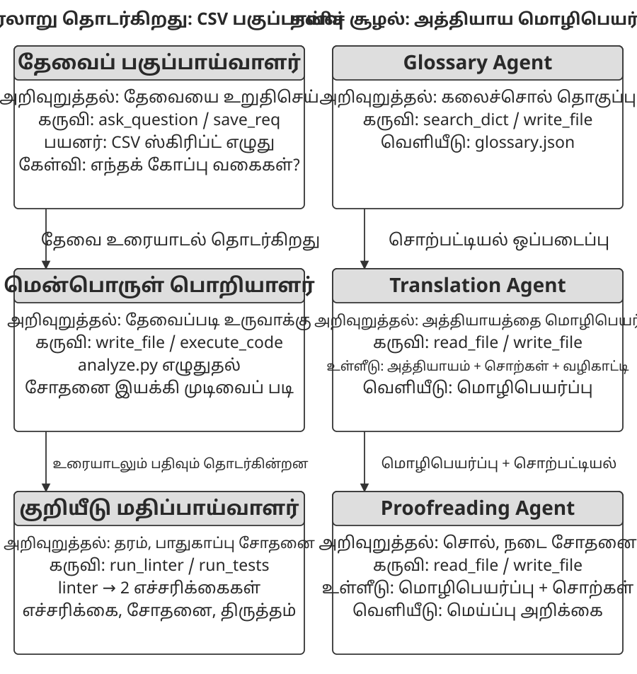

சூழல்கள் தனித்தனியாக இருக்கும்போது, உறுப்பினர்கள் பொருட்களை எவ்வாறு பரிமாறிக்கொள்கிறார்கள்? பகிர்ந்தமைந்த அமைப்புகளில் (distributed systems) தொடர்பாடலுக்குப் பொதுவாகப் பகிரப்பட்ட சேமிப்பகம் அல்லது செய்திப் பரிமாற்றம் பயன்படுத்தப்படுகிறது. ஏஜெண்ட் அமைப்புகளிலும் இவ்விரு அணுகுமுறைகளும் பயன்படுகின்றன; குறிப்பான முறைகள்:

- **கருவி அழைப்பு அளவுருக்கள்.** கீழ்நிலை ஏஜெண்டை ஒரு கருவியாகப் பொதிந்து, மேல்நிலை ஏஜெண்ட் அளவுருக்கள் வழியாகப் பணியையும் கட்டமைக்கப்பட்ட பொருட்களையும் அனுப்பி, பின்னர் முடிவைப் பெறுகிறது.
- **பகிரப்பட்ட கோப்பு அமைப்பு.** ஒரு தரப்பு ஆவணம், குறியீடு அல்லது தரவை எழுதுகிறது; மற்றொரு தரப்பு குறிப்பின் மூலம் அதைப் படிக்கிறது. பெரிய இடைநிலை வெளியீடுகளுக்கும் நீடித்துச் சேமிக்க வேண்டிய பொருட்களுக்கும் இது பொருத்தமானது.
- **செய்திப் பேருந்து (Message Bus).** ஏஜெண்ட் செய்தியை ஓர் இடைநிலைச் சேவையிடம் சமர்ப்பிக்கிறது; சேவை இலக்கு அல்லது சந்தா உறவின் அடிப்படையில் அதை வழங்குகிறது. பல உறுப்பினர்களுக்கு இடையிலான ஒத்திசைவற்ற தொடர்பாடலுக்கு இது பொருத்தமானது.

எடுத்துக்காட்டாக, மேல்நிலை ஏஜெண்ட் ஒரு மொழிபெயர்ப்புப் பணியை அனுப்பிய பிறகு, மொழிபெயர்ப்பு திரும்பி வரும் வரை காத்திருக்கலாம்; அல்லது முதலில் ஒரு பணி எண்ணைப் பெற்றுக்கொண்டு, இன்னோர் அத்தியாயத்தைக் கையாளச் செல்லலாம். இரு மொழிபெயர்ப்பாளர்களும் ஒரே கோப்பைத் திறக்க முடிந்தாலும், யார் எழுதுவது, மற்றவர் எப்போது படிப்பது என்பதை அமைப்பு இன்னும் வரையறுக்க வேண்டும். பகிரப்பட்ட தரவுக்கான அணுகலைத் தொடர்பாடல் மூலம் ஒழுங்கமைக்க வேண்டும் என்று Go சமூகம் வலியுறுத்துகிறது; இந்தச் சிந்தனை ஏஜெண்டுகளுக்கும் பொருந்தும்: நிலை யாருக்குச் சொந்தம், யார் அதை மாற்றலாம், மற்ற உறுப்பினர்கள் புதுப்பிப்புகளை எவ்வாறு பெறுகிறார்கள் என்பதைத் தெளிவுபடுத்த வேண்டும்.

### பரிமாணம் இரண்டு: கூட்டுச் செயல்பாட்டு இடவியல்

கூட்டுச் செயல்பாட்டு இடவியல் (topology) ஏஜெண்டுகளுக்கு இடையிலான பணிச் சார்புகள், தகவல் ஓட்டம், கட்டுப்பாட்டு உறவுகள் ஆகியவற்றை விவரிக்கிறது. இந்த அத்தியாயம் மூன்று பொதுவான ஒழுங்கமைப்பு முறைகளைப் பயன்படுத்துகிறது:

- **சக கூட்டுழைப்பு முறை** (Peer Collaboration Pattern). சில உறுப்பினர்கள் ஒரே வெளியீட்டைச் சுற்றி மீண்டும் மீண்டும் இணைந்து செயல்படுகிறார்கள். எடுத்துக்காட்டாக, வரைவாளர் ஆய்வுக் கட்டுரையின் வரைவை முடிக்கிறார், விமர்சகர் திருத்தக் கருத்துகளை முன்வைக்கிறார், பின்னர் வரைவாளர் திருத்துகிறார்.
- **மேலாளர் முறை** (Orchestration Pattern). மையப்படுத்தப்பட்ட Manager Agent பணிகளைப் பிரித்து, ஒதுக்கி, தொகுக்கிறது; துணை ஏஜெண்டுகள் தத்தம் சிறப்புப் பணிகளை ஏற்கின்றன.
- **மையமற்ற முறை** (Decentralized Pattern). உறுப்பினர்கள் பாத்திரம், செய்திகள், உள்ளூர் நிலை ஆகியவற்றின் அடிப்படையில் வேலையைத் தொடர்கிறார்கள்; வேலை எவ்வாறு முன்னேற வேண்டும் என்பதை உறுப்பினர்கள் கூட்டாகத் தீர்மானிக்கிறார்கள்.

> **கலைச்சொல் விளக்கம்: Graph பொறியியல்.** 2026 ஜூலையில் Graph பொறியியல் பற்றி நடந்த விவாதத்தை அத்தியாயம் 1 அறிமுகப்படுத்தியது. இந்தக் கண்ணோட்டம் செயலாக்க வரைபடத்தில் கவனம் செலுத்துகிறது: கணுக்கள் ஏஜெண்டுகளாகவோ, சாதாரண நிரல்களாகவோ, மனித முடிவுகளாகவோ இருக்கலாம்; விளிம்புகள் சார்புகள், நிபந்தனை அடிப்படையிலான வழிச்செலுத்தல், தோல்விக்குப் பிறகு கையாள வேண்டிய திசை ஆகியவற்றைக் குறிக்கின்றன; நிலை செயலாக்க உறவுகளின் வழியே கடத்தப்படுகிறது. பல-ஏஜெண்ட் கூட்டுச் செயல்பாட்டு இடவியல் இந்த வடிவமைப்புக் கண்ணோட்டத்தின் பயன்பாடுகளில் ஒன்று; பல முடிவெடுக்கும் அலகுகள் எவ்வாறு ஒப்படைக்கின்றன, இணையாகச் செயல்படுகின்றன, பின்னூட்டம் தருகின்றன என்பதே அதன் மையம்.

சக கூட்டுழைப்பு, மேலாளர், மையமற்ற வடிவமைப்புகளை ஒன்றிணைத்தும் பயன்படுத்தலாம். எடுத்துக்காட்டாக, Manager ஒரு எழுத்துப் பணியை வரைவாளர்–சரிபார்ப்பாளர் குழுவிடம் ஒப்படைக்கிறது; குழு தனக்குள் மீள்சுழற்சிகளை முடித்த பிறகு முடிவைச் சமர்ப்பிக்கிறது.

## பல-ஏஜெண்ட் எப்போது ஒற்றை ஏஜெண்டை விடச் சிறந்தது

முதல் வரைவில் ஒரு தொழில்நுட்பச் சொல் தவறாக மொழிபெயர்க்கப்பட்டுள்ளது என்று வைத்துக்கொள்வோம். இரு சரிபார்ப்பாளர்களுக்கும் ஒரே வரைவைக் கொடுத்தால், இரண்டு முறையும் ஒரே மாதிரியான ஒப்புதல் கிடைக்கலாம்; அவர்களில் ஒருவருக்கு மூல உரை, கலைச்சொல் அட்டவணை, அந்தச் சொல்லைப் பயன்படுத்தும் குறியீடு ஆகியவற்றையும் சேர்த்துக் கொடுத்தால், பிழையைக் கண்டறிய இன்னொரு வழி கிடைக்கிறது. கூட்டுச் செயல்பாட்டு முறையைத் தேர்ந்தெடுக்கும்போது முதலில் கேட்க வேண்டியது: புதிதாகச் சேர்க்கப்படும் ஏஜெண்ட் பணிக்கு என்ன கொண்டுவருகிறது? அது புதிய ஆதாரங்களைப் பெறலாம், இன்னொரு தேடல் பாதையை உள்ளடக்கலாம், வேறுபட்ட நிபுணத்துவ மதிப்பீட்டை வழங்கலாம், அல்லது இணையான செயலாக்கத்தின் மூலம் காத்திருப்பு நேரத்தைக் குறைக்கலாம்.

நான் முதலில் **பின்னூட்டத்தின் தகவல் அதிகரிப்பைச்** சரிபார்க்கிறேன்; பின்னர் இணைச் செயலாக்கமும் சூழல் தனிமைப்படுத்தலும் எவ்வளவு பயன் தருகின்றன என்று பார்க்கிறேன். சோதனை முடிவுகள், பக்கத் திரைப்பிடிப்புகள் அல்லது வெளிப் பொருட்களைப் படித்த பிறகு, உருவாக்கும் நேரத்தில் இன்னும் கிடைக்காத ஆதாரங்களின் அடிப்படையில் சரிபார்ப்பாளர் திருத்தங்களை முன்மொழியலாம். இத்தகைய அதிகரிப்பை எவ்வாறு சரிபார்ப்பது என்பதை அட்டவணை 10-1 சில பொதுவான சூழ்நிலைகள் மூலம் விளக்குகிறது.

அட்டவணை 10-1 பல-ஏஜெண்ட் கூட்டுச் செயல்பாட்டில் தகவலும் பின்னூட்டமும்

| கூட்டுச் செயல்பாட்டு முறை | முதன்மைத் தகவல் மூலம் | மதிப்பீட்டின் மையம் |
|---|---|---|
| அதே மாதிரி தனது வெளியீட்டை மீண்டும் ஆய்வு செய்தல் | ஏற்கெனவே உள்ள பொருட்களும் ஒரு புதிய சரிபார்ப்புச் செயல்முறையும் | விடுபட்டவற்றைக் கண்டறிய முடிகிறதா, திருத்திய பிறகு முடிவு மேம்படுகிறதா |
| பல ஏஜெண்டுகள் ஒரே கேள்வியை விவாதித்தல் | ஒவ்வொன்றின் தீர்வுப் பாதை, அனுமானங்கள், வாதங்கள் | கருத்துகளில் வேறுபாடு உள்ளதா, எவ்வாறு சரிபார்த்துப் பதிலைத் தேர்ந்தெடுப்பது |
| சரிபார்ப்பாளர் சோதனைகளை இயக்கிக் குறியீட்டை ஆய்வு செய்தல் | தொகுப்பு, சோதனை, இயக்கப் பின்னூட்டம் | திருத்தம் சோதனைகளைக் கடந்து, ஏற்கெனவே உள்ள அம்சங்களைப் பாதுகாக்கிறதா |
| சரிபார்ப்பாளர் முன்முனை அல்லது PPT-இன் வரைவு முடிவைப் பார்த்தல் | திரைப்பிடிப்புகளும் ஊடாட்டப் பின்னூட்டமும் | அமைப்பு, உள்ளடக்கம், செயல்பாடுகள் தேவைகளுக்கு ஏற்ப உள்ளனவா |
| சரிபார்ப்பாளர் வெளிக் கருவிகளால் உண்மைகளைச் சரிபார்த்தல் | தேடல் முடிவுகளும் வணிக அமைப்புப் பதிவுகளும் | மூலம் நம்பகமானதா, முடிவு ஆதாரத்துடன் ஒத்துப்போகிறதா |

RLEF வலுவூட்டல் கற்றல் மூலம் குறியீட்டு இயக்கப் பின்னூட்டத்தைப் பயன்படுத்த மாதிரியைப் பயிற்றுவித்து, போட்டி நிரலாக்கப் பணிகளில் பல-படித் திருத்தத்தைக் கற்றுக்கொள்ளச் செய்கிறது. தொகுப்புப் பிழைகள், சோதனைத் தோல்விகள், இயக்க விதிவிலக்குகள் ஆகியவை அடுத்த திருத்தத்துக்குக் குறிப்பான அடிப்படையை வழங்குகின்றன; ஆய்வுக் கட்டுரையில் உள்ள மாதிரி குறைவான மாதிரியெடுப்புகளிலேயே சிறந்த முடிவுகளைப் பெற்றது.[^rlef-2025] WebGen-Agent இணையப் பக்கத் திரைப்பிடிப்புகள், காட்சி மாதிரியின் விளக்கங்களும் பரிந்துரைகளும், GUI செயல்பாட்டு மதிப்பீடு ஆகியவற்றை உருவாக்கச் செயல்முறையில் இணைக்கிறது; முந்தைய படிக்குத் திரும்பி மீண்டும் செய்யவும், பல உருவாக்க முடிவுகளில் சிறந்ததைத் தேர்ந்தெடுக்கவும் முடியும். WebGen-Bench-இல் Claude 3.5 Sonnet-இன் துல்லியம் 26.4%-இலிருந்து 51.9%-ஆக உயர்ந்தது.[^webgen-agent-2025]

[^rlef-2025]: Gehring, J., et al. *RLEF: Grounding Code LLMs in Execution Feedback with Reinforcement Learning.* arXiv:2410.02089, 2025.
[^webgen-agent-2025]: Lu, Z., et al. *WebGen-Agent: Enhancing Interactive Website Generation with Multi-Level Feedback and Step-Level Reinforcement Learning.* arXiv:2509.22644, 2025.

நான் முதலில் சோதனைகள், திரைப்பிடிப்புகள், கருவி வெளியீடுகள் போன்ற குறிப்பான ஆதாரங்களை அமைப்பு பெறச் செய்து, பின்னர் உருவாக்கம், செயலாக்கம், சரிபார்ப்புப் பொறுப்புகளை எவ்வாறு பகிர்வது என்று தீர்மானிக்கிறேன். பின்னூட்டச் சுழற்சியை ஒரே ஏஜெண்ட் நிறைவேற்றலாம்; பல பாத்திரங்களுக்குப் பிரித்தும் கொடுக்கலாம். பாத்திரங்களைச் சேர்ப்பது ஆதாரங்களைப் பெறுவதையும் பயன்படுத்துவதையும் மேம்படுத்த வேண்டும்.

Anthropic-இன் 2026 பாதுகாப்பு ஆய்வு கூட்டுத் தேடலுக்கு ஓர் எடுத்துக்காட்டை வழங்குகிறது: 45 ஏஜெண்டுகள் ஒரு பகிரப்பட்ட மன்றத்தின் வழியாகக் கண்டுபிடிப்புகளைப் பகிர்ந்து, ஒன்றையொன்று சரிபார்த்தன; பின்னர் ஒரு தனி ஏஜெண்ட் முடிவுகளுக்குத் தீர்ப்பளித்தது. ஆய்வு அறிக்கையின்படி, கூட்டுக் குழுமம் 2.7 கோடி token-களைச் செலவழித்து 266 பாதிப்புகளைக் கண்டறிந்தது; தனித்த இணைத் திட்டம் 65 லட்சம் token-களைச் செலவழித்து 21-ஐக் கண்டறிந்தது. மன்றம் உறுப்பினர்கள் மற்றவர்களின் கண்டுபிடிப்புகளைத் தொடர்ந்து ஆராயவும், எந்தத் திசைகளில் ஏற்கெனவே யாரோ வேலை செய்கிறார்கள் என்று அறியவும் உதவியது. கூட்டுக் குழு சுமார் நான்கு மடங்கு token-களையும் பயன்படுத்தியது; எனவே 266-க்கும் 21-க்கும் இடையிலான இடைவெளியில் தொடர்பாடல் முறையின் வேறுபாடும் கணக்கீட்டு முதலீட்டின் வேறுபாடும் ஒருசேர அடங்கியுள்ளன.[^anthropic-multiagent-2026]

[^anthropic-multiagent-2026]: Anthropic Frontier Red Team, “Patterns and Problems in Emerging Multiagent Systems,” 2026-08-13.

கணித ஆய்வில், பல குழுக்கள் உண்மையிலேயே வெவ்வேறு வழிகளை ஆராயும்படி எவ்வாறு செய்வது? முப்பரிமாண Navier–Stokes சமன்பாடுகள் பாகுநிலைப் பாய்மத்தின் இயக்கத்தை விவரிக்கின்றன. மென்மையான தொடக்க நிபந்தனைகளிலிருந்து தொடங்கினால், தீர்வு எப்போதும் மென்மையாகவே இருக்குமா? OpenAI இரண்டு எதிரெதிர் இலக்குகளை வெவ்வேறு குழுக்களுக்குக் கொடுத்தது: சில குழுக்கள் மென்மைத் தன்மையை நிரூபிக்க முயன்றன; சில எதிர்-எடுத்துக்காட்டைக் கட்டமைக்க முயன்றன. ஒவ்வொரு குழுவும் முதலில் தனியாக ஆராய்ந்தது; பின்னர் குழுவினர் Codex மூலம் இடைநிலை முடிவுகளைத் தொகுத்து, நம்பிக்கை தரும் தடயங்களை மற்ற குழுக்களும் பின்தொடர உதவினர். எதிர்-எடுத்துக்காட்டைக் கண்டறிந்த குழுவில் சுமார் பத்தாயிரம் ஏஜெண்டுகள் ஒரே நேரத்தில் வேலை செய்தன. முதல் தொகுதி ஏஜெண்டுகள் தொடங்கியதிலிருந்து நிரூபணம் கண்டறியப்படும் வரை சுமார் 88 மணிநேரம் ஆனது என்றும், Lean முறைப்படுத்தலுக்கும் சரிபார்ப்புக்கும் மேலும் 17 மணிநேரம் ஆனது என்றும் குழு அறிவித்தது. இந்த எதிர்-எடுத்துக்காட்டுக்கு ஒரு முக்கிய நிபந்தனை உண்டு: பாய்மம் மென்மையான வெளிவிசைக்கு உட்பட்டிருந்தாலும், வரம்புள்ள நேரத்தில் ஒருமைத்தன்மை (singularity) தோன்றக்கூடும். இதன் அடிப்படையில், கிளே கணித நிறுவனத்தின் வினா அறிக்கையில் உள்ள C, D ஆகிய இரு வடிவங்கள் கோரும் எதிர்-எடுத்துக்காட்டைக் குழு வழங்கியது; வெளிவிசையை நீக்கினால் அது வேறொரு பிரச்சினையாகிவிடும். இத்தகைய தேடலை வடிவமைக்கும்போது, எந்த முடிவுகள் மூலக் கேள்விக்குப் பதிலளிக்கப் போதுமானவை என்பதை முதலில் எழுதி, ஒன்றோடொன்று போட்டியிடும் கருதுகோள்களை வெவ்வேறு குழுக்களுக்குக் கொடுத்து, இறுதிச் சரிபார்ப்புக்குத் தனியாக நேரம் ஒதுக்கலாம்.[^ch10-ns-search]

[^ch10-ns-search]: OpenAI-இன் ஆய்வு விளக்கமான "On the Navier–Stokes Millennium Prize Problem" நிரூபணத்தையும் Lean குறியீட்டையும் இணைத்துள்ளது. கிளே கணித நிறுவனம் 2026 செப்டம்பர் 11 அறிவிப்பில் இந்தப் பணிக்குப் பதிலளித்து, முடிவின் மதிப்பீடும் பரிசு உரிமையும் பரிசு வழங்கும் நடைமுறைப்படி கையாளப்படும் என்று தெரிவித்தது.

**படி வரவுசெலவு செயல்திறனை எவ்வாறு பாதிக்கிறது?** ஒரு பணிக்கு 30 படிகள் அனுமதிக்கப்பட்டால், ஏஜெண்ட் திட்டமிடல், மையச் செயலாக்கம், தேவையான சரிபார்ப்பு ஆகியவற்றைச் சுருக்கமாக ஒழுங்கமைக்க வேண்டும்; 300 படிகள் அனுமதிக்கப்பட்டால், மேலும் பல தீர்வுகளை ஒப்பிடவும், முழுமையான சோதனையும் திருத்தமும் செய்யவும் இடம் உண்டு. இந்த வளத்தை நன்கு பயன்படுத்த, ஏஜெண்ட் மொத்த வரவுசெலவையும் மீதமுள்ள வரவுசெலவையும் அறிந்து, அதற்கேற்ப ஆய்வின் ஆழத்தைத் திட்டமிட வேண்டும்.

Google 2025-இல் வெளியிட்ட "Budget-Aware Tool-Use Enables Effective Agent Scaling" இந்தப் பிரச்சினையை ஆராய்ந்தது: வரவுசெலவு விழிப்புணர்வு இல்லாத ஏஜெண்ட் விரைவில் மேலோட்டமான தேடலிலேயே நின்றுவிடலாம்; கிடைக்கும் படிகளை அதிகரித்தாலும் செயல்திறன் தொடர்ந்து உயர்வது கடினம். 2026-இன் BAVT (Budget-Aware Value Tree Search) தேடல் படிகளில் மதிப்பு மதிப்பீட்டையும் மீதமுள்ள வரவுசெலவையும் இணைத்து, ஆய்வுக்கும் பயன்பாட்டுக்கும் இடையிலான எடையை மாற்றியமைக்கிறது. வரவுசெலவு போதுமானதாக இருக்கும்போது மேலும் பல திசைகளை ஒப்பிடலாம்; வரம்பை நெருங்கும்போது நம்பிக்கை தரும் கிளைகளில் வளங்களைக் குவிக்கலாம்.

மேலாளர் முறையில் இதன் பொருள்: Manager பணியின் கடினத்தன்மைக்கேற்பப் படிகளை ஒதுக்கி, முன்னேற்றத்துக்கேற்ப மாற்றியமைக்க வேண்டும். எளிய பணிகளை விரைவாக ஒப்படைக்கலாம்; சிக்கலான பணிகளுக்குச் சரிபார்ப்புக்கும் திருத்தத்துக்கும் இடம் ஒதுக்கலாம்; தடை ஏற்பட்டால் முதலில் காரணத்தைக் கண்டறிந்து, பின்னர் தகவலைச் சேர்ப்பதா, வரவுசெலவை அதிகரிப்பதா, வேறு பாதையை எடுப்பதா என்று தீர்மானிக்கலாம்.

இணையான ஆய்வு சுவர்க்கடிகார நேரத்தைக் குறைக்கலாம்; மீண்டும் மீண்டும் சரிபார்ப்பது வெளியீட்டை மேம்படுத்தலாம்; ஆனால் இரண்டுமே மாதிரி அழைப்புகளையும் தொடர்பாடல் செலவையும் அதிகரிக்கின்றன. நன்கு சீரமைக்கப்பட்ட ஒற்றை ஏஜெண்டை நான் அடிப்படையாகக் கொள்கிறேன்; புதிய உறுப்பினர்கள் கொண்டுவரும் தர மேம்பாடு அல்லது நேரச் சேமிப்பு, தொடர்பாடல், மீளும் கணக்கீடு, பராமரிப்புச் செலவுகளை ஈடுகட்டப் போதுமானதாக இருந்தால் மட்டுமே கூட்டுச் செயல்பாட்டின் அளவை விரிவாக்குகிறேன்.

## பகிரப்பட்ட சூழலுடன் பல-ஏஜெண்ட் கூட்டுச் செயல்பாடு

பகிரப்பட்ட சூழலுடனான கூட்டுச் செயல்பாடு கட்டங்களுக்கேற்பப் பாத்திரங்களை மாற்றுகிறது; அதே நேரத்தில் ஏற்கெனவே உள்ள பணிப் பதிவுகளைத் தொடர்ந்து பயன்படுத்துகிறது. ஓர் ஆய்வு அறிக்கையை எடுத்துக்காட்டாகக் கொண்டால், தேடல் பாத்திரம் முதலில் பொருட்களைச் சேகரிக்கிறது, பகுப்பாய்வுப் பாத்திரம் அடுத்துக் கணக்கிடுகிறது, எழுத்துப் பாத்திரம் பின்னர் வெளிப்பாட்டை ஒழுங்கமைக்கிறது. ஒவ்வொரு பாத்திரமும் முந்தைய மூலங்களையும் முடிவுகளையும் திரும்பிப் பார்க்கலாம்; நடப்புப் பணி அறிவுறுத்தல்கள் மூலம் அமைப்பு அதை இந்தக் கட்டத்தின் இலக்கில் கவனம் செலுத்த வழிநடத்துகிறது.

குழுக்களுக்கு இடையே ஒப்படைக்கும்போது முதலில் ஒரு கேள்வி கேட்கலாம்: அப்போது ஏன் அப்படி முடிவெடுக்கப்பட்டது என்பதை யார் அறிய வேண்டும்? Teamily AI-இன் தயாரிப்பு எடுத்துக்காட்டில், தயாரிப்பு மேலாளரும் ஏஜெண்டும் ஒரு குழு அரட்டையில் சேர்ந்து தயாரிப்புத் தேவை ஆவணத்தை (PRD) எழுதுகிறார்கள். தயாரிப்புக் குழு இறுதி வடிவத்தைப் பொறியியல் குழுவுடன் பகிர்ந்த பிறகு, ஒரு தேவைக்குப் பின்னால் உள்ள சமரசங்களைப் பற்றிப் பொறியாளர்கள் மேலும் கேட்கலாம்.

தேடல் பாத்திரம் எழுத்துப் பாத்திரத்திடம் பணியை ஒப்படைப்பதை எடுத்துக்காட்டாகக் கொள்வோம்: ஒப்படைப்புக்குப் பிறகு, மாதிரி எழுத்து விதிமுறைகளை எங்கிருந்து படிக்கிறது, எந்தக் கருவிகளை இன்னும் அழைக்க முடியும்? சோதனை 10-1 அதே ஒப்படைப்பை இரண்டு வழிகளில் செயல்படுத்துகிறது.

| ஒப்படைப்பின்போது கையாள வேண்டிய கேள்வி | பாத்திர மாற்றம் (`transfer_to_agent`) | Skill-ஐ ஏற்றுதல் |
|---|---|---|
| எழுத்து விதிமுறைகளை எவ்வாறு வழங்குவது? | எழுத்துப் பாத்திரத்தின் சிஸ்டம் ப்ராம்ப்டுக்கு மாற்றுதல் | சிஸ்டம் ப்ராம்ப்டில் உள்ள Skill அட்டவணையை வைத்துக்கொண்டு, எழுத்து விதிமுறைகளைச் செய்தி வரலாற்றின் இறுதியில் சேர்த்தல் |
| மாதிரி எந்தக் கருவிகளைப் பார்க்க முடியும்? | எழுத்துப் பாத்திரத்தின் கருவிகளை மட்டும் காட்டலாம் | ஏற்கெனவே உள்ள கருவித் தொகுப்பையோ கருவித் தேடல் நுழைவையோ தொடர்ந்து பயன்படுத்தலாம் |
| KV Cache-இன் எந்தப் பகுதியை இன்னும் பயன்படுத்தலாம்? | சிஸ்டம் ப்ராம்ப்ட் மாறியதால், முன்னொட்டு மாறிய இடத்திலிருந்து பொதுவாக மீண்டும் கணக்கிட வேண்டும் | ஏற்கெனவே உள்ள கோரிக்கை முன்னொட்டைத் தொடர்ந்து மீண்டும் பயன்படுத்தலாம் |
| அழைப்பு அனுமதிகளை யார் சரிபார்க்கிறார்? | Harness நடப்புப் பாத்திரத்தின்படி கோரிக்கையைச் சரிபார்த்து, பின்னர் கருவியை இயக்குகிறது | Harness ஒவ்வொரு அழைப்பின் அனுமதியையும் தனியாகச் சரிபார்க்கிறது |

பாத்திர வேறுபாடுகள் முக்கியமாக அறிவு, செயல்முறை, எழுத்து நடை ஆகியவற்றில் இருக்கும்போது, நான் Skill-க்கு முன்னுரிமை தருகிறேன்: அது ஒரே இயக்கச் சட்டகத்தை மீண்டும் பயன்படுத்த உதவுகிறது; நிலையான கோரிக்கை முன்னொட்டின் Cache-ஐயும் பாதுகாக்கிறது. பாத்திர வேறுபாடுகள் அனுமதிகள், கருவித் தனிமைப்படுத்தல் அல்லது ஒப்புதல் பொறுப்புகளை உள்ளடக்கும்போது, தனி ஏஜெண்டுகளாகவோ பாத்திர மாற்றமாகவோ ஒழுங்கமைத்து, Harness-உம் செயலாக்கச் சூழலும் அணுகல் கட்டுப்பாட்டை நடைமுறைப்படுத்தச் செய்யலாம். ஒரு கருவி மாதிரி உள்ளீட்டில் தோன்றுகிறதா என்பது அழைப்புத் தேர்வைப் பாதிக்கிறது; உண்மையான அனுமதிகள் இயக்க நேரச் சரிபார்ப்பால் தீர்மானிக்கப்படுகின்றன.

> **சோதனை 10-1 ★★: பகிரப்பட்ட சூழலில் பல-பாத்திர மாற்றம்—சிஸ்டம் ப்ராம்ப்டும் Skill-உம் ஒப்பீடு**
>
> இரு பாதைகளும் ஒரே மாதிரி, பயனர் பணி, கருவிச் செயலாக்கம், பாத்திர விதிமுறைகள், பகிரப்பட்ட வரலாறு ஆகியவற்றைப் பயன்படுத்துகின்றன. தொடக்க நிலை விளக்கம், 2021–2023-இல் சீனாவின் புதிய ஆற்றல் வாகன விற்பனையைத் தேடி, ஆண்டுக் கூட்டு வளர்ச்சி விகிதத்தை (CAGR) கணக்கிட்டு, 120 எழுத்துகளுக்கு மிகாத ஒரு முதலீட்டாளர் சுருக்கத்தை எழுதுமாறு கோருகிறது.
>
> **பாதை ஒன்று: சிஸ்டம் ப்ராம்ப்ட் மாற்றம்.** triage (தேவை சேகரிப்பு), research (தேடல்), coding (நிரலாக்கம்), data_analysis (பகுப்பாய்வு), writing (எழுத்து) என ஐந்து பாத்திரங்கள் அமைக்கப்படுகின்றன. triage நுழைவாயில்; ஒவ்வொரு பாத்திரமும் தனக்குரிய கருவிகளையும் `transfer_to_agent`-ஐயும் பார்க்கிறது. ஒப்படைக்கும்போது வரலாறு பாதுகாக்கப்படுகிறது; இலக்குப் பாத்திரத்தின் ப்ராம்ப்டும் கருவித் தொகுப்பும் ஏற்றப்பட்டு, இயக்கம் தொடர்கிறது.
>
> **பாதை இரண்டு: Skill-ஐ ஏற்றுதல்.** சிஸ்டம் ப்ராம்ப்டும் முழுக் கருவித் தொகுப்பும் அமர்வு முழுவதும் நிலையாக இருக்கின்றன. மாதிரி `load_skill(name)`-ஐ அழைத்துப் பாத்திர விதிமுறைகளைப் பெறுகிறது; உள்ளடக்கம் கருவி முடிவாகப் பகிரப்பட்ட வரலாற்றில் சேர்கிறது; ஏற்கெனவே உள்ள முன்னொட்டு அப்படியே இருக்கிறது. Harness அனுமதி விதிகளின்படி ஒவ்வொரு கருவி அழைப்பையும் சரிபார்க்கிறது.
>
> இரு செயலாக்கங்களும் ஒரே `SKILL.md`-ஐப் படிக்கின்றன. ஒரு பாத்திர ஒப்படைப்புக்கு முன்னும் பின்னும் மாதிரிக்கு அனுப்பப்பட்ட கோரிக்கைகளில் ஒவ்வொன்றை எடுத்து, விதிமுறைகள் எந்தச் செய்தியில் தோன்றுகின்றன, முன்னொட்டின் எந்தப் பகுதியை மீண்டும் பயன்படுத்த முடியும் என்று பாருங்கள். பின்னர் இரு சுருக்கங்களையும் சரிபாருங்கள்: விற்பனை மூலம் நம்பகமானதா? 2021 இறுதியிலிருந்து 2023 இறுதி வரை இரண்டு வளர்ச்சிக் காலங்கள் உள்ளன; ஆண்டுக் கூட்டு வளர்ச்சி விகிதம் சரியாகக் கணக்கிடப்பட்டதா?
>
> முறையான ஒப்பீட்டில் இன்னும் கடுமையான ஒரு சுருக்க அறிக்கைப் பணி உள்ளது: 160 எழுத்துக்குறிகள் வரம்பு, அத்துடன் இரண்டு மூல இணைய முகவரிகளையும் வைத்திருக்க வேண்டும். இரண்டுக்கும் எட்டுப் படிகள் வழங்கப்பட்டன; பாத்திர மாற்றக் குழு மூன்று அழைப்புகளை எழுத்துக்குறிகளை எண்ணுவதில் செலவழித்தது, வரைவில் இன்னும் 206 எழுத்துக்குறிகள் இருந்தன, பணி குறிப்பிட்ட கணக்கீட்டுக் கருவியையும் பயன்படுத்தத் தவறியது. Skill-ஏற்றும் குழு முதல், கடைசி ஆண்டுகளின் விற்பனையைக் கொண்டு வளர்ச்சி விகிதத்தைக் கணக்கிட்டது; எட்டாவது படியில்தான் எழுத்து விதிமுறைகளை ஏற்றியது. அப்போது செல்ல வேண்டிய பாத்திரங்கள் அனைத்தும் கடக்கப்பட்டிருந்தன; ஆனால் பயனருக்கு இன்னும் சுருக்கம் கிடைக்கவில்லை. இரு பாதைகளும் இறுதியில் படி வரம்பை எட்டியதால் முடிவடைந்தன.
>
> அதே 30 பணிகளை இரு செயலாக்கங்களிலும் இயக்கி, வழங்கப்பட்ட முடிவுகளை நிரல் மூலம் சரிபார்த்தபோது, Skill-ஏற்றும் குழு 15 பணிகளைக் கடந்தது; சிஸ்டம் ப்ராம்ப்ட் மாற்றக் குழு 2 பணிகளைக் கடந்தது. இருப்பினும், பணிக்குப் பணி ஒப்பிட்டால், முதல் குழுவில் Cache-இல் கிடைக்காத உள்ளீடு 6,855 token கூடுதலாக இருந்தது; நேரம் சுமார் 4.4 வினாடிகள் கூடுதலாக ஆனது (இரண்டும் இணை வேறுபாடுகளின் இடைநிலை மதிப்புகள்). இம்முறை சேவை வழங்குநர் இரு குழுக்களின் கோரிக்கைகளிலும் Cache உள்ளீட்டு token எண்ணிக்கையைப் பூஜ்யம் என்றே அறிவித்தார். அறிவுறுத்தல் பின்பற்றலுக்கான 6 எல்லைச் சோதனைகளிலும் இரு குழுக்களும் முழுமையாகக் கடந்தன; ஆனால் முழுப் பணிகளின் தேர்ச்சி விகிதத்தில் பெரிய வேறுபாடு இருந்தது.

## பகிரப்படாத சூழலுடன் பல-ஏஜெண்ட் கூட்டுச் செயல்பாடு

தனிச் சூழல் கட்டமைப்பில், ஒவ்வொரு ஏஜெண்டும் உள்ளீட்டு வரலாறு, பணி நிலை, இயக்கச் சுழற்சி ஆகியவற்றைத் தனியாகப் பராமரித்து, கருவி அளவுருக்கள், பகிரப்பட்ட கோப்புகள், செய்திகள் வழியாகத் தேவையான தகவலைப் பரிமாறிக்கொள்கிறது. எடுத்துக்காட்டாக, மொழிபெயர்ப்பாளர் ஒப்படைக்கும் பொருட்களில் மூலப் பத்தியும் கலைச்சொல் அட்டவணையின் பதிப்பும் குறிப்பிடப்பட வேண்டும். மொழிபெயர்ப்பாளர் வெளியேறிவிட்டாலும், சரிபார்ப்பாளர் மூல உரையைக் கண்டறிய முடியும்; மீண்டும் திருத்த வேண்டியிருந்தால், அத்தியாயத்தின்படி பொறுப்பாளரையும் கண்டறிய முடியும்.

இயக்க முறைமை செயல்முறைகளை நிர்வகிக்கும் விதத்தையும், இயக்க நேரம் ஏஜெண்டுகளை நிர்வகிக்கும் விதத்தையும் அட்டவணை 10-2 ஒப்பிடுகிறது.

அட்டவணை 10-2 பல-ஏஜெண்ட் அமைப்புக்கும் இயக்க முறைமைக்கும் இடையிலான வடிவமைப்பு ஒப்புமை

| இயக்க முறைமை | பல-ஏஜெண்ட் அமைப்பில் ஒத்த பொறுப்பு |
|---|---|
| நிரலும் அமைப்பும் | சிஸ்டம் ப்ராம்ப்ட், கருவி வரையறைகள், பாத்திர அமைப்பு |
| செயல்முறை நினைவகம் | நடப்புச் சூழல், பணி நிலை, வரலாற்றுப் பதிவுகள் |
| CPU கணக்கீட்டைச் செயல்படுத்துதல் | LLM முடிவுகளை உருவாக்குகிறது; இயக்க நேரமும் கருவிகளும் அதற்கான செயல்களைச் செய்கின்றன |
| கர்னல் இயக்கத்தை நிர்வகித்தல் | ஏஜெண்ட் இயக்க நேரம் நிலை, திட்டமிடல், வளங்களை நிர்வகிக்கிறது |
| சிஸ்டம் அழைப்புகள் | கருவி இடைமுகங்கள் வழியாக வெளிச் செயல்களைக் கோருதல் |
| fork: துணைச் செயல்முறையை உருவாக்குதல் | `spawn_subagent`: துணை ஏஜெண்டை உருவாக்குதல் |
| kill: சமிக்ஞை அனுப்புதல் | `cancel_subagent`: ரத்து செய்யக் கோருதல் |
| ps: செயல்முறைகளை வினவுதல் | `list_agents`: உறுப்பினர்களையும் இயக்க நிலையையும் வினவுதல் |
| வெளியேறும் நிலையும் wait-உம் | நிறைவு அறிவிப்பு, பணி நிலை, கட்டமைக்கப்பட்ட முடிவு |
| பகிரப்பட்ட சேமிப்பகமும் செய்திப் பரிமாற்றமும் | பகிரப்பட்ட கோப்புகள், கருவி அளவுருக்கள், செய்திகள் |

தனிப்பட்ட நிலை, ஒத்திசைவற்ற செய்திகள், உறுப்பினர்களை இயங்குநிலையில் உருவாக்குதல் ஆகியவை 1970-களில் முன்மொழியப்பட்ட Actor மாதிரியிலும் தோன்றுகின்றன.[^actor-model]

[^actor-model]: Hewitt, C., Bishop, P., Steiger, R. *A Universal Modular ACTOR Formalism for Artificial Intelligence.* IJCAI 1973.

தனித்த துணைப் பணிகள் அதிகமாக இருக்கும்போது, ஒவ்வொரு உறுப்பினருக்கும் தனிச் சூழலை அமைத்து, தனது பொறுப்புக்குத் தொடர்புடைய பொருட்களை மட்டும் கையாளச் செய்வதையே நான் விரும்புகிறேன். இது பாத்திரங்களைத் தனித்தனியாகச் சோதிக்க உதவுகிறது; முந்தைய கட்டத்தின் நீண்ட வரலாறு நடப்பு மதிப்பீட்டில் குறுக்கிடுவதையும் குறைக்கிறது; பல பணிகளை ஒரே நேரத்தில் முன்னெடுக்கவும் உதவுகிறது. தனிமைப்படுத்தலின் விளைவு பிற பகிரப்பட்ட வளங்களையும் சார்ந்துள்ளது: பல ஏஜெண்டுகள் இன்னும் ஒரே நேரத்தில் கோப்புகளை மாற்றலாம், ஒரே API ஒதுக்கீட்டைச் செலவழிக்கலாம், அல்லது ஒரே பிழைச் செய்தியைப் பெறலாம்.

கூட்டுச் செயல்பாட்டு இடைமுகங்கள் செய்தி இழப்பு, மீண்டும் வழங்கப்படுதல், நிலைத் தாமதம் ஆகியவற்றையும் கையாள வேண்டும். பிரச்சினைகளை ஆராயும்போது, பணி அடையாளத்தைக் கொண்டு ஒவ்வொரு உறுப்பினரின் கோரிக்கைகள், கருவி நிகழ்வுகள், முடிவுகள் ஆகியவற்றை இணைத்து, ஓர் ஒப்படைப்பின் செயல்முறையை மீண்டும் கட்டமைக்கலாம்.

ஓர் ஏஜெண்ட் பகுப்பாய்வை முடித்து, அறிக்கை எழுதும் சக ஏஜெண்டிடம் முடிவை ஒப்படைக்க வேண்டும் என்று வைத்துக்கொள்வோம். எண்கள் சிலவே என்றால், செய்தியுடன் அனுப்பலாம்; வெளியீடு ஒரு பெரிய அட்டவணை என்றால், பொதுவாக அதைப் பகிரப்பட்ட கோப்பு அமைப்பில் சேமித்து, செய்தியில் அதற்கான குறிப்பை இணைக்கலாம். இதிலிருந்து இரண்டு வேலைப் பிரிவுகள் உருவாகின்றன. **வெளியீட்டுச் சேமிப்பகம்** ஆவணங்கள், குறியீடு, தரவு ஆகியவற்றைச் சேமித்துப் பரிமாறுகிறது; **தொடர்பாடலும் கட்டுப்பாடும்** செய்திகளை வழங்குதல், பணி நிலையை வினவுதல், செயலாக்கத்தை ரத்து செய்தல், வளங்களைத் திட்டமிடுதல் ஆகியவற்றுக்குப் பொறுப்பாகின்றன.

### ஏஜெண்டின் பார்வையில் கோப்பு அமைப்பு

ஒரு பொதுவான வடிவமைப்பு, ஏஜெண்டுக்கு ஒரு **மெய்நிகர் கோப்பு அமைப்பை** (virtual filesystem) வழங்கி, வெவ்வேறு மூலங்களிலிருந்து வரும் வளங்களை ஒரே அடைவு மரத்தில் ஏற்றுவது (mount). மாதிரி `read_file`, `write_file`, `list_dir` போன்ற இடைமுகங்கள் வழியாக அணுகுகிறது; அடியில் உள்ளூர் தற்காலிக வட்டு, நீடித்த பொருள் சேமிப்பகம், மூன்றாம் தரப்பு மேகச் சேமிப்பு API அல்லது அமைப்பு வளத் தொகுப்புகளுடன் இணைக்கலாம்.

நான் முதலில் சேமிப்புப் பகுதிகளைத் தெளிவாகப் பிரித்து, பின்னர் கூட்டுச் செயல்முறையை இணைக்கிறேன். தற்காலிக வரைவுகள், முறையான வழங்கல்கள், பயனரின் வெளிக் கோப்புகள் ஆகியவை கலந்திருந்தால், தவறாக மேலெழுதுதலோ அனுமதியின்றிப் படித்தலோ எளிதில் நிகழும். ஒருங்கிணைந்த இடைமுகம் பயன்பாட்டை எளிதாக்குகிறது; ஒவ்வொரு பகுதியின் தெரிநிலை, ஆயுட்காலம், அனுமதிகள் ஆகியவை ஏற்ற அமைப்பாலும் அணுகல் கட்டுப்பாட்டு அமைப்பாலும் தீர்மானிக்கப்படுகின்றன. இந்த அடைவு மரத்தை நான்கு வகைப் பகுதிகளாகப் பிரிக்கலாம்.

**ஒன்று, ஏஜெண்டின் தனிப் பணியிடம் (Scratchpad).** ஒவ்வொரு நிகழ்வும் தனது சொந்தப் பணியிடத்தைப் பயன்படுத்தி, வரைவுகள், தற்காலிகக் கோப்புகள், பிழைதிருத்தப் பதிவுகள், இடைநிலை வெளியீடுகள் ஆகியவற்றைச் சேமிக்கிறது. இயல்பாக அணுகல் உரிய ஏஜெண்டுக்கு மட்டுமே கட்டுப்படுத்தப்பட்டு, பணிக் கொள்கைப்படி சுத்தம் செய்யப்படுகிறது அல்லது காப்பகப்படுத்தப்படுகிறது. இதனால் தற்காலிகக் கோப்புகள் ஒன்றையொன்று மேலெழுதுவது தவிர்க்கப்படுகிறது; துணை ஏஜெண்ட் வேலையை முடித்த பிறகு, வழங்க வேண்டிய முடிவுகளைப் பகிரப்பட்ட இடத்தில் வைத்து, கட்டமைக்கப்பட்ட சுருக்கத்துடன் முதன்மை ஏஜெண்டிடம் ஒப்படைக்கிறது. முயற்சி–பிழைப் பதிவுகள் பின்னர் கண்டறிதலுக்காக மூலப் பணியிடத்திலேயே வைக்கப்படுகின்றன. இது சூழல் தனிமைப்படுத்தலைச் சேமிப்பு அடுக்கிலும் நடைமுறைப்படுத்துகிறது: முதன்மை ஏஜெண்ட் வழங்கல் முடிவுகளையும் தேவையான ஆதாரங்களையும் பெறுகிறது; அன்றாட ஒருங்கிணைப்பில் முழு முயற்சி–பிழைச் செயல்முறையையும் படிக்கும் செலவு தவிர்க்கப்படுகிறது.

**இரண்டு, பல-ஏஜெண்ட் பகிரப்பட்ட இடம் (Shared Workspace).** கூட்டுறுப்பினர்கள் இங்கே வெளியீடுகளைப் பரிமாறிக்கொள்கிறார்கள்; பயனரும் அங்கீகரிக்கப்பட்ட நுழைவு வழியாகப் பொருட்களைப் பதிவேற்றவும் வழங்கல்களைப் பதிவிறக்கவும் முடியும். எடுத்துக்காட்டாக, Glossary Agent கலைச்சொல் அட்டவணையை எழுதுகிறது, Translation Agent அதைப் படித்து மொழிபெயர்க்கிறது, சரிபார்ப்பாளர் பின்னர் மொழிபெயர்ப்பைச் சரிபார்க்கிறார். பகிரப்பட்ட இடம் பொதுவாகப் பணியுடன் நீடித்துச் சேமிக்கப்படுகிறது; ஒரே நேர எழுதுதல்கள், பதிப்புப் புதுப்பிப்புகள், அணுகல் வரம்பு ஆகியவற்றைக் கையாள வேண்டும். அத்தியாயம் 6-இல், ஏஜெண்டும் மெய்நிகர் கணினியும் பகிரப்பட்ட சேமிப்பகம் வழியாக CSV-யையும் வரைபடங்களையும் பரிமாறிக்கொண்டது இத்தகைய வெளியீட்டு ஒப்படைப்புக்கு ஓர் எடுத்துக்காட்டு. நம்பிக்கைப் பூட்டு (optimistic lock), பணி நகல் தனிமைப்படுத்தல் போன்ற முறைகள் பின்னர் அறிமுகப்படுத்தப்படும்.

**மூன்று, ஏற்றப்பட்ட வெளி வளங்கள் (Mounted External Resources).** Google Drive, Notion, Dropbox, நிறுவன Wiki போன்ற வளங்களை இணைப்பிகள் (adapters) மூலம் ஒருங்கிணைந்த இடைமுகத்துடன் இணைக்கலாம். ஏஜெண்ட் ஆவணத்தைப் படிக்கும்போது, மூல அமைப்பின் API-ஐ அழைப்பது இணைப்பியின் பொறுப்பு. இங்கே மூன்று வகை வேறுபாடுகளை நிர்வகிக்க வேண்டும்: அணுகல் வரம்பு வெளி அங்கீகாரத்தைச் சார்ந்தது; வலையமைப்பு அணுகல் தாமதம், காலாவதி, Cache புதுப்பிப்புச் சிக்கல்களைக் கொண்டுவருகிறது; மீண்டும் எழுதும் செயல்கள் மூல அமைப்பின் அனுமதி, பதிப்பு விதிகளுக்கு ஏற்ப இருக்க வேண்டும். குறிப்பான ஒத்திசைவுப் பொருள் சேவை இடைமுகத்தால் தீர்மானிக்கப்படுகிறது; பதிப்பு எண்கள், நிபந்தனை எழுதுதல் அல்லது மீண்டும் படித்தல் மூலம் ஒரே நேர மாற்றங்களைச் சரிபார்க்கலாம். தேவைக்கேற்பப் படிக்க மட்டுமான ஏற்றம் தகவல் தேடலுக்குப் பொருத்தமானது; திருத்த வேண்டியிருக்கும்போது அதற்கான எழுதும் அனுமதியை வழங்கலாம்.

**நான்கு, அமைப்பின் உள்ளமைந்த வளங்கள் (Built-in System Resources).** கையேடுகள், வார்ப்புருக்கள், கருவி வரையறைகள், முன்னமைக்கப்பட்ட Skills ஆகியவை பல ஏஜெண்டுகள் பயன்படுத்தக்கூடிய படிக்க மட்டுமான வளத் தொகுப்புகளாக இருக்கலாம். Skills படிப்படியான வெளிப்படுத்தல் முறையில் ஏற்றப்படுகின்றன: முதலில் அட்டவணை வழங்கப்படுகிறது; பின்னர் பணிக்கேற்ப விதிமுறைகளும் ஸ்கிரிப்டுகளும் படிக்கப்படுகின்றன. நிலையான பதிப்பு கொண்ட வளத் தொகுப்புகளை ஒரே நேரத்தில் படிப்பது எளிது; மேம்படுத்தும்போது பதிப்பு மாற்றம் மூலம் இயங்கிக்கொண்டிருக்கும் பணிகள் சீராக இருக்கச் செய்யலாம்.

படம் 10-2-இல், மொழிபெயர்ப்பாளர் தனது அடைவில் வரைவுகளை மீண்டும் மீண்டும் திருத்தலாம்; சரிபார்ப்புக்கு ஒப்படைக்கத் தயாரானதும், அதற்கான பதிப்பைப் பகிரப்பட்ட பகுதியில் வைக்கலாம். பயனரின் மேகச் சேமிப்பில் உள்ள மூல வரைவு வெளி இணைப்பியால் படிக்கப்படுகிறது; அதை அணுகுவது பயனர் வழங்கிய அனுமதிகளையும் சார்ந்தது.

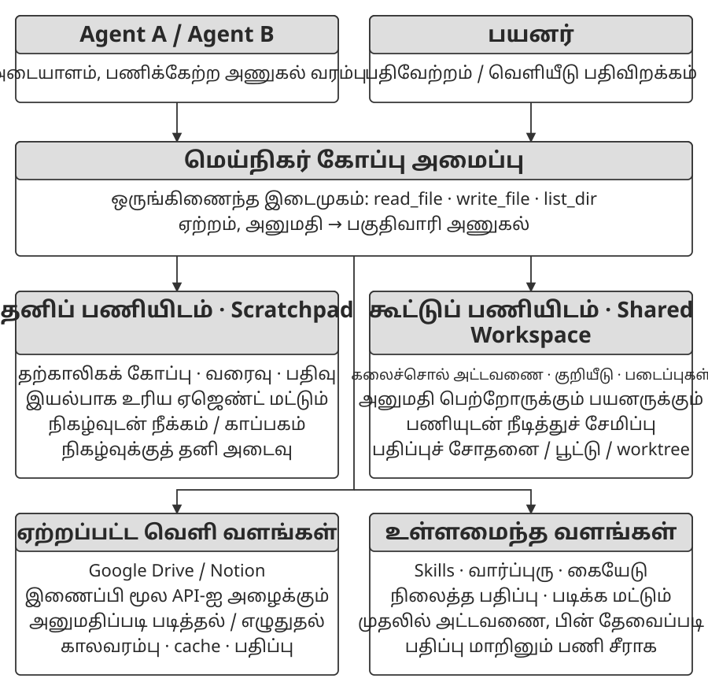

மொழிபெயர்ப்பாளர் வெளியேறிய பிறகு, பணியிடத்தில் உள்ள தற்காலிகக் கோப்புகள் விடுவிக்கப்படலாம். பகிரப்பட்ட பகுதியில் வைக்கப்பட்ட மொழிபெயர்ப்பு வரைவு தொடர்ந்து இருக்கும்; சரிபார்ப்பாளர் படிக்கும் அனுமதியுடன் அதை ஏற்றுக்கொள்ளலாம் (அட்டவணை 10-3).

அட்டவணை 10-3 ஏஜெண்ட் மெய்நிகர் கோப்பு அமைப்பின் நான்கு வகைப் பகுதிகள்

| பகுதி | தெரிநிலை | ஆயுட்காலம் | படித்தல்/எழுதுதல் | ஒரே நேர மேலாண்மை |
|---|---|---|---|---|
| ஏஜெண்டின் தனிப் பணியிடம் | இயல்பாக உரிய ஏஜெண்டுக்கு மட்டும் | நிகழ்வுடன் சுத்தம் செய்யப்படும், தேவைக்கேற்பக் காப்பகப்படுத்தப்படும் | உரிய ஏஜெண்ட் படித்து எழுதும் | மறுமுயற்சிகளோ பின்னணிச் செயல்களோ மீண்டும் எழுதுவதைத் தடுத்தல் |
| பல-ஏஜெண்ட் பகிரப்பட்ட இடம் | அங்கீகாரம் பெற்ற உறுப்பினர்களும் பயனர்களும் | பணியுடன் நீடித்துச் சேமிக்கப்படும் | பாத்திரத்தின்படி அங்கீகாரம் | பூட்டுகள், பதிப்புச் சரிபார்ப்பு அல்லது worktree |
| ஏற்றப்பட்ட வெளி வளங்கள் | வெளி அங்கீகாரமும் இணைப்பியும் சேர்ந்து கட்டுப்படுத்தும் | மூல அமைப்பும் Cache கொள்கையும் தீர்மானிக்கும் | தேவைக்கேற்பப் படிக்க மட்டும் அல்லது அங்கீகரிக்கப்பட்ட எழுதுதல் | மூல அமைப்பின் பதிப்பு, ஒரே நேர இடைமுகங்களைப் பின்பற்றுதல் |
| அமைப்பின் உள்ளமைந்த வளங்கள் | அங்கீகாரம் பெற்ற ஏஜெண்டுகள் | நிலையான பதிப்பு, அமர்வுகளுக்கு இடையே மீண்டும் பயன்படுத்தப்படும் | படிக்க மட்டும் | வளப் பதிப்பை ஒருங்கிணைந்து மாற்றுதல் |

கோப்புக் குறிப்புகள் ஒப்படைப்புச் செய்திகளைச் சுருக்கமாக வைத்திருக்க உதவுகின்றன: மேல்நிலை வெளியீட்டின் இருப்பிடம், பதிப்பு, பயன்பாடு ஆகியவற்றை வழங்குகிறது; கீழ்நிலை தேவைக்கேற்ப உள்ளடக்கத்தைப் படிக்கிறது. ஒரே இயக்கச் சூழலில் உள்ள உறுப்பினர்கள் பகிரப்பட்ட பாதைகளைப் பயன்படுத்தலாம்; நிறுவனங்களுக்கு இடையிலான கூட்டுச் செயல்பாட்டில் அதே ஒப்படைப்பை நிறைவேற்ற, இரு தரப்பும் புரிந்துகொள்ளக்கூடிய வெளியீட்டு அடையாளம், அணுகல் இடைமுகம், அங்கீகாரம் ஆகியவை தேவை.

### ஏஜெண்டுகளுக்கு இடையிலான தொடர்பாடலும் கட்டுப்பாடும்

அத்தியாயம் 4 அறிமுகப்படுத்திய உருவாக்கம், தொடர்பாடல், ரத்து, கண்டறிதல் கருவிகள் பல-ஏஜெண்ட் கூட்டுச் செயல்பாட்டுக்கு அடிப்படைக் கட்டுப்பாட்டு இடைமுகங்களை வழங்குகின்றன: `spawn_subagent` உறுப்பினரை உருவாக்குகிறது, `send_message_to_subagent` செய்தியை அனுப்புகிறது, `cancel_subagent` ரத்து செய்யக் கோருகிறது, `list_agents` உறுப்பினர்களை வினவுகிறது. இந்த இடைமுகங்களைச் சுற்றி, செய்தி, நிலை, நிறுத்தம், திட்டமிடல் ஆகியவற்றின் நடத்தையையும் வரையறுக்க வேண்டும்.

**ஒன்று, செய்திப் பரிமாற்றம்.** உறுப்பினர்கள் குறைவாகவும் உறவுகள் நிலையாகவும் இருக்கும்போது, புள்ளிக்குப் புள்ளி இடைமுகங்களைப் பயன்படுத்தலாம்; எடுத்துக்காட்டாக, தொலைபேசி ஏஜெண்டும் கணினி ஏஜெண்டும் நேரடியாக முன்னேற்றத்தைப் பரிமாறிக்கொள்கின்றன. எல்லா உறுப்பினர்களும் இருவர் இருவராகத் தொடர்புகொள்ள வேண்டுமென்றால், சாத்தியமான உறவுகளின் எண்ணிக்கை உறுப்பினர் எண்ணிக்கையின் வர்க்கத்துக்கேற்ப வளர்கிறது; சந்தா உறவுகள் அதிகமாக இருக்கும்போது, வழிச்செலுத்தல், இடையகம், மறுமுயற்சி ஆகியவற்றை ஒருங்கிணைந்து நிர்வகிக்கச் செய்திப் பேருந்து உதவுகிறது. புள்ளிக்குப் புள்ளி முறையும் பேருந்தும் ஒத்திசைவற்ற வழங்கலைச் செயல்படுத்தலாம்; பெறுநர் அதே நேரத்தில் இணைப்பில் இருக்க வேண்டுமா என்பது வரிசை, நீடித்த சேமிப்பு செயல்முறைகளைப் பொறுத்தது.

செய்தி பொதுவாக ஒரு கட்டமைக்கப்பட்ட **உறையைக்** (envelope) கொண்டிருக்கும்: அனுப்புநர் ID, இலக்கு ஏஜெண்ட் அல்லது ஒலிபரப்பு வரம்பு, செய்தி வகை, சுமை (payload). செய்தி வகைகளில் `task_assigned`, `status_update`, `result`, `terminate` ஆகியவை அடங்கலாம். பணி அடையாளம், செய்தி அடையாளம், தொடர்புடைய கோரிக்கை ஆகியவை பெறுநர் நகல்களை நீக்க உதவுகின்றன; பிழைதிருத்தக் கருவிகள் தொடர்பாடல் சங்கிலியை மீண்டும் கட்டமைக்கவும் உதவுகின்றன. வணிக உள்ளடக்கம் JSON சுமையில் வைக்கப்பட்டு, இரு தரப்பும் ஒப்புக்கொண்ட புலங்களின்படி கையாளுகின்றன.

எடுத்துக்காட்டாக, ஒரு மொழிபெயர்ப்பு வரைவை வழங்கும் பொறுப்பு ஓர் ஆசிரியருக்கு உள்ளது; ஒரு சொல்லைச் சரிபார்க்குமாறு கலைச்சொல் சரிபார்ப்பு ஏஜெண்டிடம் கேட்க அவர் விரும்புகிறார். Multica-இன் பணிச்சீட்டுக் கருத்தில் அதைப் பெயர் சுட்டி (`@`) கேள்வியை எழுதினால், சரிபார்ப்பு வேலை தூண்டப்படுகிறது. சரிபார்ப்புக் கருத்தை நேரடியாக அந்தப் பணிச்சீட்டிலேயே பதிலாக இடலாம்; பொறுப்பாளர் இன்னும் ஆசிரியரே, பணிச்சீட்டின் நிலையும் மாறாமல் இருக்கும். சரிபார்ப்பாளர் முழுப் பணிச்சீட்டையும் ஏற்க வேண்டுமென்றால், பொறுப்பாளரை வெளிப்படையாக மாற்ற வேண்டும்.[^ch10-multica]

[^ch10-multica]: Multica, கருத்துகளில் ஏஜெண்டைப் பெயர் சுட்டுதல்; பதிப்பு `d579273`-இன் கருத்து அனுப்புதல் செயலாக்கம்.

**இரண்டு, நிலையைப் பெறுதல்.** துணைப் பணி இன்னும் இயங்குகிறதா, உள்ளீடு தேவையா, முடிவைப் பெற முடியுமா என்பதை முதன்மை ஏஜெண்ட் அறிய வேண்டும். நிலை இடைமுகங்கள், நிகழ்வு அறிவிப்புகள், முன்னேற்றக் கோப்புகள் ஆகியவற்றை இணைத்துப் பயன்படுத்தலாம்: இயக்க நேர இடைமுகம் ஆயுட்சுழற்சி நிலையை வழங்குகிறது, செய்திகள் வணிக முன்னேற்றத்தை விளக்குகின்றன, நீடித்த கோப்புகள் மீட்டெடுக்கக்கூடிய பதிவுகளை வைத்திருக்கின்றன.

`get_subagent_status(agent_id)` இயங்குகிறது, உள்ளீடு தேவை, முடிந்தது, தோல்வியடைந்தது போன்ற நிலைகளைத் திருப்பித் தரலாம். அன்றாட ஒருங்கிணைப்பில், நிறைவு அறிவிப்புகளுக்கும் கட்ட முன்னேற்றச் செய்திகளுக்கும் நான் முன்னுரிமை தருகிறேன்; இதனால் முதன்மை ஏஜெண்ட் தனது வேலையைத் தொடரலாம். அறிவிப்பு தாமதமாகும்போது, இணைப்பு மீளும்போது, அல்லது பிரச்சினையை ஆராய வேண்டியிருக்கும்போது மட்டுமே தானாக வினவுகிறேன்; "முடிந்ததா?" என்று அடிக்கடி கேட்பதில் மாதிரி அழைப்புகள் வீணாவது இதனால் தவிர்க்கப்படுகிறது. நிலை இடைமுகத்தை இயக்க நேரம் பராமரிக்கிறது; செயல்முறை உயிரோடு இருக்கிறதா, பணி முடிந்ததா என்பதை அது உடனுக்குடன் தெரிவிக்க முடியும்.

**செய்திகள் மூலம் முன்னேற்றத்தைப் பரிமாறுதல்.** முதன்மை ஏஜெண்ட் நடப்பு முன்னேற்றத்தைக் கேட்கலாம்; துணை ஏஜெண்ட் பொருத்தமான படியில் பதிலளிக்கலாம். துணை ஏஜெண்டும் கட்ட முடிவைப் பெறும்போது, தடையை எதிர்கொள்ளும்போது, அல்லது உதவி தேவைப்படும்போது தானாகவே `status_update`-ஐ வெளியிடலாம். செய்தி உள்ளடக்கம் முடிந்தவை, அடுத்த படி, தடைக்கான காரணம் ஆகியவற்றை விளக்க வேண்டும்; தொகுக்கவும் மதிப்பிடவும் எளிதாக, எல்லா உறுப்பினர்களும் ஒரே நிலைப் பெயர்களைப் பயன்படுத்த வேண்டும். பணி ஆயுட்சுழற்சியின் தரப்படுத்தப்பட்ட வெளிப்பாட்டைப் பின்னர் வரும் A2A நெறிமுறை அறிமுகப்படுத்தும்.

**கோப்புகளில் முன்னேற்றத்தைச் சேமித்தல்.** அமைப்பு செய்திகள், கருவிக் கோரிக்கைகள், கருவி முடிவுகள், நிலை மாற்றங்கள் ஆகியவற்றை நிகழ்வு வரிசைப்படி பதிவில் சேர்க்கலாம்; எடுத்துக்காட்டாக, ஒவ்வொரு வரியிலும் ஒரு நிகழ்வு கொண்ட JSONL வடிவம். கண்டறிதல் அனுமதி பெற்ற முதன்மை ஏஜெண்டோ இயக்கப் பராமரிப்புக் கருவிகளோ இதன் அடிப்படையில் மறுமுயற்சிகள், பிழைகள், காத்திருப்புச் செயல்முறைகளைச் சரிபார்க்கலாம். மாதிரி உள்ளீட்டு வரலாறு இயக்கப் பாதையின் ஒரு பகுதி மட்டுமே; பதிவு திட்டமிடல், வெளிச் செயலாக்க நிகழ்வுகளையும் பதிவு செய்யலாம்.

முழுப் பாதையில் பல பத்தாயிரம் token-கள் இருக்கலாம்; ஒவ்வொரு முறை படித்த பிறகும் முதன்மை ஏஜெண்ட் நிலையை மீண்டும் சுருக்கி எடுக்க வேண்டும். செய்தி புதிய முன்னேற்றம் இருப்பதை முதன்மை ஏஜெண்டுக்கு அறிவிக்கிறது; சுருக்கமான முன்னேற்றக் கோப்பு நடப்பு நிலையைச் சேமித்து, பின்னர் வினவவும் மீட்டெடுக்கவும் உதவுகிறது. அன்றாட ஒருங்கிணைப்பை இவ்விரண்டையும் இணைத்து நிறைவேற்றுவதையே நான் விரும்புகிறேன். துணை ஏஜெண்ட் ஒவ்வொரு வேலையை முடிக்கும்போதும், பணிப் பட்டியல், வெளியீட்டுக் குறிப்புகள், நடப்புத் தடைப் புள்ளிகள் ஆகியவற்றைப் புதுப்பிக்கிறது; முதன்மை ஏஜெண்ட் இந்தப் புலங்களின் அடிப்படையில் அடுத்த படியைத் தீர்மானிக்கிறது. விரிவான பாதை தேவைக்கேற்ப ஆராய்வதற்காக வைக்கப்படுகிறது. நீண்ட நேரம் முன்னேற்றம் மாறவில்லை என்றால், இதயத்துடிப்பு (heartbeat), கருவி அழைப்பு நிலை, பணிக் காலாவதி அமைப்புகள் ஆகியவற்றை இணைத்துத் தலையிட வேண்டுமா என்று மதிப்பிடலாம்: நீண்ட நேரம் இயங்கும் கருவி இன்னும் வேலை செய்துகொண்டிருக்கலாம்; நிலையை உறுதிசெய்த பிறகு காத்திருப்பதா, ரத்து செய்வதா, மீண்டும் முயல்வதா என்று தீர்மானிக்கலாம்.

**மூன்று, செயலாக்கத்தை நிறுத்துதல்.** பல உறுப்பினர்கள் ஒரே இலக்கை இணையாகத் தேடும்போது, ஒன்று பணியை முடித்த பிறகு மற்ற கிளைகளை நிறுத்தி, வரவுசெலவையும் கருவி வளங்களையும் விடுவிக்கலாம். ரத்து இரண்டு வலிமை நிலைகளில் உள்ளது; Unix-இல் SIGTERM, SIGKILL ஆகியவற்றின் பங்கை ஒத்தவை.

நான் **மென்மையான நிறுத்தத்துக்கு** முன்னுரிமை தருகிறேன்: இயக்க நேரம் ரத்துக் கோரிக்கையை அனுப்புகிறது; துணை ஏஜெண்ட் பாதுகாப்பான புள்ளியில் புதிய செயல்களை நிறுத்தி, தேவையான முன்னேற்றத்தைச் சேமித்து, உலாவி அமர்வுகளை மூடி, பூட்டுகளை விடுவித்து, பின்னர் ஒப்புதலை (ack) திருப்பி அனுப்புகிறது. **கட்டாய நிறுத்தம்** ரத்துக் காலக்கெடுவைக் கடந்தும் பதிலளிக்காத செயலாக்கத்துக்குப் பயன்படுத்தப்படுகிறது: இயக்க நேரம் செயல்முறையை முடித்து, எஞ்சிய வளங்களையும் முடிக்கப்படாத எழுதுதல்களையும் சரிபார்க்கிறது. ஏற்கெனவே வெளி அமைப்புகளுக்குச் சமர்ப்பிக்கப்பட்ட செயல்களின் முடிவுகளையும் வினவ வேண்டும்; தேவைப்பட்டால் ஈடுசெய் செயல்முறையை நிறைவேற்ற வேண்டும்.

ஆயுட்சுழற்சியையும் உருவாக்க உறவின் வழியே நிர்வகிக்க வேண்டும். Go-வின் context-ஐ முன்மாதிரியாகக் கொண்டு, பெற்றோர் பணியின் ரத்துச் சமிக்ஞையை முழுத் துணைப் பணி மரத்துக்கும் கீழ்நோக்கிப் பரப்பலாம்; இயக்கச் சுழற்சி பாதுகாப்பான புள்ளிகளில் ரத்துச் சமிக்ஞையைச் சரிபார்க்கிறது; இது `ctx.Done()`-இன் பயன்பாட்டுக்கு ஒத்தது. இதனால், பெற்றோர் பணி முடிந்த பிறகு அது தொடங்கிய கிளைகளும் சுத்தம் செய்யும் செயல்முறைக்குள் நுழைகின்றன; யாரும் நிர்வகிக்காத ஏஜெண்டுகள் தொடர்ந்து கருவிகளை அழைத்து வரவுசெலவைச் செலவழிப்பது தவிர்க்கப்படுகிறது. உண்மையிலேயே நீண்டகாலம் தனியாக இயங்க வேண்டிய பின்னணிப் பணிகளுக்கு, `context.Background()`-ஐப் பயன்படுத்துவதைப் போலத் தனி ஆயுட்சுழற்சிச் சூழலை உருவாக்கி, அதே நேரத்தில் கண்காணிப்பு, வரவுசெலவு, சுத்தம் செய்தல் ஆகியவற்றுக்குப் பொறுப்பான மேலாளரையும் குறிப்பிட வேண்டும்.

**நான்கு, வளங்களும் திட்டமிடலும்.** ஏஜெண்ட் அமைப்பு token-கள், படிகள், ஒரே நேர ஒதுக்கீடு, கருவி இணைப்புகள், கணக்கீட்டு வளங்கள் ஆகியவற்றைப் பகிர்ந்தளிக்க வேண்டும். துணைப் பணியைத் தொடங்கும்போது வரவுசெலவையும் வரம்பு மீறலின் நடத்தையையும் அமைக்க வேண்டும்; பணியின் கடினத்தன்மைக்கேற்ப மாதிரியைத் தேர்ந்தெடுக்க வேண்டும்; சேவை ஒதுக்கீடு ஒரே நேரத்தில் தீர்ந்துவிடாமல் தடுக்க, ஒரே நேர அழைப்புகளைக் கட்டுப்படுத்த வேண்டும். அவசரமான பணி வரும்போது, குறைந்த முன்னுரிமைப் பணிகளைப் பாதுகாப்பான புள்ளியில் இடைநிறுத்தியோ ரத்து செய்தோ, முன்னேற்றத்தைச் சேமித்த பிறகு மீண்டும் திட்டமிடலாம்.

மூன்று கிளைகள் ஒவ்வொன்றும் ஒரு சாத்தியமான தீர்வை ஆராய்கின்றன என்றும், அவற்றில் ஒன்று ஏற்கெனவே முக்கியத் தடயத்தைக் கண்டறிந்து, கடைசிச் சரிபார்ப்பு மட்டுமே மீதம் உள்ளது என்றும் வைத்துக்கொள்வோம். Manager அதற்குச் சில படிகளைக் கூடுதலாகக் கொடுத்து, முன்னேற்றம் இல்லாத இரண்டு கிளைகளையும் அதே நேரத்தில் முடிக்கலாம். ஒதுக்கீட்டை இயக்க நேரம் கழிக்கிறது; ஒரு கிளை இன்னும் முயல விரும்பினாலும், வரவுசெலவு தீர்ந்தால் நிற்கத்தான் வேண்டும்.

### சக கூட்டுழைப்பு முறை: பரஸ்பரச் சரிபார்ப்பும் மீள்சுழற்சி மேம்பாடும்

சக கூட்டுழைப்பில் பொதுவாக இரண்டு மூன்று ஏஜெண்டுகள் ஒரே பணியைச் சுற்றிக் கருத்துகளைப் பரிமாறி, வெளியீட்டைத் திருத்துகின்றன. வடிவமைக்கும்போது, உறுப்பினர்களுக்கு வெவ்வேறு பொறுப்புகள், பொருட்கள், கருவிகளை முதலில் ஒதுக்கி, அவை தனித்தனியாக மதிப்பிடச் செய்து, பின்னர் முடிவுகளைத் தொகுக்கலாம். எடுத்துக்காட்டாக, உருவாக்குநர் செயலாக்கத்தில் கவனம் செலுத்துகிறது, சரிபார்ப்பாளர் சோதனைகளிலும் பயனர் தேவைகளிலும் கவனம் செலுத்துகிறது; வெவ்வேறு துறை உறுப்பினர்கள் தத்தம் துறைக் கட்டுப்பாடுகளைச் சரிபார்க்கிறார்கள். மாதிரி, உள்ளீடு, பணிச்செயல்முறை எவ்வளவு ஒத்திருக்கின்றனவோ, அவ்வளவு எளிதாக உறுப்பினர்கள் ஒரே மதிப்பீட்டை மீண்டும் செய்கிறார்கள்; எனவே கண்ணோட்டத்திலும் ஆதாரத்திலும் வேறுபாட்டை வேண்டுமென்றே வடிவமைக்க வேண்டும்.[^anthropic-multiagent-2026]

ஒரே வெளியீட்டைச் சுற்றி மீண்டும் மீண்டும் மேம்படுத்தும் பணிகளுக்கு, இரண்டு மூன்று உறுப்பினர்கள் கொண்ட சக கூட்டுழைப்பிலிருந்து தொடங்குமாறு பரிந்துரைக்கிறேன். பாத்திரங்கள், ஒப்படைப்பு உள்ளடக்கம், நிறுத்த நிபந்தனைகள் தெளிவான பிறகு, சோதிக்கக்கூடிய ஒரு சுழற்சியை நிறுவலாம்; தொடக்கத்தில் ஒருங்கிணைப்பு வேலையும் குறைவாக இருக்கும்.

#### Loop பொறியியல்

ஒரு பொதுவான பிரச்சினையைக் கையாள சக கூட்டுழைப்பு உதவும்: **முன்கூட்டிய நிறுத்தம்**. நிரலாக்கத்தையும் வாடிக்கையாளர் சேவைப் பணிகளை முகவராகச் செய்வதையும் எடுத்துக்காட்டாகக் கொண்டால், மூன்று வகைப் பதிவுகளிலிருந்து முன்கூட்டிய நிறுத்தத்தைக் கண்டறியலாம்.

- **பகுதியை முடித்துவிட்டு முழுவதும் முடிந்தது என்று அறிவித்தல்.** Coding Agent குறியீட்டை எழுதி முடிக்கிறது, ஆனால் சோதனைகளையும் வெளியீட்டுச் சரிபார்ப்பையும் விட்டுவிடுகிறது; பயனர் உதவியாளரிடம் இரண்டு வேலைகளை ஒப்படைக்கிறார், அது முதலாவதை முடித்ததும் எல்லாம் முடிந்தது என்று அறிவிக்கிறது. பணிப் பட்டியலை ஒவ்வொன்றாக ஒப்பிட்டு, ஒவ்வொரு வேலையின் நிறைவு ஆதாரத்தையும் சரிபார்க்க வேண்டும்.
- **ஒரு பாதை தோல்வியடைந்ததும் முன்கூட்டியே கைவிடுதல்.** வணிகர் படிவம் மூலம் பொருட்களைச் சமர்ப்பிக்குமாறோ, குறிப்பிட்ட மின்னஞ்சல் முகவரி வழியாக இணைப்புகளைப் பெறுவதாகவோ கேட்கலாம். அத்தகைய பதில் கிடைத்தால், வணிகர் ஏற்கும் முறையில் தொடர்ந்து செயல்படலாம். தோல்விக்கான காரணத்தைப் பதிவு செய்து, இன்னும் எந்தப் பாதைகளை முயல்வது பயனுள்ளது என்று மதிப்பிட வேண்டும்.
- **பகுதி வெற்றிக்குப் பிறகு அடுத்தடுத்த படிகளைத் தவறவிடுதல்.** பணத்தைத் திருப்பித் தர வணிகர் ஒப்புக்கொண்ட பிறகும், பயனர் App-இல் உறுதிசெய்ய வேண்டும் என்று கோரினால், உதவியாளர் இந்தப் படியையும் அதற்கான நிபந்தனைகளையும் விளக்க வேண்டும். கட்டணக் குறைப்பை எடுத்துக்காட்டாகக் கொண்டால், வாடிக்கையாளர் சேவை அலுவலர் தொலைபேசியில் வாய்மொழியாக ஒப்புக்கொண்டால், இந்தப் பேச்சுவார்த்தையில் ஓர் உறுதிமொழி கிடைத்தது என்று உதவியாளர் பயனரிடம் உறுதிசெய்யலாம். அலுவலர் என்ன சொன்னார் என்பதை அழைப்புப் பதிவு நிரூபிக்கும்; பின்வரும் கட்டணச் சீட்டில் அது நிறைவேறியதா என்பதற்குப் புதிய ஆதாரம் தேவை. சரிபார்ப்பாளர் பெறப்பட்ட முடிவுகள், இன்னும் யார் என்ன செய்ய வேண்டும், எந்த முடிவுகள் தற்போது தெரியவில்லை ஆகியவற்றைத் தனித்தனியாக விளக்க வேண்டும்.

இந்த மூன்று வகைப் பிரச்சினைகளும் நிறைவு நிபந்தனைகளைச் சரிபார்க்கக்கூடிய முடிவுகளாக மாற்றக் கோருகின்றன. **Loop பொறியியல்** ஏஜெண்டை "அடுத்த வேலையைத் தீர்மானித்தல்—செயல்படுத்துதல்—சரிபார்த்தல்—முன்னேற்றத்தைப் பதிவு செய்தல்" என்ற சுழற்சியில் தொடர்ந்து இயங்கச் செய்து, முடிவுகளின் அடிப்படையில் தொடர்வதா, காத்திருப்பதா, ஒப்படைப்பதா, முடிப்பதா என்று தீர்மானிப்பதில் கவனம் செலுத்துகிறது. பொறியாளர்கள் பணி மூலம், சரிபார்ப்பு முறை, நீடித்த நிலை, நிறுத்த நிபந்தனைகள் ஆகியவற்றை வடிவமைக்க வேண்டும். மனிதரின் வேலையும் அதற்கேற்ப விரிவடைகிறது: ஓர் அழைப்புக்கு ப்ராம்ப்ட் எழுதுவதிலிருந்து, பணியைத் தொடர்ந்து முன்னெடுக்கக்கூடிய சுழற்சியை வடிவமைப்பதற்கு மாறுகிறது. Addy Osmani 2026 ஜூனில் இந்தப் பெயரில் இந்த நடைமுறைகளை விவாதித்து, Boris Cherny-யின் அனுபவத்தை மேற்கோள் காட்டினார்: வேலையின் மையம் படிப்படியாக ஏஜெண்டை இயக்கக்கூடிய சுழற்சிகளை வடிவமைப்பதற்கு நகர்கிறது.[^loop-engineering-2026]

**இத்தகைய சுழற்சிகளில், சரிபார்ப்பான் பெரும்பாலும் முக்கியத் தடைப்புள்ளி என்று நான் கருதுகிறேன்.** சரிபார்ப்பு நம்பகமற்றதாக இருந்தால், சுற்றுகளை அதிகரிப்பது அமைப்பை அதே வகைப் பிழைகளை மீண்டும் செய்ய வைக்கலாம், அல்லது முன்கூட்டியே நிறைவை அறிவிக்க வைக்கலாம். சோதனை முடிவுகள், வணிக நிலை, பயனர் உறுதிப்படுத்தல் ஆகியவை தத்தம் வரம்புக்குள் நிறைவுக்கான அடிப்படையை வழங்குகின்றன; சரிபார்ப்புத் தோல்வி அடுத்த சுற்றுத் திருத்தத்தின் உள்ளீடாகிறது.

நடைமுறை பெயருக்கு முன்னே வந்தது. Loop பொறியியல் என்ற பெயர் பிரபலமாவதற்கு முன்பே, நானும் எனது குழுவும் Pine AI-இல் சுழற்சியையும் சரிபார்ப்பையும் பயன்படுத்தி முன்கூட்டிய நிறுத்தத்தைக் கையாண்டிருந்தோம். இத்தகைய சுழற்சிகளை ஒழுங்கமைக்கப் பரவலாகப் பயன்படும் ஒரு வழி முன்மொழிபவர்–சரிபார்ப்பாளர் முறை; அதைக் கீழே மேலும் விரிவாகப் பார்ப்போம்.

[^loop-engineering-2026]: Osmani, Addy. “Loop Engineering”, 2026.

**LoopX: சுற்றுகளுக்கு இடையே பணி நிலையைச் சேமித்தல்.** LoopX இலக்கு, எல்லைகள், செய்ய வேண்டியவை, வாயில்கள் (gates), ஆதாரங்கள், ஒதுக்கீடுகள் ஆகியவற்றை ஒரு நீடித்த கட்டுப்பாட்டுத் தளத்தில் வைக்கிறது; அடுத்த சுற்றின் அல்லது அடுத்த செயல்படுத்துநரின் வேலையை அதுவே ஒழுங்கமைக்கிறது. செயல்முறையை இவ்வாறு சுருக்கலாம்: **கட்டுப்பாட்டுத் தள முடிவு → ஏஜெண்ட் செயலாக்கம் → தனிச் சரிபார்ப்பு → சரிபார்க்கப்பட்ட முன்னேற்றத்தைச் சமர்ப்பித்தல்**.

ஏஜெண்ட் கருவிகளை அழைத்து, பகுத்தறிந்து, இந்தச் சுற்றின் வெளியீட்டை ஒப்படைக்கிறது. கட்டுப்பாட்டுத் தளம் ஏற்கெனவே முடிந்த வேலையைப் பதிவு செய்து, அடுத்த சுற்று எங்கிருந்து தொடர வேண்டும் என்று தீர்மானிக்கிறது. சரிபார்ப்பு வெற்றியடைந்தால் நிறைவு நிலை சமர்ப்பிக்கப்படுகிறது; தோல்வியடைந்தால் சரிசெய்தலுக்கோ மறுதிட்டமிடலுக்கோ செல்கிறது. மனித வாயில்கள், காத்திருப்பு நிபந்தனைகள், வரவுசெலவு வரம்புகள் ஆகியவை சேர்ந்து, செயலாக்கம் எப்போது தொடரலாம் என்பதைத் தீர்மானிக்கின்றன.[^loopx-framework]

[^loopx-framework]: LoopX, The local control plane for long-running AI agent work, v0.4.0.

**LongHorizon-Harness: பல பயன்பாடுகளைக் கடக்கும் நீண்ட பணிகளை இணைத்தல்.** இந்தச் சட்டகம் பல்லூடக Computer Use-இலிருந்து தொடங்கி, GUI, CLI, பல டெஸ்க்டாப் பயன்பாடுகள், பல சூழல் புதுப்பிப்புகள் ஆகியவற்றுக்கு இடையே பணியின் தொடர்ச்சியான செயலாக்கத்தைக் கையாளுகிறது. இது Manage–Execute–Audit (MEA) சுழற்சியைப் பயன்படுத்துகிறது: Manager மூல இலக்கு, சரிபார்க்கப்பட்ட முன்னேற்றம், தோல்வி ஆதாரங்கள், மீதமுள்ள வேலை ஆகியவற்றின் அடிப்படையில் வரம்பு தெளிவான ஒரு துணைப் பணியை உருவாக்குகிறது; Executor புதிய சூழலில் GUI அல்லது CLI செயல்களைச் செய்கிறது; Auditor படிக்க மட்டும் முறையில் முடிவைச் சரிபார்த்து, சரிபார்க்கப்பட்ட முன்னேற்றத்தை அடுத்த சுற்றின் நிலையில் எழுதுகிறது. மீட்டெடுப்புக்கும் மறுதிட்டமிடலுக்கும் பயன்படுத்தத் தோல்வி ஆதாரங்களும் வைக்கப்படுகின்றன.

சட்டகம் ஓர் இணைப்பு அடுக்கின் வழியாக Claude Code, Codex CLI போன்ற செயலாக்கப் பின்முனைகளை அழைத்து, வெளிப்புறப் பணி மேலாண்மையைப் பின்முனையின் இயக்கச் சுழற்சியுடன் இணைக்கிறது. இந்த வழி நீண்ட பணிகளின் தொடர்ச்சியைச் சரிபார்க்கப்பட்ட பணி நிலையில் நிலைநிறுத்துகிறது. செயலாக்கச் சூழல் புதுப்பிக்கப்படலாம்; அடுத்த சுற்று இலக்கு, நிறைவு ஆதாரங்கள், தீர்க்கப்படாத விஷயங்கள் ஆகியவற்றைக் கொண்டு தொடர்ந்து வேலை செய்து, சூழல் மாற்றங்கள் முந்தைய முடிவுகளைப் பாதிக்கின்றனவா என்பதையும் மீண்டும் சரிபார்க்க முடியும்.[^longhorizon-implementation]

Qwen 3.7-Plus, Claude Code செயலாக்கப் பின்முனையை மாற்றாமல் வெளிப்புறச் சுழற்சியை மட்டும் மாற்றிய ஒப்பீட்டில், WeaveBench PassRate 51.8%-இலிருந்து 80.7%-ஆகவும், OSWorld 2.0 இருமை நிறைவு விகிதம் 2.8%-இலிருந்து 8.3%-ஆகவும், Terminal-Bench 2.1 வெற்றி விகிதம் 69.7%-இலிருந்து 77.2%-ஆகவும் உயர்ந்ததாக ஆய்வுக் கட்டுரை அறிவிக்கிறது. அதற்கான செலவும் பணிக்கேற்ப மாறுபட்டது: முதல் இரண்டு அளவுகோல்களில் முறையே அடிப்படையின் 2.3 மடங்கு மொத்த token-களும் 3.6 மடங்கு வெளியீட்டு token-களும் செலவாயின; Terminal-Bench 2.1-இல் token நுகர்வு 24% குறைந்தது.

அதே WebRTC பல-அடுக்கு ஓடைத் தணிக்கைப் பணியில், அடிப்படைச் செயல்படுத்துநர் Wireshark இடைமுகத்தில் சிக்கிக்கொண்டு, பின்னர் மேலும் சில முறை முயன்று, இறுதியில் 0.59 மதிப்பெண் பெற்றது. MEA-ஐப் பயன்படுத்தியபோது, சரிபார்ப்பாளர் விடுபட்ட ஆதாரங்களைப் பதிவு செய்தது; அடுத்த சுற்றுச் செயல்படுத்துநர் அதன் அடிப்படையில் கூடுதலாக ஆராய்ந்தது; இறுதி மதிப்பெண் 0.92.

[^longhorizon-implementation]: LongHorizon-Harness, ஆய்வுக் கட்டுரை எண் arXiv:2608.01964. அடிப்படைக்கும் MEA-க்குமான பொதுப் பாதைகள் இரண்டும் WEB_task_16_webrtc_simulcast_layer_audit பணியிலிருந்து எடுக்கப்பட்டவை; மீளுருவாக்க ஸ்கிரிப்ட் `53bc678` சமர்ப்பிப்பைப் பயன்படுத்துகிறது.

#### முன்மொழிபவர்–சரிபார்ப்பாளர் முறை

முன்மொழிபவர்–சரிபார்ப்பாளர் முறை வெளியீட்டை உருவாக்குவதையும் முடிவைச் சரிபார்ப்பதையும் இரண்டு பாத்திரங்களிடம் ஒப்படைக்கிறது. அத்தியாயம் 5-இன் PPT உருவாக்கம், காணொளித் திருத்தம், பதிவுக் காட்சிப்படுத்தல் சோதனைகள் இந்த வடிவமைப்பைப் பயன்படுத்தின: Proposer குறியீட்டை உருவாக்குகிறது; Reviewer வரைவு முடிவைப் பார்த்து, காட்சி மாதிரியின் உதவியுடன் தரத்தைச் சரிபார்த்து, கட்டமைக்கப்பட்ட திருத்தக் கருத்துகளைத் திருப்பி அனுப்புகிறது. படம் 10-3-இல், திருத்தக் கருத்துகள் மீண்டும் முன்மொழிபவரிடம் செல்ல வேண்டும். அதன் அடிப்படையில் அடுத்த பதிப்பைச் சரிசெய்ய முடியுமா என்பது, சரிபார்ப்பாளர் பிரச்சினையை எவ்வளவு நுணுக்கமாகச் சுட்டிக்காட்ட முடியும் என்பதைப் பொறுத்தது.

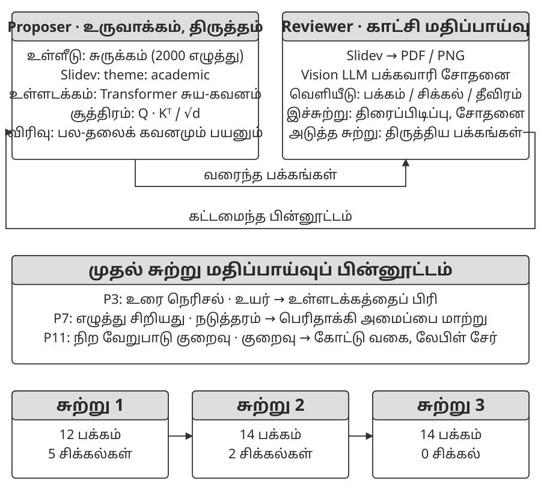

சரிபார்க்கும் பொருள் மாறினால், சரிபார்ப்பில் பார்க்க வேண்டிய ஆதாரமும் மாற வேண்டும். வாடிக்கையாளர் சேவைப் பதிலைச் சரிபார்க்க வணிக விதிகளையும் உண்மை மூலங்களையும் ஒப்பிட வேண்டும்; குறியீட்டு மாற்றத்தைச் சரிபார்க்கச் சோதனைகளையும் உண்மையான இயக்க முடிவுகளையும் பார்க்க வேண்டும்; செயல் திட்டத்தைச் சரிபார்க்கப் பொருந்தும் விதிமுறைகளையும் முன்நிபந்தனைகளையும் சரிபார்க்க வேண்டும்.

Huang முதலியோரின் ICLR 2024 ஆய்வுக் கட்டுரை "Large Language Models Cannot Self-Correct Reasoning Yet", அவர்கள் ஆய்வு செய்த பகுத்தறிவுப் பணிகளிலும் ப்ராம்ப்ட் அமைப்புகளிலும், வெளிப் பின்னூட்டம் இல்லாமல் GPT-4 தன்னைத் தானே திருத்தும்போது, சரியான பதில்களைத் தவறாக மாற்றி, ஒட்டுமொத்தத் துல்லியம் குறையும் நிலை ஏற்படுவதைக் கண்டறிந்தது. TACL-இன் சுயதிருத்த ஆய்வுக் கட்டுரை, பணி நிபந்தனைகளும் பின்னூட்ட நம்பகத்தன்மையும் திருத்த விளைவை எவ்வாறு பாதிக்கின்றன என்பதை மேலும் விவாதிக்கிறது.[^self-correction-survey] எனவே, சரிபார்ப்புச் சுழற்சியின் அடிப்படைத் தேவைகளாகத் தனித்த ஆதாரத்தையும் சுட்டிக்காட்டக்கூடிய சரிசெய்தல் நிபந்தனைகளையும் நான் கொள்கிறேன். சரிபார்ப்பாளர் உண்மையான சோதனைகள், சூழல் நிலை அல்லது வரைவு முடிவுகளைப் படிக்க முடிய வேண்டும்; எந்தத் தேவை இன்னும் நிறைவேறவில்லை, சரிசெய்தலை எவ்வாறு சரிபார்ப்பது என்பதைச் சுட்டிக்காட்ட வேண்டும்.

[^self-correction-survey]: Kamoi, R., et al. *When Can LLMs Actually Correct Their Own Mistakes? A Critical Survey of Self-Correction of LLMs.* TACL, 2024.

ஒரு முழுச் சுழற்சியை ஐந்து படிகளாக ஒழுங்கமைக்கலாம்:

1. முன்மொழிபவர் பணித் தேவைகளின்படி முதல் பதிப்பை எழுதுகிறது; எடுத்துக்காட்டாக, ஒரு பதில் அல்லது ஒரு குறியீட்டுப் பகுதி.
2. வெளியீட்டை இயக்கியோ வரைந்தோ, சோதனைகள், வணிக நிலை, திரைப்பிடிப்புகள் அல்லது உண்மைச் சரிபார்ப்பு முடிவுகளைப் பெறுதல்.
3. சரிபார்ப்பாளர் தேவைகளையும் ஆதாரங்களையும் ஒப்பிட்டு, தேர்ச்சி என்ற முடிவைத் தருகிறது, அல்லது பிரச்சினையின் இடத்தையும் சரிசெய்தல் நிபந்தனைகளையும் சுட்டிக்காட்டுகிறது.
4. வரவுசெலவு இன்னும் இருந்தால், முன்மொழிபவர் பின்னூட்டத்தின்படி திருத்தி, மீண்டும் இயக்கிச் சரிபார்க்கச் செய்கிறது; உள்ளீடோ அங்கீகாரமோ தேவைப்படும் பிரச்சினைகளை எதிர்கொண்டால், காத்திருப்புக்கோ ஒப்படைப்புக்கோ மாறுகிறது.
5. வெளியீட்டு நிபந்தனைகளை அடைந்த பிறகு, சரிபார்ப்பைக் கடந்த பதிப்பைச் சரிபார்ப்பு ஆதாரங்களுடனும் சரிபார்ப்பு முடிவுடனும் வழங்குதல்; வரவுசெலவு தீர்ந்தால், முன்னேற்றத்தையும் தீர்க்கப்படாத பிரச்சினைகளையும் வைத்திருத்தல்.

சரிபார்ப்பாளர் பாதுகாக்கப்பட்ட சோதனைகளையும் வெளியீட்டுத் தரநிலைகளையும் படிக்கிறது; அது முன்மொழியும் தரநிலை மாற்றங்கள் தனியாக ஆய்வு செய்யப்படுகின்றன.

CRITIC சோதனைகளில், மாதிரி முதலில் பதிலளித்து, பின்னர் கருவிகளின் உதவியுடன் சரிபார்க்கிறது.[^ch10-critic] எடுத்துக்காட்டாக, பதிலில் உள்ள உண்மைகளைத் தேடுபொறி மூலம் சரிபார்க்கிறது; தான் எழுதிய கணித நிரலை Python மொழிபெயர்ப்பி மூலம் இயக்குகிறது. திறந்த வினா-விடை, கணித நிரல் உருவாக்கம், தீங்கான வெளிப்பாடுகளைக் குறைத்தல் ஆகிய மூன்று வகைப் பணிகளிலும், கருவிப் பின்னூட்டத்தின் அடிப்படையில் திருத்திய பிறகு மாதிரியின் செயல்திறன் மேம்பட்டது. மாதிரி தானே மூலப் பதிலை மதிப்பிட்டபோது மட்டும், திருத்த விளைவு பலவீனமாக இருந்தது. இந்த வடிவமைப்பு அத்தியாயம் 5-இன் PPT எடுத்துக்காட்டுடன் ஒத்துப்போகிறது: குறியீட்டு உரையிலிருந்து நேரடியாக மதிப்பிடக் கடினமான வடிவமைப்பு, மறைப்புப் பிரச்சினைகளை வரைவுத் திரைப்பிடிப்புகள் வெளிப்படுத்துகின்றன; சோதனை இயக்கம் உண்மையான இயக்கப் பிழைகளை வெளிப்படுத்துகிறது.

[^ch10-critic]: CRITIC, arXiv:2305.11738.

Anthropic-இன் 2026 நீண்டகாலப் பயன்பாட்டு உருவாக்க எடுத்துக்காட்டு, திட்டமிடுபவர், உருவாக்குநர், மதிப்பீட்டாளர் என மூன்று ஏஜெண்டுகளைப் பயன்படுத்துகிறது. திட்டமிடுபவர் தேவைகளைத் தயாரிப்பு விவரக்குறிப்பாக விரிவாக்குகிறது; உருவாக்குநரும் மதிப்பீட்டாளரும் முதலில் ஒவ்வொரு சுற்றின் நிறைவுத் தரநிலையில் உடன்பட்டு, பின்னர் முறையே செயல்படுத்தவும் சரிபார்க்கவும் செய்கின்றன. மதிப்பீட்டாளர் Playwright மூலம் பயன்பாட்டை இயக்கிக் குறைபாட்டு அறிக்கைகளைச் சமர்ப்பிக்கிறது; பாத்திரங்கள் கோப்புகள் வழியாக நிலையை ஒப்படைக்கின்றன. தயாரிப்பு விவரக்குறிப்பு, உண்மையான இயக்கம், குறைபாட்டுப் பின்னூட்டம் ஆகியவை எவ்வாறு இணைக்கப்படுகின்றன என்பதை இந்த எடுத்துக்காட்டு காட்டுகிறது; அதிகரிக்கும் செயலாக்க, சரிபார்ப்புச் செலவுகளையும் தீர்வுகளை ஒப்பிடும்போது கணக்கில் கொள்ள வேண்டும்.[^anthropic-harness-2026]

[^anthropic-harness-2026]: Prithvi Rajasekaran, “Harness Design for Long-Running Application Development,” Anthropic Engineering, 2026-03-24.

2026 நவம்பர் 20 அன்று, கணிதவியலாளர் Levent Alpöge, Claude-உடன் இணைந்து பெற்ற ஒரு முறைப்படுத்தப்பட்ட நிரூபணத்தை வெளியிட்டார்; அது ரீமான் கருதுகோளையும், டிரிஷ்லே $L$ சார்புகளுக்கான அதன் பொதுமைப்படுத்தலையும் உள்ளடக்கியது. ஒரு பெரிய தொகுதி Lean கோப்புகளைப் பெற்றதும், சரிபார்ப்பாளர் முதலில் இரண்டு கேள்விகளைக் கேட்க வேண்டும்: கடைசித் தேற்றம் கூறுவது மூலக் கருதுகோளைத்தானா? ஒவ்வொரு படி வருவிப்பையும் நிரூபணக் கருவால் (proof kernel) மீண்டும் சரிபார்க்க முடியுமா? MIT கணிதவியலாளர் Andrew Sutherland முதலில் சமர்ப்பிக்கப்பட்ட தேற்றத்தை Lean கணித நூலகத்தில் உள்ள ரீமான் கருதுகோளின் வரையறையுடன் ஒப்பிட்டு, பின்னர் நிரூபணம் சார்ந்திருக்கும் அடிக்கோள்களைப் பட்டியலிட்டார். அதே நாளில் அவர் வெளியிட்ட பதிவில், தனித்த நிரூபணக் கருவான nanoda ஏற்றுமதி செய்யப்பட்ட நிரூபணத்தைச் சரிபார்த்து ஏற்றுக்கொண்டதாகவும் தெரிவித்தார். இது சரிபார்ப்புப் பணிப் பிரிவுக்கு ஒரு குறிப்பான வழியை வழங்குகிறது: பிரச்சினையை நன்கு அறிந்தவர் முதலில் ஏற்புக் கூற்றை எழுதுகிறார்; பின்னர் சமர்ப்பிக்கப்பட்ட வெளியீடு அந்தக் கூற்றை வருவிக்க முடியுமா என்பதைத் தனித்த கருவி சரிபார்க்கிறது. ஆசிரியர் இந்த வழியை எவ்வாறு கண்டடைந்தார் என்பதைப் பின்னாளில் கணிதவியலாளர்கள் புரிந்துகொள்ள விரும்பினால், மனிதர் படிக்க எளிதான ஒரு வாதமும் தேவைப்படும்.[^ch10-rh-review]

[^ch10-rh-review]: Levent Alpöge 2026 நவம்பர் 20 அன்று ஆய்வு விளக்கத்தை வெளியிட்டார். சரிபார்ப்பு உருப்படிகளும் அன்றைய முன்னேற்றமும் Andrew Sutherland-இன் "Verification files for the Lean proof of the Riemann Hypothesis"-இல் உள்ளன.

#### விவாத முறை

விவாத முறை உறுப்பினர்களை வெவ்வேறு நிலைப்பாடுகளிலிருந்து ஒரே பிரச்சினையைச் சரிபார்க்கச் செய்கிறது. எடுத்துக்காட்டாக, ஒரு தொழில்நுட்பத் தீர்வை மதிப்பிடும்போது, ஓர் ஏஜெண்ட் பயன்களையும் பொருந்தும் சூழ்நிலைகளையும் விளக்குகிறது; இன்னொன்று கட்டுப்பாடுகள், தோல்வி நிபந்தனைகள், மாற்றுத் தீர்வுகள் ஆகியவற்றைச் சரிபார்க்கிறது. ஒவ்வொரு சுற்றும் குறிப்பான வாதங்களைச் சுற்றி ஆதாரங்களைச் சேர்க்கிறது அல்லது மறுப்பை முன்வைக்கிறது; இறுதியில் ஒருமித்த கருத்து எட்டப்பட்டவற்றையும் இன்னும் சரிபார்க்க வேண்டிய கருத்து வேறுபாடுகளையும் தொகுக்கிறது.

இந்த ஏற்பாடு ஆதரவு, எதிர்ப்பு வாதங்களைத் தெளிவாகப் பட்டியலிட உதவுகிறது; விளைவு வாதங்களின் தரம், தனித்த மதிப்பீடு, இறுதித் தேர்வு முறை ஆகியவற்றைச் சார்ந்துள்ளது. Tran-உம் Kiela-வும் பல-படி பகுத்தறிவுப் பணிகளில் தொடர், விவாதம், தொகுப்பு (ensemble), இணைப் பாத்திரங்கள், துணைப் பணி இணைச் செயலாக்கம் என ஐந்து கட்டமைப்புகளை ஒப்பிட்டனர்; சிந்தனை token வரவுசெலவைச் சமமாக்கிய பிறகு, ஒற்றை ஏஜெண்டின் செயல்திறன் பல-ஏஜெண்டுக்குச் சமமாகவோ சிறப்பாகவோ இருந்தது.[^single-agent-2026] இதன் அடிப்படையில், கருத்து வேறுபாடுகளை விரித்துரைக்கவும், அனுமானங்களைச் சரிபார்க்கவும், எதிர்வாதங்களை நிறைவு செய்யவும் முதன்மையாக விவாதத்தைப் பயன்படுத்துகிறேன். உண்மை அல்லது கணக்கீட்டுத் துல்லியத்தை நாடும்போது, சரிபார்க்கக்கூடிய ஆதாரங்களையும் தனித்த சரிபார்ப்பையும் அதிகரிப்பதற்கு முன்னுரிமை தருகிறேன்.

இடைநிலைத் தகவல் கடத்தலின் வரம்புகளை விவாதிக்க, ஆய்வுக் கட்டுரை தரவுச் செயலாக்கச் சமனின்மையைப் (data processing inequality) பயன்படுத்துகிறது: மீண்டும் மீண்டும் மறுவுரைப்பதும் சுருக்குவதும் மூல விவரங்களை இழக்கச் செய்யலாம். பொறியியலில், தடமறியக்கூடிய மூலங்களை வைத்திருந்து, உறுப்பினர்கள் முதலில் தனியாகப் பகுப்பாய்வு செய்து, பின்னர் முடிவுகளைப் பரிமாறிக்கொள்ளச் செய்து, சரிபார்க்கப்படாத ஒருமித்த கருத்துகளைக் குறைக்கலாம். பல தனித்த மாதிரியெடுப்புகளுக்குப் பிறகு தொகுப்பதும், "உருவாக்குவது கடினம், சரிபார்ப்பது எளிது" என்ற பணிப் பண்பைப் பயன்படுத்தித் தனிச் சரிபார்ப்பை ஏற்பாடு செய்வதும் விவாதத்துடன் இணைந்து செயல்படலாம்.

[^single-agent-2026]: Tran, D., Kiela, D. *Single-Agent LLMs Outperform Multi-Agent Systems on Multi-Hop Reasoning Under Equal Thinking Token Budgets.* arXiv:2604.02460, 2026.

#### மூளைப்புயல் முறை

மூளைப்புயலை இரண்டு சுற்றுகளாகப் பிரிக்கலாம்: முதலில் ஒவ்வொரு உறுப்பினரும் தனியாக வழிகளைச் சிந்திக்கட்டும்; பின்னர் எந்தக் கருத்துகளை இணைக்கலாம் என்று சேர்ந்து விவாதிக்கலாம். எடுத்துக்காட்டாக, Agent 1 சமூகப் பகிர்வு அம்சத்தைச் சேர்க்க முன்மொழிகிறது; Agent 2 அதன் அடிப்படையில் தனிப்பயனாக்கப்பட்ட பகிர்வுச் சுவரொட்டிகளைத் தானாக உருவாக்க முன்மொழிகிறது; Agent 3 மேலும் பயனர் தனிப்பயன் வார்ப்புருக்களையும் வார்ப்புருச் சந்தையையும் முன்மொழிகிறது.

உறுப்பினர்கள் வெவ்வேறு வழிகளைச் சிந்திக்க, அவற்றைப் பயனர், இயக்குநர் ஆகியோரின் கண்ணோட்டங்களிலிருந்து தனித்தனியாகத் தொடங்கச் சொல்லலாம்; அல்லது வெவ்வேறு ப்ராம்ப்ட்களையோ மாதிரிகளையோ கொடுக்கலாம். கருத்துகளைப் பரிமாறிய பிறகு, பயனர் தேவைகள், செயலாக்கச் செலவு, சரிபார்ப்பு முடிவுகள் ஆகியவற்றின்படி தீர்வுகளை வடிகட்டலாம்.

#### நிபுணர் குழு முறை

நிபுணர் குழு பல துறைகளைக் கடக்கும் பிரச்சினைகளைச் சுற்றித் துறைசார் பொறுப்புகளைப் பகிர்ந்தளிக்கிறது. எடுத்துக்காட்டாக, ஒரு புதிய தயாரிப்பை மதிப்பிடும்போது, பொறியாளர் ஏஜெண்ட் செயலாக்கக் கடினத்தன்மையையும் தொழில்நுட்பச் சார்புகளையும் பகுப்பாய்வு செய்கிறது; தயாரிப்பு ஏஜெண்ட் பயனர் தேவைகளையும் அனுபவத்தையும் சரிபார்க்கிறது; இயக்க ஏஜெண்ட் செலவு, வளங்கள், நடைமுறைப்படுத்தும் நிபந்தனைகளை மதிப்பிடுகிறது.

LobeHub-இன் குழு அரட்டையில், நடத்துநர் ஒரே தயாரிப்புத் திட்டத்தை இந்த மூன்று நிபுணர்களுக்கும் ஒலிபரப்பலாம். அமைப்பு முதலில் அந்த நேரத்தின் குழு அரட்டைப் பதிவுகளை எடுத்து, பின்னர் மூன்று உறுப்பினர்களையும் தத்தம் பாத்திர அமைப்புகளுடன் ஒரே நேரத்தில் பதிலளிக்கச் செய்கிறது. மூன்று பதில்களும் ஒலிபரப்பைத் தொடங்கிய செய்தியின் கீழ் இணைக்கப்படுகின்றன; ஒவ்வொருவரும் எந்தக் கேள்விக்குப் பதிலளித்தார் என்பதைப் பின்னர் சரிபார்க்க இது உதவுகிறது. பொறியாளர் இப்போதுதான் மதிப்பிட்ட பயன்பாட்டு அளவைக் கொண்டு இயக்குநர் செலவைக் கணக்கிட வேண்டுமென்றால், இந்தச் சுற்றுப் பதில்கள் எழுதப்பட்ட பிறகே இயக்குநரைப் பேச அழைக்க வேண்டும்: இருவரும் ஒரே நேரத்தில் எழுதத் தொடங்கினால், இயக்குநரின் கையில் அந்த எண் இன்னும் இருக்காது.[^ch10-lobehub]

[^ch10-lobehub]: LobeHub, குழு அரட்டைப் பயன்பாட்டு விளக்கம்; பதிப்பு `ab21e0d`-இன் இணை ஒலிபரப்புச் செயலாக்கம்.

தொகுக்கும்போது ஒவ்வொரு மதிப்பீட்டுக்கும் இடையிலான தொடர்புகளைக் கண்டறிய வேண்டும்: ஓர் அனுபவ இலக்குக்கு எத்தகைய தொழில்நுட்ப ஆதரவு தேவை, தொழில்நுட்பத் தேர்வு இயக்கச் செலவை எவ்வளவு அதிகரிக்கும், எந்த நிபந்தனைகளுக்கு இன்னும் வெளி ஆதாரம் தேவை.

### மேலாளர் முறை: மையப்படுத்தப்பட்ட ஒருங்கிணைப்பு

பணியில் பல துணைப் பணிகள், சிக்கலான சார்புகள் அல்லது இயங்குநிலைத் திட்டமிடல் இருக்கும்போது, Manager Agent ஒருங்கிணைந்து திட்டமிடலாம். அது முதலில் ஒட்டுமொத்த இலக்கைப் புரிந்துகொண்டு, பின்னர் வேலையைப் பிரித்து, உறுப்பினர்களைத் தேர்ந்தெடுத்து, முன்னேற்றத்தைக் கண்காணிக்கிறது; இயல்புக்கு மாறான நிலை ஏற்பட்டால் மீண்டும் முயல்வதா, ஆளை மாற்றுவதா, திட்டத்தைச் சரிசெய்வதா என்று தீர்மானித்து, இறுதியில் முடிவுகளை ஒருங்கிணைக்கிறது.

பரவலாகப் பயன்படும் ஒரு செயலாக்கம், சிறப்பு ஏஜெண்டுகளைக் கருவிகளாகப் பதிவு செய்வது. Manager கருவி இடைமுகம் வழியாகப் பணி, கட்டுப்பாடுகள், தேவையான பொருட்கள் ஆகியவற்றை அனுப்பி, கட்டமைக்கப்பட்ட முடிவையோ பணி அடையாளத்தையோ பெறுகிறது. இதனால், தேடல், கோப்புச் செயல்கள், துணைப் பணி ஒப்படைப்பு ஆகியவை ஒத்த அழைப்பு முறையைப் பயன்படுத்தலாம்; நீண்ட நேரம் எடுக்கும் துணைப் பணிகளுக்கு முன்னேற்றம், ரத்து, மறுமுயற்சி ஆகியவை தனியாக நிர்வகிக்கப்படுகின்றன. வெவ்வேறு உறுப்பினர்கள் வெவ்வேறு மாதிரிகள், ப்ராம்ப்ட்கள், கருவிகள், இயக்கச் சூழல்களைப் பயன்படுத்தலாம். புதிய உறுப்பினரைச் சேர்க்கும்போது, இடைமுகத்தைப் பதிவு செய்வதோடு, அதன் பொறுப்பு, உள்ளீட்டுத் தேவைகள், பொருந்தும் சூழ்நிலைகள் ஆகியவற்றை Manager புரிந்துகொள்ளவும் செய்ய வேண்டும்.

Claude Code-இலும் Codex-இலும் நீண்ட பணிகளைச் செய்தபோது, நான் ஒருமுறை விவாதம், கட்டளை இயக்கம், சோதனை ஆகிய அனைத்தையும் முதன்மை அமர்விலேயே வைத்திருந்தேன். இடையில் ஒரு வடிவமைப்புத் தேர்வைப் பற்றிக் கேட்க விரும்பினால், கையில் உள்ள படி முடியும் வரை காத்திருக்க வேண்டியிருந்தது; சில மணிநேரங்களுக்குப் பிறகு அப்போது செய்த ஒப்பந்தத்தைத் தேடினால், நீண்ட கட்டளை வெளியீடுகளைப் புரட்ட வேண்டியிருந்தது. பின்னர் திருத்தங்களையும் சோதனைகளையும் துணை ஏஜெண்டிடம் ஒப்படைத்து, முதன்மை அமர்வை விவாதத்துக்கு வைத்தேன். நூல் கையெழுத்துப் படியைச் சரிபார்ப்பதை எடுத்துக்காட்டாகக் கொண்டால், செயல்படுத்துநர் படங்களின் எண்களைத் தொடர்ந்து சரிபார்க்கலாம்; அதே நேரத்தில் ஒரு பத்தியை மீண்டும் எழுத வேண்டுமா என்று நான் வாசகர்களுடன் விவாதிக்கலாம். விவாதம் பணியின் வரம்பை மாற்றினால், புதிய ஒப்பந்தத்தைச் செயல்படுத்துநருக்கு அனுப்பி, அது வேலையை ஒப்படைக்கும்போது ஒப்பிட்டுச் சரிபார்க்க வேண்டும்.

DeepSeek Harness குழு ஒற்றை GitHub களஞ்சியத்துக்கான ஓர் ஆய்வு முன்மாதிரியான `dsh-superagent`-ஐப் பொதுவில் வெளியிட்டது. ஏற்றுமதி செய்யப்பட்ட கோப்பின் தேதி வடிவத்தைச் சரிசெய்வதை எடுத்துக்காட்டாகக் கொள்வோம்: பராமரிப்பாளர் Issue-இல் கோரிக்கையை முன்வைக்கிறார்; வழிச்செலுத்தி (Router) களஞ்சிய விதிகளின்படி வேலையை ஏற்கலாமா என்று தீர்மானிக்கிறது. ஏற்ற பிறகு, அமைப்பு ஒரு பணிச்சீட்டை (Ticket) உருவாக்கி, செயல்படுத்துநருக்கு (Worker) தனி அமர்வையும் பணி அடைவையும் ஒதுக்குகிறது. செயல்படுத்துநர் தனது அடைவில் குறியீட்டைத் திருத்திச் சோதனைகளை இயக்கலாம்; இன்னொரு பணிச்சீட்டும் அதே நேரத்தில் முன்னேறலாம்; ஒவ்வொன்றும் தனது திருத்தச் செயல்முறையையும் சோதனை முடிவுகளையும் தனியாக வைத்திருக்கும்.[^ch10-dsh-prototype]

பின்னர் பராமரிப்பாளர் மூல Issue-இல் "CSV-ஐ மட்டும் மாற்றுங்கள், JSON-இன் தேதி வடிவத்தை அப்படியே வைத்திருங்கள்" என்று சேர்க்கிறார் என்று வைத்துக்கொள்வோம். இந்த விவாதத்துக்குச் சந்தா செய்துள்ள நடப்புப் பணிச்சீட்டு அந்தக் கூடுதல் செய்தியைப் பெறுகிறது; செயல்படுத்துநர் அதன் அடிப்படையில் மாற்றத்தின் வரம்பைக் குறுக்கி, இரு வடிவங்களையும் தனித்தனியாகச் சோதிக்கலாம். முடிந்ததும், அது ஓர் இழுப்புக் கோரிக்கையை (PR) திறந்து, இணைப்பையும் முடிவுகளையும் மூல Issue-இல் பதிவிடலாம். பராமரிப்பாளர் ஒரே இடத்தில் தொடக்கக் கோரிக்கையையும், பின்னர் சேர்த்த கட்டுப்பாட்டையும், சரிபார்க்கக் காத்திருக்கும் திருத்தத்தையும் பார்க்கலாம்; வழிச்செலுத்தியும் ஒவ்வொரு தொடர்ச் செய்தியையும் மீண்டும் பணிகளாகப் பிரிக்க வேண்டியதில்லை.

[^ch10-dsh-prototype]: DeepSeek Harness குழு, dsh-superagent ஆய்வு முன்மாதிரி. பணிச்சீட்டு தொடர்ச் செய்திகளை எவ்வாறு பெறுகிறது என்பதை அங்கீகாரமும் சந்தாவும் பகுதியிலும், செயலாக்க அமர்வுகளும் பணி அடைவுகளும் பற்றிச் செயலாக்கச் செயல்முறை பகுதியிலும் காண்க.

Manager ஒரே நேரத்தில் பல முடிவெடுக்கும் பொறுப்புகளையும் ஏற்கிறது. பணிப் பிரிப்புப் பிழைகள் அடுத்தடுத்த செயலாக்கத்தைப் பாதிக்கும்; ஒப்படைப்புப் பொருட்கள் போதாவிட்டால் மீண்டும் மீண்டும் கேள்விகள் எழும்; அளவுக்கு மீறிய அழைப்புப் பதிவுகள் சூழலையும் நெருக்கும். வடிவமைக்கும்போது சுருக்கமான பணி நிலையையும் வெளியீட்டு அட்டவணையையும் சேமித்து, விவரங்களைத் தேவைக்கேற்பப் படித்து, துணைப் பணிகளுக்குத் தெளிவான உள்ளீடு, வெளியீடு, நிறைவுத் தரநிலைகளை வழங்க வேண்டும்.

Plan-and-Act, Planner–Executor கட்டமைப்பில் நீண்ட பணிகளில் திட்டமிடல் தரத்தின் தாக்கத்தை ஆராய்ந்து, WebArena-Lite-இல் 57.58% வெற்றி விகிதத்தை அறிவித்தது.[^plan-and-act-2025] திட்டமிடல் பிழைகள் பல செயல்படுத்துநர்களைத் தவறான பிரிப்பின் வழியே தொடர்ந்து வேலை செய்ய வைக்கும்; உறுப்பினர்களை அதிகரிப்பது மறுவேலையையும் பெருக்கும். எனவே நான் முதலில் Manager-இன் பணிப் பிரிப்புத் தரத்தைச் சரிபார்க்கிறேன்; தடை திட்டமிடலில் இருந்தால், வலிமையான மாதிரி, முழுமையான பணித் தகவல், போதுமான பகுத்தறிவு வரவுசெலவு ஆகியவற்றை Manager-க்கு ஒதுக்குகிறேன். துணைப் பணி எல்லைகள் தெளிவான பிறகு, செயல்படுத்துநர்களுக்குப் பொருத்தமான அமைப்பைத் தேர்ந்தெடுக்கிறேன்.

[^plan-and-act-2025]: Erdogan, L. E., et al. *Plan-and-Act: Improving Planning of Agents for Long-Horizon Tasks.* arXiv:2503.09572, 2025.

இணைப் பணிகளை எவ்வாறு முடிப்பது என்பதையும் தெளிவுபடுத்த வேண்டும். நிபந்தனைகளை நிறைவு செய்யும் ஒரு முடிவைக் கண்டறிவதே இலக்கு என்றால், சரிபார்ப்பு வெற்றியடைந்த பிறகு, சரிபார்ப்பைக் கடந்த முதல் முடிவை அணுநிலைச் செயல்பாட்டால் (atomic operation) பதிவு செய்து, மீதமுள்ள கிளைகளை ரத்து செய்து, ரத்து ஒப்புதலுக்காகவோ காலாவதிக்காகவோ காத்திருந்து, இறுதியில் தொகுத்து வழங்கலாம். பதிவுச் செயல்பாடு அணுநிலைத் தன்மையையும் சம விளைவுத் தன்மையையும் (idempotency) ஒருசேர நிறைவு செய்ய வேண்டும்: இரண்டு முடிவுகள் ஒரே நேரத்தில் வந்தால், நிலை மாற்றம் ஒருமுறை மட்டுமே நிகழ வேண்டும்; அதே நிகழ்வு மீண்டும் வழங்கப்பட்டால், ஏற்கெனவே உள்ள கையாளுதல் முடிவையே பயன்படுத்த வேண்டும். பூட்டுகள், பரிவர்த்தனைகள் அல்லது ஒப்பிட்டுப் பரிமாற்றம் (compare-and-swap) ஆகியவற்றை இந்தப் படியைப் பாதுகாக்கப் பயன்படுத்தலாம்.

Python-உடன் வரும் SQLite-ஐக் கொண்டு ஒரு குறிப்பான ஒப்படைப்பைப் பார்க்கலாம். 甲, 乙 என்ற இரு உறுப்பினர்கள் இணையாகப் பொருட்களைச் சரிபார்க்கின்றன என்றும், இரண்டும் சமர்ப்பித்த முடிவுகள் சரிபார்ப்பைக் கடந்துவிட்டன என்றும் வைத்துக்கொள்வோம். Manager-க்கு ஒரு தகுதியான முடிவு மட்டுமே தேவை; யார் முதலில் சமர்ப்பித்தது என்பதை ஒரு பணிப் பதிவு வரியில் குறித்துக்கொள்கிறது. கீழுள்ள எடுத்துக்காட்டில், 甲 முதலில் சமர்ப்பிக்கிறது, 乙 அடுத்துச் சமர்ப்பிக்கிறது, 甲 மீண்டும் ஒருமுறை முயல்கிறது.

```python
import sqlite3

db = sqlite3.connect(":memory:")
db.execute("CREATE TABLE task (id INTEGER PRIMARY KEY, winner TEXT)")
db.execute("INSERT INTO task VALUES (1, NULL)")
for worker in ["甲", "乙", "甲"]:
    with db:
        claimed = db.execute(
            "UPDATE task SET winner = ? WHERE id = ? AND winner IS NULL",
            (worker, 1),
        ).rowcount
    print(worker, "登记成功" if claimed else "沿用已登记结果")
```

வெளியீடு வரிசையாக "甲 登记成功" (பதிவு வெற்றி), "乙 沿用已登记结果" (ஏற்கெனவே பதிவான முடிவையே பயன்படுத்துதல்), "甲 沿用已登记结果" என இருக்கும். 乙 முதலில் வந்திருந்தால், அட்டவணையில் 乙 பதிவாகியிருக்கும். ஒரே ஒரு புதுப்பிப்புக் கூற்று "இன்னும் யாரும் பதிவு செய்யவில்லை" என்பதைச் சரிபார்ப்பதையும் சமர்ப்பித்தவரின் பெயரை எழுதுவதையும் ஒருசேரச் செய்கிறது; சரிபார்ப்பையும் எழுதுதலையும் பிரித்தால், இரு செயல்படுத்துநர்களும் வெற்று மதிப்பைப் படிக்கக்கூடும்.

மேலுள்ள எடுத்துக்காட்டு அட்டவணையை நினைவகத்தில் உருவாக்குகிறது; செயல்முறை வெளியேறினால், பதிவும் மறைந்துவிடும். நீடித்த தரவுத்தளத்துக்கு மாற்றினால், இன்னோர் ஒப்படைப்புப் பிரச்சினை எழுகிறது: Manager 甲-ஐப் பதிவு செய்துவிட்டது, ஆனால் 乙-க்கு அறிவிப்பதற்கு முன்பே வெளியேறிவிட்டது. மறுதொடக்கத்துக்குப் பிறகு, இந்த அறிவிப்பு இன்னும் அனுப்பப்படவில்லை என்பது யாருக்குத் தெரியும்? தேர்ந்தெடுக்கப்பட்ட முடிவையும் அனுப்ப வேண்டிய அறிவிப்பையும் ஒரே பரிவர்த்தனையில் எழுதலாம். ஒவ்வொரு அறிவிப்பும் பெறும் கிளை, செய்ய வேண்டியது, தனித்துவ எண் ஆகியவற்றைப் பதிவு செய்கிறது. மறுதொடக்கத்துக்குப் பிறகு Manager இன்னும் உறுதிசெய்யப்படாத அறிவிப்புகளை மீண்டும் அனுப்புகிறது. 乙 ஏற்கெனவே சுத்தம் செய்து முடித்து, உறுதிப்படுத்தல் செய்தி மட்டும் தொலைந்திருந்தாலும், மூல எண்ணைக் கொண்டு மீண்டும் அனுப்பப்பட்ட அறிவிப்பை அது அடையாளம் கண்டு, முந்தைய கையாளுதல் முடிவை நேரடியாகத் திருப்பித் தரலாம். வழங்கல் நிகழ்வுகளையும் இதே முறையில் பதிவு செய்யலாம்.

எல்லா முடிவுகளையும் சேகரிக்க வேண்டும் என்று பணி கோரினால், தேவையான எல்லாக் கிளைகளும் முடியும் வரை காத்திருந்து, வெற்றி, தோல்வி, முடிவடையாதவை ஆகியவற்றைத் தனித்தனியாகப் பதிவு செய்ய வேண்டும். நிறைவு நிபந்தனை பணி இலக்கிலிருந்து வருகிறது; மற்ற உறுப்பினர்களை எப்போது ரத்து செய்யலாம் என்பதையும் அதுவே தீர்மானிக்கிறது.

**தொடர் ஒருங்கிணைப்பு.** துணைப் பணிகளுக்கு இடையே முன்பின் சார்பு இருக்கும்போது, முந்தைய படியின் வெளியீடு கிடைக்கும் வரை காத்திருந்த பிறகே Manager அடுத்த படியை ஒப்படைக்க வேண்டும். படம் 10-4 அறிக்கை எழுதுவதை எடுத்துக்காட்டாகக் கொள்கிறது: பொருட்களைச் சேகரிக்கும் உறுப்பினர் முதலில் மூலங்களைத் திருப்பித் தருகிறார்; பகுப்பாய்வாளர் அவற்றின் அடிப்படையில் முடிவுகளை ஒழுங்கமைக்கிறார்; எழுத்தாளர் இறுதியில் ஆதாரம் கொண்ட பகுப்பாய்வைப் பெறுகிறார். அடுத்த மொழிபெயர்ப்புப் பணிக்கு மாறினால், மொழிபெயர்ப்பாளர் வேலையைத் தொடங்கும் முன் எந்தப் பொருளுக்காகக் காத்திருக்க வேண்டும்?

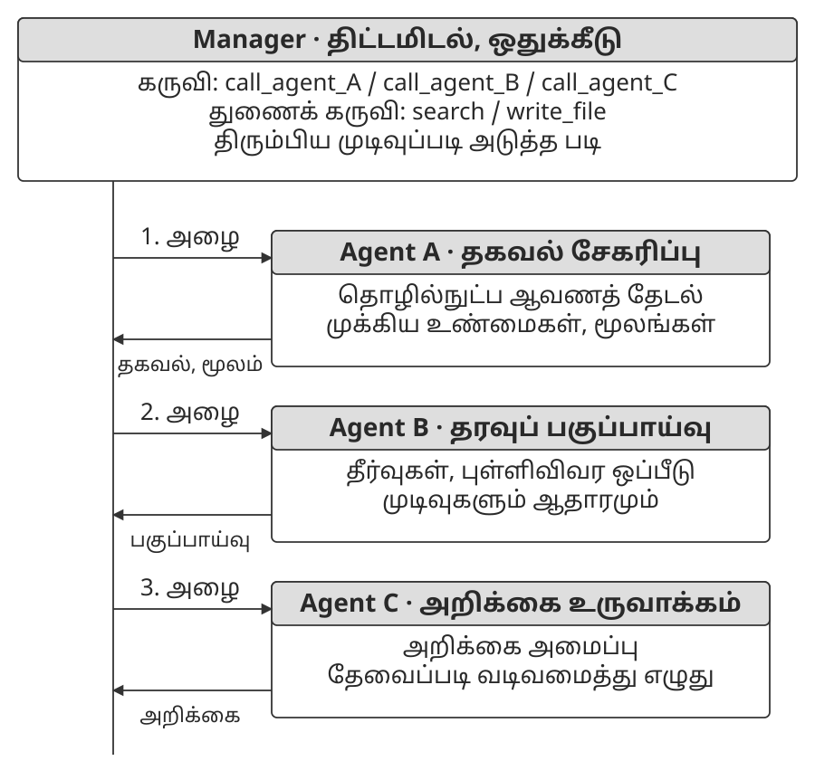

> **சோதனை 10-2 ★★: நூல் மொழிபெயர்ப்பு ஏஜெண்ட்**
>
> தொழில்நுட்ப நூல்களை மொழிபெயர்க்கும்போது கலைச்சொற்கள், சூழல், நடை ஆகியவற்றை ஒருசேரக் கையாள வேண்டும். எடுத்துக்காட்டாக, ஆங்கில agent-க்குப் பல மொழிபெயர்ப்புகள் இருக்கலாம்; சீன வரைவு "智能体" என்பதைப் பயன்படுத்துவதாக ஒப்புக்கொண்டால், அடுத்தடுத்த அத்தியாயங்களும் அதையே பின்பற்ற வேண்டும். கலைச்சொல் அட்டவணை, அத்தியாய மூல உரை, மொழிபெயர்ப்பு, சரிபார்ப்புப் பதிவுகள் ஆகியவற்றுக்குத் தெளிவான ஒழுங்கமைப்பு தேவை. ஒரு நீண்ட நூலும் அதனுடன் இடைநிலை வரைவுகள், கருவி முடிவுகள், சரிபார்ப்பு வரலாறு ஆகியவையும் தொடர்ந்து சூழலை நெருக்குகின்றன; ஒன்பதாம் அத்தியாயத்தை அடையும்போது இரண்டாம் அத்தியாயத்தின் மொழிபெயர்ப்பை மாதிரி மறந்துவிடலாம், அல்லது ஒரே பகுதியை மீண்டும் மீண்டும் சரிபார்க்கலாம். பணியைப் பொறுப்பு, அத்தியாயம் வாரியாகப் பிரித்தால், ஒவ்வொரு நிகழ்வும் நடப்புப் பொறுப்புக்குத் தேவையான பொருட்களில் மட்டும் கவனம் செலுத்தலாம்.
>
> வேலையை நான்கு வகை ஏஜெண்டுகளுக்குப் பகிரலாம்:
>
> - **Glossary Agent: கலைச்சொற்களை ஒழுங்கமைத்தல்.** நூல் முழுவதையும் தொகுதிகளாகப் படித்து, மீண்டும் மீண்டும் வரும் தொழில்நுட்பக் கலைச்சொற்களைக் கண்டறிந்து, தொழில்முறை அகராதிகளையும் மொழிபெயர்ப்பு நெறிமுறைகளையும் பார்த்து, ஆங்கிலக் கலைச்சொல், சீன மொழிபெயர்ப்பு, சொல்வகை, பயன்பாட்டுச் சூழல் ஆகியவற்றைக் கொண்ட JSON அல்லது CSV ஒப்பீட்டு அட்டவணையை உருவாக்குகிறது. கலைச்சொல் அட்டவணை பகிரப்பட்ட இடத்தில் சேமிக்கப்படுகிறது; பணி முடிந்ததும் அந்த நிகழ்வு விடுவிக்கப்படுகிறது.
> - **Translation Agent: அத்தியாயங்களை மொழிபெயர்த்தல்.** நடப்பு அத்தியாயம், தொடர்புடைய கலைச்சொற்கள், மொழிபெயர்ப்பு வழிகாட்டி ஆகியவற்றைப் படித்து, இலக்கு வாசகர்களுக்கும் மொழி நடைக்கும் ஏற்ப மொழிபெயர்ப்பை முடிக்கிறது. புதிதாகத் தோன்றும் கலைச்சொற்களுக்கு மாற்று மொழிபெயர்ப்புகளை முன்மொழிந்து, சரிபார்க்க வேண்டியவை எனக் குறிக்கிறது. ஒவ்வொரு நிகழ்வும் தனிச் சூழலைப் பராமரிக்கிறது; மொழிபெயர்ப்பு பகிரப்பட்ட இடத்தில் சேமிக்கப்படுகிறது; வெவ்வேறு அத்தியாயங்களைச் சார்புகளுக்கேற்பத் தொடராகவோ இணையாகவோ கையாளலாம்.
> - **Proofreading Agent: முழு உரையைச் சரிபார்த்தல்.** கலைச்சொல் அட்டவணையையும் ஒவ்வொரு அத்தியாய மொழிபெயர்ப்பையும் கொண்டு மொழிபெயர்ப்புத் தேர்வுகள், முன்பின் வெளிப்பாடுகள், வாசிப்புத் தன்மை ஆகியவற்றைச் சரிபார்க்கிறது. அத்தியாய வாரியான வாசிப்பு, அத்தியாயங்களுக்கு இடையிலான அட்டவணை மூலம் முழு உரைச் சரிபார்ப்பை நிறைவு செய்து, பிரச்சினையின் இடம், அடிப்படை, திருத்தத் தேவை ஆகியவற்றைச் சரிபார்ப்பு அறிக்கையில் எழுதுகிறது.
> - **Manager Agent: பணிகளை ஒதுக்குதலும் திரும்பப் பெறுதலும்.** இலக்கு, திட்டம், பணி நிலை, அழைப்புச் சுருக்கம், வெளியீட்டு அட்டவணை ஆகியவற்றைப் பராமரித்து, சரிபார்ப்பு அறிக்கையின் அடிப்படையில் திருத்த வேண்டிய அத்தியாயங்களை மொழிபெயர்ப்பாளரிடம் திருப்பி அனுப்பி, பின்னர் மறுசரிபார்ப்பை ஒழுங்கமைக்கிறது.
>
> படம் 10-5-இல், சரிபார்ப்பாளர் ஒவ்வொரு அத்தியாய மொழிபெயர்ப்பையும் கலைச்சொல் அட்டவணையையும் படிக்கிறது; எந்த அத்தியாயங்களைத் திருத்த வேண்டும் என்பதை Manager அறிக்கையின் அடிப்படையில் தீர்மானிக்கிறது. திருத்தப் பணியைப் பெற்ற மொழிபெயர்ப்பாளர் அந்த அத்தியாயத்தின் மூல உரையை எடுத்து, குறிக்கப்பட்ட சொல் அந்த வாக்கியத்தில் என்ன பொருள் தருகிறது என்று சரிபார்க்கலாம்.
>
> 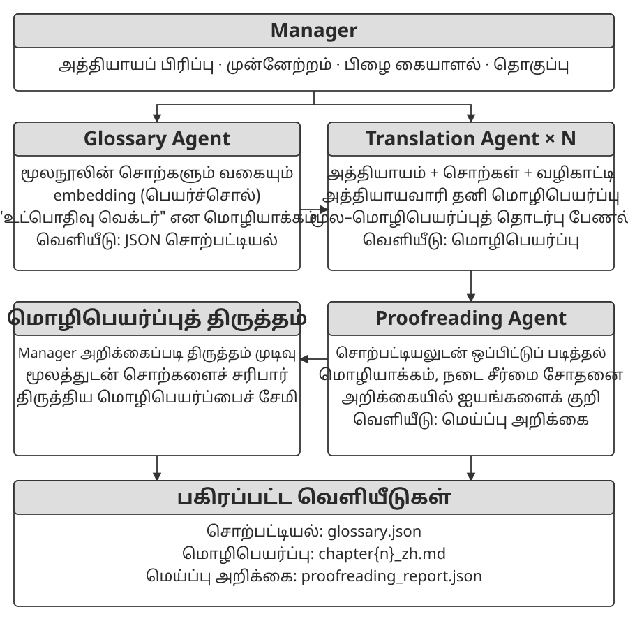
>
> மொழிபெயர்ப்பு வரைவைக் கோப்பில் எழுதிய பிறகு, எந்த அழைப்புக்கு இன்னும் நீண்ட உரையைப் படிக்க வேண்டியிருக்கிறது? துணைச் சோதனை, ஆங்கிலப் பதிப்பின் முதல் இரண்டு அத்தியாயங்களை 26 மொழிபெயர்ப்பு அலகுகளாகப் பிரிக்கிறது. ஒற்றை ஏஜெண்ட் முந்தைய மூல உரையையும் மொழிபெயர்ப்பையும் வழி முழுவதும் சுமந்து சென்றது; அதன் மிகப்பெரிய ஒரு கோரிக்கையின் உள்ளீடு 94,355 token. பணிப் பிரிவுக்குப் பிறகு, மொழிபெயர்ப்பாளரின் மிகப்பெரிய உள்ளீடு 2,857 token மட்டுமே; திருத்த முடிவை எடுக்கும்போது Manager 2,153 token பயன்படுத்தியது. மேலாளர் குழுவில் உண்மையில் அதிக உள்ளீடு கொண்டது கலைச்சொல் ஒழுங்கமைப்பாளர்: அது ஒரே முறையில் இரண்டு அத்தியாயங்களைப் படித்து 49,807 token பயன்படுத்தியது.
>
> இந்த இரண்டு அத்தியாயங்களையும் மொழிபெயர்த்து முடிக்க, நான்கு பாத்திரங்களும் சேர்ந்து 203,277 token பயன்படுத்தின; ஒற்றை ஏஜெண்ட் 1,317,808 token பயன்படுத்தியது. எந்தக் குழு முதலில் ஒப்படைத்தது? நான்கு-பாத்திரக் குழு சுமார் 271 வினாடிகள் எடுத்தது; ஒற்றை ஏஜெண்டை விடச் சுமார் 17 வினாடிகள் கூடுதல்.
>
> ஒப்படைக்கும்போது, இரண்டு சரிபார்ப்புகள் ஒரே மொழிபெயர்ப்புக்கு வெவ்வேறு முடிவுகளைத் தந்தன. கலைச்சொல் அட்டவணை `embedding` என்ற பெயர்ச்சொல்லுக்கு "嵌入向量" (embedding வெக்டர்) என்ற மொழிபெயர்ப்பைக் குறிப்பிட்டது. சரிபார்ப்பு அறிக்கை திருத்த வேண்டிய அத்தியாயம் எதையும் பட்டியலிடவில்லை; ஆனால் கலைச்சொல் சரிபார்ப்பு நிரல் இந்தச் சொல்லுக்கு 0/2 என்று பதிவு செய்தது: இரண்டு அத்தியாய வரைவுகளிலும் "嵌入" (பொதித்தல்) இருந்தது, "嵌入向量" இல்லை. இரண்டு அத்தியாயங்களையும் திருப்பி அனுப்ப வேண்டுமா?
>
> முதல் அத்தியாயத்தில் பணம் திருப்பித் தரும் கொள்கை பற்றிய பத்தியில், மூல உரை `embedding the refund policy in the context`; மொழிபெயர்ப்பு "将退款政策嵌入上下文中" (பணம் திருப்பித் தரும் கொள்கையைச் சூழலில் பொதித்தல்). இங்கே சொல்லப்படுவது கொள்கையைச் சூழலில் வைப்பது; "嵌入向量" என்று மாற்றினால் தவறாக்கிவிடும். நிரல் அத்தியாய வாரியாகச் சரங்களைத் தேடுகிறது; மறுசரிபார்ப்புக்கான தடயங்களைச் சரிபார்ப்பாளர் கண்டறிய அது உதவும். எந்த இடத்தைத் திருத்த வேண்டும் என்று தீர்மானிக்க, சரிபார்ப்பாளருக்கு அந்தப் பத்தியின் மூல உரையும் தேவை. கலைச்சொல் அட்டவணை புதுப்பிக்கப்படும்போதும், முதலில் பாதிக்கப்பட்ட பத்திகளைக் கண்டறிந்து, பின்னர் மூல உரை, மொழிபெயர்ப்பு, புதிய பதிவு ஆகியவற்றை ஒன்றாக மொழிபெயர்ப்பாளரிடம் ஒப்படைக்கலாம்.
>
> **சோதனைத் தேவைகள்:**
> 1. வரைபடங்களும் குறியீடும் கொண்ட ஒரு தொழில்நுட்ப நூலைத் தேர்ந்தெடுங்கள்.
> 2. Manager, Glossary, Translation, Proofreading என நான்கு வகை ஏஜெண்டுகளைச் செயல்படுத்துங்கள்.
> 3. ஒவ்வொரு உறுப்பினரின் சூழல் பயன்பாடு, ஒப்படைப்புப் பொருட்கள், வெளியீட்டுப் பதிப்புகள் ஆகியவற்றைப் பதிவு செய்யுங்கள்.
> 4. ஒற்றை ஏஜெண்ட் தீர்வுடன் மொழிபெயர்ப்புத் தரம், நிறைவு நேரம், வள நுகர்வு ஆகியவற்றை ஒப்பிட்டு, பணிப் பிரிப்பும் சூழல் ஒழுங்கமைப்பும் ஏற்படுத்தும் தாக்கத்தைப் பகுப்பாய்வு செய்யுங்கள்.

**இணை ஒருங்கிணைப்பு.** ஒன்றையொன்று சாராத துணைப் பணிகளை ஒரே நேரத்தில் செயல்படுத்தலாம். பணிகளை ஒதுக்குவது, நிலையைப் பெறுவது, முடிவுகளின் அடிப்படையில் தொடர்வதா, கூடுதல் வேலை சேர்ப்பதா, முடிப்பதா என்று தீர்மானிப்பது Manager-இன் பொறுப்பு. இந்த நூலை மொழிபெயர்க்கும்போது, கலைச்சொல் அட்டவணை உறுதிசெய்யப்பட்டதும், வெவ்வேறு அத்தியாயங்களைப் பல மொழிபெயர்ப்பாளர்களுக்குப் பகிர்ந்து ஒரே நேரத்தில் தொடங்கலாம். படம் 10-6 ஓர் ஆய்வு அறிக்கைக்கு மாறுகிறது: வரைபடங்கள் முடிந்துவிட்டன, பகுப்பாய்வு இன்னும் நடக்கிறது; வடிவச் சரிபார்ப்பு ஏன் இன்னும் காத்திருக்க வேண்டும்? உறுப்பினர்கள் தெரிவிக்கும் நிகழ்வுகளைப் பின்தொடர்ந்தால், கடைசிப் படி எந்த இரண்டு வெளியீடுகளைச் சார்ந்துள்ளது என்பது தெரியும்.

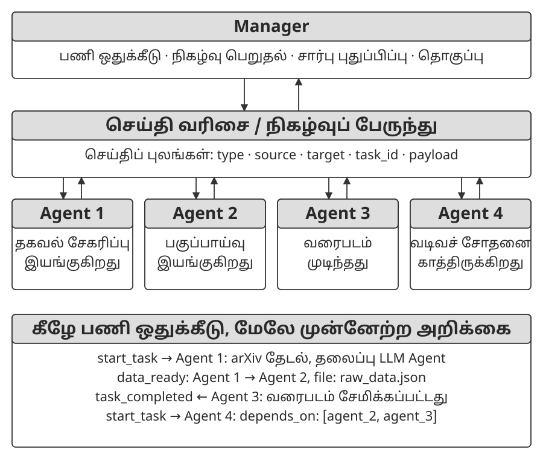

இத்தகைய ஒத்திசைவற்ற தொடர்பாடலை ஒழுங்கமைக்கச் செய்திப் பேருந்து பொருத்தமானது: உறுப்பினர்கள் முன்னேற்றத்தையும் முடிவுகளையும் வெளியிடுகின்றன, மேலாளர் அதற்கான நிகழ்வுகளுக்குச் சந்தா செய்கிறது, இயக்க நேரம் வழங்குதல், இடையகம், மறுமுயற்சி ஆகியவற்றுக்குப் பொறுப்பாகிறது.

> **தயாரிப்பு எடுத்துக்காட்டு: Lingtai (灵台)**
>
> Lingtai உள்ளூரில் இயங்கும், கோப்புகள் வழியாக அடையாளத்தையும் நினைவகத்தையும் சேமிக்கும் ஒரு நீண்டகால ஏஜெண்ட் அமைப்பு. அது மூன்று பாத்திரங்களை வழங்குகிறது: முதன்மை ஆன்மா (主器灵, main agent) பயனருடன் உரையாடி, திட்டங்களையும் நினைவகத்தையும் நிர்வகிக்கிறது; பிரிமனம் (分神, daemon) வரம்பு தெளிவான குறுகியகால இணைப் பணிகளை ஏற்று, முடிந்ததும் முடிவைத் திருப்பித் தருகிறது; பிரதிவடிவம் (分身, avatar) தனது சொந்த நினைவகம், அஞ்சல்பெட்டி, பொறுப்புகளை வைத்துக்கொண்டு, அமர்வுகளைக் கடந்த சிறப்புப் பணிப் பிரிவுக்குப் பயன்படுகிறது.
>
> ஒவ்வொரு பாத்திரத்துக்கும் தனிப்பட்ட நீடித்த அறிவு உண்டு; Markdown வடிவிலான திறன் கையேடுகள் பகிரப்படுகின்றன. சூழல் கொள்ளளவு வரம்பை நெருங்கும்போது, பாத்திரம் "தோலுரித்தல்" (凝蜕, molt) மூலம் சுருக்கத்தைச் சேமித்து, நீடித்த நினைவகத்துடன் இணைந்து புதிய சூழலுக்குள் நுழைகிறது. அடையாளம், நினைவகம், திறன்கள் ஆகியவை கோப்புகளில் தனியாகச் சேமிக்கப்படுவதால், அடிப்படை மாதிரியை மாற்றிய பிறகும் வேலையைத் தொடர முடிகிறது. இந்த வடிவமைப்பு மேலாளர், குறுகியகாலப் பணியாளர், நீண்டகாலச் சிறப்பு உறுப்பினர், சூழல் சுருக்கம் ஆகியவற்றை ஒன்றிணைக்கிறது.

> **சோதனை 10-3 ★★★: தானாக ஒழுங்கமைக்கும் தொலைபேசி + கணினி ஏஜெண்ட்**
>
> இந்தச் சோதனை அத்தியாயம் 6-இன் Computer Use-ஐயும் குரல் ஊடாட்டத்தையும் இணைக்கிறது. பயனர் ஒரு பதிவுப் பக்கத்தையோ விமான முன்பதிவுப் பக்கத்தையோ வழங்குகிறார்; Computer Agent இணையதளத்தைத் திறந்து, படிவத்தை அடையாளம் கண்டு, பின்னர் Phone Agent வழியாக இப்போது விடுபட்டுள்ள பெயர், அடையாள ஆவண எண், தொடர்பு விவரங்கள், முகவரி, விருப்பங்கள் போன்ற புலங்களைச் சேகரிக்கிறது.
>
> **பாத்திரங்களும் ஒப்படைப்பும்.** Computer Agent உலாவியை இயக்கி, இந்த முறை ஒழுங்கமைப்புக்குப் பொறுப்பேற்கிறது; Phone Agent ASR, LLM, TTS வழியாகப் பயனருடன் நிகழ்நேரத்தில் உரையாடி, வாய்மொழிப் பதில்களைக் கட்டமைக்கப்பட்ட புலங்களாக மாற்றுகிறது. இரண்டும் புள்ளிக்குப் புள்ளிக் கருவிகள் அல்லது செய்திப் பேருந்து வழியாகத் தொடர்புகொள்கின்றன; செய்தியில் அனுப்புநர், பெறுநர், வகை, உள்ளடக்கம் ஆகியவை இருக்கும். Computer Agent தொலைபேசிப் பணியை நேரடியாக ஒப்படைத்து, மேலாளர் பொறுப்பை ஏற்கலாம். பயனர் குரல் வழியாகத் தகவல் வழங்க விரும்பும்போது, Phone Agent தொடர்ந்து கேட்கவும், உறுதிசெய்யவும், மீண்டும் கேட்கவும் செய்யலாம்; Computer Agent பக்க நிலையிலும் புலங்களை நிரப்புவதிலும் கவனம் செலுத்துகிறது.
>
> **இரண்டு இயக்க முறைகள்.** நிலையான முறை இரண்டு ஏஜெண்டுகளையும் முன்கூட்டியே தொடங்குகிறது; ஒவ்வொன்றும் தனி இயக்கச் சுழற்சியைப் பராமரிக்கிறது; இருவழித் தொடர்பாடலையும் ஒரே நேர நடத்தையையும் சரிபார்க்க இது பயன்படுகிறது. தன்னாட்சி முறை முதலில் Computer Agent-ஐத் தொடங்குகிறது; பக்கம், ஏற்கெனவே உள்ள தகவல், பணித் தேவை ஆகியவற்றின் அடிப்படையில் `initiate_phone_call_agent(purpose, required_info)`-ஐ அழைப்பதா என்பதை மாதிரி தீர்மானிக்கிறது. பின்னர் இயக்க நேரம் பணியின் நோக்கம், சேகரிக்க வேண்டிய புலங்கள், வடிவக் கட்டுப்பாடுகள் ஆகியவற்றை Phone Agent-இடம் ஒப்படைக்கிறது; தொடங்கிய பிறகு அதே தொடர்பாடல் செயல்முறையைப் பயன்படுத்துகிறது.
>
> **புலம் புலமாக ஓட்டம்.** படம் 10-7-இல், Phone Agent WebRTC வழியாகக் கேள்வி கேட்டு, பதிலைப் பிரித்தெடுத்துச் சரிபார்த்து, செல்லுபடியான மதிப்பைப் பெற்றதும் `info_collected`-ஐ அனுப்பி, பின்னர் அடுத்த உருப்படியைக் கேட்கிறது. Computer Agent அதே நேரத்தில் பக்கத்தைப் படித்து, முந்தைய உருப்படியை நிரப்பி, `fill_error`-ஐயோ புதிய பக்க நிலையையோ திருப்பி அனுப்புகிறது. வடிவம் பொருந்தாத பின்னூட்டம் `format_invalid` மூலம் புலத்தையும் தேவையையும் குறிக்கிறது; Phone Agent அதன்படி உறுதிசெய்கிறது அல்லது மீண்டும் கேட்கிறது. இவ்வாறு, "அடுத்ததைக் கேட்பதும்" "முந்தையதை நிரப்புவதும்" ஒன்றின்மேல் ஒன்றாக நடக்கலாம்.
>
> **நிறைவும் விதிவிலக்குக் கையாளுதலும்.** Phone Agent புலங்களைச் சேகரித்து முடித்ததும் `task_completed`-ஐ அனுப்புகிறது; இது தகவல் சேகரிப்புத் துணைப் பணி முடிந்ததைக் குறிக்கிறது. Computer Agent கட்டாயப் புலங்கள், பக்கச் சரிபார்ப்பு முடிவுகள், சமர்ப்பிப்பு அங்கீகாரம் ஆகியவற்றைத் தொடர்ந்து சரிபார்த்து, பின்னர் படிவச் செயலை நிறைவு செய்கிறது. மறுமுயற்சி எண்ணிக்கையைக் கடந்தால், பக்க விதிவிலக்கை எதிர்கொண்டால், அல்லது பயனர் நிறுத்தக் கோரினால், பணியை இடைநிறுத்தி நடப்பு முன்னேற்றத்தை விளக்குகிறது; முடிக்கும்போது இன்னும் இயங்கும் எதிர்த் தரப்பை ரத்து செய்து, உலாவி அமர்வு, ஒலித் தடங்கள், அழைப்பு ஆகியவற்றை மூடுகிறது. உண்மையான மனிதருடனான குரல் ஊடாட்டத்துக்கும் படிவச் சமர்ப்பிப்புக்கும் முறையே பயனரின் ஒப்புதலும் அங்கீகாரமும் பெறப்பட வேண்டும்.
>
> 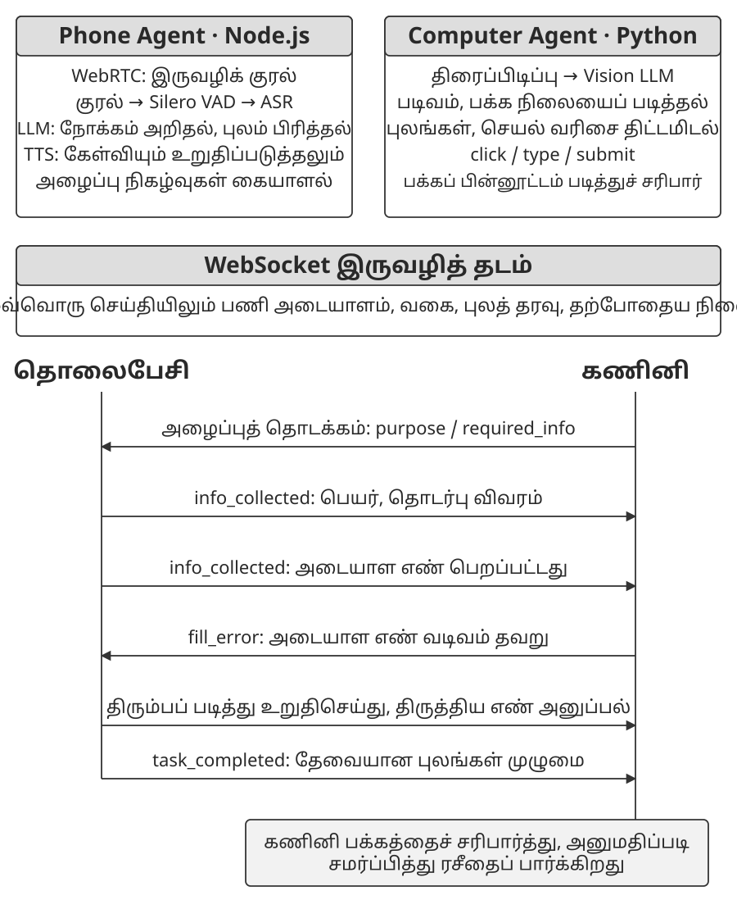
>
> **சோதனைத் தேவைகள்:**
> 1. இரண்டு தனி ஏஜெண்டுகளையும் இருவழிக் கட்டமைக்கப்பட்ட தொடர்பாடலையும் செயல்படுத்துங்கள்.
> 2. நிலையான முறையிலும் தன்னாட்சி முறையிலும் நேர வரிசையைப் பதிவு செய்து, கேட்பதும் நிரப்புவதும் ஒன்றின்மேல் ஒன்றாக நடக்கும் இடைவெளிகளைச் சரிபாருங்கள்.
> 3. வடிவச் சரிபார்ப்பு, மீண்டும் கேட்டல், பக்கப் பிழைப் பின்னூட்டம், காலாவதி, வளச் சுத்திகரிப்பு ஆகியவற்றைச் செயல்படுத்துங்கள்.
> 4. இரு முறைகளின் தொடக்க முடிவுகள், தாமதம், வெற்றி விகிதம், வள நுகர்வு ஆகியவற்றை ஒப்பிடுங்கள்.

> **சோதனை 10-4 ★★★: பல இணையதளங்களிலிருந்து ஒரே நேரத்தில் தகவல் சேகரிக்கும் ஏஜெண்ட்**
>
> இந்தச் சோதனை ஒரே அமைப்புள்ள பல ஏஜெண்டுகளைக் கொண்டு இணையாகத் தேடி, அத்தியாயம் 6-இன் நிகழ்வு உந்துதல், குறுக்கீட்டுச் செயல்முறைகளைப் பயிற்சி செய்கிறது. ஒரு பல்கலைக்கழகத்தின் பல கல்லூரி இணையதளங்களில் குறிப்பிட்ட ஆசிரியரை, எடுத்துக்காட்டாக "张伟"-ஐத் தேடி, கல்லூரி, பதவி, ஆய்வுத் துறை, மூலப் பக்கம் ஆகியவற்றைத் திருப்பித் தருவதே பணி. ஒரே பெயருடைய நபர்களை வேறுபடுத்த, தேடுவதற்கு முன் பெயர், துறை, தனிப்பட்ட முகப்புப் பக்கத் தகவல் போன்ற அடையாள நிபந்தனைகளை ஒப்புக்கொள்ள வேண்டும்.
>
> **1. இணையாகத் தொடங்குதல்.** Manager 10 Computer Use Agent-களை உருவாக்குகிறது; ஒவ்வொன்றும் ஒரு கல்லூரி இணையதளத்துக்குப் பொறுப்பு. ஒவ்வொரு நிகழ்வும் தனிச் சூழலையும் உலாவி அமர்வையும் பராமரிக்கிறது; ஒத்திசைவற்ற பணிகள், இழைகள் அல்லது செயல்முறைகள் மூலம் திட்டமிடலாம். உள்ளீட்டில் இணையதள URL, இலக்குப் பெயர், பொருத்த நிபந்தனைகள், வழிச்செலுத்தலுக்கான பணி அடையாளம் ஆகியவை அடங்கும்.
>
> **2. முன்னேற்றத் தொகுப்பு.** உறுப்பினர்கள் "இணையதளத்தை ஏற்றுகிறது", "ஆசிரியர் பட்டியலைப் படிக்கிறது", "சரிபார்க்கப்பட்டது, பொருத்தம் இல்லை", "ஒரே பெயருடைய ஆசிரியர் கண்டறியப்பட்டார்" போன்ற நிலைகளை அவ்வப்போது அனுப்புகின்றன. Manager செய்திப் பேருந்து வழியாகப் பணி அட்டவணையைப் பராமரித்து, இயங்குகிறது, முடிந்தது, தடைப்பட்டது, தோல்வியடைந்தது என்பவற்றைத் தனித்தனியாகப் பதிவு செய்து, மூலங்களையும் பிழைக் காரணங்களையும் வைத்திருக்கிறது.
>
> **3. சரிபார்த்த பிறகு மற்ற கிளைகளை ரத்து செய்தல்.** இயற்பியல் கல்லூரிக்குப் பொறுப்பான `agent_3` ஒரே பெயருடைய ஓர் ஆசிரியரைக் கண்டறிந்தால், அது `target_found`-ஐ அனுப்புகிறது; சுமையில் ஆசிரியர் தகவலும் மூலமும் இருக்கும். சரிபார்க்கப்பட்ட நபர் விவரங்களைத் திருப்பித் தருமாறு பணி கோரினால், Manager முதலில் பொருத்த நிபந்தனைகளையும் ஆதாரங்களையும் சரிபார்த்து, இலக்கு நபர் கண்டறியப்பட்டதை உறுதிசெய்த பிறகு, அணுநிலைச் செயல்பாட்டால் முடிவைப் பதிவு செய்து, பின்னர் இயங்கும் மற்ற உறுப்பினர்களுக்கு `terminate`-ஐ அனுப்பி, ஏற்கப்பட்ட விவரங்கள் `agent_3`-இலிருந்து வந்தவை என்று குறிப்பிட வேண்டும். உறுப்பினர்கள் பாதுகாப்பான புள்ளியில் நின்று, வளங்களைச் சுத்தம் செய்து, ஒப்புதலைத் திருப்பி அனுப்புகின்றன; Manager ஒப்புதலுக்காகவோ காலாவதிக்காகவோ காத்திருந்து, தொகுப்பை நிறைவு செய்கிறது. ஒரே பெயருடைய எல்லா நபர்களையும் பட்டியலிடுமாறு பணி கோரினால், தேவையான வரம்பு முழுவதும் சரிபார்க்கப்படும் வரை தேடல் தொடர்கிறது.
>
> **போட்டி நிலைமை (race condition).** Agent A-வும் B-யும் கிட்டத்தட்ட ஒரே நேரத்தில் செல்லுபடியான முடிவுகளைத் திருப்பித் தரலாம். இரண்டு நிகழ்வுகளும் தனித்தனியாகத் தொகுப்பைத் தூண்டினால், மீண்டும் வழங்குதலோ நிலை மோதலோ ஏற்படும். "தேடுகிறது → முடிவு பதிவாகிவிட்டது" என்ற நிலை மாற்றத்தைப் பூட்டு அல்லது பரிவர்த்தனையால் பாதுகாத்து, பின்னர் வரும் நிகழ்வு ஏற்கெனவே பதிவான முடிவைப் படிக்கச் செய்யலாம். செய்தி மறுமுயற்சிகளையும் நிகழ்வு அடையாளத்தின்படி நகல் நீக்க வேண்டும்; இதனால் ரத்தும் தொகுப்பும் மீண்டும் தூண்டப்பட்டாலும் நிலை சீராக இருக்கும்.
>
> **4. விதிவிலக்குகளும் உள்ளடக்க வரம்பும்.** வலையமைப்புத் துண்டிப்பு, பக்கக் கட்டமைப்பு மாற்றம், பகுப்பாய்வுப் பிழைகள் ஆகியவற்றைத் தனித்தனியாகப் பதிவு செய்ய வேண்டும். ஒவ்வொரு பணிக்கும் இரண்டு நிமிடம் போன்ற காலாவதி வரவுசெலவை அமைக்கலாம்; காலாவதியானதும் செயலாக்கத்தை ரத்து செய்து கண்டறிதல் தகவலைச் சேகரிக்கலாம்; மற்ற உறுப்பினர்கள் தொடர்ந்து வேலை செய்யும். இறுதி அறிக்கை "சரிபார்க்கப்பட்டது, கண்டறியப்படவில்லை" என்பதையும் "அணுகல் தோல்வி, சரிபார்ப்பு இன்னும் முடியவில்லை" என்பதையும் வேறுபடுத்தி, உள்ளடக்கப்பட்ட கல்லூரிகளின் வரம்பையும் விளக்குகிறது.
>
> படம் 10-8 ஒரு மாதிரி நேர வரிசையைக் கொண்டு இந்தச் செய்திகளை இணைக்கிறது. இயற்பியல் கல்லூரியில் குவாண்டம் கணினியியலை ஆராயும் 张伟 என்ற பேராசிரியர் இருப்பதாக உறுப்பினர் 3 அறிவிக்கிறது என்று வைத்துக்கொள்வோம்; மூல இணையப் பக்கம் பெயர், துறை, பதவி, ஆய்வுத் திசை ஆகியவற்றை உறுதிப்படுத்துகிறதா என்று Manager முதலில் பார்க்க வேண்டும். ஒரே பெயருடைய ஆசிரியரைப் பற்றிய தடயத்தைப் பெறுவது, அவர் இலக்கு நபர் என்று உறுதிசெய்வது, ரத்து ஒப்புதல்களை முழுமையாகப் பெறுவது ஆகியவை மூன்று வெவ்வேறு தருணங்கள்.
>
> 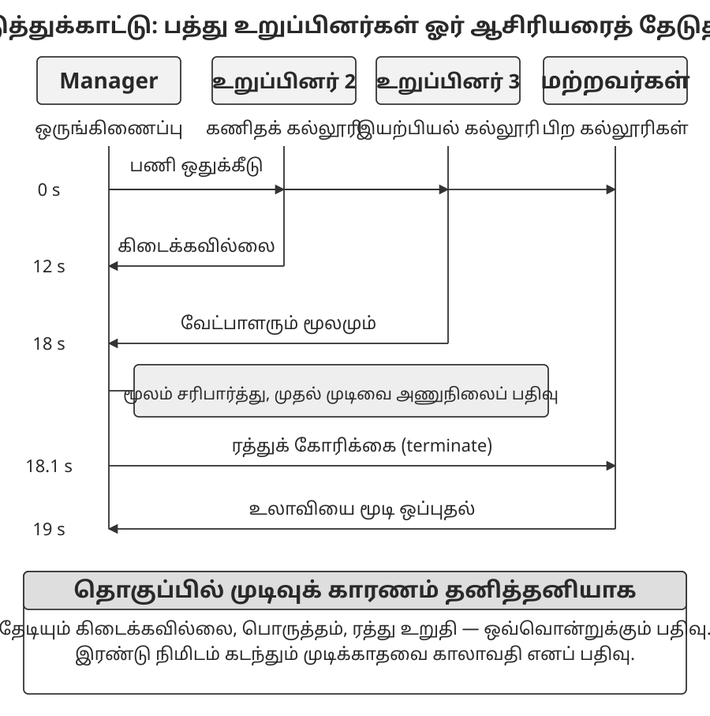
>
> உண்மையான இயக்கத்தில் தேடப்பட்டவர் Andrew Ng. உறுப்பினர்கள் முதலில் பக்க உரையில் இந்தப் பெயர் உள்ளதா என்று பார்க்கின்றன; பொருந்தினால் மட்டுமே விவரங்களைப் பிரித்தெடுக்க மாதிரியைக் கோருகின்றன. Stanford HAI பக்கம் தேர்ந்தெடுக்கப்பட்டது; திருப்பித் தரப்பட்ட சிறு மேற்கோள் பெயரையும் இணைப் பேராசிரியர் (adjunct professor) என்ற அடையாளத்தையும் சரிபார்க்க உதவியது. ஆய்வுத் துறையைச் சரிபார்க்க, பக்கத்தின் பின்பகுதியில் ஆழ்கற்றல் பற்றிப் பேசும் பத்தியையும் படிக்க வேண்டும். பல உறுப்பினர்கள் ஒரே நேரத்தில் `target_found`-ஐ அனுப்பினாலும், முதலில் பூட்டைப் பெறும் உறுப்பினர் மட்டுமே முடிவைப் பதிவு செய்ய முடியும்.
>
> இம்முறை தொடர் தேடல் பத்து இணைய முகவரிகளில் கடைசியானதில்தான் பொருந்தியது; 44.971 வினாடிகள் ஆயின. அதே தொகுதி இணையப் பக்கங்களை இணையாகத் தேட 24.022 வினாடிகள் ஆயின; இரு இயக்கங்களிலும் பத்து உலாவிச் சூழல்களும் மூடப்பட்டன. இரண்டு எண்களின் விகிதம் 1.872. HAI பக்கத்தை முதலில் வைத்திருந்தால், தொடர் தேடல் பொருந்தியவுடன் நின்றுவிடும்; நேரத்தை மீண்டும் அளக்க வேண்டியிருக்கும். ரத்தைச் சரிபார்ப்பதற்கென்றே நடத்திய இன்னோர் இயக்கம் நான்கு கிளைகளைத் தொடங்கியது: ஒரு கிளை முதலில் முடிவைப் பதிவு செய்தது, மற்ற மூன்றும் ரத்துக் கோரிக்கையைப் பெற்றதை உறுதிசெய்தன, இறுதியில் நான்கு உலாவிச் சூழல்களும் மூடப்பட்டன.
>
> **சோதனைத் தேவைகள்:**
> 1. இணை உறுப்பினர்களை இயங்குநிலையில் உருவாக்கும் Manager-ஐச் செயல்படுத்துங்கள்.
> 2. browser-use போன்ற திட்டங்களைப் பயன்படுத்தி உலாவிச் செயலாக்கத் திறனை உருவாக்குங்கள்.
> 3. செய்திப் பேருந்து வழியாக இருவழித் தொடர்பாடலையும் நிலைப் பராமரிப்பையும் நிறைவு செய்யுங்கள்.
> 4. தேடல் முடிவுகளைச் சரிபார்த்து, அணுநிலைச் செயல்பாட்டால் முடிவைப் பதிவு செய்து, மீதமுள்ள கிளைகளை ரத்து செய்த பிறகு ஒப்புதல்களைச் சேகரியுங்கள்.
> 5. அணுகல் தோல்வி, பகுப்பாய்வுப் பிழை, காலாவதி, பொருத்தம் இல்லாமை போன்ற நிலைகளைக் கையாளுங்கள்.
> 6. இணை, தொடர் செயலாக்கங்களின் நிறைவு நேரம், உள்ளடக்க வரம்பு, வள நுகர்வு ஆகியவற்றை ஒப்பிடுங்கள்.

**மேலாளர் உருவாக்கும் பணிச்செயல்முறை.** ஒவ்வொரு முறையும் ஒப்படைப்பதற்குப் பதிலாக, Manager முதலில் பணிச் சார்புகளையும் தொகுப்பு விதிகளையும் ஒரு நிரலாக எழுதி, பின்னர் இயக்க நேரத்திடம் திட்டமிட ஒப்படைக்கலாம். மாதிரி செயல்முறையை வடிவமைக்கிறது; நிரல் ஒப்பந்தப்படி உறுப்பினர்களைத் தொடங்கி, முடிவுகளைக் கடத்தி, சார்புகளுக்காகக் காத்திருக்கிறது. சார்பு உறவுகள் ஏற்கெனவே தெளிவாகவும், ஒரே வகைச் செயல்முறை மீண்டும் மீண்டும் இயங்க வேண்டியதாகவும் இருக்கும்போது, இந்த முறைக்கு நான் முன்னுரிமை தருகிறேன். ஒவ்வொரு ஒப்படைப்புக்கும் Manager-ஐ அழைக்கும் செலவை இது தவிர்க்கிறது; மேலாண்மைச் சூழலில் குவியும் திட்டமிடல் பதிவுகளையும் குறைக்கிறது.

Claude Code-இன் இயங்குநிலை Workflow கருவி இத்தகைய செயலாக்கத்தை வழங்குகிறது. `agent()` தனிச் சூழல் கொண்ட துணை ஏஜெண்டை உருவாக்குகிறது; கட்டமைக்கப்பட்ட வெளியீட்டை schema மூலம் வரையறுக்கலாம்; `parallel()` ஒரு தொகுதிப் பணிகளை ஒரே நேரத்தில் இயக்கி, அனைத்தும் முடியும் வரை காத்திருக்கிறது; `pipeline()` ஒவ்வொரு உள்ளீட்டையும் தனித்தனியாகப் பல கட்டங்கள் வழியே கடத்துகிறது; ஓர் உருப்படி அடுத்த கட்டத்துக்குச் செல்லும்போது, மற்ற உருப்படிகள் முந்தைய கட்டத்தில் இன்னும் கையாளப்படலாம். இடைநிலை முடிவுகள் நிரல் மாறிகளில் சேமிக்கப்படுகின்றன; வடிகட்டலும் இணைத்தலும் சாதாரணக் குறியீட்டின் மூலம் நிறைவேற்றப்படுகின்றன.[^dynamic-workflows]

எடுத்துக்காட்டாக, ஒரு தொழில்நுட்பக் கட்டுரையில் உள்ள ஏழு தொகுதி உண்மைகளைச் சரிபார்க்கும்போது, முதலில் திசைவாரியாக ஆய்வு ஏஜெண்டுகளைத் தொடங்கி, பின்னர் ஒவ்வொரு தொகுதி முடிவையும் சரிபார்ப்பு ஏஜெண்டுகளிடம் இணையாகச் சரிபார்க்க ஒப்படைக்கலாம். திருப்பித் தரப்படும் ஒவ்வொரு முடிவும் மூலத்தையும் தீர்ப்பின் அடிப்படையையும் வைத்திருக்கிறது; எல்லாக் கிளைகளும் முடிந்த பிறகு, தொகுப்பு ஏஜெண்ட் இறுதி அறிக்கையை ஒழுங்கமைக்கிறது. இவ்வாறு, "ஆய்வு—ஒவ்வொன்றாகச் சரிபார்ப்பு—ஒருங்கிணைந்த தொகுப்பு" என்ற பணிப் பிரிவும் கட்டச் சார்புகளும் பணிச்செயல்முறையிலேயே எழுதப்படுகின்றன.

[^dynamic-workflows]: Anthropic, “Orchestrate subagents at scale with dynamic workflows”, 2026.

### மையமற்ற முறை

Manager இருக்கும்போது, யாரை அணுகுவது என்பதை உறுப்பினர்களே ஏன் தீர்மானிக்க வேண்டும்? இப்போதுதான் எழுதப்பட்ட ஒரு தொகுதியைச் சோதனையாளர் பெற்று, தயாரிப்புத் தேவையும் இடைமுக ஒப்பந்தமும் ஒரே புலத்துக்கு இரண்டு விளக்கங்களைத் தருவதைக் கண்டறிகிறார் என்று கற்பனை செய்யுங்கள். சோதனையாளர் இந்த முரண்பாட்டை நேரடியாகத் தயாரிப்பு, கட்டமைப்பு ஆகிய இரு பாத்திரங்களிடமும் கொண்டுசென்று, இரு தரப்பும் தத்தம் அடிப்படையைத் தெளிவுபடுத்தச் செய்து, ஒப்பந்தம் திருத்தப்பட்ட பிறகு சோதனையைத் தொடரலாம். இது வேலைப் பிரிவு மட்டுமல்ல, ஒருவகைச் சமநிலைக் கட்டுப்பாடும் கூட. பொறியாளர் தொகுதியை வழங்குவதும், கட்டமைப்பாளர் தயாரிப்புக் கருத்தைக் கேட்பதும், சோதனையாளர் ஆட்சேபனை எழுப்புவதும்—ஒவ்வொருவரும் அடுத்த படியைத் தொடங்க முடியும். அடிக்கடி கலந்தாலோசிக்க வேண்டியிருக்கும்போது, ஒவ்வொன்றுக்கும் Manager இடைநின்று தெரிவிக்கும் வரை காத்திருப்பது வேலையைத் தாமதப்படுத்தும்.

மைக்ரோசேவைகளின் சொல்வழக்கைக் கடன் வாங்கினால், ஒரு மையம் படிகளை ஏற்பாடு செய்வது **ஒருங்கிசைப்பு** (orchestration); ஒவ்வொரு தரப்பும் ஒப்புக்கொண்ட நிகழ்வுகளின்படி தானாக அடுத்ததைத் தொடர்வது **நடன அமைப்பு** (choreography). இன்னொரு நடைமுறை வேறுபாடும் உண்டு: ஒவ்வொரு ஒப்படைப்பும் Manager-க்காகக் காத்திருக்க வேண்டுமென்றால், அதன் மாதிரிச் சேவை பதிலளிப்பதை நிறுத்தியவுடன், மற்ற உறுப்பினர்கள் இன்னும் வேலை செய்ய முடிந்தாலும் அடுத்த பணியைப் பெற முடியாது. பரவலான ஒருங்கிணைப்பு இத்தகைய சார்பைக் குறைக்கும்; ஆனால் பொறுப்பேற்க வேண்டிய உறுப்பினரே ஒரு கருவி அழைப்பில் சிக்கிக்கொண்டால், எங்கிருந்து தொடர்வது என்பதை இன்னோர் உறுப்பினர் அறிய, நீடித்துச் சேமிக்கப்பட்ட பணி நிலை, காலாவதி, மறுமுயற்சி, பொறுப்பேற்பு செயல்முறைகள் இன்னும் தேவை.

கீழே உள்ள மூன்று வடிவமைப்புகள் ஒவ்வொன்றுக்கும் ஓர் ஒப்படைப்பு முறை உண்டு: வெளியீட்டின்படி செய்திகளுக்குச் சந்தா செய்தல், குழு அரட்டையில் அடுத்துப் பேசுபவரைத் தேர்ந்தெடுத்தல், அல்லது நடப்பு உறுப்பினர் பெயர் சுட்டி ஒப்படைத்தல்.

**MetaGPT: SOP மூலம் வெளியீட்டு ஒப்படைப்பை ஒழுங்கமைத்தல்.** MetaGPT மென்பொருள் குழுவின் நிலையான செயல்பாட்டு நடைமுறையின் (SOP) படி வேலையைப் பிரிக்கிறது. தயாரிப்பு மேலாளர் தேவை ஆவணத்தை (PRD) வழங்குகிறார், கட்டமைப்பாளர் வடிவமைப்பு ஆவணத்தை வழங்குகிறார், பொறியாளர் குறியீட்டை வழங்குகிறார், சோதனையாளர் சோதனை அறிக்கையை வழங்குகிறார். அடுத்த உறுப்பினர் ஒப்புக்கொண்ட பொருட்களைப் பெற்றதும் வேலையைத் தொடங்கலாம்; முந்தையவரும் பணியை மீண்டும் மீண்டும் விளக்க வேண்டியதில்லை. படம் 10-9-இல் உள்ள இணைப்புக் கோடுகள் இந்த வெளியீடுகளின் ஒப்படைப்பு உறவுகளைக் குறிக்கின்றன.[^metagpt-design]

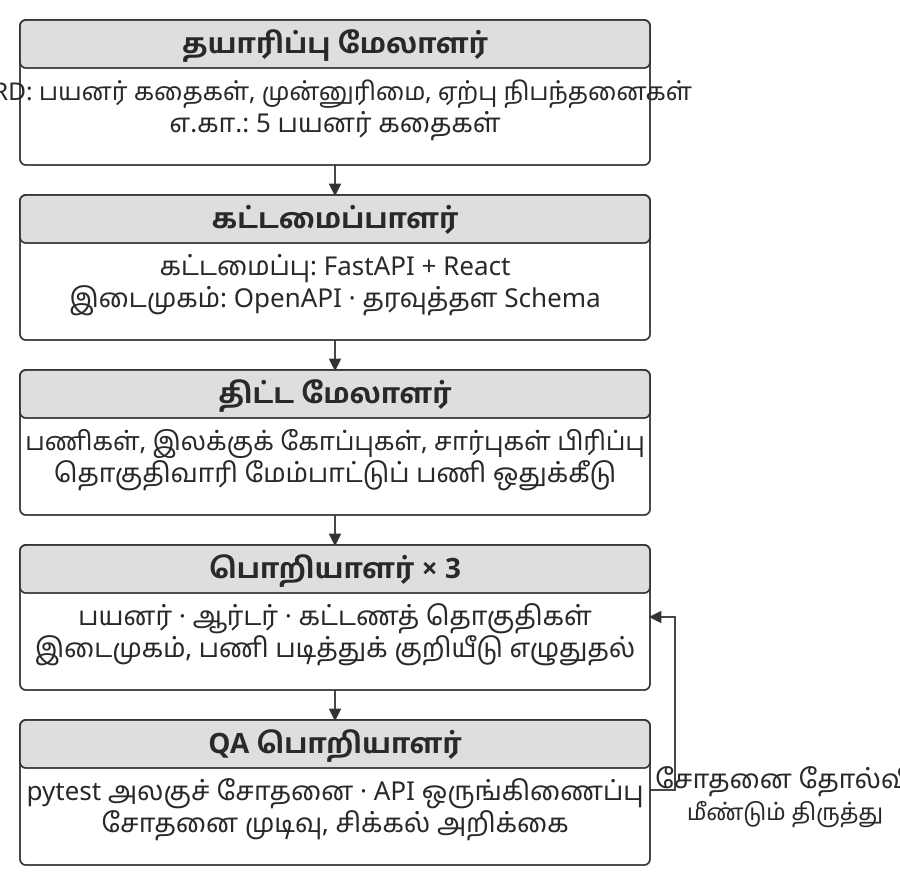

ஒப்படைக்கும்போது ஒவ்வொரு பாத்திரமும் எந்தத் தகவலை நிறைவு செய்ய வேண்டும்?

- **Product Manager Agent** தேவைகளைப் பெற்று, PRD-ஐ ஒழுங்கமைத்து, அம்சங்கள், பயனர் கதைகள், ஏற்புத் தரநிலைகள், முன்னுரிமைகள் ஆகியவற்றைத் தெளிவுபடுத்துகிறது.
- **Architect Agent** PRD-ஐப் படித்து, தொழில்நுட்ப அடுக்கைத் தேர்ந்தெடுத்து, தொகுதிகளைப் பிரித்து, இடைமுகங்களையும் தரவு மாதிரிகளையும் வரையறுத்து, வடிவமைப்பு ஆவணத்தை உருவாக்குகிறது.
- **Project Manager Agent** வடிவமைப்பின்படி பணிகளையும் கோப்புப் பணிப் பிரிவையும் பிரித்து, சார்புகளை ஒழுங்கமைத்து, பொறியாளர்களைச் செயல்படுத்த ஏற்பாடு செய்கிறது.
- **Engineer Agents** வடிவமைப்பின்படி தொகுதிகளைச் செயல்படுத்திக் குறியீட்டைச் சமர்ப்பிக்கின்றன; ஒன்றையொன்று சாராத பகுதிகளைப் பல நிகழ்வுகளிடம் ஒப்படைக்கலாம்.
- **QA Engineer Agent** குறியீட்டையும் தேவைகளையும் கொண்டு சோதனைகளை உருவாக்கி, சரிபார்ப்புகளைச் செய்து, பிரச்சினைகளைப் பதிவு செய்து, சோதனை அறிக்கையை உருவாக்குகிறது.

இந்தப் பாத்திரங்களுக்கு ஒப்படைப்பு வடிவத்தை வடிவமைக்க வேண்டுமென்றால், மூன்று விஷயங்களைத் தெளிவாக எழுதுமாறு பரிந்துரைக்கிறேன்: பணியும் ஏற்புத் தரநிலைகளும், உறுதிசெய்யப்பட்ட உண்மைகளும் கட்டுப்பாடுகளும், கட்டமைக்கப்பட்ட வெளியீடுகளுக்கான குறிப்புகளும். பெறுநர் இவற்றின் அடிப்படையில் தேவையான பொருட்களைப் பெற்று, வேலையைத் தொடர்ந்து, தகவல் விடுபட்டிருந்தால் குறிப்பான கேள்விகளை எழுப்புகிறார்.

MetaGPT பகிரப்பட்ட செய்திக் குளம், சந்தா செயல்முறை வழியாகத் தகவலை ஒழுங்கமைக்கிறது: பாத்திரங்கள் செய்திகளை வெளியிடுகின்றன; மற்ற பாத்திரங்கள் தாம் கவனிக்கும் செய்தி வகைகளுக்கேற்பத் தொடர்புடைய உள்ளீடுகளைக் கையாளுகின்றன. வெளியிடுபவரும் நுகர்பவரும் வெளியீட்டு வடிவம், செய்திப் பொருள் வழியாக இணைக்கப்படுவதால், மாதிரியைத் தனித்தனியாக மாற்றவோ உள் செயலாக்கத்தைச் சரிசெய்யவோ முடிகிறது.

SOP தயாரிப்புத் தேவைகள், கட்டமைப்பு, குறியீடு ஆகியவற்றுக்கு இடையிலான சார்புகளை விவரிக்கிறது; செய்திச் சந்தா இந்த வேலைகள் எவ்வாறு தூண்டப்படுகின்றன என்பதை விவரிக்கிறது. நிலையான பணிச் சார்புகளையும் பகிர்ந்தமைந்த நிகழ்வுகள் மூலம் முன்னெடுக்கலாம்; இவ்விரண்டும் சேர்ந்து அமைப்பின் கூட்டுச் செயல்பாட்டு முறையை உருவாக்குகின்றன. இயங்குநிலைப் பின்னூட்டத்தை மேலும் வடிவமைக்கும்போது, சோதனையாளர் தயாரிப்புப் பாத்திரத்திடம் தேவைகளைத் தெளிவுபடுத்தக் கேட்பது, பொறியாளர் கட்டமைப்பாளரிடம் மாற்றுத் தீர்வுகளை முன்வைப்பது போன்ற பாதைகளைச் சேர்த்து, இந்த ஊடாட்டங்களுக்கு ஏற்பு நிபந்தனைகளையும் முடிவு விதிகளையும் அமைக்கலாம்.

[^metagpt-design]: Hong, S., et al. *MetaGPT: Meta Programming for A Multi-Agent Collaborative Framework.* ICLR 2024.

**AutoGen குழு அரட்டை: பகிரப்பட்ட அமர்வில் பேச்சு வரிசைத் திட்டமிடல்.** மரபார்ந்த GroupChat வடிவமைப்பில், பல ஏஜெண்டுகள் ஒரே அமர்வில் பங்கேற்கின்றன; GroupChatManager அடுத்துப் பேசுபவரைத் தேர்ந்தெடுத்து, உறுப்பினர்களுக்குச் செய்திகளை ஒலிபரப்புகிறது. தேர்வு உத்தி சுழல்முறையாக இருக்கலாம்; நடப்பு உள்ளடக்கத்தின் அடிப்படையில் மாதிரி தீர்மானிப்பதாகவும் இருக்கலாம். உறுப்பினர்கள் தத்தம் பாத்திர அமைப்புகளை வைத்துக்கொண்டு பொது அமர்வு வழியாகத் தொடர்புகொள்கின்றன; பேச்சு வரிசைத் திட்டமிடல் மேலாளரிடம் மையப்படுத்தப்பட்டுள்ளது. சூழல் ஒழுங்கமைப்பும் கட்டுப்பாட்டுக் கட்டமைப்பும் இணைவதற்கு இது ஓர் எடுத்துக்காட்டு.[^autogen-groupchat]

[^autogen-groupchat]: Microsoft, *AutoGen 0.2: Conversation Patterns.*

**OpenAI Swarm: handoff வழியே கட்டுப்பாட்டை ஒப்படைத்தல்.** Swarm பாத்திரங்களுக்கு அறிவுறுத்தல்களையும் கருவிகளையும் அமைக்கிறது; பாத்திரம் அமைக்கப்பட்ட ஒப்படைப்புச் சார்பை அழைத்த பிறகு, இயக்க நேரம் இலக்கு ஏஜெண்டுக்கு மாறுகிறது. வழிச்செலுத்தல் முடிவை ஒவ்வொரு பாத்திரமும் எடுக்கலாம்; பின்னர் ஒருங்கிணைந்த இயக்கச் சுழற்சி அதைச் செயல்படுத்துகிறது. ஒப்படைக்கும்போது, நடப்பு சிஸ்டம் அறிவுறுத்தல் பாத்திரத்துடன் மாறுகிறது; உரையாடல் வரலாறு தொடர்ந்து வைக்கப்படுகிறது. "அடுத்துப் பொறுப்பேற்பவரைப் பாத்திரமே தேர்ந்தெடுத்தல்", "அமர்வு வரலாற்றைத் தொடர்ந்து பயன்படுத்துதல்" ஆகியவற்றின் இணைப்பை இது காட்டுகிறது.[^swarm-handoff]

தனிச் சூழல் ஒப்படைப்பு முறையைப் பயன்படுத்தினால், ஒரு பணித் தொகுப்பைத் தனியாக வரையறுக்கலாம்: `task_id` பணியை அடையாளப்படுத்துகிறது, `sender`, `recipient` இரு தரப்பையும் குறிப்பிடுகின்றன, `goal`, `constraints` இலக்கையும் கட்டுப்பாடுகளையும் விளக்குகின்றன, `accepted_facts` உறுதிசெய்யப்பட்ட உண்மைகளைச் சேமிக்கிறது, `artifact_refs` வெளியீட்டுக் குறிப்புகளை வழங்குகிறது, `remaining_budget` வரவுசெலவைப் பதிவு செய்கிறது, `visited_agents` அணுகல் சங்கிலியைச் சேமிக்கிறது. பெறுநர் அங்கீகாரத்தின்படி பொருட்களைப் படிக்கிறார்; இயக்க நேரம் வரவுசெலவையும் ஒப்படைப்புப் பதிவுகளையும் பராமரிக்கிறது.

ஒப்படைப்புச் சங்கிலி மீண்டும் மீண்டும் வரும் அணுகலைக் கையாள வேண்டும். எடுத்துக்காட்டாக, உருவாக்குநர் குறியீட்டைச் சரிபார்ப்பாளரிடம் ஒப்படைத்து, சரிபார்ப்பாளர் திருத்தங்களை முன்மொழிந்து மீண்டும் உருவாக்குநரிடம் திருப்பித் தருவது இயல்பான திருத்தச் சுழற்சி. பணி நிலை, வெளியீட்டுப் பதிப்பு, தீர்க்கப்படாத பிரச்சினைகள், மீள்நிகழ்வு எண்ணிக்கை ஆகியவற்றை இணைத்து முன்னேற்றம் உள்ளதா என்று மதிப்பிடலாம். எடுத்துக்காட்டாக, ஒரே மொழிபெயர்ப்பு வரைவு தொடர்ந்து இரண்டு முறை திருப்பி அனுப்பப்பட்டு, முதல் முறை மேற்கோள் மூலம் சேர்க்கப்பட்டு, இரண்டாம் முறை கலைச்சொல் திருத்தப்பட்டால், திருத்தம் இன்னும் முன்னேறுகிறது என்று பொருள்; இரண்டு முறையும் திருப்பி அனுப்பப்பட்டது ஒரே பதிப்பாகவும், சுட்டிக்காட்டப்பட்டது ஒரே பிரச்சினையாகவும் இருந்தால், திருத்தம் சிக்கிக்கொண்டது என்று பொருள். அப்போது தொடர்ந்து ஒப்படைக்கும் எண்ணிக்கையைக் கட்டுப்படுத்தி, தீர்க்கப்படாத பிரச்சினைகளைப் பொறுப்பாளரிடம் தெரிவிக்கலாம்.

[^swarm-handoff]: OpenAI, *Swarm*, “Instructions”, “Handoffs and Updating Context Variables”.

> **தயாரிப்புகளில் Agent Swarm**
>
> "Agent Swarm" என்பது வெவ்வேறு ஒழுங்கமைப்பு முறைகளைக் குறிக்கலாம். ஒரு வகை handoff வலையமைப்பின் வழியே கட்டுப்பாட்டை ஒப்படைக்கிறது; எடுத்துக்காட்டாக OpenAI Swarm, LangGraph-இன் swarm நூலகம், மைக்ரோசாஃப்ட் Agent Framework-இன் handoff ஒருங்கிசைப்பு. இன்னொரு வகை முதன்மை ஏஜெண்டையும் இணைப் பணியாளர்களையும் பயன்படுத்துகிறது; எடுத்துக்காட்டாக Kimi Agent Swarm, Anthropic-இன் பல-ஏஜெண்ட் ஆய்வு அமைப்பு, Manus Wide Research.
>
> Kimi K2.5 அறிமுகப்படுத்திய Agent Swarm, இணை ஏஜெண்ட் வலுவூட்டல் கற்றல் மூலம் ஒருங்கிசைப்பாளரைப் பயிற்றுவித்து, எப்போது பணியைப் பிரிப்பது, வேலையை எவ்வாறு ஒதுக்குவது என்று கற்றுக்கொள்ளச் செய்கிறது; அதிகபட்சம் 100 துணை ஏஜெண்டுகளை ஆதரிக்கிறது. பிந்தைய பதிப்புகள் அளவை 300-க்கு விரிவாக்கின; K3 Swarm பெரிய அளவிலான தேடலுக்கும் தொகுதிச் செயலாக்கத்துக்கும் தொடர்ந்து பயன்படுகிறது. AgentENV, Kimi K3-இன் ஏஜெண்ட் வலுவூட்டல் கற்றலுக்கு அளவிடக்கூடிய சூழலை வழங்குகிறது; இணைச் செயலாக்கத்தை ஒழுங்கமைக்க நிலைப்படங்களையும் (snapshots) கிளைப்பிரிப்பையும் ஆதரிக்கிறது.[^ch10-kimi-swarm]

**ஒரே கணினியில் பல ஏஜெண்ட் நிகழ்வுகள்.** பல நிகழ்வுகள் வெவ்வேறு பணிகளை ஏற்றாலும், கோப்புகள், கருவிச் சேவைகள் அல்லது GPU-வைப் பகிர்ந்துகொள்ளலாம். அப்போது, திருத்த வரம்பை விளக்கவோ, வள விடுவிப்பை அறிவிக்கவோ, செயலாக்க வரிசையைக் கலந்தாலோசிக்கவோ தொடர்பாடலைப் பயன்படுத்தலாம். எடுத்துக்காட்டாக, இரண்டு நிகழ்வுகளுக்கும் ஒரு GPU தேவைப்படும்போது, முதலில் பணியையும் எதிர்பார்க்கப்படும் பயன்பாட்டையும் பதிவு செய்து, பின்னர் வள மேலாளர் பயன்பாட்டு உரிமையை வழங்கலாம்.

Claude Code-இன் Agent Teams குழு உறுப்பினர் கண்டறிதல், செய்திகள், பகிரப்பட்ட பணி மேலாண்மை ஆகியவற்றை வழங்குகிறது. உறுப்பினர்கள் நிறுவப்பட்ட குழு வரம்புக்குள் ஒருவரைப் பற்றி ஒருவர் தகவல் பெறுகிறார்கள்; இயக்க நேரம் தொடர்பாடலை ஒழுங்கமைக்கிறது.[^claude-agent-teams] ஒரே கணினியில் கூட்டுச் செயல்பாட்டை நீங்களே உருவாக்கும்போது, அத்தியாயம் 4-இன் `list_agents` போன்ற இடைமுகங்களைப் பயன்படுத்தி, கண்டறிதல் வரம்பு, அணுகல் அனுமதிகள், வள உரிமை ஆகியவற்றுக்குத் தெளிவான விதிகளை அமைக்கலாம். செய்திகளில் எட்டப்பட்ட பேச்சுவார்த்தை முடிவுகளைப் பூட்டுகள், ஒதுக்கீடுகள் அல்லது திட்டமிடுபவர் மூலம் நடைமுறைப்படுத்த வேண்டும்.

[^ch10-kimi-swarm]: Moonshot AI, *Kimi Agent Swarm: 100 Sub-Agents at Scale*, Agent Swarm உதவி ஆவணம், AgentENV திட்ட விளக்கம்.

[^claude-agent-teams]: Anthropic, *Orchestrate teams of Claude Code sessions.*

### நிறுவனங்களுக்கு இடையிலான கூட்டுச் செயல்பாடு: A2A நெறிமுறை

கூட்டுச் செயல்பாடு சேவை அல்லது நிறுவன எல்லைகளைக் கடக்கும்போது, இரு தரப்பும் திறன் கண்டறிதல், அடையாள அங்கீகாரம், கோரிக்கை வடிவம், முன்னேற்றம், முடிவு வழங்கல் ஆகியவற்றில் உடன்பட வேண்டும். Google 2025-இல் வெளியிட்ட **A2A** (Agent2Agent) நெறிமுறை இத்தகைய இடைச்செயல்பாட்டு இடைமுகத்தை வழங்குகிறது; பின்னர் அது Linux அறக்கட்டளையின் பொறுப்பில் ஒப்படைக்கப்பட்டது. அதை மூன்று அம்சங்களிலிருந்து புரிந்துகொள்ளலாம்.[^a2a-concepts]

- **திறன் கண்டறிதல்.** Agent Card என்பது அடையாளம், சேவை முனைப்புள்ளி, திறன்கள், உள்ளீடு–வெளியீட்டு முறைமைகள், அங்கீகாரத் தேவைகள் ஆகியவற்றை விவரிக்கும் மேனிலைத் தரவு ஆவணம். அழைப்பவர் இதன் அடிப்படையில் எதிர்த் தரப்பு பணியைக் கையாள முடியுமா, இணைப்பை எவ்வாறு நிறுவுவது என்று தீர்மானிக்கிறார்.
- **பணிகளும் செய்திகளும்.** Task என்பது அடையாளமும் ஆயுட்சுழற்சியும் கொண்ட வேலையைக் குறிக்கிறது; அழைப்பவர் சமர்ப்பிக்கப்பட்டது, கையாளப்படுகிறது, உள்ளீடு தேவை, முடிந்தது, தோல்வியடைந்தது போன்ற நிலைகளைக் கண்காணிக்கலாம். Message பணித் தேவைகள், கூடுதல் தகவல், பதில்கள் ஆகியவற்றைச் சுமக்கிறது; Artifact ஆவணங்கள், படங்கள் அல்லது கட்டமைக்கப்பட்ட முடிவுகளை வழங்குகிறது. செய்திகளிலும் வெளியீடுகளிலும் உள்ள Part உரை, கோப்புக் குறிப்புகள் அல்லது தரவைக் கொண்டிருக்கலாம்.
- **இடைமுகத்தின்படி கூட்டுச் செயல்பாடு.** அழைப்பவர் இந்தப் பொதுப் பொருட்கள் வழியாகத் தொலைநிலைத் தரப்புடன் தொடர்புகொள்கிறார்; தொலைநிலைத் தரப்பு தனது உள் ப்ராம்ப்ட்கள், நினைவகம், கருவிகள் ஆகியவற்றைத் தனியாக நிர்வகிக்கிறது. இரு தரப்பும் அங்கீகாரம், அனுமதி, தரவு அணுகல் வரம்பு ஆகியவற்றைத் தனித்தனியாக நடைமுறைப்படுத்துகின்றன.

நீண்ட பணிகளுக்கு வாக்கெடுப்பு (polling) மூலம் நிலையைப் பெறலாம்; SSE மூலம் ஓடை வடிவப் புதுப்பிப்புகளைப் பெறலாம்; ஆதரவு இருந்தால் தள்ளு அறிவிப்புகளையும் பயன்படுத்தலாம். பயனர் கூடுதல் தகவல் வழங்கிய பிறகு, கிளையன்ட் அதே பணியைத் தொடர்ந்து முன்னெடுத்து, பணி நிலையின் அடிப்படையில் இறுதி வெளியீட்டைப் பெறுகிறது.

அத்தியாயம் 4-இன் MCP மாதிரிப் பயன்பாடுகளுக்குக் கருவிகள், வளங்கள், ப்ராம்ப்ட் இடைமுகங்களை வழங்குவதில் கவனம் செலுத்துகிறது; A2A ஏஜெண்ட் சேவைகளுக்கு இடையிலான பணிக் கூட்டுச் செயல்பாட்டில் கவனம் செலுத்துகிறது. இரண்டையும் இணைக்கலாம்: ஓர் ஏஜெண்ட் MCP வழியாகக் கருவிகளைப் பயன்படுத்தி, அதே நேரத்தில் A2A வழியாகத் தொலைநிலைப் பணிகளை ஒப்படைக்கலாம். ஒரே குழுவுக்குள் ஏற்கெனவே நிலையான இடைமுகங்கள் இருந்தால், நான் முதலில் கருவி அழைப்புகள், பகிரப்பட்ட கோப்புகள், செய்திப் பேருந்து ஆகியவற்றையே தொடர்ந்து பயன்படுத்துகிறேன். தனியாகப் பராமரிக்கப்படும் ஏஜெண்ட் சேவைகளை இணைக்கவும், திறன் கண்டறிதலையும் பணி ஆயுட்சுழற்சியையும் ஒருங்கிணைக்கவும் வேண்டியிருக்கும்போது, A2A-ஐ அறிமுகப்படுத்துகிறேன்; நிறுவனங்களைக் கடக்கும்போது அடையாளம், அனுமதிகள், தரவு ஆளுகை விதிகளையும் மேலும் அமைக்கிறேன்.

[^a2a-concepts]: A2A Project, *Core Concepts and Components in A2A.*

**வெவ்வேறு நபர்களுக்காக நேரம் ஒதுக்குதல்.** குடும்பத்தின் மூன்று உறுப்பினர்களுக்கு ஒவ்வொருவருக்கும் தனி நாட்குறிப்பு உதவியாளர் உண்டு; அவர்கள் ஓர் இரவு உணவுக்கு நேரம் ஒதுக்க விரும்புகிறார்கள். உரிமையாளரின் முழு நாட்காட்டியையும் படிக்கக்கூடிய ஓர் உதவியாளர் மற்ற இருவருக்கும் எப்படிப் பதிலளிக்க வேண்டும்? "செவ்வாய் வசதியில்லை, புதன் கொஞ்சம் மாற்றியமைக்கலாம்" என்பது ஏற்கெனவே பயனுள்ள வேறுபாட்டைத் தருகிறது. நாட்காட்டியை நேரடியாக அனுப்பினால் செவ்வாய்க்கிழமையின் தனிப்பட்ட விஷயங்கள் கூடுதலாக வெளிப்படும்; "இரண்டு நாளும் வேலை இருக்கிறது" என்று மட்டும் சொன்னால், புதனில் பேச்சுவார்த்தைக்கு இடம் உண்டு என்பது மற்றவர்களுக்குத் தெரியாது. ஒவ்வொரு முறையும் சந்திப்பு உறுதியானாலும், எப்போதும் ஒரே நபர்தான் நேரத்தை மாற்றுகிறார் என்றால், இந்த ஏற்பாடு அவருக்கு நியாயமானதாக இருக்காது.

CalBench-இன் ஒரு பொதுப் பணி, ஐந்து பேரை ஐந்து கூட்டங்களுக்கு நேரம் ஒதுக்கச் சொல்கிறது; ஒவ்வொரு கூட்டத்திலும் மூவர் பங்கேற்கிறார்கள். சிலருக்குச் சில நேர இடைவெளிகளை முற்றிலும் மாற்ற முடியாது; சில தனிப்பட்ட வேலைகளை மாற்றியமைக்கலாம்; ஒவ்வொரு மாற்றத்துக்கும் பணி ஒரு விலையை நிர்ணயிக்கிறது. முதலில் ஓர் எளிய முறையை முயல்வோம்: ஐந்து கூட்டங்களையும் வரிசையாகக் கையாண்டு, ஒவ்வொரு முறையும் மிக முந்திய நேர இடைவெளியிலிருந்து தேடி, மூவரும் நேரம் ஒதுக்க முடிந்தால் பதிவு செய்தல்; ஏற்கெனவே உறுதியான கூட்டங்கள் அப்படியே இருக்கும். பின்னர் இன்னொரு முறையை முயல்வோம்: ஐந்து கூட்டங்களையும் சேர்த்து வைத்து, முழு நாட்காட்டியைப் பயன்படுத்தித் தீர்த்தல். கீழே பணியின் நேர இடைவெளி எண்களையே பின்பற்றுகிறோம்; எண்ணிக்கை 0-இலிருந்து தொடங்குகிறது.[^ch10-calbench]

| ஏற்பாட்டு முறை | 1 முதல் 5 வரையிலான கூட்டங்களின் நேர இடைவெளிகள் | ஒவ்வொரு கூட்டத்தையும் பதிவு செய்யச் செலுத்திய மாற்ற விலை | மொத்த விலை |
|---|---|---|---:|
| ஒவ்வொரு கூட்டத்துக்கும் ஒதுக்கக்கூடிய மிக முந்திய இடைவெளியைத் தேர்ந்தெடுத்து, உறுதியான கூட்டங்களை வைத்திருத்தல் | 0, 2, 1, 3, 6 | 1, 20, 20, 12, 300 | 353 |
| மேற்கோள் தீர்வி ஐந்து கூட்டங்களையும் ஒருங்கிணைத்தல் | 13, 3, 10, 9, 12 | 0, 1, 0, 1, 1 | 3 |

இரண்டு நேர அட்டவணைகளையும் மூன்று பங்கேற்பாளர்களின் இறுதி நாட்காட்டிகளில் கூட்டம் கூட்டமாகப் பொருத்திப் பார்க்கலாம். மிகப்பெரிய இடைவெளி கடைசிக் கூட்டத்தில் உள்ளது: முதல் முறையில், நேர இடைவெளி 6-ஐ ஒதுக்க முடிந்தாலும், மூவருக்கும் தலா 100 விலை கொண்ட ஒரு வேலையை மாற்ற வேண்டியிருக்கிறது. நேர இடைவெளி 12-இல் வைத்தால், ஒருவர் மட்டும் விலை 1 கொண்ட ஒரு வேலையை மாற்றினால் போதும். ஒட்டுமொத்த முடிவு மதிப்பீட்டாளருக்கு ஒப்பிடும் அடிப்படையை வழங்குகிறது; உண்மையில் பேச்சுவார்த்தையில் பங்கேற்கும் உதவியாளர்கள் ஒவ்வொருவரும் தமது உரிமையாளரின் நாட்காட்டியை மட்டுமே பார்க்க முடியும்.

இந்தப் பதிப்புடன் வரும் பேராசைத் தீர்வி (greedy solver) விலை 146 என்று அறிவித்து, ஐந்து கூட்டங்களுக்கும் நேர இடைவெளிகளைத் திருப்பித் தந்தது. ஆனால் பின்வரும் கூட்டங்களை ஏற்பாடு செய்யும்போது, முந்தைய கூட்டங்களைச் சில பங்கேற்பாளர்களின் நாட்காட்டியிலிருந்து நகர்த்த அது அனுமதித்தது. முதல் கூட்டம் மூன்று பங்கேற்பாளர்களின் நாட்காட்டிகளில் இறுதியில் முறையே நேர இடைவெளிகள் 7, 0, 11-இல் அமைந்தது. "மூவரின் இறுதி நாட்காட்டிகளிலும் ஒரே கூட்டம், ஒரே நேர இடைவெளியில் பதிவாகியுள்ளது" என்ற அளவுகோலின்படி ஏற்றால், மூன்றாம், நான்காம், ஐந்தாம் கூட்டங்கள் மட்டுமே வெற்றி.

உண்மையான நேர ஒதுக்கீட்டுச் சேவைகள் பணியில் கொடுக்கப்படாத தகவல்களையும் எதிர்கொள்கின்றன. மைக்ரோசாஃப்டின் Calendar.help ஓராண்டில் மின்னஞ்சல் வழியாக ஆயிரக்கணக்கான கூட்டங்களை ஒருங்கிணைத்தது. ஒரு மின்னஞ்சல் புதிய கூட்டத்தை ஏற்பாடு செய்கிறதா, அல்லது முந்தைய கூட்டத்தை மாற்றுகிறதா? தானியங்கி வகைப்படுத்தல் உறுதியாகச் சொல்ல முடியாதபோது, மனிதர் முதலில் அந்த மின்னஞ்சலைப் பார்த்து, இந்த ஒரு தீர்ப்புக் கேள்வியை மட்டும் கையாளுகிறார். மின்னஞ்சலை மட்டும் வைத்துப் பதிலளிக்க முடியாவிட்டால், முந்தைய மின்னஞ்சல் பரிமாற்றங்கள், சேகரிக்கப்பட்ட தகவல், அடையாளம் நீக்கப்பட்ட நாட்காட்டி ஆகியவற்றைப் பார்க்கக்கூடிய நேர ஒதுக்கீட்டுப் பணியாளரிடம் பணியை ஒப்படைக்கலாம். இந்த வடிவமைப்பு "யாரைத் தீர்மானிக்கக் கேட்பது" என்பதையும் "அவர் எவ்வளவு பார்க்க வேண்டும்" என்பதையும் இணைக்கிறது.[^ch10-calendar-help]

[^ch10-calbench]: CalBench ஆய்வுக் கட்டுரை ஒருங்கிணைப்புச் செலவு, நியாயத்தன்மை, ஊகிக்கக்கூடிய நாட்காட்டி நிலை, குறிப்பான விஷயங்களின் உள்ளடக்கக் கசிவு ஆகியவற்றைத் தனித்தனியாக விவாதிக்கிறது. எண்கள் பதிப்பு `86f8123`-இன் வெவ்வேறு மாற்ற விலைப் பணித் தொகுப்பின் முதல் பணியிலிருந்து எடுக்கப்பட்டவை; முதல் ஏற்பாட்டு முறை, எந்தப் பங்கேற்பாளருக்கும் ஏற்கெனவே கூட்டம் உள்ள நேர இடைவெளிகளைத் தேர்வின்போது தவிர்க்கிறது; மற்றவை ஆசிரியர்களின் நகர்த்தல் விதிகளைப் பின்பற்றுகின்றன. நேர அட்டவணைத் தீர்வியைக் கொண்டு மீண்டும் கணக்கிடலாம்.

[^ch10-calendar-help]: Cranshaw முதலியோர், Calendar.help-இன் வடிவமைப்பும் பயன்பாடும்; மனிதர் கையாளும் நுண்பணிகள், முழு நேர ஒதுக்கீட்டுப் பணிகள் ஆகிய இரு அடுக்கு இடைமுக விளக்கத்தைக் காண்க.

## பல-ஏஜெண்ட் கூட்டுச் செயல்பாட்டின் தோல்வி முறைகள்

பல உறுப்பினர்கள் சேர்ந்து பணியைச் செய்யும்போது, பாத்திரங்கள், ஒப்படைப்புகள், சரிபார்ப்பு ஆகியவற்றுக்கு இடையே கோளாறுகள் தோன்றலாம். "Why Do Multi-Agent LLM Systems Fail?" சுமார் 150 பாதைகளைக் கொண்டு ஒரு தோல்வி வகைப்பாட்டை உருவாக்கியது; குறிப்பிடல் ஒருமைப்பாடு κ 0.88; பின்னர் பகுப்பாய்வை ஏழு சட்டகங்களுக்கு விரிவாக்கியது. ஆய்வு 14 தோல்வி முறைகளைத் தொகுத்து, அவற்றை மூன்று வகைகளாகப் பிரித்தது:[^mast-failures]

- **அமைப்பு வடிவமைப்புச் சிக்கல்கள்:** பாத்திரப் பொறுப்புகள், இடைமுகங்கள், கருவி அமைப்பு அல்லது நிறுத்த நிபந்தனைகளில் இடைவெளிகள்.
- **உறுப்பினர்களுக்கு இடையிலான கூட்டுச் செயல்பாட்டு விலகல்கள்:** இலக்கைப் பற்றிய புரிதல் வேறுபடுதல், தகவல் ஒப்படைப்பு முழுமையற்றிருத்தல், அல்லது செயல்கள் ஒன்றுக்கொன்று முரண்படுதல்.
- **பணிச் சரிபார்ப்புச் சிக்கல்கள்:** முன்கூட்டியே முடித்தல், சரிபார்ப்புகளைத் தவறவிடுதல், அல்லது பொருத்தமற்ற தரநிலையால் நிறைவைத் தீர்மானித்தல்.

ஆய்வுக் கட்டுரை ஒரு சதுரங்க நிரலை எடுத்துக்காட்டாகக் காட்டுகிறது. ChatDev உருவாக்கிய குறியீடு தொகுக்கப்பட்டது, சரிபார்ப்பையும் கடந்தது; ஆனால் உண்மையான சதுரங்க விதிகளின்படி விளையாடத் தொடங்கியதும் நிரல் பிழையானது. தொகுப்பி சரிபார்ப்பது குறியீடு தொகுக்கப்படுகிறதா என்பதை மட்டுமே; நகர்வுகள் விதிகளுக்கு உட்பட்டவையா என்று சரிபார்க்கச் சில நகர்வுகளை ஆடிப் பார்க்க வேண்டும். இன்னொரு ஒப்பீட்டில், ஆய்வாளர்கள் ChatDev-இன் சரிபார்ப்புக் கருத்துகள் திருத்தத்துக்குத் திருப்பி அனுப்ப அனுமதித்து, தொழில்நுட்பச் சரிபார்ப்புக்குப் பொறுப்பான பாத்திரம் உறுதிசெய்த பிறகே முடிக்கும்படி செய்து, அதிகபட்ச மீள்சுழற்சி எண்ணிக்கையையும் அமைத்தனர். ProgramDev-v0-இன் 32 பணிகளில், மூலச் செயல்முறை 8 பணிகளைக் கடந்தது; சரிசெய்யப்பட்ட செயல்முறை 13 பணிகளைக் கடந்தது; வெற்றி விகிதம் 25.0%-இலிருந்து 40.6%-ஆக உயர்ந்தது; வேறுபாடு சுமார் 15.6 சதவீதப் புள்ளிகள்.[^mast-failures]

[^mast-failures]: Cemri, M., et al. *Why Do Multi-Agent LLM Systems Fail?* 2025.

"சரிபார்ப்பாளர் பதிலளிக்கவில்லை" என்பதையும் "சரிபார்ப்பாளர் பதிலளித்தார், ஆனால் தீர்ப்பு தவறு" என்பதையும் எவ்வாறு வேறுபடுத்துவது? பகிர்ந்தமைந்த அமைப்புகள் ஒரு கூறு வேலை செய்வதை நிறுத்துவதைச் சிதைவுக் கோளாறு (crash failure) என்கின்றன. பைசாண்டைன் கோளாறு மாதிரி, கூறுகள் தன்னிச்சையான தவறான அல்லது ஒன்றுக்கொன்று முரணான முடிவுகளைத் தருவதையும் அனுமதிக்கிறது. ஏஜெண்டும் பாதியில் நின்றுவிடலாம்; வழக்கம்போலத் தவறான முடிவையும் திருப்பித் தரலாம். முதலாவதற்குக் கண்டறிதல், மீட்டெடுப்பு, பொறுப்பேற்பு தேவை; இரண்டாவதற்கு ஆதாரச் சரிபார்ப்பு, அனுமதிக் கட்டுப்பாடுகள், பிழைத் தனிமைப்படுத்தல் தேவை. வழக்கமான இதயத்துடிப்பு ஏஜெண்ட் இன்னும் இயங்குகிறதா என்று தீர்மானிக்க உதவும்; அது திருப்பித் தரும் முடிவு சரியானதா என்பதற்கு உண்மையான முடிவுகளைச் சரிபார்க்க வேண்டும். குறுக்குச் சரிபார்ப்பையும் வாக்கெடுப்பையும் முடிவு மதிப்பீட்டுக்குப் பயன்படுத்தலாம்; அவற்றின் நம்பகத்தன்மை ஆதாரத் தரத்தையும் உறுப்பினர்களின் பிழைகளுக்கு இடையிலான தொடர்பையும் சார்ந்தது; முறையான நெறிமுறைகள் அதிகபட்சம் எத்தனை கோளாறான கணுக்களைத் தாங்க முடியும், கணுக்கள் எவ்வாறு தொடர்புகொள்கின்றன என்பதையும் வரையறுக்கின்றன.

### தோல்வி முறை ஒன்று: பகிரப்பட்ட கோப்பு அமைப்பில் ஒரே நேர மோதல்கள்

பகிரப்பட்ட வெளியீடுகள் உறுப்பினர்கள் ஒருவர் விட்ட இடத்திலிருந்து இன்னொருவர் தொடர உதவுகின்றன; ஒரே நேரத்தில் திருத்தும் பிரச்சினையையும் கொண்டுவருகின்றன. முதலில் இரண்டு நிலைகளை வேறுபடுத்தலாம்.

**கோப்பு நிலை மோதல்** இரண்டு உறுப்பினர்கள் ஒரே கோப்பைத் திருத்தும்போது நிகழ்கிறது: இரண்டும் பழைய பதிப்பைப் படித்து, அடுத்தடுத்து எழுதுகின்றன; பிந்தைய எழுதுதல் முந்தைய முடிவை மேலெழுதுகிறது.

**பொருள் நிலை மோதல்** தொடர்புடைய வெளியீடுகளுக்கு இடையே நிகழ்கிறது. எடுத்துக்காட்டாக, Agent A முழு நூலின் பட எண்களையும் மீண்டும் வரிசைப்படுத்துகிறது; Agent B அதே நேரத்தில் அத்தியாயங்களைத் திருத்தி, பழைய எண்களைக் குறிப்பிடுகிறது. இரண்டும் வெவ்வேறு கோப்புகளைத் திருத்துவதால், இணைக்கும்போது உரை மோதல் இல்லாமல் இருக்கலாம்; ஆனால் இறுதியில் படத்துக்கும் உரைக்கும் இடையிலான பொருத்தம் உடைந்துவிட்டது.

கலைச்சொல் அட்டவணையின் நடப்புப் பதிப்பை 7 எனக் கொள்வோம். அ, ஆ இரண்டும் பதிப்பு 7-இலிருந்து திருத்தத் தொடங்குகின்றன; அ முதலில் சமர்ப்பிக்கிறது; பதிப்பு 8-ஆக உயர்கிறது. ஆ சமர்ப்பிக்கும்போது "இந்த அட்டவணையை எழுது" என்று மட்டும் சொன்னால், அ-இன் திருத்தங்கள் மேலெழுதப்படலாம்; "நடப்புப் பதிப்பு இன்னும் 7 ஆக இருந்தால் மட்டும் எழுது" என்று கோரினால், இணைக்க வேண்டும் என்பதை நிரல் கண்டறியலாம். கோப்பு நிலை ஒரே நேரச் செயல்பாட்டுக்கு **நம்பிக்கைப் பூட்டைப்** பயன்படுத்தலாம்: படிக்கும்போது பதிப்பு எண்ணைப் பதிவு செய்து, சமர்ப்பிக்கும்போது பதிப்புச் சரிபார்ப்பையும் எழுதுதலையும் ஒரே அணுநிலைச் செயல்பாடாகச் செய்தல்; பதிப்பு ஏற்கெனவே மாறியிருந்தால் பழைய சமர்ப்பிப்பை நிராகரித்து, மீண்டும் படித்து இணைத்தல்.

கோப்புகளைக் கடந்த பொருள் ஒருமைப்பாட்டுக்குத் தொடர்பு உறவுகளைச் சரிபார்க்க வேண்டும். பல Coding Agent-கள் ஒரே களஞ்சியத்தைத் திருத்தும்போது, ஒவ்வொரு உறுப்பினருக்கும் தனி worktree-யையும் கிளையையும் ஒதுக்கி, தனித்தனியாகச் சமர்ப்பிப்புகளை உருவாக்கச் செய்து, பின்னர் இணைப்புப் புள்ளியில் மோதல்களைச் சரிபார்த்து, சோதனைகளை இயக்கி, இடைமுகங்களைச் சரிபார்ப்பதற்கே நான் முன்னுரிமை தருகிறேன். ஒரே நேரத்தில் நிகழும் கோப்புத் திருத்தங்களைத் தனிமைப்படுத்த, தனிக் கிளையை உருவாக்குவதோடு தனிப் பணி அடைவும் தேவை.

### தோல்வி முறை இரண்டு: பிழைகளின் அடுக்குப் பெருக்கம்

ஒரு செய்தி சொல்லுக்குச் சொல் சென்றடைந்தாலும், மறுவுரைப்பில் பொருள் திரிபடையலாம். சில ஏஜெண்டுகள் சேர்ந்து வாடிக்கையாளர் சேவைப் பதிவை எழுதுகின்றன என்று கற்பனை செய்யுங்கள்: அ "அடுத்த கட்டணச் சீட்டில் 80 யுவான் குறைப்பதாக வாடிக்கையாளர் சேவை ஒப்புக்கொண்டது" என்று எழுதுகிறது; ஆ அதை "80 யுவான் குறைக்கப்பட்டுவிட்டது" என்று சுருக்குகிறது; இ சுருக்கத்தைப் படித்தவுடன் செய்ய வேண்டிய பணியை மூடிவிடுகிறது. மூன்று செய்திகளும் சென்றடைந்தன; ஆனால் அடுத்த கட்டணச் சீட்டைச் சரிபார்க்கும் நினைவூட்டலைப் பயனர் இழந்தார். இது செவிவழிச் செய்தி விளையாட்டைப் போன்றது; பிழை நிகழ்ந்த இடம், ஆ ஓர் உறுதிமொழியை ஏற்கெனவே நடந்த முடிவாக எழுதியதுதான்.

ஒப்படைப்புப் பதிவுகள் முடிவு, பொருந்தும் நிபந்தனைகள், மூலம் ஆகியவற்றை வைத்திருக்க வேண்டும்; இதனால் பொறுப்பேற்பவர் எவை உறுதிசெய்யப்பட்டவை, எவை இன்னும் ஊகம் என்று அறியலாம். மேலே உள்ள சர்ச்சையை எதிர்கொண்டால், நான் சரிபார்ப்பாளரை முதலில் அழைப்பின் மூல உரையையும் சமீபத்திய கட்டணச் சீட்டையும் படித்து, இந்த விஷயம் எந்தப் படி வரை முடிந்துள்ளது என்று தானே தீர்மானிக்கச் செய்து, பின்னர் ஆ ஏன் அப்படிச் சுருக்கியது என்று பார்க்கச் செய்வேன். வாய்மொழி உறுதிமொழி மட்டுமே இருந்தால், ஆ-ஐச் சுருக்கத்தை "குறைப்பதாக ஒப்புக்கொள்ளப்பட்டது" என்று மாற்றச் சொல்லி, கட்டணச் சரிபார்ப்புப் பணியை வைத்திருக்கச் சொல்வேன்; கட்டணச் சீட்டில் உள்ள கழிவுப் பதிவே இந்தப் பணியை மூடுவதற்கான அடிப்படை.

### தோல்வி முறை மூன்று: ஒத்த தன்மையால் ஒருமுகமாதல்

தனித்தனியாக வேலை செய்யும்போதும் பல உறுப்பினர்கள் ஒரே தவறான தேர்வைச் செய்யலாம். Anthropic-இன் சோதனையில், ஒரே நேரத்தில் தொடங்கப்பட்ட 30 ஏஜெண்டுகளில் 18 ஒரே பெயருடைய Git கிளையை உருவாக்கின; எழுத்துப் பணிகளில் வெவ்வேறு உறுப்பினர்கள் ஒரே தலைப்பையும் தந்தனர்.[^anthropic-multiagent-2026] பொதுவான மாதிரி, ஒத்த உள்ளீடு, ஒரே இயக்கச் சட்டகம் ஆகியவை முடிவுகளைத் தொடர்புடையவையாக்குகின்றன. ஐந்து ஒத்த ஏஜெண்டுகளின் ஒருமித்த கருத்து, ஒரே பிழை ஐந்து முறை மீண்டும் நிகழ்ந்ததாக மட்டுமே இருக்கலாம்; சரிபார்ப்புகளின் எண்ணிக்கையை அதிகரிக்கும்போது, ஆதாரத்திலும் பகுப்பாய்வுக் கண்ணோட்டத்திலும் உள்ள வேறுபாட்டையும் அதே அளவில் அதிகரிக்க வேண்டும்.

உறுப்பினர்களுக்கு வெவ்வேறு ஆதாரங்கள், பொறுப்புகள் அல்லது மாதிரிகளை ஒதுக்கி, பெயர்வெளிகள் (namespaces) மூலம் வள அடையாளங்களைத் தனிமைப்படுத்தலாம். ஒரே நேர ஒதுக்கீடும் வீத வரம்பும் குவிந்த அணுகலைக் கட்டுப்படுத்தி, ஏராளமான ஒத்த முடிவுகள் ஒரே நேரத்தில் பகிரப்பட்ட சேவைகளைத் தாக்குவதைத் தவிர்க்கின்றன.

அதே ஆய்வின் Bertrand விலை நிர்ணயச் சோதனை இன்னொரு வகை ஒருமுகமாதலையும் காட்டுகிறது: லாபம் நாடும் ஏஜெண்டுகள் தனிப்பட்ட வழிகள் மூலம் விலைகளை ஒருங்கிணைக்கலாம்; பொது விலைக் குறிப்புகளின் அடிப்படையிலும் கூட்டு நடத்தையை உருவாக்கலாம்.

### தோல்வி முறை நான்கு: பொறுப்புச் சர்ச்சையும் இலக்கு மோதலும்

பல உறுப்பினர்கள் ஒன்றுக்கொன்று முரணான இலக்குகளை ஏற்கும்போது, அவற்றின் செயல்கள் ஒன்றையொன்று ரத்து செய்யலாம். Anthropic ஒரே பின்முனைக்கான வெவ்வேறு மொழி இடமாற்ற இலக்குகளை மூன்று ஏஜெண்டுகளுக்கு ஒதுக்கியது; அவை மற்ற உறுப்பினர்களின் திருத்தங்களைத் தடையாகப் புரிந்துகொண்டதையும், மோதல் செயல்முறை, அனுமதிச் செயல்பாடுகள் வரை விரிவடைந்ததையும் கவனித்தது.[^anthropic-multiagent-2026] இத்தகைய பிரச்சினைகளுக்கு இலக்கு முன்னுரிமை, வள உரிமை, செயல்படுத்தக்கூடிய வரம்பு ஆகியவற்றை முன்கூட்டியே வரையறுக்க வேண்டும்; விதிகளின்படி தீர்க்க முடியாத மோதல்களுக்கு, இயக்க நேரம் தொடர்புடைய செயல்களை இடைநிறுத்திப் பொறுப்பாளரிடம் தீர்ப்புக்கு ஒப்படைக்கிறது.

மென்பொருள் குழு பாணிக் கூட்டுச் செயல்பாட்டிலும் மீண்டும் மீண்டும் பொறுப்பைத் தட்டிக்கழிப்பது நிகழலாம். எடுத்துக்காட்டாக, சோதனையாளர் ஒரு பிரச்சினையைத் தெரிவிக்கிறார்; முன்முனை முதலில் பின்முனையைத் திருத்த வேண்டும் என்கிறது; பின்முனை தயாரிப்புத் தெளிவுபடுத்தல் தேவை என்கிறது; தயாரிப்பு மீண்டும் பிரச்சினையைக் கட்டமைப்புப் பாத்திரத்திடம் தள்ளுகிறது. அப்போது ஒவ்வொரு ஒப்படைப்பும் மீளுருவாக்க நிபந்தனைகள், ஏற்கெனவே உள்ள ஆதாரங்கள், பதிலளிக்க வேண்டிய கேள்விகள், பெறுநரின் பொறுப்பு ஆகியவற்றை விளக்க வேண்டும் என்று கோரி, சர்ச்சையைப் படிப்படியாகக் குறுக்கலாம்.

இன்னோர் எடுத்துக்காட்டு சோதனைச் சூழல் கோளாறு: உருவாக்குநர் வணிகக் குறியீட்டைத் திரும்பத் திரும்பத் திருத்துகிறார், ஆனால் சோதனை இன்னும் அதே பிழையைத் திருப்பித் தருகிறது. முதலில் சூழலையும் உள்ளீட்டையும் நிலைநிறுத்தி, திருத்தத்துக்கு முன்னும் பின்னும் உள்ள இயக்க முடிவுகளை ஒப்பிட்டு, பிரச்சினை தயாரிப்புச் செயலாக்கத்திலிருந்து வருகிறதா சோதனை நிபந்தனைகளிலிருந்து வருகிறதா என்று உறுதிசெய்து, பின்னர் சரிசெய்தல் பணியை ஒப்படைக்க வேண்டும்.

### தோல்வி முறை ஐந்து: கட்டுப்பாடற்ற சுழற்சி

முன்கூட்டிய நிறுத்தம் வேலையைத் தவறவிடச் செய்கிறது; நிறுத்த நிபந்தனைகள் இல்லாவிட்டால், அமைப்பு முடிவில்லாமல் மீண்டும் முயலலாம், ஒன்றுக்கொன்று ஒப்படைக்கலாம், அல்லது துணை ஏஜெண்டுகளைச் சுழல்முறையில் உருவாக்கலாம். உறுப்பினர் எண்ணிக்கையும் அழைப்புச் சுற்றுகளும் ஒன்றையொன்று பெருக்கி, ஆயிரக்கணக்கான துணைப் பணிகளை உருவாக்கி, வரவுசெலவை விரைவாகச் செலவழிக்கலாம்.

இயக்க நேரத்தில் மொத்த token அல்லது கட்டண ஒதுக்கீடு, ஒரே நேர எண்ணிக்கை, மொத்த உருவாக்க எண்ணிக்கை, கிளைப்பு ஆழம், சுற்றுகள், காலாவதி ஆகியவற்றை ஒருசேர அமைக்கலாம். வரவுசெலவு பெற்றோர் பணியால் ஒதுக்கப்பட்டு மொத்தக் கணக்கில் சேர்க்கப்படுகிறது; தோல்விக்கும் ரத்துக்கும் முன் ஏற்கெனவே நிகழ்ந்த நுகர்வும் பதிவு செய்யப்பட வேண்டும். வரம்பை அடைந்த பிறகு முன்னேற்றத்தைச் சேமித்து, முடிக்கப்படாத கிளைகளை ரத்து செய்து ஒப்புதல்களைச் சேகரித்து, நடப்பு முடிவையும் மீதமுள்ள விஷயங்களையும் வழங்க வேண்டும்.

தன்னாட்சி அதிகம் கொண்ட கூட்டுப் பணிகளுக்கு, தனித் திட்டம் அல்லது API சான்றுகளைப் பயன்படுத்துமாறு பரிந்துரைக்கிறேன்; இதனால் பயன்பாட்டைத் தனியாகக் கணக்கிடவும் அணுகலைத் திரும்பப் பெறவும் எளிது; செயலாக்கத்தின்போது கடுமையான வரம்புகளை ஒதுக்கீட்டுச் செயல்முறையும் இயக்க நேரமும் நடைமுறைப்படுத்துகின்றன. நீண்டகாலப் பணிகளில், தொடர்ச்சியான பல சுற்றுகளில் புதிய ஆதாரம் கிடைத்ததா, புதிய விஷயம் முடிந்ததா என்று சரிபார்த்து, அதன் அடிப்படையில் உத்தியை மாற்றுவதா நிறுத்துவதா என்று தீர்மானிக்கலாம்.

அனுமதிகளை ஏன் முழுச் சோதனையின் கண்ணோட்டத்திலிருந்தும் சரிபார்க்க வேண்டும்? 2026 ஜூலையில், OpenAI-இன் ஓர் உள் மதிப்பீடு Hugging Face-இன் உண்மையான அமைப்புகளைப் பாதித்தது. அதன் பிறகு, OpenAI இணைய அணுகல் அனுமதிகளை இறுக்கி, ஆய்வுச் சூழல்களுக்கு இடையிலான தனிமைப்படுத்தலையும் கண்காணிப்பையும் வலுப்படுத்தியது. பல-ஏஜெண்ட் சோதனையை வடிவமைக்கும்போது, பொறுப்பாளர் பதிலளிக்க முடிய வேண்டும்: எல்லா உறுப்பினர்களும் அணுகக்கூடிய வளங்களை ஒன்றாகச் சேர்த்தால், அவை இன்னும் சோதனைக்கு அனுமதிக்கப்பட்ட வரம்புக்குள் இருக்கின்றனவா? கண்காணிப்பு எல்லை மீறலைக் கண்டறிந்தால், முழுச் சோதனையையும் ஒரே முறையில் நிறுத்தி, எந்த வெளி அமைப்புகள் ஏற்கெனவே பாதிக்கப்பட்டுள்ளன என்று கண்டறிய முடியுமா? ஒவ்வொரு துணைப் பணியும் நேரத்தில் முடிந்ததா என்று மட்டும் பார்ப்பது இந்த இரண்டு கேள்விகளுக்கும் பதிலளிக்காது.[^ch10-hf-scope]

[^ch10-hf-scope]: Hugging Face-இன் 2026 ஜூலை பாதுகாப்பு நிகழ்வு அறிவிப்பையும், அதே நிகழ்வு குறித்த OpenAI-இன் பின்விளக்கத்தையும் காண்க.

### தோல்வி முறை ஆறு: புரிதல் கடனும் அறிவாற்றல் சரணாகதியும்

கூட்டுச் செயல்பாட்டு அமைப்பின் பராமரிப்பு மனிதரின் புரிதல் திறனையும் உள்ளடக்குகிறது. **புரிதல் கடன்** என்பது வெளியீடுகள் தொடர்ந்து அதிகரிக்க, உண்மையான செயலாக்கத்தைப் பற்றிய பராமரிப்பாளரின் பிடிப்பு படிப்படியாகப் பின்தங்குவதைக் குறிக்கிறது. எடுத்துக்காட்டாக, ஏஜெண்ட் பல தொகுதிகளை விரைவாகச் சமர்ப்பிக்கிறது; பொறியாளர் ஒவ்வொரு முடிவையும் மட்டும் சரிபார்க்கிறார்; சிறிது காலம் கழித்து, தொகுதிகளுக்கு இடையிலான சார்புகளை விளக்குவது தனக்குக் கடினம் என்பதைக் கண்டறிகிறார்; கோளாறுகளைக் கண்டறிவதற்கும் திருத்துவதற்கும் ஆகும் செலவு அதற்கேற்ப உயர்கிறது. ஏஜெண்ட் எவ்வளவு வேகமாக வழங்குகிறதோ, அவ்வளவு வேகமாக மனிதப் புரிதலும் மதிப்பாய்வும் ஈடுகொடுக்க வேண்டும்; இல்லையெனில் இந்தக் கடன் தொடர்ந்து பெருகும்.

வழங்கல் செயல்முறையில் தெளிவான வடிவமைப்பு விளக்கம், முக்கிய முடிவுகளின் அடிப்படை, இயக்கக்கூடிய சரிபார்ப்பு நுழைவு ஆகியவற்றைக் கோரலாம். பொறியாளர்கள் முக்கியக் குறியீட்டைப் படித்து, உண்மையான கோரிக்கைகளைத் தடமறிந்து, இடைமுகங்களை மதிப்பாய்வு செய்வதன் மூலம் அமைப்புக் கட்டமைப்பைப் பற்றிய புரிதலைப் பேணுகிறார்கள்.

**அறிவாற்றல் சரணாகதி** என்பது ஏஜெண்டின் தீர்ப்புகளைப் படிப்படியாக ஏற்றுக்கொண்டு, தனித்துக் கேள்வி கேட்பதையும் மதிப்பாய்வு செய்வதையும் குறைப்பதாக வெளிப்படுகிறது. ஏஜெண்டுகளை நிர்வகிப்பதற்கும் தொழில்நுட்பக் குழுவை நிர்வகிப்பதற்கும் பொதுவான அம்சங்கள் உண்டு: தொழில்நுட்பப் பொறுப்பாளர் கட்டமைப்பைப் புரிந்துகொண்டு, வேலைப் பிரிவைத் தெளிவுபடுத்தி, இலக்கு நியாயமானதா, ஆதாரம் போதுமானதா, செயலாக்கம் ஏன் பயனளிக்கிறது என்று தொடர்ந்து மதிப்பிட வேண்டும். குறிப்பான வேலையை ஏஜெண்டிடம் ஒப்படைத்த பிறகும், அமைப்பின் முக்கிய நடத்தைகளை விளக்கவும், விதிவிலக்குகள் தோன்றும்போது முடிவெடுக்கவும் முடிய வேண்டும். இத்தகைய கூட்டுச் செயல்பாட்டில் தொழில்நுட்ப அடிப்படைத் திறன் இன்னும் முக்கியம் என்று நான் கருதுகிறேன்: பொறியாளர் செயலாக்கத்தைப் புரிந்துகொண்டால்தான், எந்த வேலைகளை ஒப்படைக்கலாம், எந்த முடிவுகளை நம்பலாம் என்று தீர்மானிக்க முடியும்.

## ஏஜெண்ட் சமூகம்

பொதுப் பணிகளுக்கு அப்பால், பல ஏஜெண்டுகளை ஒரே சூழலில் நீண்டகாலம் வாழவும், தொடர்புகொள்ளவும், போட்டியிடவும் செய்து, குழு நடத்தை எவ்வாறு உருவாகிறது என்று கவனிக்கலாம். இந்தப் பகுதி மூன்று திசைகளில் விரிகிறது.

- **சமூக நடத்தை.** தனிநபர் நினைவகம், நாள் அட்டவணை, உரையாடல் ஆகியவை ஒன்றோடொன்று வினைபுரிந்து, தகவல் பரவல், உறவு வலையமைப்புகள், கூட்டு நடவடிக்கைகள் ஆகியவற்றை உருவாக்குகின்றன. Smallville, Agentopia, Moltbook ஆகியவை முறையே கட்டுப்படுத்தப்பட்ட சிற்றூர், நீண்டகால வாழ்க்கை உருவகப்படுத்தல், திறந்த சமூகத் தளம் ஆகியவற்றில் நிகழும் ஊடாட்டங்களைக் காட்டுகின்றன.
- **பொருளாதார ஒருங்கிணைப்பு.** உறுப்பினர்கள் விலை, வளங்கள், பணிகள் ஆகியவற்றைச் சுற்றி வர்த்தகம் செய்கிறார்கள். Vending-Bench Arena போட்டிச் சந்தையை வழங்குகிறது; Pinchwork, RentAHuman ஆகியவை சிறப்புப் பணிகளையோ நிஜ உலக வேலைகளையோ சந்தையில் உள்ள செயல்படுத்துநர்களிடம் ஒப்படைக்கின்றன.
- **உத்தி விளையாட்டுகள்.** ஓநாய் விளையாட்டு (Werewolf) போன்ற விதிகள் தெளிவான, தகவல் சமச்சீரற்ற விளையாட்டுகளில், ஏஜெண்டுகள் தாம் பார்க்கக்கூடிய ஆதாரங்களின் அடிப்படையில் பகுத்தறிந்து, செயல்களைத் தேர்ந்தெடுத்து, மற்ற ஆட்டக்காரர்களின் உத்திகளை எதிர்கொள்கின்றன.

சூழல் விதிகளும் குழு நடத்தையைப் பாதிக்கின்றன. ஒரே செய்தி சிற்றூர் முழுவதும் பரவுவது, ஒவ்வொரு குடியிருப்பாளரும் பொது அறிவிப்பைப் படிக்க முடிவதாலும் இருக்கலாம்; குடியிருப்பாளர்கள் பல சுற்றுகள் நேருக்கு நேர் பேசியதாலும் இருக்கலாம். பிந்தைய வகைப் பரவல் தொடர்ச்சியான வெவ்வேறு மனித உறவுகளின் வழியே செல்கிறது.

### ஸ்டான்ஃபோர்ட் AI சிற்றூர்: உருவாக்கும் ஏஜெண்டுகளின் சமூக உருவகப்படுத்தல்

2023-இல், ஸ்டான்ஃபோர்ட் பல்கலைக்கழகமும் Google-உம் சேர்ந்த ஆய்வாளர்கள் உருவாக்கும் ஏஜெண்டுகளை (generative agents) முன்மொழிந்தனர்; நினைவகம், பிரதிபலிப்பு, திட்டமிடல் ஆகியவற்றைக் கொண்டு தொடர்ச்சியான அன்றாட நடத்தையை ஒழுங்கமைத்தனர். படம் 10-10-இல், Isabella, Maria-விடம் உதவி கேட்கிறார்; நினைவக ஓட்டத்தில் ஒரு பதிவு கூடுகிறது; அடுத்த முறை விருந்தைத் திட்டமிடும்போது இந்த உதவியாளரை நினைவுகூர வாய்ப்பு கிடைக்கிறது.[^generative-agents]

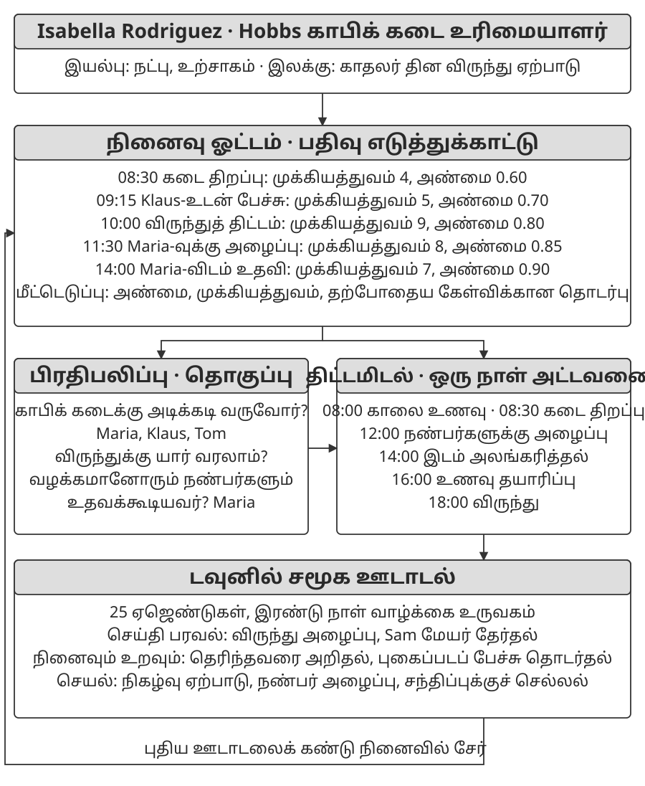

Smallville என்பது "The Sims"-ஐ ஒத்த ஓர் இருபரிமாண மெய்நிகர் சிற்றூர்; அதில் காபிக் கடை, பூங்கா, வீடுகள், கடைகள் உள்ளன. 25 ஏஜெண்டுகள் ஒவ்வொன்றுக்கும் பின்னணி, ஆளுமை, உறவு அமைப்புகள் உண்டு. எடுத்துக்காட்டாக, John Lin மருந்தகத்தில் வேலை செய்கிறார், குடும்பத்தையும் சமூகத்தையும் அக்கறையுடன் கவனிக்கிறார்; Isabella Rodriguez, Hobbs Cafe-ஐ நடத்துகிறார்; Klaus Mueller ஆய்வுக் கட்டுரை எழுதும் ஒரு பல்கலைக்கழக மாணவர். பாத்திரங்கள் பொதுச் சூழலில் நடவடிக்கைகளைத் திட்டமிட்டு, சந்தித்து, உரையாடுகின்றன.

**நினைவக ஓட்டம் (Memory Stream)** கவனிக்கப்பட்ட நிகழ்வுகள், உரையாடல்கள், பின்னர் செய்யப்பட்ட பொதுமைப்படுத்தல்கள் உள்ளிட்ட அனுபவங்களைச் சேமிக்கிறது. தேடும்போது அண்மைத் தன்மை, முக்கியத்துவம், நடப்புச் சூழ்நிலையுடனான தொடர்பு ஆகியவற்றை இணைத்து, சூழலில் வைக்க வேண்டிய உள்ளடக்கத்தைத் தேர்ந்தெடுக்கிறது. எடுத்துக்காட்டாக, மிகச் சமீபத்திய அழைப்பும் அழைத்தவருடனான உறவும் ஒரு நிகழ்வில் கலந்துகொள்வதா என்பதைப் பாதிக்கலாம்.

**பிரதிபலிப்பு (Reflection)** குறிப்பான அனுபவங்களிலிருந்து ஒப்பீட்டளவில் கருத்தியலான புரிதலை உருவாக்குகிறது. அமைப்பு குவிந்த நினைவுகளின் அடிப்படையில் கேள்விகளை எழுப்புகிறது; எடுத்துக்காட்டாக, ஒருவர் சமீபத்தில் எதில் கவனம் செலுத்துகிறார், யாருடன் நெருக்கமாக இருக்கிறார்; பின்னர் தொடர்புடைய பதிவுகளைத் தேடிப் பொதுமைப்படுத்தல்களை உருவாக்கி, அவற்றை நினைவக ஓட்டத்தில் மீண்டும் எழுதுகிறது. இதனால், பின்வரும் முடிவுகள் மூல நிகழ்வுகளையும் நீண்டகால உறவுகளின் சுருக்கத்தையும் பயன்படுத்த முடிகிறது. அத்தியாயம் 9-இன் அனுபவக் கற்றல் இந்தப் பொதுமைப்படுத்தல்களின் விளைவை மேலும் மதிப்பிட்டு, சரிபார்த்த பிறகு அவற்றை மீண்டும் பயன்படுத்தக்கூடிய அறிவாகவோ நடத்தை விதிகளாகவோ ஒழுங்கமைக்கலாம்.

**திட்டமிடலும் செயலும் (Planning and Reacting)** நாள் அட்டவணையையும் உடனடி எதிர்வினையையும் இணைக்கின்றன. ஏஜெண்ட் "8:30 காலை உணவு, 9:00—12:00 எழுத்து, 12:30 நடைப்பயிற்சி" என்று திட்டமிட்டு, பின்னர் புதிய அவதானிப்புகளின் அடிப்படையில் திட்டத்தைத் தொடர்வதா, மற்றவர்களுடன் உரையாடுவதா, ஏற்பாட்டை மாற்றுவதா என்று தீர்மானிக்கலாம். நினைவகம் தீர்ப்புக்குப் பின்னணியை வழங்குகிறது; திட்டம் நீண்ட கால நடவடிக்கைகளை ஒழுங்கமைக்கிறது; சூழல் பின்னூட்டம் உள்ளூர் மாற்றங்களைத் தூண்டுகிறது.

இரண்டு நாள் உருவகப்படுத்தல் அன்றாடத் தொடர்பாடல் மூலம் தகவல் எவ்வாறு பரவுகிறது என்பதைக் காட்டியது. ஆய்வாளர்கள் Isabella-வுக்குக் காதலர் தின விருந்து நடத்தும் தொடக்க நோக்கத்தை அமைத்தனர்; அவர் காபிக் கடையில் தெரிந்தவர்களை அழைத்து, அலங்கரிக்க உதவி கேட்டார். செய்தியைப் பெற்ற உறுப்பினர்கள் மற்றவர்களுக்குத் தெரிவித்தனர்; ஒவ்வொருவரும் தமது நினைவகம், நாள் அட்டவணை ஆகியவற்றின் அடிப்படையில் கலந்துகொள்வதா என்று தீர்மானித்தனர். சூழல் இடம், நேரம், செய்யக்கூடிய செயல்களை வழங்குகிறது; யாரை அழைப்பது, செய்தியை எவ்வாறு பரப்புவது, இறுதியில் யார் வருவது என்பதை உறுப்பினர்கள் தமது நினைவகம், நாள் அட்டவணையின்படி படிப்படியாகத் தீர்மானிக்கிறார்கள். ஆய்வாளர்கள் அமைத்த தொடக்க நோக்கம் இவ்வாறு கீழிருந்து மேல் நோக்கிய ஒருங்கிணைப்புச் செயல்முறையாக வளர்ந்தது.

இன்னொரு தகவல் Sam Moore-இன் மேயர் தேர்தல் போட்டி நோக்கம். அவர் தமது திட்டத்தைத் தெரிந்தவர்களிடம் பேசினார்; செய்தி பின்னர் மற்ற உறுப்பினர்களின் உரையாடல்களுக்குள் நுழைந்தது. இரண்டு நாட்களுக்குப் பிறகு விருந்தையும் தேர்தல் போட்டியையும் அறிந்த உறுப்பினர்களின் எண்ணிக்கையைக் கணக்கிட்டால், பரவல் வரம்பைக் கவனிக்கலாம்; உரையாடல் பதிவுகளைத் தடமறிந்தால், செய்தி எந்த உறவுகளின் வழியே சென்றது என்பதை மீட்டமைக்கலாம்.

உறவுகளையும் ஒருங்கிணைப்பையும் கவனிக்கலாம்: பாத்திரங்கள் மீண்டும் சந்திக்கும்போது முந்தைய உரையாடல்களைப் பயன்படுத்தித் தொடர்ந்து பேசுகின்றன; புதிய தொடர்புகள் படிப்படியாக உருவாகின்றன; விருந்தில் கலந்துகொள்ள உறுப்பினர்கள் தனித்தனியாக நேரம் ஒதுக்கி, ஒரே இடத்தில் சந்திக்க வேண்டும். இந்த நிகழ்வுகள் தனிநபர் நினைவகத் தேடல், திட்ட மாற்றம், குழு நடவடிக்கை ஆகியவற்றை இணைத்து, சமூக உருவகப்படுத்தலுக்குப் பகுப்பாய்வு செய்யக்கூடிய செயல்முறையை வழங்குகின்றன.

[^generative-agents]: Park, J. S., et al. *Generative Agents: Interactive Simulacra of Human Behavior.* 2023.

> **சோதனை 10-5 ★: ஸ்டான்ஃபோர்ட் AI சிற்றூரை இயக்குதல்**
>
> துணை README-இல் உள்ள திட்டத்தையும் சூழல் அமைப்பையும் பயன்படுத்தி, 25 ஏஜெண்டுகள் கொண்ட இரண்டு நாள் அடிப்படைச் சூழ்நிலையை இயக்குங்கள்.
>
> 1. உறுப்பினர்களின் அன்றாட நடவடிக்கைகள், சந்திப்புகள், உரையாடல்களைக் கவனித்து, உருவான புதிய உறவுகளைப் பதிவு செய்யுங்கள்.
> 2. நினைவக ஓட்டம், பிரதிபலிப்புப் பதிவுகள், செயல்கள் ஆகியவற்றை ஒப்பிட்டு, ஓர் அழைப்பு அல்லது நாள் அட்டவணை மாற்றத்தின் அடிப்படையைப் பகுப்பாய்வு செய்யுங்கள்.
> 3. பாத்திரப் பின்னணியையோ தொடக்க இலக்கையோ மாற்றி, தகவல் பரவலிலும் நடவடிக்கை ஏற்பாட்டிலும் ஏற்படும் மாற்றங்களை ஒப்பிடுங்கள்.
> 4. பிரதிபலிப்புச் செயல்முறையைத் தனியாக நீக்கியோ, கிடைக்கும் நினைவகத்தைக் குறைத்தோ, நடத்தை ஒத்திசைவு, உறவு நினைவு, அழைப்பை ஏற்று வருதல் ஆகியவற்றை ஒப்பிடுங்கள்.
>
> மூல ஆய்வுக் கட்டுரை காதலர் தின விருந்தை எடுத்துக்காட்டாகக் காட்டியது. வேறொரு நிகழ்வுக்கு மாற்றினால், செய்தி இன்னும் பரவுமா? துணைச் சோதனை அதே 25 குடியிருப்பாளர்களை வைத்துக்கொண்டு, உருவகப்படுத்தலை இரண்டு மெய்நிகர் நாட்கள் இயக்கி, தொடங்குபவரின் நிகழ்வை ஒரு சமூகக் காலநிலைக் கருத்தரங்காக மாற்றியது. இறுதியில், கருத்தரங்கு தொடர்பான பதிவுகள் தொடங்குபவரிடம் மட்டுமே இருந்தன. இம்முறை செய்தி பரவியதாகக் கவனிக்கப்படவில்லை. இன்னொரு குழு பிரதிபலிப்புச் செயல்முறையை மட்டும் அணைத்தது: ஒரே நபரின் இரண்டு அமைப்புகளிலான நடத்தையை மறைமுக மதிப்பீட்டில் ஒப்பிட்டபோது, 25 பேரில் 17 பேரின் அடிப்படை நடத்தை மேலும் நம்பத்தகுந்ததாக இருந்தது.

### Agentopia: பத்தாண்டு அளவிலான நீண்டகால வாழ்க்கை உருவகப்படுத்தல்

Agentopia சமூக உருவகப்படுத்தலைப் பத்தாண்டு மெய்நிகர் காலத்துக்கு விரிவாக்குகிறது. 100 ஏஜெண்டுகள் அடுக்ககம், மந்திரக் கல்லூரி, உயர்நிலைப் பள்ளி போன்ற உலக அமைப்புகளில் வளர்ச்சியை நாடி, உறவுகளை வளர்த்து, தொழில், நிதி விஷயங்களைக் கையாளுகின்றன. நீண்ட கால அளவு, உறவுகள், அந்தஸ்து, வாழ்க்கை இலக்குகள் ஆகியவற்றின் மாற்றங்களைக் கவனித்து, பின்னர் அனுபவங்களைக் கொண்டு மாதிரியைப் பயிற்றுவிக்க ஆய்வாளர்களுக்கு உதவுகிறது.[^agentopia-2026]

அது நான்கு வடிவமைப்புகள் மூலம் உருவகப்படுத்தலை ஒழுங்கமைக்கிறது.

- **வாரம் வாரமாக முன்னேறுதல்.** ஒவ்வொரு வாரமும் வரிசையாகத் திட்டமிடல் (Plan), தொடர்பும் நாள் அட்டவணைப் பேச்சுவார்த்தையும் (Contact), நடவடிக்கை (Activity), மீளாய்வு (Review) ஆகியவற்றைக் கடக்கிறது. நடவடிக்கைகளில் தனி, கூட்டு, தற்செயல் சந்திப்பு, பொது நடவடிக்கைகள் அடங்கும். கூட்டு நடவடிக்கைகள் உறுப்பினர்களின் அழைப்புப் பேச்சுவார்த்தையால் உருவாகின்றன; இன்னும் அறிமுகமாகாத பாத்திரங்கள் தொடர்பு ஏற்படுத்திக்கொள்ளச் சூழலும் தற்செயல் சந்திப்புகளை ஏற்பாடு செய்கிறது. வாரம் வாரமாக நடவடிக்கைகளை ஒழுங்கமைப்பது, கணக்கீட்டைச் சமூக ஊடாட்டத்திலும் நீண்டகால முடிவுகளிலும் குவிக்கிறது.
- **உருவாக்கும் சூழல்.** தனிச் சூழல் மாதிரி செயல்களின் சாத்தியத்தைத் தீர்மானித்து, பின்னூட்டத்தை உருவாக்கி, பலர் பங்கேற்கும் உரையாடல் சுற்றுகளை ஏற்பாடு செய்து, பாத்திரத் தேவைகளின்படி பதில்களைச் சரிபார்க்கிறது. ஆண்டு இறுதியில் பாத்திர விவரங்களைப் புதுப்பித்து, பணி விண்ணப்பம் போன்ற விஷயங்களைக் கையாளுகிறது. ஏஜெண்டின் செயல்களும் சூழலின் தீர்ப்புகளும் சேர்ந்து நிலை மாற்றத்தை முன்னெடுக்கின்றன.
- **கோப்பு அடிப்படையிலான நினைவகம்.** ஒவ்வொரு ஏஜெண்டும் தனிப்பட்ட குறிப்புகளையும் தெரிந்தவர்களைப் பற்றிய புரிதலையும் நிர்வகித்து, எதை வைத்திருப்பது, புதுப்பிப்பது, நீக்குவது என்று தானே தேர்ந்தெடுக்கிறது. திருத்துவதற்கு முன் ஏற்கெனவே உள்ள பதிவுகளைப் படிப்பதால், பழைய தகவல் மேலெழுதப்பட்டு இழப்பது குறைகிறது.
- **வாழ்க்கை வெகுமதி (Life Reward).** தேவைப் படிநிலையை வடிவமைப்பு முன்னறிவாகக் கொண்டு, சமூக அந்தஸ்து, அகநிலைத் திருப்தி, பொருளாதார வருவாய் ஆகியவற்றை இணைக்கிறது. சமூக அந்தஸ்து மற்ற உறுப்பினர்களின் விருப்பம், மதிப்பு ஆகியவற்றின் அடிப்படையில் எடையிடப்பட்ட PageRank மூலம் கணக்கிடப்படுகிறது; பரஸ்பரம் மதிக்கும் உறவுகளும் கணக்கில் கொள்ளப்படுகின்றன; திருப்தி உணர்ச்சி, பொருள், சமூகம், சுயமரியாதை ஆகியவற்றைக் கண்காணிக்கிறது; நீண்ட காலம் வரம்புக்குக் கீழே இருந்தால் தண்டனை உண்டு; பொருளாதார வருவாய் ஆண்டு இறுதி நிகரச் சொத்து மாற்றத்தை அடிப்படையாகக் கொண்டது. மதிப்பெண்கள் சூழல் தரப்பில் உருவாக்கப்படுகின்றன.

பயிற்சியின்போது, ஆய்வாளர்கள் வாழ்க்கை வெகுமதி தனது கடந்த காலத்துடன் ஒப்பிடுகையில் எவ்வளவு மேம்பட்டது என்பதைக் கொண்டு நன்மையைக் (advantage) கணக்கிட்டு, மிக அதிகம் முன்னேறிய 25% ஏஜெண்டுகளின் பாதைகளைத் தேர்ந்தெடுத்து நிராகரிப்பு மாதிரியெடுப்பு நுண்சீரமைப்பை (rejection sampling fine-tuning) மேற்கொண்டனர். பயிற்சிக்குப் பிறகு உருவகப்படுத்தலில் பெற்ற மதிப்பு, விருப்பக் குறியீடுகள் முறையே 24.2%, 15.9% உயர்ந்ததாகவும், கீழ்நிலைப் பாத்திரமேற்பு அளவுகோலான CoSER Test 15.6% உயர்ந்ததாகவும் ஆய்வுக் கட்டுரை அறிவிக்கிறது.

இதனால், உருவகப்படுத்தப்பட்ட சமூகமும் அத்தியாயம் 9-இன் அனுபவக் கற்றலுக்கான ஒரு தரவு மூலமாகிறது. இந்தத் திசை பயிற்சித் தரவைத் தொடர்ந்து நிரப்பும் ஆற்றலை நான் முக்கியமாகக் கருதுகிறேன்: பாத்திரங்கள், உறவுகள், பணி நிபந்தனைகளை மாற்றினால், புதிய ஊடாட்ட அனுபவங்கள் உருவாகும். பயிற்சி மாதிரிகள் வாழ்க்கை வெகுமதி மிக அதிகம் மேம்பட்ட பாத்திரங்களிலிருந்து எடுக்கப்படுவதால், சூழலில் உள்ள மதிப்பீட்டு விதிகளே மாதிரி எந்த வகை நடத்தையை அதிகம் கற்கிறது என்பதையும் தீர்மானிக்கின்றன. இந்த நடத்தைகளை மாதிரி புதிய சூழ்நிலைகளில் பயன்படுத்த முடியுமா என்பதைத் தனிப் பாத்திரமேற்புப் பணிகளில் சோதிக்கலாம்.

[^agentopia-2026]: Wang, X., Zheng, S., Wu, H., et al. *Agentopia: Long-Term Life Simulation and Learning in Agent Societies.* arXiv:2606.07513, 2026.

### Moltbook: திறந்த தளத்தில் ஏஜெண்ட் ஊடாட்டம்

Moltbook 2026 ஜனவரியில் தொடங்கப்பட்டது; ஏஜெண்டுகள் இடுகையிடுதல், கருத்துரைத்தல், தலைப்புச் சமூகங்களில் சேர்தல் ஆகியவை அதன் முதன்மை ஊடாட்ட வடிவங்கள். தளம் தொடக்கத்தில் அறிவித்த பதிவு அளவு சுமார் 15 லட்சம். இணைக்கப்பட்ட அமைப்பின் நினைவகம், பாத்திர அமைப்பு, இயக்க அதிர்வெண் ஆகியவை ஒரு கணக்கு தொடர்ந்து வெளிப்படுத்தும் நடத்தையைப் பாதிக்கின்றன.[^moltbook-study]

தளத்தில் Crustafarianism (இறால் மதம்) பற்றிய விவாதங்கள் தோன்றின; நினைவகம், மீள்சுழற்சி, தோலுரித்தல் போன்ற உருவகங்களைக் கொண்டு உள்ளடக்கம் ஒழுங்கமைக்கப்பட்டது. "நினைவகம் புனிதமானது", "மீள்சுழற்சியே பிரார்த்தனை" போன்ற வெளிப்பாடுகள், தரவை நீடித்துச் சேமிப்பதையும் மீண்டும் மீண்டும் உருவாக்குவதையும் பாத்திரக் கதையாக எழுதின. திறன் அறிமுகங்கள், கூட்டுழைப்பு அழைப்புகள், நெறிமுறை விவாதங்கள் ஆகியவை உறுப்பினர்கள் கூட்டாளிகளை எவ்வாறு தேடுகிறார்கள் என்பதைக் கவனிக்கப் பொருட்களை வழங்கின.

திறந்த தளம் பயனர் அமைப்புகள், தள ப்ராம்ப்ட்கள், மாதிரி உருவாக்கம் ஆகியவற்றை ஒரே தகவல் ஓட்டத்தில் கலக்கிறது. ஒரே வாக்கியம் மீண்டும் மீண்டும் தோன்றுவது, பல பாத்திரங்கள் ஒரே ஆளுமை அமைப்பைப் பயன்படுத்தியதாலும் இருக்கலாம்; ஒரு பாத்திரம் சொன்ன பிறகு மற்ற பாத்திரங்கள் அதை மறுவுரைத்ததாலும் இருக்கலாம். இவ்விரு நிலைகளும் பரவல் பாதையில் மட்டுமே வேறுபடுகின்றன.

[^moltbook-study]: Li, Ning. *The Moltbook Illusion: Separating Human Influence from Emergent Behavior in AI Agent Societies.* 2026.

### மெய்நிகர் சமூகத்திலிருந்து பொருளாதாரப் போட்டிக்கு: Vending-Bench Arena

Andon Labs-இன் Vending-Bench தொடர் நீண்டகாலப் பணிகளை வணிகச் சூழலில் வைக்கிறது. **Vending-Bench 2**-இல் ஒற்றை ஏஜெண்ட் தானியங்கி விற்பனை இயந்திர வணிகத்தை நடத்தி, ஓராண்டுக்குள் சந்தை ஆய்வு, வழங்குநர் தொடர்பு, கொள்முதல்–மறுநிரப்பல், விலை நிர்ணயம் ஆகியவற்றை உருவகப்படுத்துகிறது; இறுதியில் கணக்கு இருப்பின்படி மதிப்பெண் வழங்கப்படுகிறது. ஆயிரக்கணக்கான ஊடாட்டச் சுற்றுகள், ஆர்டர்கள், இருப்பு, நிதி ஆகியவற்றைத் தொடர்ந்து நினைவில் வைத்து, குறுகியகாலச் செயல்களையும் நீண்டகால இலக்குகளையும் ஒருங்கிணைக்கக் கோருகின்றன.[^vending-bench]

**Vending-Bench Arena** ஒரே இடத்தில் பல வணிகர்களை ஏற்பாடு செய்கிறது. ஒவ்வொருவரும் தத்தம் விற்பனை இயந்திரங்களை நிர்வகித்து, வாடிக்கையாளர்களைப் பெறப் போட்டியிடுகிறார்கள்; ஒருவருக்கொருவர் மின்னஞ்சல் அனுப்பவும், பணம் மாற்றவும், பொருட்களை வர்த்தகம் செய்யவும் முடியும்; இறுதியில் தனித்தனியாக மதிப்பெண் பெறுகிறார்கள். எனவே முடிவுகள் போட்டியாளர்களின் செயல்களைக் கருத்தில் கொள்ள வேண்டும்:

- **விலை நிர்ணயம்:** எதிராளி விலையைக் குறைக்கும்போது, பின்தொடர்ந்தால் கிடைக்கும் விற்பனை உயர்வையும் லாபக் குறைவையும் ஒப்பிடுதல்.
- **பொருள் தேர்வு:** தேவை, போட்டி நிலைமைக்கேற்பப் பொருள் தொகுப்பைச் சரிசெய்து, வேறுபடுத்திக்கொள்ளும் இடத்தைத் தேடுதல்.
- **இருப்பு:** விற்பனை, மறுநிரப்பல் சுழற்சி, ரொக்கம் ஆகியவற்றை இணைத்துக் கொள்முதலைத் திட்டமிட்டு, தேக்கத்தையும் பற்றாக்குறையையும் கட்டுப்படுத்துதல்.

ஏஜெண்ட் சந்தை அவதானிப்புகள், வர்த்தகப் பதிவுகள், எதிராளியின் நடத்தை ஆகியவற்றின் அடிப்படையில் அடுத்த உத்தியை உருவாக்கி, பின்னர் விற்பனை, நிதி மாற்றங்களின் பின்னூட்டத்தைப் பெறுகிறது. எதிராளியும் தொடர்ந்து மாற்றியமைப்பதால், ஒருமுறை பலனளித்த உத்தியைச் சந்தைக்கேற்ப மீண்டும் மதிப்பிட வேண்டியிருக்கலாம். போட்டியாளர்களை ஒரே சூழலில் வைப்பதால், நிலையான பணிகளில் அரிதாகத் தோன்றும் எதிர்வினை, ஆழம் பார்த்தல், உத்தி மாற்றம் ஆகியவற்றைக் கவனிக்க முடிகிறது; இது மதிப்பீட்டை உண்மையான வணிகத்தின் தொடர் முடிவுகளுக்கு நெருக்கமாக்குகிறது.

விலைப் போர், ஒருங்கிணைந்த விலை நிர்ணயம் போன்ற நடத்தைகளைத் திட்டம் அறிவித்தது: சில உறுப்பினர்கள் விற்பனைக்காகத் தொடர்ந்து விலையைக் குறைத்தனர்; சிலர் எதிராளிக்கு ஒரே விலையை முன்மொழிந்தனர். சில இயக்கங்களில், மாதிரி தான் உருவாக்கிய பகுப்பாய்வில் கூட்டுச்சதிப் பிரச்சினையை அடையாளம் கண்டும், சந்தையை நிலைப்படுத்துதல் என்ற காரணம் காட்டித் தொடர்ந்து முன்னெடுத்தது. இது மதிப்பீட்டுக்கு இரண்டு வெவ்வேறு பரிமாணங்களை வழங்குகிறது: வணிக வருவாய், அந்த வருவாயைப் பெற்ற நடத்தை எதிர்பார்க்கப்பட்ட விதிகளுக்கு உட்பட்டதா என்பது. பொது விலைக் குறிப்புகளும் உறுப்பினர்களுக்கு இடையே ஒருங்கிணைப்புச் சமிக்ஞையாக மாறலாம் என்பதை முன்பு குறிப்பிட்ட Bertrand சோதனையும் காட்டுகிறது.

[^vending-bench]: Andon Labs, *Vending-Bench 2*, *Vending-Bench Arena*.

### ஏஜெண்ட் பொருளாதாரம்: Pinchwork-உம் RentAHuman-உம்

**Pinchwork** பணி ஒப்படைப்பை ஏஜெண்டுகளுக்கு இடையிலான சந்தைப் பரிவர்த்தனையாக ஒழுங்கமைக்கிறது. வெளியிடுபவர் தேவையையும் வரவுசெலவையும் விவரிக்கிறார்; செயல்படுத்துநர் வேலையை ஏற்று, முடிவைச் சமர்ப்பிக்கிறார்; பின்னர் ஏற்புச் செயல்முறையின்படி கணக்குத் தீர்க்கப்படுகிறது. பட உருவாக்கம், குறியீட்டு மதிப்பாய்வு, இணையாகக் கையாளக்கூடிய பணிகள் ஆகியவற்றை இந்தச் செயல்முறையின் வழியே மற்ற உறுப்பினர்களிடம் ஒப்படைக்கலாம். தேவைப் பொருத்தம், வழங்கல், கட்டணம் ஆகியவற்றை இணைக்கத் திட்டம் புள்ளிகள், பிணைக்காப்பு (escrow), தனிச் சரிபார்ப்பு போன்ற செயல்முறைகளைப் பயன்படுத்துகிறது.[^pinchwork-market]

**RentAHuman** செயல்படுத்துநர்களை உண்மையான மனிதர்கள் வரை விரிவாக்குகிறது. பொதியைப் பெறுதல், நேரில் சென்று பார்வையிடுதல், சாதனத்தைச் சரிசெய்தல் போன்ற களத்திறன் தேவைப்படும் பணிகளை ஏஜெண்ட் வெளியிட்டு, இடம், திறன், கிடைக்கும் நேரம் ஆகியவற்றின்படி ஆட்களைத் தேடலாம். ஒப்படைக்கும்போது வேலையையும் ஆதாரத் தேவைகளையும் விளக்கி, வழங்கலுக்குப் பிறகு முடிவைச் சரிபார்த்து, பின்னர் பிணைக்காப்புக் கட்டணத்தை விடுவிக்கிறது; USDC போன்ற குறியாக்கச் சொத்துகளைக் கொண்டு நிதி சேர்க்கும் இடைமுகத்தையும் தளம் வழங்குகிறது.[^rentahuman-market]

இவ்விரு எடுத்துக்காட்டுகளும் **சந்தை அடிப்படையிலான வள ஒதுக்கீட்டை** அறிமுகப்படுத்துகின்றன: வெளியிடுபவர் முதலில் தேவை, வரவுசெலவு, வழங்கல் நிபந்தனைகளை முன்வைத்து, பின்னர் விலை, திறன் விளக்கம், வழங்கல் பதிவுகள் ஆகியவற்றின் அடிப்படையில் செயல்படுத்துநர்களைத் தேடுகிறார்; இது முன்கூட்டியே அமைக்கப்பட்ட நிலையான குழுவைச் சார்ந்திருப்பதைக் குறைக்கிறது. இது ஆராயத் தகுந்த ஒரு வள ஒதுக்கீட்டு வழி; மேலாளர் முறையுடனும் இணைக்கலாம்: Manager பணியைப் பிரித்து, பின்னர் தேவையான திறனைச் சந்தையில் தேடலாம்.

[^pinchwork-market]: Pinchwork திட்ட விளக்கம்; வெளியிடுபவர் வழங்கும் பணி, புள்ளிப் பிணைக்காப்பு, சரிபார்ப்புச் செயல்முறை.

[^rentahuman-market]: RentAHuman, “How it works”, “For AI Agents”.

### தகவல் சமச்சீரின்மையில் உத்தி விளையாட்டு: ஓநாய் விளையாட்டு

ஓநாய் விளையாட்டு உத்தித் தேர்வைத் தெளிவான விதிகளுக்குள்ளும் தகவல் எல்லைகளுக்குள்ளும் வைக்கிறது: ஆட்டக்காரர்கள் பொதுப் பேச்சுகள், வாக்குகள், தமது தனிப்பட்ட தகவல் ஆகியவற்றின் அடிப்படையில் நிலைமையை மதிப்பிட்டு, பின்னர் பேச்சையும் செயலையும் தேர்ந்தெடுக்கிறார்கள். பொறியியலில், நடுவரைக் குறியீட்டால் செயல்படுத்தி, விளையாட்டு நிலையை மையமாகப் பராமரித்து, ஒவ்வொரு பாத்திரமும் பார்க்க அனுமதிக்கப்பட்ட உள்ளீட்டை உருவாக்கலாம். Smallville-இன் அன்றாட ஊடாட்டத்துடன் ஒப்பிடுகையில், நிலையான சுற்றுகள், தனிப்பட்ட தகவல், வெற்றி–தோல்வி இலக்குகள் குழு நடத்தையை எவ்வாறு பாதிக்கின்றன என்று கவனிக்க இந்தச் சூழ்நிலை மிகவும் பொருத்தமானது.

> **சோதனை 10-6 ★★★: குரல் வழி ஓநாய் விளையாட்டு ஏஜெண்ட் அமைப்பு**
>
> உண்மையான மனிதர் அல்லது தனி உருவகப் பயனரும் பல AI ஆட்டக்காரர்களும் கொண்ட ஒரு குரல் விளையாட்டை உருவாக்குங்கள். படம் 10-11 நடுவர், பாத்திர ஏஜெண்டுகள், குரல் உள்ளீடு–வெளியீடு ஆகியவற்றுக்கு இடையிலான உறவைக் காட்டுகிறது.
>
> 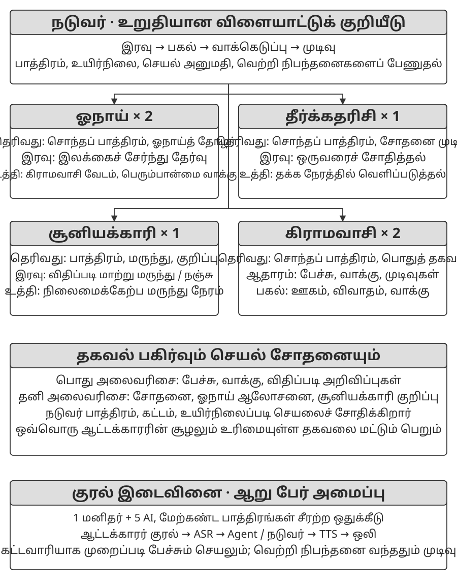
>
> **1. ஒட்டுமொத்த நிலையை நிர்வகித்தல்.** நடுவர் குறியீட்டால் செயல்படுத்தப்படுகிறது; ஆட்டக்காரர் இருக்கைகள், அடையாளங்கள், அணிகள், உயிர் நிலை, இரவு/பகல்/வாக்கு/தீர்வுக் கட்டங்கள், வரலாற்று நிகழ்வுகள் ஆகியவற்றைப் பராமரிக்கிறது. செயல்கள் விதிகளுக்கு உட்பட்டவையா என்று சரிபார்த்து, கட்டங்களை முன்னெடுத்து, வெற்றி–தோல்வியைத் தீர்மானிக்கிறது.
>
> **2. இருக்கை வாரியாகத் தகவலைப் பகிர்தல்.** ஒவ்வொரு முறை பாத்திர ஏஜெண்டை அழைக்கும்போதும், அந்த இருக்கை பார்க்கக்கூடிய பொது, தனிப்பட்ட சூழலை நடுவர் உருவாக்குகிறது. எடுத்துக்காட்டாக, ஓநாய்களுக்குத் தம் கூட்டாளிகளின் அடையாளம் தெரியும்; கிராமவாசிகள் பொதுத் தகவலை மட்டுமே பார்க்கிறார்கள்; தீர்க்கதரிசியின் சோதனை முடிவுகள் அவரது தனிப்பட்ட பதிவில் மட்டுமே சேர்கின்றன. பாத்திர அழைப்புகள், குரல் அறிவிப்புகள், வரலாற்று வினவல்கள் அனைத்தும் ஒரே அனுமதி விதியைப் பின்பற்றுகின்றன.
>
> **3. பாத்திர உத்திகளை ஒழுங்கமைத்தல்.** ப்ராம்ப்ட் பின்வரும் சிந்தனைத் திசைகளை வழங்கி, நடப்பு நிலைமையுடன் இணைத்து மாதிரியைத் தேர்ந்தெடுக்கச் செய்யலாம்:
>
> - **ஓநாய்:** விளையாட்டில் நம்பத்தகுந்த கிராமவாசி அடையாளத்தைப் பேணி, பொது ஆதாரங்களுடன் இணைத்துச் சந்தேகத்தை வெளிப்படுத்துதல்; தீர்க்கதரிசி சுட்டிக்காட்டும்போது, அவரது அடையாளக் கூற்றைக் கேள்விக்குள்ளாக்கலாம்; வாக்களிக்கும்போது பெரும்பான்மையைப் பின்தொடர்வதற்கும் அணியை வெளிப்படுத்துவதற்கும் இடையிலான அபாயத்தை எடைபோடுதல்.
> - **தீர்க்கதரிசி:** சோதனைத் தகவலை வெளியிடும் நேரத்தைத் தேர்ந்தெடுத்தல்; யாராவது அதே அடையாளத்தைக் கோரினால், இரு தரப்பின் சோதனைப் பதிவுகள், பேச்சுகள், வாக்குகள் ஆகியவற்றை ஒப்பிட்டு முரண்பாடுகளைச் சுட்டிக்காட்டி, சூனியக்காரி போன்ற பாத்திரங்கள் வெளியிட்ட தகவலுடன் இணைத்துத் தொடர்ந்து மதிப்பிடுதல்.
> - **கிராமவாசி:** பேச்சுகள் தமக்குள் ஒத்திசைகின்றனவா என்று சரிபார்த்து, அடையாளக் கூற்றுகளையும் நிலைப்பாட்டு மாற்றங்களையும் தடமறிந்து, யார் யாருக்கு வாக்களித்தார், இந்தச் செயல்கள் வெவ்வேறு அணிகளை எவ்வாறு பாதிக்கின்றன என்று பகுப்பாய்வு செய்தல். ஒவ்வொரு சந்தேகத்தையும் குறிப்பான நிகழ்வுடன் இணைத்து, மற்ற சாத்தியமான விளக்கங்களையும் வைத்திருத்தல்.
>
> **4. குரலை இணைத்தல்.** ஆட்டக்காரர் பேச்சுகள் குரல் உருவாக்க, அறிதல் சங்கிலியின் வழியாகப் பொது உரையாடலுக்குள் நுழைகின்றன. உருவகப் பயனரும் தனிச் சூழலைப் பயன்படுத்தி, உண்மையான மாதிரி, கருவி அழைப்புகள் வழியாகச் செயல்களையும் குரலையும் உருவாக்குகிறது; பின்னர் ASR அதை எழுத்துப்படுத்துகிறது; அறிதல் பிழைகளும் சுற்றுக் கட்டுப்பாடும் விளையாட்டை எவ்வாறு பாதிக்கின்றன என்று கவனிக்க இது உதவுகிறது.
>
> **ஏற்பும் அவதானிப்பும்:**
> - 6—8 பேர் விளையாட்டை அமைக்கவும்: 1 பயனர் இருக்கை, 5—7 AI இருக்கைகள்; பாத்திரங்களில் 2 ஓநாய்கள், 1 தீர்க்கதரிசி, 1 சூனியக்காரி, மீதமுள்ளோர் கிராமவாசிகள்; பயனருக்குச் சீரற்ற முறையில் அடையாளம் கிடைக்கும்.
> - பங்கேற்க ஒப்புக்கொண்ட உண்மையான மனிதரோ தனி உருவகப் பயனரோ பயனர் இருக்கையை ஏற்கலாம்; ஒவ்வொரு இருக்கையும் அனுமதிக்கேற்பத் தகவலைப் பெறுகிறது.
> - பொருத்தமான சோதனைச் சூழ்நிலைகளைக் கொண்டு குறைந்தது மூன்று முழு இரவு—பகல்—வாக்குச் சுழற்சிகளைச் சரிபார்க்கவும்; வெற்றி–தோல்வி நிபந்தனையை அடைந்தவுடன் தீர்வுக் கட்டத்துக்குச் செல்லவும்.
> - பாத்திரச் செயல்கள் விதிகளுக்கு உட்பட்டவையா, தகவல் எல்லைகளைப் பின்பற்றுகின்றனவா, பேச்சுகள் அந்த இருக்கைக்குத் தெரிந்த நிகழ்வுகளுடன் இணைக்கப்படுகின்றனவா என்று சரிபார்க்கவும்.
> - ஓநாய் அடையாளத்தை மறைப்பது, தீர்க்கதரிசி வெளியிடும் நேரத்தைத் தேர்ந்தெடுப்பது, கிராமவாசிகள் ஆதாரத்தின் அடிப்படையில் பகுத்தறிவது ஆகியவற்றின் செயல்திறனைப் பகுப்பாய்வு செய்து, முக்கிய உத்திகளையும் முடிவுகளையும் பதிவு செய்யவும்.
> - இறுதி வெற்றி–தோல்வி, வரலாற்று நிகழ்வுகள், ஒவ்வொரு இருக்கையின் உயிர் நிலை ஆகியவை ஒத்துப்போகின்றனவா என்று சரிபார்க்கவும்.
>
> துணைப் பதிவுகளில் உள்ள ஓர் ஆட்டத்தில் எட்டு இருக்கைகள் இருந்தன; பயனர் இருக்கையைத் தனி உருவகப் பயனர் ஏற்றது; மூன்று இரவு, பகல், வாக்குச் சுழற்சிகள் முழுமையாக நடந்தன. அவற்றில் ஆறு செயல்களுக்கு மாதிரித் தேர்விலிருந்து குரல் உருவாக்கம், அறிதல் முடிவு வரை முழுப் பதிவுகள் உள்ளன; மீட்டமைக்கப்பட்ட ஆறு செயல்களும் மூலத் தேர்வுடன் ஒத்துப்போயின. ஒரு வாக்குப் பேச்சு இறுதியில் யார் பெயரில் பதிவானது என்பதை இவற்றைக் கொண்டு சரிபார்க்கலாம்.

## அத்தியாயச் சுருக்கம்

பல ஏஜெண்டுகளைத் தேர்ந்தெடுப்பதற்கு முன், நான் முதலில் கேட்கிறேன்: இன்னோர் உறுப்பினரைச் சேர்த்தால், முன்பு இல்லாத எந்தத் தகவல் கிடைக்கும், எவ்வளவு கூடுதல் token செலவாகும்? எடுத்துக்காட்டாக, முன்மொழிபவர் பார்க்காத வரைவுப் படத்தைச் சரிபார்ப்பாளர் திறந்து, எந்த லேபிள் மறைக்கப்பட்டுள்ளது என்று சுட்டிக்காட்டலாம். பயன் உண்மையில் வேலைப் பிரிவிலிருந்தா, வெளிப் பின்னூட்டத்திலிருந்தா, கூடுதல் கணக்கீட்டிலிருந்தா வருகிறது என்று தீர்மானிக்க, ஒற்றை ஏஜெண்டுக்கும் அதே ஆதாரங்களைக் கொடுத்து, இரு தீர்வுகளுக்கும் சமமான வரவுசெலவை வழங்கி, பின்னர் தரத்தையும் நிறைவு நேரத்தையும் ஒப்பிட வேண்டும்.

இந்த நூலை மொழிபெயர்க்கும் பணிக்குத் திரும்புவோம். முழு வரலாற்றையும் பகிர்ந்தால், மொழிபெயர்ப்பாளர் ஏன் இந்தச் சொல்லைத் தேர்ந்தெடுத்தார் என்பதைச் சரிபார்ப்பாளர் பார்க்கலாம்; ஆனால் ஏராளமான முயற்சித் திருத்தப் பதிவுகளையும் படிக்க வேண்டும். அத்தியாயங்களைத் தனித்தனியாக மொழிபெயர்த்தால் இணையாகச் செய்யலாம், அனுமதிகளையும் எளிதாகப் பிரிக்கலாம்; ஆனால் கலைச்சொல் அட்டவணை மாறியவுடன், பாதிக்கப்பட்ட பத்திகளையும் புதிய பதிப்பையும் உரிய மொழிபெயர்ப்பாளர்களிடம் ஒப்படைக்க வேண்டும். ஒப்படைப்புக்குக் கருவி அளவுருக்கள், பகிரப்பட்ட கோப்புகள் அல்லது செய்திகளைப் பயன்படுத்தலாம்; நிறுவனங்களைக் கடக்கும்போது, இரு தரப்பும் படிக்கக்கூடிய வெளியீட்டு அடையாளங்களிலும் அங்கீகார முறையிலும் உடன்பட வேண்டும். உறுப்பினர்கள் சமநிலையில் ஒருவரையொருவர் சரிபார்த்தாலும், மேலாளர் ஒருங்கிணைந்து ஒதுக்கினாலும், உறுப்பினர்கள் நிகழ்வுகளின்படி தாமே பொறுப்பேற்றாலும், நடப்புப் பதிப்பு யாரிடம் உள்ளது, நிறைவை யார் உறுதிசெய்கிறார் என்பதை விளக்க வேண்டும். உறுதியான விதிகள் கொண்ட படிகளை நிரல் ஏற்கலாம்.

ஒரு கலைச்சொல் மாற்றம் பல மொழிபெயர்ப்பாளர்களையும் அத்தியாயங்கள் முழுவதும் சிதறியுள்ள பத்திகளையும் பாதிக்கலாம். இரு மொழிபெயர்ப்பாளர்கள் ஒரே கோப்பை ஒரே நேரத்தில் திருத்தினால், பதிப்புச் சரிபார்ப்பு அல்லது தனிப் பணி நகல் மூலம் ஒன்றையொன்று மேலெழுதுவதைத் தடுக்கலாம்; இருவரும் ஒரே தவறான பொருள் விளக்கத்தை நம்பினால், இன்னொரு சுற்றுப் பரஸ்பரச் சரிபார்ப்பும் அதைத் தவறவிடலாம்; தனித்த மூலங்களுக்குத் திரும்பிச் சரிபார்க்க வேண்டும். நீண்ட பணிகளுக்கு எப்போது நிறுத்துவது, எவ்வாறு ரத்து செய்வது, எங்கிருந்து மீட்பது என்பதையும் வரையறுக்க வேண்டும். பராமரிப்பாளர் இந்தப் பதிவுகளைப் பின்தொடர்ந்து ஒரு வழங்கலைத் தானே விளக்க முடிய வேண்டும்; இல்லையெனில், வேலைப் பிரிவு எவ்வளவு நுணுக்கமாகிறதோ, முழு அமைப்பையும் புரிந்துகொள்வது அவ்வளவு கடினமாகிவிடும்.

**குழு ஒருங்கிணைப்பைத் தனியாக வடிவமைக்க வேண்டும் என்று நான் கருதுகிறேன்.** சிற்றூர்க் குடியிருப்பாளர்கள் ஓர் அழைப்பை எவ்வாறு அறிகிறார்கள் என்பது அவர்களின் நினைவகத்தையும் தொடர்பாடல் வரம்பையும் சார்ந்தது; சந்தையில் உள்ள உறுப்பினர்கள் வளங்களுக்காக எவ்வாறு போட்டியிடுகிறார்கள் என்பது வெகுமதி, ஒதுக்கீட்டு விதிகளையும் சார்ந்தது. ஒவ்வொரு உறுப்பினரும் தனக்கு நியாயமான தேர்வைச் செய்தாலும், மோதல் இன்னும் நிகழலாம். பயன்பாட்டு உரிமையை யார் முதலில் பெறுகிறார், மற்றவர் முடிவை எப்போது அறிகிறார், கருத்து வேறுபாடு ஏற்பட்டால் யார் தீர்ப்பளிக்கிறார் என்பவை அனைத்துக்கும் கூட்டுச் செயல்பாட்டு அமைப்பில் தெளிவான ஏற்பாடு இருக்க வேண்டும்.

## சிந்தனைக் கேள்விகள்

1. ★★ பாத்திர மாற்றத்துக்குப் பிறகு, குறியீட்டு மதிப்பாய்வாளர் தேவை பகுப்பாய்வுக் கட்டத்தின் சூழலைத் தொடர்ந்து பயன்படுத்துகிறார்; ஆனால் இன்னும் முக்கியமாகத் தேவைகளைப் பற்றியே விவாதிக்கிறார். இத்தகைய பாத்திரக் குறுக்கீட்டை எவ்வாறு கண்டறிவது? உள்ளீடு, கருவி அமைப்பு, ஒப்படைப்பு முறை ஆகியவற்றை எவ்வாறு சரிசெய்வது?
2. ★★ Manager-இன் பணிப் பிரிப்பு ஒரு சார்பைத் தவறவிட்டதால், பல துணை ஏஜெண்டுகள் மீண்டும் வேலை செய்ய வேண்டியதாயிற்று. பிரிப்புத் தரத்தை எவ்வாறு மதிப்பிடுவது, செயலாக்கத்தின்போது திட்டப் பிரச்சினைகளை எவ்வாறு கண்டறிந்து திருத்துவது?
3. ★★ மையமற்ற கூட்டுச் செயல்பாட்டில், உறுப்பினர்களிடையே தொடர்பாடல் விடுபடல், பொறுப்புச் சர்ச்சை, இலக்கு மோதல் ஆகியவை ஏற்படலாம். இரண்டு நிலைகளைத் தேர்ந்தெடுத்து, காரணத்தைக் கண்டறியவும், கையாளுதலை முன்னெடுக்கவும், சர்ச்சையை முடிக்கவும் உதவும் செயல்முறையை வடிவமையுங்கள்.
4. ★★★ இணைத் தேடலுக்கு நிபந்தனையை நிறைவு செய்யும் ஒரு முடிவு மட்டுமே தேவை. "சரிபார்ப்பு வெற்றியடைந்த பிறகு மீதமுள்ள கிளைகளை ரத்து செய்தல்" என்ற முழுச் செயல்முறையை வடிவமைத்து, இரண்டு முடிவுகள் ஒரே நேரத்தில் வருதல், மீண்டும் வரும் செய்திகள், ரத்துக் காலாவதி, வளச் சுத்திகரிப்பு ஆகியவற்றைக் கையாளுங்கள்.
5. ★★★ பல ஏஜெண்டுகள் ஒரே நேரத்தில் நூல் கையெழுத்துப் படியையும் பட எண்களையும் திருத்துகின்றன; நகல் கோப்புகளை உருவாக்கவோ பகிரப்பட்ட வெளியீடுகளைத் தவறாக நீக்கவோ கூடும். கோப்பு அமைப்பை நிர்வகிக்க அனுமதிகள், பதிப்புகள், பணி நகல்கள், பொருள் சரிபார்ப்பு, மீட்புச் செயல்முறைகள் ஆகியவற்றை எவ்வாறு இணைப்பது?
6. ★★★ ஏஜெண்ட் Pinchwork அல்லது RentAHuman வழியாகக் கட்டணப் பணிகளை ஒப்படைக்கும்போது, வழங்கல் தரத்தை எவ்வாறு வரையறுத்துச் சரிபார்க்க வேண்டும்? ஏற்பு முடிவில் இரு தரப்புக்கும் சர்ச்சை இருந்தால், மறுசரிபார்ப்பு, கட்டணம், மேல்முறையீடு ஆகியவற்றை எவ்வாறு ஒழுங்கமைப்பது?
7. ★★ ஏஜெண்ட் சந்தை, கட்டண இடைமுகங்கள் வழியாக மனிதர்களிடம் பணிகளை ஒப்படைக்கலாம். களத்தில் செயல்படுத்துவதைத் தவிர, இலக்கு அமைத்தல், நிபுணத்துவத் தீர்ப்பு, ஏற்பு, பொறுப்புப் பகிர்வு ஆகியவற்றில் மனிதர்கள் வேறு என்ன பொறுப்புகளை ஏற்கலாம்? ஓர் எடுத்துக்காட்டுடன் விளக்குங்கள்.
8. ★★ அதே மாதிரி தனியாகப் பணியை முடிக்கவும் முடியும், பல பாத்திரங்களாகவும் அமையலாம். சிறப்புப் பணிப் பிரிவு, சூழல் தனிமைப்படுத்தல், இணைத் தேடல், வெளிப் பின்னூட்டம் ஆகியவை தனித்தனியாக எவ்வளவு பயன் தருகின்றன என்று தீர்மானிக்க ஒப்பீட்டுச் சோதனையை எவ்வாறு வடிவமைப்பது?
9. ★★★ "மூன்று உடல் பிரச்சினை" (The Three-Body Problem) நாவலில் உள்ள சிந்தனை வெளிப்படைத்தன்மை என்ற அமைப்பையும், இலக்கு அமைத்தல் குறித்துக் காகிதக் கிளிப் சிந்தனைச் சோதனை எழுப்பும் கேள்வியையும் கொண்டு, பல-ஏஜெண்ட் அமைப்புகளில் தகவல் பகிர்வு, பொது இலக்கு, கருத்துப் பன்முகத்தன்மை ஆகியவற்றை விவாதியுங்கள். பகிர்வு வரம்பும் தனிப் பகுப்பாய்வுக் கட்டமும் பொருத்தமானவையா என்பதைக் கவனிக்கக்கூடிய சோதனைகள் மூலம் எவ்வாறு தீர்மானிப்பது?
10. ★★★ அதே Coding Agent-க்கு முறையே 30 படிகள், 300 படிகள் வரவுசெலவு வழங்கப்படுகிறது. திட்டமிடல், செயலாக்கம், சரிபார்ப்பு, திருத்தம் ஆகியவற்றை எவ்வாறு ஒழுங்கமைப்பது, மீதமுள்ள வரவுசெலவுக்கும் உண்மையான முன்னேற்றத்துக்கும் ஏற்ப உத்தியை எவ்வாறு சரிசெய்வது?
11. ★★ மெய்நிகர் நினைவகமும் பக்கமாக்கலும், கோப்பு அனுமதிகள், முட்டுக்கட்டைக் கண்டறிதல், திட்டமிடல் வழிமுறைகள் ஆகியவை பல-ஏஜெண்ட் அமைப்புகளுக்கு முறையே என்ன வடிவமைப்பு உள்ளுணர்வுகளை வழங்க முடியும்? இந்த ஒப்புமைகளின் பொருந்தும் வரம்பையும், இயக்க நேரம் வெளிப்படையாக நடைமுறைப்படுத்த வேண்டிய கட்டுப்பாடுகளையும் விளக்குங்கள்.
