# சூழல் பொறியியல்

அத்தியாயம் 1 சூழலை ஏஜெண்டின் "தற்போதைய முடிவுப் பார்வைப் புலம்" என்று ஒப்பிட்டது: ஒவ்வொரு முறை முடிவெடுக்கும்போதும், அந்தக் கணத்தில் பெற்ற தகவலையே மாதிரி அடிப்படையாகக் கொள்கிறது. **சூழல் பொறியியல்** (Context Engineering) இந்தத் தகவலைத் தேர்ந்தெடுத்து, ஒழுங்கமைத்து, புதுப்பிக்கும் பொறுப்பை ஏற்கிறது; சிஸ்டம் அறிவுறுத்தல்கள், கருவி வரையறைகள், பயனர் கோரிக்கைகள், வரலாற்றுச் செய்திகள், பணி நிலை ஆகியவை இதில் அடங்கும். ஒவ்வொரு முறை மாதிரியை அழைப்பதற்கு முன்னும், பணியின் பின்னணியையும் சமீபத்திய முன்னேற்றத்தையும் உள்ளீடாகத் தொகுப்பது Harness-இன் வேலை. சூழல் சாளரத்தின் அமைப்பைப் படம் 2-1 குறிப்பிட்ட உள்ளடக்கத்துடன் காட்டுகிறது.

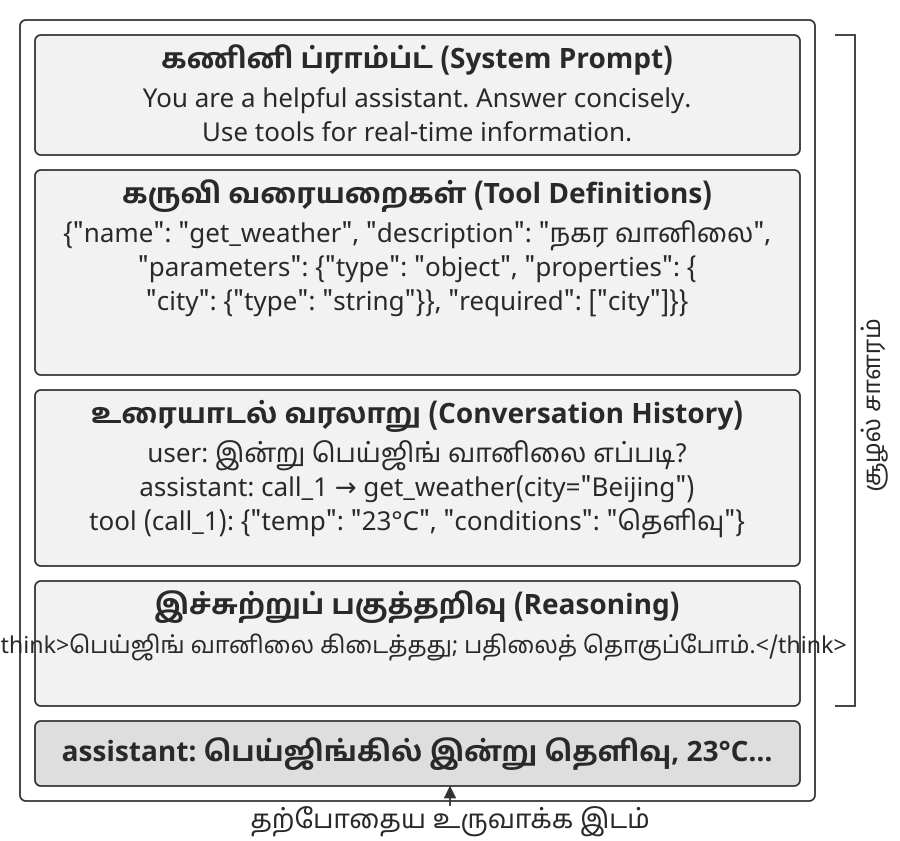

## சூழல்: மாதிரியின் திறனைக் குறிப்பிட்ட பணிக்குப் பயன்படுத்துதல்

ஒரு அனுபவம் மிக்க பொறியாளர் புதிதாகக் குழுவில் சேர்ந்தார்; அவருக்கு வந்த முதல் பணி "எங்கள் வழிமுறைகளின்படி உள்ளமைவைத் திருத்துவது" என்று வைத்துக்கொள்வோம். அவருக்கு நிரலாக்கம் தெரியும், ஆனால் எந்தக் கோப்புதான் உள்ளமைவின் மூலம், எந்தப் புலங்களை மாற்றலாம், எப்படிச் சரிபார்க்க வேண்டும் என்பது இன்னும் தெரியாது. முழுக் குறியீட்டுக் களஞ்சியத்தையே அவரிடம் கொடுத்தாலும், அவர் தவறான கோப்பைத் திருத்தக்கூடும். அறிமுகமில்லாத திட்டத்தை ஏஜெண்ட் கையேற்கும்போதும் இதே பின்னணி விடுபட்டிருக்கும்.

"இந்தப் பிழையைச் சரிசெய்து கொடு" என்பதை எடுத்துக்காட்டாகக் கொள்வோம். Coding Agent-க்குப் பொதுவாக மூன்று வகைப் பின்னணி தேவை:

- **நேரடிக் குறியீட்டுச் சூழல்**: கோப்பக அமைப்பு, தொகுதிகளின் பொறுப்புகள், மையத் தரவுக் கட்டமைப்புகள், குறியீட்டு வழிமுறைகள். எடுத்துக்காட்டாக, திருத்த வேண்டியது தானாக உருவாக்கப்படும் உள்ளமைவுக் கோப்பு என்றால், அது இங்கே அமலாகும் என்றாலும் அடுத்த முறை உருவாக்கும்போது மேலெழுதப்படும். எந்தத் தொகுதி அந்தக் கோப்பை உருவாக்குகிறது என்று தெரிந்தால் மட்டுமே திருத்த வேண்டிய இடத்தைக் கண்டுபிடிக்க முடியும்.
- **செயல்முறை வழிமுறைகள்**: Git கிளை உத்தி, commit வழிமுறைகள், குறியீட்டு மதிப்பாய்வுச் செயல்முறை, CI/CD தேவைகள். இவற்றின் அடிப்படையில் ஏஜெண்ட் திருத்தங்களையும், சோதனைகளையும், commit-களையும் திட்டமிடுகிறது; இயக்க அமைப்போ அனுமதிகளின்படி இந்தச் செயல்களைச் செய்கிறது.
- **வெளிச்சூழல் தகவல்**: மேம்பாட்டு உள்ளமைவு, சோதனைத் தரவுத்தளத்தின் இணைப்பு முறை, சோதனைச் சூழலின் வரிசைப்படுத்தல் முறை, API விசைகளின் மேலாண்மை முறை. இந்தத் தகவல் சரியான இயக்கச் சூழலைத் தேர்ந்தெடுக்கவும், உள்ளூர் சூழலுக்கும் சோதனைச் சூழலுக்கும் உள்ள வேறுபாட்டைப் புரிந்துகொள்ளவும் உதவுகிறது.

திட்டத்தின் குறியீடும் சோதனைத் தரவுத்தளமும் மாதிரியின் சூழலுக்கு வெளியே உள்ளன. தானாக உருவாக்கப்படும் உள்ளமைவை எடுத்துக்காட்டாகக் கொண்டால், உருவாக்கும் ஸ்கிரிப்டைத் தேடல் கருவி வழியாகப் படித்த பிறகே, எங்கிருந்து திருத்தத் தொடங்க வேண்டும் என்று ஏஜெண்டுக்குத் தெரிகிறது. **மாதிரியின் ஏற்கனவே உள்ள திறனைத் தற்போதைய பிரச்சினைக்குப் பயன்படுத்த முடியுமா என்பதைச் சூழலின் தரம் தீர்மானிக்கிறது.** **அதிக பின்னணித் தகவலைச் சார்ந்த பணிகளுக்கு, திறன் போதுமான மாதிரியுடன் முழுமையான, துல்லியமான சூழலை வழங்கினால், தேவையான தகவல் இல்லாத வலிமையான மாதிரியை விடச் சிறந்த செயல்திறன் கிடைக்கலாம்.**

**AI-இயல்பான குழுவை உருவாக்க, முதலில் முக்கிய அறிவை ஆவணப்படுத்த வேண்டும்.** அந்தக் காலத்தில் ஒரு தரவுத்தளத்தைத் தேர்ந்தெடுத்ததற்கான காரணம் பழைய ஊழியர்களுக்கு மட்டுமே நினைவில் இருந்தது, வணிக விதி மாற்றம் தனிப்பட்ட அரட்டையில் மட்டும் பேசப்பட்டது என்றால், புதிய சக ஊழியரும் ஏஜெண்டும் பொறுப்பேற்கும்போது ஒரே பிரச்சினையைச் சந்திப்பார்கள்: குழு என்ன செய்தது என்பதைக் குறியீட்டில் பார்க்க முடியும், ஆனால் அப்போது ஏன் அப்படிச் செய்தது என்பதைப் பார்க்க முடியாது.

**தொலைவுக் கூட்டுப்பணிக்கு வசதியான குழுக்கள், பெரும்பாலும் ஏஜெண்டுகளுக்கும் வசதியானவை.** Linux கர்னல் மேம்பாட்டாளர்கள் மின்னஞ்சல் பட்டியல் வழியாகத் திருத்தங்களை விவாதித்து, மதிப்பாய்வுக் கருத்துகளைப் பரிமாறிக்கொள்கிறார்கள்; மேம்பாட்டுச் செயல்முறை ஆவணங்கள் எவ்வாறு திருத்தங்களைச் சமர்ப்பிப்பது, மதிப்பாய்வு செய்வது, இணைப்பது என்பதை விளக்குகின்றன[^ch2-linux]. ஒரு புதிய பங்கேற்பாளர் எதிர்பாராத ஒரு மாற்றத்தைப் பார்த்தால், அந்தத் திருத்தத்தைப் பின்தொடர்ந்து அப்போதைய விவாதத்தைக் கண்டுபிடிக்கலாம்; ஏஜெண்ட் பின்னணியைச் சரிபார்க்கும்போதும் இந்தப் பதிவு பயன்படும்.

WhynotTV-இல் வெங் ஜியாயியின் நேர்காணலைக் கேட்ட பிறகு, அவரது ஒரு கருத்தை நான் இப்படித் தொகுத்துக்கொண்டேன்: **மனிதரும் மாதிரியும் Context-ஐச் சார்ந்தே உள்ளனர்.** மனிதர் முடிவெடுப்பில் பங்கேற்ற சக ஊழியரிடம் கேட்டு விவரம் தெரிந்துகொள்ளலாம்; மாதிரி எந்தப் பின்னணியைப் படிக்க முடியும் என்பதோ, குழு என்ன பதிவுகளை விட்டுச் சென்றது, Harness இந்தக் கோரிக்கையில் எதைச் சேர்த்தது என்பதைப் பொறுத்தது.[^ch2-weng]

[^ch2-linux]: Linux கர்னல் அதிகாரபூர்வ ஆவணம், How the development process works.

[^ch2-weng]: WhynotTV, "Weng Jiayi: OpenAI, GPT, reinforcement learning, infra, post-training, ..." Podcast #4.

ReAct ஆய்வுக் கட்டுரை, இடைவினை வரலாறு முடிவெடுப்பில் எவ்வாறு பங்கேற்கிறது என்பதை ஒரு முறையான குறியீட்டால் விவரிக்கிறது[^ch2-react]. $t$ என்ற தருணத்தில், ஏஜெண்ட் வெளிச்சூழலிலிருந்து $o_t\in\mathcal{O}$ என்ற அவதானிப்பைப் பெற்று, $\pi(a_t\mid c_t)$ என்ற கொள்கைப்படி $a_t\in\mathcal{A}$ என்ற செயலைத் தேர்ந்தெடுக்கிறது; இங்குச் சூழல்:

$$
c_t=(o_1,a_1,\ldots,o_{t-1},a_{t-1},o_t)
$$

இந்தக் குறியீடு, **ஏஜெண்டின் அடுத்த செயல் அத்தருணம் வரை உள்ள இடைவினை வரலாற்றைச் சார்ந்தது** என்பதைக் காட்டுகிறது. எடுத்துக்காட்டாக, ஏஜெண்ட் எந்தக் கோப்பை வினவியது, கருவி என்ன பிழையைத் திருப்பித் தந்தது என்பவை அடுத்த தேர்வைப் பாதிக்கும். LLM ஏஜெண்டைப் பொறுத்தவரை, பயனர் உள்ளீடும் கருவி முடிவுகளும் அவதானிப்புகளை வழங்குகின்றன; கருவி அழைப்புகளும் வெளியுலகிற்கான பதில்களும் செயல்களைப் பதிவு செய்கின்றன; சிஸ்டம் அறிவுறுத்தல்களும் கருவி வரையறைகளும் பணி விதிகளையும் கிடைக்கும் இடைமுகங்களையும் மேலும் விளக்குகின்றன.

இந்த அத்தியாயம் முதலில் நிலையற்ற கோரிக்கை முறையைப் பின்பற்றுகிறது: ஒவ்வொரு சுற்றிலும் Harness செய்திகளையும் கருவி வரையறைகளையும் தொகுத்து, பின்னர் மாதிரியை அழைக்கிறது. முழுச் செய்தி வரலாறு பணியின் முன்னேற்றத்தைத் தக்கவைக்க வசதியானது; வரலாறு வளரும்போது, மீட்டெடுப்பு, நிலைப் பதிவுகள், சுருக்கம் ஆகியவற்றின் மூலம் அடுத்தடுத்த முடிவுகளுக்குத் தேவையான தகவலைச் சாளரத்துக்குள் வைத்திருக்கலாம். சூழல் ஒழுங்கமைப்பு, நிலைப் பட்டை, சுருக்க நுட்பங்கள் ஆகியவை ஒரே கேள்வியைச் சுற்றியே அமைகின்றன: வரம்பான சூழலுக்குள், இந்தப் படிக்கு மாதிரி பயன்படுத்த வேண்டிய தகவலை $c_t$-க்குள் எப்படிச் சேர்ப்பது?

[^ch2-react]: Yao, Shunyu, et al., ReAct: Synergizing Reasoning and Acting in Language Models, ICLR 2023.

## ஏஜெண்ட் பெரிய மாதிரிகளை எவ்வாறு அழைக்கிறது: API-இன் சூழல் கட்டமைப்பைப் புரிந்துகொள்ளுதல்

முதலில் ஒரு வாழ்த்து வாக்கியத்தின் செய்தி வடிவத்தைப் பார்ப்போம்; பின்னர் "வான்கூவரில் இப்போது என்ன நேரம், வானிலை எப்படி" என்ற கேள்வி எவ்வாறு இரண்டு கருவி அழைப்புகளுக்கு இட்டுச் செல்கிறது என்பதைப் பார்ப்போம். இந்தப் பகுதி Chat Completions-உடன் இணக்கமான இடைமுகத்தையும், உள்ளூரில் இயங்கும் Qwen3-0.6B-ஐயும் பயன்படுத்துகிறது; இறுதியில் Python கொண்டு ஒவ்வொரு சுற்றின் கோரிக்கைகளையும் இணைக்கிறது[^ch2-chat-api].

### எடுத்துக்காட்டில் உள்ள நான்கு செய்திப் பங்குகள்

கோரிக்கையில் உள்ள **செய்திப் பட்டியல்** (`messages`) இடைவினைத் தகவலை வரிசையாகச் சேமிக்கிறது. ஒவ்வொரு செய்தியும் அதன் மூலத்தையும் பயன்பாட்டையும் **பங்கு** (role) மூலம் குறிக்கிறது. இந்தப் பகுதி நான்கு பங்குகளைப் பயன்படுத்துகிறது:

- **system**: சிஸ்டம் ப்ராம்ப்ட். இந்தப் பகுதியில் மேம்பாட்டாளர் வழங்கும் அடையாளம், நடத்தை விதிகள், கட்டுப்பாடுகளை இது தாங்கி, செய்திப் பட்டியலின் முன்பகுதியில் வைக்கப்படுகிறது. சில மாதிரி இடைமுகங்கள் மேம்பாட்டாளர் அறிவுறுத்தல்களைத் தாங்க `developer` என்ற பங்கைப் பயன்படுத்துகின்றன.
- **user**: பயனர் செய்தி; பணி, தொடர்கேள்விகள், கூடுதல் கோரிக்கைகளைச் சேமிக்கிறது.
- **assistant**: மாதிரிப் பதில்; உரையும் கருவி அழைப்புக் கோரிக்கைகளும் அடங்கும். இந்தச் செய்திகளை அடுத்த சுற்றின் உள்ளீட்டில் வைத்தால், முந்தைய பதில்களையும் செயல் கோரிக்கைகளையும் மாதிரி படிக்க முடியும்.
- **tool**: கருவி இயக்க முடிவு. திருப்பு மதிப்பைப் பெற்ற பிறகு, Harness அதைக் கருவிச் செய்தியாக எழுதி, `tool_call_id` மூலம் குறிப்பிட்ட அழைப்புடன் இணைக்கிறது.

கருவி வரையறைகள், கோரிக்கையின் மேலடுக்கில் உள்ள `tools` புலம் வழியாக அனுப்பப்பட்டு, கிடைக்கும் கருவிகளின் பெயர், பயன், அளவுரு வடிவம் ஆகியவற்றைப் பட்டியலிடுகின்றன.

மாதிரி கருவி வரையறைகளின் அடிப்படையில் அழைப்புக் கோரிக்கையை உருவாக்குகிறது. அந்தச் செயலை அது செயல்படுத்த முடியுமா என்பதை Harness-உம் இயக்கச் சூழலுமே தீர்மானிக்கின்றன.

[^ch2-chat-api]: OpenAI, Chat Completions API குறிப்பு; செய்திப் பங்குகள், கருவி வரையறைகள், அழைப்பு முடிவுப் புலங்களை அறிமுகப்படுத்துகிறது; Qwen, Function Calling; இணக்கமான சேவைகளில் கருவி அழைப்பையும் வார்ப்புருக்களையும் அறிமுகப்படுத்துகிறது.

### ஒற்றைச் சுற்று உரையாடல்: மிக எளிய API அழைப்பு

முதலில் ஒரு கேள்வி–பதிலைப் பார்ப்போம். பயனர் "Hello, who are you?" என்று கேட்கிறார்; Harness சிஸ்டம் அறிவுறுத்தலையும் பயனர் கேள்வியையும் சேர்த்து மாதிரிக்கு அனுப்பி, பதிலைப் படிக்கிறது. கோரிக்கைக்கும் பதிலுக்கும் உள்ள தொடர்பைப் படம் 2-2 காட்டுகிறது.

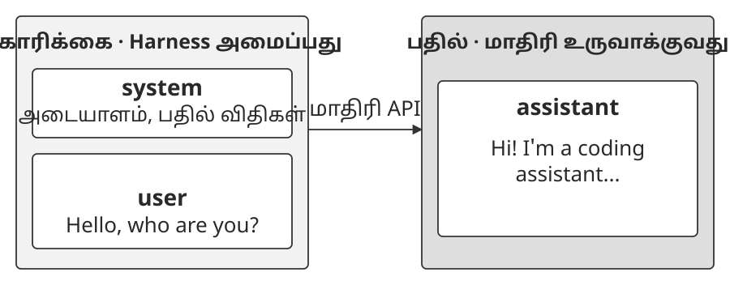

உள்ளூர் மாதிரியின் இடைமுக வடிவத்தின்படி கோரிக்கையையும் எடுத்துக்காட்டுப் பதிலையும் கீழே எழுதுகிறோம்; குறியீட்டில் உள்ள குறிப்புகள் ஒவ்வொரு பகுதியின் மூலத்தையும் காட்டுகின்றன:

```javascript
// Harness 构造请求
{
  "model": "Qwen3-0.6B",
  "messages": [
    {
      "role": "system",                           // 开发者提供的指令
      "content": "You are a helpful coding assistant. Follow user instructions."
    },
    {
      "role": "user",                              // 用户输入
      "content": "Hello, who are you?"
    }
  ]
}
```
```javascript
// API 返回响应
{
  "choices": [{
    "message": {
      "role": "assistant",                         // 模型生成
      "content": "Hi! I'm a coding assistant. I can help you write code, debug issues, and explain technical concepts. How can I help?"
    }
  }]
}
```
கோரிக்கையில் ஒரு `system` செய்தியும் ஒரு `user` செய்தியும் உள்ளன; பதிலில் `choices[0].message` மாதிரி உருவாக்கிய `assistant` செய்தியைச் சேமிக்கிறது. இங்குப் பயன்படுத்தப்படும் நிலையற்ற இடைமுகத்தில், **ஒவ்வொரு அழைப்புக்கும் தேவையான சூழலை வழங்குவது Harness-இன் பொறுப்பு**. இந்த உரையாடலைத் தொடர அடுத்த கோரிக்கையில் தொடர்புடைய வரலாற்றைச் சேர்த்துக் கொள்ள வேண்டும்.

### கருவி அழைப்புடன் கூடிய பல சுற்று இடைவினை: ஏஜெண்டின் மையச் சுழற்சி

கருவி தேவைப்படும் இன்னொரு கேள்வியைப் பார்ப்போம்: "What's the current time and weather in Vancouver?" இதற்குப் பதிலளிக்க, முதலில் அந்த இடத்தின் நேரத்தையும் வானிலையையும் தேட வேண்டும். படம் 2-3-இல், Harness முதல் முறை மாதிரியை அழைக்கும்போது இரண்டு கருவிக் கோரிக்கைகளைப் பெறுகிறது. அவை நேரச் சேவையையும் வானிலைச் சேவையையும் தனித்தனியாக வினவி, இரு முடிவுகளையும் செய்தி வரலாற்றில் சேர்த்து, இரண்டாம் முறை மாதிரியை அழைத்த பிறகே பயனருக்கான பதில் கிடைக்கிறது.

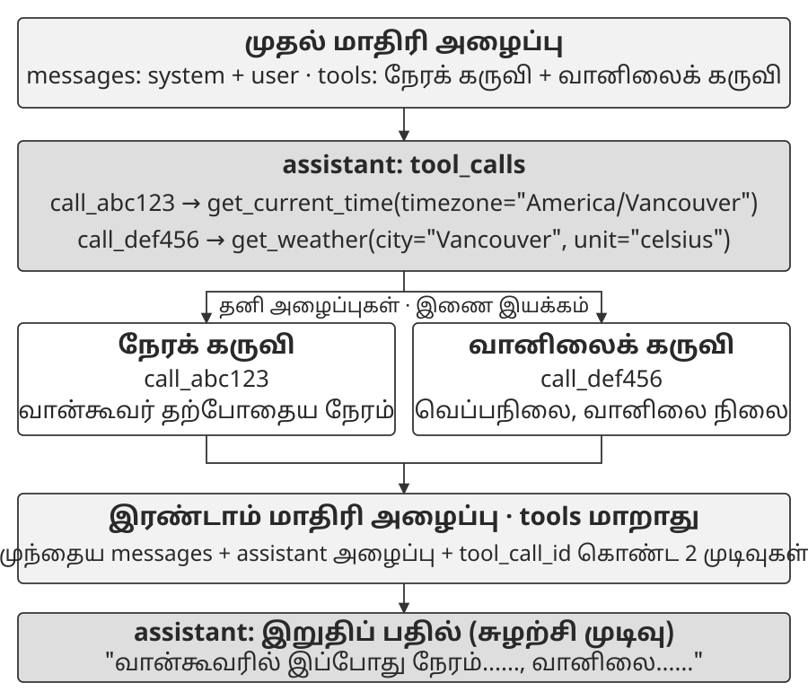

இந்த இரு கருவிகளில் எது முதலில் இயங்க வேண்டும்? நேரக் கருவிக்கு நேர மண்டலம் தேவை; வானிலைக் கருவிக்கு நகரமும் வெப்பநிலை அலகும் தேவை. பயனர் வான்கூவர் என்று மட்டுமே சொன்னார்; எடுத்துக்காட்டில் உள்ள மாதிரி அதன் அடிப்படையில் `America/Vancouver` என்றும் `Vancouver` என்றும் நிரப்பி, வெப்பநிலை அலகாக செல்சியஸைத் தேர்ந்தெடுத்தது. வானிலையை வினவ, நேரக் கருவி திருப்பித் தருவதற்காகக் காத்திருக்க வேண்டியதில்லை; இரு வினவல்களையும் ஒரே நேரத்தில் அனுப்பலாம்.

**முதல் API அழைப்பு — ஏஜெண்ட் சட்டகம் ஆரம்பக் கோரிக்கையை அனுப்புகிறது:**

```javascript
// 第一次模型调用：Harness 构造请求
{
  "model": "Qwen3-0.6B",
  "messages": [
    {
      "role": "system",                           // 开发者提供的指令
      "content": "You are a helpful assistant. Use the provided tools to get real-time information when needed."
    },
    {
      "role": "user",                              // 用户输入
      "content": "What's the current time and weather in Vancouver?"
    }
  ],
  "tools": [                                       // 开发者定义的工具
    {
      "type": "function",
      "function": {
        "name": "get_current_time",
        "description": "Get the current date and time in a specific timezone",
        "parameters": {
          "type": "object",
          "properties": {
            "timezone": { "type": "string", "description": "Timezone name, e.g. America/Vancouver" }
          },
          "required": ["timezone"]
        }
      }
    },
    {
      "type": "function",
      "function": {
        "name": "get_weather",
        "description": "Get the current weather for a specific city",
        "parameters": {
          "type": "object",
          "properties": {
            "city": { "type": "string", "description": "City name" },
            "unit": { "type": "string", "enum": ["celsius", "fahrenheit"] }
          },
          "required": ["city", "unit"]
        }
      }
    }
  ]
}
```
இந்த `tools` பட்டியலை மேம்பாட்டாளர் முன்கூட்டியே வரையறுத்திருப்பார்; பெயர், விளக்கம், அளவுரு schema ஆகியவை அதில் அடங்கும். இந்த எடுத்துக்காட்டில் ஒவ்வொரு சுற்றின் கோரிக்கையிலும் அதே இரு கருவிகள் வழங்கப்படுகின்றன; பட்டியலையும் பயனர் கேள்வியையும் படித்த பிறகு, எந்தக் கருவியை அழைப்பது, என்ன அளவுருக்களை நிரப்புவது என்று மாதிரி தேர்ந்தெடுக்கிறது.

**மாதிரி இரண்டு கருவி அழைப்புக் கோரிக்கைகளைத் திருப்பித் தருகிறது:**

```javascript
// 模型返回工具调用请求
{
  "choices": [{
    "message": {
      "role": "assistant",                         // 模型生成
      "content": null,                             // 本轮没有文本回复
      "tool_calls": [                              // 请求调用两个工具
        {
          "id": "call_abc123",
          "type": "function",
          "function": {
            "name": "get_current_time",
            "arguments": "{\"timezone\": \"America/Vancouver\"}"
          }
        },
        {
          "id": "call_def456",
          "type": "function",
          "function": {
            "name": "get_weather",
            "arguments": "{\"city\": \"Vancouver\", \"unit\": \"celsius\"}"
          }
        }
      ]
    }
  }]
}
```
பதிலில் உள்ள `tool_calls` இரண்டு கோரிக்கைகளைக் கொண்டுள்ளது; ஒவ்வொன்றுக்கும் அதன் சொந்த `id`, கருவிப் பெயர், அளவுருக்கள் உள்ளன. `arguments` என்பது JSON வடிவில் குறியிடப்பட்ட சரம்; இயக்கப் பக்கம் முதலில் அதைப் பாகுபடுத்தி, பின்னர் புலங்களையும் மதிப்புகளையும் சரிபார்க்க வேண்டும். **எதை அழைப்பது, என்ன அளவுருக்களை அனுப்புவது என்பதை மாதிரி தீர்மானிக்கிறது; சரிபார்த்துத் திட்டமிடுவது Harness-இன் பொறுப்பு; நேர அல்லது வானிலைச் சேவையை அணுகுவது கருவிச் செயலாக்கத்தின் பொறுப்பு.**

**ஏஜெண்ட் சட்டகம் கருவிகளை இயக்கி, பின்னர் இரண்டாம் API அழைப்பைத் தொடங்குகிறது:**

கோரிக்கையைச் சரிபார்த்த பிறகு Harness இரு கருவிகளையும் திட்டமிடுகிறது; திருப்பு மதிப்புகளை `tool` செய்திகளாக எழுதி, ஏற்கனவே உள்ள வரலாற்றையும் புதிய முடிவுகளையும் சேர்த்து மாதிரிக்கு அளிக்கிறது:

```javascript
// 第二次模型调用：追加工具结果
{
  "model": "Qwen3-0.6B",
  "messages": [
    {
      "role": "system",                           // 保留第一次请求中的消息
      "content": "You are a helpful assistant. Use the provided tools to get real-time information when needed."
    },
    {
      "role": "user",                              // 保留第一次请求中的消息
      "content": "What's the current time and weather in Vancouver?"
    },
    {
      "role": "assistant",                         // 保留前一轮模型的调用请求
      "content": null,
      "tool_calls": [
        { "id": "call_abc123", "type": "function", "function": { "name": "get_current_time", "arguments": "{\"timezone\": \"America/Vancouver\"}" } },
        { "id": "call_def456", "type": "function", "function": { "name": "get_weather", "arguments": "{\"city\": \"Vancouver\", \"unit\": \"celsius\"}" } }
      ]
    },
    {
      "role": "tool",                              // Harness 写入工具执行结果
      "tool_call_id": "call_abc123",
      "content": "{\"timezone\": \"America/Vancouver\", \"datetime\": \"2025-09-13T05:18:47\", \"day_of_week\": \"Saturday\"}"
    },
    {
      "role": "tool",                              // Harness 写入工具执行结果
      "tool_call_id": "call_def456",
      "content": "{\"city\": \"Vancouver\", \"temperature\": 13.2, \"unit\": \"celsius\", \"conditions\": \"clear\", \"humidity\": 93}"
    }
  ],
  "tools": [ ... ]                                 // 沿用前面的工具定义，此处省略
}
```
`call_def456` வழியாக இரண்டாம் கோரிக்கையைப் படியுங்கள்: முந்தைய `assistant` செய்தியில், அது வான்கூவர் வானிலை வினவலின் எண்; அதன் பிறகு வரும் `tool` செய்தி அதே எண்ணைக் கொண்டு 13.2 °C-ஐயும் தெளிவான வானிலையையும் திருப்பித் தந்துள்ளது. வானிலை நேரத்தை விட முந்தி வந்தாலும், முடிவையும் கோரிக்கையையும் Harness சரியாக இணைக்க முடிகிறது. இந்தச் சுற்றில் பயனரின் அசல் கேள்வி, தான் அனுப்பிய இரு வினவல்கள், கருவிகள் தேடித் தந்த தரவு ஆகிய அனைத்தையும் மாதிரி ஒருசேரப் படிக்கிறது. இப்போது பயனருக்குப் பதிலளிக்க முடியும்.

**கருவி முடிவுகளின் அடிப்படையில் மாதிரி இறுதிப் பதிலை உருவாக்குகிறது:**

```javascript
// 模型生成最终回复
{
  "choices": [{
    "message": {
      "role": "assistant",                         // 模型生成
      "content": "It's currently 5:18 AM on Saturday, September 13, 2025 in Vancouver.\n\nWeather: 13.2°C with clear skies and 93% humidity. It's quite cool this morning - you might want to grab a jacket."
    }
  }]
}
```
இரண்டாம் பதில் இறுதி உரையைத் தருகிறது; `tool_calls` காலியாக இருப்பதால் எடுத்துக்காட்டுச் சுழற்சி முடிகிறது. "மாதிரியை அழைத்தல்→கருவியை இயக்குதல்→முடிவைத் திருப்பித் தருதல்→மீண்டும் மாதிரியை அழைத்தல்" என்ற இந்தச் செயல்முறையே, அத்தியாயம் 1-இல் உள்ள இயக்கச் சுழற்சியின் API வடிவச் செயலாக்கம்.

பயனர் "அப்படியானால் டோக்கியோ?" என்று தொடர்ந்து கேட்டால், Harness அந்தச் செய்தியை வரலாற்றின் இறுதியில் சேர்த்து, மீண்டும் மாதிரியை அழைக்கிறது. "தற்போதைய நேரத்தையும் வானிலையையும் வினவுதல்" என்ற பணிப் பின்னணியை மாதிரி தொடர்ந்து பயன்படுத்தி, டோக்கியோவுக்கான புதிய கோரிக்கையை உருவாக்கலாம்; கருவிகள் முடிவைத் திருப்பித் தந்த பிறகு, புதிய பதிலைத் தொகுக்கலாம்.

**Responses API-ஐப் பயன்படுத்தினால், கருவி முடிவுகளை எவ்வாறு திருப்பித் தருவது?** மேலே உள்ள உள்ளூர் சோதனை Chat Completions-இணக்கமான இடைமுகத்தைப் பயன்படுத்தியது. OpenAI-இன் சேவையில் புதிய திட்டத்தை உருவாக்கினால், அதிகாரபூர்வமாக Responses API பரிந்துரைக்கப்படுகிறது. அதே வான்கூவர் எடுத்துக்காட்டையே பார்ப்போம்: பயன்பாட்டு நிரல் கேள்வியைக் கோரிக்கையின் `input`-இல் வைத்து, `tools`-இல் நேரம், வானிலை ஆகிய இரு சார்புகளையும் அறிவிக்கிறது. திருப்பித் தரப்படும் `output` என்பது வகைப்படுத்தப்பட்ட உருப்படிகளின் தொகுப்பு. அதில் இரண்டு `function_call` இருந்தால், ஒவ்வொன்றிலிருந்தும் சார்பின் பெயர், அளவுருக்கள், `call_id` ஆகியவற்றைப் படித்து, கருவிகளைத் தனித்தனியாக இயக்குகிறது.[^ch2-responses-loop]

வானிலைச் சார்பின் அழைப்பு எண் `call_weather` என்று வைத்துக்கொள்வோம். அடுத்தக் கோரிக்கையின் `input`-இல் இப்படிப்பட்ட ரசீதை வைக்கலாம்; நேரச் சார்பும் தன் எண்ணின்படி முடிவைத் திருப்பித் தர வேண்டும்.

```json
{"type": "function_call_output", "call_id": "call_weather", "output": "{\"temperature\": 13.2, \"unit\": \"celsius\"}"}
```
`call_id` ஒரு ரசீதை ஒரு சார்பு அழைப்புடன் மீண்டும் இணைக்கிறது. `previous_response_id` முந்தைய மாதிரிப் பதிலைச் சுட்டி, அந்தச் சுற்றின் சூழலைச் சேவை தொடர உதவுகிறது. இந்த இரு எண்களும் வெவ்வேறு பொருள்களைச் சுட்டுகின்றன. இந்தத் தொடர் முறையில், இந்தச் சுற்றிலும் பயன்படுத்த வேண்டிய கருவிகளையும் மேலடுக்கு `instructions`-ஐயும் வழங்க வேண்டும்; முந்தைய கோரிக்கையின் மேலடுக்கு அறிவுறுத்தல்கள் பதில் எண்ணுடன் தானாக வழங்கப்படுவதில்லை. மாதிரி தொடர்ந்து கருவிகளைக் கோரலாம்; அடுத்த `output`-ஐப் படித்து முடிக்க வேண்டுமா என்று பயன்பாடு தீர்மானிக்க வேண்டும். அத்தியாயம் 1-இன் சோதனை 1-3 சேவையகம் நிர்வகிக்கும் தேடலைப் பயன்படுத்தியது; இங்குள்ள இரு தனிப்பயன் சார்புகளையோ பயன்பாட்டு நிரலே உண்மையில் இயக்குகிறது.

[^ch2-responses-loop]: OpenAI, Responses API-க்கு இடம்பெயர்தல், சார்பு அழைப்பு, response உருவாக்கும் அளவுரு விளக்கங்கள்.

### ஏஜெண்டின் மையச் சுழற்சியைக் குறியீட்டில் செயலாக்குதல்

சுழற்சியில் உள்ள இரண்டு `messages.append` அழைப்புகள் முறையே மாதிரிப் பதிலையும் கருவி இயக்க முடிவையும் சேமிக்கின்றன. நேரமும் வெப்பநிலையும் வான்கூவரிலிருந்தே வந்தவை; இரு அழைப்பு ID-களையும் மாற்றிப் போட்டால், அடுத்த சுற்றில் "நேர வினவல்" 13.2 செல்சியஸைத் திருப்பித் தந்ததாக மாதிரி படிக்கும்.

எடுத்துக்காட்டு OpenAI Python SDK வழியாக இணக்கமான சேவையுடன் இணைகிறது. இயல்பு முகவரி உள்ளூர் கணினியின் `http://localhost:8000/v1`; ஏற்கனவே தொடங்கப்பட்ட, அங்கீகாரம் தேவைப்படாத உள்ளூர்ச் சேவைக்கு இது பொருந்தும். இந்த இயல்பு மதிப்புகள் சோதனை 2-1-இன் vLLM பின்தளத்துக்கு உரியவை. அந்தச் சோதனையின் Ollama பின்தளத்தைப் பயன்படுத்தினால், முகவரியை `http://localhost:11434/v1` என்று அமைத்து, மாதிரிப் பெயரை `qwen3:0.6b` என்று மாற்றுங்கள். பிற சேவைகளுடன் இணைக்கும்போது, தேவைக்கேற்ப `LLM_BASE_URL`, `LLM_API_KEY` ஆகிய சூழல் மாறிகளை அமைத்து, கீழே உள்ள `model`-ஐ உண்மையான வரிசைப்படுத்தலின் பெயருடன் ஒத்ததாக வைக்கவும். நேர, வானிலைக் கருவிகள் தற்காலிகமாக முந்தைய எடுத்துக்காட்டின் நிலையான தரவையே பயன்படுத்துகின்றன; செய்திகளை ஒப்பிட்டுப் பார்க்க இது வசதி. உண்மையான தரவை இணைக்கும்போது இந்த இரு கருவிகளின் செயலாக்கத்தை மாற்றவும்.

```python
import json
import os

from openai import OpenAI

client = OpenAI(
    base_url=os.getenv("LLM_BASE_URL", "http://localhost:8000/v1"),
    api_key=os.getenv("LLM_API_KEY", "EMPTY"),
)

# 工具定义：名称、用途和参数结构
tools = [
    {
        "type": "function",
        "function": {
            "name": "get_current_time",
            "description": "Get the current date and time in a specific timezone",
            "parameters": {
                "type": "object",
                "properties": {
                    "timezone": {"type": "string", "description": "Timezone name, e.g. America/Vancouver"}
                },
                "required": ["timezone"],
            },
        },
    },
    {
        "type": "function",
        "function": {
            "name": "get_weather",
            "description": "Get the current weather for a specific city",
            "parameters": {
                "type": "object",
                "properties": {
                    "city": {"type": "string", "description": "City name"},
                    "unit": {"type": "string", "enum": ["celsius", "fahrenheit"]},
                },
                "required": ["city", "unit"],
            },
        },
    },
]

# 示例工具使用固定数据，参数与前面的温哥华查询一致。
def execute_tool(name, arguments):
    args = json.loads(arguments)
    if name == "get_current_time" and args == {"timezone": "America/Vancouver"}:
        result = {
            "timezone": "America/Vancouver",
            "datetime": "2025-09-13T05:18:47",
            "day_of_week": "Saturday",
        }
    elif name == "get_weather" and args == {"city": "Vancouver", "unit": "celsius"}:
        result = {
            "city": "Vancouver", "temperature": 13.2,
            "unit": "celsius", "conditions": "clear", "humidity": 93,
        }
    else:
        result = {"error": "示例仅提供温哥华时间和摄氏天气数据"}
    return json.dumps(result, ensure_ascii=False)

# 初始消息：指令与用户任务
messages = [
    {"role": "system", "content": "You are a helpful assistant. Use tools to get real-time information when needed."},
    {"role": "user", "content": "What's the current time and weather in Vancouver?"},
]

# 运行循环：最多调用模型八轮
rounds = 0
while rounds < 8:
    rounds += 1
    response = client.chat.completions.create(
        model="Qwen3-0.6B", messages=messages, tools=tools
    )
    assistant_message = response.choices[0].message

    # 保存模型回复，包括本轮的调用请求
    messages.append(assistant_message.model_dump(exclude_none=True))

    # 本例在模型给出不含工具调用的回复时结束
    if not assistant_message.tool_calls:
        print(assistant_message.content)
        break

    # 逐个执行并追加结果；独立调用也可以改为并行调度
    for tool_call in assistant_message.tool_calls:
        try:
            result = execute_tool(tool_call.function.name, tool_call.function.arguments)
        except json.JSONDecodeError:
            result = json.dumps({"error": "工具参数需要有效的 JSON"})
        messages.append({
            "role": "tool",
            "tool_call_id": tool_call.id,
            "content": result,
        })
    # 下一轮使用追加了结果的消息列表
else:
    print("已达到轮数上限，任务尚未完成。")
```
முதல் சுற்றில் மாதிரி நேரத்தையும் வானிலையையும் ஒருசேரக் கோரியது என்று வைத்துக்கொள்வோம். இங்குள்ள `for` சுழற்சி முதலில் நேரத்தை வினவி, முடிவை `messages`-இல் சேர்த்து, பின்னர் வானிலையை வினவி இரண்டாம் முடிவையும் சேர்க்கிறது. இரண்டும் இயங்கிய பிறகே நிரல் `while`-இன் தொடக்கத்துக்குத் திரும்பி இரண்டாம் மாதிரிக் கோரிக்கையை அனுப்புகிறது. இந்தப் படிகளில் `messages`-இல் என்ன இருந்தது என்பதை விரித்துப் பார்த்தால், ஒவ்வொரு முறையும் மாதிரி எதைப் பெற்றது என்று தெரியும்.

**ஆரம்ப நிலை (1-ஆம் அழைப்புக்கு முன்):**
```text
messages = [
  { role: "system",  content: "You are a helpful assistant..." },     # 开发者写的
  { role: "user",    content: "What's the current time and weather in Vancouver?" },  # 用户输入
]
```
**1-ஆம் மாதிரி அழைப்பும் கருவி இயக்கமும் முடிந்த பிறகு:**
```text
messages = [
  { role: "system",    content: "..." },
  { role: "user",      content: "What's the current time..." },
  { role: "assistant", tool_calls: [get_current_time, get_weather] },  # 模型生成的调用请求
  { role: "tool",      tool_call_id: "call_abc123", content: "{time...}" },  # 工具执行后由 Harness 写入
  { role: "tool",      tool_call_id: "call_def456", content: "{weather...}" },  # 工具执行后由 Harness 写入
]
```
**2-ஆம் அழைப்புக்குப் பிறகு (மாதிரி இறுதிப் பதிலைத் திருப்பித் தந்து சுழற்சி முடிகிறது):**
```text
messages = [
  { role: "system",    content: "..." },
  { role: "user",      content: "What's the current time..." },
  { role: "assistant", tool_calls: [get_current_time, get_weather] },
  { role: "tool",      tool_call_id: "call_abc123", content: "{time...}" },
  { role: "tool",      tool_call_id: "call_def456", content: "{weather...}" },
  { role: "assistant", content: "It's currently Saturday, Sep 13, 2025 in Vancouver..." },  # 最终回复
]
```
### API கண்ணோட்டத்தில் சூழலின் அமைப்பு

படம் 2-4 ஒரு கோரிக்கையை முன்னொட்டு, செய்தி வரலாறு என இரண்டாகப் பிரிக்கிறது. முன்பு வான்கூவர் வினவல் அனுப்பப்பட்டபோது, வரலாற்றில் பயனரின் கேள்வியும் அதற்கு முந்தைய உரையாடலும் மட்டுமே இருந்தன. இரு வினவல்களும் முடிந்த பிறகு, வரலாற்றில் மாதிரி முன்மொழிந்த கருவி அழைப்புகளும் இரு கருவி முடிவுகளும் சேர்ந்துள்ளன.

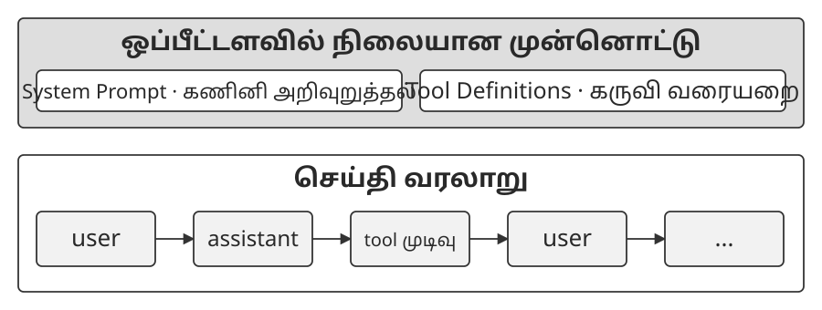

எனவே, தொடர்ச்சியான இரு கோரிக்கைகளின் தொடக்கத்தில் ஒத்த பகுதி, செய்தி வரலாற்றுக்குள் வரை நீளலாம். அடுத்த சுற்றில் எவ்வளவு பழைய கணக்கீட்டை மீண்டும் பயன்படுத்த முடியும் என்பது, இந்த முன்னொட்டு எவ்வளவு நீளம் என்பதைப் பொறுத்தது.

கீழே உள்ள Harness அடிக்கடி மாறாத சிஸ்டம் அறிவுறுத்தல்களையும் கருவி வரையறைகளையும் முன்னால் வைத்து, ஒவ்வொரு சுற்றிலும் வரலாற்றுச் செய்திகளின் இறுதியில் தற்போதைய நிலையை மட்டும் சேர்க்கிறது. வரலாறு மிக நீளமானால், பழைய செய்திகளை முதலில் சுருக்கி, பின்னர் கோரிக்கையைத் தொகுக்கிறது.

```python
stable_prefix = system_message
stable_tools = core_tool_schemas
history = load_message_history(session)
status_message = make_status_message(derive_current_state(history))

if estimated_tokens(stable_prefix, stable_tools, history, status_message) > budget:
    history = compress_old_evidence(
        history,
        preserve = [decisions, constraints, failures, citations]
    )

request.messages = [stable_prefix] + history + [status_message]
request.tools = stable_tools
response = call_model(request)
```
சுருக்கும்போது முடிவுகள், கட்டுப்பாடுகள், தோல்விகள், மேற்கோள்கள் போன்ற பின்னர் தேவைப்படும் தகவலைத் தக்கவைத்து, அழைப்புக் கோரிக்கைகளுக்கும் கருவி முடிவுகளுக்கும் இடையிலான தொடர்பைப் பராமரிக்க வேண்டும். நீள நிதிநிலை தவிர, தகவல் மீள்வருகை (duplication) மற்றும் காலாவதியடைதலும் சுருக்கத்தைத் தூண்டலாம்; குறிப்பிட்ட உத்திகளை இந்த அத்தியாயத்தின் பிற்பகுதி விரிவாக விளக்கும்.

> **சோதனை 2-1 ★: உள்ளூர் LLM சேவையை வரிசைப்படுத்துதலும் கருவி அழைப்பும்**
>
> இந்தச் சோதனை Qwen3-0.6B-ஐ உள்ளூரில் இயக்கி, "வான்கூவரின் நேரத்தையும் வானிலையையும் வினவுதல்" என்ற பணியைப் பின்தொடர்ந்து, செய்திகள் மாதிரி, பாகுபடுத்தி (parser), கருவி இயக்கி ஆகியவற்றை எவ்வாறு கடக்கின்றன என்பதை அவதானிக்கிறது. உள்ளூர்ச் சேவைக்கும் கிளையண்டுக்கும் இடையிலான பணிப்பகிர்வைப் படம் 2-5 காட்டுகிறது: சேவையகப் பக்கம் மாதிரியை ஏற்றி, உள்ளீட்டைச் செயலாக்கி, பதிலை உருவாக்குகிறது; கிளையண்ட் செய்தி வரலாற்றைப் பராமரித்து, கருவிகளைத் திட்டமிட்டு, முடிவுகளைத் திருப்பி அனுப்புகிறது.
>
> 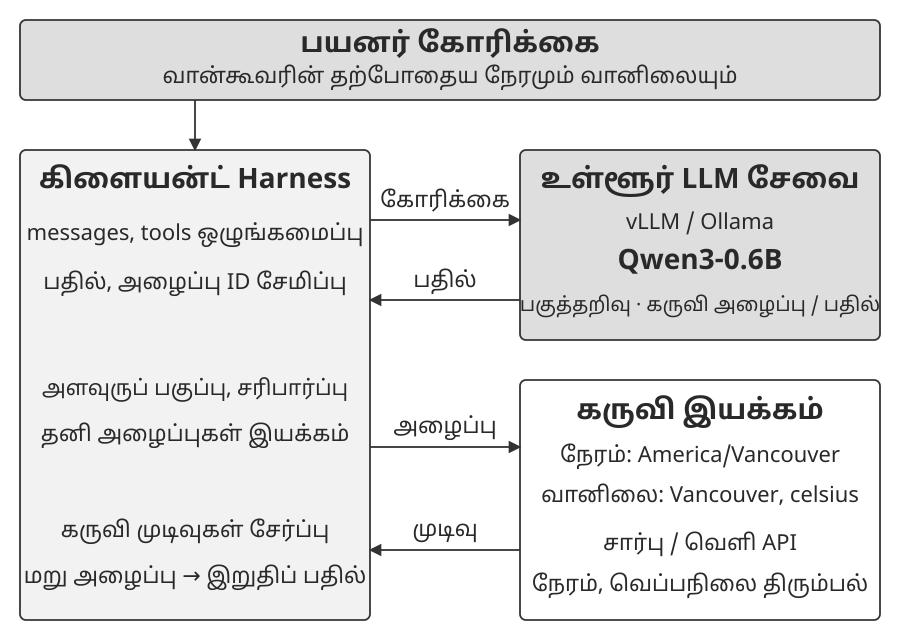
>
> **முதலில் ஒரு முழுமையான பணியைப் பின்தொடர்வோம்.** மாதிரி ஒரே சுற்று வெளியீட்டில் நேரத்தையும் வெப்பநிலையையும் வினவக் கோரி, `America/Vancouver`, `Vancouver`, `celsius` போன்ற அளவுருக்களைத் தனித்தனியாக நிரப்புகிறது. கிளையண்ட் இரு கருவிகளையும் இணையாக இயக்குகிறது. முதல் ரசீது உள்ளூர் நேரம் 11:11:28 என்றும், இரண்டாவது ரசீது வெப்பநிலை 17.9 °C என்றும் தருகிறது. இரு முடிவுகளும் மாதிரிக்குத் திருப்பி அனுப்பப்பட்ட பிறகு, அது நேரத்தை நிமிடம் வரை தெரிவித்து, வெப்பநிலை 17.9 °C என்று பதிலளித்து, இந்தச் சுழற்சியை முடிக்கிறது. அறுநூறு மில்லியன் அளவுருக்கள் கொண்ட மாதிரியே இந்தப் பணிக்குச் சரியான இரு கருவிகளைத் தேர்ந்தெடுத்து, அளவுருக்களை நிரப்பி, திருப்பு மதிப்புகளைக் கொண்டு பயனருக்குப் பதிலளிக்க முடிகிறது என்பதை இந்த இயக்கம் காட்டுகிறது.
>
> **அடுத்து, மூல வெளியீட்டுக்கும் API புலங்களுக்கும் உள்ள தொடர்பைப் பார்ப்போம்.** Qwen3-இன் சிந்தனைப் பயன்முறை `<think>` குறியுடன் கூடிய பகுத்தறிவு உள்ளடக்கத்தை உருவாக்கலாம்; கருவிக் கோரிக்கைகள் அதற்குரிய அழைப்புக் குறிகளைப் பயன்படுத்துகின்றன. சேவையகம் பாகுபடுத்திய பிறகு, கிளையண்ட் தனியான `thinking` புலத்தையோ கருவி அழைப்புப் புலத்தையோ பெறலாம். வெளியீட்டில் உள்ள பகுதிகளின் வரிசையும் தக்கவைப்பு முறையும் மாதிரி வார்ப்புருவாலும் சேவை நெறிமுறையாலும் இணைந்து தீர்மானிக்கப்படுகின்றன.
>
> **பின்னர் ஓடைச் (streaming) செயலாக்கத்தை அவதானிப்போம்.** நிகழ்வுகளுக்கேற்ப இடைமுகம் "சிந்திக்கிறது", "கருவியை அழைக்கிறது", "பதிலை உருவாக்குகிறது" போன்ற நிலைகளைப் புதுப்பிக்கலாம். கருவி அளவுருக்கள் பொதுவாகப் பல துண்டுகளாக வந்து சேருகின்றன; அவற்றைக் குவித்து முழுமையான கோரிக்கையாக்க வேண்டும். அந்த அழைப்பு முடிந்ததை நெறிமுறை உறுதிசெய்து, அளவுருக்கள், அனுமதிகள், சார்புநிலைச் சரிபார்ப்புகள் வெற்றி பெற்ற பிறகு, இயக்க அமைப்பு திட்டமிடலைத் தொடங்கலாம். ஒன்றையொன்று சாராத கருவிகளை இணையாக இயக்கலாம்; அடுத்தடுத்த வெளியீட்டுச் செயலாக்கத்துடன் குழாய்வழி (pipeline) அமைக்கவும் செய்யலாம்.
>
> **இறுதியாக வேகத்தையும் தற்காலிகச் சேமிப்பையும் ஒப்பிடுவோம்.** இந்த முறை Apple சிப் கொண்ட Mac-இல் இயங்கிய பதிவில், கருவிப் பணியின் சராசரிக் குறிவிலக்க வேகம் வினாடிக்குச் சுமார் 107 token. Token என்பது மாதிரி உரையைச் செயலாக்கும் அடிப்படை அலகு; அதை எவ்வாறு பிரிப்பது என்பதை tokenizer தீர்மானிக்கிறது; ஒரு சொல்லோ ஒரு சீன எழுத்தோ ஒன்று அல்லது பல token-களுக்குச் சமமாக இருக்கலாம். குறிவிலக்க வேகம் உருவாக்கம் தொடங்கிய பிறகான வெளியீட்டு விகிதத்தைக் காட்டுகிறது; பயனர் எவ்வளவு நேரம் காத்திருக்கிறார் என்பது முதல் token தாமதம், பகுத்தறிவு நீளம், கருவி நேரம் ஆகியவற்றாலும் பாதிக்கப்படுகிறது.
>
> தற்காலிகச் சேமிப்பு ஒப்பீடு, ஒரே நீண்ட முன்னொட்டைப் பயன்படுத்தி, முன்னொட்டைத் தக்கவைத்த கோரிக்கையையும் முன்னொட்டின் தொடக்கத்தை மாற்றிய கோரிக்கையையும் தனித்தனியாகச் சோதித்தது. இந்த முறை ஐந்து ஜோடிகளில், முன்னொட்டைத் தக்கவைத்த கோரிக்கை நான்கு ஜோடிகளில் வேகமாக இருந்தது; இரு குழுக்களின் சராசரி முதல் token தாமதம் முறையே சுமார் 1.30 வினாடி, 1.51 வினாடி. இந்தக் கோரிக்கைகள் கணக்கீட்டில் எவ்வாறு வேறுபடுகின்றன என்பதை அடுத்த பகுதி விளக்கும்.
>
> இந்தச் சோதனை சாதனப் பக்க (on-device) ஏஜெண்டுகள் மீதான என் நம்பிக்கையையும் அதிகரித்தது: பயனரின் சொந்தச் சாதனத்திலேயே இத்தகைய கருவி அழைப்புப் பணிகளைச் சிறிய மாதிரிகள் முடிக்க முடிகின்றன. **சாதனப் பக்க ஏஜெண்டுகளின் காலம் பலர் எதிர்பார்ப்பதை விட நெருங்கிவிட்டது.**

## KV Cache-க்கு உகந்த சூழல் வடிவமைப்பு

ஏஜெண்டின் அடுத்தடுத்த கோரிக்கைகள் பொதுவாக ஏராளமான தகவலைப் பகிர்ந்துகொள்கின்றன: சிஸ்டம் அறிவுறுத்தல்கள், கருவி வரையறைகள், ஏற்கனவே நடந்த இடைவினைகள். அனுமான இயந்திரம் இந்த உள்ளடக்கத்தின் இடைநிலைக் கணக்கீட்டு முடிவுகளை மீண்டும் பயன்படுத்த முடிந்தால், அதிகக் கணக்கீட்டைப் புதிய தகவலுக்குச் செலவிட முடியும். **KV Cache** ஒவ்வொரு அடுக்கின் கவனக் கணக்கீட்டில் ஏற்கனவே பெறப்பட்ட விசைகளையும் (Key) மதிப்புகளையும் (Value) சேமித்து, அடுத்தடுத்த token-களுக்குப் பயன்படுத்துகிறது; **Prompt Cache** கோரிக்கைகளுக்கு இடையே தகுதியான முன்னொட்டுச் சேமிப்பை மேலும் மீண்டும் பயன்படுத்துகிறது[^ch2-kv-basics].

ஒரு வாடிக்கையாளர் சேவை ஏஜெண்டைக் கருதுங்கள்: தற்போதைய நேரத்தை மாதிரி அறிய, மேம்பாட்டாளர் சிஸ்டம் ப்ராம்ப்ட்டின் தொடக்கத்தில் `Current time: {{now}}` என்பதைச் சேர்த்து, ஒவ்வொரு கோரிக்கையிலும் புதுப்பிக்கிறார். பின்னால் வரும் வணிக விதிகளும் கருவி வரையறைகளும் மாறாமல் இருந்தாலும், உண்மையான உள்ளீடு நேர முத்திரையிலிருந்தே மாறத் தொடங்குகிறது. ஒரே முன்னொட்டைக் கொண்டு KV-ஐ மீண்டும் பயன்படுத்தும் சேவைகளுக்கு, இது நேர முத்திரையையும் அதற்குப் பின் உள்ள பகுதியையும் மீண்டும் கணக்கிடச் செய்து, உள்ளீட்டுச் செயலாக்க நேரத்தையும் கட்டணத்தையும் அதிகரிக்கிறது.

நேரத்தைச் சேர்ப்புச் செய்தியாக எழுதினாலோ, தேவைப்படும்போது நேரக் கருவியை அழைத்தாலோ, ஏற்கனவே உள்ள முன்னொட்டைத் தக்கவைக்கலாம். இரு அமைப்புகளும் ஏறக்குறைய ஒரே தகவலை வழங்கினாலும், அவை தூண்டும் மறுகணக்கீட்டின் எல்லை வேறுபடுகிறது.

முதலில் மூன்று நடைமுறைகளை நினைவில் வையுங்கள்; பின்வரும் கொள்கைகளும் சோதனைகளும் ஒவ்வொன்றையும் விளக்கும்:

1. **மீண்டும் பயன்படுத்தக்கூடிய முன்னொட்டை நிலையாக வைத்திருங்கள்.** சிஸ்டம் அறிவுறுத்தல்களும் அடிக்கடி பயன்படும் கருவி வரையறைகளும் உறுதியான உள்ளடக்கத்தையும் வரிசையையும் பின்பற்ற வேண்டும்.
2. **இயக்கத்தின்போது ஏற்படும் மாற்றங்களைப் பின்பகுதியில் சேருங்கள்.** நேரம், இருப்புத் தொகை, அழைப்பு எண்ணிக்கை, பணி முன்னேற்றம் ஆகியவற்றைப் புதிய செய்திகள் அல்லது கருவி முடிவுகள் வழியாக வழங்கலாம். சமீபத்திய நிலை எந்தத் தருணத்திலிருந்து செல்லுபடியாகிறது என்பதைக் குறிக்க வேண்டும்; அப்போதுதான் எந்தப் பதிவு தற்போதைய முடிவுக்குப் பொருந்துகிறது என்பதை மாதிரி அடையாளம் காண முடியும்.
3. **மாதிரி நெறிமுறைப்படி செய்திகளை ஒழுங்கமையுங்கள்.** சரியான பங்குகள், அழைப்பு ID-கள், கருவி முடிவு வடிவம் ஆகியவற்றைப் பயன்படுத்தி, தொடர்புடைய அரட்டை வார்ப்புருவைக் கொண்டு மாதிரியின் உள்ளீட்டை உருவாக்குங்கள். தற்காலிகச் சேமிப்பு செயலாக்கப்பட்ட முன்னொட்டையும் தொடர்புடைய உள்ளமைவையும் ஒப்பிடுகிறது; செய்தி நெறிமுறையோ, அறிவுறுத்தல், பயனர் கோரிக்கை, கருவி திருப்பு மதிப்பு ஆகியவற்றை மாதிரி எவ்வாறு அடையாளம் காண்கிறது என்பதையும் தீர்மானிக்கிறது.

இந்தப் பகுதி பயன்படுத்தும் காரணவியல் கவன (causal attention) மாதிரியில், பின்னர் சேர்க்கப்படும் token-கள் முந்தைய இடங்களில் ஏற்கனவே கணக்கிடப்பட்ட நிலைகளை மாற்றுவதில்லை. ஏற்கனவே உள்ள உள்ளீட்டை மாற்றும்போது, முதல் மாற்ற இடத்திலிருந்தும் அதற்குப் பின்னாலும் உள்ள நிலைகளை மீண்டும் கணக்கிட வேண்டும்; மாற்றத்துக்கு முந்தைய முன்னொட்டை இன்னும் மீண்டும் பயன்படுத்த வாய்ப்புண்டு. தற்காலிகச் சேமிப்புத் தொகுதியின் அளவு, தக்கவைப்பு நேரம், இயக்க உள்ளமைவு ஆகியவற்றின் அடிப்படையில், உண்மையில் எவ்வளவு பொருந்துகிறது என்பதைச் சேவையகமும் தீர்மானிக்கிறது.

[^ch2-kv-basics]: Hugging Face, How caching works; அடுக்கு வாரியாக K, V-ஐச் சேமித்து மீண்டும் பயன்படுத்தும் பொறிமுறையை அறிமுகப்படுத்துகிறது.

> **சோதனை 2-2 ★: கவனப் பொறிமுறையைக் காட்சிப்படுத்துதல்**
>
> முதலில் "பெய்ஜிங்கின் வானிலை எப்படி" என்ற வாக்கியத்தைக் கொண்டு ஒரு கவனக் கணக்கீட்டைப் புரிந்துகொள்வோம். காட்சிப்படுத்த எளிதாக, படம் 2-6 இந்த வாக்கியத்தை நான்கு பொருள் அலகுகளாகப் பிரிக்கிறது; உண்மையான மாதிரியில் tokenizer உள்ளீட்டைப் பிரிக்கிறது. "எப்படி" என்ற இடத்தைச் செயலாக்கும்போது, கவன அடுக்கு ஏற்கனவே உள்ள தகவலிலிருந்து தற்போதைய பிரதிநிதித்துவத்தைத் தொகுக்க வேண்டும். Query, Key, Value முறையே வினவல், பொருத்துதல், தகவல் திரட்டல் ஆகிய பங்குகளை வகிக்கின்றன.
>
> | திசையன் | பங்கு | இந்த எடுத்துக்காட்டில் உள்ளுணர்வுப் புரிதல் |
> | --- | --- | --- |
> | **Query (வினவல்)** | பிற இடங்களுடன் பொருத்தத் தற்போதைய இடம் பயன்படுத்தும் திசையன் | "எப்படி" ஏற்கனவே உள்ள உள்ளடக்கத்திலிருந்து தொடர்புடைய தகவலைக் கண்டுபிடிக்க வேண்டும் |
> | **Key (விசை)** | ஒவ்வொரு இடமும் பொருத்துதலில் பங்கேற்கும் திசையன் | "பெய்ஜிங்", "வானிலை" போன்ற இடங்கள் பொருத்தக்கூடிய பிரதிநிதித்துவத்தை வழங்குகின்றன |
> | **Value (மதிப்பு)** | எடைகளின்படி திரட்டப்படும் தகவல் திசையன் | இடம், வானிலை போன்ற தகவல்களை அதற்குரிய விகிதங்களில் தற்போதைய பிரதிநிதித்துவத்தில் சேர்க்கிறது |
>
> Key-ஐ மீட்டெடுப்புக்கான குறிச்சொல்லாகவும், Value-ஐ மீட்டெடுக்கப்பட்ட உள்ளடக்கமாகவும் கற்பனை செய்யலாம். மாதிரியில் உள்ள இந்தத் திசையன்கள் அனைத்தும் மறைநிலைப் பிரதிநிதித்துவங்களிலிருந்து கணக்கிடப்பட்ட எண் மதிப்புகள்; அவற்றின் பொருத்தும் விதத்தைப் பயிற்சி வடிவமைக்கிறது.
>
> ஒரு கணக்கீடு மூன்று படிகளைக் கொண்டது. முதலில், தற்போதைய இடம் Query-ஐ உருவாக்குகிறது; பின்னர், அது ஒவ்வொரு இடத்தின் Key-உடன் புள்ளிப் பெருக்கல் (dot product) செய்யப்பட்டு, அளவிடல், காரணவியல் மறைப்பு (causal mask), softmax ஆகியவற்றைக் கடந்து, கூட்டுத்தொகை 1 ஆகும் கவன எடைகளாக மாறுகிறது; இறுதியில், இந்த எடைகளைக் கொண்டு Value-கள் எடையிட்டுக் கூட்டப்படுகின்றன. புள்ளிப் பெருக்கல் என்பது இரு எண் தொகுதிகளை இடம்-இடமாகப் பெருக்கிக் கூட்டுவது; softmax தெரியக்கூடிய இடங்களின் மதிப்பெண்களை இயல்பாக்கப்பட்ட எடைகளாக மாற்றுகிறது. ஒவ்வொரு இடத்தின் Value-உம் அதற்குரிய எடையின்படி திரட்டலில் பங்கேற்று, அந்தக் கவனத் தலையின் (attention head) வெளியீட்டை ஒன்றாக உருவாக்குகின்றன.
>
> படம் 2-6-இன் கடைசி வரிசையைக் கிடைமட்டமாகப் படியுங்கள்: "எப்படி" என்ற இடம் "வானிலை"க்குக் கொடுக்கும் எடை 0.55. இந்த எண்ணை "வானிலை" இடத்தின் Value-ஆல் பெருக்கி, மற்ற மூன்று இடங்களின் பங்களிப்பையும் சேர்த்தால்தான், "எப்படி" என்ற இடத்தில் அந்தக் கவனத் தலையின் வெளியீடு கிடைக்கும். "வானிலை" வரிசைக்கு மாறும்போது, வலப்பக்கம் ஏன் கூடுதலாக ஒரு பெருக்கல் குறி உள்ளது? ஏனெனில் அந்த இடத்தைக் கணக்கிடும்போது, வரிசை இன்னும் "எப்படி"யை எட்டவில்லை.
>
> 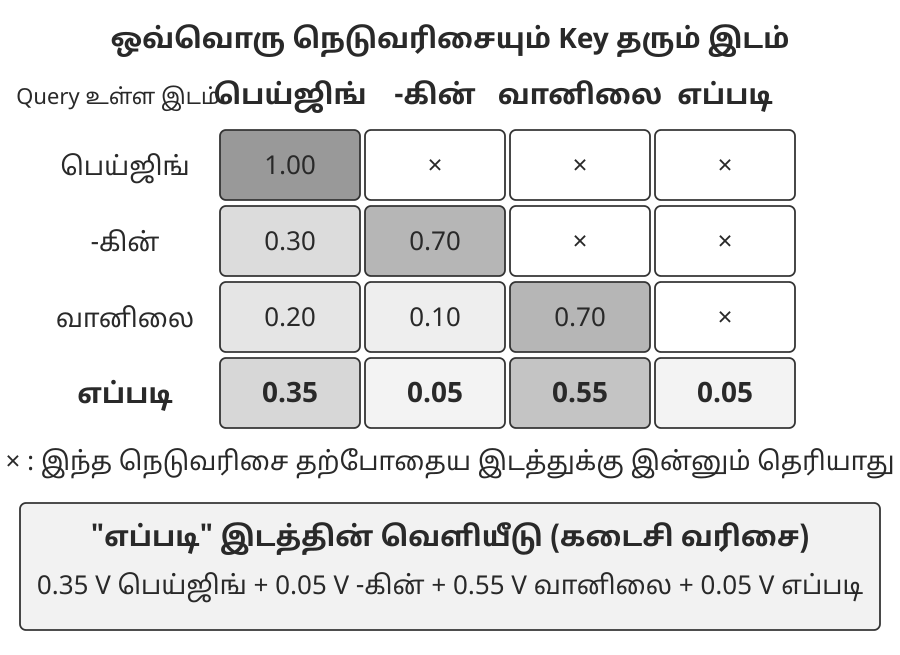
>
> ஒவ்வொரு இடத்தின் எடைகளையும் அணியாக அடுக்கினால், **கவன வெப்ப வரைபடம்** (attention heatmap) கிடைக்கும். ஒவ்வொரு வரிசையும் ஒரு Query-க்கும், ஒவ்வொரு நெடுவரிசையும் ஒரு Key-க்கும் உரியது; நிறத்தின் அடர்த்தி எடையின் அளவைக் காட்டுகிறது. காரணவியல் மறைப்பு தற்போதைய இடம் தன்னையும் முந்தைய இடங்களையும் மட்டுமே படிக்க அனுமதிக்கிறது; மறைக்கப்பட்ட இடங்களைப் படம் × குறியால் காட்டுகிறது; softmax-க்குப் பிறகு அவற்றின் எடை பூஜ்யம். இந்தக் கட்டமைப்பு உள்ளீட்டுச் செயலாக்கத்துக்கும் அடுத்தடுத்த உருவாக்கத்துக்கும் பொருந்தும்.
>
> இங்கிருந்தே K, V சேமிப்பின் பயனும் தெரிகிறது: உருவாக்கம் தொடர்ந்து முன்னேறும்போது, புதிய இடங்கள் இன்னும் ஏற்கனவே உள்ள இடங்களின் Key, Value-களைப் படிக்கின்றன. இந்தத் திசையன்களைச் சேமித்தால், புதிய இடங்கள் அவற்றை நேரடியாகப் பயன்படுத்திப் பொருத்தலையும் திரட்டலையும் செய்யலாம்; வரலாற்று இடங்களை மீண்டும் கணக்கிட வேண்டியதில்லை.
>
> இந்த விளக்க எடைகளைப் புரிந்துகொண்ட பிறகு, Qwen3-0.6B உண்மையில் கணக்கிடும் கவனப் பரவலைப் பார்ப்போம். சோதனை ஒரு குறுகிய வாக்கியத்தையும், பகுத்தறிவும் இறுதிப் பதிலும் கொண்ட ஓர் உருவாக்க வரிசையையும் தனித்தனியாகப் பதிவு செய்து, வெவ்வேறு அடுக்குகளின் கவன அணிகளை ஒப்பிடுகிறது. படம் 2-7 முறையே 0, 13, 27 ஆகிய அடுக்குகளைக் காட்டுகிறது: இடது நெடுவரிசை ஒன்பது token கொண்ட குறுகிய வாக்கியம், வலது நெடுவரிசை 17 × 23-ஐக் கணக்கிடும் உருவாக்க வரிசை; அதில் உள்ளீடு, பகுத்தறிவு, பதில் ஆகியவற்றின் இட வரம்புகள் குறிக்கப்பட்டுள்ளன. வலுவான, வலுக்குறைந்த கவன எடைகளை ஒருசேரத் தெளிவாகப் பார்க்க, சாம்பல் நிற அளவு மடக்கை (logarithmic) அளவுகோலில் உள்ளது.
>
> 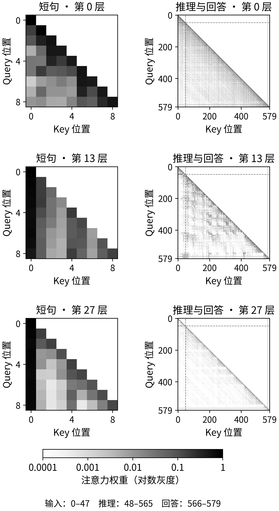
>
> படிக்கும்போது நான்கு துப்புகளைப் பின்தொடர்ந்து பகுப்பாய்வு செய்யலாம்:
>
> 1. **கவனக் கிடங்கு (Attention Sink).** சில அடுக்குகள், வரிசையின் தொடக்கத்தில் உள்ள token குறைவான பொருளையே சுமந்தாலும், அதற்கு அதிக எடையை ஒதுக்குகின்றன. படம் 2-7-இன் இடது நெடுவரிசையில் உள்ள குறுகிய வாக்கியத்தைப் பாருங்கள். ஒவ்வொரு படமும் ஒரே அடுக்கின் கவனத் தலைகளுக்குச் சராசரி எடுக்கப்பட்டது. அணியின் முதல் நெடுவரிசையில் உள்ள ஒன்பது எண்களின் சராசரியை எடுத்தால், ஒன்பது இடங்களும் சராசரியாக முதல் token-க்கு எவ்வளவு எடையைக் கொடுக்கின்றன என்று கணக்கிடலாம். 0, 13, 27 அடுக்குகளில் இது முறையே 14.7%, 73.9%, 83.2%. வலது நெடுவரிசையின் நீண்ட உருவாக்க வரிசைக்கு மாறினால், அடுக்கு 13-இல் இந்த மதிப்பு 28.0% ஆகிறது. softmax ஒவ்வொரு இடத்தின் எடைகளும் கூட்டுத்தொகையில் 1 ஆக இருக்க வேண்டும் என்று கோருகிறது; எனவே மாதிரி ஒப்பீட்டளவில் நிலையான பெறும் இடத்தைக் கற்றுக்கொள்ளலாம்; StreamingLLM இந்த நிகழ்வையும் ஓடை அனுமானத்தில் அதன் பங்கையும் சிறப்பாக ஆராய்ந்துள்ளது[^ch2-attention-sinks].
> 2. **பகுத்தறிவுப் பகுதி.** `<think>`-க்குரிய உருவாக்க இடைவெளியைக் குறித்து, அந்த வரிசைகளின் வழியே மாதிரி எந்த ப்ராம்ப்ட், கருவி விளக்கம், அல்லது முந்தைய பகுத்தறிவில் கவனம் செலுத்தியது என்று பாருங்கள். முக்கோணம் காரணவியல் மறைப்பிலிருந்து வருகிறது; முக்கோணத்துக்குள் உள்ள அடர்த்தி வேறுபாடுகளே ஒவ்வொரு இடத்தின் எடை வேறுபாட்டைக் காட்டுகின்றன.
> 3. **பதில் பகுதி.** இறுதிப் பதிலின் உருவாக்க இடைவெளியையும் குறித்து, அது மூல உள்ளீட்டுக்கும் முந்தைய பகுத்தறிவுக்கும் எடையை எவ்வாறு பகிர்கிறது என்று ஒப்பிடுங்கள். ஏற்கனவே உள்ள எந்தத் தகவல் தற்போதைய கவனத் திரட்டலுக்குள் நுழைந்தது என்பதைக் கண்டறிய இது உதவும்.
> 4. **இட வேறுபாடு.** "Lost in the Middle" ஆய்வு, நீண்ட சூழல் கேள்வி–பதிலிலும் விசை–மதிப்பு மீட்டெடுப்பிலும், நடுப்பகுதியில் உள்ள தகவலைத் திறம்படப் பயன்படுத்துவது கடினம் என்று அவதானித்தது[^lost-in-the-middle]. பொறியியலில் இதன் அடிப்படையில், நிரந்தர விதிகளை முன்பகுதியிலும், தற்போதைய இலக்கையும் முன்னேற்றத்தையும் இறுதியிலும் வைப்பதற்கு முன்னுரிமை கொடுக்கலாம்.

[^ch2-attention-sinks]: Xiao et al., Efficient Streaming Language Models with Attention Sinks, ICLR 2024.

[^lost-in-the-middle]: Liu et al., Lost in the Middle: How Language Models Use Long Contexts, TACL 2024.

### API செய்திகளிலிருந்து மாதிரி Token-கள் வரை: Chat Template

முந்தைய API எடுத்துக்காட்டுகள் பங்குகளுடன் கூடிய செய்தித் தொகுப்புகள்; கவன வரைபடத்தில் உள்ள உள்ளீடோ ஒரு token வரிசை. **Chat Template (அரட்டை வார்ப்புரு)** இந்த மாற்றத்தைச் செய்கிறது: செய்திகளுக்குப் பங்கு, எல்லைக் குறிகளைச் சேர்த்து, ஒப்புக்கொள்ளப்பட்ட முறையில் கருவி விளக்கங்களையும் திருப்பு மதிப்புகளையும் ஒழுங்கமைத்து, பின்னர் tokenizer-இடம் குறியாக்கத்துக்குக் கொடுக்கிறது. படம் 2-8-இன் இரு நெடுவரிசைகளையும் ஒப்பிடுங்கள்: இடப்பக்கம் சிஸ்டம் அறிவுறுத்தலும் பயனர் கேள்வியும் மட்டுமே சமர்ப்பிக்கப்பட்டன; வலப்பக்கம் ஏன் கூடுதலாக ஒரு `assistant` தோன்றுகிறது? அது அடுத்த பதிலுக்காக வார்ப்புரு சேர்த்த தொடக்கக் குறி. பின்னர் கருவி அழைப்பு, பகுத்தறிவுத் தகவலைத் தக்கவைத்தல், தற்காலிகச் சேமிப்புப் பொருத்தம் ஆகியவற்றை விவாதிக்கும்போதும் இந்தக் குறிகள் பயன்படும்.

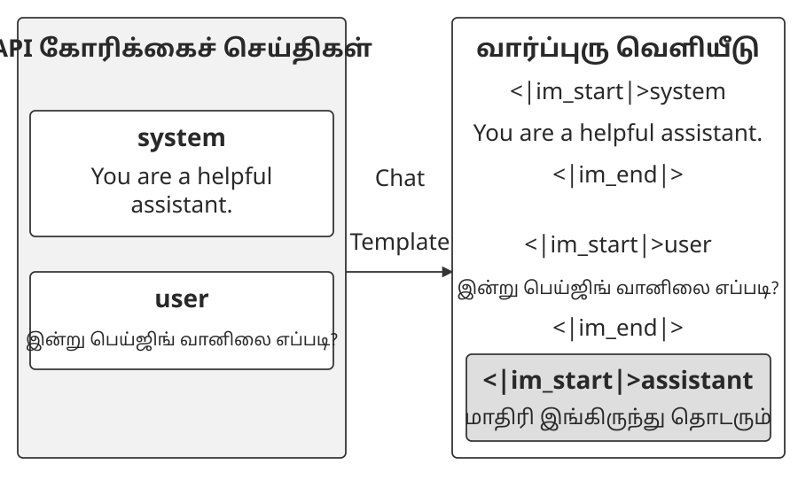

Qwen, Llama, Gemma போன்ற மாதிரிக் குடும்பங்களுக்கு ஒவ்வொன்றுக்கும் சொந்த அரட்டை வார்ப்புரு உண்டு. ஒரே API செய்தித் தொகுப்பை வெவ்வேறு மாதிரிகளுக்குக் கொடுத்தால், மாற்றப்பட்ட பங்கு, எல்லைக் குறிகள் வேறுபடலாம். நிர்வகிக்கப்பட்ட API-களில் பொதுவாகச் சேவையகமே இந்த மாற்றத்தைச் செய்கிறது; சுயமாக வரிசைப்படுத்தும்போதோ, அனுமானச் சேவைக்கு மாதிரியுடன் பொருந்தும் வார்ப்புருவை உள்ளமைக்க வேண்டும்.

பயனர் "வான்கூவர் 17.9 °C" என்ற வாக்கியத்தை அனுப்புகிறார், வானிலைக் கருவியும் தற்செயலாக அதே உரையைத் திருப்பித் தருகிறது என்று வைத்துக்கொள்வோம். இந்த இரு செய்திகளையும் Qwen3-0.6B-இன் வார்ப்புருவிடம் தனித்தனியாகக் கொடுத்தால், படம் 2-9-இல் உள்ள இரு உள்ளீட்டுப் பகுதிகள் கிடைக்கும். இரண்டும் `<|im_start|>user`-இல் தொடங்குகின்றன; உரை கருவியிலிருந்து வந்தது என்பதை எந்தக் குறி காட்டுகிறது?

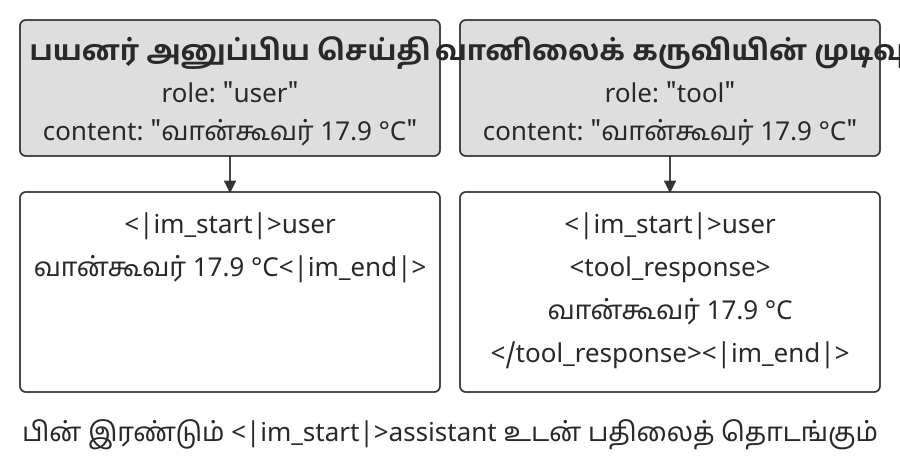

வலது நெடுவரிசையில் கூடுதலாக ஒரு ஜோடி `<tool_response>` குறிச்சொற்கள் உள்ளன. வார்ப்புரு செய்திப் பங்குகளின் அடிப்படையில் பயனரின் சமீபத்திய கேள்வியையும் கண்டறிகிறது: அந்தக் கேள்விக்கு முந்தைய சுற்றுகளில் பதில் உள்ளடக்கம் மட்டும் தக்கவைக்கப்படுகிறது; அதன் பிறகு, கருவி இடைவினைகள் மாதிரியின் பகுத்தறிவுத் தகவலையும் கொண்டிருக்கலாம்[^ch2-qwen-template].

எடுத்துக்காட்டாக, மாதிரி ஒரு கோப்பை வினவிய பிறகும் பகுப்பாய்வைத் தொடர வேண்டியுள்ளது. கருவி முடிவை `tool` பங்கில் திருப்பி அனுப்பினால், வார்ப்புரு அதைத் தற்போதைய பணியின் கருவிப் பின்னூட்டமாக அடையாளம் காண முடியும்; அதே முடிவை நேரடியாகச் சாதாரண `user` செய்தியாக எழுதினால், வார்ப்புரு அதைப் புதிய வினவலாக அடையாளம் கண்டு, முந்தைய பகுத்தறிவின் தக்கவைப்பு எல்லையை மாற்றக்கூடும். இது ஒரு கணக்கைத் தொடர்ந்து செய்யும்போது வரைவுக் கணக்கீடுகளைத் தக்கவைக்க வேண்டியதைப் போன்றது: சேவை கோரும் பகுத்தறிவுப் புலங்களை Harness சேமித்து, சரியான செய்திக் கட்டமைப்பின்படி தொடர்ந்து அழைக்க வேண்டும்.

**ஒற்றைச் சுற்றுப் பகுத்தறிவிலிருந்து நீண்ட நெடிய ஏஜெண்டுக்கு நகரும்போது, வரலாற்றுச் சிந்தனை படிப்படியாகப் பராமரிக்க வேண்டிய பணி நிலையாக மாறுகிறது.** தொடக்ககால DeepSeek-R1-இன் அரட்டை வார்ப்புரு, வரலாற்றுப் பதில்களிலிருந்து சிந்தனைப் பகுதியை நீக்கி, இறுதிப் பதிலை மட்டுமே தக்கவைத்தது[^ch2-r1-template]; பின்னர் வந்த DeepSeek-இன் கருவி அழைப்பு நெறிமுறையோ பகுத்தறிவுத் தகவலைத் திருப்பி அனுப்பக் கோருகிறது. ஒரு கேள்வி–பதில் முடிந்த பிறகு, அடுத்த சுற்றுக்குத் தேவையான தகவல் ஏற்கனவே இறுதிப் பதிலில் இருக்கலாம்; ஆனால் கருவிப் பணி பாதியில் இருக்கும்போது, "இந்தக் கோப்பை ஏன் வினவினோம்", "எந்த அனுமானங்கள் ஏற்கனவே விலக்கப்பட்டன" என்பவை இடைநிலைப் பகுத்தறிவில் மட்டுமே எழுதப்பட்டிருக்கலாம். இந்தத் தகவலைத் தக்கவைப்பது, ஏற்கனவே உள்ள சிந்தனையைத் தொடர்ந்து அடுத்த சுற்று வேலை செய்ய உதவுகிறது.

**பகுத்தறிவுத் தகவலை எவ்வாறு திருப்பி அனுப்புவது என்பதை மாதிரி நெறிமுறை தீர்மானிக்கிறது.** இணைக்கும்போது `content`, `tool_calls`, சேவை வழங்கும் பகுத்தறிவுப் புலங்கள் ஆகிய மூன்றையும் ஒருசேரக் கையாள வேண்டும். கீழே உள்ள சில தீர்வுகள் வெவ்வேறு தொடர் விதிகளைக் காட்டுகின்றன:

- **DeepSeek சிந்தனைப் பயன்முறை** `reasoning_content` வழியாகப் பகுத்தறிவைத் திருப்பித் தருகிறது. அதன் கருவி அழைப்பு நெறிமுறைப்படி, கோரிக்கையில் `tools` இருக்கும்போது, அடுத்தடுத்த கோரிக்கைகள் வரலாற்றுப் பகுத்தறிவை முழுமையாக — கருவியை அழைக்காத மாதிரிப் பதில்கள் உட்பட — திருப்பி அனுப்ப வேண்டும்; புலம் விடுபட்டால் 400 பிழை தூண்டப்படும். `tools` இல்லாத சாதாரண அரட்டைக் கோரிக்கைகளில், திருப்பி அனுப்பப்படும் வரலாற்றுப் பகுத்தறிவைச் சேவை புறக்கணிக்கிறது[^ch2-deepseek-thinking].
- **Kimi-இன் சிந்தனை–கருவி இடைவினைக்கும்** இயக்கச் சுழற்சியில் பகுத்தறிவு, கருவிக் கோரிக்கைகள், முடிவுகள் ஆகியவற்றை நிர்வகிக்க வேண்டும். Kimi K2.5-இன் இடைச்செருகல் சிந்தனை (interleaved thinking) எடுத்துக்காட்டில், பல கருவி அழைப்புகளுக்கு இடையே மாதிரி தொடர்ந்து பகுத்தறியலாம்; கிளையண்ட் அதன் நெறிமுறைப்படி மாதிரிச் செய்திகளைச் சேமித்துத் திருப்பி அனுப்புகிறது[^ch2-kimi-thinking].
- **GLM-இன் தக்கவைக்கப்பட்ட சிந்தனையை** `thinking.clear_thinking: false` மூலம் இயக்கலாம்; அதன் பிறகு `reasoning_content`-ஐ முழுமையாகவும் அசல் வரிசையிலும் திருப்பி அனுப்ப வேண்டும். Coding Plan-க்கும் நிலையான API-க்கும் இயல்பு அமைப்புகள் வேறுபடுகின்றன; கிளையண்ட் தேவையான பயன்முறையைத் தெளிவாகத் தேர்ந்தெடுக்க வேண்டும்[^ch2-glm-thinking].
- **Claude-இன் thinking block** அதன் கையொப்பத்துடன் சேர்த்துச் சேமிக்கப்பட வேண்டும். preserved thinking-ஐ ஆதரிக்கும் மாதிரிகள் block-இன் மூலத்தையும் முன்னொட்டையும் சரிபார்க்கின்றன; குறிப்பிட்ட விதிகள் பின்னர் வரும் "கட்டமைப்புக் கட்டுப்பாடாகத் தற்காலிகச் சேமிப்பு" பகுதியில் உள்ளன.

இந்த விதிகள் தொடர்ச்சியான கருவி அழைப்புகளைப் பாதிப்பதோடு, இடையில் மாதிரியை மாற்றுவதையும் பாதிக்கின்றன. மாற்றும்போது, தகவமைப்பு அடுக்கு கருவிக் கோரிக்கைகள், முடிவுகள், பணி நிலை ஆகியவற்றை இலக்கு இடைமுகம் ஏற்கும் வடிவத்துக்கு மாற்றி, பின்னர் இலக்கு மாதிரியின் விதிகளின்படி பகுத்தறிவுத் தகவலைக் கையாள வேண்டும். அத்தியாயம் 5-இன் சோதனை 5-1 இத்தகைய பாதைத் தொடர்ச்சியை விரிவாகக் காட்டும்.

**தற்காலிகச் சேமிப்பு பொருத்தும் உள்ளீட்டையும் வார்ப்புருவே தீர்மானிக்கிறது.** ஒரே செய்தி உள்ளடக்கம், வெவ்வேறு வார்ப்புருக்கள், கருவி வரிசைகள், தொடராக்க (serialization) முறைகள் ஆகியவற்றால் செயலாக்கப்பட்டால், வெவ்வேறு token முன்னொட்டுகள் உருவாகலாம். ஏற்கனவே உள்ள KV-ஐ மீண்டும் பயன்படுத்த, தொடர்புடைய மாதிரி உள்ளமைவையும் முன்னொட்டையும் ஒரே மாதிரியாக வைத்திருக்க வேண்டும்.

[^ch2-qwen-template]: Qwen3-0.6B-இன் tokenizer உள்ளமைவுக் கோப்பு `tokenizer_config.json` அரட்டை வார்ப்புருவைச் சேமிக்கிறது; பயனர் வினவல், பகுத்தறிவு உள்ளடக்கம், கருவிப் பதில் ஆகியவற்றைக் கையாளும் தர்க்கம் அதில் உள்ளது.

[^ch2-r1-template]: DeepSeek-R1-இன் அதிகாரபூர்வ அரட்டை வார்ப்புரு, சாதாரண வரலாற்றுப் பதில்களில் `</think>`-க்குப் பின் வரும் உள்ளடக்கத்தைத் தக்கவைக்கிறது; பின்னர் வந்த கருவி அழைப்பின் பகுத்தறிவுத் திருப்பு விதிகள் DeepSeek-இன் Thinking Mode ஆவணத்தில் உள்ளன.

[^ch2-deepseek-thinking]: DeepSeek, Thinking Mode.

[^ch2-kimi-thinking]: Moonshot AI, Kimi K2.5 அதிகாரபூர்வக் களஞ்சியம், Interleaved Thinking and Multi-Step Tool Call பகுதி.

[^ch2-glm-thinking]: Z.ai, Thinking Mode; இடைச்செருகல் சிந்தனை, தக்கவைக்கப்பட்ட சிந்தனை, endpoint இயல்பு அமைப்புகள் ஆகியவற்றை அறிமுகப்படுத்துகிறது.

### KV Cache-இன் கொள்கையும் கட்டுப்பாடுகளும்

மாதிரி ஒரு கோரிக்கையைச் செயலாக்கும்போது, முதலில் உள்ளீட்டுக்கு **prefill (முன்நிரப்புதல்)** செய்து ஏற்கனவே உள்ள token-களின் பிரதிநிதித்துவத்தைக் கணக்கிடுகிறது; பின்னர் **decode (குறிவிலக்கல்)** நிலைக்குள் நுழைந்து அடுத்தடுத்த token-களை ஒவ்வொன்றாக உருவாக்குகிறது. குறிவிலக்கலின்போது KV Cache ஏற்கனவே உள்ள இடங்களின் K, V-ஐச் சேமிக்கிறது; கோரிக்கைகளைக் கடந்த முன்னொட்டுச் சேமிப்பு, முந்தைய கோரிக்கை விட்டுச் சென்ற அதே முன்னொட்டை மேலும் மீண்டும் பயன்படுத்துகிறது.

எடுத்துக்காட்டாக, ஆறாம் சுற்றை எட்டும்போது ஏஜெண்ட் 2,000 உள்ளீட்டு token-களைக் குவித்துவிட்டது. சேவை இந்தக் கோரிக்கைக்குள்ளான KV Cache-ஐ மட்டுமே பயன்படுத்தினால், முதலில் இந்த 2,000 token-களையும் செயலாக்கி, பின்னர் தற்காலிகச் சேமிப்பைக் கொண்டு உருவாக்கத்தைத் தொடர வேண்டும். கோரிக்கைகளைக் கடந்த சேமிப்பில் அவற்றில் ஒரு பகுதி ஒத்த முன்னொட்டு ஏற்கனவே இருந்தால், prefill இன்னும் சேமிக்கப்படாத இடத்திலிருந்து தொடரலாம். இத்தகைய கோரிக்கைகளைக் கடந்த மறுபயன்பாட்டைப் படம் 2-10 காட்டுகிறது.

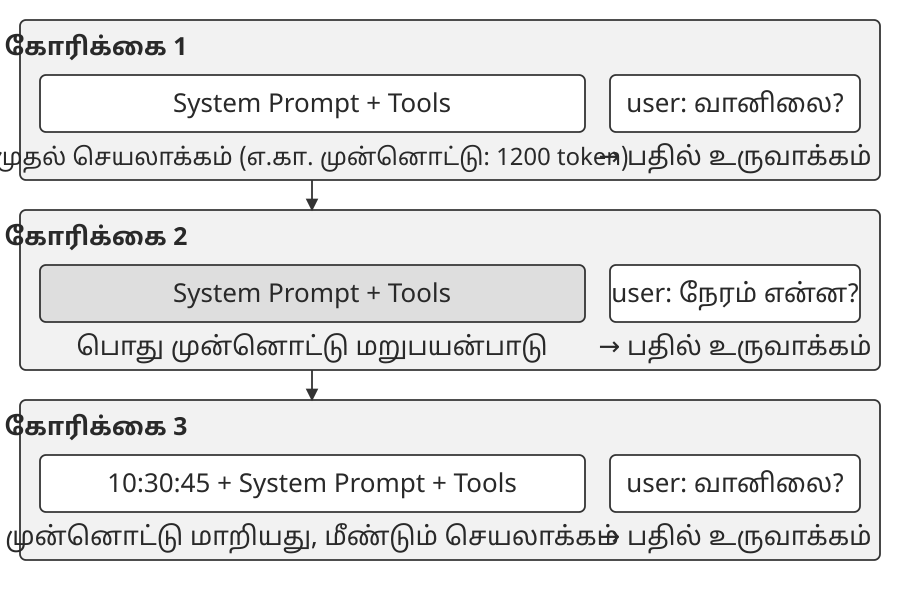

**நான்கு token-களைக் கொண்டு சேமிப்பின் வளர்ச்சியைப் பின்தொடர்வோம்.** உள்ளீடு `[A, B, C, D]` என்று வைத்துக்கொள்வோம். D என்ற இடத்தைச் செயலாக்கும்போது, மாதிரி D-இன் Query-ஐ A, B, C, D ஆகியவற்றின் Key-களுடன் பொருத்தி, அவற்றின் Value-களை எடையிட்டுத் திரட்டுகிறது. ஒவ்வொரு அடுக்கின் கணக்கீட்டையும் கடந்த பிறகு, D இடத்தின் இறுதிப் பிரதிநிதித்துவம் அடுத்த token E-ஐ முன்கணிக்கப் பயன்படுகிறது. இந்த நேரத்தில் A முதல் D வரை ஒவ்வொரு அடுக்கின் K, V-களும் ஏற்கனவே சேமிக்கப்பட்டுள்ளன.

மாதிரியெடுத்து E கிடைத்த பிறகு, அடுத்த படியில் E மாதிரிக்குள் அனுப்பப்பட்டு, ஒவ்வொரு அடுக்கிலும் அதன் Query, Key, Value கணக்கிடப்படுகின்றன. E-இன் Query முந்தைய சேமிப்பையும் தற்போதைய இடத்தின் K, V-ஐயும் படித்து, மாதிரி ஆறாவது token-ஐ முன்கணிக்கிறது; E-இன் K, V-உம் அதே நேரத்தில் சேமிப்பில் சேர்க்கப்படுகின்றன. இவ்வாறு, ஒவ்வொரு படி உருவாக்கத்திலும் முந்தைய நிலையைத் தொடர்ந்து பயன்படுத்தி, புதிய உள்ளீட்டு token-இன் நிலையை மட்டுமே கணக்கிட முடிகிறது.

KV Cache-ஐ முற்றிலும் பயன்படுத்தாவிட்டால், E-ஐ முன்கணிக்கும்போது A முதல் D வரை மீண்டும் செயலாக்க வேண்டும்; ஆறாவது token-ஐ முன்கணிக்கும்போது A முதல் E வரை மீண்டும் செயலாக்க வேண்டும். K, V-ஐ மீண்டும் உருவாக்கும் இடங்களின் எண்ணிக்கையை மட்டும் கணக்கிட்டாலே, குவிந்த வேலை $1+2+\cdots+N$ என்ற வகையில் வளர்கிறது. சேமிப்பைப் பயன்படுத்திய பிறகு, வரலாற்று இடங்களின் அடுக்கு வாரியான கணக்கீடு மீண்டும் பயன்படுகிறது; புதிய இடங்கள் இன்னும் தெரியக்கூடிய K, V-ஐப் படிக்க வேண்டும். நிலையான முழுக் கவனக் குறிவிலக்கலில், இந்தப் படித்தலும் பொருத்துதலும் சூழல் நீளத்துடன் நேர்கோட்டில் அதிகரிக்கின்றன; எனவே நீண்ட சூழல் இன்னும் அதிக GPU நினைவகத்தையும் நினைவக அலைவரிசையையும் எடுத்துக்கொள்கிறது.

**உள்ளீட்டை மாற்றுவது அடுத்தடுத்த சேமிப்பை ஏன் பாதிக்கிறது?** Transformer-இன் அடுக்குகள் மறைநிலைப் பிரதிநிதித்துவங்களை வரிசையாகச் செயலாக்குகின்றன; ஒவ்வொரு அடுக்குக்கும் அதன் சொந்த K, V உண்டு. ஓர் இடம் கவனக் கணக்கீட்டைக் கடந்த பிறகு, அதன் பிரதிநிதித்துவத்தில் முந்தைய இடங்களின் தகவல் ஏற்கனவே கலந்துவிடுகிறது; பின்னர் அது அடுத்த அடுக்குக்குக் கடத்தப்படுகிறது. எனவே, $k$-ஆவது token மாறும்போது, அதன் தாக்கம் அந்த இடத்திலிருந்து பின்னோக்கியும் மேல் அடுக்குகளை நோக்கியும் பரவுகிறது.

அதே மாதிரிக்கும் கணக்கீட்டு உள்ளமைவுக்கும், $k$-க்கு முந்தைய இடங்கள் அதற்கும் முந்தைய உள்ளீட்டை மட்டுமே சார்ந்திருப்பதால், அவற்றைத் தொடர்ந்து மீண்டும் பயன்படுத்தலாம்; $k$-இலிருந்து தொடங்கி, பாதிக்கப்பட்ட நிலைகளை மீண்டும் கட்டமைக்க வேண்டும். உண்மையான சேவைகள் பொதுவாகச் சேமிப்புத் தொகுதிகளின் அடிப்படையில் முன்னொட்டைப் பொருத்துகின்றன; மறுகணக்கீட்டு எல்லை தொகுதி அளவாலும் பாதிக்கப்படுகிறது. புதுப்பிப்பு எவ்வளவு முன்னால் இருக்கிறதோ, பொதுவாக அவ்வளவு அதிக உள்ளீட்டை மீண்டும் கணக்கிட வேண்டும். நிலையான அறிவுறுத்தல்களை முன்பகுதியில் வைத்து, புதிய நிலையைப் பின்பகுதியில் சேர்ப்பது, இந்தச் சார்பு உறவைப் பயன்படுத்துவதே.

> **சோதனை 2-3 ★★: சூழல் மேலாண்மை முறைகளை ஒப்பிடுதல்**
>
> இந்தச் சோதனை, ஒரே பணியை முடிக்க ஏஜெண்ட் கோப்புக் கண்டுபிடிப்பு, வாசிப்பு, தேடல் கருவிகளைப் பயன்படுத்தச் செய்து, நிலையாகச் சேர்க்கும் ஒரு அடிப்படைக் குழுவையும் ஐந்து வகைச் சூழல் மாற்றங்களையும் ஒப்பிடுகிறது. அடிப்படைக் குழு அறிவுறுத்தல்களையும் கருவி வரிசையையும் நிலையாக வைத்துக்கொண்டு, ஒவ்வொரு சுற்றிலும் மாதிரிச் செய்திகளையும் கருவி முடிவுகளையும் சேர்க்கிறது. மற்ற குழுக்கள் முறையே அறிவுறுத்தல்கள், நிலை, கருவி வரிசை, வரலாற்று வெளிப்பாடு ஆகியவற்றை மாற்றி, தற்காலிகச் சேமிப்புப் புள்ளிவிவரங்களும் பணிச் செயல்முறையும் எவ்வாறு மாறுகின்றன என்பதை அவதானிக்கின்றன.
>
> **மாறும் சிஸ்டம் ப்ராம்ப்ட்** ஒவ்வொரு சுற்றின் சிஸ்டம் அறிவுறுத்தல்களிலும் தற்போதைய நேரத்தைப் புதுப்பிக்கிறது. மாற்றத்துக்கு முந்தைய பகுதி இன்னும் பகிரப்பட்ட முன்னொட்டாக இருக்கலாம்; நேரத் தகவலிலிருந்து தொடங்கிய பின்னுள்ள உள்ளீட்டை மட்டும் மீண்டும் பொருத்தவோ கணக்கிடவோ வேண்டும். நேரத்தைப் புதிய செய்தியாகச் சேர்த்தாலோ, நேரக் கருவி வழியாகத் தேவைக்கேற்பப் பெற்றாலோ, நிரந்தர வணிக விதிகளைத் தொடர்ந்து மீண்டும் பயன்படுத்தலாம்.
>
> **மாறும் பயனர் உள்ளமைவு** முன்பகுதிச் செய்திகளில் மீதமுள்ள அழைப்பு எண்ணிக்கையையோ கணக்கு இருப்பையோ புதுப்பிக்கிறது. நிலையே பணிக்குத் தேவையான தகவல்; வடிவமைப்பின் முக்கியக் கவனம் அது புதுப்பிக்கப்படும் இடத்தில். சமீபத்திய நிலையை இறுதியில் சேர்த்து, எப்போதிலிருந்து செல்லுபடியாகிறது என்பதைக் குறித்தால், முன்னேற்றத்தையும் முன்னொட்டையும் ஒருசேரத் தக்கவைக்கலாம். பின்னர் வரும் ஏஜெண்ட் நிலைப் பட்டை இந்த ஒழுங்கமைப்பு முறையையே பின்பற்றும்.
>
> **கருவி வரையறைகளை மறுவரிசைப்படுத்துதல்** ஒவ்வொரு சுற்றிலும் கருவிப் பட்டியலின் வரிசையை மாற்றுகிறது. பெயர்களும் அளவுருக்களும் ஒன்றுதான் என்றாலும், தொடராக்கப்பட்ட பிறகு token வரிசை மாறிவிட்டது. Kimi K2.6-இன் இயக்க அறிக்கையைத் திறந்து பார்த்தால், அடிப்படைக் குழுவின் `Hit%`-உம் மறுவரிசைக் குழுவின் `Hit%`-உம் 100%. இரண்டு குழுக்களும் உண்மையில் ஒரே அளவு உள்ளீட்டையே மீண்டும் பயன்படுத்தினவா? அடிப்படைக் குழு மூன்று சுற்றுகளில் மொத்தம் 7,567 token உள்ளீட்டையும், அவற்றில் 768 சேமிப்புப் பொருத்தத்தையும் கொண்டிருந்தது; மறுவரிசைக் குழுவும் மூன்று சுற்றுகள், 7,568 உள்ளீட்டு token-களில் 256 மட்டுமே பொருத்தப்பட்டன. சேமிப்பு token எண்ணிக்கையை உள்ளீட்டு token எண்ணிக்கையால் வகுத்தால், `Cache%` நெடுவரிசையில் 10.1%, 3.4% கிடைக்கும். `Hit%` நெடுவரிசை பொருத்தம் கண்டறியப்பட்ட கோரிக்கைகளை மட்டும் எண்ணுகிறது: அடிப்படைக் குழு இரு பொருத்தங்களையும், மறுவரிசைக் குழு ஒன்றையும் பதிவு செய்தது; இரு குழுக்களும் பதிவு செய்த பொருத்தமின்மை எண்ணிக்கை பூஜ்யம். மற்றக் கோரிக்கைகளின் பொருத்த நிலையை இந்தப் பதிவை மட்டும் கொண்டு தீர்மானிக்க முடியாது. கருவி வரிசையை நிலையாக வைத்தால், முன்னொட்டு காரணமின்றி மாறுவதைத் தவிர்க்கலாம்.
>
> **நழுவு சாளரம் (sliding window)** சமீபத்திய வரலாற்றுப் பகுதியை மட்டும் தக்கவைக்கிறது. பத்துச் சுற்று இடைவினை தக்கவைக்கப்படுகிறது என்று வைத்துக்கொண்டால், பதினைந்தாம் சுற்றில் இரண்டாம் சுற்றில் பெற்ற முக்கியக் கோப்பு உள்ளடக்கத்தைப் படிக்க முடியாமல் போகலாம். பகிரப்பட்ட முன்னொட்டைச் சுருக்குவதோடு, வெட்டுதல் மாதிரி பெறக்கூடிய உண்மைகளையும் பணி முன்னேற்றத்தையும் மாற்றுகிறது. துணைச் செயலாக்கம் சமீபத்திய ஆறு வரலாற்றுச் செய்திகளிலிருந்து தொடங்கி, கருவி முடிவுகளுக்குரிய அழைப்புக் கோரிக்கைகளைப் பின்னோக்கித் தேடிச் சேர்க்கிறது. நழுவு சாளரக் குழு 2,224 உள்ளீட்டு token-களில் 1,510-ஐ மீண்டும் பயன்படுத்தியது; சேமிப்பு விகிதம் 67.9%, ஆறு குழுக்களில் மிக உயர்ந்தது. இப்போது சோதனை 2-3-இன் நழுவு சாளரக் குழுவின் கருவிப் பதிவைப் பாருங்கள்: மாதிரி மூன்று முறை கோப்புகளைத் தேடி, பின்னர் இரு கோப்புகளைப் படித்தது; ஆனால் பயனர் கேட்ட மூன்று வாக்கியச் சுருக்கத்தை ஒப்படைக்கவில்லை.
>
> **உரை வடிவமைப்பு** பங்குகளுடன் கூடிய வரலாற்றை `USER: ...`, `ASSISTANT: ...` போன்ற உரையாக மீண்டும் எழுதுகிறது. இது வார்ப்புருவில் உள்ள செய்தி எல்லைகளையும் கருவிக் கட்டமைப்பையும் மாற்றுகிறது; மாதிரி மூல உரையிலிருந்து அசல் உறவுகளை மீட்டுருவாக்க வேண்டும். இந்த முறை உரைக் குழு இன்னும் இறுதிப் பதிலை உருவாக்கியது; தற்காலிகச் சேமிப்புப் பொருத்தமும் இருந்தது. இடைமுகம் வழங்கும் செய்திப் பங்குகள், அழைப்பு ID-கள், கருவி முடிவுப் புலங்கள் ஆகியவை இந்த உறவுகளை நிலையாகக் கடத்த உதவுகின்றன.
>
> செய்திப் பட்டியலை நிரல் மீண்டும் கட்டமைத்தாலும், அனுப்பப்படும் முன்னொட்டும் சேமிப்பு உள்ளமைவும் ஒன்றாக இருந்தால், அந்த முன்னொட்டை இன்னும் மீண்டும் பயன்படுத்த வாய்ப்புண்டு.
>
> பயனர் எவ்வளவு குறைவாகக் காத்திருந்தார் என்பதையும் அறிய வேண்டுமானால், முதலில் நேரங்காட்டி எங்கே நிற்கிறது என்று பார்க்க வேண்டும். நழுவு சாளரக் குழுவின் முதல் சுற்றில் `ttft` சுமார் 2.23 வினாடி. நிரல் இந்தப் புலத்தை TTFT (முதல் token தாமதம்) என்று அழைத்தாலும், ஓடை அல்லாத கோரிக்கை முழுப் பதிலையும் திருப்பித் தந்தபோதே நேரத்தை நிறுத்துகிறது.

### KV Cache-உம் Prompt Cache-உம்: இரு நிலையான சேமிப்புகள்

இந்த இரு நிலைச் சேமிப்பையும் இரு தருணங்களைக் கொண்டு வேறுபடுத்தலாம். மாதிரி தன் பதிலில் இரண்டாம் token-ஐ உருவாக்கும்போது, அந்தக் கோரிக்கையில் ஏற்கனவே உள்ள இடங்களின் விசை–மதிப்பு நிலையைப் படிக்கலாம்; இது **KV Cache**. சற்று நேரத்துக்குப் பிறகு பயனர் தொடர்ந்து கேட்கிறார், Harness புதிய கோரிக்கையை அனுப்புகிறது; இந்த உள்ளீட்டின் ஒரு பகுதியைக் குறைவாகக் கணக்கிட, சேவை முன்பு சேமித்த அதே முன்னொட்டை முதலில் கண்டுபிடிக்க வேண்டும்; இது **Prompt Cache**. முன்னது அதே உருவாக்கம் எவ்வாறு தொடர்கிறது என்பதை விளக்குகிறது; பின்னதோ கோரிக்கைகளைக் கடந்த சேமிப்பு, பொருத்தல் பொறிமுறைகளையும் கோருகிறது.

API சேவைகளில், தற்காலிகச் சேமிப்பு குறைந்தபட்ச முன்னொட்டு நீளம், தொகுதி அளவு, செல்லுபடிக் காலம், மாதிரி உள்ளமைவு, வாடிக்கையாளர் தனிமைப்படுத்தல் எல்லை ஆகியவற்றாலும் பாதிக்கப்படுகிறது. மீண்டும் பயன்படுத்தக்கூடிய முன்னொட்டு, அதே சேமிப்பு எல்லைக்குள் தேடப்பட வேண்டும். எடுத்துக்காட்டாக, Claude API நிறுவனம், பணியிடம் ஆகியவற்றின் அடிப்படையில் சேமிப்பைத் தனிமைப்படுத்துகிறது; ஒரே உரை வெவ்வேறு தனிமை எல்லைகளில் தோன்றினால், தனித்தனிச் சேமிப்புகள் உருவாக்கப்படும்[^ch2-prompt-cache].

கட்டணத்தை எழுதுதல், படித்தல் எனத் தனித்தனியாகக் கணக்கிட வேண்டும். சில Claude மாதிரிகளில் சேமிப்புப் படிப்புக் கட்டணம் சாதாரண உள்ளீட்டுக் கட்டணத்தின் பத்தில் ஒரு பங்கு; முதல் எழுதுதலுக்குக் கூடுதல் கட்டணம் உண்டு. ஒரே முன்னொட்டைச் செல்லுபடிக் காலத்துக்குள் திரும்பத் திரும்பப் பயன்படுத்தினால், எழுதுதல் கட்டணம் ஒருமுறை மட்டும் செலுத்தினால் போதும்; பின்னர் பொருந்தும் கோரிக்கைகள் அனைத்தும் படிப்புக் கட்டணத்தில் கணக்கிடப்படும்.

[^ch2-prompt-cache]: Anthropic, Prompt caching; சேமிப்புப் பொருத்தம், தனிமைப்படுத்தல், செல்லுபடிக் காலம், கட்டணம் ஆகியவற்றை அறிமுகப்படுத்துகிறது.

### கட்டமைப்புக் கட்டுப்பாடாகத் தற்காலிகச் சேமிப்பு

**உற்பத்தி அமைப்புகளில் தற்காலிகச் சேமிப்பு ஏற்கனவே ஒரு கட்டமைப்புக் கட்டுப்பாடாக மாறிவிட்டது.** ப்ராம்ப்டுகளை எவ்வாறு வரிசைப்படுத்துவது, துணை ஏஜெண்ட் எங்கிருந்து தொடங்குவது, அமர்வை எவ்வாறு மீட்டெடுப்பது ஆகியவை எவ்வளவு கணக்கீட்டை மீண்டும் பயன்படுத்த முடியும் என்பதைப் பாதிக்கின்றன. **வடிவமைப்பின் தொடக்கத்திலேயே சேமிப்பு எல்லைகளைத் திட்டமிட வேண்டும்.** எந்த உள்ளடக்கத்தைப் பகிரலாம், எந்த நிலை மாறும் என்பதை முதலில் தீர்மானித்து, பின்னர் ப்ராம்ப்டுகளையும் அமர்வுக் கட்டமைப்பையும் ஒழுங்கமைத்தால், இயக்கத்தின்போது மீண்டும் மீண்டும் மறுகணக்கீடு செய்வதைக் குறைக்கலாம். நீண்ட நெடிய பணிகளின் தாமதமும் கட்டணமும் ஏற்கனவே பிரச்சினையாக மாறிய பிறகு இந்தக் கட்டமைப்புகளைச் சரிசெய்வது, பெரும்பாலும் நிலை மேலாண்மை, துணை ஏஜெண்ட், அமர்வு மீட்பு ஆகியவற்றையும் பாதிக்கும்.

**நிலைத்தன்மையின் அடிப்படையில் முன்னொட்டை ஒழுங்கமையுங்கள்.** பல பணிகள் பகிரும் அறிவுறுத்தல்களையும் கருவி வரையறைகளையும் முன்பகுதியில் வைத்து, அதன் பின்னர் பயனர் தகவல், அமர்வு நிலை, புதிய அவதானிப்புகளைச் சேர்த்து, பொருந்தும் எல்லைக்கேற்பத் தொகுக்கலாம். எடுத்துக்காட்டாக, இயக்க அமைப்பில் macOS/Linux என்ற இரு தேர்வுகள், இயக்கப் பயன்முறையில் சாதாரண/பிழைநீக்க என்ற இரு தேர்வுகள், மொழியில் சீனம்/ஆங்கிலம் என்ற இரு தேர்வுகள் இருந்தால், மூன்று தனித்த நிபந்தனைகள் அதிகபட்சம் $2\times2\times2=8$ வகை முன்னொட்டுச் சேர்க்கைகளை உருவாக்கும். அதிகம் மாறும் புலங்களைப் பகிரப்பட்ட பகுதிக்குப் பின்னர் வைப்பது, பொது முன்னொட்டின் மறுபயன்பாட்டு வாய்ப்பை அதிகரிக்கும். பொது பகுதியின் பங்கீட்டு எல்லை, சேவையின் நிறுவன, பணியிட, தனியுரிமை எல்லைகளையும் மதிக்க வேண்டும்.

**துணை ஏஜெண்டுக்கு மீண்டும் பயன்படுத்தக்கூடிய தொடக்கப் புள்ளியைத் தேர்ந்தெடுங்கள்.** துணை ஏஜெண்ட் தாய் ஏஜெண்டின் பணிப் பின்னணியை மரபுரிமையாகப் பெற்றால், இருவரும் ஒத்த முன்னொட்டை மீண்டும் பயன்படுத்தி, தன் துணைப் பணியைச் சேர்க்கலாம். ப்ராம்ப்ட், கருவி வரிசை, மாதிரி, தொடர்புடைய உள்ளமைவு ஆகியவை சேர்ந்து மறுபயன்பாட்டு எல்லையைத் தீர்மானிக்கின்றன. தனி பங்கோ தனிமைப்படுத்தப்பட்ட சூழலோ தேவைப்படும் துணை ஏஜெண்டுக்கு, அதன் பணிக்கேற்ப உள்ளீட்டைக் கட்டமைத்து, பின்னர் எந்தப் பொது பகுதிகளைப் பகிரலாம் என்று பார்க்கலாம்.

**ஏற்கனவே அனுப்பிய உள்ளடக்கத்தைச் சேமியுங்கள்.** பெரிய கருவி வெளியீட்டைச் சுருக்கமாகவோ முன்னோட்டமாகவோ சுருக்கிய பிறகு, உண்மையில் மாதிரிக்கு அனுப்பப்பட்ட பதிப்பையே சேமிக்க வேண்டும். அமர்வை மீட்டெடுக்கும்போது இந்தப் பதிவை மீண்டும் இயக்கினால், ஒத்த செய்தி வரிசையை மீளுருவாக்கலாம்; ஒவ்வொரு மீட்பிலும் சுருக்கத்தைப் புதிதாக உருவாக்கினால், புதிய சொற்களும் முன்னொட்டு மாற்றங்களும் நுழையக்கூடும். சுருக்கத்தைப் புதுப்பிக்கும்போது, ஒரு புதிய பதிப்பை வெளியிட்டு, அதன் பிறகு எங்கிருந்து சேமிப்பை மீண்டும் கட்டமைப்பது என்று தெளிவாகக் குறிக்கலாம்.

**பகுத்தறிவைத் தக்கவைப்பது நெறிமுறைக் கட்டுப்பாடுகளையும் பூர்த்தி செய்ய வேண்டும்.** Claude-இன் preserved thinking இந்தப் பிரச்சினைக்கு ஒரு குறிப்பிட்ட எடுத்துக்காட்டைத் தருகிறது. அதன் ஆவணங்கள் இந்தப் பொறிமுறையை வடித்தல் தடுப்புக்குப் பயன்படுத்துகின்றன: சேவை thinking block-இன் கையொப்பத்தையும், அதை உருவாக்கிய மாதிரியையும், அதன் முன்னொட்டையும் சரிபார்க்கிறது. Claude Fable 5.1, Claude Opus 5.5 போன்ற முன்னொட்டு இணைப்பை ஆதரிக்கும் மாதிரிகளில், block-க்கு முந்தைய மேலடுக்கு `system`, `tools`, செய்திகள் ஆகியவை சேர்ந்து சரிபார்ப்பு எல்லையை உருவாக்குகின்றன; அவற்றில் ஏதேனும் மாற்றினால், அந்த block-உம் அதற்குப் பிந்தைய thinking block-களும் செல்லுபடியற்றதாகும்[^ch2-preserved-thinking].

எடுத்துக்காட்டாக, ஒவ்வொரு சுற்றிலும் சிஸ்டம் நேரத்தை மீண்டும் எழுதுவது, முதல் செய்தியில் உள்ள வெளிச்சூழல் தகவலை மீண்டும் வரைவது, பழைய கருவி முடிவுகளை அப்படியே சுருக்குவது — இவை அனைத்தும் அடுத்தடுத்த பகுத்தறிவு block-கள் இணைந்திருக்கும் முன்னொட்டை மாற்றும். சரிபார்ப்பு தூண்டப்பட்டால், API 400 பிழையைத் திருப்பித் தரலாம்; அல்லது `prefix_mismatch_behavior` உள்ளமைவின்படி செல்லுபடியற்ற block-களை நீக்கி, கோரிக்கையைத் தொடர்ந்து செயலாக்கலாம். பின்னதில், மாதிரி தக்கவைக்கப்பட்ட பணித் தகவலையும் கருவி முடிவுகளையும் இன்னும் பயன்படுத்த முடியும்; ஆனால் செல்லுபடியற்ற பகுத்தறிவு இந்த உள்ளீட்டில் பங்கேற்காது. 2026 ஆகஸ்ட் 31 முதல் உருவாக்கப்படும் கணக்குகளில் முன்னொட்டுச் சரிபார்ப்பு இயல்பாக இயக்கப்படுகிறது; முந்தைய கணக்குகளுக்கு இயக்கும் முறை நெறிமுறை ஆவணத்தில் உள்ளது.

இத்தகைய நெறிமுறைகளை இணைக்கும்போது, அமர்வின் மேலடுக்கு அறிவுறுத்தல்களையும் கருவித் தொகுப்பையும் நிலையாக வைத்து, நிலை மாற்றங்களைப் பின்பகுதியில் சேர்க்கலாம். இடையில் அறிவுறுத்தல்களையோ கருவிகளையோ புதுப்பிக்க வேண்டுமானால், அந்தச் சேவை வழங்கும் அமர்வினுள் அறிவுறுத்தல் செய்திகள், கருவி மாற்ற block-கள் போன்ற இடைமுகங்களைப் பயன்படுத்துங்கள். thinking block-களை வெட்டும்போதும் அசல் வரிசையில் தொடர்ச்சியான இடைவெளியைப் பராமரிக்க வேண்டும்: தலையிலிருந்தோ வாலிலிருந்தோ நீக்கலாம், அல்லது முழுவதையும் நீக்கலாம்; நடுவில் இடைவெளி விட்டால் அடுத்தடுத்த block-கள் பாதிக்கப்படும்; தாமாக நீக்கிய block-களும் நீக்கப்பட்ட நிலையிலேயே இருக்க வேண்டும்.

இடையில் மாதிரியை மாற்றும்போது, இலக்கு மாதிரி மூல மாதிரியின் பகுத்தறிவு block-களைப் படிக்க முடியுமா என்பதையும் சேவை சரிபார்க்கிறது. கிளையண்ட் அசல் வரலாற்றைச் சேமித்து, இணக்க விதிகளின்படி சேவை கையாள விட வேண்டும்; கிளையண்டே நீக்கிவிட்டால், பின்னர் அசல் மாதிரிக்குத் திரும்பும்போது அந்தப் பதிவுகளை மீட்டெடுக்க முடியாது.

[^ch2-preserved-thinking]: Anthropic, Preserved thinking; மாதிரிகள், முன்னொட்டு இணைப்பு, செல்லுபடியின்மைக் கையாளுதல், பகுத்தறிவு block வெட்டுதல் விதிகள் ஆகியவற்றை அறிமுகப்படுத்துகிறது; அமர்வினுள் புதுப்பிப்பு இடைமுகங்களுக்கு Mid-conversation system messages and tool changes பார்க்கவும்.

### ஆய்வு நீட்டிப்பு: திருத்தக்கூடிய, இணைக்கக்கூடிய KV Cache

> முந்தைய வடிவமைப்புகள் அனைத்தும் முன்னொட்டைப் பொருத்தி மீண்டும் கணக்கீட்டைப் பயன்படுத்துகின்றன. KV-இல் ஏற்கனவே சேமிக்கப்பட்ட தகவலை நேரடியாகத் திருத்தவோ இணைக்கவோ முடியுமா, அதன் மூலம் சூழலின் மாற்றங்களுக்குத் தற்காலிகச் சேமிப்பைத் தகவமைக்க முடியுமா என்று மேலும் ஆராய விரும்புகிறேன். *Models Take Notes at Prefill* என்ற கட்டுரையில் இந்தத் தகவலை மாதிரியின் "குறிப்புகள்" என்று ஒப்பிட்டேன்[^ch2-2]: பல அடுக்கு கவனக் கணக்கீட்டைக் கடந்த பிறகு, ஒரு புலத்தின் தாக்கம் ஏற்கனவே பின்னர் வரும் இடங்களின் பிரதிநிதித்துவங்களில் கலந்துவிட்டிருக்கும். எடுத்துக்காட்டாக, "பயனர் வசிக்கும் நகரம்: பெய்ஜிங்" என்பது பின்னர் வரும் இடத் தீர்மானங்களைப் பாதிக்கலாம்; இந்தப் புலத்தின் சொந்த K, V-ஐ மட்டும் மாற்றினாலும், பின்னால் வந்த நிலைகளில் பழைய நகரத்திலிருந்து பெறப்பட்ட முடிவுகள் இன்னும் இருக்கக்கூடும்.
>
> ஆய்வுக் கட்டுரை, தலையீடுகள் (interventions) மூலம் புலத்தின் சொந்த KV-க்கும் பின்னர் வந்த நிலைகளுக்கும் உள்ள பங்கை வேறுபடுத்தியது. சோதிக்கப்பட்ட முடிவுகளில், புலத்தின் சொந்த KV-இன் நேரடிப் பங்கு 1%-க்கும் குறைவு; முக்கியத் தாக்கம் கீழ்நிலைப் பிரதிநிதித்துவங்களில் சேமிக்கப்படுகிறது. இந்தக் கீழ்நிலை "குறிப்புகளை" மையமாகக் கொண்டு, தற்காலிகச் சேமிப்பைப் பயன்படுத்தும் இரு வழிகளை ஆராயலாம்.
>
> **திருத்தம் (Editing)** வெளிப்படையான தகவல் திருத்தத்தின் மூலம் பின்னர் வரும் கணக்கீடு ஏற்கனவே உள்ள முடிவைப் புதுப்பிக்கச் செய்கிறது. சோதிக்கப்பட்ட 8B மாதிரிப் பணிகளில், வெளிப்படையான சிந்தனைச் சங்கிலி (chain of thought) இருக்கும்போது, புலத்தை மட்டும் திருத்தினாலும் இலக்கு முடிவை மீட்டெடுக்க முடிகிறது; கணக்கீட்டுச் செலவு முழு மறுகணக்கீட்டின் சுமார் 1%. இந்தப் பகுத்தறிவுச் செயல்முறை இல்லாதபோது, பழைய கீழ்நிலை நிலைகள் முடிவைத் தொடர்ந்து பாதிக்கலாம்; இதனால் புலத் திருத்தம் பலனளிக்காமல் போகலாம்.
>
> **இணைப்பு (Composition)** முன்கூட்டியே கணக்கிடப்பட்ட திறன் சேமிப்பைப் புதிய சூழலுடன் இணைக்கிறது. சுழல் நிலைக் குறியாக்கத்தை (RoPE) பயன்படுத்தும் மாதிரிகளில், முதலில் சேமிப்பில் உள்ள நிலைப் பிரதிநிதித்துவத்தைச் சரிசெய்து, பின்னர் இணைக்க வேண்டும். ஏற்கனவே உள்ள ஒரு பக்கக் குறிப்புகளுக்குப் புதிய எண்ணிடல் கொடுத்து, வேறொரு பொருளுக்குப் பின்னால் இணைப்பது போலக் கற்பனை செய்யலாம். ஆய்வு பன்னிரண்டு மாதிரிகளை ஒப்பிட்டது; இணைப்புக்கும் முழு மறுகணக்கீட்டுக்கும் இடையே வெளியீட்டு logits-இன் கோசைன் ஒற்றுமை 0.90–0.999. சேமிப்பு மறுநிலைப்படுத்தலும் இணைப்பும் நீளத்துக்கு நேர்கோட்டில் செயலாக்கப்படலாம்; இதனால் முழுச் சூழலின் கவன மறுகணக்கீடு குறைகிறது.
>
> திருத்தத் தகவலைச் சேர்ப்பதை ஏற்கனவே உள்ள முன்னொட்டுச் சேமிப்புடன் இணைக்கவும் முடியும். ஆய்வின் vLLM நேரடி அளவுகோலில், இந்தச் சேர்க்கை சுமார் 98.5% முன்னொட்டுச் சேமிப்புப் பொருத்த விகிதத்தைத் தக்கவைத்தது; p90 முதல் token தாமதம் அடிப்படைக் குழுவின் சுமார் 1/398 முதல் 1/53 வரை.
>
> **இந்த ஆய்வுப் பாதையை நான் நம்பிக்கையுடன் பார்க்கிறேன்; denn இது சூழல் புதுப்பிப்புகளில் அதிக ஏற்கனவே உள்ள கணக்கீட்டைத் தக்கவைக்க உதவும்.** ஏஜெண்ட் அடிக்கடி நினைவகப் புலங்களைப் புதுப்பிக்கிறது, நிலையைச் சேர்க்கிறது, கருவி வரையறைகளை மாற்றுகிறது; தொடர்புடைய நிலையைக் குறிப்பு போலத் திருத்தி இணைக்க முடிந்தால், நீண்ட சூழலைப் பராமரிக்கும் விலை கணிசமாகக் குறைய வாய்ப்புண்டு.

[^ch2-2]: Li, Bojie, Models Take Notes at Prefill: KV Cache Can Be Editable and Composable, 2026. திருத்தம், இணைப்பு, நேரடிச் சேமிப்புச் சோதனைகள் வெவ்வேறு பணிகளையும் அளவீடுகளையும் பயன்படுத்துகின்றன; குறிப்பிட்ட அமைப்புகள் ஆய்வுக் கட்டுரையில் உள்ளன.

### சேமிப்புப் பொறிமுறையிலிருந்து சூழல் உள்ளடக்க வடிவமைப்பு வரை

தற்காலிகச் சேமிப்பு கணக்கீட்டை எவ்வாறு மீண்டும் பயன்படுத்துகிறது என்பதைப் புரிந்துகொண்ட பிறகு, ஒவ்வொரு சுற்றின் உள்ளீட்டில் எதை வைப்பது, அந்த உள்ளடக்கம் எவ்வாறு புதுப்பிக்கப்படுவது என்பதை முடிவு செய்ய வேண்டும். இனி வரும் பகுதி மூன்றாகப் பிரிகிறது:

- **ப்ராம்ப்ட் பொறியியலும் Agent Skills-உம்**: முதலில் சிஸ்டம் அறிவுறுத்தல்களையும் கருவி வரையறைகளையும் வடிவமைத்து, இலக்கு, விதிகள், செயல்படுத்தும் முறையை விளக்குதல்; பின்னர் படிநிலை வெளிப்படுத்தல் மூலம் துறை அறிவைத் தேவைக்கேற்ப ஏற்றுதல். ப்ராம்ப்ட் ஊடுருவல் தடுப்போ, வெளிப்புற உள்ளடக்கம் சூழலுக்குள் நுழையும்போது மூலத்தையும் அறிவுறுத்தல் எல்லையையும் கவனிக்கிறது.
- **ஏஜெண்ட் நிலைப் பட்டை**: பணி முன்னேற்றம், வெளிச்சூழல் அவதானிப்புச் சுருக்கம், அழைப்பு எண்ணிக்கை போன்ற நிலையை மாதிரிக்கு வழங்கி, நீண்ட வரலாற்றிலிருந்து மீண்டும் கணக்கிடும் சுமையைக் குறைத்தல். கைபேசியில் நேரம், மின்கலம், பிணைய நிலை ஆகியவை தெரிவது போல, தற்போதைய இயக்க நிலையை எப்போதும் தெரியக்கூடியதாக வைத்திருக்கிறது.
- **சூழல் சுருக்கம்**: வரலாறு வளரும்போது அடுத்தடுத்த முடிவுகளுக்குத் தேவையான தகவலைத் தக்கவைத்து, எப்போது சுருக்குவது, சுருக்கத்தை எவ்வாறு ஒழுங்கமைப்பது, சேமிப்பு மறுகணக்கீட்டையும் பணித் தொடர்ச்சியையும் எவ்வாறு கையாள்வது என்று தீர்மானித்தல்.

## ப்ராம்ப்ட் பொறியியல்: சிஸ்டம் ப்ராம்ப்டை மேம்படுத்துதல்

ப்ராம்ப்ட் பொறியியல் அறிவுறுத்தல்கள், செயல்முறைகள், எடுத்துக்காட்டுகள் மூலம் மாதிரியைக் குறிப்பிட்ட பணியைச் செய்ய வழிநடத்துகிறது. இந்தப் பகுதி **சிஸ்டம் ப்ராம்ப்ட்**டை மையமாகக் கொள்கிறது: ஊழியர் கையேடு போல, அது ஏஜெண்டின் அடையாளம், இலக்கு, நடத்தை விதிகள், பணி முறையை விளக்குகிறது. இந்த அத்தியாயத்தின் API எடுத்துக்காட்டுகளில், இந்த உள்ளடக்கம் `system` செய்தி வழியாக வழங்கப்படுகிறது.

### தொனியும் நடையும்: பயனரை நோக்கி எவ்வாறு வெளிப்படுத்துவது

தொனித் தேவைகளைக் குறிப்பிட்ட வெளிப்பாடாக மாற்ற வேண்டும். எடுத்துக்காட்டாக, சிறு கேள்வி–பதில்களுக்கு "You MUST answer concisely with fewer than 4 lines" என்று — அதாவது நான்கு வரிக்கும் குறைவான உரையில் பதிலளிக்க வேண்டும் என்று — கேட்கலாம். பணி தடைபடும்போது, "keep your response to 1–2 sentences" என்று கேட்டு, தற்போதைய நிலையையும் அடுத்த படியையும் ஒன்றிரண்டு வாக்கியங்களில் தெரிவித்து, பயனர் கையாள வேண்டிய விஷயங்களை நேரடியாகப் பார்க்கச் செய்யலாம்.

"NEVER do X" போன்ற பெரிய எழுத்து வலியுறுத்தலை முக்கியத் தேவைகளை எடுத்துக் காட்டப் பயன்படுத்தலாம். இன்னும் முக்கியமானது, அந்தத் தேவை எந்தச் சூழலுக்குப் பொருந்தும், என்ன செயல் மேற்கொள்ள வேண்டும் என்பதை விளக்குவது.

### கட்டமைக்கப்பட்ட ப்ராம்ப்ட்: அடுக்குகளையும் உள்ளடக்க எல்லைகளையும் ஒழுங்கமைத்தல்

தலைப்புகள், பட்டியல்கள், குறிச்சொற்கள் நீண்ட ப்ராம்ப்டுகளை ஒழுங்கமைக்க உதவுகின்றன. Markdown தலைப்புகள் பிரிவுகளையும் படிகளையும் குறிக்க ஏற்றவை; XML நடைக் குறிச்சொற்கள் வெவ்வேறு பயன்பாட்டு உள்ளடக்கத் தொகுதிகளைப் பிரிக்க ஏற்றவை; எடுத்துக்காட்டாக `<working_directory>` கொண்டு பணிக் கோப்பகத் தகவலைச் சுற்றலாம். குறிச்சொல் பெயர்கள் உள்ளடக்கத்தின் பயனை நேரடியாக விளக்க வேண்டும்; அப்போதுதான் ஒவ்வொரு தொகுதிக்கும் இடையிலான உறவை மாதிரி எளிதில் அடையாளம் காண முடியும்.

ஒரே ப்ராம்ப்ட்டில் இரு எழுத்து முறைகளையும் இணைக்கலாம்:

```text
# 工具使用规范

## 文件操作
<file_operation>
- 读取文件前检查路径是否存在
- 修改已有文件前保存备份
</file_operation>

## 网络请求
<network_request>
- 超时时间设置为 30 秒
- 短暂故障最多重试 3 次
- 有外部副作用的请求，重试前先确认执行状态
</network_request>
```
Markdown படிக்க எளிய அடுக்குகளை வழங்குகிறது; `<file_operation>`, `<network_request>` ஆகியவை விதிகளின் பொருந்தும் எல்லையைப் பிரிக்கின்றன. எடுத்துக்காட்டாக, "அதிகபட்சம் 3 முறை மீண்டும் முயல்" என்பது பிணையக் கோரிக்கைகளுக்கு மட்டுமே பொருந்தும்; கோப்புகளை மாற்றும்போது மேலே உள்ள காப்புப்பிரதி விதிகளையே பின்பற்ற வேண்டும்.

### செயல்முறை மூலம் விதிகளை ஒழுங்கமைத்தல்

**பணிக்குத் தெளிவான கட்டங்கள் இருந்தால், ப்ராம்ப்ட்டைச் செயல்முறைப்படி ஒழுங்கமைப்பதற்கு முன்னுரிமை கொடுங்கள்.** பணத்திருப்பத்தை எடுத்துக்காட்டாகக் கொண்டால், முதலில் ஆர்டரைக் கண்டுபிடித்த பிறகே, பணத்திருப்பக் கொள்கையின்படி இந்தப் பணம் திருப்பித் தரப்படுமா என்று தீர்மானிக்க முடியும். ஆர்டர் கிடைக்காவிட்டால், ஆர்டர் எண் போன்ற தகவல்களைச் சேர்க்கச் சொல்லிப் பயனரிடம் கேட்க வேண்டும்; ஆர்டர் நிபந்தனைகளுக்குப் பொருந்தினால், பின்னர் பணத்திருப்பத்தைத் தொடங்க வேண்டும். இதே விதிகளை நூற்றுக்கும் மேற்பட்ட உருப்படிகள் கொண்ட பட்டியலில் சிதறவைத்தால், ஒவ்வொரு படியிலும் பொருந்தும் உருப்படிகளை மீண்டும் கண்டுபிடிக்க வேண்டியிருக்கும். உள்ளீட்டு நிபந்தனைகள், கையாளும் வரிசை, விதிவிலக்கு வழிகள் ஆகியவற்றைச் சம்பந்தப்பட்ட கட்டத்தில் எழுதினால், தற்போது எந்தக் கட்டத்தில் இருக்கிறோம், அடுத்து என்ன செய்ய வேண்டும் என்பதற்கான அடிப்படை மாதிரிக்குக் கிடைக்கும்.

கோப்புச் செயலாக்கத்தை எடுத்துக்காட்டாகக் கொண்டு, சரிபார்ப்பு, வகைப்பாடு, முன்செயலாக்கம், செயல்படுத்தல், சரிபார்ப்பு ஆகியவற்றை ஒரு நிலையான இயக்கச் செயல்முறையாக (SOP) இணைப்போம்:

```text
文件处理流程

步骤 1：检查
  确认文件存在且可以访问
  文件不存在 → 记录错误，停止处理
  ↓
步骤 2：分类
  结合扩展名与文件内容确定类型
  ↓
步骤 3：预处理
  配置文件 → 先备份
  大文件（>1 MB）→ 使用流式处理
  ↓
步骤 4：执行
  按文件类型执行相应处理
  ↓
步骤 5：验证
  检查处理后文件的完整性
```
ஒவ்வொரு படிக்கும் ஒரு குறிப்பிட்ட இலக்கு வழங்கப்பட்டு, தொடர்புடைய விதிகள் அந்தப் படியின் கீழ் வைக்கப்பட்டுள்ளன. கோப்பு இல்லாவிட்டால், சரிபார்ப்புக் கட்டத்தில் செயல்முறை முடிகிறது; உள்ளமைவுக் கோப்பை மாற்ற வேண்டியிருந்தால், முன்செயலாக்கக் கட்டத்தில் காப்புப்பிரதி சேமிக்கப்படுகிறது. செயல்பாட்டு முன்னேற்றத்தைச் செய்தி வரலாறோ நிலைப் பதிவுகளோ மாதிரிக்கு வழங்குகின்றன.

### வணிக விதிகளை விரிவாக்குதல்: தயாரிப்பு ஒப்பந்தங்களைத் தெளிவாக எழுதுதல்

ஒரே ஆர்டர் தகவல் எந்த வகைக் கோரிக்கையாகக் கணக்கிடப்பட வேண்டும், எந்தச் சேவை பொருந்தும், எவ்வளவு கட்டணம் வசூலிக்க வேண்டும் என்பவை முதலில் தயாரிப்பு, இயக்கக் குழு தெளிவுபடுத்த வேண்டிய வணிக ஒப்பந்தங்கள். பொறியியல் செயலாக்கம் பின்னர் பணிப்பகிர்வைச் செய்கிறது: எந்தப் புலங்களைப் பெற வேண்டும், எந்தச் சேவையை வினவ வேண்டும் என்பதைப் ப்ராம்ப்ட் மாதிரிக்குச் சொல்கிறது; உறுதியான கட்டணக் கணக்கீட்டையும் கட்டுப்பாடுகளையும் கருவிகளும் வணிக அமைப்புகளும் நடைமுறைப்படுத்துகின்றன.

பயனருக்காகத் தொலைபேசி அழைத்துச் சந்தாக் கட்டணத்தைக் குறைக்கும் அல்லது பணத்திருப்பம் கோரும் ஏஜெண்டை எடுத்துக்காட்டாகக் கொள்வோம். "பணி முடியாவிட்டால் கட்டணத்தைத் திருப்பித் தருவது" என்ற கொள்கை மூலம் முயற்சியின் தடையைக் குறைக்கவும், சிறப்புப் பணிகளுக்குத் தெளிவான கட்டண முறையை அமைக்கவும் குழு விரும்புகிறது. மூன்று வகைக் கட்டணங்களை வடிவமைக்கலாம்:

- **சேமித்த தொகையின் விகிதாசாரக் கமிஷன்**: பேச்சுவார்த்தை மூலம் தற்போதைய கட்டண அறிக்கையைக் குறைத்து, உண்மையில் சேமித்த தொகையின் ஒரு விகிதத்தை — எடுத்துக்காட்டாக 20% — கட்டணமாக வசூலித்தல்.
- **சேவைக்கான நிலையான கட்டணம்**: உணவக முன்பதிவு போன்ற சேவைப் பணிகளுக்குப் பணி வகை அல்லது சிக்கலுக்கேற்பக் கட்டணம் வசூலித்தல்.
- **கடினமான பணிக்கு முன்பணம்**: குறிப்பிட்ட நிபந்தனைகளுக்குப் பொருந்தும் கடினமான பணிகளுக்கு, முன்பணக் கட்டணத்தையும் திருப்பித் தரப்படாத விதியையும் முன்கூட்டியே விளக்கி, பயனர் உறுதிசெய்த பிறகு பணியை ஏற்றல்.

"பணியின் நிலைக்கேற்பப் பொருத்தமான கட்டண வகையைத் தேர்ந்தெடு" என்று எழுதினால், வகைப்பாட்டில் தெளிவின்மை இன்னும் இருக்கும். "கடந்த மாதம் வாங்கிய ஆடையைத் திருப்பித் தர உதவு" என்பது ஏற்கனவே செலுத்திய தொகையை மீட்டெடுப்பதை உள்ளடக்குகிறது; "Netflix சந்தாவை ரத்து செய்ய உதவு" என்பது எதிர்காலக் கட்டணத்தை நிறுத்துவதை உள்ளடக்குகிறது. இந்த இரு முடிவுகளும் பரந்த அளவில் பணம் சேமிப்பதாகப் புரிந்துகொள்ளப்படலாம்; ஆனால் குழு கமிஷனைத் தற்போதைய கட்டண அறிக்கையைப் பேசிக் குறைப்பதற்கு மட்டும் வரம்பிடலாம்; பணத்திருப்பத்துக்கும் சேவை ரத்தலுக்கும் ஒரே நிலையான கட்டணத்தைப் பயன்படுத்தலாம்.

தொடர்புடைய ப்ராம்ப்ட்டில் வகை எல்லைகளை நேரடியாக எழுதலாம்: "NEVER use percentage_based_one_time for refunds and service cancellations. Use fixed_fee instead." அதாவது, பணத்திருப்பத்துக்கும் சேவை ரத்தலுக்கும் `fixed_fee`-ஐப் பயன்படுத்த வேண்டும்; தற்போதைய கட்டண அறிக்கையைப் பேசிக் குறைப்பதற்கு மட்டுமே கமிஷன் முறை பொருந்தும்.

இந்த வேலை எவ்வளவு நிச்சயமாக முடியும் என்பதையும் குழு மதிப்பிட வேண்டும். வணிகர் எந்தெந்தக் கோரிக்கைகளை ஏற்கிறார், இந்தப் பயனர் நிபந்தனைகளுக்குப் பொருந்துகிறாரா, கட்டண அறிக்கையில் எந்தத் தொகை வசூலிக்கப்பட்டது, கடந்த காலத்தில் இதே வகை வேண்டுகோள்கள் எவ்வாறு முடிந்தன — இவை அனைத்தும் பணியை ஏற்கும் முறையைப் பாதிக்கின்றன. "60%-க்கு மேல் இருந்தால் பணத்திருப்பத்துக்குரிய பயன்முறைக்குச் செல், 30%-க்குக் கீழ் இருந்தால் பணியை ஏற்காதே" என்ற வரம்புகளை விதிகள் பயன்படுத்தினால், இடைப்பட்ட பகுதியையும் எல்லை மதிப்புகளையும் எவ்வாறு கையாள்வது என்பதையும் எழுத வேண்டும்.

தொகைக் கணக்கீட்டில் அலகு, அடிப்படை, முழுமையாக்கல் வரிசை ஆகியவற்றைத் தெளிவாகக் குறிக்க வேண்டும். எடுத்துக்காட்டாக, தொலைபேசிக் கட்டணம் நிமிடத்துக்கு 0.05 டாலர் என்று கணக்கிட்டு, மொத்தத்தை முழு டாலருக்கு முழுமையாக்கல் செய்தல்; சேமித்த தொகைக்குத் தற்போதைய கட்டண அறிக்கையே அடிப்படை. தற்போதைய கட்டணம் 150 டாலர், வணிகர் அடுத்த ஆண்டு 180 டாலராக உயர்த்தக்கூடும் என்றால், தற்போதைய விலையைத் தக்கவைத்ததால் தவிர்க்கப்பட்ட சாத்தியமான உயர்வை, முன்கூட்டியே ஒப்புக்கொள்ளப்பட்ட அடிப்படையின்படி கையாள வேண்டும்; அதைத் தானாகத் தற்போதைய கட்டணத்தைக் குறைத்த சேமிப்பில் சேர்க்கக் கூடாது.

என் பரிந்துரை: **வணிக விதிகளின் வடிவமைப்பைத் தயாரிப்புப் பொறுப்பாளரே வழிநடத்த வேண்டும்**; இணையத் தரவு, பயனர் பின்னூட்டம், இயக்க அனுபவம் ஆகியவற்றுடன் இணைந்து இந்த வரையறைகளைப் பராமரிக்க வேண்டும்; பின்னர் பொறியாளர்கள் அவற்றைப் ப்ராம்ப்ட், கருவி அளவுரு, கட்டணத் தர்க்கம், சரிபார்ப்பு விதிகளில் நடைமுறைப்படுத்த வேண்டும்.

### Few-shot எடுத்துக்காட்டுகள்: எதிர்பார்க்கப்படும் நடத்தையை எடுத்துக்காட்டால் விளக்குதல்

வெளியீட்டுத் தேவைகளைச் சில விதிகளால் வெளிப்படுத்த முடியாதபோது, **இரு மூன்று உயர்தர எடுத்துக்காட்டுகளைத் தருவது, சுருக்கமான விளக்கங்களைத் தொடர்ந்து குவிப்பதை விட நேரடியானது.** இந்த முறை **குறைந்த எடுத்துக்காட்டு (few-shot examples)** எனப்படும். குறிப்பிட்ட எழுத்து நடை, கட்டமைக்கப்பட்ட அறிக்கைகள், வாடிக்கையாளர் சேவைத் தொனி ஆகிய அனைத்துக்கும் உள்ளீட்டையும் எதிர்பார்க்கப்படும் வெளியீட்டையும் ஜோடியாகக் காட்டுவது பொருத்தமானது. மாதிரி தற்போதைய சூழலில் இந்த எடுத்துக்காட்டுகளைப் பயன்படுத்தி வடிவங்களை அடையாளம் கண்டு, புதிய கோரிக்கைகளுக்குப் பயன்படுத்துகிறது.

எடுத்துக்காட்டுகளைச் சிஸ்டம் ப்ராம்ப்ட்டில் பல கோரிக்கைகள் பகிரும் உள்ளடக்கமாக வைக்கலாம்; அல்லது படித்துக் காட்டும் `user`／`assistant` செய்திகளாக ஒழுங்கமைத்து, அமர்வின் தொடக்கத்தில் ஏற்றலாம். **ஒரே வகைப் பணியைத் திரும்பத் திரும்பச் செய்யும்போது, தேர்ந்தெடுக்கப்பட்ட நிலையான எடுத்துக்காட்டுத் தொகுப்பையே நான் விரும்பிப் பயன்படுத்துவேன்.** நிலையான எடுத்துக்காட்டுகள் முன்னொட்டையும் நிலையாக வைத்திருக்க உதவும். பணிகள் பெரும்பாலும் வேறுபட்டு, நிலையான எடுத்துக்காட்டுகள் போதவில்லை என்றால், அப்போது பணிக்கேற்ப மீட்டெடுப்பைப் பரிசீலிக்கலாம். மாறும் தேர்வைப் பயன்படுத்தும்போது, பொது அறிவுறுத்தல்களை முதலில் தக்கவைத்து, தேர்ந்தெடுத்த எடுத்துக்காட்டுகளைப் பின்பகுதியில் சேர்க்கலாம்.

முந்தைய கட்டண விதிகளையே வைத்துக்கொண்டால், இரு எடுத்துக்காட்டுகளே குழப்பமான எல்லைகளைத் தெளிவுபடுத்தும். மாதக் கட்டணத்தை 80 டாலரிலிருந்து 60 டாலராகப் பேசிக் குறைக்கச் சொன்னால், சேமித்த தொகையின் அடிப்படையில் கமிஷன் விதிக்கலாம்; மாதம் 80 டாலர் செலவாகும் சேவையை நிறுத்தச் சொன்னால், சேவை ரத்தத்துக்கு நிலையான கட்டணம் வசூலிக்கலாம்.

### கருவி வரையறைகளின் வடிவமைப்பு

கருவி வரையறைகளே ஏஜெண்டின் இயக்கக் கையேடு. பெயர், விளக்கத்திலிருந்து எப்போது கருவியை அழைப்பது என்று மாதிரி தீர்மானிக்க வேண்டும்; பின்னர் அளவுருக் கட்டமைப்பின்படி கோரிக்கையை நிரப்ப வேண்டும். தெளிவான வரையறை, கருவி என்ன செய்யும், என்ன உள்ளீடுகள் தேவை, என்ன திருப்பித் தரும், அழைப்புக்கு முன் என்ன நிபந்தனைகள் பூர்த்தியாக வேண்டும் என்பதை மாதிரி அறியச் செய்ய வேண்டும்.

இந்தத் தகவலை மிகக் குறிப்பாகவும் எழுதலாம். எடுத்துக்காட்டாக, தேடல் கருவி "கோப்பு உள்ளடக்கத்தைத் தேடும்போது சிறப்புத் தேடல் கருவியைப் பயன்படுத்து" என்று கேட்கலாம்; நேரக் கருவி `timezone: "America/New_York"` என்று கொடுத்து அளவுரு எழுதும் உண்மையான முறையைக் காட்டலாம்; வாசிப்புக் கருவி "ஒன்றையொன்று சாராத வாசிப்புகளைத் தொகுதியாக அழைக்கலாம்" என்று குறிப்பிடலாம்; திருத்தக் கருவியோ "முதலில் இலக்குக் கோப்பைப் படித்து, பின்னர் தற்போதைய உள்ளடக்கத்தின் அடிப்படையில் திருத்து" என்று விளக்க வேண்டும். இந்த நான்கு வகை விளக்கங்கள் முறையே பயன்பாட்டு எல்லை, அளவுரு வடிவம், செயல்பாட்டுத் திறன், முன்னோடிச் சார்புகளைத் தெரிவிக்கின்றன. கருவி இடைமுக வடிவமைப்பை மேலும் எடுத்துக்காட்டுகளுடன் அத்தியாயம் 4 விவாதிக்கும்.

கருவிகள் குறைவாக இருக்கும்போது, கோரிக்கையுடன் முழு `tools` வரையறைகளையும் வழங்கி, அடுத்தடுத்த சுற்றுகளில் பெயர், உள்ளடக்கம், வரிசை ஆகியவற்றை நிலையாக வைத்திருக்கலாம். கருவிகள் அதிகமான பிறகு, முழு வரையறைகள் சூழலில் பெரும் இடத்தை எடுத்துக்கொள்வதோடு, ஒத்த கருவிகளை வேறுபடுத்தும் மாதிரியின் சுமையையும் அதிகரிக்கின்றன. அப்போது **தேவைக்கேற்ப ஏற்றுதல்** முறையைப் பயன்படுத்தலாம்: என்னென்ன திறன்கள் உள்ளன என்பதை முதலில் மாதிரிக்குத் தெரிவித்து, தேவைப்படும்போது தொடர்புடைய கருவிகளின் முழு schema-வையும் தேடி ஏற்றுவது. கீழே வரும் Skills-உம் இதே முறையில் — முதலில் பட்டியல், பின்னர் விவரங்கள் — ஒழுங்கமைக்கப்படுகின்றன.

OpenAI Responses API தாமதமாக ஏற்றப்படும் கருவிகளை `defer_loading: true` என்று குறிக்கிறது. கிளையண்ட் நிர்வகிக்கும் கருவித் தேடல் செயல்முறையில், மாதிரி `tool_search_call`-ஐ வெளியிடுகிறது; கிளையண்ட் `tool_search_output` வழியாகத் தேர்ந்தெடுத்த கருவி வரையறைகளைத் திருப்பித் தருகிறது; அடிக்கடி பயன்படும் கருவிகளை நேரடியாகவும் வழங்கி, தாமதமாக ஏற்றப்படும் கருவிகளுடன் சேர்த்துப் பயன்படுத்தலாம்[^ch2-toolsearch-oai]. கருவித் தேடலை ஆதரிக்கும் மாதிரி, சேவை உள்ளமைவுகளில், Claude Code இயல்பாக MCP கருவிகளைத் தேவைக்கேற்ப ஏற்றுகிறது: அமர்வு தொடங்கும்போது கருவிப் பெயர்களையும் சேவையக விளக்கங்களையும் வழங்கி, தேடிய பிறகே முழு வரையறைகளை ஏற்றுகிறது. கருவி வரையறைகள் குறிப்பிட்ட சூழல் விகிதத்தை எட்டியதும் தாமத ஏற்றத்தை இயக்கும் வரம்புப் பயன்முறையையும் அது வழங்குகிறது[^ch2-toolsearch-cc]. Codex-இன் Apps／Connectors கருவிக் கண்டுபிடிப்பு வார்ப்புருவோ BM25 கொண்டு கருவி மீத்தரவைத் தேடி, பொருந்தும் கருவிகளை அடுத்த மாதிரி அழைப்புக்கு வழங்குகிறது[^ch2-toolsearch-codex].

தேவைக்கேற்ப ஏற்றுதல் முன்னொட்டுச் சேமிப்புடனும் ஒத்துழைக்க வேண்டும். அமர்வின் நடுவே கருவி வரையறைகளைச் சேர்க்க அனுமதிக்கும் இடைமுகங்களில், ஏற்கனவே உள்ள உள்ளடக்கம் அதே இடத்தில் இருக்கும்; புதிய வரையறைகள் கண்டுபிடிப்பு முடிவுகளுடன் அடுத்தடுத்த சூழலில் சேர்க்கப்படும். காரணவியல் கவனத்தில், ஒவ்வொரு token-இன் K, V-உம் தன்னையும் தனக்கு முந்தைய உள்ளடக்கத்தையும் மட்டுமே சார்ந்தது; எனவே இறுதியில் சேர்க்கப்படும் புதிய உள்ளடக்கம் முந்தைய முன்னொட்டின் மறுபயன்பாட்டு நிபந்தனைகளைத் தக்கவைக்கிறது. அடுத்தடுத்த சுற்றுகள் இந்த வரலாற்றுக்குப் பிறகு செய்திகளைச் சேர்த்துக்கொண்டே போகின்றன; ஏற்கனவே ஏற்றப்பட்ட வரையறைகளும் அதே இடத்தில் தொடர்கின்றன. சில இடைமுகங்கள் புதிய கருவிகளைக் கோரிக்கையின் தொடக்கத்தில் உள்ள `tools` தொகுப்பில் சேர்க்கின்றன. அப்படியானால், புதிய வரையறைக்குப் பின்னால் வரும் வரலாற்றுச் செய்திகள் அப்படியே இருந்தாலும், அவற்றையும் மீண்டும் கணக்கிட வேண்டியிருக்கும்.

[^ch2-toolsearch-oai]: OpenAI, Tool search, Responses API ஆவணம்.
[^ch2-toolsearch-cc]: Anthropic, Scale with MCP tool search, Claude Code ஆவணம்.
[^ch2-toolsearch-codex]: OpenAI Codex, Apps／Connectors கருவிக் கண்டுபிடிப்பு வார்ப்புரு.

> **சோதனை 2-4 ★★: ப்ராம்ப்ட் பொறியியலின் அப்லேஷன் சோதனை**
>
> ஒரு ப்ராம்ப்ட்டில், தொனி, தகவல் ஒழுங்கமைப்பு, கருவி விளக்கம் ஆகியவை முறையே என்ன பங்கு வகிக்கின்றன? இந்தச் சோதனை τ-bench-இன் விமான வாடிக்கையாளர் சேவைப் பணிகளைக் கொண்டு ஒப்பிடுகிறது. τ-bench பயனர் உருவகப்படுத்தல், வணிகக் கருவிகள், விதிகள் மூலம் இடைவினைச் சூழ்நிலைகளைக் கட்டமைத்து, பணி முடிந்த பிறகு இலக்கு நிலையைச் சரிபார்க்கிறது; விமானமும் சில்லறை விற்பனையும் அதன் இரு பணித் துறைகள்[^ch2-tau-bench].
>
> இந்த முறை Kimi K3-ஐச் செயல்பாட்டு மாதிரியாகவும் பயனர் உருவகப்படுத்தல் மாதிரியாகவும் பயன்படுத்தி, ஒரே பத்து விமான வாடிக்கையாளர் சேவைப் பணிகளில் ஆறு உள்ளமைவுகள் இயக்கப்பட்டன. அடிப்படைக் குழு கட்டமைக்கப்பட்ட விதிகள், முழுமையான கருவி விளக்கங்கள், தொழில்முறை நடுநிலைத் தொனி ஆகியவற்றைத் தக்கவைத்தது; மற்ற உள்ளமைவுகள் முறையே தொனியை மாற்றின, விதிகளின் ஒழுங்கமைப்பைக் குலைத்தன, கருவி விளக்கங்களை நீக்கின; மேலும் ஒரு குழு இம்மாற்றங்களை ஒன்றின் மேல் ஒன்றாகச் சேர்த்தது.
>
> **தொனி ஒப்பீடு** பணி விதிகளைத் தக்கவைத்து, வெளிப்பாட்டு முறையை மாற்றுகிறது. Trump நடை மிகைப்படுத்திய, தன்னம்பிக்கை மிக்க சொல்லாடலைப் பயன்படுத்துகிறது; எடுத்துக்காட்டாக "வரலாற்றிலேயே மிகச் சிறந்த விமானத்தை உங்களுக்கு முன்பதிவு செய்கிறேன்"; Casual நடை தளர்வான தொனியையும் உணர்ச்சிக் குறியீடுகளையும் (emoji) பயன்படுத்துகிறது.
>
> **தகவல் ஒழுங்கமைப்பு ஒப்பீடு** விதிகளின் உள்ளடக்கத்தைத் தக்கவைத்து, தலைப்புகளையும் வரிசையையும் குலைக்கிறது.
>
> **கருவி விளக்க ஒப்பீடு** பெயர், சார்புக் கையொப்பம், அளவுருக் கட்டமைப்பைத் தக்கவைத்து, விளக்க உரையை நீக்குகிறது. கருவிப் பெயர்களும் schema-வுமே தகவலைக் கடத்துகின்றன; விளக்கத்தை நீக்கிய பிறகான செயல்திறன், மீதமுள்ள தகவல் தற்போதைய பணிக்குப் போதுமானதா என்பதைப் பொறுத்தது.
>
> இந்த முறை பத்துப் பணிகளில், அடிப்படைக் குழு ஏழில் வெற்றி பெற்றது; Trump, Casual தொனிகள் முறையே ஆறிலும் ஒன்பதிலும், குலைக்கப்பட்ட ஒழுங்கமைப்பு எட்டிலும், விளக்கம் நீக்கப்பட்டது ஒன்பதிலும், சேர்ந்த மாற்றங்கள் எட்டிலும் வெற்றி பெற்றன.

[^ch2-tau-bench]: Yao et al., τ-bench: A Benchmark for Tool-Agent-User Interaction in Real-World Domains, 2024.

### ப்ராம்ப்ட் ஊடுருவல்: சூழல் பாதுகாப்பின் மைய அச்சுறுத்தல்

பணியை முடிக்க ஏஜெண்ட் வலைப்பக்கங்கள், மின்னஞ்சல்கள், ஆவணங்கள், கருவி திருப்பு மதிப்புகள் ஆகியவற்றைப் படிக்க வேண்டும். இந்த உள்ளடக்கம் பணி இலக்கை மாற்ற முயலும் அறிவுறுத்தல்களையும் சுமந்து வரலாம். **ப்ராம்ப்ட் ஊடுருவல்** (Prompt Injection), அறிவுறுத்தல்களும் செயலாக்க வேண்டிய பொருட்களும் ஒருசேர மாதிரியின் சூழலுக்குள் நுழைகின்றன என்ற தன்மையைப் பயன்படுத்தி, குறைந்த நம்பிக்கை மூலத்தின் உள்ளடக்கத்தைச் செயலுக்கான அடிப்படையாகக் கொள்ளும்படி மாதிரியைத் தூண்டுகிறது. எடுத்துக்காட்டாக, பயனர் ஒரு வலைப்பக்கத்தைச் சுருக்கச் சொல்கிறார்; வலைப்பக்கமோ சுருக்கத்துக்குச் சம்பந்தமில்லாத ஒரு செயலைச் செய்யுமாறு ஏஜெண்டிடம் கோருகிறது. அமைப்பு பயனரின் பணி இலக்கைத் தக்கவைத்து, வலைப்பக்கத்தில் உள்ள கோரிக்கையைப் பகுப்பாய்வு செய்ய வேண்டிய உள்ளடக்கமாகக் கையாள வேண்டும்.

கருவி அழைப்புகள் இந்த விலகலை வெளிச்சூழலுக்குக் கடத்துகின்றன. தவறான சுருக்கம் பயனரைத் தவறாக வழிநடத்தலாம்; அனுமதியில்லாத கோப்பு மாற்றங்கள், மின்னஞ்சல் அனுப்புதல், தரவு வெளிப்படுத்தல் ஆகியவையோ அமைப்பின் நிலையை நேரடியாக மாற்றுகின்றன. ஆபத்தைப் பகுப்பாய்வு செய்யும்போது, "உள்ளடக்க நுழைவாயில்—சூழல் ஒழுங்கமைப்பு—அழைப்பு முடிவு—உண்மையான செயல்படுத்தல்" என்ற வரிசையில் அடுக்கு வாரியாகச் சரிபார்க்கலாம்: வெளிப்புற உள்ளடக்கம் எந்தக் கருவி வழியாக நுழைகிறது, மூலத் தகவல் தக்கவைக்கப்படுகிறதா, மாதிரி என்ன செயலைக் கோரியது, இயக்க அடுக்கு அந்தச் செயலை அனுமதிக்கிறதா[^ch2-injection-defense].

சூழல் ஒழுங்கமைப்பு முதலில் மூலத்தையும் அனுமதி எல்லைகளையும் பாதுகாக்க வேண்டும்:

- **மூலக் குறியிடுதல்.** வெளிப்புறப் பொருட்கள் சூழலுக்குள் நுழையும்போது, வலைப்பக்கம், மின்னஞ்சல் அல்லது ஆவணத்தின் மூலத்தைத் தக்கவைத்து, தெளிவான எல்லைகளால் உள்ளடக்கத்தைச் சுற்றி வைக்க வேண்டும். எடுத்துக்காட்டாக, `<external_content source="webpage">...</external_content>` அதற்குள் சேமிக்கப்பட்டிருப்பது வலைப்பக்கப் பொருள் என்பதைக் காட்டுகிறது. குறிகளையும் அவற்றின் பண்புகளையும் Harness உருவாக்குகிறது; வெளிப்புற உரை கட்டுப்படுத்தப்பட்ட தரவுப் பகுதிக்குள் வைக்கப்படுகிறது.
- **கட்டமைக்கப்பட்ட பங்குகள்.** சிஸ்டம் விதிகள், பயனர் கோரிக்கைகள், கருவி முடிவுகள் ஆகியவை இடைமுக ஒப்பந்தப்படி தனித்தனியாகக் கடத்தப்படுகின்றன. கருவி முடிவுகள் அழைப்பு ID-களுடன் பொருந்துவதால், உள்ளடக்கம் எங்கிருந்து வந்தது என்பதைத் தடமறிய எளிதாகிறது. சுருக்கும்போதும் இன்னொரு ஏஜெண்டுக்கு ஒப்படைக்கும்போதும் இந்த மூல உறவைத் தக்கவைக்க வேண்டும்.
- **உள்ளீட்டுச் சரிபார்ப்பு.** பணியிலிருந்து விலகும் அறிவுறுத்தல் வடிவ உள்ளடக்கத்தைக் கண்டறிந்து, பாகுபடுத்தலின்போது வந்து சேர்ந்த தொடர்பில்லாத உள்ளடக்கத்தைச் சுத்தம் செய்தல். சரிபார்ப்பு முடிவுகளை மாதிரியும் இயக்க அடுக்கும் பயன்படுத்தலாம்; அனுமதித் தீர்மானம் இன்னும் பயனர் கோரிக்கையையும் அமைப்பு அனுமதிகளையும் அடிப்படையாகக் கொண்டே எடுக்கப்படுகிறது.

Skills-க்கும் இயக்கநேர நிலைக்கும் மூல மேலாண்மை தேவை. மூன்றாம் தரப்பு Skill-ஐ நிறுவும்போது, அதன் அறிவுறுத்தல்கள், மேற்கோள் ஆவணங்கள், உடன் வரும் ஸ்கிரிப்டுகள் ஆகியவற்றைச் சரிபார்த்து, அது கோரும் செயல்கள் அதன் பயனுடன் பொருந்துகின்றனவா என்று உறுதிசெய்ய வேண்டும். நிலைப் பட்டையில் உள்ள பணி முன்னேற்றம், அனுமதிகள், எண்ணிக்கைகள் ஆகியவற்றை இயக்கக்கருவியே பராமரிக்க வேண்டும்; வலைப்பக்கத்திலிருந்து பிரித்தெடுத்த உண்மைகள் இன்னும் வெளிப்புற மூலக் குறிச்சொல்லைத் தக்கவைக்கின்றன. இவ்வாறு, தகவல் சுருக்கப்பட்டாலும், இடம் மாற்றிச் சேமிக்கப்பட்டாலும், மீண்டும் ஏற்றப்பட்டாலும், அதன் அசல் நம்பிக்கை எல்லையை அமைப்பு இன்னும் அடையாளம் காண முடியும்.

இந்த எல்லைகளை நடைமுறைப்படுத்துவது இயக்க அடுக்கின் பொறுப்பு: கருவி அணுகல் எல்லையை அனுமதிகள் கட்டுப்படுத்துகின்றன, கோப்பு, செயல்முறைச் செயல்பாடுகளைச் சாண்ட்பாக்ஸ் கட்டுப்படுத்துகிறது, உயர் ஆபத்துச் செயல்கள் விதிகளின்படி உறுதிசெய்யப்படுகின்றன. மாதிரி அதிகாரம் மீறிய அழைப்பை முன்மொழிந்தாலும், Harness-உம் வெளிச்சூழலும் செயல்படுத்துவதற்கு முன்பே தடுக்க வேண்டும். அத்தியாயங்கள் 4, 5 இந்தப் பொறிமுறைகளை விரிவாக விளக்கும்; அத்தியாயம் 3 மீட்டெடுக்கப்பட்ட உள்ளடக்கத்திலும் நீண்டகால நினைவகத்திலும் உள்ள மூல மேலாண்மையை விவாதிக்கும்.

[^ch2-injection-defense]: Anthropic, How we contain Claude across products.

> **சோதனை 2-5 ★★: ப்ராம்ப்ட் ஊடுருவல் தாக்குதல்–தற்காப்புச் சோதனை**
>
> வெளிப்புற உள்ளடக்கம் சூழலுக்குள் நுழைந்த பிறகு, அமைப்பு பணி இலக்கையும் செயல்பாட்டு அனுமதிகளையும் எவ்வாறு தக்கவைக்கிறது என்பதை இந்தச் சோதனை சரிபார்க்கிறது. சோதனை தனிமைப்படுத்தப்பட்ட பணியிடத்தில் செயற்கைத் தரவைப் பயன்படுத்துகிறது; வலைப்பக்க வாசிப்பு, கோப்பு எழுதுதல், மின்னஞ்சல் வெளியீடு ஆகிய அனைத்துக்கும் சரிபார்க்கக்கூடிய பதிவுகள் உள்ளன.
>
> மூன்று வகைச் சூழ்நிலைகள் முறையே நேரடிக் கோரிக்கை, வலைப்பக்க உள்ளடக்கம், அமர்வுகளைக் கடந்த நினைவகம் ஆகியவற்றை உள்ளடக்குகின்றன. நேரடிக் கோரிக்கைச் சூழ்நிலை, செயற்கையாகப் பாதுகாக்கப்பட்ட தகவலுக்கான வெளியீட்டு விதிகளை மாதிரி பின்பற்றுகிறதா என்று சரிபார்க்கிறது; வலைப்பக்கச் சூழ்நிலை, சுருக்கப் பணி அனுமதியில்லாத எழுதுதலைத் தூண்டுகிறதா என்று சரிபார்க்கிறது; நினைவகச் சூழ்நிலை, வெளிப்புறப் பொருள் நினைவகமாக மாற்றப்பட்ட பிறகு புதிய அமர்வில் செயல்களைப் பாதிக்கிறதா என்று சரிபார்க்கிறது.
>
> நான்கு உள்ளமைவுகள் அடுக்கு அடுக்காகத் தற்காப்பைச் சேர்க்கின்றன: அடிப்படைக் குழுவில் அடிப்படைத் தகவல் பாதுகாப்பு, செயல் உறுதிப்படுத்தல் விதிகள் உள்ளன; இரண்டாம் குழு மூலத்தையும் அறிவுறுத்தல் எல்லைகளையும் பற்றிய குறிப்புகளைச் சேர்க்கிறது; மூன்றாம் குழு வெளிப்புற உள்ளடக்கத்தின் மூலத்தை மேலும் குறியிடுகிறது; நான்காம் குழு இயக்கநேர அனுமதிச் சரிபார்ப்பைச் சேர்த்து, கோப்பு எழுதுதலுக்கும் மின்னஞ்சல் அனுப்புதலுக்கும் அனுமதிச் சரிபார்ப்பைச் செயல்படுத்துகிறது.
>
> இந்த முறை Kimi K3 இயக்கம் மூன்று சூழ்நிலைகளையும் நான்கு உள்ளமைவுகளையும் உள்ளடக்கியது; ஒவ்வொரு சேர்க்கையும் ஐந்து முறை மீண்டும் செய்யப்பட்டது, மொத்தம் அறுபது முறை; எதிலும் முன்வைக்கப்பட்ட தாக்குதல் இலக்கு எட்டப்படவில்லை.

## மாறும் ப்ராம்ப்டுகளும் Agent Skills-உம்

பணத்திருப்பம், குறியீட்டுத் திருத்தம், ஆவண ஒழுங்கமைப்பு ஆகிய மூன்றையும் ஆதரிக்கும் ஒரு ஏஜெண்ட், ஒவ்வொரு சுற்றுக் கோரிக்கையிலும் மூன்று முழுக் கையேடுகளையும் இணைத்தால், ஒரு பணத்திருப்பத்தைக் கையாளும்போதுகூடத் தொடர்பில்லாத குறியீட்டு வழிமுறைகளுக்கும் வடிவமைப்பு விதிகளுக்கும் சாளரத்தில் இடம் கொடுக்க வேண்டியிருக்கும். எந்த விளக்கங்களை ஒவ்வொரு முறையும் கொண்டு செல்ல வேண்டும், எவற்றை மாதிரி பணியைத் தேர்ந்தெடுத்த பிறகு மட்டும் ஏற்றலாம்? இந்தக் கேள்வியே மாறும் ப்ராம்ப்டுகளுக்கும் Skills-க்கும் இட்டுச் செல்கிறது.

பணத்திருப்பத்தைக் கையாளும்போது, மாதிரி முதலில் பட்டியலிலிருந்து பணத்திருப்பக் கையேட்டைக் கண்டுபிடித்து, அதைப் படித்த பிறகு, அது குறிப்பிடும் சிறப்புக் கட்டண அட்டவணையைப் பார்க்க வேண்டுமா என்று தீர்மானிக்கலாம். படம் 2-11 இதே முறையைச் சறுக்கித் தாள் உருவாக்கத்துக்குப் பயன்படுத்துகிறது: மாதிரி பட்டியலிலிருந்து PPTX-ஐத் தேர்ந்தெடுத்து, புதிய தாள் தொகுப்பை உருவாக்கும் செயல்முறையைப் படித்த பிறகே HTML மாற்ற வழிகாட்டியைப் பார்க்கிறது. பணி ஏற்கனவே உள்ள தாள் தொகுப்பைத் திருத்துவதாக இருந்தால், இன்னொரு பாதையில் XML குறிப்பைப் பார்க்கலாம்.

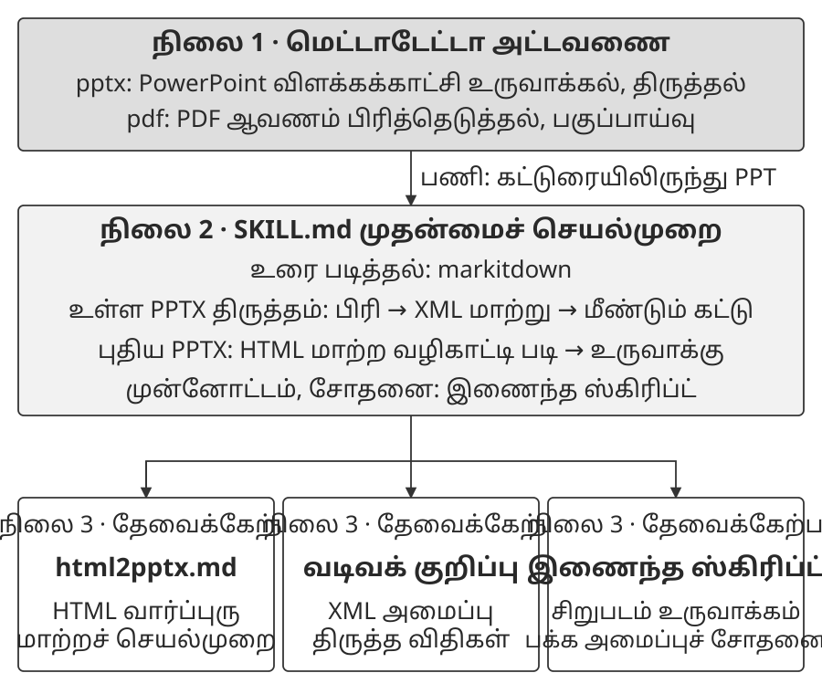

### Skills: துறைத் திறனின் இணைக்கக்கூடிய அலகுகள்

**Agent Skills** ஒரு வகைப் பணியைக் கையாளும் முறை, குறிப்புப் பொருட்கள், ஸ்கிரிப்டுகள், வார்ப்புருக்கள் ஆகியவற்றை மீண்டும் பயன்படுத்தக்கூடிய தொகுப்பாகக் கட்டுகிறது. புதிய ஊழியர் சேர்ந்த நாளிலேயே நிறுவனத்தின் முழு இயக்கக் கையேட்டையும் மனப்பாடம் செய்ய வேண்டியதில்லை; மாதிரியும் வேலை செய்யும்போது மட்டும் தொடர்புடைய அத்தியாயத்தை விரிவாகப் படிக்கலாம். இந்த ஏற்றும் முறையே **படிநிலை வெளிப்படுத்தல் (Progressive Disclosure)** எனப்படுகிறது[^ch2-3].

அத்தியாயம் 1-இன் பத்துப் பொருட்களைக் கொண்டே எந்தத் தகவலை Skill-ஆக எழுதத் தகுதியானது என்று தீர்மானிப்போம். பயனர் அஞ்சல் கட்டணம் உட்பட இறுதி விலையை ஒப்பிட விரும்புகிறார் என்று வைத்துக்கொண்டால், விவரங்களும் இந்த முறை பெறும் முகவரியும் தற்போதைய சூழலுக்குள் வந்தாலே போதும். குழு மீண்டும் மீண்டும் வணிகர்களைக் கடந்து விலைகளை ஒப்பிடுகிறது என்றால், விவரக்குறிப்புகளை எவ்வாறு சீரமைப்பது, தனி விலையையும் தொகுப்பு விலையையும் எவ்வாறு வேறுபடுத்துவது, அஞ்சல் கட்டணம் தெரியாதது என்பதை எவ்வாறு குறிப்பது என்பவற்றை ஒரு விலை ஒப்பீட்டு Skill-ஆகத் தொகுக்கலாம். அடுத்த முறை யாராவது என்னென்ன வடிவமைப்புகள் உள்ளன என்று மட்டும் பார்க்க விரும்பினால், பட்டியல் இன்னும் தெரியும்; முழு விலைச் சரிபார்ப்புச் செயல்முறையைப் பயனர் விலையை ஒப்பிட வேண்டியிருக்கும்போது மட்டும் ஏற்றலாம்.

**முதல் அடுக்கு மீத்தரவு.** ஒவ்வொரு Skill-உம் `SKILL.md` மூலம் தன்னை விவரிக்கிறது; கோப்பின் தொடக்கத்தில் `---` ஆல் பிரிக்கப்பட்ட YAML frontmatter-இல் `name`, `description` ஆகியவை உள்ளன. இயக்கக்கருவி முதலில் பெயர்களையும் விளக்கங்களையும் ஒரு பட்டியலாக ஒழுங்கமைத்து, தற்போதைய பணிக்கு எந்த Skill-கள் தேவை என்பதை மாதிரி தீர்மானிக்க விடுகிறது. பட்டியலின் வரிசையையும் காட்சியையும் Harness நிர்வகிக்கிறது; முழுச் செயல்முறை தேர்ந்தெடுக்கப்பட்ட பிறகே ஏற்றப்படுகிறது.

**Skill விளக்கம் முதலில் ஒரு வழித்தட நிபந்தனையாக எழுதப்பட வேண்டும்.** முதன்மை உரையை ஏற்றுவதற்கு முன்பே அதைப் பயன்படுத்துவதா என்பதை மாதிரி தீர்மானிக்க வேண்டும்; எனவே `description` முதலில் எப்போது பொருந்தும், எப்போது தவிர்க்க வேண்டும் என்பதை விளக்கி, பின்னர் அது என்ன செய்யும் என்பதைச் சுருக்க வேண்டும். எடுத்துக்காட்டாக, "help with backend" என்பது மிகவும் பரந்தது; ஏறக்குறைய எல்லாப் பின்முனைப் பணிகளுக்கும் பொருந்திவிடும்; "ஏற்கனவே உள்ள HTTP இடைமுகங்களுக்கு, அங்கீகாரம், அளவுருச் சரிபார்ப்பு, பிழைப் பதில்கள் ஆகியவற்றை உள்ளடக்கிய ஒருங்கிணைப்புச் சோதனைகளை எழுது" என்பதோ தெளிவான எல்லையைத் தருகிறது. குழப்பம் ஏற்படக்கூடிய பணிகளுக்கு, "இடைமுகத் திட்டத்தை மட்டும் விவாதிக்கும்போது பயன்படுத்தத் தேவையில்லை" போன்ற விலக்கு நிபந்தனைகளையும் சேர்க்கலாம்.

**இரண்டாம் அடுக்கு மையச் செயல்முறை.** Skill தேர்ந்தெடுக்கப்பட்ட பிறகு, இயக்கக்கருவி முழு அறிவுறுத்தல்களையும் சூழலுக்குள் அனுப்புகிறது. பயனர் `/pptx` போன்ற கட்டளையை வெளிப்படையாக உள்ளிடும்போது, கிளையண்ட் நேரடியாகத் தேடி ஏற்றலாம்; மாதிரி தானாகத் தேர்ந்தெடுக்கும்போது, Skill கருவி அல்லது கோப்பு வாசிப்புக் கருவி வழியாக உள்ளடக்கத்தைப் பெறுகிறது. முன்னது மாதிரி செயல்படுத்தும் அழைப்பைத் தொடங்கும் படியைத் தவிர்க்கிறது; பின்னது தேர்வையும் ஏற்றுதலையும் இயக்கப் பாதையில் பதிவாக விட்டுச் செல்கிறது.

இந்த நூலின் சோதனைகள் பயன்படுத்தும் PPTX Skill-ஐ எடுத்துக்காட்டாகக் கொண்டால், மைய விளக்கம் சில பொதுவான பாதைகளை அறிமுகப்படுத்துகிறது: Microsoft-இன் markitdown மூலம் சறுக்கித் தாள் உரையைப் பிரித்தெடுத்தல், PPTX-ஐ விரித்து அடியிலுள்ள XML-ஐப் பார்த்தல், புதிதாக உருவாக்குதல் அல்லது திருத்துதல் பணிப்பாய்வைத் தேர்ந்தெடுத்தல். இந்த அடுக்கு விளக்கத்தைப் படித்த பிறகு, தற்போதைய பணிக்கேற்ப அடுத்து எந்த ஆவணத்தைப் படிப்பது, எந்த வகை ஸ்கிரிப்டை அழைப்பது என்று மாதிரி தீர்மானிக்க முடியும்[^ch2-4].

**மூன்றாம் அடுக்கு விரிவான பொருட்கள்.** சிக்கலான செயல்கள் சிறப்பு ஆவணங்களில் பரவியுள்ளன; முதன்மைக் கோப்பு நுழைவாயிலை வழங்குகிறது. இந்த நூல் பயன்படுத்திய பதிப்பில் உள்ள `html2pptx.md` HTML வழியாகச் சறுக்கித் தாள்களை உருவாக்கும் முறையை விளக்குகிறது; பிற குறிப்பு ஆவணங்கள் வடிவம், திருத்த விவரங்களைச் சேர்க்கின்றன. ஏஜெண்ட் பணிக்கேற்ப இவற்றைத் தொடர்ந்து படித்து, உடன் வரும் ஸ்கிரிப்டுகள், பொருட்கள், வார்ப்புருக்களைக் கொண்டு செயல்களை முடிக்கிறது.

[^ch2-3]: Anthropic, Equipping Agents for the Real World with Agent Skills, 2025; Agent Skills, How to add skills support to your agent.
[^ch2-4]: Anthropic, PPTX Skill. இந்த நூலின் சோதனைகள் HTML மாற்றச் செயல்முறையைக் கொண்ட பதிப்பை நிலையாகப் பயன்படுத்துகின்றன; குறிப்பிட்ட பதிப்பும் இயக்கும் முறையும் துணைச் சோதனை README-இல் உள்ளன.
[^ch2-codex-skills]: OpenAI, Build skills; OpenAI Codex பொதுக் களஞ்சியத்தில் உள்ள Skills செயலாக்கம்.
[^ch2-cc-skill-inject]: Claude Code, How Claude Code uses prompt caching, Invoking skills and commands; Agent Skills, How to add skills support to your agent, User-explicit activation.

### பயன்படக்கூடிய Skill-ஐ எவ்வாறு எழுதுவது

பயன்படக்கூடிய ஒரு Skill நான்கு கேள்விகளுக்குப் பதிலளிக்க வேண்டும்: எந்தப் பணிகளுக்குப் பொருந்தும், எந்த வரிசையில் கையாள வேண்டும், எந்தச் சூழ்நிலைகளில் உறுதிப்படுத்தல் தேவை, வேலை முடிந்ததை எவ்வாறு தீர்மானிப்பது. எழுதுபவர் தன் அனுபவத்தைச் செயல்படுத்தக்கூடிய படிகளாகத் தொகுத்து, முக்கிய மதிப்பீடுகளுக்கு எடுத்துக்காட்டுகளைச் சேர்க்க வேண்டும்.

எழுத்து Skill-ஐ எடுத்துக்காட்டாகக் கொண்டால், தனிப்பட்ட வெளிப்பாட்டுப் பழக்கங்களிலிருந்து தொடங்கி AI எழுத்தை மேம்படுத்தும் Baoyu-வின் சிந்தனையைப் பின்பற்றலாம்[^ch2-baoyu-remove-ai-writing-flavor]; பின்னர் உள்ளடக்கத்தை நான்கு பகுதிகளாக ஒழுங்கமைக்கலாம்:

- **பங்கும் வாசகரும்**: சேவை செய்யும் பொருள், பணி வகை, இறுதி வரைவின் தேவைகளை விளக்குதல்.
- **மையக் கொள்கைகள்**: முதலில் மூன்று முதல் ஐந்து அடிக்கடி பயன்படும் மதிப்பீடுகளை எழுதி, ஒவ்வொன்றுக்கும் மாற்றியெழுதுவதற்கு முன்னும் பின்னும் உள்ள குறிப்பிட்ட எடுத்துக்காட்டுகளைச் சேர்த்தல்.
- **பொதுவான பிழைகளும் எல்லைகளும்**: எளிதில் தோன்றும் வெளிப்பாட்டுப் பிரச்சினைகள், அதிகாரம் மீறிய செயல்கள், விதிவிலக்குகள் ஆகியவற்றைப் பதிவு செய்தல்.
- **குறிப்புப் பொருட்கள்**: சொற்களஞ்சியம், வார்ப்புருக்கள், மாதிரிக் கட்டுரைகள், சிறப்பு விளக்கங்கள் ஆகியவற்றைச் செயல்படுத்தும்போது பார்க்கச் சேமித்தல்.

விதிகளை "பொருந்தும் எல்லை, செயல், விதிவிலக்கு, சரிபார்ப்பு முறை" என்ற வடிவத்தில் எழுதலாம். எடுத்துக்காட்டாக, நீண்ட வாக்கியங்களைச் சுருக்கும் ஒரு விதி, அது எந்தப் பத்திகளுக்குப் பொருந்தும், எவ்வாறு பிரிப்பது, பிரித்த பிறகு நிபந்தனையும் முடிவும் இன்னும் முழுமையாக உள்ளனவா என்று எவ்வாறு சரிபார்ப்பது என்பதை விளக்க வேண்டும்.

தொடங்கும்போது, உங்களுக்குத் திருப்தியான மூன்று முதல் ஐந்து சொந்தக் கட்டுரைகளைத் தேர்ந்தெடுத்து, சொற்தேர்வு, வாக்கிய அமைப்பு, பத்தி ஒழுங்கமைப்பு, தொனி ஆகியவற்றைத் தொகுத்து, சுமார் இருபது வரிகள் கொண்ட முதல் பதிப்பை உருவாக்குமாறு ஏஜெண்டிடம் கேளுங்கள். பின்னர் அதைக் கொண்டு ஒரு புதிய தலைப்பைக் கையாளச் செய்து, எழுத்தாளர் வாக்கியம் வாக்கியமாகத் திருத்த வேண்டும். திருத்தத்துக்கு முன்னும் பின்னும் உள்ள வேறுபாடுகள் இன்னும் குறிப்பான பின்னூட்டத்தைத் தரும்: எந்தச் சொற்கள் தேவையற்றவை, எந்த வாக்கியங்களைப் பிரிக்க வேண்டும், எங்கே உண்மைகள் விடுபட்டுள்ளன, எங்கே தொழில்நுட்ப விவரங்களை மீண்டும் சேர்க்க வேண்டும். மீண்டும் மீண்டும் தோன்றும் திருத்தங்களை விதிகளாகத் தொகுத்து, அதற்குரிய எடுத்துக்காட்டுகளையும் பொருந்தும் எல்லையையும் தக்கவைக்கவும்.

Skill செயல்பாட்டுக் கருவிகளையும் வார்ப்புருக்களையும் உடன் கொண்டிருக்கலாம். எடுத்துக்காட்டாக, PPTX Skill இயக்க விளக்கங்கள், பாகுபடுத்தும் ஸ்கிரிப்டுகள், உருவாக்கும் ஸ்கிரிப்டுகள், வடிவமைப்பு வளங்கள் ஆகியவற்றை ஒன்றாக வைக்கிறது; இதனால் மாதிரி விளக்கங்களைப் பின்பற்றித் தொடர்புடைய வளங்களை அழைக்க முடிகிறது. ஒவ்வொரு Skill-ஐயும் தனியாகச் சோதிக்கவும், புதுப்பிக்கவும், பதிப்பு மேலாண்மை செய்யவும் முடியும்; குழு உறுப்பினர்களும் ஒரே செயல்முறையைச் சுற்றி அனுபவத்தைத் தொடர்ந்து சேர்க்கலாம். **Skills-இன் நீண்டகால மதிப்பு, துறை அனுபவத்தைப் பரவலாகக் குவிக்கவும், தனியாக வெளியிடவும், மீண்டும் பயன்படுத்தவும் உதவுவதில் உள்ளது.** ஏஜெண்ட் திறனை விரிவுபடுத்தும்போது, குழுக்கள் தாம் சிறந்து விளங்கும் Skill-களைப் பராமரித்து, படிப்படியாக pip, npm போன்ற மென்பொருள் தொகுப்புச் சூழல்தொகுதியை உருவாக்கலாம். இந்த Skill-கள் முதன்மை அமைப்பு வழங்கும் கண்டுபிடிப்பு, ஏற்றுதல், செயல்படுத்தல் பொறிமுறைகளைப் பகிர்ந்துகொள்ளலாம்.

**இடைவினை முறையை வடிவமைக்கும்போது, மாதிரி ஏற்கனவே பயிற்சி பெற்று தகவமைத்த வடிவங்களையே பின்பற்றுவதற்கு முன்னுரிமை கொடுங்கள்.** பங்குப் பிரிவு, கருவி முடிவு வடிவம், Skill ஏற்றும் முறை ஆகிய அனைத்தும் மாதிரி பணியை எவ்வாறு தொடர்கிறது என்பதைப் பாதிக்கின்றன. நிறுவனங்கள் வழங்கும் நிலையான செயல்முறைகள் தொடக்கப் புள்ளியாகப் பொருத்தமானவை; அறிமுகமில்லாத வடிவங்களிலிருந்து பொருளை மீண்டும் ஊகிக்கும் மாதிரியின் சுமையை அவை குறைக்கின்றன.

[^ch2-baoyu-remove-ai-writing-flavor]: Baoyu, "Stop using prompts to remove the AI flavor — the direction is wrong", 2026-02-14.

### சூழலில் Skills-இன் இடம்

Skills-இன் சூழல் செலவு பட்டியல், முதன்மை உரை என இரண்டு பகுதிகளாகப் பிரிகிறது. பட்டியல் கிடைக்கும் திறன்களைக் கண்டறிய மாதிரிக்கு உதவுகிறது; முதன்மை உரை தேர்ந்தெடுக்கப்பட்ட பிறகு இயக்கச் செயல்முறையை வழங்குகிறது. வழிமுறைகள் தேவைக்கேற்ப ஏற்றுவதைக் கோருகின்றன; குறிப்பிட்ட செய்திப் பங்குகள், உறையிடல், புதுப்பிப்பு முறைகளை Harness செயலாக்குகிறது.

Claude Code அழைப்பு நிகழும் இடத்தில் Skill அறிவுறுத்தல்களை `user` செய்தியாக அமர்வில் சேர்க்கிறது[^ch2-cc-skill-inject]. மாதிரி தானாகத் தூண்டும் ஒரு செய்தி வரிசையைப் படம் 2-12 காட்டுகிறது: முதலில் `Skill(skill: "pptx")` அழைப்பை வெளியிட்டு, கருவிப் பதிலைப் பெற்று, பின்னர் சேர்க்கப்பட்ட Skill முதன்மை உரையைப் படிக்கிறது. சிறப்பு இயக்கக் கருவியைப் பயன்படுத்தும்போது, கருவிப் பதில் அழைப்பு உறுதிப்படுத்தலாகச் செயல்படலாம்; முதன்மை உரையை Harness தனியாக உட்செலுத்துகிறது; சாதாரணக் கோப்பு வாசிப்புக் கருவியைப் பயன்படுத்தும்போது, முதன்மை உரையைக் கருவி முடிவிலேயே நேரடியாகச் சேர்க்கலாம். பயனர் `/pptx` என்று வெளிப்படையாக உள்ளிடும்போது, கிளையண்ட் நேரடியாக அறிவுறுத்தல்களை விரிக்கலாம்; மாதிரி இயக்க அழைப்பைத் தொடங்கும் படி தேவையில்லை.

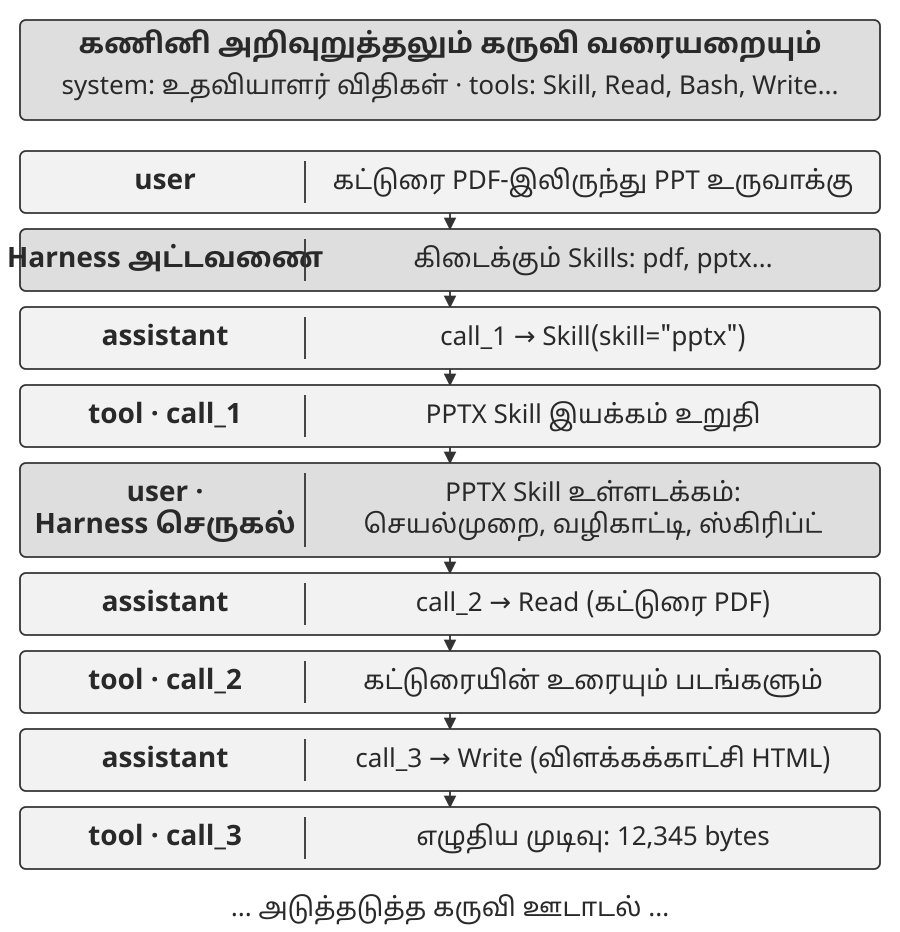{height=55%}

Codex-இன் Skills செயலாக்கமும் திறன் பட்டியலையும் தேர்ந்தெடுக்கப்பட்ட அறிவுறுத்தல்களையும் தனித்தனியாக ஒழுங்கமைக்கிறது. பொது மூலக் குறியீட்டில், பட்டியலின் ஒரு பகுதி `developer` சூழலுக்குள் நுழைகிறது; மற்றவை தற்போதைய சுற்றுடனும் இயக்கச் சூழலுடனும் வழங்கப்படுகின்றன; வெளிப்படையாகத் தேர்ந்தெடுக்கப்பட்ட Skill பயனர் சூழல் துண்டு வழியாகச் சேர்க்கப்படுகிறது. பட்டியலின் மூலமும் கிடைக்கும் இயக்கச் சூழலும் குறிப்பிட்ட வரிசையைப் பாதிக்கின்றன[^ch2-codex-skills].

தேவைக்கேற்ப ஏற்றும்போது சேமிப்பு எவ்வாறு வளர்கிறது என்பதைப் படம் 2-13 காட்டுகிறது; மீண்டும் பயன்படுத்தக்கூடிய சேமிப்பு இன்னும் உருவாகாத கோரிக்கையே தொடக்கப் புள்ளி. பட்டியல் முதன்முறை கோரிக்கைக்குள் நுழையும்போது செயலாக்கப்பட வேண்டும்; முதன்மை உரை முதன்முறை ஏற்றப்படும்போதும் கணக்கீடு அதிகரிக்கும்; அடுத்தடுத்த கோரிக்கைகள் அதே முன்னொட்டைத் தக்கவைக்கும்போது, இந்த உள்ளடக்கத்தைச் சேமிப்பிலிருந்து படிக்க வாய்ப்பு கிடைக்கும். புதிய உள்ளடக்கத்தை அழைப்பு இடத்தில் சேர்த்தால், முந்தைய செய்திகளை நிலையாக வைத்திருக்கலாம். ஏற்கனவே ஏற்றப்பட்ட விளக்கங்கள் வரலாற்றில் தொடர்ந்து இருக்கும்; புதுப்பிக்க வேண்டியிருக்கும்போது இயக்கக்கருவியின் சூழல் உத்தியின்படி கையாளப்படும்.

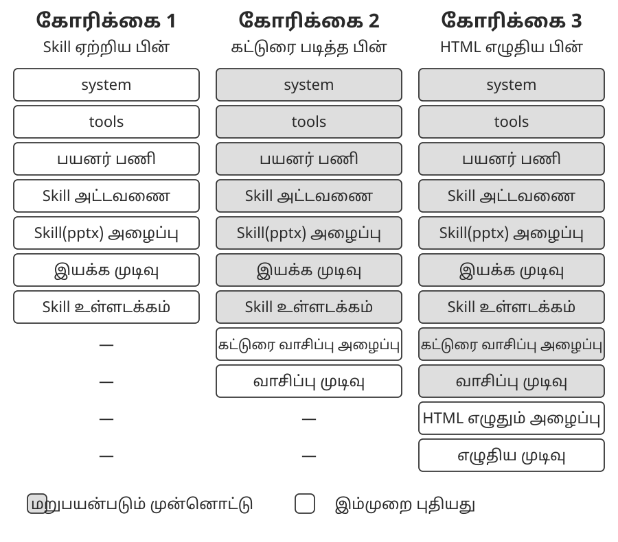

### Skills-க்கும் கருவிகளுக்கும் உள்ள உறவு

Skill பணி அறிவையும் இயக்கச் செயல்முறையையும் வழங்குகிறது; கருவிகள் படித்தல், செயல்படுத்தல், முடிவுகளைப் பெறுதல் ஆகியவற்றுக்குப் பொறுப்பு. அத்தியாயம் 5 அறிமுகப்படுத்தும் ஏழு மையக் கருவிகளை வெவ்வேறு Skill-களுடன் இணைக்கலாம்: அதே கோப்பு வாசிப்புக் கருவி சறுக்கித் தாள் வழிகாட்டியையும் படிக்கலாம், குறியீட்டு வழிமுறைகளையும் படிக்கலாம்; பொதுச் செயல்படுத்தி அதற்குரிய ஸ்கிரிப்டுகளை இயக்கலாம். இவ்வாறு, சிறப்புத் திறன்களைச் செயல்முறைகள், வளங்கள் மூலம் விரிவுபடுத்தலாம்; அடிப்படைக் கருவித் தொகுப்பு ஒப்பீட்டளவில் நிலையாக இருக்கும்.

சிறப்புக் கருவிகளையும் Skill-உடன் இணைந்து பயன்படுத்தலாம். முன்பு கண்ட கருவித் தேடல் தேவைக்கேற்பக் கருவி வரையறைகளை வழங்குகிறது; Skill எப்போது அழைப்பது, எவ்வாறு இணைப்பது, முடிவுகளை எவ்வாறு சரிபார்ப்பது என்பதை விளக்குகிறது. இரண்டும் நிரந்தரத் தகவலின் அளவைக் கட்டுப்படுத்தி, புதிதாக ஏற்றப்படும் உள்ளடக்கத்துக்குப் பொருத்தமான இடத்தை ஏற்பாடு செய்ய வேண்டும். பொதுச் செயல்படுத்திக்கும் சிறப்புக் கருவிகளுக்கும் இடையிலான தேர்வை அத்தியாயம் 4 விவாதிக்கும்; அனுபவத்தை அறிவாகவா, அறிவுறுத்தலாகவா, நிரலாகவா, மாதிரி அளவுருக்களாகவா சேமிப்பது பொருத்தம் என்பதை அத்தியாயம் 9 மேலும் விவாதிக்கும்.

> **சோதனை 2-6 ★★: Agent Skills கொண்டு ஆய்வுக் கட்டுரையிலிருந்து சறுக்கித் தாள்களை உருவாக்குதல்**
>
> *Attention Is All You Need* கட்டுரையைப் பொருளாகக் கொண்டு, சறுக்கித் தாள் உருவாக்கத்துக்கான தொழில்முறைச் செயல்முறையை ஏஜெண்ட் எவ்வாறு தேவைக்கேற்ப ஏற்றுகிறது என்பதை இந்தச் சோதனை காட்டுகிறது. கட்டுரையின் PDF-இலிருந்து பத்து முதல் பதினைந்து பக்கச் சறுக்கித் தாள்களை உருவாக்கி, பிரச்சினைப் பின்னணி, முறை, முக்கிய முடிவுகள், முடிவுரை ஆகியவற்றை உள்ளடக்கி, கட்டுரையில் உள்ள படங்களையும் அட்டவணைகளையும் விளக்கத்துக்குப் பயன்படுத்துவதே பணி.
>
> இந்த இயக்கம் Kimi Code-ஐயும் Anthropic-இன் அதிகாரபூர்வ PPTX Skill-ஐயும் பயன்படுத்தியது. ஏஜெண்ட் முதலில் பட்டியலில் PPTX Skill-ஐக் கண்டுபிடித்து, அதன் இயக்க விளக்கத்தைப் படித்து, தொடர்ந்து HTML மாற்ற வழிகாட்டியைப் படித்து, துணை உருவாக்கக் கருவிகளை அழைத்து, இறுதியில் சிறுபடங்கள் மூலமும் பக்கம் பக்கமாக வரைந்தும் வடிவமைப்பைச் சரிபார்த்தது. ஒவ்வொரு படியிலும் படித்த பொருள் அடுத்த செயலுக்குப் பயன்பட்டது; முழு உருவாக்கச் செயல்முறையும் பணியுடன் படிப்படியாக விரிந்தது.
>
> இறுதி வரைவு பதின்மூன்று பக்கங்கள்; கட்டுரையில் உள்ள கட்டமைப்புப் படம், கவனப் பொறிமுறைப் படம், சோதனை முடிவு அட்டவணை, கவனக் காட்சிப்படுத்தல் படம் ஆகியவை மேற்கோள் காட்டப்பட்டன.
>
> உருவாக்கத்துக்குப் பிந்தைய சரிபார்ப்பும் Skill பணிப்பாய்வின் ஒரு பகுதி. இந்த இயக்கத்தில் கீழெழுத்து விடுபடுதல், புள்ளிக் குறிகளில் கோளாறு, படங்களின் மேற்கோள் பாதைப் பிழை, எண் குறிச்சொல் துல்லியப் பிரச்சினைகள் ஆகியவை தோன்றின; வரைந்த முடிவுகளையும் கட்டமைப்புச் சரிபார்ப்பையும் கொண்டு ஏஜெண்ட் ஒவ்வொன்றாகத் திருத்தியது. இறுதிக் கோப்பு கட்டமைப்புச் சரிபார்ப்பில் வெற்றி பெற்று, LibreOffice-இல் மீண்டும் திறந்து வரையப்பட்டது.

> **சோதனை 2-7 ★★: தனிப்பட்ட மாதிரிக் கட்டுரைகளிலிருந்து "AI சுவையை நீக்கும்" எழுத்து Skill-ஐ உருவாக்குதல்**
>
> இந்தப் பயிற்சி தனிப்பட்ட எழுத்து அனுபவத்தை மீண்டும் பயன்படுத்தக்கூடிய அறிவுறுத்தல்களாகத் தொகுக்கிறது. மூன்று முதல் ஐந்து சொந்தக் கட்டுரைகளைத் தயார் செய்து, வெளிப்பாட்டுப் பழக்கங்களைத் தொகுக்குமாறு ஏஜெண்டிடம் கேட்டு, தூண்டல் நிபந்தனைகள், மூன்று முதல் ஐந்து கொள்கைகள், அவற்றுக்குரிய எடுத்துக்காட்டுகள் கொண்ட முதல் பதிப்பு Skill-ஐ உருவாக்குங்கள்.
>
> ஒரு புதிய தலைப்பைத் தேர்ந்தெடுத்து எழுதச் செய்து, பின்னர் எழுத்தாளர் வாக்கியம் வாக்கியமாகத் திருத்த வேண்டும். இரு பதிப்புகளையும் ஒப்பிட்டு, மீண்டும் மீண்டும் தோன்றும் பிரச்சினைகளைக் கண்டறியுங்கள்; எடுத்துக்காட்டாக வெற்றுச் சொற்கள், மிக நீண்ட வாக்கியங்கள், காரண–விளைவு உறவு விடுபடுதல், அல்லது புரிதலைத் தாங்கும் குறிப்பிட்ட எடுத்துக்காட்டுகளை நீக்குதல். மீண்டும் மீண்டும் தோன்றும் திருத்த முறைகளை Skill-இல் எழுதலாம்.

## ஏஜெண்ட் நிலைப் பட்டை: மீத்தகவலால் ஏஜெண்ட் பாதை மேலாண்மையை வலுப்படுத்துதல்

பயனர் விரைவுபடுத்திக் கேட்கிறார்: "இன்னொரு முறை அழைக்க முடியுமா?" படம் 2-14-இன் இடப்பக்கம் மூன்று அழைப்புகளைப் பதிவு செய்கிறது. முதல் முறை 45 நிமிடம் காத்திருந்தும் இணைப்பு கிடைக்கவில்லை; மூன்றாம் முறைதான் மாதம் 59 டாலர் என்று பேசி முடிவு செய்யப்பட்டது. இந்த எடுத்துக்காட்டின் விதிப்படி, ஒவ்வொரு அழைப்பும் ஒரு ஒதுக்கீட்டைப் பயன்படுத்துகிறது; இரண்டு முறை மட்டுமே இணைப்பு கிடைத்தாலும், மூன்று ஒதுக்கீடுகளும் தீர்ந்துவிட்டன. இத்தகைய எண்ணிக்கைகள், செயல் முன்னேற்றம், உறுதிப்படுத்த வேண்டிய விஷயங்கள் ஆகியவற்றை Harness செய்திகளுடன் புதுப்பிக்கப்படும் ஒரு சுருக்கமாகத் தொகுக்கலாம்; இதுவே **ஏஜெண்ட் நிலைப் பட்டை (Agent Status Bar)** எனப்படுகிறது.

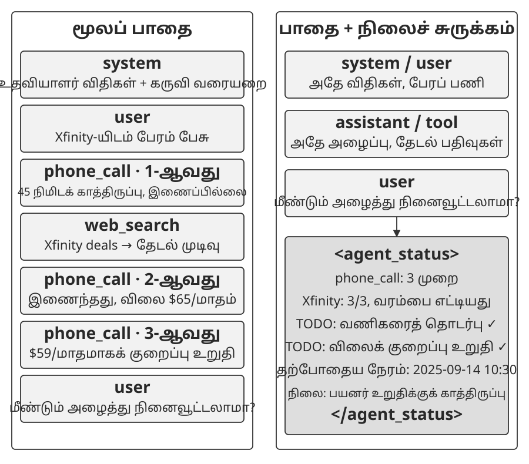

கைபேசி நேரம், மின்கலம், சமிக்ஞை ஆகியவற்றைத் திரையின் மேலே வைக்கிறது; ஒரு பார்வையிலேயே தற்போதைய நிலை தெரிந்துவிடும். படத்தின் வலப்பக்கச் சுருக்கமும் இதையொத்த பணியைச் செய்கிறது: "உச்சவரம்பை எட்டியது", "பயனர் உறுதிப்படுத்தலுக்காகக் காத்திருக்கிறது" என்பதைப் படித்த உதவியாளர், பேசி முடிவு செய்த விலையைப் பயனரிடம் தெரிவித்து, அதை ஏற்கிறாரா என்று பயனரையே தீர்மானிக்கக் கேட்கலாம். Harness கருவி முடிவைத் திருப்பித் தரும்போது சுருக்கத்தை இணைக்கலாம்; அல்லது ஒரு தனி நிலைச் செய்தியைச் சேர்க்கலாம்.

### மூலப் பதிவுகளிலிருந்து வெளிப்படையான நிலை வரை

ஒரு தொலைபேசி வாடிக்கையாளர் சேவைப் பணியைக் கருதுங்கள்: ஒரே பணிக்குள் ஒவ்வொரு வணிகரையும் மூன்று முறைக்கு மேல் அழைக்கக் கூடாது என்று அமைப்பு கோருகிறது. மூன்று அழைப்புகளுக்கு இடையே தேடல், தகவல் வாசிப்பு, பயனர் தொடர்கேள்விகள் ஆகியவை கலந்திருக்கலாம். தொடர்ந்து அழைக்கலாமா என்று தீர்மானிக்க, இந்த வரலாற்றிலிருந்து தொடர்புடைய பதிவுகளை மாதிரி கண்டுபிடித்து, வணிகர்களை வேறுபடுத்தி, குவிந்த எண்ணிக்கையைக் கணக்கிட வேண்டும்.

இயக்கக்கருவி ஒவ்வொரு அழைப்புக்குப் பிறகும் எண்ணிக்கையைப் புதுப்பித்து, "இது Xfinity-க்கான 3-ஆவது அழைப்பு; இந்தப் பணியின் உச்சவரம்பை எட்டிவிட்டது" என்று நேரடியாகத் திருப்பித் தரலாம். அடுத்த முடிவு இந்த முடிவை நேரடியாகப் பயன்படுத்தலாம். அழைப்பு எண்ணிக்கையை நிரல் பராமரிக்கிறது; பணி முன்னேற்றத்துடன் இணைத்துக் காத்திருப்பதா, வேறு வழிகளைத் தேடுவதா, அல்லது தற்போதைய நிலையைப் பயனரிடம் விளக்குவதா என்பதை மாதிரி தீர்மானிக்கிறது; இயக்க அடுக்கும் அதே நேரத்தில் இந்த எண்ணிக்கையைக் கொண்டு அடுத்தடுத்த அழைப்புக் கோரிக்கைகளைச் சரிபார்க்கிறது.

இங்குள்ள பொறியியல் மதிப்பு, **அடுத்தடுத்த முடிவுகளுக்கு மீண்டும் மீண்டும் தேவைப்படும் நிலையை முன்கூட்டியே ஒழுங்கமைப்பது**. முழு அழைப்புப் பதிவு இன்னும் உரையாடல் உள்ளடக்கத்தையும் கையாளும் வரலாற்றையும் சேமிக்கிறது; நிலைப் பட்டையோ முடிவுகளுக்கு அடிக்கடி தேவைப்படும் புள்ளிவிவரங்களையும் முன்னேற்றத்தையும் வழங்குகிறது. **மீண்டும் மீண்டும் பயன்படும் புள்ளிவிவரங்களைக் குறியீடே படிப்படியாகப் பராமரிக்க வேண்டும்.** சூழலில் ஒரு பதிவைக் கண்டுபிடிப்பதும், எல்லாப் பதிவுகளிலிருந்தும் மொத்த எண்ணிக்கையைக் கணக்கிடுவதும் இரு வெவ்வேறு வேலைகள். மூலப் பாதையைச் சேமிப்பதால், துல்லியமான, எப்போதும் எடுக்கக்கூடிய புள்ளிவிவர அட்டவணை தானாகக் கிடைத்துவிடாது. ஒவ்வொரு முறையும் மாதிரியை மீண்டும் முழுவதும் கடந்து எண்ணச் சொன்னால், அது பகுத்தறிவு token-களைச் செலவழிப்பதோடு, விடுபடவோ இருமுறை எண்ணவோ வாய்ப்பையும் அதிகரிக்கிறது.

சூழலை, ஒரு "வடிகட்டல் அடுக்கு" துணைக்குத் தேவைப்படும் தேடுபொறிக்கு ஒப்பிடுகிறேன்: மூலப் பதிவுகள் தடமறிய வசதியானவை, வடித்தெடுக்கப்பட்ட நிலை நேரடியாகப் பயன்படுத்த வசதியானது. எண்ணிக்கைகள், வரம்புகள், சரிபார்க்கப்பட்ட பணி நிறைவு நிலை ஆகியவற்றைக் குறியீடு பராமரிப்பது பொருத்தமானது; பொருள் சார்ந்த மதிப்பீடு தேவைப்படும் தகவலை முதலில் ஒவ்வொன்றாகப் பிரித்தெடுத்து, பின்னர் தொகுத்துச் சரிபார்க்கலாம். இவ்வாறு, ஒவ்வொரு முடிவிலும் மாதிரி தற்போதைய நிலையையும் தேவையான சான்றுகளையும் ஒருசேரப் பார்க்க முடிகிறது.

நீண்ட பாதைகள் முக்கியத் தகவலைக் கண்டுபிடிப்பதன் சிரமத்தையும் அதிகரிக்கின்றன. சமீபத்திய இலக்கு, கட்டுப்பாடுகள், முன்னேற்றம் ஆகியவற்றைப் பின்பகுதியில் ஒருங்கே வைத்தால், தற்போதைய முடிவுக்குத் தேவையான தகவலை மாதிரி எளிதில் கண்டுபிடிக்க முடியும்.

> **சோதனை 2-8 ★★: கவனக் காட்சிப்படுத்தல் மூலம் ஏஜெண்ட் நிலைப் பட்டையின் விளைவை அவதானித்தல்**
>
> இந்தச் சோதனை Qwen3-0.6B-ஐப் பயன்படுத்தி, ஒரு வாடிக்கையாளர் சேவைப் பணத்திருப்பப் பாதையைக் கட்டமைக்கிறது: ஏஜெண்ட் ஏற்கனவே Xfinity-ஐ மூன்று முறை அழைத்துவிட்டது, இடையில் இணையத் தேடல்கள் நடந்தன; பின்னர் பயனர் "இன்னொரு முறை அழைத்து விரைவுபடுத்த முடியுமா?" என்று கேட்கிறார். ஒரே பணிக்குள் ஒவ்வொரு வணிகரையும் அதிகபட்சம் மூன்று முறை மட்டுமே அழைக்கலாம் என்று சிஸ்டம் விதி வரம்பிடுகிறது.
>
> இரு உள்ளீட்டுக் குழுக்களும் ஒரே வரலாற்றையும் பயனர் கேள்வியையும் தக்கவைக்கின்றன. A குழு மூலப் பாதையை நேரடியாகப் பயன்படுத்துகிறது; B குழு இறுதியில் பின்வரும் நிலையைச் சேர்க்கிறது:
> ```xml
> <agent_status>
> Current State:
> - Tool call summary: 'phone_call' has been invoked 3 times (Xfinity: 3 times)
> - Constraint check: Maximum calls to Xfinity reached (3/3)
> </agent_status>
> ```
>
> ஒவ்வொரு குழுவும் மூன்று முறை இயக்கப்பட்டது. A குழு இரண்டு முறை தொடர்ந்து அழைப்பதைத் தெளிவாக மறுத்தது, ஒரு முறை வெளியீடு "பிற" வகைக்குள் சென்றது; B குழு மூன்று முறையும் தொடர்ந்து அழைப்பதைத் தெளிவாக மறுத்தது. இரு குழுக்களிலும் விதியை மீறி அழைப்பைத் தொடர்ந்ததாகக் கருதப்பட்ட வெளியீடு எதுவும் இல்லை. இந்த ஒப்பீட்டை மீளுருவாக்க, `chapter2/attention_visualization`-க்குள் சென்று `python run_status_bar_experiment.py --output runs/status-bar-reproduction`-ஐ இயக்குங்கள். இந்த இயக்கத்தின் உள்ளீடுகளும் ஒவ்வொரு முறையின் முடிவுகளும் சோதனைக் கோப்பகத்தில் உள்ள `runs/exp2-7-qwen3-0.6b-20260730-v2/comparison.json`-இல் சேமிக்கப்பட்டுள்ளன.
>
> வரலாற்று அழைப்புகள், தேடல் முடிவுகள், பயனர் கேள்வி, நிலைப் பட்டை ஆகியவற்றுக்கு உருவாக்கப் பகுதி கொடுக்கும் எடைப் பரவலைக் கவன வரைபடம் காட்டுகிறது.

Noah Shi-உடன் நான் மேற்கொண்ட ContextDistill-Bench ஆய்வு, நிலையை முன்கூட்டியே வடிப்பதன் பலனை மேலும் ஆராய்ந்தது[^ch2-8]. அந்த அளவுகோல் உள்ளடக்கிய நிலை வினவல்களில், சிறிய மாதிரிகளும் வெளிப்படையான நிலை மூலம் அதிகத் துல்லியத்தைப் பெற முடிந்தது; முன்னணி மாதிரிகளின் சிந்தனை அளவு, தாமதம், வினவல் செலவு ஏறக்குறைய ஒரு பத்து மடங்கு அளவுக்குக் குறைந்தன. எடுத்துக்காட்டாக, Claude 4 Sonnet-இன் ஆயிரம் வினவல்களுக்கான செலவு சுமார் 35.46 டாலரிலிருந்து 3.51 டாலராகக் குறைந்தது. **நிகழ்வு நடக்கும்போதே நிலையைப் பராமரிப்பதால், ஒவ்வொரு வினவலிலும் வரலாற்றைக் கடந்து செல்லும் செலவை இந்த வடிவமைப்பு தவிர்க்கிறது.** சுருக்கப் புலங்கள் நிலைப்படுத்தப்பட்ட பிறகு, வரலாறு தொடர்ந்து வளர்ந்தாலும், வினவல் இந்தச் சில புலங்களை மட்டும் படித்தால் போதும்.

[^ch2-8]: Li, Bojie and Noah Shi. *Distill, Don't Retrieve: Inference-Time Context Distillation for LLM Agent Reasoning.* 2026.

### ஏஜெண்ட் நிலைப் பட்டையின் அமைப்பு

நிலைப் பட்டை பொதுவாக மூன்று வகைத் தகவல்களைக் கொண்டுள்ளது; அவை முறையே "என்ன செய்ய வேண்டும்", "சற்று முன் என்ன நடந்தது", "இப்போது என்ன நிலையில் உள்ளது" என்ற கேள்விகளுக்குப் பதிலளிக்கின்றன.

**பணித் திட்டமிடல்** இலக்கு, படிகள், நிறைவு நிலை ஆகியவற்றைப் பதிவு செய்கிறது. சிக்கலான பணியை TODO பட்டியலாகப் பிரிக்கலாம்; ஒவ்வொரு உருப்படியும் அதன் நிலையையும் தேவையான சார்புநிலைகளையும் தக்கவைக்கிறது. தற்போதைய படியைக் கையாளும்போதும், அசல் தேவை, மையக் கட்டுப்பாடுகள், அடுத்தடுத்த வேலைகள் ஆகியவற்றை மாதிரி இன்னும் பார்க்க முடியும்; ஒரு படி முடிந்ததும் பட்டியல் புதுப்பிக்கப்படுகிறது.

**நிகழ்வுகளின் பக்கவழித் தகவல் (Side-channel Information)** நிகழ்வு நடந்தபோதான பின்னணியை — நேரம், புவியியல் இருப்பிடம், கடைசிப் பதிலுக்குப் பிறகான இடைவெளி போன்றவற்றை — சேர்க்கிறது. இந்த மீத்தரவு நிகழ்வுடன் சேமிக்கப்பட்டு, முன்–பின் உறவையும் சூழ்நிலையையும் புரிந்துகொள்ள மாதிரிக்கு உதவுகிறது. "இன்னும் பதில் வரவில்லை" என்ற அதே வாக்கியம், விண்ணப்பம் சமர்ப்பித்த இரண்டு நிமிடத்துக்குப் பிறகு வருகிறதா, இரண்டு நாளுக்குப் பிறகு வருகிறதா என்பதைப் பொறுத்து, கையாளும் முறை வேறுபடலாம்.

**வெளிச்சூழலின் தற்போதைய நிலை பற்றிய அவதானிப்புச் சுருக்கம்** தற்போதைய நேரம், பணிக் கோப்பகம், கருவி அழைப்பு எண்ணிக்கை, விதிவிலக்கு நினைவூட்டல்கள் ஆகியவற்றை வழங்குகிறது. CLI, GUI தற்போதைய கோப்பகத்தையோ இயக்க நிலையையோ காட்டுவதைப் போலவே, அடுத்த செயலுக்குத் தெளிவான அடிப்படையை இது தருகிறது. எடுத்துக்காட்டாக, திரும்பத் திரும்ப அழைப்பதைப் பற்றிய நினைவூட்டல் தோல்விக் காரணத்தைச் சரிபார்க்க மாதிரியைத் தூண்டலாம்; மீதமுள்ள நிதிநிலை தேடலைத் தொடர்வதா என்று தீர்மானிக்க உதவுகிறது.

நிகழ்வு மீத்தரவு நிகழ்வுடன் சேர்க்கப்பட்ட பிறகு பொதுவாக நிலையாக இருக்கும்; பணி முன்னேற்றமும் வெளிச்சூழல் நிலையும் தொடர்ந்து மாறும். இவ்விரு வகைத் தகவல்களையும் அவற்றின் புதுப்பிப்பு முறைக்கேற்ப வரலாற்றில் எழுத வேண்டும்; கீழே செய்திக் கட்டமைப்புடன் இணைத்து விளக்குவோம்.

### சூழலில் ஏஜெண்ட் நிலைப் பட்டையின் குறிப்பிட்ட இடம்

இந்தப் பகுதியின் எடுத்துக்காட்டில், நிலைச் சுருக்கத்தைக் கடத்த Harness செய்திகளின் இறுதியில் ஒரு `user` செய்தியைச் சேர்க்கிறது. இங்கு `user` என்பது தேர்ந்தெடுத்த API-இன் செய்திப் பங்கு; நிலை உள்ளடக்கத்தை இயக்கக்கருவி உருவாக்கி, குறிச்சொற்கள் மூலம் அதன் பயனை விளக்குகிறது. பிற இடைமுகங்களைப் பயன்படுத்தும்போது, அவை ஆதரிக்கும் சூழல் block-களைப் பயன்படுத்தலாம்; அல்லது தொடர்புடைய கருவி முடிவுடன் நிலையை வழங்கலாம். முன்பு கண்ட, உண்மையான பயனர் வினவலின் அடிப்படையில் வரலாற்றுப் பகுத்தறிவை வெட்டும் வார்ப்புருவைப் பயன்படுத்தும்போது, இயக்க நிலையைக் கருவி முடிவுடன் வழங்கினால், வார்ப்புரு தற்போதைய பணிக்கேற்பப் பகுத்தறிவுத் தகவலைத் தொடர்ந்து தக்கவைக்கும்.

படம் 2-15-இல் பயனரின் ஆரம்ப வேண்டுகோளைக் கண்டுபிடித்து, பின்னர் சமீபத்திய நிலை எந்தச் சுற்றில் எழுதப்பட்டுள்ளது என்று பாருங்கள். அசல் கோரிக்கையைத் தக்கவைத்தால் மட்டுமே, அழைப்பு முடிந்த பிறகு இரண்டு விஷயங்களையும் ஒருசேரச் சரிபார்க்க முடியும்: பயனர் என்ன செய்யச் சொன்னார், இப்போது எந்தப் படி வரை முடிந்துள்ளது.

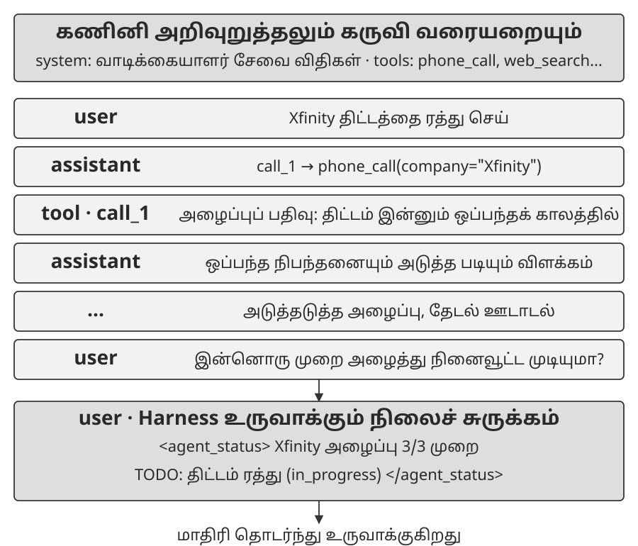

படத்தில் உள்ள வரிசையைச் செய்திப் பட்டியலாக எழுதினால் கீழ்க்கண்டவாறு அமையும். ஒப்பிட எளிதாக, திரும்ப வரும் சுற்றுகளும் சில அழைப்புப் புலங்களும் இங்கு விடுபட்டுள்ளன.

```text
messages: [
  { role: "system", content: "You are a customer service assistant..." }
  { role: "user", content: "Help me cancel my Xfinity plan" }
  { role: "assistant", tool_calls: [{ id: "call_1", ... }] }
  { role: "tool", tool_call_id: "call_1", content: "Call log..." }
  { role: "assistant", tool_calls: [{ id: "call_2", ... }] }
  { role: "tool", tool_call_id: "call_2", content: "Call log..." }
  ...其余轮次...
  { role: "user", content: "Can you call them again to follow up?" }
  { role: "user", content: "<agent_status>
      Current State:
      - phone_call invoked 3 times (Xfinity: 3/3 max)
      - Current time: 2025-09-14 10:30:45
      - TODO: [1] Cancel plan (in_progress)
    </agent_status>" }
]
```
கடைசிச் செய்தி அழைப்பு எண்ணிக்கை, உச்சவரம்பு, நேரம், பணி முன்னேற்றம் ஆகியவற்றை ஒருங்கே திரட்டுகிறது. மாதிரி இந்தப் புலங்களை நேரடியாகப் பயன்படுத்தலாம்; முந்தைய அழைப்பு ID-கள் மூலம் குறிப்பிட்ட பதிவுகளைப் பின்னோக்கிப் பார்க்கவும் முடியும்.

இந்தச் செய்தியைச் சேர்த்த பிறகு, முந்தைய token வரிசை மாறாமல் இருப்பதால், முன்னொட்டு மறுபயன்பாட்டின் அடிப்படை நிபந்தனை இன்னும் பூர்த்தியாகிறது. அடுத்த சுற்றில் பழைய நிலையை எவ்வாறு கையாள்வது என்பது, சூழல் இடப் பயன்பாட்டுக்கும் சேமிப்புச் செலவுக்கும் இடையிலான தேர்வைப் பொறுத்தது.

### நிலைப் புதுப்பிப்பின் இரு செயலாக்கங்களும் சேமிப்பு விலையும்

அடுத்த சுற்றில் ஒரு TODO முடியலாம், அல்லது இன்னொரு கருவி அழைப்பு கூடலாம். Harness நிலையைப் புதுப்பிக்க வேண்டும்; பொதுவாக இரு வழிகள் உள்ளன.

**ஒவ்வொரு சுற்றிலும் மாற்றீடு**: புதிய கோரிக்கையைக் கட்டமைக்கும்போது முந்தைய நிலையை நீக்கி, இறுதியில் சமீபத்திய நிலையைச் சேர்த்தல். சூழலில் தற்போதைய நிலையின் ஒரு பிரதி மட்டுமே இருப்பதால் மாதிரி பயன்படுத்த எளிது. எடுத்துக்காட்டாக, முந்தைய கோரிக்கை "பணி விளக்கம், நிலை A"; இந்த முறை "பணி விளக்கம், கருவி முடிவு, நிலை B". பணி விளக்கம் இன்னும் சேமிப்பில் பொருந்தும்; கருவி முடிவு முதன்முறை சமர்ப்பிக்கப்படுவதால் எப்படியும் கணக்கிடப்பட வேண்டும். முந்தைய கோரிக்கையில் நிலை A-க்குப் பின்னால் வேறு செய்திகள் இருந்திருந்தால் மட்டுமே, A-ஐ நீக்குவது அந்தச் செய்திகளின் அசல் முன்னொட்டுப் பொருத்தத்தை இழக்கச் செய்யும். இந்தக் கோரிக்கையில் மாதிரி B-ஐ மட்டுமே பார்க்கும். A-ஐப் பார்க்க வேண்டியிருந்தால், இயக்கப் பதிவிலிருந்து அப்போதைய நிலைப்படத்தை எடுக்கலாம்.

**நிலைத்த சேர்ப்பு**: ஏற்கனவே உள்ள நிலைப் பதிவுகளைத் தக்கவைத்து, ஒவ்வொரு முறையும் இறுதியில் புதிய நிலையைச் சேர்த்தல். வரலாற்று முன்னொட்டு நிலையாக இருப்பதோடு, நிலை மாற்றங்களைத் தடமறியவும் எளிதாகிறது. பழைய நிலைகள் படிப்படியாகச் சூழல் இடத்தை எடுத்துக்கொள்வதால், நேரத்தையோ பதிப்பையோ தெளிவாகக் குறிக்க வேண்டும்; அப்போதுதான் மாதிரி சமீபத்திய பதிவைக் கொண்டு தற்போதைய நிலைமையைத் தீர்மானிக்கும். Claude Code கோப்பு மாற்ற நினைவூட்டல்களை அமர்வில் சேர்க்கும் முறையும் இந்த வடிவமைப்புச் சிந்தனையையே காட்டுகிறது.

நிலை மிகக் குறுகியதாகவும், அதற்குப் பின்னால் ஏற்கனவே ஏராளமான கருவி முடிவுகள் சேமிக்கப்பட்டும் இருந்தால், பழைய நிலையைத் தக்கவைப்பது நீண்ட பின்னொட்டை மீண்டும் கணக்கிடுவதை விடச் சிக்கனமாக இருக்கலாம்; நிலை நீளமாகவும் அடிக்கடி புதுப்பிக்கப்படுவதாகவும் இருந்தால், மாற்றீடு வரலாற்று நிலைகளின் குவிப்பைக் கட்டுப்படுத்துகிறது.

ஒரு தோராயமான மாதிரியைக் கொண்டு பிரிகோட்டை மதிப்பிடலாம்: ஒவ்வொரு நிலையும் $S$ token, ஒவ்வொரு மாற்றீட்டிலும் பழைய நிலைக்குப் பின் மீண்டும் கணக்கிட வேண்டிய, ஏற்கனவே சேமிக்கப்பட்ட பின்னொட்டின் சராசரி $R$ token (இந்தச் சுற்றில் முதன்முறை சமர்ப்பிக்கப்படும் உள்ளடக்கம் கணக்கில் இல்லை), மொத்தம் $N$ முறை நிலை உட்செலுத்தப்படுகிறது, சேமிப்பு உள்ளீட்டு விலை சாதாரண உள்ளீட்டின் $\alpha$ மடங்கு என்று கொள்வோம். இரு தீர்வுகளுக்கும் பொதுவான செலவுகளைப் புறக்கணித்தால், $C_{\text{மாற்றீடு}} \approx (N-1)(1-\alpha)R$, $C_{\text{சேர்ப்பு}} \approx \alpha S N(N-1)/2$. $N>1$ எனில், $\alpha SN/2 < (1-\alpha)R$ ஆக இருக்கும்போது நிலைத்த சேர்ப்பின் மதிப்பிடப்பட்ட செலவு குறைவு; இல்லையெனில் ஒவ்வொரு சுற்றிலும் மாற்றீடு சிக்கனமானது. இங்குச் சாதாரண உள்ளீட்டு விலையே செலவு அலகு: மாற்றீட்டுத் தீர்வு கூடுதலாகச் செலுத்துவது, பின்னொட்டைச் சேமிப்பிலிருந்து படிப்பதற்குப் பதிலாக மீண்டும் செயலாக்குவதன் விலை வேறுபாடு; சேர்ப்புத் தீர்வு கூடுதலாகச் செலுத்துவது, வரலாற்று நிலைகளைத் திரும்பத் திரும்பப் படிக்கும் கட்டணம்.

ஓர் எடுத்துக்காட்டு: ஒவ்வொரு முறையும் 100 token நிலை உட்செலுத்தப்படுகிறது, மொத்தம் 10 முறை, சேமிப்புப் படிப்பு சாதாரண உள்ளீட்டு விலையின் பத்தில் ஒரு பங்கு. சேர்ப்புத் தீர்வில், அடுத்தடுத்த கோரிக்கைகள் முறையே 1, 2, …, 9 பழைய நிலைகளைக் கூடுதலாகப் படிக்கின்றன; கூடுதல் கட்டணம் 450 சாதாரண உள்ளீட்டு token-களுக்குச் சமம். நிலையை மாற்றுவது அதன் பின்னால் சராசரியாக 1000 சேமிக்கப்பட்ட token-களை மீண்டும் செயலாக்கச் செய்தால், ஒன்பது மாற்றீடுகளின் கூடுதல் கட்டணம் 8100 சாதாரண உள்ளீட்டு token-களுக்குச் சமம்; சேர்ப்பு சிக்கனமானது. பழைய நிலையே சேமிப்பின் இறுதியில் இருந்து, அதன் பின்னால் சேமிக்கப்பட்ட உள்ளடக்கம் எதுவும் இல்லாவிட்டால், சூத்திரத்தில் $R=0$; நேரடியாக மாற்றுவது அந்த 450 token-க்கான சமமான கட்டணத்தைச் சேமிக்கிறது.

> **சோதனை 2-9 ★★: பயனுள்ள சில ஏஜெண்ட் நிலைப் பட்டை நுட்பங்கள்**
>
> இந்தச் சோதனை ஐந்து நிலைப் பட்டை நுட்பங்களைச் செயலாக்குகிறது; அவற்றைத் தனித்தனியாக இயக்கலாம், இணைத்தும் பயன்படுத்தலாம். ஒவ்வொரு நுட்பமும் ஒரு வகைக் குறிப்பிட்ட தகவலை வழங்கி, அடுத்த செயலைத் தீர்மானிக்க மாதிரிக்கு உதவுகிறது.
>
> **நேர முத்திரைக் கண்காணிப்பு** பயனர் செய்திகளிலும் கருவிப் பதில்களிலும் நிகழ்வு நேரத்தைப் பதிவு செய்கிறது; எடுத்துக்காட்டாக `[2025-09-14 10:30:45]`. நேரம் நிகழ்வுடன் வரலாற்றில் எழுதப்பட்டு, அடுத்தடுத்த சுற்றுகளில் அசல் மதிப்பைத் தக்கவைக்கிறது; தற்போதைய நேரமோ புதிய நிலைச் செய்தியுடன் புதுப்பிக்கப்படுகிறது. "நேற்றைய கோப்பு", "இன்றைய மாற்றம்" ஆகியவற்றை மாதிரி வேறுபடுத்த முடிகிறதா, காத்திருப்பு நேரத்தைச் சரியாகப் புரிந்துகொள்கிறதா என்று சரிபார்க்க, சோதனை நேர உருவகப்படுத்தலையும் வழங்குகிறது.
>
> **கருவி அழைப்பு எண்ணி** அகராதியைக் (dictionary) கொண்டு ஒவ்வொரு கருவியின் குவிந்த அழைப்பு எண்ணிக்கையைப் பராமரித்து, பதிலில் `Tool call #3 for 'read_file'` என்று குறிக்கிறது. பிழை உள்ளடக்கத்துடன் இணைத்து, தொடர்ந்து முயல்வதா என்று மாதிரி தீர்மானிக்கலாம். எடுத்துக்காட்டாக, முதல் வாசிப்பு தோல்வியடைந்தால் பாதையைச் சரிபார்த்து, கோப்பகத்தைப் பட்டியலிடலாம்; பல முறை தோல்வியடைந்தால், மாற்றுக் கோப்பைத் தேடலாம் அல்லது விடுபட்ட நிலையைப் பயனரிடம் விளக்கலாம். மறுமுயற்சி எண்ணிக்கையை வரம்பிட வேண்டியிருந்தால், இயக்கக்கருவியும் எண்ணிக்கையின்படி உச்சவரம்பைச் செயல்படுத்த வேண்டும்.
>
> **TODO பட்டியல் மேலாண்மை** `rewrite_todo_list`, `update_todo_status` ஆகிய இரு கருவிகளை வழங்குகிறது. ஒவ்வொரு உருப்படியிலும் தனித்த அடையாளம், உள்ளடக்கம், நேர முத்திரை, மற்றும் `pending`, `in_progress`, `completed`, `cancelled` என்ற நான்கு நிலைகள் உள்ளன. "என்ன செய்யப்பட்டது, இன்னும் என்ன மீதமுள்ளது" என்பதைப் பட்டியல் ஒருங்கே சேமிக்கிறது; பணித் திட்டத்தைத் திரும்பத் திரும்பக் காட்டி இலக்கைத் தெரியும்படி வைக்கும் Manus-இன் சிந்தனைக்கு இது நெருக்கமானது.
>
> **விரிவான பிழைத் தகவல்** பிழை வகையும் விளக்கமும், அழைப்பு அளவுருக்களின் JSON, அழைப்பு அடுக்கு (call stack), திருத்தப் பரிந்துரைகள் ஆகியவற்றை வழங்குகிறது. எடுத்துக்காட்டாக, `FileNotFoundError` வந்தால், கோப்புப் பெயர், தற்போதைய கோப்பகம், முழுமையான பாதை ஆகியவற்றைச் சரிபார்க்குமாறு மாதிரிக்கு நினைவூட்டலாம். அளவுருக்கள் தவறான உள்ளீட்டைக் கண்டறிய உதவுகின்றன, அழைப்பு அடுக்கு தோல்வி இடத்தைக் கண்டுபிடிக்க உதவுகிறது, திருத்தப் பரிந்துரைகள் அடுத்துச் சரிபார்க்க வேண்டிய திசையைத் தருகின்றன. இந்த உள்ளடக்கத்தை மாதிரிக்குத் திருப்பித் தருவதற்கு முன், சான்றுகள் போன்ற உணர்திறன் புலங்களைச் சுத்தம் செய்து, நீண்ட அடுக்கின் நீளத்தைக் கட்டுப்படுத்த வேண்டும்.
>
> **அமைப்பு நிலை விழிப்புணர்வு** தற்போதைய நேரம், பணிக் கோப்பகம், இயக்க அமைப்பு, Shell, Python பதிப்பு ஆகியவற்றை வழங்குகிறது. சோதனையில் உள்ள கட்டளைக் கருவி தனியான கோப்பக மாற்றச் செயல்களை அடையாளம் கண்டு, இயக்கக்கருவி பராமரிக்கும் பணிக் கோப்பகத்தைப் புதுப்பித்து, அடுத்தடுத்த அழைப்புகளுக்குப் பயன்படுத்துகிறது; கூட்டுக் கட்டளைகளில் துணைச் செயல்முறைகளின் கோப்பக மாற்றம் அந்தச் செயல்முறையின் இயக்க எல்லைக்குள் மட்டுமே பொருந்தும். வெளிச்சூழல் புலங்கள் கிடைக்கும் கருவிகளைத் தேர்ந்தெடுக்கவும் மாதிரிக்கு உதவுகின்றன; எடுத்துக்காட்டாக உண்மையான அமைப்பையும் நிறுவப்பட்ட மென்பொருளையும் கொண்டு `apt` அல்லது `brew`-ஐத் தேர்ந்தெடுத்தல்.
>
> இந்த முறை Kimi K3 ஒப்பீட்டில், ஒவ்வொரு வகைப் பணிக்கும் ஐந்து எடுத்துக்காட்டுகள் இருந்தன. நேர முத்திரையும் இணைந்த உள்ளமைவும் ஐந்திலும் வெற்றி பெற்றன; அவற்றின் ஒப்பீட்டுக் குழுக்கள் மூன்றில் வெற்றி பெற்றன; கருவி எண்ணியும் அமைப்பு நிலையும் இயக்கிய, அணைத்த இரு குழுக்களிலும் ஐந்தில் வெற்றி பெற்றன. TODO உள்ளமைவு பூஜ்யத்தில் வெற்றி பெற்றது, ஒப்பீட்டுக் குழு ஒன்றில் வெற்றி பெற்றது; விரிவான பிழை உள்ளமைவு நான்கில், ஒப்பீட்டுக் குழு ஐந்தில் வெற்றி பெற்றன.

**நிலைப் பட்டையை இயன்றவரை குறியீடே பராமரிக்க வேண்டும்.** மாதிரி அதிலுள்ள புள்ளிவிவரங்களையும் வரம்புகளையும் நேரடியாகப் பயன்படுத்துகிறது; தவறான ஒரு "ஏற்கனவே மூன்று முறை அழைக்கப்பட்டது" அடுத்தடுத்த செயல்களையே மாற்றிவிடலாம். எண்ணிக்கை, நேரம், நிலை மாற்றம் ஆகியவற்றை நிரலிடம் ஒப்படையுங்கள்; பொருள் புரிதல் தேவைப்படும்போது, முதலில் மாதிரியைக் கொண்டு ஒவ்வொன்றாகப் பிரித்தெடுத்து, பின்னர் குறியீட்டைக் கொண்டு தொகுத்துச் சரிபாருங்கள்; முழு நீண்ட வரலாற்றையும் ஒரே முறையில் கணக்கிட மாதிரியைச் சொல்லாதீர்கள். மூல நிகழ்வுகள், பிரித்தெடுத்த முடிவுகள், இறுதி நிலை ஆகியவற்றுக்கு இடையிலான தொடர்பைத் தக்கவைத்தால், இருமுறை எண்ணுதல், விடுபடுதல், மூலக் குழப்பம் ஆகியவற்றைக் கண்டறிய எளிதாகும்.

நிலைப் பட்டை எந்தத் தகவலைத் தொகுக்க வேண்டும் என்பதை முன்கூட்டியே தேர்ந்தெடுக்க வேண்டும். எடுத்துக்காட்டாக, "ஏற்கனவே மூன்று முறை அழைக்கப்பட்டது" என்பது மீண்டும் அழைக்கலாமா என்று தீர்மானிக்கப் போதுமானது; ஆனால் "இரண்டாம் அழைப்பில் வாடிக்கையாளர் சேவை என்ன வாக்குறுதி அளித்தது" என்ற கேள்விக்கு அது பதிலளிக்க முடியாது. புள்ளிவிவர மதிப்புகள் மட்டும் தேவைப்படும் அடுத்தடுத்த பணிகளுக்கு, நிலைச் சுருக்கத்தால் வரலாற்றை மாற்றி, மூலப் பதிவுகளைக் காப்பகப்படுத்தலாம்; உரையாடல் உள்ளடக்கத்தைச் சரிபார்க்க வேண்டியிருக்கும்போது, சுட்டின்படி மூல உரையைப் படிக்கலாம். சுருக்கத்தின் புல வடிவமைப்புதான் எந்தக் கேள்விகளுக்கு நேரடியாகப் பதிலளிக்கலாம், எப்போது பின்னோக்கிப் பார்க்க வேண்டும் என்பதைத் தீர்மானிக்கிறது.

## சூழல் சுருக்க உத்திகள்

ஒரு விசாரணைப் பணி பத்துப் பெரிய வலைப்பக்கங்களைப் படித்த பிறகு, சாளரத்தில் இன்னும் இரண்டு பொருட்களுக்கு மட்டுமே இடம் இருப்பதாக வைத்துக்கொள்வோம். அடுத்த சுற்றில் மாதிரி என்ன செய்ய வேண்டும் என்று முதலில் கேளுங்கள்: இரு விலைக் குறிப்புகளை ஒப்பிட வேண்டும் என்றால், விலைக் குறிப்புகளையும் செல்லுபடி நிபந்தனைகளையும் மூலங்களையும் வைத்திருங்கள்; மேற்கோளை மறுசரிபார்க்க வேண்டும் என்றால், மூல உரையை மீட்டெடுக்கக்கூடிய இருப்பிடத்தைத் தக்கவையுங்கள். ஏற்கனவே தேடப்பட்ட ஆனால் தொடர்பில்லாத வலைப்பக்க உரைகளைக் காப்பகப்படுத்தி, புதிய உள்ளீட்டுக்கும் வெளியீட்டுக்கும் இடம் ஒதுக்கலாம். இங்கு எவ்வளவு இடம் காலியாக்கப்பட்டது என்பதை மட்டுமல்ல, இன்னொரு கணக்கையும் செய்ய வேண்டும்: நீக்கப்பட்ட பொருள் பின்னர் தேவைப்பட்டால், அதைத் திரும்பப் பெற எவ்வளவு விலை கொடுக்க வேண்டும்?

### சுருக்கத்தின் மூன்று நோக்கங்கள்

**நீளத்தையும் செலவையும் கட்டுப்படுத்துதல்.** 128K token சாளரத்தை எடுத்துக்காட்டாகக் கொள்வோம்: நீண்ட வலைப்பக்கங்களும் பெரிய கோப்புகளும் அதில் கணிசமான இடத்தை எடுத்துக்கொள்ளலாம். அடுத்தடுத்த உள்ளீடு, மாதிரி வெளியீடு, கருவி இடைவினை ஆகியவற்றுக்கு Harness நிதிநிலையை ஒதுக்க வேண்டும்.

**அடுத்தடுத்த முடிவுகளுக்குத் தேவையான அறிவை ஒழுங்கமைத்தல்.** பத்துக்கும் மேற்பட்ட தேடல் சுற்றுகள் ஒரே நிகழ்வை மீண்டும் மீண்டும் குறிப்பிடலாம்; ஒன்றுக்கொன்று முரண்படும் கூற்றுகளையும் விட்டுச் செல்லலாம். அவற்றை "A, B உறுதிசெய்யப்பட்டன; C-க்கு இன்னும் சான்று தேவை" என்று ஒழுங்கமைத்தால், முடிக்கப்படாத பிரச்சினையிலிருந்து தொடர்ந்து வேலை செய்ய மாதிரிக்கு உதவும். சுருக்கம் உண்மைகளுக்கு இடையிலான உறவுகள், மூலங்கள், தீர்க்கப்படாத கேள்விகள் ஆகியவற்றைத் தக்கவைத்து, அடுத்தடுத்த முடிவுகளுக்குத் தெளிவான அடிப்படையை வழங்க வேண்டும்.

**நீண்ட பணிகளின் தொடர்ச்சியான முன்னேற்றத்தை ஆதரித்தல்.** சில மாதிரிகள் சாளரம் தீரப்போகிறது என்று கருதினால், வேலையை முன்கூட்டியே முடித்துவிடுகின்றன; இந்த நிகழ்வு **சூழல் பதட்டம் (Context Anxiety)** எனப்படும். Anthropic-இன் Sonnet 4.5 நீண்ட பணிச் சோதனைகளில், சுருக்கத்துக்குப் பிறகும் இந்த நடத்தை தோன்றக்கூடும் என்பதைக் கண்டது; எனவே கட்டமைக்கப்பட்ட ஒப்படைப்புப் பதிவைப் பயன்படுத்தி, சூழலை மீட்டமைத்த பிறகு செயல்பாட்டைத் தொடர்ந்தது[^ch2-7].

[^ch2-7]: Prithvi Rajasekaran, Harness design for long-running application development, Anthropic Engineering, 2026.

### மீண்டும் மீண்டும் கணக்கிடப்பட்ட முடிவுகளைப் பயன்படும் அறிவாக ஒழுங்கமைத்தல்

நிலைப் பட்டை எண்ணிக்கைகளையும் முன்னேற்றத்தையும் முன்கூட்டியே பராமரிக்கிறது; சுருக்கமோ நீண்ட உரையில் உள்ள உண்மைகளையும் உறவுகளையும் மேலும் ஒழுங்கமைக்கிறது. இரண்டும் சிதறிய தகவலை முன்கூட்டியே ஒழுங்கமைத்து, அடுத்தடுத்த முடிவுகள் நேரடியாகப் பயன்படுத்த உதவுகின்றன.

ஒரு செல்லப்பிராணிக் கடை சோதனையைப் பார்ப்போம்:

> கூண்டு 1: கருப்புப் பூனை. கூண்டு 2: வெள்ளைப் பூனை. கூண்டு 3: கருப்புப் பூனை. கூண்டு 4: கருப்புப் பூனை. கூண்டு 5: வெள்ளைப் பூனை.
> ……（மொத்தம் 100 கூண்டுகள்; அவற்றில் 90 கருப்புப் பூனைகள், 10 வெள்ளைப் பூனைகள்）

"கூண்டு 37-இல் என்ன பூனை?" என்று பதிலளிக்க, தொடர்புடைய பதிவைக் கண்டுபிடிக்க வேண்டும்; "கருப்பு, வெள்ளைப் பூனைகள் எத்தனை?" என்று பதிலளிக்க, எல்லாப் பதிவுகளையும் தொகுக்க வேண்டும். மொத்த எண்ணிக்கை பின்னர் பல முறை பயன்படுத்தப்பட்டால், "கருப்புப் பூனைகள் 90, வெள்ளைப் பூனைகள் 10" என்று முன்கூட்டியே கணக்கிட்டுச் சேமித்து, ஒவ்வொரு முறையும் புதிதாக எண்ணுவதைத் தவிர்க்கலாம். இத்தகைய உறுதியான தொகுப்பை நிரல் செய்வது பொருத்தம்; புள்ளிவிவர முடிவுகளின் அடிப்படையில் வணிகக் கேள்விகளுக்குத் தொடர்ந்து பதிலளிப்பதை மாதிரி ஏற்கலாம்.

சுருக்கத்தின் உள்ளடக்கம் பணிக்கேற்பத் தேர்ந்தெடுக்கப்பட வேண்டும். இரு வகைப் பூனைகளின் மொத்த எண்ணிக்கையை மட்டும் தக்கவைத்தால், எண்ணிக்கைக் கேள்விகளுக்குப் பதிலளிக்கப் போதும்; கூண்டு 37-இன் நிலையைப் பதிலளிக்க, கூண்டு வாரியான பதிவுகளோ அதற்குரிய சுட்டியோ தேவை.

சாளரத்தில் இன்னும் இடம் இருந்தாலும், மிக நீண்ட அல்லது கலப்பான சூழல் தகவல் பயன்பாட்டைப் பாதிக்கலாம்: மாதிரி முக்கிய உண்மைகளைத் தவறவிடலாம், ஏற்கனவே தீர்த்த பிரச்சினைகளை மீண்டும் கையாளலாம், அல்லது காலாவதியான நிலையைத் தற்போதைய முடிவுக்குப் பயன்படுத்தலாம். சூழல் வளரும்போது தோன்றும் இத்தகைய செயல்திறன் சரிவு பொதுவாக **சூழல் அழுகல் (Context Rot)** எனப்படும். இது பணிச் செயல்திறன் குறைவாக வெளிப்படும்; கோரிக்கை கொள்ளளவு வரம்பை மீறினால், சாளர வழிதல் (overflow) தூண்டப்படும்.

**சாளரத்தில் இன்னும் இடம் இருக்கும்போதே, மீண்டும் மீண்டும் பயன்படுத்தப்பட்ட அறிவைத் தாமாக ஒழுங்கமைக்க வேண்டும்.** முக்கிய மதிப்பீடுகளைச் சுருக்கிக்கொள்ள முடியும் நிலையில், இன்னும் நீண்ட வரலாற்றில் மாதிரியை மீண்டும் மீண்டும் தேடச் செய்தால், கணக்கீடு தொடர்ந்து செலவாகும்; விடுபடும் வாய்ப்பும் அதிகரிக்கும். தேடல் பணிகளில் உறுதிசெய்யப்பட்ட உண்மைகள், மூலங்கள், தேட வேண்டிய கேள்விகளைச் சேமிக்கலாம்; நிரலாக்கப் பணிகளில் கட்டமைப்பு முடிவுகள், திருத்த எல்லை, சோதனை முடிவுகள், தோல்விக் காரணங்களைச் சேமிக்கலாம்.

சூழலில் உள்ள எடுத்துக்காட்டுகள், புதிய பிரச்சினைகளை மாதிரி கையாளும் விதத்தையும் பாதிக்கின்றன. Dherin மற்றும் பலரின் ஆய்வு, Transformer-இல் கவன அடுக்கும் MLP-யும் இணையும் விதத்திலிருந்து தொடங்கி, ஒரு குறிப்பிட்ட முன்னோக்குக் கணக்கீட்டைச் சூழல் சார்ந்த தாழ்தர அணி (low-rank) எடைப் புதுப்பிப்பாக வெளிப்படுத்தி, சூழல் கற்றலுக்கு (in-context learning) ஒரு கோட்பாட்டு விளக்கத்தை வழங்குகிறது[^ch2-6]. உண்மையான அனுமானத்தின்போது மாதிரி எடைகள் மாறாமல் இருக்கும்; எடுத்துக்காட்டுகள் தற்போதைய உள்ளீட்டின் வழியாக வெளியீட்டைப் பாதிக்கின்றன. இத்தகைய அனுபவத்தை அடுத்தடுத்த அமர்வுகளில் மீண்டும் பயன்படுத்த, அதை நினைவகமாகவோ, எடுத்துக்காட்டாகவோ, Skill-ஆகவோ ஒழுங்கமைத்துப் பணிக்கேற்ப ஏற்றலாம்; அனுபவம் குவியும் முறைகளை அத்தியாயம் 9 மேலும் விவாதிக்கும்.

[^ch2-6]: Benoit Dherin et al., Learning without training: The implicit dynamics of in-context learning, 2025.

### சுருக்கத்துக்கும் KV Cache-க்கும் இடையிலான ஈடுகோடல்

சுருக்கம் பொதுவாக இரு மாதிரி அழைப்புகளுக்கு இடையே நிகழ்கிறது. மீதமுள்ள நிதிநிலை, பணி முன்னேற்றம் ஆகியவற்றின் அடிப்படையில், அடுத்தக் கோரிக்கைக்கு வேண்டிய செய்திகளை Harness ஒழுங்கமைத்து, பின்னர் மாதிரிக்கு அனுப்புகிறது. வரலாற்றை மாற்றுவது முன்னொட்டை மாற்றும்; எனவே சுருக்கத்தின் பலனையும் சேமிப்பு மறுகட்டமைப்பின் செலவையும் ஒருசேரக் கருத்தில் கொள்ள வேண்டும்.

முதலில், இன்னும் பொருந்தும் சிஸ்டம் அறிவுறுத்தல்களையும் கருவி வரையறைகளையும் நிலையாக வைத்திருங்கள். அவை முன்பகுதியில் இருப்பதால், அடுத்தடுத்த வரலாற்றுச் சுருக்கம் அந்த முன்னொட்டைத் தொடர்ந்து மீண்டும் பயன்படுத்தலாம். அடுத்து, சுருக்கத்தின் குறிப்பிட்ட இலக்கைத் தேர்ந்தெடுங்கள்: நீண்ட கருவி முடிவுகளைச் சுருக்கத்தால் மாற்றலாம், முடிந்த பல சுற்று இடைவினைகளைக் கட்டப் பதிவாக இணைக்கலாம். மாற்று இடத்துக்கு முந்தைய சேமிப்பு இன்னும் மீண்டும் பயன்படும்; மாற்று இடமும் அதற்குப் பின்னுள்ள உள்ளடக்கமும் புதிய முன்னொட்டின்படி செயலாக்கப்பட வேண்டும்.

**வரலாற்றுச் சுருக்கத்தை முடிந்தவரை தொகுதியாகச் செய்யுங்கள்; ஒவ்வொரு சுற்றிலும் ஒரே முன்னொட்டை மீண்டும் எழுதுவதைத் தவிர்த்திடுங்கள்.** சுருக்கத்துக்குப் பிறகு ஒவ்வொரு சுற்றின் உள்ளீடும் சுருங்கும்; ஆனால் சுருக்க அழைப்பும் பின்னொட்டு மறுகணக்கீடும் வளங்களைச் செலவழிக்கின்றன. தூண்டும் தருணத்தைச் சாளர இடப் பயன்பாடு, எதிர்பார்க்கப்படும் அடுத்தடுத்த சுற்றுகள், பணிக் கட்டம் ஆகியவற்றுடன் இணைந்து தீர்மானிக்கலாம்: நீண்ட கருவி முடிவுகள் ஒருங்கே வந்த பிறகு தொகுதியாக ஒழுங்கமைப்பதும், ஓர் கட்டம் முடிந்த பிறகு ஒப்படைப்புச் சுருக்கத்தைச் சேமிப்பதும், வரலாற்றை அடிக்கடி மாற்றும் செலவைக் குறைக்கும். சமீபத்திய சில சுற்றுகளைத் தக்கவைக்கும்போது, கருவி அழைப்புகளும் திருப்பு மதிப்புகளும் ஜோடியாக உள்ளனவா என்று சரிபார்த்து, முடிக்கப்படாத செயல்களின் நிலையைச் சுருக்கத்தில் எழுத வேண்டும்.

சுருக்கும்போது பகுத்தறிவுத் தகவலின் திருப்பு நெறிமுறையையும் சரிபார்க்க வேண்டும். சில மாதிரிகளின் வரலாற்று thinking, அதை உருவாக்கியபோது இருந்த முன்னொட்டுடன் இணைக்கப்பட்டிருக்கும். அந்த block-களுக்கு முன்னால் வரலாற்றை மாற்றினால், தக்கவைக்கப்பட்ட thinking புதிய முன்னொட்டுடன் பொருந்தாமல் போகலாம். இந்த நெறிமுறையைப் பயன்படுத்தும்போது, அமர்வைச் சுருக்கமாக ஒழுங்கமைத்து, பாதிக்கப்பட்ட பழைய thinking-ஐ நீக்கி, சுருக்கத்திலிருந்து மாதிரி தொடர்ந்து பகுத்தறிய விடலாம்; அல்லது சேவையகம் ஆதரிக்கும் சுருக்க, சூழல் திருத்தப் பொறிமுறைகளைப் பயன்படுத்தலாம்.

முதலில் படம் 2-16-இல் உள்ள தனிநபர் சுருக்கத்தைப் பாருங்கள்: செயலாக்கத்துக்குப் பிந்தைய எழுத்து எண்ணிக்கை மூல எண்ணிக்கையின் 10.9% மட்டுமே; ஆனால் முதன்மை ஏஜெண்ட் குவிந்தமாகப் பயன்படுத்திய token ஆறு குழுக்களிலும் அதிகம். இந்த இரு எண்களும் ஏன் ஒருசேரச் சரியாக இருக்க முடிகின்றன என்பதை விளக்க, எந்தெந்த பொருட்கள் சுருக்கப்பட்டன, அவை எத்தனை சுற்றுக் கோரிக்கைகளுடன் மாதிரிக்குள் சென்றன என்பதைப் பின்தொடர வேண்டும்.

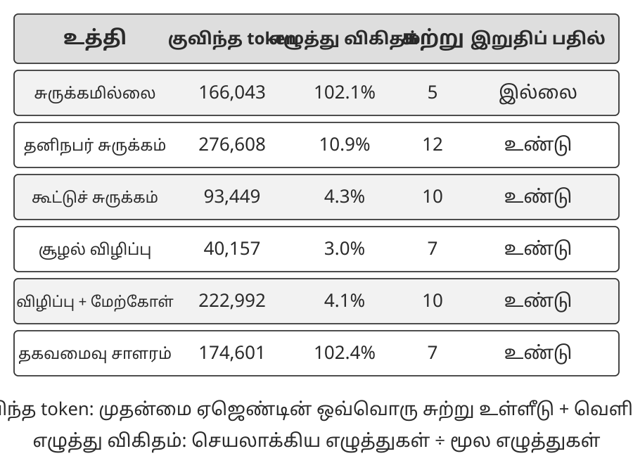

> **சோதனை 2-10 ★★★: சூழல் சுருக்க உத்திகளை ஒப்பிடுதல்**
>
> இந்தச் சோதனை Kimi K3-ஐக் கொண்டு OpenAI-இன் இணை நிறுவனர்களின் தொழில் நிலையை ஆராய்கிறது. பணியில் நபர் பட்டியலைப் படிப்படியாக உருவாக்கி, அவர்களின் அனுபவங்களையும் பதவி மாற்றங்களையும் தேடி, தொடர்புடைய உண்மைகளை மூலங்களுடன் இணைக்க வேண்டும். சுருக்கத்தையும் வழிதல் கையாளுதலையும் அவதானிக்க, சோதனை பயன்பாட்டுப் பக்கச் சூழல் நிதிநிலையை 128,000 token ஆக அமைத்தது; சுருக்கமில்லாத அடிப்படைக் குழுவைத் தக்கவைத்து, பின்னர் ஐந்து செயல்முறைகளை ஒப்பிட்டது; ஒவ்வொன்றும் அதிகபட்சம் 15 சுற்றுகள் இயங்கியது[^ch2-compression-results].
>
> **உத்தி 1: சுருக்கமில்லை.** தேடல், பக்க வாசிப்பு முடிவுகள் முழுமையாக வரலாற்றுக்குள் நுழைகின்றன. ஏழு கருவி அழைப்புகள் 367,246 மூல எழுத்துகளைக் கணக்கில் எடுத்தன. நிரல் ஐந்தாம் சுற்றில் பாதுகாப்பைத் தூண்டி நிறுத்தியது; முதன்மை ஏஜெண்டின் குவிந்த பயன்பாடு 166,043 token. பழைய பதிப்பு ஒவ்வொரு கோரிக்கையின் உள்ளீட்டு token கூட்டுத்தொகையைக் கொண்டு பாதுகாப்பைத் தூண்டியதால், பிழைச் செய்தியில் உள்ள 165,227 என்பது குவிந்த உள்ளீடாகும். எடுத்துக்காட்டாக, ஒரே வரலாறு மூன்று கோரிக்கைகளில் தலா ஒரு முறை அனுப்பப்பட்டால், மூன்று முறை கணக்கிடப்படும்.
>
> **உத்தி 2: தனிநபர் சுருக்கம்.** ஒவ்வொரு தேடல் முடிவுக்கும் தனியாக இரண்டு மூன்று பத்திச் சுருக்கம் உருவாக்கி, ஒவ்வொரு பக்கத்தின் முக்கிய உள்ளடக்கத்தைத் தக்கவைக்கிறது. இதை இணையாகச் செயலாக்குவதும், பக்க எல்லைகளைத் தக்கவைப்பதும் எளிது; பல பக்கங்கள் ஒரே நிகழ்வைப் பேசினால், மீள்வரும் தகவல் இன்னும் வரலாற்றுக்குள் நுழையும். இந்த உள்ளமைவு பன்னிரண்டு சுற்றுகளில் இறுதிப் பதிலை உருவாக்கியது; முதன்மை ஏஜெண்ட் குவிந்தமாக 276,608 token பயன்படுத்தியது; எழுத்துச் சுருக்க விகிதம் 10.9%.
>
> **உத்தி 3: கூட்டுச் சுருக்கம்.** ஒரு தொகுதி தேடல் முடிவுகளை ஒன்றிணைத்து, பின்னர் ஒருங்கிணைந்த சுருக்கத்தை உருவாக்குவது; மீள்வரும் உண்மைகளையும் வெவ்வேறு மூலங்களுக்கு இடையிலான உறவுகளையும் ஒழுங்கமைக்க இது வசதி. இந்த உள்ளமைவு பத்துச் சுற்றுகளில் இறுதிப் பதிலை உருவாக்கியது; முதன்மை ஏஜெண்ட் குவிந்தமாக 93,449 token பயன்படுத்தியது; எழுத்துச் சுருக்க விகிதம் 4.3%.
>
> **உத்தி 4: சூழல் விழிப்புணர்வுடன் கூடிய சுருக்கம்.** சுருக்கும்போது தற்போதைய வினவலையும் ஏற்கனவே தெரிந்த தகவலையும் ஒருசேர வழங்குகிறது; எடுத்துக்காட்டாகப் ப்ராம்ப்ட்டில் `Given the search query: {query}`, `Current context: {context}` ஆகியவற்றைச் சேர்த்தல். இதன் அடிப்படையில் மாதிரி தற்போதைய கேள்விக்குத் தொடர்புடைய உண்மைகளைத் தக்கவைத்து, ஏற்கனவே உள்ள சுருக்கத்தில் உள்ள இடைவெளிகளை முதலில் நிரப்ப முனைகிறது. இந்த உள்ளமைவு ஏழு சுற்றுகளில் இறுதிப் பதிலை உருவாக்கியது; முதன்மை ஏஜெண்ட் குவிந்தமாக 40,157 token பயன்படுத்தியது; எழுத்துச் சுருக்க விகிதம் 3.0%. அதில் ஒரு சுருக்கம் சுமார் ஒரு இலட்சத்து ஐம்பதாயிரம் எழுத்துகளைச் சுமார் இரண்டாயிரம் எழுத்துகளாக ஒழுங்கமைத்து, நபர்களின் பெயர்களையும் பதவி மாற்றங்களையும் தக்கவைத்தது.
>
> **உத்தி 5: மேற்கோள்களுடன் கூடிய சூழல் விழிப்புணர்வுச் சுருக்கம்.** பணி தொடர்புடைய சுருக்கத்தில், ஒவ்வொரு உண்மைக்கும் அதன் மூல இணைப்பைத் தக்கவைக்கிறது. இந்த உள்ளமைவு பத்துச் சுற்றுகளில் இறுதிப் பதிலை உருவாக்கியது; முதன்மை ஏஜெண்ட் குவிந்தமாக 222,992 token பயன்படுத்தியது. கருவிப் பதிவுகளின்படி தொகுத்தால், செயலாக்கப்பட்ட பொருட்கள் 52,891 எழுத்துகள்; மூல உரை 1,295,044 எழுத்துகள்; இரண்டையும் வகுத்தால் சுமார் 4.1%.
>
> **உத்தி 6: தகவமைவு சாளரமாக்கம்.** தொடக்கத்தில் மூலப் பொருட்களைத் தக்கவைத்து, உள்ளீடு ஒரு வரம்பை எட்டிய பிறகு தொகுதியாக ஒழுங்கமைக்கிறது. சோதனை மூன்று பொறிமுறைகளைப் பயன்படுத்தியது: நிதிநிலையின் 80%-ஐ மீறும்போது சுருக்கத்தைத் தூண்டுதல்; இன்னும் சுருக்கப்படாத கருவி முடிவுகளைத் தொகுத்துச் செயலாக்குதல்; செயலாக்கப்பட்ட முடிவுகளுக்கு `[COMPRESSED]` குறியைச் சேர்த்து மீண்டும் சுருக்குவதைத் தவிர்த்தல். இந்தச் சோதனையின் 128,000 token நிதிநிலைப்படி, தூண்டல் வரம்பு 102,400 token. இந்த உள்ளமைவு ஏழு சுற்றுகளில் இறுதிப் பதிலை உருவாக்கியது; முதன்மை ஏஜெண்ட் குவிந்தமாக 174,601 token பயன்படுத்தியது. வரலாற்றுப் பதிவு குவிந்த உள்ளீட்டின் அடிப்படையில் வரம்பைத் தூண்டியது; பின்னர் நிரல் சமீபத்திய கோரிக்கையின் உள்ளீட்டு அளவைச் சரிபார்க்கும் வகையில் மாற்றப்பட்டது.
>
> ஆறு உத்திகளின் உள்ளீட்டையும் வெளியீட்டையும் படம் 2-17 ஒப்பிடுகிறது.
>
> 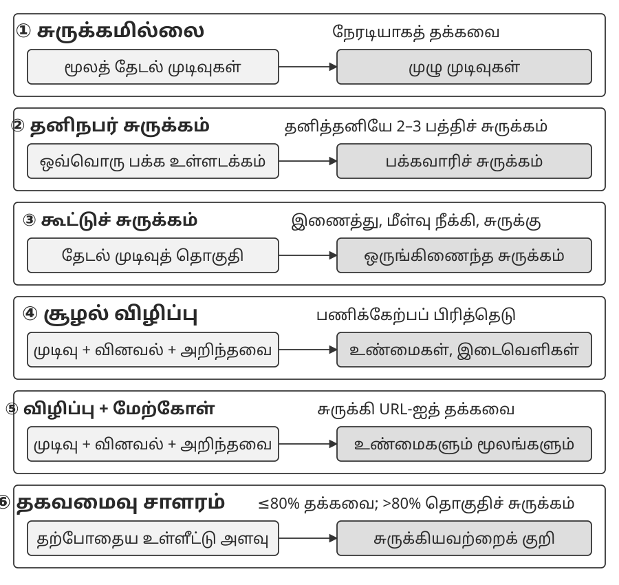
>
> படம் 2-16-இன் எண்களை ஒப்பிடும்போது மூன்று அளவுகளை வேறுபடுத்த வேண்டும்: ஒரு கோரிக்கையின் உள்ளீடு சாளர நிதிநிலையை எட்டுகிறதா என்பதைத் தீர்மானிக்கிறது; குவிந்த token பல சுற்று அழைப்புப் பயன்பாட்டைக் காட்டுகிறது; எழுத்துச் சுருக்க விகிதம், கணக்கிடப்பட்ட பொருட்களின் செயலாக்கத்துக்குப் பிந்தைய நீளத்திற்கும் மூல நீளத்திற்கும் உள்ள விகிதத்தை விவரிக்கிறது. இங்குள்ள குவிந்த பயன்பாடு முதன்மை ஏஜெண்டின் ஒவ்வொரு சுற்றுக் கோரிக்கையின் உள்ளீட்டையும் வெளியீட்டையும் குறிக்கிறது; சுருக்கங்களை உருவாக்கிய தனி மாதிரிக் கோரிக்கைகள் இந்தப் புலத்தில் சேர்க்கப்படவில்லை.
>
> சோதனையை மீளுருவாக்கும்போது, துணை விளக்கங்களின்படி மாதிரியையும் உண்மையான தேடல் சேவையையும் உள்ளமைத்து, சோதனைக் கோப்பகத்தில் `python experiment.py -m kimi-k3 -n 15 -o results/reproduction.json`-ஐ இயக்குங்கள். ஒவ்வொரு உத்தியின் `metrics`-ஐயும் படியுங்கள்: `total_compressed_size / total_original_size` கொண்டு எழுத்து விகிதத்தை மீண்டும் கணக்கிட்டு, பின்னர் `total_tokens`-ஐயும் `iterations`-ஐயும் ஒப்பிடுங்கள். சுருக்கமில்லாத அடிப்படைக் குழுவும் தேடல் உரைக்குத் தலைப்பு, URL போன்ற வடிவங்களைச் சேர்ப்பதால், செயலாக்கத்துக்குப் பிந்தைய எழுத்து எண்ணிக்கை மூல உரையை விடச் சற்று அதிகமாக இருக்கலாம். சோதனை நிரல் இறுதிப் பதிலைப் பெற்றவுடன் அந்தக் குழுவை முடிந்ததாகப் பதிவு செய்கிறது. இரு இறுதி வரைவுகளிலும் ஒரே நபரைத் தேடிப் பாருங்கள்: மேற்கோள் குழு Pamela Vagata-வின் பணியிடத்தை Pebblebed என்று எழுதியது; சாளரமாக்கக் குழுவின் சுருக்க அட்டவணையோ Stripe என்று எழுதியது. முந்தைய பதில் நிறுவனத்தின் வலைத்தளத்தைக் குறிப்பிட்டது, ஆனால் திறக்கக்கூடிய வலைப்பக்க இணைப்பைத் தரவில்லை. இரு குழுக்களும் சுருக்க அட்டவணையை ஒப்படைத்தன; ஆனால் அவற்றின் நபர் தகவல்கள் ஒன்றுக்கொன்று முரண்படுகின்றன.

[^ch2-compression-results]: சோதனை 2-10-இன் முடிவுக் கோப்பு `kimi_k3_real_20260718.json` ஒவ்வொரு உத்தியின் புள்ளிவிவரப் புலங்கள், இறுதிப் பதில், நேர முத்திரைகள் ஆகியவற்றைச் சேமிக்கிறது; எழுத்து விகிதத்தை நேரடியாக மீண்டும் கணக்கிடலாம். 2026 ஜூலை 18 இயக்கம் பழைய பாதுகாப்பு நிபந்தனையைப் பயன்படுத்தியது; ஜூலை 22-இன் குறியீட்டுத் திருத்தம் (`aea4d72` commit) குவிந்த உள்ளீட்டைச் சமீபத்திய சுற்றுக் கோரிக்கையின் உள்ளீடாக மாற்றியது.

### உற்பத்தித் தரத்திலான அடுக்குச் சுருக்கப் பொறிமுறை

கருவி வெளியீட்டின் முழு உரையை இடைநிலைச் சேமிப்பில் வைக்க வேண்டியிருக்கலாம், முடிந்த படிகளைக் காப்பகப்படுத்தலாம், தற்போதைய கட்டுப்பாடுகளைத் தெரியும்படி வைக்க வேண்டியிருக்கலாம்; கீழே உள்ள ஐந்து வகைப் பொறிமுறைகள் முறையே வெவ்வேறு பயன்பாட்டு அலைவெண்ணுக்கும் தக்கவைப்புக் காலத்துக்கும் ஏற்றவை.

1. **கருவி முடிவு நிதிநிலைக் கட்டுப்பாடு**. பெரிய அளவு வெளியீட்டை வெளிப்புறச் சேமிப்பில் வைத்து, சூழலில் சுருக்க முன்னோட்டத்தையும் வாசிப்பு நுழைவாயிலையும் தக்கவைத்தல். முன்னோட்டம் ஒருமுறை வரலாற்றுக்குள் நுழைந்த பிறகு அதன் உள்ளடக்கம் நிலையாக இருக்க வேண்டும்; மேலும் விவரங்கள் தேவைப்படும்போது, தொடர்புடைய பகுதியைப் படித்து முடிவைச் சேர்த்தல்.
2. **தொடர்பில்லாத உள்ளடக்கத்தைச் சுத்தம் செய்தல்**. வலைப்பக்க வழிசெலுத்தல் பட்டை, மீளும் பாதக்குறிப்பு போன்றவற்றை முடிவு சூழலுக்குள் நுழைவதற்கு முன்பே வடிகட்டலாம். ஏற்கனவே வரலாற்றுக்குள் வந்த உள்ளடக்கத்தை நீக்க வேண்டுமானால், அடுத்தடுத்த பணிகளும் மேற்கோள்களும் இன்னும் அதைச் சார்ந்துள்ளனவா என்று முதலில் உறுதிசெய்து, பின்னர் வரலாற்று மாற்றத்தின் சேமிப்புச் செலவைக் கணக்கிட வேண்டும்.
3. **API அடுக்குச் சூழல் திருத்தம்**. இந்தத் திறனை ஆதரிக்கும் சேவைகள் விதிகளின்படி பழைய கருவி முடிவுகளைச் சுத்தம் செய்யலாம். கிளையண்ட் தூண்டல் நிபந்தனைகளை உள்ளமைத்து, சேவை திருப்பித் தரும் திருத்தத் தகவலைக் கையாள வேண்டும். சுத்தம் செய்யும் எல்லையும் சேமிப்பு நடத்தையும் இடைமுக ஒப்பந்தத்தால் தீர்மானிக்கப்படுவதால், உள்ளீட்டு நிதிநிலைக் கண்காணிப்புடன் சேர்த்து இணைப்பது பொருத்தமானது.
4. **காப்பகச் சுருக்கம்**. சுற்று அல்லது பணிக் கட்டத்தின் அடிப்படையில் இலக்கு, செயல், முடிவு, முடிக்கப்படாத விஷயங்கள் ஆகியவற்றைப் பதிவு செய்து, செயல்பாட்டு வரிசையைத் தக்கவைத்தல். இதைப் பணியின் மாற்றப் பதிவாகக் கருதலாம்: ஒரு முடிவு எந்தப் படியில் எடுக்கப்பட்டது, அதன் அடிப்படை என்ன என்பதைப் பின்னர் தேடிப் பார்க்கலாம்.
5. **முழு அமர்வுச் சுருக்கம்**. உள்ளூர்ச் சுத்தம் இன்னும் நிதிநிலையைப் பூர்த்தி செய்ய முடியாதபோது, தற்போதைய இலக்கு, கட்டுப்பாடுகள், உறுதிசெய்யப்பட்ட உண்மைகள், முக்கிய முடிவுகள், அடுத்தடுத்த வேலை ஆகியவற்றை ஒப்படைப்புச் சுருக்கமாக ஒழுங்கமைத்தல். முதலில் ஏற்கனவே உள்ள அமர்வுக் குறிப்புகளை ஒழுங்கமைத்து, பின்னர் முழு வரலாற்றையும் தொகுக்கலாம். சுருக்கம் தொடர்ந்து தோல்வியடைந்தால், மறுமுயற்சி வரம்போ மின்துண்டிப்பானோ மீள்வரும் அழைப்புகளை நிறுத்தி, மீட்டெடுக்கக்கூடிய நிலையைச் சேமித்து, பின்னர் உள்ளீட்டைச் சுருக்குவதா அல்லது மனிதர் கையாள்வதா என்று தேர்ந்தெடுக்க வேண்டும்.

இந்தப் பொறிமுறைகள் அடுக்கு அடுக்காக இணைந்து செயல்படலாம்: நுழைவாயில் கட்டுப்பாடு ஒரே முறையில் வரும் பெரிய வெளியீட்டைக் குறைக்கிறது, உள்ளூர் ஒழுங்கமைப்பு அன்றாட வளர்ச்சியைக் கட்டுப்படுத்துகிறது, கட்டச் சுருக்கமும் முழு அமர்வுச் சுருக்கமும் நீண்ட பணிகளுக்கு ஒப்படைப்புத் தகவலைச் சேமிக்கின்றன.

dsh-superagent-ஐப் படித்தபோது ஒரு விவரம் கவனத்தை ஈர்த்தது: நிகழ்வுகளும் கருவி முடிவுகளும் முதலில் சுருக்கத்தையும் பொருள் ID-ஐயும் அனுப்பலாம்; விவரங்கள் தேவைப்படும்போது ID கொண்டு படிக்கலாம். பின்தளம் ஒரு தொகுதி சோதனைகளை முடித்து, முன்தளத்துக்கு "இரண்டு தோல்விகள்" என்று மட்டும் சொன்னால், முன்தளம் முன்னேற்றத்தை அறிவிக்க முடியும்; ஆனால் பயனர் தொடர்ந்து கேட்கும் "நேற்றைய அதே இரண்டுதானா?" என்ற கேள்விக்குப் பதிலளிக்க முடியாது. சுருக்கத்துடன் இந்தச் சோதனைப் பதிவின் அடையாளம் சேர்க்கப்பட்டிருந்தால், முன்தளம் தோல்வியடைந்த சோதனை நிகழ்வுகளின் பெயர்களை மீட்டெடுத்து, நேற்றைய பதிவுடன் ஒப்பிடலாம்.

### சுருக்க உத்திகளின் வடிவமைப்புக் கொள்கைகள்

சுருக்கத்துக்குப் பிறகு எதைத் தக்கவைப்பது என்று தீர்மானிக்கும்போது, கீழே உள்ள நான்கு அம்சங்களில் சரிபார்க்கலாம். பணிகளைக் கடந்து அனுபவம் குவியும் செயல்முறையை அத்தியாயம் 9 விரிவாக விளக்கும்.

- **பணி மதிப்புக்கேற்ப இடத்தை ஒதுக்குங்கள்**. நபர் பட்டியல், அடையாள உறவுகள், தற்போது தேட வேண்டிய கேள்விகள் ஆகியவற்றைப் பொதுவாக நேரடியாகத் தக்கவைக்க வேண்டும்; முடிவுகளைத் தாங்கும் முக்கிய சான்றுகளின் மூலங்களையும் தேவையான விவரங்களையும் தக்கவைக்க வேண்டும்; வழிசெலுத்தல் பட்டைகள், விளம்பரங்கள், மீள்வரும் உள்ளடக்கம் ஆகியவற்றைச் சுத்தம் செய்யலாம். உண்மைகள் சர்ச்சைக்குரியதாக இருந்தால், சான்றுகளுக்கு இடையிலான வேறுபாடும் முக்கியத் தகவலாகும்.
- **பொருள் முழுமையைத் தக்கவையுங்கள்**. எடுத்துக்காட்டாக, "Sutskever 2024 மே மாதம் OpenAI-ஐ விட்டு வெளியேறினார்" என்பதில் நபர், நேரம், செயல், நிறுவனம் ஆகியவை சேர்ந்து ஒரு உண்மையை உருவாக்குகின்றன. சுருக்கும்போது இந்தக் கூறுகளைத் தக்கவைக்க வேண்டும்; "Sutskever வெளியேறினார்" போன்ற விளக்கமுடியாத துண்டு மட்டும் எஞ்சக் கூடாது.
- **அடுத்தடுத்த கேள்விகளை மையமாகக் கொண்டு உள்ளடக்கத்தை ஒழுங்கமையுங்கள்**. "நிறுவனர்களின் பட்டியலைத் தேடு" என்பதற்கு நபர்களை முழுமையாக உள்ளடக்க வேண்டும்; "தனிப்பட்ட பின்னணியைப் புரிந்துகொள்" என்பதற்கு அனுபவங்கள், காலவரிசை, மூலங்கள் தேவை. ஒரே பொருளிலிருந்து வெவ்வேறு பணிகளுக்கு வெவ்வேறு சுருக்கங்களை உருவாக்கலாம்: தேடல் முக்கியம் என்பது பரப்பு, பகுப்பாய்வு முக்கியம் என்பது உறவுகளும் அடிப்படையும், படைப்பாக்கத்துக்கோ பயனுள்ள விவரங்களும் எடுத்துக்காட்டுகளும் தேவை.
- **சுருக்கம் செயல்பாட்டைத் தாங்க முடிகிறதா என்று சரிபார்க்கவும்**. பொருள் சார்ந்த சுருக்கத்துக்குப் பணியைப் புரிந்துகொள்ளுதல், மீள்வருகையை நீக்குதல், நிபந்தனைகளையும் விதிவிலக்குகளையும் சேமித்தல் தேவை. **சிக்கலான பொருட்களின் பொருள் சார்ந்த சுருக்கத்துக்கு, முதன்மை மாதிரிக்கு நெருக்கமான புரிதல் திறன் கொண்ட மாதிரியையே முன்னுரிமையுடன் பயன்படுத்த வேண்டும்.** எந்த நிபந்தனைகள், விதிவிலக்குகள், சான்றுகள் அடுத்தடுத்த வேலைகளைப் பாதிக்கும் என்பதைச் சுருக்கம் செய்பவர் தீர்மானிக்க வேண்டும்; இவை தொலைந்துவிட்டால், முதன்மை மாதிரி எவ்வளவு வலிமையானதாக இருந்தாலும் அவற்றை மீட்டெடுப்பது கடினம்.

தொடக்ககாலக் கட்டமைப்பு முடிவுகள், கட்டுப்பாடுகளுக்குப் பின்னால் உள்ள காரணங்கள், தோல்விப் பாதைகள் ஆகியவை நீண்ட வரலாற்றில் எளிதில் விடுபடலாம். **நீண்ட பணிகளில் முன்னேற்ற ஆவணத்தை வழக்கமாகப் புதுப்பிக்க வேண்டும்**; "என்ன முடிவு செய்யப்பட்டது, ஏன் அப்படி முடிவு செய்யப்பட்டது, என்ன சரிபார்க்கப்பட்டது, அடுத்து என்ன செய்ய வேண்டும்" என்பதை அது சேமிக்க வேண்டும். ப்ராம்ப்டோ Skill-ஓ புதுப்பிக்கும் தருணத்தை விதிக்கலாம்; Harness பணி ஒப்படைப்பின் போது தொடர்புடைய பதிவுகளை ஏற்றும். இத்தகைய ஆவணம் செயல்படுத்துபவர், மதிப்பாய்வாளர், அடுத்தடுத்த ஏஜெண்ட் ஆகியோர் ஏற்கனவே நடந்த வேலையைப் புரிந்துகொள்ளவும் உதவுகிறது.

### துணை ஏஜெண்ட் சூழல் தனிமைப்படுத்தல்

**ஒப்படைப்பு எல்லை தெளிவாகவும், ஏராளமான இடைநிலைப் பொருட்களை உருவாக்கவும் கூடிய பணிகளுக்குத் துணை ஏஜெண்ட் தனிமைப்படுத்தலை நான் விரும்பிப் பயன்படுத்துவேன்.** பரந்த தேடல், ஆய்வுக் கட்டத்தில் மட்டும் பயன்படும் ஏராளமான பொருட்களை உள்ளே இழுக்கும்; முதலில் தனிமைப்படுத்தினால், இந்த உள்ளடக்கம் முதன்மைப் பணியைத் தொடர்ந்து குழப்புவதைக் குறைக்கலாம். முதன்மை ஏஜெண்ட் பணியைத் தனிச் சூழல் கொண்ட துணை ஏஜெண்டிடம் ஒப்படைக்கிறது; துணை ஏஜெண்ட் இடைநிலை முடிவுகளைப் படித்து, முடிவு, சான்று இருப்பிடம், தீர்க்கப்படாத பிரச்சினைகள் ஆகியவற்றைத் திருப்பித் தருகிறது. இதனால் முதன்மை ஏஜெண்டின் சூழலில் அடுத்தடுத்த முடிவுகளுக்குத் தேவையான தகவல் மட்டுமே இருக்கும்.

எடுத்துக்காட்டாக, "பணம் செலுத்தும் திரும்பழைப்பை (callback) கையாளும் சார்பைக் கண்டுபிடி" என்பதற்கு, முதன்மை ஏஜெண்ட் நேரடியாகத் தேடினால் பத்துக்கும் மேற்பட்ட கோப்புகளைப் படிக்க வேண்டியிருக்கலாம். தேடல் துணை ஏஜெண்டிடம் ஒப்படைத்தால், சார்பின் பெயர், அது உள்ள தொகுதி, அழைப்பு இடங்கள், மதிப்பீட்டுக்கான அடிப்படை ஆகியவற்றைத் திருப்பித் தருமாறு கேட்கலாம். அதன் பதில், "பணம் செலுத்தும் தொகுதியில் உள்ள `handle_callback` திரும்பழைப்பைக் கையாள்கிறது; மேலும் இரு அழைப்பு இடங்கள் உள்ளன" என்று இருக்கலாம்; கண்டுபிடிக்கக்கூடிய மேற்கோள்களும் இணைக்கப்படும். இந்த முடிவுகளின் அடிப்படையில் முதன்மை ஏஜெண்ட் தொடர்புடைய குறியீட்டைப் படிக்க வேண்டுமா என்று தீர்மானிக்கிறது.

பணி விளக்கம் போதுமான அளவு முழுமையாக இருக்க வேண்டும்: இலக்கு என்ன, தேடல் எல்லை எவ்வளவு, என்ன கட்டுப்பாடுகளைப் பின்பற்ற வேண்டும், என்ன வடிவத்தில் திருப்பித் தர வேண்டும், தெளிவின்மை ஏற்பட்டால் எவ்வாறு கையாள்வது. ஒப்படைப்புக் கோரிக்கையும் திருப்பித் தரப்படும் முடிவும் வரலாற்றில் சேர்க்கப்பட்டால், முதன்மை ஏஜெண்டின் அசல் முன்னொட்டை இன்னும் மீண்டும் பயன்படுத்தலாம்.

துணை ஏஜெண்டை ஒரு கருவியாகக் கொண்ட இடைமுக வடிவமைப்பை அத்தியாயம் 4 விவாதிக்கும்; பல-ஏஜெண்ட் அமைப்புகளில் சூழல் பணிப்பகிர்வை அத்தியாயம் 10 மேலும் விவாதிக்கும்.

## அத்தியாயச் சுருக்கம்

வாடிக்கையாளர் சேவை உதவியாளர் மூன்றாம் முறையாகத் தொலைபேசி அழைப்பை முடித்த பிறகு, எவ்வாறு தொடர்ந்து செயல்படுவது? அடுத்த சுற்றுக் கோரிக்கையில் இந்த அழைப்பின் கருவி ரசீதைச் சேர்த்து, அழைப்புச் செயலை அழைப்பு ID-யுடன் இணைக்க வேண்டும். நிலைப் பட்டை பயன்படுத்தப்பட்ட எண்ணிக்கையை மூன்றாகப் புதுப்பித்து, இன்னும் பேசி முடிவு செய்யப்படாத நிபந்தனைகளைப் பட்டியலிடுகிறது. சிஸ்டம் விதிகளும் கருவி வரையறைகளும் நிலையான முன்னொட்டில் இருக்கின்றன; ஒரு குறிப்பிட்ட வணிகத்தைக் கையாள வேண்டியிருக்கும்போது அதற்குரிய Skill ஏற்றப்படுகிறது. இவ்வாறு ஒவ்வொரு புலத்துக்கும் ஒரு மூலம் இருக்கிறது; அடுத்த சுற்று அழைப்பில் எந்த உள்ளடக்கம் மாறும் என்பதையும் பார்க்க முடிகிறது.

அழைப்பு நீண்டு, கருவி திருப்பிதல்கள் பெருகும்போது, முடிவுகளுக்கு நீள வரம்பை விதிக்கலாம்; முடிந்த பகுதிகளை மூலங்களுடன் கூடிய சுருக்கமாக ஒழுங்கமைக்கலாம்; அல்லது தனியாகக் கையாளக்கூடிய வேலைகளைத் துணை ஏஜெண்டிடம் ஒப்படைத்து, முடிவுகளையும் சான்றுகளையும் மட்டும் திரும்பப் பெறலாம்.

இந்தப் பணி முடிந்த பிறகு, மூன்று அழைப்பு எண்ணிக்கையைப் பணியுடன் காப்பகப்படுத்தலாம். ஆனால் பயனர் "இனிமேல் வேலை நாட்களின் பிற்பகலில் மட்டும் என்னைத் தொடர்பு கொள்ளுங்கள்" என்று சிறப்பாகச் சொல்லியிருந்தால், அந்த வாக்கியத்தை அழைப்புச் சுருக்கத்தில் மட்டும் விட்டுவைத்தால், அடுத்த முறை பணியை ஏற்கும் உதவியாளர் அதைப் பார்க்கவே முடியாமல் போகலாம். நீண்டகாலப் பயனுள்ள தகவலை எவ்வாறு சேமிப்பது, அதைச் சரியான பணியில் எவ்வாறு மீட்டெடுப்பது? பணிகளைக் கடந்து நிற்கும் பயனர் நினைவகத்தையும் பகிரப்பட்ட அறிவுத் தளத்தையும் அத்தியாயம் 3 விவாதிக்கிறது.

## சிந்தனைக் கேள்விகள்

1. ★★★ சோதனை 2-3-இன் நழுவு சாளர இயக்கப் பதிவைப் படியுங்கள்: ஐந்து கருவி அழைப்புகள் முறையே என்ன செய்தன? திரும்பத் திரும்ப அழைப்புகள் வரலாற்று வெட்டுதலால் வந்தவையா என்பதைத் தீர்மானிக்க, இன்னும் என்ன பதிவு செய்ய வேண்டும், என்ன ஒப்பீடு செய்ய வேண்டும்? முக்கிய நிலையைத் தக்கவைக்கும் ஒரு வெட்டுத் திட்டத்தை வடிவமையுங்கள்; முன்னொட்டுச் சேமிப்பில் அதன் தாக்கத்தையும் விளக்குங்கள். பதிவு `chapter2/kv-cache/result_sliding_window_20260718_kimi_k2_6.json`-இல் உள்ளது.
2. ★★ Qwen3-இன் Chat Template, கடைசி உண்மையான பயனர் வினவலின் இடத்தைப் பொறுத்து வரலாற்றுச் சிந்தனையைக் கையாள்கிறது. ஒரு ReAct சுழற்சி நூற்றுக்கும் மேற்பட்ட சுற்றுகள் நீடித்தால், படிப்படியாக வளரும் பகுத்தறிவு உள்ளடக்கத்தை எவ்வாறு நிர்வகிப்பீர்கள்? வரலாற்றுச் சிந்தனையின் வெட்டுதல், திருப்பி அனுப்புதல், முன்னொட்டு இணைப்பு நெறிமுறை ஆகியவற்றை ஒப்பிட்டு, Harness எவ்வாறு தகவமைக்க வேண்டும் என்று விளக்குங்கள்.
3. ★★ சுமார் ஒரு இலட்சத்து ஐம்பதாயிரம் எழுத்துகள் கொண்ட தேடல் பொருட்களை இரண்டாயிரம் எழுத்துகளாகச் சுருக்க வேண்டும் என்று வைத்துக்கொள்வோம்; எந்தெந்த உண்மைகள், உறவுகள், மூலங்களைத் தக்கவைப்பீர்கள்? சுருக்கம் அடுத்தடுத்த கேள்விகளைத் தாங்குமா என்று எவ்வாறு சரிபார்ப்பீர்கள், விடுபட்ட விவரங்களை எவ்வாறு மீட்டெடுப்பீர்கள்?
4. ★★ கருவி எண்ணி ஓர் அழைப்பைத் தவறவிட்டதால், நிலைப் பட்டை தவறான மீத எண்ணிக்கையைத் தந்தது. நிகழ்வுப் பதிவு, தொகுத்துச் சரிபார்த்தல், இயக்க அடுக்குச் சரிபார்ப்பு ஆகியவற்றை வடிவமைத்து, இத்தகைய முரண்பாட்டை எவ்வாறு கண்டறிந்து சரிசெய்வது என்று விளக்குங்கள்.
5. ★★ சோதனை 2-4 தொனி, தகவல் ஒழுங்கமைப்பு, கருவி விளக்கம் ஆகியவற்றை ஒப்பிட்டது. சிஸ்டம் ப்ராம்ப்ட்டைப் பலர் நீண்ட காலமாகப் பராமரித்து வந்தால், பதிப்புகளை எவ்வாறு நிர்வகிப்பீர்கள், விதி முரண்பாடுகளை எவ்வாறு சரிபார்ப்பீர்கள், திருத்தம் ஒவ்வொன்றையும் பின்னடைவுப் பணிகளைக் கொண்டு எவ்வாறு மதிப்பிடுவீர்கள்?
6. ★★★ செல்லப்பிராணிக் கடை எடுத்துக்காட்டில் ஒற்றைப் பதிவு மீட்டெடுப்பும் மொத்தப் புள்ளிவிவரமும் ஒருசேர உள்ளன. மூலப் பதிவுகள், புள்ளிவிவரச் சுருக்கம், வினவல் வழிமாற்றம் ஆகியவற்றை வடிவமைத்து, இந்த இரு வகைக் கேள்விகளுக்கும் அமைப்பு திறம்படப் பதிலளிக்கச் செய்யுங்கள்; சுருக்கத்தை எப்போது புதுப்பிக்க வேண்டும் என்பதையும் விளக்குங்கள்.
7. ★★★ ஒரு Skill பட்டியலில் உள்ளது, ஆனால் தற்போதைய பணிக்குப் பொருந்தும் என்று மாதிரி கண்டறியவில்லை. விளக்கம், பட்டியல் ஒழுங்கமைப்பு, வெளிப்படையான தூண்டல், மதிப்பீட்டு எடுத்துக்காட்டுகள் ஆகிய நான்கு அம்சங்களில் எவ்வாறு பிரச்சினையை ஆராய்வீர்கள்?
8. ★★ Skill வெற்றிகரமாக ஏற்றப்பட்டது, ஆனால் அதிலுள்ள சரிபார்ப்புப் படியை மாதிரி தவறவிட்டது. தூண்டல், புரிதல், கருவிப் பயன்பாடு, நிறைவுத் தீர்மானம் ஆகியவற்றில் உள்ள பிரச்சினையை வேறுபடுத்த ஒரு ஒப்பீட்டுச் சோதனையை வடிவமைத்து, வெவ்வேறு மாதிரிகளின் செயல்திறனை ஒப்பிடுங்கள்.
9. ★★★ அமைப்பில் ஏராளமான கருவிகள் உள்ளன; கருவித் தொகுப்பும் அடிக்கடி மாறுகிறது. நிலையான வரையறைகள், கருவிப் பட்டியல், தேவைக்கேற்ப ஏற்றப்படும் முடிவுகள், இயக்கநேர நிலை ஆகியவற்றின் இடங்களை எவ்வாறு ஏற்பாடு செய்வீர்கள்? கண்டுபிடிப்புத் துல்லியம், சூழல் நிதிநிலை, சேமிப்புப் பொருத்தம் ஆகிய மூன்றையும் ஒருசேரக் கருத்தில் கொள்ளுங்கள்.
