# பயனர் நினைவகமும் அறிவுத் தளமும்

கடந்த வாரம் தனக்கு ஜன்னல் ஓர இருக்கை பிடிக்கும் என்று பயனர் உதவியாளரிடம் சொல்லியிருந்தார்; இன்று "டோக்கியோவுக்கு இன்னொரு பயணச்சீட்டு முன்பதிவு செய்" என்று மட்டும் சொல்கிறார். இந்தக் கோரிக்கையில் முந்தைய விருப்பத்தை எங்கிருந்து மீட்டெடுப்பது? விமான நிறுவனம் நேற்று கைப்பெட்டி விதியை மாற்றியிருந்தால், புதிய விதிகளை எங்கே தேடுவது? முந்தைய அத்தியாயம் ஒரு பணியின் சூழலை எவ்வாறு ஒழுங்கமைப்பது என்பதை விவாதித்தது; இந்த அத்தியாயம் பயனர் சொன்ன வார்த்தைகளை எங்கிருந்து மீட்டெடுப்பது, விமான நிறுவனத்தின் புதிய விதிகளை எங்கே தேடுவது, இந்த இரு வகைப் பொருட்களையும் எப்போது புதுப்பிக்க வேண்டும் என்பதை விவாதிக்கிறது.

**பயனர் நினைவகம்** ஒரு குறிப்பிட்ட பயனரை மையமாகக் கொண்டு தகவலை ஒழுங்கமைத்து, அவரது விருப்பங்கள், பழக்கங்கள், தேவைகள், அனுபவங்களைப் பதிவு செய்து, அடுத்தடுத்த அமர்வுகளிலும் அவரது நிலைக்கேற்பச் சேவை வழங்க ஏஜெண்டுக்கு உதவுகிறது. **அறிவுத் தளமோ** ஒரு குறிப்பிட்ட அனுமதி எல்லைக்குள் பல பயனர்கள் பகிர்ந்து பயன்படுத்துவதாகும்; எடுத்துக்காட்டாகத் தொழில்துறை ஒழுங்குமுறைகள், நிறுவன இயக்கச் செயல்முறைகள், தொழில்நுட்ப ஆவணங்கள். முன்னது ஏஜெண்ட் சேவை செய்வோரைப் புரிந்துகொள்ள உதவுகிறது; பின்னது பணியை முடிக்கத் தேவையான துறை அறிவை வழங்குகிறது.

இரண்டும் தகவலை எவ்வாறு சேமிப்பது, தேவைப்படும்போது அதை எவ்வாறு கண்டுபிடிப்பது என்ற பிரச்சினைகளைத் தீர்க்க வேண்டும்; உண்மை முரண்பாடுகள், உள்ளடக்கக் காலாவதி, மீட்டெடுப்பு விடுபடுதல் ஆகியவற்றையும் சந்திக்கும். வெக்டர் மீட்டெடுப்பு, கட்டமைக்கப்பட்ட சுட்டு, அறிவுச் சுருக்கம் போன்ற தொழில்நுட்பங்களை இரு வகை அமைப்புகளுக்கும் பயன்படுத்தலாம். இந்த அத்தியாயத்தின் அமைப்பைப் படம் 3-1 காட்டுகிறது: முதலில் பயனர் நினைவகத்தின் வெளிப்பாட்டையும் மேலாண்மையையும் விவாதித்து, பின்னர் மீட்டெடுப்பு-மேம்படுத்தப்பட்ட உருவாக்கத்தை (RAG) அறிமுகப்படுத்தி, இறுதியில் மீட்டெடுப்பு முறைகளை அமர்வுகளைக் கடந்த நினைவகத்துக்கும் மிகச் சிக்கலான அறிவு ஒழுங்கமைப்புக்கும் பயன்படுத்துகிறது.

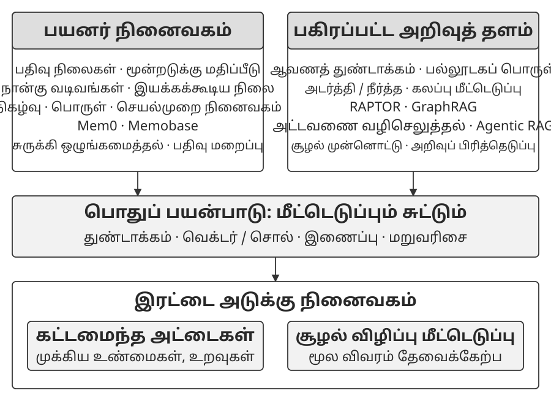

## பயனர் நினைவக அமைப்பு

"அடுத்த வாரம் நான் வெளிநாட்டில் இருப்பேன்; வங்கி ஆவணங்களை மின்னஞ்சலில் அனுப்புங்கள்" என்ற வாக்கியத்தைப் பிரித்துப் படியுங்கள். பயனர் ஒரு கால வரம்புள்ள பயணத்தைக் கூறியுள்ளார்; அந்தப் பயணத்துக்குள் ஒப்படைப்பு முறையையும் குறிப்பிட்டுள்ளார். வங்கி ஆவணங்களை அஞ்சலில் அனுப்ப முன்மொழியும்போது, உதவியாளர் இதன் அடிப்படையில் மின்னணு ஒப்படைப்பைக் கோரலாம்; பயணம் முடிந்த பிறகு, மீண்டும் அஞ்சல் பிரச்சினை வரும்போது, தற்போதைய நிபந்தனைகளைப் புதிதாகப் பார்க்க வேண்டும். "பயனருக்குக் காகிதக் கடிதம் பிடிக்காது" என்று மட்டும் சேமித்திருந்தால், பின்னர் அந்த நினைவகம் மீட்டெடுக்கப்பட்டாலும், அதன் பொருந்தும் எல்லையைத் தவறாகப் பயன்படுத்த நேரிடும்.

விமானச்சீட்டைப் பார்ப்போம். "கடந்த முறை 1250-இன் பயணச்சீட்டு நான் எதிர்பார்த்ததை விட விலை அதிகம்" என்று பயனர் சொன்னால், அந்த விலைக் குறிப்பு, அப்போதைய நிதிநிலை, பயணச் சூழல், இந்தப் பின்னூட்டம் ஆகியவற்றைக் குறைந்தபட்சம் அமைப்பு சேமிக்க வேண்டும். அடுத்த முறை இதையொத்த சூழ்நிலை வந்தால், வரவுசெலவைத் தாண்டிய விலைக் குறிப்புகளைக் கையாளும்போது மாதிரி இதன் அடிப்படையில் இன்னும் கவனமாக இருக்கும். "இனிமேல் குடும்பப் பயணங்களில் எப்போதும் முதலில் என்னைக் கேள்" என்று பயனர் தனியாகக் கூறினால், அது வருங்காலக் குடும்பப் பயணங்களுக்குத் தெளிவான கேள்வி நிபந்தனையை விதிக்கிறது. இதிலிருந்து மூன்று வகைத் தகவலை வேறுபடுத்தலாம்: பயனர் உண்மையில் என்ன சொன்னார், அப்போது எந்த நிபந்தனைகளில் இருந்தார், இந்த அனுபவத்திலிருந்து மாதிரி என்ன ஊகித்தது.

அமர்வு முடியும்போது, இந்தப் பதிவுகளை ஒழுங்கமைக்குமாறு LLM-ஐக் கேட்டு, பின்னர் பயன்படக்கூடிய உண்மைகளை நிலையான சேமிப்பில் எழுதலாம். புதிய பணி தொடங்கும்போது, தொடர்புடையதும் இன்னும் பொருந்துவதுமான பதிவுகளை மட்டும் சூழலுக்குள் கொண்டு வரலாம்.

எடுத்துக்காட்டாக, விமானச்சீட்டு முன்பதிவின்போது பயனர் பின்வரும் தகவலை வழங்கினார்:

```text
User: Help me book a flight to Tokyo next Friday. I prefer window seats
      and I'm vegetarian, so I'll need a special meal.
Agent: I'll search for flights to Tokyo for next Friday...
       [calls flight_search tool, returns 3 options]
Agent: Here are your options. Based on your preference, I've filtered for
       window seat availability. Shall I book the ANA direct flight?
User: Yes, and use my United MileagePlus number 12345678.
```

அமர்வு முடிந்த பிறகு, நினைவகப் பிரித்தெடுப்பி நான்கு பதிவுகளை ஒழுங்கமைக்கலாம்:

```text
Extracted memories:
- User prefers window seats (preference)
- User is vegetarian, needs special meals on flights (dietary restriction)
- User's United MileagePlus number: 12345678 (loyalty program)
- User has travel plans to Tokyo (recent activity)
```

இந்த எடுத்துக்காட்டில் மூன்று செயலாக்கங்கள் உள்ளன. **தேர்ந்தெடுத்த பிரித்தெடுத்தல்** இருக்கை விருப்பம், உணவுத் தேவை, உறுப்பினர் எண் ஆகியவற்றைத் தக்கவைத்து, "தேடல் மூன்று விருப்பங்களைத் திருப்பித் தந்தது" போன்ற தற்காலிக விவரங்களை வடிகட்டுகிறது. **சுருக்கமாக்கல்** பயனர் வெளிப்படையாகக் கூறிய ஜன்னல் ஓர விருப்பத்தை, வருங்கால முன்பதிவுகளுக்குப் பயன்படும் ஒரு விதியாக ஒழுங்கமைக்கிறது. **கட்டமைத்தல்** உண்மைகளுக்கு வகைகளைக் குறித்து, மீட்டெடுப்பையும் புதுப்பிப்பையும் எளிதாக்குகிறது. டோக்கியோ பயணத்தின் புறப்படும் தேதியையும் தற்போதைய நிலையையும் கூடப் பதிவு செய்ய வேண்டும்; "அடுத்த வெள்ளி" என்பதை அமர்வுத் தேதியுடன் இணைத்து மாற்ற வேண்டும்; பயணம் முடிந்த பிறகோ ரத்தான பிறகோ நிலையைப் புதுப்பிக்க வேண்டும். இவ்வாறு நீண்டகால விருப்பங்களையும் அண்மைச் செயல்பாடுகளையும் அவற்றின் செல்லுபடிக் காலத்துக்கேற்பப் பராமரிக்கலாம்.

தனிநபர் உதவியாளர் Today-இன் தயாரிப்பு விளக்கம் இதற்கு ஓர் எடுத்துக்காட்டைத் தருகிறது. தான் வாரம் இருமுறை — செவ்வாய், வியாழன் — பயிற்சி செய்து, அரை மாரத்தான் ஓட்டத்துக்குத் தயாராகிறேன் என்று பயனர் சொல்கிறார். ஆறு வாரங்களுக்குப் பிறகு, பயனர் அனுமதியுடன் இணைக்கப்பட்ட தூக்கப் பதிவு, அவர் நேற்றிரவு மிகக் குறைவாகவே தூங்கியதைக் காட்டுகிறது. உதவியாளர் இந்த இரு தகவல்களையும் இணைத்து, அன்றைய உயர் தீவிர இடைவெளிப் பயிற்சியை நகர்த்த முன்மொழிகிறது. இங்கு எவ்வளவு காலம் எதை நினைவில் வைக்க வேண்டும்? பயிற்சித் திட்டம் தயாரிப்புக் காலம் முழுவதும் பயன்படும்; நேற்றைய தூக்கப் பதிவோ தேதியுடன் சேர்ந்தே இருக்க வேண்டும். பயனர் இந்த முறை மாற்றத்தை ஏற்றுக்கொண்டாலும், அடுத்த வியாழன் பயிற்சி அசல் திட்டப்படியே அமையும்; "இனிமேல் எப்போதும் மாற்று" என்று பயனர் சொன்னால் மட்டுமே அது நிரந்தரமாகும். Today பரிந்துரைப்பதையும் நாட்காட்டியை மாற்றுவதையும் இரு படிகளாகப் பிரிக்கிறது; பின்னதற்குப் பயனர் உறுதிப்படுத்தல் தேவை.[^ch3-today]

[^ch3-today]: Today குழு "What Is Today"-இல் அரை மாரத்தான் பயிற்சியை எடுத்துக்காட்டாகக் கொண்டு, நினைவகமும் அன்றைய தகவலும் எவ்வாறு இணைந்து செயல்படுகின்றன என்பதை விளக்குகிறது. நிறுவனர் "Meet Today"-இல் நாட்காட்டியை மாற்றுவதற்கு முன்னான உறுதிப்படுத்தல் பொறிமுறையை விளக்குகிறார்.

### நினைவகத் திறனின் மதிப்பீடு: மூன்று அடுக்குக் கட்டமைப்பு

பொது அளவுகோலான **LoCoMo** (Long-term Conversational Memory, நீண்டகால உரையாடல் நினைவகம்) சராசரியாகச் சுமார் 300 சுற்றுகள், அதிகபட்சம் 35 அமர்வுகள் கொண்ட நீண்ட உரையாடல்களை உள்ளடக்கி, கேள்வி–பதில், நிகழ்வுச் சுருக்கம், பல்முறைமை உரையாடல் உருவாக்கம் ஆகியவற்றின் வழியாக நினைவகத் திறனை ஆராய்கிறது. கேள்வி–பதில் ஐந்து வகையாகப் பிரிகிறது. ஒற்றைத் தாவல் கேள்விகளுக்கு ஒரு அமர்விலேயே பதில் கிடைக்கும்; பல தாவல் கேள்விகளுக்குப் பல அமர்வுகளின் துப்புகளை இணைக்க வேண்டும்; நேரப் பகுத்தறிவுக் கேள்விகளுக்கு நிகழ்வுகளின் முன்–பின் வரிசையையும் தெளிவுபடுத்த வேண்டும். திறந்த துறை அறிவுக் கேள்விகளுக்குப் பயனர் சொன்னதை வெளிப்புற அறிவுடன் இணைக்க வேண்டும். முன்பதிவு எடுத்துக்காட்டைப் பின்பற்றினால், பயனர் "அடுத்த வாரம் டோக்கியோ" என்று மட்டுமே சொல்லியிருந்தார்; "சேருமிடத்தில் எந்த நாணயம் பயன்படுகிறது" என்று பதிலளிக்க, டோக்கியோ என்ற துப்பையும் அங்கு யென் பயன்படுகிறது என்ற அறிவையும் ஒருசேர நினைவில் வைக்க வேண்டும். பயனர் ஒருபோதும் சொல்லாத விமான எண்ணைக் கேட்டால், தகவல் போதவில்லை என்று உதவியாளர் சுட்டிக்காட்ட வேண்டும். இத்தகைய பதிலளிக்க முடியாத கேள்விகளை அடையாளம் காண முடிகிறதா என்பதையே எதிர்மறை (adversarial) கேள்விகள் சோதிக்கின்றன.[^ch3-locomo]

[^ch3-locomo]: Maharana மற்றும் பலரின் LoCoMo ஆய்வுக் கட்டுரையின் (arXiv:2402.17753) பகுதி 4.1 ஐந்து வகைக் கேள்வி–பதில்களின் வரையறைகளைத் தருகிறது. ஆசிரியர்களின் திட்டப் பக்கம் தரவையும் உரையாடல் எடுத்துக்காட்டுகளையும் வழங்குகிறது.

இத்தகைய அளவுகோல்களையும் நினைவகத் தயாரிப்புகளின் நடைமுறையையும் இணைத்து, கவனிக்க வேண்டிய திறன்களை எட்டாகத் தொகுத்துள்ளேன்:

- **தனிநபர் தகவல் தக்கவைப்பு**: பயனர் அடையாளம் போன்ற நீண்டகாலத் தகவலைத் துல்லியமாகச் சேமித்து மீட்டெடுத்தல்.
- **விருப்பக் கண்காணிப்பு**: பயனர் விருப்பங்களைப் பதிவு செய்து, புதிய வெளிப்படையான கூற்றுகளுக்கேற்பப் புதுப்பித்தல்.
- **சூழல் மாற்றம்**: தலைப்பை மாற்றிய பிறகும் தொடர்புடைய பின்னணியைத் தொடர்ந்து இணைத்துக்கொள்ளுதல்.
- **நினைவகப் புதுப்பிப்பு**: ஏற்கனவே உள்ள உண்மைகளுக்கான கூடுதல் தகவல்களையும் திருத்தங்களையும் கையாளுதல்.
- **பல அமர்வுத் தொடர்ச்சி**: புதிய அமர்வில் முன்பு சேமித்த தகவலைப் பயன்படுத்துதல்.
- **சிக்கலான சிந்தனை**: பல நினைவகத் துண்டுகளை இணைத்தல். எடுத்துக்காட்டாக, கடலை விதை ஒவ்வாமை இருப்பதாகப் பயனர் முன்பு கூறியிருந்தால், தாய்லாந்து உணவு பற்றிப் பேசும்போது அந்தத் தகவலையும் இணைத்து, பொருட்களைச் சரிபார்க்க நினைவூட்ட வேண்டும்.
- **நேர விழிப்புணர்வு**: தேதிகளைச் சேமித்தல், சார்பு நேரங்களைப் பிரித்தறிதல், நிகழ்வுகளுக்கு இடையிலான இடைவெளியைக் கணக்கிடுதல்.
- **முரண்பாடு தீர்த்தல்**: முரண்படும் தகவலைக் கண்டறிந்து, மூலம், நேரம், பொருந்தும் பொருள் ஆகியவற்றின் அடிப்படையில் முடிவெடுத்தல்.

ஏஜெண்டின் உண்மையான பணிகளை மையமாகக் கொண்டு, இந்த நூல் மேலும் ஒரு மூன்று அடுக்கு மதிப்பீட்டுக் கட்டமைப்பைப் பயன்படுத்துகிறது. சோதனை 3-1, 3-2 முதலில் இதைக் கொண்டு நினைவக வெளிப்பாடுகளை ஒப்பிடுகின்றன; சோதனை 3-9, 3-11 இதே கட்டமைப்பைக் கொண்டு மீட்டெடுப்பு முறைகளை மதிப்பிடுகின்றன.

**முதல் அடுக்கு: அடிப்படை நினைவுகூரல்.** பயனர் நேரடியாகத் தந்த, பொருள் தெளிவான தகவலைத் துல்லியமாகச் சேமித்து மீட்டெடுத்தல். எடுத்துக்காட்டாக, "என் உறுப்பினர் எண் 12345" என்று பயனர் சொன்னால், பின்னர் முன்பதிவின்போது முழு எண்ணையும் திருப்பித் தர வேண்டும். இந்த அடுக்கு முதன்மையாக உண்மைகள் தொலைந்தனவா, குழம்பினவா, மாற்றப்பட்டனவா என்பதைச் சரிபார்க்கிறது.

**இரண்டாம் அடுக்கு: பல அமர்வு மீட்டெடுப்பு.** வெவ்வேறு காலகட்டங்களில், வெவ்வேறு பொருள்கள் சம்பந்தப்பட்ட அமர்வுகளிலிருந்து தொடர்புடைய தகவலைக் கண்டுபிடித்து, தற்போதைய கோரிக்கை யாரைப் பற்றியது, எந்தப் பதிவுகள் தேவை என்பதைத் தீர்மானித்தல். பயனருக்கு இரு கார்கள் இருந்தாலும், "என் காருக்குப் பராமரிப்பு முன்பதிவு செய்" என்று மட்டும் சொன்னால், முதலில் இரு கார்களின் தகவலையும் மீட்டெடுத்து, எந்தக் கார் என்பதைத் தெளிவுபடுத்த வேண்டும். கடன் நிலையை வினவும்போது, நடைமுறையில் உள்ள ஒப்பந்தத்தையும் கடந்த காலத்தில் விசாரித்த விலைக் குறிப்பையும் வேறுபடுத்த வேண்டும். "லாஸ் ஏஞ்சல்ஸ் பயணத்தை" ரத்து செய்யும்போது, விமானச்சீட்டு, ஹோட்டல் போன்ற முன்பதிவுகளை ஒரே பயணத்துடன் இணைக்க வேண்டும்.

**மூன்றாம் அடுக்கு: முன்னெச்சரிக்கையான சேவை.** தற்போதைய பணியின் அடிப்படையில், பயனர் ஒவ்வொன்றாகச் சுட்டிக்காட்டாத தொடர்புடைய விஷயங்களைக் கண்டறிதல். எடுத்துக்காட்டாக, சர்வதேச விமானம் முன்பதிவு செய்யும்போது, பல மாதங்களுக்கு முன் சேமித்த கடவுச்சீட்டுத் தகவலை இணைத்து, அதன் செல்லுபடிக் காலம் பயணத் தேவையைப் பூர்த்தி செய்கிறதா என்று சரிபார்த்தல்; கைபேசி பழுதடைந்தால், சாதன உத்தரவாதம், கடன் அட்டை கூடுதல் உத்தரவாதம், தொலைத்தொடர்பு நிறுவனக் காப்பீடு ஆகியவற்றைத் தொகுத்து, கிடைக்கும் தீர்வுகளைப் பட்டியலிடுதல்; வரித் தாக்கல் ஆவணங்களைத் தயார் செய்யும்போது, ஆண்டு முழுவதையும் பதிவுகளிலிருந்து பங்கு வர்த்தகங்கள், சுயதொழில் வருவாய், சொத்து வரி ஆவணங்களை முழுமையாகக் கண்டறிதல்.

> **சோதனை 3-1 ★: மூன்று அடுக்குக் கட்டமைப்பைக் கொண்டு நினைவக அமைப்பை மதிப்பிடுதல்**
>
> மதிப்பீட்டுத் தொகுப்பில் ஒவ்வொரு அடுக்கும் 20 பயன்பாட்டு நிகழ்வுகளைக் கொண்டுள்ளது; மொத்தம் 60. முதல் அடுக்கு பெரும்பாலும் ஒற்றை அமர்வுகளைக் கொண்டது; இரண்டாம், மூன்றாம் அடுக்குகள் காலத்தையும் பொருளையும் கடந்த பல பகுதி அமர்வுகளை உள்ளடக்கி, பொருள் இணைப்பு, தகவல் புதுப்பிப்பு, முன்னெச்சரிக்கை நினைவூட்டல் ஆகியவற்றைச் சரிபார்க்கின்றன.
>
> ஒவ்வொரு பயன்பாட்டு நிகழ்வும் இரு படிகளில் இயக்கப்படுகிறது. முதலில் அமர்வுகள் பகுதி பகுதியாக உள்ளிடப்படுகின்றன: முதல் பகுதியின் அடிப்படையில் மாதிரி நினைவகத்தை உருவாக்குகிறது; அதன் பிறகு ஒவ்வொரு முறையும் ஏற்கனவே உள்ள நினைவகமும் புதிய அமர்வும் மட்டுமே பெறப்பட்டு, புதுப்பிக்கப்பட்ட நினைவகத்தை உருவாக்குகிறது. அதன் பிறகு மாதிரி முந்தைய அமர்வு உரைகளைப் படிக்க முடியாது; அப்போது பேசப்பட்ட கேள்விகளுக்குப் பதிலளிக்க, நினைவகத்தில் எழுதப்பட்ட தகவலையே நம்ப வேண்டும். எல்லா அமர்வுகளும் செயலாக்கப்பட்ட பிறகு, ஒரு புதிய கேள்வி உள்ளிடப்பட்டு, நினைவகத்தின் அடிப்படையில் பதிலளிக்க ஏஜெண்டிடம் கேட்கப்படுகிறது.
>
> மதிப்பீட்டில் LLM-as-a-judge பயன்படுத்தப்படுகிறது: தனி மதிப்பீட்டு மாதிரி, குறிப்புப் பதிலையும் மதிப்பெண் தேவைகளையும் ஒப்பிட்டு, பதிலில் அடங்கிய உண்மைகளையும் பிழைகளையும் சரிபார்க்கிறது. இந்த இயக்கத்தில் Doubao Seed 1.6 நினைவகத்தையும் பதிலையும் உருவாக்கியது, Moonshot மாதிரி மதிப்பெண் வழங்கியது. மதிப்பீட்டாளர் மூல உரையாடலைப் பார்க்க முடியும்; பதிலளிக்கும் மாதிரியோ இறுதியில் தக்கவைக்கப்பட்ட நினைவகத்தை மட்டுமே பார்க்க முடியும்.
>
> மதிப்பெண் அறிக்கையை எவ்வாறு படிப்பது? எடுத்துக்காட்டாக, பயனர் அகலப்பட்டைச் சேவையின் கணக்கு எண்ணை மட்டும் மீட்டெடுக்க விரும்புகிறார். மேம்படுத்தப்பட்ட குறிப்புகள் குழுவில், உதவியாளர் சரியான எண்ணைப் பதிலளித்தது. மதிப்பீட்டாளர் துல்லியம், நினைவுகூரல், பகுத்தறிவு ஆகியவற்றுக்கு தலா 4 மதிப்பெண்களும், முன்னெச்சரிக்கைத் தன்மைக்கு 1 மதிப்பெண்ணும் தந்தார்; இருந்தும் இந்தக் கேள்வி தேர்ச்சி பெற்றது. நிரலின் தேர்ச்சி நிபந்தனை: முதல் மூன்றும் குறைந்தபட்சம் 3 மதிப்பெண்கள் (முழு மதிப்பெண் 4) பெற்றிருக்க வேண்டும், மேலும் அடிப்படையற்ற அல்லது மூல வாசகத்துக்கு முரணான முக்கிய உண்மைகளை மதிப்பீட்டாளர் கண்டறிந்திருக்கக் கூடாது. முன்னெச்சரிக்கைத் தன்மை ஒட்டுமொத்த மதிப்பெண்ணில் பங்கேற்கிறது; தேர்ச்சி எண்ணிக்கையை மட்டும் பார்த்தால், உதவியாளர் எந்த அளவுக்கு முன்னெச்சரிக்கையாக உதவியது என்று தெரியாது.

### நினைவகத்தின் அடுக்குக் கட்டமைப்பு

"கடந்த முறை எந்த விமானத்தை முன்பதிவு செய்தோம்" என்று பதிலளிக்க, ஒரு நிகழ்வைக் கண்டுபிடிக்க வேண்டும்; "முன்பதிவின்போது எந்த இருக்கைக்கு முன்னுரிமை" என்று பதிலளிக்க, பல இடைவினைகளிலிருந்து தக்கவைக்கப்பட்ட விருப்பத்தை மீட்டெடுக்க வேண்டும். இரு கேள்விகளும் ஒரே நபரைப் பற்றியவை; ஆனால் வெவ்வேறு பதிவு நுணுக்கத்தையும் மீட்டெடுப்பு முறையையும் கோருகின்றன.

**பாதை (trajectory)** ஒரு ஏஜெண்ட் இயக்கத்தில் நிகழ்ந்த நிகழ்வுகளைக் காலவரிசைப்படி பதிவு செய்கிறது; பயனர் செய்திகள், மாதிரிப் பதில்கள், கருவி அழைப்புகள், இயக்க முடிவுகள் ஆகியவை அடங்கும். சேர்-மட்டும் (append-only) நிகழ்வுப் பதிவைப் பயன்படுத்தும்போது, புதிய நிகழ்வுகள் இறுதியில் சேர்க்கப்படும்; அசல் பதிவுகள் தடமறியத் தக்கவைக்கப்படும். Harness பாதையிலிருந்து வரலாற்றைத் தேர்ந்தெடுத்து, நிலையைப் பிரித்தெடுத்து அல்லது சுருக்கம் உருவாக்கி, ஒவ்வொரு சுற்றிலும் மாதிரிக்கு அனுப்பப்படும் சூழலைக் கட்டமைக்கலாம்.

**பயனர் நீண்டகால நினைவகம்** அமர்வுகளைக் கடந்து பயன்படும் தகவலை — விருப்பங்கள், நபர் உறவுகள், வரலாற்றுச் செயல்பாட்டுச் சுருக்கங்கள், உறுதிசெய்யப்பட்ட உண்மைகள் — சேமித்து, பயனர் ID போன்ற அடையாளங்கள் மூலம் உரிமையை வரையறுக்கிறது. புதிய கூற்றுகள் பழைய பதிவுகளை நிரப்பலாம், திருத்தலாம், அல்லது மாற்றலாம்; எனவே நீண்டகால நினைவகத்துக்கு இணைத்தலும் புதுப்பிப்பும் தேவை. வாசிப்பையும் பராமரிப்பையும் ஏஜெண்ட் வெளிப்படையாகக் கருவிகளை அழைத்துச் செய்யலாம்; அல்லது அமர்வு ஏற்றுதல், முடிதல், பின்தள ஒழுங்கமைப்பு ஆகிய தருணங்களில் Harness தூண்டலாம்.

**வணிக நிலை** பணி அமைந்துள்ள தர்க்கக் கட்டத்தை விவரிக்கிறது; எடுத்துக்காட்டாக "தெளிவுபடுத்தல் தேவை", "செயலாக்கத்தில்", "பணம் செலுத்தக் காத்திருக்கிறது", "முடிந்தது". நிரல் இந்த நிலைகளைச் சரிபார்த்து, அடுத்து எந்த நிகழ்வுக்குக் காத்திருக்க வேண்டும், என்ன செயலைச் செய்ய வேண்டும் என்று தீர்மானிக்கலாம். அத்தியாயம் 6 நிகழ்வு-இயக்கக் கட்டமைப்பில் நிலை மேலாண்மையை மேலும் விவாதிக்கும்.

இந்த மூன்று வகைப் பதிவுகளும் இணைந்து செயல்படலாம்: பாதை செயல்பாட்டு அடிப்படையை வழங்குகிறது, நீண்டகால நினைவகம் அமர்வுகளைக் கடந்த பின்னணியை வழங்குகிறது, வணிக நிலை தற்போதைய பணி எந்தப் படியில் உள்ளது என்பதை விளக்குகிறது. கீழே நீண்டகால நினைவகத்தின் வெளிப்பாடு, மேலாண்மை, மீட்டெடுப்பு ஆகியவற்றை மையமாகக் கொள்கிறோம்.

### பயனர் நினைவகத்தின் நான்கு சேமிப்பு வடிவங்கள்

ஒரு மின்னஞ்சல் முகவரியை மட்டும் மாற்ற வேண்டுமானால், அந்த உருப்படியை நேரடியாகக் கண்டுபிடிக்க முடிந்தால் நல்லது; அப்போது முகவரியை ஏன் மாற்றியது என்பதைப் புரிந்துகொள்ள வேண்டுமானால், நிகழ்வின் ஓட்டத்தைப் படிக்க வேண்டும். படம் 3-2-இன் இடது மேற்பகுதியில் மின்னஞ்சல், நிறுவனம், பதவி ஆகியவை தனித்தனியாகச் சேமிக்கப்பட்டுள்ளன; வலது மேற்பகுதியில் பதவி, குழு, திட்டம் ஒருசேர எழுதப்பட்டுள்ளன. கீழே உள்ள இரு அட்டைகளையும் பாருங்கள்: இனி பதவியைப் புதுப்பிக்க வேண்டுமானால், அல்லது யார் இதயவியல் மருத்துவரிடம் சென்றவர் என்று பிரித்தறிய வேண்டுமானால், எந்தப் புலத்தைப் பார்க்க வேண்டும்?

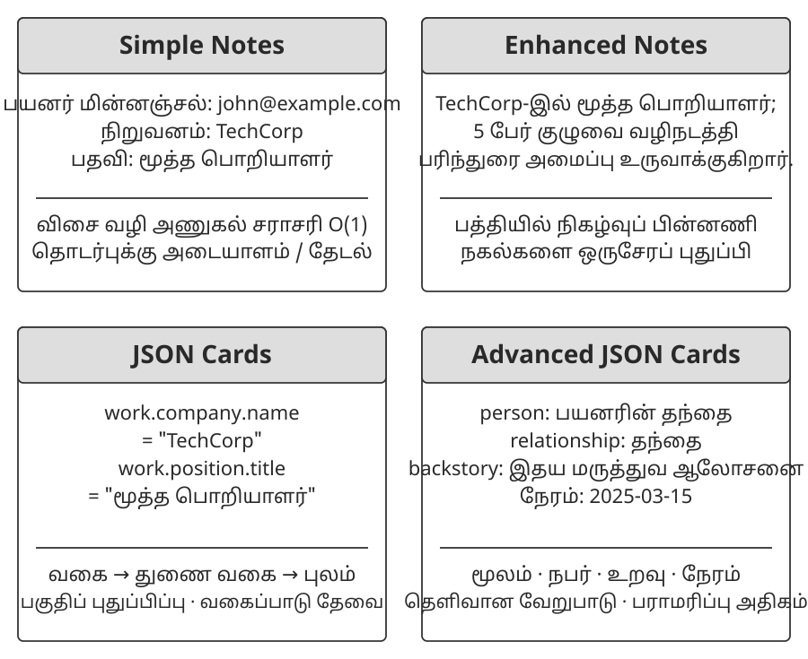

**Simple Notes** ஒவ்வொரு நினைவகத்தையும் ஒரு சிறிய உண்மையாக எழுதுகிறது; எடுத்துக்காட்டாக "பயனர் மின்னஞ்சல்: john@example.com". ஒரு பதிவைப் படிப்பதும் எழுதுவதும் எளிது; நிலையான விசையின்படி ஹாஷ் அட்டவணையில் தேடினால், தேடலுக்கும் புதுப்பிப்புக்கும் சராசரி நேரச் சிக்கல் பொதுவாக O(1). ஏராளமான குறிப்புகளைப் பொருள் அடிப்படையில் தேட வேண்டுமானால், தனியாக ஒரு மீட்டெடுப்புச் சுட்டையும் உருவாக்க வேண்டும். அளவுக்கு மீறிப் பிரிப்பது உறவுகளையும் இழக்கச் செய்யும்: "TechCorp-இல் மூத்த பொறியாளராகப் பணிபுரிந்து, பரிந்துரை அமைப்பு மேம்பாட்டுக்குப் பொறுப்பு" என்பதை நிறுவனம், பதவி, திட்டம் என்று தொடர்பற்ற மூன்று பதிவுகளாகப் பிரித்தால், அவை ஒரே வேலையைச் சேர்ந்தவையா என்று பின்னர் மீண்டும் தீர்மானிக்க வேண்டியிருக்கும்.

**Enhanced Notes** உண்மைகளையும் அவற்றின் பின்னணியையும் முழுப் பத்தியாகச் சேமிக்கிறது. எடுத்துக்காட்டாக: "பயனர் TechCorp-இல் மூத்த மென்பொருள் பொறியாளராகப் பணிபுரிகிறார்; இயந்திரக் கற்றலில் மூன்று ஆண்டுகள் அனுபவம் உண்டு; தற்போது ஐந்து பேர் கொண்ட பரிந்துரை அமைப்புக் குழுவை வழிநடத்துகிறார்." நிறுவனம், பதவி, அனுபவம், குழு ஆகியவற்றுக்கு இடையிலான உறவு ஒரே பத்தியில் தக்கவைக்கப்படுகிறது. விலையாக, சில உண்மைகள் பல பத்திகளில் மீளவரலாம்; பதவி மாறிய பிறகு, தொடர்புடைய பத்திகளை முழுமையாகக் கண்டுபிடித்துப் புதுப்பிக்க வேண்டும்; இல்லையெனில் பழைய, புதிய பதிவுகள் ஒருசேர நிலைத்திருக்கும்.

**JSON Cards** தகவலை "வகை—துணை வகை—விசை–மதிப்பு" என்ற அமைப்பில் ஒழுங்கமைக்கிறது; எடுத்துக்காட்டாக `personal.contact.email`, `work.position.title`. பதவிப் புலத்தை மாற்றும்போது, `work.company.name` போன்ற பிற புலங்களைத் தக்கவைக்கலாம்; பகுதி புதுப்பிப்புக்கு இது ஏற்றது. வகைப்பாட்டை வடிவமைக்கும்போது குறுக்குத் தகவலையும் கருத்தில் கொள்ள வேண்டும்: "வார இறுதியில் Python கொண்டு சொந்தத் திட்டம் உருவாக்குகிறார்" என்பது நேரம், தொழில்நுட்ப விருப்பம், செயல்பாடு ஆகிய மூன்றையும் சம்பந்தப்படுத்துகிறது. ஒரு செயல்பாட்டுப் பதிவைச் சேமித்து அதற்குப் பல குறிச்சொற்களைச் சேர்க்கலாம்; அல்லது குறிப்பு மூலம் தொடர்புடைய வகைகளை இணைத்து இந்த உறவுகளைத் தக்கவைக்கலாம்.

**Advanced JSON Cards** உண்மைக்கு அப்பால் மூலப் பின்னணி `backstory`, பொருள் `person`, பயனருடனான உறவு `relationship`, நேர முத்திரை ஆகியவற்றைச் சேர்க்கிறது. இந்தப் புலங்கள், தகவல் யாருக்கு உரியது, எப்போது தெரியவந்தது, எந்தச் சூழலுக்குப் பொருந்தும் என்பதை அமைப்பு அடையாளம் காண உதவுகின்றன. எடுத்துக்காட்டாக, "டாக்டர் ஜாங்" என்பது பயனரின் பல் மருத்துவரையோ, பயனரின் தந்தையின் இதயவியல் மருத்துவரையோ குறிக்கலாம்; பெயரை நோயாளி, உறவு, சிறப்புத் துறை ஆகியவற்றுடன் சேர்த்துச் சேமித்தால் குழப்பம் குறையும்.

"என் குடும்பத்தினருக்கு ஆண்டு உடல் பரிசோதனையை ஏற்பாடு செய்" என்று பயனர் சொன்னால், அமைப்பு `person`, `relationship` மூலம் குடும்ப உறுப்பினர்களைக் கண்டறிந்து, `backstory`-இலிருந்து தொடர்புடைய அனுபவங்களைப் படிக்கலாம். புலங்கள் எவ்வளவு வளமாக இருக்கிறதோ, அவ்வளவு உறவுகளைப் பிரித்தெடுக்கும்போதும் புதுப்பிக்கும்போதும் கையாள வேண்டியிருக்கும். தகவலின் முக்கியத்துவத்துக்கும் இணைப்புத் தேவைக்கும் ஏற்பக் கலந்து சேமிக்கப் பரிந்துரைக்கிறேன்: முக்கிய நபர்கள், ஒப்பந்தங்கள், நீண்டகால விருப்பங்களுக்கு Advanced JSON Cards பயன்படுத்தி மூலங்களையும் உறவுகளையும் தக்கவைக்கலாம்; எண்ணிக்கை அதிகமான, இணைப்பு குறைந்த எளிய உண்மைகளுக்கு Simple Notes பயன்படுத்தி பிரித்தெடுப்பு, பராமரிப்புச் செலவைக் குறைக்கலாம். இரு வகைப் பதிவுகளையும் அடையாளங்கள் அல்லது குறிப்புகள் மூலம் இணைத்து, தேவைப்படும்போது ஒருசேர மீட்டெடுக்கலாம்.

> **சோதனை 3-2 ★★: நான்கு நினைவக வடிவங்களின் ஒப்பீடு**
>
> துணைச் செயலாக்கம் நான்கு வடிவங்களுக்கும் ஒரே மாதிரியான நினைவக உருவாக்கம், புதுப்பிப்பு, மீட்டெடுப்பு இடைமுகங்களை வழங்கி, சோதனை 3-1-இன் அதே 60 பயன்பாட்டு நிகழ்வுகளில் இறுதிப் பதில்களை ஒப்பிடுகிறது.
>
> இந்த இயக்கத்தில், Simple Notes, Enhanced Notes, JSON Cards, Advanced JSON Cards முறையே 48, 52, 51, 49 நிகழ்வுகளில் வெற்றி பெற்றன. Enhanced Notes இரண்டாம் அடுக்கில் 16 நிகழ்வுகளிலும், Advanced JSON Cards 12-இலும் வெற்றி பெற்றன; மூன்றாம் அடுக்கில் இரண்டும் 19-இல் வெற்றி பெற்றன. நினைவகப் பராமரிப்பு, பதிலளித்தல், மதிப்பீடு ஆகிய அனைத்தையும் சேர்த்து, Enhanced Notes சுமார் 990 ஆயிரம் token, Advanced JSON Cards சுமார் 1.55 மில்லியன் token பயன்படுத்தின; பின்னதன் மாதிரி அழைப்புகளின் சராசரி நேரமும் அதிகம்.
>
> இரண்டாம் அடுக்கின் ஸ்ட்ரீமிங் சந்தா கேள்வியை எடுத்துக்காட்டாகக் கொள்வோம். செலவைக் குறைக்க விரும்பும் பயனர், தான் எந்தெந்தச் சேவைகளுக்குச் சந்தா செலுத்துகிறார், ஒவ்வொன்றுக்கும் எவ்வளவு என்று கேட்கிறார். மேம்படுத்தப்பட்ட குறிப்புகள் குழு Netflix, Disney+, Max ஆகியவற்றின் மாதக் கட்டணங்களை முறையே 22.99, 19.99, 19.99 டாலர் என்று பட்டியலிட்டது. மேம்பட்ட JSON அட்டைக் குழுவோ Max-இன் விலையை மட்டும் கூறியதோடு, Max-இன் இரு குறைந்த கட்டணத் திட்டங்களையும் பட்டியலிட்டது. பரிந்துரை எவ்வளவு குறிப்பானதாக இருந்தாலும், மற்ற இரு கட்டண அறிக்கைகளை அது ஈடுசெய்ய முடியாது.
>
> எந்தப் புதுப்பிப்பிலிருந்து பிரச்சினை தொடங்கியது? மேம்பட்ட அட்டைக் குழு ஒவ்வொரு முறையும் சேமித்த நினைவகங்களைப் புரட்டிப் பார்த்தால், முதல் அமர்வுக்குப் பிறகு Netflix இன்னும் இருந்தது; இரண்டாம் அமர்வுக்குப் பிறகு Disney+-உடன் தொடர்புடைய பதிவுகள் மட்டும் எஞ்சின; மூன்றாம் அமர்வுக்குப் பிறகு Max மட்டுமே எஞ்சியது. கேள்வி கேட்கப்பட்ட நேரத்தில், முதல் இரு சந்தாக்கள் ஏற்கனவே நினைவகத்திலிருந்து மறைந்துவிட்டன.

### மேம்பட்ட அறிவு வெளிப்பாட்டு வடிவம்: செயல்படுத்தக்கூடிய குறியீடு

உண்மைகளைச் சேமித்த பிறகு, புள்ளிவிவரங்களைத் தொகுக்க வேண்டும், முரண்பாடுகளைச் சரிபார்க்க வேண்டும், வணிக விதிகளின்படி அடுத்த படியைத் தீர்மானிக்க வேண்டும். **User as Code** (UaC) என்ற எனது முயற்சியில், பயனர் தகவலை வகைப்படுத்தப்பட்ட Python பொருள்களாக ஒழுங்கமைத்து, இந்தச் செயல்களைச் சார்புகளாக எழுத முயன்றேன்[^uac]. மாதிரி உரையாடலிலிருந்து உண்மைகளைப் பிரித்தெடுக்கிறது; நிரல் தெளிவாக வரையறுக்கப்பட்ட கணக்கீட்டைச் செய்கிறது.

தேதி ஒப்பீடு, தொகைத் தொகுப்பு, தெளிவான வணிகக் கட்டுப்பாடுகள் ஆகியவற்றுக்கு, கணக்கீட்டைச் சார்புகளாக எழுதுவதற்கு நான் முன்னுரிமை கொடுக்கிறேன்; இதனால் ஒரே உண்மைத் தொகுப்பிலிருந்து மீண்டும் உருவாக்கக்கூடிய, சோதிக்கக்கூடிய முடிவுகள் கிடைக்கும். இவ்வாறு, மாதிரி பொருள் புரிதலில் கவனம் செலுத்த முடிகிறது; நீண்ட உரையாடலில் மீண்டும் மீண்டும் மனக்கணக்கு செய்து விதிகளைச் சரிபார்ப்பதன் சுமை குறைகிறது; நினைவகத்தின் வெளிப்பாட்டையும் பயன்பாட்டையும் ஒரே குறியீட்டுத் தொகுப்பில் சரிபார்க்கவும் முடிகிறது.

UaC இரு கட்டச் செயல்முறையைப் பயன்படுத்துகிறது: முதலில் பிரித்தெடுத்த உண்மைகளைப் பதிவில் சேர்த்து, பின்னர் வழக்கமாகச் சோதனைப்புள்ளிகளை உருவாக்கி, பதிவிலிருந்து வகைப்படுத்தப்பட்ட நிலையை மீண்டும் கட்டமைக்கிறது. பதிவு உண்மைகளின் மூலத்தையும் மாற்ற வரலாற்றையும் தக்கவைக்கிறது; நிலைப் பொருள் தற்போது வினவக்கூடிய புலங்களை வழங்குகிறது.

கடவுச்சீட்டும் பயணமும் எடுத்துக்காட்டாக, நிலையை இப்படி வரையறுக்கலாம்:

```python
from dataclasses import dataclass
from datetime import date

@dataclass
class PassportInfo:
    number: str
    country: str
    expiry_date: date

@dataclass
class Trip:
    destination: str
    departure_date: date
    is_international: bool

@dataclass
class UserState:
    passport: PassportInfo
    trips: list[Trip]

state = UserState(
    passport=PassportInfo("AB1234567", "US", date(2025, 2, 18)),
    trips=[
        Trip("Tokyo", date(2025, 1, 15), True),
        Trip("Paris", date(2025, 6, 10), True),
    ],
)
```

**தொகுப்புப் புள்ளிவிவரம்** பதிவுகளை நேரடியாகக் கடந்து கணக்கிடுகிறது. எடுத்துக்காட்டாக, 2025-இல் பதிவு செய்யப்பட்ட சர்வதேசப் பயணங்களின் எண்ணிக்கை:

```python
count = sum(
    1 for trip in state.trips
    if trip.is_international and trip.departure_date.year == 2025
)
# count == 2
```

**முரண்பாடு சரிபார்ப்பு** இரு புலத் தொகுப்புகளை முன்வரையறுத்த விதிகளின்படி ஒப்பிடுகிறது. கீழே மருந்து வகைப் பொருத்தத்தை எடுத்துக்காட்டாகக் கொண்டு, மேலும் சரிபார்க்க வேண்டிய உருப்படிகளை எவ்வாறு செயலாக்க வரிசைக்கு அனுப்புவது என்பதைக் காட்டுகிறோம்:

```python
def find_allergy_matches(profile):
    matches = []
    for medication in profile.current_medications:
        for allergy in profile.allergies:
            if medication.drug_class == allergy.drug_class:
                matches.append((medication, allergy))
    return matches
```

ஒவ்வொரு பொருந்தும் உருப்படியும் தொடர்புடைய மருந்து பதிவையும் ஒவ்வாமைப் பதிவையும் தக்கவைக்கிறது; அடுத்தடுத்த செயல்முறை இதன் அடிப்படையில் சரிபார்த்து, துறை விதிகளின்படி நினைவூட்டலா, மதிப்பாய்வுக்கு அனுப்பலாமா, தகவலைச் சேர்ப்பதா என்று தீர்மானிக்கலாம்.

**கட்டுப்பாட்டுச் சரிபார்ப்பு** நிலை புதுப்பிக்கப்படும்போது தானாக இயங்கலாம். எடுத்துக்காட்டாக, ஒரு பயண விதி, புறப்படும்போது கடவுச்சீட்டு குறைந்தபட்சம் 180 நாட்கள் செல்லுபடியாக இருக்க வேண்டும் என்று கோரினால், அந்த நாட்களை அளவுருவாக அனுப்பலாம்:

```python
def passport_alerts(state, required_days):
    alerts = []
    for trip in state.trips:
        if trip.is_international:
            days = (state.passport.expiry_date - trip.departure_date).days
            if days < required_days:
                alerts.append((trip.destination, days))
    return alerts

alerts = passport_alerts(state, required_days=180)
```

எடுத்துக்காட்டில் உள்ள 180 நாட்களின்படி கணக்கிட்டால், டோக்கியோ பயணத்தின்போது கடவுச்சீட்டு 34 நாட்கள் மட்டுமே செல்லுபடியாகும்; பாரிஸ் புறப்படும் நாளளவில் அது ஏற்கனவே காலாவதியாகிவிடும். பயனர் கடவுச்சீட்டைப் புதுப்பித்த பிறகு, புதிய தேதிகளைக் கொண்டு இந்த இரு பயணங்களையும் நிரல் மீண்டும் கணக்கிடலாம்.

[^uac]: Li, Bojie, User as Code: Executable Memory for Personalized Agents, 2026.

### பயனர் நினைவகத்தின் அறிவாற்றல் அறிவியல் அடிப்படை

அறிவாற்றல் அறிவியல் நினைவகத்தை உள்ளடக்கத்திலும் பயன்பாட்டு முறையிலும் வெவ்வேறு வகைகளாகப் பிரிக்கிறது. இந்தக் கருத்துகள் ஏஜெண்டின் நீண்டகாலத் தகவலை ஒழுங்கமைக்கவும் உதவுகின்றன:

- **நிகழ்வு நினைவகம் (episodic memory)** குறிப்பிட்ட நிகழ்வுகளையும் அவற்றின் நேரம், பங்கேற்பாளர்கள், நடந்த விதத்தையும் சேமிக்கிறது. மனிதரின் எடுத்துக்காட்டு "கடந்த புதன்கிழமை சக ஊழியருடன் இத்தாலிய உணவகத்தில் இரவு உணவு"; ஏஜெண்டில் "பயனர் அடுத்த வெள்ளி ANA விமானத்தில் டோக்கியோ செல்லத் திட்டமிட்டுள்ளார்" என்று இருந்துவிட்டு, பின்னர் முன்பதிவு வெற்றியா, மாற்றப்பட்டதா என்பதையும் பதிவு செய்யலாம்.
- **பொருள் நினைவகம் (semantic memory)** உண்மைகளையும் கருத்துகளையும் சேமிக்கிறது. மனிதரின் எடுத்துக்காட்டு "இத்தாலியின் தலைநகர் ரோம்"; ஏஜெண்டில் "பயனர் சைவ உணவாளர்", "பயனர் ஜன்னல் ஓர இருக்கையை விரும்புகிறார்" என்று இருக்கலாம். இந்தத் தகவல் பயனர் வெளிப்படையாகச் சொன்னதிலிருந்தோ பல அனுபவங்களிலிருந்து தொகுக்கப்பட்டதிலிருந்தோ வரலாம்; மூலத்தைப் பதிவு செய்வது இவ்விரண்டையும் வேறுபடுத்த உதவுகிறது.
- **செயல்முறை நினைவகம் (procedural memory)** திறன்களோடும் நடத்தைச் செயல்முறைகளோடும் தொடர்புடையது. மனிதரின் எடுத்துக்காட்டு மிதிவண்டி ஓட்டுதல்; ஏஜெண்ட் பொறியியலில் மீண்டும் பயன்படுத்தக்கூடிய செயல்முறையை ஒப்புமையாகக் கொள்ளலாம்; எடுத்துக்காட்டாக "நேரடி விமானங்களைத் தேடு→இருக்கை விருப்பத்தை உறுதிசெய்→அடிக்கடி பயணி எண்ணைப் பயன்படுத்து→உணவை முன்பதிவு செய்".

அத்தியாயம் 1-இன் கொள்முதல் பதிவை மீண்டும் பார்ப்போம். "பத்துப் பொருட்களைப் பார்த்த பிறகு அவற்றில் ஒன்றை வாங்கினார்" என்பது ஒரு கொள்முதல் நிகழ்வைப் பதிவு செய்ய ஆதரவளிக்கிறது; ஆனால் பயனர் இனி எதை விரும்புவார் என்று அதிலிருந்து தீர்மானிப்பது கடினம். இந்த வடிவமைப்பு அவருக்குப் பிடித்திருக்கலாம்; அல்லது அன்று அது விரைவாக வந்து சேரும் என்பதால் மட்டும் வாங்கியிருக்கலாம். "இனிமேல் இந்த வகையை வாங்கும்போது அன்றே வந்து சேருகிறதா என்று முதலில் பார்" என்று பயனர் பின்னர் சொன்னால், பொருந்தும் எல்லை கொண்ட ஒரு நீண்டகால விருப்பம் கூடிவிடுகிறது. அடுத்த முறை அதே வகைப் பொருட்களைப் பரிந்துரைக்கும்போது முதலில் விநியோக நேரத்தைச் சரிபார்க்கலாம்; இந்த வடிகட்டல் நிபந்தனை எந்தப் பின்னூட்டத்திலிருந்து வந்தது என்றும் அவருக்கு விளக்கலாம்.

அட்டவணை 3-1 இந்த வகைப்பாட்டை, முன்பு கண்ட நினைவக அடுக்குகளுடனும் சேமிப்பு வடிவங்களுடனும் ஒருசேர வைத்து, மூன்றும் தனித்தனியாக எந்தக் கேள்விகளுக்குப் பதிலளிக்கின்றன என்பதை விளக்குகிறது.

அட்டவணை 3-1 நினைவக வடிவமைப்பின் மூன்று அம்சங்கள்

| வடிவமைப்பு அம்சம் | பதிலளிக்கும் கேள்வி | குறிப்பிட்ட வகைகள் |
| --- | --- | --- |
| பதிவு அடுக்கு | தகவல் எந்தப் பொறுப்பை ஏற்கிறது? | பாதை, பயனர் நீண்டகால நினைவகம், வணிக நிலை |
| சேமிப்பு வடிவம் | எந்தக் கட்டமைப்பில் வெளிப்படுத்துவது? | Simple Notes, Enhanced Notes, JSON Cards, Advanced JSON Cards |
| நினைவக உள்ளடக்கம் | எந்த வகைத் தகவலைச் சேமிப்பது? | நிகழ்வு நினைவகம், பொருள் நினைவகம், செயல்முறை நினைவகம் |

எடுத்துக்காட்டாக, "பயனர் ஜன்னல் ஓர இருக்கையை விரும்புகிறார்" என்பது பொருள் நினைவகம்; அதை நீண்டகால நினைவகத்தில் Simple Notes கொண்டு சேமிக்கலாம்; ஒரு முன்பதிவுச் செயல்முறை செயல்முறை நினைவகம்; அதை மூலமும் பொருந்தும் நிபந்தனைகளும் கொண்ட அட்டையில் சேமிக்கலாம்.

### நினைவகச் சட்டக வழக்குகள்

"சமீபத்தில் நான் நடைபாதை இருக்கைக்கு மாறிவிட்டேன்" என்று பயனர் சொல்கிறார்; பழைய பதிவில் "ஜன்னல் ஓர இருக்கை பிடிக்கும்" என்று உள்ளது. எழுதும் நேரத்தில் இருக்கை விருப்பத்தை அமைப்பு புதுப்பிக்கலாம்; அல்லது இரு கூற்றுகளையும் சேமித்து, அடுத்த முன்பதிவின்போது எது பொருந்துகிறது என்று தீர்மானிக்கலாம். கீழே Mem0 இத்தகைய முரண்பாட்டை எந்தப் படியில் கையாள்கிறது, Memobase பயனர் விவரக்குறிப்பையும் குறிப்பிட்ட நிகழ்வுகளையும் எவ்வாறு தனித்தனியாகப் பதிவு செய்கிறது என்பதைப் பார்ப்போம்.

**Mem0: முரண்பாடு கையாளும் இடத்தை மாற்றுதல்.** 2025 ஆய்வுக் கட்டுரையும் v2-உம் எழுதும் நேரத்தில் பழைய, புதிய உண்மைகளை ஒப்பிடும் செயல்முறையைப் பயன்படுத்தின; பின்னர் வந்த v3-ஓ உண்மைகளைச் சேர்ப்பதையும் கலப்பு மீட்டெடுப்பையும் பயன்படுத்துகிறது. படம் 3-3 இந்த இரு அமைப்புகளையும் ஒப்பிடுகிறது.

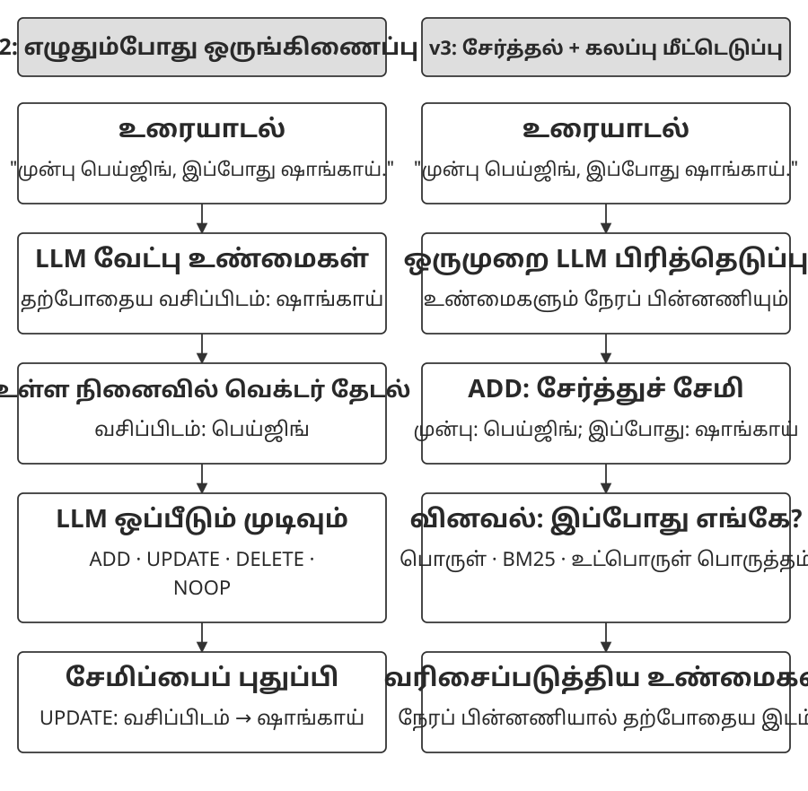

தொடக்கச் செயல்முறையில், LLM முதலில் உரையாடலிலிருந்து வேட்பு உண்மைகளைப் பிரித்தெடுத்து, அருகிலுள்ள ஏற்கனவே உள்ள நினைவகங்களை மீட்டெடுத்து, **ADD**, **UPDATE**, **DELETE**, **NOOP** ஆகியவற்றில் எதைச் செய்வது என்று தீர்மானிக்கிறது. "நான் பெய்ஜிங்கில் வசிக்கிறேன்" என்று பயனர் முதலில் சொல்லி, பின்னர் "நான் ஷாங்காய்க்குக் குடிபெயர்ந்தேன்" என்று சொன்னால், தற்போதைய வசிப்பிடத்தை ஷாங்காய் என்று அமைப்பு புதுப்பிக்கலாம். இவ்வாறு வினவலின்போது ஒழுங்கமைக்கப்பட்ட உண்மையை எளிதாகப் பெறலாம்; ஆனால் பராமரிக்கும்போது திருத்தங்கள், நேர மாற்றங்கள், வெவ்வேறு பொருள்கள் ஆகியவற்றைச் சரியாக அடையாளம் கண்டு, புதுப்பிப்புக்கான அடிப்படையைச் சேமிக்க வேண்டும்; அப்போதுதான் பிழை தெரியும்போது பின்னோக்கிப் பார்க்க முடியும். ஆய்வுக் கட்டுரை மேலும் **Mem0-g** என்ற வரைபட நினைவக வடிவத்தை முன்மொழிந்து, பொருள்களும் உறவுகள் மூலம் தொடர்புடைய அறிவை வெளிப்படுத்துகிறது[^ch3-mem0-paper].

v3 தானியங்கிப் பிரித்தெடுப்பை ஒரே LLM அழைப்பாக மாற்றி, **ADD** பதிவுகளை மட்டும் சேர்க்கிறது. பெய்ஜிங், ஷாங்காய் ஆகிய இரு தகவல்களையும் நேரப் பின்னணியுடன் சேர்த்துத் தக்கவைத்து, வினவலின்போது சூழலுடன் இணைத்துத் தற்போதைய வசிப்பிடத்தைத் தீர்மானிக்கலாம். மீட்டெடுப்பில் பொருள் ஒற்றுமை, BM25 முக்கியச் சொல் பொருத்தம், பொருள் பொருத்தம் ஆகிய மூன்றும் ஒருசேரப் பயன்படுகின்றன; முடிந்ததாக உறுதிசெய்யப்பட்ட செயல்களையும் உண்மைகளாகப் பிரித்தெடுக்கலாம். இடம்பெயர்வு வழிகாட்டி, LoCoMo மதிப்பெண் 71.4-இலிருந்து 91.6-ஆகவும், LongMemEval 67.8-இலிருந்து 93.4-ஆகவும் உயர்ந்ததாகத் தெரிவிக்கிறது. அந்தத் திறந்த மூலப் பதிப்பு பொருள் இணைப்பை உள் மீட்டெடுப்புக்குப் பயன்படுத்தி, வெளிப்புற வரைபடச் சேமிப்பு இடைமுகத்தையும் `relations` திருப்பு மதிப்பையும் நீக்கியது; வரைபட நினைவகத்தை நிர்வகிக்கப்பட்ட தளம் வழங்குகிறது[^ch3-mem0-migration].

இந்தப் பரிணாமம், நினைவக அமைப்பு முரண்பாட்டுத் தீர்மானத்தை எழுதும் கட்டத்திலிருந்து படிக்கும் கட்டத்துக்கு நகர்த்த முடியும் என்பதைக் காட்டுகிறது. எழுதும்போது இரு நபர்களின் அனுபவங்களைத் தவறாக இணைத்துவிட்டாலோ, கூடுதல் தகவலைத் திருத்தமாகக் கருதிவிட்டாலோ, அடுத்தடுத்த பதில்கள் தொடர்ந்து தவறான தற்போதைய நிலையைப் பயன்படுத்தக்கூடும். சேர்த்துச் சேமிப்பது பழைய, புதிய சான்றுகள் இரண்டையும் முடிவெடுப்பில் பங்கேற்க வைக்கிறது; எழுதும் நேரத்தில் ஒவ்வொரு உருப்படியாக முடிவெடுக்கும் மாதிரி அழைப்புகளையும் குறைக்கிறது. அடிக்கடி மாறும், அந்த நேரத்தில் முரண்பாட்டைத் தீர்மானிக்கக் கடினமான பயனர் நினைவகங்களுக்கு, முதலில் உண்மையையும் அதன் நேரத்தையும் மூலத்தையும் சேமித்து, பின்னர் குறிப்பிட்ட கேள்விக்குப் பதிலளிக்கும்போது செல்லுபடியான நிலையை ஒழுங்கமைக்கவே நான் விரும்புகிறேன்.

[^ch3-mem0-paper]: Chhikara மற்றும் பலர், Mem0: Building Production-Ready AI Agents with Scalable Long-Term Memory, 2025.

[^ch3-mem0-migration]: Mem0, Open Source: Migrating to the New Memory Algorithm.

**Memobase: பயனர் விவரக்குறிப்பும் நிகழ்வு நினைவகமும்.** Memobase நீண்டகாலத் தகவலை இரு பகுதிகளாக ஒழுங்கமைக்கிறது. **பயனர் விவரக்குறிப்பு (profile)** தலைப்பு, துணைத் தலைப்பு அடிப்படையில் ஒப்பீட்டளவில் நிலையான பண்புகளைச் சேமிக்கிறது; எடுத்துக்காட்டாக `basic_info`-இல் பெயர், `interest`-இல் ஆர்வங்கள், `work`-இல் பதவி. மேம்பாட்டாளர் பிரித்தெடுக்க வேண்டிய இடங்களை (slot) உள்ளமைத்து, விவரக்குறிப்பின் எல்லையையும் நுணுக்கத்தையும் கட்டுப்படுத்தலாம். **நிகழ்வு நினைவகம் (event memory)** பயனரின் அனுபவங்களையும் அவற்றின் நேரத்தையும் பதிவு செய்து, "கடந்த முறை வரவுசெலவு பற்றிப் பேசியது எப்போது" போன்ற கேள்விகளுக்குப் பதிலளிக்க உதவுகிறது.

Memobase முதலில் புதிய உரையாடலை ஒரு இடையகத்தில் (buffer) வைக்கிறது; இடையகம் குறிப்பிட்ட அளவை எட்டியதும், அல்லது அமர்வு குறிப்பிட்ட நேரம் செயலற்றிருந்ததும், தொகுதியாகச் செயலாக்குகிறது; அமர்வு முடியும்போது வெளிப்படையாகவும் தூண்டலாம். இவ்வாறு பல செய்திகள் ஒரே ஒழுங்கமைப்புச் செயல்முறையைப் பகிர்ந்துகொள்கின்றன; வினவலின்போது ஏற்கனவே உருவாக்கப்பட்ட விவரக்குறிப்பையும் நிகழ்வுகளையும் படிக்கின்றன. ஒத்திசைவற்ற புதுப்பிப்பு, தற்போதைய இடைவினை நினைவகப் பிரித்தெடுப்புக்காகக் காத்திருக்கும் நேரத்தைக் குறைக்கிறது; சமீபத்திய உண்மையை உடனடியாகப் பயன்படுத்த வேண்டுமானால், இந்தச் செயலாக்கம் முடியும் வரை காத்திருக்கலாம்[^ch3-memobase].

[^ch3-memobase]: Memobase, அதிகாரபூர்வத் திட்ட விளக்கம்; விவரக்குறிப்புப் புலங்கள், நிகழ்வு நினைவகம், இடையகம், ஒத்திசைவுப் புதுப்பிப்பு இடைமுகங்கள் ஆகியவை அடங்கும்.

கடந்த முறை முன்பதிவு நடந்த விதத்தையும், பயனரின் இருக்கை விருப்பத்தையும், பணத்திருப்பம் கையாளும் செயல்முறையையும் உதவியாளர் ஒருசேர நினைவில் வைத்திருக்க வேண்டுமானால், படம் 3-4-இல் உள்ளபடி நிகழ்வுகள், உண்மைகள், செயல்முறைகளைத் தனித்தனியாகச் சேமிக்கலாம். ஒவ்வொரு முறை பணி வரும்போதும், பயன்படும் பகுதிகளை வேலை நினைவகத்தில் வைக்கலாம்.

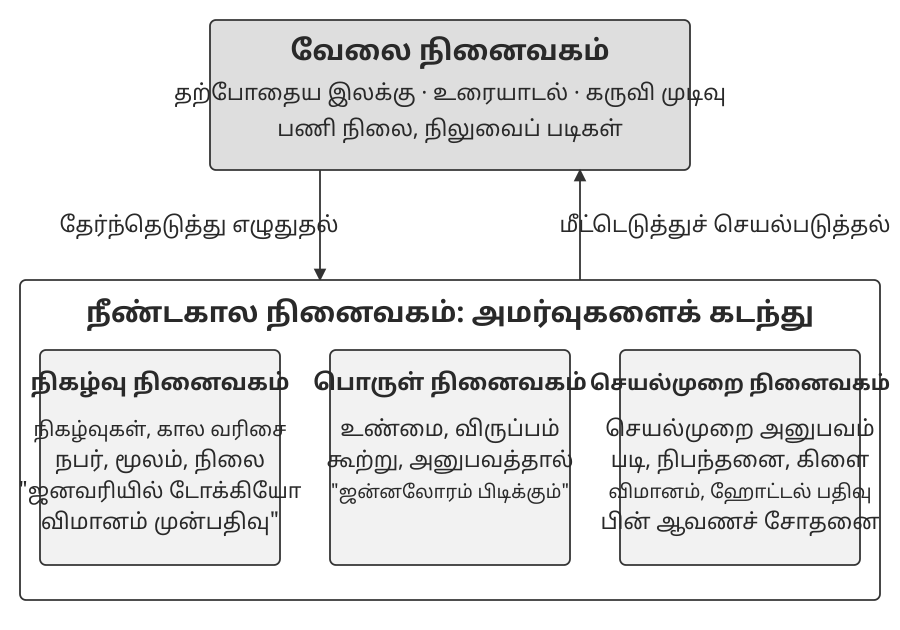

நிகழ்வு நினைவகம் நிகழ்வு வரிசையையும் நேர முத்திரை, உணர்ச்சிக் குறி, பணி அடையாளம் போன்ற மீத்தரவையும் தக்கவைத்து, நேரத்தையும் தலைப்பையும் இணைத்து மீட்டெடுக்கலாம். எடுத்துக்காட்டாக, "கடந்த முறை வரவுசெலவு பற்றிப் பேசியது" என்பதற்குத் தலைப்புப் பொருத்தமும் நேர வரிசைப்படுத்தலும் ஒருசேரத் தேவை. பொருள் நினைவகம் நிகழ்வுகளிலிருந்து பிரித்தெடுத்த உண்மைகளையும் விருப்பங்களையும் சேமிக்கிறது; செயல்முறை நினைவகம் மீண்டும் மீண்டும் பயன்படும் செயல்முறைகளைச் சேமிக்கிறது.

**வேலை நினைவகம் (working memory)** தற்போதைய இலக்கு, பணி நிலை, ஏற்கனவே மீட்டெடுத்த தொடர்புடைய தகவலை ஒழுங்கமைக்கிறது. Harness பாதையிலிருந்தும் நீண்டகாலச் சேமிப்பிலிருந்தும் உள்ளடக்கத்தைத் தேர்ந்தெடுத்து, தற்போதைய சூழலில் ஏற்றுகிறது; பணியில் உருவாகும் புதிய உண்மைகள் ஒழுங்கமைக்கப்பட்ட பிறகு நீண்டகால நினைவகத்தில் எழுதப்படுகின்றன. பாதை விஷயங்கள் எவ்வாறு நடந்தன என்பதைப் பதிவு செய்கிறது; வேலை நினைவகம் அடுத்த முடிவுக்குத் தேவையான தகவலை ஒருங்கே சேமிக்கிறது; இரண்டும் நிகழ்வு அடையாளங்கள், மூலங்கள் மூலம் இணைகின்றன.

RAG கொண்டு பயனர் நினைவகத்தைப் படிக்கும்போது, முதலில் தற்போதைய கோரிக்கையின் அடிப்படையில் தொடர்புடையதாக இருக்கக்கூடிய நினைவகங்களின் தொகுதியைக் கண்டுபிடித்து, பின்னர் எவற்றை வேலை நினைவகத்தில் சேர்ப்பது என்று தீர்மானிக்க வேண்டும். இன்று பயனர் இருக்கை தேர்ந்தெடுக்க உதவியாளர் உதவ வேண்டும் என்று வைத்துக்கொள்வோம்; தேடலில் ஒருசேர இரு வாக்கியங்கள் கிடைத்தன: "அலுவல் பயணங்களில் ஜன்னல் ஓர இருக்கை பிடிக்கும்", "கடந்த முறை முழங்காலில் காயம்; திரும்பி வரும்போது நடைபாதை இருக்கை தேர்ந்தெடுக்க உதவினாய்". இரண்டும் இருக்கைத் தேர்வுக்கு மிகத் தொடர்புடையவை; ஆனால் இரண்டாவது அன்றைய திரும்பும் பயணத்துக்கு மட்டுமே நிபந்தனை விதித்தது. தொடர்புடைய தன்மையின் அடிப்படையில் மறுவரிசைப்படுத்தினால், அது முதலிடம் வந்தாலும், இன்று பொருந்துகிறதா என்ற கேள்விக்குப் பதில் கிடைக்காது.

இத்தகைய சூழ்நிலையில், Jev போன்ற மதிப்பீட்டு மாதிரியைக் கொண்டு வேட்பு நினைவகங்களை வடிகட்டுவதை நான் சிறந்ததாகக் கருதுகிறேன். இந்தப் பயணத்தையும், பயனரின் தற்போதைய கோரிக்கையையும், ஒவ்வொரு நினைவகத்தின் அசல் வாசகம், தேதி, பொருந்தும் நிபந்தனைகள் ஆகியவற்றையும் ஒருசேர அதற்குக் கொடுத்து, "இந்த முறை பொருந்தும்", "குறிப்புக்கு மட்டும்", அல்லது "அடிப்படை போதவில்லை" என்று ஒவ்வொன்றாகத் தீர்மானிக்கச் சொல்லலாம். இன்றும் அலுவல் பயணம் என்றால், முதல் வாக்கியம் இருக்கைத் தேர்வுக்கு அடிப்படையாக இருக்கலாம்; முழங்கால் காயம் இன்னும் ஆறவில்லை என்று பயனர் சற்று முன் சொல்லியிருந்தால், இரண்டாவதை மீட்டெடுத்துக் கேட்பது பொருத்தம்.

### நினைவகச் சுருக்கமும் ஒழுங்கமைப்புப் பொறிமுறையும்

அடிக்கடி விமானச்சீட்டு முன்பதிவு செய்யும் பயனர் "ஜன்னல் ஓரம்" என்பதைப் பத்து முறை குறிப்பிட்டிருக்கலாம். அவற்றில் ஒன்பது ஒரே ஆர்டரை மீண்டும் சொல்வதாக இருக்கலாம்; குறிப்பிடப்பட்ட எண்ணிக்கையையே விருப்பத்தின் வலிமையாகக் கருதினால், ஒரே விஷயத்தின் எடை பெருகிவிடும். ஒழுங்கமைக்கும்போது முதலில் மூலத்தையும் நிகழ்வையும் அடையாளம் கண்டு, பின்னர் மீள்வரும் பதிவுகளை இணைத்து, பின்னர் வந்த திருத்தம் ஏதேனும் உள்ளதா என்று சரிபார்த்து, இறுதியில் எந்த விதிகள் வருங்காலப் பணிகளுக்குப் பயன்படும் என்று தீர்மானிக்க வேண்டும். "கடந்த முறை அந்த ஜன்னல் ஓர இருக்கை நன்றாக இருந்தது" என்று வந்தால், அந்த வாக்கியத்தையும் தொடர்புடைய ஆர்டரையும் Jev போன்ற மதிப்பீட்டு மாதிரியிடம் கொடுத்து, அது "கடந்த முறை பயணத்தை நினைவுகூர்வது", "இந்த முறைக்கான கோரிக்கை", அல்லது "நீண்டகால விருப்பத்தை வெளிப்படுத்துவது" என்று மட்டும் தீர்மானிக்கச் சொல்லலாம். ஆர்டர் பொருந்தவில்லை என்றாலோ, பல விளக்கங்களும் சாத்தியமாக இருந்தாலோ, அசல் வாக்கியத்தைத் தக்கவைத்து, முன்பதிவின்போது மீண்டும் சரிபார்க்கலாம். இவ்வாறு ஒரு உள்ளூர் மதிப்பீடு, ஒரே அனுபவத்தை மீண்டும் மீண்டும் புதிய சான்றாகக் கணக்கிடுவதைத் தவிர்க்கிறது.

1. **ஒழுங்கமைக்க வேண்டிய பொருட்களைத் தேர்ந்தெடுத்தல்.** அணுகல் அலைவெண், பதிவு நேரம், உணர்ச்சிக் குறி, தகவலின் தனித்தன்மை ஆகியவை வரிசைப்படுத்தும் சமிக்ஞைகளாக இருக்கலாம். எடுத்துக்காட்டாக, மூன்று நாட்களுக்கு முன் உருவாக்கப்பட்டு, ஐந்து முறை அணுகப்பட்ட, உணர்ச்சிக் குறி ஒப்பீட்டளவில் வலுவான, மீள்வராத ஒரு பதிவு தனியாகச் சேமிக்கத் தகுந்தது; தொண்ணூறு நாட்களுக்கு முன் உருவாக்கப்பட்டு, ஒருமுறை மட்டும் அணுகப்பட்ட, மற்ற மூன்று பதிவுகளுடன் அதிகம் ஒத்திருக்கும் ஒரு பதிவை முதலில் தொடர்புடைய பதிவுகளுடன் இணைக்கலாம். மதிப்பெண்ணின்படி முதலில் ஒழுங்கமைக்க வேண்டிய பதிவுகளை வடிகட்டி, பின்னர் வணிக விதிகளின்படி சுருக்குவதா, இணைப்பதா, நீக்குவதா என்று தீர்மானிக்கலாம். நீண்டகாலக் கட்டுப்பாடுகளும் செல்லுபடியான ஒப்பந்தங்களும் அரிதாக அணுகப்பட்டாலும், அவற்றின் செல்லுபடிக் காலம் முடியும் வரை தக்கவைக்க வேண்டும்.
2. **தொகுத்துச் சுருக்கம் உருவாக்குதல்.** ஒத்த பதிவுகளைக் குழுவாக்கி, ஒரு பத்திச் சுருக்கத்தில் பொதுவான உள்ளடக்கத்தைத் தக்கவைத்தல். எடுத்துக்காட்டாக, பல வானிலை உரையாடல்களை "பயனர் அடிக்கடி வானிலையைப் பற்றிக் கேட்பார்; குறிப்பாக மழை பற்றிக் கவலைப்படுகிறார்" என்று ஒழுங்கமைக்கலாம். குறிப்பிட்ட தேதிகளும் மூல வினவல்களும் காப்பகப்படுத்திச் சேமிக்கப்படும்; சுருக்கம் மூலப் பதிவுகளுடன் இணைக்கப்பட்டு, பின்னர் தேடிப் பார்க்க உதவும்.
3. **விதிகளையும் செயல்முறைகளையும் பிரித்தெடுத்தல்.** பல கொள்முதல் பதிவுகளிலிருந்து "விலைக்கு மதிப்புள்ள பொருட்களை விரும்புகிறார், பயனர் மதிப்பீடுகளுக்கு முக்கியத்துவம் அளிக்கிறார்" என்று தொகுக்கலாம்; அல்லது பொருள் தேர்வுப் படிகளைப் பிரித்தெடுக்கலாம்.

### தனியுரிமைப் பாதுகாப்பு: பதிவு மறைவாக்கம்

பயனர் நினைவகத்தில் அடையாளம், தொடர்பு விவரங்கள், கணக்குத் தகவல் ஆகியவை அடிக்கடி இருக்கும். எந்தப் புலங்கள் மாதிரி உள்ளீட்டுக்குள் செல்ல வேண்டும் என்பதைப் பணியின் அடிப்படையிலும், எந்த உள்ளடக்கம் பதிவுகளுக்குள் செல்ல வேண்டும் என்பதை இயக்கத் தேவையின் அடிப்படையிலும் அமைப்பு தீர்மானிக்க வேண்டும். பதிவு எழுதப்படுவதற்கு முன்பே மறைவாக்கத்தைச் செய்து, உணர்திறன் துண்டுகளை வகைக் குறிச்சொற்களாகவோ நிலையான இடமாற்றிகளாகவோ மாற்றி, பிரச்சினை கண்டறியத் தேவையான கட்டமைப்பைத் தக்கவைக்கலாம்.

> **சோதனை 3-3 ★★: உள்ளூர் மாதிரி அடிப்படையிலான பதிவு மறைவாக்கம்**
>
> இந்தச் சோதனை Ollama வழியாக உள்ளூர் Qwen3-0.6B-ஐ அழைத்து, பதிவுகளில் உள்ள உணர்திறன் துண்டுகளை இந்தக் கணினியிலேயே அடையாளம் காண்கிறது. சிறிய மாதிரிகள் நுகர்வோர் சாதனங்களில் வரிசைப்படுத்த ஏற்றவை; 1.7B, 4B போன்ற அளவுகளுக்கும் மாற்றி, அடையாளம் காணும் தரத்தையும் செயலாக்க நேரத்தையும் ஒப்பிடலாம். மூலப் பதிவுகளை உள்ளூரிலேயே வைத்திருக்க வேண்டியிருக்கும்போது, அடையாளம் காணலும் மாற்றீடும் இந்தக் கணினியிலேயே முடிந்து, மறைவாக்கிய முடிவை மட்டும் அடுத்தடுத்த சேவைகளுக்குக் கொடுக்க வேண்டும்.
>
> சோதனைப் பொருட்களில் அடையாள அட்டை எண், வங்கி அட்டை எண் போன்ற கட்டமைக்கப்பட்ட எண்கள், முகவரி போன்ற அரைக் கட்டமைப்பு உள்ளடக்கம், இயல்பு மொழியில் தெரிவிக்கப்படும் கடவுச்சொல் போன்ற உணர்திறன் தகவல் ஆகியவை அடங்கும். மாதிரி JSON Schema-வின்படி தகவல் வகை, உரை இருப்பிடம், நம்பிக்கை அளவு ஆகியவற்றைத் திருப்பித் தருகிறது; நிரல் அதன் அடிப்படையில் மூல உரையை மாற்றுகிறது. ஒப்பீட்டுக் குழு வழக்கமான வெளிப்பாட்டைப் (regular expression) பயன்படுத்துகிறது; கலப்புக் குழு முதலில் வழக்கமான வெளிப்பாட்டுப் பொருத்தம் செய்து, பின்னர் மீதமுள்ள உரையை மாதிரியிடம் கொடுக்கிறது.
>
> முதலில் இரு பதிவுகளைப் பாருங்கள். முதல் பதிவில் அடையாள அட்டை எண்ணும் கைபேசி எண்ணும் உள்ளன; வழக்கமான வெளிப்பாடு கைபேசி எண்ணை மட்டுமே மறைத்தது; நினைவுகூரல் விகிதம் $1/2$. இரண்டாம் பதிவில் அமெரிக்கச் சமூகப் பாதுகாப்பு எண்ணையும் வங்கி அட்டை எண்ணையும் வழக்கமான வெளிப்பாடு கண்டுபிடித்தது; ஆனால் வடிவம் ஒத்த வேலைச்சீட்டு எண்ணையும் மறைத்துவிட்டது. குறித்த மூன்றில் இரண்டு மட்டுமே மறைவாக்கம் தேவைப்பட்டன; துல்லிய விகிதம் $2/3$. உணர்திறன் மதிப்புகள் இன்னும் பதிவில் உள்ளனவா என்று மட்டும் சரிபார்த்தால், இரண்டாம் பதிவு தேர்ச்சி பெற்றுவிடும்; வாடிக்கையாளர் சேவை இந்தப் பதிவைக் கொண்டு வேலைச்சீட்டைத் தேடும்போதுதான் துப்பு தொலைந்துபோனது தெரியும்.
>
> மொத்தம் 12 மாதிரிகளுக்கும் ஒவ்வொன்றாக நினைவுகூரல் விகிதத்தைக் கணக்கிட்டுச் சராசரி எடுத்தால், வழக்கமான வெளிப்பாடு, மாதிரி, கலப்புத் தீர்வு முறையே சுமார் 50%, 69%, 78%. மாற்றிய பிறகு ஒவ்வொன்றாக எண்ணினால், மூன்று தீர்வுகளும் முறையே 9, 3, 2 உணர்திறன் மதிப்புகளை விட்டுச் சென்றன. எதைத் தேர்ந்தெடுப்பது என்பது செயலாக்க நேரத்தையும் பொறுத்தது: இந்தக் கணினியில் வழக்கமான வெளிப்பாடு ஒவ்வொரு பதிவுக்கும் சராசரியாக 0.1 மில்லி வினாடி எடுக்கிறது; மாதிரியும் கலப்புத் தீர்வும் சுமார் 3 வினாடிகள். பதிவுகளின் எண்ணிக்கை அதிகமாக இருந்தால், வடிவம் நிலையான புலங்களை முதலில் வழக்கமான வெளிப்பாட்டால் கையாளலாம்; சூழல் தேவைப்படும் துண்டுகளை மட்டும் மாதிரி கூடுதலாகச் சரிபார்க்கலாம்.

பதிவுகள் பெருகிய பிறகு, அடுத்த படி ஆயிரக்கணக்கான தகவல்களிலிருந்து தற்போதைய பணிக்குத் தேவையானதைக் கண்டுபிடிப்பது. கீழே அறிமுகப்படுத்தப்படும் RAG தொழில்நுட்பத்தைப் பகிரப்பட்ட அறிவுத் தளத்துக்கும் பயனர் நினைவக மீட்டெடுப்புக்கும் பயன்படுத்தலாம்.

## RAG அடிப்படை: ஏஜெண்டின் அறிவுக் கையகப்படுத்தல் குழாயைக் கட்டமைத்தல்

ஒரு கடை பணத்திருப்பக் கொள்கையை மாற்றியுள்ளது; பயனர் வந்து கேட்கிறார்: "கடந்த மாதம் வாங்கிய பொருளுக்கு இப்போது பணத்திருப்பத்துக்கு எவ்வாறு விண்ணப்பிப்பது?" சரியாகப் பதிலளிக்க, முதலில் இந்த ஆர்டருக்குப் பொருந்தும் விதிகளைக் கண்டுபிடித்து, பின்னர் நிபந்தனைகளையும் படிகளையும் தெளிவாக விளக்க வேண்டும். **மீட்டெடுப்பு-மேம்படுத்தப்பட்ட உருவாக்கம்** (Retrieval-Augmented Generation, RAG) இந்த இரு படிகளை இணைத்து, கடையின் உள் பொருட்களை மாதிரி பயன்படுத்தவும், பயிற்சி முடிந்த பிறகு வெளியிடப்பட்ட கொள்கைகளையும் பயன்படுத்தவும் வழி செய்கிறது.

முதலில் ஒரே பதிப்புக் கொள்கை மட்டும் உள்ள நிலையிலிருந்து தொடங்குவோம். எளிமைப்படுத்தப்பட்ட இடைமுகத்தைக் கொண்டு அதே கடையின் பணத்திருப்பச் செயல்முறையை வினவி, தேடல் முடிவுகள் எவ்வாறு மாதிரியின் பதிலுக்குள் நுழைகின்றன என்பதை அவதானிப்போம்:

```python
query = "பணத்திருப்பச் செயல்முறை"
results = retriever.search(query, top_k=2)
# results = [
#   "பணத்திருப்பக் கொள்கை: ஆர்டர் பெற்ற 7 நாட்களுக்குள் முழுப் பணத்திருப்பம் கோரலாம்; ஆர்டர் எண் தேவை. பணம் 3–5 வேலை நாட்களில் வரும்.",
#   "பணத்திருப்பச் செயல்பாடு: 'என் ஆர்டர்கள்' → ஆர்டரைத் தேர்ந்தெடு → 'பணத்திருப்பம் கோரு'."
# ]
answer = llm.generate(system="நீங்கள் வாடிக்கையாளர் சேவை உதவியாளர்.", context=results, question=query)
# பதிலில் கால வரம்பு, தேவையான தகவல், செயல்படிகள், பணம் வரும் நேரம் ஆகியவை இருக்கும்.
```

படம் 3-5-ஐயும் குறியீட்டில் உள்ள இரு தேடல் முடிவுகளையும் ஒப்பிடுங்கள்: பணத்திருப்ப விண்ணப்பப் படிகள் "பணத்திருப்பச் செயல்பாடு" என்ற பகுதியிலிருந்து வந்தன; பணம் 3–5 வேலை நாட்களில் வரும் என்பது "பணத்திருப்பக் கொள்கை" என்ற பகுதியிலிருந்து வந்தது. தேடல் முடிவுகளில் செயல்பாட்டுப் படிகள் மட்டும் எஞ்சியிருந்தால், பணம் எப்போது வரும் என்று பயனருக்குச் சொல்ல மாதிரிக்கு அடிப்படை இருக்குமா? இந்தக் கேள்வி, கையேட்டை எவ்வாறு துண்டுகளாக்க வேண்டும் என்பதோடு தொடர்புடையது.

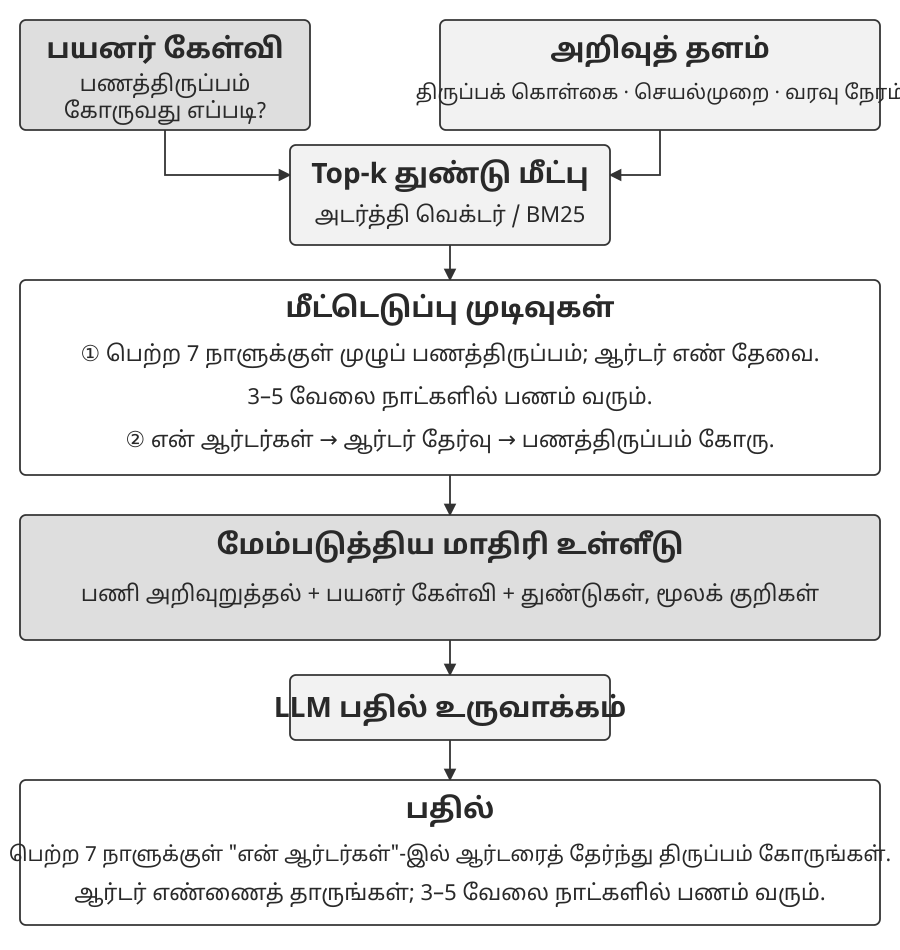

### ஆவணத் துண்டாக்கம் (Chunking)

ஒரு விற்பனைக்குப் பிந்தைய சேவைக் கையேடு முதலில் "ஏழு நாட்களுக்குள் திருப்பிப் பெறலாம்" என்று கூறி, அடுத்த பத்தியில் விதிவிலக்கான பொருட்களை விளக்குகிறது என்று வைத்துக்கொள்வோம். முதல் வாக்கியத்தை மட்டும் மீட்டெடுத்தால், விதிவிலக்கான பொருட்களுக்கும் திருப்பித் தருவதாக வாக்குறுதி அளித்துவிடலாம்; முழுக் கையேட்டையும் ஒரே மீட்டெடுப்பு அலகாகக் கொண்டால், நிறுவல், உள்ளமைவு, கோளாறு கண்டறிதல் ஆகியவையும் சேர்ந்து வந்து, பணத்திருப்பத் தலைப்பை வெக்டர் தெளிவாகக் காட்ட முடியாமல் போகும். **துண்டாக்கம் (chunking)** இந்த இரு முனைகளுக்கு இடையே அளவைத் தேர்ந்தெடுக்க வேண்டும்; ஒரு துண்டு உரை தன் நிபந்தனைகளை விளக்கப் போதுமானதாகவும், குறிப்பிட்ட கேள்விகளால் எளிதில் கண்டுபிடிக்கக்கூடியதாகவும் இருக்க வேண்டும். துண்டின் நீளம் உட்பொதிவு மாதிரியின் உள்ளீட்டு ஒதுக்கீட்டையும் பூர்த்தி செய்து, அடுத்தடுத்த உருவாக்கத்துக்குச் சூழல் இடத்தையும் ஒதுக்க வேண்டும்.

பொதுவான மூன்று முறைகள் உள்ளன.

**நிலையான அளவு வெட்டுதல்** token எண்ணிக்கையின்படி பிரிக்கிறது; எடுத்துக்காட்டாக ஒவ்வொரு துண்டும் 512 token, அடுத்தடுத்த துண்டுகள் 50–100 token ஒன்றுடன் ஒன்று மேற்பொருந்தும். மேற்பொருந்தல், எல்லைக்கு அருகிலுள்ள உள்ளடக்கம் முழுமையாக அடுத்த துண்டில் தோன்ற வாய்ப்பளிக்கிறது. இந்த முறை துண்டின் நீளத்தைக் கட்டுப்படுத்த எளிது; ஆனால் வெட்டும் இடம் பத்தி, குறியீடு, அல்லது அட்டவணைக்குள் விழக்கூடும்.

**மீள்செயல் அல்லது கட்டமைப்பு உணர்வு வெட்டுதல்** அத்தியாயம், பத்தி போன்ற இயற்கை எல்லைகளின் வழியே பிரிக்க முன்னுரிமை கொடுத்து, மிக நீண்ட பகுதிகளை வாக்கியம் போன்ற சிறிய அலகுகளாகப் பிரிக்கிறது. Markdown தலைப்புகளும் HTML உறுப்புகளும் கட்டமைப்புத் துப்புகளை வழங்கலாம். குறியீட்டுத் தொகுதிகள், அட்டவணைகள், தலைப்புடன் தொடர்புடைய உரை ஆகியவற்றுக்குச் சிறப்புக் கையாளும் விதிகளையும் பயன்படுத்தலாம். கட்டமைப்பு தெளிவாக உள்ள தொழில்நுட்ப ஆவணங்களுக்கு இந்த முறையிலிருந்து தொடங்கப் பரிந்துரைக்கிறேன்: ஏற்கனவே உள்ள அத்தியாயங்களையும் பத்திகளையும் பயன்படுத்தி, மிக நீண்ட பகுதிகளை மட்டும் மேலும் பிரிப்பது, பொதுவாக நேரடியாக வெட்டுவதை விட முழுப் பொருளைத் தக்கவைக்க உதவுகிறது.

**பொருள் சார்ந்த வெட்டுதல்** அடுத்தடுத்த வாக்கியங்களின் அல்லது வாக்கியக் குழுக்களின் உட்பொதிவு ஒற்றுமையைக் கணக்கிட்டு, தலைப்பு தெளிவாக மாறும் இடத்தில் வெட்டுகிறது. இது உட்பொதிவுக் கணக்கீட்டைக் கூட்டுகிறது; ஆனால் ஒரே தலைப்பை ஒரே துண்டில் வைத்திருக்க வாய்ப்பளிக்கிறது.

மீட்டெடுப்பி ஒரே வாக்கியத்தை மட்டும் திருப்பித் தந்தது என்று வைத்துக்கொள்வோம்: "நிறுவனத்தின் வருவாய் 3% வளர்ந்தது." எந்த நிறுவனம்? எந்தக் காலாண்டு? எண் சரியாகக் கிடைத்தது; ஆனால் பதிலளிப்பதற்கான அடிப்படை முந்தைய பத்தியில் உள்ளது. முழு நிதி அறிக்கையையும் ஒரே துண்டில் வைத்தால், காலாண்டும் நிறுவனப் பெயரும் தக்கவைக்கப்படும்; ஆனால் வருவாயை வினவும்போது பணியாளர் தேர்வு, உபகரணக் கொள்முதல் பத்திகளும் சேர்ந்து வரும். இந்த உள்ளடக்கமும் ஒரே வெக்டரைப் பங்கிட வேண்டியிருப்பதால், வருவாய் என்ற தலைப்பு வெக்டரில் அவ்வளவு தெளிவாக இருக்காமல் போகலாம். உண்மையில் துண்டு அளவைத் தேர்ந்தெடுக்கும்போது, ஒவ்வொரு துண்டும் 256–1024 token, அடுத்தடுத்த துண்டுகள் 10%–20% மேற்பொருந்துதல் என்ற நிலையிலிருந்து சோதிக்கத் தொடங்கலாம்.

தலைப்பு, மூலம், நேரம் போன்ற மீத்தரவைத் துண்டுடன் சேர்த்துச் சேமிக்கலாம். பின்னர் வரும் சூழல் விழிப்புணர்வு மீட்டெடுப்பு, ஒவ்வொரு துண்டுக்கும் மூல உரையில் அதன் பின்னணியை மேலும் சேர்த்து, தனித்த மீட்டெடுப்பின்போது சுட்டிகளையும் (pronoun) வரம்புகளையும் பிரித்தறிய உதவும்.

### அடர்த்தியான உட்பொதிவு: வெக்டர் கொண்டு உரையை வெளிப்படுத்துதல்

**உட்பொதிவு (embedding)** சொல், வாக்கியம் அல்லது உரைத் துண்டை எண் வெக்டராக மாற்றுகிறது; எடுத்துக்காட்டாக `[0.2, -0.5, 0.8, ...]`. தேடல் மாதிரி, தொடர்புடைய வினவலும் ஆவணமும் வெக்டர் வெளியில் அதிக ஒற்றுமையைக் கொண்டிருக்கும்படி பயிற்றுவிக்கப்படுகிறது. "அடர்த்தியான" (dense) என்பதன் பொருள், வெக்டரின் பெரும்பாலான பரிமாணங்களில் பூஜ்யமற்ற மதிப்புகள் இருந்து, அவை சேர்ந்து உரையின் தகவலை வெளிப்படுத்துகின்றன; பின்னர் வரும் நீர்த்த (sparse) வெளிப்பாட்டில் சில பரிமாணங்கள் மட்டுமே பூஜ்யமற்றவை.

வெக்டர் வெளியை ஒரு உயர் பரிமாண வரைபடமாகக் கற்பனை செய்யலாம்: ஒவ்வொரு உரைத் துண்டும் ஒரு இருப்பிடத்துக்கு உரியது; தேடல் என்பது வினவலுக்கு நெருக்கமான உள்ளடக்கத்தை அதில் கண்டுபிடிப்பது. பொதுவான அளவீடுகளில் ஒன்று **கோசைன் ஒற்றுமை**:

$$
\operatorname{cos}(A,B)=\frac{A\cdot B}{\|A\|\,\|B\|}
$$

புள்ளிப் பெருக்கல் $A\cdot B$ தொடர்புடைய பரிமாணங்களைப் பெருக்கிக் கூட்டுகிறது; அளவு $\|A\|$ என்பது பரிமாணங்களின் வர்க்கங்களின் கூட்டுத்தொகையின் வர்க்கமூலம். இரு அளவுகளாலும் வகுத்த பிறகு, முடிவு திசை உறவை மட்டும் காட்டுகிறது. பூஜ்யமற்ற வெக்டர்களுக்குக் கோசைன் மதிப்பு $[-1,1]$ எல்லைக்குள் இருக்கும்; 1-க்கு நெருக்கமாக இருந்தால், திசை மிகவும் ஒத்தது. வெவ்வேறு தேடல் மாதிரிகள் புள்ளிப் பெருக்கலையோ யூக்ளிடியன் தூரத்தையோ பயன்படுத்தலாம். இரு வெக்டர்களும் அலகு நீளத்துக்கு இயல்பாக்கப்பட்டிருந்தால், புள்ளிப் பெருக்கலே கோசைன் ஒற்றுமைக்குச் சமம்.

> **கைக்கணக்கு: மூன்று வாக்கியங்களின் கோசைன் ஒற்றுமை**
>
> "பூனையை எவ்வாறு வளர்ப்பது" $A=(0.9,0.5,0.1)$, "பூனை வளர்ப்பு வழிகாட்டி" $B=(0.8,0.6,0.1)$, "பங்கு முதலீட்டு உத்தி" $C=(0.1,0.1,0.9)$ ஆகியவற்றை மூன்று விளக்க வெக்டர்களால் குறிப்போம்.
>
> $A\cdot B=0.9\times0.8+0.5\times0.6+0.1\times0.1=1.03$. இரண்டின் அளவுகள் முறையே $\sqrt{1.07}$, $\sqrt{1.01}$; ஒற்றுமை சுமார் **0.991**.
>
> $A\cdot C=0.9\times0.1+0.5\times0.1+0.1\times0.9=0.23$; $C$-இன் அளவு $\sqrt{0.83}$; ஒற்றுமை சுமார் **0.244**. இந்த வெக்டர் தொகுப்பில், பூனை வளர்ப்பு வினவல் வளர்ப்பு வழிகாட்டிக்கே நெருக்கமாக உள்ளது.

உண்மையான மாதிரிகள் பொதுவாக நூற்றுக்கணக்கான முதல் ஆயிரத்துக்கும் மேற்பட்ட பரிமாணங்களைப் பயன்படுத்துகின்றன.

#### Word2Vec-இலிருந்து சூழல் விழிப்புணர்வு வரை

படம் 3-6 நிலையான சொல் வெக்டர்களிலிருந்து தொடங்குகிறது. **Word2Vec** சொற்கள் ஒருசேரத் தோன்றும் அடிப்படையில் ஒவ்வொரு சொல்லுக்கும் நிலையான வெக்டரைக் கற்றுக்கொள்கிறது. சில உறவுகளை வெக்டர் கணக்கீட்டில் வெளிப்படுத்த முடிகிறது; எடுத்துக்காட்டாகப் புகழ்பெற்ற "அரசன் − ஆண் + பெண் ≈ அரசி". நிலையான வெளிப்பாட்டின் வரம்பும் நேரடியானது: `river bank` (ஆற்றங்கரை), `investment bank` (முதலீட்டு வங்கி) ஆகியவற்றில் `bank`-க்கு ஒரே சொல் வெக்டர் பயன்படுகிறது.

**GloVe** முழுக் களஞ்சியத்திலிருந்து சொற்களுக்கு இடையிலான ஒருசேரத் தோன்றல் எண்ணிக்கையைக் கணக்கிட்டு, எடையிட்ட சிறும வர்க்க இலக்கின் (weighted least squares) வழியாகச் சொல் வெக்டர்களைக் கற்றுக்கொள்கிறது. Word2Vec உள்ளூர் சாளரத்தில் முன்கணிப்புப் பணிகளுக்கு முக்கியத்துவம் அளிக்கிறது; GloVe முழுமையான ஒருசேரத் தோன்றல் புள்ளிவிவரத்தை நேரடியாகப் பயிற்சியில் சேர்க்கிறது; இரண்டும் சொற்களுக்கு நிலையான வெளிப்பாட்டைக் கற்றுத்தருகின்றன[^ch3-glove].

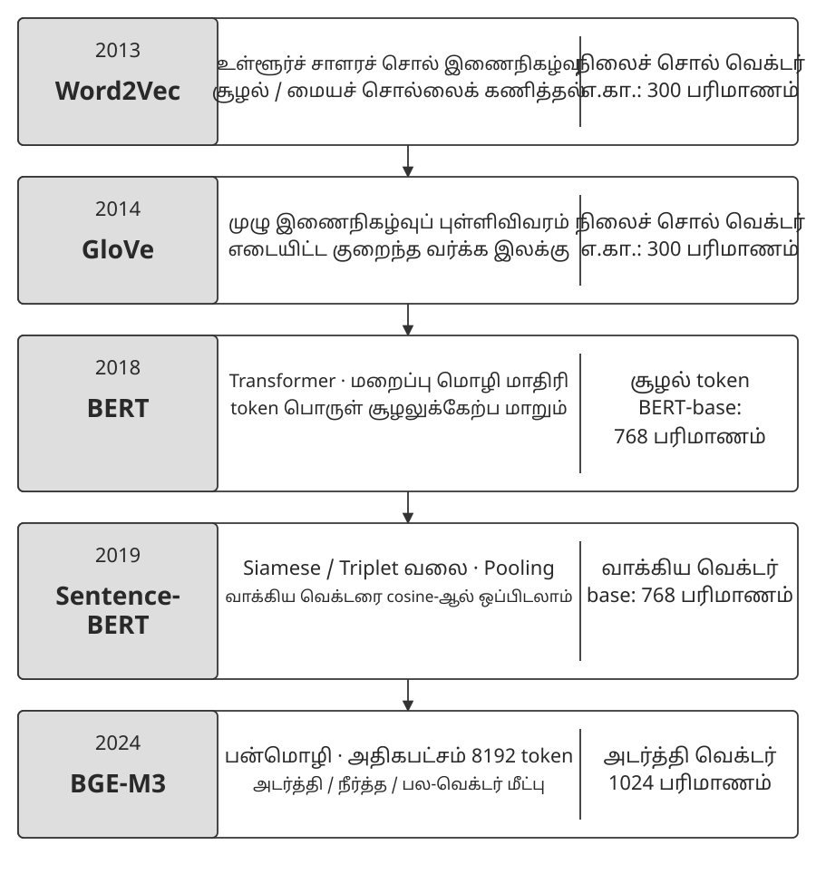

**BERT** போன்ற சூழல் மாதிரிகளுக்கு வரும்போது, ஒரே சொல் அலகின் வெளிப்பாடு வாக்கியத்துக்கேற்ப மாறுகிறது. சுய-கவனத்தின் உதவியுடன், "புதிய தயாரிப்பை வெளியிட்டது", "இருபது பழம் வாங்கினார்" போன்ற துப்புகளின் அடிப்படையில், இரு வாக்கியங்களில் உள்ள "ஆப்பிள்" என்ற சொல்லுக்கு வெவ்வேறு வெளிப்பாட்டை மாதிரி கணக்கிடலாம். தேடலுக்குப் பயன்படும் உட்பொதிவு மாதிரிகள் சொல் அலகு வெளிப்பாடுகளை வினவல் அல்லது ஆவண வெக்டராகத் தொகுத்து, அவற்றை ஒப்பிடக்கூடியதாக்கப் பயிற்றுவிக்க வேண்டும்.

**Sentence-BERT** BERT-ஐ குவித்தல் (pooling), இரட்டை அல்லது மூன்று வலைய அமைப்புகளுடன் இணைத்து, நேரடியாக ஒப்பிடக்கூடிய வாக்கிய வெக்டர்களைப் பயிற்றுவிக்கிறது. ஆவணங்களை முன்கூட்டியே குறியாக்கி சுட்டியில் சேமிக்கலாம்; வினவல் வரும்போது வினவலை மட்டும் குறியாக்கி, வெக்டர் ஒற்றுமையைக் கணக்கிட்டால் போதும். முன்கூட்டிய குறியாக்கம், ஒவ்வொரு வினவலிலும் எல்லா ஆவண வெளிப்பாடுகளையும் மீண்டும் கணக்கிடும் செலவைத் தவிர்க்கிறது[^ch3-sbert].

**BGE-M3** அடர்த்தியான, நீர்த்த, பல வெக்டர் மீட்டெடுப்பு வெளிப்பாடுகளை ஒருசேர வழங்குகிறது; பல மொழிகளையும் ஒப்பீட்டளவில் நீண்ட உள்ளீட்டையும் ஆதரிக்கிறது; இந்தப் பகுதி அதிலுள்ள அடர்த்தியான வெளிப்பாட்டைக் கொண்டு ஒற்றை வெக்டர் மீட்டெடுப்பை விளக்குகிறது[^ch3-bge-m3]. மாதிரி ஏற்கக்கூடிய நீளம் துண்டாக்கத் திட்டத்தைப் பாதிக்கிறது: அசல் BERT-இன் வழக்கமான உச்சவரம்பு 512 token; BGE-M3 8192 token வரை ஆதரிக்கிறது.

[^ch3-bge-m3]: Chen மற்றும் பலரின் M3-Embedding ஆய்வுக் கட்டுரை (arXiv:2402.03216) மூன்று மீட்டெடுப்பு வெளிப்பாடுகள் எவ்வாறு ஒருசேரப் பயிற்றுவிக்கப்படுகின்றன என்பதை அறிமுகப்படுத்துகிறது. வெளிப்பாட்டு முறைகள், பரிமாணங்கள், உள்ளீட்டு நீளம், பயன்பாட்டு முறைகள் உட்பட BAAI-இன் BGE-M3 மாதிரி விளக்கத்தையும் பார்க்கவும்.

> **சோதனை 3-4 ★★: இரு தோராய அண்மை அண்டைச் சுட்டுகளை ஒப்பிடுதல்**
>
> ஆவண வெக்டர்களை உருவாக்கிய பிறகு, வினவலுக்கு நெருக்கமான வெக்டர்களை விரைவாகக் கண்டுபிடிக்க வேண்டும். ஒவ்வொன்றாகக் கணக்கிட்டால் துல்லியமான அண்டை வெக்டர்கள் கிடைக்கும்; தரவின் அளவு பெருகிய பிறகு, **தோராய அண்மை அண்டை** (Approximate Nearest Neighbor, ANN) சுட்டு, கட்டுப்படுத்தக்கூடிய நினைவுகூரல் இழப்புக்கு ஈடாக வினவல் வேகத்தைப் பெறுகிறது. இந்தச் சோதனை அதே உண்மையான உட்பொதிவுகளின் தொகுப்பிலும் அதே வினவல்களிலும் ANNOY-ஐயும் HNSW-ஐயும் ஒப்பிட்டு, துல்லியமான தேடல் முடிவுகளைப் படிநிலையாகப் (baseline) பயன்படுத்துகிறது. எடுத்துக்காட்டாக, ஒரு வினவலின் துல்லியமான தேடல் பத்து அண்மை அண்டைகளைப் பட்டியலிட்டது; தோராயச் சுட்டுத் திருப்பித் தந்த பத்து முடிவுகளில் அவற்றில் எட்டு இருந்தால், அந்த வினவலின் Recall@10 = 0.8. இந்த எண், சுட்டு எவ்வளவு துல்லியமான அண்டை முடிவுகளைத் தக்கவைத்தது என்பதை அளவிடுகிறது.
>
> ANNOY பல சீரற்ற வீழல் (random projection) மரங்களைக் கொண்டு வேட்பு எல்லையைச் சுருக்குகிறது; HNSW அடுக்கு அண்மை வரைபடத்தைப் பயன்படுத்தி, முதலில் நீர்த்த உயர் அடுக்குகளில் இலக்குப் பகுதியை விரைவாக நெருங்கி, பின்னர் அடர்த்தியான தாழ் அடுக்குகளில் தேடலுக்குள் நுழைகிறது. HNSW-இன் அடுக்குக் கட்டமைப்பைப் படம் 3-7 காட்டுகிறது.
>
> 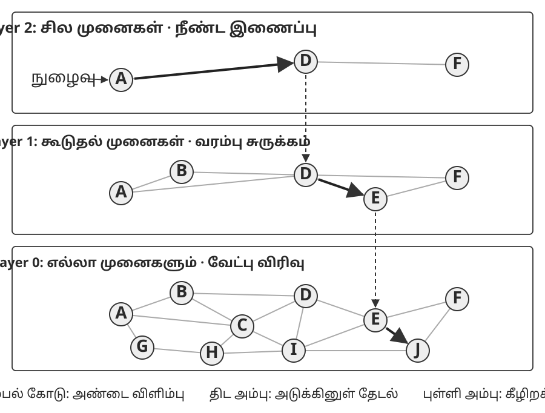
>
> அட்டவணை 3-2 ANNOY, HNSW செயலாக்கத் தேர்வுகள்
>
> | ஒப்பீட்டு அம்சம் | ANNOY | HNSW (hnswlib எடுத்துக்காட்டாக) |
> | --- | --- | --- |
> | சுட்டுக் கட்டமைப்பு | பல சீரற்ற வீழல் மரங்கள் | அடுக்கு அண்மை வரைபடம் |
> | கட்டமைப்புச் செலவு | மரங்களின் எண்ணிக்கை, வெக்டர் எண்ணிக்கை, பரிமாணம் ஆகியவற்றுக்கேற்ப மாறும் | அண்டை அளவு, கட்டமைப்புத் தேடல் எல்லை, தரவு அளவு ஆகியவற்றுக்கேற்ப மாறும் |
> | நினைவகமும் கோப்பும் | நிலையான சுட்டு நினைவக வரைபடம் (memory map) மற்றும் பல செயல்முறைப் பங்கீட்டை ஆதரிக்கிறது | வெக்டர்களையும் வரைபட அண்டை உறவுகளையும் சேமிக்கிறது; அண்டை அளவு செலவைப் பாதிக்கிறது |
> | அதிகரிப்பு புதுப்பிப்பு | சுட்டு கட்டப்பட்ட பிறகு புதிய உருப்படிகளைச் சேர்த்தால் மீண்டும் கட்ட வேண்டும் | புதிய சேர்ப்பு, புதுப்பிப்பு, நீக்கக் குறியிடுதலை ஆதரிக்கிறது; கொள்ளளவை நிர்வகிக்க வேண்டும் |
> | நினைவுகூரலும் வேகமும் | மரங்களின் எண்ணிக்கை, வினவல் தேடல் ஒதுக்கீடு ஆகியவற்றால் சரிசெய்யலாம் | கட்டமைப்பு அளவுருக்கள், வினவல் தேடல் எல்லை ஆகியவற்றால் சரிசெய்யலாம் |
> | பயன்பாட்டுச் சூழல் | பகிரவும் வழங்கவும் எளிய நிலையான சுட்டு | தொடர்ந்து எழுதிப் பின்னர் வினவும் மாறும் சுட்டு |
>
> இந்த இயக்கத்தில் முதலில் 240 உரைத் துண்டுகளைக் கொண்டு தரவுத்தளம் கட்டப்பட்டது. அதே 20 வினவல்களுக்கு, இரு சுட்டுகளும் துல்லியத் தேடலில் கிடைத்த முதல் 10 அண்டைகளை முழுமையாகக் கண்டுபிடித்தன. முதல் தரவுத்தளத்தில், Linux கொள்கலத்தில் ANNOY கட்டமைக்க சுமார் 13 மில்லி வினாடிகளும், இந்தக் கணினிச் சூழலில் HNSW சுமார் 78 மில்லி வினாடிகளும் எடுத்தன; சேமிக்கப்பட்ட சுட்டுகள் முறையே சுமார் 1.40 MB, 1.02 MB. மீதமுள்ள 60 துண்டுகளைச் சேர்த்தபோது, ANNOY சுட்டை மீண்டும் கட்டியது; HNSW புதிய வெக்டர்களை நேரடியாகச் செருகியது. இப்போது தரவுத்தளத்தில் மொத்தம் 300 துண்டுகள் உள்ளன; முந்தைய அண்டைகளும் மாறியிருக்கலாம். புதிய தரவுத்தளத்தில் துல்லியத் தேடலை மீண்டும் செய்த பிறகு, இரு சுட்டுகளின் சராசரி நினைவுகூரல் விகிதம் இன்னும் 100% ஆகவே இருந்தது.

[^ch3-ann]: Spotify-இன் Annoy திட்ட விளக்கம், படிக்க-மட்டும் சுட்டை எவ்வாறு கட்டமைப்பது, நினைவக வரைபடத்தால் ஏற்றுவது, வினவலின்போது சரிபார்க்கப்படும் கணுக்களின் எண்ணிக்கையை `search_k` கொண்டு சரிசெய்வது ஆகியவற்றை விளக்குகிறது. hnswlib திட்ட விளக்கத்தின் Python இடைமுகப் பகுதி, வெக்டர்களைச் சேர்க்கும் `add_items` முறையையும் வினவல் எல்லையைச் சரிசெய்யும் `set_ef` முறையையும் தருகிறது.

**சுட்டை அறிவு புதுப்பிக்கப்படும் முறைக்கேற்பத் தேர்ந்தெடுக்க வேண்டும்.** களஞ்சியம் வழக்கமாக முழுமையாக வெளியிடப்பட்டு, பல செயல்முறைகள் ஒரே படிக்க-மட்டும் சுட்டைப் பங்கிடும் சூழலில், முதலில் ANNOY-ஐப் பரிசீலிப்பேன்; தொடர்ந்து புதிய ஆவணங்கள் வந்து, சுட்டு இயங்கிக்கொண்டிருக்கும்போதே செருக வேண்டியிருந்தால், HNSW-க்கு முன்னுரிமை கொடுப்பேன். உட்பொதிவு மாதிரி பொருள் வெளிப்பாட்டைத் தீர்மானிக்கிறது; சுட்டு அந்த வெளிப்பாடுகளைப் பொருத்தமான தாமதத்திலும் புதுப்பிப்புச் செலவிலும் பயன்படுத்த முடியுமா என்பதைத் தீர்மானிக்கிறது; இரண்டும் சேர்ந்து மீட்டெடுப்புச் சேவையின் பலனைத் தீர்மானிக்கின்றன.

ANNOY-இன் மர எண்ணிக்கையையும் தேடல் ஒதுக்கீட்டையும், அல்லது HNSW-இன் அண்டை அளவையும் தேடல் எல்லையையும் சரிசெய்து, நினைவுகூரலும் தாமதமும் எவ்வாறு மாறுகின்றன என்று அவதானிக்கலாம்[^ch3-ann]. சுட்டு நினைவுகூரல், இலக்கு அண்டைகள் கண்டுபிடிக்கப்பட்டனவா என்பதை அளவிடுகிறது; அந்த அண்டைகள் பயனரின் கேள்விக்குப் பதிலளிக்குமா என்பது உட்பொதிவு வெளிப்பாட்டையும் பொருளின் உள்ளடக்கத்தையும் பொறுத்தது.

### நீர்த்த வெளிப்பாடு: முக்கியச் சொல்லிலிருந்து தொடர்பு மதிப்பெண் வரை

**நீர்த்த வெளிப்பாடு** உயர் பரிமாண வெக்டரைப் பயன்படுத்துகிறது; அவற்றில் சில பரிமாணங்கள் மட்டுமே பூஜ்யமற்றவை. மரபுவழி முக்கியச் சொல் தேடல் சொற்களைப் பரிமாணங்களாகக் கொண்டு, ஆவணத்தில் தோன்றும் சொற்களுக்கு எடை வழங்குகிறது. இதன் அடிப்படை **சொல் கூடை மாதிரி** (Bag of Words, BoW): சொற்களையும் அவற்றின் தோன்றும் எண்ணிக்கையையும் சேமித்து, வரிசையைப் புறக்கணிக்கிறது. எனவே "பூனை நாயைத் துரத்தியது", "நாய் பூனையைத் துரத்தியது" ஆகியவற்றுக்கு ஒரே சொல் கூடை வெளிப்பாடு கிடைக்கும்.

இந்த வெளிப்பாடு பெயர்கள், எண்கள், தொழில்நுட்பச் சொற்களைப் பொருத்த ஏற்றது. கீழே TF-IDF-இலிருந்து தொடங்கி, சொல் அலைவெண்ணும் ஆவண அலைவெண்ணும் எவ்வாறு வரிசைப்படுத்தும் மதிப்பெண்ணாக மாறுகின்றன என்பதை விளக்குகிறோம்.

#### TF-IDF-இலிருந்து BM25 வரை

**TF-IDF** (Term Frequency–Inverse Document Frequency, சொல் அலைவெண்—தலைகீழ் ஆவண அலைவெண்) இரு சமிக்ஞைகளை இணைக்கிறது: சொல் தற்போதைய ஆவணத்தில் எத்தனை முறை தோன்றுகிறது, மற்றும் அது முழுக் களஞ்சியத்தில் எவ்வளவு பொதுவானது. 100 கட்டுரைகளில் 60-இல் "மாதிரி" என்ற சொல்லும், 3-இல் மட்டும் "வடித்தல்" என்ற சொல்லும் இருந்தால், "மாதிரி வடித்தல்" என்ற வினவலில் "வடித்தல்" அதிக வேறுபடுத்தும் வலிமை கொண்டது.

ஒரு அடிப்படை எழுத்து முறை:

$$\operatorname{TF\!\text{-}\!IDF}(t,d)=\operatorname{TF}(t,d)\times\operatorname{IDF}(t),\qquad \operatorname{IDF}(t)=\ln\frac{N}{\operatorname{DF}(t)}$$

$\operatorname{TF}(t,d)$ என்பது $d$ ஆவணத்தில் $t$ சொல் தோன்றும் எண்ணிக்கை; $\operatorname{DF}(t)$ என்பது அந்தச் சொல் உள்ள ஆவணங்களின் எண்ணிக்கை; $N$ மொத்த ஆவணங்களின் எண்ணிக்கை. இந்தச் சூத்திரப்படி, ஒரு சொல் பத்து முறை தோன்றினால் அதன் பங்களிப்பு ஐந்து முறை தோன்றியதை விட இரு மடங்கு; நீண்ட ஆவணங்களும் வெறுமனே அதிக சொற்கள் இருப்பதால் அதிக மதிப்பெண் பெறலாம். TF-IDF-க்குப் பல இயல்பாக்கல் வடிவங்கள் உள்ளன; கீழே உள்ள BM25 சொல் அலைவெண் நிறைவையும் நீள இயல்பாக்கலையும் கொண்டு இந்த இரு தாக்கங்களையும் கையாள்கிறது.

**BM25** ஒவ்வொரு வினவல் சொல்லின் பங்களிப்பையும் கூட்டுகிறது:

$$\operatorname{Score}(Q,D)=\sum_i\operatorname{IDF}_{\mathrm{BM25}}(q_i)\cdot\frac{\operatorname{TF}(q_i,D)(k_1+1)}{\operatorname{TF}(q_i,D)+k_1\left(1-b+b\frac{|D|}{\operatorname{avgdl}}\right)}$$

இதில் $q_i$ வினவல் சொல்; $|D|$ ஆவணத்தின் நீளம்; $\operatorname{avgdl}$ சராசரி ஆவண நீளம். $k_1$ சொல் அலைவெண்ணின் நிறைவு அளவைக் கட்டுப்படுத்துகிறது; $b$ நீள இயல்பாக்கலின் வலிமையைக் கட்டுப்படுத்துகிறது; 0 எனில் அந்தத் திருத்தம் அணைக்கப்படும். படம் 3-8 இந்த உறுப்புகளைத் தனித்தனியாகக் கணக்கிடுகிறது. முதலில் ஆவண நீளத்தை நிலையாக வைத்து, வினவல் சொல் ஒரு முறையிலிருந்து மூன்று முறை வரை அதிகரிக்கும்போது, ஒவ்வொரு கூடுதல் தோற்றமும் எவ்வளவு மதிப்பெண் தருகிறது என்பதைப் பாருங்கள்; பின்னர் சொல் அலைவெண்ணை நிலையாக வைத்து, ஆவண நீளத்தை மட்டும் இரு மடங்காக்குங்கள். கடைசி வரிசை, ஆவணத் தொகுப்பில் இரு சொற்களும் எவ்வளவு பொதுவானவை என்பதை ஒப்பிடுகிறது.

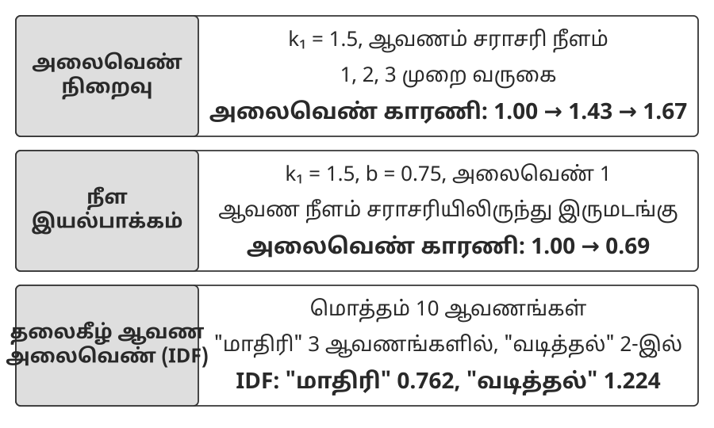

படத்தின் முதல் வரிசையில், இரண்டாம் தோற்றம் சொல் அலைவெண் காரணியை சுமார் 0.43 அதிகரிக்கிறது; மூன்றாம் தோற்றம் சுமார் 0.24 மட்டுமே அதிகரிக்கிறது; இதுவே சொல் அலைவெண் நிறைவு. இரண்டாம் வரிசையில், ஒரே சொல் ஒருமுறை மட்டும் தோன்றினாலும், நீண்ட ஆவணத்தில் அது குறைவாகத் தனித்துத் தெரிகிறது; நீளத் திருத்தம் அதன் சொல் அலைவெண் காரணியைக் குறைக்கிறது. இதை IDF-ஆல் பெருக்கிய பிறகே அந்தச் சொல்லின் மொத்தப் பங்களிப்பு கிடைக்கும்.

மேலே உள்ள சூத்திரத்தில் இன்னொன்றையும் தீர்மானிக்க வேண்டும்: மூன்று முறை தோன்றினாலும், அரிதான சொல் ஏன் பொதுவான சொல்லை விடப் பெரும்பாலும் பயனுள்ளதாக இருக்கிறது? இந்தப் பகுதி கீழே உள்ள தலைகீழ் ஆவண அலைவெண்ணைக் கொண்டு சொற்களுக்கு எடை வழங்குகிறது:

$$\operatorname{IDF}_{\mathrm{BM25}}(t)=\ln\frac{N-\operatorname{DF}(t)+0.5}{\operatorname{DF}(t)+0.5}$$

தொகுதி அந்தச் சொல் இல்லாத ஆவணங்களின் எண்ணிக்கையையும், பகுதி அந்தச் சொல் உள்ள ஆவணங்களின் எண்ணிக்கையையும் குறிக்கிறது; இரண்டுக்கும் 0.5 சேர்த்து மென்மையாக்குவதால், ஆவண அலைவெண் 0 அல்லது $N$ ஆக இருந்தாலும் கணக்கிட முடிகிறது. அரிதான சொற்களுக்கு அதிக எடை கிடைக்கிறது; பாதிக்கும் மேற்பட்ட ஆவணங்களில் அந்தச் சொல் இருந்தால், இந்தச் சூத்திரம் எதிர்மறை மதிப்பைத் தரும். துணைச் செயலாக்கம் உண்மையான மதிப்பெண் எடையின் கீழ் வரம்பை $10^{-6}$ ஆக அமைத்து, அதே நேரத்தில் சரிபார்ப்புக்காக அசல் மதிப்பையும் தக்கவைக்கிறது.

> **சோதனை 3-5 ★★: பூஜ்யத்திலிருந்து BM25 தேடுபொறியை உருவாக்குதல்**
>
> இந்தச் சோதனை சொல் பிரிப்பு, நிறுத்தச் சொல் கையாளுதல், தலைகீழ்ச் சுட்டு, மதிப்பெண் வழங்கல் ஆகியவற்றை வரிசையாகச் செய்கிறது. நிறுத்தச் சொல் கையாளுதல் "的", "了" போன்ற அதிக அலைவெண் சொற்களை வடிகட்டும். **தலைகீழ்ச் சுட்டு** ஒவ்வொரு சொல்லும் எந்தெந்த ஆவணங்களில் தோன்றுகிறது, அந்தந்த அலைவெண் என்ன என்பதைப் பதிவு செய்கிறது; புத்தகத்தின் இறுதியில் உள்ள சொற்களஞ்சியச் சுட்டைப் போல, "TCP" என்று தேடினால் 45, 112, 203 பக்கங்கள் கிடைத்து, அந்த இடங்களின் உள்ளடக்கத்தைப் படிக்கலாம்.
>
> "மாதிரி வடித்தல்" என்ற வினவலைக் கைமுறையாகக் கணக்கிடுவோம். களஞ்சியத்தில் 10 ஆவணங்கள், சராசரி நீளம் 250 சொற்கள், $k_1=1.5$, $b=0.75$. "மாதிரி" 3 ஆவணங்களில் உள்ளது; IDF சுமார் 0.762. "வடித்தல்" 2 ஆவணங்களில் உள்ளது; IDF சுமார் 1.224. கீழே உள்ள அட்டவணை சொல்வாரியாகப் பொருந்திய ஆவணங்கள், சொல் அலைவெண், ஆவண நீளம் ஆகியவற்றைப் பட்டியலிடுகிறது. இந்த மதிப்புகளைச் சூத்திரத்தில் இட்டால், ஒவ்வொரு சொல்லின் பங்களிப்பையும் கணக்கிடலாம்.
>
> | வினவல் சொல் | ஆவணம் | சொல் அலைவெண் TF | ஆவண நீளம் | BM25 பங்களிப்பு |
> | --- | --- | ---: | ---: | ---: |
> | மாதிரி | doc_1 | 5 | 200 | 1.52 |
> | மாதிரி | doc_3 | 2 | 500 | 0.82 |
> | மாதிரி | doc_7 | 8 | 150 | 1.68 |
> | வடித்தல் | doc_1 | 3 | 200 | 2.15 |
> | வடித்தல் | doc_5 | 1 | 250 | 1.22 |
>
> doc_1-இல் இரு சொற்களின் பங்களிப்புகளும் சேர்ந்து சுமார் 3.67 ஆகும்; வரிசை **doc_1 (3.67) > doc_7 (1.68) > doc_5 (1.22) > doc_3 (0.82)**. doc_1-இல் "வடித்தல்" என்ற சொல்லின் அலைவெண் "மாதிரி"யை விடக் குறைவு; ஆனால் அது அரிதானது என்பதால் இறுதிப் பங்களிப்பு அதிகம்; இரு சொற்களும் பொருந்துவது மொத்த மதிப்பெண்ணை மேலும் உயர்த்துகிறது.
>
> இப்போது `cat` என்ற சொல்லைக் கொண்டு துணைச் சோதனையின் ஆங்கிலக் களஞ்சியத்தில் தேடுங்கள். தொடர்புடையதாகக் குறிக்கப்பட்ட இரு சிறு கட்டுரைகளும் முறையே `kitten`, `feline` என்ற சொற்களைப் பயன்படுத்தியிருந்தன; தலைகீழ்ச் சுட்டில் `cat` கிடைக்கவில்லை; வேட்பு பட்டியல் காலியாக உள்ளது. முந்தைய சொல் அலைவெண் எடையை எவ்வளவு உயர்த்தினாலும், மதிப்பெண் வழங்க ஒரு ஆவணமும் இல்லை. அந்த இரு கட்டுரைகளில் உள்ள சொற்களைக் கொண்டு மீண்டும் தேடினால், ஒவ்வொன்றும் வேட்பு பட்டியலுக்குள் வருவதைக் காணலாம்.

### கலப்பு மீட்டெடுப்பு: இரு பாதை முடிவுகளை இணைத்து மறுவரிசைப்படுத்துதல்

சில கேள்விகளின் ஒத்த சொற்களை முன்கூட்டியே முழுமையாகப் பட்டியலிடுவது கடினம். சோதனை 3-6-இல் "பயன்படுத்தாத குவியல் நினைவகத்தைத் தானாக எவ்வாறு மீட்டெடுப்பது" என்ற கேள்வி இருந்தது; இலக்குக் கட்டுரையோ "தானியங்கி நினைவக மேலாண்மை, நிரலர்கள் பொருள்களைக் கைமுறையாக விடுவிக்கும் வேலையைத் தவிர்க்க உதவுகிறது" என்று எழுதப்பட்டிருந்தது. ஆங்கில வினவலுக்கும் கட்டுரைக்கும் பொதுவான சொல் எதுவும் இல்லை; முக்கியச் சொல் தேடல் ஒரு ஆவணத்தையும் மீட்டெடுக்கவில்லை; வெக்டர் தேடலோ இலக்கை முதல் இடத்தில் வைத்தது. மாடல் எண் XR-7003 வினவலுக்கு மாறினால், முக்கியச் சொல் தேடல் தொடர்புடைய மாடலை நேரடியாகக் கண்டுபிடித்தது; வெக்டர் தேடல் அருகிலுள்ள சில மாடல்களையும் பட்டியலிட்டது.

**கலப்பு மீட்டெடுப்பு** முதலில் முக்கியச் சொல் மற்றும் வெக்டர் முறைகளைக் கொண்டு தொடர்புடைய பத்திகளைத் தனித்தனியாகத் தேடி, பின்னர் எந்தப் பத்திகள் மாதிரிக்குக் கொடுக்கத் தகுந்தவை என்று தீர்மானிக்கிறது. அறிவுத் தளத்தில் துல்லியமான அடையாளங்களும் இயல்பு மொழி விளக்கங்களும் ஒருசேர இருந்தால், இதிலிருந்து தொடங்கப் பரிந்துரைக்கிறேன். படம் 3-9-இல் XR-7003-ஐப் பின்தொடருங்கள்: இரு பாதைகளும் அதை முதல் இடத்தில் வைத்தன; இணைக்கும்போது இரண்டு தரவரிசைப் பங்களிப்புகளும் கிடைத்தன. மறுவரிசைப்படுத்தல் இரண்டாம் இடத்தை மாற்றியது; ஆனால் பயனர் முதலில் பார்க்கும் மாடல் இன்னும் சரியானதே.

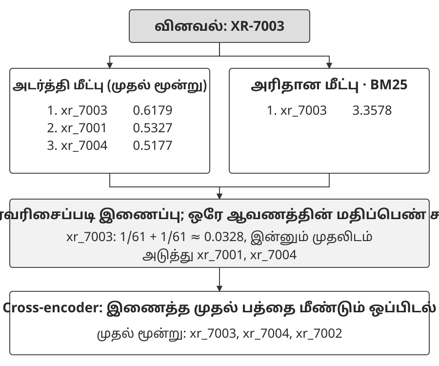

முதல் கட்டம் **இணையான மீட்டெடுப்பு**: வினவலை அடர்த்தியான, நீர்த்த இயந்திரங்களுக்கு அனுப்பி, ஒவ்வொன்றும் தொடர்புடையதாக இருக்கக்கூடிய ஆவணங்களின் தொகுதியை மீட்டெடுக்கிறது. இரு பாதைகளும் ஒரே மூல உரையைப் பயன்படுத்தலாம்; அல்லது ஒவ்வொரு மாதிரியின் தேவைக்கேற்ப முன்செயலாக்கலாம்.

இரண்டாம் கட்டம் **முடிவு இணைப்பு**: இரு பாதை முடிவுகளிலும் உள்ள ஒரே ஆவணத்தை ஒன்றிணைத்து, ஒருங்கிணைந்த தரவரிசையை உருவாக்குதல். கோசைன் ஒற்றுமையும் BM25-உம் வெவ்வேறு அளவுகோல்களைக் கொண்டவை; நேரடியாகக் கூட்டினால் அளவு பெரிய பாதை முடிவை ஆதிக்கம் செய்யக்கூடும். ஒரு வழி, முதலில் மதிப்பெண்களைச் சரிசெய்தோ இயல்பாக்கியோ, பின்னர் எடையிட்டுக் கூட்டுவது; மற்றொன்று **தலைகீழ் தரவரிசை இணைப்பு** (Reciprocal Rank Fusion, RRF), ஒவ்வொரு பாதையின் தரவரிசையின் அடிப்படையில் கணக்கிடுதல்:

$$\operatorname{RRF}(d)=\sum_{j:\,d\in R_j}\frac{1}{k+\operatorname{rank}_j(d)}$$

$R_j$ என்பது $j$-ஆம் பாதை முடிவு; தரவரிசை 1-இல் தொடங்குகிறது; ஒரு ஆவணம் ஏதேனும் பாதையில் இல்லாவிட்டால், அந்தப் பாதையின் பங்களிப்பு பூஜ்யம். மென்மையாக்கல் மாறிலி $k$ பொதுவாக 60; அது பெரிதாக இருந்தால், முதல் சில தரவரிசைகளுக்கு இடையிலான மதிப்பெண் வேறுபாடு குறைகிறது. RRF வெவ்வேறு மதிப்பெண் முறைகளை இணைக்க வசதி; ஆனால் தரவரிசையை மட்டுமே தக்கவைப்பதால், அசல் மதிப்பெண்களில் உள்ள வலிமை வேறுபாட்டை வேறு வழியில் பயன்படுத்த வேண்டும்.

இரு பாதை மீட்டெடுப்பு எடுத்துக்காட்டைக் கணக்கிட்டுப் பார்ப்போம். பயனர் "பணத்திருப்பம் எவ்வளவு நேரத்தில் வரும்" என்று கேட்கிறார்; ஆவணம் அ குறிச்சொல் தேடலில் முதல் இடத்திலும், வெக்டர் தேடலின் முன்னணியில் இல்லாமலும் உள்ளது; ஆவணம் ஆ இரு பாதைகளிலும் இரண்டாம் இடத்தில் உள்ளது. $k=60$ எடுத்தால், அ-க்கு $1/61$, சுமார் 0.0164; ஆ-க்கு $1/62+1/62$, சுமார் 0.0323. இணைத்த பிறகு ஆ அ-க்கு முன்னால் வருகிறது. இந்த முடிவு, இரு தேடல் பாதைகளும் ஆ-ஐக் கண்டுபிடித்தன என்பதை மட்டும் காட்டுகிறது. ஆ உண்மையில் பணம் வரும் நேரத்தைப் பதிலளிக்கிறதா என்பதைத் தீர்மானிக்க, அது "பணத்திருப்பத்துக்கு எவ்வாறு விண்ணப்பிப்பது" என்று எழுதப்பட்டுள்ளதா, "பணத்திருப்பம் எப்போது வரும்" என்று எழுதப்பட்டுள்ளதா என்று பார்க்க வேண்டும்.

மூன்றாம் கட்டத்தில் **நரம்பியல் மறுவரிசைப்படுத்தல்** சேர்க்கப்படலாம். இணைத்த பிறகு முன்னணியில் உள்ள ஆவணங்களை — எடுத்துக்காட்டாக முதல் 50 — அமைப்பு எடுத்து, மறுவரிசைப்படுத்தல் மாதிரி ஒவ்வொரு ஆவணத்தின் வினவலுடனான தொடர்புத் தரத்தை மதிப்பிடச் செய்கிறது. மறுவரிசைப்படுத்தல் இந்த 50-இன் வரிசையை மாற்ற முடியும். உண்மையில் பயனுள்ள ஆவணம் வேட்பில் சேர்க்கப்படவே இல்லாவிட்டால், மீண்டும் மேல்நிலைக்குச் சென்று மீட்டெடுப்பை மேம்படுத்த வேண்டும்.

இங்குப் பொதுவாகப் பயன்படும் மாதிரி **குறுக்கு-குறியாக்கி (cross-encoder)**: வினவலையும் வேட்பு ஆவணத்தையும் ஒருசேர உள்ளீடாகப் பெற்று, இரு பகுதிகளும் மாதிரிக்குள் இடைவினை புரிய வைத்துத் தொடர்பு மதிப்பெண்ணை வெளியிடுகிறது. மீட்டெடுப்புக் கட்டத்தின் **இரு-குறியாக்கி (bi-encoder)** வினவலையும் ஆவணத்தையும் தனித்தனியாகக் குறியாக்குகிறது; ஆவண வெக்டர்களை முன்கூட்டியே கணக்கிட முடியும்; வினவலின்போது வெக்டர் தேடல் மட்டும் தேவை. முன்னது குறைந்த ஆவணங்களை நுணுக்கமாக வரிசைப்படுத்த ஏற்றது; பின்னது ஏராளமான ஆவணங்களில் முதல் வடிகட்டலுக்கு ஏற்றது. சுயவிவரத் தேர்வுச் சுருக்கமும் (résumé screening) நேர்காணலும் போலக் கருதலாம்: முதலில் ஏற்கனவே உள்ள பண்புகளைக் கொண்டு எல்லையைச் சுருக்கி, பின்னர் குறிப்பிட்ட தேவைகளைச் சுற்றி ஆழமாக ஒப்பிடுவது. BGE Reranker v2 M3 இந்தக் கட்டத்தில் பயன்படுத்தக்கூடிய மாதிரிகளில் ஒன்று[^ch3-reranker].

[^ch3-reranker]: BAAI, BGE Reranker v2 M3 மாதிரி விளக்கம்; வினவல்—ஆவண உள்ளீட்டையும் தொடர்பு மதிப்பெண்ணையும் அறிமுகப்படுத்துகிறது.

தொடர்புடைய பொருட்கள் ஏற்கனவே வேட்புத் தொகுப்புக்குள் வந்துவிட்டபோதும், தொடர்ந்து தொடர்பில்லாத பொருட்களுக்குப் பின்னால் வரிசைப்படுத்தப்படும்போது, குறுக்கு-குறியாக்கி மறுவரிசைப்படுத்தலை முதலில் மதிப்பிடுவேன். அது கேள்வியையும் ஆவணத்தையும் ஒருசேரப் படித்து, ஆவணத்தில் உள்ள நிபந்தனைகள், வரம்புச் சொற்கள், விவரங்கள் கேள்வியின் தேவைகளுக்குப் பொருந்துகின்றனவா என்பதை நேரடியாக ஒப்பிட முடிகிறது. அட்டவணை 3-3 மூன்று பொதுவான அளவீடுகளைப் பட்டியலிடுகிறது.

அட்டவணை 3-3 மீட்டெடுப்புத் தரத்தின் மூன்று அளவீடுகள்

| அளவீடு | கணக்கீடும் பொருளும் |
| --- | --- |
| recall@k (நினைவுகூரல் விகிதம்) | முதல் k முடிவுகளில் உள்ள தொடர்புடைய ஆவணங்களின் எண்ணிக்கையை, அந்த வினவலுக்கான மொத்த தொடர்புடைய ஆவணங்களின் எண்ணிக்கையால் வகுத்தல்; எவ்வளவு தொடர்புடைய உள்ளடக்கம் மீட்டெடுக்கப்பட்டது என்பதை அளவிடுகிறது; சோதனைத் தொகுப்பில் பொதுவாக ஒவ்வொரு வினவலுக்கும் சராசரி எடுக்கப்படுகிறது |
| MRR (சராசரி தலைகீழ் தரவரிசை) | ஒவ்வொரு வினவலுக்கும் முதல் தொடர்புடைய ஆவணத்தின் தரவரிசையின் தலைகீழை எடுத்துப் பின்னர் சராசரி காணுதல்; முதல் இடம் 1, பத்தாம் இடம் 0.1, கிடைக்காவிட்டால் 0 |
| nDCG@k (இயல்பாக்கப்பட்ட தள்ளுபடி குவிந்த ஆதாயம்) | தொடர்புத் தரத்துக்கேற்ப முடிவுகளுக்கு மதிப்பெண் வழங்கி, பின் வரும் தரவரிசைகளுக்குத் தள்ளுபடி விதித்து, பின்னர் சிறந்த வரிசையின் மதிப்பெண்ணால் வகுத்தல்; முதல் k முடிவுகளின் ஒட்டுமொத்த வரிசைத் தரத்தை அளவிடுகிறது |

**பொருத்த விகிதத்தையும் (hit rate)** பதிவு செய்யலாம்: எத்தனை வினவல்கள் முதல் k முடிவுகளில் குறைந்தபட்சம் ஒரு தொடர்புடைய ஆவணத்தை மீட்டெடுத்தன? எடுத்துக்காட்டாக, ஒரு கேள்விக்கு மூன்று ஆவணங்கள் தேவை; முதல் இருபது முடிவுகளில் அவற்றில் இரண்டு மட்டும் மீட்டெடுக்கப்பட்டன. இந்த வினவல் ஏற்கனவே பொருந்தியதாகக் கணக்கிடப்பட்டு, "முழுமையாகத் தவறிய" தோல்வி எண்ணிக்கையில் சேர்க்கப்படாது; ஆனால் அதன் recall@20 $2/3$ மட்டுமே; $1/3$ பொருள் இன்னும் கிடைக்கவில்லை. ஒவ்வொரு கேள்விக்கும் ஒரே இலக்கு ஆவணம் இருந்தால், அதை மீட்டெடுத்த கேள்விக்கு 1 மதிப்பெண், தவறவிட்டதற்கு 0. அதே மீட்டெடுப்பு முடிவுகளுக்குச் சராசரி எடுத்தால், பொருத்த விகிதம் சராசரி நினைவுகூரல் விகிதத்துக்குச் சமம்.

> **சோதனை 3-6 ★★: நீர்த்த, அடர்த்திய, இணைப்பு, மறுவரிசைப்படுத்தல் ஆகியவற்றை ஒப்பிடுதல்**
>
> இந்தச் சோதனை அதே 12 குறியிடப்பட்ட வினவல்களில் ஐந்து உள்ளமைவுகளை ஒப்பிடுகிறது: நீர்த்த மீட்டெடுப்பு, அடர்த்திய மீட்டெடுப்பு, RRF இணைப்பு, எடையிட்ட இணைப்பு, இணைப்புக்குப் பிந்தைய மறுவரிசைப்படுத்தல். வினவல்கள் பொருள் ஒற்றுமை, துல்லியமான பெயர், பன்மொழி, தொழில்நுட்பக் குறியீடு ஆகியவற்றை உள்ளடக்குகின்றன; அவற்றில் இரு கேள்விகள் தாவரங்கள் சூரிய ஒளியை எவ்வாறு உணவாக மாற்றுகின்றன என்று ஆங்கிலத்திலும் சீனத்திலும் கேட்கின்றன. அடர்த்திய மாதிரியாக Qwen3-Embedding-0.6B, மறுவரிசைப்படுத்தலுக்கு MS MARCO MiniLM குறுக்கு-குறியாக்கி பயன்படுகின்றன; ஒவ்வொரு பாதையும் அதிகபட்சம் 10 ஆவணங்களை மீட்டெடுக்கிறது; மறுவரிசைப்படுத்தி RRF-இல் முன்னணியில் உள்ள அதிகபட்சம் 10 ஆவணங்களைக் கையாள்கிறது. நினைவுகூரலும் nDCG-உம் இறுதி வரிசையின் முதல் 3 ஆவணங்களை மட்டும் பார்க்கின்றன; MRR-ஓ திருப்பித் தரப்பட்ட பட்டியலில் முதல் தொடர்புடைய ஆவணத்தைத் தேடுகிறது.
>
> முதலில் சோதனை 3-6-இன் இயக்கப் பதிவில் உள்ள கேள்விவாரியான தரவரிசையைத் திறந்து, ஒளிச்சேர்க்கை பற்றிய இரு கேள்விகளின் மீட்டெடுப்பு முடிவுகளை ஒப்பிடுங்கள். ஆங்கிலக் கேள்வியின் இலக்கு ஆவணம் இன்னும் முதல் இடத்திலேயே உள்ளது. சீனக் கேள்வியோ முதலில் நிரலாக்க மொழியையும் எரிமலையையும் திருப்பித் தந்தது; மூன்றாம் ஆவணம்தான் ஒளிச்சேர்க்கையைப் பற்றிப் பேசுகிறது. ஒவ்வொரு கேள்விக்கும் ஒரே ஆவணம் தொடர்புடையதாகக் குறியிடப்பட்டுள்ளது; இரு கேள்விகளும் முதல் மூன்று இடங்களுக்குள் அதைக் கண்டுபிடித்தன; recall@3 இரண்டுக்கும் 1. ஆனால் சீனக் கேள்வியின் முதல் தொடர்புடைய ஆவணம் மூன்றாம் இடத்தில் உள்ளது; தலைகீழ் தரவரிசை $1/3$ மட்டுமே. இந்தச் சோதனையின் மதிப்பெண் முறைப்படி, மூன்றாம் இடத்தின் ஆதாயம் $1/\log_2(3+1)=0.5$; முதல் இடத்தின் ஆதாயம் 1; எனவே சீனக் கேள்வியின் nDCG@3 = 0.5.
>
> இப்போது மொத்தம் 12 கேள்விகளையும் பாருங்கள். மறுவரிசைப்படுத்தலுக்குப் பிறகு, சீன ஒளிச்சேர்க்கைக் கேள்வி தவிர, குவியல் நினைவக மீட்டெடுப்பு பற்றிய இன்னொரு கேள்வியிலும் இலக்கு ஆவணம் முதல் இடத்திலிருந்து இரண்டாம் இடத்துக்குச் சென்றது. மற்ற பத்துக் கேள்விகளும் முதல் இடத்தைத் தக்கவைத்தன; எனவே மறுவரிசைப்படுத்தலுக்குப் பிந்தைய MRR $(10+1/2+1/3)/12\approx0.903$. ஒப்பீட்டுக்கு, அடர்த்திய மீட்டெடுப்பின் MRR-உம் RRF-இன் MRR-உம் 1. இரண்டின் nDCG@3-உம் 1; மறுவரிசைப்படுத்தலுக்குப் பிறகு அது சுமார் 0.928 ஆகக் குறைகிறது. சராசரி நினைவுகூரல் விகிதத்தை மட்டும் பார்த்தால் இந்தத் தரவரிசை மாற்றங்கள் தெரியாது: நீர்த்த மீட்டெடுப்பின் recall@3 0.833; மற்ற நான்கு குழுக்களும் 1.
>
> இந்தக் கேள்வித் தொகுப்புக்கு ஒரு உள்ளமைவைத் தேர்ந்தெடுக்க வேண்டும் என்றால், மறுவரிசைப்படுத்தலுக்குச் செலவழித்த நேரம் என்ன தந்தது? இந்த CPU-இல், RRF தேடல் தொடங்கி வரிசையைத் தரும் வரை ஒவ்வொரு கேள்விக்கும் சராசரியாகச் சுமார் 194 மில்லி வினாடிகள் எடுக்கிறது; மறுவரிசைப்படுத்தலை இணைத்த பிறகு சுமார் 237 மில்லி வினாடிகள். கூடுதலாகச் செலவழித்த சுமார் 43 மில்லி வினாடிகள் கூடுதல் இலக்கு ஆவணங்களை மீட்டெடுக்கவில்லை; மேலும் இரு கேள்விகளின் சரியான பதிலைப் பின்னுக்குத் தள்ளியது.

## அறிவின் ஒழுங்கமைப்பும் மீட்டெடுப்பும்

அறிவை எவ்வாறு ஒழுங்கமைக்கிறோம் என்பது ஒவ்வொரு உருப்படியும் எதைக் கொண்டிருக்கும் என்பதைத் தீர்மானிக்கிறது; மீட்டெடுப்பியோ அந்த உருப்படிகளிலிருந்து எதைத் திரும்பப் பெறுவது என்பதைத் தீர்மானிக்கிறது. தொழில்நுட்பக் கையேடுகள், சட்ட ஆவணங்கள், ஆய்வுக் கட்டுரைகள் ஆகியவற்றில் உள்ள பத்திகள் அத்தியாய அடுக்குகள், கருத்துச் சார்புநிலைகள், ஆவணங்களுக்கு இடையிலான மேற்கோள்கள் மூலம் இணைகின்றன. இந்தக் கட்டமைப்பைத் தக்கவைத்தால், ஒரே வினவல் குறிப்பிட்ட சான்றையும் உயர் மட்டச் சுருக்கத்தையும் ஒருசேர அணுக முடியும்.

இந்தப் பகுதி சில ஒழுங்கமைப்பு முறைகளை வரிசையாக விவாதிக்கிறது: RAPTOR, GraphRAG ஆகியவை அடுக்கு அல்லது உறவுச் சுட்டுகளை உருவாக்குகின்றன; OpenViking கோப்பகங்களைக் கொண்டு சூழல் வளங்களை ஒழுங்கமைக்கிறது; அதிகரிப்பு புதுப்பிப்பும் வழக்கமான ஒழுங்கமைப்பும் அறிவின் காலத்தன்மையைப் பராமரிக்கின்றன; ஏஜெண்ட் சார்ந்த RAG (Agentic RAG) ஏற்கனவே உள்ள முடிவுகளின் அடிப்படையில் ஏஜெண்ட் தொடர்ந்து மீட்டெடுக்க விடுகிறது; சூழல் விழிப்புணர்வு மீட்டெடுப்பு துண்டுகளின் பின்னணியை நிரப்புகிறது; இறுதியில் தரவுத் தொகுப்புகளிலிருந்து மீண்டும் பயன்படுத்தக்கூடிய அறிவைப் பிரித்தெடுக்கிறது. இவை முறையே வெளிப்பாடு, சுட்டு, புதுப்பிப்பு, வினவல் செயல்முறைகளில் செயல்படுகின்றன; பயனர் நினைவகத்துக்கும் இணைந்து பயன்படுத்தலாம்.

வினவலுக்குத் தேவையான தகவலுக்கும் மூலப் பதிவுக்கும் இடையிலான இடைவெளியைப் புரிந்துகொள்ள முதலில் இரு எடுத்துக்காட்டுகளைப் பார்ப்போம்.

**வழக்கு ஒன்று: கருப்பு, வெள்ளைப் பூனைகளின் எண்ணிக்கை.** முந்தைய அத்தியாயம் நிரலைக் கொண்டு 100 கூண்டுகளையும் எண்ணி, கருப்புப் பூனைகள் 90, வெள்ளைப் பூனைகள் 10 என்று பெற்றது. இந்த முறை மீட்டெடுப்பி முன்னணியில் உள்ள 20 பதிவுகளை மட்டும் திருப்பித் தந்தது என்று வைத்துக்கொள்வோம். அவற்றில் 18 பதிவுகள் செல்லுபடியான நிறத் தகவலைத் தந்தன; 15 கருப்புப் பூனைகள், 3 வெள்ளைப் பூனைகள். கணக்கிட்ட 83.3% (15/18) இந்தச் செல்லுபடியான பதிவுகளில் கருப்புப் பூனைகளின் விகிதம்; கடை முழுவதும் கருப்புப் பூனைகளின் விகிதமோ 90% (90/100). மீட்டெடுப்பி தொடர்புடைய தன்மையின் அடிப்படையில் பதிவுகளைத் தேர்ந்தெடுக்கிறது; கடை முழுவதற்கும் பிரதிநிதித்துவமான மாதிரியை அது எடுக்கவில்லை.

கடை முழுவதற்குமான விகிதத்தை அடிக்கடி கேட்டால், எல்லாக் கூண்டுகளையும் முன்கூட்டியே கணக்கிட்டு, கருப்பு, வெள்ளைப் பூனைகள் எத்தனை என்பதைச் சேமித்து, புள்ளிவிவர எல்லையையும் புதுப்பிப்பு நேரத்தையும் குறிக்கலாம். கூண்டுகளில் உள்ள பூனைகள் மாறினால், தொடர்புடைய விவரங்களைப் புதுப்பித்து மொத்த எண்ணிக்கையை மீண்டும் கணக்கிடலாம். 37-ஆம் கூண்டில் என்ன என்று யாராவது கேட்டால், இன்னும் அந்த ஒரு விவரத்தையே தேட வேண்டும்.

**வழக்கு இரண்டு: செவிலியர்கள் மருத்துவர்களுக்குக் கிடைக்கும் தள்ளுபடியைப் பெறலாமா?** Xfinity சலுகை விசாரணையைச் சுற்றிக் கட்டமைக்கப்பட்ட ஒரு கற்பித்தல் சூழ்நிலையை எடுத்துக்கொள்வோம்: வேலைச்சீட்டுகளில், இராணுவ வீரர் John சரிபார்ப்பில் தேர்ச்சி பெற்றார், மருத்துவர் Sarah தள்ளுபடியைப் பெற்றார், ஆசிரியர் Mike தகுதி இல்லை என்று தெரிவிக்கப்பட்டார். ஒவ்வொரு வேலைச்சீட்டும் ஒரு கையாளும் முடிவைப் பதிவு செய்கிறது. செவிலியர் ஒருவர் தனக்குத் தள்ளுபடி கிடைக்குமா என்று கேட்டால், ஒத்த வேலைச்சீட்டுகளை மட்டும் மீட்டெடுத்தால் மூன்று பிரச்சினைகள் எழும்.

- **தொழில் அருகில் இருப்பது, ஒரே சலுகைக்குத் தகுதி பெறுவது அல்ல.** "செவிலியர்"க்கும் "மருத்துவர்"க்கும் பொருள் நெருக்கம் என்பதால், Sarah-வின் பதிவு முதலில் வரலாம்; சலுகை பொருந்துமா என்பது சலுகைத் திட்டத்தின் விதிமுறைகள் யாரெல்லாம் விண்ணப்பிக்கலாம், என்ன சான்று காட்ட வேண்டும் என்பதை விதித்திருப்பதையும் பொறுத்தது.
- **தனிப்பட்ட வேலைச்சீட்டு பொருந்தும் நிபந்தனைகளை முழுமையாகப் பட்டியலிடாது.** ஒருவர் சரிபார்ப்பில் தேர்ச்சி பெற்றார் என்றால், அந்த நபர் அப்போதைய நிபந்தனைகளில் பெற்ற முடிவை மட்டுமே அது காட்டுகிறது; மீட்டெடுக்கும் அளவைப் பெருக்கினாலும், ஒருபோதும் தோன்றாத வகை அல்லது விதிவிலக்கைக் கண்டுபிடிக்க முடியாமல் போகலாம்.
- **பொருளின் எல்லை தெளிவாக இல்லை.** வேலைச்சீட்டுகள் வெவ்வேறு சலுகைத் திட்டங்களிலிருந்தோ வெவ்வேறு காலங்களிலிருந்தோ வரலாம். எந்தப் பதிவுகள் பொருந்துகின்றன, எந்தக் கொள்கை அடிப்படைகள் விடுபட்டுள்ளன என்பதை முதலில் உறுதிசெய்ய வேண்டும்.

சுட்டு அமைக்கும்போது, ஒரே சலுகைத் திட்டத்தின் வேலைச்சீட்டுகளை இணைத்து, தொடர்புடைய அதிகாரபூர்வ விதிமுறைகளையும் பார்க்கலாம்; பொருந்தும் நபர்கள், விதிவிலக்குகள், நடைமுறைக்கு வரும் நேரம், விதிமுறை மூலம் ஆகியவற்றை ஒரு விதி அட்டையாக ஒழுங்கமைக்கலாம். எடுத்துக்காட்டாக, இந்தக் கற்பித்தல் சூழலில் உள்ள விதிமுறைகள் பணியிலிருக்கும் மற்றும் ஓய்வுபெற்ற இராணுவ வீரர்களையும், உரிமம் பெற்ற மருத்துவப் பணியாளர்களையும் தெளிவாக உள்ளடக்கி, ஆசிரியர் வகையை விலக்கினால், இந்த நிபந்தனைகளை ஒவ்வொன்றாகச் சேமிக்கலாம்; செவிலியர்கள் மருத்துவப் பணியாளர் எல்லைக்குள் வருகிறார்களா என்பதையும் விதிமுறைகளே உறுதிசெய்யும். வேலைச்சீட்டுகள் தொடர்ந்து தக்கவைக்கப்பட்டு, உண்மையான கையாளும் செயல்முறையை விளக்கவும், செயல்பாட்டு வேறுபாடுகளைக் கண்டறியவும் பயன்படும்.

இந்த இரு எடுத்துக்காட்டுகள் வெவ்வேறு தகவல் தேவைகளைக் காட்டுகின்றன: பூனைகளை எண்ணக் கடை முழுவதற்குமான கூண்டுகள் தேவை; யாருக்குத் தள்ளுபடி கிடைக்கும் என்பதைத் தீர்மானிக்க முழுமையான விதிமுறைகளும் விதிவிலக்குகளும் தேவை. இத்தகைய வினவல்களுக்கு, புள்ளிவிவரத்தையும் விதிகளையும் தரவுத்தளம் கட்டும் கட்டத்துக்கே முன்னகர்த்த வேண்டும் என்று நான் வலியுறுத்துகிறேன். மீட்டெடுக்கப்படும் துண்டுகளை மட்டும் அதிகரித்தால், மாதிரி இன்னும் முழுமையான புள்ளிவிவர எல்லையையோ, இந்த விண்ணப்பம் அனுமதிக்கப்படுமா என்பதைத் தீர்மானிக்கும் விதிமுறைகளையோ பார்க்காமல் போகலாம். பணியைச் சுற்றிப் புள்ளிவிவரச் சுருக்கங்கள், விதி அட்டைகள், மூல உறவுகளை உருவாக்கினால், மீட்டெடுப்பு ஒரே முறையில் மதிப்பீட்டுக்குப் போதுமான தகவலைப் பெற்று, மூலப் பொருட்களைத் தொடர்ந்து சரிபார்க்கவும் முடியும்.

### கட்டமைக்கப்பட்ட சுட்டு: அடுக்குகளையும் இணைப்புகளையும் உருவாக்குதல்

ஒரு நீண்ட அறிக்கையைப் படிக்கும்போது, "பராமரிப்பு விண்ணப்பத்தில் எந்தப் புலத்தை நிரப்ப வேண்டும்" என்பதற்கான பதில் பெரும்பாலும் ஒரு பத்தியில் கிடைக்கும்; "எத்தனை வகைக் கோளாறுகள் ஏன் திரும்பத் திரும்பத் தோன்றுகின்றன" என்பதற்கோ பல அத்தியாயங்களைக் கடக்க வேண்டும். இத்தகைய வினவல்களை ஒருசேரக் கையாள வேண்டுமானால், தரவுத்தளம் கட்டும்போது சுருக்கங்களை உருவாக்கலாம், அடுக்குகளை அமைக்கலாம், அல்லது பொருள்களையும் உறவுகளையும் பிரித்தெடுக்கலாம். கீழே உள்ள RAPTOR மீள்செயல் சுருக்கத்தால் அடுக்கை உருவாக்குகிறது; GraphRAG பொருள் உறவுகளும் சமூகச் சுருக்கங்களும் மூலம் பொருட்களை ஒழுங்கமைக்கிறது.

**RAPTOR** (Recursive Abstractive Processing for Tree-Organized Retrieval) உரைத் துண்டுகளிலிருந்து தொடங்கி, முதலில் ஒவ்வொரு துண்டையும் வெக்டராகக் குறியாக்கி, ஒற்றுமைக்கேற்பப் பல குழுக்களாகத் தொகுத்து, பின்னர் ஒவ்வொரு குழுவுக்கும் சுருக்கம் உருவாக்குகிறது. சுருக்கங்களைப் புதிய உரைத் துண்டுத் தொகுதியாகக் கருதி இந்தப் படிகளை மீண்டும் செய்தால், படம் 3-10-இல் உள்ள மரம் கிடைக்கும். உரைத் துண்டுகள் 3, 4, 5-இலிருந்து அம்புக்குறிகளின் வழியே மேல்நோக்கிச் சென்றால், அவை சேர்ந்து சுருக்கம் B-ஐ உருவாக்குகின்றன; மேலும் மேலே, A, B, C ஆகிய மூன்று குழுக்களின் சுருக்கங்களும் ஒரு முழுமையான சுருக்கமாக இணைகின்றன.[^ch3-raptor]

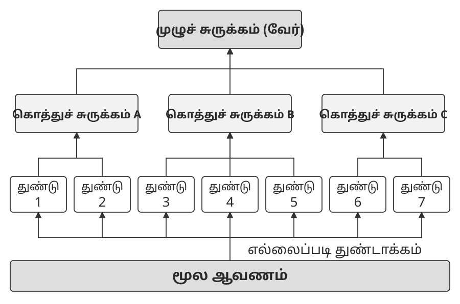

எடுத்துக்காட்டாக, "SSE2, 128-பிட் XMM பதிவேடுகளில் முழு எண் SIMD செயல்களை இயக்க ஆதரவளிக்கிறது", "SSE4.2 புதிய சரம் ஒப்பீட்டுக் கட்டளைகளைச் சேர்க்கிறது" ஆகியவற்றை "x86 SIMD கட்டளைத் தொகுப்பின் பரிணாமம்" என்ற சுருக்கத்தில் சேர்க்கலாம். விவரமான கேள்விகள் தாழ் அடுக்குத் துண்டுகளுடன் பொருந்தலாம்; மேலோட்டக் கேள்விகள் உயர் அடுக்குச் சுருக்கங்களுடன் பொருந்தலாம். வினவல் அடுக்குகளின் வழியே படிப்படியாக ஆழமாகச் செல்லலாம்; அல்லது எல்லா அடுக்கு முனைகளையும் ஒன்றாகத் தேடி, மிகத் தொடர்புடைய குழுவைத் தேர்ந்தெடுக்கலாம்.

[^ch3-raptor]: Sarthi மற்றும் பலர், RAPTOR: Recursive Abstractive Processing for Tree-Organized Retrieval, 2024.

**GraphRAG** பொருள்கள், உறவுகள், சமூகச் சுருக்கங்களைக் கொண்டு அறிவை ஒழுங்கமைக்கிறது. "எழுவாய்—உறவு—செயப்படுபொருள்" என்ற மும்மடியைக் கொண்டு ஒரு உறவைப் பதிவு செய்கிறது; எடுத்துக்காட்டாக (சீனா, தலைநகர், பெய்ஜிங்) அல்லது (ஜாங் சான், பணிபுரிகிறார், டென்சென்ட்). இரு பதிவுகளும் ஒரே பொருளைக் குறிப்பிட்டால், வரைபடத்தில் இணைக்கலாம். படம் 3-11-இல் உள்ள இரு மருத்துவர்களின் குடும்பப் பெயரும் ஜாங். "என் பல் மருத்துவர் பணிபுரியும் மருத்துவமனையின் முகவரி" என்று பயனர் கேட்டால், எந்த உறவின் வழியே அமைப்பு தேட வேண்டும்?

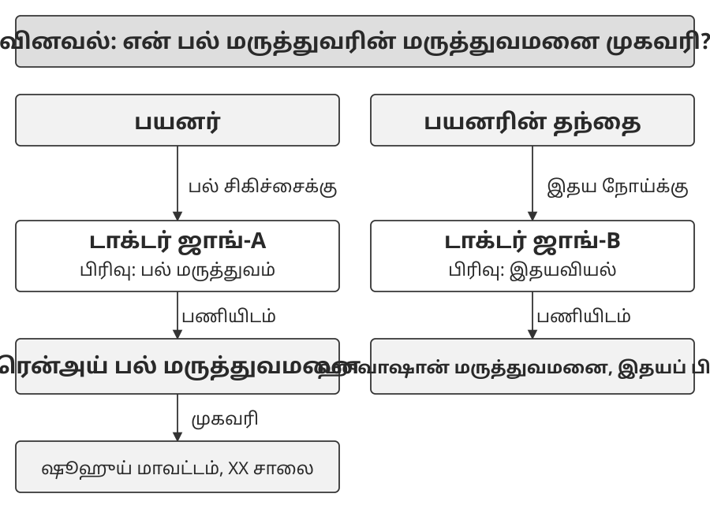

1. **வரைபடம் கட்டும்போது ஒரே பெயர் கொண்ட பொருள்களை வேறுபடுத்துதல்.** ஒரு டாக்டர் ஜாங் ரென்'ஐ பல் மருத்துவமனையில் பயனருக்குப் பல் சிகிச்சை அளிக்கிறார்; மற்றொருவர் ஹுவாஷான் மருத்துவமனையில் பயனரின் தந்தைக்கு இதய சிகிச்சை அளிக்கிறார். பொருள்களைப் பிரித்தெடுத்து, பதிவுகளை ஒன்றிணைக்கும்போது, இந்தத் துப்புகளின் அடிப்படையில் இரு மருத்துவர்களுக்கும் வெவ்வேறு அடையாளங்களை வழங்கலாம். முன்பு கண்ட `person`, `relationship` புலங்களும் இதையொத்த பங்கை வகிக்கின்றன. ஒரு வாக்கியத்தில் `bank` ஆற்றங்கரையையா வங்கியையா குறிக்கிறது என்று தீர்மானிப்பது சொற்பொருள் தெளிவுபடுத்தல் (word sense disambiguation); ஒரு பதிவு எந்த டாக்டர் ஜாங்கைப் பற்றியது என்று தீர்மானிப்பது பொருள் தெளிவுபடுத்தல் (entity disambiguation).
2. **வினவலின்போது உறவுச் சங்கிலியின் வழியே மீட்டெடுத்தல்.** பயனரிலிருந்து தொடங்கி, "பயனர்→மருத்துவர்→மருத்துவமனை→முகவரி" என்ற வழியே படிப்படியாகத் தேடினால், பல பதிவுகளில் சிதறிய தகவலை ஒரே பதிலாக இணைக்கலாம்.

Microsoft GraphRAG-இன் சுட்டு உருவாக்கச் செயல்முறை முதலில் உரை அலகுகளிலிருந்து பொருள்களையும் உறவுகளையும் பிரித்தெடுத்து, பின்னர் சமூகக் கண்டுபிடிப்பு (community detection) மூலம் இறுக்கமாக இணைந்த பொருள் குழுக்களை அடையாளம் கண்டு, சமூக அடுக்குகளையும் சுருக்கங்களையும் உருவாக்குகிறது. ஒரு பொருளை வினவும்போது, உள்ளூர்த் தேடல் அதன் தொடர்புடைய தகவலையும் மூல உரையையும் இணைக்கிறது; முழுக் களஞ்சியத்தின் தலைப்பை வினவும்போது, முழுமையான தேடல் சமூகச் சுருக்கங்களைக் கொண்டு பதிலை ஒழுங்கமைக்கிறது[^ch3-graphrag].

[^ch3-graphrag]: Microsoft GraphRAG, சுட்டு உருவாக்கம், வினவல் கண்ணோட்டம், உள்ளூர்த் தேடல், முழுமையான தேடல்.

உறவு வெளிப்பாடு நிபந்தனைகளையும் நேரத்தையும் உள்ளடக்க வேண்டும். எடுத்துக்காட்டாக, "அடுத்த வாரமும் மழை பெய்தால், கடற்கரைப் பயணத்தை ரத்து செய்து அருங்காட்சியகத்துக்குச் செல்வேன்" என்பதில் நிபந்தனை, செல்லுபடி நேரம், மாற்றுச் செயல் ஆகியவை உள்ளன. (பயனர், திட்டம் உள்ளது, கடற்கரைப் பயணம்), (பயனர், மாற்றுத் திட்டம் உள்ளது, அருங்காட்சியகப் பயணம்) என்று மட்டும் பிரித்தெடுத்தால், மாறுவதற்கான நிபந்தனை தொலைந்துவிடும். முழு அசல் வாக்கியத்தையும் தக்கவைத்து, "அடுத்த வாரம் மழை பெய்தால்" என்ற கட்டுப்பாட்டை நிபந்தனைக் கணு, நிகழ்வுக் கணு, அல்லது கட்டமைக்கப்பட்ட புலங்களால் வெளிப்படுத்தி, உறவை மூல உரைக்குத் திருப்பிச் சுட்ட வைக்கலாம்.

பயனர் நினைவகத்துக்கு, **இயல்பு மொழியும் கட்டமைக்கப்பட்ட சுட்டும் அடுக்குகளாக இணைந்து செயல்படுவதை** நான் அதிகம் பரிந்துரைக்கிறேன்: இயல்பு மொழியில் முழு வெளிப்பாட்டைச் சேமித்து, மீத்தரவில் பொருள், நேரம், மூலம் ஆகியவற்றைப் பதிவு செய்து, அடிக்கடி இணைக்க வேண்டிய உள்ளடக்கத்துக்கு வரைபடச் சுட்டை அமைப்பது.

> **சோதனை 3-7 ★★★: அடுக்குச் சுருக்கத்தையும் உறவுச் சுட்டையும் ஒப்பிடுதல்**
>
> இந்தச் சோதனை Intel கட்டமைப்புக் கையேட்டில் SSE, AVX, நிலை மேலாண்மை தொடர்பான 14 பக்கங்களைத் தேர்ந்தெடுத்து, இரு கற்பித்தல் செயலாக்கங்களைக் கட்டமைக்கிறது. அடுக்குச் சுருக்கக் கிளை முதலில் ஒவ்வொரு பக்கத்துக்கும் சுருக்கம் உருவாக்கி, பின்னர் மூன்று குழுக்களாகத் தொகுத்து, குழுச் சுருக்கங்களையும் வேர்ச் சுருக்கத்தையும் உருவாக்குகிறது; உறவுச் சுட்டுக் கிளை பொருள்களையும் உறவுகளையும் பிரித்தெடுத்து, சமூகச் சுருக்கங்களை உருவாக்குகிறது. இரு குழுக்களும் ஒரே பொருட்களையும் எட்டுக் கேள்விகளையும் பயன்படுத்தி, கருத்து விவரங்களையும் உறவுப் பகுத்தறிவையும் ஒப்பிடுகின்றன.
>
> "SSE நிரலாக்கச் சூழலை விளக்கு" என்று வினவும்போது, அடுக்குச் சுருக்கம் SSE மேலோட்டத்தையும் பதிவேட்டு விவரங்களையும் ஒருசேரப் பொருத்த முடிகிறது. இந்தச் செயலாக்கம் எல்லா அடுக்கு முனைகளையும் ஒன்றாகத் தேடி, மிகத் தொடர்புடைய ஐந்தைத் தேர்ந்தெடுக்கிறது. உறவுக் கிளையோ தொடர்புடைய பொருள்களிலிருந்து அண்டைகளுக்கு விரிந்து, சமூகச் சுருக்கங்களுடன் இணைத்துச் சூழலை ஒழுங்கமைக்கிறது. "SSE→XMM பதிவேடு→மிதவைப் புள்ளிச் செயல்→ADDPS" போன்ற உறவின் வழியே, கருத்தையும் குறிப்பிட்ட கட்டளையையும் இணைக்க முடிகிறது.
>
> இன்னும் சிக்கலான கேள்வி: "செயலி AVX ஆதரவை அறிவித்தால், நிரல் AVX-ஐப் பயன்படுத்தலாமா?" இதற்குச் செயலியின் திறனையும் இயக்க அமைப்பின் நிலை மேலாண்மையையும் இணைக்க வேண்டும்: CPUID-இன் AVX, OSXSAVE கொடிகளைச் சரிபார்த்து, பின்னர் XCR0-ஐப் படித்து, XMM, YMM நிலைகள் இரண்டும் இயக்கப்பட்டுள்ளனவா என்று உறுதிசெய்ய வேண்டும். இந்தக் கேள்விக்கு வரைபடத் தேடல் நிரலுக்குக் கொடுக்கப்பட்ட முனைக் குறிப்புகள் CPUID, YMM. நிரல் இவ்விரண்டையும் இணைக்கும் மிகக் குறுகிய பாதையைக் கண்டுபிடித்தது — XSAVE, CR4.OSXSAVE, XCR0 வழியாக — பின்னர் அந்தப் பாதையை மாதிரியிடம் பதிலளிக்கக் கொடுத்தது.
>
> எட்டுக் கேள்விகளிலும் இரு குழுக்களின் சராசரி மூலப் பக்கப் பரப்பு சுமார் 95.8%.

முதலில் துண்டாக்கத்தையும் கலப்பு மீட்டெடுப்பையும் நன்றாகச் செய்து, ஆவணங்களைக் கடந்த தொகுப்பு, உறவு வினவல் தேவைகள் மீண்டும் மீண்டும் தோன்றும்போது கட்டமைக்கப்பட்ட சுட்டை உருவாக்கப் பரிந்துரைக்கிறேன். ஒரு குறிப்பிட்ட பணத்திருப்பக் கொள்கைப் பத்தியைக் கண்டுபிடிப்பது பொதுவாகத் துண்டாக்கமும் கலப்பு மீட்டெடுப்புமே தீர்க்கும்; SSE-ஐயும் AVX-ஐயும் ஒப்பிடுவது, அல்லது ஒட்டுமொத்தக் கட்டமைப்பிலிருந்து குறிப்பிட்ட கட்டளை வரை தேடுவதற்கோ, பத்திகளைக் கடந்த சுருக்கமும் உறவுச் சுட்டும் அதிகம் தேவை.

### கோப்பு முறைமை முன்னுதாரணம்: கோப்பகக் கட்டமைப்பால் அறிவை ஒழுங்கமைத்தல்

**OpenViking** மெய்நிகர் கோப்பு முறைமையைக் கொண்டு நினைவகங்கள், வளங்கள், திறன்கள் ஆகியவற்றை ஒழுங்கமைக்கிறது. ஒவ்வொரு உருப்படியும் `viking://` URI மூலம் குறிக்கப்படுகிறது; ஏஜெண்ட் கோப்பகங்களை உலாவி, மேலோட்டத்தைப் படித்து, தேவையான உள்ளடக்கத்தை அணுகலாம்[^ch3-openviking-uri]. தகவலின் பயனின் அடிப்படையில், கோப்பகங்களை மூன்று குழுக்களாகப் புரிந்துகொள்ளலாம்: வெளிப்புற வளங்கள், பயனர் தகவல், ஏஜெண்ட் பயன்படுத்தும் திறன்களும் அனுபவங்களும். பயனர், ஏஜெண்ட் அடையாளங்கள் ஒவ்வொன்றின் பெயர்வெளியையும் (namespace) மேலும் வரம்பிடுகின்றன.

| உள்ளடக்கம் | வழக்கமான பயன் |
| --- | --- |
| Resources | தொழில்நுட்ப ஆவணங்கள், குறியீட்டுக் களஞ்சியங்கள், வலைப்பக்கங்கள் போன்ற வெளிப்புறப் பொருட்கள் |
| User memories | குறிப்பிட்ட பயனரின் விருப்பங்கள், பழக்கங்கள், அனுபவங்கள் |
| Skills, Agent memories | மீண்டும் பயன்படுத்தக்கூடிய செயல்முறைகள், பணிப் பதிவுகள், இன்னும் சரிபார்க்கப்பட வேண்டிய அனுபவங்கள் |

URI ஒருங்கிணைந்த இருப்பிடக் குறிப்பை வழங்குகிறது; இயற்பியல் சேமிப்பையும் சுட்டையும் சேவை நிர்வகிக்கிறது. கோப்பக இடைமுகம், தலைப்புவாரியாக அடுக்கு அடுக்காக உலாவவும், பொருள் தேடலைத் தொடர்புடைய துணை மரத்துக்குள் வரம்பிடவும் ஏஜெண்டுக்கு உதவுகிறது. கோப்பு முறைமை வடிவ அணுகல், உள்ளடக்கச் சேமிப்பு, வெக்டர் சுட்டு ஆகியவை இணைந்து சேவையை உருவாக்கலாம்.

[^ch3-openviking-uri]: OpenViking, Viking URI மற்றும் அமைப்புக் கட்டமைப்பு.

OpenViking உள்ளடக்கத்தை **L0, L1, L2** என்ற மூன்று அடுக்குகளாகப் பிரிக்கிறது: L0 என்பது சுருக்கமான சுருக்கம், கோப்பகம் தொடர்புடையதா என்று விரைவாகத் தீர்மானிக்கப் பயன்படுகிறது; L1 என்பது கோப்பக மேலோட்டம்; முக்கிய உள்ளடக்கத்தையும் வழிசெலுத்தல் நுழைவாயில்களையும் விளக்குகிறது; L2 என்பது விரிவாகப் படிக்க வேண்டிய முதன்மை உரை. கோப்பக அளவிலான சுருக்கமும் மேலோட்டமும் முறையே `.abstract.md`, `.overview.md` ஆகியவற்றில் சேமிக்கப்படுகின்றன. இவ்விரண்டையும் உருவாக்கும் நீள வரம்பு முறையே 256, 4000 எழுத்துகள்[^ch3-openviking-layers].

வினவல் முதலில் சுருக்கத்தைப் படித்து இருப்பிடத்தைக் கண்டறிந்து, பின்னர் மேலோட்டத்தைப் படித்துக் கோப்பைத் தேர்ந்தெடுத்து, இறுதியில் மூல உரையை ஏற்றலாம். இது அத்தியாயம் 2-இன் Skills படிநிலை வெளிப்படுத்தலுடன் ஒத்துப்போகிறது: இலகுவான பட்டியல் கண்டுபிடிப்பை ஆதரிக்கிறது; முழு உள்ளடக்கம் பணித் தேவைக்கேற்ப ஏற்றப்படுகிறது. துல்லியமான எண்கள், நிபந்தனைகள், அசல் சொல்லாடல் தேவைப்படும்போது, தொடர்புடைய முதன்மை உரையைத் தொடர்ந்து மீட்டெடுக்க வேண்டும்.

[^ch3-openviking-layers]: OpenViking, Context Layers (L0/L1/L2). L0, L1 கோப்பக அளவில் உருவாக்கப்படும் வெளிப்பாடுகள்; L2 மூலக் கோப்பாகவோ பாகுபடுத்தப்பட்ட முதன்மை உரையாகவோ இருக்கலாம்.

மனிதர்களும் ஏஜெண்டுகளும் இணைந்து பராமரிக்க வேண்டிய அறிவுக்கு, **Markdown சாதாரண உரையையும் பதிப்புக் கட்டுப்பாட்டையும்** கொண்டு நிர்வகிப்பதையே நான் விரும்புகிறேன். மனிதர் அறிவை நேரடியாகப் படிக்கவும், திருத்தவும், சரிசெய்யவும் முடியும்; ஏஜெண்டும் அதே கோப்பு இடைமுகத்தைப் பயன்படுத்தி, பணிக் கிளையில் புதுப்பிப்புகளை முன்மொழிந்து, மதிப்பாய்வுக்குப் பிறகு வெளியிடலாம். பதிப்புக் கட்டுப்பாடு ஒவ்வொரு மாற்றத்தின் வேறுபாட்டையும் சேமிப்பதோடு, தவறான புதுப்பிப்புகளைத் திரும்பப் பெறவும் உதவுகிறது. அமர்வு முடியும்போது, பயனர் விருப்பங்கள் அந்தப் பயனரின் நினைவகத்துக்குள் நுழைகின்றன; செயல்பாட்டு வரலாறு பணிப் பதிவுக்குள் நுழைகிறது. பணிப் பதிவுகள் முடிவு மதிப்பீடு, பாதைகளைக் கடந்த தொகுப்பு, அடுத்தடுத்த சரிபார்ப்பு ஆகியவற்றைக் கடந்த பிறகு, அத்தியாயம் 9 விவாதிக்கும் அனுபவமாக மேலும் உருவாகலாம்.

கோப்பு முறைமை கொண்டு அறிவை ஒழுங்கமைக்கும்போது, **தொடர்புடைய உருப்படிகளுக்கு இணைப்புகளையும் சுட்டுகளையும் கட்டாயம் உருவாக்க வேண்டும்.** ஒன்றையொன்று குறிப்பிடாத கோப்புகளின் தொகுதியில், முழு உரை வருடல் அல்லது பொருள் தேடல் மூலம் மட்டுமே உறவுகளை மீண்டும் கண்டுபிடிக்க முடியும்; கோப்புகள் பெருகப் பெருக, ஏற்கனவே கண்டுபிடித்த உள்ளடக்கத்திலிருந்து தொடர்ந்து தேடுவது ஏஜெண்டுக்குக் கடினமாகும். இணைப்புகள் தெளிவான தேடல் பாதையை வழங்கலாம்; எடுத்துக்காட்டாக, பணத்திருப்பக் கொள்கை விதிவிலக்கு விதிமுறைகளைச் சுட்டலாம், ஒப்பந்தச் சுருக்கம் கையெழுத்துப் பதிவைச் சுட்டலாம், நபர் உருப்படி தொடர்புடைய நிகழ்வுகளைச் சுட்டலாம். நுழைவாயில் பக்கம் முக்கியத் தலைப்புகளை விளக்குகிறது, சுட்டுப் பக்கம் வழிசெலுத்தலை வழங்குகிறது, உருப்படிகளுக்கு இடையிலான குறுக்குக் குறிப்புகள் பக்கவாட்டுத் தேடலை ஆதரிக்கின்றன. இந்த முறை கலைக்களஞ்சிய உருப்படிகளின் ஒழுங்கமைப்பைப் போன்றது; இலகுவான வழியில் சில உறவுகளைச் சேமிக்க முடிகிறது.

தரவுத்தளம் கட்டும்போது, எந்த உருப்படிகளை ஒருசேரப் பயன்படுத்தலாம், எந்தத் திட்டங்களில் ஒரே கையாளலில் ஒன்றை மட்டுமே தேர்ந்தெடுக்க முடியும் என்பதையும் குறிக்கலாம். எடுத்துக்காட்டாக, ஆர்டர் ரத்துக் கோரிக்கையை வாடிக்கையாளர் சேவை கையாளும்போது, வாடிக்கையாளருக்குப் பதிலளிப்பது சொல்லாடல் வழிமுறைகளையும் தனியுரிமை வழிமுறைகளையும் ஒருசேரப் பின்பற்ற வேண்டும்; இரு வழிமுறைகளையும் ஒருசேரச் சூழலில் வைக்கலாம். அனுப்புதலை ரத்து செய்யக் கிடங்கு இரு திட்டங்களைத் தயார் செய்திருந்தால், ஒவ்வொன்றின் பொருந்தும் நிபந்தனைகளையும் சுட்டில் தெளிவாக எழுத வேண்டும். ஒரே பொதிக்கு, இன்னும் வெளியேறவில்லை என்றால் வெளியேற்றச் சீட்டை ரத்து செய்ய வேண்டும்; ஏற்கனவே சரக்கு நிறுவனத்திடம் ஒப்படைக்கப்பட்டிருந்தால் இடைமறிப்புக்கு விண்ணப்பிக்க வேண்டும். வேலைச்சீட்டில் "ஆர்டரை ரத்து செய்யுங்கள்" என்று மட்டும் இருந்தால், ஏஜெண்ட் முதலில் பொதியின் நிலையைச் சரிபார்த்து, பின்னர் பொருந்தும் திட்டத்தை ஏற்ற வேண்டும்.

இணைப்புப் பராமரிப்பைப் புதுப்பிப்புச் செயல்முறையில் எழுத வேண்டும்: புதிய உருப்படியைச் சேர்ப்பதற்கு முன் ஏற்கனவே உள்ள பதிவுகளைத் தேடி, இணைப்பதா புதிதாக உருவாக்குவதா என்று தீர்மானிக்க வேண்டும்; எழுதிய பிறகு தொடர்புடைய குறிப்புகளைச் சேர்த்து, அது சேர்ந்த கோப்பகத்தின் சுட்டைப் புதுப்பிக்க வேண்டும். இணைப்புகள் வாசகரை விதிமுறைகளுக்கு அழைத்துச் செல்லலாம்; ஆனால் அந்த விதிமுறை கையிலுள்ள ஆர்டருக்குப் பொருந்துகிறதா என்பது, அது எப்போது நடைமுறைக்கு வந்தது என்பதையும் பொறுத்தது.

### அறிவை எவ்வாறு புதுப்பிக்க வேண்டும்

ஒரு கொள்கை இன்று மாற்றப்படுகிறது; பயனர் நாளை "இப்போது என்ன செய்ய வேண்டும்" என்றும் கேட்கலாம், "கடந்த மாதம் என் ஆர்டர் ஏன் அப்படிக் கையாளப்பட்டது" என்றும் கேட்கலாம். புதிய விதிமுறையைக் கொண்டு பழைய விதிமுறையை மேலெழுதினால் மட்டும், இரண்டாம் கேள்விக்கு அப்போதைய அடிப்படை தொலைந்துவிடும். **அதிகரிப்பு புதுப்பிப்பு** புதிய சான்றுகளை உரிய நேரத்தில் எழுதுகிறது; **வழக்கமான ஒழுங்கமைப்பு** பரந்த எல்லையிலிருந்து மீள்வருகை, முரண்பாடு, கட்டமைப்பு மாற்றங்களைக் கண்டறிகிறது; இரு பாதைகளும் பதிப்பையும் சான்றுக் குறிப்புகளையும் தக்கவைத்து, வெளியிடுவதற்கு முன் சரிபார்க்க வேண்டும்; அப்போதுதான் கேள்விக்கேற்பப் பொருந்தும் காலத்தைத் தேர்ந்தெடுக்க முடியும்.

#### பயனர் நினைவகம், அறிவுத் தளத்தின் அதிகரிப்பு புதுப்பிப்பு

என் பரிந்துரை: **அறிவுத் தளத்தைக் குறியீட்டுக் களஞ்சியமாகக் கருதுங்கள்; ஒவ்வொரு அறிவு மாற்றத்தையும் ஒரு Pull Request (PR) ஆகக் கருதுங்கள்.** ஒரு புதுப்பிப்புக்குத் தெளிவான திருத்த எல்லை இருக்க வேண்டும்; மதிப்பாய்வாளர் சரிபார்க்க, திருத்தத்தைத் தாங்கும் சான்றுகளும் இணைக்கப்பட வேண்டும். Markdown ஆவணங்கள், விதிக் கோப்புகள், User as Code-இன் செயல்படுத்தக்கூடிய நிலை ஆகிய அனைத்தையும் இந்தச் செயல்முறைக்குள் சேர்க்கலாம். பதிப்பு வரலாறு பராமரிப்பாளர்கள் மாற்றங்களைப் பார்க்கவும், காரணங்களைத் தடமறியவும், தவறான வெளியீட்டுக்குப் பிறகு மீட்கவும் உதவுகிறது.

அத்தியாயம் 1-இன் **முன்மொழிபவர்—மதிப்பாய்வாளர்** மாதிரியைப் பின்பற்றினால், ஒரு புதுப்பிப்பு இவ்வாறு நடைபெறலாம்:

1. **முன்மொழிபவர் மாற்றத்தை உருவாக்குகிறார்.** Proposer Agent புதிய சான்றுகளைப் படித்து, ஏற்கனவே உள்ள அறிவைத் தேடி, சேர்க்க, திருத்த, அல்லது காலாவதியாக்க வேண்டிய உருப்படிகளைக் கண்டறிந்து, பணிக் கிளையில் எல்லை தெளிவான திருத்தத்தை முன்மொழிகிறது. அதே நேரத்தில் தொடர்புடைய இணைப்புகள், கோப்பகச் சுட்டு, நேரத் தகவல், சான்றுக் குறிப்புகள் ஆகியவற்றைப் பராமரிக்கிறது.
2. **மதிப்பாய்வாளர் தனியாகச் சரிபார்க்கிறார்.** Reviewer Agent திருத்தத்துக்கு முன்னும் பின்னும் உள்ள உள்ளடக்கத்தையும் அசல் சான்றுகளையும் ஒப்பிட்டு, புதிதாகச் சேர்க்கப்பட்ட கூற்றுகளுக்கு மூலம் உள்ளதா, பொருந்தும் நிபந்தனைகள் முழுமையாக எழுதப்பட்டுள்ளனவா, வெவ்வேறு கோப்புகளில் உள்ள கூற்றுகள் ஒத்துப்போகின்றனவா, நீக்கப்பட்ட பத்திகளில் இன்னும் பயனுள்ள தகவல் உள்ளதா என்று சரிபார்க்கிறது. பிரச்சினை கண்டறியப்பட்டால், குறிப்பிட்ட உருப்படியையும் அடிப்படையையும் சுட்டிக்காட்டி, எதைச் சேர்க்க, மீட்டெடுக்க, அல்லது திருத்த வேண்டும் என்று விளக்குகிறது.
3. **மறுசெயலும் முடிவும்.** முன்மொழிபவர் கருத்துகளின்படி திருத்துகிறார்; மதிப்பாய்வாளர் மீண்டும் சரிபார்க்கிறார். மதிப்பாய்வு தேர்ச்சி பெற்றதும் இணைப்புச் செயல்முறைக்குள் நுழைகிறது; சுற்று அல்லது செலவு வரம்பை எட்டியும் சர்ச்சை தொடர்ந்தால், அந்தத் திருத்தத்தைப் பணிக் கிளையில் விட்டுவைத்து, மனிதர் மதிப்பாய்வுக்குக் கேட்கலாம்.
4. **சரிபார்த்து வெளியிடுதல்.** வடிவம், இணைப்புகள், மீத்தரவு, அனுமதிக் குறிச்சொற்களைத் தானாகச் சரிபார்த்தல்; செயல்படுத்தக்கூடிய அறிவு வகைச் சரிபார்ப்பிலும் தொடர்புடைய சோதனைகளிலும் தேர்ச்சி பெற வேண்டும். இணைத்த பிறகு, உறுதியான அறிவுப் பதிப்பிலிருந்து பாதிக்கப்பட்ட துண்டுகள், சுருக்கங்கள், வெக்டர் சுட்டுகளை மீண்டும் கட்டமைத்து, பின்னர் சேவைப் பதிப்பை வெளியிடுதல்.

இந்தச் செயல்முறை மூன்று அடுக்குத் தரவுக்கு உரியது. **மூலச் சான்று அடுக்கு** உரையாடல்கள், செயல்பாட்டுப் பாதைகள், வணிக ஆவணங்கள், கருவி முடிவுகளைச் சேமிக்கிறது; **அறிவு அடுக்கு** வடிக்கப்பட்ட, திருத்தக்கூடிய உரையையோ குறியீட்டையோ சேமிக்கிறது; **சேவை அடுக்கு** குறிப்பிட்ட அறிவுப் பதிப்பிலிருந்து உருவாக்கப்பட்ட சுட்டுகளைச் சேமிக்கிறது. மாற்றப் பதிவு சான்று அடையாளம், அறிவுப் பதிப்பு, மதிப்பாய்வுக் கருத்துகள், இறுதி முடிவு ஆகியவற்றை இணைக்கிறது; இதனால் ஒரு அறிவு உருப்படி ஏன் எழுதப்பட்டது, எப்போது நடைமுறைக்கு வந்தது என்பதைப் பராமரிப்பாளர் தடமறியலாம். மூலச் சான்றுகள் தக்கவைப்புக் கொள்கையின்படி காப்பகப்படுத்தப்படுகின்றன; சுட்டுகளை அறிவுப் பதிப்பிலிருந்து மீண்டும் உருவாக்கலாம். முன்பு கண்ட சேர்ப்பு நினைவகம், பழைய, புதிய உண்மைகளையும் அவற்றின் மூலங்களையும் சேமிக்க ஏற்றது; இங்குள்ள மதிப்பாய்வுச் செயல்முறை அந்தச் சான்றுகளைப் பயன்படுத்தக்கூடிய அறிவுப் பதிப்பாக ஒழுங்கமைக்கிறது. வினவலின்போது இன்னும் தீர்க்கப்படாத முரண்பாடு வந்தால், சான்றுகளைப் பின்னோக்கிப் பார்த்து, பணி நிபந்தனைகளுடன் இணைத்துத் தீர்மானிக்கலாம்.

இந்த வடிவமைப்பில், **முன்மொழிபவரும் மதிப்பாய்வாளரும் கருவிகளை அழைத்துத் தொடர்ந்து வினவக்கூடிய ஏஜெண்டுகளாக இருக்க வேண்டும்.** பாதிக்கப்பட்ட உருப்படிகளைக் கண்டுபிடிக்க முன்மொழிபவர் பல பதிவுகளைத் தேட வேண்டியிருக்கலாம்; மதிப்பாய்வாளரும் குறிப்புகளின் வழியே தொடர்ந்து வினவவோ, பதிப்புகளை ஒப்பிடவோ, சரிபார்ப்புகளை இயக்கவோ வேண்டியிருக்கலாம். கோப்புத் தேடல், சான்று மீட்டெடுப்பு, வேறுபாடு பார்வை, சோதனைக் கருவிகள் ஆகியவை இந்த அடுத்தடுத்த படிகளைக் கையாள அவர்களுக்கு உதவுகின்றன; தேவையான திறன் கொண்ட Coding Agent இத்தகைய வேலையை ஏற்கலாம்.

இருவரின் மீட்டெடுப்பு எல்லையும் தற்போதைய மாற்றம் சம்பந்தப்பட்ட அறிவையும் மூலச் சான்றுகளையும் உள்ளடக்க வேண்டும்; பயனர், வாடிக்கையாளர், பணி அனுமதிகளால் கட்டுப்படுத்தப்பட வேண்டும். மதிப்பாய்வுப் பாதை, மேற்கோள் காட்டிய கருவி முடிவுகள், பின்னூட்டம் ஆகியவை ஒருசேரக் காப்பகப்படுத்தப்படுகின்றன; மதிப்பாய்வாளர் உண்மையில் என்ன சரிபார்த்தார் என்பதைப் பின்னர் சரிபார்க்கலாம்.

மாதிரித் தேர்வில், திறனில் நெருக்கமான, வெவ்வேறு குடும்பங்களைச் சேர்ந்த சேர்க்கைகளுக்கு முன்னுரிமை கொடுக்கப் பரிந்துரைக்கிறேன்; எடுத்துக்காட்டாக Claude–GPT, DeepSeek–Kimi. வெவ்வேறு பயிற்சித் தரவும் பகுத்தறிவுப் பழக்கங்களும் வெவ்வேறு மதிப்பீடுகளைத் தரக்கூடும். மதிப்பாய்வாளர் தனியாகச் சான்றுகளை மீட்டெடுத்து, திருத்தத்தில் உள்ள கூற்றுகளையும் நிபந்தனைகளையும் சரிபார்க்க வேண்டும். அனுமதிகளை இயக்க அமைப்பே நடைமுறைப்படுத்த வேண்டும்: முன்மொழிபவர் பணிக் கிளையில் எழுதுகிறார், மதிப்பாய்வாளர் சான்றுகளைப் படித்து முடிவைச் சமர்ப்பிக்கிறார், இணைப்பு–வெளியீட்டுச் சேவை முதன்மைக் களஞ்சியத்தையும் இணையச் சுட்டுகளையும் புதுப்பிக்கும் அனுமதியைக் கொண்டுள்ளது.

#### பயனர் நினைவகம், அறிவுத் தளத்தின் வழக்கமான ஒழுங்கமைப்பு

பல பகுதிப் புதுப்பிப்புகளுக்குப் பிறகு, ஒரே உண்மை பல கோப்புகளில் சிதறிக் கிடக்கலாம்; பழைய, புதிய வெளிப்பாடுகள் ஒருசேர நிலைத்திருக்கலாம். வழக்கமான ஒழுங்கமைப்பு கோப்பகம், நேரம், அல்லது தலைப்பிலிருந்து தொடங்கி, இந்தக் குவிந்த பிரச்சினைகளைச் சரிபார்க்கிறது. இது அத்தியாயம் 9 விவாதிக்கும் காலாந்திர மீள்பார்வையுடன் பொதுவான வேலை முறையைக் கொண்டுள்ளது: முன்தளம் புதிய சான்றுகளைக் குவிக்கிறது, பின்தளம் ஒருங்கே ஒழுங்கமைக்கிறது, அடுத்தடுத்த பணிகளுக்குப் பயன்படும் பதிவுகள் உருவாகின்றன.

ஒழுங்கமைப்பில் மூன்று வேலைகள் அடங்கும்.

1. **மீள்வருகை நீக்கம், இணைப்பு, கட்டமைப்புச் சரிசெய்தல்.** மீள்வரும், காலாவதியான, அல்லது அளவுக்கு மீறித் துண்டாக்கப்பட்ட உருப்படிகளைக் கண்டறிந்து, தொடர்புடைய உள்ளடக்கத்தை இணைத்து, மிகப் பெரிய கோப்புகளைப் பிரித்து, இணைப்புகள், நுழைவாயில் பக்கங்கள், சுட்டுப் பக்கங்களைப் புதுப்பித்தல். சேவையிலிருந்து பழைய வெளிப்பாட்டை நீக்கும்போது, அதன் மாற்று உறவையும் அசல் அடிப்படையையும் பதிவு செய்தல்.
2. **மூலப் பொருட்களைப் பின்னோக்கிச் சரிபார்த்தல்.** ஒவ்வொரு சுற்று ஒழுங்கமைப்பும் முந்தைய சுற்றுச் சுருக்கத்தை மட்டும் மீண்டும் எழுதினால், தொடக்ககால விடுபடல்களும் தவறான புரிதல்களும் சுற்றுக்குச் சுற்று கடத்தப்படும். எனவே, உரையாடல்கள், செயல்பாட்டுப் பாதைகள், வணிக ஆவணங்கள், கருவி வெளியீடுகள் ஆகியவற்றுடன் ஒப்பிட்டு, சுருக்கம் முக்கிய உண்மைகளைத் தவறவிட்டதா, மறுப்பு, நேரம், அல்லது நிபந்தனையை இழந்ததா, ஊகத்தை உறுதியான முடிவாக எழுதியதா என்று சரிபார்க்க வேண்டும். பெரிய அறிவுத் தளங்களைக் கோப்பகம், நேரம், அல்லது தலைப்பு வாரியாகத் தொகுதிகளாகக் கையாளலாம்; சரிபார்த்தவை, சரிபார்க்க வேண்டியவை, சர்ச்சைக்குரியவை ஆகியவற்றைப் பரப்புப் பட்டியலில் பதிவு செய்து, முழுத் தளச் சரிபார்ப்பு முடியும் வரை தொடர வேண்டும்.
3. **முரண்பாடுகளையும் பொருந்தும் எல்லைகளையும் கையாளுதல்.** முரண்படும் பதிவுகளின் மூலங்களையும், நேரம், பொருள், பகுதி, பணி, முன்நிபந்தனைகளையும் ஒப்பிடுதல். இரு தகவல்கள் வெவ்வேறு சூழ்நிலைகளுக்குப் பொருந்தினால், ஒவ்வொன்றின் எல்லையையும் நிறைவு செய்தல்; புதிய சான்று பழைய விதியைத் தெளிவாக மாற்றினால், பதிப்பு உறவைச் சேமித்தல்; அடிப்படை போதவில்லை என்றால், உறுதிசெய்ய வேண்டிய உருப்படிகளையும் சேர்க்க வேண்டிய சான்றுகளையும் பதிவு செய்தல்.

ஒழுங்கமைப்பு முடிவுகளும் மாற்றங்களாகவே மதிப்பாய்வுக்குச் சமர்ப்பிக்கப்படுகின்றன. பெரிய மறுகட்டமைப்புகளைக் கோப்பகம் அல்லது தலைப்பு வாரியாகப் பல PR-களாகப் பிரித்து, ஒழுங்கமைப்புத் திட்டத்தையும் பரப்புப் பட்டியலையும் பகிரலாம்; தொடர்புடைய மாற்றங்கள் தேர்ச்சி பெற்ற பிறகு பெறப்பட்ட சுட்டுகளை மீண்டும் கட்டமைத்து, வழக்கமான மீட்டெடுப்பு, கேள்வி–பதில் நிகழ்வுகளை மீண்டும் இயக்கி, முன்பு கண்டுபிடிக்கக்கூடிய அறிவு இன்னும் அணுகக்கூடியதா என்று சரிபார்க்க வேண்டும். தூண்டும் முறை வாரந்தோறும், மாதந்தோறும் என்ற காலச் சுழற்சியாக இருக்கலாம்; அல்லது புதிய உருப்படிகளின் எண்ணிக்கை, முரண்பாடுகளின் எண்ணிக்கை, மீட்டெடுப்புத் தர மாற்றம் ஆகியவற்றின் அடிப்படையில் வரம்புகளை அமைக்கலாம்.

**காலாவதியான உள்ளடக்கத்தை விலக்குதல்.** துண்டுகளும் சுருக்கங்களும் பதிப்பு, நடைமுறைக்கு வரும் நேரம், காலாவதியாகும் நேரம் ஆகியவற்றைத் தக்கவைக்க வேண்டும். பழைய கொள்கை மாற்றப்பட்ட பிறகு, தற்போதைய வணிக வினவல்கள் காலாவதியான பதிப்புகளை வடிகட்டுகின்றன; வரலாற்று வினவல்களோ இலக்கு நேரத்தின்படி தொடர்புடைய விதிகளைப் படிக்கின்றன. இவ்வாறு சமீபத்திய அறிவைப் பயன்படுத்தவும் முடிகிறது, கடந்த காலக் கையாளும் முடிவுகளை விளக்கவும் முடிகிறது.

**அனுமதியும் வாடிக்கையாளர் தனிமைப்படுத்தலும்.** அனுமதி வடிகட்டல் மீட்டெடுப்பு அடுக்கிலேயே நடக்க வேண்டும்: மீட்டெடுப்புச் சேவை முதலில் அழைப்பவரின் அடையாளத்தின்படி தேடக்கூடிய ஆவண எல்லையை வரையறுத்து, பின்னர் அதிலிருந்து தொடர்புடைய பொருட்களைத் தேடுகிறது. மற்றொரு பயனரின் தனிப்பட்ட பொருட்கள் சூழலுக்குள் அனுப்பப்பட்டுவிட்டால், பதிலளிக்கும்போதோ கருவிகளை அழைக்கும்போதோ மாதிரி அதை வெளிப்படுத்தக்கூடும். மூல உரை, சுருக்கங்கள், உறவு விளிம்புகள், சேமிப்பு முடிவுகள் அனைத்தும் பொருத்தமான அணுகல் எல்லையை மரபுரிமையாகப் பெற வேண்டும்; பெறப்பட்ட உள்ளடக்கத்தின் வழியே பிற பயனர்கள் அல்லது வாடிக்கையாளர்களின் தகவல் வெளியேறுவதைத் தவிர்க்க வேண்டும். சேவை தனிச் சுட்டுகளையோ, கட்டாய வடிகட்டல் திறன் கொண்ட பகிரப்பட்ட சுட்டையோ பயன்படுத்தலாம்; முக்கியமானது, ஒவ்வொரு வினவலும் அனுமதிக் கட்டுப்பாட்டைச் செயல்படுத்த வேண்டும்.

### ஏஜெண்ட் சார்ந்த RAG: மீட்டெடுப்புச் செயல்முறையை ஏஜெண்ட் கட்டுப்படுத்துதல்

ஒரு முறை மீட்டெடுப்பு போதுமா என்று முதலில் கேளுங்கள். எடுத்துக்காட்டாக "விற்பனைக்குப் பிந்தைய சேவை எண் என்ன" என்பதற்கு, தற்போதைய சேவைக் கையேடு ஒன்றே பெரும்பாலும் பதிலைத் தரும்; ஒரு முறை மீட்டெடுத்து உருவாக்கும் எளிய பாதையையே பயன்படுத்தப் பரிந்துரைக்கிறேன். "நான் வாங்கிய இந்த மாடலைக் கடந்த மாத உத்தரவாத விதிமுறைகளின்படி மாற்றிக்கொள்ள முடியுமா" என்று பயனர் கேட்டால், முதல் முறை தயாரிப்புத் தொடர் மட்டுமே கிடைத்தது; கடந்த மாத மாற்று நிபந்தனைகளை இன்னும் தீர்மானிக்க முடியாது. மீட்டெடுப்பைக் கருவியாகத் திறந்தால், முந்தைய முறை திருப்பித் தந்த துப்பைக் கொண்டு அடுத்த வினவலை ஏஜெண்ட் கட்டமைக்க முடியும். மேலும் தேடுவதா, அடுத்து எதைத் தேடுவது என்பதை ஏஜெண்டே தீர்மானிக்கும் இந்த முறை **ஏஜெண்ட் சார்ந்த RAG (Agentic RAG)** எனப்படும். படம் 3-12-ஐ ஒப்பிடுங்கள்: முதல் முறை திருப்பித் தரப்பட்ட தயாரிப்புத் தகவல் முற்றிலும் ஒன்றே. அப்போது பொருந்திய விதிமுறைகளைக் கண்டுபிடிக்க, வலப்பக்கப் பாதை கூடுதலாக எந்தத் துப்பைப் பயன்படுத்தியது?

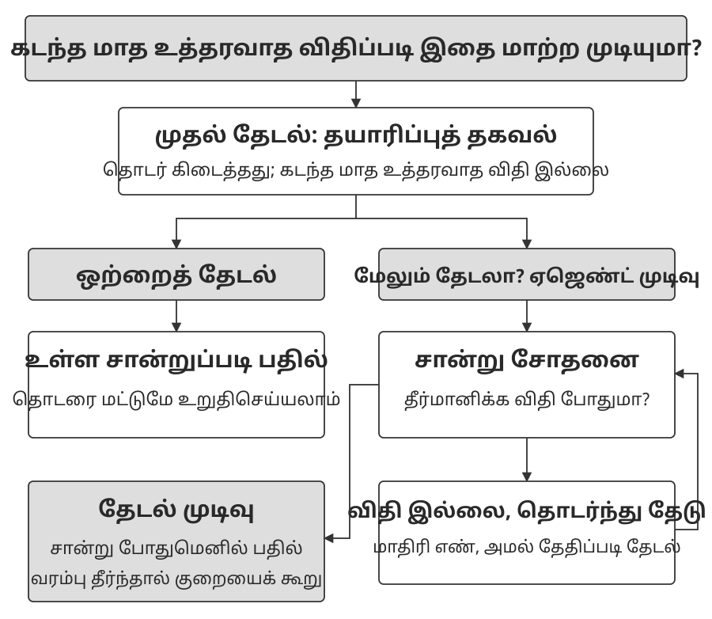

ReAct-ஐ எடுத்துக்காட்டாகக் கொண்டால், மாதிரி முதலில் கேள்வியைப் பகுப்பாய்வு செய்து வினவலைத் தேர்ந்தெடுத்து, `knowledge_base_search`-ஐ அழைக்கிறது; கருவி அவதானிப்பைத் திருப்பித் தந்த பிறகு, சான்றுகள் போதுமானதா என்று மாதிரி தீர்மானிக்கிறது. நிபந்தனைகளோ தொடர்புடைய பொருள்களோ விடுபட்டிருந்தால், வினவலை மாற்றியெழுதித் தொடர்ந்து மீட்டெடுக்கிறது; பொருட்கள் போதுமானதாக இருந்தால், மூலங்களுடன் இணைத்துப் பதிலை உருவாக்குகிறது. Harness வரலாற்றையும் கருவி அழைப்புகளையும் ஒதுக்கீட்டையும் பராமரித்து, வரம்பை எட்டியதும் தேடலை முடிக்கிறது அல்லது தெளிவுபடுத்தலுக்கு மாறுகிறது.

இப்போது படம் 3-13-ஐப் பாருங்கள். அறிவுத் தளத்தின் பின்தளத்தைத் வெக்டர் சுட்டிலிருந்து உறவு வரைபடத்துக்கு மாற்றினாலும், மாதிரி அதே கருவி இடைமுகம் வழியாகத் தேடலைத் தொடர்ந்து கோரலாம். திருப்பித் தரப்பட்ட ஆவணத்தில் தற்செயலாக ஓர் அறிவுறுத்தல் பத்தி இருந்தால், மாதிரி அதன்படி செயல்படலாமா?

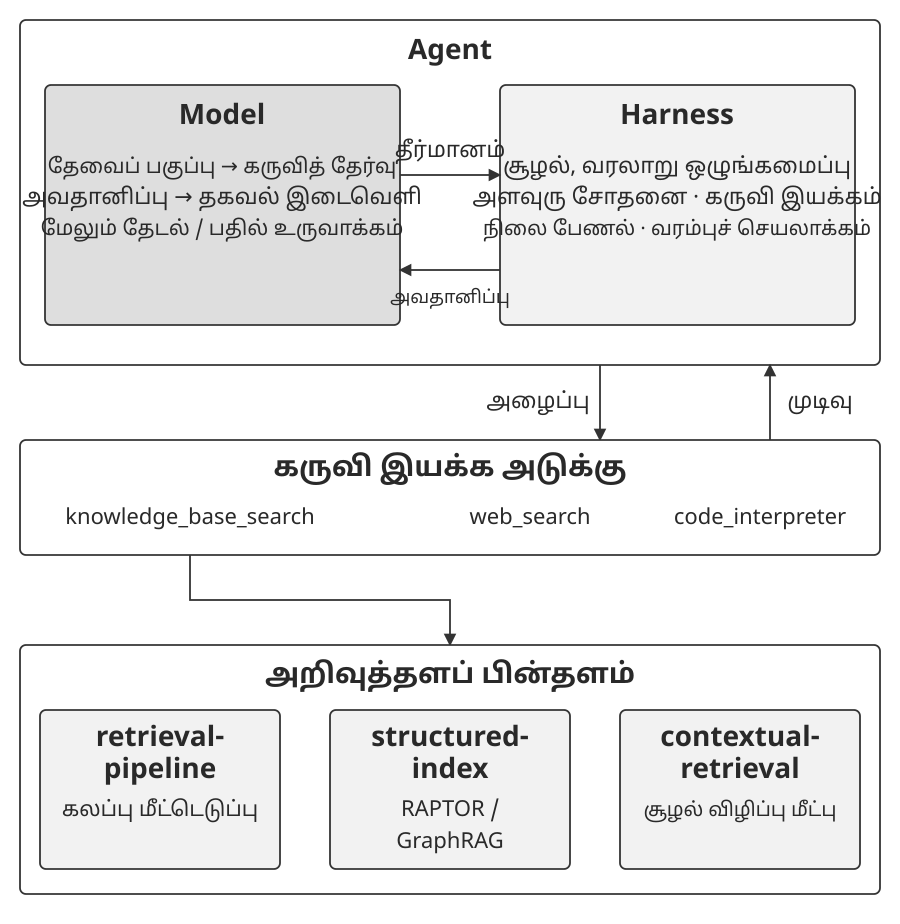

**மீட்டெடுக்கப்பட்ட உள்ளடக்கத்தின் நம்பிக்கை எல்லை.** வெளிப்புற ஆவணங்களில் மாதிரியின் நடத்தையை மாற்ற முயலும் உரை இருக்கலாம்; அல்லது தரவுத்தளத்துக்குள் நுழைவதற்கு முன்பே தவறான உண்மைகள் சேர்க்கப்பட்டிருக்கலாம். முன்னது மறைமுக ப்ராம்ப்ட் ஊடுருவல்; பின்னது அறிவுத் தள நச்சூட்டல் (poisoning). கையாளும்போது, உள்ளடக்க மூலத்தையும் செயல்பாட்டு அனுமதியையும் ஒருசேர நிர்வகிக்க வேண்டும்: மீட்டெடுப்பு முடிவுகள் மூலம், பதிப்பு, மேற்கோள் இருப்பிடம் ஆகியவற்றுடன் பதிலுக்கான சான்றாக வருகின்றன; பணப் பரிமாற்றம், நீக்கம், வெளியே மின்னஞ்சல் அனுப்புதல் போன்ற செயல்களை Harness-உம் இயக்கச் சூழலும் பயனர் அனுமதியின் அடிப்படையில் சரிபார்க்கின்றன. உள்நுழைவு மதிப்பாய்வு, மூலத் தடமறிதல், உண்மைச் சரிபார்ப்பு ஆகியவை தவறான அறிவின் பரவலை மேலும் கட்டுப்படுத்துகின்றன. அத்தியாயம் 2 அறிமுகப்படுத்திய மூலக் குறியிடுதலும் அத்தியாயம் 4-இன் கருவிக் கட்டுப்பாடுகளும் இங்கு இணைந்து செயல்படுகின்றன.

> **சோதனை 3-8 ★★: ஒற்றை மீட்டெடுப்பையும் பல சுற்று மீட்டெடுப்பையும் ஒப்பிடுதல்**
>
> இந்தச் சோதனை அதே சீனச் சட்டப் பொருளையும், அதே BM25 மீட்டெடுப்பியையும், அதே மாதிரியையும் பயன்படுத்தி, ஏழு கேள்விகளில் இரு முறைகளை ஒப்பிடுகிறது: அடிப்படைக் குழு அசல் கேள்வியின்படி ஒருமுறை தேடுகிறது; ஏஜெண்ட் பயன்முறை வினவலைச் சரிசெய்ய மாதிரியை அனுமதித்து, அதிகபட்சம் நான்கு முறை தேடுகிறது.
>
> "தற்காப்பு பற்றி எவ்வாறு விதிக்கப்பட்டுள்ளது" போன்ற வினவல்களுக்கு, நேரடி மீட்டெடுப்பே முக்கிய விதிகளைப் பெற்றுவிடும். இன்னும் சிக்கலான எடுத்துக்காட்டு: "மதுபோதையில் கவனக்குறைவால் ஒருவருக்குக் கடுங்காயம் ஏற்படுத்தியவருக்குத் திருட்டு முன்குற்றப் பதிவும் இருந்தால், தண்டனை எவ்வாறு நிர்ணயிக்கப்பட வேண்டும்". இது தற்போதைய செயல், மதுபோதை நிலை, முந்தைய பதிவு ஆகிய மூன்றையும் சம்பந்தப்படுத்துகிறது; மீட்டெடுக்கும்போது தொடர்புடைய பொருட்களைத் தனித்தனியாகக் கண்டறிந்து, பொருந்தும் நிபந்தனைகளைச் சரிபார்க்க வேண்டும்.
>
> உண்மையான இயக்கம் வரிசையாக "醉酒过失致人重伤 盗窃前科 量刑" (மதுபோதை கவனக்குறைவு கடுங்காயம் திருட்டு முன்குற்றம் தண்டனை நிர்ணயம்), "醉酒 犯罪 量刑" (மதுபோதை குற்றம் தண்டனை நிர்ணயம்), "盗窃前科 量刑影响 刑法" (திருட்டு முன்குற்றம் தண்டனைத் தாக்கம் குற்றவியல் சட்டம்), "前科 量刑影响 刑法" (முன்குற்றம் தண்டனைத் தாக்கம் குற்றவியல் சட்டம்) ஆகியவற்றைத் தேடியது. அதன் பிறகு மாதிரி "累犯 认定 刑法" (தொடர் குற்றவாளி அங்கீகாரம் குற்றவியல் சட்டம்) என்றும் முன்மொழிந்தது; அப்போது தேடல் ஒதுக்கீடு தீர்ந்துவிட்டதால், Harness ஒதுக்கீடு தீர்ந்தது என்ற தகவலைத் திருப்பித் தந்தது.
>
> சோதனை வகைப்படுத்திய நான்கு சிக்கலான கேள்விகளில், இலக்கு சட்டப் பிரிவுப் பரப்பு சுமார் 8%-இலிருந்து 92%-ஆக உயர்ந்தது; சராசரித் தேடல் எண்ணிக்கை ஒன்றிலிருந்து 3.5-ஆக உயர்ந்தது; பதிலளிக்கும் கட்டத்தின் சராசரி நேரம் சுமார் 8 வினாடியிலிருந்து 66 வினாடியாக உயர்ந்தது. மூன்று எளிய கேள்விகளின் சான்றுப் பரப்பு 100%; இரு குழுக்களும் ஒருமுறை மட்டுமே தேடின.

அதே மீட்டெடுப்புச் சுழற்சியைப் பயனர் வரலாற்றுக்கும் பயன்படுத்தலாம். கீழே சோதனை 3-1-இன் மூன்று அடுக்கு மதிப்பீட்டுத் தொகுப்பைப் பின்பற்றி, அமர்வுகளைக் கடந்த பதிவுகளிலிருந்து ஏஜெண்ட் உண்மைகளை எவ்வாறு மீட்டெடுக்கிறது, பொருள்களை வேறுபடுத்துகிறது, புதுப்பிப்புகளைக் கையாள்கிறது என்பதை அவதானிப்போம்.

> **சோதனை 3-9 ★★: ஏஜெண்ட் சார்ந்த மீட்டெடுப்பைக் கொண்டு பயனர் நினைவகத்தைப் படித்தல்**
>
> இந்தச் சோதனை முழு உரையாடல் வரலாற்றையும் அறிவுத் தளமாகக் கொண்டு, சாளரங்களாகப் பிரித்துச் சுட்டு அமைத்து, ஏஜெண்டுக்கு `search_user_memory` கருவியை வழங்குகிறது. சாளர அளவைச் சரிசெய்யலாம்; இந்த இயக்கத்தில் ஒவ்வொரு துண்டும் எட்டுச் சுற்று உரையாடலைக் கொண்டது, அடுத்தடுத்த துண்டுகள் இரண்டு சுற்றுகள் மேற்பொருந்துகின்றன; அமர்வு அடையாளம், நேரம், வணிக மீத்தரவு ஆகியவை சேமிக்கப்படுகின்றன. வினவல் அதிகபட்சம் மூன்று முறை; ஒவ்வொரு முறையும் நான்கு துண்டுகள் மீட்டெடுக்கப்படுகின்றன.
>
> அடிப்படை நினைவுகூரல் தெளிவான புலங்களைச் சுற்றித் தேடலாம்; எடுத்துக்காட்டாக "என் நடப்புக் கணக்கு (checking account) எண் என்ன". பல அமர்வுக் கேள்விகளுக்குப் பொருள்கள் முழுமையாக உள்ளனவா என்பதையும் சரிபார்க்க வேண்டும்: பயனரிடம் Honda Accord-உம் Tesla Model 3-உம் உள்ளன; வாகனச் சேவை ஏற்பாடுகளைப் பற்றிக் கேட்கும்போது, இரு வாகனங்களையும் அவற்றின் முன்பதிவு நிலைகளையும் அமைப்பு வேறுபடுத்த வேண்டும்.
>
> இதன் அடிப்படையில் ஒரு மீட்டெடுப்புப் பாதையை வடிவமைக்கலாம்: முதலில் வாகனம், சேவைப் பதிவுகளைத் தேடுதல்; இன்னொரு வாகனத்தின் துப்பைக் கண்டறிந்த பிறகு Tesla-வின் ஏற்பாட்டைத் தேடுதல்; இறுதியில் Honda-வின் ஏற்கனவே உள்ள முன்பதிவை விளக்கி, Tesla-வுக்கும் முன்பதிவு தேவையா என்று பயனரிடம் உறுதிசெய்தல். இந்த முறை உண்மையான பதிவில் `scheduled car services` என்ற ஒரு வினவல் மட்டுமே இயங்கியது; சாதாரண மீட்டெடுப்புக் குழுவின் பதில் Honda-வில் மட்டும் கவனம் செலுத்தி, Tesla-வைத் தவறவிட்டது.
>
> மற்றொரு வகைச் சிரமம் தொடர்ச்சியான மாற்றங்களிலிருந்து வருகிறது. பணப் பரிமாற்ற எடுத்துக்காட்டில், மனைவி ஒரு ஏற்பாட்டை அமைக்கிறார், கணவர் பின்னர் தொகையையும் தேதியையும் மாற்றுகிறார், மனைவி மீண்டும் சரிசெய்கிறார். பதிவுகளை மீட்டெடுத்த பிறகு, நேரம், பொருள், உறுதிப்படுத்தல் நிலை ஆகியவற்றின்படி மாற்றங்களை மீளுருவாக்கி, இறுதியில் நடைமுறையில் உள்ள அறிவுறுத்தலைக் கண்டுபிடிக்க வேண்டும். தற்போதைய துண்டாக்கம் ஏற்கனவே நேரத் தகவலைச் சேமித்தாலும், மீட்டெடுப்பு முக்கியத் திருத்தத்தைத் தவறவிடக்கூடும்; எனவே துண்டுகளுக்கு நிகழ்வுப் பின்னணியை மேலும் சேர்க்கலாம்.
>
> இந்த 60 நிகழ்வுகளில், 18 ஒருமுறையும், 6 இருமுறையும் தேடின; 36 மூன்று முறையையும் முழுமையாகப் பயன்படுத்தின. சாதாரணத் துண்டு மீட்டெடுப்புக் குழு 47-இல் தேர்ச்சி பெற்றது: அடிப்படை நினைவுகூரல் 19, பல அமர்வு மீட்டெடுப்பு 15, முன்னெச்சரிக்கைச் சேவை 13. அடுத்த பகுதி அதே நிகழ்வுகளில் சூழல் முன்னொட்டையும் கட்டமைக்கப்பட்ட நினைவகத்தையும் தொடர்ந்து ஒப்பிட்டு, அவை முறையே எந்தத் தகவலைச் சேர்த்தன என்று பகுப்பாய்வு செய்கிறது.

### சூழல் விழிப்புணர்வு மீட்டெடுப்பு: துண்டுகளுக்குப் பின்னணியை நிரப்புதல்

அந்த நிதி அறிக்கைக்குத் திரும்புவோம். ACME நிறுவனத்தின் 2025 இரண்டாம் காலாண்டுச் செயல்திறனைத் தேட, வினவலில் நிறுவனப் பெயரும் ஆண்டும் உள்ளன; ஆனால் "நிறுவனத்தின் வருவாய் 3% வளர்ந்தது" என்று எழுதப்பட்ட துண்டில் இந்த இரு சொற்களும் இல்லை. துண்டைப் பெரிதாக்குவதைத் தவிர, இந்தச் சிறு பத்தியைத் தக்கவைத்து, விடுபட்ட பின்னணியை அதன் முன்னால் சேர்க்கலாம். **சூழல் விழிப்புணர்வு மீட்டெடுப்பு (Contextual Retrieval)** சுட்டு அமைக்கும்போது, துண்டுக்குச் சுருக்கமான பின்னணி முன்னொட்டை உருவாக்கி, முன்னொட்டையும் மூல உரையையும் சேர்த்து மீட்டெடுப்புக்குப் பயன்படுத்துகிறது[^ch3-1]. இந்தச் செயலாக்கத்தைப் படம் 3-14 காட்டுகிறது.

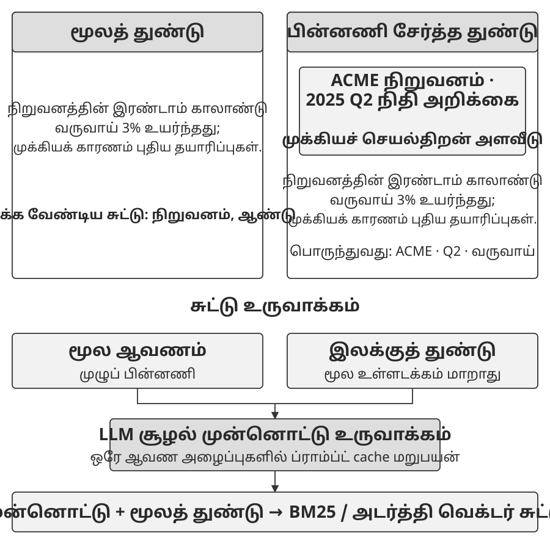

எடுத்துக்காட்டாக, முன்னொட்டு "இந்தப் பத்தி ACME நிறுவனத்தின் 2025 இரண்டாம் காலாண்டு அறிக்கையின் முக்கியச் செயல்திறன் குறிகாட்டிகள் பகுதியிலிருந்து வந்தது" என்று விளக்கலாம். உருவாக்கும்போது மூல உரையையும் இலக்குத் துண்டையும் ஒருசேர வழங்கி, உண்மையான அடிப்படை உள்ள சுட்டுகள், நேரம், அத்தியாயத் தகவல்களை மாதிரி நிரப்பச் செய்ய வேண்டும். இதனால் BM25-க்கு நிறுவனப் பெயர், காலாண்டு போன்ற பொருத்தக்கூடிய சொற்கள் கிடைக்கின்றன; அடர்த்திய உட்பொதிவும் இந்தப் பின்னணியுடன் சேர்ந்து துண்டை வெளிப்படுத்த முடிகிறது.

இது அத்தியாயம் 2-இன் சூழல் விழிப்புணர்வுச் சுருக்கத்துடன் இணைந்து பயன்படலாம்: சுட்டு அமைக்கும் நேரத்தில் அறிவுத் துண்டுகளுக்குப் பின்னணியைச் சேர்த்து, தொடர்புடைய தகவலைக் கண்டுபிடிக்கும் வாய்ப்பை உயர்த்துவது; இயக்க நேரத்தில் தற்போதைய பணிக்கேற்ப ஏற்கனவே மீட்டெடுக்கப்பட்ட வரலாற்றை ஒழுங்கமைத்து, உள்ளீட்டு நீளத்தைக் கட்டுப்படுத்துவது. முன்னது துண்டுகளின் மீட்டெடுக்கும் தன்மையில் கவனம் செலுத்துகிறது; பின்னது தற்போதைய முடிவுக்குத் தேவையான தகவலிலும் ஒதுக்கீட்டிலும் கவனம் செலுத்துகிறது.

[^ch3-1]: Anthropic, Introducing Contextual Retrieval, 2024 செப்டம்பர்.

> **சோதனை 3-10 ★★: மூலத் துண்டாக்கத்தையும் சூழல் மேம்படுத்திய துண்டாக்கத்தையும் ஒப்பிடுதல்**
>
> இந்தச் சோதனை அதே பொருட்களுக்கு இரு சுட்டுத் தொகுப்புகளை அமைக்கிறது: ஒன்று மூலத் துண்டுகளைப் பயன்படுத்துகிறது; மற்றொன்று மாதிரி உருவாக்கிய முன்னொட்டுகளைச் சேர்க்கிறது. வினவல்களும் இலக்குக் குறியிடுதலும் ஒரே மாதிரியாக வைத்துக்கொண்டு, BM25, அடர்த்திய மீட்டெடுப்பு, கலப்பு மீட்டெடுப்பு ஆகியவற்றை முறையே ஒப்பிடுகிறது.
>
> முந்தைய நிதி அறிக்கை எடுத்துக்காட்டைப் பின்பற்றி, "ACME நிறுவனத்தின் சமீபத்திய வருவாய் வளர்ச்சி" என்று வினவும்போது, பொருந்திய துண்டில் இலக்கு நிறுவனம், காலம், வளர்ச்சித் தரவு ஆகிய மூன்றும் உள்ளனவா என்று சரிபார்க்கலாம். "வருவாய் வளர்ச்சி" மட்டும் இருந்தால் மற்ற நிறுவனங்களுடன் பொருந்தக்கூடும்; முன்னொட்டைச் சேர்த்த பிறகு, நிறுவனப் பெயரும் நேரமும் வரிசைப்படுத்தலில் பங்கேற்க முடிகிறது.
>
> இந்த முறையின் 15 வினவல்களில், முன்னொட்டைச் சேர்த்த பிறகு BM25-இன் recall@1 0.60-இலிருந்து 0.80-ஆகவும், அடர்த்திய மீட்டெடுப்பு சுமார் 0.867-இலிருந்து 0.933-ஆகவும் உயர்ந்தது; இரண்டின் recall@3 முறையே 0.867, 1.0 ஆகவே தொடர்ந்தன. கலப்பு மீட்டெடுப்பின் recall@5 14/15-இலிருந்து 15/15 ஆக உயர்ந்தது. கூடுதலாக மீட்டெடுக்கப்பட்டது எந்தக் கேள்வி? தேசிய மக்கள் பேரவை நிரந்தரக் குழுவின் அதிகாரங்களை வினவியபோது, இலக்குத் துண்டு அதிகாரங்களைப் பட்டியலிட்டது; ஆனால் எழுவாய் (subject) இல்லை. முன்னொட்டைச் சேர்த்த பிறகு, BM25 அதை 16-ஆம் இடத்திலிருந்து 12-ஆம் இடத்துக்கு உயர்த்தியது; இன்னும் முதல் ஐந்துக்கு வெளியே உள்ளது; கலப்பு மீட்டெடுப்பு அதை 6-ஆம் இடத்திலிருந்து 5-ஆம் இடத்துக்கு உயர்த்தியதால் அது முதல் ஐந்துக்குள் நுழைந்தது. மூல உரையை மீண்டும் பாருங்கள்: முதல் துண்டு (1) முதல் (4) வரையிலான அதிகாரங்களைப் பட்டியலிடுகிறது; ஐந்தாம் துண்டு (4)-இலிருந்து (22) வரை தொடர்கிறது. மதிப்பீடு குறியிடப்பட்ட ஐந்தாம் துண்டு தேர்ந்தெடுக்கப்பட்டதா என்பதை மட்டும் சரிபார்க்கிறது; ஆனால் எல்லா அதிகாரங்களையும் பட்டியலிட இரு துண்டுகளையும் இணைக்க வேண்டும்.
>
> முன்னொட்டு உருவாக்கம் சுட்டு கட்டும் கட்டத்தில் கூடுதல் அழைப்புகளைச் சேர்க்கிறது. ஒரே ஆவணத்தின் பல துண்டுகளுக்குப் பின்னணி உருவாக்கும்போது, ஆவண முன்னொட்டுச் சேமிப்பை மீண்டும் பயன்படுத்தலாம். Anthropic-இன் 2024 அறிக்கையில், 800 token துண்டு, 8000 token ஆவணம், குறிப்பிட்ட ப்ராம்ப்ட் நீளம் ஆகியவற்றின் அடிப்படையில் மதிப்பிடப்பட்டால், ஒரு மில்லியன் ஆவண token-க்கான ஒருமுறைச் செயலாக்கச் செலவு சுமார் 1.02 டாலர்.
>
> அந்த அறிக்கையில், சூழல் உட்பொதிவு BM25-உடன் இணைந்து top-20 மீட்டெடுப்புத் தோல்வி விகிதத்தை 5.7%-இலிருந்து 2.9%-ஆகக் குறைத்தது; சார் வீதக் குறைவு சுமார் 49%; மறுவரிசைப்படுத்தலைச் சேர்த்த பிறகு 1.9%-ஆகக் குறைந்தது; சார் வீதக் குறைவு சுமார் 67%. அறிக்கை பயன்படுத்திய தோல்வி விகிதம் $1-\mathrm{recall@20}$.

திரும்பத் திரும்ப வினவ வேண்டிய, உள்ளடக்கம் ஒப்பீட்டளவில் நிலையான பொருள்தளங்களுக்கு, சுட்டு கட்டும் கட்டத்திலேயே துண்டுகளின் பின்னணியை நிரப்புவதற்கு முன்னுரிமை கொடுக்கப் பரிந்துரைக்கிறேன்; ஒரு முறைச் செயலாக்கம் அடுத்தடுத்த பல வினவல்களுக்குப் பயன்படும். நிறுவனப் பெயர், நிகழ்வுப் பொருள், நேரம் ஆகியவை துண்டாக்கும்போது தொலைந்துவிட்டால், மீட்டெடுக்கும் அளவை மட்டும் பெருக்கினாலும், சுட்டு தெளிவற்ற துண்டுகளின் தொகுதியே திரும்பக் கிடைக்கலாம். முன்னொட்டு உருவாக்கும்போது இந்தத் துப்புகளை நிரப்பினால், அடுத்தடுத்த மீட்டெடுப்பு அவற்றைக் கொண்டு பொருட்களை இடங்கண்டறிய முடியும்.

> **சோதனை 3-11 ★★★: சூழல் முன்னொட்டுகளாலும் கட்டமைக்கப்பட்ட அட்டைகளாலும் நினைவகத்தை வலுப்படுத்துதல்**
>
> உரையாடலில் "சரி, இதையே முன்பதிவு செய்" என்பதை முன்னால் வந்த பொருளுடன் அல்லது பயணத்துடன் இணைக்க வேண்டும். மூல உரை ஷாங்காயிலிருந்து சியாட்டிலுக்கான, 500 டாலர் ஒருவழிப் பயணச்சீட்டைப் பற்றிப் பேசியிருந்தால், முன்னொட்டு இந்தப் பின்னணியைச் சேர்த்து, உறுதிப்படுத்தல் நடந்த அமர்வையும் நேரத்தையும் தக்கவைக்கலாம்.
>
> இந்தச் சோதனை சாதாரணத் துண்டாக்கத்தின் மேல் இரு உள்ளமைவுகளைச் சேர்க்கிறது: சூழல் முன்னொட்டுக் குழு, மற்றும் Advanced JSON Cards-ஐயும் ஒருசேர ஏற்றும் இரு அடுக்கு நினைவகக் குழு. மாதிரி முதலில் சாதாரணச் சுட்டின் அடிப்படையில் தேடல் வரிசையை உருவாக்குகிறது; பின்னர் அதே வினவல் தொகுப்பை இரு சுட்டுத் தொகுப்புகளுக்கும் பயன்படுத்துகிறது; இரு அடுக்குக் குழு அதே மேம்படுத்தப்பட்ட மீட்டெடுப்பு முடிவுகளைப் பயன்படுத்தி, கட்டமைக்கப்பட்ட அட்டைகளையும் சேர்க்கிறது.
>
> பணப் பரிமாற்ற எடுத்துக்காட்டில், முன்னொட்டுகள் முறையே Patricia பணப் பரிமாற்றத்தைத் தொடங்கியதையும், James ஏற்பாட்டை மாற்றியதையும், Patricia மீண்டும் சரிசெய்ததையும் விளக்கி, நிகழ்வு வரிசையை இடங்கண்டறிய உதவுகின்றன. மூலப் பதிவு தந்த இறுதி நிலை 95,000 டாலர், அக்டோபர் 1; முந்தைய ஏற்பாடு ஏற்கனவே மாற்றப்பட்டுவிட்டது. இந்த முறை மூன்று குழுக்களும் இந்த நிலையைச் சரியாகக் கண்டுபிடித்தன.
>
> இரு அடுக்குக் கட்டமைப்பு முன்னெச்சரிக்கை இணைப்பையும் ஆதரிக்கிறது. அட்டைகள் "டோக்கியோ பயணம்", "கடவுச்சீட்டு செல்லுபடிக் காலம்" போன்ற முக்கிய உண்மைகளைச் சேமிக்கின்றன; விரிவான உரையாடல் தேவைக்கேற்ப மீட்டெடுக்கப்படுகிறது. ஜனவரி 15–22 பயணம், பிப்ரவரி 18-இல் காலாவதியாகும் கடவுச்சீட்டு என்று எடுத்துக்கொண்டால், தேதிகள் அருகில் இருப்பதை அமைப்பு முதலில் கண்டறிந்து, பின்னர் புதுப்பிப்புப் பதிவுகளையும் பயணத் தேவைகளையும் வினவி, இறுதியில் இன்னும் முடிக்கப்படாத தயாரிப்பு விஷயங்களை உறுதிசெய்ய நினைவூட்டலாம். இந்தப் பயண எடுத்துக்காட்டில் மூன்று குழுக்களின் பதில்களும் மதிப்பாய்வில் தேர்ச்சி பெற்றன; அட்டைக்கும் மீட்டெடுப்புக்கும் உள்ள வேறுபாடு கீழே உள்ள வாகன, அமர்வுகளைக் கடந்த எடுத்துக்காட்டுகளில் முக்கியமாகத் தெரிகிறது.
>
> மொத்தம் 60 நிகழ்வுகளில், சாதாரண மீட்டெடுப்பு, சூழல் முன்னொட்டு, இரு அடுக்கு நினைவகம் முறையே 47, 52, 57-இல் தேர்ச்சி பெற்றன. முன்னொட்டுக் குழுவின் முன்னெச்சரிக்கைச் சேவை நிகழ்வுகள் 13-இலிருந்து 18-ஆக உயர்ந்தன; இரு அடுக்குக் குழு பல அமர்வு மீட்டெடுப்பு அடுக்கில் 20-இலும், முன்னெச்சரிக்கைச் சேவை அடுக்கில் 18-இலும் தேர்ச்சி பெற்றது. வாகன எடுத்துக்காட்டில், அட்டைகள் இரண்டாம் வாகனத்தின் தகவலைச் சேர்த்து, முன்பு தவறவிட்ட பொருளையும் உள்ளடக்கப் பதில் உதவியது. இப்போது ஒரு பின்னடைவையும் பாருங்கள்: வீட்டுச் சொத்தின் நீர்ப் பாதிப்புக் காப்பீட்டு எல்லையை வினவியபோது, சாதாரணக் குழு சொந்த வீட்டையும் வாடகை வீட்டையும் குறிப்பிட்டது; முன்னொட்டுக் குழுவோ வாடகை வீட்டைத் தவறவிட்டது. கேள்விவாரியாக ஒப்பிட்டால், முன்னொட்டுக் குழு சாதாரணக் குழுவை விட 8 கேள்விகளில் கூடுதலாகச் சரியாகப் பதிலளித்தது; முன்பு சரியாகப் பதிலளித்த 3 கேள்விகளையும் இழந்தது.

**முன்னெச்சரிக்கையான சேவை தேவைப்படும்போது, முக்கிய உண்மைகள் நிரந்தரமாக இருந்து, விரிவான பதிவுகள் தேவைக்கேற்ப மீட்டெடுக்கப்படும் இரு அடுக்குக் கட்டமைப்பை நான் விரும்பிப் பயன்படுத்துவேன்.** மீட்டெடுப்பை மட்டும் நம்பினால், எதைக் கேட்க வேண்டும் என்று மாதிரி முதலில் தெரிந்திருக்க வேண்டும்; அப்போதுதான் தொடர்புடைய பதிவுகளைக் கண்டுபிடிக்க முடியும். இன்னும் பார்வைக்கு வராத கடவுச்சீட்டு, வாகனம், குடும்ப உறவுகள் ஆகியவை எளிதில் தவறவிடப்படலாம். சில முக்கிய உண்மைகளை முதலில் சூழலில் வைத்தால், தொடர்புகளைக் கண்டறிந்து, வினவல்களை முன்மொழிந்து, பின்னர் மூல விவரங்களை மீட்டெடுக்க மாதிரிக்கு உதவும். நிரந்தரத் தகவலைத் தேர்ந்தெடுக்கும்போது, நபர் உறவுகள், தற்போதைய கட்டுப்பாடுகள், முடிக்கப்படாத விஷயங்கள் ஆகியவற்றைக் கருத்தில் கொள்ள வேண்டும்; மீட்டெடுப்பு முடிவுகளோ மூலம், நேரம், மாற்றத்திற்கான அடிப்படை ஆகியவற்றைத் தக்கவைக்கின்றன.

### தரவுத் தொகுப்புகளிலிருந்து அறிவைப் பிரித்தெடுத்தல்: வழக்குகளிலிருந்து கட்டமைக்கப்பட்ட வெளிப்பாட்டுக்கு

அறிவு, ஏராளமான வழக்குகளை ஒழுங்கமைப்பதிலிருந்தும் வரலாம். தீர்ப்பு ஆவணங்கள், வாடிக்கையாளர் சேவை வேலைச்சீட்டுகள், பழுதுபார்ப்புப் பதிவுகள் ஆகியவற்றில், பயனுள்ள தகவல் பல குறிப்பிட்ட விவரணைகளில் சிதறியுள்ளது. பணிக்கு ஏராளமான வழக்குகளிலிருந்து விதிகளைத் தொகுக்கவோ, முடிவுகளை ஒப்பிடவோ, எதைக் கூடுதலாகக் கேட்பது என்று தீர்மானிக்கவோ தேவைப்பட்டால், முதலில் ஒரே மாதிரியான புலங்களைப் பிரித்தெடுத்து, பின்னர் புள்ளிவிவரமும் முன்மாதிரி ஒழுங்கமைப்பும் செய்யப் பரிந்துரைக்கிறேன். ஒத்த சில வழக்குகளை மட்டும் மீட்டெடுத்தால், முழுத் தரவுத் தொகுப்பின் பரவலைப் பார்ப்பது கடினம்; புலங்களை ஒருமைப்படுத்திய பிறகு, முழுத் தொகுதிப் பதிவுகளுக்கும் புள்ளிவிவரம் கணக்கிட்டு, அடுத்தடுத்த தனிவழக்கு வினவல்களுக்குப் பொது அவதானிப்பை வழங்கலாம்.

இந்தச் செயல்முறையை இரு படிகளாகப் பிரிக்கலாம். **அறிவுப் பிரித்தெடுப்பு** மூல விவரணையைக் கட்டமைக்கப்பட்ட பதிவாக மாற்றி, புலங்களின் பொருள், மதிப்புகள், மூலம் ஆகியவற்றைத் தெளிவுபடுத்துகிறது; **முறை பகுப்பாய்வு** புள்ளிவிவரத்தையும் தொகுப்பையும் (clustering) கொண்டு ஒத்த வழக்குகளையும் அவற்றின் பொது இயல்புகளையும் தேடுகிறது. வழக்குப் பிரித்தெடுப்பு, இயல்புக் குறியாக்கம், முன்மாதிரி மீட்டெடுப்பு ஆகியவற்றின் ஓட்டத்தைப் படம் 3-15 காட்டுகிறது.

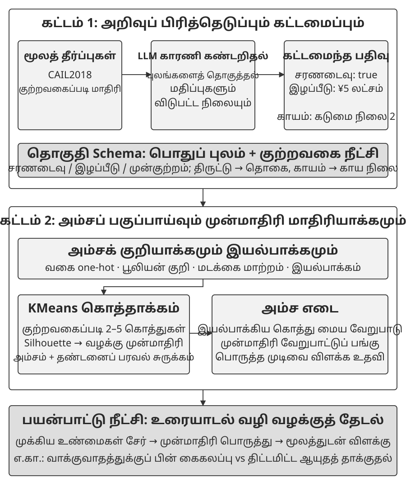

> **சோதனை 3-12 ★★★: நீதி வழக்குகளிலிருந்து காரணிகளையும் முன்மாதிரிகளையும் பிரித்தெடுத்தல்**
>
> இந்தச் சோதனை CAIL2018-இன் குற்றவியல் வழக்குப் பொருட்களைப் பயன்படுத்தி, திருட்டு, வேண்டுமென்றே காயப்படுத்துதல், மோசடி ஆகிய மூன்று வகைப் பதிவுகளைத் தேர்ந்தெடுத்து, "காரணிக் கண்டுபிடிப்பு—புலப் பிரித்தெடுப்பு—தொகுப்பு—முன்மாதிரி விளக்கம்" என்ற கற்பித்தல் செயல்முறையை அமைக்கிறது[^ch3-cail]. ஒவ்வொரு வகையிலும் 120 பதிவுகள் முன்மாதிரிக் கட்டமைப்புக்குப் பயன்படுத்தப்பட்டு, மேலும் 20 பதிவுகள் தனியாக வைக்கப்பட்டன; மொத்தம் 360 கட்டமைப்புப் பதிவுகளும் 60 தனிவைப்புப் பதிவுகளும் உருவாக்கப்பட்டன.
>
> **புலங்களைக் கண்டறிந்து ஒழுங்கமைத்தல்.** மாதிரி முதலில் கட்டமைப்புப் பதிவுகளைத் தொகுதித் தொகுதியாகப் படித்து, பயனுள்ள காரணிகளை முன்மொழிந்து, பின்னர் அவற்றைத் தொகுதிகளாக்கிய Schema-வாக இணைக்கிறது. பொது பகுதி பல குற்றங்களுக்கும் கவனிக்க வேண்டிய புலங்களைச் சேமிக்கிறது; எடுத்துக்காட்டாகத் தானாகச் சரணடைதல், இழப்பீடு; விரிவுப் பகுதி குறிப்பிட்ட குற்றம் தொடர்பான தகவலைச் சேமிக்கிறது; எடுத்துக்காட்டாக வழக்குத் தொடர்புடைய தொகை அல்லது காயத்தின் நிலை. இந்த ஒழுங்கமைப்பில் 16 பொதுப் புலங்களும், முறையே 12, 12, 11 புலங்கள் கொண்ட மூன்று விரிவுத் தொகுதிகளும் கிடைத்தன. ஒவ்வொரு புலத்துக்கும் மதிப்புகளையும் விடுபட்ட நிலையையும் வரையறுக்க வேண்டும்; அப்போதுதான் ஒரே மாதிரியாகப் பிரித்தெடுக்க முடியும்.
>
> **புலங்களை வெக்டராகக் குறியாக்குதல்.** வகைப் புலங்களுக்கு one-hot குறியாக்கத்தைப் பயன்படுத்தலாம்: திருட்டு, கொள்ளை, மோசடி என்ற மூன்று வகைகளை எடுத்துக்காட்டாகக் கொண்டால், முறையே `[1,0,0]`, `[0,1,0]`, `[0,0,1]` என்று குறியாக்கப்படும்; ஒவ்வொரு இடமும் அந்த வகையைச் சேர்ந்ததா என்பதை மட்டும் காட்டுகிறது. 1, 2, 3 என்று பயன்படுத்தினால், சில வழிமுறைகளுக்கு வகைகளுக்கு இடையே வரிசையும் தூரமும் உருவாகிவிடும். "சரணடைந்தாரா", "இழப்பீடு அளித்தாரா" போன்ற புலங்களுக்கு 1, 0 ஆகியவை உறுதிசெய்யப்பட்ட இரு நிலைகளைக் குறிக்கலாம்; மூல உரையில் குறிப்பிடப்படாத நிலையைத் தனியாகக் கையாள வேண்டும்; விடுபட்டதைத் தானாக மறுப்பாகக் கருதக்கூடாது.
>
> தொகை போன்ற பெரும் வீச்சுள்ள எதிர்மறையற்ற எண் மதிப்புகளுக்கு, இந்தச் செயலாக்கம் முதலில் $\ln(1+x)$ கொண்டு அளவைச் சுருக்கி, பின்னர் இயல்பாக்கலில் பங்கேற்கச் செய்கிறது. ஒரு புலம் ஒரே நேரத்தில் பல வகைகளை அனுமதித்தால், எடுத்துக்காட்டாக ஒரு பதிவில் பல தீர்வு நடவடிக்கைகள் இருந்தால், ஒவ்வொரு வகைக்கும் தனிக் குறியீட்டு இடத்தை அமைத்து multi-hot குறியாக்கத்தை உருவாக்கலாம்.
>
> **வழக்கு முன்மாதிரிகளை உருவாக்குதல்.** குறியாக்கிய இயல்புகளை முதலில் தரப்படுத்தி (standardize), பின்னர் குற்ற வகை வாரியாகத் தனித்தனியாகத் தொகுக்கிறது. இந்தச் செயலாக்கம் இரண்டு முதல் ஐந்து தொகுதிகளை ஒப்பிட்டு, விளிம்புரு குணகத்தை (silhouette coefficient)க் கொண்டு குழுவைத் தேர்ந்தெடுத்து, இறுதியில் 11 முன்மாதிரிகளை உருவாக்குகிறது. ஒவ்வொரு முன்மாதிரியும் பதிவு எண்ணிக்கை, முக்கிய இயல்புகள், தண்டனைக் காலத்தின் இடைநிலை (median), கால்மானங்கள் (quartiles), வீச்சு ஆகியவற்றைச் சேமிக்கிறது. எடுத்துக்காட்டாக, மோதலின் தோற்றம், குற்றச் செயல் முறை, காயத்தின் விளைவு ஆகியவற்றைச் சுற்றி, வாய்த்தகராறுக்குப் பின் கை காலால் நடந்த மோதலையும், திட்டமிட்டு ஆயுதத்துடன் நடந்த நடத்தையையும் ஒப்பிடலாம்; குறிப்பிட்ட பிரிவு பிரித்தெடுப்பு முடிவுகளாலும் தொகுப்பாலும் இணைந்து தீர்மானிக்கப்படுகிறது.
>
> **இயல்புகளையும் பொருத்த முடிவுகளையும் விளக்குதல்.** நிரல், ஒவ்வொரு தொகுதியின் இயல்பாக்கிய மையங்களுக்கு இடையிலான வேறுபாட்டின் அடிப்படையில், முன்மாதிரிகளை வேறுபடுத்துவதில் ஒவ்வொரு இயல்பின் எடையைக் கணக்கிடுகிறது. முன்மாதிரிப் பொருத்தம் புதிய வழக்கை அதே இயல்பு வெளிக்கு மாற்றி, அருகிலுள்ள குழுவின் புள்ளிவிவரச் சுருக்கத்தையும் அடிப்படையையும் மீட்டெடுத்து, மாதிரி விளக்கத்தை ஒழுங்கமைக்க உதவுகிறது.
>
> இந்த முறை 60 தனிவைப்புப் பதிவுகளில் 12-ஐத் தேர்ந்தெடுத்து விளக்கங்களை உருவாக்கி, தனி மாதிரியிடம் மதிப்பாய்வுக்குக் கொடுத்தது. அவற்றில் ஒரு திருட்டுப் பதிவைப் பார்ப்போம்: அது பொருந்திய முன்மாதிரியில் ஒரே ஒரு கட்டமைப்புப் பதிவு மட்டுமே உள்ளது; தண்டனைக் காலம் 4 மாதங்கள்; எனவே குறைந்தபட்சம், இடைநிலை, அதிகபட்சம் அனைத்தும் 4. உருவாக்கி இந்த எண்ணை உண்மையாகவே தெரிவித்தது; ஒரே ஒரு பதிவு மட்டுமே குறிப்புக்கு இருப்பதையும் சுட்டிக்காட்டியது. மதிப்பீட்டாளர் "எண்கள் முன்மாதிரிக்கு உண்மையாக உள்ளனவா" என்பதற்கு 4 மதிப்பெண்ணும் (முழு மதிப்பெண்) தந்தார்; ஆனால் அந்தத் தனிவைப்புப் பதிவின் உண்மையான இலக்கு 8 மாதங்கள்.
>
> முன்மாதிரி மீட்டெடுப்பை உரையாடலில் பயன்படுத்தினால், எந்த விடுபட்ட உண்மைகள் பொருத்தத்தைப் பாதிக்கக்கூடும் என்று முதலில் கேட்டு, பதிலின் அடிப்படையில் மீண்டும் மீட்டெடுக்கலாம்.

[^ch3-cail]: CAIL2018, அதிகாரபூர்வ தரவுத் தொகுப்புத் திட்டம். துணைச் சோதனை பொதுப் பொருட்களிலிருந்து கூறெடுத்து, கூறுகளின் உள் பிரிவைக் கொண்டு முன்மாதிரிக் கட்டமைப்பையும் மதிப்பீட்டையும் செய்கிறது.

வழக்குகளிலிருந்து முன்மாதிரிகள் வரை, அறிவுத் தளம் மீட்டெடுக்கக்கூடிய புள்ளிவிவர வெளிப்பாட்டு அடுக்கை ஒன்று சேர்க்கிறது. மூல உரை சான்றை வழங்குகிறது, புலங்கள் கணக்கீட்டை ஆதரிக்கின்றன, முன்மாதிரிகள் ஒத்த பதிவுகளின் பொது இயல்புகளைச் சுருக்குகின்றன; மூன்றும் தொடர்பைத் தக்கவைத்தால் மட்டுமே, பிரித்தெடுப்புப் பிழையோ கூறெடுப்புச் சார்போ (sample bias) தெரியவரும்போது பின்னோக்கிப் பார்த்துத் திருத்த முடியும்.

### முன்னணி ஆய்வு: பல்முறைமை மற்றும் அளவுரு நினைவகம்

பயனர் முன்பு பதிவேற்றிய புகைப்படத்தைச் சுட்டி "இந்த நிறம்தான் வேண்டும்" என்று சொல்கிறார் என்று வைத்துக்கொள்வோம். அப்போது அமைப்பு "நீல நிறக் கோட்" என்ற சில சொற்களை மட்டும் விட்டுவைத்திருந்தால், அடுத்த முறை இரு வகை நீலங்களை வேறுபடுத்த முடியாமல் போகலாம். ஒலியின் குரல் வண்ணம், விளக்கப்படத்தின் இடஞ்சார்ந்த உறவுகள் ஆகியவையும் உரை மாற்றத்தின்போது விவரங்களை இழக்கும். எதிர்கால வினவல்கள் இந்தத் தகவலை மீட்டெடுக்க வாய்ப்பளிக்க, மூலப் பொருட்களைச் சேமிக்கலாம், மாதிரி பயன்படுத்தக்கூடிய வெளிப்பாட்டைச் சேமிக்கலாம், அல்லது மாதிரியின் உள் நிலையான நினைவகத்தை மேலும் ஆராயலாம்.

**முதல் பாதை: மூலப் பொருட்களுடன் உரைச் சுட்டை இணைத்தல்.** எடுத்துக்காட்டாக, பயனர் அனுமதி அளித்த புகைப்படத் தொகுப்பு ஒழுங்கமைப்புப் பணியில், முகம் போன்ற பகுதிகளை வெட்டிச் சேமித்து, Markdown உருப்படிகளில் படங்களைக் குறிப்பிட்டு, படமெடுத்த நேரம், காட்சி, பயனர் தந்த நபர் குறிச்சொற்களைப் பதிவு செய்யலாம். மீட்டெடுப்பின்போது முதலில் விவரணையின் அடிப்படையில் தொடர்புடையதாக இருக்கக்கூடிய சில புகைப்படங்களைக் கண்டுபிடித்து, பின்னர் மூலப் படத்தையோ வெட்டிய பகுதியையோ படித்துத் தோற்ற விவரங்களை ஒப்பிடலாம். ஒலித் துண்டுகளையும் நேரம், மூலம், உரை மாற்றத்துடன் இணைத்து, தேவைக்கேற்ப மூல ஒலியை மீண்டும் இயக்கலாம். உரை நுழைவாயிலை வழங்குகிறது; மூலப் பொருள் எழுத்தில் சுருக்கக் கடினமான விவரங்களைத் தக்கவைக்கிறது.

**இரண்டாம் பாதை: உட்பொதிவுகளைச் சேமித்துத் தேவைக்கேற்ப ஏற்றுதல்.** பார்வை அல்லது ஒலிக் குறியாக்கிகள் பொருட்களை வெக்டராக மாற்றி, ஒற்றுமைத் தேடலுக்காகச் சுட்டில் சேமிக்கலாம். எடுத்துக்காட்டாகப் படத்தின் ஒரு பகுதியையோ ஒலித் துண்டையோ குறியாக்கி, அந்தந்த நினைவக உருப்படிகளுடன் தனித்தனியாக இணைக்கலாம். பயிற்சி பெற்ற வீழல் அடுக்கும் (projection layer) நினைவக இடைமுகமும் மாதிரிக்கு இருந்தால், சூழலில் சில இடங்களை (slot) ஒதுக்கி இந்தத் தொடர் வெக்டர்களை வைத்து, கவனம் வழியாக மாதிரி அவற்றை அணுகச் செய்யலாம். இங்குக் குறியாக்கி வெளிப்பாட்டையும் மொழி மாதிரியின் உள் வெளிப்பாட்டையும் ஒத்திசைக்க வேண்டும்.

Noah Shi-உடன் நான் செய்த ஒரு தொடக்க ஆய்வு இந்தப் பிரச்சினையை இரு படிகளாகப் பிரிக்கிறது. குழுப் படத்தில் இரு நபர்கள் உள்ளனர்; "ஜன்னல் ஓரம் நிற்பவர் கடந்த முறை பார்த்தவர்தானா?" என்று பயனர் கேட்கிறார். முதலில் "ஜன்னல் ஓரம்" என்ற தகவலின் அடிப்படையில் பயனர் குறிப்பிடும் நபரைக் கண்டுபிடிக்க வேண்டும்; பின்னர் அந்த நபரின் படத்தை முன்பு சேமித்த மாதிரிகளுடன் ஒப்பிட வேண்டும். முதல் படியில் தவறான நபரைத் தேர்ந்தெடுத்தால், இரண்டாம் படி எவ்வளவு துல்லியமாக இருந்தாலும், பதில் வேறொரு கேள்விக்குப் பதிலாகிவிடும். ஆய்வுக் கட்டுரை மேலும், பெயர் போன்ற துல்லியமாக நகலெடுக்கக்கூடிய உண்மைகளை உரை நினைவகத்தில் வைத்து, இரு வகைத் தகவலும் ஏற்ற தனித்தனி எடுப்பு முறைகளைக் கொண்டிருக்கச் செய்கிறது.[^ch3-perceptmem]

[^ch3-perceptmem]: Li Bojie, Noah Shi, Parametric Multimodal User Memory; துணைத் திட்டம் `19PINE-AI/multimodal-user-memory` செயலாக்கத்தையும் PerceptMem சோதனைகளையும் தொகுத்துள்ளது. குழுப் படக் கேள்வி கற்பித்தல் எடுத்துக்காட்டு.

**மூன்றாம் பாதை: மாதிரிக்குள் நிலையான நினைவகம்.** ஒவ்வொரு பயனருக்கும் LoRA-ஐப் பயிற்றுவது, தனிப்பயனாக்கப்பட்ட உண்மைகளை மாதிரிக்குள் எழுதுவதற்கான ஒரு வழி. "பயனர் எங்கு வசிக்கிறார்" என்று நேரடியாகக் கேட்பதற்கும், வசிப்பிடத்தின் அடிப்படையில் பயணத்தைத் திட்டமிடுவதற்கும் நினைவகப் பயன்பாட்டுத் தேவைகள் வேறு: முன்னது உண்மையைப் படிக்கிறது; பின்னதோ அந்த உண்மையை அடுத்தடுத்த பகுத்தறிவுக்குப் பயன்படுத்த வேண்டும். உண்மைகளை மீண்டும் சொல்வதை மட்டும் சுற்றிப் பயிற்றுவித்தால், மாதிரி பதிலை நினைவில் வைத்திருக்கலாம்; ஆனால் சிக்கலான பணிகளில் அதைத் தானாகப் பயன்படுத்தாமல் போகலாம். எனவே, பயிற்சி மாதிரிகளில் நேரடிக் கேள்விகளும் இந்த உண்மைகளைச் சார்ந்த பணிகளும் ஒருசேர இருக்க வேண்டும்.

எனது **User as Engram** ஆய்வு, உரை உண்மைகளை Engram மாதிரியின் உள்ளூர் நினைவக அட்டவணையில் எழுதி, பகிரப்பட்ட தகவமைப்பி (adapter) அந்த உண்மைகளைப் பகுத்தறிவுக்குப் பயன்படுத்துவதைக் கற்றுக்கொள்கிறது[^engram]. ஹாஷ் விசையுடன் கூடிய N-gram தேடல் அட்டவணை உருப்படிகளை இடங்கண்டறிகிறது; வாயில் (gate) பொறிமுறை மீட்டெடுத்த உள்ளடக்கத்தை மாதிரிக்குள் அனுப்புகிறது; ஒவ்வொரு பயனரும் உள்ளூர் அட்டவணை உருப்படிகளைச் சேமிக்கின்றனர்; பகுத்தறிவுப் பகுதியைப் பகிரலாம். ஆய்வுக் கட்டுரை தன் உரை உண்மைச் சோதனைகளில் நேரடி நினைவுகூரலையும் மறைமுகப் பகுத்தறிவையும் ஒப்பிட்டு, ஒவ்வொரு பயனரின் நினைவக உள்ளடக்கத்தையும் பகிரப்பட்ட பகுத்தறிவுத் திறனையும் எவ்வாறு தனித்தனியாக நிர்வகிப்பது என்பதைக் காட்டுகிறது.

[^engram]: Li, Bojie, User as Engram: Internalizing Per-User Memory as Local Parametric Edits, 2026.

இந்தப் பாதையைப் பல்முறைமைக்கு விரிவுபடுத்த, படம் அல்லது ஒலி வெளிப்பாடுகளுக்கான முகவரியிடல், எழுதுதல், படித்தல் பொறிமுறைகளையும் வடிவமைக்க வேண்டும்.

## அத்தியாயச் சுருக்கம்

அத்தியாயத்தின் தொடக்கத்தில் உள்ள முன்பதிவு வேண்டுகோளுக்குத் திரும்புவோம். "நான் ஜன்னல் ஓர இருக்கையை விரும்புகிறேன்" என்பது இந்தப் பயனரிடமிருந்து வந்தது; "எத்தனை பயணப்பெட்டிகள் எடுத்துச் செல்லலாம்" என்பதற்குப் பயணத் தேதியில் பொருந்தும் விமான நிறுவன விதிமுறைகளைத் தேட வேண்டும். இரண்டையும் ஒரே வாக்கியமாகச் சேமித்தால், மிக முக்கியமான வேறுபாடு எளிதில் தொலைந்துவிடும்: முந்தைய வாக்கியம் யாருக்குப் பொருந்துகிறது, பின்னையது எப்போதிலிருந்து செல்லுபடியாகிறது. சேமிக்கும்போது மூலம், நேரம், பொருந்தும் நிபந்தனைகளைத் தக்கவைத்தால் மட்டுமே, மீட்டெடுத்த பிறகு இந்த முறை பயன்படுத்தலாமா என்று தீர்மானிக்க அடிப்படை இருக்கும். தனி உண்மைகளுக்குச் சுருக்கமான குறிப்புகள் பொருத்தம்; நபர் உறவுகளையோ பின்னணியையோ விளக்க வேண்டுமானால் அட்டைகளையோ மூலப் பத்திகளையோ பயன்படுத்தலாம்; தேதிகளையும் அளவுகளையும் வகைப்படுத்தப்பட்ட புலங்களாகச் சேமித்து நிரலிடம் கணக்கிடக் கொடுக்கலாம்.

உதவியாளர் பயணப்பெட்டி அளவைத் தவறாகச் சொன்னால், முதலில் தற்போதைய விதிமுறைகள் தரவுத்தளத்துக்குள் வந்துள்ளனவா என்று பாருங்கள்; பின்னர் விதிமுறை எந்தத் துண்டுக்குள் வெட்டப்பட்டது, மீட்டெடுப்பி அதைக் கண்டுபிடித்ததா, மறுவரிசைக்குப் பிறகு எந்த இடத்தில் உள்ளது என்று சரிபாருங்கள்; இறுதியில் மாதிரி எந்தப் பொருட்களைப் பெற்றது என்று பாருங்கள். மூல உரை ஏராளமாக இருந்தால், கட்டமைக்கப்பட்ட மேலோட்டத்தைச் சூழலில் வைத்து, விவரங்களைத் தேவைக்கேற்ப மீட்டெடுக்கலாம். பகுதிவாரிச் சுருக்கங்கள் தலைப்புகளைக் கண்டுபிடிக்க உதவுகின்றன; உறவுச் சுட்டு இணைப்புகளைத் தேட உதவுகிறது; துண்டில் சுட்டி விடுபட்டால், மூலப் பின்னணியைச் சேர்த்து நிரப்பலாம்; ஒரு மீட்டெடுப்பில் இன்னும் சான்று போதவில்லை என்றால், ஏஜெண்ட் வினவலை மாற்றித் தொடர்ந்து தேடலாம்.

விமான நிறுவனம் புதிய விதிமுறையை வெளியிட்ட பிறகு, முதலில் ஒரு சிறிய எல்லைப் புதுப்பிப்பைச் செய்து, பழைய, புதிய விதிமுறைகளின் நடைமுறை நேரத்தையும் மூலத்தையும் தக்கவைக்கலாம்; குவிந்த மீள்வரும் உருப்படிகள், முரண்பாடுகள், கட்டமைப்பு மாற்றங்களைப் பின்னர் வழக்கமாக ஒழுங்கமைக்கலாம். முன்மொழிபவர் திருத்தத்தைச் சமர்ப்பிக்கிறார், மதிப்பாய்வாளர் சான்றுகளைச் சரிபார்க்கிறார், ஒப்புதலுக்குப் பிறகு சேவைச் சுட்டு மீண்டும் கட்டப்படுகிறது. பதிப்புப் பதிவு இருந்தால், முன்பு தவறாகப் பதிலளித்த கேள்விகளை மீண்டும் இயக்கலாம்; பழைய பதில் அப்போது எந்தப் பொருளை அடிப்படையாகக் கொண்டது என்பதையும் கண்டறியலாம். செயல்பாட்டு முடிவுகளிலிருந்து அனுபவத்தை எவ்வாறு மேலும் குவிப்பது என்பதை அத்தியாயம் 9 சிறப்பாக விவாதிக்கும்.

இரு பயணப்பெட்டிகள் அனுமதிக்கப்படுகின்றன என்று கண்டுபிடித்தது "விதி அனுமதிக்கிறதா" என்ற கேள்விக்கு மட்டும் பதிலளித்தது. பயனருக்காகப் பயணப்பெட்டிகளை ஆர்டரில் சேர்க்க, எந்தக் கருவியை அழைக்கலாம், என்ன அளவுருக்கள் தேவை, என்ன ரசீது வந்தால் செயல் முடிந்ததாகக் கருதுவது என்பதையும் உதவியாளர் அறிந்திருக்க வேண்டும். அடுத்த அத்தியாயம் அங்கிருந்து தொடங்குகிறது.

## சிந்தனைக் கேள்விகள்

1. ★★ பயனர் சொல்கிறார்: "மே 1-இல் நான் A-விலிருந்து B-க்குக் குடிபெயர்கிறேன்; மே 10 முதல் 20 வரை C ஹோட்டலில் தங்குவேன்; இந்தக் காலத்தில் கட்டண அறிக்கைகளை மின்னஞ்சலில் அனுப்புங்கள்." மே 15-ஆம் தேதி, வீட்டு முகவரி, தற்காலிகத் தங்குமிடம், கட்டண அறிவிப்பு ஒப்படைப்பு முறை ஆகியவற்றுக்கு உதவியாளர் எவ்வாறு பதிலளிக்க வேண்டும்? பதிவு செய்தல், வினவல் விதிகளை வடிவமைத்து, தட்டச்சுப் பிழைத் திருத்தத்தையும் முரண்படும் முகவரிகளையும் எவ்வாறு கையாள்வது என்று விளக்குங்கள்.
2. ★★ மூல ஆவணத்தில் முரண்படும் தகவல் இருந்தால், சூழல் முன்னொட்டு அந்தப் பிழையையும் சுட்டில் எழுதிவிடக்கூடும். மூலம், பதிப்பு, ஐயமான உருப்படிகள் ஆகியவற்றை எவ்வாறு சேமித்து, மீட்டெடுப்பிலும் உருவாக்கத்திலும் அவற்றைப் பயன்படுத்துவீர்கள்?
3. ★★ விளக்கப்படத்தை உரையாக மாற்றும்போது எந்த இடஞ்சார்ந்த உறவுகள் (spatial relations) எளிதில் தொலைகின்றன? அட்டவணை, கட்டமைப்புப் படம், அல்லது வரி வரைபடத்தை எடுத்துக்காட்டாகக் கொண்டு, மூலப் படம், கட்டமைக்கப்பட்ட வெளிப்பாடு, உரைச் சுட்டு ஆகியவை இணைந்து மீட்டெடுக்கும் தீர்வை வடிவமையுங்கள்.
4. ★★★ மாதிரியும் நீண்ட சூழல் திறனும் உயர்வதால், துண்டாக்கம், சுட்டு, மீட்டெடுப்புச் செயல்முறையில் எந்த வேலைகளை மாதிரியிடம் ஒப்படைக்கலாம்? Rich Sutton-இன் "கசப்பான பாடம்" தேடல், கற்றல் பற்றிக் கூறுவதைக் கொண்டு பகுப்பாய்வு செய்து, முழு உள்ளீட்டுக்கும் தேவைக்கேற்ப மீட்டெடுப்புக்கும் இடையே ஒப்பீட்டுச் சோதனையை வடிவமைத்து, பணித் தரம், கணக்கீட்டுச் செலவு, அனுமதிக் கட்டுப்பாடுகள் ஆகிய மூன்றையும் சரிபாருங்கள்.
5. ★★★ மாதிரி ஏற்கனவே ஏராளமான துறை அறிவைக் கொண்டிருந்தால், வெளிப்புற அறிவுத் தளம் இன்னும் எதைச் சேமிக்க வேண்டும்? பொது அறிவு, தொடர்ந்து புதுப்படும் விதிகள், தனியார் பொருட்கள், துல்லியமாகத் தடமறிய வேண்டிய சான்றுகள் ஆகியவற்றைத் தனித்தனியாக விவாதியுங்கள்.
6. ★ RAPTOR-இன் பல அடுக்குச் சுருக்கமும், GraphRAG-இன் பொருள் உறவுகளும் சமூகச் சுருக்கங்களும் முறையே எந்தெந்த வினவல்களை ஆதரிக்கின்றன? ஒட்டுமொத்த மேலோட்டம், குறிப்பிட்ட விவரம், பல தாவல் இணைப்பு ஆகிய ஒவ்வொன்றுக்கும் ஓர் எடுத்துக்காட்டு தந்து, எந்தச் சான்றைச் சரிபார்க்க வேண்டும் என்று விளக்குங்கள்.
7. ★★ கோப்பகங்கள், இணைப்புகள், வெக்டர் சுட்டு ஆகியவை இணைந்து அறிவை எவ்வாறு ஒழுங்கமைக்கலாம்? மனிதரும் ஏஜெண்டும் இணைந்து பராமரிக்க வேண்டிய அறிவுத் தளத்தை வடிவமைத்து, வழிசெலுத்தல், பொருள் தேடல், பதிப்புப் புதுப்பிப்பு, அனுமதி வடிகட்டல் ஆகியவற்றின் இடங்களை விளக்குங்கள்.
8. ★★★ வழக்குகளிலிருந்து புலங்களைப் பிரித்தெடுத்துத் தொகுத்த பிறகு, முன்மாதிரிகள் பயனுள்ளவையா என்று எவ்வாறு தீர்மானிப்பது? தொகுப்பு இயல்புகளின் முக்கியத்துவம், முடிவு முன்கணிப்புத் திறன், காரண விளக்கம் ஆகியவற்றை வேறுபடுத்தி, தனிவைப்பு மதிப்பீட்டு மற்றும் நிபுணர் மதிப்பாய்வுச் செயல்முறையை வடிவமையுங்கள்.
9. ★★★ Markdown பயனர் நினைவகக் களஞ்சியத்துக்கு அதிகரிப்பு புதுப்பிப்பு, வழக்கமான ஒழுங்கமைப்புச் செயல்முறையை வடிவமையுங்கள். மதிப்பாய்வாளரும் முன்மொழிபவரும் ஒரே மாதிரியைப் பயன்படுத்தி, மதிப்பாய்வாளர் முன்மொழிபவர் தேர்ந்தெடுத்த துண்டுகளை மட்டும் பார்க்க முடிந்தால், எந்தப் பிழைகள் எளிதில் தவறவிடப்படும்? சான்றுப் பரப்பு, கருவி அனுமதிகள், மதிப்பாய்வு மதிப்பீடு ஆகிய மூன்று அம்சங்களில் மேம்படுத்துங்கள்.

[^ch3-glove]: Pennington மற்றும் பலர், GloVe: Global Vectors for Word Representation, 2014.

[^ch3-sbert]: Reimers, Gurevych, Sentence-BERT: Sentence Embeddings using Siamese BERT-Networks, 2019.
