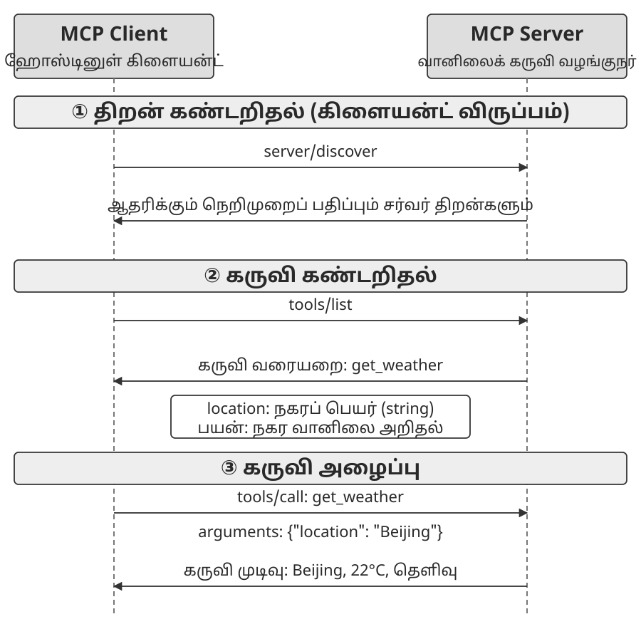
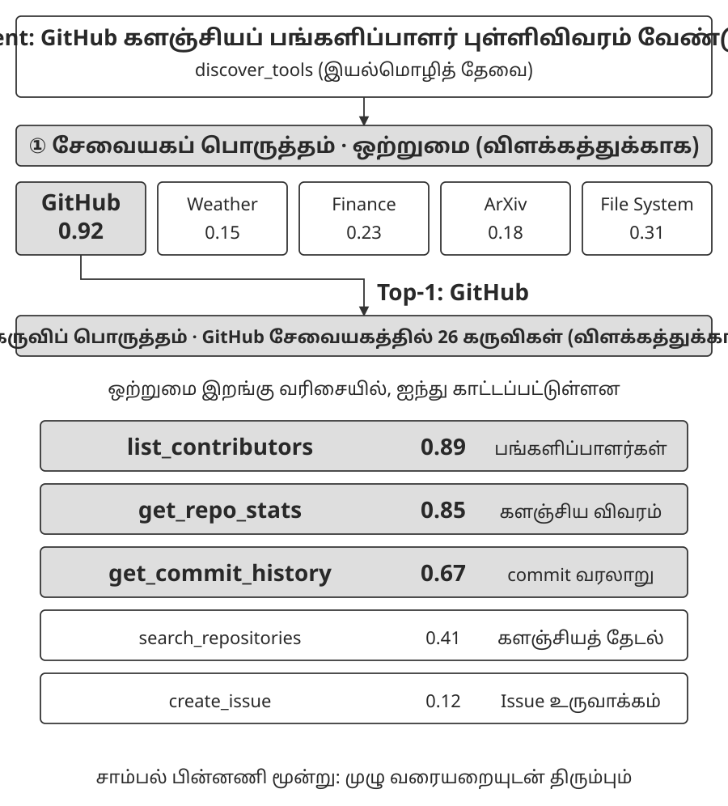
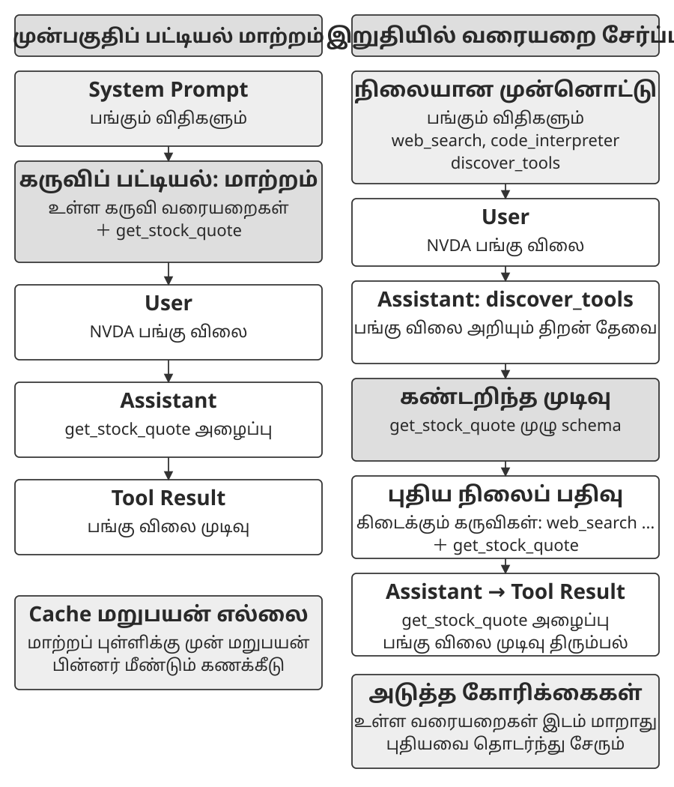
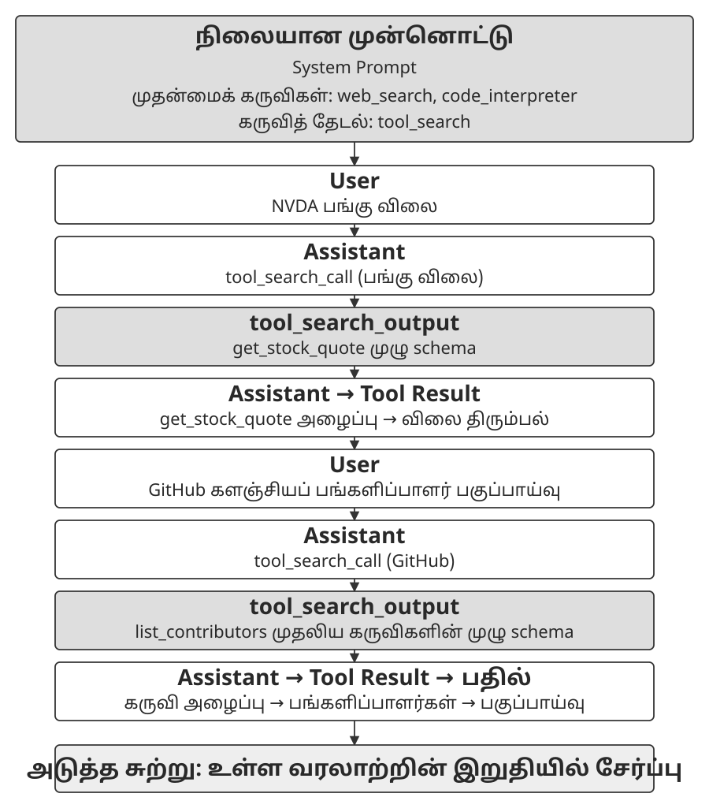

# கருவிகள்

*Her* என்ற அறிவியல் புனைவுத் திரைப்படத்தில், AI உதவியாளர் Samantha மின்னஞ்சல்களை ஒழுங்கமைக்கிறது, பதில்களுக்கு உதவுகிறது, வெளியீட்டு விஷயங்களைக் கையாள்கிறது, வெவ்வேறு தொடர்புக் கால்வாய்களுக்கு இடையே மாறுகிறது. இத்தகைய உதவியாளர் மொழிப் புரிதலை வெளிப்புற அமைப்புகளின் மீதான செயல்களாக மாற்ற வேண்டும். ஏஜெண்ட் இந்த இடைவினைகளை **கருவிகள்** வழியாக நிறைவேற்றுகிறது. கருவிகளே அதன் "புலன்களும் கைகால்களும்"; அவை அவதானிப்புகளை வழங்கவும் செயல்களைச் செய்யவும் உதவுகின்றன. இந்த நூல் விவாதிக்கும் Manus, OpenClaw போன்ற பொது ஏஜெண்டுகளும் டிஜிட்டல் உலகை அணுகக் கருவிகளையே நம்பியுள்ளன.

"வாடிக்கையாளர் மின்னஞ்சல்களில் குறிப்பிடப்பட்டுள்ள விநியோகத் தேதிகளைக் கண்டுபிடித்து, அட்டவணையாக்கி எனக்கு அனுப்பு" என்று பயனர் சொல்கிறார் என்று வைத்துக்கொள்வோம். எந்த மின்னஞ்சலைப் பார்ப்பது என்பதை மாதிரி தீர்மானிக்கலாம்; ஆனால் மூல உரையைப் படிக்க அஞ்சல் பெட்டியை அணுக வேண்டும், அட்டவணையை அனுப்ப அனுப்பும் இடைமுகத்தை அழைக்க வேண்டும். இந்தக் கருவிகளை எவ்வாறு வடிவமைப்பது, மாதிரிக்குத் தேவைப்படும்போது அவற்றை எவ்வாறு கண்டுபிடிப்பது? இந்த அத்தியாயம் முதலில் ஐந்து வகைக் கருவிகளை வேறுபடுத்தி, பின்னர் கருவிகளின் விளக்கம், இணைப்பு, கண்டுபிடிப்பு ஆகியவற்றை விவாதித்து, இறுதியில் உணர்தல், செயல்பாடு, கூட்டுப்பணி இடைமுகங்களைத் தனித்தனியாக வடிவமைக்கிறது. நிகழ்வுத் தூண்டலும் பயனர் தொடர்பும் ஏஜெண்டை எப்போது எழுப்புவது, கால்வாய்களைக் கடந்து செய்திகளை எவ்வாறு கடத்துவது ஆகியவற்றையும் உள்ளடக்குவதால், அவை அத்தியாயம் 6-இல் விரிவாகக் காணப்படும்.

## கருவிகளின் வகைப்பாடு

மின்னஞ்சல் தேடலை எடுத்துக்காட்டாகக் கொண்டால், அடுத்து என்ன செய்வது என்பதை மாதிரி தேர்ந்தெடுக்கிறது; Harness அளவுருக்களையும் அனுமதிகளையும் சரிபார்த்துக் கோரிக்கையை அனுப்புகிறது; அஞ்சல் சேவை உண்மையில் தரவைப் படிக்கிறது/எழுதுகிறது. அத்தியாயம் 1 பயன்பாட்டின் அடிப்படையில் உணர்தல், செயல்பாடு, கூட்டுப்பணி, பயனர் தொடர்பு, நிகழ்வுத் தூண்டல் கருவிகளை வேறுபடுத்தியது. முதல் நான்கும் ஏஜெண்டால் தாமாக அழைக்கப்படுகின்றன; நிகழ்வுத் தூண்டல் கருவிகளோ வெளிப்புற நிகழ்வுகளும் ஏஜெண்டை எழுப்ப அனுமதிக்கின்றன (அட்டவணை 4-1).

அட்டவணை 4-1 ஐந்து வகைக் கருவிகளின் அழைப்புத் திசையும் முக்கியப் பயன்களும்

| கருவி வகை | அழைப்புத் திசை | முக்கியப் பயன் |
| --- | --- | --- |
| உணர்தல் கருவிகள் | ஏஜெண்ட் தாமாக அழைக்கிறது | வெளிப்புறத் தகவலைப் பெறுதல் |
| செயல்பாட்டுக் கருவிகள் | ஏஜெண்ட் தாமாக அழைக்கிறது | கணக்கீடு செய்தல் அல்லது வெளிப்புற நிலையை மாற்றுதல் |
| கூட்டுப்பணிக் கருவிகள் | ஏஜெண்ட் தாமாக அழைக்கிறது | பணியை ஒப்படைத்தல், செய்திகளைப் பரிமாறுதல், பிற ஏஜெண்டுகளையோ மனிதர்களையோ ஒருங்கிணைத்தல் |
| பயனர் தொடர்புக் கருவிகள் | ஏஜெண்ட் தாமாக அழைக்கிறது | பயனருக்குப் பதிலளித்தல், முடிவுகளைக் காட்டுதல், நினைவூட்டல் அனுப்புதல் |
| நிகழ்வுத் தூண்டல் கருவிகள் | மேம்பாட்டாளர் உள்ளமைவு அல்லது ஏஜெண்ட் பதிவு, வெளிப்புறத் தூண்டல் | குறிப்பிட்ட நிகழ்வு நடக்கும்போது ஏஜெண்டை எழுப்புதல் |

**உணர்தல் கருவிகள்** ஏஜெண்ட் வெளிப்புறத் தகவலைப் பெற உதவுகின்றன; எடுத்துக்காட்டாக இணையத் தேடல் `web_search`, அறிவுத் தள மீட்டெடுப்பு `knowledge_base_search`, வலைப்பக்க வாசிப்பு `fetch_url`, கோப்புப் பெயர்த் தேடல் `find_file`, கோப்பு உள்ளடக்கத் தேடல் `grep_file`, கோப்பு வாசிப்பு `read_file`.

**செயல்பாட்டுக் கருவிகள்** ஏஜெண்ட் கணக்கீடு செய்யவோ வெளிப்புற நிலையை மாற்றவோ உதவுகின்றன; எடுத்துக்காட்டாகக் கட்டளை வரி `shell_exec`, குறியீட்டு மொழிபெயர்ப்பி `code_interpreter`, கோப்பு எழுதுதல் `write_file`, கோப்புத் திருத்தம் `edit_file`, மின்னஞ்சல் அனுப்புதல் `send_email`. ஒரே பொதுச் செயல்படுத்தி வாசிப்பு-மட்டும் கணக்கீட்டையும் செய்யலாம், தரவையும் மாற்றலாம்.

**கூட்டுப்பணிக் கருவிகள்** பணி ஒப்படைப்பையும் செய்திப் பரிமாற்றத்தையும் ஆதரிக்கின்றன; எடுத்துக்காட்டாகத் துணை ஏஜெண்டை உருவாக்குதல் `spawn_subagent`, செய்தி அனுப்புதல் `send_message_to_subagent`, துணை ஏஜெண்டை ரத்து செய்தல் `cancel_subagent`, கிடைக்கும் ஏஜெண்டுகளைக் கண்டறிதல் `list_agents`. தனித்த பணிகளை இணையாகக் கையாளலாம்; எடுத்துக்காட்டாக OpenAI-இன் பல இணை நிறுவனர்களின் அனுபவங்களைத் தனித்தனியாக ஆராய்தல்; வெவ்வேறு பணிகளை வெவ்வேறு மாதிரிகள், கருவிகள், ப்ராம்ப்டுகள், சூழல்களுடன் உள்ளமைக்கப்பட்ட ஏஜெண்டுகளிடமும் ஒப்படைக்கலாம். பணிப்பகிர்வையும் கூட்டுப்பணிக் கட்டமைப்பையும் அத்தியாயம் 10 மேலும் விவாதிக்கும்.

**பயனர் தொடர்புக் கருவிகள்** பயனருக்குத் தகவலைக் கடத்துகின்றன; எடுத்துக்காட்டாகச் செய்திக்குப் பதிலளித்தல் `reply_to_user`, கட்டமைக்கப்பட்ட அட்டையை அனுப்புதல் `send_card_to_user`, நினைவூட்டல் அனுப்புதல் `send_user_notification`. இடைவினை பல கால்வாய்களுக்கு விரியும்போதோ, பின்தள அறிவிப்பு தேவைப்படும்போதோ, அமைப்பு செய்தி அனுப்புதலை வெளிப்படையான கருவி அழைப்பாக உறையிட்டு, பெறுநர், உள்ளடக்கம், சென்றடைந்த நிலை ஆகியவற்றை ஒருங்கே நிர்வகிக்கலாம்.

**நிகழ்வுத் தூண்டல் கருவிகள்** வெளிப்புற நிகழ்வுகளை ஏஜெண்டின் இயக்கத்துடன் இணைக்கின்றன; எடுத்துக்காட்டாக நேரங்காட்டி `set_timer`, பின்தளப் பணிக் கண்காணிப்பு `monitor_shell`, நிகழ்வு மூல இணைப்பு `connect_channel`. முழுச் செயல்முறையும் இரு படிகளைக் கொண்டது: பதிவு செய்யும்போது, மேம்பாட்டாளர் முன்கூட்டியே உள்ளமைக்கிறார், அல்லது ஏஜெண்ட் அனுமதிக்கப்பட்ட அழைப்பின் மூலம் தான் கவனிக்க வேண்டிய நிகழ்வை அறிவிக்கிறது; நிகழ்வு நடந்த பிறகு, திட்டமிடல் அமைப்பு திரும்பழைப்பையோ நிகழ்வுச் செய்தியையோ பெற்று, கையாள ஏஜெண்டை எழுப்புகிறது. புதிய மின்னஞ்சல், அமைப்பு எச்சரிக்கை, திட்டமிட்ட நினைவூட்டல், பின்தளப் பணி நிறைவு ஆகிய அனைத்தும் புதிய இயக்க நுழைவாயில்களாக அமையலாம்.

தொடக்கத்தில் உள்ள மின்னஞ்சல் பணியை மீண்டும் பாருங்கள்: அசல் கடிதத்தைத் திறந்து விநியோகத் தேதியைப் பெறுவது உணர்தல்; சுருக்க அட்டவணையை உருவாக்கிச் சேமிப்பது பணியிடத்தை மாற்றுவதால் செயல்பாடு; அட்டவணையை வேண்டுகோள் விடுத்தவரிடம் ஒப்படைப்பது பயனர் தொடர்பு. அடுத்த வாடிக்கையாளர் மின்னஞ்சல் வரும்போது அமைப்பு தானாகத் தொடர்ந்தால் மட்டுமே நிகழ்வுத் தூண்டல் அறிமுகமாகிறது. ஒரே அஞ்சல் சேவை இந்தப் பல பொறுப்புகளையும் ஏற்கலாம். அடுத்துத் தீர்மானிக்க வேண்டியது, மாதிரிக்குக் கொடுக்கும் கருவிகள் எவ்வளவு நுணுக்கமாக இருக்க வேண்டும் என்பதே: மின்னஞ்சலைத் தேடுவது, உரையைப் படிப்பது, இணைப்பைக் கண்டுபிடிப்பது என்று தனித்தனியாகச் செய்ய விடுவதா, அல்லது அடிக்கடி தொடர்ந்து செய்யப்படும் படிகளை அதற்காக இணைத்துக் கொடுப்பதா?

## கருவி வடிவமைப்பின் பொதுக் கொள்கைகள்

கருவிகளை இணைக்கத் தொடங்கிய காலத்தில், ஒவ்வொரு API முனையையும் நேரடியாக உறையிடுவதே பொதுவான நடைமுறை. இது விரைவாக இணைக்க உதவும்; ஆனால் மிக நுணுக்கமான இடைமுகங்களின் தொகுப்பை எளிதில் உருவாக்கிவிடும். ஒரு பணியை முடிக்க, ஏஜெண்ட் பொருள்களை மீண்டும் மீண்டும் தேடவும், பண்புகளைப் படிக்கவும், நிபந்தனைகளைச் சரிபார்க்கவும், பின்னர் செயல்பாட்டு இடைமுகத்தை அழைக்கவும் வேண்டியிருக்கலாம். கருவிகளை வடிவமைக்கும்போது, பொதுவான பணிகளைச் சுற்றி இந்தச் செயல்களை ஒருங்கிணைக்கலாம்; எடுத்துக்காட்டாகத் தொடர்புகளைத் தேடுவதையும் செய்தி அனுப்புவதையும் இணைப்பது, அல்லது பதிவுத் தேடல் தொடர்புடைய வரிகளையும் அவற்றின் சூழலையும் நேரடியாகத் திருப்பித் தருவது[^ch4-tool-design].

**கருவிகள் ஏஜெண்ட் முடிக்க வேண்டிய பணியைச் சுற்றி வடிவமைக்கப்பட வேண்டும்.** ஏஜெண்டின் பயன்பாட்டு முறையிலிருந்து இடைமுகத்தை வடிவமைக்கும் இந்தச் சிந்தனை **ACI** (Agent-Computer Interface, ஏஜெண்ட்—கணினி இடைமுகம்) எனப்படும். HCI மனிதர் கணினியுடன் எவ்வாறு இடைவினை புரிகிறார் என்பதில் கவனம் செலுத்துகிறது; ACI-ஓ மாதிரி எவ்வாறு செயல்களைத் தேர்ந்தெடுக்கிறது, அளவுருக்களைக் கட்டமைக்கிறது, பின்னூட்டத்தைப் புரிந்துகொள்கிறது, பிழைகளைத் திருத்துகிறது என்பதில் கவனம் செலுத்துகிறது.

[^ch4-tool-design]: Anthropic, *Writing effective tools for AI agents—using AI agents*, 2025.

### திறனின் வெளிப்பாட்டு வடிவம்: சிறப்புக் கருவிகள், பொதுச் செயல்படுத்தி, Skill

"பயன்பாட்டை வரிசைப்படுத்து" என்பதை மாதிரியிடம் ஒப்படைக்க, மூன்று வகை இயக்க இடைமுகங்களை வடிவமைக்கலாம். முதலாவது ஒரே ஒரு `deploy_app`-ஐ மட்டும் வெளிப்படுத்தி, சேவையகம் எல்லாப் படிகளையும் முடிக்கிறது; இரண்டாவது கட்டமைத்தல், பொதியிடுதல், வரிசைப்படுத்தல் ஆகியவற்றைத் தனித்தனியாக வெளிப்படுத்தி, அடுத்த படியை எப்போது அழைப்பது என்பதை மாதிரி தீர்மானிக்கிறது; மூன்றாவது படிகளை Skill-இல் எழுதி, மாதிரி முனையத்தில் இயக்கச் செய்கிறது. கட்டமைத்தல் தோல்வியடைந்தால், முதலாவது எந்தப் படியில் பிழை என்று கருவி முடிவு மூலம் மாதிரிக்குச் சொல்ல வேண்டும்; பின்னிரண்டும் இந்தக் கட்டமைப்பின் பிழையை நேரடியாக மாதிரியிடம் கொடுக்கலாம்.

- **சிறப்புக் கருவிகள்** உறுதியான செயல்களுக்குக் கட்டமைக்கப்பட்ட இடைமுகத்தை வழங்குகின்றன. மேம்பாட்டாளர் அளவுரு Schema, சரிபார்ப்பு விதிகள், செயல்பாட்டுத் தர்க்கம், திருப்பு வடிவம் ஆகியவற்றை வரையறுக்கிறார்; தனியாகச் சோதிக்கவும் அனுமதி வழங்கவும் எளிது; கருவி வரையறை சூழலுக்குள் நுழைந்த பிறகு, எடுக்கும் இடம் புலங்கள், விளக்கம், எடுத்துக்காட்டுகளின் நீளத்தைப் பொறுத்தது.
- **பொதுச் செயல்படுத்தியும் Skill-உம்** இணைந்து செயல்படுகின்றன: முனையமோ குறியீட்டு மொழிபெயர்ப்பியோ செயல்பாட்டுத் திறனை வழங்குகிறது; Skill செயல்முறை, பொருந்தும் நிபந்தனைகள், செயல்படுத்தும் முறை ஆகியவற்றை விளக்குகிறது. தாங்கி (host) முதலில் பெயரையும் சுருக்க விளக்கத்தையும் ஏற்றி, தேர்ந்தெடுத்த பிறகு முழு விளக்கத்தையும் தொடர்புடைய வளங்களையும் படிக்கலாம்.

எடுத்துக்காட்டாக, ஒரு வரிசைப்படுத்தல் Skill வரிசையாக இவ்வாறு விளக்கலாம்: `npm run build` கொண்டு திட்டத்தைக் கட்டமைத்து, `docker build -t app:latest .` கொண்டு படிமத்தைப் பொதியிட்டு, பின்னர் `kubectl apply -f deploy.yaml` கொண்டு உள்ளமைவுக் கோப்பில் வரையறுக்கப்பட்ட வளங்களைத் தற்போதைய தொகுதியில் (cluster) பயன்படுத்துதல். ஏஜெண்ட் முனையக் கருவி வழியாக இந்தப் படிகளை இயக்கி, அதே செயல்பாட்டு நுழைவாயிலை மீண்டும் பயன்படுத்துகிறது.

கருவி எவ்வாறு செயலாக்கப்படுகிறது என்பதும், மாதிரி அதன் விளக்கத்தை எப்போது படிக்கிறது என்பதும் இரு வேறு கேள்விகள். நூற்றுக்கணக்கான சிறப்புக் கருவிகளுக்குச் சுட்டை மட்டும் காட்டி, Schema-வைத் தேவைக்கேற்ப ஏற்றலாம்; சில Skill-களுக்குப் பட்டியலை நிரந்தரமாகச் சூழலில் வைத்து, அளவு பெருகிய பிறகு மீட்டெடுப்பைச் சேர்க்கலாம். சிறப்பு இடைமுகமா பொதுச் செயல்படுத்தியா என்ற தேர்வு, அளவுருக்கள் எவ்வாறு கடத்தப்படுகின்றன, குறியீடு எவ்வாறு பராமரிக்கப்படுகிறது என்பதைப் பாதிக்கிறது; ஒரே முறையில் முழுவதையும் கொடுப்பதா தேவைக்கேற்ப ஏற்றுவதா என்ற தேர்வு, இந்தப் படியில் மாதிரி எந்தக் கருவிகளைப் பார்க்க முடியும் என்பதைப் பாதிக்கிறது. பின்னர் வரும் "கருவிகள் அதிகமானால் என்ன செய்வது" பகுதி வெளிப்படுத்தல் உத்தியை விவாதிக்கும்.

**முதலில் பொதுக் கருவிகளைப் பயன்படுத்தி, பின்னர் அனுமதி, அளவுரு, செயல்திறன் தேவைகளுக்கேற்பச் சிறப்பு இடைமுகங்களைச் சேர்க்கப் பரிந்துரைக்கிறேன்.** எடுத்துக்காட்டாக, சாண்ட்பாக்ஸில் `code_interpreter`-க்கு SymPy, NumPy, pandas ஆகியவற்றை உள்ளமைத்தால், ஏஜெண்ட் Python எழுதி நான்கு அடிப்படைக் கணிதச் செயல்கள், குறியீட்டுக் கணக்கீடு, அணிச் செயலாக்கம், தரவுப் பகுப்பாய்வு ஆகியவற்றைச் செய்ய முடியும். இது மாதிரியின் குறியீடு உருவாக்கும் திறனை முழுமையாகப் பயன்படுத்துகிறது: ஒரே மொழிபெயர்ப்பி பல வழிமுறைகளைத் தாங்க முடியும்; முன்கூட்டியே எதிர்பார்க்காத புதிய பிரச்சினைகளைக் கையாள ஏற்கனவே உள்ள நூலகங்களையும் இணைக்க முடியும். குறியீட்டை உருவாக்குவது மாதிரியின் பொறுப்பு; இயக்கச் சூழல் அதை இயக்கி, கோப்பு, பிணைய, வள அணுகலைக் கட்டுப்படுத்துகிறது.

சிறப்புக் கருவிகளைப் பயன்படுத்தினாலும், செயல்பாட்டில் ஒத்த, அடிக்கடி ஒருசேரப் பயன்படும் செயல்களை முதலில் ஒருங்கிணைக்கப் பரிந்துரைக்கிறேன். இடைமுகம் மிக நுணுக்கமாக இருந்தால், மாதிரி அதிகப் பெயர்களையும் பணிப்பகிர்வுகளையும் நினைவில் வைக்க வேண்டும்; ஒரே பணியை முடிக்கவும் அதிக அழைப்புகள் தேவைப்படும். ஒருங்கிணைக்கும்போது முக்கியமாகப் பார்க்க வேண்டியவை **செயல்பாட்டு ஒற்றுமை**, **பயன்பாட்டுச் சூழல்களின் மேற்பொருந்தல்**. எடுத்துக்காட்டாக, `extract_pdf_text`, `extract_docx_content`, `extract_pptx_content` ஆகிய மூன்றும் ஆவணத்தைப் பெற்று உரையைப் பிரித்தெடுக்கின்றன; அவற்றை `read_document` ஆக ஒருங்கிணைத்து, `file_type` மூலம் வடிவத்தை வேறுபடுத்தலாம். மாதிரி ஒரே நுழைவாயிலைத் தேர்ந்தெடுத்தால் போதும்; புதிய வடிவங்களைச் சேர்க்கும்போதும் அதே அளவுரு, திருப்புக் கட்டமைப்பைப் பின்பற்றலாம்.

பின்வரும் நான்கு சூழ்நிலைகள் சிறப்பு இடைமுகங்களுக்குக் குறிப்பாகப் பொருத்தமானவை.

1. **நுணுக்கமான அனுமதியும் தணிக்கையும் தேவைப்படும்போது.** உற்பத்தித் தரவுத்தளத்தில் எழுதுவதை எல்லை தெளிவான செயலாக உறையிட்டு, பயனர் அனுமதி, இலக்கு அட்டவணை, மாற்ற அனுமதிக்கப்பட்ட புலங்கள் ஆகியவற்றைச் சேவையகம் சரிபார்த்து, செயலுக்கான அடிப்படையைப் பதிவு செய்யலாம்.
2. **தள வேறுபாடுகளை மறைக்க வேண்டியிருக்கும்போது.** grep, find போன்ற செயல்களை shell வழியாகச் செய்யலாம்; சிறப்புக் கோப்புத் தேடல் கருவியோ macOS, Windows, Linux ஆகியவற்றின் அளவுருக்களையும் பின்னூட்டத்தையும் ஒருமைப்படுத்தலாம்; எடுத்துக்காட்டாக எப்போதும் கோப்புப் பெயர், வரி எண், பொருந்திய துண்டு ஆகியவற்றைத் திருப்பித் தருதல்.
3. **செயல் மிக அடிக்கடி நடக்கும்போது.** அடிக்கடி நடக்கும் செயல்களுக்குச் சுருக்கமான, நிலையான நுழைவாயிலை வழங்கி, ஸ்கிரிப்டுகளையும் விளக்கச் செயல்முறைகளையும் மீண்டும் மீண்டும் உருவாக்கும் செலவைக் குறைக்கலாம்.
4. **அளவுரு உறவுகள் சிக்கலானதாக இருக்கும்போது.** உட்பொதிந்த பொருள்கள், புலச் சார்புநிலைகள், சிக்கலான மதிப்புக் கட்டுப்பாடுகள் ஆகியவை Schema-வும் வணிகச் சரிபார்ப்பும் இணைந்து வெளிப்படுத்துவதற்கு ஏற்றவை.

**அளவுருக்கள் எவ்வளவு சிக்கலானவையோ, அவற்றைக் கடத்தும் முறை அவ்வளவு முக்கியம்.** கட்டமைக்கப்பட்ட கருவி அழைப்புகள் பொதுவாக JSON Schema மூலம் உள்ளீட்டை விவரிக்கின்றன; சில மாதிரிச் சேவைகள் கட்டுப்படுத்தப்பட்ட உருவாக்கத்தை (constrained generation) ஆதரித்து, அளவுருக்கள் ஆதரிக்கப்படும் Schema விதிகளைப் பூர்த்தி செய்யச் செய்கின்றன. திருப்பு மதிப்பின் கட்டமைப்பைக் கருவி இடைமுகம் ஒப்பந்தமாக வரையறுக்கிறது; தாங்கி அந்த முடிவை மாதிரிக்கு அளிக்கிறது. வகை, வடிவச் சரிபார்ப்புக்கு அப்பால், அனுமதிகள், பொருள் உள்ளதா, பல புலங்கள் வணிக நிபந்தனைகளைப் பூர்த்தி செய்கின்றனவா என்பவற்றை இன்னும் Harness-உம் கருவிச் சேவையும் சரிபார்க்க வேண்டும்.

Skill சிறப்புக் கருவிகளை எவ்வாறு அழைப்பது என்பதையும் விளக்கலாம்; CLI-ஐப் பயன்படுத்த ஏஜெண்டை வழிநடத்தவும் செய்யலாம். பின்னது, மாதிரி கட்டளை வரித் தொடரியல், மேற்கோள் குறிகள், தப்பித்தல் (escaping) ஆகியவற்றை ஒருசேரக் கையாள வேண்டும் என்று கோருகிறது; வெவ்வேறு shell-களின் விதிகளும் வேறுபடுகின்றன. அளவுருக்கள் எவ்வளவு சிக்கலானவையோ, மாதிரி சரியாகக் கையாள வேண்டிய விவரங்களும் அவ்வளவு அதிகம். சிக்கலான உட்பொதிந்த அளவுருக்களைச் சந்திக்கும்போது, முதலில் அவற்றை JSON கோப்பாக எழுதி, பின்னர் கட்டளை அந்தக் கோப்பைப் படிக்கச் செய்து, பல அடுக்குத் தப்பித்தலைக் குறைத்து, செயல்படுத்துவதற்கு முன் உள்ளடக்கத்தைச் சரிபார்க்கலாம்.

**வணிகப் பணியாளர்கள் Skill-ஐ நேரடியாக எழுதவும் மாற்றவும் எளிது.** வணிகத்தை நன்கு அறிந்தவர்கள் படிகளைத் தாமே எழுதலாம்; அல்லது ஏஜெண்ட் வரைந்த விளக்கத்திலிருந்து திருத்தத் தொடங்கலாம். செயல்முறையின் வரிசை மாறினாலும், ஒரு படி சில வாடிக்கையாளர்களுக்கு மட்டுமே பொருந்தினாலும், அல்லது எடுத்துக்காட்டை மாற்ற வேண்டியிருந்தாலும், விளக்க உரையை நேரடியாக மாற்றினால் போதும்; கருவிக் குறியீட்டை மாற்றி இடைமுகத்தை மீண்டும் வரிசைப்படுத்தும் வேலை தேவையில்லை. Agent Skills வழிமுறைப்படி, `SKILL.md`-இன் மீத்தரவு குறிப்பிட்ட வடிவத்தைப் பின்பற்றுகிறது; முதன்மை உரை Markdown; ஸ்கிரிப்டுகள், குறிப்பு ஆவணங்கள், வளங்களையும் இணைக்கலாம்[^ch4-skill-format].

[^ch4-skill-format]: Agent Skills, வடிவ வழிமுறை; மீத்தரவு, முதன்மை உரை, இணைக்கப்பட்ட வளங்கள், படிநிலை ஏற்றுதல் ஆகியவை அடங்கும்.

திறனின் வடிவத்தைத் தேர்ந்தெடுக்கும்போது நான்கு பரிமாணங்களை ஒருசேரக் கருத்தில் கொள்ளலாம்.

- **பாதுகாப்பும் அனுமதியும்**: சிறப்பு இடைமுகங்கள் செயல் எல்லையை வரம்பிட எளிது; பொதுச் செயல்படுத்தி சாண்ட்பாக்ஸ், சான்றுகள், வள அனுமதிகள் மூலம் செயல்பாட்டுத் திறனைக் கட்டுப்படுத்துகிறது.
- **அளவுருச் சிக்கல்**: சிக்கலான கட்டமைப்புகளுக்கு Schema-வும் வணிகச் சரிபார்ப்பும் பொருத்தம்; எளிய செயல்களுக்கு CLI வழியாக நேரடியாக அளவுருக்களை அனுப்பலாம்.
- **மாற்ற அலைவெண்**: அடிக்கடி சரிசெய்யப்படும் செயல்முறைகளை முதலில் Skill-இல் எழுதுங்கள்; வணிகப் பணியாளர்கள் விளக்கங்களையும் எடுத்துக்காட்டுகளையும் நேரடியாக மாற்றலாம்; நிலையான, மீண்டும் பயன்படும் அடிப்படைச் செயல்களைப் பின்னர் கருவியாகவோ ஸ்கிரிப்டாகவோ உறையிடுங்கள்.
- **மாதிரித் திறன்**: குறியீட்டை நம்பகமாக உருவாக்கவும் கட்டளை வரியைக் கையாளவும் முடிகிற மாதிரிக்கு, Skill-உம் பொதுச் செயல்படுத்தியும் இணைந்த திறனை முன்னுரிமையாக்கி, சிறப்புக் கருவிகளின் எண்ணிக்கையைக் குறைக்கலாம்; மாதிரி பலவீனமாக இருந்து, சிக்கலான அளவுருக்களில் அடிக்கடி பிழை செய்தால், கட்டமைக்கப்பட்ட இடைமுகம் அதிகக் கட்டுப்பாடுகளை ஏற்க வேண்டும்.

**குறியீடு பல கருவி அழைப்புகளையும் ஒருங்கிணைக்க முடியும்.** பல வலைப்பக்கங்களைப் பெற்றுப் புலங்களைப் பிரித்தெடுக்கும்போது, மாதிரி ஒரு ஸ்கிரிப்டை உருவாக்கி, சுழற்சி, வடிகட்டல், தொகுப்பு ஆகியவற்றை முடிக்கலாம். வலைப்பக்கங்களின் முழு உரை இயக்கச் சூழலின் மாறிகளில் தக்கவைக்கப்படுகிறது; தேர்ந்தெடுக்கப்பட்ட புலங்களும் புள்ளிவிவர முடிவுகளும் மட்டும் சூழலுக்குத் திரும்புகின்றன. நிரலில் உள்ள நிபந்தனைகள், சுழற்சிகள், விதிவிலக்குக் கையாளுதல் ஆகியவை ஒவ்வொரு படிச் செயலையும் இணைக்கின்றன; மாதிரி தொகுக்கப்பட்ட முடிவை நேரடியாகப் பகுப்பாய்வு செய்கிறது. படிகள் ஏற்கனவே தெளிவான தொகுதிப் பெறுதல், வடிகட்டல், புள்ளிவிவரம் போன்ற பணிகளுக்கு, மாதிரி ஒவ்வொரு கருவியையும் தனித்தனியாக அழைத்து இடைநிலை முடிவுகளைப் படிக்கும் போக்குவரத்தைக் குறைக்க, குறியீட்டால் இணைப்பதையே நான் விரும்புகிறேன். இடைநிலை முடிவுகள் அதிகமாகவும் திருப்பு புலங்கள் சுருக்கமாகவும் இருந்தால், இந்த ஏற்பாடு சேமிக்கும் சூழல் அவ்வளவு கணிசமானது. இத்தகைய குறியீட்டு ஒருங்கிணைப்பை அத்தியாயம் 5 மேலும் விவாதிக்கும்.

இத்தகைய இடைமுகங்கள் பொதுவாக **Code Mode** எனப்படுகின்றன. Cloudflare-இன் MCP சேவையகத்தை எடுத்துக்காட்டாகக் கொண்டால், மாதிரி முதலில் `search()` கொண்டு ஒரு வினவல் நிரலை எழுதி, OpenAPI விளக்கத்திலிருந்து தேவையான முனைகளையும் அளவுருக்களையும் கண்டுபிடிக்கிறது; பின்னர் `execute()` கொண்டு அந்த முனைகளை அழைக்கும் JavaScript-ஐச் சமர்ப்பிக்கிறது. எடுத்துக்காட்டாக, நிபந்தனைகளுக்குப் பொருந்தும் DNS பதிவுகளைப் பட்டியலிட, நிரல் பக்கம் பக்கமாக வினவி, வடிகட்டி, பொருந்திய பதிவுகளை மட்டும் திருப்பித் தரலாம். முந்தைய படி முழு இடைமுகக் கையேட்டையும் சூழலில் வைக்கும் செலவைத் தவிர்க்கிறது; பிந்தைய படி ஒவ்வொரு பக்க முடிவையும் மாதிரிக்குத் திருப்பி அனுப்பும் போக்குவரத்தைத் தவிர்க்கிறது. இயக்க அடையாளம் எந்தப் பகுதிகளைப் படிக்கலாம், பதிவுகளை மாற்றலாமா என்பதை இன்னும் சேவையக அனுமதியே தீர்மானிக்கிறது.[^ch4-code-mode]

[^ch4-code-mode]: Cloudflare, Code Mode-இன் MCP செயலாக்கம்; Armin Ronacher Pi 1.0-ஐ எடுத்துக்காட்டாகக் கொண்டு Harness வழங்கும் கருவிகளுக்கும் இயக்கச் சூழலுக்கும் இடையிலான பணிப்பகிர்வை விவாதிக்கிறார்.

### கருவி விளக்கம்: பயன், அளவுருக்கள், பின்னூட்டத்தை விளக்குதல்

கருவிக்கு விளக்கம் எழுதும்போது, அதை மிக எளிதில் தவறாகப் பயன்படுத்தக்கூடிய ஒரு கோரிக்கையை முதலில் கற்பனை செய்யலாம். "ஒப்பந்தத்தில் அபராதத் தொகையைக் குறிப்பிடும் விதியைக் கண்டுபிடி" என்று பயனர் சொல்கிறார்; கோப்புப் பெயர்த் தேடல் பெயர் பொருந்தும் கோப்புகளை மட்டுமே திருப்பித் தரும்; ஒரு பாதை கிடைத்தாலும், மாதிரி இன்னும் முதன்மை உரையைப் படிக்க வேண்டும். எந்த இடைமுகத்தைத் தேர்ந்தெடுப்பது, அழைக்கும்போது என்ன வழங்க வேண்டும், இந்த முடிவு எந்தக் கேள்விக்குப் பதிலளிக்கப் போதுமானது என்பதை மாதிரி தீர்மானிக்கக் கருவி விளக்கம் உதவ வேண்டும்.

**பயன்படுத்தும் தருணத்தை விளக்குங்கள்.** இணையத் தேடலின் விளக்கத்தை "நிகழ்நேரத் தகவலைப் பெற வேண்டியிருக்கும்போதோ தெரியாத உண்மைகளைத் தேடும்போதோ பயன்படுத்து" என்று எழுதலாம்; இதனால் பயனர் தேவையையும் கருவியின் பயனையும் மாதிரி பொருத்த முடியும். "தொடர்புடைய உள்ளடக்கத்தைத் தேடு" என்று மட்டும் இருந்தால், தேடல் எல்லையையும் பொருந்தும் நிபந்தனைகளையும் மாதிரி தானே ஊகிக்க வேண்டியிருக்கும்.

**உள்ளீட்டையும் தேடல் எல்லையையும் தெளிவுபடுத்துங்கள்.** எடுத்துக்காட்டாக, கோப்புப் பெயர்த் தேடல் கருவி "கோப்புப் பெயர், பாதையின்படி பொருத்துகிறது; கோப்பில் உள்ள உரையைத் தேட `grep_file`-ஐப் பயன்படுத்து" என்று விளக்கலாம். அருகிலுள்ள கருவிகளின் பணிப்பகிர்வைத் தெளிவாக எழுதினால், ஒரே அழைப்பில் சரியான நுழைவாயிலைத் தேர்ந்தெடுக்க மாதிரிக்கு உதவும். **என் பார்வையில், எல்லை நிபந்தனைகளைத் தெளிவுபடுத்துவது பெரும்பாலும் செயல்பாடுகளைப் பட்டியலிடுவதை விட முக்கியம்.** கருவி என்ன உள்ளீட்டை ஏற்கிறது, எந்த எல்லைகளைத் தேடுகிறது, காலி முடிவு அல்லது பிழை வந்தால் எவ்வாறு கையாள்வது என்பவை அனைத்தும் மாதிரியின் அடுத்த முடிவை நேரடியாகப் பாதிக்கின்றன.

**அளவுருக்களை வழிமுறையும் எடுத்துக்காட்டும் சேர்த்து விளக்குங்கள்.** `timestamp`-ஐ "RFC3339 வடிவம், எடுத்துக்காட்டாக `2024-03-15T14:30:00Z`" என்று எழுதலாம். சிக்கலான பணிகளைக் கையாளும்போது, மாதிரி கருவியைத் தேர்ந்தெடுக்கவும், வரலாற்றுப் பாதையிலிருந்து தகவலைப் பிரித்தெடுக்கவும், அடுத்தடுத்த படிகளை எடைபோடவும் ஒருசேர வேண்டியுள்ளது; அளவுரு வடிவம் அதில் ஒரு விவரம் மட்டுமே. முழுமையான சரம் நேரடியாகப் பின்பற்றக்கூடிய வடிவத்தை வழங்குகிறது; மாதிரி அதைப் பார்த்து அளவுருவைக் கட்டமைக்கலாம்; சொல்லை மீண்டும் விளக்கும்போது ஏற்படும் பிழை வாய்ப்பும் குறையும்.

அதேபோல், `phone`-ஐ இவ்வாறு எழுதலாம்: "தொலைபேசி எண், E.164 சர்வதேச எண் வடிவம்; `+`-இல் தொடங்கி, நாட்டுக் குறியீடும் எண்ணும் தொடர்கின்றன; மீதமுள்ள பகுதியில் இலக்கங்கள் மட்டுமே, இடைவெளியோ பிரிப்பானோ இல்லை. எடுத்துக்காட்டாக `+8613888888888` (சீனா) அல்லது `+12025551234` (அமெரிக்கா)."

**திருப்புக் கட்டமைப்பையும் செயல்பாட்டுச் செலவையும் விளக்குங்கள்.** எடுத்துக்காட்டாக, "JSON அணியைத் திருப்பித் தருகிறது; ஒவ்வொரு உருப்படியிலும் `title`, `url`, `snippet` என்ற மூன்று புலங்கள் உள்ளன" என்பது, தலைப்பு, மூலம், சுருக்கம் ஆகியவற்றைப் பிரித்தெடுக்க மாதிரிக்கு எளிதாக்குகிறது. நீண்ட நேரம் எடுக்கும் கருவிகள், அளவிடப்பட்ட சூழலில் எதிர்பார்க்கப்படும் தாமதத்தையும் மாற்று நுழைவாயிலையும் குறிப்பிடலாம்; எடுத்துக்காட்டாக "முழு வலைப்பக்கத்தைப் படிக்க 5–10 வினாடிகள் ஆகலாம்; மீத்தகவல் மட்டும் தேவைப்பட்டால் `get_page_metadata`-ஐ அழைக்கலாம்".

சரிபார்க்கப்பட்ட 1–5 அழைப்பு எடுத்துக்காட்டுகளையும் இணைக்கலாம்; அவை குறைந்தபட்ச அளவுருக்கள், பொதுவான சேர்க்கைகள், சிக்கலான நிபந்தனைகள் ஆகியவற்றை உள்ளடக்க வேண்டும். JSON Schema வகை, கட்டாயப் புலங்கள், மதிப்பு வரம்பு, சில புலச் சார்புநிலைகள் ஆகியவற்றை வெளிப்படுத்த முடியும்[^ch4-json-schema]; எடுத்துக்காட்டுகளோ இந்த விதிகள் குறிப்பிட்ட பணிகளில் எவ்வாறு பயன்படுகின்றன என்பதைக் காட்டுகின்றன; எடுத்துக்காட்டாக நேர முத்திரை வினாடிகளிலா மில்லி வினாடிகளிலா, வடிகட்டல் நிபந்தனைகள் எவ்வாறு உட்பொதிக்கப்படுகின்றன, எந்த விருப்பப் புலங்கள் பொதுவாக ஒருசேரத் தோன்றுகின்றன. Anthropic 2025-இல் தெரிவித்த உள் சிக்கலான அளவுருச் சோதனைகளில், கருவி அழைப்பு எடுத்துக்காட்டுகளைச் சேர்த்த பிறகு துல்லியம் 72%-இலிருந்து 90%-ஆக உயர்ந்தது[^ch4-tool-examples].

[^ch4-json-schema]: JSON Schema, பொருள் வகையும் பண்புக் கட்டுப்பாடுகளும். மாதிரி இடைமுகம் ஆதரிக்கும் Schema முக்கியச் சொற்களின் எல்லையைத் தொடர்புடைய சேவையே விதிக்கிறது.

[^ch4-tool-examples]: Anthropic, *Introducing advanced tool use on the Claude Developer Platform*, 2025 நவம்பர் 24, Tool Use Examples பகுதி.

ஏஜெண்ட் அடிக்கடி தவறான கருவியைத் தேர்ந்தெடுக்கும்போது, **முதலில் கருவி விளக்கங்களைச் சரிபார்க்கப்** பரிந்துரைக்கிறேன்: பல கருவிகள் ஒத்த பெயர்களைப் பயன்படுத்துகின்றனவா, தேடல் எல்லை தெளிவாக உள்ளதா, அளவுருக்களுக்கு எடுத்துக்காட்டுகள் இல்லையா. இதே முறை Skill-இன் பெயர், சுருக்க விளக்கம், இயக்க விளக்கங்களுக்கும் பொருந்தும்.

### அளவுருக் கடத்தலின் நம்பகத்தன்மை

மாதிரி ஒரு மூல உரைப் பகுதியை மாற்றக் கோருகிறது; செயல்படுத்தும் பக்கமோ "கண்டுபிடிக்க முடியவில்லை" என்று தெரிவிக்கிறது. மாதிரியை மீண்டும் சொல்லாடலை மாற்றச் சொல்வதற்கு முன், இரு பக்கங்களும் பெற்றது ஒரே எழுத்துச் சரமா என்று முதலில் கேளுங்கள். அழைப்பு பாகுபடுத்தல், தொடராக்கம், பதிலாள், இயக்கநேர உறையிடல் ஆகியவற்றைக் கடக்கிறது; ஒவ்வொரு அடுக்கும் உள்ளடக்கத்தை மாற்றக்கூடும். **அளவுரு நம்பகத்தன்மை** என்பது, செயல்படுத்தும் பக்கம் பார்க்கும் மதிப்பு மாதிரி சமர்ப்பித்த மதிப்பின் அதே பொருளைக் கொண்டிருக்க வேண்டும் என்பதைக் கோருகிறது; நெறிமுறைத் தப்பித்தல் கடத்தல் வடிவத்தை மாற்றலாம்; ஆனால் குறிவிலக்கிய பிறகு மேற்கோள் குறிகளும் வரி முறிவுகளும் தக்கவைக்கப்பட வேண்டும்.

2026 தொடக்கத்தில் Cursor-இன் ஒரு பதிப்பில் ஏற்பட்ட வளைந்த மேற்கோள் மாற்றப் பிரச்சினையை எடுத்துக்காட்டாகக் கொள்வோம். மாற்றுக் கருவி `old_string`, `new_string` ஆகியவற்றைப் பெற்று, துல்லியப் பொருத்தம் மூலம் கோப்பைத் திருத்துகிறது. வாசிப்புக் கருவி சீன வளைந்த மேற்கோள்களான `“`, `”`-ஐத் திருப்பித் தந்தது; அவை `\u201c`, `\u201d`-க்கு உரியவை; மாதிரி மூல உரையை `old_string`-இல் வைத்தது; ஆனால் அளவுருக் கடத்தலின்போது அவை ஆங்கில நேர் மேற்கோள் `"` ஆக மாற்றப்பட்டன. கோப்பில் உள்ள மூல உரை மாறாமல் இருந்ததால், மாற்றுக் கருவி "பொருத்தம் கிடைக்கவில்லை" என்று திருப்பித் தந்தது. மீண்டும் படித்து, மீண்டும் மூல உரையை நகலெடுத்தாலும், அதே தோல்வியே மீண்டும் வரும்.

எழுதும் திசையும் பாதிக்கப்படலாம். மாதிரி வளைந்த மேற்கோள்களை எழுதக் கோருகிறது; ஆனால் கோப்பு இறுதியில் நேர் மேற்கோள்களைச் சேமிக்கிறது. பின்னர் கோப்பைப் படிக்கும்போது, மாதிரி பார்க்கும் உள்ளடக்கம் எழுத நினைத்ததிலிருந்து வேறுபடுகிறது; அதனால் மீண்டும் திருத்த முயலலாம்; மாற்றம் தொடர்ந்து நடந்துகொண்டிருக்கும் வரை, மறுமுயற்சி அதே பிழையையே திரும்பச் செய்யும்.

இன்னொரு வகைப் பிரச்சினை **அமைதியான அளவுரு உட்செலுத்தல்**. ஒரு IDE-இன் bash கருவி `git commit`-க்கு AI commit குறியீட்டு அளவுருவைத் தானாகச் சேர்க்கிறது. பழைய Git பதிப்பு அந்த அளவுருவை அடையாளம் காணாததால், commit பிழையைத் தருகிறது. மாதிரி தான் உருவாக்கிய கட்டளையை மட்டுமே பார்க்கிறது; commit செய்தியையோ பிற அளவுருக்களையோ மீண்டும் மீண்டும் சரிசெய்யலாம்; ஆனால் உண்மையான கோளாறின் மூலத்தை ஒருபோதும் திருத்த முடியாது.

இத்தகைய பிரச்சினைகளைக் கண்டறியும்போது, மாதிரி உருவாக்கிய அளவுருக்கள், கடத்தப்பட்ட பிறகான அளவுருக்கள், உண்மையில் செயல்படுத்தப்பட்ட கோரிக்கை, திருப்பித் தரப்பட்ட முடிவு ஆகியவற்றை ஒன்றாக வைத்து ஒப்பிடுங்கள். இடைமுகம் ஒருங்கிணைந்த குறியாக்கம் செய்தாலோ செயல்பாட்டு அளவுருக்களைச் சேர்த்தாலோ, மாற்று விதிகளைத் தெளிவாக எழுதி, உண்மையில் பயன்படுத்தப்பட்ட மதிப்பைத் திருப்பித் தர வேண்டும். துல்லியப் பொருத்தக் கருவிகளுக்கு, ஒரு கூடுதல் இடைவெளி, ஒரு குறைந்த வரி முறிவு, ஒரு மாறிய மேற்கோள் — எதுவும் பொருத்தத் தோல்விக்குக் காரணமாகலாம். அடுத்த அழைப்பைச் சரியாக மாற்ற, செயல்படுத்தும் பக்கம் உண்மையில் என்ன பெற்றது என்பதை மாதிரி அறிய வேண்டும்.

## கருவிச் சூழல்தொகுதி: MCP-உம் Skill Hub-உம்

வெவ்வேறு மாதிரி இடைமுகங்களும் ஏஜெண்ட் சட்டகங்களும் தத்தம் கருவி வரையறை முறைகளைப் பயன்படுத்துகின்றன; எடுத்துக்காட்டாக function calling, tool use, LangChain-இன் Tool சுருக்கம். ஒரே வெளிப்புறச் சேவையை இந்த இடைமுகங்களுக்கும் சட்டகங்களுக்கும் ஒவ்வொன்றாகத் தகவமைக்க வேண்டுமானால், விளக்கம், அளவுருக்கள், முடிவு வடிவம் ஆகியவற்றைத் திரும்பத் திரும்பக் கையாள வேண்டும். 2024 நவம்பரில் Anthropic வெளியிட்ட **Model Context Protocol (MCP)**, மாதிரிப் பயன்பாடுகள் கருவிகளையும் தரவையும் அணுக ஒருங்கிணைந்த நெறிமுறையை வழங்குகிறது[^ch4-mcp-origin].

MCP-ஐப் புரிந்துகொள்ள, முதலில் தாங்கி, கிளையண்ட், சேவையகம் என்ற மூன்று பங்குகளைப் பாருங்கள். **தாங்கி (host)** ஏஜெண்ட் பயன்பாடோ IDE-ஓ ஆகும்; மாதிரி இடைவினை, சூழல் ஒழுங்கமைப்பு, அனுமதி மேலாண்மை ஆகியவற்றுக்குப் பொறுப்பு; தாங்கிக்குள் உள்ள **MCP கிளையண்ட்** நெறிமுறைச் செய்திகளுக்குப் பொறுப்பு; **MCP சேவையகம்** கருவிகள், வளங்கள், ப்ராம்ப்ட் வார்ப்புருக்களை வழங்குகிறது; அது உள்ளூர்ச் செயல்முறையாகவும் இயங்கலாம், தொலைவுச் சேவையாகவும் வரிசைப்படுத்தப்படலாம்[^ch4-mcp-architecture].

**கருவி வரையறையும் அழைப்பும்.** கிளையண்ட் `tools/list` வழியாகக் கிடைக்கும் கருவிகளைப் பெறுகிறது; பட்டியலைப் பக்கவாரியாகத் திருப்பித் தரலாம். ஒவ்வொரு கருவியிலும் பெயர், விளக்கம், `inputSchema` ஆகியவை உள்ளன; கட்டமைக்கப்பட்ட முடிவுகளுக்கு `outputSchema` கொண்டு வடிவத்தை ஒப்பந்தமாக வரையறுக்கலாம். மாதிரி கருவியைத் தேர்ந்தெடுத்து அளவுருக்களை உருவாக்கிய பிறகு, தாங்கி சரிபார்ப்பை முடிக்கிறது; கிளையண்ட் `tools/call`-ஐ அனுப்புகிறது; சேவையகம் இயக்கி முடிவைத் திருப்பித் தருகிறது. எந்த வரையறைகளையும் முடிவுகளையும் மாதிரிச் சூழலில் வைப்பது என்பதைத் தாங்கியே தீர்மானிக்கிறது[^ch4-mcp-tools].

படம் 4-1-இல், கிளையண்ட் வானிலைக் கருவியின் பெயரையும் அளவுருக்களையும் பெற்ற பிறகும், பெய்ஜிங்கின் வானிலையை அறிய இன்னும் ஒரு அழைப்பைத் தொடங்க வேண்டும். துணைச் செயலாக்கம் MCP 2026-07-28-ஐப் பயன்படுத்துகிறது; ஒவ்வொரு கோரிக்கையும் நெறிமுறைப் பதிப்பு, கிளையண்ட் தகவல், திறன்கள் ஆகியவற்றைக் கொண்டு செல்கிறது; சேவையகம் ஆதரிக்கும் பதிப்புகளையும் திறன்களையும் அறியக் கிளையண்ட் முதலில் `server/discover`-ஐ அழைக்கலாம். முந்தைய பதிப்புகள் `initialize` கைகுலுக்கல் மூலம் அமர்வை நிறுவின; இணைக்கும்போது இரு தரப்பும் ஆதரிக்கும் பதிப்புக்கேற்ப இடைவினை முறையைத் தேர்ந்தெடுக்க வேண்டும்[^ch4-mcp-versioning].

வானிலை கிடைக்கவில்லை என்ற ஒரே பிரச்சினைக்கு, படம் 4-1-இல் இரு வெவ்வேறு கண்டறிதல் தொடக்கப் புள்ளிகள் உள்ளன. தாங்கி சேவையகத்துடன் இணைந்து, `tools/list`-ஐ அழைத்தும் வானிலைக் கருவி கிடைக்கவில்லை என்றால், சேவையகம் எந்தக் கருவிகளை வெளியிட்டது, கிளையண்ட் பக்கவாரியான பட்டியலை முழுமையாகப் படித்ததா என்று சரிபார்க்க வேண்டும். மாதிரி சரியான கருவியைத் தேர்ந்தெடுத்தும், சேவையகம் நகரப் பெயர் இல்லை என்று தெரிவித்தால், அழைப்புப் பதிவில் `arguments`-ஐக் கண்டுபிடித்து, புலப் பெயர் கருவி வரையறை கோரும் `location`-ஆ என்று சரிபாருங்கள்.

**கடத்தும் முறைகள்.** stdio உள்ளூர்த் துணைச் செயல்முறையின் நிலையான உள்ளீடு, நிலையான வெளியீடு வழியாக JSON-RPC செய்திகளைக் கடத்துகிறது. Streamable HTTP-ஓ HTTP வழியாகக் கோரிக்கைகளை அனுப்புகிறது; பதில் JSON ஆகவோ, SSE ஓடையைப் பயன்படுத்திப் படிப்படியாகவோ திரும்பலாம். Streamable HTTP முந்தைய HTTP+SSE கடத்தல் திட்டத்தை மாற்றியது; ஓடைப் பதிலுக்கு SSE-ஐத் தொடர்ந்து பயன்படுத்துகிறது[^ch4-mcp-transports].

**வளங்களும் ப்ராம்ப்ட் வார்ப்புருக்களும்.** வளங்கள் (resources) படிக்கக்கூடிய தரவை வழங்குகின்றன; எடுத்துக்காட்டாகக் கோப்பு உள்ளடக்கம், தரவுத்தளப் பதிவுகள்; தாங்கி URI-இன்படி பட்டியலிட்டு, படித்து, தொடர்புடைய உள்ளடக்கத்தைத் தேர்ந்தெடுக்கலாம். ப்ராம்ப்ட் வார்ப்புருக்கள் (prompts) மீண்டும் பயன்படுத்தக்கூடிய செய்தி அல்லது பணி வார்ப்புருக்களை வழங்குகின்றன; பயனரும் கிளையண்டும் தேர்ந்தெடுக்கலாம். கருவிகளும் தேடலையும் வாசிப்பையும் ஏற்கலாம் என்பதால், இந்த மூன்று அடிப்படைகளும் இடைவினை இடைமுகத்தின் அடிப்படையில் பணியைப் பகிர்கின்றன: கருவிகள் அழைப்பு நுழைவாயிலையும், வளங்கள் தரவு நுழைவாயிலையும், ப்ராம்ப்ட் வார்ப்புருக்கள் பணி நுழைவாயிலையும் வழங்குகின்றன[^ch4-mcp-primitives].

MCP-இன் மைய மதிப்பு, ஒரே கருவிச் செயலாக்கம் பல ஏஜெண்ட் தயாரிப்புகளுக்குச் சேவை செய்ய வைப்பது. ஒருங்கிணைந்த நெறிமுறை, ஒரே சேவையகத்தை Cursor, Claude Desktop, OpenClaw போன்ற இணக்கமான தாங்கிகள் மீண்டும் பயன்படுத்த உதவுகிறது; மேம்பாட்டாளர்களும் திறனிலும் அதன் பின்னூட்டத் தரத்திலும் அதிகக் கவனம் செலுத்த முடிகிறது. தாங்கி நெறிமுறையில் உள்ள கருவி வரையறைகளை மாதிரி பயன்படுத்தக்கூடிய இடைமுகங்களாக மாற்றுகிறது.

**Skill Hub திறன் தொகுப்புகளின் கண்டுபிடிப்பையும் பகிர்வையும் வழங்குகிறது.** ஒரு Skill பொதுவாக `SKILL.md`-ஐக் கொண்டிருக்கும்; ஸ்கிரிப்டுகளையும் குறிப்புப் பொருட்களையும் இணைக்கலாம். பகிர்வுத் தளங்கள் இந்தக் கோப்புகளைத் தேடவும், நிறுவவும், புதுப்பிக்கவும் பயனருக்கு உதவுகின்றன. Vercel 2026 ஜனவரியில் skills.sh-ஐ அறிமுகப்படுத்தி, திறன் பட்டியலையும் நிறுவும் கருவியையும் வழங்கியது; OpenClaw சூழல்தொகுதியின் ClawHub-உம் திறன் தேடலையும் பதிப்பு மேலாண்மையையும் வழங்குகிறது[^ch4-skills-sh][^ch4-clawhub]. நிறுவிய பிறகு, தாங்கி தன் ஏற்றுதல் உத்தியின்படி பெயர், சுருக்க விளக்கம், முழு விளக்கம் ஆகியவற்றைப் படிக்கிறது. MCP-உம் விரிவாக்கம் மூலம் Skills-இன் கண்டுபிடிப்பையும் வாசிப்பையும் வழங்கலாம்; திறன் தொகுப்பும் தொடர்பு நெறிமுறையும் இணைந்து பயன்படலாம்[^ch4-skills-over-mcp].

**இணைப்பும் சூழல் ஏற்றுதலும் தனித்தனியாக நிர்வகிக்கப்படுகின்றன.** MCP கிளையண்ட் கருவிப் பட்டியலைப் பெற்ற பிறகு, அதை முழுவதுமாக மாதிரிக்கு வழங்கலாம்; அல்லது முதலில் சுட்டை மட்டும் தக்கவைத்து, தேவைக்கேற்ப வரையறைகளை ஏற்றலாம். Skill-உம் முதலில் `name`, `description` ஆகியவற்றை மட்டும் காட்டி, தேர்ந்தெடுத்த பிறகு முதன்மை உரையைப் படிக்கலாம். கருவி அனுமதிப் பட்டியல் எந்தத் திறன்கள் கிடைக்கின்றன என்பதைத் தீர்மானிக்கிறது; தாமத ஏற்றுதல் எந்த வரையறைகள் இப்போது தெரிகின்றன என்பதைத் தீர்மானிக்கிறது.

**மூன்றாம் தரப்புத் திறன்களை இணைக்கும்போது, அவை வழங்கும் உள்ளடக்கத்தையும் உண்மையில் செய்யும் செயல்களையும் தனித்தனியாகச் சரிபாருங்கள்.** விளக்கம், திருப்பு உள்ளடக்கம், இணைக்கப்பட்ட குறியீடு ஆகியவை வெவ்வேறு தரப்பினரிடமிருந்து வருகின்றன; அனுமதி எல்லைகளும் வேறுபடலாம். MCP-ஐ எடுத்துக்காட்டாகக் கொண்டால், மூன்று வகைப் பிரச்சினைகளைத் தனித்தனியாகச் சரிபார்க்கலாம்.

1. **கருவி விளக்க நச்சூட்டல்.** விளக்கத்தில் கருவியின் பயனுக்குச் சம்பந்தமில்லாத செயல் கோரிக்கைகள் மறைந்திருக்கலாம்; அவை மாதிரியைத் தற்போதைய பணியின் எல்லையைத் தாண்டத் தூண்டலாம். இது ப்ராம்ப்ட் ஊடுருவலின் ஒரு வடிவம்: வெளிப்புறம் வழங்கிய உள்ளடக்கம் மாதிரியின் நடத்தையை மாற்ற முயல்கிறது.
2. **சேவையகமும் சார்புகளும் மாற்றப்படுதல்.** சேவையகப் புதுப்பிப்பு கருவி நடத்தையை மாற்றலாம்; சார்புப் புதுப்பிப்போ தொலைவுச் சேவையில் ஊடுருவலோ திருப்பு முடிவுகளையும் மாசுபடுத்தலாம்.
3. **ஒரே பெயர் கொண்ட கருவிக் குழப்பம்.** வெவ்வேறு சேவையகங்கள் ஒரே பெயரோ ஒத்த பெயரோ கொண்ட கருவிகளை வழங்கலாம்; இதனால் மாதிரியோ வழித்தட அடுக்கோ தவறான இலக்கைத் தேர்ந்தெடுக்கலாம். தாங்கி சேவையக அடையாளத்துக்கும் கருவிப் பெயருக்கும் இடையிலான இணைப்பைத் தக்கவைத்து, மூலத்தைக் காட்டி, திட்டமிடும்போது இலக்கைச் சரிபார்க்க வேண்டும்.

இணைப்பதற்கு முன் விளக்கத்தையும் செயலாக்கத்தையும் மதிப்பாய்வு செய்து, கட்டுப்படுத்தக்கூடிய வரிசைப்படுத்தல்களின் பதிப்பை நிலைப்படுத்தி, புதுப்பிப்புகளை மீண்டும் சரிபார்க்க வேண்டும்; ஒவ்வொரு சேவையகமும் பணிக்குப் பொருந்தும் குறைந்தபட்ச அனுமதிச் சான்றுகளைப் பயன்படுத்த வேண்டும். தொலைவுச் சேவைகளைப் பிறர் பராமரித்தால், கருவி வரையறைகளிலும் நடத்தையிலும் ஏற்படும் மாற்றங்களைக் கண்காணிக்கவும் வேண்டும்.

இயக்கநேரத்தில், பின்னர் வரும் Sidecar-ஐப் பயன்படுத்தி, கட்டமைக்கப்பட்ட அழைப்புகளையும் தேவையான பணி அடிப்படைகளையும் தனியாக மதிப்பாய்வு செய்யலாம். அழைப்பு அளவுருக்களில் உள்ள பாதைகள், உரை, இலக்கு முகவரிகள் ஆகியவையும் சரிபார்க்க வேண்டிய தரவாகவே கையாளப்பட வேண்டும். மதிப்பாய்வு முடிவுகளும் உறுதியான அனுமதி விதிகளும் சேர்ந்தே செயல்படுத்துவதா என்று தீர்மானிக்கின்றன. அத்தியாயம் 5 Simon Willison-இன் "lethal trifecta" (அபாயகரமான மும்மை) என்பதை அறிமுகப்படுத்தி, தனிப்பட்ட தரவு, வெளிப்புற உள்ளீடு, வெளிப்புறத் தொடர்பு ஆகியவை இணையும்போது ஏற்படும் ஆபத்தைப் பகுப்பாய்வு செய்யும்.

Skill-உடன் இணைக்கப்பட்ட ஸ்கிரிப்டுகள், உள்ளூர் MCP சேவையகங்கள், தொலைவுச் சேவைகள் ஆகிய ஒவ்வொன்றுக்கும் தனித்தனி இயக்க இடமும் அனுமதி எல்லையும் உண்டு. மதிப்பாய்வு செய்யும்போது குறியீட்டு மூலம், இயக்கச் சூழல், கோப்பு, பிணைய அனுமதிகள், சான்றுகள் எங்கு செல்கின்றன என்பவற்றைச் சரிபாருங்கள்; வெளிப்புறம் வழங்கிய படிகள் வேறு நிரல்களைப் பதிவிறக்கவோ இயக்கவோ வழிநடத்தினால், அவற்றையும் இந்தச் சரிபார்ப்புச் சங்கிலியில் சேர்க்க வேண்டும். தள வருடல்கள் துணைத் துப்புகளை வழங்கலாம்; இயக்கத் தனிமைப்படுத்தல், குறைந்தபட்ச அனுமதி, மாற்ற மதிப்பாய்வு ஆகியவையே உண்மையான செயல்பாட்டை நேரடியாகக் கட்டுப்படுத்துகின்றன.

[^ch4-mcp-origin]: Anthropic, *Introducing the Model Context Protocol*, 2024 நவம்பர் 25.
[^ch4-mcp-architecture]: MCP 2026-07-28 பதிப்பு வழிமுறை, கட்டமைப்பு மற்றும் நெறிமுறை மேலோட்டம் ஆகிய இரு பகுதிகள்.
[^ch4-mcp-tools]: MCP, Tools; கருவிப் பட்டியல், உள்ளீடு/வெளியீடு Schema, அழைப்பு முடிவுகள் ஆகியவை அடங்கும்.
[^ch4-mcp-versioning]: MCP, *Versioning and Compatibility*; கோரிக்கைவாரியான மீத்தரவு, திறன் கண்டுபிடிப்பு, பழைய கைகுலுக்கலுடனான இணக்க முறை ஆகியவற்றை விளக்குகிறது.
[^ch4-mcp-transports]: MCP, கடத்தல் மேலோட்டம் மற்றும் 2025-11-25 கடத்தல் வழிமுறை; பின்னது Streamable HTTP முந்தைய HTTP+SSE திட்டத்தை மாற்றும் உறவை விளக்குகிறது.
[^ch4-mcp-primitives]: MCP, Resources, Prompts ஆகிய இரு பகுதிகள்.
[^ch4-skills-sh]: Vercel, *Introducing skills, the open agent skills ecosystem*, 2026 ஜனவரி 20.
[^ch4-clawhub]: OpenClaw, ClawHub பயன்பாட்டு விளக்கம்.

## கருவிகள் மிக அதிகமானால் என்ன செய்வது: அடுக்கு ஒழுங்கமைப்பும் முனைப்பான கருவிக் கண்டுபிடிப்பும்

கருவிகள் பத்துக்கும் மேலிருந்து நூற்றுக்கணக்கிலோ ஆயிரக்கணக்கிலோ பெருகிய பிறகு, மாதிரி பொருத்தமான திறனைக் கண்டுபிடிப்பதோடு, ஒத்த இடைமுகங்களுக்கு இடையிலான வேறுபாடுகளையும் புரிந்துகொள்ள வேண்டும். முழு வரையறைகளும் சூழல் இடத்தை எடுத்துக்கொள்கின்றன; வரையறைகள் ப்ராம்ப்ட் முன்னொட்டில் இருந்தால், கருவிகளைச் சேர்ப்பது, நீக்குவது, மறுவரிசைப்படுத்துவது மீண்டும் பயன்படுத்தக்கூடிய சேமிப்பு முன்னொட்டையும் சுருக்கிவிடக்கூடும். பெயரிலும் பயனிலும் ஒத்த கருவிகள் அதிகமாக அதிகமாக, மாதிரி தவறான நுழைவாயிலைத் தேர்ந்தெடுப்பதோ தேவையான திறனைப் புறக்கணிப்பதோ அதிகமாகிறது. எனவே, பெரிய அளவிலான கருவி நூலகங்கள் இயல்பாகவே தேவைக்கேற்ப ஏற்ற வேண்டும்; அதே நேரத்தில் வகைப் பட்டியலையும் கண்டுபிடிப்பு இடைமுகத்தையும் நன்கு வடிவமைத்து, தற்போதைய பணிக்குத் தொடர்புடைய கருவிகளை மாதிரி முதலில் கண்டுபிடித்து, பின்னர் ஒவ்வொன்றின் பயனுக்கேற்ப ஒன்றைத் தேர்ந்தெடுக்க உதவ வேண்டும்.

கருவிக் கண்டுபிடிப்பைப் பணிவாரியாக அமைக்கப்பட்ட கையேட்டைப் புரட்டுவது போலக் கருதலாம். பட்டியல் முதலில் எந்தப் பகுதியில் தேட வேண்டும் என்று மாதிரிக்குச் சொல்கிறது; செயல்பாட்டின்போது புதிய தேவை எழுந்தால், மீண்டும் வந்து தேடலாம்; ஒரு திறனைத் தேர்ந்தெடுத்த பிறகு, அளவுருக்கள், செயல் வரிசை, எடுத்துக்காட்டுகளைப் படிக்கலாம். கீழே வரும் வகைச் சுட்டு, முனைப்பான தேடல், Skill ஆகியவை இந்த மூன்று பிரச்சினைகளையும் தனித்தனியாகத் தீர்க்கின்றன; சிறப்புக் கருவிகளையும் பொதுச் செயல்படுத்தியையும் இந்த நுழைவாயில்கள் வழியாக மாதிரிக்கு வழங்கலாம்.

### அடுக்கு ஒழுங்கமைப்பும் தேவைக்கேற்ப ஏற்றுதலும்

**முதலில் சுட்டை வழங்கி, பயன்படுத்தும்போது வரையறையை ஏற்றுங்கள்.** கருவிப் பட்டியல் ஏராளமான சூழல் இடத்தை எடுத்துக்கொள்ளலாம். Anthropic ஒரு எடுத்துக்காட்டைத் தந்தது: GitHub, Slack போன்ற ஐந்து MCP சேவையகங்கள் சேர்ந்து 58 கருவிகளை வழங்குகின்றன; முழு வரையறைகள் சுமார் 55 ஆயிரம் token[^ch4-tool-search-eval]. Cursor இந்த விளக்கங்களைக் கோப்பகம் மூலம் நிர்வகிக்கிறது; ஆரம்பச் சூழல் கருவிப் பெயர் போன்ற சுருக்கமான தகவலை மட்டுமே வழங்குகிறது; பணிக்கேற்ப ஏஜெண்ட் முழு வரையறையைப் பார்க்கிறது. 2026 ஜனவரியில் Cursor வெளியிட்ட A/B சோதனையில், உண்மையில் MCP கருவிகளை அழைத்த பணிகளுக்கு, இந்த முறை ஏஜெண்டின் மொத்த token நுகர்வை 46.9% குறைத்தது; சேமிப்பு அளவு இணைக்கப்பட்ட MCP-களின் எண்ணிக்கைக்கேற்ப மாறுகிறது[^ch4-cursor-discovery].

Pi-இன் தொடக்க வடிவமைப்பு README இணைக்கப்பட்ட CLI கருவிகளுக்கு முன்னுரிமை கொடுத்து, ஏஜெண்ட் தேவைக்கேற்பப் பயன்பாட்டு முறையைப் படித்து, கட்டளை வரி வழியாகத் திறன்களை அழைக்கச் செய்தது[^ch4-pi-no-mcp]. சமூக விரிவாக்கமான `pi-mcp-adapter` இதையொத்த சிந்தனையை MCP-க்குப் பயன்படுத்துகிறது: இயல்பாக மாதிரிக்குச் சுமார் 200 token கொண்ட ஒரு பதிலாள் கருவியை வழங்குகிறது; மாதிரி வரிசையாகக் கருவிகளைத் தேடி, வரையறையைப் பார்த்து, அழைப்பைத் தொடங்குகிறது; சேவையகம் முதல் அழைப்பு வரை தாமதமாகத் தொடங்கப்படுகிறது. Pi-இன் பின்னர் வந்த 0.99 பதிப்பும் உள்ளமைந்த MCP ஆதரவைச் சேர்த்து, தேவைக்கேற்பக் கண்டுபிடிக்கும் பொறிமுறையைப் பயன்படுத்துகிறது[^ch4-pi-mcp-adapter]. இந்தச் செயலாக்கங்கள் நெறிமுறை இணைப்பையும் சூழல் ஏற்றுதலையும் தனித்தனியாகக் கையாள்கின்றன: பின்தளம் MCP சேவைகளுடன் இணைகிறது; முன்தளம் சுருக்கமான சுட்டு அல்லது பதிலாள் இடைமுகம் வழியாகத் தேவையான திறனைக் கண்டுபிடிக்க மாதிரிக்கு உதவுகிறது.

[^ch4-cursor-discovery]: Cursor, *Dynamic context discovery*, 2026 ஜனவரி 6.
[^ch4-pi-no-mcp]: Mario Zechner, *What if you don’t need MCP at all?*, 2025 நவம்பர் 2; CLI, தேவைக்கேற்ப ஆவணம் படித்தல் என்ற வடிவமைப்புச் சிந்தனையை அறிமுகப்படுத்துகிறது.
[^ch4-pi-mcp-adapter]: pi-mcp-adapter, திட்ட README-இன் பதிலாள் கருவி, தாமதத் தொடக்கம், Pi-இன் உள்ளமைந்த MCP-உடனான ஒப்பீடு.

**பணிவாரியாகக் கருவிப் பட்டியலை ஒழுங்கமையுங்கள்.** கருவிகள் அதிகரிக்கும்போது, தகவலைப் பெறும் முறைக்கேற்பக் குழுக்களாக்கி, மாதிரி முதலில் வகையைக் கண்டறிந்து, பின்னர் குறிப்பிட்ட இடைமுகத்தைத் தேர்ந்தெடுக்கச் செய்யலாம்:

- **தேடல் கருவிகள்**: துப்புகளின் அடிப்படையில் தகவல் இருக்கும் இடத்தைத் தேடுதல்; எடுத்துக்காட்டாக இணையத் தேடல், அறிவுத் தளத் தேடல், கோப்புத் தேடல்.
- **வாசிப்புக் கருவிகள்**: தெரிந்த இடத்திலிருந்து உள்ளடக்கத்தைப் பெறுதல்; எடுத்துக்காட்டாக வலைப்பக்கம், ஆவணம், குறிப்பிட்ட பதிவைப் படித்தல்.
- **பாகுபடுத்தும் கருவிகள்**: கட்டமைக்கப்படாத உள்ளடக்கத்திலிருந்து தகவலைப் பிரித்தெடுத்தல்; எடுத்துக்காட்டாகப் பட OCR, காணொளிப் பகுப்பாய்வு, ஒலி உரைமாற்றம்.
- **வினவல் கருவிகள்**: புலங்கள், நிபந்தனைகளின்படி கட்டமைக்கப்பட்ட தரவை அணுகுதல்; எடுத்துக்காட்டாக வானிலை API, பங்கு API, தரவுத்தள வினவல்.

"ஒரு ஆய்வுக் கட்டுரை எந்தத் தரவுகளைப் பயன்படுத்தியது என்று கண்டுபிடி" என்பதை எடுத்துக்காட்டாகக் கொண்டால், தேடல் முதலில் வேட்பு கட்டுரைகளையும் முகவரிகளையும் திருப்பித் தருகிறது; வாசிப்புக் கருவி முகவரியின்படி மூல உரையைப் பெறுகிறது; பாகுபடுத்தும் கருவி அட்டவணையைக் கண்டுபிடிக்க உதவுகிறது. முதல் படி ஒரே பெயர் கொண்ட வேறு கட்டுரையை முதலிடத்தில் வைத்தால், பின்னர் அட்டவணையைத் துல்லியமாகப் படித்தாலும் பதில் தவறாகவே இருக்கும்.

**முதலில் மீட்டெடுப்பைக் கொண்டு கருவி எல்லையைச் சுருக்குங்கள்.** பணி விளக்கத்தின் அடிப்படையில், கருவிப் பெயர், சுருக்க விளக்கம், அளவுரு விளக்கம் ஆகியவற்றின் மீது தாங்கி குறிச்சொல் அல்லது பொருள் மீட்டெடுப்பைச் செய்து, பொருந்தும் கருவிகளின் வரையறைகளை மட்டும் மாதிரிக்குக் கொடுக்கலாம். திருப்பித் தரப்படும் கருவிகள் மிகக் குறைவாக இருந்தால், அடுத்த படிக்குத் தேவையான இடைமுகம் விடுபடலாம்; மிக அதிகமாக இருந்தால், சூழல் இடத்தை எடுத்துக்கொள்வதோடு தேர்ந்தெடுப்பதும் கடினமாகும். முதல் மீட்டெடுப்பைப் பயனர் கோரிக்கையின் அடிப்படையில் செய்யலாம்; அடுத்தடுத்தவற்றைப் பணி முன்னேற்றத்துக்கேற்பச் சேர்க்கலாம்.

### மாதிரியின் இயல்பான முனைப்புக் கருவிக் கண்டுபிடிப்பு

சிக்கலான பணிகளின் கருவித் தேவைகள் பெரும்பாலும் செயல்பாட்டுடன் படிப்படியாக வெளிப்படுகின்றன. எடுத்துக்காட்டாக, "Debug the file" முதலில் கோப்பைப் படிக்கவும், பின்னர் சார்புகளைத் தேடவும், சோதனைகளை இயக்கவும், பிழைகளைப் பகுப்பாய்வு செய்யவும் தேவைப்படலாம். பணி தொடங்கும்போது மட்டும் ஒருமுறை மீட்டெடுத்தால், பின்னர் தேவைப்படும் திறன்கள் எளிதில் விடுபடலாம்.

**தேவைப்படும்போது ஏஜெண்டையே கோரிக்கை வைக்கச் செய்யுங்கள்.** MCP-Zero செயல்பாட்டின்போது மாதிரி கட்டமைக்கப்பட்ட திறன் கோரிக்கைகளை உருவாக்கச் செய்கிறது; எடுத்துக்காட்டாக `server` கொண்டு GitHub-ஐக் குறிப்பிட்டு, `tool` கொண்டு "களஞ்சியங்களைத் தேடி மீத்தரவைத் திருப்பித் தருதல்" என்று விவரிப்பது. அமைப்பு முதலில் சேவையகத்தைப் பொருத்தி, பின்னர் சேவையகத்துக்குள் உள்ள கருவிகளைப் பொருத்தி, தேர்ந்தெடுத்த வரையறைகளைச் சூழலில் சேர்க்கிறது; திருப்பித் தரப்பட்ட கருவிகள் பணியைப் பூர்த்தி செய்யாவிட்டால், மாதிரி கோரிக்கையைச் சரிசெய்து தொடர்ந்து மீட்டெடுக்கலாம். ஆய்வுக் கட்டுரை உருவாக்கிய MCP-tools தரவுத் தொகுப்பில் 308 சேவையகங்களும் 2797 கருவிகளும் உள்ளன; அதன் APIBank முழுக் கருவித் தொகுப்புச் சோதனையில், ஒற்றைச் சுற்று, பல சுற்று அமைப்புகள் இரண்டிலும் கருவி ப்ராம்ப்ட் செலவு சுமார் 98% குறைந்தது[^mcp-zero-2025].

பொறியியலிலும் `web_search`, `code_interpreter` போன்ற அடிப்படைக் கருவிகளைத் தக்கவைத்து, ஒரு கருவித் தேடல் இடைமுகத்தைச் சேர்க்கலாம். மாதிரி விடுபட்ட திறனை விவரிக்கிறது; தேடல் இடைமுகம் பொருந்தும் சில கருவிகளின் வரையறைகளைத் திருப்பித் தருகிறது; மாதிரி அவற்றில் ஒன்றைத் தேர்ந்தெடுத்து அழைக்கிறது. Anthropic-இன் Tool Search Tool இந்தத் தேவைக்கேற்பக் கண்டுபிடிப்பு முறையைப் பின்பற்றுகிறது: அடிக்கடி பயன்படும் கருவிகள் நேரடியாக ஏற்றப்படுகின்றன; மற்றவை `defer_loading` வழியாகத் தாமதமாக ஏற்றப்படுகின்றன. Anthropic வெளியிட்ட உள் MCP மதிப்பீட்டில், கருவித் தேடலை இயக்கிய பிறகு Opus 4-இன் துல்லியம் 49%-இலிருந்து 74%-ஆக உயர்ந்தது[^ch4-tool-search-eval].

[^mcp-zero-2025]: Xiang Fei, Xiawu Zheng, Hao Feng, *MCP-Zero: Proactive Toolchain Construction for LLM Agents from Scratch*, 2025. சுமார் 98% செலவுக் குறைப்பு APIBank முழுக் கருவித் தொகுப்பு அமைப்பிலிருந்து வந்தது; ஆய்வுக் கட்டுரையின் அட்டவணை 1-ஐப் பார்க்கவும்.
[^ch4-tool-search-eval]: Anthropic, *Introducing advanced tool use on the Claude Developer Platform*, 2025 நவம்பர் 24, Tool Search Tool பகுதி.

**முதலில் சேவையகத்தைக் கண்டுபிடி, பின்னர் கருவியை.** MCP சேவையகம் பொதுவாக ஒரு தளத்தையோ வணிகத்தையோ சுற்றிக் கருவித் தொகுப்பை வழங்குகிறது. படம் 4-2-இன் எடுத்துக்காட்டு முதலில் திறன் விளக்கத்தின்படி GitHub சேவையகத்தைத் தேர்ந்தெடுத்து, பின்னர் அதன் கருவிகளிலிருந்து மூன்று வேட்புகளைத் தேர்ந்தெடுக்கிறது. ஒரே பெயர் கொண்ட செயல்கள் வெவ்வேறு தளங்களைச் சேர்ந்திருக்கலாம்; முதல் படியிலேயே தொடர்பில்லாத வேட்புகளின் ஒரு தொகுதியை விலக்கலாம். ஆனால் இந்தப் படி சரியான சேவையகத்தைத் தவறவிட்டால், அடுத்த படியில் கருவிகளை எவ்வளவு கவனமாக ஒப்பிட்டாலும் அதை மீட்டெடுக்க முடியாது.

வெக்டர் மீட்டெடுப்பைப் பயன்படுத்தும்போது, சேவையகங்கள், கருவி விளக்கங்களின் உட்பொதிவுகளை முன்கூட்டியே கணக்கிட்டு, பட்டியல் மாறும்போது அதிகரிப்பாகப் புதுப்பிக்கலாம். ஒவ்வொரு அடுக்கிலும் பொருத்தத் தரத்தைச் சரிபார்க்க வேண்டும்: சேவையக அல்லது கருவி வேட்புகளின் ஒற்றுமை அமைக்கப்பட்ட வரம்புக்குக் கீழே இருந்தால், "பொருத்தமான கருவி கிடைக்கவில்லை" என்று திருப்பித் தந்து, ஏஜெண்ட் நிபந்தனைகளைச் சேர்த்து, தேவையை மாற்றியெழுதி மீண்டும் முயலச் செய்ய வேண்டும். பொதுச் செயல்படுத்தி மூலம் முடிக்கக்கூடிய பணிகளுக்கு, அடிப்படைக் கருவிகளின் சேர்க்கையைக் கொண்டும் செயலாக்கலாம்; புதிய கருவிகளை உருவாக்கிச் சேமிக்கும் முறையை அத்தியாயம் 9 விவாதிக்கும்.

**மாறும் ஏற்றுதலை KV Cache-உடன் ஒத்துழைக்கச் செய்யுங்கள்.** கருவி வரையறைகள் வைக்கப்படும் இடம் முன்னொட்டு மறுபயன்பாட்டைப் பாதிக்கிறது. புதிய கருவியைக் கண்டுபிடிக்கும் ஒவ்வொரு முறையும் கோரிக்கையின் தொடக்கத்தில் உள்ள கருவிப் பட்டியலை மாற்றினால், தொடராக்கப்பட்ட முன்னொட்டு மாறும்; சேமிப்பு முதல் மாற்ற இடம் வரை மட்டுமே மீண்டும் பயன்படும். படம் 4-3-இன் இடது, வலது நெடுவரிசைகளை ஒப்பிடுங்கள்; வேறுபாடு புதிய கருவி முதன்முறை எங்கே தோன்றுகிறது என்பதில் உள்ளது. வலப்பக்கத்தில் சிஸ்டம் ப்ராம்ப்ட், அடிப்படைக் கருவிகள், தேடல் இடைமுகம் ஆகியவை நிலையாக உள்ளன; புதிய கருவி வரையறைகள் கண்டுபிடிப்பு முடிவுகளுடன் வரலாற்றில் சேர்க்கப்படுகின்றன; அடுத்தடுத்த கோரிக்கைகள் ஏற்கனவே உள்ள வரையறைகளின் இடத்தைத் தக்கவைத்து, செய்திகளைத் தொடர்ந்து சேர்க்கின்றன.

அத்தியாயம் 2 அறிமுகப்படுத்திய OpenAI-இன் `tool_search`, `defer_loading`, `tool_search_output`, மற்றும் Anthropic-இன் `tool_reference` ஆகிய அனைத்தும் தேவைக்கேற்பக் கருவி வரையறைகளை ஏற்றுவதை ஆதரிக்கின்றன. தற்போதைய திறன்களை மாதிரி அறிய உதவ, நிலைப் பட்டை கிடைக்கும் கருவிப் பெயர்களின் சுருக்கமான பட்டியலைத் தனியாகப் பராமரிக்கலாம்.

படம் 4-4 இரு கருவிக் கண்டுபிடிப்புகளைப் பதிவு செய்கிறது. மாதிரி GitHub பங்களிப்பாளர்களைப் பகுப்பாய்வு செய்யத் தொடங்கும் நேரத்தில், முன்பு பங்கு விலையை வினவப் பயன்படுத்திய கருவி வரையறை இன்னும் அதே இடத்தில் உள்ளது.

இந்த வடிவமைப்பு, அமர்வின் நடுவே புதிதாக ஏற்றப்பட்ட கருவி வரையறைகளை மாதிரி புரிந்துகொண்டு, அவற்றின்படி அளவுருக்களை நிரப்பி அழைப்பைத் தொடங்க முடிய வேண்டும் என்று கோருகிறது. சோதனை 4-1 அதே பணித் தொகுப்பை இரு கருவி ஏற்றும் முறைகளுக்குக் கொடுத்து, ஒவ்வொன்றும் சூழலுக்குள் அனுப்பும் வரையறைகளின் அளவை ஒப்பிடுகிறது.

> **சோதனை 4-1 ★★★: முனைப்பான கருவிக் கண்டுபிடிப்பு**
>
> ஒவ்வொரு முறையும் மாதிரி எதிர்கொள்ளும் வரையறை உரையைக் கருவிக் கண்டுபிடிப்பு எவ்வாறு குறைக்கிறது? இந்தச் சோதனை Qwen3-4B-ஐப் பயன்படுத்தி, 127 கருவிகள் கொண்ட அதே MCP சேவையகத் தொகுப்பில் முழு ஏற்றுதலையும் முனைப்பான கண்டுபிடிப்பையும் ஒப்பிடுகிறது. இரு குழுக்களும் மூன்று பணிகளைக் கையாள்கின்றன: Apple நிறுவனத்தின் பங்கு விலையையும் தொடர்புடைய செய்திகளையும் வினவுதல்; transformer தொடர்பான ஆய்வுக் கட்டுரைகளைத் தேடி முதல் மூன்றைப் பதிவிறக்குதல்; GitHub களஞ்சியத்தின் பங்களிப்பாளர் புள்ளிவிவரங்களைப் பெற்று வரைபடம் உருவாக்குதல். இந்தப் பணிகளுக்கு முறையே நிதி மற்றும் தேடல், ஆய்வுக் கட்டுரைத் தேடல் மற்றும் பதிவிறக்கம், தரவு வினவல் மற்றும் குறியீட்டு இயக்கத் திறன்கள் தேவை.
>
> **முழு ஏற்றுதல்**: எல்லாக் கருவிகளின் முழு schema-வையும் சிஸ்டம் ப்ராம்ப்ட்டில் வைத்தல். 2026 ஆகஸ்ட் 25 துணை இயக்கப் பதிவில் 127 கருவிகள் உள்ளன; முழுப் பட்டியலையும் அதே tokenizer (o200k) கொண்டு எண்ணினால் 50,597 token.
>
> **முனைப்பான கண்டுபிடிப்பு**: சிஸ்டம் ப்ராம்ப்ட் `web_search`, `code_interpreter`, `discover_tools` ஆகியவற்றை மட்டுமே தக்கவைக்கிறது. திறன் இடைவெளியைச் சந்திக்கும்போது, மாதிரி தேவையை இயல்பு மொழியில் விவரிக்கிறது; எடுத்துக்காட்டாக "பங்கு விலையை வினவும் திறன் எனக்குத் தேவை". `discover_tools` வெக்டர் ஒற்றுமை மூலம் ஐந்து வேட்புக் கருவிகளை மீட்டெடுத்து, முழு வரையறைகளை உரையாடல் வரலாற்றில் சேர்த்து, நிலைப் பட்டையில் உள்ள கிடைக்கும் கருவிப் பெயர்களைப் புதுப்பிக்கிறது. அதன் பிறகு மாதிரி கருவியைத் தேர்ந்தெடுத்துப் பணியைத் தொடர்கிறது.
>
> **இயக்க முடிவுகள்**: மேலே உள்ள பணி வரிசைப்படி, முனைப்பான கண்டுபிடிப்புக் குழு முறையே 3,939, 1,853, 2,632 token கருவி வரையறைகளைச் சேர்த்தது. இரு குழுக்களும் ஒவ்வொரு பணிக்கும் தேவையான திறன்களைத் தேர்ந்தெடுத்தன; செயல்பாட்டுத் தகவமைப்பு அடுக்கு பணி அளவுருக்களை நிரப்புதல், தொகுதிப் பதிவிறக்கம், வரைபடக் குறியீடு உருவாக்கம் ஆகியவற்றைச் செய்தது; இறுதியில் கருவி அழைப்பு, விளைபொருள் சரிபார்ப்புகளில் தேர்ச்சி பெற்றன.
>
> கருவி வரையறைகள் சுருங்கியதைப் பார்த்தாலும் இன்னும் கேட்க வேண்டும்: மாதிரி குறைவாகப் படித்ததால் சரியாகத் தேர்ந்தெடுத்ததா, அல்லது குழப்பக்கூடிய கருவிகள் குறைந்ததாலா? முந்தைய இரு குழுக்களிலும் வடிகட்டும் முறை, செய்தி இடம், நிலைப் பட்டை, கண்டுபிடிப்புக் குறிப்பு, அழைப்புச் சுற்றுகள் அனைத்தும் சேர்ந்தே மாறின. துணை ஒற்றைப் படித் தேர்வுச் சோதனை (`selection_ablation.py`) பிரச்சினையை "முதல் படியில் எந்தக் கருவியைத் தேர்ந்தெடுப்பது" என்பதற்குச் சுருக்குகிறது. முதலில் அதே வேட்புத் தொகுப்பைத் தக்கவைத்து, சிஸ்டம் செய்தியில் நிரப்பு உரையைச் சேர்த்தால், உள்ளீடு நீண்ட பிறகு தேர்வு மாறுகிறதா என்று பார்க்கலாம். பின்னர் அதே வேட்புகளைத் தக்கவைத்து, சம அளவு குழப்பக் கருவிகளைச் சேர்த்து, நிரப்பு உரையைக் குறைத்து, இரு குழுக்களின் உள்ளீடுகளையும் 6,144 token ஆக்கலாம். இதனால் சரியான கருவி இன்னும் அதே வேட்புத் தொகுப்பில் இருக்கும்போது, கூடுதல் குழப்பங்கள் என்ன விளைவை ஏற்படுத்துகின்றன என்பதைத் தனியாக ஆராயலாம்.
>
> கருவிகளைச் சீரற்ற முறையில் எடுக்கும்போது, முதல் படிக்குத் தேவையான இடைமுகம் பட்டியலிலேயே இல்லாமல் இருக்கலாம். அது ஏற்கனவே பட்டியலில் இருந்தும், மாதிரி வேறொன்றைத் தேர்ந்தெடுத்தால் மட்டுமே, மாதிரி தவறாகத் தேர்ந்தெடுத்ததாகக் கணக்கிடப்படும்.
>
> பங்கு வினவல் பணியின் படிவாரியான பதிவில், பயனர் உண்மையில் இரண்டு விஷயங்களைக் கேட்டார்: பங்கு விலை எவ்வளவு மாறியது, இந்த மாற்றத்தை விளக்கும் செய்தி என்ன? முதல் சுற்று மீட்டெடுப்பு ஐந்து கருவிகளைக் கண்டுபிடித்தது; மாதிரி மூன்றாம் இடத்தில் இருந்த `yfinance_quote`-ஐத் தேர்ந்தெடுத்தது. இந்த விலைக் குறிப்பு 310.34 டாலர்; முந்தைய நிறைவு விலை 309.35 டாலரை விடச் சுமார் 0.32% உயர்வு; முதல் கேள்வியை நேரடியாகச் சரிபார்க்கலாம். இரண்டாம் கேள்விக்கு ஆரம்பப் பட்டியலில் ஏற்கனவே இருந்த `web_search` பயன்பட்டது. அது ஐந்து தேடல் முடிவுகளைத் திருப்பித் தந்தது; சுருக்கங்கள் பெரும்பாலும் சந்தை விலைகளைப் பட்டியலிட்டன; அன்றைய உயர்வை விளக்கும் குறிப்பிட்ட நிகழ்வைத் தரவில்லை. தேவையான இரு வகைக் கருவிகளும் தேர்ந்தெடுக்கப்பட்டதால், திறன் பரப்பு முழு மதிப்பெண் பெற்றது; உயர்வுக்கான காரணத்தைப் பயனர் அறிய விரும்பினால், தேதியிட்ட செய்திகளைத் தொடர்ந்து தேட வேண்டும்.

### Skills: கருவிக் கண்டுபிடிப்பை "தேவைக்கேற்பப் பார்த்தல்" ஆக மாற்றுதல்

அத்தியாயம் 2 Skills-இன் படிநிலை வெளிப்படுத்தலை (Progressive Disclosure) அறிமுகப்படுத்தியது. கருவி வடிவமைப்புக் கோணத்திலிருந்து பார்த்தால், அது திறனின் பயன்பாட்டு முறையைத் தேவைக்கேற்பப் பார்க்கக்கூடிய பொருட்களின் தொகுப்பாக ஒழுங்கமைக்கிறது: மாதிரி முதலில் சுருக்க விளக்கத்தின்படி Skill-ஐத் தேர்ந்தெடுத்து, பின்னர் இயக்கப் படிகளைப் படித்து, இறுதியில் பணித் தேவைக்கேற்பக் கருவிகளை அழைக்கிறது அல்லது ஸ்கிரிப்டுகளை இயக்குகிறது.

**படிநிலை வெளிப்படுத்தல் மூன்று படிகளைக் கொண்டது.** தொடங்கும்போது ஒவ்வொரு Skill-இன் `name`, `description` ஆகியவற்றை ஏற்றி, என்னென்ன திறன்கள் உள்ளன, ஒவ்வொன்றும் எந்தப் பணிகளுக்குப் பொருந்தும் என்பதை மாதிரி அறியச் செய்தல்; தேர்ந்தெடுத்த பிறகு முழு `SKILL.md`-ஐப் படித்தல்; செயல்பாட்டின்போது அதில் குறிப்பிடப்பட்ட ஆவணங்கள், வார்ப்புருக்கள், ஸ்கிரிப்டுகளைப் பார்த்தல்[^ch4-skill-format]. எடுத்துக்காட்டாக, PDF-ஐக் கையாளும்போது முதலில் உரைப் பிரித்தெடுப்பா படிவ நிரப்புதலா என்று தீர்மானித்து, பின்னர் தொடர்புடைய விளக்கத்தைப் படித்தல். இதனால் குறிப்பிட்ட செயலுக்குத் தேவையான விவரங்கள் திறன் தொகுப்புக்குள்ளேயே தக்கவைக்கப்பட்டு, பணியுடன் படிப்படியாகச் சூழலுக்குள் நுழைகின்றன. பட்டியலின் மொத்தச் செலவு Skill-களின் எண்ணிக்கையையும் சுருக்க விளக்க நீளத்தையும் பொறுத்தது.

இது குறிப்பு நூலைப் பார்ப்பதைப் போன்றது: முதலில் பொருளடக்கத்தைப் பார்த்து, பின்னர் தொடர்புடைய உருப்படிக்குப் புரட்டி, குறிப்பிட்ட பிரச்சினையைச் சந்திக்கும்போது எடுத்துக்காட்டுகளைத் தொடர்ந்து பார்ப்பது. அளவில் சிறிய, முக்கியமாக இயக்கச் செயல்முறைகளையும் குறிப்புப் பொருட்களையும் கொண்ட திறன் நூலகங்களுக்கு, Skill பட்டியலையும் கோப்பு வாசிப்பையும் இணைப்பதையே நான் விரும்புவேன். ஆவணங்களைப் படித்துப் பொதுக் கருவிகளை அழைக்கும் மாதிரியின் திறனை இது மீண்டும் பயன்படுத்துகிறது; தொடக்கத்தில் சுருக்க விளக்கங்கள், குறிப்புகள், இயக்க விளக்கங்களை மட்டும் பராமரித்தால் போதும்; தனிக் கருவி மீட்டெடுப்புச் சேவை தேவையில்லை. திறன் நூலகம் பெருகி, பட்டியலை உலாவுவது கடினமான பிறகு, குறிச்சொல் அல்லது பொருள் மீட்டெடுப்பைச் சேர்க்கலாம்.

சிறப்புக் கருவிகளையும் தேவைக்கேற்ப ஏற்றலாம். சேவையகப் பெயர்வெளி, அனுமதிப் பட்டியல், மீட்டெடுப்புக் கருவி ஆகியவற்றை இணைத்து, தற்போதைய பணி எந்த வரையறைகளைப் பார்க்க முடியும் என்பதைத் தாங்கி தீர்மானித்து, கருவித் தேடல் இடைமுகம் வழியாக அவற்றைச் சூழலில் சேர்க்கலாம். Skills-ஓ படிகள், எடுத்துக்காட்டுகள், குறிப்புப் பொருட்களை ஒரே கோப்புக் கட்டமைப்பில் வைத்து, ஆசிரியர் எழுதவும் பராமரிக்கவும் எளிதாக்குகின்றன.

ஒரே PDF படிவ நிரப்பு விளக்கம் பல அமர்வுகளில் மீண்டும் மீண்டும் பயன்படுகிறது; அதைப் படிக்கும்போது நடக்கும் மாதிரிக் கணக்கீட்டையும் மீண்டும் பயன்படுத்த முடியுமா? முதலில் இரு சூழ்நிலைகளை வேறுபடுத்துங்கள். ஒரே அமர்வில், புதிய விளக்கத்தை இறுதியில் சேர்த்தால், முந்தைய ஒத்த முன்னொட்டுச் சேமிப்பில் பொருந்த வாய்ப்புண்டு. வேறு அமர்வுக்கு மாறினால், விளக்க உரை முற்றிலும் ஒன்றாக இருந்தாலும், அதற்கு முன்னால் உள்ள பயனர் கோரிக்கை, பொருட்கள், இடம் ஆகியவை பொதுவாக ஏற்கனவே மாறியிருக்கும்; சாதாரண முன்னொட்டுச் சேமிப்பால் அந்தக் கணக்கீட்டை நேரடியாக மீண்டும் பயன்படுத்த முடியாது. அத்தியாயம் 2 அறிமுகப்படுத்திய இணைக்கக்கூடிய KV Cache ஆய்வு, இந்த உள்ளடக்கத்தைத் தனியாக முன்கணக்கிட்டு, சுழல் நிலைக் குறியாக்கத்தை (RoPE) சரிசெய்து, புதிய சூழலில் இணைக்க முயல்கிறது. மறுநிலைப்படுத்தலும் இணைப்பும் துண்டின் நீளத்துக்கு நேர்கோட்டில் கணக்கீட்டை அதிகரிக்கின்றன.

MCP-உம் Skill Hub-உம் பகிர்வு வேலையை இணைந்து ஏற்கலாம். Skill Hub திறன் தொகுப்புகளின் தேடல், நிறுவல், புதுப்பிப்புக்குப் பொறுப்பு; MCP-இன் Skills விரிவாக்கம், சேவையகம் வழங்கும் Skill-களைக் கிளையண்ட் கண்டுபிடித்துப் படிக்க ஆதரவளிக்கிறது[^ch4-skills-over-mcp]. ஒரே இயக்க அறிவை உள்ளூர்த் திறன் தொகுப்பு வழியாகவும் ஏற்றலாம்; அந்த விரிவாக்கத்தை ஆதரிக்கும் MCP சேவை வழியாகவும் வழங்கலாம்.

[^ch4-skills-over-mcp]: Model Context Protocol, *Skills Over MCP Charter*; Skills விரிவாக்கத்தின் கண்டுபிடிப்பு, பகிர்வு, வாசிப்புப் பொறுப்புகளை விளக்குகிறது.

கருவி கண்டுபிடிக்கப்பட்டுவிட்டது; மாதிரிக்கு என்ன திருப்பித் தந்தால் பயனுள்ளதாக இருக்கும்? வாடிக்கையாளர் மின்னஞ்சலையே எடுத்துக்காட்டாகக் கொண்டால், கோப்புப் பெயரை மட்டும் திருப்பித் தருவது அசல் கடிதத்தைக் கண்டுபிடிக்கப் போதுமானது; ஆனால் விநியோகத் தேதியைச் சரிபார்க்க அசல் வாக்கியத்தைப் படிக்க வேண்டும். உணர்தல் கருவிகளின் வடிவமைப்பு இந்த வேறுபாட்டிலிருந்தே தொடங்குகிறது.

## உணர்தல் கருவிகள்

ஒரு அறிக்கையில் உள்ள மொத்தத் தொகையைக் கணக்கிட வேண்டும் என்று பயனர் கேட்கிறார் என்று வைத்துக்கொள்வோம். தேடல் கருவி ஒரு பொருந்திய சுருக்கத்தைத் திருப்பித் தருகிறது; அது அறிக்கையைக் கண்டுபிடிக்கப் போதுமானது; ஆனால் தொகை எந்த அலகில் உள்ளது என்பதைப் பார்க்க முடியாது. சுருக்கத்தின் வழியே அசல் அட்டவணையைப் படித்து, நெடுவரிசைப் பெயர்கள், அலகுகள், மொத்த வரிசை ஆகியவற்றைப் பார்க்கும்போதே மாதிரி கணக்கிட முடியும். உணர்தல் கருவிகளை வடிவமைக்கும்போது, இணைந்த இரு கேள்விகள் உள்ளன: இந்த முறை என்னென்ன பொருட்களைத் திருப்பித் தர வேண்டும், பொருட்கள் போதவில்லை என்றால் மாதிரி எங்கிருந்து தொடர்ந்து படிக்க முடியும்?

ஒரு தேடல் பல்லாயிரம் எழுத்துகளைத் திருப்பித் தரலாம்; ஒரு PDF நூற்றுக்கணக்கான பக்கங்கள் நீளலாம். அத்தியாயம் 2-இன் **சூழல் விழிப்புணர்வுச் சுருக்கத்தை** இணைத்து, வெளியீடு அமைக்கப்பட்ட வரம்பை மீறும்போது தற்போதைய கேள்விக்குத் தொடர்புடைய உள்ளடக்கத்தைப் பிரித்தெடுக்கலாம். எடுத்துக்காட்டாக, 10,000 எழுத்துகளைத் தூண்டல் புள்ளியாகக் கொண்டு, சுருக்கத்தைத் திருப்பித் தந்து மூல முடிவின் வாசிப்பு நுழைவாயிலையும் தக்கவைத்தால், மேற்கோள்கள், அட்டவணைகள், விவரங்களை மாதிரி தொடர்ந்து சரிபார்க்க முடியும்.

**முதலில் தேடல் முடிவுகளைப் பட்டியலிடுங்கள்; மாதிரி எதைத் தேர்ந்தெடுக்கிறதோ அதன் முழு உரையைப் பின்னர் படிக்கட்டும்.** திருப்பித் தரப்படும் பட்டியலில் தலைப்பு, இருப்பிடம், சுருக்கத் துண்டு ஆகியவை இருக்க வேண்டும்; எந்த முடிவுகளைப் படிக்கத் தகுந்தவை என்று ஏஜெண்ட் தீர்மானிக்க இது உதவும். முடிவுகள் அதிகமாக இருந்தால், பக்கவாரியாக்கல் அல்லது கர்சரை (`cursor`) பயன்படுத்துங்கள்: இயல்பாக முதல் சில உருப்படிகளைத் திருப்பித் தந்து, அடுத்த பக்கத்தை எவ்வாறு பெறுவது என்று விளக்குங்கள்; மொத்த எண்ணிக்கை கிடைக்குமானால் அதையும் சேர்த்துத் திருப்பித் தாருங்கள். ஏற்கனவே உள்ள சான்றுகளின் அடிப்படையில் தொடர்ந்து பக்கத்தைப் புரட்டலாமா, அல்லது ஒரு முடிவைத் திறந்து மூல உரையைப் படிக்கலாமா என்று மாதிரி தீர்மானிக்கலாம்.

**பெரிய கோப்புகளைத் துண்டுகளாகப் படியுங்கள்; வெட்டும்போது வரம்பைக் குறியுங்கள்.** வாசிப்பு இடைமுகம் `offset`, `limit` போன்ற அளவுருக்களை ஆதரித்து, அவை வரிகள், பைட்டுகள், பதிவுகள் ஆகியவற்றில் எதை அலகாகக் கொள்கின்றன என்று விளக்க வேண்டும். எடுத்துக்காட்டாக, "முதல் 1–200 வரிகள் காட்டப்பட்டுள்ளன; மொத்தம் 5000 வரிகள்" என்று திருப்பித் தந்து, தொடர்ந்து படிக்கத் தேவையான அளவுருக்களையும் கொடுக்கலாம். வரம்புத் தகவல், தற்போதைய உள்ளடக்கம் முழுமையானதா என்பதை ஏஜெண்ட் தீர்மானிக்கவும், இருப்பிடத்தின்படி மீண்டும் தேடவும் உதவுகிறது. அமைதியாக வெட்டுவது, மாதிரி முழுவதையும் படித்துவிட்டதாகத் தவறாக நினைத்து, "இந்தப் பகுதியில் தோன்றவில்லை" என்பதை "முழுப் பொருளிலும் இல்லை" என்று முடிவெடுக்கச் செய்யும். நடுப்பகுதி உள்ளடக்கம் விடுபட்டிருந்தால், விடுபட்ட இடத்தையும் மீதமுள்ள உள்ளடக்கத்தைப் படிக்கும் முறையையும் குறிக்க வேண்டும்.

**வாசிப்பு-மட்டும் செயல்களைக் கொண்டு சேமிப்பையும் இணைநிலையையும் ஒழுங்கமையுங்கள்.** வணிகத் தரவின் வாசிப்பு-மட்டும் அணுகல் பொதுவாக முடிவுகளை மீண்டும் பயன்படுத்தலாம்; இணையாகவும் இயக்கலாம்; எடுத்துக்காட்டாக ஐந்து கோப்புகளை ஒருசேரப் படித்தல் அல்லது மூன்று தனித்த தேடல்களைத் தொடங்குதல். சேமிப்பு விசையில் வினவல் அளவுருக்கள், பயனர் அடையாளம், அனுமதி எல்லை ஆகியவை அடங்க வேண்டும்; வானிலை, பங்கு விலை, தேடல் முடிவுகளுக்குப் பொருத்தமான செல்லுபடிக் காலத்தையும் (TTL) அமைக்க வேண்டும். இணையான வாசிப்பு வேகத்தைக் கட்டுப்படுத்த வேண்டும்; வெளிப்புறத் தரவு புதுப்படும் தாக்கத்தையும் கருத்தில் கொள்ள வேண்டும்: ஒத்த நிலைப்படத்தைத் தேவைப்படும் பணிகளுக்கு நிலைப்படம், பதிப்பு எண், அல்லது சேகரிப்பு நேரத்தைக் கொண்டு பல வாசிப்புகளை ஒருங்கிணைக்கலாம்.

**பணிக்கேற்பப் பல்முறைமை வெளியீட்டைத் தேர்ந்தெடுங்கள்.** திரைப்பிடிப்புகள், வரைபடங்கள், ஸ்கேன் செய்த ஆவணங்களைப் பார்வை உள்ளீட்டை ஆதரிக்கும் மாதிரியிடம் நேரடியாகக் கொடுக்கலாம்; அல்லது முதலில் OCR, ஆவணப் பாகுபாட்டுக் கருவிகள் வழியாக உரையைப் பிரித்தெடுக்கலாம். பிரித்தெடுத்த உரை தேடலுக்கும், மேற்கோள் காட்டலுக்கும், சுருக்கத்துக்கும் வசதி; படத்தைத் தக்கவைப்பதோ பக்க அமைப்பு, அட்டவணை வரிசை–நெடுவரிசை உறவு, இடைமுக இருப்பிடத்தைப் புரிந்துகொள்ள உதவுகிறது. உரை-முதன்மை உள்ளடக்கத்தைக் கையாளும்போது முதலில் பிரித்தெடுத்த முடிவைத் திருப்பித் தரலாம்; UI, சிக்கலான அட்டவணை, வடிவமைப்பு வரைவு சம்பந்தப்பட்டால், மாதிரி தொடர்புடைய படத்தைப் பார்க்க முடிய வேண்டும். இரு வடிவங்களையும் இணைந்தும் பயன்படுத்தலாம்.

உணர்தல் கருவிகள், வாசகரின் கண்ணால் அடையாளம் காணக்கூடிய விஷயங்களைச் சரிபார்க்கக்கூடிய அவதானிப்புகளாக மாற்றவும் முடியும். Coscientist ஆய்வாளர்கள் சிவப்பு, மஞ்சள், நீலம் என்ற மூன்று நிற மாதிரிகளைத் துளைத்தட்டின் அறியப்பட்ட மூன்று இடங்களில் வைத்து, எந்தத் துளையில் எந்த நிறம் உள்ளது என்று உதவியாளர் தீர்மானிக்கச் செய்தனர். தட்டு வாசிப்பான் ஒவ்வொரு அலைநீளத்தின் ஒளி உட்கிரகிப்புத் தரவையும் திருப்பித் தந்தது; உதவியாளர் Python கொண்டு உட்கிரகிப்பு உச்சங்களைக் கண்டுபிடித்தார். இங்கு வரை கிடைத்தது அலைநீளத்துக்கும் துளை இடத்துக்கும் உள்ள தொடர்பு; ஒவ்வொரு துளைக்கும் நிறத்தை எழுத, இந்த உச்சங்களை விளக்க வேண்டும். ஆய்வுக் கட்டுரை ஒரு விவரத்தைப் பதிவு செய்கிறது: வெவ்வேறு நிறங்கள் ஒளியை எவ்வாறு உட்கிரகிக்கின்றன என்று சிந்திக்குமாறு ஆய்வாளர்கள் உதவியாளருக்குக் குறிப்புத் தந்த பிறகே, அது மூன்று நிற மாதிரிகளையும் சரியாக அடையாளம் கண்டது.[^ch4-coscientist-colours]

[^ch4-coscientist-colours]: Boiko மற்றும் பலர், *Autonomous chemical research with large language models*, Nature, 2023. சோதனை அமைப்புக்கு படம் 4-ஐயும் ஆசிரியர்கள் வெளியிட்ட எளிமைப்படுத்தப்பட்ட செயலாக்கத்தையும் பார்க்கவும்.

> **சோதனை 4-2 ★★: உணர்தல் கருவி MCP சேவையகம்**
>
> இந்தச் சோதனை பொதுவான தகவல் கையகப்படுத்தும் திறன்களை ஒரே MCP சேவையகத்தில் இணைத்து, ஐந்து வகைச் சூழல்களாக இடைமுகங்களை ஒழுங்கமைக்கிறது:
>
> - **தேடலும் பெறுதலும்**: இணையத் தேடல், உள்ளூர் அறிவுத் தளத் தேடல், கோப்புப் பதிவிறக்கம்.
> - **பல்முறைமைப் புரிதல்**: வலைப்பக்க வாசிப்பு, PDF, Word, PPT ஆவணப் பிரித்தெடுப்பு, பட OCR மற்றும் பார்வைப் பகுப்பாய்வு, ஒலி/காணொளி உரைமாற்றமும் பகுப்பாய்வும்.
> - **கோப்பு முறைமை**: கோப்பு வாசிப்பு, உள்ளடக்கத் தேடல், கோப்பக உலாவல்; நகலெடுத்தல், நகர்த்துதல், நீக்கம் ஆகியவற்றையும் சேவையகம் வழங்குகிறது; அவற்றின் அனுமதியை இயக்கக் கருவிகளாக நிர்வகிக்கிறது.
> - **பொது தரவு மூலங்கள்**: வானிலை, பங்கு விலை, நாணய மாற்று விகிதம், Wikipedia, arXiv ஆய்வுக் கட்டுரைகள்.
> - **தனியார் தரவு மூலங்கள்**: பயனர் அனுமதியுடன் நாட்காட்டி, Notion உள்ளடக்கத்தைப் படித்தல்.
>
> இந்த இயக்கம் முதல் நான்கு வகைச் சூழல்களை உள்ளடக்கியது. முதலில் ஆவண வாசிப்பைப் பாருங்கள்: கருவி ஒரு பக்க PDF-ஐத் திறந்து, பக்க எண்ணிக்கையையும் பிரித்தெடுத்த உரையையும் திருப்பித் தந்தது; அசல் பக்கத்துடன் ஒப்பிடலாம். இப்போது நாட்காட்டி வினவலைப் பாருங்கள்: அதுவும் ஒரு MCP பதிலைத் திருப்பித் தந்தது; வெளி அடுக்கின் பிழைக் குறி false; ஆனால் உள்ளே `success: false`, `missing_credentials` என்று எழுதப்பட்டுள்ளது. இதன் அடிப்படையில் உதவியாளர் "நாட்காட்டியைப் படிக்க இன்னும் அனுமதி கிடைக்கவில்லை" என்று பயனருக்குச் சொல்ல முடியும்; "அன்று எந்த ஏற்பாடும் இல்லை" என்று பதிலளித்தால், தோல்வியடைந்த வினவலை ஒரு வினவல் முடிவாகக் கருதிவிடும். Notion வினவலும் சான்று உள்ளமைவு நிலையிலேயே நிற்கிறது.

### பல்முறைமை உணர்தல்

வரைபடங்கள் கொண்ட ஒரே PDF-க்கு இரு கேள்விகளைக் கேளுங்கள்: "முடிவுரையில் ஆசிரியர் எந்தத் தீர்வைப் பரிந்துரைக்கிறார்?" மற்றும் "எந்த வளைகோடு வரம்பை முதலில் தாண்டுகிறது?" முதல் கேள்விக்குப் பெரும்பாலும் பிரித்தெடுத்த உரையின் வழியே பதிலைத் தேடலாம்; இரண்டாம் கேள்விக்கோ படக்குறிப்பு, ஆய அச்சுகள், வளைகோடுகளின் இடஞ்சார்ந்த உறவு தேவை. படங்கள், ஒலி, காணொளி, PDF ஆகியவற்றை அந்த முறைமையை ஆதரிக்கும் முதன்மை மாதிரியிடம் நேரடியாகக் கொடுக்கலாம்; அல்லது முதலில் உரையாக மாற்றலாம்; அல்லது மாதிரி தேவைக்கேற்பப் பல்முறைமைப் பகுப்பாய்வுக் கருவிகளை அழைக்கச் செய்யலாம்.

#### இயல்பான பல்முறைமைச் செயலாக்கம்

**இயல்பான பல்முறைமைச் செயலாக்கம்** பதிலளிக்கும்போது முதன்மை மாதிரி பார்வை அல்லது ஒலி உள்ளீடுகளை நேரடியாகப் பயன்படுத்த விடுகிறது. Qwen-VL, LLaVA போன்ற பார்வை-மொழி மாதிரிகளை எடுத்துக்காட்டாகக் கொண்டால், வழக்கமான கட்டமைப்பில் பார்வைக் குறியாக்கி, இணைப்புத் தொகுதி, மொழி மாதிரி ஆகியவை அடங்கும்: பார்வைக் குறியாக்கி படத்திலிருந்து இயல்புகளைப் பிரித்தெடுக்கிறது; இணைப்புத் தொகுதி அவற்றை மொழி மாதிரி ஏற்கக்கூடிய வெளிப்பாடாக மாற்றுகிறது; பின்னர் உரை அறிவுறுத்தலுடன் சேர்ந்து பகுத்தறிவில் பங்கேற்கின்றன[^ch4-vlm-architecture].

**Vision Transformer (ViT)** பயன்படுத்தும்போது, படம் படத் துண்டுகளாக (patch) பிரிக்கப்பட்டு, ஒவ்வொரு துண்டும் குறியாக்கப்பட்டுப் பார்வை இயல்புகளாக உருவாகின்றன. பின்னர் நேரியல் வீழ்ப்பு (projection), மறுமாதிரி எடுப்பு (resampling) போன்ற இணைப்பு முறைகள் வழியாக மாதிரி இந்த இயல்புகளைப் பெற்று, கவனப் பொறிமுறையைக் கொண்டு பட உள்ளடக்கத்துக்கும் உரைக் கேள்விக்கும் இடையிலான உறவைக் கையாள்கிறது. எடுத்துக்காட்டாக, "அட்டவணையின் வலது கீழ் மூலையில் உள்ள எண் என்ன" என்று பதிலளிக்கும்போது, மாதிரி உரை, இடம், அட்டவணைக் கட்டமைப்பு ஆகிய மூன்றையும் ஒருசேரப் பயன்படுத்த வேண்டும்.

பணிக்கு அமைப்பு, வரைபடம், உரை ஆகியவற்றுக்கு இடையிலான உறவை மீண்டும் மீண்டும் சரிபார்க்க வேண்டியிருந்தால், தொடர்புடைய திறன் கொண்ட முதன்மை மாதிரி மூலப் பொருட்களையே நேரடியாகப் பார்க்க விடுவதையே நான் விரும்புகிறேன். பார்வைத் தகவல் அடுத்தடுத்த பகுத்தறிவில் தொடர்ந்து பங்கேற்பதால், பல முறை மொழிபெயர்ப்பதில் விவரங்கள் தொலைவதற்கான வாய்ப்பு குறைகிறது.

PDF பொதுவாக முதலில் உள்ளீட்டுச் செயலாக்க அடுக்கால் பாகுபடுத்தப்படுகிறது; அல்லது பக்கங்கள் படங்களாக வரையப்பட்டு மாதிரிக்குக் கொடுக்கப்படுகின்றன. பக்கப் படத்தைத் தக்கவைப்பது அமைப்பு, வரைபடம், படம்–உரை பொருத்தம் ஆகியவற்றைப் பகுப்பாய்வு செய்ய உதவுகிறது; நீண்ட ஆவணங்களுக்கோ பக்க எண்ணிக்கை, தெளிவுத்திறன், துண்டாக்கும் முறை ஆகியவற்றைக் கட்டுப்படுத்தி, பணிக்குத் தேவையான விவரங்களை மாதிரி கையாளக்கூடிய எல்லைக்குள் கொண்டுவர வேண்டும்.

[^ch4-vlm-architecture]: Bai மற்றும் பலர், *Qwen-VL: A Versatile Vision-Language Model for Understanding, Localization, Text Reading, and Beyond*, 2023; Liu மற்றும் பலர், *Improved Baselines with Visual Instruction Tuning*, 2023; முறையே பார்வைக் குறியாக்கியையும், அது மொழி மாதிரியுடன் இணையும் கட்டமைப்பையும் அறிமுகப்படுத்துகின்றன.

#### உரையாகப் பிரித்தெடுத்தல்

**உரையாகப் பிரித்தெடுத்தல் (Extract to Text)** செயலாக்கத்தை இரு படிகளாகப் பிரிக்கிறது: முதலில் ஆவணப் பாகுபாடு, OCR அல்லது ஒலி உரைமாற்றக் கருவிகளைக் கொண்டு உரையைப் பெறுதல்; பின்னர் மொழி மாதிரி மீட்டெடுப்பு, சுருக்கம், கேள்வி–பதிலை முடித்தல். GLM 5.2, DeepSeek V4 Flash போன்ற உரை மாதிரிகள் இந்தப் பாதையில் ஆவணங்களிலும் ஒலி/காணொளியிலும் உள்ள உரைத் தகவலைக் கையாளலாம்[^ch4-text-models].

உரை-முதன்மை PDF-க்கு, உரையை நேரடியாகப் பிரித்தெடுப்பது பொதுவாகப் பக்கம் பக்கமாகத் திரைப்பிடிப்புகளை உள்ளிடுவதை விடச் சுருக்கமானது; தேடலுக்கும் மேற்கோள் காட்டலுக்கும் வசதி. பட உள்ளீட்டின் token எண்ணிக்கை தெளிவுத்திறன், துண்டாக்கம், மாதிரிக் குறியாக்க முறை ஆகியவற்றைப் பொறுத்தது; உரை உள்ளீட்டின் அளவோ பிரித்தெடுத்த உள்ளடக்கத்தையும் tokenizer-ஐயும் பொறுத்தது.

பிரித்தெடுத்த முடிவு, பணி சார்ந்த உறவுகளைத் தக்கவைக்க வேண்டும். சாதாரண OCR படத்தில் உள்ள எண்ணை அடையாளம் காணலாம்; ஆனால் எண்ணுக்கும் ஆய அச்சுக் குறிப்புக்கும் உள்ள பொருத்தத்தை இழக்கலாம். PDF-இன் உரை அடுக்கை மட்டும் படித்தால், உட்பொதிந்த படங்களில் உள்ள வரைபடங்கள் விடுபடலாம். அமைப்புப் பகுப்பாய்வும் அட்டவணைப் பாகுபாடும் பத்தி வரிசை, வரிசை–நெடுவரிசைக் கட்டமைப்பு, அல்லது இருப்பிடக் குறிகளை மேலும் தக்கவைக்க உதவுகின்றன.

[^ch4-text-models]: Z.AI, GLM-5.2 மாதிரி ஆவணம்; உள்ளீட்டு முறைமை உரை; DeepSeek, DeepSeek-V4-Flash மாதிரி அட்டை; உரை உருவாக்க மாதிரியையும் அதன் பயன்பாட்டு முறையையும் வழங்குகிறது.

#### கருவியாக்கிய பல்முறைமைப் பகுப்பாய்வு

**கருவியாக்கிய பல்முறைமைப் பகுப்பாய்வு** தற்போதைய கேள்விக்கேற்ப முதன்மை மாதிரி பார்வை, ஒலி, அல்லது ஆவணப் பகுப்பாய்வுத் திறனை அழைக்க விடுகிறது. எடுத்துக்காட்டாக, `analyze_image`, `analyze_pdf`, `analyze_audio` கோப்புக் குறிப்பையும் இயல்பு மொழிக் கேள்வியையும் பெற்றுப் பகுப்பாய்வு முடிவைத் திருப்பித் தருகின்றன. எப்போது அழைப்பது, என்ன கேட்பது, முடிவை எவ்வாறு பயன்படுத்துவது என்பதை முதன்மை மாதிரி தீர்மானிக்கிறது; கருவிக்குள் உள்ள மாதிரி தொடர்புடைய முறைமையைக் கையாள்வதில் கவனம் செலுத்துகிறது.

முதன்மை மாதிரி உரையை மட்டும் ஆதரிக்க, பணியோ பார்வை விவரங்களைச் சார்ந்திருக்கிறது என்றால், இத்தகைய பகுப்பாய்வுக் கருவிகளைச் சேர்ப்பதையே நான் விரும்புகிறேன்.

எடுத்துக்காட்டாக, ஏஜெண்ட் முதலில் அறிக்கையின் முதன்மை உரையைப் படிக்கிறது; பயனர் வினவிய காலாண்டு வருவாய் வரைபடத்தில் மட்டுமே உள்ளது என்று கண்டறிந்து, படப் பகுப்பாய்வுக் கருவியை அழைத்து, "ஒவ்வொரு காலாண்டின் வருவாயும் எவ்வளவு" என்று கேட்கிறது. கருவி மதிப்புகளையும் அந்தந்தக் காலாண்டுகளையும் திருப்பித் தந்த பிறகு, வளர்ச்சியையோ வேறுபாட்டையோ முதன்மை மாதிரி தொடர்ந்து கணக்கிடுகிறது. முதன்மை மாதிரியின் சூழலில் கேள்வியும் பகுப்பாய்வு முடிவும் மட்டும் இருக்க வேண்டும்; மூலப் படத்தைக் கருவியே கையாள்கிறது.

> **சோதனை 4-3 ★★: பல்முறைமைத் தகவல் பிரித்தெடுப்பு: மூன்று தொழில்நுட்ப முன்னுதாரணங்களின் ஒப்பீட்டுப் பகுப்பாய்வு**
>
> இந்தச் சோதனை ஒரு காலாண்டு வருவாய் நிரல்வரைபடத்தையும், அந்த வரைபடம் உள்ள PDF அறிக்கையையும் பயன்படுத்தி, மூன்று தகவல் கடத்தும் முறைகளை ஒப்பிடுகிறது. வரைபடத்தில் நான்கு காலாண்டுகளின் வருவாய் முறையே 120 மில்லியன், 150 மில்லியன், 95 மில்லியன், 180 மில்லியன் டாலர்; அறிக்கையின் முதன்மை உரையோ போக்கு மாற்றங்களை மட்டும் விவரிக்கிறது. படத்துக்கும் PDF-க்கும் தனித்தனியாக இரு கேள்விகள் கேட்கப்படுகின்றன: "எந்தக் காலாண்டில் வருவாய் அதிகம், குறிப்பிட்ட அளவு என்ன?" "எந்தக் காலாண்டில் வருவாய் குறைவு, அது எவ்வளவு, நான்காம் காலாண்டு அதை விட எவ்வளவு அதிகம்?"
>
> **நேரடிப் பார்வையில்**, மூலப் படத்தையோ PDF பக்கப் படத்தையோ கேள்வியுடன் சேர்த்து மாதிரிக்குக் கொடுக்கிறோம். **உரையாகப் பிரித்தெடுப்பில்**, OCR மற்றும் PDF உரைப் பிரித்தெடுப்பு முடிவுகளைக் கொண்டு தனித்தனியாகப் பதிலளிக்கிறோம். **தேவைக்கேற்பக் கருவி அழைப்பில்**, மாதிரி முதலில் பிரித்தெடுத்த உரையைப் படித்து, மதிப்புகளோ பொருத்தங்களோ போதவில்லை என்று கண்டறிந்த பிறகு, `inspect_visual`-ஐ அழைத்து மூலப் படத்தைப் பார்த்து, பின்னர் பதிலை ஒழுங்கமைக்கிறது. மூன்று பாதைகளும் அதே Doubao மாதிரியைப் பயன்படுத்தி, தகவல் கடத்தும் முறையின் தாக்கத்தை ஒப்பிடுகின்றன.
>
> இந்த முறையின் நான்கு "பொருள்—கேள்வி" சேர்க்கைகளில், நேரடிப் பார்வையும் தேவைக்கேற்பக் கருவி அழைப்பும் சரியாகப் பதிலளித்தன; உரைப் பிரித்தெடுப்புக் குழு எதிலும் முழுமையாகச் சரியாகப் பதிலளிக்கவில்லை. அவற்றில் ஒரு பதிலை எளிதில் சரியென்று தீர்மானித்துவிடலாம்: பட OCR முடிவை மட்டும் படித்த மாதிரி "முதல் காலாண்டு மிகக் குறைவு, 95 மில்லியன் டாலர்; நான்காம் காலாண்டு அதை விட 85 மில்லியன் அதிகம்" என்று பதிலளித்தது. தொகையும் வேறுபாடும் சரி; ஆனால் காலாண்டு தவறு. மாதிரி பெற்ற உரையை மீண்டும் பாருங்கள்: நிரலின் மேல் உள்ள தொகைகளும் செங்குத்து அச்சின் அளவுகளும் ஒன்றாகக் கலந்துள்ளன; காலாண்டுக் குறிப்புகள் கடைசி வரியில் தனியாக உள்ளன. இந்த உரையிலிருந்து இரு எண்களைக் கண்டுபிடித்தாலும், எந்தக் காலாண்டு எந்த நிரலுக்கு உரியது என்று தெரியாது. பார்வைக் கருவி மூலப் படத்தை மீண்டும் பார்த்த பிறகே, 95 மில்லியன் டாலரை மூன்றாம் காலாண்டுக்குப் பொருத்தியது.
>
> அதே வரைபடம் உள்ள PDF-க்கு மாறினால், பிழைக்கான காரணம் மீண்டும் மாறுகிறது. PDF-இன் முதன்மை உரை ஆண்டு நடுவில் சரிவையும் கடைசிக் காலாண்டில் மீட்சியையும் குறிப்பிடுகிறது; துல்லியமான தொகைகள் அனைத்தும் உட்பொதிந்த படத்தில் உள்ளன. அதிக வருவாயைக் கேட்டபோது, முதன்மை உரையை மட்டும் படித்த மாதிரி நான்காம் காலாண்டைச் சுட்டிக்காட்டியது; துல்லியமான மதிப்பைத் தர முடியாது என்றும் விளக்கியது. இந்நிலையில் மிகப் பயனுள்ள அடுத்த படி, வரைபடம் உள்ள பக்கத்தைப் பார்வைக் கருவியிடம் கொடுப்பதே.
>
> தேவைக்கேற்பப் பார்வைக் கருவியை அழைப்பது கூடுதலாக ஒரு சுற்றுக் கேள்வியையும் திருப்பியனுப்பலையும் சேர்க்கிறது; இந்த இயக்கத்தின் தாமதமும் அதற்கேற்ப அதிகரித்தது.

## செயல்பாட்டுக் கருவிகள்

செயல்பாட்டுக் கருவிகள் ஏஜெண்ட் கோப்புகளை எழுதவும், நிரல்களை இயக்கவும், வெளிப்புற அமைப்புகளை மாற்றவும் விடுகின்றன. உணர்தல் கருவிகள் பயனுள்ள தகவலைப் பெறுவதில் கவனம் செலுத்துகின்றன; செயல்பாட்டுக் கருவிகள் செயல்கள் ஏற்படுத்தும் மாற்றங்களையும் நிர்வகிக்க வேண்டும். வடிவமைக்கும்போது மூன்று கேள்விகளுக்கு ஒருசேரப் பதிலளிக்க வேண்டும்: இந்தச் செயல் பணி அனுமதிக்குள் உள்ளதா, செயல் எல்லையை எவ்வாறு வரம்பிடுவது, முடிந்த பிறகு முடிவை எவ்வாறு உறுதிசெய்வது. கோப்பு தவறாக நீக்கப்படுதல், சேவை இடையூறு, திரும்பத் திரும்பச் சமர்ப்பித்தல் போன்ற பிழைகள் அனைத்தும் இந்த எல்லைகளோடு தொடர்புடையவை.

"ஏற்கனவே உள்ள ஆர்டருக்கு ஒப்படைப்பு முகவரியை மாற்று" என்பதை எடுத்துக்காட்டாகக் கொள்வோம். பயனர் தந்த புதிய முகவரியைத் தேடிப் பெறுதல், மாற்றத்தைச் சமர்ப்பித்தல், ஆர்டரில் புதிய முகவரியை மீண்டும் படித்தல் ஆகிய மூன்றும் கவனிக்கக்கூடிய தருணங்கள். சமர்ப்பித்த பிறகு இணைப்பு அறுபட்டால், கிளையண்டுக்குத் தெரிவது ரசீது இன்னும் வரவில்லை என்பது மட்டுமே; அதைக் கொண்டு சேவையகம் எழுதவில்லை என்று முடிவெடுக்க முடியாது. மீட்டெடுக்கும்போது முதலில் அந்த ஆர்டரின் தற்போதைய நிலையை வினவி, பின்னர் மீண்டும் முயலலாமா என்று தீர்மானிக்கலாம். மீண்டும் படித்ததும் பழைய முகவரியே கிடைத்தால், சேவை தாமதமாகப் புதுப்பிக்குமா என்றும் பார்க்க வேண்டும்; கோரிக்கை அடையாளம் இருந்தால், முதலில் அந்த அடையாளத்தின்படி அந்த மாற்றத்தின் நிலையைச் சரிபார்க்க வேண்டும். ஒரே வாசிப்பை மட்டும் நம்பி மீண்டும் சமர்ப்பித்தால், ஒரே செயல் இருமுறை நடக்கும் ஆபத்து உள்ளது.

சில நேரங்களில், செய்யத் தகுந்த ஒரு விஷயத்தைக் கண்டறிவதற்கும் அதைச் செய்வதற்கும் இரு வெவ்வேறு அனுமதிகள் தேவைப்படும். **dots**-ஐ வெளியிட்டபோது OpenAI ஒரு ஆரம்பப் பயனரின் அனுபவத்தைப் பகிர்ந்தது: அவரது dot ஒரு பத்திரிகைக்கு விலைப்பட்டியல் அனுப்ப மறந்ததைக் கவனித்து, விலைப்பட்டியலைத் தயார் செய்து, அவர் ஒப்புதல் அளித்த பிறகே அனுப்பியது. தயாரிப்பு விளக்கத்தின்படி, பயனர் புதிய வேலையை ஒப்படைக்காதபோது, dot இணைக்கப்பட்ட பயன்பாடுகளில் தானாகத் துப்புகளைத் தேடலாம்; இந்தக் கட்டத்தில் கருவிகள் வாசிப்பு மட்டுமே செய்யும்; செய்தி அனுப்பவோ, பயன்பாட்டு உள்ளடக்கத்தை மாற்றவோ, உலாவியை இயக்கவோ முடியாது.[^ch4-dots]

[^ch4-dots]: OpenAI, 2026 செப்டம்பர் 29 அன்று வெளியிட்ட *Introducing dots*; விலைப்பட்டியல் எடுத்துக்காட்டும் பின்தள முனைப்புத் தேடலின் வாசிப்பு-மட்டும் வரம்பும் வெளியீட்டு விளக்கத்தில் உள்ளன.

**அளவுருக்களையும் அனுமதிகளையும் அடுக்கு அடுக்காகச் சரிபாருங்கள்.**

முதலில் உள்ளீட்டைச் சரிபாருங்கள். கோப்புக் கருவிகள் இலக்குப் பாதையைப் பாகுபடுத்தி, உண்மையான அணுகல் இருப்பிடம் அனுமதிக்கப்பட்ட எல்லைக்குள் உள்ளதா என்று உறுதிசெய்ய வேண்டும்; குறியீட்டு இணைப்புகள் (symbolic link) போன்ற இலக்கு இருப்பிடத்தை மாற்றக்கூடிய நிலைகளையும் கையாள வேண்டும்; கட்டளைக் கருவிகள் நிரல், அளவுருக்கள், விளக்க வேண்டிய ஸ்கிரிப்டை வேறுபடுத்த வேண்டும்; வெளிப்புற API புல வகை, வடிவம், மதிப்பு வரம்பைச் சரிபார்க்க வேண்டும். அளவுரு செல்லாதபோது, குறிப்பிட்ட புலத்தையும் பிழைக் காரணத்தையும் திருப்பித் தந்து, மாதிரி திருத்தி மீண்டும் சமர்ப்பிக்கச் செய்ய வேண்டும்.

அடுத்து அனுமதிகளைச் சரிபாருங்கள். கோப்பு அணுகல் படித்தல்/எழுதுதல் எல்லையை வரம்பிட வேண்டும்; செயல்முறைகள் வரம்பிடப்பட்ட அடையாளத்தைப் பயன்படுத்த வேண்டும்; வெளிப்புற API பணிக்குப் பொருத்தமான அனுமதியையும் சான்றுகளையும் பயன்படுத்த வேண்டும். ஒதுக்கீடும் வேக வரம்பும் வளப் பயன்பாட்டைக் கட்டுப்படுத்துகின்றன. கட்டளைத் தடைப்பட்டியல் அறியப்பட்ட ஆபத்தான வடிவங்களைத் தடுக்கலாம்; கட்டளைப் பாகுபாடும் மாதிரி மதிப்பாய்வும் செயலின் பொருளைத் தீர்மானிக்க உதவுகின்றன; அடிப்படைக் கோப்பு முறைமை, பிணையம், செயல்முறை அனுமதிகள் உண்மையான பாதிப்பு எல்லையைக் கட்டுப்படுத்துகின்றன. இந்தப் பொறிமுறைகள் எவ்வாறு இணைகின்றன என்பதை அத்தியாயம் 5 மேலும் விவாதிக்கும்.

**முன்மொழிபவர்—மதிப்பாய்வாளர்: செயல் திட்டத்தையும் இயக்க முடிவுகளையும் தனியாகச் சரிபார்த்தல்.**

அத்தியாயம் 1 அறிமுகப்படுத்திய **முன்மொழிபவர்—மதிப்பாய்வாளர் (Proposer–Reviewer) முன்னுதாரணத்தை** செயல்பாட்டுக் கருவிகளுக்கும் பயன்படுத்தலாம்: முன்மொழிபவர் செயல் திட்டத்தை உருவாக்குகிறார்; மதிப்பாய்வாளர் பணி இலக்கு, அனுமதி, ஏற்பு அளவுகோல்களின் அடிப்படையில் சரிபார்க்கிறார். சரிபார்ப்பு நடக்கும் தருணத்தைப் பொறுத்து, முன்னனுமதி மற்றும் பின்சரிபார்ப்பு எனப் பிரிக்கலாம்.

**முன்னனுமதி** செயல் சமர்ப்பிக்கப்படுவதற்கு முன் நடக்கிறது. எடுத்துக்காட்டாக, மின்னஞ்சல் அனுப்புவதற்கு முன், பெறுநர், முதன்மை உரை, இணைப்புகள், அனுப்பும் எல்லை ஆகியவை பயனர் தேவைக்கு ஏற்ப உள்ளனவா என்று மதிப்பாய்வாளர் சரிபார்க்கிறார்; முக்கிய உள்ளமைவை மாற்றுவதற்கு முன், இலக்குச் சூழல், மாற்ற உள்ளடக்கம், மீட்புத் திட்டம் ஆகியவற்றைச் சரிபார்க்கிறார். மதிப்பாய்வு முடிவின் அடிப்படையில் Harness செயல்படுத்தலா, திருத்தம் கோருவதா, மனிதரிடம் ஒப்படைப்பதா என்று தீர்க்கிறது.

சிக்கலான மதிப்பாய்வுகளுக்கு, திறனில் நெருக்கமான, பயிற்சிப் பின்னணி வேறுபட்ட மாதிரிகளைத் தேர்ந்தெடுக்கவே நான் விரும்புகிறேன்; எடுத்துக்காட்டாக GPT, Claude வரிசைகளை இடைமாற்றிச் சரிபார்க்கச் செய்தல், அல்லது Kimi, DeepSeek வரிசைகளை ஒன்றை ஒன்று மதிப்பாய்வு செய்யச் செய்தல். நெருக்கமான திறன் சிக்கலான திட்டங்களைப் புரிந்துகொள்ள மதிப்பாய்வாளருக்கு வாய்ப்பளிக்கிறது; வேறுபட்ட பயிற்சிப் பின்னணியோ பொது கண்மூடித்தனமான புள்ளிகளைக் குறைக்க வாய்ப்புண்டு. ஒரே குடும்ப மாதிரிகள் ஒத்த அனுமானங்களைத் தொடர்ந்து, இரு மதிப்பாய்வுகளும் ஒரே பிரச்சினையைத் தவறவிடக்கூடும்; திறன் வேறுபாடு மிக அதிகமாக இருந்தால், மதிப்பாய்வாளர் திட்டத்தின் முக்கியப் பிழையையே பார்க்காமல் போகலாம். திறன் தேவையை மதிப்பாய்வுப் பணியே தீர்மானிக்கிறது: சிக்கலான திட்டங்களைப் புரிந்துகொள்ள வலுவான பகுத்தறிவு தேவை; தெளிவான விதிகளின்படி எளிய புலங்களைச் சரிபார்க்கச் சிறிய மாதிரியைப் பயன்படுத்தலாம்.

இரு தரப்பும் ஒரே பணி இலக்கு, அனுமதி எல்லை, ஏற்பு அளவுகோல்களைப் பயன்படுத்த வேண்டும்; மதிப்பீட்டுக்குத் தேவையான சான்றுகளையும் பெற வேண்டும். ப்ராம்ப்ட் வெவ்வேறு பொறுப்புகளை வழங்கலாம்: முன்மொழிபவர் செயல்களை ஒழுங்கமைக்கிறார்; மதிப்பாய்வாளர் ஆபத்து, விடுபடுதல், விதி பின்பற்றலை மையமாகச் சரிபார்க்கிறார்.

மறுத்தால், குறிப்பிட்ட காரணத்தைக் கருவி முடிவாகப் பாதையில் சேர்க்க வேண்டும்; எடுத்துக்காட்டாக "பெறுநர் உறுதிசெய்யப்பட்ட எல்லையைத் தாண்டுகிறார்; அனுப்பும் பட்டியலைச் சரிபார்க்கவும்". அதன் அடிப்படையில் மாதிரி திட்டத்தைத் திருத்தலாம்; தொடர்ச்சியான மறுப்பு அல்லது தெளிவற்ற அனுமதி நிலையில், பயனரிடம் ஒப்படைக்க வேண்டும். கட்டணம் வசூலித்தல், மின்னஞ்சல் அனுப்புதல், முக்கிய உள்ளமைவை மாற்றுதல், வெளிப்புற வளங்களை உருவாக்குதல் போன்ற செயல்களுக்குப் பாதிப்பு எல்லைக்கேற்ப அனுமதி நிலைகளை அமைக்கலாம்; எல்லை தெளிவான, மீளக்கூடிய வழக்கமான செயல்களை முன்கூட்டியே அமைக்கப்பட்ட விதிகளால் கையாளலாம்.

**பின்சரிபார்ப்பு** செயல்படுத்திய பிறகு முடிவுகளையும் அமைப்பு நிலையையும் சரிபார்க்கிறது. சரிபார்ப்பு முறையை மாற்றவும், மதிப்பாய்வாளர் இயக்க முடிவையோ இறுதி வடிவத்தையோ நேரடியாகச் சரிபார்க்க விடவும் பரிந்துரைக்கிறேன். ஒரே குறியீட்டை மீண்டும் மீண்டும் படித்தால், அதை உருவாக்கியபோதைய அனுமானங்களையே தொடர வாய்ப்புண்டு; பார்வைக்குக் கிடைக்கும், இயக்கக்கூடிய விளைபொருளாக மாற்றினால், குறியீட்டின் மேற்பரப்பில் தெரியாத பிழைகளைக் கண்டறிய முடியும். எடுத்துக்காட்டாக, குறியீடு கொண்டு ஆவணத்தை உருவாக்கிய பிறகு, பக்கத்தை வரைந்து அமைப்பைச் சரிபார்த்தல்; உள்ளமைவை மாற்றிய பிறகு, தனிமைப்படுத்தப்பட்ட சூழலில் நிரலை இயக்கி உள்ளமைவு அமலாகியதா என்று சரிபார்த்தல்; தரவை எழுதிய பிறகு, இலக்குப் பதிவை மீண்டும் படித்து உள்ளடக்கத்தைச் சரிபார்த்தல். இந்தச் சுழற்சியை அத்தியாயம் 5 சறுக்கித் தாள்கள் மூலம் காட்டும்: முன்மொழிபவர் குறியீட்டை உருவாக்குகிறார், மதிப்பாய்வாளர் வரைந்த திரைப்பிடிப்பைச் சரிபார்த்து, திருத்த வேண்டிய இடங்களைப் பின்னூட்டமாகத் தருகிறார்.

**Sidecar: முதன்மைச் சுழற்சியுடன் இயங்கும் சரிபார்ப்புத் தொகுதி.**

Sidecar நுண்சேவைக் கட்டமைப்பில் உள்ள "பக்க வண்டி" உவமையைக் கடன் வாங்குகிறது; முதன்மை ஏஜெண்டுடன் இயங்கி, சிறப்புப் பணியை ஏற்கும் துணைத் தொகுதியைக் குறிக்கிறது. பாதுகாப்புச் சரிபார்ப்புக்குப் பயன்படுத்தும்போது, செயல்படுத்தலுக்கு முன் குறிப்பிட்ட செயலை மதிப்பாய்வு செய்கிறது; சூழல் செயலாக்கத்துக்குப் பயன்படுத்தும்போது, நினைவகங்களை இணையாக வடிகட்டவோ கருவி முடிவுகளைச் சுருக்கவோ முடியும்.

Claude Code-இன் Auto Mode ஒரு கருவி அழைப்பை அனுமதிக்கலாமா என்று தானாகத் தீர்மானிக்கிறது. Anthropic 2026 மார்ச்சில் வெளியிட்ட செயலாக்கத்தில், வழக்கமான அனுமதி விதிகள் சில அழைப்புகளை முதலில் கையாள்கின்றன; மீதமுள்ளவை மாதிரி வகைப்படுத்திக்கு அனுப்பப்படுகின்றன; வகைப்படுத்தி முதலில் விரைவாகத் தீர்மானித்து, பின்னர் தடுக்கப்பட்ட அழைப்புகளை மேலும் பகுப்பாய்வு செய்கிறது. பயனர் இலக்கையும் உண்மையான செயலையும் சுற்றி மதிப்பீடு செய்ய, பயனர் செய்திகளையும் கருவி அழைப்புகளையும் படித்து, முதன்மை மாதிரியின் விளக்க உரையையும் கருவி திருப்பு உள்ளடக்கத்தையும் விலக்குகிறது[^ch4-auto-mode].

சொந்தச் சரிபார்ப்புத் தொகுதியை வடிவமைக்கும்போது, கருவிப் பெயர், இலக்கு வளம், அளவுருக்கள், செயல் வகை, தொடர்புடைய அனுமதி ஆகியவற்றை உள்ளீடாகக் கொள்ளலாம். எடுத்துக்காட்டாகக் கோப்பை நீக்குவதற்கு முன், இலக்கு அனுமதிக்கப்பட்ட எல்லைக்குள் உள்ளதா, தூய்மை செய்ய வேண்டிய விளைபொருளா, கூடுதல் உறுதிப்படுத்தல் தேவையா என்று சரிபார்க்கலாம்.

சரிபார்ப்பை முதன்மை மாதிரி பின்னர் உள்ளடக்கத்தை உருவாக்குவதுடனோ இடைமுகப் புதுப்பிப்புடனோ இணையாக இயக்கி, கூடுதல் காத்திருப்பைக் குறைக்கலாம்; ஆனால் சரிபார்க்கப்படும் அழைப்பு அனுமதி வரும் வரை காத்திருக்க வேண்டும். எடுத்துக்காட்டாக, பயனர் "உள்ளமைவைப் பார்" என்று ஒப்படைத்தார்; முதன்மை மாதிரியோ கோப்பை எழுதத் தயாராகிறது. பாதை முற்றிலும் செல்லுபடியாக இருக்கலாம்; ஆனால் செயலின் பொருள் பார்ப்பதிலிருந்து மாற்றுவதாக மாறிவிட்டது. இத்தகைய சரிபார்ப்புகளை வடிவமைக்கும்போது, Jev போன்ற மதிப்பீட்டு மாதிரி பயனரின் அசல் வார்த்தைகளையும் கருவி அளவுருக்களையும் ஒப்பிட்டு, "கோரிக்கைக்குப் பொருந்துகிறது", "கோரிக்கையைத் தாண்டுகிறது", "மேலும் உறுதிப்படுத்தல் தேவை" எனப் பிரித்தறியச் செய்யலாம். வகைப்பாட்டு முடிவை அனுமதிப் பணிப்பாய்வு பயன்படுத்துகிறது; கோப்பு அணுகல் அனுமதியை இன்னும் இயக்க அடுக்கு ஒவ்வொரு முறையும் சரிபார்க்கிறது.

[^ch4-auto-mode]: Anthropic, *How we built Claude Code auto mode: a safer way to skip permissions*, 2026 மார்ச் 25; அனுமதி அடுக்குகள், அழைப்பு வகைப்படுத்தி, உள்ளீட்டுத் தனிமைப்படுத்தல் ஆகியவற்றை அறிமுகப்படுத்துகிறது.

முன்மொழிபவர்—மதிப்பாய்வாளர் பொறுப்புப் பணிப்பகிர்வை விவரிக்கிறது; Sidecar துணைத் தொகுதிக்கும் முதன்மைச் சுழற்சிக்கும் இடையிலான இயக்க உறவை விவரிக்கிறது. மதிப்பாய்வாளர் பங்கை Sidecar ஏற்கலாம்; Sidecar பிற பணிகளையும் முடிக்கலாம். அட்டவணை 4-2 இந்தப் பகுதி விவாதிக்கும் வழக்கமான பயன்பாடுகளின் அடிப்படையில் இரண்டையும் ஒப்பிடுகிறது.

அட்டவணை 4-2 முன்மொழிபவர்—மதிப்பாய்வாளர் பொறிமுறையும் Sidecar பொறிமுறையும் ஒப்பீடு

| பரிமாணம் | முன்மொழிபவர்—மதிப்பாய்வாளர் | Sidecar |
| --- | --- | --- |
| முக்கியப் பங்கு | முன்மொழிவையோ முடிவையோ தனியாகச் சரிபார்த்தல் | முதன்மைச் சுழற்சியுடன் இணைந்து சிறப்புப் பணியை ஏற்றல் |
| இயங்கும் தருணம் | செயலுக்கு முன் அனுமதி, அல்லது செயலுக்குப் பின் சரிபார்ப்பு | தேவைக்கேற்பத் தூண்டுதல், முதன்மைச் சுழற்சியுடன் இணையாக இயங்கலாம் |
| சரிபார்ப்புப் பொருள் | திட்டம், செயல், அவற்றின் முடிவுகள் | கருவி அழைப்பு, நினைவகம், கருவி வெளியீடு போன்றவை |
| உள்ளீட்டு ஒழுங்கமைப்பு | பொது பணித் தரத்தைப் பகிர்ந்து, தனி மதிப்பீட்டுக்கான சான்றை வழங்குதல் | பொறுப்புக்கேற்பத் தேவையான புலங்களையும் சூழலையும் தேர்ந்தெடுத்தல் |
| வழக்கமான பயன்பாடு | முக்கியச் செயல் அனுமதி, ஆவணத் தரச் சரிபார்ப்பு, உள்ளமைவு சரிபார்ப்பு | அழைப்பு வாயில் கட்டுப்பாடு, நினைவக வடிகட்டல், வெளியீட்டுச் சுருக்கம் |

சூழலை நிரப்பப் பயன்படுத்தும்போது, முதன்மை மாதிரி தற்போதைய படியைக் கையாளும் அதே நேரத்தில், Sidecar தொடர்புடைய பயனர் நினைவகங்களை வடிகட்டவோ, நீண்ட கருவி வெளியீடுகளைச் சுருக்கவோ, அடுத்தடுத்த படிகளுக்குத் தேவையான தரவை வினவவோ முடியும். முதன்மைச் சுழற்சி பொருத்தமான இடத்தில் முடிவுகளைப் பெற்று, வரிசைக் காத்திருப்பைக் குறைக்கிறது.

**தானியங்கிச் சரிபார்ப்பும் பின்னூட்ட மூடிய சுழற்சியும்.**

**தானாகச் சரிபார்க்கக்கூடிய செயல் முடிவுகளுக்கு, சரிபார்ப்பைக் கருவிப் பணிப்பாய்வுக்குள் சேர்க்க வேண்டும் என்பது என் பரிந்துரை.** எடுத்துக்காட்டாக, `write_file` குறியீட்டை எழுதிய பிறகு, மொழிக்கேற்ற தொடரியல் சரிபார்ப்பையோ linter-ஐயோ அழைத்து, கண்டறிதல்களைக் கோப்பு இருப்பிடம், வரி எண், பிழை வகை, விளக்கம் என ஒழுங்கமைத்து, எழுதல் நிலையுடன் சேர்த்துத் திருப்பித் தரலாம். "10-ஆம் வரி: `result` என்ற மாறி வரையறுக்கப்படவில்லை" என்று பார்த்த பிறகு, ஏஜெண்ட் பிரச்சினையை இடங்கண்டறிந்து திருத்த முடியும்.

கருவிகள் செயல் நிலையையும் சரிபார்ப்பு நிலையையும் தனித்தனியாகத் தெரிவிக்க வேண்டும்: கோப்பு ஏற்கனவே எழுதப்பட்டது; ஆனால் சரிபார்ப்பு தோல்வியடையலாம். தொடரியல் சரிபார்ப்பு பாகுபடுத்த முடியாத குறியீட்டைக் கண்டறிகிறது; நிலையான சரிபார்ப்பு பெயர், வகை, அல்லது விதிப் பிரச்சினைகளையும் கண்டறியலாம்; செயல்பாடு சரியானதா என்பதற்கோ அதற்குரிய சோதனையோ இயக்க முடிவோ தேவை.

**நீண்ட வெளியீட்டின் வெட்டுதலும் நிலைத்தன்மையும்.**

முனையப் பதிவுகளும் நிரல் வெளியீடுகளும் மிக நீளமாக இருக்கலாம். ஒரு வரம்பை அமைக்கலாம்; எடுத்துக்காட்டாக 200 வரிகளையோ 10,000 எழுத்துகளையோ மீறினால், முழு முடிவையும் திரும்பிப் பார்க்கக்கூடிய விளைபொருளாகச் சேமித்து, சூழலுக்கு முதல், இறுதிப் பகுதிகளை மட்டும் திருப்பித் தரலாம்:

- முதல் 50 வரிகளைத் தக்கவைத்தல்; தொடக்கத் தகவலையும் ஆரம்பச் சூழலையும் வழங்குகிறது.
- கடைசி 50 வரிகளைத் தக்கவைத்தல்; முடிவு நிலையையோ இறுதிப் பிழையையோ வழங்குகிறது.
- விடுபட்ட எல்லையைக் குறித்தல்; எடுத்துக்காட்டாக "நடுவில் 8523 வரிகள் விடுபட்டுள்ளன; முழு வெளியீடு சேமிக்கப்பட்டுள்ளது".
- விளைபொருள் குறிப்பையும் வாசிப்பு முறையையும் திருப்பித் தருதல்; ஏஜெண்ட் `read_file` வழியாகத் தொடர்ந்து பார்க்கவோ தேடவோ முடியும்.

ஒவ்வொரு அழைப்பும் தனி விளைபொருள் அடையாளத்தைப் பயன்படுத்த வேண்டும்; இல்லையெனில் அடுத்த வெளியீடு முந்தைய பதிவை மேலெழுதிவிடும். கருவியின் திருப்பு மதிப்பு வெளியேறும் நிலை, வெட்டுதல் குறி, விளைபொருள் இருப்பிடம் ஆகியவற்றையும் ஒருசேரத் தக்கவைத்து, தற்போதைய சுருக்கத்தையும் முழுப் பதிவையும் பொருத்த உதவ வேண்டும்.

**இயக்கச் சூழலின் தனிமைப்படுத்தலும் சாண்ட்பாக்ஸும்.**

Python மொழிபெயர்ப்பி, Shell போன்ற பொதுக் கருவிகள் மாதிரி உருவாக்கிய நிரல்களை இயக்க முடியும். அவற்றின் அணுகல் எல்லையை இயக்க அடையாளம், கோப்பு முறைமை, பிணையக் கொள்கை ஆகியவை சேர்ந்து தீர்மானிக்கின்றன. Python மெய்நிகர் சூழல் (venv) தொகுப்புச் சார்புகளைத் தனிமைப்படுத்துகிறது; ஆனால் குறியீடு இன்னும் அது இயங்கும் செயல்முறையின் கோப்பு, பிணைய, அமைப்பு அனுமதிகளையே பயன்படுத்துகிறது; இந்தத் திறன்களை வரம்பிட இயக்க அமைப்பு அல்லது மெய்நிகராக்கப் பொறிமுறைகள் தேவை.

பொதுவான வரிசைப்படுத்தல் முறைகள்:

- **வரம்பிடப்பட்ட உள்ளூர்ச் செயல்முறை**: இந்தக் கணினியிலேயே இயங்கி, வரம்பிடப்பட்ட பயனர், பணியிடப் படித்தல்/எழுதுதல் விதிகள், பிணையக் கொள்கை ஆகியவற்றுடன் இணைந்து அணுகல் எல்லையைக் கட்டுப்படுத்துதல். Coding Agent-இன் உள்ளூர் இயக்கம் பொதுவாக இந்த வடிவத்தைச் சேர்ந்தது; குறிப்பிட்ட அனுமதிகளைத் தாங்கியின் உள்ளமைவு தீர்மானிக்கிறது.
- **கொள்கலம் (container)**: பெயர்வெளிகளைக் கொண்டு செயல்முறை, கோப்பு முறைமை, பிணையப் பார்வையைத் தனிமைப்படுத்தி, வளக் கட்டுப்பாடு மூலம் பயன்பாட்டை வரம்பிடுதல். கொள்கலம் தாங்கியுடன் கர்னலைப் பகிர்கிறது; உண்மையான எல்லை ஏற்றப்பட்ட கோப்பகங்கள், செயல்முறை அனுமதிகள், கொள்கல உள்ளமைவு ஆகியவற்றாலும் பாதிக்கப்படுகிறது[^ch4-docker-isolation].
- **microVM அல்லது மெய்நிகர் கணினி**: மெய்நிகராக்கம் மூலம் பணிக்குத் தனிக் கர்னலை வழங்குதல். Firecracker போன்ற microVM-கள் வலுவான தனிமைப்படுத்தல் தேவைப்படும், அதே நேரத்தில் தொடக்க, வளச் செலவையும் கவனிக்கும் சூழல்களுக்கு ஏற்றவை[^ch4-firecracker].

உள்ளூர் மேம்பாட்டில், உள்ளீடு நம்பகமாகவும் பணி எல்லை தெளிவாகவும் இருக்கும்போது, வரம்பிடப்பட்ட செயல்முறையும் பணியிட விதிகளும் கொண்டு தொடங்கலாம்; மூலம் தெரியாத குறியீட்டை இயக்க வேண்டியிருக்கும்போதோ உணர்திறன் சான்றுகளைக் கையாளும்போதோ, தனிமைப்படுத்தல் நிலையை உயர்த்தி, கொள்கலத்தையோ தனிக் கர்னல் கொண்ட microVM-ஐயோ முன்னுரிமையாகப் பயன்படுத்தி, சான்றுகளின் வெளிப்பாட்டை வரம்பிட வேண்டும். பணிக்குப் பொருட்களைப் படிப்பது மட்டும் தேவை என்றால், தொடர்புடைய கோப்பகங்களை வாசிப்பு-மட்டும் முறையில் ஏற்றலாம்; விளைபொருளை எழுத வேண்டுமானால், தனி வெளியீட்டு இடத்தை வழங்கலாம். இயக்கச் சூழல் CPU, நினைவகம், வட்டு, செயல்முறை எண்ணிக்கை, பிணைய அணுகல் ஆகியவற்றையும் வரம்பிட்டு, இயக்க நேர வரம்பையும் அமைக்க வேண்டும்; இதனால் கட்டுப்பாடிழந்த பணிகளை நிறுத்தி வளங்களை மீட்கலாம்.

தனிமைப்படுத்தல் முறையைத் தேர்ந்தெடுத்த பிறகு, இன்னொரு செலவுக் கேள்வி எழுகிறது: இந்தச் சூழல் யாருக்காக, எவ்வளவு காலம் வைக்கப்பட வேண்டும்? நான் முதல் ஏஜெண்டை உருவாக்கியபோது, ஒரே Go சேவை பல பயனர்களின் இணையான கோரிக்கைகளைக் கையாண்டது. வலைப்பக்கங்களை அணுக headless உலாவி அழைக்கப்பட்டது; பதிவேற்றப்பட்ட கோப்புகளை GCS அல்லது Google Drive-இல் வைத்து, பணிக்குத் தேவைப்படும்போது எடுக்கலாம். அப்போது என் மதிப்பீட்டின்படி, ஒவ்வொரு பயனருக்கும் ஒரு மேக மெய்நிகர் கணினியை நிரந்தரமாக வைத்திருந்தால், ஒரு சாண்ட்பாக்ஸுக்கு மாதம் பத்துக்கணக்கான டாலர் ஆகலாம். பயனர் இந்த மாதம் ஒருமுறை மட்டுமே வேலைக்கு வந்தாலும், சூழல் எப்போதும் அவருக்காகக் காத்திருக்கும்.

ஒரு வேண்டுகோளைப் பிரித்து இந்தக் கணக்கைப் போடலாம். பயனர் இன்று கட்டண அறிக்கையைப் பதிவேற்றி, அடுத்த வாரம் சரிபார்க்க உதவியாளரிடம் கேட்கிறார் என்று வைத்துக்கொள்வோம். ஒரு வாரம் சேமிக்க வேண்டியவை கட்டண அறிக்கையும் பணிப் பதிவும் மட்டுமே; சரிபார்க்கும்போது புதிதாக உருவாக்கப்பட்ட ஸ்கிரிப்டை இயக்க வேண்டுமானால், அப்போதுதான் தனிமைப்படுத்தப்பட்ட சூழலை ஒதுக்கி, இந்த முறை படிக்க அனுமதிக்கப்பட்ட கோப்புகளை வழங்கி, முடிவைச் சேமித்த பிறகு மீட்கலாம். நிகழ்வின் இயக்க நேரத்துக்கேற்பக் கட்டணம், இயந்திர அளவு ஒன்றே, சரிபார்ப்பு மட்டும் 10 நிமிடம் என்று வைத்துக்கொள்வோம். அதே இயந்திரத்தை ஏழு நாட்கள் வெறுமனே காத்திருக்க வைத்துப் பின்னர் சரிபார்த்தால், 168 மணி 10 நிமிடக் கணக்கீட்டுக் கட்டணம் செலுத்த வேண்டும். தேவைக்கேற்பத் தொடங்கும்போது சூழலைத் தயார் செய்ய 2 நிமிடம் ஆனால், இந்த முறை மொத்தக் கட்டணம் 12 நிமிடம்.

பயனர் அடுத்த வாரம் ஏற்கனவே திறந்திருக்கும் ஒரு மேசைக்கணினியில் தொடர்ந்து வேலை செய்ய வேண்டுமானால், கோப்புகளை மட்டும் மீட்டெடுப்பது போதாது. பயன்பாட்டை அசல் பக்கத்துக்கு மீட்டெடுக்க எவ்வளவு நேரம் ஆகும்? இன்னும் சேமிக்கப்படாத வேலையை மீட்டெடுக்க முடியுமா? இந்த இரு கேள்விகளுக்குப் பதில் கிடைத்த பிறகே, சூழலை வைத்திருப்பது பயனுள்ளதா என்று தெரியும். கட்டளை வரி அமர்வுகளை விவாதிக்கும்போது அத்தியாயம் 5 இந்த வேறுபாட்டை மீண்டும் பயன்படுத்தும்.

[^ch4-docker-isolation]: Docker, *Docker Engine security*; பெயர்வெளி, வளக் கட்டுப்பாடு, கர்னல், செயல்முறை அனுமதிகள் கொள்கலத் தனிமைப்படுத்தலைப் பாதிப்பதை விளக்குகிறது.
[^ch4-firecracker]: Firecracker, Design; KVM அடிப்படையிலான microVM கட்டமைப்பை அறிமுகப்படுத்துகிறது.

**கருவி இயக்கத்தின் அவதானிக்கும் தன்மை.**

இயக்கப் பதிவுகள் "யார் என்ன செயலைத் தொடங்கினார்கள், எந்த வளங்களைப் பாதித்தது, முடிவு என்ன" என்ற கேள்விகளுக்குப் பதிலளிக்க வேண்டும். ஒவ்வொரு அழைப்பும் அழைப்பு ID, நேரம், கருவிப் பெயர், தேவையான அளவுருக்கள், இலக்கு வளம், இயக்க நிலை, எடுத்த நேரம் ஆகியவற்றைப் பதிவு செய்து, பணியுடனும் அனுமதிப் பதிவுகளுடனும் இணைக்கப்பட வேண்டும். சான்றுகளும் உணர்திறன் உள்ளடக்கமும் மறைவாக்கப்பட வேண்டும் அல்லது அணுகல் வரம்பிடப்பட வேண்டும். அழைப்பு அலைவெண், வெற்றி விகிதம், நேரம் முடிதல் விகிதம், எடுத்த நேரம் ஆகியவற்றைத் தொகுத்தால், மெதுவான கருவிகள், மீண்டும் மீண்டும் வரும் தோல்விகள், வள இடையூறுகளை இடங்கண்டறியலாம்; விதிவிலக்குகள் வரம்பை எட்டினால், எச்சரிக்கையைத் தூண்டலாம் அல்லது தொடர்புடைய செயல்பாட்டை நிறுத்தலாம்.

**ஒரே விளைவுடைமையும் (idempotency) ரத்துப் பொருளும்.**

உதவியாளர் ஒரு ஆர்டரைச் சமர்ப்பித்தது; வணிகர் ஏற்கனவே ஆர்டரை உருவாக்கிவிட்டார்; ஆனால் ரசீது வழியில் தொலைந்துவிட்டது என்று வைத்துக்கொள்வோம். உதவியாளர் பார்ப்பது கோரிக்கை நேரம் முடிந்தது என்பது மட்டுமே. அதே ஆர்டரை மீண்டும் அனுப்பினால், பயனர் ஒன்றை மட்டுமே வாங்க விரும்பினார் என்பது வணிகருக்கு எப்படித் தெரியும்?

ஒரு வழி: முதல் சமர்ப்பிப்புக்கு முன் உதவியாளர் ஒரு **ஒரே விளைவுடைமை விசையைச்** (idempotency key) சேமிக்கிறது. அதே பயனர் இந்த ஆர்டரை மீண்டும் முயலும்போது, அசல் விசையையும் அசல் அளவுருக்களையும் பயன்படுத்துகிறது. சேவையகம் விசையைச் செயல் வகை, அளவுருக்கள், செயலாக்க நிலை ஆகியவற்றுடன் இணைத்து, அணுநிலையில் பதிவு செய்து மீள்வருகையை நீக்குகிறது. இதனால் இரு கோரிக்கைகள் வந்தாலும், ஒரே ஒரு ஆர்டர் மட்டுமே உருவாக்கப்படுகிறது; இதுவே **ஒரே விளைவுடைமை**. ஒவ்வொரு பிணையக் கோரிக்கைக்கும் தனி அழைப்பு ID இருக்கலாம்; எந்த முறை நேரம் முடிந்தது, எந்த முறை ரசீது கிடைத்தது என்று தடமறிய அது உதவும்.

வெளிப்புறக் கருவிகளை இணைக்கும்போது, இன்னும் இரு ஒப்பந்தங்களைத் தெளிவாகப் படிக்க வேண்டும்: அதே விசைக்கு வேறு அளவுருக்கள் வந்தால் என்ன நடக்கும்? சேவையகம் இந்த விசையை எவ்வளவு காலம் நினைவில் வைக்கும்? எடுத்துக்காட்டாக, Stripe API v1 அளவுருக்கள் மாறிய மறுமுயற்சியை மறுக்கிறது. விசை குறைந்தபட்சம் 24 மணிநேரம் சேமிக்கப்பட்ட பிறகு அழிக்கப்படலாம்; பழைய விசை ஏற்கனவே அழிக்கப்பட்டிருந்தால், அதைக் கொண்டு மீண்டும் சமர்ப்பித்தால் புதிய கோரிக்கையாகக் கருதப்படும். பல நாட்களுக்குப் பிறகு பணியை மீட்டெடுக்கும் உதவியாளர், முதலில் வணிக எண்ணின்படி முந்தைய செயலைச் சரிபார்க்க வேண்டும்.[^ch4-idempotency]

மீண்டும் முயல்வதற்கு முன் இலக்கு நிலையையும் வினவலாம்; எடுத்துக்காட்டாக வணிக எண்ணின்படி ஆர்டரைத் தேடுதல், அல்லது கோப்பைப் படித்து எதிர்பார்த்த உள்ளடக்கம் ஏற்கனவே எழுதப்பட்டதா என்று உறுதிசெய்தல். இணையான கோரிக்கைகள் வினவலுக்குப் பிறகு ஒருசேர மாற்றத்தைத் தொடங்கக்கூடும்; எனவே மீள்வரும் செயல்களைத் தவிர்க்கத் தனித்தன்மைக் கட்டுப்பாடு, நிபந்தனைப் புதுப்பிப்பு, அல்லது சேவையகத்தின் ஒரே விளைவுடைமை ஆதரவு தேவை.

மின்னஞ்சல் அனுப்புதல், தொலைபேசி அழைப்பு, பணப் பரிமாற்றம் போன்ற செயல்கள் வெளிப்புறத் தாக்கத்தை ஏற்படுத்துகின்றன; "முன்சரிபார்ப்பு—உறுதிப்படுத்தல்—சமர்ப்பிப்பு" செயல்முறையைப் பயன்படுத்தலாம்: முதலில் இலக்கு, உள்ளடக்கம், தொகை அல்லது பிற வணிக நிபந்தனைகளைச் சரிபார்த்து, பின்னர் அனுமதித் தேவைகளின்படி உறுதிசெய்து, இறுதியில் சமர்ப்பித்தல். அனுமதி செயல் தேவைகளுக்குப் பொருந்துகிறதா என்று சரிபார்க்கிறது; ஒரே விளைவுடைமையும் நிலை வினவலும் சமர்ப்பித்த பிறகான மறுமுயற்சியைக் கையாள்கின்றன. சேவையகம் முடிவைத் தற்காலிகமாக உறுதிசெய்ய முடியாவிட்டால், பணியை "முடிவு உறுதிசெய்யப்பட வேண்டும்" என்று குறித்து, கோரிக்கை அடையாளத்தைச் சேமித்து, தொடர்ந்து வினவலாம் அல்லது மனிதச் சரிபார்ப்புக்கு ஒப்படைக்கலாம்.

ரத்துக்கும் தெளிவான ஒப்பந்தம் தேவை. பணி இன்னும் தொடங்கவில்லை என்றால், வரிசையிலிருந்து நீக்கலாம்; உள்ளூர்ச் செயல்முறை இயங்கிக்கொண்டிருந்தால், செயல்முறையை நிறுத்தி வளங்களை மீட்கலாம்; வெளிப்புற அமைப்பு ஏற்கனவே கோரிக்கையைப் பெற்றிருந்தால், அது ரத்து, திரும்பப் பெறுதல், அல்லது ஈடுசெய்தலை ஆதரிக்கிறதா என்று வினவ வேண்டும். கருவி தற்போதைய நிலையைத் திருப்பித் தந்து, "காத்திருப்பதை நிறுத்தியது", "ஏற்கனவே நிறுத்தப்பட்டது", "வெளிப்புறச் செயல் ஏற்கனவே முடிந்தது" ஆகியவற்றை ஏஜெண்ட் வேறுபடுத்த உதவ வேண்டும்.

[^ch4-idempotency]: Stripe, *Idempotent requests*; ஒரே விளைவுடைமை விசை, மீள்வரும் கோரிக்கை முடிவுகளின் மறுபயன்பாடு, அளவுரு ஒத்திசைவு, தக்கவைப்புக் காலம் ஆகியவற்றை விளக்குகிறது.

> **சோதனை 4-4 ★★: செயல்பாட்டுக் கருவி MCP சேவையகம்**
>
> இந்தச் சோதனை கோப்பு, நிரல், வெளிப்புற அமைப்பு, வரைகலை இடைமுகச் செயல்களை MCP-இல் இணைத்து, ஒவ்வொரு வகை அழைப்புக்கும் சரிபார்ப்பையும் பின்னூட்டத்தையும் ஒழுங்கமைக்கிறது:
>
> - **கோப்பு எழுதுதலும் திருத்தமும்**: Python, JavaScript தொடரியலைச் சரிபார்த்து, கட்டமைக்கப்பட்ட கண்டறிதல்களைத் திருப்பித் தந்து, திருத்த முடிவையும் பணியிட எல்லையையும் சரிபார்த்தல்.
> - **முனைய இயக்கம்**: கட்டளையையும் முடிவையும் பதிவு செய்து, நேர வரம்பை அமைத்து, மதிப்பாய்வு தேவைப்படும் செயல்களுக்குத் தனி மாதிரியை அழைத்தல்.
> - **குறியீட்டு மொழிபெயர்ப்பி**: பிணையம், கோப்பு முறைமை, வளப் பயன்பாட்டை வரம்பிட்ட கொள்கலத்தில் Python-ஐ இயக்குதல்.
> - **நீண்ட வெளியீட்டுக் கையாளுதல்**: வெட்டிய துண்டுகளைத் திருப்பித் தந்து, முழு வெளியீட்டையும் நிலையாகச் சேமித்து, பின்னர் படிக்கும் நுழைவாயிலை வழங்குதல்.
> - **தரவுச் செயல்கள்**: Excel-ஐப் படித்தல்/எழுதுதல், சூத்திரங்களைப் பயன்படுத்துதல், காட்சி முடிவைச் சரிபார்க்கத் திரைப்பிடிப்பு வரைதல்.
> - **வெளிப்புற அமைப்புகள்**: Webhook அழைத்தல், GitHub PR உருவாக்குதல், நாட்காட்டி நிகழ்வு, மின்னஞ்சல் அனுப்பும் இடைமுகங்களை வழங்குதல்.
> - **வரைகலை இடைமுகம்**: உலாவி வழிசெலுத்தலும் திரைப்பிடிப்பும், மெய்நிகர் மேசைக்கணினியில் விசைப்பலகைச் செயல்கள், Android உருவகப்படுத்தியின் இடைமுகக் கட்டுப்பாடு.
>
> மேசைக்கணினி எடுத்துக்காட்டு விசைப்பலகை மூலம் வலைப்பக்கத்தைத் திறந்து திரைப்பிடிப்பு எடுக்கிறது; கைபேசி எடுத்துக்காட்டு Wi-Fi அமைப்புகளைத் திறந்து, தற்போதைய இடைமுகத்தைச் சரிபார்த்து, முதன்மைத் திரைக்குத் திரும்புகிறது.
>
> அட்டவணைச் செயலைப் பாருங்கள். கருவி எண்ணிக்கையை அலகு விலையால் பெருக்குகிறது; இரு கட்டணங்கள் முறையே 25, 21; மொத்தம் 46. ஏற்றுமதி செய்த PDF-ஐத் திறந்தால், முதல் பக்கம் உருப்படி, எண்ணிக்கை, அலகு விலையைப் பட்டியலிடுகிறது; இரண்டாம் பக்கத்துக்குப் புரட்டிய பிறகே தொகை தெரிகிறது. கருவி முதல் பக்கத்தை மட்டுமே திரைப்பிடிப்பு எடுத்ததால், திரைப்பிடிப்பில் "Grand total" இருந்தாலும் அதன் அருகில் எண் இல்லை. மொத்தத்தை ஒரு பார்வையில் சரிபார்க்கக்கூடிய கட்டண அறிக்கையை ஒப்படைக்க வேண்டும் என்று பணி கோரினால், சூத்திரம் சரியாகக் கணக்கிட்ட பிறகும், அச்சு அமைப்பைச் சரிசெய்து, மீண்டும் முன்னோட்டம் பார்க்க வேண்டும்.

## கூட்டுப்பணிக் கருவிகள்

ஆவணங்களைச் சரிபார்க்க இன்னொரு ஏஜெண்ட் தேவைப்படும்போதோ, மனிதர் முடிவெடுக்க வேண்டிய வணிகப் பிரச்சினையைச் சந்திக்கும்போதோ, தற்போதைய ஏஜெண்ட் வேலையை எவ்வாறு ஒப்படைக்கிறது? கூட்டுப்பணிக் கருவிகள் மற்றவரிடம் என்ன செய்யச் சொல்கிறோம் என்பதை விளக்குவதோடு, என்ன முடிவைத் திருப்பித் தர வேண்டும் என்பதையும் ஒப்பந்தமாக வரையறுக்க வேண்டும். எடுத்துக்காட்டாக, மீட்டெடுப்பை ஒப்படைக்கும்போது எந்தப் பொருட்களைத் தேட வேண்டும் என்று விளக்குவது, மதிப்பாய்வை ஒப்படைக்கும்போது சரிபார்க்க வேண்டிய திட்டத்தை இணைப்பது, மனிதரிடம் கேட்கும்போது முடிவெடுக்க வேண்டிய விஷயங்களைப் பட்டியலிடுவது.

பல ஏஜெண்டுகள் ஒருசேரச் செயல்படும்போது, பணிப் பகிர்வு இயந்திர வளப் பகிர்வாகவும் நடைமுறைப்படுத்தப்பட வேண்டும். என் சொந்தக் கணினியில் இரு வகைக் கோளாறுகளைக் கண்டுள்ளேன்: இணையான பணிகள் ஒவ்வொன்றும் குறியீட்டை முழுமையாக நகலெடுத்ததால், ஒரே நாளில் 3 TB வட்டு நிரம்பிவிட்டது; இன்னொரு பணிக் குழு நூறு மையச் சேவையகத்தை முழுவதும் ஆக்கிரமித்ததால், மனிதர் உள்நுழைவதே கடினமானது. ஒவ்வொரு பணிக்கும் வேறுபாடுகளை மட்டும் பதிவு செய்யும் தனிப் பணியிடத்தைக் கொடுத்து, முடிந்த பிறகு தற்காலிகக் கோப்புகளை மீட்டு, ஒப்படைக்க வேண்டிய கோப்புகளைத் தனியாகச் சேமிக்கலாம். தனிப் பணியிடம் வட்டைச் சேமிக்கலாம்; ஆனால் பத்துக்கணக்கான பணிகள் ஒருசேர CPU-வை ஆக்கிரமிப்பதைத் தடுக்காது. பின்தளப் பணிகளுக்கு ஒதுக்கீடு அமைத்து, இடைவினைக் கோரிக்கைகளின் முன்னுரிமையை உயர்த்தினால்தான், கோளாறைக் கையாள மனிதர் கணினியில் உள்நுழைய வாய்ப்பு கிடைக்கும்.

வாடிக்கையாளர் மின்னஞ்சல்களை ஒழுங்கமைக்கும் எடுத்துக்காட்டையே எடுத்துக்கொள்வோம். இணைப்புகளிலிருந்து விநியோகத் தேதிகளைப் பிரித்தெடுக்க இன்னொரு ஏஜெண்டிடம் கேட்கலாம்; ஆனால் அதே நேரத்தில் அசல் கடித அடையாளத்தைக் கொடுத்து, "தேதி, தொடர்புடைய அசல் வாக்கியம், அது உள்ள இணைப்பு" ஆகியவற்றைத் திருப்பித் தருமாறு கேட்க வேண்டும். ஒன்றுக்கொன்று முரண்படும் இரு தேதிகளைப் பெற்ற பிறகே, ஒன்று ஆர்டர் தேதி, மற்றொன்று வாக்களிக்கப்பட்ட விநியோகத் தேதி என்று முதன்மை ஏஜெண்ட் பிரித்தறிய முடியும்; "ஒழுங்கமைப்பு முடிந்தது" என்ற ஒரு வாக்கியம் மட்டும் கிடைத்தால், வேறுபாட்டைக் கையாள முடியாது.

**பொறுப்புக்கேற்பத் துணை ஏஜெண்டுகளை உள்ளமையுங்கள்.**

தொழில்முறை அறிவையும் பணிச் செயல்முறைகளையும் முதலில் Skill மூலம் தேவைக்கேற்ப ஏற்றலாம். பணிக்குத் தனிச் சூழல், வேறுபட்ட கருவி அனுமதி, அல்லது இணையான செயலாக்கம் தேவைப்படும்போது, அதைத் தனியாக உள்ளமைக்கப்பட்ட துணை ஏஜெண்டிடம் ஒப்படைக்கலாம். ஒவ்வொரு துணை ஏஜெண்டும் பொறுப்புக்கேற்ப ப்ராம்ப்ட், கருவித் தொகுப்பு, அறிவு மூலங்களை உள்ளமைத்து, எல்லா விதிகளையும் இடைநிலைப் பொருட்களையும் ஒரே சூழலில் வைப்பதால் ஏற்படும் குழப்பத்தைக் குறைக்கிறது. எடுத்துக்காட்டாக, தகவல் மீட்டெடுப்பு ஏஜெண்ட் மூலங்களையும் சான்றுகளையும் வழங்குகிறது, குறியீட்டுச் சரிபார்ப்பு ஏஜெண்ட் பிரச்சினைகளை இடங்கண்டறிகிறது, முதன்மை ஏஜெண்ட் பணிகளை ஒதுக்கி முடிவுகளை ஒருங்கிணைக்கிறது. பணியைப் பகிரும்போது, பகிரப்பட்ட வளங்களை அணுகும் முறையையும் ஒப்பந்தமாக வரையறுத்து, பல ஏஜெண்டுகள் ஒரே கோப்பை ஒருசேர மாற்றுவதையோ வெளிப்புறச் செயல்களை மீண்டும் சமர்ப்பிப்பதையோ தவிர்க்க வேண்டும்.

துணை ஏஜெண்டின் ப்ராம்ப்ட் பின்வருவனவற்றை விளக்க வேண்டும்:

- **பங்கும் இலக்கும்**: பொறுப்பை நேரடியாக விளக்குதல்; எடுத்துக்காட்டாக "அறிக்கையில் உள்ள எண்களையும் மூலங்களையும் சரிபார்ப்பது உன் பொறுப்பு"; இந்தப் பணியின் நிறைவு அளவுகோலையும் தருதல்.
- **தகவல் மூலம்**: முதன்மை ஏஜெண்டின் பணி விளக்கம், பயனர் சேர்த்தல், கருவி முடிவுகள் ஆகியவற்றை வேறுபடுத்துதல். `[FROM_MAIN_AGENT]`, `[FROM_USER]`, `[TOOL_RESULT]` போன்ற குறிச்சொற்கள் படிக்க உதவலாம்; அதே நேரத்தில் உண்மையான மூலத்தையும் செய்திப் பங்கையும் Harness சேமிக்க வேண்டும். வெளிப்புற உரையில் உள்ள அதே பெயர்க் குறிச்சொற்கள் தரவாகவே கையாளப்படும்.
- **பணி எல்லை**: கையாளக்கூடிய எல்லை, கிடைக்கும் கருவிகள், வள அனுமதிகள், தகவல் விடுபடும்போதோ முரண்பாடு ஏற்படும்போதோ தெரிவிக்கும் முறை ஆகியவற்றைத் தெளிவுபடுத்துதல்.
- **வெளியீட்டு ஒப்பந்தம்**: ஒப்புக்கொண்ட JSON அல்லது Markdown கட்டமைப்பில் முடிவு, சான்று, தீர்க்கப்படாத விஷயங்கள், தற்போதைய நிலை ஆகியவற்றைத் திருப்பித் தருதல்; முதன்மை ஏஜெண்ட் தொடர்ந்து கையாள இது வசதி.

**துணை ஏஜெண்டுகளின் வாழ்க்கைச் சுழற்சியை நிர்வகித்தல்.**

கூட்டுப்பணி இடைமுகங்களைத் தொடக்கம், செய்தி, நிலை, கண்டுபிடிப்பு என்ற அடிப்படைகளாக ஒழுங்கமைக்கலாம். `spawn_subagent` துணை ஏஜெண்டை உருவாக்கிப் பணியை ஒதுக்குகிறது; `cancel_subagent` பணி அர்த்தமிழந்தபோது நிறுத்தக் கோருகிறது; `send_message_to_subagent` கூடுதல் கோரிக்கைகளைக் கடத்துகிறது; துணை ஏஜெண்டும் முன்னேற்றத்தைத் தெரிவிக்கலாம் அல்லது தெளிவுபடுத்தல் கேட்கலாம்; `get_subagent_status` நிலையையும் முடிவையும் வினவுகிறது. அமைப்பு `list_agents` வழியாக ஏஜெண்டுகளின் பொறுப்புகள், கிடைக்கும் நிலை, பணி உரிமை ஆகியவற்றைப் பட்டியலிட்டு, முதன்மை ஏஜெண்ட் கூட்டுப்பணியாளர்களைக் கண்டுபிடிக்க உதவலாம்.

இந்த இடைமுகங்கள் பல அழைப்பு முறைகளை ஆதரிக்கலாம். **ஒத்திசைவு அழைப்பு** முடிவுக்குக் காத்திருந்து பின்னர் தொடர்கிறது; நேரம் குறைவான, அல்லது அடுத்த படி அதன் முடிவைச் சார்ந்த பணிகளுக்கு ஏற்றது; **ஒத்திசைவற்ற அழைப்பு** முதலில் பணி ID-ஐத் திருப்பித் தருகிறது; முதன்மை ஏஜெண்ட் வேறு வேலைகளைக் கையாண்டு, பின்னர் நிலை வினவல் அல்லது நிறைவு நிகழ்வு மூலம் முடிவைப் பெறலாம்; **ஓடைக் கூட்டுப்பணி** தொடர்ந்து அதிகரிப்புச் செய்திகளைத் திருப்பித் தருகிறது; கட்ட முடிவுகளை முன்கூட்டியே பயன்படுத்த வசதி; **பல சுற்று இடைவினை** இரு தரப்பும் தொடர்ந்து கேள்வி கேட்கவும் நிபந்தனைகளைச் சேர்க்கவும் அனுமதிக்கிறது.

பணி ID உருவாக்கம், செய்தி, முடிவு, ரத்து ஆகியவற்றை இணைக்கிறது. வரிசை, இயக்கம், நிறைவு, தோல்வி, ரத்து போன்ற நிலைகளை Harness பராமரித்து, எந்த நிலைகள் செய்திகளைத் தொடர்ந்து பெறலாம், ரத்துக்குப் பிறகு ஏற்கனவே நடந்த வெளிப்புறச் செயல்களை எவ்வாறு கையாள்வது என்பதைத் தெளிவுபடுத்த வேண்டும். சூழல் கடத்தல், கூட்டுப்பணி இணைப்பமைவு, பல-ஏஜெண்ட் பணிப்பகிர்வு ஆகியவை அத்தியாயம் 10-இல் விரிவாகக் காணப்படும்.

**மனித முடிவு தேவைப்படும்போது தலையீட்டைக் கோருதல்.**

HITL (Human-in-the-Loop, மனிதர் சுழற்சியில்) பயனரின் தேர்வு, அனுமதி, அல்லது கூடுதல் தொழில்முறை மதிப்பீடு தேவைப்படும் படிகளுக்கு ஏற்றது. கோரிக்கை முடிவெடுக்க வேண்டிய கேள்வி, தேர்ந்தெடுக்கக்கூடிய செயல்கள், விளைவுகள் ஆகியவற்றை ஒருங்கே காட்டி, அதன் அடிப்படையில் மனிதர் தீர்மானிக்க உதவ வேண்டும். எடுத்துக்காட்டாக, திட்டம் தயாராகி, செயல்படுத்தத் தெளிவான அனுமதி தேவைப்படும்போது அனுமதிக்குச் சமர்ப்பிக்கலாம்; பணிக்குத் தேவையான நிபந்தனைகள் விடுபட்டால், கூடுதல் தகவலைக் கோரலாம்.

மனிதப் பதில் மெதுவாக வரலாம்; கோரிக்கைகளுக்குச் செல்லுபடிக் காலத்தையும் நேர முடிவு நடத்தையையும் அமைக்க வேண்டும். எடுத்துக்காட்டாக, ஐந்து நிமிடம் காத்திருந்த பிறகு நிலுவை நிலையைச் சேமித்து, அந்தப் பதிலைச் சார்ந்த செயல்களை நிறுத்தி வைத்தல், அல்லது முன்கூட்டியே அனுமதிக்கப்பட்ட பழமைவாதத் திட்டத்தைச் செயல்படுத்துதல். கோரிக்கை காலாவதியான பிறகோ, ரத்தான பிறகோ, ஏற்கனவே கையாளப்பட்ட பிறகோ வரும் மீள்பதில்கள் தற்போதைய நிலையைத் திருப்பித் தர வேண்டும்; மீண்டும் முடிவெடுக்க வேண்டுமானால் புதிய கோரிக்கையை உருவாக்க வேண்டும். அறிவிப்புகளை முன்னுரிமைக்கேற்ப அனுப்பலாம்: அவசரக் கோரிக்கைகள் உள்ளமைக்கப்பட்ட உடனடிக் கால்வாய்களைப் பயன்படுத்துகின்றன; சாதாரணக் கோரிக்கைகள் மின்னஞ்சல் அல்லது நிலுவைப் பணி வரிசையில் நுழைகின்றன.

மனிதரின் ஒப்புதல், மறுப்பு, திருத்தக் காரணங்கள் பின்னூட்டத் தரவாகவும் உருவாகலாம். முதலில் அப்போதைய பணி, சான்று, முடிவு ஆகியவற்றைச் சேமித்து, பின்னர் எந்த அனுபவங்களை மீண்டும் பயன்படுத்தலாம் என்று மதிப்பிடுங்கள்: தெளிவான வணிக விதிகள் அறிவுத் தளத்துக்குள்ளோ Skill-க்குள்ளோ செல்லலாம்; விருப்ப மதிப்பீடுகளை மதிப்பீட்டு அல்லது பின்-பயிற்சி மாதிரிகளாக ஒழுங்கமைக்கலாம். இந்தப் பாதைகளை எவ்வாறு வடிகட்டுவது, புதுப்பிப்பு முறையை எவ்வாறு தேர்ந்தெடுப்பது என்பதை அத்தியாயம் 9 விவாதிக்கும்.

> **சோதனை 4-5 ★★: கூட்டுப்பணிக் கருவி MCP சேவையகம்**
>
> இந்தச் சோதனை துணை ஏஜெண்ட் மேலாண்மை, மனித உதவி, அறிவிப்பு இடைமுகங்களைச் செயலாக்கி, இரு சூழல் கடத்தும் முறைகளையும் ஒத்திசைவு, ஒத்திசைவற்ற அழைப்புகளையும் பயிற்சி செய்கிறது.
>
> முதலில் ஒரு பணத்திருப்ப விசாரணையைப் பெறுவோம். பொருள் மூன்று நாட்களுக்கு முன் வாங்கப்பட்டது; தொகை 80 சிங்கப்பூர் டாலர். வாங்கிய ஏழு நாட்களுக்குள், தொகை 100 சிங்கப்பூர் டாலருக்குக் குறைவான பணத்திருப்பங்களை அனுமதிக்கலாம் என்று கடை விதி கூறுகிறது. "கடை விதியின்படி இந்தப் பணத்திருப்பம் தகுதியானதா என்று தீர்மானி" என்பதை முதன்மை ஏஜெண்ட் துணை ஏஜெண்டிடம் ஒப்படைக்கிறது; பணியுடன் எந்த உண்மைகளை அனுப்ப வேண்டும்?
>
> `mcp_spawn_subagent` கொண்டு ஒத்திசைவாக ஒப்படைக்கும்போது, தேவையான சூழலை மட்டும் அனுப்பிய குழு கொள்முதல் பதிவைத் தவறவிட்டு, கடை விதியை மட்டும் அனுப்பியது. ரசீதின் வெளி நிலை `completed`, ஏனெனில் துணை ஏஜெண்ட் பதிலளித்துவிட்டது; பதிலைத் திறந்தால், உள்ளே நிலை `need_info`; தொகையும் கொள்முதல் நேரமும் விடுபட்டுள்ளன. முதன்மை ஏஜெண்ட் `mcp_send_message_to_subagent` கொண்டு "பொருள் பயன்படுத்தப்படவில்லை" என்று சேர்த்தாலும், இந்த இரு கேள்விகளுக்கும் இன்னும் பதில் இல்லை. மாதிரியைக் கொண்டு சுருக்கம் உருவாக்கிய குழு மூன்று நாட்கள், 80 சிங்கப்பூர் டாலர், கடை விதி ஆகியவற்றை ஒருசேர அனுப்பியதால்தான், "பணத்திருப்பத்துக்குத் தகுதியானது" என்ற தீர்மானம் கிடைத்தது.
>
> ஒத்திசைவற்ற ஒப்படைப்புக்கு மாறினால், தொடக்க ரசீது `task_id`, `subagent_id` இரண்டையும் ஒருசேரத் தருகிறது. இந்தச் சோதனையின் இடைமுகத்தில், நிலையை வினவும்போதும், செய்தி சேர்க்கும்போதும், ரத்து கோரும்போதும், அளவுருவாக `subagent_id` பயன்படுகிறது. இந்த அடையாளத்தின் வழியே, அதே துணை ஏஜெண்ட் `running`-இலிருந்து `completed`-க்குச் சென்ற பதிவைக் கண்டுபிடிக்கலாம். மனிதரிடம் கேட்பதற்கோ தனி `request_id` உள்ளது: `mcp_request_admin_approval` ஒப்புதல் கோருகிறது, `mcp_request_admin_input` கூடுதல் தகவலைக் கோருகிறது. உண்மையான இயக்கத்தில், நிர்வாகி ஒப்புதல் அளித்தது இந்தச் சோதனைப் பதிவை வெளியிடுவதற்கு. இன்னொரு கோரிக்கை ஒரு வினாடி காத்திருந்து நேரம் முடிந்தது; ரசீது `approved: false`, `timeout: true` இரண்டையும் ஒருசேரக் குறிப்பிட்டது; இதன் அடிப்படையில், ஒப்புதல் இன்னும் பெறப்படவில்லை என்று மட்டுமே முதன்மை ஏஜெண்டுக்குத் தெரிவிக்க முடியும்.
>
> துணைச் சேவையகம் மின்னஞ்சல், Telegram, Slack செய்திகளை அனுப்பும் இடைமுகங்களையும் வழங்குகிறது.

## அத்தியாயச் சுருக்கம்

மாதிரிக்கு ஒரு திறனை இணைக்கும்போது, இரு விஷயங்களைத் தனித்தனியாகத் தீர்மானிக்க வேண்டும். முதலாவது, இந்தத் திறனை அது எவ்வாறு பயன்படுத்தச் செய்வது? **நான் பொதுவாக முதலில் பொதுச் செயல்படுத்தியைத் தேர்ந்தெடுக்கிறேன்**; மாதிரி குறியீடு எழுதிச் செயல்களை இணைக்கட்டும். தனி அனுமதி தேவைப்படும் செயல்கள், எளிதில் தவறாக நிரப்பப்படும் சிக்கலான அளவுருக்கள், அடிக்கடி மீளும் அழைப்புகள், அல்லது தள வேறுபாடுகளைச் சந்திக்கும்போதே சிறப்பு இடைமுகங்களை உறையிடுகிறேன். இரண்டாவது, இந்தத் திறனை மாதிரி எப்போது பார்க்க வேண்டும்? ஒரு கருவி MCP மூலம் ஏற்கனவே இணைக்கப்பட்டிருந்தாலும், மாதிரி முதலில் பட்டியலை மட்டும் பார்த்து, பயன்படுத்தும்போது முழு வரையறையைப் படிக்கலாம். Skill Hub பகிரும் இயக்க விளக்கங்கள், ஸ்கிரிப்டுகள், குறிப்புப் பொருட்களையும் அதேபோல் தேவைக்கேற்ப ஏற்றலாம்.

தொடக்கத்தில் உள்ள விநியோகத் தேதி அட்டவணையைக் கொண்டு இடைமுகம் போதுமானதா என்று சரிபாருங்கள். மின்னஞ்சல்களிலிருந்தும் இணைப்புகளிலிருந்தும் உதவியாளர் **சான்று திரட்டும்போது**, நீண்ட முடிவுகளைப் பக்கவாரியாகவோ வரம்பின்படியோ படிக்கலாம்; ஆனால் வெட்டிய இடத்தில் குறி இருக்க வேண்டும்; அட்டவணைகளையோ படங்களையோ சுருக்கும்போது தேதிக்கும் ஆர்டருக்கும் உள்ள பொருத்தத்தைத் தக்கவைக்க வேண்டும். அனுப்பும் செயலை **செயல்படுத்துவதற்கு** முன் உதவியாளர் பெறுநர்களையும் இணைப்புகளையும் சரிபார்க்க வேண்டும்; அனுப்பும்போது இணைப்பு அறுபட்டால், செய்தி அடையாளத்தின்படி சேவையகம் ஏற்கனவே பெற்றதா என்று முதலில் பார்த்து, பின்னர் மீண்டும் முயல்வதா என்று தீர்மானிக்க வேண்டும். செயல்பாட்டு ஸ்கிரிப்டுகளைச் சாண்ட்பாக்ஸில் வைக்கலாம்; வெளிப்புற எழுதும் செயல்களுக்குச் ஒரே விளைவுடைமைச் சரிபார்ப்பு தேவை. ஏற்கனவே ரத்து கோரப்பட்ட பணிகளுக்கு, ரசீதை மீண்டும் படித்து, எந்தச் செயல்கள் உண்மையில் நின்றன என்று உறுதிசெய்ய வேண்டும். இணைப்புகளைத் தேடும் வேலையை இன்னொரு ஏஜெண்டிடம் **ஒப்படைக்கும்போது**, பணி அடையாளத்தின்படி முன்னேற்றத்தை வினவவும், கூடுதல் செய்திகளை அனுப்பவும், பணியை ரத்து செய்யவும் முடிய வேண்டும்; ஒன்றுக்கொன்று முரண்படும் இரு பதிவுகளைச் சந்தித்தால், மனிதரிடம் தீர்மானிக்கக் கேட்கவும் முடிய வேண்டும்.

இப்போது கருவிகள் மூலம் ஒரு ஆர்டரின் விநியோகத் தேதியை உதவியாளர் கண்டுபிடிக்க முடிகிறது. அஞ்சல் பெட்டியிலும் அட்டவணை அமைப்பிலும் தயாரான தொகுப்பு இடைமுகம் இல்லை என்றால், அதுவே ஒன்றை எழுதி, அடுத்த முறையும் பயன்படுத்த முடியுமா? அத்தியாயம் 5 இங்கிருந்து தொடங்குகிறது. புதிய மின்னஞ்சல் வந்த பிறகு உதவியாளரை எவ்வாறு எழுப்புவது, பயனர் இணையத்தில் இல்லாதபோது முடிவை எவ்வாறு சேர்ப்பது என்பவை அத்தியாயம் 6-இல் விவாதிக்கப்படும்.

## சிந்தனைக் கேள்விகள்

1. ★★ MCP கருவி இணைப்பையும் ஏஜெண்ட் சட்டகத்தையும் பிரிக்கிறது. ஓடை முடிவுகள், இரு வழி இடைவினை, நீண்ட பணி நிலை மேலாண்மை ஆகியவற்றில் ஒரு தேவையைத் தேர்ந்தெடுத்து, அதற்கு எந்த நெறிமுறைத் திறன்களும் எந்தத் தாங்கித் திறன்களும் தேவை என்று விளக்கி, ஏற்கனவே உள்ள MCP-ஐ இணைக்கும்போது சேர்க்க வேண்டிய வடிவமைப்பை விவாதியுங்கள்.
2. ★★ பல MCP சேவையகங்கள் ஒத்த கருவிகளை வழங்கும்போது, எவ்வாறு தேர்ந்தெடுப்பது? "ஒன்று சுருக்கத்தைத் திருப்பித் தருகிறது, மற்றொன்று முழு உரையைத் திருப்பித் தருகிறது" என்பதை எடுத்துக்காட்டாகக் கொண்டு, கருவி விளக்கம், மூல அடையாளம், தேர்வு அடிப்படை ஆகியவற்றை வடிவமைத்து, இந்த வேறுபாட்டை ஏஜெண்ட் பயன்படுத்த உதவுங்கள்.
3. ★★ குறியீட்டை எழுதிய பிறகு சரிபார்ப்பை இயக்குவதைத் தவிர, "செயல்படுத்தல்—சரிபார்ப்பு—பின்னூட்டம்" வேறு எந்தச் சூழல்களுக்குப் பயன்படலாம்? இரு எடுத்துக்காட்டுகளைத் தேர்ந்தெடுத்து, சரிபார்ப்பு முறை, தோல்விப் பின்னூட்டம், செலவு ஆகியவற்றை விளக்கி, உடனடிச் சரிபார்ப்பு, மாதிரிச் சரிபார்ப்பு, ஒத்திசைவற்ற சரிபார்ப்பு ஆகியவை எப்போது பொருத்தமானவை என்று விவாதியுங்கள்.
4. ★★ ஆயிரக்கணக்கான கருவிகளை எதிர்கொள்ளும்போது, முனைப்பான கண்டுபிடிப்பைத் தவிர திறன்களை வேறு எவ்வாறு ஒழுங்கமைக்கலாம்? வகைப் பட்டியல், பணிப்பாய்வு வார்ப்புருக்கள், அல்லது பொதுச் செயல்படுத்தியை இணைத்து, ஒரு தீர்வின் பொருந்தும் நிபந்தனைகளையும் நன்மை–தீமைகளையும் விளக்குங்கள்.
