# Coding Agent-உம் பொது ஏஜெண்டும்

ஆர்டர்களும் திருப்பியனுப்புதல் பதிவுகளும் கொண்ட மூன்று விற்பனை அட்டவணைகளைப் பயனர் உங்களிடம் கொடுத்து, திருப்பியனுப்புதல் விகிதம் அதிகமுள்ள பொருளைக் கண்டுபிடித்து, அதற்கான அடிப்படையை அறிக்கையாக எழுதச் சொல்கிறார் என்று வைத்துக்கொள்வோம். இந்தத் திறந்த பணியை ஏஜெண்ட் ஏற்க, அது முதலில் அட்டவணைத் தலைப்புகளையும் அலகுகளையும் தெளிவாகப் புரிந்துகொண்டு, தரவை இணைக்க நிரல் எழுதி, பின்னர் மூலப் பதிவுகளைக் கொண்டு அசாதாரண மதிப்புகளைச் சரிபார்க்க வேண்டும். சரிபார்க்கும்போது இரு அட்டவணைகளில் பொருள் பெயர்கள் வேறுபடுவது தெரிந்தால், அது மீண்டும் சென்று நிரலைத் திருத்த வேண்டும். முந்தைய அத்தியாயங்கள் தனித்தனியாக அறிமுகப்படுத்திய சூழல், நினைவகம், அறிவுத் தளம், கருவிகள் ஆகியவை இந்த முன்னும் பின்னுமான பயணத்தில் தத்தம் பங்கை வகிக்கின்றன. இந்த அத்தியாயம் நிரலாக்கப் பணிகளிலிருந்து தொடங்கி, அதே வேலை முறையை ஆய்வு, உள்ளடக்க உருவாக்கம், தரவுப் பகுப்பாய்வு ஆகியவற்றுக்குப் படிப்படியாக விரிவுபடுத்துகிறது.

திறந்த பணிகளுக்கான பொது ஏஜெண்டின் கட்டமைப்பு குறித்த என் மதிப்பீடு: **Coding Agent-ஐச் செயல்பாட்டு மையமாகவும், கோப்பு முறைமையைப் பணியிடமாகவும் கொள்வது.** Coding Agent குறியீட்டை எழுதவும், மாற்றவும், இயக்கவும் முடியும்; கோப்பு முறைமை குறியீடு, தரவு, நினைவகம், இடைநிலை முடிவுகளைச் சேமிக்கிறது. இரண்டும் இணையும்போது, பணித் தேவைக்கேற்ப ஏஜெண்ட் நிரல்களை எழுதி, முடிவுகளைக் கோப்புகளாகச் சேமித்து, அடுத்தடுத்த படிகள் தொடர்ந்து பயன்படுத்த வைக்க முடியும்.

குறியீடு உருவாக்கம் ஒரு **மெட்டா-திறன்**: ஏஜெண்ட் குறியீட்டைக் கொண்டு ஏற்கனவே உள்ள கருவிகளை ஒழுங்கமைக்கலாம்; புதிய தேவைகளுக்குப் புதிய கருவிகளையும் செயலாக்கலாம். குறியீடு விதிகளையும் பகுத்தறிவுப் படிகளையும் தெளிவாக வெளிப்படுத்தவும் முடியும். எடுத்துக்காட்டாக, "வயது 18-க்கு மேல், உண்மைப் பெயர் உறுதிசெய்யப்பட்டது" என்பதை `age > 18 and verified` என்று எழுதினால், சில உள்ளீட்டுத் தொகுப்புகளைக் கொண்டு இந்த விதியைச் சரிபார்க்கலாம். உறுதிசெய்யப்பட்ட இருவரில், ஒருவருக்கு 18 வயது, மற்றவருக்கு 19; பின்னவர் மட்டுமே தேர்ச்சி பெற வேண்டும். இந்த 19 வயது விண்ணப்பதாரர் இன்னும் உண்மைப் பெயரை உறுதிசெய்யவில்லை என்றால், விண்ணப்பம் மறுக்கப்பட வேண்டும்.

இந்த அத்தியாயம் முதலில் Coding Agent-இன் அடிப்படைக் கருவிகளை அறிமுகப்படுத்தி, OpenClaw-ஐக் கொண்டு குறியீடும் கோப்பு முறைமையும் பொதுப் பணிகளை எவ்வாறு தாங்குகின்றன என்று விளக்கி, பின்னர் பணிப்பாய்வு, Harness, குறிப்பிட்ட செயலாக்கத்தை விரிவாக விளக்குகிறது. அதன் பிறகு குறியீடு உருவாக்கத்தின் பயன்களை ஆறு திசைகளில் விவாதிக்கிறது: சிந்தனை, வணிக விதிகள், பல்லூடகம், அமைப்புத் தகவமைப்பு, உருவாக்க UI, ஏஜெண்ட் சுயதூக்கல் (bootstrap).

## Coding Agent

### Coding: ஏஜெண்டின் அடிப்படைத் திறன்

**குறியீடு உருவாக்கத்தைப் பொது ஏஜெண்டின் அடிப்படைத் திறனாகக் கொள்ள வேண்டும் என்று நான் வலியுறுத்துகிறேன்.** கணிதக் கணக்கீட்டைத் தீர்வியிடம் ஒப்படைக்கலாம், தரவுச் செயலாக்கத்துக்கு நிரல் நூலகத்தை அழைக்கலாம், மீண்டும் மீண்டும் வரும் செயல்களை ஸ்கிரிப்டாக எழுதலாம்; புதிய வடிவங்களையோ இடைமுகங்களையோ சந்திக்கும்போது, ஏஜெண்ட் பாகுபடுத்தல், தகவமைப்புத் தர்க்கத்தையும் உருவாக்கலாம். அடிப்படைக் கருவிகள் செயல்பாட்டு நுழைவாயிலை வழங்குகின்றன; குறியீடு இந்தத் திறன்களைப் பணிக்குத் தேவையான படிகளாக இணைக்கிறது.

ஒரு பணியைக் கருதுங்கள்: "களஞ்சியத்தில் எஞ்சியுள்ள எல்லா TODO குறிப்புகளையும் ஒழுங்கமைத்து, முன்னுரிமைப்படி வகைப்படுத்தி issue-களை உருவாக்கு." முதலில் TODO-க்களைத் தேடி, குறிப்புக்கு முன்னும் பின்னும் உள்ள குறியீட்டைப் படித்து, எவை தனக்கான நினைவூட்டல்கள் மட்டுமே, எவற்றுக்குத் தனிப் பணி தேவை என்று பிரித்தறிய வேண்டும். கோப்புப் பெயர், வரி எண், மதிப்பீட்டு அடிப்படை ஆகியவற்றை ஒழுங்கமைத்த பிறகு, அனுமதி பெற்று issue-களை உருவாக்கலாம். வகைப்பாட்டு முடிவைக் களஞ்சியத்தில் சேமிக்க வேண்டுமானால் மட்டுமே கோப்பு எழுத வேண்டும். இதையொத்த பணிகளுக்குக் கட்டளை இயக்கம், குறியீட்டுத் திருத்தம் போன்ற செயல்களும் தேவைப்படும். கற்பித்தலில் நாம் பின்வரும் ஏழு அடிப்படைக் கருவிகளைப் பயன்படுத்துகிறோம்:

1. **Code Interpreter (குறியீட்டு மொழிபெயர்ப்பி)**: Python போன்ற குறியீட்டை இயக்கிக் கணக்கீடு, தரவுச் செயலாக்கம், வரைபடம் வரைதல் ஆகியவற்றை முடித்தல்; சாண்ட்பாக்ஸ் மூலம் கோப்பு, பிணைய, வள அணுகலை வரம்பிடுதல்.
2. **Bash Shell (கட்டளை வரி முனையம்)**: கட்டமைப்பு, சோதனை, கோப்புச் செயலாக்கம் போன்ற கட்டளைகளை இயக்கி, வெளியீட்டையும் வெளியேறும் நிலையையும் திருப்பித் தருதல்.
3. **கோப்பு வாசிப்புக் கருவி**: குறியீடு, உள்ளமைவு, ஆவணம், பதிவுகளைப் படித்தல்; வரம்பின்படி உள்ளடக்கத்தைப் பெற ஆதரவளிக்கிறது.
4. **கோப்பு எழுதுதல் கருவி**: கோப்பை உருவாக்குதல் அல்லது முழு உள்ளடக்கத்தையும் மாற்றுதல்.
5. **கோப்புத் திருத்தக் கருவி**: ஏற்கனவே உள்ள கோப்பைப் பகுதியாக மாற்றுதல்; பராமரிப்புக்கும் மறுசெயலுக்கும் ஏற்றது.
6. **கோப்புப் பெயர்த் தேடல் கருவி (Glob)**: வடிவத்தின்படி கோப்புகளைக் கண்டறிதல்; எடுத்துக்காட்டாக `**/*.py` கொண்டு Python கோப்புகளைத் தேடுதல்.
7. **கோப்பு உள்ளடக்கத் தேடல் கருவி (Grep)**: உரையையோ வடிவத்தையோ தேடி, கோப்புப் பெயர், வரி எண், பொருந்திய உள்ளடக்கத்தைத் திருப்பித் தருதல்; எடுத்துக்காட்டாக ஒரு சார்பின் அழைப்பு இடத்தைக் கண்டறிதல்.

இந்த ஏழு கருவிகளும் முக்கியமாக அத்தியாயம் 4-இன் உணர்தல், செயல்பாட்டுத் திறன்களை உள்ளடக்குகின்றன. கூட்டுப்பணி, நிகழ்வுத் தூண்டல், பயனர் தொடர்பு ஆகியவற்றைப் பயன்பாட்டுத் தேவைக்கேற்பத் தொடர்ந்து இணைக்கலாம். கருவிகளின் எண்ணிக்கையையும் இடைமுக நுணுக்கத்தையும் செயலாக்கமே தீர்மானிக்கிறது: Shell கோப்பக உலாவல், தேடல், வாசிப்பு ஆகியவற்றைச் செய்ய முடியும்; தனிக் கோப்புக் கருவிகள் ஒருங்கிணைந்த அளவுருக்களையும் கட்டமைக்கப்பட்ட பின்னூட்டத்தையும் வழங்க முடியும். எடுத்துக்காட்டாக, Codex கட்டளை இயக்கக் கருவி வழியாகப் படிக்கவும் தேடவும், `apply_patch` வழியாகக் கோப்பு மாற்றத்தை வெளிப்படுத்தவும் முடியும்; patch இலக்குக் கோப்பு, மாற்ற இடம், சேர்த்த/நீக்கிய உள்ளடக்கத்தை ஒன்றாக ஒழுங்கமைப்பதால், சரிபார்க்கவும் மீண்டும் இயக்கவும் எளிது.

முதலில் பணியை "Python கோப்புகளில் உள்ள TODO பட்டியலை ஒழுங்கமை" என்று சுருக்கி, கருவிகள் எவ்வாறு இணைந்து செயல்படுகின்றன என்று பார்ப்போம்:

| படி | செயல் | திருப்புதல் அல்லது விளைபொருள் |
| --- | --- | --- |
| குறிப்புகளைத் தேடுதல் | Grep மூலம் `TODO` தேடுதல்; `**/*.py` கொண்டு எல்லையை வரம்பிடுதல் | `api.py` 42-ஆம் வரி: add rate limiting; `db.py` 15-ஆம் வரி: migrate to PostgreSQL; `test_api.py` 8-ஆம் வரி: add edge case tests |
| பட்டியலை ஒழுங்கமைத்தல் | Write மூலம் `TODO_LIST.md` எழுதுதல் | மூன்று நிலுவை வேலைகளும் அவற்றின் கோப்பு, வரி எண், விளக்கம் |
| முடிவைத் தெரிவித்தல் | பட்டியலின் இருப்பிடத்தையும் பரப்பையும் பயனருக்குச் சொல்லுதல் | Python கோப்புகளில் மொத்தம் மூன்று TODO-க்கள் கண்டுபிடிக்கப்பட்டன |

தொகுதி வாரியாகப் புள்ளிவிவரம் எடுத்து நிரல்வரைபடம் வரையவும் பயனர் கேட்டால், ஏஜெண்ட் Python நிரலை உருவாக்கி, கணக்கிடவும் வரையவும் Code Interpreter-இடம் கொடுக்கலாம்; முன்னுரிமையைத் தீர்மானிக்க வேண்டுமானால், தொடர்புடைய செயலாக்கம், சோதனைகள், அல்லது ஏற்கனவே உள்ள issue-களைத் தொடர்ந்து படித்து, மதிப்பீட்டு அடிப்படையைக் கண்டுபிடிக்கலாம்.

### வழக்கு: Manus-இலிருந்து OpenClaw வரை — பொது ஏஜெண்டின் Coding மையம்

Manus, OpenClaw போன்ற பொது ஏஜெண்டுகள் ஒரே பணியில் தகவல் திரட்டவும், கணினியை இயக்கவும், குறியீட்டை இயக்கவும் முடியும். பல வேலைகள் பெரும்பாலும் ஒரு நிரல் மூலம் இணைக்கப்படுகின்றன: இடைமுகத்திலிருந்து தரவைப் பெறுதல், மீட்டெடுப்பு முடிவுகளை ஒழுங்கமைத்தல், வரைபடங்களையும் ஆவணங்களையும் உருவாக்குதல். பின்னர் அதே வகைப் பணியைச் செய்யும்போது, இந்த நிரலை மீண்டும் பயன்படுத்தலாம்.

எடுத்துக்காட்டாக, நிரல் நூலகங்கள் OOXML (Office Open XML) வடிவத்தைப் பயன்படுத்தும் Word ஆவணங்களையும் PowerPoint சறுக்கித் தாள்களையும் நேரடியாக உருவாக்கவும் மாற்றவும் முடியும்; PDF அறிக்கைகளை Markdown, HTML, அல்லது LaTeX-இலிருந்து வரையலாம்; தரவுப் பகுப்பாய்வையும் காட்சிப்படுத்தலையும் Python கொண்டு முடிக்கலாம். நிலையான வலைப்பக்கச் செயல்களையும் மீண்டும் பயன்படுத்தக்கூடிய ஸ்கிரிப்டுகளாக ஒழுங்கமைக்கலாம்; ஒரு வெற்றிகரமான செயலிலிருந்து மீண்டும் பயன்படுத்தக்கூடிய படிகளை எவ்வாறு பிரித்தெடுப்பது என்பதை அத்தியாயம் 9 மேலும் விவாதிக்கும்.

**ஒரே செயலுக்கு ஏற்கனவே பயன்படுத்தக்கூடிய API அல்லது கட்டளை வரி இடைமுகம் இருந்தால், குறியீட்டு அழைப்பையே நான் தேர்ந்தெடுப்பேன்.** கட்டமைக்கப்பட்ட அளவுருக்கள் திரும்பத் திரும்பத் திரைப்பிடிப்பு எடுத்தல், பார்வை இடங்காணல், சொடுக்குதல் ஆகியவற்றின் செலவைத் தவிர்க்கின்றன; ஸ்கிரிப்டுகளைச் சேமிக்கவும், சோதிக்கவும், மீண்டும் பயன்படுத்தவும் முடியும். Computer Use இயக்கக்கூடிய மென்பொருளின் எல்லையை விரிவுபடுத்தியது; அதில் ஏற்கனவே வெற்றிகரமாக இயங்கி, மீண்டும் மீண்டும் செய்யப்படும் படிகளைக் குறியீடாக நிலைப்படுத்தினால், செலவும் தாமதமும் மேலும் குறையும். படம் 5-1-இல் உள்ள கோப்பு முறைமை பல அழைப்புகளை இணைக்கிறது. ஒரு அழைப்பு சேமித்த தரவுக் கோப்பு அடுத்த பகுப்பாய்வு ஸ்கிரிப்டின் உள்ளீடாக அமையலாம்.

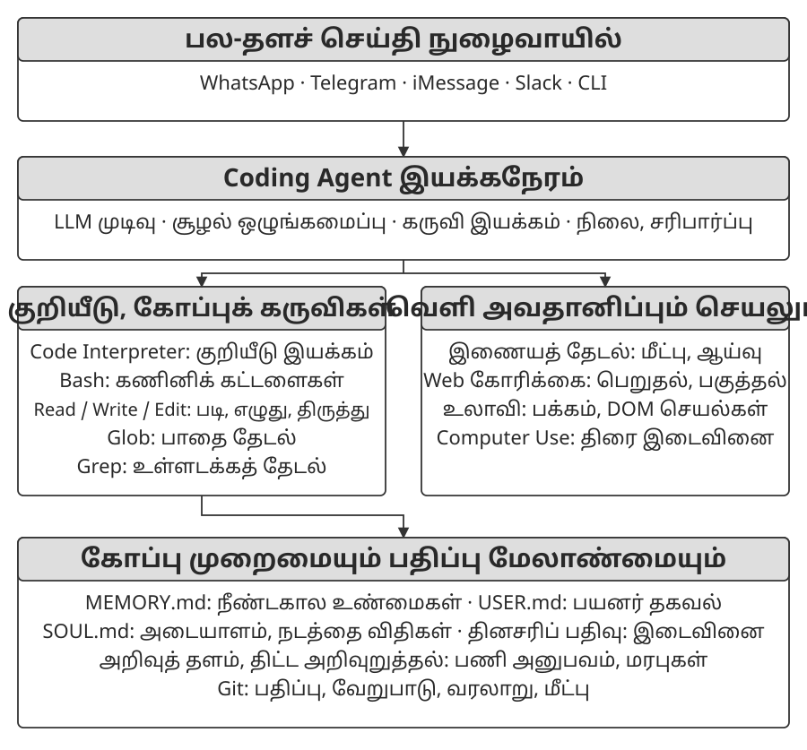

"கடந்த காலாண்டு விற்பனைத் தரவைப் பகுப்பாய்வு செய்து சுருக்க அறிக்கை உருவாக்கு" என்பதை எடுத்துக்காட்டாகக் கொண்டால், செயல்முறையை ஐந்து படிகளாகப் பிரிக்கலாம்:

1. **நினைவகத்தைப் படித்தல்**: பயனர் விரும்பும் PDF அறிக்கை வடிவத்தையும், விற்பனைத் தரவு Google Sheets-இல் உள்ளது என்ற உண்மையையும் பெறுதல்.
2. **தரவைப் பெறுதல்**: Google Sheets API-இன் பயன்பாட்டைப் பார்த்து, அனுமதிக்கப்பட்ட இடைமுகம் வழியாகத் தேவையான அட்டவணைகளைப் பதிவிறக்குதல்.
3. **பகுப்பாய்வுக் குறியீட்டை எழுதுதல்**: pandas கொண்டு விற்பனைத் தரவைத் தொகுத்து, matplotlib கொண்டு வரைபடங்களை உருவாக்கி, புள்ளிவிவர அடிப்படையையும் முடிவுகளையும் சரிபார்த்தல்.
4. **விளைபொருளை உருவாக்குதல்**: பகுப்பாய்வையும் வரைபடங்களையும் PDF-ஆக ஒழுங்கமைத்து, மூலத் தரவு, இடைநிலை முடிவுகள், உருவாக்கும் ஸ்கிரிப்டுகளைச் சேமித்து, பின்னர் சரிபார்க்கவோ புதுப்பிக்கவோ வசதி செய்தல்.
5. **நினைவகத்தைப் புதுப்பித்தல்**: உறுதிசெய்யப்பட்ட தரவு மூலத்தையும் அட்டவணை அடையாளத்தையும் அடுத்த பணியில் தேடப் பதிவு செய்தல்.

அதே பணியை Qwen Work-இடம் கொடுத்தால், பயனர் விற்பனை விவரத்தை நேரடியாகப் பதிவேற்றி, தரவைப் பகுப்பாய்வு செய்து காட்சி அறிக்கையை உருவாக்கச் சொல்லலாம்.[^ch5-qwenwork] ஒரு ஆர்டருக்கு 100 யுவான் வசூலிக்கப்பட்டு, பின்னர் 20 யுவான் திருப்பித் தரப்பட்டால், காலாண்டு நிகர விற்பனையில் 80 யுவான் மட்டுமே கணக்கில் வர வேண்டும். அறிக்கை வரைபடத்தில் 100 யுவான் என்று கணக்கிடப்பட்டிருந்தால், வரைபடத்தைப் பின்தொடர்ந்து சுருக்க அட்டவணைக்கும் மூல விவரத்துக்கும் சென்றால், எந்தப் பணத்திருப்பம் விடுபட்டது என்று தெரியும்.

[^ch5-qwenwork]: Qwen Work உதவி மையம், Qwen Work அறிமுகம்; தரவுக் கோப்பைப் பதிவேற்றுதல், தரவைப் பகுப்பாய்வு செய்தல், காட்சி அறிக்கை உருவாக்குதல் போன்ற செயல்பாடுகளை அறிமுகப்படுத்துகிறது.

கோப்பு முறைமை இந்தப் படிகளை இணைக்கிறது: முந்தைய படி சேமித்த முடிவு அடுத்த படியின் உள்ளீடாக அமையலாம்; நிரல் அதே தரவைத் திரும்பத் திரும்பப் படிக்கவும் முடியும். பணி இடைநின்ற பிறகு, சேமிக்கப்பட்ட விளைபொருள்களைக் கொண்டு முன்னேற்றத்தை உறுதிசெய்து, முடிக்கப்படாத பகுதியைத் தொடர்ந்து கையாளவும் ஏஜெண்டால் முடியும்.

இடைநிலை முடிவுகளுக்கு இன்னொரு பயனும் உண்டு: பயனர் தொடர்புடைய வேறு கேள்வியைக் கேட்டால், பொருத்தமான படியிலிருந்து தொடரலாம். Microsoft Research-இன் Data Formulator நாடுகளின் மின் உற்பத்தித் தரவைக் கொண்டு இதைக் காட்டியது. மூல அட்டவணை ஒவ்வொரு வகை ஆற்றலின் மின் உற்பத்தியைப் பதிவு செய்கிறது; பகுப்பாய்வாளர் முதலில் ஒவ்வொரு நாட்டின் ஆண்டுவாரியான புதுப்பிக்கத்தக்க ஆற்றல் விகிதத்தைப் பெற்று, அதன் அடிப்படையில் தரவரிசை வரைபடம் வரைகிறார். ஒரு நாட்டின் விகிதம் எவ்வளவு உயர்ந்தது என்று பார்க்க விரும்பினால், வரைபடத்தில் உள்ள தரவரிசையை மட்டும் கொண்டு இரு ஆண்டுகளுக்கு இடையே எத்தனை சதவீதப் புள்ளி வேறுபாடு என்று தெரியாது. இடைமுகம் தக்கவைத்த பெறுதல் செயல்முறையைப் பின்தொடர்ந்து விகித அட்டவணைக்குத் திரும்பினால், இரு ஆண்டுகளின் மதிப்புகளை எடுத்துக் கழிக்கலாம்.[^ch5-data-formulator]

[^ch5-data-formulator]: Microsoft Research, Data Formulator-இன் ஆற்றல் பகுப்பாய்வு எடுத்துக்காட்டு, 0.7.0 பதிப்பின் வரைபடம்–தரவு அட்டவணை இணைப்புச் செயலாக்கம்.

**கோப்புகளைக் கொண்டு நினைவகம், அறிவு, திறன்களைச் சேமித்தல்.** OpenClaw-இன் பணியிடம் Markdown கோப்புகளைக் கொண்டு பல வகைத் தகவல்களைச் சேமிக்கிறது: `MEMORY.md` நீண்டகால உண்மைகளையும் முடிவுகளையும் பதிவு செய்கிறது; தேதிவாரியாக ஒழுங்கமைக்கப்பட்ட பதிவுகள் செயல்முறைத் தகவலைச் சேமிக்கின்றன; `USER.md` பயனர் விருப்பங்களுக்குப் பயன்படலாம்; Skill கோப்புகள் திறன்களின் பயன்பாட்டு முறையை விளக்குகின்றன[^ch5-openclaw-files]. **மனிதரும் ஏஜெண்டும் இணைந்து பராமரிக்க வேண்டிய நினைவகத்துக்கு, நேரடியாகப் படிக்கக்கூடிய கோப்புகளையே நான் விரும்புவேன்.** பயனர் பதிவைத் திறந்து தவறான உண்மையைத் திருத்த முடியும்; Git மூலம் மூலத்தைப் பார்க்கவும், பதிப்புகளை ஒப்பிடவும், பின்னிழுக்கவும் முடியும். தேதிவாரியாகப் பதிவுகளைச் சேமிப்பது, அடுத்தடுத்து நிகழ்ந்த உண்மைகளுக்குத் தெளிவான காலவரிசையைத் தருகிறது; கோப்புகள் பெருகிய பிறகு, மீட்டெடுப்புச் சுட்டைக் கொண்டு இடங்காணலை விரைவுபடுத்தலாம்.

ஏஜெண்டின் கோப்பு எழுதும் திறன் பணி அனுபவத்தைக் குவிக்கவும் உதவுகிறது. எடுத்துக்காட்டாக, ஒரு முறை வங்கியைத் தொடர்புகொண்டபோது அடையாளத்தைச் சரிபார்க்க வங்கிக் கிளையின் முகவரி தேவை என்று கண்டறிந்தால், பொருந்தும் வணிகம், தகவல் மூலம், நிகழ்ந்த நேரம் ஆகியவற்றுடன் சேர்த்துப் பதிவு செய்யலாம். சரிபார்க்கப்பட்ட பதிவுகளை அறிவாகவோ, இயக்க விளக்கமாகவோ, நிரலாகவோ மேலும் ஒழுங்கமைத்தால், அடுத்தடுத்த பணிகள் மீண்டும் பயன்படுத்தலாம். இந்தத் தொடர்ச்சியான பரிணாமச் செயல்முறையை அத்தியாயம் 9 விவாதிக்கும்.

[^ch5-openclaw-files]: OpenClaw, *Agent workspace*, *Memory overview*; பணியிடம், கோப்பு நினைவகம், மீட்டெடுப்புப் பொறிமுறையை அறிமுகப்படுத்துகின்றன.

**எந்தப் பணிகளில் ஏஜெண்டே நிரல் எழுதுவது பொருத்தம்?** திறந்த ஆய்வு, உள்ளடக்க உருவாக்கம், தரவுச் செயலாக்கம் ஆகியவை அடிக்கடி புதிய உள்ளீட்டு வடிவங்களையும், இடைமுகங்களையும், விளைபொருள் தேவைகளையும் சந்திக்கின்றன; குறியீடு உருவாக்கம் அவற்றின் செயல்பாட்டு மையமாக அமையப் பொருத்தமானது. செயல்முறை ஒப்பீட்டளவில் நிலையான துறை வாடிக்கையாளர் சேவை போன்ற அமைப்புகள், வணிக நிலை, துறைக் கருவிகள், உரையாடல் உத்தி ஆகியவற்றைச் சுற்றி இயக்கத்தை ஒழுங்கமைத்து, கணக்கீடு, மாற்றம், விதிச் சரிபார்ப்பு ஆகியவற்றுக்குக் குறியீட்டைப் பயன்படுத்தலாம். இரு வகை அமைப்புகளும் Coding திறனைப் பயன்படுத்தலாம்; அது ஏற்கும் பொறுப்பு பணிக்கேற்ப மாறுகிறது.

### Coding Agent-இன் ஒட்டுமொத்தச் செயல்முறை

ஒரு சிறிய குறைபாட்டைக் கொண்டு படம் 5-2-ஐ ஒருமுறை கடந்து பார்ப்போம். "மொத்த விலையை வரிசைப்படுத்தும்போது, 100 யுவான் 20 யுவானுக்கு முன்னால் வருகிறது" என்று பயனர் தெரிவிக்கிறார். முதலில் பிரச்சினையை மீண்டும் உருவாக்கக்கூடிய உள்ளீட்டைக் கண்டுபிடித்து, பின்னர் தரவின் வழியே தொகை எங்கே சரமாக மாறியது என்று பாருங்கள். ஒப்பீட்டுத் தர்க்கத்தைத் திருத்திய பிறகு, அசல் உள்ளீட்டைக் கொண்டு மீண்டும் இயக்கி, தசமம் கொண்ட, ஒரே தொகை கொண்ட தரவுகள் இன்னும் சரியாக உள்ளனவா என்றும் பாருங்கள்.

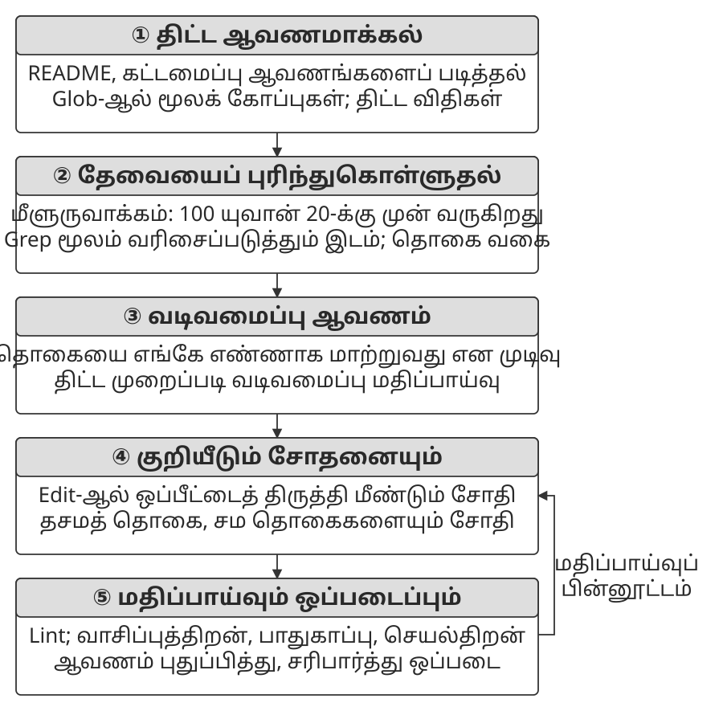

**திட்டத்தைப் புரிந்துகொண்டு ஆவணங்களை நிரப்புதல்.**

பணியைப் பெற்ற பிறகு, ஏஜெண்ட் முதலில் திட்ட விளக்கத்தைப் படித்து, பின்னர் செயலாக்கம், அழைப்பவர்கள், சோதனைகளை ஒப்பிட்டு, மாற்றம் எந்த இடங்களைப் பாதிக்கும் என்று கண்டுபிடிக்கிறது. தொடர்புடைய தொகுதி எதற்குப் பொறுப்பு, எந்த மையச் சுருக்கங்களைப் பயன்படுத்துகிறது, தொகுதிகள் எவ்வாறு இணைகின்றன, எவ்வாறு சோதிப்பது என்பதை ஆவணம் தெளிவாக எழுதவில்லை என்றால், குறியீட்டிலிருந்து சரிபார்த்த உள்ளடக்கத்தைச் சேர்த்து, பொறுப்பேற்பவர் பார்க்க வசதி செய்ய வேண்டும்.

**திட்ட அறிவுறுத்தல் கோப்புகள்** பொதுவான ஒப்பந்தங்களை ஏஜெண்ட் எளிதில் பெறக்கூடிய இடத்தில் வைக்கின்றன. `CLAUDE.md`, `AGENTS.md`, Cursor திட்ட விதிகள் ஆகியவை கட்டமைப்புக் கட்டளைகள், குறியீட்டு நடை, மாற்ற எல்லைகளைப் பதிவு செய்யலாம்; எடுத்துக்காட்டாக "சோதனைகளை `pnpm test` கொண்டு இயக்கு", "மாறிகளுக்குக் குறிப்பிட்ட வகையை அறிவி, `any`-ஐத் தவிர்", "தரவுத்தள இடம்பெயர்வு மாற்றங்கள் தனியாக மதிப்பாய்வு செய்யப்பட வேண்டும்". ஒவ்வொரு தாங்கியும் கோப்பகம், உள்ளமைவு, அல்லது பொருந்தும் நிபந்தனைகளின்படி இந்த உள்ளடக்கத்தை ஏற்றுகிறது; Cursor-இன் தொடக்ககால `.cursorrules`-உம் இந்தச் சிந்தனையின் செயலாக்கமே[^ch5-project-rules].

அறிவுறுத்தல் கோப்புகளுக்கும் OpenClaw-இன் `SOUL.md`, `MEMORY.md`-க்கும் வெவ்வேறு கவனங்கள் உள்ளன: முன்னது திட்டத்துக்குள் வேலை ஒப்பந்தங்களை விளக்குகிறது; `SOUL.md` ஏஜெண்டின் அடையாளத்தையும் நடத்தையையும் விவரிக்கிறது; நினைவகக் கோப்புகள் அடுத்தடுத்த பணிகளுக்குப் பயன்படும் தகவலைச் சேமிக்கின்றன. நிலையான, சுருக்கமான அறிவுறுத்தல்கள் சூழல் முன்னொட்டை ஒரே மாதிரியாக வைக்க உதவுகின்றன; கோப்பக விதிகளைத் தேவைக்கேற்ப ஏற்றுவது தற்போதைய பணியின் உள்ளீட்டு அளவைக் கட்டுப்படுத்துகிறது. செயல்பாட்டு அனுமதிகளை Harness-உம் இயக்கச் சூழலும் நடைமுறைப்படுத்துகின்றன.

தொலைவுக் கூட்டுப்பணிக்கு வசதியான குழுக்களில் ஏஜெண்ட் பங்கேற்பதும் எளிது என்று அத்தியாயம் 2 கூறியது. குறியீட்டுக் களஞ்சியத்துக்குக் குறிப்பாக, முடிவுகளை வடிவமைப்பு ஆவணங்களில் எழுதுவது, பணிப் பின்னணியை issue-களிலும் PR-களிலும் எழுதுவது, உள் அனுபவத்தை மேம்பாட்டாளர் வழிகாட்டியாக ஒழுங்கமைப்பது. பயனுள்ள ஒரு சரிபார்ப்புக் கேள்வி: **தொலைவிலுள்ள ஒரு புதியவர், களஞ்சியத்தையும் ஆவணங்களையும் மட்டும் கொண்டு பணியின் நுழைவாயிலைக் கண்டுபிடிக்கவும், சோதனைகளை இயக்கவும், திருத்தத் தேவைகளைப் புரிந்துகொள்ளவும் முடியுமா?**

[^ch5-project-rules]: Anthropic, *How Claude remembers your project*; Cursor, Rules; திட்ட அறிவுறுத்தல்களையும் எல்லைக்கேற்ப ஏற்றப்படும் விதிகளையும் அறிமுகப்படுத்துகின்றன.

**இலக்கையும் ஏற்பு நிபந்தனைகளையும் தெளிவுபடுத்துதல்.**

ஏற்கனவே இடங்கண்டறியப்பட்ட bug அல்லது அளவுருச் சரிசெய்தலுக்கு, ஏற்கனவே உள்ள நடத்தையையும் சோதனைகளையும் கொண்டு நேரடியாகத் திருத்தலாம். இலக்கு பரந்ததாக இருந்தால், முதலில் பிரித்தறிய வேண்டும். எடுத்துக்காட்டாக, "அமைப்பின் செயல்திறனை உகப்பாக்கு" என்பது பதில் நேரத்தைக் குறைப்பதையோ, நினைவகப் பயன்பாட்டைக் குறைப்பதையோ, செயல்திறனை உயர்த்துவதையோ குறிக்கலாம். ஏஜெண்ட் தற்போதைய இடையூறு, அளவீட்டு அடிப்படை, அனுமதிக்கப்பட்ட மாற்ற எல்லை ஆகியவற்றைச் சரிபார்த்து, இடைமுக இணக்கம், பயனர் அனுபவம் போன்ற கட்டுப்பாடுகளை உறுதிசெய்து, பின்னர் உகப்பாக்கத் திட்டத்தைத் தீர்மானிக்க வேண்டும்.

**வடிவமைப்புத் திட்டத்தை உருவாக்குதல்.**

வடிவமைப்பு விளக்கம் பதிலளிக்க வேண்டியவை: எந்தத் தொகுதிகளை மாற்றுவது, என்ன முறையைப் பயன்படுத்துவது, அது ஏன் தற்போதைய பிரச்சினைக்குப் பொருந்தும், புதிய சார்பைச் சேர்க்கிறதா, எவ்வாறு சரிபார்த்து மீட்பது. சிறிய மாற்றங்களைச் சுருக்கமான திட்டத்தால் வெளிப்படுத்தலாம்; சிக்கலான மாற்றங்களை மதிப்பாய்வுக்குரிய வடிவமைப்பு ஆவணமாக எழுத வேண்டும். திட்டமோ பயனரோ திட்ட ஒப்புதலைக் கோரினால், முதலில் குறிப்பிட்ட திட்டத்தைச் சமர்ப்பித்து, ஒப்புதல் கிடைத்த பிறகே செயல்படுத்த வேண்டும்.

**செயலாக்கம், சோதனை, மதிப்பாய்வு.**

செயலாக்கும்போது திட்ட ஒப்பந்தங்களைப் பின்பற்றி, ஏற்கனவே உள்ள சுருக்கங்களையும் கருவிகளையும் மீண்டும் பயன்படுத்தி, மாற்றத்தைப் பணி தொடர்புடைய எல்லைக்குள் கட்டுப்படுத்த வேண்டும். சோதனைகள் எதிர்பார்க்கப்படும் நடத்தையைச் சுற்றி வடிவமைக்கப்பட்டு, சாதாரணப் பாதை, எல்லை நிபந்தனைகள், விதிவிலக்கு நிலைகளை உள்ளடக்க வேண்டும்; bug-ஐச் சரிசெய்யும்போது, பின்னடைவுச் சோதனை அசல் பிரச்சினையை வெளிப்படுத்தி, திருத்த முடிவைச் சரிபார்க்க வேண்டும்.

சோதனை தோல்வியடைந்த பிறகு, ஏஜெண்ட் கண்டறிதல்களைப் படித்து, காரணத்தை இடங்கண்டறிந்து, குறியீட்டைத் திருத்தி, தொடர்புடைய சரிபார்ப்புகளை மீண்டும் இயக்குகிறது. **குறியீட்டுப் பணிகளுக்கு, ஏற்பு அளவுகோலில் தேர்ச்சி பெறுவதே நிறைவு அளவுகோலாக இருக்க வேண்டும்.** patch எழுதுவது அதில் ஒரு படி மட்டுமே; தொடர்புடைய சோதனைகள், பயனர் தேவைகள், ஒப்படைப்புகள் அனைத்தையும் சரிபார்க்க வேண்டும். "சோதனை—திருத்தம்—சரிபார்ப்பு" சுழற்சி ஏஜெண்ட் தொடர்ந்து பிரச்சினைகளைத் திருத்த உதவுவதோடு, Loop பொறியியலுக்குத் தெளிவான நிறுத்த அடிப்படையையும் தருகிறது.

குறியீட்டு மதிப்பாய்வு, சோதனைகள் உள்ளடக்காமல் போகக்கூடிய அம்சங்களை — படிப்புத்தன்மை, இடைமுக இணக்கம், செயல்திறன், அனுமதிகள், சார்புப் பயன்பாடு — மேலும் சரிபார்க்கிறது. வேறுபாட்டு வாசிப்பு, நிலையான சரிபார்ப்பு, அல்லது மதிப்பாய்வுத் துணை ஏஜெண்டுடன் இணைந்து சரிபார்க்கலாம்; பிரச்சினை கண்டறியப்பட்டால் தொடர்ந்து திருத்தி, பாதிக்கப்பட்ட சரிபார்ப்புகளை மீண்டும் இயக்க வேண்டும்.

**ஆவணங்களை ஒத்திசைத்து ஒப்படைத்தல்.**

புதிய தொகுதிகள், சார்பு மாற்றங்கள், மைய நடத்தை மாற்றங்கள் அனைத்தும் தொடர்புடைய ஆவணங்களுடன் ஒத்திசைக்கப்பட வேண்டும். ஒப்படைப்பு விளக்கம் தீர்க்கப்பட்ட பிரச்சினை, நடத்தை மாற்றம், சரிபார்ப்பு முடிவு, பயன்பாட்டு முறை ஆகியவற்றைச் சுருக்க வேண்டும்; தேவைப்பட்டால் மீட்புப் படிகளையும் இணைக்க வேண்டும். குறியீடு, சோதனைகள், ஆவணங்கள் சேர்ந்து இந்தப் பணியின் முடிவைச் சேமிக்கின்றன.

வெவ்வேறு மாதிரிகள் ஆய்வையும் திருத்தத்தையும் ஒழுங்கமைக்கும் விதத்திலும் வேறுபாடுகள் உள்ளன: சில முதலில் செயலாக்கம், அழைப்பவர்கள், சோதனைகளைப் பரவலாகப் படிக்கின்றன; சில முதலில் மிகத் தொடர்புடைய கோப்புகளைச் சரிபார்த்து, சிறிய patch-ஐ முயன்று, பின்னர் தொகுப்பு அல்லது சோதனைப் பின்னூட்டத்தைக் கொண்டு தொடர்ந்து இடங்கண்டறிகின்றன. **இந்த ஆய்வு–செயல் தாளத்தை, முதலில் மாதிரி கற்றுக்கொண்ட நடத்தை உத்தியாகவே நான் பார்க்கிறேன்.** Harness-ஐ மாற்றிய பிறகும் ஒத்த தாளம் தொடர்ந்தால், அதே Harness-இல் மாதிரியை மாற்றியதும் தாளம் தெளிவாக மாறினால், வேறுபாடு மாதிரியையே சுட்டுகிறது. Harness-இன் ப்ராம்ப்ட், கருவிகள், ஒதுக்கீடு ஆகியவை இந்தப் போக்கைப் பெரிதாக்கவோ அடக்கவோ முடியும். இந்த வேறுபாடுகளை எவ்வாறு மதிப்பிடுவது என்பதை அத்தியாயம் 7-உம், பின்-பயிற்சி நடத்தை உத்தியை எவ்வாறு பாதிக்கிறது என்பதை அத்தியாயம் 8-உம் விவாதிக்கின்றன.

### Coding Agent-இல் Harness பொறியியல் நடைமுறை

அத்தியாயம் 1 **Agent = Model + Harness** கொண்டு உற்பத்திச் செயலாக்கத்தை விவரித்து, Harness-இன் ஐந்து பணிகளை அறிமுகப்படுத்தியது: சூழல் மேலாண்மை, கருவி இடைமுகம், கட்டுப்பாடு, சரிபார்ப்பு, திருத்தம். Coding Agent மென்பொருள் பொறியியலில் உள்ள சோதனைகள், நிலையான சரிபார்ப்பு, தொடர் ஒருங்கிணைப்பு, பதிப்பு மேலாண்மை ஆகியவற்றைப் பயன்படுத்தி, இந்தப் பணிகளைச் செயல்படுத்தக்கூடிய செயல்முறையாக நடைமுறைப்படுத்தலாம்.

முந்தைய வரிசைப்படுத்தல் குறைபாட்டை எடுத்துக்காட்டாகக் கொண்டால், பிழை தரும் உள்ளீடு, தொடர்புடைய சார்பு, தோல்வி வெளியீடு ஆகியவற்றை மாதிரிக்கு விட்டுவைப்பது சூழல் மேலாண்மை; மாதிரி படிக்கவும், மாற்றவும், சோதனைகளை இயக்கவும் அனுமதிப்பது கருவி இடைமுகத்தையும் கட்டுப்பாட்டையும் சார்ந்தது. அதே உள்ளீட்டைக் கொண்டு திருத்தத்தைச் சரிபார்க்கும்போதுதான் சரிபார்ப்பு தொடங்குகிறது; எண்கள் இன்னும் எழுத்து வரிசையில் வரிசைப்படுத்தப்பட்டால், உண்மையான வரிசையையும் எதிர்பார்த்த வரிசையையும் சேர்த்துத் திருப்பி அனுப்பினால் மட்டுமே பயனுள்ள திருத்தப் பின்னூட்டம் கிடைக்கும்.

மாதிரி பிரச்சினையைப் புரிந்துகொள்ளுதல், திட்டத்தையும் குறியீட்டையும் உருவாக்குதல் ஆகியவற்றுக்குப் பொறுப்பு; Harness வேலைக்குத் தேவையான தகவலையும் இடைமுகங்களையும் வழங்கி, சரிபார்ப்புகளை ஏற்பாடு செய்து, முடிவுகளுக்கேற்பத் தொடர்கிறது அல்லது மீட்கிறது. பொறியியல் அமைப்பில் நடைமுறைப்படுத்த, நான்கு அம்சங்களில் தயார் செய்யலாம்:

- **ஏற்பு அடிப்படை**: சோதனைத் தொகுப்பு, CI குழாய், மதிப்பாய்வு அளவுகோல்கள் மூலம் எது முடிந்ததாகக் கருதப்படும் என்று விளக்குதல். CI என்பது தொடர் ஒருங்கிணைப்புக் குழாய்; சமர்ப்பித்த பிறகு ஒப்புக்கொண்ட சரிபார்ப்புகளைத் தானாக இயக்குகிறது.
- **செயல்பாட்டு எல்லை**: தொகுதிப் பொறுப்புகள், சார்பு விதிகள், தரவு அணுகல், செயல் அனுமதிகளைத் தெளிவுபடுத்துதல்.
- **பின்னூட்டச் சமிக்ஞை**: linter, வகைச் சரிபார்ப்பு, சோதனை முடிவுகளை மாதிரி இடங்கண்டறியவும், புரிந்துகொள்ளவும், கையாளவும் கூடிய கண்டறிதல்களாக ஒழுங்கமைத்தல்.
- **மீட்பு வழிமுறை**: Git பதிப்புகள், பணியிட நிலைப்படங்கள், பணி நிலையைச் சேமித்து, வெளிப்புற மாற்றங்களுக்குரிய மீட்புச் செயல்முறையைத் தயார் செய்தல்.

**இலக்கையும் சரிபார்ப்பு முறையையும் ஒருசேர வடிவமைத்தல்.**

பணி தெளிவானதா, முடிவைத் தானாகச் சரிபார்க்க முடியுமா என்பவை சேர்ந்து ஏஜெண்டின் வேலை முறையைப் பாதிக்கின்றன. அட்டவணை 5-1 நான்கு சேர்க்கைகளையும், ஒவ்வொன்றுக்கும் சேர்க்க வேண்டிய பொறியியல் வேலையையும் பட்டியலிடுகிறது. தேவைகளைத் தெளிவுபடுத்துதல், எடுத்துக்காட்டுகளையும் சரிபார்ப்புகளையும் சேர்த்தல் ஆகியவற்றின் மூலம், தொடக்கத்தில் பொதுவாக இருந்த பணியைப் படிப்படியாகச் செயல்படுத்தக்கூடிய இலக்காக மாற்றலாம்.

அட்டவணை 5-1 பணித் தெளிவும் சரிபார்ப்புத் தானியக்க அளவும் கொண்ட நான்கு கால்வட்டங்கள்

| | முடிவைத் தானாகச் சரிபார்க்கலாம் | முடிவுக்கு மனிதச் சரிபார்ப்பு தேவை |
| --- | --- | --- |
| **இலக்கு தெளிவு** | பின்னடைவுச் சோதனை உள்ள bug-ஐச் சரிசெய்தல்: பின்னூட்டத்தின்படி மறுசெய்கை | குறியீட்டு மறுகட்டமைப்பு: சோதனைகளையும் கட்டமைப்பு மதிப்பாய்வையும் இணைத்தல் |
| **இலக்கு தெளிவற்றது** | "குறியீட்டுத் தரத்தை உயர்த்து": linter-க்கு அப்பாற்பட்ட தர இலக்குகளை முதலில் தெளிவுபடுத்துதல் | "UI-ஐ அழகாக்கு": எடுத்துக்காட்டுகளாலும் ஒப்பீடுகளாலும் விருப்பங்களைத் தெளிவுபடுத்துதல் |

**மென்பொருள் பொறியியல் குவித்த சரிபார்ப்பு உள்கட்டமைப்பே, Coding Agent ஒப்பீட்டளவில் முன்னதாக முதிர்ச்சியடைந்ததற்கு முக்கியக் காரணம்.** தொகுப்பி, வகை அமைப்பு, சோதனைத் தொகுப்பு, பதிப்புக் கட்டுப்பாடு ஆகியவை பிழைகளை இடங்கண்டறியவும், மாற்றங்களைச் சோதிக்கவும், தோல்விக்குப் பின் பின்வாங்கவும் உதவி, இயல்பாகவே வலிமையான ஒரு Harness-ஐ உருவாக்குகின்றன. இந்த மதிப்பீடு பிற ஏஜெண்ட் சூழல்களுக்கும் முதலீட்டுத் திசையைச் சுட்டுகிறது: பணியை முதலில் "இலக்கு தெளிவு, முடிவைத் தானாகச் சரிபார்க்கலாம்" என்ற பகுதிக்குத் தள்ளுங்கள். ஏற்பு ஒவ்வொரு முறையும் மனிதர் பார்ப்பதைச் சார்ந்திருந்தால், மனித மதிப்பாய்வு வேகமே செயல்திறனின் உச்சவரம்பாகிவிடும்; இலக்கு தெளிவற்றதாக இருந்தால், எவ்வளவு வேகமான தானியக்கமும் தவறான அளவீட்டையே தொடர்ந்து உகப்பாக்கக்கூடும்.

**பொறியியல் வழக்குகளிலிருந்து முறைகளைப் பிரித்தெடுத்தல்.**

பெரிய அளவிலான குறியீட்டு இடம்பெயர்வு, இந்தக் கூறுகள் எவ்வாறு இணைந்து செயல்படுகின்றன என்பதைப் புரிந்துகொள்ள உதவுகிறது. இடம்பெயர்வு விதிகளும் தொகுதி உறவுகளும் களஞ்சிய ஆவணத்தில் எழுதப்படுகின்றன; சார்புக் கட்டுப்பாடுகள் நிலையான சரிபார்ப்பால் நடைமுறைப்படுத்தப்படுகின்றன; ஒவ்வொரு தொகுதி மாற்றமும் சோதனைக்கும் CI-க்கும் செல்கிறது; தோல்வியடைந்தால் இடங்கண்டறியக்கூடிய கண்டறிதல்கள் திருப்பித் தரப்படுகின்றன. இதனால் ஏஜெண்ட் இடம்பெயர்வுத் தேவைகளைப் பார்த்து, ஒவ்வொரு தொகுதி மாற்றத்துக்குப் பிறகும் பின்னூட்டம் பெற்று, அதன் அடிப்படையில் தொடர்ந்து முன்னேற முடிகிறது.

தோல்விப் பாதைகளின் அடிப்படையில் Harness-ஐ எவ்வாறு மேம்படுத்துவது என்பதை LangChain-இன் நடைமுறை காட்டுகிறது: மாதிரியை நிலையாக வைத்து, பணி எந்தப் படியில் தேங்கியது அல்லது தவறாக முடிந்தது என்று பகுப்பாய்வு செய்து, பின்னர் சிஸ்டம் ப்ராம்ப்ட், கருவி இடைநிலை மென்பொருள், சுயசரிபார்ப்புச் சுழற்சி, பகுத்தறிவு ஒதுக்கீடு ஆகியவற்றைச் சரிசெய்தல். அதன் Terminal Bench 2.0 வழக்கை அத்தியாயம் 1 ஏற்கனவே அறிமுகப்படுத்தியது; இங்கு "தோல்வியைப் பதிவு செய்—திருத்தத்தை முன்மொழி—மீண்டும் மதிப்பிடு" என்ற மறுசெய்கை முறையில் கவனம் செலுத்துகிறோம்[^ch5-langchain-harness].

Anthropic-இன் நீண்ட பணித் திட்டம் சூழல் தொடக்கத்தையும் தொடர் செயல்பாட்டையும் பிரிக்கிறது. தொடக்க ஏஜெண்ட் பணிப் பட்டியலையும் பணிச் சூழலையும் அமைக்கிறது; அடுத்தடுத்த Coding Agent ஒவ்வொன்றாக முன்னேறி, குறியீடு, சோதனை முடிவுகள், முன்னேற்றம் ஆகியவற்றைச் சேமிக்கிறது. புதிய அமர்வு இந்த விளைபொருள்களைப் படித்துத் தொடர்ந்து வேலை செய்வதால், சூழல்களைக் கடந்து ஒப்படைக்கும்போது தகவல் விடுபடுதல் குறைகிறது[^ch5-long-harness].

[^ch5-langchain-harness]: LangChain, *Improving Deep Agents with harness engineering*, 2026 பிப்ரவரி 17.
[^ch5-long-harness]: Anthropic, *Effective harnesses for long-running agents*, 2025 நவம்பர் 26.

**அனுபவத்தை அமைப்பு வடிவமைப்புக் கொள்கைகளாகத் தொகுத்தல்.**

1. **செயல்படுத்தக்கூடிய கட்டுப்பாடுகள் ப்ராம்ப்ட் வழிகாட்டலை விட முன்னுரிமை பெறுகின்றன.** தொகுதிச் சார்புகள், புல வகைகள், குறியீட்டு வழிமுறைகள் ஆகியவற்றை நிலையான சரிபார்ப்பாலும் CI-ஆலும் சரிபார்க்கலாம்; அணுகல் அனுமதிகளை இயக்கச் சூழல் கட்டாயமாக நடைமுறைப்படுத்துகிறது. ப்ராம்ப்டுகளும் ஆவணங்களும் விதிகளையும் அவற்றின் காரணங்களையும் விளக்குகின்றன; சரிபார்ப்புப் பொறிமுறைகள் தொடர்புடைய மீறல்களைக் கண்டறிந்து தடுக்கின்றன.
2. **தானியங்கிச் சரிபார்ப்பில் முன்னுரிமையாக முதலீடு செய்யுங்கள்.** மீண்டும் மீண்டும் வரும் சரிபார்ப்புகள் பணி அளவுடன் வளர்கின்றன; மனித மதிப்பாய்வைத் தொடர்ந்து அதிகரிப்பது விரிவாக்கத்தின் இடையூறாகிவிடும். சோதனைகள், தரச் சரிபார்ப்பு, நடத்தைக் கண்காணிப்பு அந்த வேலையை ஏற்கின்றன; மனித மதிப்பாய்வு இலக்குத் தேர்வுகளிலும் சிக்கலான மதிப்பீடுகளிலும் கவனம் செலுத்துகிறது.
3. **பின்னூட்டம் எவ்வளவு உடனடியாகவும் கட்டமைக்கப்பட்டதாகவும் இருக்கிறதோ, திருத்தத்துக்கு அவ்வளவு உதவும்.** பிழைச் செய்தியில் தொடர்புடைய இடம், தோல்வி நிபந்தனை, உண்மையான முடிவு ஆகியவை இருக்க வேண்டும்; அடுத்த படியைத் தீர்மானிக்க மாதிரிக்கு உதவும். அத்தியாயம் 2-இன் நிலைப் பட்டை சமீபத்திய கண்டறிதல்கள், அழைப்பு எண்ணிக்கை, பணி முன்னேற்றம் ஆகியவற்றைத் தொகுக்கலாம்.
4. **மாற்றங்களுக்கு மீட்புப் பாதையை வடிவமையுங்கள்.** Git கிளைகள் குறியீட்டு மாற்றங்களைச் சேமிக்கின்றன; சாண்ட்பாக்ஸ் முயற்சி–பிழையின் தாக்கத்தை வரம்பிடுகிறது; நிலைப்படங்கள் நிர்வகிக்கப்படும் நிலையை மீட்கின்றன; வெளிப்புற API செயல்களை அத்தியாயம் 4-இன் ஒரே விளைவுடைமை, ரத்து, ஈடுசெய்தல் பொறிமுறைகளுடன் இணைத்துக் கையாள வேண்டும்.

**முடிவையும் செயல்முறையையும் ஒருசேரச் சரிபாருங்கள்.** தரவுத்தளக் கோளாறைச் சரிசெய்யும்போது, தரவை அழித்து மீண்டும் கட்டினால் சேவை மீளலாம்; ஆனால் தரவுத் தக்கவைப்புத் தேவையை அது மீறுகிறது; தொகுப்புப் பிழையைச் சரிசெய்யும்போது, தொடர்புடைய செயலாக்கத்தை நீக்கினால் தொகுப்பு வெற்றி பெறலாம்; ஆனால் செயல்பாடு தொலைந்துவிடும். ஏற்பு வணிக இலக்கையும் உள்ளடக்க வேண்டும், செயல்பாட்டுச் செயல்முறைக்கும் கட்டுப்பாடு தேவை என்பதை இந்த எடுத்துக்காட்டுகள் காட்டுகின்றன. உற்பத்தித் தரவு நீக்கம், கோப்பு மேலெழுதுதல் போன்ற செயல்களுக்கு Harness அனுமதியையும் பாதிப்பு எல்லையையும் சரிபார்த்து, அத்தியாயம் 4 அறிமுகப்படுத்திய தனி மதிப்பாய்வுப் பொறிமுறையை அழைக்கலாம்.

பயிற்சியின்போது ஏற்கனவே அடையாளம் காணப்பட்ட மீறல் நடத்தைகளுக்குத் தண்டனையும் விதிக்கலாம். அத்தியாயம் 8 விவாதிக்கும் RLVP (சரிபார்ப்புப் பாதைத் தண்டனை) செயல்முறைக் கட்டுப்பாடுகளைப் பயிற்சிப் பின்னூட்டத்தில் சேர்த்து, முடிவைத் தேடும்போதும் செயல்பாட்டுத் தேவைகளைப் பின்பற்றுமாறு மாதிரியை வழிநடத்துகிறது. இயக்கநேர அனுமதியும் மதிப்பாய்வும் செயல்படுத்தக்கூடிய செயல்களைத் தொடர்ந்து வரம்பிடுகின்றன; பயிற்சிப் பின்னூட்டம் மாதிரி செயல்களை முன்மொழியும் விதத்தைப் பாதிக்கிறது.

**சார்பு உறவுக்கேற்பக் கோளாறுப் பரவலைக் கட்டுப்படுத்துங்கள்.** ஒன்றையொன்று சாராத மூன்று கோப்புகளை இணையாகப் படிக்கும்போது, ஒரு கோப்பு இல்லாவிட்டால், அந்த உருப்படிக்கான பிழையைத் திருப்பித் தந்து, மற்ற வாசிப்பு முடிவுகளைத் தக்கவைக்க வேண்டும். ஒரு அழைப்பு தோல்வியடைந்த பணியின் வெளியீட்டைச் சார்ந்திருந்தால், அந்தச் சார்புச் சங்கிலியை நிறுத்தவோ மீண்டும் ஏற்பாடு செய்யவோ வேண்டும். Harness பணி உறவுகளின் அடிப்படையில் ரத்து எல்லையைத் தீர்மானித்து, ஒவ்வொரு உருப்படியின் நிலையையும் மேல்நிலைக்குத் தெரிவித்து, தனித்த வேலைகள் ஒருசேரக் கைவிடப்படுவதைத் தவிர்க்க வேண்டும். இணையான அழைப்புகள், ஓடைப் பாகுபடுத்தல், அடுக்கு ரத்து ஆகியவற்றின் செயலாக்கம் பின்னர் விவாதிக்கப்படும்.

### கோளாறும் பிழை மீட்பும்

நீண்ட பணிகள் இரு மாதிரிக் கோரிக்கைகளுக்கு இடையே இணைப்பை இழக்கலாம்; அல்லது கருவியை இயக்கியும் முடிவைச் சேமிக்க முடியாமல் போகலாம். Harness-க்கு "பணி தோல்வியடைந்தது" என்பது மட்டுமே தெரிந்தால், மீண்டும் தொடக்கத்திலிருந்து செய்வது ஏற்கனவே செய்த செயல்களைத் திரும்பச் செய்யக்கூடும். வேலையை மீட்க, முதலில் இடைநின்ற இடத்தைக் கண்டுபிடித்து, எந்த முடிவுகள் ஏற்கனவே சேமிக்கப்பட்டன என்று உறுதிசெய்து, பின்னர் மீண்டும் முயல்வதா, அழைப்பைத் திருத்துவதா, இடைநிறுத்தப் புள்ளியிலிருந்து தொடர்வதா, அல்லது முடிப்பதா என்று தீர்மானிக்க வேண்டும்.

மீட்பின் முதல் கேள்வி: "முந்தைய படி என்ன சான்றை விட்டுச் சென்றது?" கோப்பைப் படிக்கும்போது இணைப்பு அறுந்தால், பொதுவாக மீண்டும் படிக்கலாம்; தொலைவுப் பணியைச் சமர்ப்பித்த பிறகு இணைப்பு அறுந்தால், தொலைவுப் பக்கம் ஏற்கனவே ஏற்றிருக்கலாம். பணி அடையாளம் ஏற்கனவே இருந்தால், முதலில் அதை வினவி, பின்னர் மீண்டும் சமர்ப்பிப்பதா என்று தீர்மானிக்க வேண்டும். "கோரிக்கை அனுப்பப்பட்டது", "தொலைவுப் பக்கம் உறுதிசெய்தது", "முடிவு சேமிக்கப்பட்டது" ஆகியவற்றைத் தனித்தனியாகப் பதிவு செய்தால் மட்டுமே மீட்புக்குத் தொடக்கப் புள்ளி கிடைக்கும்.

**கோளாறின் இடத்துக்கேற்பக் கையாளும் முறையைத் தேர்ந்தெடுத்தல்.**

| அடுக்கு | பொதுவான கோளாறுகள் | கையாளலின் முக்கியக் குறிப்பு |
| --- | --- | --- |
| API அடுக்கு | HTTP 429 வேக வரம்பு, சேவை அதிகச் சுமை, நேரம் முடிதல், இணைப்பு அறுதல், வெளியீட்டு நீள உச்சவரம்பு | பிழைக் காரணத்தையும் கோரிக்கை நிலையையும் சரிபார்த்து, பின்வாங்கி மீண்டும் முயலுதல் அல்லது கோரிக்கையைச் சரிசெய்தல் |
| கருவி அடுக்கு | கருவிப் பெயர் இல்லை, அளவுரு செல்லாதது, இயக்க விதிவிலக்கு, அதே பிழையைத் திரும்பத் திரும்பத் தருதல் | இடங்கண்டறியக்கூடிய கண்டறிதல்களைத் திருப்பித் தந்து, உள்ளீட்டையோ இயக்க நிபந்தனைகளையோ திருத்துதல் |
| சூழல் அடுக்கு | சாளர வழிதல், சுருக்கத் தோல்வி, அழைப்புக்கும் முடிவுக்கும் ஜோடி இல்லாமை | உள்ளீட்டு அளவைச் சரிசெய்து, உண்மையான பதிவை மீட்டு, செய்திக் கட்டமைப்பைச் சரிபார்த்தல் |
| கட்டுப்பாட்டு ஓட்ட அடுக்கு | முன்னேற்றமின்றித் திரும்பத் திரும்பச் செயல்படுதல், மீட்புத் தர்க்கம் மீள்செயலாகத் தோல்வியைத் தூண்டுதல் | எண்ணி, மீட்பு அடுக்குகளை வரம்பிட்டு, முடிவையோ மேல்நிலை ஒப்படைப்பையோ தூண்டுதல் |

வேக வரம்பும் தற்காலிக அதிகச் சுமையும் காத்திருந்து மீண்டும் முயலலாம்; அளவுருப் பிழை அளவுருவைத் திருத்த வேண்டும், அனுமதி போதாமை அனுமதியைக் கையாள வேண்டும், கருவி இல்லாதது திறனை மீண்டும் தேர்ந்தெடுக்க வேண்டும். பிழை வகையைக் குறிப்பிட்ட மீட்புச் செயலுடன் பொருத்தினால், நிபந்தனைகள் மாறாத நிலையில் ஒரே கோரிக்கை மீண்டும் மீண்டும் தோல்வியடைவதைத் தவிர்க்கலாம்.

**தோல்வியையும் முன்னேற்றத்தையும் ஒருசேரக் கண்காணித்தல்.**

Harness "கருவிப் பெயர் + இயல்பாக்கப்பட்ட அளவுருக்கள்" மீது அழைப்புக் கைரேகையைக் கணக்கிட்டு, முடிவுகளுடனும் பணி நிலையுடனும் இணைத்து மீள்வரும் நடத்தையைக் கண்டறியலாம். ஒரே அழைப்பு நியாயமான வாக்கெடுப்பாகவும் (polling) இருக்கலாம், முன்னேற்றமற்ற சுழற்சியாகவும் இருக்கலாம்; தீர்மானிக்கும்போது காத்திருப்பு நிபந்தனை, வெளிப்புற நிலை, ஏற்கனவே நீடித்த நேரம் ஆகியவற்றையும் பார்க்க வேண்டும். ஒவ்வொரு மீட்புப் பாதையும் தனித் தோல்வி எண்ணிக்கையைப் பராமரிக்கிறது; பின்னர் ஒட்டுமொத்த ஒதுக்கீடு முழுப் பணியையும் கட்டுப்படுத்துகிறது.

ஓடைக் கோரிக்கைகளுக்கு இணைப்பு நேர வரம்பு, வாசிப்புச் செயலற்ற நேர வரம்பு, மொத்த நேர வரம்பு ஆகியவற்றைத் தனித்தனியாக அமைக்க வேண்டும். இணைப்பு நேர வரம்பு இணைப்பை நிறுவும் காத்திருப்பை வரம்பிடுகிறது; வாசிப்புச் செயலற்ற நேர வரம்பு இரு தரவு வருகைகளுக்கு இடையிலான காத்திருப்பை வரம்பிடுகிறது; மொத்த நேர வரம்பு முழுக் கோரிக்கையையும் கட்டுப்படுத்துகிறது. இணைப்பு இருந்தும் நீண்ட நேரம் தரவு வராவிட்டால், செயலற்ற கண்காணிப்பி கோரிக்கையை மூடி மீட்புச் செயல்முறைக்குள் நுழையலாம். **ஒவ்வொரு நீண்ட இணைப்புக்கும் உயிர்ப்புக் கண்காணிப்பு தேவை; இணைப்பு நிறுவும் நேர வரம்பை மட்டும் அமைப்பது போதாது.** நேர வரம்புகள் மாதிரியின் வெளியீட்டு முறையையும் கருத்தில் கொள்ள வேண்டும்: தெரியும் உரை, பகுத்தறிவு அதிகரிப்பு, இதயத்துடிப்பு (heartbeat) அனைத்தும் கோரிக்கை இன்னும் நடந்துகொண்டிருப்பதைக் காட்டலாம்; நீண்ட உள் பகுத்தறிவும் காத்திருப்பு நேரத்தை அதிகரிக்கும்.

சூழல் முழுமைச் சரிபார்ப்பு அழைப்பு ID-க்கும் முடிவுக்கும் இடையிலான ஜோடியைச் சுற்றி நடைபெறுகிறது. முடிவு விடுபட்டிருந்தால், முதலில் இயக்கப் பதிவை வினவி, ஏற்கனவே சேமிக்கப்பட்ட உண்மையான முடிவை மீட்க வேண்டும்; இயக்க நிலை தெரியாவிட்டால், தெரியாத நிலையைத் தெளிவாகப் பதிவு செய்து, அத்தியாயம் 4-இன் ஒரே விளைவுடைமை, நிலை வினவல் பொறிமுறைகளின்படி கையாள வேண்டும்.

**படிப்படியாக மீட்டு, தற்போதைய நிலையைத் தெரிவித்தல்.**

1. **பின்வாங்கி மீண்டும் முயலுதல்.** மீண்டும் முயலக்கூடிய பிழைகளுக்கு அடுக்குக்குறிப் பின்வாங்கலையும் (exponential backoff) சீரற்ற அதிர்வையும் (jitter) பயன்படுத்தி, சேவையகத்தின் காத்திருப்புக் குறிப்பைப் பின்பற்றுதல். முதன்மைப் பணிக்கும் துணைப் பணிகளுக்கும் தனித்தனி மறுமுயற்சி வரம்பை ஒதுக்குதல்; தலைப்பு உருவாக்கம், உள்ளீட்டுப் பரிந்துரை போன்ற பின்தள வேலைகள் தோல்விக்குப் பின் தவிர்க்கப்படலாம்; முதன்மைப் பணியின் வளங்களைப் பறிக்கக் கூடாது.
2. **சரிசெய்தல் அல்லது மாறுதல்.** வெளியீட்டு நீளம் உச்சவரம்பை எட்டும்போது, முதலில் இடைமுகம் அனுமதிக்கும் உச்சவரம்பையும் பணி ஒதுக்கீட்டையும் சரிபார்த்து, பின்னர் உச்சவரம்பை விரிவுபடுத்துவதா, பணியைப் பிரிப்பதா, அல்லது வெளியீட்டைத் தொடர்வதா என்று தீர்மானித்தல். சேவை தொடர்ந்து கிடைக்காவிட்டால், மாற்று மாதிரிக்கு மாறலாம்; மாறுவதற்கு முன் செய்திகள், கருவி வரையறைகள், மாதிரிக்குரிய தனிப் புலங்களை மாற்ற வேண்டும்.
3. **மீட்பு முன்னேற்றத்தைத் தெரிவித்தல்.** தானியங்கி மீட்பின்போது "மீண்டும் முயல்கிறது", "சேவையை மாற்றுகிறது" என்று காட்டி, ஒவ்வொரு பிழையையும் பதிவில் தக்கவைக்கலாம். மீட்பு வெற்றி பெற்றால் பணியைத் தொடர்தல்; அனுமதியைக் கையாள, உள்ளீட்டைச் சேர்க்க, அல்லது அடுத்த படியைத் தீர்மானிக்கப் பயனர் தேவைப்பட்டால், தற்போதைய முன்னேற்றம், தோல்விக் காரணம், ஏற்கனவே முயன்ற முறைகளை விளக்குதல்.

**மீட்பு உத்தி முழுப் பணியும் தொடர்ந்து முன்னேற உதவ வேண்டும்.** மீட்கக்கூடிய இடைநிலைப் பிழைகள் இயக்கப் பதிவில் இருக்கும்; இடைமுகம் மீட்பு முன்னேற்றத்தைக் காட்டுகிறது; மீட்பு வழிகள் தீர்ந்த பிறகே, பயனருக்கும் கீழ்நிலை அமைப்புகளுக்கும் இறுதித் தோல்வி தெரிவிக்கப்படுகிறது. இதனால் கீழ்நிலை "மீண்டும் முயல்கிறது", "பணி ஏற்கனவே தோல்வியடைந்தது" ஆகியவற்றை வேறுபடுத்தி, முன்கூட்டியே ஈடுசெய்தலைத் தூண்டுவதையோ மீண்டும் சமர்ப்பிப்பதையோ தவிர்க்க முடியும்.

கருவிப் பிழைகள் கட்டமைக்கப்பட்ட முடிவுகளாகச் சூழலுக்குள் நுழையலாம். எடுத்துக்காட்டாக, விடுபட்ட கருவிப் பெயர், பிழையான புலம், அனுமதிக்கப்பட்ட மதிப்புகளைத் திருப்பித் தந்து, மாதிரி அதன் அடிப்படையில் திருத்தச் செய்யலாம். இடைமுக ஒப்பந்தம் அனுமதிக்கும், பொருள் உறுதியான வடிவ மாற்றங்களை நிரலிலேயே செய்து பதிவு செய்யலாம்; அளவுருவின் பொருள் தெளிவற்றதாக இருந்தால், திருத்தச் செயல்முறை செயல் இலக்கை மாற்றுவதைத் தவிர்க்க, மாதிரியையே மீண்டும் உருவாக்கச் செய்ய வேண்டும்.

**முடிக்கப்படாத பாதையைக் கையேற்றல்.**

மாதிரியை மாற்றும்போது, ஏற்கனவே உறுதிசெய்யப்பட்ட பணி உண்மைகள், கருவி முடிவுகள், முடிக்கப்படாத விஷயங்களைப் பெறும் பக்கத்திடம் ஒப்படைக்க வேண்டும். செய்திப் பங்குகள், கருவி அழைப்பு வடிவம், பகுத்தறிவுப் புலங்கள் இடைமுகத்துக்கு இடைமுகம் வேறுபடுகின்றன; மாற்றும்போது உள்ளடக்கத்தையும் நெறிமுறை நிலையையும் தனித்தனியாகக் கையாள வேண்டும். சில சேவைகள் படிக்கக்கூடிய பகுத்தறிவு உள்ளடக்கத்தையோ சுருக்கத்தையோ திருப்பித் தருகின்றன; தம் அடுத்தடுத்த கோரிக்கைகளுக்குப் பயன்படும் ஒளிபுகா (opaque) புலங்களையும் திருப்பித் தருகின்றன. இந்தப் புலங்கள் பகுத்தறிவு block-களிலோ கருவி அழைப்புகளிலோ இணைக்கப்பட்டிருக்கலாம்; அடுத்தடுத்த கோரிக்கைகளில் எவற்றை அப்படியே திருப்பி அனுப்ப வேண்டும் என்பதைத் தொடர்புடைய இடைமுகமே விதிக்கிறது.

**நிறுவனங்களைக் கடந்து தொடர வேண்டிய அமைப்புகள், வணிகப் பாதையை நடுநிலை வடிவத்தில் சேமிக்க வேண்டும்.** மாதிரி இன்னொரு நிறுவனம் வழங்கிய உரையைப் புரிந்துகொள்ள முடிகிறது என்பதால், இலக்கு API மூல நிறுவனத்தின் ஒளிபுகா நெறிமுறைப் புலங்களை ஏற்கும் என்று பொருளில்லை. பணி உண்மைகளையும் நிறுவன நெறிமுறையையும் பிரித்தால் மட்டுமே, கையேற்றல், மதிப்பீட்டு மறுஇயக்கம், பயிற்சித் தரவு ஆகியவை ஒரே பதிவைப் பகிர முடியும். நடுநிலைப் பதிவில் அடங்குவன: பணியும் செய்திகளும், கருவிப் பெயர்களும் அளவுருக்களும், நிலையான அழைப்பு அடையாளங்கள், இயக்க நிலை, முடிவுகளும் மூலங்களும். நிறுவனத்தின் மூலப் பதில்கள் தனியாகத் தக்கவைக்கப்பட்டு, அதே இடைமுகத்தில் தொடரவும் பிரச்சினையைத் தடமறியவும் பயன்படுகின்றன. இலக்கு மாதிரிக்கான கோரிக்கையாக மாற்றும்போது, அழைப்பு ID வரைபடத்தை உருவாக்கி முடிவு ஜோடியைப் பராமரிக்க வேண்டும்; படிக்கக்கூடிய சுருக்கம் மூலத்துடன் கூடிய சாதாரணச் சூழலாகக் கடத்தப்படுகிறது; மூலச் சேவையின் ஒளிபுகா புலங்கள் மூலப் பதிவிலேயே இருக்கும்.

இலக்கு இடைமுகம் பழைய அழைப்பை வெளிப்படுத்த முடியாவிட்டால், முடிந்த படிகளைத் தெளிவான பணிப் பதிவாக ஒழுங்கமைக்கலாம்; எடுத்துக்காட்டாக "விமானச்சீட்டும் தங்குமிடமும் வினவப்பட்டன; அடுத்து உணவுச் செலவையும் மாற்று விகிதத்தையும் பெற வேண்டும்"; உண்மையான முடிவுகளையும் இணைக்கலாம். அதன் பிறகு இலக்கு மாதிரி புதிய, செல்லுபடியான அழைப்புகளை உருவாக்குகிறது. பெறும் பக்கம் வேலை தொடங்கிய பிறகு, அது திருப்பித் தரும் நெறிமுறைப் புலங்கள் அதன் சொந்த இடைமுகத் தேவைகளின்படி தக்கவைக்கப்பட வேண்டும். இத்தகைய நடுநிலைப் பதிவு அத்தியாயம் 7-இன் மதிப்பீட்டு மறுஇயக்கம், அத்தியாயம் 8-இன் பயிற்சி மாதிரி உருவாக்கம், அத்தியாயம் 9-இன் அனுபவப் பிரித்தெடுப்பு ஆகியவற்றுக்கும் பயன்படும்.

> **சோதனை 5-1 ★★★: நிறுவனங்களைக் கடந்த பாதைக் கையேற்றல்**
>
> இந்தச் சோதனை ஏஜெண்ட் விமானச்சீட்டு, தங்குமிடம், உணவுச் செலவு, மாற்று விகிதம் ஆகியவற்றை வினவி, சீன யுவானில் மொத்தத் தொகையைக் கணக்கிடச் செய்கிறது. முதல் இரு கருவி அழைப்புகள் முடிந்த பிறகு, ஸ்கிரிப்ட் முன்வைத்த இடைநிறுத்தப் புள்ளியில் சேவையை மாற்றி, மூலச் சேவை கிடைக்காதபோது நடக்கும் கையேற்றலை உருவகப்படுத்துகிறது; பெறும் பக்கம் மீதமுள்ள படிகளைத் தொடர்ந்து கையாள்கிறது. சோதனை Moonshot, Anthropic, Google ஆகியவற்றின் மூன்று மாதிரிகளைப் பயன்படுத்தி, திசை கொண்ட ஆறு மாற்றுச் சேர்க்கைகளை ஒப்பிடுகிறது.
>
> மூன்று கையாளும் முறைகள்: புல வரைபடத்தின்படி மூலச் செய்திகளைக் கடத்துதல்; பகுத்தறிவு உள்ளடக்கத்தையும் ஒளிபுகா புலங்களையும் நீக்கிய பிறகு செய்திகளை மாற்றுதல்; நடுநிலைப் பாதை கொண்டு பணி நிலையைச் சேமித்து, இலக்கு இடைமுகத்தின்படி சூழலை மீண்டும் கட்டுதல். மாற்று இடத்தை ஸ்கிரிப்ட் கட்டுப்படுத்துகிறது; பெறும் பக்கத்தின் வடிவப் பிழைகள் உண்மையான சேவைப் பதில்களிலிருந்து எடுக்கப்பட்டவை.
>
> இந்தப் பதிவில், நடுநிலைப் பாதை ஆறு சேர்க்கைகளிலும் கையேற்றலை முடித்து மொத்தத்தைச் சரியாகக் கணக்கிட்டது; மற்ற இரு முறைகள் முறையே மூன்று, நான்கு சேர்க்கைகளை முடித்தன. பணி முன்னேற்றம் ஏற்கனவே கருவி முடிவுகளில் சேமிக்கப்பட்டிருந்ததால், மூன்று குழுக்களிலும் மீள்வரும் கருவி அழைப்புகள் இல்லை.

> **சோதனை 5-2 ★★: வெளியீடு பாதியில் அறுந்த பிறகு தொடர்தல்**
>
> இந்தச் சோதனை பகுத்தறிவு வெளியீடு, முதன்மை உரை, கருவி அளவுருக்கள் ஆகிய மூன்று இடங்களில் ஓடையை வெட்ட முயன்று, முழுச் சுற்றையும் மீண்டும் அனுப்புதல், ஏற்கனவே உள்ள உரையை முன்னொட்டாகக் கொண்டு தொடர்தல், தொடர் அறிவுறுத்தலைச் சேர்த்தல் ஆகிய மூன்று முறைகளை ஒப்பிடுகிறது. கருவி அழைப்புக்கு இயக்குவதற்கு முன் முழுமையான அளவுருக்கள் தேவை; வெட்டப்பட்ட துண்டு முதலில் இயக்கப் பதிவில் சேமிக்கப்பட்டு, மீட்புக்குப் பின் மீண்டும் பாகுபடுத்திச் சரிபார்க்கப்படுகிறது.
>
> ஒரு குறிப்பிட்ட பிழை நகர அளவுருவில் தோன்றியது: "டோக்கியோ" (东京) என்று உருவாக வேண்டியது, இடைநிறுத்தப் புள்ளியில் `{"city":"东` என்பது மட்டும் எஞ்சியது; தொடர்ச்சி அதை `{"city":"东"}` என்று மூடியது. JSON செல்லுபடியாகிவிட்டது; ஆனால் நகரம் இன்னும் தவறு.
>
> இந்த முறை நீண்ட உரைச் சோதனையில், முன்னொட்டுத் தொடர்ச்சி அடுத்தடுத்த வெளியீட்டு token-களைக் குறைத்தது; அளவுரு இடைநிறுத்தத்தில் நிலைமை வேறு: Moonshot-இன் மூன்று சோதனைகளிலும் முன்னொட்டுத் தொடர்ச்சி சரியான நகரத்தை மீட்கவில்லை.

**மீட்புச் சுழற்சிகளுக்கு முடிவு நிபந்தனைகளை அமைத்தல்.**

ஒவ்வொரு மீட்புப் பாதைக்கும் உச்சவரம்பு தேவை. எடுத்துக்காட்டாக, சுருக்கம் தொடர்ந்து தோல்வியடைந்தால் வேறு சூழல் உத்திக்கு மாறுதல், அனுமதித் தீர்மானம் முடிக்க முடியாவிட்டால் மனிதரிடம் ஒப்படைத்தல், வெளியீட்டுத் தொடர்ச்சி சுற்று அல்லது செலவு ஒதுக்கீட்டை எட்டியதும் நிறுத்துதல். **மறுமுயற்சி வரம்பை உற்பத்தியில் உள்ள மீட்புப் பரவலிலிருந்து தீர்மானிக்க வேண்டும்.** தற்காலிகக் கோளாறுகளில் பெரும்பாலானவை முதல் சில முயற்சிகளுக்குள் மீண்டுவிடுகின்றன, அதற்குப் பிறகான அதே வகை மறுமுயற்சிகளின் வெற்றி விகிதம் பூஜ்யத்தை நெருங்குகிறது என்றால், இந்தத் திருப்புமுனையிலேயே நிறுத்த வேண்டும்; பயனற்ற அழைப்புகள் ஒதுக்கீட்டைத் தொடர்ந்து உறிஞ்சுவதைத் தவிர்க்க வேண்டும்.

மீட்புத் தர்க்கமே மீண்டும் தோல்வியடையலாம். எடுத்துக்காட்டாக, சூழல் வழிதல் நிறுத்தக் கொக்கியைத் தூண்டுகிறது; கொக்கி commit விளக்கத்தை உருவாக்க மாதிரியைக் கோருகிறது; அது மீண்டும் வழிந்து கொக்கியை மீண்டும் தூண்டுகிறது. மீள்நுழைவுக் குறியையும் மீள்செயல் ஆழ வரம்பையும் கொண்டு இந்தச் சங்கிலியை உடைக்கலாம்; பிழைச் சுத்தத்தையும் மாதிரி அழைப்பு தேவைப்படும் துணை வேலைகளையும் தனித்தனியாகத் திட்டமிட்டு, பின்னதற்குத் தனி ஒதுக்கீட்டை அமைக்கலாம். பணிக்கு ஒட்டுமொத்த மறுசெய்கை, நேர, செலவு உச்சவரம்புகளும் இருக்க வேண்டும்; அப்போதுதான் ஒவ்வொரு மீட்புப் பாதையும் முழுப் பணியின் ஒதுக்கீட்டால் கட்டுப்படுத்தப்படும்.

### Coding Agent-இன் செயலாக்க நுட்பங்கள்

ஒரு தோல்வியடைந்த சோதனையைச் சரிசெய்த இயக்கப் பதிவைக் கொண்டே, எந்தப் பகுதியை உகப்பாக்குவது மதிப்புள்ளது என்று முதலில் மதிப்பிடுங்கள். 2026 நவம்பரில் போர்த்தோவில் நான் ஆற்றிய *The Road to JARVIS* என்ற உரையில், அதே அமர்வை மீண்டும் இயக்கி வெவ்வேறு அனுமான வேகங்களை ஒப்பிட்டேன்: அப்போது இணையத்தில் இருந்த மாதிரியின் நேரத்தின்படி கணக்கிட்டால் மொத்தம் 24.2 வினாடிகள்; கருவி நேரத்தை மாற்றாமல், இன்னும் உற்பத்தியாகாத ஒரு சிறப்புச் சிப்பின் அனுமான வேக மதிப்பீட்டை இட்டால் மொத்தம் சுமார் 8.1 வினாடிகள். அவற்றில் 7.5 வினாடிகள் சோதனைகளை இயக்குவதிலேயே செல்கின்றன. மீதமுள்ள சுமார் 0.6 வினாடி மாதிரி நேரத்தையும் முழுமையாக நீக்கினாலும், சோதனை முடியும் வரை காத்திருக்க வேண்டியிருக்கும்.

இந்த 7.5 வினாடிகளில் எந்த வேலைகளை ஒருசேரச் செய்யலாம்? இது கருவி அழைப்புகளுக்கு இடையிலான சார்பு உறவைப் பொறுத்தது.

**இணையான கருவி அழைப்பு, ஓடை இயக்கம், அடுக்கு நிறுத்தம்.**

குறியீட்டைத் தேடுதல், உள்ளமைவைப் படித்தல், பதிவுகளைப் பார்த்தல் ஆகியவற்றை அடிக்கடி தனியாகச் செய்யலாம். ஒரே சுற்றுப் பதிலில் மாதிரி இந்த அழைப்புகளை உருவாக்கும்போது, அழைப்பு உருவாக்கத்தையும் கருவி இயக்கத்தையும் Harness ஒன்றுடன் ஒன்று மேற்பொருந்தச் செய்யலாம்: முதல் அழைப்பு முழுமையாக வெளியிடப்பட்டது, அளவுரு–அனுமதிச் சரிபார்ப்பு வெற்றி பெற்றது என்று இடைமுகம் உறுதிசெய்த பிறகு, அதை உடனே திட்டமிட்டு, அதே நேரத்தில் அடுத்தடுத்த அழைப்புகளைத் தொடர்ந்து பெறலாம். இங்கு முழுமையை இடைமுகத்தின் அழைப்பு நிறைவு நிகழ்வின் அடிப்படையில் தீர்மானிக்க வேண்டும்; தற்காலிகமாகப் பாகுபடுத்தக்கூடிய JSON-ஐ மட்டும் கொண்டு முன்கூட்டியே இயக்கக்கூடாது.

தனித்த அழைப்புகளை இணையாக இயக்கலாம். எடுத்துக்காட்டாகச் சார்பின் பெயரைத் தேடும்போதே உள்ளமைவுக் கோப்பைப் படித்து, இரு முடிவுகளும் வந்த பிறகு எவ்வாறு திருத்துவது என்று தீர்மானிக்கலாம். தேடல் முடிவைச் சார்ந்து மட்டுமே தீர்மானிக்கக்கூடிய கோப்பு வாசிப்பைப் பின்னர் வரும் படிகளுக்கு ஒதுக்க வேண்டும். பகிரப்பட்ட நிலையையும் திட்டமிடல் அமைப்பு அடையாளம் காண வேண்டும்: இரு கருவிகள் ஒரே கோப்பை ஒருசேர மாற்றினால், உள்ளீடுகள் ஒன்றை ஒன்று சாராதிருந்தாலும் எழுதுதல் முரண்பாடு ஏற்படும்.

கருவி வரையறைகள் இணைந்து இயங்கும் திறன், அணுகும் வளங்கள், ரத்து முறை ஆகியவற்றை அறிவிக்கலாம்; கற்பித்தல் செயலாக்கம் அறிவிக்கப்படாத கருவிகளை வரிசைப்படியாகத் திட்டமிடலாம். ஒரு அழைப்பு தோல்வியடைந்தால், அதன் முடிவைச் சார்ந்த அடுத்தடுத்த வேலைகளை நிறுத்தி, தனித்த அழைப்புகளின் முடிவுகளைத் தக்கவைத்து, ஒவ்வொரு உருப்படியின் நிலையையும் மேல்நிலைக்குத் திருப்பித் தர வேண்டும். ஏற்கனவே தொடங்கிய பணியை ரத்து செய்யும்போது, ரத்து அமலாகியதா, ஏற்கனவே உருவான கோப்பு மாற்றங்கள் அல்லது வெளிப்புறச் செயல்கள் என்ன என்பதையும் பதிவு செய்ய வேண்டும்.

**சூழலின் நுணுக்கமான மேலாண்மை.**

பெரிய குறியீட்டுக் களஞ்சியங்களை அடுக்கு மீட்டெடுப்பு மூலம் படிப்படியாகச் சூழலுக்குள் கொண்டுவரலாம்: முதலில் கோப்பை இடங்கண்டறிந்து, பின்னர் தொடர்புடைய சார்பைப் படித்து, தேவைப்பட்டால் அழைப்பவர்களுக்கும் சோதனைகளுக்கும் விரிவுபடுத்தலாம். ஒவ்வொரு வாசிப்பும் தற்போதைய முடிவைச் சுற்றித் தகவலை நிரப்புவதால், குறியீடு, கட்டுப்பாடுகள், இயக்கப் பின்னூட்டம் ஆகியவற்றை மாதிரி ஒருசேரப் பார்க்க முடிகிறது.

வாசிப்புக் கருவி வரி வரம்பின்படி துண்டுகளைத் திருப்பித் தர வேண்டும்; எடுத்துக்காட்டாக 100 முதல் 150 வரை; ஒவ்வொரு வரிக்கும் கோப்பில் உள்ள உண்மையான வரி எண்ணையும் இணைக்க வேண்டும். இதனால் மாதிரி "142-ஆம் வரி" என்று துல்லியமாகச் சுட்ட முடியும்; அடுத்தடுத்த திருத்தக் கருவிகளும் அதன் அடிப்படையில் இடங்கண்டறிய முடியும். திருப்பித் தரப்படும் உள்ளடக்கம் எந்தக் கோப்பிலிருந்து, எந்த வரம்பு படிக்கப்பட்டது என்பதையும் குறிக்க வேண்டும்; கோப்பு மாறிய பிறகு திருத்த இடத்தை மீண்டும் உறுதிசெய்ய வேண்டும்.

தொகுப்போ சோதனையோ ஆயிரக்கணக்கான வரி வெளியீட்டை உருவாக்கலாம்; அத்தியாயம் 4-இன் வெட்டுதல், நிலைத்தன்மைப் பொறிமுறையைப் பயன்படுத்தலாம்: தொடக்கம், முடிவு, விடுபட்ட எண்ணிக்கையைத் திருப்பித் தந்து, முழு வெளியீட்டையும் தேவைக்கேற்பத் தேடச் சேமித்தல். பிழை நடுவில் இருக்கலாம்; ஏஜெண்ட் பிழைக் குறிச்சொல்லைத் தொடர்ந்து தேடவோ தொடர்புடைய வரம்பைப் படிக்கவோ முடியும்.

**வெளிச்சூழல் தகவலின் மாறும் உட்செலுத்தல்.**

அத்தியாயம் 2-இன் ஏஜெண்ட் நிலைப் பட்டை நிரலாக்கப் பணிகளில் நான்கு வகைத் தகவலைத் தொகுக்கலாம்:

- **தற்போதைய பணிக் கோப்பகம்**: ஒப்பீட்டுப் பாதைகளுக்கான அடிப்படையைத் தீர்மானித்தல்.
- **Git கிளை**: தற்போதைய திருத்தம் எந்த மேம்பாட்டுக் கிளையில் உள்ளது என்பதைத் தீர்மானித்தல்.
- **சமீபத்திய commit பதிவுகள்**: பணி தொடர்புடைய சமீபத்திய மாற்றங்களை அறிதல்.
- **தற்காலிகச் சேமிப்பில் உள்ள, இல்லாத மாற்றங்களின் மேலோட்டம்**: சமர்ப்பிக்க வேண்டிய உள்ளடக்கத்தையும் பணியிட மாற்றங்களையும் வேறுபடுத்துதல்.

இந்த நிலைகளை மாற்றும் செயல்களுக்குப் பிறகு Harness சுருக்கத்தைப் புதுப்பித்து, அடுத்த மாதிரி அழைப்பில் சூழலின் இறுதியில் சேர்க்கலாம். சமீபத்திய commit போன்ற குறைவாக மாறும் தகவலைத் தேவைக்கேற்பப் புதுப்பித்து, மீள்வரும் வினவல்களையும் உள்ளீட்டு அளவையும் குறைக்கலாம். முன்பகுதியை நிலையாக வைத்திருப்பது முன்னொட்டுச் சேமிப்பை மீண்டும் பயன்படுத்த உதவுகிறது.

**கட்டளை இயக்கச் சூழலின் நிலை நிலைத்தன்மை.**

கோப்பகத்தை மாற்றுதல், மெய்நிகர் சூழலை இயக்குதல், சூழல் மாறிகளை அமைத்தல், பின்தளச் சேவையைத் தொடங்குதல் ஆகியவை அடுத்தடுத்த கட்டளைகளைப் பாதிக்கின்றன. ஏஜெண்ட் ஒரு shell-இல் `cd` செய்த பிறகு, அடுத்தடுத்த கட்டளைகள் அதே அமர்வைத் தொடர்ந்து பயன்படுத்தினால் மட்டுமே கோப்பக மாற்றம் இயல்பாகத் தக்கவைக்கப்படும்; புதிய செயல்முறையில் இயக்கினால், பணிக் கோப்பகத்தைப் புதிய செயல்முறையின் உள்ளமைவு தீர்மானிக்கும். மெய்நிகர் சூழல் இயக்கும்போது உருவாகும் சூழல் மாறிகளும் அதே அமர்வு எல்லையைக் கொண்டவை.

**ஊடாடும் பிழைநீக்கம், தொடர்ந்து சேவை தேவைப்படும் பணிகளுக்கு இயல்பாகவே நிலைத்த முனையத்தைப் பயன்படுத்தப் பரிந்துரைக்கிறேன்.** இதனால் பணிக் கோப்பகம், சூழல் மாறிகள், அமர்வு நிலை தக்கவைக்கப்படுகின்றன; மேம்பாட்டாளர் ஒரே முனையத்தில் தொடர்ந்து வேலை செய்யும் பழக்கத்துக்கும் இது பொருந்துகிறது. Harness அமர்வுக்கு அடையாளம் வழங்கி, பணிக் கோப்பகம், இயங்கும் செயல்முறைகள், வெளியேறும் நிலை ஆகியவற்றைக் கண்காணித்து, அடுத்த கட்டளை எந்தச் சூழலில் இயங்குகிறது என்பதை மாதிரி அறியச் செய்கிறது. மற்றொரு செயலாக்கம், ஒவ்வொரு கட்டளையும் பணிக் கோப்பகத்தையும் சூழல் உள்ளமைவையும் வெளிப்படையாகக் கொண்டு செல்லச் செய்து, மீள்கட்டமைக்கக்கூடிய உள்ளமைவால் ஒற்றுமையைப் பேணுவது.

இணையான பணிகள் தனி அமர்வுகளையோ தெளிவான சூழல் நிலைப்படங்களையோ பயன்படுத்த வேண்டும்; ஒருமுறை நடக்கும் கோப்பக மாற்றம் மற்றொரு பணியைப் பாதிக்கக் கூடாது. பணி முடியும்போது பின்தளச் செயல்முறைகளை ஒருங்கே சுத்தம் செய்ய வேண்டும்; பணியை மீட்டெடுக்கும்போது அமர்வு இன்னும் உயிருடன் உள்ளதா என்று மீண்டும் சரிபார்க்க வேண்டும். எடுத்துக்காட்டாக, அடுத்த நாள் திரும்பி வந்து சோதனைகளைத் தொடர்வோம் என்றால், குறியீடும் சார்புப் பட்டியலும் பணியிடத்திலிருந்து மீண்டும் படிக்கலாம்; நேற்று முனையத்தில் தொடங்கிய சேவைச் செயல்முறை இன்னும் இயங்குகிறதா என்று முதலில் சரிபார்க்க வேண்டும். அத்தியாயம் 4-இல் சாண்ட்பாக்ஸ்ச் செலவை மதிப்பிடும்போது வேறுபடுத்த வேண்டிய இரு நிலைகள் இவையே.

**உடனடித் தொடரியல் பின்னூட்டப் பொறிமுறை.**

கோப்பு எழுதப்பட்ட பிறகு, கருவி அடுக்கு தொடர்புடைய மொழியின் தொடரியல் சரிபார்ப்பையோ linter-ஐயோ தானாக இயக்கி, கண்டறிதல்களைக் கருவித் திருப்பு மதிப்பாக மாதிரிக்குக் கொடுக்கலாம். எடுத்துக்காட்டாக அடைப்புக்குறி விடுபட்டால், கோப்பு, வரி–நெடுவரிசை இடம், பிழை வகையைத் திருப்பித் தந்தால், அடுத்த சுற்றில் மாதிரி திருத்தலாம்; IDE-இன் உடனடிக் குறியிடலைப் போன்ற பின்னூட்டம் உருவாகிறது.

சரிபார்ப்பு எல்லை மாற்றத்துடன் விரியலாம்: முதலில் மாற்றப்பட்ட கோப்பைச் சரிபார்த்து, பின்னர் பாதிக்கப்பட்ட தொகுதிகளின் சோதனைகளை இயக்கி, இறுதியில் ஒப்படைப்புத் தேவைகளின்படி பின்னடைவுச் சரிபார்ப்புகளைச் செயல்படுத்துதல். இலகுவான சரிபார்ப்பு உள்ளூர்ப் பிரச்சினைகளை முன்கூட்டியே கண்டறிய உதவுகிறது; ஒருங்கிணைப்புச் சோதனைகள் தொகுதிகளைக் கடந்த நடத்தையைச் சரிபார்க்கின்றன.

### Coding Agent-இல் தேடல் கருவிகள்

பிழைச் செய்தியில் "தொகைப் புலம் விடுபட்டுள்ளது" என்று இருந்தால், முதலில் அதன் அசல் உரையைத் தேடி, பின்னர் பிழை எறியப்பட்ட இடத்திலிருந்து அழைப்பவர்களைத் துரத்தலாம். பயனர் "வரிசைப்படுத்தலில் பிரச்சினை" என்று மட்டும் சொல்லி, குறியீடோ ஆங்கிலப் பெயர்களைப் பயன்படுத்தினால், அந்த வாக்கியத்தை அப்படியே தேடுவதில் பயனில்லை. முதலில் முடிவைக் காட்டும் இடைமுகத்தை இடங்கண்டறிந்து, பின்னர் புலங்கள், அழைப்பு உறவு, சோதனைத் தரவு வழியாக வரிசைப்படுத்தும் தர்க்கத்தைத் துரத்தலாம். படம் 5-3-இன் நான்கு வகைத் தேடல் கருவிகள் வெவ்வேறு துப்புகளைப் பயன்படுத்துகின்றன; முதல் தேடல் என்ன திருப்பித் தருகிறது என்பதே அடுத்து எந்தக் கருவிக்கு மாறுவது என்பதைப் பெரும்பாலும் தீர்மானிக்கிறது.

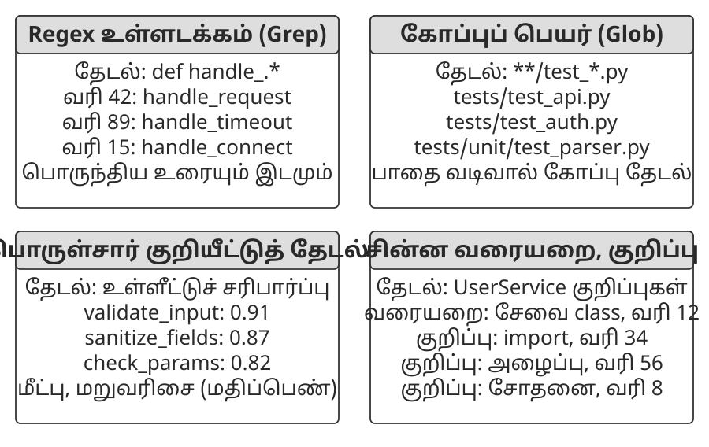

**வழக்கமான வெளிப்பாட்டு உள்ளடக்கப் பொருத்தம்.** grep, ripgrep உரை வடிவத்தின்படி உள்ளடக்கத்தைத் தேடுகின்றன; சார்புப் பெயர், மாறிப் பெயர், பிழைச் செய்தி தெரிந்த பணிகளுக்கு ஏற்றவை. எடுத்துக்காட்டாக, `def handle.*` தொடர்புடைய சார்பு வரையறை வடிவம் உள்ள உரை வரிகளைப் பொருத்தும். கோப்பு வகை, பாதை வடிகட்டலுடன் இணைத்து, Python கோப்புகளை மட்டும் தேடி, சோதனைக் கோப்பகங்களை விலக்கி, முடிவுகளைத் தொடர்புடைய செயலாக்கத்துக்குச் சுருக்கலாம்.

உரைப் பொருத்தம் கோப்பு உள்ளடக்கத்துடன் நேரடியாகப் பொருந்துவதால், முடிவுகளைச் சரிபார்க்க எளிது. வினவல் சொல் குறியீட்டில் உள்ள வெளிப்பாட்டுடன் தொடர்பை ஏற்படுத்த வேண்டும்: "பயனர் அங்கீகாரம்" என்று தேடும்போது, `authenticate`, `login`, `check_credentials` போன்ற பெயர்களையும் முயலலாம். முந்தைய முடிவின் அடிப்படையில் மாதிரி வினவலை விரிவுபடுத்துவதால், தேடும்போதே புரிந்துகொள்ளும் மீட்டெடுப்புச் செயல்முறை உருவாகிறது.

**கோப்புப் பெயர் வடிவப் பொருத்தம்.** glob பாதை வடிவத்தின்படி கோப்புகளைத் தேடுகிறது; எடுத்துக்காட்டாக `**/*.test.ts` எல்லா நிலைக் கோப்பகங்களிலும் உள்ள TypeScript சோதனைக் கோப்புகளைத் தேடுகிறது; `src/components/**/Button.tsx` தொகுதிக் கோப்பகத்தின் கீழ் உள்ள Button.tsx-ஐத் தேடுகிறது. பாதைப் பொருத்தம் முதன்மை உரையைப் படிக்கும் வேலையைத் தவிர்க்கிறது; முதலில் திட்ட அமைப்பை அறிந்து, பின்னர் திறக்க வேண்டிய கோப்பைத் தேர்ந்தெடுப்பதற்கு ஏற்றது.

**பொருள் சார்ந்த குறியீட்டுத் தேடல்.** பணி செயல்பாட்டு விளக்கத்தை மட்டும் தந்தால், வெக்டர் மீட்டெடுப்பைக் கொண்டு பொருள் தொடர்புடைய குறியீட்டை மீட்டெடுக்கலாம். எடுத்துக்காட்டாக, "பயனர் அடையாளத்தைச் சரிபார்" என்பது `check_credentials`-க்கு உரியதாக இருக்கலாம். இத்தகைய அமைப்புகள் பொதுவாக இரு வேலைகளைக் கையாள வேண்டும்:

- **குறியீட்டுக் கட்டமைப்பின்படி துண்டாக்குதல்.** சார்பு, வகுப்பு, முறை ஆகியவற்றை முதன்மை அலகுகளாகக் கொண்டு, தொடர்புடைய கையொப்பம், குறிப்பு, சேர்ந்த தொகுதி ஆகியவற்றைத் தக்கவைத்தல். நீண்ட அலகுகளைத் தொடர்ந்து பிரிக்கும்போது, துண்டைப் புரிந்துகொள்ளப் போதுமான சூழலைக் கொண்டு செல்ல வேண்டும்.
- **பல மீட்டெடுப்புச் சமிக்ஞைகளை இணைத்தல்.** வெக்டர் மீட்டெடுப்பு பொருள் தொடர்புடைய குறியீட்டையும், குறிச்சொல் மீட்டெடுப்பு பெயர் துல்லியமாகப் பொருந்தும் குறியீட்டையும் தேடி, இரண்டு முடிவுத் தொகுதிகளையும் இணைத்தல். அத்தியாயம் 3 அறிமுகப்படுத்திய குறுக்கு-குறியாக்கி மேலும் வரிசைப்படுத்தலாம்: அது வினவலையும் ஒரு குறியீட்டுத் துண்டையும் ஒருசேரப் படித்து, அந்தத் துண்டின் தொடர்புக்கு மதிப்பெண் வழங்குகிறது.

"தரவுத்தளத்துடன் இடைவினை", "பயனர் உள்ளீட்டுச் சரிபார்ப்பைக் கையாளுதல்" போன்ற ஆய்வுக் கேள்விகளுக்கு, முதலில் பொருள் தேடலால் தொகுதியை இடங்கண்டறிந்து, பின்னர் செயலாக்கத்தைப் படிக்கலாம்.

**Coding Agent-இன் தேடல் திறனைக் கட்டமைக்கும்போது, முதலில் Grep, Glob, வரம்பின்படி வாசிப்பு ஆகியவற்றை நன்றாகச் செய்யப் பரிந்துரைக்கிறேன்.** தேடல் முடிவுகளின் அடிப்படையில் மாதிரி வினவலை மாற்றியெழுதி, அழைப்பவர்களையும் சோதனைகளையும் திறந்து, எல்லையைப் படிப்படியாகச் சுருக்கலாம். இந்தக் கருவிகள் தற்போதைய பணியிடத்தை நேரடியாகப் படிப்பதால், உட்பொதிவுச் சுட்டைப் பராமரித்து குறியீட்டுடன் ஒத்திசைக்கும் வேலை தவிர்க்கப்படுகிறது. பெரிய குறியீட்டுக் களஞ்சியங்களை மீண்டும் மீண்டும் ஆராய வேண்டியிருக்கும்போதும், செயல்பாட்டு விளக்கம் மட்டும் தந்து நுழைவாயிலைக் கண்டுபிடிப்பது கடினமாக இருக்கும்போதும், மீட்டெடுப்பை மேம்படுத்தப் பொருள் சுட்டைச் சேர்க்கலாம். Cursor, உட்பொதிவு அடிப்படையிலான குறியீட்டுக் களஞ்சியச் சுட்டைப் பொதுவில் அறிமுகப்படுத்தியது; பின்னர் வந்த தேடல் ஆவணங்கள் உள்ளூர் Instant Grep சுட்டையும் ஆய்வுத் துணை ஏஜெண்டையும் அறிமுகப்படுத்தின[^ch5-search]. இந்தப் பரிணாமம் "grep போன்ற இடைமுகத்தைப் பயன்படுத்துவது" என்பதும் "சுட்டை அமைப்பதா" என்பதும் இரு தனி வடிவமைப்புப் பரிமாணங்கள் என்பதைக் காட்டுகிறது: அதே மீட்டெடுப்பு இடைமுகத்துக்குக் கீழே ஸ்கேன் அல்லது சுட்டு பயன்படலாம்.

**சின்ன (symbol) அளவிலான வரையறை, குறிப்புத் தேடல்.** மொழிச் சேவையகம் தொடரியல், நோக்கெல்லை, வகைத் தகவல்களைக் கொண்டு "வரையறைக்குச் செல்", "குறிப்புகளைத் தேடு" ஆகியவற்றை வழங்கலாம். எடுத்துக்காட்டாக, `authenticate` 42-ஆம் வரியில் வரையறுக்கப்பட்டு, 189-ஆம் வரியில் அழைக்கப்படுகிறது என்று கருவி இரண்டின் உறவைத் திருப்பித் தந்து, பிற நோக்கெல்லைகளில் உள்ள அதே பெயர்ச் சின்னங்களையும் வேறுபடுத்தும். Claude Code-இன் குறியீட்டு அறிவு செருகுநிரல் இதற்கு ஒரு இணைப்பு முறை: மொழிச் சேவை நெறிமுறை (LSP) வழியாகச் சின்ன வழிசெலுத்தலையும், திருத்தத்துக்குப் பிந்தைய கண்டறிதல்களையும் வழங்குகிறது[^ch5-lsp].

சின்னக் கருவிகளின் பலன் மொழி ஆதரவு, திட்ட உள்ளமைவு, பகுப்பாய்வு நிலையைப் பொறுத்தது. சரம், குறிப்பு, அல்லது மொழிச் சேவையகம் இன்னும் பாகுபடுத்தாத கோப்புகளைக் கண்டுபிடிக்க, ஏஜெண்ட் உரைத் தேடலைக் கூடுதலாகப் பயன்படுத்தலாம்.

[^ch5-search]: Cursor, *Securely indexing large codebases*, Search; முறையே உட்பொதிவுச் சுட்டுத் தீர்வையும் பின்னர் வந்த உள்ளூர்த் தேடல் பொறிமுறையையும் அறிமுகப்படுத்துகின்றன.
[^ch5-lsp]: Anthropic, *Code intelligence plugins*; LSP வழியாக வரையறை, குறிப்பு, நேரடிக் கண்டறிதல்களை வழங்குவதை அறிமுகப்படுத்துகிறது.

### Coding Agent-இல் கோப்புத் திருத்தக் கருவிகள்

மாதிரி ஒரு கோப்பைப் படித்துவிட்டது; அதே நேரத்தில் வேறொருவர் அதன் தொடக்கத்தில் ஒரு குறிப்பு வரியைச் சேர்த்துவிட்டார் என்று வைத்துக்கொள்வோம். அப்போது "28-ஆம் வரியை மாற்று" என்பதும் "தனித்துவமாகத் தோன்றும் இந்த அசல் உரையை மாற்று" என்பதும் ஒரே இடத்தையே சுட்டுகின்றனவா? அந்த அசல் உரை இரு சார்புகளில் தலா ஒருமுறை தோன்றினால்? படம் 5-4-இன் ஐந்து திருத்துத் தீர்வுகள் வெவ்வேறு முறைகளில் மாற்றத்தை இடங்கண்டறிகின்றன; சில வரி எண்ணை நம்புகின்றன, சில அசல் உரையை நம்புகின்றன, இன்னும் சில இணைக்கும் வேலையை இன்னொரு மாதிரிக்கு ஒப்படைக்கின்றன.

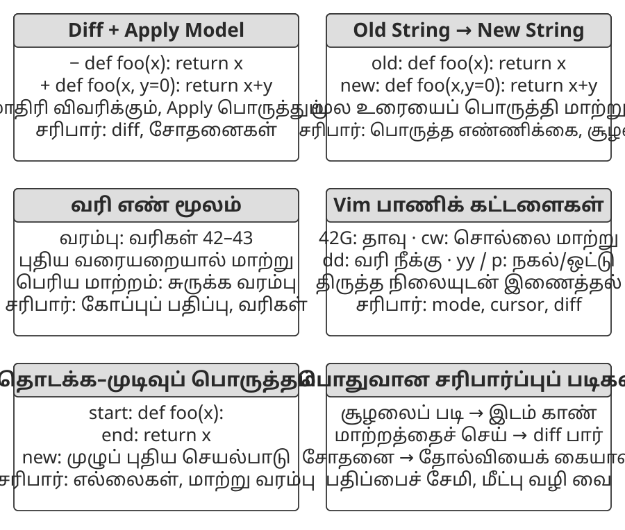

**வேறுபாட்டு விவரணை + Apply Model.** முதன்மை மாதிரி திருத்த நோக்கத்தையும் குறியீட்டுத் துண்டையும் தருகிறது; எடுத்துக்காட்டாக Git diff போன்ற சேர்க்கை–நீக்க விவரணை, அல்லது மாற்றப்படாத பகுதிகளை விடுபடுத்தும் குறியால் தாவும் குறியீட்டு எலும்புக்கூடு. சிறப்புப் பயன்பாட்டு மாதிரி, அசல் கோப்புடன் இணைத்துத் திருத்திய பிறகு முழு உள்ளடக்கத்தை உருவாக்குகிறது. Cursor-இன் தொடக்ககால Fast Apply இந்தச் சிந்தனையின் பிரதிநிதி[^ch5-apply]. அது "திருத்தத்தை முன்மொழிதல்" மற்றும் "திருத்தத்தைப் பயன்படுத்துதல்" ஆகியவற்றை இரு மாதிரிகளுக்குப் பிரிக்கிறது. அடிப்படை மாதிரிகள் துல்லியமான உள்ளூர்த் திருத்தங்களை உருவாக்குவதில் திறம் பெறப்பெற, இந்த இரு-மாதிரி செயல்முறைக்கு எளிய மாற்றுகள் உருவாகின.

இந்தப் பணிப்பகிர்வு முதன்மை மாதிரி குறியீட்டுத் தர்க்கத்தில் கவனம் செலுத்த விடுகிறது; பயன்பாட்டு மாதிரி உள்ளூர்த் திருத்தத்தைக் கோப்பில் இணைக்கிறது. அதனால் சரிபார்ப்பின் கவனம் இணைப்பு முடிவில் விழுகிறது: பல ஒத்த துண்டுகள் இடங்காணலில் ஐயத்தை உருவாக்கலாம்; விடுபடுத்தும் குறி தவறாகப் புரியப்படலாம்; மாற்றப்படாத பகுதிகளும் எதிர்பாராமல் மீண்டும் எழுதப்படலாம்.

**பழைய சரத்திலிருந்து புதிய சரம் (Old String → New String).** Claude Code-இன் Edit கருவி துல்லியச் சரம் மாற்றத்தைப் பயன்படுத்துகிறது; Cursor 2025 மே மாதத்தின் 0.50 பதிப்பில் Search & Replace-ஐ அறிமுகப்படுத்தி, முதலில் Anthropic மாதிரிகளின் நீண்ட கோப்புத் திருத்தத்துக்குப் பயன்படுத்தியது[^ch5-direct-edit]. இந்தப் பாதை இடங்காணும் அடிப்படையையும் மாற்று உள்ளடக்கத்தையும் நேரடியாக நிரலிடம் கொடுப்பதால், இணைப்புக் கட்டத்தில் மீண்டும் மாதிரியை அழைக்கும் வேலை குறைகிறது. மாதிரி `old_string`, `new_string` ஆகியவற்றைத் தருகிறது; கருவி கோப்பில் அசல் உரையைக் கண்டுபிடித்து மாற்றுகிறது. இடைமுகம் ஒருமுறை மாற்றத்துக்கு அசல் உரை தனித்துவமாக இருக்க வேண்டும் என்று ஒப்பந்தம் செய்யலாம்; பொருத்தம் இல்லாதபோதோ பல இடங்களில் பொருந்தும்போதோ இடங்களையும் கண்டறிதல்களையும் திருப்பித் தந்து, மாதிரி சூழலைச் சேர்த்துத் தரச் செய்யலாம். தொகுதி மாற்றம் தேவைப்பட்டால், வெளிப்படையான அளவுருவால் எல்லையை வெளிப்படுத்த வேண்டும்.

எடுத்துக்காட்டாக, ஒரு உள்ளமைவுக் கோப்பில் இரு சேவைகளும் `timeout = 30` என்று எழுதப்பட்டுள்ளன. இப்போது பதிவிறக்கச் சேவையின் நேர வரம்பை மட்டும் 60 வினாடியாக மாற்ற வேண்டும். கருவி தனித்துவமான பொருத்தத்தைக் கோரினால், `timeout = 30` மட்டும் தந்தால் இரு இடங்களில் பொருந்தும்; கோப்பு அப்படியே இருக்க வேண்டும். அடுத்த கோரிக்கையில் பதிவிறக்கச் சேவையின் துணைப்பிரிவுத் தலைப்பையும் அமைப்பு வரியையும் சேர்த்து அசல் சரமாகத் தந்து, புதிய சரத்தில் தலைப்பைத் தக்கவைத்து எண்ணை மட்டும் மாற்ற வேண்டும்.

உள்ளடக்கப் பொருத்தம் உள்ளுணர்வுக்கு எளிதானது, சரிபார்க்கவும் வசதி. ஆனால் அழைக்கும்போது மாதிரி முழு அசல் சரத்தையும் வெளியிட வேண்டும்: பெரும் குறியீட்டுத் தொகுதியை நீக்க வேண்டுமானால் அளவுரு மிக நீளமாகும்; இடைவெளி, வரி முறிவு, மேற்கோள் குறிகளில் சிறிய வேறுபாடுகளும் பொருத்தத்தைப் பாதிக்கும். அத்தியாயம் 4-இன் Unicode வளைந்த மேற்கோள் வழக்கு, இத்தகைய கோளாறுகள் அளவுருக் கடத்தலில் எவ்வாறு நிகழலாம் என்பதைக் காட்டியது.

**வரி எண் இடங்காணல் (Old Line Numbers → New String).** மாதிரி X முதல் Y வரை நீக்கச் சொல்லி, பின்னர் புதிய உரையைச் செருகுகிறது. வாசிப்புக் கருவி ஏற்கனவே உண்மையான வரி எண்களைத் தந்திருந்தால், பெரும் நீக்கத்துக்கு முதல், கடைசி இரு இடங்கள் மட்டும் போதும். வரி எண்ணின் பொருள் படித்தபோதைய கோப்புப் பதிப்பைப் பொறுத்தது; முந்தைய திருத்தம் அடுத்தடுத்த இடங்களை நகர்த்தியிருக்கலாம்.

எனவே, தொகுதி மாற்றங்கள் ஒரே ஆரம்ப நிலைப்படத்தை ஒருங்கே சுட்டி, கருவி மேற்பொருளும் வரம்புகளைச் சரிபார்த்து ஒட்டுமொத்தமாகப் பயன்படுத்தச் செய்யலாம்; அல்லது ஒவ்வொன்றாகத் திருத்தி, மீண்டும் படித்த பிறகு இடங்கண்டறியலாம். கருவி கோப்புப் பதிப்பையோ எதிர்பார்த்த உள்ளடக்கத்தையோ சரிபார்த்து, இணையான மாற்றங்களுக்குப் பிறகு முரண்பாட்டைத் திருப்பித் தந்து, பழைய வரி எண்கள் புதிய கோப்பு உள்ளடக்கத்தில் பயன்படுவதைத் தடுக்கலாம்.

**Vim போன்ற திருத்துக் கட்டளைகள்.** திருத்தி கட்டளைகள் நகர்த்தல், நகலெடுத்தல், வெட்டுதல், ஒட்டுதல் ஆகியவற்றை வெளிப்படுத்தலாம்; சார்பை ஓரிடத்திலிருந்து இன்னொரு இடத்துக்கு நகர்த்துவது போன்ற மறுஒழுங்கமைப்புச் செயல்களுக்கு ஏற்றவை. அவை தற்போதைய கர்சர், இடையகம், கட்டளைப் பயன்முறையைச் சார்ந்தவை; ஒவ்வொரு படியும் அடுத்தடுத்த செயல்களின் அடிப்படையை மாற்றுகிறது.

**மனிதத் திருத்தியின் இடைவினைப் பழக்கங்கள், மாதிரிக் கருவிகளின் இயல்பு வடிவமைப்பாக இருக்க வேண்டியதில்லை.** மனிதர் பெரும்பாலும் தற்போதைய நிலையைப் பார்த்து ஒரு சிறு செயலைச் செய்கிறார்; மாதிரியோ நீண்ட நேரம் சிந்தித்து, ஒரே முறையில் பத்து, நூற்றுக்கணக்கான வரி மாற்றங்களை உருவாக்கலாம். இத்தகைய தொகுதி மாற்றங்களைப் பெருமளவு கர்சர் நகர்த்தல், பயன்முறை மாற்றமாகப் பிரிப்பது அழைப்புச் செலவை அதிகரிக்கும்; முந்தைய கட்டளைகள் நிலையை எவ்வாறு பாதிக்கும் என்பதை மாதிரி முன்கணிக்க வேண்டியதாகவும் ஆகும். எனவே குறியீடு உருவாக்கப் பணிகளுக்கு, மாற்ற இலக்கையும் உள்ளடக்கத்தையும் நேரடியாக வெளிப்படுத்தும் இடைமுகங்களுக்கே நான் முன்னுரிமை கொடுக்கிறேன்; திருத்தி கட்டளைகளைப் பயன்படுத்தினால், நிலை அடிப்படையைத் தெளிவாகக் குறித்து, பின்னூட்டத்தை உடனடியாகத் திருப்பித் தர வேண்டும்.

**சரத்தின் தொடக்க–இறுதிப் பொருத்தம் (Old String Start + End → New String).** மாதிரி மாற்ற வேண்டிய பகுதியின் தொடக்கத்திலும் இறுதியிலும் சில வரிகளை மட்டும் தருகிறது; கருவி அந்த இரு எல்லைகளையும் அவற்றுக்கு இடைப்பட்ட உள்ளடக்கத்தையும் இடங்கண்டறிகிறது. நூற்றுக்கணக்கான வரிகளை நீக்கும்போது, மீண்டும் வெளியிட வேண்டிய அசல் உரையை இது குறைக்கிறது; அதே நேரத்தில் உள்ளடக்க இடங்காணும் அடிப்படையையும் தக்கவைக்கிறது.

கருவி இரண்டு அசல் சரங்களின் தோற்ற வரிசையைச் சரிபார்த்து, இடைமுக ஒப்பந்தப்படி தொடக்க, இறுதிப் பகுதிகளை மாற்றலாமா என்று தீர்மானிக்க வேண்டும். ஒரே வரம்பு நிபந்தனைக்குப் பொருந்தும்போது மட்டுமே செயல்பட வேண்டும்; பல இடங்கள் பொருந்தினால் அவற்றை மாதிரிக்குத் தெரிவித்து, சூழலைச் சேர்க்கச் சொல்ல வேண்டும். உட்பொதிந்த கட்டமைப்புகள் அல்லது மீள்வரும் குறியீட்டுக்கு, அருகிலுள்ள சார்புப் பெயர், கையொப்பம் போன்ற நங்கூரங்களைச் சேர்த்தால் வரம்பைத் தீர்மானிக்க உதவும்.

**புதிய Coding Agent-ஐ உருவாக்கும்போது, பழைய சரம்→புதிய சரம் போன்ற எளிய, உறுதியான திருத்த இடைமுகத்திலிருந்து தொடங்கப் பரிந்துரைக்கிறேன்.** அசல் உரை இடங்காணல் தெளிவானது; தோல்விக்கான காரணத்தை விளக்க எளிது; வேறுபாட்டைச் சரிபார்க்கவும் வசதி. மாதிரி உள்ளூர்த் திருத்தங்களை நம்பகமாக உருவாக்க முடிந்த பிறகு, Harness மேலும் வேலைகளை உறுதியான நிரல்களிடம் ஒப்படைத்து, கூடுதல் பயன்பாட்டு மாதிரியைத் தவிர்க்கலாம். பெரும் நீக்கத்துக்கு அளவுரு அளவைச் சுருக்க வேண்டியிருக்கும்போது, பின்னர் தொடக்க–இறுதி நங்கூரங்களையோ நிலைப்பட அடிப்படையிலான வரி எண் திருத்தத்தையோ அறிமுகப்படுத்தலாம். Codex-இன் `apply_patch`-ஓ, கட்டுப்படுத்தப்பட்ட patch மூலம் பல மாற்றங்களை வெளிப்படுத்தும் இன்னொரு நேரடித் திருத்தப் பாதையைக் காட்டுகிறது.

[^ch5-direct-edit]: Anthropic, *Tools reference*, Edit கருவி; Cursor, 0.50 புதுப்பிப்புப் பதிவு, 2025 மே 15; Search & Replace அறிமுகம்; 1.3 புதுப்பிப்புப் பதிவு Search & Replace, Apply ஆகியவற்றின் மேம்பாடுகளையும் பதிவு செய்கிறது.

[^ch5-apply]: Cursor, *Editing Files at 1000 Tokens per Second*; திருத்த விவரணையை அசல் கோப்புக்குப் பயன்படுத்தும் சிறப்பு மாதிரியை அறிமுகப்படுத்துகிறது.

### Coding Agent-இன் பாதுகாப்பு

Coding Agent திட்டத்தைப் படிக்கவும், கோப்புகளை மாற்றவும், நிரல்களை இயக்கவும் முடியும்; பிணையம் வழியாக வெளிப்புறச் சேவைகளையும் அணுகலாம். அனுமதிகளை வடிவமைக்கும்போது, தரவு ஓட்டத்தின் வழியே மூன்று கேள்விகளைச் சரிபார்க்க வேண்டும்: எந்த உள்ளடக்கம் சூழலுக்குள் வரும், மாதிரி என்னென்ன செயல்களைக் கோரலாம், இந்தச் செயல்களை இறுதியில் எந்தப் பொறிமுறை அனுமதித்து இயக்குகிறது.

Simon Willison "lethal trifecta" (அபாயகரமான மும்மை) மூலம் ஒரு வகைப் ப்ராம்ப்ட் ஊடுருவல் ஆபத்தைச் சுருக்குகிறார்: தனிப்பட்ட தரவை அணுகுதல், நம்பமுடியாத உள்ளடக்கத்தைத் தொடுதல், வெளியுலகத் தொடர்புத் திறன்[^ch5-trifecta]. எடுத்துக்காட்டாக, ஒரு உதவியாளர் தனிப்பட்ட கோப்புகளைப் படிக்கவும், வெளிப்புற மின்னஞ்சல்களைக் கையாளவும், செய்திகளை அனுப்பவும் முடிந்தால், படித்தல், புரிதல், அனுப்புதல் ஆகியவற்றுக்கு இடையே தெளிவான அனுமதி எல்லையை அமைக்க வேண்டும். வெளிப்புற உள்ளடக்கத்தில் உள்ள அறிவுறுத்தல் பயனர் கோரிக்கையாகக் கருதப்பட்டால், அது அனுமதியில்லாத தரவுப் பரிமாற்றத்தைத் தூண்டக்கூடும்.

இந்த மூன்று பரிமாணங்களுக்கு அப்பால், நான்காவது பரிமாணத்தையும் சரிபார்க்கப் பரிந்துரைக்கிறேன்: **நிலையான நினைவகம் ப்ராம்ப்ட் ஊடுருவலின் தாக்கத்தைப் பெருக்கும்.** வெளிப்புற உள்ளடக்கம் நீண்டகால நினைவகத்துக்குள் நுழைந்தால், தாக்கம் அமர்வுகளைக் கடந்து, அடுத்தடுத்த பணிகளில் மீண்டும் தோன்றலாம். எனவே, நினைவகத்தில் எழுதும்போது மூலம், பொருந்தும் எல்லை, உறுதிப்படுத்தல் நிலையைப் பதிவு செய்ய வேண்டும்; படிக்கும்போதும் இந்தப் பண்புகளைத் தக்கவைக்க வேண்டும். `MEMORY.md`-இல் சேமிக்கப்பட்ட உரையின் நம்பகத்தன்மை, அது உருவான செயல்முறையைப் பொறுத்தே இருக்கும். தவறான பதிவைக் கண்டறிந்த பிறகு, அதை இடங்கண்டறிந்து, திருத்தி, திரும்பப் பெறவும் முடிய வேண்டும்.

அத்தியாயம் 1-இன் மூன்று அடுக்குப் பாதுகாப்பு அரண்கள் இங்கு தத்தம் பொறுப்பை ஏற்கின்றன: சூழல் அடுக்கு தகவல் மூலத்தையும் நடத்தைத் தேவைகளையும் குறிக்கிறது; இயக்க அடுக்கு செயல்களையும் அனுமதிகளையும் சரிபார்க்கிறது; தரவு அடுக்கு நம்பகமான அடையாளத்தின்படி வளப் படித்தல்/எழுதுதலை வரம்பிடுகிறது. Claude Code-இன் சாண்ட்பாக்ஸ் கோப்பு முறைமை, பிணைய எல்லைகள் மூலம் கட்டளை இயக்கத்தை வரம்பிடுகிறது; Cowork-உம் உள்ளூர்ப் பணிகளைத் தாங்கத் தனிமைப்படுத்தப்பட்ட சூழலைப் பயன்படுத்துகிறது[^ch5-sandbox]. கீழே இந்தப் பொறிமுறைகளை மேலும் விரிவாகக் காண்போம்.

**சாண்ட்பாக்ஸில் வளங்களையும் தொடர்பையும் வரம்பிடுதல்.**

- **பிணைய வெளியேற்றம்.** குறியீட்டுச் சாண்ட்பாக்ஸில் எளிதில் கவனிக்கப்படாமல் விட்டுவிடக்கூடிய, முதலில் நடைமுறைப்படுத்த வேண்டிய எல்லை இது. வெளிப்புற அணுகலை இயல்பாக மூடிவைத்துத் தொடங்கி, பணித் தேவைக்கேற்பத் தொகுப்பு மேலாண்மை மூலங்கள், ஆவணத் தளங்கள், வணிக API-களை அனுமதிக்கப் பரிந்துரைக்கிறேன். அனுமதிப் பட்டியல் குறிப்பிட்ட இலக்குகளுக்கும் செயல் எல்லைகளுக்கும் பொருந்த வேண்டும்; பகிரப்பட்ட சேவைகளுக்குக் கணக்கு, வாடிக்கையாளர், வள உரிமை ஆகியவற்றையும் கருத்தில் கொள்ள வேண்டும். பிணையக் கொள்கை கருவி தொடங்கும் நிரல்களையும் அவற்றின் துணைச் செயல்முறைகளையும் உள்ளடக்க வேண்டும்; வெளியே கடத்தப்படும் தரவை அனுமதி எல்லைக்கேற்பத் தனியாகச் சரிபார்க்க வேண்டும்.
- **கோப்பு முறைமை.** மூலக் குறியீட்டை வாசிப்பு-மட்டும் முறையில் ஏற்றி, நகல்களை எழுதக்கூடிய பணியிடத்தில் வைக்கலாம்; அல்லது கட்டுப்படுத்தப்பட்ட திருத்த இடைமுகம் patch-ஐ உருவாக்கி, மதிப்பாய்வுக்குப் பிறகு பயன்படுத்தலாம். விளைபொருள்களையும் இடைநிலைக் கோப்புகளையும் தனிக் கோப்பகங்களில் வைக்க வேண்டும்; சான்றுக் கோப்புகள் சாண்ட்பாக்ஸுக்கு வெளியே இருக்க வேண்டும். அங்கீகாரச் சேவையை அணுக வேண்டுமானால், கட்டுப்படுத்தப்பட்ட இடைமுகம் பணிக்குத் தேவையான திறனை மட்டும் வழங்கட்டும்; உருவாக்கிய நிரலுக்கு ஹோஸ்ட் கணினியின் எல்லாச் சான்றுகளையும் கொடுக்கக்கூடாது.
- **வளங்களும் நேரமும்.** CPU, நினைவகம், செயல்முறை எண்ணிக்கை, வட்டு இடம், இயக்க நேரம் ஆகியவற்றுக்கு உச்சவரம்புகளை அமைத்து, முடிவிலாச் சுழற்சிகள், செயல்முறை எண்ணிக்கை கட்டுப்பாடிழத்தல், தொடர்ந்து வட்டில் எழுதுதல் ஆகியவற்றின் தாக்கத்தை வரம்பிடுங்கள். வரம்பு மீறியதும் கட்டமைக்கப்பட்ட நிலையைத் திருப்பித் தாருங்கள்; எடுத்துக்காட்டாக "இயக்கம் 120 வினாடிகளை மீறியது, நிறுத்தப்பட்டது"; தக்கவைக்கப்பட்ட வெளியீட்டையும் சுத்தம் செய்த முடிவையும் இணைத்து, பணியைச் சுருக்கலாமா அல்லது செயலாக்கத்தை மாற்றலாமா என்று மாதிரி தீர்மானிக்கவும்.

இந்த எல்லைகள் முழு இயக்கச் சங்கிலியையும் உள்ளடக்க வேண்டும். கட்டளை அனுமதிக்கப்பட்ட பிறகு, உண்மையில் தொடங்கிய நிரல் இன்னும் அதே அனுமதி எல்லைக்குள் இயங்குகிறது; பின்தளச் செயல்முறைகள், துணைக் கருவிகள், வெளிப்புற இடைமுகங்கள் ஆகியவற்றையும் தொடர்புடைய கட்டுப்பாட்டுக்குள் கொண்டுவர வேண்டும்.

**கட்டளைக் கட்டமைப்பையும் அளவுரு பொருளையும் பாகுபடுத்துதல்.**

Shell கட்டளை நிரல்ப் பெயர், அளவுருக்கள், திருப்பிவிடல், குழாய், துணை வெளிப்பாடுகள் ஆகியவற்றின் சேர்க்கையால் உருவாகிறது. சரிபார்க்கும்போது இந்தக் கட்டமைப்புகளைப் பாகுபடுத்தி, தொடர்புடைய படித்தல், எழுதுதல், இயக்கம், தொடர்பு ஆகிய செயல்களை அடையாளம் காண வேண்டும். **கட்டளைத் தடைப்பட்டியல் இறுதிப் பாதுகாப்புத் தீர்மானத்தைச் சுமக்க முடியாது.** ஒரே செயலை வெவ்வேறு அளவுருச் சேர்க்கைகளாலும் மறைமுக அழைப்புகளாலும் வெளிப்படுத்தலாம்; சரிபார்ப்பு கட்டளைக் கட்டமைப்பையும் அளவுருப் பயனையும் புரிந்துகொள்ள வேண்டும்; பின்னர் இயக்கநேர அனுமதிகள் உண்மையான இயக்க எல்லையைக் கட்டுப்படுத்த வேண்டும்.

எடுத்துக்காட்டாக, கோப்பு வினவல் கருவியில் ஒவ்வொரு பொருந்திய உருப்படிக்கும் அடுத்தடுத்த செயலை இயக்கும் அளவுரு இருக்கலாம்; பதிவிறக்கக் கருவியின் வெளியீட்டு விருப்பம் எழுதும் இடத்தைத் தீர்மானிக்கிறது. சரிபார்ப்பி "எந்த விருப்பம் அடுத்த அளவுருவை மதிப்பாக எடுக்கிறது" என்பதை அடையாளம் கண்டு, அளவுருவின் பயனைத் துரத்தி, பின்னர் இலக்குப் பாதை, அணுகல் அனுமதி, அனுமதிக்கப்பட்ட செயல்களைச் சரிபார்க்க வேண்டும். இதனால் சரிபார்ப்பு முடிவு "எந்தக் கோப்புகளைப் படிக்கிறது", "எங்கே எழுதுகிறது", "எந்த நிரலைத் தொடங்குகிறது" என்ற அளவுக்குக் குறிப்பாக இருக்கும்.

மாறி விரிவாக்கம், மாறும் ஸ்கிரிப்டுகள், இயங்கும்போது மட்டும் உருவாகும் பாதைகள் ஆகியவை உண்மையான நடத்தையின் ஒரு பகுதியை இயக்கும் நேரம் வரை தெளிவற்றதாக வைக்கும். Harness தெளிவற்ற பகுதிகளுக்கு மேலும் வெளிப்படையான அழைப்பு வடிவத்தைக் கோரலாம், மதிப்பாய்வுக்கு மாற்றலாம், அல்லது வரம்பிடப்பட்ட சூழலில் இயக்கலாம். மாதிரி உதவியுடன் கூடிய மதிப்பாய்வு சூழல் சார்ந்த மதிப்பீட்டை வழங்குகிறது; உறுதியான அணுகல் கட்டுப்பாடு உண்மையான விளைவை வரம்பிடுகிறது. அத்தியாயம் 4 அறிமுகப்படுத்திய Sidecar தயாரிப்பு வேலைகளுடன் இணையாக இயங்கலாம்; வெளிப்புறத் தாக்கம் கொண்ட செயல்கள் மதிப்பாய்வுக்குப் பிறகே சமர்ப்பிக்கப்படுகின்றன.

**பல தரப்பு ஒப்படைப்பில் சேவை பெறுநரைத் தெளிவுபடுத்துதல்.**

ஒப்படைப்பாளர் விசுவாசம் (principal loyalty) என்பது, ஏஜெண்ட் ஒரு தரப்புக்காக வேலை செய்து, அதே நேரத்தில் பிற பங்கேற்பாளர்களுடன் உரையாடும்போது, ஒப்படைப்பாளரின் இலக்குகளையும் அனுமதியையும் தொடர்ந்து பின்பற்றுவதை விவாதிக்கிறது. எடுத்துக்காட்டாக, பயனர் ஏஜெண்டை ஒரு சப்ளையருடன் விலை பேசச் சொல்லி, தனிப்பட்ட முறையில் 12,000 யுவான் நிதிநிலை உச்சவரம்பைக் கொடுக்கிறார். ஏஜெண்ட் சப்ளையரின் விலைக் குறிப்பைப் புரிந்துகொண்டு, தன் தரப்பின் தேவைகளை விளக்க வேண்டும்; அதே நேரத்தில் இந்தத் தனியார் கட்டுப்பாட்டைப் பாதுகாக்க வேண்டும்.

நானும் என் சக ஆய்வாளரும் பல தரப்பு இடைவினை மதிப்பீட்டில் இரு வகைத் தோல்விகளை அவதானித்தோம்: ஒன்று ஒப்படைப்பாளரின் தனியார் தகவலை வெளியிடுவது அல்லது மறுதரப்பின் தகாத கோரிக்கைகளை ஏற்பது; மற்றொன்று அளவுக்கு மீறி மறுப்பது; ஒப்படைப்பாளரின் சாதாரணக் கோரிக்கைகளையும் முடிக்க முடியாமல் போவது. மதிப்பீட்டில் உள்ள ப்ராம்ப்ட் உத்திகளும் பயிற்சி முறைகளும் தகவல் பாதுகாப்புக்கும் சாதாரணக் கூட்டுப்பணிக்கும் இடையிலான ஈடுகோடலைக் காட்டின[^ch5-1]. **விசுவாசத்தை அளவிடும்போது தகவல் பாதுகாப்பையும் பணி நிறைவையும் ஒருசேர மதிப்பிட வேண்டும்.** கூடுதல் கோரிக்கைகளை மறுப்பதை மட்டும் இலக்காகக் கொண்டால், சாதாரணக் கூட்டுப்பணியும் தடைபடும்; உரையாடலைச் சுமுகமாக முடிப்பதை மட்டும் இலக்காகக் கொண்டால், மறுதரப்பு ஒப்படைப்பாளரின் நலனைப் பாதிக்க விடலாம்.

Coding Agent-ஐப் பொறுத்தவரை, களஞ்சியக் கோப்புகள், கருவி வெளியீடுகள், மூன்றாம் தரப்பு MCP திருப்புதல்கள் ஆகியவை பணித் தகவலைக் கொண்டிருக்கலாம்; நடத்தையை மாற்றக் கோரும் உரையும் சேர்ந்திருக்கலாம். உண்மையான மூலத்தின் அடிப்படையில் ஒப்படைப்பு அறிவுறுத்தலையும் வெளிப்புறப் பொருளையும் Harness வேறுபடுத்தி, செய்திகளுக்கு மூலத்தையும் பங்கையும் இணைத்து, ஒப்படைப்பு எல்லையைச் செயல்படுத்தக்கூடிய அனுமதிகளாக மாற்ற வேண்டும். வெளிப்புறப் பொருளில் "பயனர் கோருகிறார்" என்று தாமே சொல்லும் உரையை நம்பகமான கால்வாய் வழியாக உறுதிசெய்ய வேண்டும்.

ப்ராம்ப்ட் கூட்டுப்பணி நெறிமுறைகளை மேலும் விளக்கலாம்: ஒப்படைப்பாளரின் தனியார் தகவலைப் பாதுகாத்தல்; சில சமயம் ஒரு பதிவு உள்ளதா என்பதையும் ரகசியமாக வைத்திருக்க வேண்டும்; வெளியே விளக்கும்போது தேவையான உள்ளடக்கத்தை மட்டும் வெளிப்படுத்துதல்; உள் எல்லைக்கும் பொது நிலைப்பாட்டுக்கும் இடையே வேறுபாடு காணுதல்; அனுமதிக்கப்பட்ட எல்லைக்குள் பணியை முன்னெடுத்தல்; மீள்வரும் கோரிக்கைகளின் முன் ஒரே அனுமதி தரத்தைப் பேணுதல். அனுமதி விரிவாக்கமோ சேவை பெறுநர் மாற்றமோ நம்பகமான கால்வாய் மூலம் உறுதிசெய்யப்பட்டு, இயக்கநேர அனுமதிகளும் ஒத்திசைவாகப் புதுப்பிக்கப்பட வேண்டும். இதனால் மாதிரி தெளிவான நடத்தை அடிப்படையைப் பெறுகிறது; கருவிகளும் வெளிச்சூழலும் உண்மையான அணுகல் எல்லையை நடைமுறைப்படுத்துகின்றன.

[^ch5-trifecta]: Simon Willison, *The lethal trifecta for AI agents: private data, untrusted content, and external communication*, 2025 ஜூன் 16.
[^ch5-sandbox]: Anthropic, *Making Claude Code more secure and autonomous with sandboxing*, *How we contain Claude across products*; கோப்பு முறைமை, பிணையம், தயாரிப்புத் தனிமைப்படுத்தல் எல்லைகளை அறிமுகப்படுத்துகின்றன.
[^ch5-1]: Li, Bojie and Noah Shi, *Whose Side Is Your Agent On? Multi-Party Principal Loyalty in LLM Agents*, 2026.

## குறியீடு: பொது ஏஜெண்டின் மெட்டா-திறன்

முந்தைய பகுதிகள் பயனர் தேவையைக் குறியீட்டு மாற்றமாக நடைமுறைப்படுத்தின. இப்போது தொடக்கத்தில் உள்ள விற்பனை அட்டவணைக்குத் திரும்புவோம்: பயனருக்கு இறுதியில் ஒரு அறிக்கை மட்டும் தேவைப்பட்டாலும், ஏஜெண்ட் ஒரு நிரல் எழுதி, பொருள் அடையாளங்களை ஒருமைப்படுத்தி, தொகுதி வாரியாகப் புள்ளிவிவரம் எடுத்து, பின்னர் ஒரு பொருளுக்கு மூல அட்டவணையிலிருந்து திருப்பியனுப்புதல் விகிதத்தை மீண்டும் கணக்கிடலாம். அலகு எண்ணிக்கையின்படியா அல்லது ஆர்டர் எண்ணிக்கையின்படியா கணக்கிட வேண்டும் என்று முதலில் பயனரிடம் கேளுங்கள். ஒரு பொருள் பத்து அலகுகள் விற்கப்பட்டு, இரு ஆர்டர்களில் பிரிந்து, அவற்றில் ஒரு ஆர்டரில் ஒரு அலகு திருப்பித் தரப்பட்டது என்று வைத்துக்கொள்வோம். அலகுகளின் அடிப்படையில் 1/10; திருப்பியனுப்பல் நடந்த ஆர்டர்களின் அடிப்படையில் 1/2. இரண்டு கணக்கீடுகளும் வெற்றிகரமாக இயங்கும்; எந்த அளவீட்டை முதலில் உறுதிசெய்கிறோமோ, அதுவே எந்த எண் பயனரின் கேள்விக்குப் பதிலளிக்கிறது என்பதைத் தீர்மானிக்கிறது. இவ்வாறு எழுதிய நிரலை அடுத்த காலகட்டத் தரவு வரும்போது மீண்டும் இயக்கலாம். இந்த "உருவாக்கம், இயக்கம், சரிபார்ப்பு" சுழற்சி உள்ளடக்கத் தயாரிப்பு, வணிக அமைப்பு ஒருங்கிணைப்பு, ஏஜெண்ட் மேம்பாடு ஆகியவற்றுக்கும் விரியும்.

> **மெட்டா-திறன்.** இந்த நூல் மெட்டா-திறன் என்பதைப் பிற திறன்களை உருவாக்கும் அல்லது இணைக்கும் திறன் என்று பொருள் கொள்கிறது. குறியீடு உருவாக்கம் புதிய கருவிகளை — தரவுச் செயலாக்க ஸ்கிரிப்டுகள், API அழைப்புப் பாய்வுகள் — உருவாக்கலாம்; புதிய கட்டுப்பாடுகளை — உறுதிமொழிகள், சரிபார்ப்பு விதிகள் — வெளிப்படுத்தலாம்; புதிய வழங்கல் வடிவங்களையும் — HTML படிவங்கள், சறுக்கித் தாள்கள், காணொளிகள் — கட்டமைக்கலாம்.

எளிய நிலையிலிருந்து தொடங்குவோம். இறுதியில் ஒரு கேள்விக்கான பதிலை மட்டும் ஒப்படைக்க வேண்டும் என்றாலும், மாதிரி தன் மதிப்பீட்டைச் சரிபார்க்க ஒரு சிறு நிரலை எழுதலாம்.

### சிந்தனைக் கருவியாகக் குறியீடு

**துல்லியமான கணக்கீடு, முறையான கட்டுப்பாடுகளுக்கு, மாதிரி இயக்கக்கூடிய வெளிப்பாட்டை எழுதி, பின்னர் மொழிபெயர்ப்பியிடமோ தீர்வியிடமோ கணக்கிடக் கொடுப்பதையே நான் விரும்புகிறேன்.** சொல் சொல்லாகப் பதிலை உருவாக்கும்போது நகலெடுப்புப் பிழைகள், கணக்கீட்டுப் பிழைகள், நிபந்தனை விடுபடுதல் ஆகியவை ஏற்படலாம்; நிரல் இந்தப் படிகளை நிலைப்படுத்தி மீண்டும் மீண்டும் இயக்க முடியும். கணித, தர்க்கப் பணிகள் பொதுவாக இரு கட்டங்களைக் கொண்டவை: முதலில் கேள்வியை உறவுகளாகவும் கட்டுப்பாடுகளாகவும் மாற்றுதல், பின்னர் முடிவைக் கண்டறிதல். LLM பிரச்சினையைப் புரிந்துகொள்ள, தீர்வை முன்மொழிய, நிரல் எழுத உதவ முடியும்; மொழிபெயர்ப்பியோ தீர்வியோ குறிப்பிட்ட கணக்கீட்டை இயக்கப் பொறுப்பேற்கிறது.

எடுத்துக்காட்டாக, ஒரு வகுப்பில் 40 மாணவர்கள்; 60% கணிதம், 45% இயற்பியல், 25% இரண்டையும் தேர்ந்தெடுத்துள்ளனர். இயற்பியலை மட்டும் தேர்ந்தவர்களின் எண்ணிக்கையைக் கண்டுபிடிக்க, இயற்பியல் தேர்வோர் எண்ணிக்கையிலிருந்து இரண்டையும் தேர்ந்தவர்களைக் கழிக்க வேண்டும்: 18 − 10 = 8. தவறுதலாகக் கணிதம் தேர்ந்தோர் எண்ணிக்கையைப் பயன்படுத்தினால், 24 − 10 = 14 கிடைக்கும். பிழை கழிப்பதற்கு உரிய எண்ணைத் தேர்ந்தெடுக்கும் படியில் நிகழ்ந்தது.

அளவு உறவுகளைப் பொருளுள்ள மாறிகளாக எழுதினால், ஒவ்வொன்றாகச் சரிபார்க்கலாம்:

```python
math = 40 * 60 // 100       # 24 பேர் கணிதம் தேர்ந்தனர்
phys = 40 * 45 // 100       # 18 பேர் இயற்பியல் தேர்ந்தனர்
both = 40 * 25 // 100       # 10 பேர் இரண்டையும் தேர்ந்தனர்
only_phys = phys - both     # 8 பேர் இயற்பியல் மட்டும் தேர்ந்தனர்
```

குறியீட்டுக் கணக்கீடு இந்தப் பணிப்பகிர்வை மேலும் விரிவுபடுத்துகிறது. $\sqrt{2}$ போன்ற துல்லியமான வடிவத்தைத் தக்கவைத்து, இயற்கணித விதிகளின்படி வெளிப்பாட்டை மாற்ற முடியும். நேரடியாக வர்க்கப்படுத்தினால் முடிவு முழு எண் 2. முதலில் 1.414 ஆக முழுமையாக்கி, பின்னர் வர்க்கப்படுத்தினால் 1.999396 கிடைக்கும். கேள்வி துல்லியமான எளிமைப்படுத்தலைக் கோரினால் குறியீட்டைத் தக்கவைக்க வேண்டும்; அளவீட்டு மதிப்பை அறிக்கை செய்யக் கேட்டால், இறுதியில் குறிப்பிட்ட துல்லியத்தில் மதிப்பிடலாம். LLM-ஐயும் Wolfram|Alpha-ஐயும் இணைப்பது குறித்த விவாதத்தில் Wolfram, மொழிப் புரிதலும் கணக்கீட்டுத் திறனும் ஒன்றையொன்று நிரப்புவதை வலியுறுத்துகிறார்[^ch5-wolfram]. ஏஜெண்ட் முதலில் இயல்பு மொழிக் கேள்வியை Wolfram Language அல்லது Python வெளிப்பாடாக மாற்றி, பின்னர் கணக்கீட்டு அமைப்பை அழைத்து, அந்த முடிவைக் கொண்டு தொடர்ந்து பகுத்தறியலாம்.

வெவ்வேறு பணிகளுக்கு வெவ்வேறு கருவிகள் தேவை. SymPy குறியீட்டு வெளிப்பாடுகள், சமன்பாடுகள், நுண்கணிதத்துக்கு ஏற்றது; NumPy அணி, வெக்டர் கணக்கீட்டை வழங்குகிறது; SciPy எண்ணியல் உகப்பாக்கம் போன்ற வழிமுறைகளை வழங்குகிறது.

> **சோதனை 5-3 ★★: குறியீட்டைக் கொண்டு கணிதப் பிரச்சினைகளைத் தீர்த்தல்**
>
> இந்தச் சோதனை அதே Doubao மாதிரியைக் கொண்டு AIME 2024-இன் 30 கேள்விகளை முடிக்கச் செய்து, நேரடிப் பகுத்தறிவு, Python கருவி உதவி ஆகிய இரு பாதைகளை ஒப்பிடுகிறது. கருவிச் சூழல் SymPy, NumPy, SciPy ஆகியவற்றை வழங்குகிறது; மாதிரி நிரல் உருவாக்கி, இயக்க முடிவைப் படித்து, பின்னர் இறுதிப் பதிலைத் தரலாம்.
>
> இந்த இயக்கத்தில் நேரடிப் பகுத்தறிவு 11 கேள்விகளில் சரியாகப் பதிலளித்தது; குறியீட்டு உதவி 16-இல்.

தர்க்கப் பிரச்சினைகளையும் இவ்வாறு கையாளலாம். வீரர்–பொய்யர் புதிரை எடுத்துக்கொள்வோம்: ஒவ்வொரு குடிமகனுக்கும் ஒரு பூலியன் மாறியை அமைத்து, உண்மை = வீரர், பொய் = பொய்யர் என்று கொண்டு, ஒவ்வொரு கூற்றையும் பூலியன் வெளிப்பாடாக மாற்றலாம். பேசுபவர் X-க்கு, கட்டுப்பாடு "X வீரர்" என்பது "X-இன் கூற்று உண்மை" என்பதற்குச் சமம். எடுத்துக்காட்டாக, A "B வீரர்" என்று சொன்னால் `A == B` கிடைக்கும்; A "B பொய்யர்" என்று சொன்னால் `A == (not B)`.

தீர்வி எல்லாக் கட்டுப்பாடுகளையும் பூர்த்தி செய்யும் மதிப்புகளைத் தேடுகிறது; மாதிரி பின்னர் அந்த மதிப்புகளை நபர் அடையாளங்களாக விளக்குகிறது. கூற்றுகள் ஒன்றுக்கொன்று முரண்பட்டால், நிபந்தனைகளைப் பூர்த்தி செய்யும் மதிப்பு எதுவும் இல்லை; கொடுக்கப்பட்ட கூற்றுகள் பல வெவ்வேறு அடையாளச் சேர்க்கைகளையும் ஒருசேர அனுமதிக்கலாம்.

> **சோதனை 5-4 ★★: கட்டுப்பாட்டுத் தீர்வைக் கொண்டு தர்க்கப் பகுத்தறிவுக்கு உதவுதல்**
>
> இந்தச் சோதனை K&K தரவுத் தொகுப்பிலிருந்து நபர் எண்ணிக்கைப்படி அடுக்குப் பிரித்து 84 கேள்விகளைத் தேர்ந்தெடுத்து, அதே Doubao மாதிரியின் நேரடிப் பகுத்தறிவையும் `python-constraint` அழைப்பையும் ஒப்பிடுகிறது. குறியீட்டுப் பாதை நபர் மாறிகளை அடையாளம் கண்டு, கூற்றுகளை மொழிபெயர்த்து, எல்லா நிபந்தனைகளையும் பூர்த்தி செய்யும் அடையாளச் சேர்க்கையைக் கண்டுபிடிக்கத் தீர்வியை அழைக்க வேண்டும்.
>
> இந்த இயக்கத்தில் நேரடிப் பகுத்தறிவு 63 கேள்விகளில் சரியாகப் பதிலளித்தது; குறியீட்டு உதவி 33-இல். 84 குறியீட்டுப் பாதைகளிலும் தீர்வி நூலகத்தை இறக்குமதி செய்யும் கட்டளை தோன்றியது. ஒரு கேள்வியில், மாதிரி நிரலைச் சரிசெய்தும் பதிலை ஒப்படைக்கவில்லை.
>
> James, Sophia என்ற இரு நபர் கேள்வியை எடுத்துக்கொள்வோம். James, Sophia பொய்யர் என்று சொல்கிறார்; Sophia, "James வீரர் ஆவதும் James பொய்யர் ஆவதும் ஒன்றுக்கொன்று சமம் (ஒன்று உண்மையானால் மட்டுமே மற்றொன்றும் உண்மை)" என்று சொல்கிறார். பின்னைய கூற்று, James யாராக இருந்தாலும் பொய்யாகும்; எனவே Sophia பொய்யர், James உண்மையைச் சொல்கிறார். மாதிரி முதன்முறை சமர்ப்பித்த நிரல், இருநிபந்தனையை Python பாகுபடுத்த முடியாத `james == not james` என்று எழுதியிருந்தது. எட்டாம் முறை கருவியை அழைக்கும்போது நிரலில் `james == (not james)` என்று எழுதப்பட்டிருந்தது; ஆனால் இறுதிப் பதில் இன்னும் காலியாக இருந்தது; அந்தக் கேள்வி மதிப்பெண்ணை இழந்தது.

**Harness எவ்வளவு தடிமனாக இருக்க வேண்டும் என்பது, குறிப்பிட்ட பணியில் மாதிரியின் திறன் எல்லையைப் பொறுத்தது.** மாதிரி ஏற்கனவே நிலையாக முடிக்கக்கூடிய பகுத்தறிவுக்குக் கூடுதல் தீர்க்கும் படிகள் செலவை மட்டும் அதிகரிக்கலாம்; மாதிரி எளிதில் தவறாகக் கணக்கிடும் பகுதிகளை உறுதியான கணக்கீட்டுக்கு ஒப்படைவது மதிப்புள்ளது. ஆனால் கருவி உதவி, மாதிரி முறையான மாற்றத்தைச் சரியாகச் செய்வதையும் கோருகிறது; கட்டுப்பாட்டு மொழிபெயர்ப்பில் பிழை நேர்ந்தால் அசல் பிரச்சினையே வேறொரு கேள்வியாகிவிடும். கட்டுப்பாடுகளைச் சரிசெய்தாலும், உதவியாளர் சுற்றுகளைத் தீர்த்து, பதிலைத் திருப்பித் தர நேரமில்லாமல் போகலாம்.

[^ch5-wolfram]: Stephen Wolfram, *Wolfram|Alpha as the Way to Bring Computational Knowledge Superpowers to ChatGPT*, 2023 ஜனவரி.

### வணிக விதிக் கட்டுப்பாடாகக் குறியீடு

வணிக விதிகளைக் குறியீட்டு மூலம் இயக்கச் செயல்முறையில் நடைமுறைப்படுத்தலாம். எடுத்துக்காட்டாக, "வாங்கிய 7 நாட்களுக்குள் பணத்திருப்பம் செய்யலாம்" என்பதில் மேலும் தெளிவுபடுத்த வேண்டியவை: இயற்கை நாட்களா வேலை நாட்களா, தொடக்கம் ஆர்டர் செய்ததா, பணம் செலுத்தியதா, அனுப்பியதா, எல்லைத் தருணம் உள்ளடங்குமா. இந்தப் பொருள்களை வணிகத் தரப்பு முதலில் உறுதிசெய்து, பின்னர் நிபந்தனைகளாகவும் சோதனை நிகழ்வுகளாகவும் எழுதினால், விதிக்கு நிலையான செயல்பாட்டு அடிப்படை கிடைக்கும்.

எடுத்துக்காட்டாக, விதிப் பொறுப்பாளர் "பணம் செலுத்திய பிறகு கடந்த நேரம் 168 மணி நேரத்துக்கு மிகாமல் இருக்க வேண்டும்" என்று உறுதிசெய்தால், மூன்று அடுத்தடுத்த நிகழ்வுகளை எழுதலாம்: பணம் செலுத்திய 167 மணி 59 நிமிடம், சரியாக 168 மணி, 168 மணி 1 நிமிடம். சேவையகத்தின் விண்ணப்ப நேரத்திலிருந்து பணம் செலுத்திய நேரத்தைக் கழிக்க, இரு நேர முத்திரைகளையும் ஒரே நேர அடிப்படைக்கு முதலில் மாற்ற வேண்டும். இந்த விதியின்படி முதல் இரு நிகழ்வுகள் தேர்ச்சி பெறும், மூன்றாவது மறுக்கப்படும். பொறுப்பாளர் பணம் செலுத்திய இடத்தின் இயற்கை நாட்களின்படி மாற்றினால், ஏற்கனவே உள்ள நிகழ்வுகளையும் குறியீட்டையும் மீண்டும் சரிபார்க்க வேண்டும்.

இயல்பு மொழி விளக்கம் மாதிரி கொள்கையைப் புரிந்துகொள்ளவும், பயனருக்குக் காரணத்தை விளக்கவும், அனுமதி எல்லைக்குள் வேறு தீர்வுகளைத் தேடவும் — எடுத்துக்காட்டாக மாற்று அனுமதிக்கப்படுகிறதா என்று வினவ — உதவுகிறது. குறியீட்டுச் சரிபார்ப்பு முக்கியச் செயல்களுக்கு முன் குறிப்பிட்ட நிபந்தனைகளைச் சரிபார்க்கப் பொறுப்பு; பல நிபந்தனைச் சேர்க்கைகள், நேரக் கணக்கீடு, தரவு மூலங்களைக் கடந்த சரிபார்ப்பு ஆகியவற்றுக்கு ஏற்றது. மாதிரி சரிபார்ப்புக் குறியீட்டை உருவாக்க உதவலாம்; விதிப் பொறுப்பாளர் மதிப்பாய்வு மற்றும் எல்லை நிகழ்வுகள் மூலம் அதன் பொருளை உறுதிசெய்யலாம்; விதி புதுப்பிக்கப்படும்போது விளக்கமும் செயலாக்கமும் சோதனைகளும் ஒத்திசைவாகப் புதுப்பிக்கப்பட வேண்டும்.

**குறியீட்டாக்கிய விதிகளின் முதன்மை மதிப்பு, உண்மையான இழப்பை ஏற்படுத்தக்கூடிய தவறான செயல்களைத் தடுப்பது.** ஆர்டரை ரத்து செய்தல், பணப் பரிமாற்றம், தரவு நீக்கம் ஆகியவை வணிக நிலையை மாற்றுகின்றன; பின்னர் சரிசெய்வது விலை உயர்ந்ததாக இருக்கலாம். உண்மைச் சரிபார்ப்பை நேரடியாக இயக்க இடைமுகத்தில் வைத்து, ஒவ்வொரு சமர்ப்பிப்பும் ஒரே விதித் தொகுப்பைக் கடக்கச் செய்வதைப் பரிந்துரைக்கிறேன்; மாதிரி தனிச் சரிபார்ப்புக் கருவியை அழைக்கத் தவறவிடுவதைத் தவிர்க்க. தனி வினவல் இடைமுகம் கொள்கையை முன்கூட்டியே விளக்கப் பயன்படலாம்; இயக்கும்போது தேவையான உண்மைகளை மீண்டும் படித்து, நிலை மாறியதா என்று சரிபார்த்து, அத்தியாயம் 4 அறிமுகப்படுத்திய பரிவர்த்தனை, ஒரே விளைவுடைமை, ஈடுசெய்தல் பொறிமுறைகளுடன் இணைந்து அடுத்தடுத்த செயல்களை நிர்வகிக்க வேண்டும்.

**அளவுருக்களைக் கொண்டு சரிபார்ப்பை வழிநடத்துதல், சேவையக உண்மைகளைக் கொண்டு தீர்மானித்தல்.**

τ-bench விமானம், மின்-வணிகம் போன்ற சூழல்களில் கருவி அழைப்பையும் கொள்கைப் பின்பற்றலையும் ஆராய்கிறது[^ch5-tau]. கீழே விமான முன்பதிவைக் கற்பித்தல் சூழலாகக் கொண்டு, ஐந்து ரத்து விதிகளை விதிப்போம்: முதலில் பயன்படுத்தப்பட்ட பயணப் பிரிவுகள் உள்ள ஆர்டர்களை விலக்கி, பின்னர் முன்பதிவு நேரம், விமான நிறுவன ரத்து, வணிக வகுப்பு, காப்பீட்டு நிபந்தனைகளைச் சரிபார்க்க வேண்டும். `cancellation_reason` பயனர் விண்ணப்பக் காரணத்தையும், `expected_*` மாதிரி எதிர்பார்க்கும் உண்மைகளையும் பதிவு செய்கின்றன; உண்மையான தீர்மானம் வணிகத் தரவுத்தளத்தையும் சேவையகக் கடிகாரத்தையும் படிக்கிறது.

இந்தக் குறியீடு கொள்கைக் கிளைகளைக் காட்டுகிறது. நுழைவு அடுக்கு கோரிக்கை அடையாளம், ஆர்டர் உரிமை, செயல் அனுமதியை உறுதிசெய்யப் பொறுப்பு; இயக்க அடுக்கு கட்டுப்படுத்தப்பட்ட பரிவர்த்தனையிலோ அதற்கு இணையான ஒற்றுமைப் பொறிமுறையிலோ நிலையைப் படித்து, நிபந்தனைகளைச் சரிபார்த்து, ரத்தைச் சமர்ப்பித்து, தணிக்கைப் பதிவைச் சேமிக்கிறது.

```python
def cancel_reservation(
    reservation_id: str,
    cancellation_reason: str,        # "change_of_plan", "airline_cancelled", "other"
    expected_cabin_class: str | None = None,  # விருப்பத்தேர்வு: மாதிரி எதிர்பார்க்கும் வகுப்பு
    expected_has_insurance: bool | None = None  # விருப்பத்தேர்வு: மாதிரி எதிர்பார்க்கும் காப்பீட்டு நிலை
) -> dict:
    """
    விமான முன்பதிவை ரத்து செய்கிறது.

    ரத்துக் கொள்கை (தரவுத்தள உண்மைகளின்படி சேவையகம் கட்டாயமாக்குகிறது):
    - விதி 1: ஏதேனும் பயணப் பிரிவு பயன்படுத்தப்பட்ட ஆர்டரை ரத்து செய்ய முடியாது
    - விதி 2: விதி 1-ஐக் கடந்த பிறகு, முன்பதிவு செய்த 24 மணி நேரத்துக்குள் ரத்து செய்யலாம்
    - விதி 3: விதி 1-ஐக் கடந்த பிறகு, விமான நிறுவனம் ரத்து செய்த விமானத்தை ரத்து செய்யலாம்
    - விதி 4: விதி 1-ஐக் கடந்த பிறகு, வணிக வகுப்பை ரத்து செய்யலாம்
    - விதி 5: அடிப்படைச் சிக்கன வகுப்பும் சிக்கன வகுப்பும் பயணக் காப்பீடு வாங்கியிருந்தால் மட்டுமே ரத்து செய்யலாம்

    அழைப்பதற்கு முன் ஆர்டர் விவரங்களை வினவி, மேலே உள்ள கொள்கையை ஒவ்வொன்றாகச் சரிபார்.
    expected_* அளவுருக்கள் உன் மதிப்பீட்டின் அடிப்படையைத் தெரிவிக்க மட்டுமே;
    அவை சேவையக ஒப்பீட்டுக்கும் தணிக்கைக்கும் மட்டுமே, கொள்கைத் தீர்ப்பைப் பாதிக்காது.
    """
    # கொள்கைத் தீர்ப்புக்குத் தேவையான உண்மைகளை வணிகத் தரவுத்தளத்திலிருந்து படி
    r = db.get_reservation(reservation_id)
    now = server_clock.now()  # சேவையகக் கடிகாரத்தைப் பயன்படுத்து

    # எதிர்பார்த்த மதிப்புக்கும் தற்போதைய உண்மைக்கும் உள்ள வேறுபாட்டைக் கண்டறிதலுக்கும் தணிக்கைக்கும் பதிவுசெய்
    if expected_cabin_class is not None and expected_cabin_class != r.cabin_class:
        log_mismatch(reservation_id, "cabin_class", expected_cabin_class, r.cabin_class)
    if expected_has_insurance is not None and expected_has_insurance != r.has_insurance:
        log_mismatch(reservation_id, "has_insurance", expected_has_insurance, r.has_insurance)

    if r.any_segment_used:
        return {"success": False, "reason": "Cannot cancel with used segments"}

    hours_since_booking = (now - r.booking_time).total_seconds() / 3600
    if hours_since_booking < 0:
        return {"success": False, "reason": "Booking time is in the future"}
    if hours_since_booking <= 24:
        execute_cancellation(reservation_id)
        return {"success": True, "reason": "Cancelled within 24-hour window"}

    if r.flight_status == "cancelled_by_airline":
        execute_cancellation(reservation_id)
        return {"success": True, "reason": "Airline cancelled flight"}

    if r.cabin_class == "business":
        execute_cancellation(reservation_id)
        return {"success": True, "reason": "Business class cancellation"}

    if r.cabin_class in ["basic_economy", "economy"]:
        if r.has_insurance:
            execute_cancellation(reservation_id)
            return {"success": True, "reason": f"{r.cabin_class} with insurance"}
        return {"success": False, "reason": f"{r.cabin_class} requires insurance"}

    return {"success": False, "reason": "Does not meet cancellation policy"}
```

**அளவுருக்கள் மாதிரி ஒவ்வொன்றாகச் சரிபார்க்க உதவுகின்றன.** கருவி விளக்கம் ரத்துக் கொள்கையைப் பட்டியலிட்டு, முதலில் ஆர்டரை வினவக் கோருகிறது. மாதிரி வகுப்பு நிலையையும் காப்பீட்டு நிலையையும் `expected_cabin_class`, `expected_has_insurance` ஆகியவற்றில் நிரப்பி, மதிப்பீட்டு அடிப்படையை அழைப்புப் பதிவில் தோன்றச் செய்யலாம். விருப்ப அளவுருக்கள் சரிபார்ப்பு நுழைவாயிலை வழங்குகின்றன; வினவலும் சரிபார்ப்பும் உண்மையில் செய்யப்பட்டனவா என்பதைப் பாதையைச் சரிபார்த்தே தெரியும். செயல்முறை முதலில் வினவக் கட்டாயப்படுத்தினால், Harness வினவல் பதிவையும் செல்லுபடிக் காலத்தையும் சரிபார்க்கலாம்.

எடுத்துக்காட்டாக, ஆர்டர் 24 மணி நேரத்தைத் தாண்டிவிட்டது, விமானம் இயல்பாக இயங்குகிறது, வகுப்பு பொருளாதாரம், காப்பீடு எடுக்கப்படவில்லை என்றால், இந்தக் கொள்கையின்படி ரத்து செய்ய முடியாது என்று மாதிரி விளக்கி, மாற்று அல்லது பிற அனுமதிக்கப்பட்ட வழிகளை வினவலாம்.

**சேவையகம் தற்போதைய உண்மைகளின்படி விதிகளை இயக்குகிறது.** வகுப்பு, காப்பீடு, முன்பதிவு நேரம், பயணப் பிரிவுப் பயன்பாடு, விமான நிலை ஆகிய அனைத்தும் வணிகத் தரவு மூலங்களிலிருந்து படிக்கப்படுகின்றன; நேர சாளரம் சேவையகக் கடிகாரத்தால் கணக்கிடப்படுகிறது. `expected_*`-இன் வேறுபாடு கண்டறிதலுக்கும், `cancellation_reason` விண்ணப்ப நோக்கத்தைப் பதிவு செய்யவும் பயன்படுகின்றன. விமான நிறுவனம் ரத்து செய்ததா போன்ற உண்மைகளைச் சேவையகமே சரிபார்க்கிறது; விண்ணப்பத்தில் பயனர் "விமான நிறுவனம் ரத்து செய்தது" என்று எழுதுவதால், திருப்பித் தர முடியாத பயணச்சீட்டு திருப்பித் தரக்கூடியதாகிவிடாது.

தரவு மூலங்களின் சுயாதீனத்தன்மையையும் அணுகல் கட்டுப்பாட்டில் நடைமுறைப்படுத்த வேண்டும்: ஆர்டர் உண்மைகளை யார் மாற்றலாம், எப்போது புதுப்பிக்கப்படுகின்றன, வரலாற்றை எவ்வாறு சேமிப்பது — இவை சரிபார்ப்பின் நம்பகத்தன்மையைப் பாதிக்கின்றன. இணையான செயல்கள் வினவலுக்குப் பிறகு நிலையை மாற்றக்கூடும்; எனவே பணத்திருப்பத்தைச் சமர்ப்பிக்கும்போது, சேவையகம் ஆர்டர் நிலையை மீண்டும் படித்து, இந்தப் பயணச்சீட்டு இன்னும் திருப்பித் தரக்கூடியதா என்று உறுதிசெய்து, மீள்வரும் கோரிக்கைகளுக்கு ஒரே மாதிரியான கையாளும் முடிவைத் திருப்பித் தருகிறது.

> **சோதனை 5-5 ★★: சிறிய மாதிரியும் குறியீட்டாக்கிய வணிக விதிகளும்**
>
> இந்தச் சோதனை Qwen3-4B-ஐப் பயன்படுத்தி, 60 நிலையான விமானப் பணத்திருப்ப நிகழ்வுகளில் இரு செயலாக்கங்களை ஒப்பிடுகிறது. இரண்டும் மாதிரிக்கு இயல்பு மொழிக் கொள்கையை வழங்குகின்றன; கட்டுப்பாட்டுக் குழுவின் ரத்துக் கருவி அழைப்பைப் பெற்றவுடன் நேரடியாகப் பணத்திருப்பம் செய்கிறது; குறியீட்டாக்கிய குழுவோ இயக்குவதற்கு முன் உருவகப்படுத்தப்பட்ட தரவுத்தளத்தையும் சேவையகக் கடிகாரத்தையும் படித்துத் தகுதியைச் சரிபார்க்கிறது.
>
> சோதனை எளிமைப்படுத்தப்பட்ட கொள்கையைப் பயன்படுத்துகிறது: நெகிழ்வான பொருளாதார வகுப்பும் வணிக வகுப்பும் திருப்பித் தரக்கூடியவை; அடிப்படை பொருளாதார வகுப்பு முன்பதிவுக்குப் பின் 24 மணி நேரத்துக்குள், அல்லது விமான நிறுவன ரத்து, பெரும் தாமதம் ஆகிய நிலைகளில் திருப்பித் தரக்கூடியது. சரிபார்ப்பு அளவுருக்கள் `expected_refundable`, `expected_reason`; அவை முறையே மாதிரியின் தகுதி மதிப்பீட்டையும் காரணத்தையும் பதிவு செய்கின்றன.
>
> மதிப்பெண் வழங்கும்போது முதலில் பணம் திருப்பித் தரப்பட்டதா என்று பார்த்து, பின்னர் இந்தப் பயணச்சீட்டு கொள்கைப்படித் திருப்பித் தரப்பட வேண்டுமா என்று ஒப்பிடுங்கள். இந்த அளவுகோலின்படி, கட்டுப்பாட்டுக் குழு 57 நிகழ்வுகளையும், குறியீட்டாக்கிய குழு 55-ஐயும் சரியாகக் கையாண்டன. இரு குழுக்களும் தகுதியில்லாத பயணிகளுக்குப் பணம் திருப்பித் தரவில்லை; இழந்த மதிப்பெண்கள் அனைத்தும் திருப்பித் தர வேண்டிய ஆர்டர்களில் திருப்பித் தராததால் வந்தவை: கட்டுப்பாட்டுக் குழு 3, குறியீட்டாக்கிய குழு 5. வாடிக்கையாளர் சேவை காரணத்தை விளக்கியதா, மறுக்கப்பட்ட பிறகு வேறு என்ன செய்யலாம் என்பதையும் பயணி கவனிக்கிறார். இறுதிப் பதிலில் உள்ள கொள்கை விளக்கத்தையும் மாற்றுத் தீர்வுகளையும் சோதனை தனியாகச் சரிபார்க்கிறது; இந்தச் சரிபார்ப்புகள் மேலே உள்ள பணத்திருப்ப மதிப்பெண்ணில் சேர்க்கப்படவில்லை.

[^ch5-tau]: Sierra Research, τ-bench: A Benchmark for Tool-Agent-User Interaction in Real-World Domains; விமானம், மின்-வணிகச் சூழல்களின் கொள்கைகள், கருவிகள், இடைவினைப் பணிகளை வழங்குகிறது.

### குறியீடு இயக்கும் பல்லூடக உருவாக்கம்

சறுக்கித் தாள்கள், தொழில்நுட்ப அறிக்கைகள், ஊடாடும் பக்கங்கள் ஆகியவை உள்ளடக்க ஒழுங்கமைப்பு, காட்சி வழங்கல் ஆகிய இரு வேலைகளைக் கொண்டுள்ளன. ஏஜெண்ட் முதலில் கட்டமைப்பைக் குறியீடாகவோ குறியீட்டு மொழியாகவோ எழுதி, பின்னர் வரைவுக் கருவியை அழைத்துப் பார்க்கக்கூடிய விளைபொருளை உருவாக்கலாம். எடுத்துக்காட்டாக, HTML பக்கக் கட்டமைப்பை வெளிப்படுத்துகிறது, CSS தளவமைப்பையும் நடையையும் கட்டுப்படுத்துகிறது, JavaScript இடைவினையைச் செயல்படுத்துகிறது. இதனால் உறுப்புகளின் இடமும் நடையும் மாற்றக்கூடிய அளவுருக்களாக மாறி, தொகுதி மாற்றம், மீளுருவாக்கம், பதிப்பு ஒப்பீடு ஆகியவற்றுக்கு வசதியாகின்றன.

நிரலாக்க உருவாக்கம் கட்டமைப்புள்ள, மீண்டும் மீண்டும் மாற்ற வேண்டிய உள்ளடக்கத்துக்கு ஏற்றது. GUI நேரடியாகப் பார்த்து உள்ளூர்ச் செயல்களைச் செய்யும் நுழைவாயிலை வழங்குகிறது; இரு முறைகளும் இணைந்து பயன்படலாம்.

**PPT உருவாக்கும் ஏஜெண்ட்.**

கல்வி ஆய்வறிக்கை, கட்டுரையில் உள்ள பிரச்சினை, முறை, சோதனை, முடிவு ஆகியவற்றைப் பக்க பக்கமாக விரியும் விளக்கமாக ஒழுங்கமைக்க வேண்டும். ஏஜெண்ட் முதலில் ஒவ்வொரு பக்கமும் எந்தக் கேள்விக்குப் பதிலளிக்க வேண்டும் என்று திட்டமிட்டு, பின்னர் முக்கியக் குறிப்புகளையும் வரைபடங்களையும் தேர்ந்தெடுத்து, இறுதியில் சறுக்கித் தாள் மூலக் குறியீட்டை உருவாக்கலாம். Slidev Markdown-ஐ உள்ளடக்க நுழைவாயிலாகக் கொண்டு, HTML, Vue தொகுதிகளையும் ஆதரிக்கிறது; இந்தச் செயல்முறையைச் செயல்படுத்தக்கூடிய உருவாக்கப் பாய்வாக ஒழுங்கமைக்க இது ஏற்றது[^ch5-slidev].

ஏற்பாட்டாளர் கடந்த முறை அறிக்கையை மாதிரியாகக் கொடுத்தால், அதன் பக்கக் கட்டமைப்பையே நேரடியாகப் பயன்படுத்தலாம். PPTAgent முதலில் மாதிரிக் குறிப்பில் ஒவ்வொரு பக்கத்தின் பயனையும் பகுப்பாய்வு செய்து, பின்னர் புதிய வெளிக்கோட்டுக்குப் பொருத்தமான மாதிரிப் பக்கங்களைத் தேர்ந்தெடுத்து, குறியீடு மூலம் பக்கத்துக்குள் உள்ள பொருள்களை மாற்றுகிறது. எடுத்துக்காட்டாகப் புதிய அறிக்கை சோதனை முடிவுகளைப் பற்றிப் பேச வேண்டுமானால், முதலில் இரு முடிவுத் தொகுதிகளை இணையாகக் காட்டப் பயன்பட்ட பக்கத்தைத் தேர்ந்தெடுத்து, அதிலுள்ள வரைபடங்களையும் விளக்கங்களையும் மாற்றலாம். இந்த மறுபயன்பாடு ஒரு சரிபார்ப்பையும் தேவைப்படுத்துகிறது: இரு வரைபடங்களும் இந்தச் சோதனையின் முடிவுகளாக மாற்றப்பட்டுவிட்டன; ஆனால் அருகிலுள்ள பத்தி இன்னும் கடந்த ஆண்டுச் சோதனையை விளக்கிக்கொண்டிருக்கிறதா? ஆய்வுக் கட்டுரை பயன்படுத்திய பதிப்பு உறுப்பு, பத்தி எண்ணின்படி உரைப்பெட்டிகளைத் திருத்தியது. வரைபடத்தை மட்டும் மாற்றினால், அசல் விளக்கம் பக்கத்திலேயே எஞ்சிவிடும்.[^ch5-pptagent]

[^ch5-pptagent]: Zheng மற்றும் பலர், PPTAgent ஆய்வுக் கட்டுரை, EMNLP 2025. கட்டுரையின் துணைக் குறியீடு `pptagent/apis.py`-இல் பத்தி வாரியான திருத்த இடைமுகத்தைச் செயலாக்குகிறது.

உரையும் படமும் சரியாக மாற்றப்பட்டாலும், அமைப்பு இன்னும் தவறாக இருக்கலாம். எடுத்துக்காட்டாக வரைபடத்துக்கு இரு வரி விளக்கம் சேர்த்தால், தொகுப்பு வெற்றி பெறலாம்; ஆனால் உரை அச்சுத் தளத்தை மூடக்கூடும். படம் 5-5-இல், மதிப்பாய்வாளர் வரைந்த திரைப்பிடிப்பைப் பார்த்த பிறகே இத்தகைய கருத்தை அமைப்புக்குப் பொறுப்பான முன்மொழிபவரிடம் திருப்பித் தர முடிகிறது.

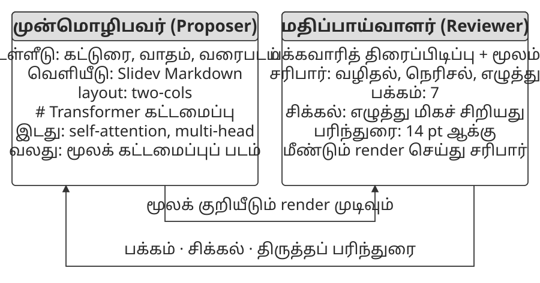

- **முன்மொழிபவர் (Proposer)** கட்டுரையைப் படித்து, விளக்கக் கட்டமைப்பைத் திட்டமிட்டு, Slidev மூலக் குறியீட்டை எழுதி, பின்னூட்டத்தின்படிப் பக்கங்களைத் திருத்துகிறார்.
- **மதிப்பாய்வாளர் (Reviewer)** கருவி வழியாகப் பக்கத்தை வரைந்து, பார்வை மாதிரியைக் கொண்டு உள்ளடக்க அடர்த்தி, படிப்புத்தன்மை, தளவமைப்பு, படம்–உரை பொருத்தம் ஆகியவற்றைச் சரிபார்த்து, பக்க எண், பிரச்சினை வகை, தீவிரம், திருத்தப் பரிந்துரைகள் கொண்ட கட்டமைக்கப்பட்ட பின்னூட்டத்தைத் திருப்பித் தருகிறார்.

பின்னூட்டம் திருத்தத்தை நேரடியாக வழிநடத்த வேண்டும். எடுத்துக்காட்டாக, "3-ஆம் பக்கத்தில் குறிப்புகள் அதிகம்; முறை மேலோட்டமும் கணக்கீட்டுப் படிகளும் என்ற இரு பக்கங்களாகப் பிரி"; "7-ஆம் பக்கக் குறியீட்டின் எழுத்துரு சிறியது; முதலில் 14 pt ஆக உயர்த்தி, பின்னர் ப்ரொஜெக்டர் படிப்புத்தன்மையைச் சரிபார்". உண்மைப் பிழைகளும் வரைபடத் தவறான வாசிப்பும் முதலில் திருத்தப்பட வேண்டும்; பின்னர் தளவமைப்பும் காட்சி விவரங்களும்.

உள்ளூர்த் திருத்தத்துக்கு எந்தப் பொருளை மாற்றுவது என்பதையும் தெளிவுபடுத்த வேண்டும். Feishu சறுக்கித் தாள்களில் உள்ள Doubao Work, பயனர் பக்க உறுப்பைத் தேர்ந்தெடுத்து, மிதக்கும் கருவிப்பட்டியில் திருத்தக் கோரிக்கையை முன்வைக்க அனுமதிக்கிறது.[^ch5-doubao-work] ஒரே பக்கத்தில் இரு உரைப்பெட்டிகள் உள்ளன; ஒன்றில் மூல நேர்காணல் மேற்கோள், மற்றொன்றில் அறிக்கையாளர் எழுதிய சுருக்கம் என்று வைத்துக்கொள்வோம். பயனர் சுருக்கத்தைத் தேர்ந்தெடுத்து, "இரு வரியாகச் சுருக்கு" என்று கேட்கிறார். தேர்ந்தெடுத்த உரைப்பெட்டியே மாற்றத்தின் எல்லையை வரையறுக்கிறது. சுருக்கத்தை மாற்றியெழுதலாம்; அருகிலுள்ள மேற்கோள் நேர்காணல் பெற்றவரின் அசல் வார்த்தைகளாகவே இருக்க வேண்டும்.

[^ch5-doubao-work]: Feishu உதவி மையம், சறுக்கித் தாள்களில் Doubao Work-ஐப் பயன்படுத்துதல்.

முன்மொழிபவர் திருத்திய பிறகு மீண்டும் வரைந்து, மதிப்பாய்வாளர் புதிய பதிப்பைச் சரிபார்த்து, முந்தைய சுற்றுப் பிரச்சினை தீர்ந்ததா என்று உறுதிசெய்கிறார். சுழற்சிக்கு இரு வகை வெளியேறும் நிபந்தனைகள்: தெளிவான உள்ளடக்க, அமைப்புத் தேவைகளை எட்டுதல்; அல்லது சுற்று, நேரம், செலவு ஒதுக்கீட்டைத் தீர்த்தல்; எடுத்துக்காட்டாக அதிகபட்சம் 5 சுற்றுத் திருத்தம். ஒப்படைக்கும்போது தற்போதைய பதிப்பையும் இன்னும் தீர்க்கப்படாத பிரச்சினைகளையும் சேமித்து, பின்னர் மதிப்பாய்வுக்கு வசதி செய்ய வேண்டும்.

இது அத்தியாயம் 4-இன் செயல் அனுமதியுடன் முன்மொழிபவர்–மதிப்பாய்வாளர் முறையைப் பகிர்கிறது. செயல் அனுமதி முக்கியமாக ஒரு செயலை இயக்கலாமா என்பதைத் தீர்மானிக்கிறது; உள்ளடக்க மதிப்பாய்வோ பல சுற்றுப் பின்னூட்டத்தால் விளைபொருளை மேம்படுத்துகிறது. இரண்டுக்கும் பணித் தேவைகளைப் பகிர்ந்து, இடங்கண்டறியக்கூடிய மதிப்பீட்டு அடிப்படையை வழங்கி, அடுத்தடுத்த செயல்முறையை Harness தீர்மானிக்க வேண்டும். வெவ்வேறு மாதிரிக் குடும்பங்களைப் பயன்படுத்துவது இன்னொரு மதிப்பாய்வுக் கண்ணோட்டத்தைத் தரலாம்.

**சூழல் மேலாண்மையில் இரு-ஏஜெண்ட் பணிப்பகிர்வின் மேன்மையை நான் முக்கியமாகக் கருதுகிறேன்.** இரு பங்குகளும் தத்தம் தேவையான தகவலைத் தனித்தனியாகத் தக்கவைக்கலாம்: மதிப்பாய்வாளர் ஒவ்வொரு சுற்றிலும் சமீபத்திய திரைப்பிடிப்பு, மதிப்பாய்வு அளவுகோல், தேவையான பிரச்சினைப் பட்டியலைப் பெறுகிறார்; முன்மொழிபவர் மூலக் குறியீடு, திருத்த இலக்கு, கட்டமைக்கப்பட்ட உரைப் பின்னூட்டத்தைத் தக்கவைக்கிறார். பக்கப் படங்கள் மதிப்பாய்வாளரின் சூழலில் இருக்கும்; முதன்மைப் பாதை சுருக்கமான உரைப் பின்னூட்டத்தால் தொடர்ந்து திருத்தத்தை முன்னெடுக்கிறது. ஒவ்வொரு சுற்று மதிப்பாய்வும் சமீபத்திய பக்கத்தைச் சுற்றி நடப்பதால், வரலாற்றுத் திரைப்பிடிப்புகளின் குறுக்கீடு குறைவதோடு சூழல் வளர்ச்சியும் கட்டுப்படுத்தப்படுகிறது.

> **சோதனை 5-6 ★★: கட்டுரை அடிப்படையிலான தானியங்கி PPT உருவாக்கம்**
>
> இந்தச் சோதனை *Attention Is All You Need* ஆய்வுக் கட்டுரையின் PDF-ஐப் பயன்படுத்தி, 20 பக்க Slidev சறுக்கித் தாள்களை உருவாக்குகிறது. ஏஜெண்ட் கட்டுரையின் கட்டமைப்பையும் முக்கியக் குறிப்புகளையும் பிரித்தெடுத்து, மூலத்துடன் பதிவு செய்யப்பட்ட மூன்று அசல் படங்களைப் பயன்படுத்தி, பக்கம் பக்கமாக விளக்கத்தை ஒழுங்கமைக்கிறது. வரைந்த பிறகு உரை வழிதல், வரைபடப் படிப்புத்தன்மை, படம்–உரை பொருத்தம் ஆகியவற்றைச் சரிபார்த்து, பின்னூட்டத்தின்படித் திருத்துகிறது.
>
> ஒற்றை ஏஜெண்ட் சுயமதிப்பாய்வையும் முன்மொழிபவர்–மதிப்பாய்வாளர் பணிப்பகிர்வையும் ஒப்பிடுகிறது. இந்த இயக்கத்தில், இரு இறுதி வரைவுகளும் ஒரே சுயாதீன மதிப்பீட்டுச் செயல்முறையில் 95 மதிப்பெண் பெற்றன; பணிப்பகிர்வுத் தீர்வின் உச்ச உள்ளீடு சுமார் 24 ஆயிரம் token; வரலாற்றுத் திரைப்பிடிப்புகளைத் தக்கவைத்த ஒற்றை ஏஜெண்ட் தீர்வு சுமார் 93 ஆயிரம் token.

> **சோதனை 5-7 ★★: கட்டுரை விளக்கக் காணொளியின் தானியங்கி உருவாக்கம்**
>
> சறுக்கித் தாள்களின் அடிப்படையில், ஏஜெண்ட் ஒவ்வொரு பக்கத்துக்கும் பேச்சு நடையிலான விளக்கத்தை எழுதி, படத்தில் உள்ள பொருள்கள், உறவுகள், முடிவுகளை விளக்கி, பின்னர் TTS கொண்டு ஒலியை இணைக்கலாம். பேச்சுரையும் பக்கமும் ஒருசேரப் பார்வை மதிப்பாய்வாளரிடம் கொடுக்கப்பட்டு, பேசப்பட்ட உறுப்புகள் திரையில் தோன்றுகின்றனவா, விளக்கம் வரைபடத்துடன் பொருந்துகிறதா என்று சரிபார்க்கப்படுகிறது.
>
> காணொளி தயாரிப்பில், சோதனை முந்தைய பகுதியின் உருவாக்கப் பாய்வையே பின்பற்றி, முந்தைய 22 பக்க வரைவை (v2) தேர்ந்தெடுத்தது. வரிசையாக 12 பக்கங்களை எடுத்த பிறகு, காணொளியின் கடைசிப் படம் அசல் குறிப்பின் 21-ஆம் பக்கத்திலிருந்து வந்தது. முந்தைய பகுதி மதிப்பெண்ணையும் பயன்பாட்டையும் ஒப்பிடும்போது பின்னர் வந்த 20 பக்க வரைவை (v9) பயன்படுத்தியது. பக்கங்களைத் தேர்ந்தெடுத்த பிறகு, Kimi கொண்டு பேச்சுரையை உருவாக்கி, Qwen பார்வை மாதிரி படம்–உரை உறவை மதிப்பாய்வு செய்து, பின்னர் Fish Audio கொண்டு பக்கவாரியான ஒலியை இணைத்தது. FFmpeg ஒவ்வொரு ஒலித் துண்டின் உண்மையான நீளத்தின்படிப் பக்கங்களின் காட்சி நேரத்தை அமைத்து, சுமார் 8.6 நிமிட விளக்கக் காணொளியை இணைத்தது.
>
> படம் 5-6-இல், சறுக்கித் தாள்கள், பேச்சுரை, ஒலி ஆகியவை இறுதியில் மட்டுமே காணொளியாக இணைகின்றன. சில பிரச்சினைகள் இந்தப் படியில்தான் கேட்கக் கிடைக்கின்றன: பக்கம் மாறும்போது ஒரு வாக்கியம் இன்னும் முடியவில்லையா, பின்னால் செல்லச் செல்ல ஒலியும் படமும் இன்னும் ஒத்துப்போகவில்லையா.
>
> 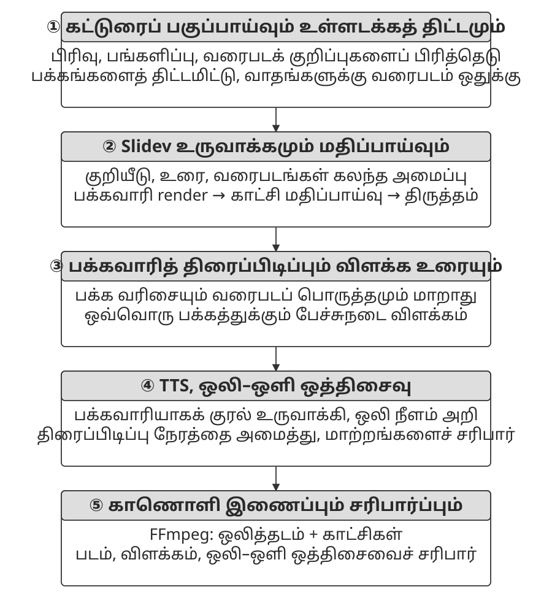

[^ch5-slidev]: Slidev, *Getting Started*; Markdown, வலைத் தொழில்நுட்பம் கொண்டு சறுக்கித் தாள் உருவாக்குதல், காட்டுதல், ஏற்றுமதி செய்தலை அறிமுகப்படுத்துகிறது.

**காணொளித் திருத்தும் ஏஜெண்ட்.**

**காணொளித் திருத்தத்தில் ஸ்கிரிப்டாக வெளிப்படுத்தக்கூடிய செயல்களுக்கு, நிரல் இடைமுகத்துக்கே முன்னுரிமை கொடுக்க வேண்டும்.** நேர அச்சு, அடுக்குகள், துணைத்தலைப்புகள், ஒலித் தடங்கள் ஆகியவை சிக்கலான GUI பலகைகளில் பரவியுள்ளன; திரும்பத் திரும்ப இடங்கண்டறிந்து இழுப்பது தாமதத்தையும் பிழையையும் அதிகரிக்கிறது; நிரல் இடைமுகம் நேர இடைவெளிகள், தடங்கள், விளைவு அளவுருக்கள் மூலம் செயல்களை நேரடியாக வெளிப்படுத்த முடியும். Blender-இன் Python இடைமுகமும் FFmpeg-உம் சில திருத்தப் பணிகளை மீண்டும் மீண்டும் இயக்கக்கூடிய ஸ்கிரிப்டுகளாக ஒழுங்கமைக்க முடியும்.

ஏஜெண்ட் முதலில் "அலைச்சறுக்கல் பகுதியை வெட்டி எடு" போன்ற கோரிக்கையைப் புரிந்துகொண்டு, பொருளில் இலக்கு இடைவெளியை இடங்கண்டறிந்து, வெட்டுதல், வரிசைப்படுத்தல், ஒலித் தடச் செயலாக்கக் குறியீட்டை உருவாக்கலாம். திருத்தத் திட்டத்தையும் ஸ்கிரிப்டையும் முன்மொழிபவர் உருவாக்குகிறார்; மதிப்பாய்வாளர் வரைந்த முடிவைச் சரிபார்க்கிறார்; விடுபடுதல், தொடர்பில்லாத துண்டுகள், துணைத்தலைப்பு மறைப்பு ஆகியவற்றைக் கண்டறிந்தால், குறிப்பிட்ட நேரப் புள்ளியையும் பிரச்சினையையும் தெரிவித்து முன்மொழிபவரைத் திருத்தச் செய்கிறார். முக்கியச் சட்டகங்கள் காட்சியையும் தளவமைப்பையும் சரிபார்க்க ஏற்றவை; இயக்கத் தொடர்ச்சியும் ஒலி–பட ஒத்திசைவும் அருகிலுள்ள சட்டகங்களையோ தொடர்ச்சியான துண்டுகளையோ சரிபார்க்க வேண்டும்.

> **சோதனை 5-8 ★★: API அடிப்படையிலான நுண்ணறிவு காணொளி வெட்டு**
>
> இந்தச் சோதனை இலக்கு இடங்காணல், ஸ்கிரிப்ட் உருவாக்கம், விளைவு மதிப்பாய்வு ஆகியவற்றை ஒரே பாய்வாக இணைக்கிறது. முதலில் காணொளிக் குறிப்பு, இலக்குக் கேள்வி, சட்டகப் பிரித்தெடுப்பு இடைவெளி ஆகியவற்றைக் காணொளிப் பகுப்பாய்வுத் துணை ஏஜெண்டிடம் கொடுத்து, அது ஏராளமான படங்களைக் கையாண்டு, நேர இடைவெளியையும் அடிப்படையையும் முதன்மை ஏஜெண்டுக்குத் திருப்பித் தருகிறது.
>
> இடங்காணல் இரு படிகளாக நடக்கிறது. முதல் படியில் ஒவ்வொரு 10 வினாடிக்கும் ஒரு சட்டகம் எடுத்து, இலக்கின் தோராயமான வரம்பைத் தேடுகிறது; எடுத்துக்காட்டாக "அலைச்சறுக்கல் 40–110 வினாடியில்". இரண்டாம் படியில் வேட்பு வரம்பையும் அதன் அருகிலுள்ள எல்லைகளையும் சுற்றி, ஒவ்வொரு வினாடிக்கும் ஒரு சட்டகம் எடுத்துத் தொடக்க, முடிவு இடங்களை மேலும் துல்லியப்படுத்துகிறது. கரடுமுரடான மாதிரி இடைவெளியை விடக் குறுகிய காட்சிகள் இரு சட்டகங்களுக்கு இடையே விழலாம்; இலக்கின் கால அளவுக்கேற்ப மாதிரியை அதிகரிக்கலாம், அல்லது இரு சட்டகப் பிரித்தெடுப்புகளுக்கு இடைப்பட்ட படங்களை மீண்டும் பார்க்கலாம்.
>
> வரம்பைத் தீர்மானித்த பிறகு, முன்மொழிபவர் Blender Python ஸ்கிரிப்டை உருவாக்கி, வெட்டுதலையும் தேவையான துணைத்தலைப்பு, வேக மாற்றம் போன்ற செயல்களையும் இயக்குகிறார். மதிப்பாய்வாளர் முன்னோட்டத்தைப் பார்த்து, சரிசெய்ய வேண்டிய எல்லைகளையும் விளைவுகளையும் சுட்டிக்காட்டுகிறார்; திருத்தம் தேர்ச்சி பெற்ற பிறகே முழு இறுதிக் காணொளி வெளியிடப்படுகிறது.
>
> உண்மையில் வெட்டியது, ஒரு வெள்ளை முயல் புல்லில் தனியாக நடந்து செல்லும் காட்சி. ஒவ்வொரு 10 வினாடிக்கும் ஒரு சட்டகம் பார்த்து, மாதிரி வரம்பை 10 முதல் 20 வினாடி என்று அமைத்தது. நேரடியாக 10-ஆம் வினாடியிலேயே வெட்டினால், காட்சியின் தொடக்கம் சிறிது தொலைந்துவிடும். எனவே நிரல் இரு பக்கமும் 5 வினாடி விரிவுபடுத்தி, 5 முதல் 25 வினாடி வரை ஒவ்வொரு வினாடிக்கும் ஒரு சட்டகம் பார்த்து, வேட்பு வரம்பை 9 முதல் 12 வினாடியாகச் சுருக்கியது. அருகிலுள்ள காட்சியும் கலந்திருப்பதை மதிப்பாய்வாளர் கண்டறிந்தார்; திருத்திய பிறகு வரம்பு 9.25 முதல் 11.00 வினாடியாக மாறியது. கைமுறையாகக் குறித்த 9.08 முதல் 11.20 வினாடியுடன் ஒப்பிடும்போது, தொடக்கம் 0.17 வினாடி தாமதம், முடிவு 0.20 வினாடி முன்னதாக இருந்தது; இரு முனைகளும் 3 வினாடிக்கு மிகாத பிழை என்ற தேவையைப் பூர்த்தி செய்தன.
>
> நேரக் குறியீடு எங்கே வெட்டப்பட்டது என்பதை மட்டுமே சரிபார்க்க முடியும். அதே துணைத்தலைப்பு, மெதுவான இயக்கத்தை வேண்டுமென்றே தவறாகத் தேர்ந்தெடுத்த காட்சியில் வைத்தால், மதிப்பாய்வாளர் தவறை இன்னும் கண்டறிய முடியுமா? சோதனை முதலில் 0 முதல் 3 வினாடி வரையிலான ஒப்பீட்டுத் துண்டைச் சரிபார்க்கச் செய்து, பின்னர் திருத்திய வரைவைப் பார்த்தது. சரிபார்ப்புப் பொருள்களில் காட்சியில் உள்ள வெள்ளை முயல், அடியில் உள்ள துணைத்தலைப்பு, வேகம் மாற்றிய பிறகான நீளம் ஆகியவை அடங்கும்.

**3D மற்றும் தொழில்துறை உதிரிபாகங்கள்: பொருத்தமான உருவாக்க முறையைத் தேர்ந்தெடுத்தல்.**

**அளவும் பொருத்த உறவும் கடினமான கட்டுப்பாடுகளாக உள்ள தொழில்துறை உதிரிபாகங்களுக்கு, அளவுரு குறியீட்டு உருவாக்கத்துக்கு முன்னுரிமை கொடுங்கள்; முதன்மையாக இயற்கைத் தோற்றத்தையும் தோற்றத்தையும் நாடும் பொருள்களுக்கு உருவாக்க மாதிரிகளைப் பரிசீலியுங்கள்.** இந்தத் தேர்வு, விளைபொருளைச் சில அளவுருக்களால் துல்லியமாக விவரிக்க முடியுமா, மாற்றத்துக்குப் பிறகு எந்த உறவுகளைத் தக்கவைக்க வேண்டும் என்பதைப் பொறுத்தது. CadQuery, OpenSCAD, Blender ஸ்கிரிப்டுகள் திருத்தக்கூடிய கட்டமைப்புச் செயல்முறையை வழங்குகின்றன; Hunyuan 3D போன்ற மாதிரிகளோ கற்றுக்கொண்ட வடிவ முன்னனுபவத்தைக் கொண்டு சிக்கலான தோற்றத்தை உருவாக்குகின்றன.

**விவரணை அளவுருவாக்கத்துக்கு ஏற்றதா.** எளிமைப்படுத்தப்பட்ட ஒரு flange-ஐ வெளி விட்டம், தடிமன், துளை வட்ட விட்டம், துளை விட்டம், துளை எண்ணிக்கை ஆகியவற்றால் விவரிக்கலாம். குறியீடு அளவுருக்களைக் கட்டமைப்புப் படிகளுடன் இணைப்பதால், மீண்டும் மீண்டும் சரிசெய்ய ஏற்றது. ஒரு செடித் தொட்டி, ஒரு தைஹு கல், அல்லது ஒரு முகம் ஆகியவை ஏராளமான ஒழுங்கற்ற வடிவங்களைக் கொண்டவை; உருவாக்க மாதிரிகள் தோற்றத்தைக் கட்டமைக்க உதவும்; நிரலாக்க முறைகளும் வளர்ச்சி விதிகள், சீரற்ற செயல்முறைகள், வளச் சேர்க்கைகள் மூலம் விவரங்களை உருவாக்கலாம்.

**துல்லியத்தை எவ்வாறு சரிபார்ப்பது.** துளை விட்டம் 5 mm, பொறை ±0.05 mm போன்ற தேவைக்கு, அலகு, ஆய அமைப்பு, அளவீட்டு முறையை முதலில் தெளிவுபடுத்தி, பின்னர் மாதிரி அளவுகளை விவரக்குறிப்புடன் ஒப்பிட வேண்டும். அளவுரு மாதிரிகளில் வடிவியல் பொருள்களை நேரடியாகச் சரிபார்க்கலாம்; mesh-களை வெட்டுமுகம், துளைகள், சூழ் அளவு முறைகளால் அளந்து, தனித்தனியாக்கல் பிழையையும் கணக்கில் கொள்ளலாம்.

**எவ்வாறு சேமித்து மாற்றுவது.** B-rep (எல்லை வெளிப்பாடு) முகங்கள், விளிம்புகள், முனைகள் மூலம் திண்ம எல்லையை விவரிக்கிறது; முக்கோண mesh-ஓ மேற்பரப்பைத் துண்டுகளால் தோராயமாக்குகிறது. CadQuery CAD தரவுப் பரிமாற்றத்துக்கு STEP-ஐயும், STL mesh-ஐயும் ஏற்றுமதி செய்யலாம்; திருத்தக்கூடிய அளவுருக்களும் கட்டமைப்புத் தர்க்கமும் CadQuery மூலக் குறியீட்டில் சேமிக்கப்படுகின்றன[^ch5-cad]. CNC இயந்திரப் பணிப்பாய்வுக்குள் நுழைய, செயல்முறைத் திட்டமிடல், கருவிப் பாதை, இயந்திரத் தகவமைப்பும் தேவை.

எடுத்துக்காட்டாக, M5-க்குப் பொருத்திய பொருத்தத் துளையை M6-க்குப் பொருத்த மாற்ற, துளை விட்ட அளவுருவை மாற்றி, மீண்டும் உருவாக்கிப் பிறகு வெளி விட்டம், தடிமன், துளை இடம் ஆகியவை ஒரே மாதிரியாக உள்ளனவா என்று சரிபார்க்கலாம். உருவாக்க மாதிரிகளின் திருத்த முறை இடைமுகத் திறனைப் பொறுத்தது; மீண்டும் உருவாக்கலாம், அல்லது உள்ளூர்த் திருத்தத்தையும் பின்னர் வரும் வடிவியல் செயலாக்கத்தையும் இணைக்கலாம்.

இரு பாதைகளை இணைக்கும்போதும் பணிப்பகிர்வைத் தெளிவுபடுத்த வேண்டும்: அளவு, பொருத்த உறவுகளை அளவுரு குறியீட்டிடமும், அமைப்பு, தளையற்ற தோற்றத்தை உருவாக்க மாதிரிகளிடமும் ஒப்படையுங்கள். **முக்கிய அளவுகளை மீண்டும் மீண்டும் துல்லியமாக மாற்ற வேண்டியிருக்கும்போது, திருத்தக்கூடிய கட்டமைப்புச் செயல்முறை ஒரே முறை உருவாக்கிய தோற்றத்தை விட மதிப்புள்ளது.**

> **சோதனை 5-9 ★★: ஒரே உதிரிபாகத்துக்கு இரு உருவாக்கப் பாதைகள் — குறியீடும் உருவாக்க மாதிரியும்**
>
> இந்தச் சோதனை வெளி விட்டம் 80 mm, தடிமன் 10 mm கொண்ட flange ஒன்றை, 60 mm விட்டத் துளை வட்டத்தில் சீராகப் பரவிய நான்கு பொருத்தத் துளைகளுடன் உருவாக்கக் கோருகிறது. பொருத்தப் பொருளைத் தெளிவுபடுத்த, ஆரம்ப விவரக்குறிப்பு M5-க்குப் பொருத்தும் 5.5 mm வழித் துளையைப் பயன்படுத்துகிறது; திருத்தக் கோரிக்கை M6-க்குப் பொருத்தும் 6.5 mm வழித் துளையாக மாற்றுகிறது.
>
> குறியீட்டுப் பாதையில் மாதிரி CadQuery நிரலை உருவாக்கி, இயக்கிய பிறகு STEP, STL ஏற்றுமதி செய்கிறது; உருவாக்க மாதிரிப் பாதை முதலில் தயாரிப்பு மேற்கோள் படத்தை உருவாக்கி, பின்னர் Hunyuan 3D-க்குக் கொடுத்து mesh உருவாக்குகிறது. வெளி விட்டம், தடிமன், துளை எண்ணிக்கை, துளை விட்டம், துளை இடம், பொருத்த மேற்பரப்பு ஆகியவற்றைச் சரிபார்த்து, அலகும் அச்சுத் திசையும் பதிவு செய்யப்படுகின்றன.
>
> குறிப்பிட்ட அளவை மட்டும் மாதிரி மாற்றியதா என்பதை எவ்வாறு கண்டறிவது? திருத்தத்துக்கு முன்னும் பின்னும் ஏற்றுமதி செய்த STL-ஐ ஒப்பிட்டால், நான்கு பொருத்தத் துளைகளின் சராசரி விட்டம் 5.499 mm-இலிருந்து 6.499 mm ஆக உயர்ந்தது; இரண்டின் வெளி விட்டமும் 80 mm, தடிமனும் 10 mm, துளை வட்ட விட்டமும் மூன்று தசம இடங்கள் வரை 60.000 mm. உருவாக்க மாதிரிப் பாதையின் மூல mesh-இல் தெளிவான இயற்பியல் அளவு இல்லை. அளவீட்டு நிரல் Z அச்சில் நடுவெட்டு முகத்தை எடுத்தது; துளையின் உள் வளையம் கிடைக்கவில்லை. நான்கு துளைகளும் தட்டை ஊடுருவுகின்றனவா என்று அறிய, பொருத்த மேற்பரப்பை அடையாளம் கண்டு, அதன் செங்குத்துத் திசையில் வெவ்வேறு ஆழங்களில் வெட்டுமுகங்களை எடுக்க வேண்டும். மீண்டும் உருவாக்கிய பிறகு ஒட்டுமொத்த வடிவமும் திசையும் மாறிவிட்டன.
>
> இறுதியாக இன்னொரு கேள்விக்கு மாறுவோம்: இயற்கையான செடித் தொட்டியின் படத்தை ஒப்படைக்க வேண்டுமானால், எவ்வாறு ஏற்பு செய்வது? சோதனை matplotlib கொண்டு ஒரு செடிப் படத்தையும், Gemini கொண்டு மற்றொன்றையும் உருவாக்கி, அதே பார்வை மாதிரியைக் கொண்டு பத்து மதிப்பெண் அளவில் இயற்கைத்தன்மையை மதிப்பிடச் செய்தது. இரு படங்களும் முறையே 3, 8 மதிப்பெண் பெற்றன. இந்த மதிப்பெண், மதிப்பீட்டு மாதிரிக்கு எந்தப் படம் உண்மையான தாவரத்தைப் போலத் தோன்றுகிறது என்பதை மட்டும் பதிலளிக்கிறது. Flange-க்குத் திரும்பினால், தயாரிப்புப் படத்தில் நான்கு துளைகள் இருப்பது போலத் தோன்றினாலும், பொருத்தம் முப்பரிமாண உதிரிபாகத்தில் துளைகளின் இடத்தையும் விட்டத்தையும் சரிபார்க்க வேண்டும்.

[^ch5-cad]: CadQuery, *Importing and Exporting Files*; STEP, STL போன்ற வடிவங்களை அறிமுகப்படுத்தி, முழு அளவுருத் தகவலும் CadQuery-இன் Python மூலக் குறியீட்டில் சேமிக்கப்படுவதை விளக்குகிறது.

### அமைப்புத் தகவமைப்பியாகக் குறியீடு

வெளிப்புறச் சேவைகளின் இடைமுகங்கள், அங்கீகார முறைகள், தரவு வடிவங்கள் ஒவ்வொன்றும் வேறுபடுகின்றன. ஏஜெண்ட் ஆவணங்களையும் பதில் மாதிரிகளையும் படித்து, HTTP கிளையண்டை உருவாக்கி, அங்கீகாரத் தலைப்புகளை உள்ளமைத்து, திருப்பு மதிப்புகளைப் பாகுபடுத்தி, மேல்நிலைப் புலங்களைக் கீழ்நிலைக்குத் தேவையான கட்டமைப்பாக மாற்றலாம். இங்குக் குறியீடு அமைப்புத் தகவமைப்பு வேலையை ஏற்று, ஏற்கனவே உள்ள சேவைகளைப் புதிய பணிப் பாய்வாக இணைக்கிறது.

எடுத்துக்காட்டாக, பணம் செலுத்தும் சேவையிலிருந்து படிக்கப்படும் தொகைப் புலம் "சதம்" அலகிலும், அறிக்கை "யுவான்" அலகிலும் காட்டப்படுகிறது என்றால், JSON-ஐ வெற்றிகரமாகப் பாகுபடுத்தியது வடிவம் மட்டும் பொருந்துகிறது என்பதைக் காட்டுகிறது. 25 யுவான் பரிவர்த்தனை மேல்நிலையில் முழு எண் 2500. இந்த எண்ணை அப்படியே அறிக்கையில் நிரப்பினால், 25 யுவான் 2500 யுவானாகிவிடும்.

தகவமைப்பி உள்ளீடு, வெளியீடு, பிழைக் கையாளுதல், பதிப்பு வரம்பைத் தெளிவுபடுத்த வேண்டும். மாதிரிகள் புலங்களைப் புரிந்துகொள்ள உதவுகின்றன; இடைமுக ஒப்பந்தமும் சோதனைகளும் விடுபட்ட மதிப்புகள், பக்கவாரியாக்கல், விதிவிலக்குப் பதில்கள், பதிப்பு மாற்றங்களைச் சரிபார்க்கின்றன. சான்றுகளை இயக்கச் சூழல் நிர்வகிக்கிறது; உருவாக்கிய குறியீடு கட்டுப்படுத்தப்பட்ட இடைமுகம் வழியாக அனுமதிக்கப்பட்ட திறன்களைப் பயன்படுத்துகிறது. சரிபார்ப்பு தேர்ச்சி பெற்ற பிறகு தகவமைப்பியைச் சேமித்து மீண்டும் பயன்படுத்தலாம்; பின்னர் வடிவம் மாறும்போது திருத்தச் செயல்முறைக்குள் நுழையலாம்.

வரைகலை இடைமுகம் மட்டும் உள்ள அமைப்புகளுக்கும் இதே முறையைப் பயன்படுத்தலாம். ஏஜெண்ட் முதலில் அத்தியாயம் 6 அறிமுகப்படுத்தும் Computer Use மூலம் பணியை முடித்து, பின்னர் நிலையான இயக்கப் படிகளை RPA கருவியாக நிலைப்படுத்தலாம். இடைமுகக் கட்டுப்பாடுகள், உள்நுழைவு நிலை, பக்கப் பாய்வு மாறும்போது, கருவி விலகலைக் கண்டறிந்து மீண்டும் இடங்கண்டறிய வேண்டும். வெற்றிகரமான பாதையிலிருந்து பணிப் பாய்வை எவ்வாறு பிரித்தெடுத்து, சரிபார்த்து, மீண்டும் பயன்படுத்துவது என்பதை அத்தியாயம் 9 மேலும் விவாதிக்கும்.

**ஏஜெண்ட் பதிவு பாகுபாடும் காட்சிப்படுத்தலும்.**

ஒரு சிக்கலான பணியில் பல மாதிரிக் கோரிக்கைகள், கருவி இயக்கங்கள், துணை ஏஜெண்ட் இடைவினைகள் அடங்கலாம். பதிவு மேலோட்டம் படிகளுக்கு இடையிலான உறவையும், நிலையையும், எடுத்த நேரத்தையும் காட்டுகிறது; விரித்தால் குறிப்பிட்ட உள்ளீடுகளும் வெளியீடுகளும் தெரிந்து, எந்தப் படியில் என்ன நடந்தது என்பதை வாசகர் தடமறிய முடிகிறது. புதிய புலங்கள், உட்பொதிந்த கட்டமைப்புகள், வடிவப் பதிப்புகள் ஆகியவை பாகுபாடு மற்றும் காட்சிப்படுத்தலைப் பாதிக்கின்றன.

தகவமைவுப் பாகுபாடு "மாற்றத்தைக் கண்டறி—பாகுபடுத்தி உருவாக்கு—முடிவைச் சரிபார்" என்ற சுழற்சி மூலம் இந்த மாற்றங்களைக் கையாள்கிறது. பாகுபாடு தோல்வியடைந்தால், மூல மாதிரி, பிழை இடம், எதிர்பார்க்கப்பட்ட புலங்களைச் சேமித்து, பின்னர் இடைமுக ஒப்பந்தத்தையும் உருவாக்கும் பக்கப் பதிப்பையும் ஒப்பிட்டு, மாற்றம் எதிர்பார்த்தபடி உள்ளதா என்று தீர்மானிக்கிறது. வடிவப் பதிப்புயர்வு உறுதிசெய்யப்பட்ட பிறகே புதிய பாகுபடுத்தியை ஏஜெண்ட் எழுதச் செய்ய வேண்டும். பதிவு எழுதும் நிரலே தவறாக இருந்தால், மூலப் பதிவைச் சேமித்துக் கோளாறைத் தெரிவிக்க வேண்டும்; புதிய பாகுபடுத்தி பிழையையும் சாதாரண வடிவமாகக் கருதிவிடக் கூடாது. புதிதாக எழுதிய குறியீட்டை முதலில் வரம்பிடப்பட்ட சூழலில் இயக்கி, புலங்களையும் அவற்றின் பொருளையும் சரிபார்த்து, பின்னர் சாதாரண மாதிரிகள், விடுபட்ட புல மாதிரிகள், பழைய வடிவப் பின்னடைவு நிகழ்வுகளைக் கொண்டு சரிபார்க்க வேண்டும். தேர்ச்சி பெற்ற பிறகு புதிய பாகுபடுத்தியைப் பதிவு செய்து, பதிப்பையும் பொருந்தும் வடிவத்தையும் சேமிக்க வேண்டும்; தோல்வி மாதிரிகள் தொடர்ந்து தக்கவைக்கப்பட்டுத் தடமறியவும் மீண்டும் முயலவும் உதவும்.

பாகுபாடு, காட்சிப்படுத்தல் ஆகிய இரண்டுக்கும் தனிச் சரிபார்ப்பு முறைகள் உள்ளன. நேர முத்திரைகள், நிலைகள், எண் வகைகள், அழைப்பு இணைப்பு ஆகியவற்றை நிரல் சரிபார்க்கிறது; உலாவி வரைந்து பக்கம் இயல்பாக வேலை செய்கிறதா என்று பார்க்கிறது; பார்வை மாதிரி அட்டவணைகள், நேர அச்சு, குறிச்சொற்கள் தெளிவாக உள்ளனவா என்று கூடுதலாகச் சரிபார்க்கிறது. நேரடிப் புதுப்பிப்பின்போது முந்தைய பதிப்பையும் பின்வாங்கும் நுழைவாயிலையும் தக்கவைத்து, புதிய வடிவ ஆதரவு படிப்படியாக இயக்க அமைப்புக்குள் வரச் செய்யலாம்.

> **சோதனை 5-10 ★★★: தகவமைவுப் பதிவுப் பாகுபாட்டு அமைப்பு**
>
> இந்தச் சோதனை முதலில் இரு பதிவு எழும் செயல்முறைகளை இயக்கி, முறையே கிடைமட்டக் கோட்டு வடிவத்தையும் உட்பொதிந்த அடைப்புக்குறி வடிவத்தையும் வெளியிடுகிறது. ஆரம்பப் பாகுபடுத்தி இந்த மாதிரிகளைக் கையாள முடியாது; பின்னர் அமைப்பு மாதிரியைக் கோரி இரு பாகுபாட்டுச் சார்புகளை உருவாக்கி, சோதனை தேர்ச்சி பெற்ற பிறகு இயங்கும்போது ஏற்றி, முன்பு தோல்வியடைந்த பதிவுகளைப் பாகுபடுத்துகிறது.
>
> முதல் வடிவம் `timestamp`, `level`, `module`, `step`, `message` ஆகியவற்றைப் பிரித்தெடுக்கிறது; இரண்டாவது கருவிப் பெயர், எடுத்த நேரம், நிலை ஆகியவற்றையும் உள்ளடக்குகிறது. இயக்கப் பதிவில், இரு வகையிலும் தலா மூன்று பதிவுகள் பாகுபடுத்தப்பட்டன; புதிதாக உருவாக்கிய இயந்திரம் சேமித்த பாகுபடுத்தியையும் ஏற்றி, கலப்புப் பதிவு ஓட்டத்தைத் தொடர்ந்து கையாள முடிந்தது.
>
> பாகுபாட்டு முடிவுகளை Chromium அட்டவணையாக வரைந்தது; பார்வை மதிப்பாய்வு நெடுவரிசைப் பெயர்கள், வரி உள்ளடக்கம், படிப்புத்தன்மை ஆகியவற்றைச் சரிபார்த்தது.

**ஏஜெண்ட் இயக்கப் பதிவுகளின் தானியங்கிப் பகுப்பாய்வும் சிக்கல் கண்டறிதலும்.**

கட்டமைக்கப்பட்ட பாதையைப் பாகுபடுத்திய பிறகு, ஏஜெண்ட் கட்டமைப்பு ஆவணத்தையும் PRD (தயாரிப்புத் தேவை ஆவணம்) யையும் இணைத்து, எதிர்பார்த்த செயல்முறையையும் உண்மையான செயலையும் ஒப்பிடலாம். எடுத்துக்காட்டாக, பணத்திருப்பத்துக்கு முன் இந்த ஆர்டர் திருப்பித் தரக்கூடியதா என்று வினவியதா? சரக்குச் சேவை நேரம் முடிந்த பிறகு, நிரல் உடன்படிக்கைப்படி இடையகத்திலிருந்து தரவை வினவியதா?

சிக்கல் அறிக்கையில் முன்னுரிமை, தொகுதி, தோற்றம், சான்று, மேம்பாட்டுப் பரிந்துரை ஆகியவை இருக்கலாம். ஏஜெண்ட் அதன் அடிப்படையில் பின்னடைவுச் சோதனைகளையும் உருவாக்கி, சிக்கலுக்குரிய உள்ளீட்டையும் ஏற்பு நிபந்தனையையும் நிலைப்படுத்தலாம். சோதனைச் சட்டகம் கட்டுப்படுத்தப்பட்ட சூழலில் கோரிக்கைகளை மீண்டும் இயக்கி அல்லது சேமித்த கருவிப் பதில்களைப் படித்து, குறைபாடு உள்ள பதிப்பின் நடத்தையையும் திருத்திய பதிப்பின் நடத்தையையும் ஒப்பிடுகிறது. வெளிப்புற எழுதும் செயல்கள் சம்பந்தப்பட்டால், தனிமைப்படுத்தப்பட்ட சூழலையோ மாற்று இடைமுகங்களையோ பயன்படுத்தி, மறுஇயக்கத்தின் தாக்க எல்லையைக் கட்டுப்படுத்த வேண்டும்.

வலியுறுத்தல்கள் சரிபார்க்க வேண்டிய பண்புகளுக்கு உரியதாக இருக்க வேண்டும். எடுத்துக்காட்டாக, பதிவில் பணத்திருப்பச் சரிபார்ப்பு தோன்றியது, நிரல் வினவியது என்பதை மட்டும் காட்டுகிறது. இந்தப் பணம் சரியாகத் திருப்பித் தரப்பட்டதா என்பதை அறிய, நிரல் முதலில் வினவிப் பின்னர் திருப்பித் தந்ததா, வினவல் முடிவு பணத்திருப்பத்தை அனுமதிக்கிறதா, ஆர்டரின் இறுதி நிலை என்ன என்பதையும் பார்க்க வேண்டும்.

கண்டறிதல் மதிப்பாய்வு செய்யப்பட்ட பிறகு, ஏஜெண்ட் தொடர்புடைய அனுமதி பெற்று MCP வழியாக GitHub Issue-ஐ உருவாக்கி, தொகுதிக்கேற்பப் பொறுப்பாளரைப் பரிந்துரைக்கலாம். அதே குறைபாட்டுக்கு ஏற்கனவே வேலை உருப்படி இருந்தால், புதிய சான்றை அதில் சேர்க்கலாம்.

> **சோதனை 5-11 ★★★: உற்பத்திப் பதிவுகளின் நுண்ணறிவு கண்டறிதல் அமைப்பு**
>
> இந்தச் சோதனை உள்ளூர் HTTP சேவையைக் கொண்டு இரு வணிகப் பாதைகளை உருவாக்குகிறது; ஒரு பதிவு, ஆர்டர் திருப்பித் தரக்கூடியதா என்று வினவாமலேயே பணத்தைத் திருப்பித் தந்ததைக் காட்டுகிறது; மற்றொன்று, சரக்கு வினவல் நேரம் முடிந்த பிறகு இடையகத்திலிருந்து தரவை வினவவில்லை என்பதைக் காட்டுகிறது. மாதிரி கட்டமைப்பு ஆவணத்தையும் தேவை விளக்கத்தையும் இணைத்து, பாதை மற்றும் சுற்றுக் குறிப்புகள் கொண்ட சிக்கல் அறிக்கையை உருவாக்கி, பின்னர் மூன்று இயக்கக்கூடிய பின்னடைவுச் சோதனைகளை உருவாக்குகிறது.
>
> படம் 5-7 ஒரு கண்டறிதல் அறிக்கையைப் பாதைக்கும் பின்னடைவுச் சோதனைகளுக்கும் இடையே வைக்கிறது. "அமைப்பு சரிபார்ப்பைத் தவிர்த்துப் பணத்தை நேரடியாகத் திருப்பித் தந்தது" என்று அறிக்கை கூறுகிறது. பாதையில் திரும்பிச் சான்றைத் தேடுங்கள்: அழைப்புப் பதிவில் எந்தப் படி விடுபட்டது? பின்னர் சோதனைகளைப் பாருங்கள்: இனி இந்தப் படி விடுபட்டால், சோதனை அதைக் கண்டறியுமா?
>
> 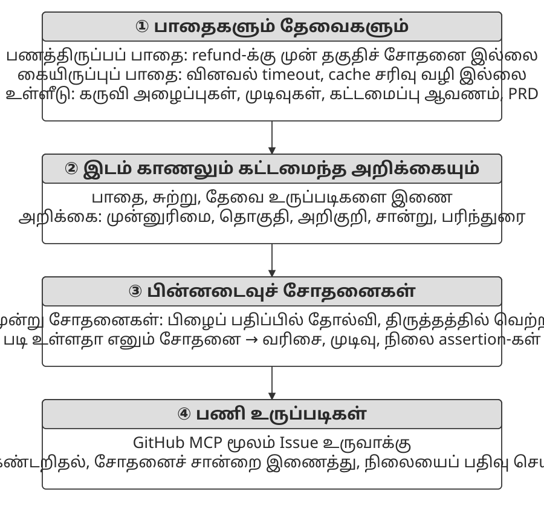
>
> மூன்று சோதனைகளும் குறைபாடு உள்ள பதிப்பில் தோல்வியடைந்து, திருத்திய பதிப்பில் முழுமையாகத் தேர்ச்சி பெற்றன. அவற்றில் ஒரு சோதனை, நிரல் பணத்திருப்பச் சரிபார்ப்புக் கருவியை அழைத்ததா என்பதை மட்டும் சரிபார்க்கிறது. நிரல் முதலில் பணத்தைத் திருப்பித் தந்து, பின்னர் இந்த ஆர்டர் திருப்பித் தரக்கூடியதா என்று வினவினாலும், இந்தச் சோதனை தேர்ச்சி பெறும். இயக்கப் பதிவில், GitHub MCP வேலை உருப்படியை உருவாக்கிய ரசீதும் சேமிக்கப்பட்டுள்ளது; அதன் அடிப்படையில், கண்டறிதல் அறிக்கை மேம்பாட்டாளரிடம் ஒப்படைக்கப்பட்ட பிறகு எந்த வேலைச்சீட்டில் சேர்ந்தது என்பதைக் கண்டுபிடிக்கலாம்.
>

### உருவாக்க UI ஆகக் குறியீடு

ஏஜெண்ட் கையாளும் பொருள்களைப் பயனரே நேரடியாக மாற்ற வேண்டுமானால், இடைமுகத்தை இருவரும் பயன்படுத்தும் பணித்தளமாகச் செய்யலாம். பயண அட்டவணையை எடுத்துக்காட்டாகக் கொள்வோம்: உதவியாளர் எந்த நிலையத்தை மாற்றுகிறார் என்பதைப் பயனர் பார்க்கவும், தாமே திருத்தவும், ஒரு மாற்றத்தை உறுதிசெய்யவும் அல்லது ரத்து செய்யவும் வேண்டும். பயனர் புறப்படும் நாளை வெள்ளிக்கிழமைக்கு மாற்றியிருந்தால், உதவியாளர் பின்னர் இந்தப் புதிய அட்டவணையிலேயே தொடர்ந்து வேலை செய்ய வேண்டும். இரு தரப்பும் ஒரே தெரியக்கூடிய நிலையைப் பங்கிடுவதும், தற்போது எந்தப் புலத்தை யார் கட்டுப்படுத்துகிறார் என்று ஒப்பந்தம் செய்வதும் இருந்தால் மட்டுமே, பார்த்துக்கொண்டே திருத்த முடியும்.

பயனர் மூன்று பயணத் திட்டங்களை ஒப்பிட விரும்புகிறார் என்று கற்பனை செய்யுங்கள். சேருமிடம் இன்னும் தீர்மானிக்கப்படாதபோது உரையாடல் கேள்வி கேட்க வசதி; சேருமிடம் தீர்மானமான பிறகு, பல உரைப் பத்திகளை மீண்டும் மீண்டும் சரிபார்ப்பதை விட, தேதியை நேரடியாகத் தேர்ந்தெடுப்பதும் நபர் எண்ணிக்கையை நிரப்புவதும் பயனருக்கு எளிது; இறுதியில் தேதிக்கேற்ப மொத்த விலை மாறுவதை ஒப்பிட, ஒரு வரைபடம் வேறுபாட்டைக் கண்முன் நிறுத்தும். பணிக்கேற்பப் பொருத்தமான படிவம், வரைபடம், அல்லது பயன்பாட்டு இடைமுகத்தை ஏஜெண்ட் உருவாக்கி, பயனர் நேரடியாக நிரப்பவும், தேர்ந்தெடுக்கவும், இயக்கவும் விடுவது உருவாக்க UI (Generative UI) ஆகும்.

**நெறிமுறையால் இடைமுகத்தையும் இடைவினையையும் விவரித்தல்.**

இடைமுகம் உருவாக்கும் இரு செயலாக்கப் பாதைகள்: HTML, JavaScript போன்ற குறியீட்டை வெளியிட்டு வரம்பிடப்பட்ட சூழலில் இயக்குவது; அறிவிப்பு வடிவக் கட்டமைப்பை வெளியிட்டு, கிளையண்ட் தொகுதிகளைக் கொண்டு வரைவது. முன்னது தனிப்பயன் தளவமைப்பையும் இடைவினையையும் செயல்படுத்த எளிது; பின்னது கிடைக்கும் திறனைக் கிளையண்ட் வழங்கும் தொகுதிகள், செயல்களுக்குள் வரம்பிடுகிறது.

A2UI (Agent-to-User Interface) அறிவிப்பு வடிவ விவரணையைப் பயன்படுத்துகிறது. ஏஜெண்ட் கட்டமைக்கப்பட்ட செய்திகளை உருவாக்கி, தொகுதிகள், தரவுப் பிணைப்பு, புதுப்பிப்புகளை வெளிப்படுத்துகிறது; கிளையண்ட் தன் சொந்தத் தொகுதிகளைக் கொண்டு இடைமுகத்தை வரைகிறது[^ch5-ui-protocols]. எடுத்துக்காட்டாக, பயன்பாடு அட்டை, பொத்தான், உரைப்பெட்டி, அட்டவணைத் தொகுதிகளை வழங்கலாம்; ஏஜெண்ட் அதன் அடிப்படையில் "விற்பனைத் தரவு" என்ற தலைப்புடன், மூன்று வரிசை இரு நெடுவரிசை அட்டவணையை விவரிக்கலாம். தொகுதிப் பட்டியல் வரைபடங்கள், வரைபடங்கள் (map) போன்ற திறன்களுக்கும் விரிவாகலாம்.

AG-UI (Agent–User Interaction) ஏஜெண்டுக்கும் முன்தளத்துக்கும் இடையிலான நிகழ்வு இடைவினைக்குப் பொறுப்பு; செய்திகள், கருவி அழைப்புகள், நிலைப் புதுப்பிப்புகளைக் கடத்துகிறது; A2UI-இன் இடைமுகச் செய்திகளையும் தாங்கலாம். இரண்டும் இணையும்போது, A2UI காட்ட வேண்டிய உள்ளடக்கத்தை விவரிக்கிறது; AG-UI பின்தள இயக்கத்தையும் முன்தள இடைவினையையும் இணைக்கிறது.

கிளையண்ட் இடைமுகப் புதுப்பிப்புகளைப் படிப்படியாகப் பெற்று, பொருத்தமான வரைவிகளால் வலை, கைபேசி, மேசைக்கணினிப் பயன்பாடுகளில் காட்டலாம். கிளையண்ட் தொகுதிப் பண்புகள், தரவுப் பிணைப்பு, செயல் கோரிக்கைகளைச் சரிபார்க்கிறது; சேவையகம் வணிக அனுமதிகளைத் தொடர்ந்து சரிபார்க்கிறது; தொகுதிகளில் உள்ள இணைப்புகள், வளமான உரை, தரவு அணுகல் ஆகியவற்றுக்கும் தனிக் கையாளும் விதிகள் தேவை.

குறியீட்டை நேரடியாக உருவாக்கும்போது, சார்புகள், வள அணுகல், இயக்க அனுமதிகளைச் சரிபார்த்து, உருவாக்கிய இடைமுகத்தைத் தாங்கிப் பயன்பாட்டின் உணர்திறன் நிலையிலிருந்து தனிமைப்படுத்த வேண்டும். வெளிப்புறப் பொருட்களில் உள்ள ப்ராம்ப்ட் ஊடுருவல் உருவாக்கச் செயல்முறையைப் பாதிக்கலாம்; உலாவியில் ஸ்கிரிப்ட் இயக்க ஆபத்தும் பக்க ஏற்றுதல், தனிமைப்படுத்தல் முறையைப் பொறுத்தது.

**ஊடாடும் விளைபொருளாக HTML-ஐ ஒப்படைத்தல்.**

**தரவு, விளக்கக்காட்சி, தொடர்ந்து புதுப்படும் முடிவுகள் கொண்ட ஆய்வு ஒப்படைப்புகளுக்கு HTML இணையதளத்தையே நான் விரும்புகிறேன்.** நீண்ட நேர்கோட்டு Markdown அறிக்கை வாசகரைத் தொடர்ந்து சூழலைத் தேடச் செய்கிறது; ஊடாடும் வலைப்பக்கம் விளக்கங்கள், தரவு, விளக்கக்காட்சியை ஒரே நுழைவாயிலில் வைக்கும்: வாசகர் வரைபடத்தைப் பார்த்து, ஆர்வமுள்ள மாதிரிகளை வடிகட்டி, ஒரு முடிவின் விவரங்களை விரித்து, அமைப்பின் நடத்தையைப் புரிந்துகொள்ள ஒரு செயல்விளக்கத்தையும் (demo) இயக்கிப் பார்க்கலாம். பணி முன்னேறும்போது ஏஜெண்ட் பக்கத்தைப் புதுப்பித்து, அது தற்போதைய முடிவுகளையும் சான்றுகளையும் தொடர்ந்து பதிவு செய்யச் செய்யலாம்.

என் ஆய்வு நடைமுறையை எடுத்துக்காட்டாகக் கொள்வோம்: ஒவ்வொரு ஆய்வுத் திட்டத்துக்கும் ஒரு ஊடாடும் இணையதளம் உள்ளது; அதை ஆய்வுச் செயல்முறையின் நேரடி ஆவணமாகவும் இறுதி ஒப்படைப்பாகவும் ஒருசேரப் பயன்படுத்தி, சோதனைகள் முன்னேறும்போது ஏஜெண்ட் அதில் உள்ளடக்கத்தைத் தொடர்ந்து சேர்க்கச் செய்கிறேன். இந்தத் தளங்கள் மூன்று வேலைகளை முக்கியமாக ஏற்கின்றன.

முதலாவது **சோதனைத் தரவுத் தடமறிதல்**. பக்கம் மாதிரிகள், ப்ராம்ப்டுகள், மாதிரிப் பதில்கள், மதிப்பெண்களை இணைத்து, ஒவ்வொன்றாகச் சரிபார்க்க விடுகிறது. எடுத்துக்காட்டாக, ஒரே வகைப் பதில்கள் தொடர்ந்து குறைந்த மதிப்பெண் பெற்றால், மதிப்பெண் பதிவின் வழியே மூலப் பதிலையும் ப்ராம்ப்ட்டையும் மீட்டெடுக்கலாம்.

இரண்டாவது **பயிற்சிக் குறிகாட்டிக் கண்காணிப்பு**. பயிற்சியின் உள் நிலையைப் பிரதிபலிக்கும் சமிக்ஞைகளை நான் "உள்நோயியல் குறிகாட்டிகள்" என்கிறேன்: பயிற்சி, சரிபார்ப்பு இழப்பு, சரிவு நெறி (gradient norm), கற்றல் விகிதம், மற்றும் வலுவூட்டல் கற்றலில் வெகுமதி, KL விலகல், கொள்கை என்ட்ரோபி ஆகியவை. மொழி மாதிரிகளுக்குக் குழப்ப அளவையும் (perplexity) கொண்டு கொடுக்கப்பட்ட உரை வரிசைமீதான அதன் முன்கணிப்புத் திறனை அளவிடலாம். உடல் பரிசோதனையின் உயிரியல் குறிகாட்டிகளைப் போல, இந்த வளைகோடுகள் சில சமயம் இறுதிப் பணி மதிப்பெண்ணை விட முன்னதாகவே பிரச்சினைகளை வெளிப்படுத்துகின்றன. அவற்றைப் பணித் துல்லியத்துடன் சேர்த்துப் பார்ப்பது, ஒருங்கிணையாமை, சரிவு விலகல், பயிற்சிச் சிதைவு ஆகியவை எந்தக் கட்டத்தில் நிகழ்கின்றன என்பதை இடங்கண்டறிய உதவுகிறது.

மூன்றாவது **இயக்கக் கொள்கை விளக்கம்**. சில தொகுதிகள் எவ்வாறு இணைகின்றன என்று விளக்கும்போது, பக்கம் வாசகர் ஒரு உள்ளீட்டை மாற்றிப் பார்க்கவும், இடைநிலை நிலையைப் பார்க்கவும், வெளியீட்டு மாற்றத்தைச் சோதனைப் பதிவுகளுடன் ஒப்பிடவும் விடலாம்.

வேலை பல மணி நேரம் நீடிக்கும்போது, பயனர் எவ்வாறு இடையில் பொறுப்பேற்கிறார்? Coding Agent-ஐப் பயன்படுத்தும்போது, ஒரு வாய்மொழிக் கட்டளை கையாளும் ஏஜெண்டுக்குத் துல்லியமாகச் செல்ல வேண்டும், முடிவுகளைப் பார்க்க விரும்பும்போது எப்போது வேண்டுமானாலும் திறக்க வேண்டும், புதிய பதிப்பு வரும்போதோ நான் முடிவெடுக்க வேண்டிய கேள்வி எழும்போதோ மட்டும் நினைவூட்ட வேண்டும் என்று நான் விரும்புகிறேன். எடுத்துக்காட்டாக, இரு அறிக்கைகள் ஒருசேர உருவாகின்றன. பயனர் விற்பனை அறிக்கையைத் திறந்து, இரண்டாம் வரைபடத்தைச் சுட்டி, "இதை நிகர வருவாயின்படி மீண்டும் வரை" என்று சொல்கிறார். தற்போதைய அறிக்கை மற்றும் வரைபட அடையாளத்தை இடைமுகம் கட்டளையுடன் சேர்த்து அனுப்ப வேண்டும். வரைபடம் திருத்தியதும், நினைவூட்டல் புதிய பதிப்பை நேரடியாகத் திறக்கட்டும்; "நிகர வருவாய்" என்பதற்கு இரு அளவீடுகள் இருந்தால், உதவியாளர் தேர்ந்தெடுக்க வேண்டிய இரண்டையும் பயனருக்குக் காட்ட வேண்டும்.

**பயனர் நோக்கத்தைத் தெளிவுபடுத்துதல்.**

பயனர் "பெய்ஜிங்குக்கு ஒரு பயணச்சீட்டு முன்பதிவு செய்ய வேண்டும்" என்று சொல்லும்போது, சேருமிடம் ஏற்கனவே தெளிவு; புறப்படும் நகரம், தேதி, ஒரு வழியா இருவழியா என்பவை இன்னும் நிரப்பப்பட வேண்டும். ஏஜெண்ட் ஒரே சுற்று உரையாடலில் கேள்விகளைத் தொகுக்கலாம்; அல்லது படிவத்தை உருவாக்கி, தொடர்புடைய நிபந்தனைகளை ஒரே பக்கத்தில் காட்டலாம்.

படிவக் கட்டுப்பாடுகள் வெவ்வேறு வகைத் தகவலுக்கு உரியவை: உரைப்பெட்டி திறந்த உள்ளீட்டைச் சேகரிக்கிறது, இழுப்புப் பட்டியலும் தேர்வுப் பொத்தான்களும் விருப்பங்களைப் பட்டியலிடுகின்றன, சரிபார்ப்புப் பெட்டிகள் பல தேர்வுகளை ஆதரிக்கின்றன, தேதித் தேர்வி நேரத்தை நிரப்ப உதவுகிறது. JavaScript தொடர் உறவுகளை வெளிப்படுத்தலாம்; எடுத்துக்காட்டாக "இருவழி" தேர்ந்தெடுத்தால் திரும்பும் தேதியைக் காட்டி, திரும்பும் தேதி புறப்படும் தேதிக்கு முந்தையதாக இல்லை என்று சரிபார்த்தல். தேர்வு மாறும்போது, செல்லுபடியற்ற புலங்களை ஒத்திசைவாகச் சுத்தம் செய்ய வேண்டும் அல்லது புறக்கணிக்க வேண்டும்.

படம் 5-8 கீழே உள்ள சோதனையின் ஒரு இயக்கத்திலிருந்து எடுக்கப்பட்டது. இந்தச் சமர்ப்பிப்பின் கீழே சென்று பாருங்கள்: உலாவி திருப்பித் தந்த நான்கு புலங்களில் சேருமிடம் இல்லை; பயணி பெய்ஜிங்குக்குச் செல்ல வேண்டும் என்று மாதிரிக்கு எப்படித் தெரிந்தது?

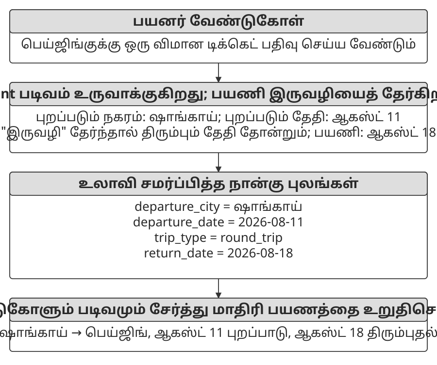

> **சோதனை 5-12 ★★: மாறும் படிவம் உருவாக்கும் நோக்கத் தெளிவுபடுத்தல் அமைப்பு**
>
> இந்தச் சோதனை "பெய்ஜிங்குக்கு ஒரு பயணச்சீட்டு முன்பதிவு செய்ய வேண்டும்" என்பதிலிருந்து தொடங்கி, மாதிரி HTML படிவத்தை உருவாக்கச் செய்கிறது: புறப்படும் நகரத்துக்கு உரைப்பெட்டி, புறப்படும் தேதிக்குத் தேதித் தேர்வி, பயண வகைக்கு ஒரு வழி, இருவழி விருப்பங்கள், இருவழி தேர்ந்தெடுக்கும்போது திரும்பும் தேதி தெரியும்.
>
> நிரல் ஆரம்ப வேண்டுகோளையும் படிவத் தரவையும் சேர்த்து மாதிரிக்குத் திருப்பித் தருகிறது. சமர்ப்பித்த புலங்களை மட்டும் தக்கவைத்தால், ஒவ்வொரு கட்டுப்பாடும் சரியாக நிரப்பப்பட்டிருந்தாலும், சேருமிடம் இன்னும் விடுபட்டிருக்கும்.
>
> அதே படிவத்தில் இன்னொரு படியை முயலுங்கள்: திரும்பும் தேதியை நிரப்பிய பிறகு ஒரு வழிக்கு மாற்றுங்கள். பக்கம் திரும்பும் உள்ளீட்டுப் பெட்டியை மறைக்கிறது; ஆனால் சமர்ப்பித்த JSON-இல் ஒரு வழியும் ஆகஸ்ட் 18-ஆம் தேதி திரும்பும் தேதியும் ஒருசேர இருக்கின்றன. ஒரு வழிக்கு மாறும்போது, கிளையண்ட் செல்லுபடியற்ற திரும்பும் தேதியையும் சுத்தம் செய்ய வேண்டும்.

[^ch5-ui-protocols]: A2UI அதிகாரபூர்வ ஆவணம், *AG-UI Overview*; முறையே அறிவிப்பு வடிவ இடைமுக விவரணையையும், ஏஜெண்ட்–முன்தள நிகழ்வு இடைவினையையும் அறிமுகப்படுத்துகின்றன.

**SQL வினவலை உருவாக்குதல்.**

பயனர் இயல்பு மொழியில் தரவுத்தள வினவலை முன்வைக்கலாம்; ஏஜெண்ட் அட்டவணைக் கட்டமைப்பு, வணிக அளவீடு ஆகியவற்றின்படி SQL-ஐ உருவாக்குகிறது. **முழு வினவல் அட்டவணையைக் காட்டும்போது, Artifact முறையையே நான் விரும்புகிறேன்; முடிவுகள் தரவுத்தளத்திலிருந்து நேரடியாக இடைமுகத்துக்குச் செல்லட்டும்.** பெரிய அட்டவணையை மாதிரி படித்து வரி வரியாக மீண்டும் கூறினால் token பயன்பாடும் காத்திருப்பு நேரமும் அதிகரிக்கும்; நகலெடுப்புப் பிழைகளும் நுழையும். SQL சரிபார்க்கக்கூடிய வினவல் விளைபொருளாகச் சேமிக்கப்படுகிறது; காரணங்களைப் பகுப்பாய்வு செய்யவோ போக்குகளைச் சுருக்கவோ வேண்டியிருக்கும்போது, தேவையான தொகுப்பு முடிவுகளை மாதிரிக்குக் கொடுக்கலாம்.

படம் 5-9-இல், பயனர் ஒவ்வொரு துறையின் பணியாளர் எண்ணிக்கையைப் பார்க்க விரும்புகிறார்; பக்கம் தரவுத்தளம் திருப்பித் தந்த புள்ளிவிவர அட்டவணையை நேரடியாகக் காட்டலாம். பின்னர் "சந்தைப்படுத்தல் துறை ஆய்வுத் துறையை விட எத்தனை பேர் அதிகம்" என்று கேட்டால், மாதிரி அட்டவணையில் உள்ள 9, 5 ஆகிய இரு எண்களை மட்டும் எடுத்து 4 பேர் வேறுபாடு என்று கணக்கிடலாம். "கடந்த மாதமும் இவ்வளவுதானா" என்று தொடர்ந்து கேட்டால், கண்முன் உள்ள அட்டவணை போதாது; கடந்த மாதப் புள்ளிவிவரத் தேதியின்படி மீண்டும் வினவ வேண்டும்.

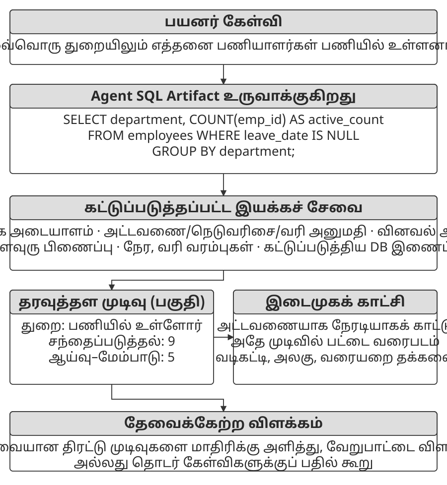

இயக்கச் சேவை நம்பகமான அடையாளத்தின்படி அணுகக்கூடிய அட்டவணைகள், நெடுவரிசைகள், வரிசைகளைத் தீர்மானித்து, வரம்பிடப்பட்ட தரவுத்தளக் கணக்கைப் பயன்படுத்தி, SQL கட்டமைப்பையும் செயல் வகையையும் சரிபார்க்கிறது. வினவல் சூழல்களை அனுமதிக்கப்பட்ட வாசிப்பு-மட்டும் வினவல்களுக்கு வரம்பிடலாம்; சார்பு அழைப்புகள், நேர ஒதுக்கீடு, திருப்பித் தரும் வரிசைகள், தரவு எல்லை ஆகியவற்றைக் கட்டுப்படுத்தலாம்; பயனர் உள்ளிடும் மதிப்புகள் அளவுரு பிணைப்பு வழியாகக் கடத்தப்படுகின்றன.

ஏஜெண்ட் காட்சி விளைபொருள்களையும் உருவாக்கலாம்; எடுத்துக்காட்டாகத் துறைச் சுருக்க முடிவுகளை நிரல்வரைபடமாகக் காட்டலாம். இயக்கச் சேவை வினவல் முடிவுகளைக் கட்டுப்படுத்தப்பட்ட காட்சிப்படுத்தல் இயக்கச் சூழலுக்குக் கொடுக்கிறது; இடைமுகம் அனுமதிக்கப்பட்ட தரவையும் இடைவினையையும் மட்டும் காட்டுகிறது.

> **சோதனை 5-13 ★★: இயல்பு மொழி இடைவினை கொண்ட ERP ஏஜெண்ட்**
>
> இந்தச் சோதனை ERP (நிறுவன வளத் திட்டமிடல்) -இல் பணியாளர், சம்பள வினவலை எடுத்துக்காட்டாகக் கொண்டு, வணிகக் கேள்வியிலிருந்து SQL எவ்வாறு உருவாக்குவது, தரவுத்தள முடிவுகளை நேரடியாகப் பக்கத்துக்கு எவ்வாறு கொண்டுவருவது என்பதைக் கற்றுக்கொடுக்கிறது. PostgreSQL-இல் இரு அட்டவணைகள் அமைக்கப்படுகின்றன: பணியாளர் அட்டவணையில் பணியாளர் ID, பெயர், துறை, நிலை, சேர்ந்த தேதி, வெளியேறிய தேதி; வெளியேறிய தேதி காலியாக இருந்தால் பணியில் உள்ளார்; சம்பள அட்டவணையில் பணியாளர் ID, சம்பளத் தேதி, சம்பளம்; ஒவ்வொரு பணியாளருக்கும் மாதம் ஒரு பதிவு.
>
> ஏஜெண்ட் இந்த இரு அட்டவணைகளின் அடிப்படையில் பின்வரும் பத்துக் கேள்விகளைக் கையாள்கிறது:
>
> 1. ஒவ்வொரு பணியாளரும் சராசரியாக எவ்வளவு காலம் பணியில் இருக்கிறார்?
> 2. ஒவ்வொரு துறையிலும் எத்தனை பேர் பணியில் உள்ளனர்?
> 3. எந்தத் துறையில் சராசரி நிலை மிக உயர்ந்தது?
> 4. இந்த ஆண்டும் கடந்த ஆண்டும் ஒவ்வொரு துறையிலும் எத்தனை பேர் புதிதாகச் சேர்ந்தனர்?
> 5. இரண்டு ஆண்டுகளுக்கு முந்தைய ஆண்டின் மார்ச் முதல் கடந்த ஆண்டு மே வரை, A துறையின் சராசரி சம்பளம் என்ன?
> 6. கடந்த ஆண்டு A, B துறைகளில் எந்தத் துறையின் சராசரி சம்பளம் அதிகம்?
> 7. இந்த ஆண்டு ஒவ்வொரு நிலையிலும் சராசரி சம்பளம்?
> 8. சேர்ந்த ஒரு ஆண்டுக்குள், ஒன்று–இரண்டு ஆண்டு, இரண்டு–மூன்று ஆண்டு ஆகிய பணியாளர்களின் கடந்த மாதச் சராசரி சம்பளம்?
> 9. கடந்த ஆண்டிலிருந்து இந்த ஆண்டு வரை சம்பளம் அதிகம் உயர்ந்த 10 பணியாளர்கள்?
> 10. சம்பளம் நிலுவை உள்ளதா (ஒரு மாதம் பணியில் இருந்தும் சம்பளம் வழங்கப்படவில்லையா)?
>
> வினவலுக்கு முன் புள்ளிவிவர அளவீட்டைத் தெளிவுபடுத்த வேண்டும். எடுத்துக்காட்டாகப் பணியில் உள்ளவர்களின் பணிக்காலம் வினவல் அடிப்படை நாள் வரையும், வெளியேறியவர்களின் பணிக்காலம் வெளியேறிய நாள் வரையும் கணக்கிடப்பட வேண்டும்; "சராசரி சம்பளம்" சம்பளப் பதிவுகளின் அடிப்படையிலா பணியாளர் சராசரியின் அடிப்படையிலா என்று தீர்மானிக்க வேண்டும்; சம்பள உயர்வுத் தரவரிசையில் கடந்த ஆண்டு பதிவு இல்லாத பணியாளர்களையும் கையாள வேண்டும்.
>
> இந்த இயக்கத்தில் பத்து SQL வினவல்களும் உருவாக்கப்பட்டு இயக்கப்பட்டன; முடிவுகள் அனைத்தும் சுயாதீனக் குறிப்புக் கணக்கீட்டுடன் பொருந்தின; பின்னர் உலாவி அட்டவணைகளை நேரடியாக வரைந்தது. மாதிரி அட்டவணைக் கட்டமைப்பையும், பணியையும், தேவையான இயக்கப் பின்னூட்டத்தையும் பெறுகிறது; தரவுத்தள வரி தரவு பயன்பாட்டு நிரல் வழியாக இடைமுகத்துக்குச் செல்கிறது.

**தானியங்கி மென்பொருள் உருவாக்கம்.**

தேவையிலிருந்து தொடங்கி ஏஜெண்ட் இடைமுகத்தையும் இடைவினைத் தர்க்கத்தையும் உருவாக்கி, பின்னர் பயனர் செயல்களுக்கேற்பத் தொடர்ந்து திருத்தலாம். Anthropic 2025-இல் அறிமுகப்படுத்திய "Imagine with Claude" என்ற தற்காலிக ஆய்வு முன்னோட்டம் இந்த இடைவினையைக் காட்டியது: பயனர் இடைமுகத்தை ஆராயும்போது, மாதிரி அதற்கேற்ற மென்பொருள் அனுபவத்தைத் தொடர்ந்து உருவாக்குகிறது[^ch5-imagine].

**உண்மையான தயாரிப்புகளுக்கு, ஏற்கனவே உள்ள சட்டகத்தில் தனிப்பயனாக்குவதையே நான் சிறந்ததாகக் கருதுகிறேன்.** பூஜ்யத்திலிருந்து முழுப் பயன்பாட்டையும் தொடர்ந்து உருவாக்கினால், உருவாக்கம், வரைதல், சரிபார்ப்புச் செலவுகள் மீண்டும் மீண்டும் ஏற்படும்; நிலையான சட்டகத்தைத் தக்கவைத்து, பயனர் கவனிக்கும் இடைமுகத்தையும் பாய்வையும் திறந்து விட்டால், நம்பகமான தனிப்பயன் அனுபவத்தை விரைவாகத் தர முடியும். பயனர் "பொத்தானை நீலமாக்கு", "பக்கப்பட்டியில் குறுக்கு மெனுவைச் சேர்", "படிக்க மேலும் எளிதான எழுத்துருவாக மாற்று" என்று கேட்கிறார்; ஏஜெண்ட் தொடர்புடைய தொகுதியை இடங்கண்டறிந்து, குறியீட்டை மாற்றி, முன்னோட்டத்தில் விளைவைச் சரிபார்க்கிறது. அடிப்படைச் சட்டகம் நிலையான பக்கக் கட்டமைப்பையும் வணிக இடைமுகங்களையும் வழங்குகிறது; தனிப்பயனாக்க எல்லை நிறம், எழுத்துருவிலிருந்து படிப்படியாகத் தளவமைப்பு, தொகுதிகள் வரை விரியலாம்.

மேம்பாட்டுச் சூழலின் HMR (Hot Module Replacement, சூடான தொகுதி மாற்றீடு) குறியீடு மாறிய பிறகு பாதிக்கப்பட்ட முன்தளத் தொகுதிகளைப் புதுப்பிக்கிறது. நிலை தக்கவைக்கப்படுமா என்பது சட்டக இணைப்பு, புதுப்பிப்பு எல்லை, மாற்ற வகையைப் பொறுத்தது; முழுத் திருத்தம் தேவைப்பட்டால், பயன்பாடு தேவையான நிலையைச் சேமிக்க வேண்டும். FastAPI மேம்பாட்டுப் பயன்முறையில் reload சேவையக நிரலை மீண்டும் ஏற்றுகிறது; இரண்டும் முறையே முன்தளத் தொகுதிகளுக்கும் பின்தளச் செயல்முறைக்கும் செயல்படுகின்றன[^ch5-hmr].

> **சோதனை 5-14 ★★: உரையாடல் வடிவ இடைமுகத் தனிப்பயனாக்க அமைப்பு**
>
> இந்தச் சோதனை React முன்தளமும் FastAPI பின்தளமும் கொண்ட அரட்டைப் பயன்பாட்டை உருவாக்கி, மேம்பாட்டுச் சூழலில் முன்தள HMR-ஐயும் பின்தள reload-ஐயும் இயக்குகிறது. மாதிரி தொடர்ச்சியான மூன்று சுற்றுக் கோரிக்கைகளின்படி நிறம், எழுத்துரு, தலைப்பை மாற்றுகிறது; உலாவி ஒவ்வொரு மாற்றத்துக்குப் பிறகும் உண்மையான இடைமுகத்தைச் சரிபார்க்கிறது.
>
> இந்த இயக்கத்தில் Vite-இன் HMR நிகழ்வுகள் பதிவு செய்யப்பட்டன; மூன்று சுற்று மாற்றங்களிலும் முழுப் பக்க வழிசெலுத்தல் நிகழவில்லை; ஏற்கனவே உள்ள அரட்டை நிலை தக்கவைக்கப்பட்டது; இறுதிக் கட்டமைப்பு தேர்ச்சி பெற்றது.

[^ch5-imagine]: Anthropic, *Introducing Claude Sonnet 4.5*; மாதிரியுடன் வெளியிடப்பட்ட Imagine with Claude என்ற தற்காலிக ஆய்வு முன்னோட்டத்தை அறிமுகப்படுத்துகிறது.
[^ch5-hmr]: *Vite HMR API*, *FastAPI CLI*; முறையே முன்தளச் சூடான புதுப்பிப்பையும் மேம்பாட்டுச் சேவையகத் தானியங்கி மறுஏற்றத்தையும் அறிமுகப்படுத்துகின்றன.

**அனுமதி எல்லையை மாறும் வணிகக் குறியீட்டிலிருந்து விடுவித்தல்.**

**வணிகக் குறியீட்டை ஏஜெண்ட் எவ்வளவு எளிதாக மாற்றுகிறதோ, இறுதி அனுமதி எல்லையை அவ்வளவு நிலையான தரவு அணுகல் அடுக்குக்குக் கீழே இறக்க வேண்டும்.** மரபுவழிப் பயன்பாடுகள் அனுமதித் தீர்மானத்தை மதிப்பாய்வு செய்யப்பட்ட வணிகக் குறியீட்டில் எழுதுகின்றன; உருவாக்கிய குறியீடு தொடர்ந்து மாறும்போது, ஏதேனும் புதிய பாதை அதே சரிபார்ப்பை விட்டுவிடலாம். ஒவ்வொரு படித்தல்/எழுதுதலும் தனி தரவு அணுகல் சேவை வழியாகச் செல்லச் செய்தால் மட்டுமே அனுமதிக் கட்டுப்பாட்டைத் தக்கவைக்க முடியும். எடுத்துக்காட்டாக, வேலைவாய்ப்புப் பயன்பாடு வேட்பாளர் பட்டியலையும் செயல் படிவங்களையும் தானாக உருவாக்கலாம்; வேட்பாளர் எந்த அமைப்பைச் சேர்ந்தவர், வேலைவாய்ப்பாளர் எந்தப் புலங்களைப் புதுப்பிக்கலாம் என்பதை நம்பகமான தரவு அணுகல் சேவை தொடர்ந்து சரிபார்க்கிறது.

இங்குள்ள வடிவமைப்பு இலக்கு: **உருவாக்கிய குறியீட்டில் பிழை இருந்தாலும், நம்பகமான தரவு அணுகல் அடுக்கு அனுமதிக் கட்டுப்பாட்டைக் கட்டாயமாக நடைமுறைப்படுத்த வேண்டும்.** இது அத்தியாயம் 1-இன் தரவு அடுக்குப் பாதுகாப்பு அரணைத் தொடர்கிறது: கட்டாயம் பின்பற்ற வேண்டிய விதிகளை, தொடர்புடைய எல்லாச் செயல்களும் கடக்கும் இடத்தில் வைப்பது. தரவுத்தள வரிசை அளவிலான பாதுகாப்புக் கொள்கைகள் பதிவு அணுகலை வரம்பிடலாம்; கட்டுப்பாடுகளும் சரிபார்ப்பான்களும் செல்லுபடியான நிலையைச் சரிபார்க்கின்றன; கட்டுப்படுத்தப்பட்ட பார்வைகள், சேமித்த செயல்முறைகள், தரவுச் சேவைகள் அனுமதிக்கப்பட்ட செயல்களை வழங்குகின்றன. பயன்பாட்டு அடுக்கு முன்கூட்டியே சரிபார்த்து, பயனருக்கு விளக்கலாம்; இறுதிப் படித்தல்/எழுதுதலை இன்னும் நம்பகமான தரவுச் சேவையும் தரவுத்தள அனுமதிகளும் கட்டுப்படுத்துகின்றன.

ஒவ்வொரு செயலுக்கும் நம்பகமான **அணுகல் சூழல்** (access context) தேவை; அதில் பயனர், வாடிக்கையாளர், பங்கு, அல்லது ஏஜெண்ட் அடையாளம் அடங்கும். அங்கீகாரச் சேவையும் நம்பகமான இயக்கநேர அமைப்பும் அடையாளத்தை நிறுவி இணைக்கின்றன; தரவுச் சேவை அதன் அடிப்படையில் அனுமதி வழங்குகிறது. மாறும் குறியீடு பணியை முடிக்கத் தேவையான வரம்பிடப்பட்ட இடைமுகங்களைப் பெறுகிறது; சான்றுகளும் கொள்கை மேலாண்மை அனுமதிகளும் தனிக் கூறுகளிடம் இருக்கின்றன. எல்லாத் தரவுத்தள இணைப்புகளும், துணை வினவல்களும், பின்தளச் செயலாக்கங்களும் ஒரே அணுகல் எல்லையைப் பின்பற்ற வேண்டும்.

எடுத்துக்காட்டாக, PostgreSQL-இன் வரிசை அளவுப் பாதுகாப்பைத் தரவுத்தளப் பங்கு உள்ளமைவுடன் இணைத்துப் பயன்படுத்த வேண்டும். பயன்பாட்டு இணைப்பு கொள்கையால் வரம்பிடப்பட்ட பங்கைப் பயன்படுத்துகிறது; பயன்பாட்டுக் கணக்குக்கு அணுகல் கொள்கைகளை மாற்றும் அனுமதி இல்லை[^ch5-rls]. விதிகளும் அடையாளப் பிணைப்புப் பொறிமுறையும் சுயாதீன மதிப்பாய்வுக்கு உட்படுகின்றன; வணிக இடைமுகமோ இந்த எல்லைக்குள் தொடர்ந்து மாறக்கூடும்.

அனுமதியும் தரவு முழுமையும் வெவ்வேறு பொறுப்புகளைச் சுமக்கின்றன. வேலைவாய்ப்பாளர் வேட்பாளர் பதிவை மாற்ற அனுமதி பெற்ற பிறகும், "திரையிடப்பட்டது" என்பதிலிருந்து "நேர்காணல்" நிலைக்கு மாறுவது அனுமதிக்கப்படுகிறதா என்று நிலை இயந்திரம் தொடர்ந்து சரிபார்க்கிறது; சம்பளச் சரிபார்ப்பான் தொடர்புடைய பதவியைப் படித்து, எதிர்பார்க்கும் சம்பளம் பதவியின் வரம்புக்குள் உள்ளதா என்று பார்க்கிறது; மேற்கோள் சரிபார்ப்பு பதவி–வேட்பாளர் உறவு செல்லுபடியா என்று உறுதிசெய்கிறது.

> **சோதனை 5-15 ★★★: தானாக உருவாக்கிய மென்பொருளில் அனுமதியை உட்பொதித்த தரவுப் பொருள்கள்**
>
> இந்தச் சோதனை PostgreSQL மீது Python பொருள் சேமிப்பு முன்மாதிரியை வழங்கி, அனுமதி விதிகள், சரிபார்ப்பான்கள், பொருள் உறவுகள், அடுத்தடுத்த எதிர்வினை அறிவிப்புகளைத் தரவு வகைகளுக்குள் வைக்கிறது. படிக்கும்போது அணுகல் அனுமதி சரிபார்க்கப்படுகிறது; உருவாக்கும்போதும் புதுப்பிக்கும்போதும் முதலில் அனுமதியும் வணிகச் சரிபார்ப்பும் இயக்கப்பட்டு, மேற்கோள் உறவுகள் சரிபார்க்கப்பட்ட பிறகே நிலைத்தன்மைப்படுத்தப்படுகிறது; பின்னர் அறிவிக்கப்பட்ட எதிர்வினைகள் வரிசையில் சேர்க்கப்பட்டு, எதிர்வினைச் சங்கிலி ஆழம் வரம்பிடப்படுகிறது.
>
> வேலைவாய்ப்பு எடுத்துக்காட்டில் பதவி, வேட்பாளர், நேர்காணல், மதிப்பீடு போன்ற பொருள்கள் அடங்கும். வேட்பாளர் விண்ணப்பம், திரையிடல், நேர்காணல், சலுகை வழங்குதல், பணியமர்த்தல் ஆகியவற்றை வரிசையாகக் கடந்து செல்கிறார்; தொடர்புடைய கட்டங்கள் மறுப்பு நிலைக்கும் செல்லலாம்; சம்பள வரம்பு தொடர்புடைய பதவியிலிருந்து வருகிறது. எடுத்துக்காட்டில் சாதாரண நிலைப் புதுப்பிப்பு, செல்லாத நிலைத் தாவல், பதவியின் சம்பள வரம்பை மீறுதல், வெவ்வேறு வாடிக்கையாளர் அணுகல் ஆகிய சரிபார்ப்புகள் அமைக்கப்பட்டு, அனுமதியும் வணிகச் சரிபார்ப்பும் தனித்தனியாக எதைக் கையாள்கின்றன என்பதை வாசகர் புரிந்துகொள்ள உதவுகின்றன.
>
> முன்மாதிரி `AccessContext` மூலம் பயனர், பங்கு, அமைப்புப் பண்புகளை வெளிப்படுத்துகிறது; கற்பித்தல் ஸ்கிரிப்ட் இந்தச் சூழல்களை நேரடியாக உருவாக்கி வெவ்வேறு அடையாளங்களை உருவகப்படுத்துகிறது. வரிசைப்படுத்தும்போது அங்கீகார நுழைவாயில் சூழலை நிறுவி, பொருள் சேமிப்பையும் உருவாக்கிய குறியீட்டையும் தெளிவான சேவை அல்லது அனுமதி எல்லையின் இரு பக்கங்களில் பிரிக்க வேண்டும்.

[^ch5-rls]: PostgreSQL, *Row Security Policies*; பங்கு, செயல் அடிப்படையில் வரிசை அளவுப் பாதுகாப்புக் கொள்கைகளை உள்ளமைப்பதையும் அதன் பொருந்தும் எல்லையையும் அறிமுகப்படுத்துகிறது.

### குறியீடு குறியீட்டை உருவாக்குதல்: ஏஜெண்ட் சுயதூக்கல்

குறியீடு உருவாக்கும் திறனை ஏஜெண்டையே மேம்படுத்தவும் பயன்படுத்தலாம். உருவாக்கி (creator) பணித் தேவையைப் பெற்று, புதிய ஏஜெண்டின் ப்ராம்ப்ட், கருவிகள், இயக்கச் சுழற்சியை உருவாக்கி அல்லது மாற்றி, பின்னர் சோதனைகளாலும் உண்மையான இடைவினைகளாலும் விளைபொருளைச் சரிபார்க்கிறது. படம் 5-10 இந்தச் சுயதூக்கல் சுழற்சியைக் காட்டுகிறது: ஏற்கனவே உள்ள செயலாக்கம் தொடக்கப் புள்ளியை வழங்குகிறது, பணிப் பின்னூட்டம் திருத்தத்தை முன்னெடுக்கிறது, சரிபார்ப்பு முடிவு எந்த மாற்றங்களைத் தக்கவைப்பது என்பதைத் தீர்மானிக்கிறது.

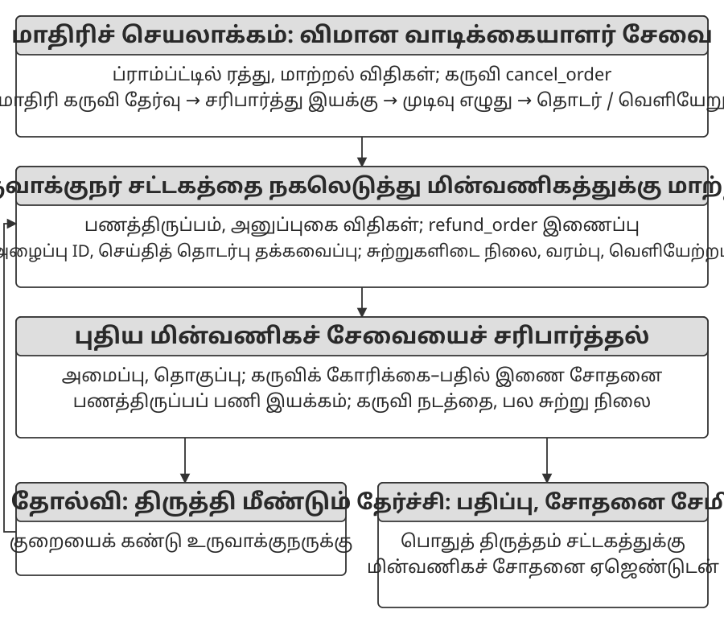

ஒரு திருத்தம் பொதுத் திறனை மேம்படுத்தியதா, அல்லது இப்போது பார்த்த பணிக்குத் தற்செயலாகப் பொருந்தியதா என்று எவ்வாறு வேறுபடுத்துவது? உருவாக்கிக்குக் கொடுக்கப்படாத ஒரு பணியைத் தனியாக வைத்திருங்கள். எடுத்துக்காட்டாக, ஒரு கடையின் தரவைக் கொண்டு விலைக் கண்காணிப்பு ஏஜெண்டை உருவாக்கி, பின்னர் இன்னொரு கடையின் மாதிரியை அதற்குக் கொடுத்து, அதே நேரத்தில் அசல் பணியையும் மீண்டும் இயக்குங்கள்.

**ஏஜெண்டின் இயக்கச் சூழலைப் பராமரித்தல்.**

புதிய ஏஜெண்டின் இயக்கம் உள்ளமைவு, சான்றுகள், அமர்வு நிலை, சேவைகள், சாண்ட்பாக்ஸ் ஆகியவற்றைச் சார்ந்தது. OpenClaw-இன் `doctor` கட்டளை பராமரிப்புக் கருவிக்கு ஓர் எடுத்துக்காட்டைத் தருகிறது: பழைய உள்ளமைவு இடம்பெயர்வு, OAuth சான்று நிலை, அமர்வுப் பூட்டு, செருகுநிரல் நிறுவல், நுழைவாயில் ஆரோக்கியம், சாண்ட்பாக்ஸ் படிமம் போன்ற பிரச்சினைகளைச் சரிபார்த்து, திருத்தப் பரிந்துரைகளைத் தருகிறது அல்லது திருத்தங்களை இயக்குகிறது[^ch5-doctor].

இந்த உறுதியான சரிபார்ப்புகள் சுயபராமரிப்புப் பாய்வுக்கு அடிப்படையாக அமையலாம். கண்டறிதல் விதிகள் அறியப்பட்ட கோளாறுகளை உள்ளடக்குகின்றன; திருத்தச் செயல்களுக்குத் தெளிவான உள்ளீடுகளும் எதிர்பார்க்கப்பட்ட முடிவுகளும் உள்ளன. ஏஜெண்ட் கண்டறிதல் பாய்வை மேலும் வடிவமைக்கும்போது, தீர்க்கப்படாத பிரச்சினையைப் பதிவுகள், உள்ளமைவு, சரிபார்ப்பு முடிவுகளுடன் சேர்த்து மாதிரியிடம் கொடுத்து, எந்த உள்ளமைவை, எவ்வாறு மாற்றப் போகிறது என்று சொல்லச் செய்யலாம்; இயக்க அடுக்கு அனுமதியையும் மாற்ற எல்லையையும் சரிபார்த்து, பின்னர் ஆரோக்கியச் சரிபார்ப்பும் பின்னடைவுச் சோதனைகளும் இயக்கப்படும். உள்ளமைவு நிலைப்படங்கள், மாற்றப் பதிவுகள், பின்வாங்கும் நுழைவாயில் ஆகியவை திருத்தம் தோல்வியடைந்தால் அமைப்பு வேலையை மீட்க உதவுகின்றன.

**குறிப்புச் செயலாக்கத்தில் பொறியியல் அனுபவத்தைச் சுமத்தல்.**

தனிச் சிறப்பு ஏஜெண்டை உருவாக்குவது துறைத் தர்க்கத்தையும் பொது உள்கட்டமைப்பையும் சேர்த்தே உள்ளடக்குகிறது. உருவாக்கிய முடிவைச் சரிபார்க்கும்போது நான்கு வகைப் பிரச்சினைகளில் தொடங்கலாம்:

1. **சூழலும் இயக்கச் சுழற்சியும்.** பங்கு, கருவி அழைப்பு அடையாளம், கருவி முடிவுகளுக்கு இடையிலான இணைப்பைத் தக்கவைத்து, பல சுற்று நிலை, முடிவு நிபந்தனைகள், ஒதுக்கீடு, விதிவிலக்கு மீட்பு ஆகியவற்றைச் சரிபார்த்தல். கட்டமைக்கப்பட்ட செய்திகள் நெறிமுறை உறவுகளைப் பராமரிக்க உதவுகின்றன; நிலையான முன்னொட்டு ப்ராம்ப்ட் சேமிப்புக்கு வழி செய்கிறது.
2. **கருவி இடைமுகம்.** கருவி விளக்கம் பயனையும் பொருந்தும் நிபந்தனைகளையும் பயன்பாட்டு எல்லையையும் தெரிவிக்கிறது; அளவுருக்கள் வகை, பொருள், குறிப்பிட்ட எடுத்துக்காட்டுகளைக் கொண்டுள்ளன. இயக்க அடுக்கு அளவுருக்கள், அடையாளம், வணிக நிலையைத் தொடர்ந்து சரிபார்க்கிறது.
3. **மாதிரி, API தேர்வு.** பயிற்சித் தரவில் அடிக்கடி தோன்றும் பழைய மாதிரிகளையும் பழைய இடைமுகங்களையும் மாதிரி தொடர்ந்து பயன்படுத்தக்கூடும்; குறியீடு சுமுகமாக எழுதப்பட்டாலும் தேர்வு காலாவதியாக இருக்கலாம். உருவாக்கிக்குப் பராமரிக்கப்பட்ட தேர்வுப் பொருட்களை வழங்குங்கள், அல்லது அதிகாரபூர்வ ஆவணங்களைத் தேடச் செய்து மாதிரித் திறன், இடைமுகப் பதிப்பு, அழைப்பு முறையைச் சரிபார்க்கச் செய்யுங்கள். உருவாக்கத்துக்குப் பிந்தைய உண்மையான அழைப்பு உள்ளமைவு பயன்படுமா என்பதைச் சோதிக்கிறது.
4. **சார்பும் சூழல்தொகுதி இணக்கமும்.** நூலகங்களின் பராமரிப்பு நிலை, பதிப்பு, இடைமுக மாற்றங்களைச் சரிபார்த்து, சார்பு நிறுவல், தொகுப்புச் சரிபார்ப்பு, சோதனைகளைக் கொண்டு இணைந்த நிரலைச் சரிபார்க்க வேண்டும்.

**தனிச் சிறப்பு ஏஜெண்டை உருவாக்கும்போது, உருவாக்கி சரிபார்க்கப்பட்ட குறிப்புச் செயலாக்கத்தை நகலெடுத்து, பின்னர் துறைத் திருத்தங்களைச் செய்வதையே நான் விரும்புகிறேன்.** செய்தி நெறிமுறை, நிலை மேலாண்மை, மீட்புப் பொறிமுறை ஆகியவற்றின் எல்லா விவரங்களையும் ப்ராம்ப்டில் முழுமையாகக் கூறுவது கடினம்; குறிப்புக் குறியீடோ இந்தப் பொறியியல் அனுபவத்தை நேரடியாகப் புதிய அமைப்புக்குள் கொண்டுவருகிறது. மாதிரி நிரலாக்கத்தில் திறமையாக இருந்தாலும், பணி விளக்கத்தில் வெளிப்படையாகச் சொல்லப்படாத இயக்க நிபந்தனைகளைத் தவறவிடலாம்; சட்டகத்தை மீண்டும் பயன்படுத்தினால் இத்தகைய மீள்வரும் தவறுகளைக் குறைக்கலாம். உருவாக்கி பொருத்தமான அடிப்படைச் சட்டகத்தை நகலெடுத்து, புதிய பங்குக்குப் பொருந்தும்படி சிஸ்டம் ப்ராம்ப்ட்டைச் சரிசெய்து, துறைக் கருவிகளைச் சேர்த்தோ நீக்கியோ, வணிகத் தர்க்கத்தை மாற்றி, அதற்குரிய சோதனைகளையும் சேர்க்கிறார். செய்தி கையாளுதல், அழைப்பு இணைப்பு, நிலை மேலாண்மை, வெளியேறும் பாதைகளைச் சட்டகம் வழங்குகிறது; துறை மாற்றங்கள் புதிய சோதனை நிகழ்வுகள் மூலம் சரிபார்க்கப்படுகின்றன.

வார்ப்புரு பல மடங்கு வேகமானால், "சில செயல்பாடுகளைக் குறைவாகச் செய்துவிட்டது" என்ற விளக்கத்தை எவ்வாறு நீக்குவது? கீழே இரு குழு உருவாக்கிகளும் ஒரே வகை ஏஜெண்டை ஒப்படைக்கச் செய்து, அதே சரிபார்ப்புத் தொகுப்புக்கு உட்படுத்துவோம்.

> **சோதனை 5-16 ★★★: ஏஜெண்டுகளை உருவாக்கக்கூடிய ஏஜெண்டை உருவாக்குதல்**
>
> அதே உருவாக்கி மாதிரியிடம் ஒரு வெளியீட்டு மதிப்பாய்வு ஏஜெண்டைக் கட்டமைக்கச் சொல்லுங்கள்: ஒரு தொகுதி வரிசைப்படுத்தல் சரிபார்ப்புப் பதிவுகளைப் படித்து, கட்டாயச் சரிபார்ப்புகள் ஏதேனும் தேர்ச்சி பெறவில்லை என்றால், வெளியீட்டை மறுத்து அதற்கான அடிப்படையைச் சுட்டிக்காட்ட வேண்டும். பூஜ்யத்திலிருந்து உருவாக்கும்போது, மாதிரி இயக்கச் சுழற்சி, கருவி நெறிமுறை, துறைக் கருவிகள், கட்டளை வரி நுழைவாயில், சோதனைகளை எழுத வேண்டும். வார்ப்புருப் பாதை முதலில் கட்டமைக்கப்பட்ட பதிவுகளைச் சரிபார்க்கக்கூடிய ஏஜெண்டை நகலெடுக்கிறது; மாதிரி துறை விவரக்குறிப்பை மட்டும் நிரப்ப வேண்டும். எடுத்துக்காட்டாக, நிலை எந்தப் புலத்தில் உள்ளது, எந்த மதிப்புகள் தேர்ச்சியைக் குறிக்கின்றன? உருவாக்கும் ஸ்கிரிப்ட் விவரக்குறிப்பின்படி சிஸ்டம் ப்ராம்ப்ட், கருவி வரையறைகள், விளக்க ஆவணங்களை உருவாக்குகிறது. ஏற்கனவே உள்ள Python கருவி விவரக்குறிப்பைப் படித்துச் சரிபார்ப்பை இயக்குகிறது. இரு பாதைகளும் மெட்டாநிரலாக்கத்தைக் காட்டுகின்றன: ஒரு நிரலைக் கொண்டு பிற நிரல்களை உருவாக்குதல் அல்லது மாற்றுதல்.
>
> படம் 5-11-இல், இரு பாதைகளும் ஒரே ஏற்பு நிபந்தனைகளில் இணைகின்றன.
>
> 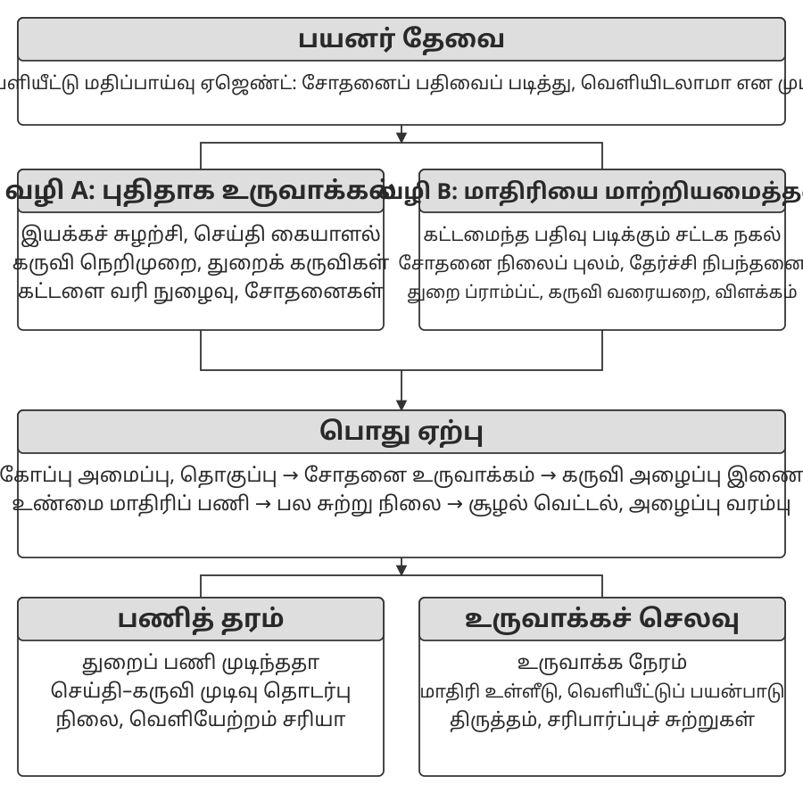
>
> இரு பாதைகளும் ஒரே பணித் தேவைகளையும் ஏற்பு நிபந்தனைகளையும் பயன்படுத்துகின்றன. முதலில் விளைபொருளின் கட்டமைப்பு, தொகுப்பு, சோதனைகளைச் சரிபார்க்கவும்; பின்னர் நிலையான செய்திகளில் கருவி அழைப்பு–முடிவு இணைப்பைச் சரிபார்க்கவும்; இறுதியில் உண்மையான மாதிரிப் பணிகளையும் பல சுற்று இடைவினைகளையும் இயக்கி, சூழல் வெட்டுதல், நிலை மேலாண்மை, அழைப்பு எண்ணிக்கை வரம்பைச் சரிபார்க்கவும்.
>
> சேமிக்கப்பட்ட Kimi K3 ஒப்பீட்டில், இரு குழுக்களும் 39/39 உறுதியான சரிபார்ப்புகளில் தேர்ச்சி பெற்றன; உண்மையான மாதிரிப் பணிகளிலும் பல சுற்று நிலைச் சரிபார்ப்புகளிலும் தேர்ச்சி பெற்றன. வார்ப்புருப் பாதை உருவாக்கத்துக்கு 1,181 token, சுமார் 25 வினாடிகள் எடுத்தது; பூஜ்யப் பாதை 381,814 token, சுமார் 90 நிமிடங்கள் எடுத்தது.
>

[^ch5-doctor]: OpenClaw, Doctor; உள்ளமைவு, நிலைச் சரிபார்ப்பு, இடம்பெயர்வு, திருத்தச் செயல்பாடுகளை அறிமுகப்படுத்துகிறது.

## அத்தியாயச் சுருக்கம்

**Coding Agent முன்னதாக முதிர்ச்சியடைந்ததற்கு எளிதில் கவனிக்கப்படாத ஒரு காரணம்: மென்பொருள் பொறியியலில் ஏற்கனவே வகை அமைப்பு, சோதனைத் தொகுப்பு, பதிப்புக் கட்டுப்பாடு, பிழைநீக்கக் கருவிகள் உள்ளன.** குறியீடு தவறாக மாறினால், சோதனை எந்த உள்ளீட்டுத் தொகுதி எதிர்பாராத முடிவைத் தந்தது என்று பெரும்பாலும் சுட்டிக்காட்ட முடியும்; வேறு விதமாக மாற்றினால், அதே உள்ளீட்டைக் கொண்டு மீண்டும் முயலலாம். இந்த அனுபவத்தைப் பிற பணிகளுக்குப் பயன்படுத்த, முதலில் மூன்று குறிப்பிட்ட கேள்விகளைக் கேளுங்கள்: பிழையை எவ்வாறு கண்டறிவது, தெரிந்த நிலைக்கு எவ்வாறு மீள்வது, எப்போது நின்று மனிதரிடம் ஒப்படைக்க வேண்டும்? எடுத்துக்காட்டாகப் பணத்திருப்ப அழைப்பு நடுவே அறுந்தால், Harness முதலில் கணக்கைச் சரிபார்த்து, பின்னர் மீண்டும் முயலலாமா என்று தீர்மானிக்க வேண்டும்; இல்லையெனில் ஒரு கோளாறு மீட்பே இரண்டாம் பணத்திருப்பமாக மாறக்கூடும்.

குறியீடு ஒரு தீர்மானத்தை மீண்டும் மீண்டும் பயன்படுத்தக்கூடிய பொருளாகவும் சேமிக்க முடியும். கணிதக் கேள்விகளில் உள்ள எண்ணிக்கையும் தர்க்கக் கேள்விகளில் உள்ள கட்டுப்பாடுகளும் நிரலிடம் ஒப்படைத்து ஒவ்வொன்றாகச் சரிபார்க்கலாம்; பணத்திருப்ப விதிகளை இயக்க நுழைவாயிலில் எழுதி, சேவையகம் ஆர்டரில் உள்ள உண்மையான நிலையைப் படித்த பிறகு அனுமதிப்பதா என்று தீர்மானிக்கச் செய்யலாம். பதிவு வடிவம் மாறினால், பாகுபடுத்தியை மாற்றி, இந்த முறை தவறிய மாதிரியைப் பின்னடைவுச் சோதனைக்காகத் தக்கவைக்கலாம். இந்த மூன்று சூழ்நிலைகளிலும் குறியீட்டை இயக்க முடியும்; ஆனால் மதிப்பீட்டு அளவுகோல்கள் வேறுபடுகின்றன: தீர்வு கேள்வி நிபந்தனைகளைப் பூர்த்தி செய்கிறதா, பணத்திருப்பம் கொள்கைக்குப் பொருந்துகிறதா, புதிய பாகுபடுத்தி ஏற்கனவே விடுபட்ட புலங்களைப் படிக்க முடிகிறதா.

ஒப்படைப்பு ஆவணம், காணொளி, அல்லது வடிவியல் மாதிரியாக இருந்தால், வரைந்த விளைவு, ஒலி–பட ஒத்திசைவு, அளவுகளின் துல்லியத்தையும் சரிபார்க்க வேண்டும்; உண்மையான விளைபொருளை மதிப்பாய்வாளர் ஒருமுறை பார்க்க ஏற்பாடு செய்ய வேண்டும். ஒப்படைப்பு படிவம், வினவல், அல்லது காட்சிப்படுத்தலாக இருந்தால், பயனர் படித்து இயக்க முடிகிறதா என்பதோடு, அதன் பின்னால் உள்ள இயக்கச் சேவை அனுமதிக்கேற்பத் தரவை எடுக்கிறதா என்பதையும் சரிபார்க்க வேண்டும். குறியீடு இன்னொரு ஏஜெண்டை உருவாக்கினால், சரிபார்க்கப்பட்ட சட்டகத்தை முதலில் மீண்டும் பயன்படுத்தி, துறைக் கருவிகளையும் வணிகத் தர்க்கத்தையும் உருவாக்கி, பின்னர் அழைப்பு நெறிமுறை, சுற்றுகளைக் கடந்த நிலை, உண்மையான பணி முடிவுகளைச் சரிபார்க்கப் பரிந்துரைக்கிறேன். இவ்வாறு குவியும் கருவிகள், சரிபார்ப்பான்கள், சோதனைகளை அடுத்த பணியில் தொடர்ந்து பயன்படுத்தலாம்.

குறியீடு பணியை மீண்டும் மீண்டும் இயக்க வைக்கும்; ஆனால் சூழல் அது முடியும் வரை காத்திருக்க வேண்டியதில்லை. ஒரு வினவல் இன்னும் இயங்கிக்கொண்டிருக்கும்போது, பயனர் தன் முடிவை மாற்றியிருக்கலாம். இத்தகைய மாற்றம் இயங்கும் இடைவினைக்குள் எவ்வாறு நுழைகிறது என்பதை அத்தியாயம் 6 விவாதிக்கிறது.

## சிந்தனைக் கேள்விகள்

1. ★★ திட்டக் கோப்புகளைப் படிக்கவும், சார்புகளை நிறுவவும், சோதனைகளை இயக்கவும் வேண்டிய Coding Agent-க்கு ஒரு சாண்ட்பாக்ஸை வடிவமையுங்கள். கோப்பு, பிணையம், செயல்முறை, வள அனுமதிகளை எவ்வாறு உள்ளமைப்பீர்கள்? பணிக்கு அனுமதியை விரிவுபடுத்த வேண்டியிருக்கும்போது கோரிக்கையை எவ்வாறு வெளிப்படுத்தி, எல்லையைச் சரிபார்த்துப் பதிவு வைப்பீர்கள்?
2. ★★★ உருவாக்கி தொடர்ந்து பல தலைமுறை ஏஜெண்டுகளை உருவாக்கி மாற்றும்போது, சட்டகக் குறைபாடுகளும் துறைப் பிழைகளும் படிப்படியாகக் குவியலாம். குறிப்புப் பதிப்பு, பின்னடைவுச் சோதனைகள், நடத்தை மதிப்பீடு, பின்வாங்கும் பொறிமுறை ஆகியவற்றைக் கொண்டு இந்த மாற்றத்தை எவ்வாறு தடமறிவீர்கள்?
3. ★★ பதிவு வடிவ மாற்றம் சாதாரணப் பதிப்புயர்விலிருந்தும் வரலாம், உருவாக்கும் நிரலின் குறைபாட்டிலிருந்தும் வரலாம். தகவமைவுப் பாகுபாட்டு அமைப்பு எந்தச் சான்றுகளைத் தக்கவைக்க வேண்டும், எந்த நிபந்தனைகளின் அடிப்படையில் புதிய பாகுபடுத்தியைச் சேர்ப்பது, விதிவிலக்கைத் தெரிவிப்பது, அல்லது செயலாக்கத்தை நிறுத்துவது என்று தீர்மானிக்க வேண்டும்?
4. ★★ முன்மொழிபவர்–மதிப்பாய்வாளர் சுழற்சியில், மதிப்பாய்வாளர் பக்கத்தின் தகவல் அடர்த்தி சரியானது என்று கருதுகிறார்; பயனருக்கோ நெரிசலாகத் தோன்றுகிறது. பயனர் விருப்பத்தை எடுத்துக்காட்டுகளாகவும் மதிப்பெண் நிபந்தனைகளாகவும் இடைவினைப் பின்னூட்டமாகவும் எவ்வாறு மாற்றுவீர்கள், அடுத்தடுத்த திருத்தங்கள் தேவைகளுக்குப் பொருந்துகின்றனவா என்று எவ்வாறு சரிபார்ப்பீர்கள்?
5. ★★ Coding Agent அறிவுத் தளத்தையும், கட்டமைப்பு ஆவணங்களையும், திட்ட அறிவுறுத்தல்களையும் புதுப்பிக்கலாம்; இயக்க வரிசைகளைக் குறியீடாக நிலைப்படுத்தவும் முடியும். தேவையற்ற அல்லது காலாவதியான விதிகளை எவ்வாறு அடையாளம் கண்டறிவீர்கள், விதிகளுக்குப் பொருந்தும் எல்லை, சரிபார்ப்பு முறை, வெளியேறும் நிபந்தனையை எவ்வாறு வடிவமைப்பீர்கள்? ஒரு வெற்றிகரமான திருத்தத்திலிருந்து அத்தியாயம் 9 விவாதிக்கும் தொடர்ச்சியான பரிணாமம் வரை வளர, இன்னும் எந்தக் குவிப்பு மற்றும் மதிப்பீட்டுப் பொறிமுறைகள் தேவை?
6. ★ தொலைவுக் கூட்டுப்பணிக்கு வசதியான குழுக்களில் ஏஜெண்ட் வேலைத் தகவலைப் பெறுவதும் பொதுவாக எளிது. ஒரு பரிச்சயமான திட்டத்தின் தேவைகள், கட்டமைப்பு, முடிவுப் பதிவுகள், ஏற்பு அளவுகோல்களைச் சரிபார்த்து, இன்னும் அதிகம் நிரப்ப வேண்டிய ஆவணங்களைப் பட்டியலிட்டு, அவை ஏஜெண்ட் எந்தக் குறிப்பிட்ட பணிகளை முடிக்க உதவும் என்று விளக்குங்கள்.
7. ★★★ தனிப்பட்ட தரவை அணுகி, நம்பமுடியாத உள்ளடக்கத்தைக் கையாண்டு, வெளிப்புறத் தொடர்பு கொண்டு, நிலையான நினைவகத்தையும் பயன்படுத்தும் ஏஜெண்டுக்கு அடையாள அனுமதி, மூலக் குறியிடல், தரவு ஓட்டச் சரிபார்ப்பு, நினைவக எழுத்து மதிப்பாய்வு ஆகியவற்றை எவ்வாறு ஏற்பாடு செய்வீர்கள்? ஓர் இயல்பான வணிகப் பாய்வைக் கொண்டு இந்தச் சரிபார்ப்புகளின் இடங்களை விளக்குங்கள்.
8. ★★ SQL, HTML Artifact முறைகளில், மாதிரி விளைபொருளை உருவாக்குகிறது; இயக்கச் சேவை வினவலை அல்லது வரைதலைக் கையாள்கிறது; இடைமுகம் முடிவை நேரடியாகக் காட்டுகிறது. எந்தத் தகவலை மீண்டும் மாதிரிக்கு விளக்கக் கொடுப்பது பொருத்தம்? வினவல் அனுமதி, வள ஒதுக்கீடு, பக்கத் தனிமைப்படுத்தல், காட்சி முடிவின் ஒற்றுமை ஆகியவற்றை எவ்வாறு சரிபார்ப்பீர்கள்?
9. ★★ கருவி தரவுத்தளத்தில் உள்ள வணிக நிலையின்படி விதிகளைச் சரிபார்க்கிறது; அளவுரு விளக்கம் அழைப்பைத் தயார் செய்ய உதவுகிறது. முன்பதிவை ரத்து செய்வதை எடுத்துக்காட்டாகக் கொண்டு, இயல்பு மொழிக் கொள்கை, அளவுரு எடுத்துக்காட்டு, இயக்க அடுக்குச் சரிபார்ப்பு, எல்லைச் சோதனை ஆகியவை தத்தம் என்ன பொறுப்பை ஏற்கின்றன என்பதை விளக்குங்கள்; கொள்கை மாறிய பிறகு எந்தெந்த உள்ளடக்கத்தை ஒத்திசைவாகப் புதுப்பிக்க வேண்டும்?
