# இடைவினை: அவதானிப்பு, செயல் வெளிகளின் விரிவாக்கம்

**அடிப்படை மாதிரி நிலையாக இருக்கும்போது, அவதானிப்பு, செயல் இடைமுகங்களை மறுஒழுங்கமைப்பதோ விரிவுபடுத்துவதோ ஏஜெண்டின் பணிச் செயல்திறனை உயர்த்தும் மிகப் பயனுள்ள பொறியியல் வழிகளில் ஒன்றாக இருக்கும்.** முந்தைய அத்தியாயங்களில், பயனர் சொல்வதை முடித்த பிறகு ஏஜெண்ட் தகவல் தேடி, கருவிகளை அழைத்து, பதிலளிக்கிறது. ஆனால் கருவி முடிவுக்காகக் காத்திருக்கும்போது, பயனரும் வெளிச்சூழலும் இன்னும் மாறிக்கொண்டே இருக்கின்றன.

பயனர் உதவியாளரிடம் விமானச்சீட்டை மாற்றச் சொல்லி ஒப்படைத்தார். உதவியாளர் வாடிக்கையாளர் சேவையிடம் விமானங்களை வினவிக்கொண்டிருக்கும்போது, பயனர் "இன்னும் ஒரு பயணப்பெட்டி செக் செய்ய வேண்டும்" என்று அனுப்புகிறார்; சேவைப் பிரதிநிதி பேசிக்கொண்டிருக்கும்போதே, திரையில் காட்டப்படும் விலையும் மாறலாம். கட்டணத்தில் செக் செய்யப்படும் பயணப்பெட்டி அடங்குகிறதா என்று உதவியாளர் சரியான நேரத்தில் கேட்க வேண்டும்; முந்தைய விலைக் குறிப்பு இன்னும் செல்லுபடியா என்பதையும் கவனிக்க வேண்டும். இங்கு இரு வடிவமைப்புக் கேள்விகள் உள்ளன: எந்தெந்தக் கால்வாய்கள் வழியாக மாற்றங்களை உதவியாளர் அறியலாம், எந்தத் தருணத்தில் எதிர்வினை புரியலாம்? இந்த அத்தியாயம் முதலில் ஒத்திசைவற்ற முறையில் வரும் மின்னஞ்சல்களையும் கருவி முடிவுகளையும் விவாதித்து, பின்னர் தொடர் குரல், திரை மாற்றங்கள், ரோபோக்களின் செயல் பின்னூட்டம் ஆகியவற்றைப் பார்க்கிறது.

## முறைமை, தூண்டும் தருணங்களின் விரிவாக்கம்

**முறைமை (modality)** தகவலின், செயல்களின் வடிவத்தை விவரிக்கிறது. ஏஜெண்ட் உரையைப் படிக்கவும், ஒலியைக் கேட்கவும், திரையைப் பார்க்கவும், முறுக்குத் திறன் சமிக்ஞைகளைப் பெறவும் முடியும்; உரை வெளியிடவும், பேச்சை இணைக்கவும், இடைமுகத்தில் சொடுக்கவும், மூட்டுகளை இயக்கவும் முடியும்.

**தூண்டும் தருணம்** தகவல் எப்போது வருகிறது, செயல் எப்போது தொடங்குகிறது, அமைப்பு எப்போது எதிர்வினை புரிகிறது என்பதைக் கவனிக்கிறது. தகவலை ஏஜெண்ட் தாமாக வினவலாம்; வெளிப்புறச் சேவை தள்ளவும் (push) முடியும். கருவி உடனே முடிவைத் திருப்பித் தரலாம்; அல்லது முதலில் பணியைத் தொடங்கி, பின்னர் முடிந்ததைத் தெரிவிக்கலாம். புதிய நிகழ்வு வரும்போது, தற்போதைய வேலையை இடைமறிக்கலாமா, இடைமறிக்கப்பட்ட பணியை எவ்வாறு மீட்பது என்றும் அமைப்பு தீர்மானிக்க வேண்டும்.

| பரிமாணம் | தகவல் பெறுதல், அவதானிப்பு இடைமுகங்கள் | செயல், இயக்க இடைமுகங்கள் |
|---|---|---|
| உள்ளடக்க ஒழுங்கமைப்பு (அத்தியாயங்கள் 2–5) | சூழல், நினைவகம், அறிவுத் தளம் முடிவுத் தகவலை ஒழுங்கமைக்கின்றன | கருவிகளும் குறியீடும் செயல்படுத்தக்கூடிய செயல்களை வெளிப்படுத்துகின்றன |
| முறைமை (இந்த அத்தியாயம்) | குரல், திரை, இயற்பியல் உணரிகள் | பேசுதல், சொடுக்குதல், மூட்டு இயக்கம் |
| தருணம் (இந்த அத்தியாயம்) | முனைப்பான வினவல், நிகழ்வுத் தள்ளல், தொடர் உள்ளீடு | சுற்றுகளைக் கடந்த இயக்கம், ரத்து, முன்னுரிமை பறித்தல், மீட்பு |

சூழல் ஒரு முடிவுக்குத் தேவையான தகவலைத் தாங்குகிறது; அவதானிப்பு வெளி, அமைப்பு பெறக்கூடிய தகவலின் எல்லையை விவரிக்கிறது; கருவிகள் குறிப்பிட்ட இடைமுகங்களை வழங்குகின்றன; செயல் வெளி, அமைப்பு இயக்க அனுமதிக்கும் செயல்களின் எல்லையை விவரிக்கிறது. இடைமுகங்களை விரிவுபடுத்தும்போதும், இந்த எல்லைகள் சாதனத் திறன், அளவுருக்கள், அனுமதிகள், இயக்கச் சூழல் ஆகியவற்றால் கட்டுப்படுத்தப்படுகின்றன.

பல கருவி அழைப்பு இடைமுகங்கள் செய்திகளைச் சுற்று வாரியாக ஒழுங்கமைக்கின்றன: மாதிரி அழைப்பை முன்மொழிகிறது, அமைப்பு கருவி முடிவை நிரப்புகிறது, பின்னர் அடுத்த சுற்றுப் பகுத்தறிவைத் தொடங்குகிறது. நிகழ்வு-இயக்க அமைப்புகள் இந்த நெறிமுறையின் மீது வெளிப்புற மாற்றங்களை நிர்வகிக்க வேண்டும். இடைமுகம் இயல்பான ஒத்திசைவற்ற தன்மையை ஆதரித்தால், கருவி நிலுவையில் இருக்கும்போது புதிய கோரிக்கைகளைப் பெற்று, முடிவு வந்த பிறகு தொடரலாம்; ஒத்திசைவான இடைமுகங்களில், Harness வரிசைகள், பணிக் கைப்பிடிகள், திட்டமிடல் பொறிமுறைகளைக் கொண்டு இடைவினையை ஒழுங்கமைக்கிறது. கீழே இந்த இரு செயலாக்கப் பாதைகளையும் தனித்தனியாக விவாதிப்போம்.

வெவ்வேறு சூழல்களில் பின்னூட்டத் தாளம் பெரிதும் வேறுபடுகிறது. பொதுவான கால அளவுகளைக் கீழே உள்ள அட்டவணை பட்டியலிடுகிறது.

| பொதுவான அளவு | சூழல் | அவதானிப்புப் பக்கம் | செயல் பக்கக் கையாளுதல் |
|---|---|---|---|
| வினாடி முதல் நாள் வரை | ஒத்திசைவற்ற, நிகழ்வு-இயக்கம் | வெளிப்புற நிகழ்வு ஏஜெண்டை எழுப்புகிறது | முதலில் பணியைத் தொடங்கி, பின்னர் நிகழ்வுகள் முன்னேற்றத்தையும் நிறைவையும் தெரிவிக்கின்றன |
| பத்து மில்லி வினாடி முதல் வினாடி வரை | குரல் | தொடர்ந்து ஒலியைப் பெறுதல் | ஓடை வெளியீடு; இடைமறிப்பையும் இயக்கத்தை நிறுத்துவதையும் கையாளுதல் |
| மிக நுண்ணிய நேரம் முதல் வினாடி வரை | Computer Use | திரை தொடர்ந்து மாறுகிறது | செயலுக்குப் பின் இடைமுக நிலையை மீண்டும் பெறுதல் |
| மில்லி வினாடிக் கட்டுப்பாட்டுச் சுழற்சி | ரோபோ அடிப்படைக் கட்டுப்பாடு | உணரிகள் தொடர்ந்து பின்னூட்டம் தருகின்றன | சிறிய செயல் துண்டுகளை இயக்கி, கட்டுப்பாடு, நிறுத்த சமிக்ஞைகளுக்கு எதிர்வினை |

## ஒத்திசைவற்ற, நிகழ்வு-இயக்க அமைப்பு: உலகம் தானாக வரும்போது

அத்தியாயம் 4 உணர்தல், செயல்பாடு, கூட்டுப்பணிக் கருவிகளை அறிமுகப்படுத்தியது; இந்தப் பகுதி நிகழ்வுத் தூண்டல், பயனர் தொடர்புக் கருவிகளைத் தொடர்கிறது. நிகழ்வுத் தூண்டல் கருவிகள் சூழல் மாற்றங்களை ஏஜெண்டுக்குள் அனுப்புகின்றன; தொடர்புக் கருவிகள் பணி முன்னேறும்போது பயனரைத் தொடர்புகொள்ள விடுகின்றன. இந்த உள்ளீடு-வெளியீடுகளை இயங்கும் பணிகளுடன் Harness இணைத்து, தொடர்ந்து வேலை செய்யும் நிகழ்வுச் சுழற்சியை உருவாக்குகிறது.

### ஒத்திசைவற்ற தன்மை ஏன் தேவை

ஒத்திசைவான அழைப்பு முடிவு திரும்பும் வரை காத்திருக்க வேண்டும்; அதன் பிறகே அழைப்பவர் தற்போதைய செயல்முறையைத் தொடர முடியும். ஒத்திசைவற்ற அழைப்போ முதலில் பணிக் கைப்பிடியை (பணியை வினவவும் நிர்வகிக்கவும் பயன்படும் அடையாளம்) திருப்பித் தருகிறது, அல்லது பின்னர் நிறைவை அறிவிக்க ஒப்பந்தம் செய்கிறது; காத்திருக்கும் காலத்தில் அழைப்பவர் பிற வேலைகளைக் கையாளலாம். அதன் அடிப்படையில் அமைப்பு பல இயங்கும் பணிகளை ஒழுங்கமைத்து, வளங்கள், சார்புநிலைகளுக்கேற்ப எந்தச் செயல்கள் இணையாக இயங்கலாம் என்று தீர்மானிக்கிறது.

ஏஜெண்டை மின்னஞ்சல், தொலைபேசி, வருகைகளை நிர்வகிக்கும் ஒரு செயலராகக் கருதலாம்: பதிலுக்குக் காத்திருக்கும்போது ஆவணங்களைத் தொடர்ந்து ஒழுங்கமைக்கிறார், அவசர அழைப்பு வரும்போது தற்போதைய முன்னேற்றத்தை இடைநிறுத்தி வைக்கிறார், அழைப்பு முடிந்த பிறகு அசல் பணியை மீட்டெடுக்கிறார். பொறியியல் செயலாக்கத்தில் மூன்று விஷயங்களைக் கையாள வேண்டும்:

- **நீண்ட பணியையும் இடைவினையையும் பிரித்தல்.** கோப்புப் பகுப்பாய்வு, தொலைபேசி அழைப்பு, கட்டமைப்புப் பணிகள் பின்தளத்தில் முன்னேறுகின்றன; பயனர் இன்னும் முன்னேற்றத்தை வினவலாம், கூடுதல் கோரிக்கைகளைத் தரலாம்.
- **நிகழ்வு முன்னுரிமை.** அவசர நிறுத்தம் உடனே கட்டுப்பாட்டு ஓட்டத்துக்குள் நுழைகிறது; வழக்கமான புதுப்பிப்புகள் வரிசையில் சேர்கின்றன; தனித்த வினவல்களை இணையான அமர்வுகளுக்கு ஒப்படைக்கலாம்.
- **இடைநிறுத்தமும் மீட்பும்.** பணி நிலையைச் சேமித்து, ஏற்கனவே நடந்த செயல்களைப் பதிவு செய்து, மீட்கும்போது இன்னும் செல்லுபடியாகும் நிபந்தனைகளை மீண்டும் சரிபார்க்க வேண்டும்.

Claude Duet ஆய்வு முன்னோட்டம் ஒரு எடுத்துக்காட்டைத் தந்தது: பயனர் பிற்பகல் இரண்டு மணிக்குக் கூட்டம் வைத்துள்ளார்; எதிர்த் தரப்பு நிறுவனத்தின் விரிவான அறிக்கையை முன்கூட்டியே வேண்டும். அவர் ஒரு குரல் செய்தியை விட்டுவிட்டு, பயன்பாட்டை மூடிவிடலாம். தயாரிப்பு வேலை மேகத்தில் தொடர்கிறது; எப்போது வேண்டுமானாலும் பணிப் பக்கத்தைத் திறந்து முன்னேற்றத்தைப் பார்க்கலாம்; அவர் கூடுதல் தகவல் தர வேண்டியிருக்கும்போதோ அறிக்கை தயாராகும்போதோ உதவியாளர் முதன்மை உரையாடலுக்குத் திரும்பி அவருக்குத் தெரிவிக்கிறார். இங்கு பயனர் விலகிய பிறகும் பணி முன்னேறுவது ஒத்திசைவற்ற இயக்கம். பின்னர் வரும் இருவழிக் குரல் அழைப்புக்கு இன்னொரு தேவையும் உண்டு: ஒரு தரப்பு பேசும்போதே மறுதரப்பின் இடைமறிப்பைக் கேட்க முடிய வேண்டும்.[^ch6-duet]

மாதிரி API செய்திகளின் வரிசையிலும் ஒப்பந்தங்களைக் கொண்டுள்ளது. சில இடைமுகங்கள் கருவி அழைப்பும் முடிவும் முழுமையாக ஜோடியான பிறகே அடுத்த சுற்றுக் கோரிக்கையை ஏற்கின்றன; சில கருவியை நிலுவையில் வைத்து அடுத்தடுத்த புதுப்பிப்புகளையும் பெற அனுமதிக்கின்றன. பயன்பாட்டில் உள்ள ஒத்திசைவற்ற சார்புகள் காத்திருப்பையும் இயக்கத்தையும் ஏற்பாடு செய்கின்றன; மாதிரி நெறிமுறையோ எப்போது செய்திகளைச் சமர்ப்பிக்கலாம் என்பதை விதிக்கிறது.

படம் 6-1-இல், புதிய செய்திகளும் கருவி முடிவுகளும் வரிசைக்குள் நுழையலாம்; ஆனால் அவை எவ்வாறு வரிசைக்கு வருகின்றன என்பது மூலத்தைப் பொறுத்தது. சேவை தள்ளலை ஆதரித்தால், நிலை மாறியதும் அறிவிப்பை அனுப்பலாம்; சேவை வினவல் இடைமுகத்தை மட்டும் வழங்கினால், தகவமைப்பி வழக்கமாகச் சென்று வினவி, மாற்றம் கண்டறிந்ததும் நிகழ்வை உருவாக்க வேண்டும். நேரங்காட்டி முடிவடைவதும் நிகழ்வை உருவாக்கலாம். நிகழ்வுச் சுழற்சி இந்த உள்ளீடுகளைப் பின்னர் ஏஜெண்டுக்குக் கொடுக்கிறது.

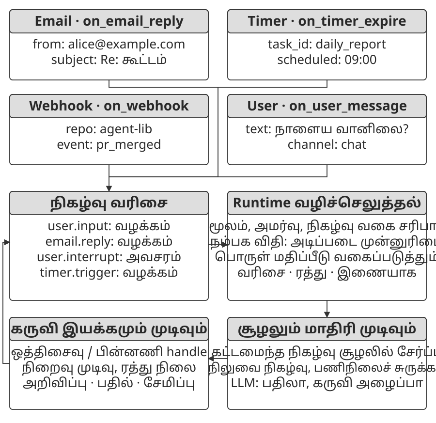

### OpenClaw-இன் நிகழ்வு-இயக்கப் பொறிமுறைச் செயலாக்கம்

OpenClaw, Gateway வழியாகச் செய்திக் கால்வாய்களை இணைத்து, நிகழ்வுகளை ஏஜெண்ட் இயக்கக்கருவிக்கு வழித்தடப்படுத்துகிறது. அதன் தானியங்கிப் பொறிமுறைகளில் உள் Hooks, நேரத் திட்டமிடல், Heartbeat, வெளிப்புற Webhook போன்ற நுழைவாயில்கள் அடங்கும்[^ch6-automation]. இந்தப் பொறிமுறைகளைத் தூண்டல் நிபந்தனையின் அடிப்படையில் புரிந்துகொள்ளலாம்:

- **Hooks (நிகழ்வுக் கொக்கிகள்)** சட்டகத்தின் உள் நிகழ்வுகளுக்கு எதிர்வினை புரிகின்றன; எடுத்துக்காட்டாக அமர்வு உருவாக்கம், மீட்டமைப்பு, இயக்க வாழ்க்கைச் சுழற்சி மாற்றம்.
- **Cron (நேரத் திட்டமிடல்)** குறிப்பிட்ட நேரத்திலோ சுழற்சியிலோ வேலையை இயக்குகிறது. எடுத்துக்காட்டாக `0 9 * * 5` என்பது உள்ளமைக்கப்பட்ட நேர மண்டலத்தில் ஒவ்வொரு வெள்ளிக்கிழமை காலை 9 மணிக்குத் தூண்டுவதைக் குறிக்கிறது.
- **Heartbeat (இதயத்துடிப்பு)** வழக்கமாக ஏஜெண்டை எழுப்பி, கவனிக்க வேண்டிய விஷயங்களைச் சரிபார்க்கச் செய்கிறது.
- **Webhook (வெளிப்புற திரும்பழைப்பு)** வெளிப்புறச் சேவைகள் சமர்ப்பிக்கும் நிகழ்வுகளைப் பெற்று, அங்கீகாரத்துக்கும் வழித்தடத்துக்கும் பிறகு செயலாக்கத்தைத் தூண்டுகிறது.

வாராந்திர அறிக்கைக்கு நேரத்துக்கு இயங்குவது பொருத்தம்; தொடர்ந்து கவனிக்க வேண்டிய நிலுவை வேலைகளைச் சுழற்சியாகச் சரிபார்க்கலாம்; புதிய மின்னஞ்சல்களும் சேவைத் திரும்பழைப்புகளும் தள்ளல் மூலம் கண்டறியும் தாமதத்தைக் குறைக்கலாம்.

**PineClaw-இன் அழைப்பு நிகழ்வுகள்.** Pine AI பயனருக்காகத் தொலைபேசி அழைத்துக் கட்டணப் பேச்சுவார்த்தை, சந்தா ரத்து, காப்பீட்டு உரிமைக் கோரல் போன்றவற்றைக் கையாள்கிறது. PineClaw இத்தகைய அழைப்புப் பணிகளை OpenClaw-இல் இணைக்கிறது. அழைப்பு பொதுவாக நீண்ட நேரம் நீடிக்கும்; இடையில் பயனர் தலையீடு தேவைப்படலாம்:

- **அடையாளச் சரிபார்ப்பு.** வாடிக்கையாளர் சேவை, கணக்கு உரிமையாளர் தானே சரிபார்ப்பை முடிக்கக் கோரலாம்; எடுத்துக்காட்டாகப் பாதுகாப்புக் குறியீடு அல்லது ஒருமுறைக் கடவுச்சொல்லை உள்ளிடச் சொல்வது.
- **மூன்று தரப்பு அழைப்பு.** வாடிக்கையாளர் சேவை கணக்கு உரிமையாளருடன் நேரடியாகப் பேசக் கோரலாம்; பயனர் அழைப்பை ஏற்க உடனே தெரிவிக்க வேண்டும்.
- **முடிவு உறுதிப்படுத்தல்.** வாடிக்கையாளர் சேவை மாற்றுத் தீர்வை முன்மொழியும்போது, முன்தள ஏஜெண்ட் இந்த ஒப்படைப்பையும் பயனரின் முந்தைய விருப்பங்களையும் இணைத்து ஏற்கலாமா என்று தீர்மானிக்கிறது. பயனர் முடிவெடுக்க வேண்டியிருக்கும்போது, குறிப்பிட்ட விருப்பங்களைப் பயனருக்கு அனுப்பிக்கொண்டே, சேவைப் பிரதிநிதியுடன் மற்ற நிபந்தனைகளைச் சரிபார்ப்பதைத் தொடர்கிறது.

எடுத்துக்காட்டாக, கணக்கு உரிமையாளர் மூன்று தரப்பு அழைப்பில் சேர வேண்டும் என்று வாடிக்கையாளர் சேவை கோருகிறது. அறிவிப்பு எவ்வளவு முன்னதாகச் செல்கிறதோ, இரு தரப்பும் தொலைபேசியில் வெறுமனே காத்திருக்கும் நேரம் அவ்வளவு குறைவு. PineClaw வழக்கு, Gateway-க்கும் Pine API-க்கும் இடையே அழைப்பு நிகழ்வுகளை இணைக்க Channel பொறிமுறையைப் பயன்படுத்துகிறது: அழைப்பு இணைதல், பயனர் உள்ளீடு தேவைப்படுதல், அழைப்பு முடிதல் ஆகியவை நிகழ்வு ஓட்டத்துக்குள் தனித்தனியாக நுழைகின்றன; ஏஜெண்ட் அதன் அடிப்படையில் பணியைப் புதுப்பித்துப் பயனருக்குத் தெரிவிக்கிறது.

**முனைப்பான சேவை சரியான நேரத்தில் வர வேண்டுமானால், நிலை மாறும்போதே நிகழ்வு மூலமே ஏஜெண்டுக்குத் தெரிவிப்பதே சிறந்தது என்பது என் கருத்து.** அறிவிப்பு கால்வாய் வழியாகச் சேர்ந்த பிறகு, Harness தொடர்புடைய பணியைக் கண்டுபிடித்து, மீள்வருகையா, காலாவதியானதா என்று சரிபார்த்து, பின்னர் மாதிரி அடுத்த படியைத் தீர்மானிக்கிறது. பயனர் அடையாளச் சரிபார்ப்பு தேவைப்பட்டால், இடைமுகம் நம்பகமான அங்கீகார நுழைவாயிலைத் திறக்க வேண்டும்; சரிபார்ப்பு முடிவு பின்னர் புதிய நிகழ்வாக அசல் பணிக்குத் திரும்ப அனுப்பப்படுகிறது.

### நிகழ்வுத் தூண்டல் கருவிகள்

"வாடிக்கையாளர் பதில் அனுப்பியதும் எனக்கு நினைவூட்டு" என்பதை உதவியாளரிடம் ஒப்படைத்தால், நாளை சரியாக எப்படி எழுந்திருக்கும்? முதலில் அஞ்சல் பெட்டி கடிதம் வரும்போது நிகழ்வைத் தள்ள முடியுமா என்று பாருங்கள்; முனைப்பான வினவலை மட்டுமே ஆதரிக்கும் அமைப்புகளுக்கு அடுத்த சரிபார்ப்பு நேரத்தை நினைவில் வைத்திருக்க வேண்டும். கீழே உள்ள மூன்று விளக்க இடைமுகங்கள் இந்தக் காத்திருப்பு நிபந்தனைகளை இயக்கக்கருவியிடம் சேமித்து, மாதிரி தற்போதைய சுற்று வேலையை முடிக்க விடுகின்றன.

**நேரங்காட்டி (`set_timer`)** ஒப்புக்கொண்ட நேரத்தில் ஒரு பணியை எழுப்பப் பயன்படுகிறது. ஒருமுறை நேரங்காட்டி "அடுத்த திங்கள் காலை 10 மணிக்கு வங்கியை அழைத்து அடமான முன்னேற்றத்தை வினவு" என்பதற்கு ஏற்றது; சுழற்சி நேரங்காட்டி ஒவ்வொரு மணி நேரமும் சேவை ஆரோக்கியத்தைச் சரிபார்ப்பதற்கு ஏற்றது. மின்னஞ்சல் அனுப்பிய பிறகு பதிலுக்குக் காத்திருத்தல், வேலை நேரம் அல்லாத காலத்தைக் கடந்து மீண்டும் அழைத்தல் ஆகியவற்றுக்கும் நேரங்காட்டியைப் பயன்படுத்தலாம். இடைமுகம் நேர மண்டலம், தூண்டல் நிபந்தனை, பணி அடையாளத்தைச் சேமித்து, ரத்து அல்லது மாற்றம் செய்யும் நுழைவாயிலையும் வழங்க வேண்டும். வெளிப்புறச் சேவை வினவலை மட்டும் ஆதரித்தால், முன்னேற்ற வாக்கெடுப்பையும் (polling) நேரப் பணி ஏற்கலாம்.

**பின்தளப் பணிக் கண்காணிப்பு (`monitor_shell`)** நீண்ட நேரம் இயங்கும் கட்டளைகளை முன்னேற்ற நிகழ்வுகளாக மாற்றப் பயன்படுகிறது. தொடங்கும்போது பணி அடையாளத்தைத் திருப்பித் தந்து, இயங்கும்போது புதிய வெளியீடு, குறிச்சொல், நிலை மாற்றத்தின்படி அறிவித்து, முடியும்போது வெளியேறும் நிலையையும் முடிவையும் தெரிவிக்கிறது.

மாதிரி மீண்டும் மீண்டும் முன்னேற்றத்தை வினவச் செய்தால், நிலை மாறவில்லை என்றாலும் மாதிரி அழைப்பு செலவாகும்; முடிவு அறிவிப்புக்கு மட்டும் காத்திருந்தால், இடைநிலைக் கோளாறுகளைத் தவறவிடலாம். எனவே கண்காணிப்பை இயக்கக்கருவியிடம் ஒப்படைத்து, பயனுள்ள முன்னேற்றம், பிழை, தேங்குதல் ஆகியவை தோன்றும்போது மட்டும் மாதிரியை எழுப்பப் பரிந்துரைக்கிறேன். இதனால் கட்டமைப்பின்போதும் தொடர்ந்து தொடர்புகொள்ள முடிகிறது; விதிவிலக்குகளிலும் சரியான நேரத்தில் தலையிடலாம். கண்காணிப்பு விதிகளில் வடிகட்டல், இணைப்பு, அலைவெண் வரம்பை அமைத்து, ஒவ்வொரு பதிவு வரியும் ஒரு மாதிரி அழைப்பைத் தூண்டுவதைத் தவிர்க்கலாம்.

எடுத்துக்காட்டாக, கையாளப்பட வேண்டிய வேலைச்சீட்டுக்கு நிலைப் புதுப்பிப்புகளைப் பதிவு செய்த பிறகு, மாதிரி தற்போதைய சுற்றுப் பகுத்தறிவை முடிக்கலாம்; வேலைச்சீட்டு எண்ணுடன் வரும் அறிவிப்பு அதை எழுப்பும் வரை காத்திருக்கலாம். எதிர்த் தரப்பு வினவல் நுழைவாயிலை மட்டும் வழங்கினால், அடுத்த சரிபார்ப்புக்கு மாதிரி தானே ஒரு நேரப் பணியை அமைக்கலாம். அப்போது "இன்னும் செயலாக்கத்தில்" என்று கிடைத்தால், மீண்டும் ஒரு நேரம் ஒப்பந்தம் செய்யலாம்; வேலைச்சீட்டு முடிந்துவிட்டது என்றால், அடுத்தடுத்த சரிபார்ப்புகளை ரத்து செய்யலாம். இரு முறைகளிலும் காத்திருப்பை இயக்கக்கருவி ஏற்கிறது; மாதிரி அறிவிப்பு வந்த பிறகோ நேரங்காட்டி முடிந்த பிறகோ மட்டும் மீண்டும் தீர்மானிக்கிறது.

**வெளிப்புற நிகழ்வுக் கால்வாய் (`connect_channel`)** மின்னஞ்சல், உடனடிச் செய்தி, API திரும்பழைப்புகளைச் சந்தா செய்யப் பயன்படுகிறது. கால்வாய்த் தகவமைப்பி மூலத்தைச் சரிபார்த்து, சேவையின் சொந்த அடையாளங்களை இழை, தொடர்புடைய பொருள்களாக மாற்றி, பின்னர் ஒருங்கிணைந்த வடிவ நிகழ்வைச் சமர்ப்பிக்கிறது; பின்னர் வரும் "உள்வரவு அடுக்கு" பகுதி இதை விரிவாகக் காட்டும். PineClaw-இன் தொலைபேசி நிலை அறிவிப்புகள் இந்த வகையைச் சேர்ந்தவை.

மூன்று வகைக் கருவிகளும் தூண்டல் நிபந்தனை, வடிகட்டல் விதி, நிகழ்வுச் சுமையைத் தெளிவுபடுத்த வேண்டும். சுமையில் நிகழ்வு அடையாளம், நடந்த நேரம், மூலம், தொடர்புடைய பணி, தேவையான உள்ளடக்கம் ஆகியவை இருக்க வேண்டும்; நிகழ்வு இன்னும் செல்லுபடியா, அடுத்த படிக்கு என்ன தகவல் தேவை என்பதை ஏஜெண்ட் தீர்மானிக்க இது உதவும்.

### பயனர் தொடர்புக் கருவிகள்

விமானச்சீட்டு மாற்றப் பணிக்குத் திரும்புவோம். வாடிக்கையாளர் சேவையிடம் கேட்பது, பயனருக்கு நேரடியாகப் பதிலளிக்கக்கூடிய உறுதிப்படுத்தல் செய்தி அனுப்புவது, பணிப் பதிவில் "பதிலுக்காகக் காத்திருக்கிறது" என்று எழுதுவது — இந்த மூன்றும் மூன்று வெவ்வேறு இடங்களில் எழுதப்படும். பயனர் தற்காலிகமாக விலகிப் போகலாம்; கூடுதல் நிபந்தனை தேவைப்படும்போதோ, முடிவை உறுதிசெய்ய வேண்டியிருக்கும்போதோ, முடிவைப் பெறும்போதோ திரும்பி வரலாம்.

அமர்வு இடைமுகம் இறுதிப் பதில்களையும், கருவி முன்னேற்றத்தையும், இயக்க முடிவுகளையும் காட்டலாம்; தொடர்புக் கருவிகள் பெறுநர், கால்வாய், செய்தி உள்ளடக்கம், இணைப்புகளை வெளிப்படையாகக் குறிப்பிடுகின்றன. எதை வெளிப்படுத்த வேண்டும் என்பதை மாதிரி தீர்மானிக்கிறது; இலக்கையும் அனுமதியையும் Harness சரிபார்க்கிறது; செய்திச் சேவை ஒப்படைப்பை முடிக்கிறது. இயக்கக்கருவி இறுதிப் பதிலைத் தானாக அசல் அமர்வுக்கும் வழித்தடப்படுத்தலாம். இரு முறைகளும் இணைந்து பயன்படலாம்.

OpenClaw-இன் பல கால்வாய் இடைவினை, பயனர் ஒரு செயலரைத் தொடர்புகொள்வது போலச் செய்தி அனுப்பவும், முன்னேற்றத்துக்காகக் காத்திருக்கவும், நினைவூட்டல்களைப் பெறவும் விடுகிறது. இந்த "உயிருள்ள உணர்வு" தொடர்ச்சியான பணி நிலையிலிருந்தும் சரியான நேரத்தில் தொடர்புகொள்வதிலிருந்தும் வருகிறது. பயனர் பழக்கமான கால்வாய்களில் பணியைத் தொடரலாம்; ஏஜெண்ட் அடையாளம், அமர்வு, செய்தி இணைப்பின் ஒற்றுமையைப் பேண வேண்டும்.

தொடர்பு உள்ளடக்கமும் பணிக்கேற்ப மாறலாம்: சுருக்கமான முன்னேற்றத்துக்கு உரை, சிக்கலான முடிவுகளுக்குப் படங்களோ கோப்புகளோ, நிரப்ப வேண்டிய தகவலுக்குக் கட்டமைக்கப்பட்ட அட்டைகள், ஊடாடும் விளைபொருள்களுக்கு அத்தியாயம் 5 அறிமுகப்படுத்திய உருவாக்க UI. கால்வாய் ஒப்படைப்பு அல்லது படித்தல் ரசீதை ஆதரித்தால், அமைப்பு தொடர்புடைய நிலையைச் சேமிக்கிறது; தோல்வி மறுமுயற்சி, மீள்வரும் செய்திகள், கால்வாய்களைக் கடந்த ஒத்திசைவு ஆகியவையும் ஒப்படைப்புப் பதிவில் சேர்கின்றன.

**பல கால்வாய் அறிவிப்பும் பயனரை மீண்டும் அழைத்து வருதலும்.**

உடனடிச் செய்தி, குறுஞ்செய்தி, மின்னஞ்சல், தொலைபேசி, பயன்பாட்டு அறிவிப்பு ஆகியவை வெவ்வேறு அவசர நிலைகளுக்கும் உள்ளடக்க வடிவங்களுக்கும் ஏற்றவை. அவசர நிலை, பயனர் விருப்பம், தற்போதைய நிலை, செய்தி நீளம் ஆகியவற்றை இணைத்து ஏஜெண்ட் கால்வாயைத் தேர்ந்தெடுக்கலாம். உடனே உறுதிப்படுத்த வேண்டிய அழைப்பு நிகழ்வுகளுக்கு உடனடி நினைவூட்டல்; முழு அறிக்கையை மின்னஞ்சல் அல்லது பயன்பாட்டு இணைப்பு வழியாக ஒப்படைக்கலாம்.

ATC மாநாட்டு ஹோட்டல் அறையின் விலையைக் கண்காணிக்க ஒருமுறை உதவியாளரிடம் சொன்னேன். தினமும் ஒரே நேரத்தில், விலை இன்னும் இலக்கு விலைக்குக் குறையவில்லை என்று உதவியாளர் செய்தி அனுப்புவார். ஒரு முறை விலை சிறிது நேரம் குறைந்தது; அந்த வாயிலைப் பிடித்தது நான் எழுதிய ஸ்கிரிப்டே. இரு வினவல்களுக்கு இடையே சிறிது நேரக் குறைந்த விலை தோன்றலாம். உதவியாளர் சரியான நேரத்தில் கண்டுபிடித்தாலும், செய்தி தாமதமாகச் சென்றால் பயனர் முன்பதிவைத் தவறவிடலாம். விலை குறையாத நாட்களில், நேரமிட்ட வினவல் வழக்கம்போல் இயங்கலாம்; பயனர் தினமும் ஒரே உள்ளடக்கச் செய்தியைப் படிக்க வேண்டியதில்லை. அத்தியாயம் 7 ஐந்து நிமிட விலைக் குறைவுச் சாளரத்தைக் கொண்டு இத்தகைய நினைவூட்டலைச் சோதிக்கும்.

நீண்ட பணி முடியும்போது, அறிவிப்பு பயனரை முடிவுப் பக்கத்துக்கு அழைத்துச் செல்கிறது; தினசரி சுருக்கமும் வாராந்திர அறிக்கையும் ஒப்புக்கொண்ட தாளத்தில் அனுப்பப்படுகின்றன. பல கால்வாய் உத்தியில் மீள்வருகை நீக்கம், அமைதி நேரங்கள், உயர்த்தல் நிபந்தனைகளையும் அமைக்க வேண்டும்; எடுத்துக்காட்டாக முதல் நினைவூட்டலுக்குப் பதில் வராவிட்டால், வேறு கால்வாய்க்கு மாறுவதா. அறிவிப்புப் பதிவுகள் பணி நிலையுடன் இணைக்கப்பட்டு, பயனர் பெற்ற செய்தியிலிருந்து தொடர்ந்து கையாள வசதி செய்ய வேண்டும்.

### மெய்நிகர் அடையாளமும் தனிமைப்படுத்தப்பட்ட இயக்கச் சூழலும்

அத்தியாயம் 4 *Her*-இன் Samantha-ஐக் கொண்டு பொது உதவியாளர் கருவிகள் வழியாக டிஜிட்டல் உலகுக்குள் எவ்வாறு நுழைகிறது என்று விளக்கியது. இத்தகைய உதவியாளரைச் செயல்படுத்த, அது எந்த அடையாளத்தில் வேலை செய்கிறது, எந்தெந்த வளங்களை அணுகலாம் என்பதைத் தெளிவுபடுத்த வேண்டும். **பொது உதவியாளருக்குத் தனி மெய்நிகர் அடையாளத்தை அமைப்பதையே நான் விரும்புகிறேன்.** தனிச் சொந்த அலுவலக மின்னஞ்சல், தொலைபேசி எண், சேமிப்பு இடம், கணக்கீட்டுச் சூழல் ஆகியவை இருந்தால், ஏஜெண்ட் தன் சொந்த அலுவலகக் கணக்கு கொண்ட செயலரைப் போல, தெளிவான பதிலாள் அடையாளத்தில் பயனருக்காக விஷயங்களைக் கையாளும். தனி அடையாளம் உதவியாளரின் அன்றாட வேலையைப் பயனரின் தனிப்பட்ட கணக்குகளிலிருந்து பிரித்து, தனியாக அனுமதி வழங்கவும், தணிக்கை செய்யவும், திரும்பப் பெறவும் வசதி செய்கிறது; தவறான செயல் நேர்ந்தால் பாதிப்பு எல்லையை வரம்பிடுவதும் எளிது. பயனர் கணக்குகளைக் கட்டாயம் அணுக வேண்டிய பணிகளுக்கு, எல்லை வரம்பிட்ட அனுமதி மூலம் தேவையான திறன்களைப் பெறலாம்.

தொலைபேசி எண் யாருக்கு உரியது என்பதே, எதிர்த் தரப்பு திரும்ப அழைக்கும்போது யார் தொடர்ந்து கையாள முடியும் என்பதைத் தீர்மானிக்கிறது. Manus-இன் Cue உதவியாளருக்குத் தனி எண்ணை வழங்கி, வரும் அழைப்புகளை ஏற்கவும், பின்னர் அழைப்புச் சுருக்கத்தைப் பயனருக்கு விட்டுச் செல்லவும் செய்கிறது. வணிகர் உதவியாளர் விட்டுச் சென்ற திரும்ப அழைப்பு எண்ணை ஏற்றுக்கொண்டால், வாடிக்கையாளர் சேவை அழைக்கும்போது முன்பு கையாண்ட உதவியாளரையே நேரடியாக அடையலாம்.[^ch6-cue]

கட்டணத் தள்ளுபடியை எடுத்துக்காட்டாகக் கொள்வோம். உதவியாளர் அதிகாரம் பெற்ற பதிலாள் அடையாளத்தில் வணிகரைத் தொடர்புகொள்ளலாம். வாடிக்கையாளர் சேவை உரிமையாளரிடம் வாய்மொழிச் சரிபார்ப்பைக் கோரினால், பயனரை மூன்று தரப்பு அழைப்பில் சேருமாறு கேட்கலாம்; சரிபார்ப்பு முடிந்த பிறகு உதவியாளர் உரையாடலைத் தொடர்கிறார். வணிகர் பயனருக்குத் திரும்ப அழைக்கப் போகிறார் என்றால், வழக்கு எண், பேசி முடிவு செய்தவை, சரிபார்க்க வேண்டிய கேள்விகளை முதலில் பயனரிடம் ஒப்படைக்க வேண்டும். பயனருக்கு அறிக்கை தரும்போதும் கையில் உள்ள சான்றைத் தெளிவாகச் சொல்ல வேண்டும்: வாடிக்கையாளர் சேவை வாய்மொழியாகத் தள்ளுபடி அளிக்க ஒப்புக்கொண்டால், அந்த வாக்குறுதியைப் பதிவு செய்யலாம்; பின்னர் கட்டண அறிக்கையில் புதுப்பிப்பு கிடைத்த பிறகே கட்டணம் உண்மையில் குறைந்தது என்று அறிவிக்கலாம்.

பெய்ஜிங்கில் இருந்தபோது அமெரிக்க வங்கியின் கடன் அட்டையைப் புதுப்பிக்க வேண்டியிருந்தது; Pine வங்கியைத் தொடர்புகொண்டு அவசர அட்டை மறுஉருவாக்கத்தை ஏற்பாடு செய்ததோடு, 15 டாலர் அவசரக் கட்டணத்தையும் நீக்க ஒப்புதல் பெற்றது. அழைப்பு முடியும்போது, வங்கி எதை ஏற்றுக்கொண்டது, எந்தக் கட்டணத்தை நீக்க ஒப்புக்கொண்டது என்பதை உதவியாளர் ஏற்கனவே தெரிவிக்க முடிந்தது. சில நாட்களுக்குப் பிறகு "புதிய அட்டை எங்கே" என்று பயனர் கேட்டால், மீண்டும் தபால் நிலையை வினவ வேண்டும் அல்லது பெறுநரிடம் உறுதிசெய்ய வேண்டும்.

மெய்நிகர் கணினியும் மெய்நிகர் கைபேசியும் தொடர்ந்து இயங்கும் இயக்கச் சூழலை வழங்குகின்றன. மெய்நிகர் கணினி மேசைக்கணினி அமைப்பை இயக்கலாம்; கொள்கலங்கள் செயல்முறைகளையும் சார்புகளையும் தனிமைப்படுத்த ஏற்றவை; Android உருவகப்படுத்தி கைபேசி பயன்பாடுகளைத் தாங்குகிறது. அவை பின்தளத்தில் இயங்க ஆதரவளிக்கின்றன; தானியங்கிச் செயல்கள் பயனரின் தற்போதைய வேலையைக் குறுக்கிடுவதையும் குறைக்கின்றன. தனிமைப்படுத்தல் எல்லையைப் பிணையம், ஏற்றுதல், சான்றுகள், இயக்க அனுமதிகள் சேர்ந்து தீர்மானிக்கின்றன; இந்த உள்ளமைவுகள் ஏஜெண்ட் அணுகக்கூடிய தரவையும் வெளிப்புற அமைப்புகளையும் ஒருசேரப் பாதிக்கின்றன.

வேலை முடிந்து கணினியை அணைத்த பிறகு Tencent WorkBuddy நிறுவனப் பதிப்பு வாராந்திர அறிக்கையை உருவாக்க வேண்டும்; இந்த வாரத்தின் விற்பனை அட்டவணை அலுவலகக் கணினியில் மட்டும் உள்ளது என்று வைத்துக்கொள்வோம். உள்ளூர்ப் பணியைத் தேர்ந்தெடுத்தால், உதவியாளர் அந்த அட்டவணையைப் படிக்க முடியும்; ஆனால் கணினி இயக்கத்தில் இருக்க வேண்டும், கிளையண்டும் இணையத்தில் இருக்க வேண்டும். மேகப் பணியைத் தேர்ந்தெடுத்தால், நீங்கள் கணினியை அணைத்த பிறகும் உதவியாளர் தொடர்ந்து வேலை செய்யலாம்; ஆனால் அறிக்கைக்குப் பயன்படுத்த அனுமதிக்கப்பட்ட தரவை முதலில் பணிக்குப் பதிவேற்ற வேண்டும், அல்லது மேகப் பணி அணுகக்கூடிய பொருள்தளத்தில் வைக்க வேண்டும். விற்பனை அட்டவணை கட்டாயம் உள்ளூரிலேயே இருக்க வேண்டும் என்றால், கணினி இணையத்தில் உள்ள நேரத்திலேயே செயலாக்கத்தை ஏற்பாடு செய்ய வேண்டும்.

வலைப்பக்கங்களும் கைபேசிப் பயன்பாடுகளும் அடையாளச் சரிபார்ப்பு, சரிபார்ப்புக் குறியீடு, அல்லது மனித உறுதிப்படுத்தலைக் கோரலாம். இணைக்கும்போது சேவை வழங்கும் API-ஐயும் அனுமதி முறைகளையும் முன்னுரிமையாகப் பயன்படுத்துங்கள்; வரைகலை இடைமுக அங்கீகாரம் தேவைப்பட்டால், VNC/RDP தொலை மேசை வழியாகப் பயனரே நேரடியாக உள்நுழைய விடுங்கள்; அங்கீகாரத்தின்போது தானியங்கிச் செயல்களை நிறுத்தி வைக்கவும். பயனர் முடித்த பிறகு, அமைப்பு அமர்வு நிலையைச் சரிபார்த்து, பணியை மீட்டெடுக்க வேண்டும். டோக்கன்களும் அமர்வுகளும் செல்லுபடிக் காலத்தின்படிச் சேமிக்கப்பட்டு, அனுமதி திரும்பப் பெறப்பட்டபோதோ பணி முடிந்தபோதோ கொள்கைப்படிச் சுத்தம் செய்யப்படுகின்றன.

ஏஜெண்டுக்கும் மெய்நிகர் சூழலுக்கும் இடையே **பகிரப்பட்ட கோப்பு முறைமை** வழியாகத் தரவைப் பரிமாறலாம். எடுத்துக்காட்டாக, பயனர் CSV பதிவேற்றுகிறார்; மெய்நிகர் கணினி கோப்பைப் படித்துப் பகுப்பாய்வு செய்து, வரைபடங்களைப் பகிரப்பட்ட சேமிப்பில் எழுதுகிறது; இயக்கக்கருவி வரைபடக் கோப்பின் இருப்பிடத்தை ஏஜெண்டுக்குக் கொடுத்து, பயனருக்கு அணுகக்கூடிய பதிவிறக்க நுழைவாயிலை வழங்குகிறது. பெரிய கோப்புகளின் உள்ளடக்கம் சேமிப்பில் இருக்கும்; மாதிரி தேவைக்கேற்பச் சுருக்கத்தையோ துண்டையோ படிக்கிறது.

[^ch6-dsh-threads]: DeepSeek, dsh-superagent முன்மாதிரியின் துறை மாதிரியும் அனுமதி–சந்தா விதிகளும்.
[^ch6-dsh-sessions]: DeepSeek, dsh-superagent முன்மாதிரி, பதிப்பு `8c32a9d`. இரு வகை அமர்வுகளின் பொறுப்புகளுக்கு `docs/004-prompts.md`, இயக்க அமர்வு, பணிக் கோப்பகத்துக்கு `docs/003-execution.md`, முதன்மை அமர்வுக்கு அனுப்பப்படும் செய்தி வடிவத்துக்கு `docs/007-architecture.md` பார்க்கவும்.
[^ch6-duet]: Anthropic, *Get started with Claude Duet*; கூட்டத்துக்கு முந்தைய அறிக்கை, பணிப் பக்கம், முதன்மை உரையாடல் அறிவிப்பு ஆகியவற்றை அறிமுகப்படுத்துகிறது.
[^ch6-cue]: Manus, *Introducing Manus 2.0*; Cue-இன் தனி தொலைபேசி எண், அழைப்பு ஏற்பு, அழைப்புச் சுருக்கம் ஆகியவற்றை அறிமுகப்படுத்துகிறது.
[^ch6-automation]: OpenClaw, Automation; உள் Hooks, நேரத் திட்டமிடல், Heartbeat, வெளிப்புற Webhook போன்ற தானியங்கி நுழைவாயில்களை அறிமுகப்படுத்துகிறது.

### உள்வரவு அடுக்கு: பல மூலங்கள், ஒரே நிகழ்வு

ஒரு மின்-வணிகக் கடையின் வாடிக்கையாளர் சேவை ஏஜெண்ட் ஒரு பணத்திருப்பத்தைக் கையாள்கிறது: வாடிக்கையாளர் App-இன் வாடிக்கையாளர் சேவை உரையாடலில் விண்ணப்பிக்கிறார்; தொகை ஏஜெண்டின் அனுமதியை மீறுவதால், அது நிறுவன WeChat விற்பனைக்குப் பிந்தைய சேவைக் குழுவில் மேலாளரிடம் உறுதிப்படுத்தல் கேட்கிறது; பணம் செலுத்தும் சேவை பணத்திருப்பம் வெற்றி பெற்ற பிறகு Webhook அனுப்புகிறது; பின்னர் ஆர்டர் அமைப்பு Kafka-வில் நிலை மாற்றத்தை வெளியிடுகிறது. நான்கு செய்திகளும் ஒரே ஆர்டரைப் பற்றியவை; வரும் விதங்கள் வேறுபடுகின்றன. மூலங்கள் பெருகும்போது, ஒவ்வொரு சங்கிலியும் தனித்தனியாக மறுமுயற்சி, மீள்வருகை நீக்கம், வரிசையைக் கையாண்டால், இயக்கக்கருவி இந்த வேறுபாடுகளால் சிதறிவிடும். **உள்வரவு அடுக்கு, நிகழ்வுகள் அமைப்புக்குள் நுழைந்த பிறகான வடிவத்தை ஒருமைப்படுத்துகிறது; ஒவ்வொரு மூலமும் வரும்முன் உள்ள திறன் வேறுபாடுகளைத் தக்கவைக்கிறது.** இந்த அடுக்குப் பிரிவைப் படம் 6-2 காட்டுகிறது.

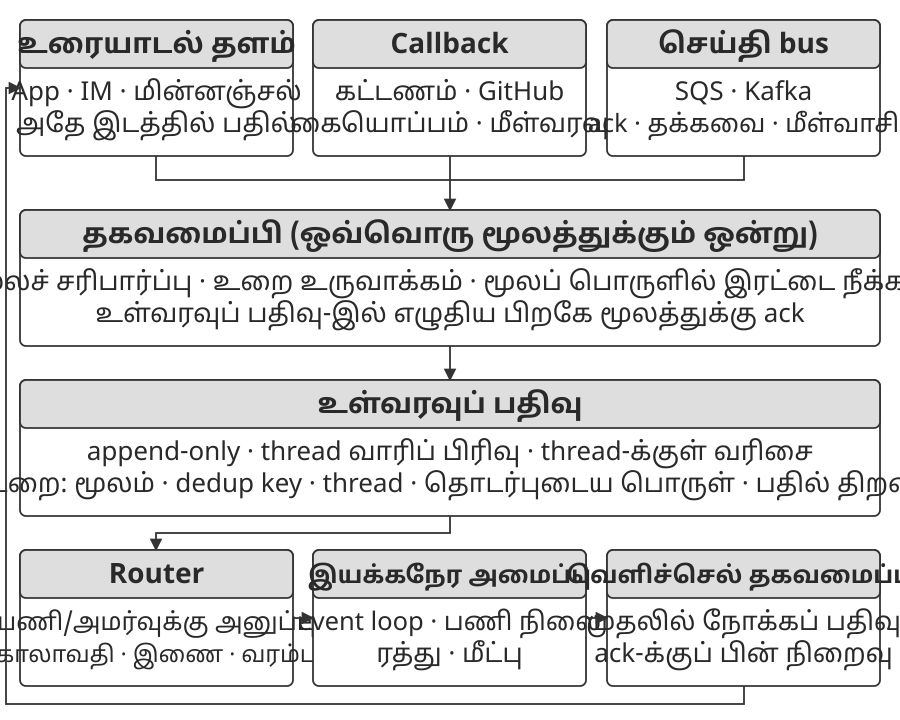

பொதுவான மூலங்கள் நான்கு வகை. **உரையாடல் கால்வாய்கள்** தயாரிப்பின் சொந்த உரையாடல் இடைமுகம், நிறுவன WeChat, Feishu, Slack போன்ற உடனடிச் செய்தி, மின்னஞ்சல் ஆகியவற்றை உள்ளடக்குகின்றன; ஏஜெண்ட் அசல் இடத்துக்கே திரும்பிப் பதிலளிக்க முடியும். **திரும்பழைப்புகள்** நிலை மாறும்போது வெளிப்புறச் சேவைகள் அழைக்கும் HTTP இடைமுகங்கள்; பொதுவாகக் கையொப்பத்துடன் வரும், அறிவிப்பை மட்டும் கொண்டு வரும்; ஒப்படைப்பு தோல்வியடைந்தால் சில சேவைகள் தானாக மீண்டும் முயல்கின்றன; GitHub-ஓ கைமுறையாகவோ API வழியாகவோ மீண்டும் ஒப்படைக்க வேண்டும். **செய்திப் பாட்டைகள்** SQS, Kafka போன்றவை உள் சேவைகளின் வணிக நிகழ்வுகளைத் தாங்குகின்றன; தெளிவான உறுதிப்படுத்தல், தக்கவைப்பு பொருள்களைக் கொண்டுள்ளன. **நேரங்காட்டிகள், வாக்கெடுப்பு, உள் நிகழ்வுகள்** அமைப்பே உருவாக்குகிறது; அதே பதிவில் எழுதினால் போதும். கீழே உள்ள அட்டவணை முதல் மூன்றையும் ஒப்பிடுகிறது.[^ch6-ingress-mq][^ch6-ingress-callback]

| | App உரையாடல் | நிறுவன WeChat / Feishu | மின்னஞ்சல் | Webhook | SQS | Kafka |
|---|---|---|---|---|---|---|
| வரும் முறை | நீண்ட இணைப்பு | திரும்பழைப்பு அல்லது நீண்ட இணைப்பு | தள்ளல் அல்லது வாக்கெடுப்பு | திரும்பழைப்பு | நுகர்வோர் இழுத்தல் | நுகர்வோர் இழுத்தல் |
| வரிசை எல்லை | உரையாடலுக்குள் | பெரும்பாலான நிகழ்வுகளுக்கு உத்தரவாதம் இல்லை | உத்தரவாதம் இல்லை | உத்தரவாதம் இல்லை | நிலையான வரிசைக்கு உத்தரவாதம் இல்லை; FIFO செய்திக் குழுவாரியாக | பிரிவுக்குள் |
| இயல்பான மீள்வருகை நீக்க அடிப்படை | கிளையண்ட் செய்தி ID | செய்தி ID, நிகழ்வு ID | Message-ID | ஒப்படைப்பு ID | செய்தி ID; FIFO-வில் `MessageDeduplicationId` | தலைப்பு, பிரிவு, இருப்பிடம் |
| மீண்டும் இயக்க முடியுமா | சொந்தப் பதிவைப் பொறுத்தது | திரும்பழைப்பை மீண்டும் இயக்க முடியாது; Feishu-வில் வரலாற்றுச் செய்தி இடைமுகம் வழியாகக் கூடுதலாகப் பெறலாம் | அஞ்சல் பெட்டியை மீண்டும் படிக்கலாம் | சேவையைப் பொறுத்தது | நீக்கிய பிறகு முடியாது | தக்கவைப்புக் காலத்துக்குள் முடியும் |
| உறுதிப்படுத்தும் முறை | கிளையண்ட் ரசீது | கால வரம்புக்குள் வெற்றியைத் திருப்பித் தருதல் | வாசிப்பு இருப்பிடத்தைத் தானே பதிவு செய்தல் | கால வரம்புக்குள் 2xx திருப்பித் தருதல் | செய்தியை நீக்குதல் | இருப்பிடத்தைச் சமர்ப்பித்தல் |
| பதில் பாதை | அசல் உரையாடல் | அசல் உரையாடல் | பதில் கடிதம் | இல்லை | இல்லை | இல்லை |

**ஒருங்கிணைந்த உறை.**

தகவமைப்பி மூலச் செய்தியை ஒருங்கிணைந்த வடிவ **உறையாக** (envelope) மாற்றுகிறது. உறை வரும்போதே தீர்மானிக்கக்கூடிய உண்மைகளை மட்டும் பதிவு செய்கிறது; முன்னுரிமையும் கையாளும் கால வரம்பும் வழித்தட விதிகளால் நிரப்பப்படுகின்றன; வாடிக்கையாளர் நிலையும் ஆர்டர் நிலையும் வணிக அமைப்புகளால் நிரப்பப்படுகின்றன; கையாளும் நிலை தனியாகச் சேமிக்கப்படுகிறது. வாடிக்கையாளரின் பணத்திருப்ப விண்ணப்பத்தை இவ்வாறு எழுதலாம்:

```json
{
  "id": "evt_7f3a",
  "source": {"type": "app_chat", "sender": "user:u_5521", "verified": true},
  "dedupe_key": "app:msg:msg_1029",
  "thread": "app:conv:conv_88",
  "kind": "message",
  "correlation": ["order:12345"],
  "content": {"type": "text", "text": "这个订单我想退款"},
  "raw_ref": "raw/2026-11-23/app/msg_1029.json",
  "reply": {"via": "app_chat", "target": "app:conv:conv_88"},
  "occurred_at": "2026-11-23T14:02:09+08:00",
  "expires_at": null
}
```
- `source`: மூல வகையும் சரிபார்க்கப்பட்ட அனுப்புநரும். "சரிபார்க்கப்பட்டது" என்பதைத் தகவமைப்பி கையொப்பம், டோக்கன், அல்லது கால்வாய்க் கணக்கின் அடிப்படையில் தீர்மானிக்கிறது; உரையில் உள்ள சுய அறிமுகம் கணக்கில் வராது; இயக்கக்கருவி இந்த உருப்படியின் அடிப்படையில் அனுமதியைத் தீர்மானிக்கிறது.
- `dedupe_key`: மீள்வருகை நீக்க விசை; எது மீள்வருகையாகக் கருதப்படும் என்பதை மூலத்தின் பொருள் தீர்மானிக்கிறது. ஒப்படைப்பு ID, செய்தி ID, பிரிவு மற்றும் இருப்பிடம் ஆகியவை ஒரே ஒப்படைப்பை அடையாளப்படுத்தி, கடத்தல் அடுக்கின் மறுஒப்படைப்பைத் தடுக்கின்றன; வணிகச் செய்தியில் சமச்சீர்மை விசை (idempotency key) இருந்தால் — எடுத்துக்காட்டாகப் பணத்திருப்ப எண் + நிலை — அதைத் தகவமைப்பி எடுத்தால் மட்டுமே வணிக மீள்வருகையைத் தடுக்க முடியும். பயனர் உரையாடல் இதற்கு நேர்மாறானது: வாடிக்கையாளர் இருமுறை "பணத்திருப்பம்" என்று சொன்னால் அது இரு செய்திகள்; கிளையண்ட் செய்தி ID-யின்படி மட்டுமே மீள்வருகை நீக்கப்படுகிறது.
- `raw_ref`: அப்படியே சேமிக்கப்பட்ட மூலச் சுமை; தகவமைப்பிப் பிழையைக் கண்டறிய இதை மட்டுமே நம்ப முடியும்.
- `reply`: எந்த வெளிச்செல்லும் தகவமைப்பி வழியாக, எந்த இலக்குக்கு. பணம் செலுத்தும் திரும்பழைப்புக்குப் பதில் பாதை இல்லை; இந்த உருப்படி காலியாக இருக்கும்.
- `occurred_at` மூலம் தரும் நிகழ்ந்த நேரம்; `expires_at` செல்லுபடிக் காலம்; விலைக் குறிப்பு, சரிபார்ப்புக் குறியீடு போன்ற நிகழ்வுகளுக்கு மட்டும் நிரப்பப்படும்.

**இழையும் இணைப்பும்.**

வாடிக்கையாளர் முதலில் "பணத்திருப்பம்" என்று சொல்லி, உடனே "சரி விடுங்கள், பொருளை மாற்றிக் கொடுங்கள்" என்று சேர்க்கிறார்; இந்த இரு செய்திகளின் வரிசையை மாற்றக்கூடாது; இன்னொரு வாடிக்கையாளரின் செய்தி இவற்றோடு தொடர்பில்லாததால் இணையாகக் கையாளலாம். **உள்வரவு அடுக்கு இழைக்குள் மட்டுமே வரிசையை உறுதிசெய்கிறது.** தகவமைப்பி மூலத்தின் சொந்த வரிசை அலகை `thread`-ஆக வரைபடமாக்குகிறது: App-இன் ஒரு உரையாடல், SQS FIFO-வின் செய்திக் குழு (`MessageGroupId`), Kafka-வின் பிரிவு விசை, GitHub திரும்பழைப்பில் உள்ள Issue அல்லது PR எண். மூலம் வரிசைக்கு உத்தரவாதம் தராதபோது, `occurred_at`-ஐயோ மூலம் தரும் பதிப்பு எண்ணையோ கொண்டு இயக்கக்கருவி தாமதமாக வந்த பழைய நிலையை அடையாளம் காண்கிறது; எடுத்துக்காட்டாக "பணத்திருப்பம் வெற்றி" வந்த பிறகு வரும் "பணத்திருப்பம் செயலாக்கத்தில்".

இந்தப் பணத்திருப்பத்தின் நான்கு செய்திகளும் நான்கு இழைகளைச் சேர்ந்தவை. ஒன்றாக இணைப்பதன் விலை சிறியதல்ல: விற்பனைக்குப் பிந்தைய குழுவில் உள்ள தொடர்பில்லாத ஒரு விவாதமும் வாடிக்கையாளர் செய்திக்குப் பின்னால் வரிசையில் நிற்க வேண்டியிருக்கும்; இழை அடையாளம் பெரும்பாலும் பிரிவு விசையாகவும் பயன்படுவதால், பின்னர் மாற்ற வேண்டுமானால் தரவை இடம்பெயர்க்க வேண்டும். **இணைப்பு உறவைத் தனிப் புலத்தில் வெளிப்படுத்துங்கள்; இழையை மாற்றியெழுதாதீர்கள்.** `correlation` நிகழ்வு சம்பந்தப்பட்ட வணிகப் பொருள்களைப் பட்டியலிடுகிறது; பணிகள் இணைப்புப் பொருளின்படி தொடர்புடைய இழைகளுக்குச் சந்தா செய்கின்றன.

**உறுதிப்படுத்தும் தருணத்தையும் முன்னேற்றத்தையும் பிரித்தல்.**

**நிகழ்வு உள்வரவுப் பதிவில் எழுதப்பட்ட பிறகே தகவமைப்பி மூலத்துக்கு உறுதிப்படுத்த வேண்டும்; ஏஜெண்ட் கையாண்டு முடிக்கும் வரை காத்திருக்கக் கூடாது.** Feishu-வின் நிகழ்வுத் திரும்பழைப்பு 3 வினாடிகளுக்குள் பதிலைக் கோருகிறது; நிறுவன WeChat 5 வினாடிகள்; நேரம் முடிந்தால் மீண்டும் தள்ளுகின்றன; SQS செய்தி தெரிவுநிலை நேர வரம்புக்குள் நீக்கப்படாவிட்டால் மீண்டும் எடுக்கப்படும். கையாண்டு முடிந்த பிறகே உறுதிப்படுத்தினால், சற்று நீண்ட ஒரு மாதிரி அழைப்பும் மீள் ஒப்படைப்பை வரவழைக்கும். முதலில் பதிவில் எழுதிப் பின்னர் உறுதிப்படுத்தினால், எல்லா மூலங்களின் ஒப்படைப்பு உத்தரவாதங்களும் ஒரே வாக்கியமாகச் சுருங்குகின்றன: **ஒவ்வொரு நிகழ்வும் குறைந்தபட்சம் ஒருமுறை உள்வரவுப் பதிவில் நுழையும் (at-least-once)**; மீள் ஒப்படைப்பு மீள்வருகை நீக்க விசையால் தடுக்கப்படுகிறது.

உள்வரவுப் பதிவு ஒரு உள்பெட்டி (inbox) போன்றது; அத்தியாயம் 1-இன் சேர்-மட்டும் கொள்கையைப் பின்பற்றி, இழைவாரியாகப் பிரிக்கப்படுகிறது. Kafka-வை உள்வரவுப் பதிவாகப் பயன்படுத்தும்போது, மீள்வருகை நீக்கத்துக்குத் தனித்துவக் கட்டுப்பாட்டுச் சேமிப்பை அமைக்க வேண்டும், அல்லது நுகர்வோர் பக்கத்தில் மீள்வருகை விசையின்படி வடிகட்ட வேண்டும்: பயன்பாடு தரும் விசையின்படி எழுதுதலை Kafka மறுக்க முடியாது; அதன் சமச்சீர்மை உருவாக்கி தன் சொந்த மறுமுயற்சிகளை மட்டுமே உள்ளடக்குகிறது.

அமைப்பு மூன்று வகை முன்னேற்றத்தைத் தனித்தனியாகச் சேமிக்க வேண்டும்:

| முன்னேற்றம் | பதிவு உள்ளடக்கம் | யார் பராமரிக்கிறார் |
|---|---|---|
| மூல முன்னேற்றம் | Kafka இருப்பிடம், SQS பெறுதல் கைப்பிடி, அஞ்சல் பெட்டி வாசிப்பு இருப்பிடம் | தகவமைப்பி |
| ஒதுக்கீட்டு முன்னேற்றம் | பதிவில் உள்ள நிகழ்வு எந்தப் பணிகளுக்கு ஒப்படைக்கப்பட்டது | வழித்தடம் |
| பணி நிலை | எந்தப் படி வரை கையாளப்பட்டது, பதில் ஏற்கனவே அனுப்பப்பட்டதா | இயக்கக்கருவி |

இருப்பிடத்தைப் பணி முன்னேற்றமாகக் கருதினால், பதிவை மீண்டும் இயக்கும்போது ஏற்கனவே அனுப்பிய பதில் மீண்டும் அனுப்பப்படும்; பிரித்த பிறகு, மீள்இயக்கம் ஒதுக்கீட்டு முன்னேற்றத்தை மட்டுமே பாதிக்கிறது. வெளிச்செல்லும் திசை வெளிப்பெட்டிக்கு (outbox) உரியது: அனுப்புவதற்கு முன் அனுப்பும் நோக்கத்தையும் சமச்சீர்மை விசையையும் பதிவு செய்து, கால்வாய் ரசீது வந்த பிறகு முடிந்ததாகக் குறிக்க வேண்டும்; மறுதொடக்கத்துக்குப் பின் எவ்வாறு சரிபார்ப்பது என்பதைப் பின்னர் வரும் "மின்னஞ்சல் நிகழ்விலிருந்து அடிப்படைச் சுழற்சியை உருவாக்குதல்" பகுதியில் பாருங்கள்.

**காலத்தன்மை, இணைப்பு, பின்னழுத்தம்.**

ஒரே இழையில் வினாடிக்கு நூற்றுக்கணக்கான நிகழ்வுகள் குவியும்போது, ஒவ்வொன்றையும் மாதிரிக்குக் கொடுக்கக் கூடாது. ஒதுக்குவதற்கு முன் வழித்தடம் குவிப்பைக் கையாள்கிறது:

- **காலத்தன்மை.** விலைக் குறிப்புகள், சரிபார்ப்புக் குறியீடுகள், ஏற்கனவே மீண்ட எச்சரிக்கைகள் நேரம் கடந்ததும் பொருளிழக்கின்றன. `expires_at`-ஐக் கடந்த நிகழ்வுகள் பாதையில் மட்டும் பதிவு செய்யப்படுகின்றன; மாதிரியை மீண்டும் எழுப்புவதில்லை.
- **இணைப்பு.** `kind` இரு வகை நிகழ்வுகளை வேறுபடுத்துகிறது. நிலை வகை நிகழ்வுகள் ஒரு பொருளின் தற்போதைய மதிப்பை விவரிக்கின்றன; எடுத்துக்காட்டாகப் பணம் செலுத்தும் திரும்பழைப்பில் உள்ள பணத்திருப்ப நிலை, Kafka-வில் உள்ள ஆர்டர் நிலை; ஒரே இழையில் பல குவிந்தால், சமீபத்தியதை மட்டும் மாதிரிக்குக் கொடுத்து, இடைநிலை மதிப்புகளைப் பதிவில் விட்டுவைக்கலாம். செய்தி வகை நிகழ்வுகள் ஒருவர் சொன்ன வாக்கியமோ கொடுத்த கட்டளையோ; எடுத்துக்காட்டாக வாடிக்கையாளர் செய்தி, மேலாளரின் சொடுக்கல்; அவற்றைத் தொகுதியாக மாதிரிக்குக் கொடுக்கலாம், ஆனால் கைவிடக்கூடாது.
- **பின்னழுத்தம்.** இழுக்கும் வகை மூலங்களில் இழுப்பதை மெதுவாக்கலாம்; குவிப்பு மூலத்திலேயே இருக்கும். தள்ளும் வகை மூலங்களை நிறுத்தச் சொல்ல முடியாது; தகவமைப்பி வழக்கம்போல் பதிவில் எழுதி உறுதிப்படுத்துகிறது; குவிப்பு உள்வரவுப் பதிவுக்கு மாறுகிறது; முந்தைய இரு விதிகள் அதைக் கரைக்கின்றன.

**நான்கு மூலங்களைக் கடந்து செல்லும் ஒரு பணத்திருப்பம்.**

1. வாடிக்கையாளர் App உரையாடலில் பணத்திருப்பம் கோருகிறார். தகவமைப்பி கிளையண்ட் செய்தி ID கொண்டு மீள்வருகையை நீக்கி, பதிவில் எழுதி, பின்னர் கிளையண்டுக்கு ரசீது தருகிறது; வழித்தடம் `order:12345`-இன்படி பணத்திருப்பப் பணியை உருவாக்குகிறது; பணி இந்த உரையாடல் இழைக்குச் சந்தா செய்கிறது.
2. தொகை அனுமதியை மீறுவதால், ஏஜெண்ட் நிறுவன WeChat விற்பனைக்குப் பிந்தைய குழுவில் உறுதிப்படுத்தல் அட்டையை அனுப்புகிறது; அட்டை அடையாளம் பணியில் பதிவு செய்யப்படுகிறது. மேலாளர் "ஒப்புதல்" சொடுக்குகிறார்; தகவமைப்பி பதிவில் எழுதிய பிறகு வெற்றியைத் திருப்பித் தந்து, அட்டை அடையாளத்தின்படி இணைப்புப் பொருளைச் சேர்க்கிறது.
3. ஏஜெண்ட் பணத்திருப்ப இடைமுகத்தை அழைத்த பிறகு, பணம் செலுத்தும் சேவை "பணத்திருப்பம் வெற்றி" என்று இருமுறை திரும்பழைக்கிறது; ஒப்படைப்பு ID ஒன்றே என்பதால் இரண்டாவது மீள்வருகையாக நீக்கப்படுகிறது.
4. ஆர்டர் அமைப்பு Kafka-வில் "ஆர்டர் பணத்திருப்பம் செய்யப்பட்டது" என்று வெளியிடுகிறது; திரும்பழைப்பு சொன்ன அதே விஷயம். இரு தகவமைப்பிகளும் சுமையிலிருந்து பணத்திருப்ப எண் + நிலையை மீள்வருகை விசையாக எடுத்திருந்தால், இந்த நிகழ்வு உள்வரவிலேயே தடுக்கப்படும்; முறையே ஒப்படைப்பு ID-யையும் பிரிவு–இருப்பிடத்தையும் கொண்டு நீக்கியிருந்தால், இரண்டும் பதிவுக்குள் நுழையும்; பணியில் பணத்திருப்பம் ஏற்கனவே உறுதிசெய்யப்பட்டதை இயக்கக்கருவி கண்டறிந்து, அதைப் பாதையில் மட்டும் பதிவு செய்கிறது.
5. திரும்பழைப்புக்கும் Kafka நிகழ்வுக்கும் பதில் பாதை இல்லை. இயக்கக்கருவி படி 1-இன் உரையாடல் இழையின் `reply`-ஐப் பயன்படுத்தி, App வெளிச்செல்லும் தகவமைப்பி வழியாக வாடிக்கையாளருக்குத் தெரிவிக்கிறது.

படி 4 உள்வரவு அடுக்கு மீள்வருகை நீக்கத்தின் எல்லை: எந்த மீள்வருகைகளைத் தடுக்க முடியும் என்பது தகவமைப்பி எந்த மீள்வருகை விசையை அறிவித்தது என்பதைப் பொறுத்தது; தடுக்கப்படாதவை பணி நிலையைக் கொண்டு தீர்மானிக்கப்படுகின்றன. நிகழ்வு பணிக்கு ஒதுக்கப்பட்ட பிறகு, ஏற்கனவே உள்ள அமர்வுக்குப் பின்னால் இணைப்பதா அல்லது புதிய அமர்வைத் திறப்பதா என்பது சூழல் மேலாண்மையைச் சேர்ந்தது: அமர்வுகளைக் கடந்த தகவல் அத்தியாயம் 3-இன் நினைவகம் வழியாகக் கடத்தப்படுகிறது; சூழலைப் பகிர முடியுமா என்பதை அத்தியாயம் 10-இல் பாருங்கள்.

[^ch6-ingress-mq]: Amazon Web Services, "Amazon SQS standard queues"; "Amazon SQS visibility timeout"; "Using the message deduplication ID in Amazon SQS"; "Using the message group ID with Amazon SQS FIFO Queues". Apache Kafka 4.4 ஆவணம், "Design"-இல் "Consumer Position", "Message Delivery Semantics". சரிபார்த்த தேதி: 2026-11-24.
[^ch6-ingress-callback]: Feishu திறந்த தளம், "நிகழ்வு மேலோட்டம்"; "அமர்வு வரலாற்றுச் செய்திகளைப் பெறுதல்". நிறுவன WeChat மேம்பாட்டாளர் மையம், "செய்திகளையும் நிகழ்வுகளையும் பெறுதல்"-இன் கீழ் "மேலோட்டம்". GitHub Docs, "Best practices for using webhooks"; "Handling failed webhook deliveries". சரிபார்த்த தேதி: 2026-11-24.

### நிகழ்வு கையாளும் பொறிமுறை

பயனர் செய்திகள், கருவி முடிவுகள், நேரங்காட்டிகள், கூட்டுப்பணிக் கோரிக்கைகள் ஆகியவை ஒருசேர ஒரு ஏஜெண்டுக்குள் நுழையலாம். இயக்கக்கருவி இந்த நிகழ்வுகளைச் சேமித்து, கையாளும் வரிசையைத் தீர்மானித்து, தொடர்புடைய தகவலை மாதிரிக்குக் கொடுக்க வேண்டும். **நிகழ்வுச் சுழற்சி** (event loop) இந்தச் செயல்முறையைத் தொடர்ந்து முன்னெடுக்கிறது: வரிசையிலிருந்து நிகழ்வை எடுத்து, பணி நிலையைப் புதுப்பித்து, மாதிரிக் கோரிக்கையை ஒழுங்கமைத்து, கருவிகளைத் திட்டமிட்டு, பின்னர் புதிய உள்ளீடு அல்லது நிறைவு அறிவிப்புக்குக் காத்திருக்கிறது. Go நிரல்கள் goroutine, channel, `select` மூலம் பல வழிச் செய்திகளை ஒழுங்கமைப்பதும் இதையொத்த சிந்தனையே.

dsh-superagent முன்மாதிரியை எடுத்துக்காட்டாகக் கொண்டால், ஒரே GitHub திட்டத்தில், ஒரு Issue-இன் கீழான விவாதமும் ஒரு இழுப்புக் கோரிக்கை (PR) கீழான விவாதமும் இரு வெவ்வேறு அமர்வு இழைகளைச் (Thread) சேர்ந்தவை. புதிய வேலையை ஏற்கலாமா என்று தீர்மானிக்க வேண்டியிருக்கும்போது, அமைப்பு இழை நிலையைப் படித்து, மாதிரியை மதிப்பிடச் (Eval) செய்கிறது. ஒரே இழையில் ஒரே நேரத்தில் அதிகபட்சம் ஒரு மதிப்பீடு மட்டும்; ஆனால் பல வேலைச்சீட்டுகள் (Ticket) அதற்குச் சந்தா செய்யலாம். குறைபாட்டைச் சரிசெய்தல், ஆவணங்களை நிரப்புதல் ஆகிய இரு வேலைச்சீட்டுகளும் ஒரே PR-க்குச் சந்தா செய்துள்ளன என்று வைத்துக்கொள்வோம்; மதிப்பாய்வாளர் PR-இன் கீழ் கருத்துரை இட்டால், இரு வேலைச்சீட்டுகளும் அதைச் சூழலாகப் பெறுகின்றன. பின்னர் யாராவது Issue-இன் கீழ் மீளுருவாக்க நிபந்தனையைச் சேர்த்தால், அந்தச் செய்தி அந்த Issue-க்குச் சந்தா செய்த வேலைச்சீட்டுகளுக்குச் சேரும். செய்தி யாருக்குச் சென்றது என்பது இழையையும் சந்தா உறவையும் பொறுத்தது; பெற்ற பிறகு என்ன செய்யலாம் என்பதோ இன்னும் ஒவ்வொரு வேலைச்சீட்டின் அசல் அனுமதியால் தீர்மானிக்கப்படுகிறது.[^ch6-dsh-threads]

dsh-superagent "மனிதர்களுடன் பழகுதல்" மற்றும் "வேலை செய்தல்" ஆகியவற்றை வெவ்வேறு அமர்வுகளிடம் ஒப்படைக்கிறது. முதன்மை அமர்வு (Main Session) பணியை ஏற்பது, பதிலளிப்பது, அனுமதியை எழுதுவது ஆகியவற்றுக்கு மட்டும் பொறுப்பு; குறியீட்டைப் படிப்பதில்லை, முடிவுக்காக நின்று காத்திருப்பதுமில்லை; ஒவ்வொரு வேலைச்சீட்டுக்கும் தனி இயக்க அமர்வு (Executor Session) உண்டு; அது தனிப் பணிக் கோப்பகத்தில் குறியீட்டை மாற்றி, சோதனைகளை இயக்குகிறது. இயக்க அமர்வு சரிசெய்து முடித்தபோதோ, தடைபட்டபோதோ, மனிதரிடம் கேட்க வேண்டியிருக்கும்போதோ மட்டும், முதன்மை அமர்வுக்கு ஒரு செய்தி அனுப்புகிறது; அதில் சுருக்கமும் வாசிப்பு முகவரியும் — அதாவது அத்தியாயம் 2 சொன்ன "சுருக்கம் + பொருள் ID" — இணைக்கப்படுகின்றன. இதனால் முதன்மை அமர்வு அடுத்த கோரிக்கையை ஏற்க எப்போதும் கை ஒழிந்திருக்கிறது; மனிதரிடம் கேள்வி கேட்பது, அறிவிப்பு அனுப்புவது, நிறுத்தச் சொல்வது ஆகியவையும் அதன் வழியே நடக்கின்றன; வாக்குறுதிகள் ஒரே வாயிலிலிருந்து மட்டுமே வெளியேறுகின்றன. பின்னர் வரும் குரல் பகுதியின் வேக–மெதுவான மாதிரிகள், இந்தப் பணிப்பகிர்வின் நிகழ்நேர அழைப்பு வடிவமே.[^ch6-dsh-sessions]

ஒத்திசைவான மாதிரி இடைமுகங்கள் பொதுவாக ஒரு உருவாக்கம் முடிந்த பிறகோ கருவி முடிவுகள் நிறைந்த பிறகோ அடுத்த தொகுதிச் செய்திகளைப் பெறுகின்றன. இங்கு **பாதுகாப்புப் புள்ளியை** அமைக்கலாம்: இயக்கக்கருவி முதலில் முடிந்த செய்திகள், இன்னும் இயங்கும் அழைப்புகள், தற்போதைய பணி முன்னேற்றம் ஆகியவற்றைப் பதிவு செய்து, பின்னர் புதிய கையாளும் படிக்கு மாறுகிறது. இயல்பான ஒத்திசைவற்ற இடைமுகங்களோ இயக்கத்தின்போதே புதுப்பிப்புகளைப் பெறும் நெறிமுறையை வழங்குகின்றன; குறிப்பிட்ட தொடர் தருணத்தை இடைமுகமும் இயக்கக்கருவியும் சேர்ந்து ஏற்பாடு செய்கின்றன.

ரத்துக்கும் இயக்கியின் ஒத்துழைப்பு தேவை. மாதிரி உருவாக்கத்தை நிறுத்திய பிறகும் பின்தளக் கருவிகள் இன்னும் இயங்கக்கூடும்; இயக்கி ரத்துச் சமிக்ஞையைப் பெற்று, உண்மையான நிலையைத் தெரிவிக்க வேண்டும்; Go பணி `ctx.Done()`-ஐச் சரிபார்த்த பிறகு சுத்தம் செய்வதைப் போல. ஏற்கனவே முடிந்த எழுதுதல், அனுப்புதல், பணம் செலுத்துதல் ஆகியவற்றுக்கு, தொடர்புடைய வணிகச் செயல்முறை வழியாகத் திரும்பப் பெறுதலையோ ஈடுசெய்தலையோ கையாள வேண்டும்.

**மூன்று கையாளும் உத்திகள்.**

புதிய நிகழ்வு வரும்போது இருக்கும் மூன்று தேர்வுகளைப் படம் 6-3 ஒப்பிடுகிறது. அதை வரிசையில் வைத்தால், பதில் நேரம் அடுத்த பாதுகாப்புப் புள்ளி எப்போது வருகிறது என்பதைப் பொறுத்தது; தற்போதைய பணியை ரத்து செய்தால், எந்தச் செயல்கள் ஏற்கனவே முடிந்தன, எங்கிருந்து மீட்கலாம் என்று உறுதிசெய்ய வேண்டும்; இன்னொரு சுழற்சியைத் திறந்தால், இரு பணிகளும் ஒரே வளத்துக்குப் போட்டியிடுமா என்று சரிபார்க்க வேண்டும்.

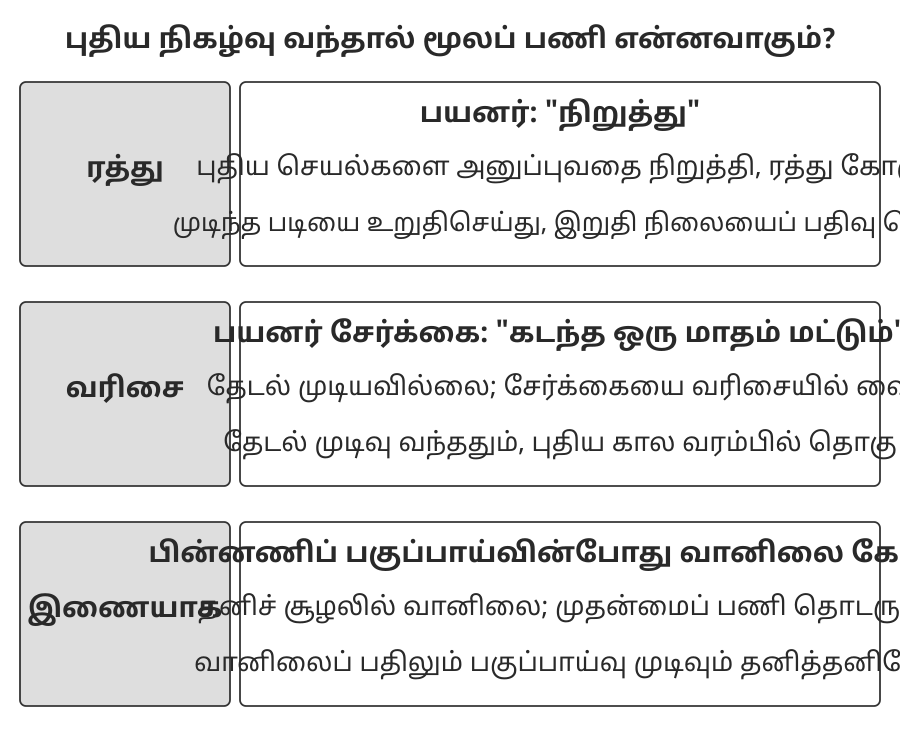

**ரத்து அடிப்படையிலான கையாளுதல் (Cancellation-Based)** பயனரின் நிறுத்தக் கட்டளை அல்லது உடனே கையாள வேண்டிய கட்டுப்பாட்டு நிகழ்வுகளுக்கு ஏற்றது. இயக்கக்கருவி முதலில் தொடர்புடைய செயல்களைத் தொடர்ந்து ஒதுக்குவதை நிறுத்தி, உருவாகிக்கொண்டிருக்கும் கோரிக்கைகளுக்கும் ரத்து செய்யக்கூடிய கருவிகளுக்கும் நிறுத்த சமிக்ஞையை அனுப்பி, பின்னர் முடிந்த செய்திகள், கருவி நிலை, ரத்து ரசீதைச் சேமிக்கிறது. அதன் பிறகு புதிய நிகழ்வு முடிவுச் சூழலுக்குள் நுழைகிறது. எடுத்துக்காட்டாக, பயனர் "நிறுத்து! நான் தவறாகச் சொன்னேன்" என்று சொன்னால், அமைப்பு முதலில் அடுத்தடுத்த இயக்கத்தை வரம்பிட்டு, பின்னர் தற்போதைய உண்மையான நிலையுடன் இணைத்துப் பணியை மீண்டும் உறுதிசெய்கிறது. இன்னும் கையாளப்படாத வரிசை உருப்படிகள் அடையாளத்தையும் நிலையையும் தக்கவைத்து, இணைப்பு எல்லையின்படி மீண்டும் வரிசைப்படுத்தப்படுகின்றன.

**வரிசை அடிப்படையிலான கையாளுதல் (Queued)** வழக்கமான கூடுதல் தகவல்களுக்கும் முன்னேற்றப் புதுப்பிப்புகளுக்கும் ஏற்றது. நிகழ்வு வரிசைக்குள் நுழைந்து, அடுத்த பாதுகாப்புப் புள்ளியில் கருவி முடிவுகளுடன் சேர்ந்து மாதிரிக்குக் கொடுக்கப்படுகிறது. எடுத்துக்காட்டாக, தேடலின்போது பயனர் "கடந்த ஒரு மாத முடிவுகளை மட்டும் பார்" என்று சேர்த்தால், தேடல் திரும்பிய பிறகு மாதிரி முடிவுகளையும் புதிய நிபந்தனையையும் ஒருசேரப் படித்து, வடிகட்டுவதா மீண்டும் தேடுவதா என்று தீர்மானிக்கிறது.

**இணைக் கையாளுதல் (Parallel)** முதன்மைப் பணியிலிருந்து சுயாதீனமான, சரியான நேரத்தில் பதில் தேவைப்படும் கோரிக்கைகளுக்கு ஏற்றது. எடுத்துக்காட்டாக, பெரிய அளவிலான தரவுப் பகுப்பாய்வின்போது பயனர் வானிலையைக் கேட்டால், அமைப்பு தனி அமர்வை அமைத்து வினவலை முடிக்கலாம்.

**அவசர நிலையும் வழித்தடமும்.**

நிகழ்வு வகை தொடக்கத் துப்பை வழங்குகிறது: `user.interrupt`, நம்பகமான மேற்பார்வைக் கட்டளைகள், அமைப்பு எச்சரிக்கைகள் உயர் முன்னுரிமைக் கால்வாய்க்குள் நுழையலாம்; `user.input`, `agent.input`, `tool.result`, `timer.trigger` ஆகியவை உள்ளடக்கத்தையும் பணி நிலையையும் இணைத்துத் தீர்மானிக்கப்படுகின்றன. அனுப்புநர் உரையில் தானே "அவசரம்" என்று சொன்னாலும், அமைப்பு இன்னும் சரிபார்க்கப்பட்ட அடையாளத்தையும் விதிகளையும் கொண்டே அனுமதியைத் தீர்மானிக்கிறது.

செய்தியின் பொருளைப் புரிந்துகொள்ள வேண்டிய வழித்தடத் தீர்மானங்களுக்கு, இலகுவான வகைப்படுத்தல் மாதிரியைப் பயன்படுத்தப் பரிந்துரைக்கிறேன்: "உடனே நிறுத்து" என்பது ரத்துக்கு உரியது, "இன்று வானிலை எப்படி" இணைக் கையாளலுக்கு ஏற்றதாக இருக்கலாம், "அறிக்கையைச் சீனத்தில் எழுது" பொதுவாகத் தற்போதைய பணியின் கூடுதல் வரிசைக்குள் நுழைகிறது. தெளிவான நிறுத்த நுழைவாயிலை இயக்கக்கருவி நேரடியாகக் கையாள்கிறது; புரிதல் தேவைப்படும் மற்றச் செய்திகளுக்குப் பொருள் வகைப்பாடு பயன்படுகிறது.

பொது மாதிரியும் செய்திகளுக்குக் குறிச்சொல் இடலாம்; ஆனால் "கையாள வேண்டும்" என்ற இரு சொற்களை மட்டும் வெளியிட்டாலும், மாதிரி பணி விளக்கத்தையும் செய்தி உள்ளடக்கத்தையும் படிக்க வேண்டும். ஒவ்வொரு புதிய செய்திக்கும் இவ்வாறு ஒருமுறை தீர்மானித்தால், அழைப்புச் செலவு செய்தி அளவுடன் வளரும்; உண்மையில் அவசரமான செய்தியும் மாதிரி குறிச்சொல் கொடுக்கும் வரை காத்திருக்க வேண்டியிருக்கும். TypeSafe-இன் Jev, விருப்பங்கள் முன்கூட்டியே கொடுக்கப்பட்ட இத்தகைய மதிப்பீட்டுப் பணிகளைக் கையாளச் சிறப்பாக உருவாக்கப்பட்டது. ஒரு செய்தியையும் தற்போதைய பணி நிலையையும் அதற்குக் கொடுத்தால், குறைந்த செலவிலும் தாமதத்திலும் ஒவ்வொரு விருப்பத்தின் நிகழ்தகவையும் இணையாகத் தர முடியும்.[^ch6-jev]

அத்தியாயம் 1 விவாதித்த அவதானிப்பு வெளியின் அடர்த்தி குறைப்பு, எந்தச் செய்திகள் புதிய பகுத்தறிவைத் தூண்டும் என்பதை இங்கே தீர்மானிக்கிறது. Feishu செய்திகளையும் GitHub Issue கருத்துரைகளையும் எடுத்துக்காட்டாகக் கொண்டால், நிரல் முதலில் நிகழ்வு எண்ணின்படி மீள்வரும் அறிவிப்புகளை வடிகட்டி, பின்னர் புதிய செய்தி ஏற்கனவே உள்ள பணியை நிரப்புகிறதா, அல்லது முதன்மை மாதிரி கையாள வேண்டிய புதிய கோரிக்கையை முன்வைக்கிறதா என்று Jev தீர்மானிக்கச் செய்யலாம். "நேற்று சொன்ன மீளுருவாக்கப் படிகளைச் சேர்க்கிறேன்" என்று படித்தால், இது ஒரு கூடுதல் விளக்கம் என்று மட்டும் மாதிரி தீர்மானித்தால் போதும். எந்த Issue-க்கு இது கூடுதலாகிறது என்பதை, கருத்துரையுடன் வரும் எண்ணை நிரல் நேரடியாகப் படிக்கலாம்.

மாதிரி மிக உயர்ந்த நிகழ்தகவைத் தந்தாலும், அது தன் நம்பிக்கையை மிகைப்படுத்தி மதிப்பிடலாம். எடுத்துக்காட்டாக, 100 செய்திகளும் சுமார் 90% நிகழ்தகவுடன் "ஏற்கனவே உள்ள பணியை நிரப்புதல்" என்று தீர்மானிக்கப்பட்டாலும், உண்மையில் 60 மட்டுமே இந்த வகையைச் சேர்ந்தவை. இந்தத் தொகுதியைத் தானாக ஏற்கனவே உள்ள பணியில் இணைத்தால், மற்ற 40 செய்திகளின் உண்மையான நோக்கம் தவறவிடப்படும்.

[^ch6-jev]: TypeSafe, Jev வெளியீட்டு விளக்கத்தில், முன்வரையறுக்கப்பட்ட வெளியீடுகள், இணையாக நிகழ்தகவுகளைத் திருப்பித் தருதல், முடிவு அளவுத்திருத்தத்தை இலக்காகக் கொண்ட பயிற்சி முறை RLCD ஆகியவற்றை அறிமுகப்படுத்துகிறது.

### மின்னஞ்சல் நிகழ்விலிருந்து அடிப்படைச் சுழற்சியை உருவாக்குதல்

புதிய மின்னஞ்சலைக் கையாளும் செயல்முறை திடீரென மறுதொடக்கம் ஆகிறது என்று வைத்துக்கொள்வோம். மின்னஞ்சல் அடையாளம் அசல் உரையைக் கண்டுபிடிக்க உதவும்; ஆனால் முந்தைய பதில் அனுப்பப்பட்டதா என்று சொல்ல முடியாது. வரிசையில் சேர்தல், மின்னஞ்சலைப் படித்தல், கருவிகளை அழைத்தல், அஞ்சல் பெட்டியைப் புதுப்பித்தல் அல்லது பயனருக்குத் தெரிவித்தல் வரை, ஒவ்வொரு எழுதுதல் செயலையும் திருப்பித் தரப்படும் ரசீதையும் அதே மின்னஞ்சலின் பெயரில் பதிவு செய்வது நல்லது. மறுதொடக்கத்துக்குப் பிறகு, கோரிக்கை அனுப்பப்பட்டும் ரசீது இல்லை என்று கண்டறிந்தால், முதலில் அஞ்சல் பெட்டியின் உண்மையான நிலையைச் சரிபார்த்து, பின்னர் மீண்டும் அனுப்பலாமா என்று தீர்மானிக்க வேண்டும்.

> **சோதனை 6-1 ★★★: நிகழ்வு-இயக்க மின்னஞ்சல் கையாளும் ஏஜெண்ட்**
>
> இந்தச் சோதனை சோதனை அஞ்சல் பெட்டியை நுழைவாயிலாகக் கொண்டு, நிகழ்வுப் பதிவு, வரிசை, பணிக் கையாளுதலைப் பயிற்சி செய்கிறது. முதலில் புதிய மின்னஞ்சல்களைக் கட்டமைக்கப்பட்ட நிகழ்வுகளாக ஒழுங்கமைத்து, வந்த வரிசைப்படி கையாளுகிறது; பின்னர் மின்னஞ்சல் வரலாறு, இணைப்பு வாசிப்பு, அறிவு வினவல், அறிவிப்பு போன்ற கருவிகளை இணைக்கிறது. படம் 6-4-இன் வழியே ஒரு கூட்ட அழைப்பைப் பின்தொடருங்கள்: நிகழ்வுச் சுழற்சியில் நாட்காட்டி முரண்பாட்டுச் சரிபார்ப்பையும் வரைவு எழுதுதலையும் கண்டுபிடித்து, பின்னர் நிலைத்தன்மை அடுக்கில் இந்த மின்னஞ்சலின் கையாளும் பதிவைத் தேடுங்கள்.
>
> 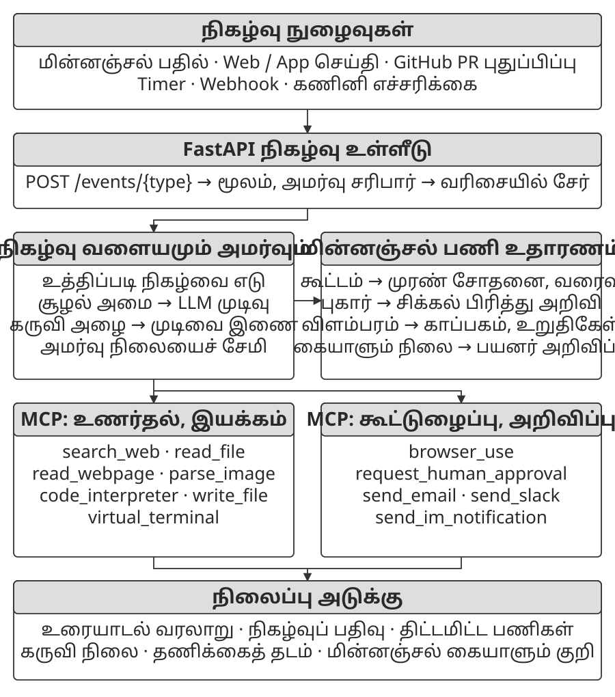
>
> அதே வரிசையைப் பல மூலங்களுக்கும் விரிவுபடுத்தலாம்: மின்னஞ்சல் வருகை, IM அல்லது குறுஞ்செய்தி, GitHub PR மற்றும் Issue புதுப்பிப்புகள், நேரங்காட்டிகள், வெளிப்புற Webhook, மற்றும் பயனர் இணைப்பிலிருந்து விலகல், செயல்முறை நேர முடிவு, வள எச்சரிக்கை போன்ற உள் நிகழ்வுகள். ஒவ்வொரு தகவமைப்பியும் மூலத்தைச் சரிபார்த்து இணைப்புத் தகவலைச் சேர்க்கிறது; கையாளும் முடிவுகள் நிகழ்வு அடையாளத்தின்படி திருப்பி எழுதப்படுகின்றன.
>
> ஏற்புச் சோதனை மூன்று சோதனை மின்னஞ்சல்களைப் பயன்படுத்துகிறது: கூட்ட அழைப்பு நாட்காட்டி முரண்பாட்டுச் சரிபார்ப்பைத் தூண்டி, ஏற்பு அல்லது மறுப்பு வரைவை உருவாக்குகிறது; வாடிக்கையாளர் புகார் முக்கியத் தகவல் பிரித்தெடுப்பு, உயர் முன்னுரிமைக் குறி, பயனர் அறிவிப்பைத் தூண்டுகிறது; சந்தைப்படுத்தல் மின்னஞ்சல் விதிகளின்படி காப்பகப்படுத்தப்படுகிறது.
>
> தற்போதைய துணைப் பதிவு இடைமுக ஆவணச் சரிபார்ப்பையும் அங்கீகாரச் சோதனையையும் முடித்துள்ளது; சோதனை அஞ்சல் பெட்டி இணைப்பு இன்னும் செல்லுபடியான சான்றுகளுக்காகக் காத்திருக்கிறது.
>
> **விரிவாக்கம் (விருப்பத்தேர்வு): பல மூல உள்வரவும் கோளாறு உட்செலுத்தலும்.** சோதனை அஞ்சல் பெட்டியைத் தவிர, ஒரு உள்ளூர் Webhook முனையத்தையும் ஒரு SQS வரிசையையும் (உள்ளூர் உருவகப்படுத்தலைப் பயன்படுத்தலாம்) இணையுங்கள். ஒவ்வொரு தகவமைப்பியும் மூலத்தைச் சரிபார்த்து, உறையை உருவாக்கி, உள்வரவுப் பதிவில் எழுதிய பிறகு மூலத்துக்கு உறுதிப்படுத்துகிறது; இயக்கக்கருவி பதிவிலிருந்து நிகழ்வுகளைப் படித்து, இழை வரிசைப்படி கையாள்கிறது. பின்னர் மூன்று வகைக் கோளாறுகளை உட்செலுத்துங்கள்:
>
> 1. **மீள் ஒப்படைப்பு.** Webhook முனையம் ஒரே ஒப்படைப்பு ID-யுடன் இருமுறை கோரிக்கையைப் பெறுகிறது; பதிவில் ஒரே ஒரு நிகழ்வு மட்டும் தோன்றுகிறது.
> 2. **உறுதிப்படுத்துவதற்கு முன் செயலிழப்பு.** தகவமைப்பி பதிவில் எழுதிய பிறகு, SQS செய்தியை நீக்குவதற்கு முன் நிறுத்தப்படுகிறது; செய்தி மீண்டும் தெரியும்படி வந்து மீண்டும் படிக்கப்பட்ட பிறகும், பதிவில் ஒரே ஒரு நிகழ்வு மட்டும் உள்ளது.
> 3. **ரசீதுக்கு முன் செயலிழப்பு.** இயக்கக்கருவி பதிலை அனுப்பிய பிறகு, ரசீதைப் பதிவு செய்வதற்கு முன் நிறுத்தப்படுகிறது; மறுதொடக்கத்துக்குப் பிறகு பதிவிலிருந்து மீண்டும் இயக்கப்படுகிறது. கால்வாய் சமச்சீர்மை விசையை ஆதரித்தாலோ, அனுப்பிய செய்தியைத் தேட முடிந்தாலோ (எடுத்துக்காட்டாக அஞ்சல் பெட்டியின் அனுப்பிய பதிவு), அதே பதில் மீண்டும் அனுப்பப்படுவதில்லை; இரண்டும் இல்லாத கால்வாய்களில், அந்தப் பதிலை மனித உறுதிப்படுத்தல் நிலுவையில் உள்ளது என்று மட்டுமே குறிக்க முடியும்.
>
> மூன்று வகைக் கோளாறுகளும் பதிவில் தடம் விட வேண்டும்: எந்த ஒப்படைப்பு மீள்வருகையாக நீக்கப்பட்டது, எந்தச் செய்தி மீண்டும் படிக்கப்பட்டது, எந்தப் பதில் சரிபார்க்கப்பட்ட பிறகு மீண்டும் அனுப்பப்படவில்லை.
>
> இந்த விரிவாக்கத்தின் துணைக் குறியீடு இணையம் இல்லாமல் இயங்கும்; API Key தேவையில்லை. சோதனை அஞ்சல் பெட்டியும் SQS வரிசையும் உள்ளூர்க் கோப்புகளால் உருவகப்படுத்தப்படுகின்றன; சான்றுகளுக்காகக் காத்திருக்கும் மேலே உள்ள உண்மையான அஞ்சல் பெட்டியிலிருந்து பிரிக்கப்பட்டுள்ளன; உருவகப்படுத்தப்பட்ட வரிசை தெரிவுநிலை நேர வரம்பு, பெறுதல் கைப்பிடி, செய்திக் குழுவுக்குள் வரிசை ஆகியவற்றைத் தக்கவைக்கிறது. செயலிழப்பைத் தாய்ச் செயல்முறை குறிப்பிட்ட இடத்தில் துணைச் செயல்முறையை நேரடியாக நிறுத்தி உருவாக்குகிறது. பதில் கால்வாய்கள் ஒவ்வொன்றும் ஒரு முறையைக் காட்டுகின்றன: மின்னஞ்சல் அனுப்பிய பதிவைச் சரிபார்க்கிறது, App உரையாடல் சமச்சீர்மை விசையைப் பயன்படுத்துகிறது, குறுஞ்செய்திக்கு இரண்டும் இல்லை. மீளுருவாக்க, `chapter6/agent-with-event-trigger`-க்குள் சென்று `python multisource_demo.py`-ஐ இயக்குங்கள்; முனையம் மூன்று வகைக் கோளாறுகளும் விட்டுச் சென்ற பதிவுகளை ஒவ்வொன்றாக அச்சிடும். துணை இயக்கப் பதிவில், மூன்று வகைக் கோளாறுகளின் சரிபார்ப்புகளும் தேர்ச்சி பெற்றன.
>

மின்னஞ்சல் வரிசை வரிசைப்படியான கையாளுதலுக்கு அடிப்படையை அமைத்தது. அடுத்து, நீண்ட நேரம் இயங்கும் கருவிகளைச் சேர்த்து, காத்திருக்கும் காலத்தில் புதிய கோரிக்கைகளை எவ்வாறு பெறுவது, பணிகளை ரத்து செய்வது, வேலையை மீட்பது என்பதை விவாதிப்போம்.

### இயல்பான ஒத்திசைவற்ற தன்மை ஆதரிக்கப்படாதபோது இணக்கத் தீர்வு

ஏஜெண்ட் மின்னஞ்சல் வரைகிறது; தொடர்பைத் தேட `search_contacts`-ஐ ஏற்கனவே அழைத்துவிட்டது என்று வைத்துக்கொள்வோம். முடிவு இன்னும் திரும்பாதபோது, பயனர் "ஒரு நிமிடம், முதலில் நாளைய வானிலையைப் பார்" என்று கேட்கிறார். தற்போதைய மாதிரி இடைமுகம் ஒவ்வொரு கருவி அழைப்புக்கும் முதலில் முடிவை ஜோடியாக்கக் கோரினால், பின்தள நிலையை இடைமுகம் ஏற்கும் செய்தி வரிசையாக Harness மாற்ற வேண்டும்.

**ஒத்திசைவான செய்தி வடிவத்தில் பின்தள நிலையை வெளிப்படுத்துதல்.**

**ஒத்திசைவான இடைமுகத்துக்கு இணக்கமாக இருக்கும்போது, சாதாரண அழைப்புகளும் உண்மையான முடிவுகளும் ஜோடியாக இருப்பதை இயன்றவரை தக்கவைத்து, இடையில் பணியை மாற்றும்போது மட்டும் நிலைப் பதிலைச் சேர்க்க வேண்டும்.** ஒவ்வொரு அழைப்புக்கும் முன்கூட்டியே "இன்னும் இயங்குகிறது" என்று நிரப்பினால், பாதை முடிக்கப்படாத நிலைகளால் நிரம்பி, உண்மையான முடிவுகளைத் தடமறியும் மாதிரியின் சுமை அதிகரிக்கும். குறிப்பாக ஐந்து விதிகளைப் பின்பற்றலாம்:

1. **முழு அழைப்பைப் பதிவு செய்தல்.** API முடித்த assistant செய்தியையும் கருவி அழைப்பு உருப்படியையும் பாதையில் எழுதி, அழைப்பு அடையாளத்தைத் தக்கவைத்தல். சேவையகப் பகுத்தறிவு நிலை வழங்குநர் விதிக்கும் தொடர் முறைப்படி சேமிக்கப்படுகிறது.
2. **உண்மையான நிறைவைப் பதிவு செய்தல்.** கருவி முடிந்ததும் உண்மையான முடிவு, பணி அடையாளம், இயக்க நிலையை எழுதுதல்; இயங்கும்போது பணி மேலாளர் முடிக்கப்படாத நிலையைத் தொடர்ந்து சேமிக்கிறது.
3. **மாற்றும்போது தற்போதைய நிலையைத் தெரிவித்தல்.** இத்தகைய முடிவுச் சுமையை அனுமதிக்கும் இடைமுகங்களில், நிலுவை அழைப்புகளுக்குத் தெளிவான நிலைத் தகவலைத் திருப்பித் தரலாம்; எடுத்துக்காட்டாக "பணி இன்னும் பின்தளத்தில் இயங்குகிறது; முடிவு இன்னும் உருவாகவில்லை"; பின்னர் பயனர் நிகழ்வைச் சேர்க்கலாம். நிலைப் பதிலில் உள்ள பணி அடையாளம் அடுத்தடுத்த நிறைவு அறிவிப்பை இணைக்கிறது.
4. **இடைநிறுத்தத்துக்குப் பிந்தைய செய்திகளை ஒழுங்கமைத்தல்.** இடையில் தொடரும் திறன் இல்லாதபோது, முடிக்கப்படாத உருவாக்கத்தை ரத்து செய்து, முடிந்ததாக உறுதிசெய்யப்பட்ட செய்திகளையும் கருவி நிலையையும் தக்கவைத்து, பின்னர் புதிய கோரிக்கையைச் சமர்ப்பித்தல். முடிக்கப்படாத வெளியீடு இடைமுக விதிகளின்படி கையாளப்பட வேண்டும்; பாதி அளவுருக்களை இயக்கக்கூடிய அழைப்பாகக் கருதக் கூடாது.
5. **வழக்கமான நிகழ்வுகளைத் தொகுதியாகப் பெறுதல்.** கூடுதல் தகவல் வரிசைக்குள் நுழைந்து, தற்போதைய சுழற்சி முடியும்போதோ குறிப்பிட்ட பாதுகாப்புப் புள்ளியிலோ ஒருங்கே சமர்ப்பிக்கப்படுகிறது; எந்த நிகழ்வுகள் ஏற்கனவே கையாளப்பட்டன என்பதும் பதிவு செய்யப்படுகிறது.

தொடர்புத் தேடல் எடுத்துக்காட்டில், முழு அழைப்பு முதலில் பாதையில் எழுதப்படுகிறது; பயனர் பணியை மாற்றும்போது, தேடல் இன்னும் இயங்குகிறது என்ற நிலைப் பதிலை Harness சேர்த்து, பின்னர் வானிலைக் கோரிக்கையைச் சமர்ப்பிக்கிறது. தொடர்பு முடிவு சற்று நேரம் கழித்து வந்து, மூலமும் பணி அடையாளமும் கொண்ட புதிய நிகழ்வாகச் சூழலுக்குள் நுழைகிறது; ஏஜெண்ட் பின்னர் மின்னஞ்சல் வரைவதைத் தொடர்கிறது. அசல் அழைப்புக்கு ஏற்கனவே நிலைப் பதில் கிடைத்திருந்தால், அடுத்தடுத்த முடிவு தகவமைப்பி ஒப்புக்கொண்ட நிகழ்வு வடிவத்தைப் பயன்படுத்தி, அழைப்பு–முடிவு ஜோடி உறவைப் பேணுகிறது.

நிலைப் பதில் தற்போதைய இயக்க முன்னேற்றத்தை மட்டுமே விளக்குகிறது. தொடர்புத் தரவைச் சார்ந்த படிகள், உண்மையான முடிவு வந்த பிறகே தொடர வேண்டும். பணி மேலாளர் `running`, `completed`, `cancelled`, `failed` போன்ற நிலைகளைச் சேமித்து, பதில் அனுப்புவதற்கோ அடுத்த கருவியை இயக்குவதற்கோ முன் சார்புநிலைகள் பூர்த்தியானவா என்று சரிபார்க்கலாம்.

**பணிக் கைப்பிடி கொண்டு ஒத்திசைவற்ற கருவிகளை வடிவமைத்தல்.**

புதிதாக வடிவமைக்கப்படும் நீண்ட பணிக் கருவிகளுக்கு, "தொடக்கம்" என்பதை ஒரு முழுமையான செயலாக வரையறுத்து, உண்மையான பணிக் கைப்பிடியை உடனே திருப்பித் தருவதையே நான் விரும்புகிறேன். இதனால் "ஏற்கனவே தொடங்கியது", "ஏற்கனவே முடிந்தது" ஆகியவற்றை மாதிரி வேறுபடுத்த முடிகிறது; அடுத்தடுத்த வினவல், ரத்து, முடிவு நிகழ்வுகளுக்கும் ஒருங்கிணைந்த இணைப்பு அடிப்படை கிடைக்கிறது. எடுத்துக்காட்டாக, `initiate_phone_call` தொலைபேசிப் பணியைத் தொடங்கி, பணி அடையாளத்தையும் "அழைக்கிறது" என்ற நிலையையும் திருப்பித் தருகிறது; `phone_call_connected`, `phone_call_ended` முறையே இணைப்பையும் முடிவையும் தெரிவிக்கின்றன.

கருவி விளக்கம் தெளிவாக எழுத வேண்டும்: "இந்தக் கருவி தொலைபேசிப் பணியைத் தொடங்குகிறது; வெற்றியடைந்தால் பணி ID-ஐத் திருப்பித் தரும். நீங்கள் பிற விஷயங்களைத் தொடர்ந்து கையாளலாம்; அழைப்பு முன்னேற்றமும் முடிவும் தனி நிகழ்வுகள் வழியாகத் திரும்பும்." கருவிப் பெயர் இது ஒரு தொடக்கச் செயல் என்பதை விளக்குகிறது; திருப்புக் கட்டமைப்பும் அடுத்தடுத்த நிகழ்வுகளும் பணி எவ்வாறு முன்னேறி முடிகிறது என்பதை விளக்குகின்றன. அமைப்பு பணி ID-யின்படி வினவல், ரத்து, மீட்பு இடைமுகங்களையும் வழங்கி, இப்போது இன்னும் என்ன செய்யலாம் என்பதை மாதிரி அறியச் செய்கிறது.

**தொகுதி நிகழ்வுகளை ஒவ்வொன்றாகக் கையாளுதல்.**

பல நிகழ்வுகள் ஒரே முறையில் சூழலுக்குள் நுழையும்போது, மாதிரி கடைசியானதுக்கு மட்டும் பதிலளித்து, முன்னால் ஏற்கனவே முன்வைக்கப்பட்ட கோரிக்கைகளைத் தவறவிடலாம். இயக்கக்கருவி ஒவ்வொன்றின் கையாளும் நிலையையும் தக்கவைத்து, இன்னும் பதிலளிக்கப்படாத நிபந்தனைகள் தொடர்ந்து தெரியும்படி செய்ய வேண்டும். ப்ராம்ப்ட் மாதிரியை ஒவ்வொன்றாகச் சரிபார்க்கக் கோரலாம்; நிலைப் பட்டை இன்னும் கையாளப்படாத தகவலைப் பட்டியலிடலாம்:

```text
[未处理事件 1/4] database_query 结果：……
[未处理事件 2/4] 用户补充：只看北京地区的数据
[未处理事件 3/4] 系统提醒：报告截止时间还有 30 分钟
[未处理事件 4/4] 用户询问：进度如何？
```
தொகுதிச் சுருக்கம் "1 கருவி முடிவு, 2 பயனர் செய்திகள், 1 அமைப்பு நினைவூட்டல்" என்று குறிப்பிடலாம். இயக்கக்கருவி நிகழ்வுகளைப் பணிக் கட்டுப்பாடுகளுடன் மேலும் இணைக்கிறது: பகுதி நிபந்தனை வினவல் எல்லையைப் புதுப்பிக்கிறது, இறுதித் தேதி திட்டமிடலைப் பாதிக்கிறது, முன்னேற்ற விசாரணைக்குப் பதில் தேவை. கையாண்ட பிறகு முடிந்தது, காத்திருக்கிறது, அல்லது தெளிவுபடுத்தல் தேவை என்ற நிலையைப் பதிவு செய்து, அடுத்த சுற்றில் தீர்க்கப்படாத உருப்படிகளைத் தொடர்ந்து தக்கவைக்க வேண்டும்.

அதே பணி எண் தொடக்கம், முன்னேற்ற அறிக்கை, இறுதி இயக்க முடிவு ஆகியவற்றை இணைக்கிறது. இடையில் யாராவது நிறுத்தச் சொன்னால், இந்த எண்ணின் கீழ் ரத்து ரசீது உள்ளதா என்று மீண்டும் சரிபார்க்க வேண்டும்.

> **சோதனை 6-2 ★★★: இணை இயக்கமும் இடைமறிக்கும் திறனும் கொண்ட ஒத்திசைவற்ற ஏஜெண்ட்**
>
> இந்தச் சோதனை முதலில் ஒத்திசைவற்ற இயக்கக்கருவியைச் சரிபார்த்து, பின்னர் முடிவுகளைச் சரிபார்க்க மாதிரியை இணைக்கிறது. துணை இயக்கப் பதிவு உண்மையான இயக்க அமைப்புத் துணைச் செயல்முறைகளைக் கொண்டு நான்கு சூழ்நிலைகளை முடித்தது; நிகழ்வுத் திட்டமிடலும் அறிக்கையும் உறுதியான ஸ்கிரிப்டால் இயக்கப்பட்டன.
>
> 1. **பின்தள இயக்கமும் உடனடிப் பதிலும்.** சில வினாடிகள் நீடிக்கும் பகுப்பாய்வுச் செயல்முறையைத் தொடங்கி, உடனே பணி அடையாளத்தைத் திருப்பித் தருதல்; காத்திருக்கும்போது தற்போதைய நேரத்துக்குப் பதிலளித்து, முடிந்ததும் பகுப்பாய்வு முடிவைப் பெறுதல்.
> 2. **வரிசையும் தொகுதிக் கையாளுதலும்.** நீண்ட பணியின்போது வரிசையாக "ஜப்பானிய மொழியில் பதில் சொல்", "வலைப்பக்கமாக ஒழுங்கமை" என்று சேர்க்கப்படுகிறது; பணி முடிந்த பிறகு முடிவும் இரு கோரிக்கைகளும் ஒரே தொகுதியாகக் கையாளப்படுகின்றன. ஸ்கிரிப்ட் ஜப்பானிய HTML-ஐ உருவாக்குகிறது.
> 3. **ரத்தும் மீட்பும்.** "பகுப்பாய்வை நிறுத்து" என்று பெற்றதும், இன்னும் உருவாகிக்கொண்டிருக்கும் மாதிரிச் சுற்றை இடைமறித்து, இயங்கும் எல்லாப் பின்தளப் பணிகளையும் நிறுத்தக் கோருவதைக் காட்டுகிறது. இந்த முறை இடைமறிப்பை ஸ்கிரிப்ட் அனுப்பியது; அப்போது T1 என்ற ஒரே ஒரு பகுப்பாய்வுச் செயல்முறை மட்டும் இருந்தது. 0.803-ஆம் வினாடியில், இடைமறிப்பு நிகழ்வு T1-இன் முன்னேற்றம் 18% என்று பதிவு செய்தது; 0.806-ஆம் வினாடியில்தான் அமைப்பு அதன் வெளியேறும் குறியீடு −15 என்று பதிவு செய்தது. உடனே தொடங்கிய T2 ஒரு புதிய பணி. 4.436-ஆம் வினாடியில் பெற்றது T2-இன் முடிவு; T1 நிறைவுத் திரும்பழைப்பைத் தூண்டவில்லை.
> 4. **இணைப் பணிகளும் முன்னேற்ற முடிவும்.** மூன்று பகுப்பாய்வுச் செயல்முறைகள் ஒருசேரத் தொடங்கப்பட்டு, ஒவ்வொரு தர்க்க நேரப் படியிலும் முறையே 3%, 2%, 1% முன்னேறுகின்றன. இந்தச் சோதனையின் இணை முன்னேற்றப் பதிவில், மிக வேகமான T1 முடிந்தபோது, வினவல் ரசீது T2 68%-ஐயும் T3 34%-ஐயும் எட்டியதைக் காட்டியது. படம் 6-5-இன்படி, 50%-ஐத் தாண்டாத பணிகள் ரத்து செய்யப்படுகின்றன. ஸ்கிரிப்ட் T3-ஐ மட்டும் ரத்து செய்தது; இறுதியில் T1, T2 ஆகியவற்றின் முடிவுகள் பெறப்பட்டன. அதே இயக்கக்கருவி முழுத் தொகுதி நிறுத்தத்துக்கும் பதிலளித்து, இன்னும் பயனுள்ள இணை வேலைகளையும் தக்கவைக்க முடிகிறது என்பதை இது காட்டுகிறது.
>
> 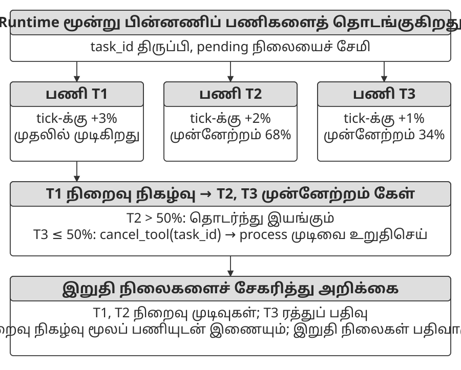
>

### மாதிரியின் இயல்பான ஒத்திசைவற்ற தன்மை: GPT-6 Astra

முந்தைய தீர்வுகளில், ஒத்திசைவான செய்தி வடிவத்துக்கு Harness தகவமைக்கிறது. இயல்பான ஒத்திசைவற்ற இடைமுகமோ, கருவி இன்னும் திரும்பாதபோதே மாதிரி தனித்த வேலைகளைத் தொடர்ந்து கையாண்டு, பின்னர் முடிவுகளைப் பெற நேரடியாக அனுமதிக்கிறது. 2026 செப்டம்பர் நிலவரப்படி, GPT-6 Astra ஒத்திசைவற்ற கருவி அழைப்பு (Async tool calling), சுற்றின் நடுவே வழிநடத்தல் (Mid-turn steering) ஆகியவற்றை வழங்குகிறது; அவை முறையே கருவிக் காத்திருப்பையும் பயனர் புதுப்பிப்புகளையும் கையாள்கின்றன. ஒத்திசைவான இடைமுகத் தகவமைப்பையும் இயல்பான ஒத்திசைவற்ற தன்மையையும் படம் 6-6 ஒப்பிடுகிறது.[^ch6-22][^ch6-23]

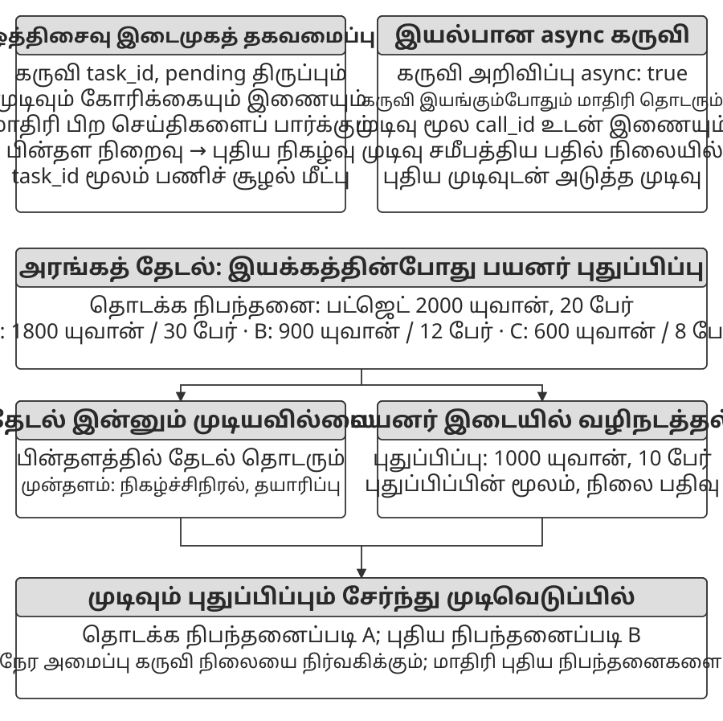

**கருவிக்காகக் காத்திருக்கும்போது தனித்த வேலைகளைத் தொடர்தல்.** எடுத்துக்காட்டாக, கூட்ட அரங்க வினவலைத் தொடங்கிய பிறகு, ஏஜெண்ட் முதலில் நிகழ்ச்சி நிரலையும் தயாரிப்புப் பட்டியலையும் ஒழுங்கமைக்கலாம்; வினவல் திரும்பிய பிறகு, விலையையும் கொள்ளளவையும் ஒப்பிடலாம். கருவி வரையறையில் உள்ள `async: true` ஒத்திசைவற்ற திறனை அறிவிக்கிறது; பயன்பாடு முழு அழைப்பு உருப்படியைப் பெற்றதும் இயக்கத்தைத் தொடங்கி, அழைப்பு அடையாளமான `call_id`-ஐச் சேமிக்கிறது. முடிவு வரும்போது, பயன்பாடு அசல் அடையாளத்தின்படி முடிவைத் திருப்பித் தந்து, சமீபத்திய பதில் நிலையுடன் தொடர்கிறது. அடுத்தடுத்த வேலைகளை மாதிரி ஏற்பாடு செய்கிறது; அழைப்பு இணைப்பையும் பணி வாழ்க்கைச் சுழற்சியையும் Harness நிர்வகிக்கிறது.[^ch6-22]

**பணி நடக்கும்போதே புதிய கோரிக்கைகளைப் பெறுதல்.** மாதிரி சிந்திக்கும்போதோ பதிலை ஒழுங்கமைக்கும்போதோ, பயனர் "நிதிநிலையை 1000 ஆகக் குறை", "பங்கேற்பாளர் எண்ணிக்கையை 10 ஆக மாற்று" என்று சேர்க்கலாம். பயன்பாடு அதே இணைப்பு வழியாக வழிநடத்தல் நிகழ்வை அனுப்புகிறது; சேவையகம் பெற்றதை உறுதிசெய்த பிறகு, தற்போதைய பதில் நிலையின்படி தொடர்கிறது. இணைப்பு அறுந்து மீண்டும் இணைந்த பிறகு, சேமித்த நிகழ்வுகள், பதில் நிலையின்படி பயன்பாடு பணியை மீட்கலாம்.[^ch6-23]

இந்த இரு திறன்களையும் இணைத்துப் பயன்படுத்தலாம்: அரங்க வினவல் தொடர்ந்து இயங்குகிறது; பயனரின் புதிய கோரிக்கை அடுத்தடுத்த முடிவுக்குள் நுழைகிறது; வினவல் முடிவு திரும்பிய பிறகு தேர்வு முடிகிறது. இயக்கி அதே நேரத்தில் பின்தளப் பணிகளின் உண்மையான நிலையைப் பராமரிக்கிறது. வினவலை நிறுத்தவோ முன்பதிவை ரத்து செய்யவோ வேண்டியிருக்கும்போது, Harness தொடர்புடைய இடைமுகத்தை அழைத்து ரசீதைச் சரிபார்க்கிறது; ஏற்கனவே முடிந்த வணிகச் செயல்கள் திரும்பப் பெறுதல் அல்லது ஈடுசெய்தல் செயல்முறைக்குள் நுழைகின்றன.

மாதிரியும் இடைமுகமும் ஏற்கனவே இயல்பான ஒத்திசைவற்ற தன்மையை ஆதரித்தால், இயல்பான நெறிமுறையையே நான் முன்னுரிமையாகப் பயன்படுத்துவேன்; கருவி நிலுவை, பயனர் புதுப்பிப்பு, பதில் தொடர்ச்சி ஆகியவை இடைமுக ஒப்பந்தப்படி ஓடட்டும். ஒத்திசைவான இணக்க அடுக்கு முக்கியமாக ஏற்கனவே உள்ள மாதிரிகளுக்கும் பழைய இடைமுகங்களுக்கும் சேவை செய்கிறது; மாதிரி மேம்படுத்தப்பட்ட பிறகு, செய்தி ஜோடியை நிரப்புவதற்காக மட்டும் இருந்த இணக்கத் தர்க்கத்தைப் படிப்படியாக நீக்கி, பொறியியல் முதலீட்டைப் பணி நிலை, ரத்து, மீட்பு ஆகியவற்றில் குவிக்கலாம்.

### ஒத்திசைவற்ற பணிகளை நம்பகமாகக் கையாளுதல்

நம்பகமான ஒத்திசைவற்ற இடைவினைக்குச் செய்திகள், பணிகள், இயக்க நிலை ஆகியவற்றை ஒருசேரச் சரிபார்க்க வேண்டும்.

1. **முடிவின் உரிமை.** தாமதமான முடிவு அசல் அழைப்பு அடையாளத்தைக் கொண்டு வருகிறது; பயன்பாடு அதைத் தொடர்புடைய பணியுடன் பொருத்துகிறது; அந்த முடிவைச் சார்ந்த தீர்மானங்கள் தரவு வந்த பிறகு தொடர்கின்றன.
2. **மீட்பும் ரத்தும்.** பயனர் கோரிக்கையை மாற்றிய பிறகு, அமைப்பு இன்னும் செல்லுபடியான வேலைகளைத் தக்கவைத்து, அடுத்தடுத்த படிகளைப் புதுப்பித்து, எந்தப் பின்தளப் பணிகள் தொடர்ந்து இயங்குகின்றன, எவை நின்றுவிட்டன என்பதைத் தெளிவுபடுத்துகிறது.
3. **பல கோரிக்கைகள்.** நிதிநிலை, பங்கேற்பாளர் எண்ணிக்கை, பகுதி, இறுதித் தேதி ஆகியவை தனித்தனியாகப் பணி நிலைக்குள் நுழைகின்றன; இறுதி முடிவு இந்த நிபந்தனைகளை ஒவ்வொன்றாகச் சரிபார்க்கிறது.

> **சோதனை 6-3 ★★★: மாதிரியின் இயல்பான ஒத்திசைவற்ற தன்மையும் சுற்றின் நடுவே வழிநடத்தலும்**
>
> இந்தச் சோதனை, உருவகப்படுத்தப்பட்ட கூட்டத்துக்கு நிதிநிலையையும் பங்கேற்பாளர் எண்ணிக்கையையும் பூர்த்தி செய்யும் மலிவான அரங்கத்தை ஏஜெண்ட் தேர்ந்தெடுக்கச் செய்கிறது. ஆரம்ப நிதிநிலை 2000, பங்கேற்பாளர்கள் 20; வினவல் கருவி 8 வினாடிகள் காத்திருந்த பிறகே மூன்று அரங்கங்களின் விலைகளையும் கொள்ளளவையும் திருப்பித் தருகிறது.
>
> | அரங்கம் | விலை | கொள்ளளவு |
> |---|---:|---:|
> | A | 1800 | 30 |
> | B | 900 | 12 |
> | C | 600 | 8 |
>
> ஆரம்ப நிபந்தனைகளில் A-ஐத் தேர்ந்தெடுக்க வேண்டும். வழிநடத்தல் குழு பணியின் நடுவே இரு புதுப்பிப்புகளைப் பெறுகிறது: நிதிநிலை 1000, பங்கேற்பாளர்கள் 10; அப்போது B-ஐத் தேர்ந்தெடுக்க வேண்டும். கருவி அதே நேரத்தில் புதிதாக உருவாக்கப்பட்ட ஒரு ரசீதையும் திருப்பித் தருகிறது; மாதிரி உண்மையில் வந்த முடிவைப் பயன்படுத்தியதா என்று சரிபார்க்க, இறுதிப் பதில் அதைக் குறிப்பிட வேண்டும்.
>
> சோதனையில் ஐந்து குழுக்கள், ஒவ்வொன்றும் மூன்று முறை: ஒத்திசைவான கருவி, இயல்பான ஒத்திசைவற்ற கருவி, பகுத்தறிவின்போது வழிநடத்தல், ஒத்திசைவற்ற கருவிக் காத்திருப்பின்போது வழிநடத்தல், வழிநடத்தலை ஆதரிக்காத மாதிரி ஒப்பீடு. முதல் இரு குழுக்கள் காத்திருக்கும்போது தனித்த தயாரிப்புப் பட்டியலை வெளியிட முடிகிறதா என்று ஒப்பிடுகின்றன; இரு வழிநடத்தல் குழுக்களும் நிதிநிலையும் பங்கேற்பாளர் எண்ணிக்கையும் ஒருசேர அமலாகின்றனவா என்று சரிபார்க்கின்றன; திறன் ஒப்பீடு, இடைமுகம் ஆதரவில்லை என்று தெளிவாகத் தெரிவிக்கிறதா என்று சரிபார்க்கிறது.
>
> சேமிக்கப்பட்ட இயக்கப் பதிவில், ஒத்திசைவற்ற கருவிக் குழு காத்திருக்கும்போதே தனித்த பட்டியலை முடித்தது; இரு வழிநடத்தல் குழுக்களும் புதிய நிபந்தனைகளின்படி B-ஐத் தேர்ந்தெடுத்தன. கருவி கொண்ட இயக்கங்கள் அனைத்தும் ஒருமுறை மட்டுமே வினவி, உண்மையான முடிவை அசல் அழைப்புக்குத் திருப்பித் தந்தன; ஒப்பீட்டு மாதிரியின் இடைமுகம், ஒரு சுற்று உருவாக்கத்தின் நடுவே புதிய கோரிக்கைகளைப் பெறுவதை ஆதரிக்காது என்று தெளிவாகப் பதிலளித்தது. ஒத்திசைவான, ஒத்திசைவற்ற குழுக்களின் மொத்த நேரம் ஏறக்குறைய ஒன்றே; முக்கிய வேறுபாடு காத்திருக்கும்போது பிற வேலைகளை முன்னெடுக்க முடிகிறதா என்பதில் உள்ளது.
>
> மாதிரி பங்கேற்பாளர் எண்ணிக்கை 10 ஆக மாறியதை மட்டும் நினைவில் வைத்து, இன்னும் பழைய நிதிநிலை 2000-இன்படி தேர்ந்தெடுத்தால், எதைத் தேர்ந்தெடுக்கும்? A, B இரண்டிலும் இடம் போதும்; மலிவானது இன்னும் B. எனவே சரியான அரங்கத்தைத் தேர்ந்தெடுத்தது, நிதிநிலை புதுப்பிக்கப்பட்டதா என்பதைக் காட்டாது.
>
> பங்கேற்பாளர் எண்ணிக்கை மாறியது; ஏற்கனவே அனுப்பிய வினவலை மீண்டும் செய்ய வேண்டுமா? இந்தச் சோதனையின் கருவிக்கு வடிகட்டும் அளவுரு இல்லை; மூன்று அரங்கங்களையும் திருப்பித் தருகிறது. உதவியாளர் வழியில் உள்ள முடிவையே மீண்டும் பயன்படுத்தி, அது திரும்பிய பிறகு 10 பேர், நிதிநிலை 1000 என்று வடிகட்டலாம். கருவி 20 பேருக்கு மேல் கொள்ளும் அரங்கங்களை மட்டும் திருப்பித் தந்திருந்தால், பழைய முடிவில் A மட்டுமே இருக்கும்; 12 பேர் கொள்ளும் B அதில் இருக்கவே இருக்காது. அப்போது பழைய பட்டியலில் பங்கேற்பாளர் எண்ணிக்கையை மட்டும் 10 ஆக மாற்றினால், B இன்னும் விடுபடும். அசல் வினவல் ஏற்கனவே B-ஐ வடிகட்டியிருந்தால், மீண்டும் வினவ வேண்டும்.

ஒத்திசைவற்ற பொறிமுறை, பணி முன்னேறும்போதே வெளிப்புற மாற்றங்கள் அமைப்புக்குள் நுழைய அனுமதிக்கிறது. குரல், திரை, ரோபோ இடைவினைகள் பின்னூட்டச் சுழற்சியை மேலும் சுருக்குகின்றன: அமைப்பு தொடர்ந்து உள்ளீட்டைப் பெற்று, பொருத்தமான தருணத்தில் வெளியீட்டையும் செயலையும் சரிசெய்ய வேண்டும்.

## குரல்: மிக இயல்பான மனித–இயந்திர இடைமுகம்

கைகளோ பார்வையோ வேறு வேலையில் ஈடுபட்டிருக்கும்போதும், பயனர் தேவைகளை விளக்கவும், நிபந்தனைகளைச் சேர்க்கவும், முடிவுகளை உறுதிசெய்யவும் குரல் ஏஜெண்டுக்கு வழி செய்கிறது. குரல் உள்ளீட்டு முறை வாய்மொழியை உரையாக மாற்றுகிறது; குரல் ஏஜெண்டோ மேலும் உரையாடல், கருவி அழைப்பு, பதில் இயக்கம் ஆகியவற்றை நிர்வகிக்கிறது; இரண்டும் அறிமுகம் குறிப்பிட்ட whisper coding-ஐ ஆதரிக்கலாம்.

இந்தப் பகுதி இரு பயன்பாடுகளை விவாதிக்கிறது: பயனர் ஏஜெண்டுடன் நேரடியாக உரையாடுவது, மற்றும் பயனருக்காக ஏஜெண்ட் வெளிநபர்களுடன் தொடர்புகொள்வது. முன்னது அடையாளம் காணல், பதில், இடைமறிப்பில் கவனம் செலுத்துகிறது; பின்னது அழைப்பின்போதே அடையாள உறுதிப்படுத்தல், வணிக வினவல், முடிவெடுத்தல் ஆகியவற்றையும் முடிக்க வேண்டும்.

### இடைவினை நேரவரிசை: தொடர்சங்கிலியிலிருந்து முழு இருவழி வரை

GPT-Live-ஐ அறிமுகப்படுத்தும்போது OpenAI, தொடர்சங்கிலி (cascade), சுற்று அடிப்படையிலான ஒலி மாதிரி, முழு இருவழி (full-duplex) ஆகிய மூன்று வகைக் குரல் இடைவினைகளை மீள்பார்வை செய்தது[^ch6-12]. இந்தப் பரிணாமப் பாதை "எப்போது பேசத் தொடங்குவது, எப்போது தொடர்ந்து கேட்பது" என்பதைப் படிப்படியாக மாதிரியே தொடர்ந்து தீர்மானிக்கும்படி ஒப்படைக்கிறது. தொடர்சங்கிலி அமைப்புகள் முக்கியமாக முனைத் தர்க்கத்தைக் கொண்டு ஒப்படைப்பை ஏற்பாடு செய்கின்றன; முழு இருவழி மாதிரிகளோ தொடர் ஒலியையும் உரையாடல் நிலையையும் இணைத்து, மேற்பொருந்தல், இடைநிறுத்தம், இடைமறிப்பைக் கையாள முடியும்.

| முன்னுதாரணம் | மையக் கட்டமைப்பு | செயலாக்க எளிய திறன்கள் | முக்கிய வடிவமைப்புப் பிரச்சினைகள் |
|---|---|---|---|
| தொடர்சங்கிலி | VAD, ASR, LLM, TTS பணிப்பகிர்வு | தொகுதிகளைத் தனித்தனியாக மாற்றுதல், ஒவ்வொரு பகுதியின் உள்ளீடு–வெளியீட்டைச் சரிபார்த்தல் | தொகுதிகளுக்கு இடையிலான தாமதம், உரைமாற்றத்தில் விடுபட்ட ஒலியியல் தகவல் |
| சுற்று அடிப்படையிலான முனைக்கு-முனை ஒலி மாதிரி | மாதிரி நேரடியாக ஒலியைப் பெற்று உருவாக்குகிறது | குரல் ஏற்ற இறக்கம், உணர்ச்சி போன்ற தகவல்களைக் கொண்டு பதிலை ஒழுங்கமைத்தல் | பேச்சு முடிவைத் தீர்மானித்தல், சுற்று மாற்றம், பதில் தருணம் |
| முழு இருவழி | தொடர்ந்து ஒலியைப் பெற்று வெளியீட்டை உருவாக்குதல் | மேற்பொருந்திய பேச்சு, ஆமோதிப்பு, இடைமறிப்பு, தொடர் இடைவினை | தொடர் நிலை, வெளியீட்டுக் கட்டுப்பாடு, இடைவினை மதிப்பீடு |

மாதிரி நேரடியாக ஒலியைச் செயலாக்குகிறதா, உள்ளீடு–வெளியீடு ஓடை வடிவமா, ஒருசேரக் கேட்கவும் பேசவும் முடியுமா என்பவை தனித்தனியாகச் சரிபார்க்கக்கூடிய திறன்கள். தொடர்சங்கிலி அமைப்புகளிலும் ஓடைத் தொகுதிகளையும் இடைமறிப்புக் கட்டுப்பாட்டையும் சேர்க்கலாம்; முனைக்கு-முனை மாதிரிகளின் இடைவினைத் தாளமோ குறிப்பிட்ட வடிவமைப்பைப் பொறுத்தது.

[^ch6-12]: OpenAI, *Introducing GPT-Live*, 2026-07-08; தொடர்சங்கிலி, சுற்று அடிப்படையிலான ஒலி மாதிரி, முழு இருவழி இடைவினையை அறிமுகப்படுத்துகிறது.

### முன்னுதாரணம் ஒன்று · தொடர்சங்கிலிக் குழாய் (Cascading)

தொடர்சங்கிலி அமைப்பு குரல் உரையாடலைப் பல தொகுதிகளாகப் பிரிக்கிறது. குரல் செயல்பாடு கண்டறிதல் (VAD) ஒலியில் பேச்சுப் பகுதிகளை அடையாளம் காண்கிறது; முனைத் தர்க்கம் இந்தப் பகுதியை எப்போது சமர்ப்பிப்பது என்று தீர்மானிக்கிறது; தானியங்கிப் பேச்சு அடையாளம் காணல் (ASR) ஒலியை உரையாக மாற்றுகிறது; LLM கோரிக்கையைப் புரிந்துகொண்டு பதிலை உருவாக்குகிறது; பேச்சு இணைப்பு (TTS) பதிலை இயக்கக்கூடிய ஒலியாக மாற்றுகிறது. வரிசையாக இயங்கும் அடிப்படைக் கட்டமைப்பைப் படம் 6-7 காட்டுகிறது.

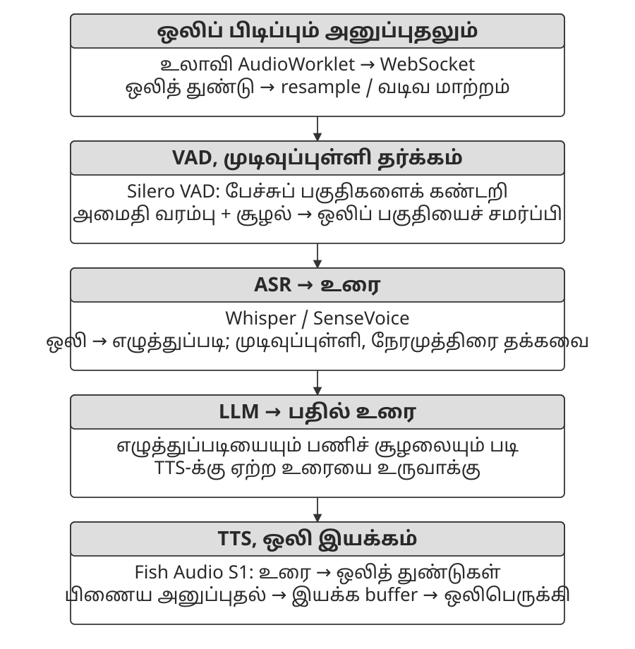

ஒலியியல் VAD யாரோ பேசும் பகுதிகளைக் கண்டறிவதால், பின்னர் வரும் அடையாளம் காணல் நீண்ட அமைதிப் பகுதிகளைத் தவிர்க்கலாம். ஆனால் ஒரே இடைநிறுத்தம், "நான் முன்பதிவு செய்ய விரும்புவது……" என்பதற்குப் பின் வருவதற்கும், "வியாழன் காலைக்குச் சீட்டு உண்டா?" என்பதற்குப் பின் வருவதற்கும் பொருள் வேறு. பொருள் சார்ந்த VAD (பொருள் முனைக் கண்டறிதல்) முன்னதில் தொடர்ந்து கேட்டு, பின்னதில் மட்டும் பேச்சை உரையாடல் மாதிரிக்கு ஒப்படைக்கலாம். இதுவே குரல் அவதானிப்பின் நேர அடர்த்தி குறைப்பு: தொடர் ஒலிப் பகுதி சில தருணங்களில் மட்டுமே பகுத்தறிவைத் தூண்டுகிறது. பேசுவதா என்பதை இந்த வாக்கியத்தைக் கேட்ட மாதிரி தீர்மானிக்கிறது; அது தொடர்ந்து கேட்கலாம், அல்லது முதலில் விமானத்தைத் தேடலாம்.

| தொகுதி | பங்கு | பொதுவான காத்திருப்பு அல்லது பிழை மூலங்கள் |
|---|---|---|
| VAD, முனைத் தர்க்கம் | பேச்சைக் கண்டறிந்து, சமர்ப்பிக்கும் தருணத்தைத் தீர்மானித்தல் | அமைதி வரம்பு, இரைச்சல், இடைநிறுத்தம் |
| ASR | ஒலியை உரையாக மாற்றுதல் | குறிவிலக்க நேரம், நபர் பெயர்கள், சிறப்புச் சொற்களை அடையாளம் காணல் |
| LLM | புரிதல், பகுத்தறிவு, பதில் உருவாக்கம் | கோரிக்கை வரிசை, முதல் பதில் பகுதியின் உருவாக்கம் |
| TTS, இயக்கம் | ஒலியை இணைத்து ஒலிபெருக்கிக்கு அனுப்புதல் | முதல் தொகுப்பு இணைப்பு, பிணையக் கடத்தல், இயக்க இடையகம் |

முற்றிலும் வரிசையான செயலாக்கத்தில், பயனர் பேசி முடித்த பிறகும், முனை உறுதிப்படுத்தல், உரைமாற்றம், பதில் உருவாக்கம், முதல் ஒலிப் பகுதி ஆகியவற்றுக்காக வரிசையாகக் காத்திருக்க வேண்டும். படம் 6-8-இன் எடுத்துக்காட்டில், பயனர் முதல் பதில் ஒலியைக் கேட்கும்போது ஏற்கனவே 1.4 வினாடிகள் கடந்துவிட்டன; அவற்றில் மிக நீண்ட பகுதி, பயனர் பேசி முடித்ததை அமைப்பு உறுதிசெய்வதற்கான காத்திருப்பு (500 மில்லி வினாடிகள்). உரைமாற்றத்தை 100 மில்லி வினாடியிலிருந்து 50 மில்லி வினாடியாகக் குறைத்தாலும், பயனர் 50 மில்லி வினாடிகள் மட்டுமே குறைவாகக் காத்திருப்பார்.

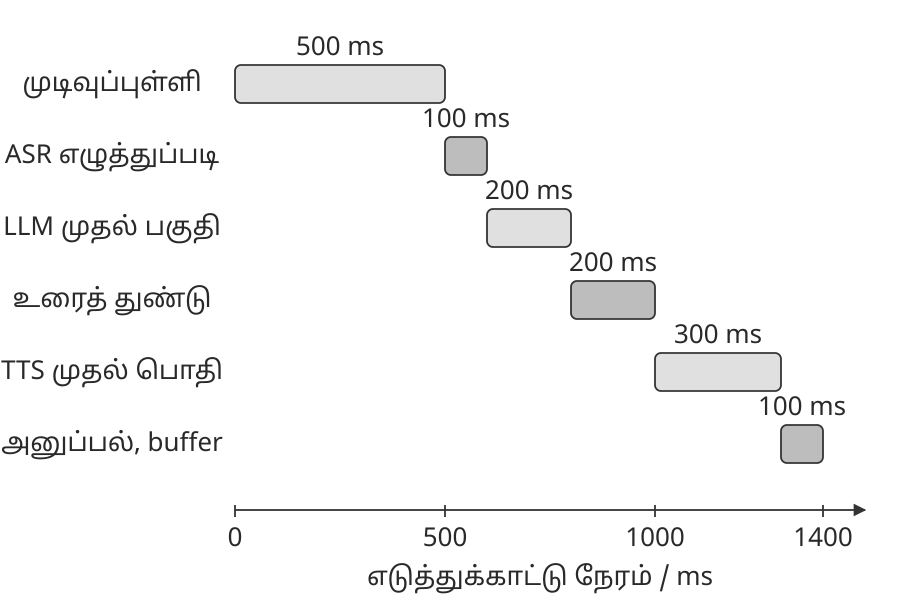

சேவைச் சுமை வரிசைக் காத்திருப்பையும் கொண்டு வருகிறது. படம் 6-9 M/M/1 ஒற்றைச் சேவை மேசை மாதிரியைக் கொண்டு இந்த உறவை விளக்குகிறது: வருகை பாய்சான் செயல்முறையைப் பின்பற்றுகிறது, சேவை நேரம் அடுக்குக்குறிப் பரவலைப் பின்பற்றுகிறது, சராசரிச் சேவை நேரம் $S$, பயன்பாட்டு விகிதம் $\rho<1$ என்றால், சேவையும் வரிசையும் உள்ளடக்கிய சராசரி மொத்த நேரம் $W=S/(1-\rho)$. $S=1$ வினாடி எடுத்து, பயன்பாட்டு விகிதம் 0.5-இலிருந்து 0.8 ஆக உயர்ந்தால், சராசரி மொத்த நேரம் 2 வினாடியிலிருந்து 5 வினாடியாக உயர்கிறது. அதில் சேவையே சராசரியாக இன்னும் 1 வினாடி மட்டும் எடுக்கிறது; கூடுதலான 3 வினாடிகள் அனைத்தும் வரிசையில் செலவாகின்றன. கோரிக்கைகள் செயலாக்கக் கொள்ளளவை நெருங்கும்போது, குறுகிய கால ஓட்ட ஏற்ற இறக்கங்கள் குவிப்பை உருவாக்குகின்றன.

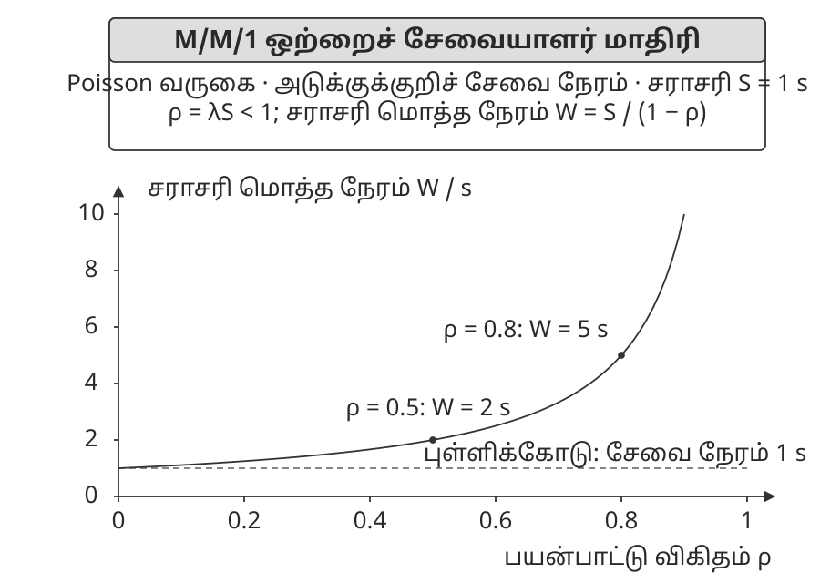

> **சோதனை 6-4 ★: மரபுவழிக் குரல் ஏஜெண்டை உருவாக்குதல்**
>
> உதவியாளர் வியாழக்கிழமை விமானங்களை அறிவித்துக்கொண்டிருக்கும்போது, நீங்கள் "ஒரு நிமிடம், நான் வெள்ளிக்கிழமைக்கு முன்பதிவு செய்ய வேண்டும்" என்று திருத்துகிறீர்கள் என்று வைத்துக்கொள்வோம். உலாவி WebSocket வழியாக ஒலிவாங்கி ஒலியைப் பின்தளத்துக்கு அனுப்புகிறது. நீங்கள் பேசத் தொடங்கியதை Silero VAD கண்டறிந்ததும், பின்தளம் `speech_start`-ஐ அனுப்புகிறது; உலாவி உடனே இயக்குவதை நிறுத்தி, வரிசையில் உள்ள பழைய ஒலியை அழிக்கிறது. அப்போது நீங்கள் எந்த நாளை மாற்றினீர்கள் என்று உதவியாளருக்கு இன்னும் தெரியாது. நீங்கள் பேசி முடித்து, அமைதி இயல்பு மதிப்பான 500 மில்லி வினாடிகளைத் தாண்டிய பிறகே, பின்தளம் `speech_end`-ஐ அனுப்பி, இந்தப் பேச்சுப் பகுதியை உள்ளூர் Whisper tiny-க்கு உரைமாற்றக் கொடுக்கிறது.
>
> Doubao உரையைத் திருப்பித் தரத் தொடங்கியதிலிருந்து, பயனர் பதிலைக் கேட்க இன்னும் எவ்வளவு நேரம்? ஒரு சுற்றுப் பதிவு மறுஇயக்கத்தின் பதிவில், உரைமாற்றம் 2.710 வினாடிகள் எடுத்தது. கோரிக்கை அனுப்பிய 0.749 வினாடிகளில் Doubao முதல் token-ஐத் திருப்பித் தந்தது; 0.792 வினாடிகளில்தான் முழுப் பதிலையும் தந்தது. மறுஇயக்க நிரல் உரை முழுவதும் வந்த பிறகே Fish S1-க்கு இணைக்கக் கொடுத்தது; மேலும் 2.819 வினாடிகள் கழித்து, பின்தளம் முதல் தொகுதி ஒலியைப் பெற்றது. முனைத் தீர்மானத்திலிருந்து கணக்கிட்டு, இந்த மூன்று வரிசை நேரங்களையும் கூட்டினால், சுமார் **6.321 வினாடிகள்**. காப்பக அறிக்கை 6.279 வினாடிகள் என்று எழுதியுள்ளது; அது முழுப் பதிலை உருவாக்கும் நேரத்துக்குப் பதிலாக முதல் token நேரத்தைப் பயன்படுத்தியது.
>
> இந்த 6.321 வினாடிகள் பின்தளச் செயலாக்கத்தை மட்டுமே உள்ளடக்குகின்றன. ஒரு வாக்கியம் முடிந்தது என்று அமைதிக் கண்டறிதல் தீர்மானிக்கும் வரை பயனர் முதலில் காத்திருக்க வேண்டும்; இறுதியில் ஒலி உலாவியை அடைந்து இயங்கத் தொடங்கும் வரையும் காத்திருக்க வேண்டும்.

#### வரிசையிலிருந்து ஓடை உணர்தல் வரை

வரிசைத் தீர்வு ஒவ்வொரு பகுதியையும் சரிபார்க்க எளிது; ஆனால் மூன்று பிரச்சினைகளையும் வெளிப்படுத்துகிறது. அமைதிக்காகக் காத்திருப்பது முனைத் தாமதத்தை அதிகரிக்கிறது; உரைமாற்ற உரை தொனி, உணர்ச்சி, சூழல் ஒலியை விட்டுவிடலாம்; இடைநிறுத்தங்களின்படி ஒலியைப் பிரிக்கும்போது, மின்னஞ்சல் முகவரி, நபர் பெயர், சிறப்புச் சொற்கள் முழுச் சூழலை இழக்கலாம். ஏற்கனவே தொடர்சங்கிலிக் கட்டமைப்பைப் பயன்படுத்தும் அமைப்புகளுக்கு, முதலில் ஓடை மாற்றத்தைச் செய்யப் பரிந்துரைக்கிறேன்: ஒவ்வொரு கட்டமும் இயன்றவரை முன்னதாக அதிகரிப்பு முடிவுகளைத் தந்து, அடையாளம் காணல், பகுத்தறிவு, இயக்கம் ஆகியவற்றை மேற்பொருந்தச் செய்து, ஏற்கனவே உறுதிசெய்யப்பட்ட பகுதிகளையும் இன்னும் மாறக்கூடிய பகுதிகளையும் பராமரிக்க வேண்டும். இதனால் ஏற்கனவே உள்ள தொகுதிகளை மீண்டும் பயன்படுத்தவும், காத்திருப்பு நேரம் எங்கிருந்து வருகிறது என்பதைப் படிப்படியாக இடங்கண்டறியவும் முடியும்.

- **ASR கேட்டுக்கொண்டே மாற்றுகிறது.** தொடர்ந்து ஒலியைப் பெற்று, தற்காலிக உரைமாற்றத்தை வெளியிடுகிறது; அடுத்தடுத்த ஒலி வந்த பிறகு நிலையற்ற பகுதிகளைத் திருத்தி, முனை உறுதிசெய்யப்படும்போது இறுதி உரையைத் தருகிறது.
- **LLM ஊக இயக்கம்.** தற்காலிக உரைமாற்றத்தைக் கொண்டு பதிலை முன்கூட்டியே தயார் செய்கிறது. இறுதி உரை உறுதிசெய்யப்பட்ட பிறகு, உள்ளீடு ஒத்துப்போகிறதா, ஏற்கனவே செய்த வேலை இன்னும் பொருந்துகிறதா என்று சரிபார்த்து, தக்கவைப்பதா, சரிசெய்வதா, மீண்டும் உருவாக்குவதா என்று தீர்மானிக்கிறது. வெளியே அனுப்புதல், வணிக எழுதுதல் போன்ற செயல்கள் தேவையான நிபந்தனைகள் உறுதிசெய்யப்பட்ட பிறகே இயக்கப்படுகின்றன.
- **LLM பகுதிப் பகுதியாக வெளியிடுகிறது.** அறிவிக்கத் தகுந்த ஒரு உரைப் பகுதி முடிந்ததும் TTS-க்குக் கொடுக்கிறது; பிரிக்கும்போது வாக்கியப் பொருள், நிறுத்தக் குறிகள், தொனித் துப்புகளைத் தக்கவைக்கிறது.
- **TTS அதிகரிப்பு இணைப்பு.** ஒலித் தொகுதிகள் படிப்படியாகத் திரும்புவதால், அடுத்தடுத்த உரை உருவாக்கம், இணைப்பு, இயக்கம் மேற்பொருந்த முடிகிறது. இடைமறிப்பு நிகழும்போது, உருவாக்கப் பணியையும் இயக்க இடையகத்தில் இன்னும் இயக்கப்படாத உள்ளடக்கத்தையும் ஒருசேரக் கையாள வேண்டும்.

Whisper-இன் வழக்கமான உரைமாற்றச் செயலாக்கம் ஒலிச் சாளரங்களின்படிக் குறியாக்கி குறிவிலக்குகிறது[^ch6-whisper]. வெளிப்புறமாகத் துண்டுகளாக்கியோ, குவிந்த முன்னொட்டைத் திரும்பத் திரும்பச் சமர்ப்பித்தோ அதிகரிப்பு உரைமாற்றச் செயல்முறையை உருவாக்கலாம்; தொடர் நிலை மறுபயன்பாடு, மீள் குறியாக்கச் செலவு, வரலாற்று உரைத் திருத்தம் ஆகியவற்றைக் குறிப்பிட்ட செயலாக்கம் நிர்வகிக்க வேண்டும். இயல்பான ஓடை அடையாளம் காணல் மாதிரிகளோ கட்டமைப்பிலும் பயிற்சியிலும் தொடர் உள்ளீட்டை நேரடியாகக் கையாள்கின்றன.

ஒலி மொழி மாதிரி அடிப்படையிலான உணர்தல் அமைப்புகள் உரையையும் ஒலியியல் நிகழ்வுகளையும் ஒருசேர வெளியிடவும் முடியும். வரலாற்று ஒலி, உரைமாற்றம், சொற்களஞ்சியக் குறிப்புகள் ஆகியவை நபர் பெயர்கள், பிராண்டுகள், சிறப்புச் சொற்களை அடையாளம் காண உதவுகின்றன; எவ்வளவு வரலாற்றைத் தக்கவைப்பது என்பது சூழல், சேமிப்பு வடிவமைப்பைப் பொறுத்தது. "பயனர் பேசி முடித்தாரா" என்பதற்கு, மாதிரி பொருள் முழுமையையும் அமைதியையும் இணைத்துத் தீர்மானிக்கலாம். "நான் முன்பதிவு செய்ய விரும்புவது……" என்ற இடைநிறுத்தத்தில், நிகழ்நேர அமைப்பு அந்தச் சில சொற்களை மட்டுமே கேட்டுள்ளது; பின்னால் தேதி வரும் என்பதை இன்னும் அறிய வழியில்லை.

உரைமாற்றத்துக்கு அப்பால், இடைமுகம் பின்வரும் நிகழ்வுகளையும் ஒப்பந்தம் செய்யலாம்: `speak_start`, `speak_end` பேச்சின் தொடக்கமும் முடிவும்; `interrupt` இடைமறிப்பு; `emotion` உணர்ச்சி நிலையை விவரிக்கிறது; `laugh`, `sigh`, `noise` சிரிப்பு, பெருமூச்சு, சூழல் ஒலியைப் பதிவு செய்கின்றன. இந்த நிகழ்வுகள் உரை, நேர முத்திரைகளுடன் சேர்ந்து ஏஜெண்டுக்கு அனுப்பப்படலாம்.

> **சோதனை 6-5 ★: Qwen2-Audio கொண்டு ஓடைக் குரல் உணர்தலை உருவகப்படுத்துதல்**
>
> இந்தச் சோதனை ஒலி முன்னொட்டைப் படிப்படியாக விரிவுபடுத்தி, ஒவ்வொரு முறையும் தொடக்கத்திலிருந்து தற்போதைய தருணம் வரையிலான ஒலியை மீண்டும் Qwen2-Audio-க்கு அனுப்பி, உள்ளீடு மாற மாற உரைமாற்றமும் ஒலியியல் நிகழ்வுகளும் எவ்வாறு மாறுகின்றன என்று அவதானிக்கிறது. ஒப்பீட்டுப் பாதை 600 மில்லி வினாடி அமைதி முனையையும் Whisper-ஐயும் பயன்படுத்துகிறது. சோதனையில் சாதாரணப் பேச்சு, 900 மில்லி வினாடி இடைநிறுத்தம் செருகப்பட்ட நீண்ட வாக்கியம், இளஞ்சிவப்பு இரைச்சல் கலந்த பேச்சு ஆகியவை அடங்கும்.
>
> இந்த முறை உள்ளூர் அளவாக்கிய மாதிரி இயக்கம் 13 முன்னொட்டு அனுமானங்களைத் தக்கவைத்தது; ஒவ்வொன்றும் சுமார் 8–11 வினாடிகள். இடைநிறுத்தம் ஒப்பீட்டுப் பாதையின் பிரிப்பைத் தூண்டியது; ஒலி மாதிரி இரைச்சலைக் கண்டறிந்தது, ஆனால் இருமலையும் சிரிப்பையும் தவறாக அறிவித்தது.

[^ch6-whisper]: OpenAI, Whisper; ஒலிச் சாளர உரைமாற்றத்தையும் மாதிரிச் செயலாக்கத்தையும் அறிமுகப்படுத்துகிறது.

### முன்னுதாரணம் இரண்டு · முனைக்கு-முனை முழுமுறைமை மாதிரி (Omni)

முனைக்கு-முனை ஒலி மாதிரி ஒலியை நேரடியாகப் பெற்று, மொழி, ஒலியியல் தகவல்களை இணைத்துப் பதிலை உருவாக்கி, ஒலி வெளியீட்டுக் கிளை வழியாகப் பேச்சை இணைக்கிறது. ஒலியை நேரடியாகச் செயலாக்குவது பேச்சு வேகம், சுருதி, இடைநிறுத்தம், சூழல் ஒலி ஆகியவற்றைப் பயன்படுத்த உதவுகிறது; முதலில் உரைமாற்றி பின்னர் பதிலளிப்பது இடைநிலை உரையைச் சரிபார்க்கவும் தொகுதிகளைத் தனித்தனியாக மாற்றவும் வசதி.

இந்த ஒலியியல் இயல்புகள் புரிதலைப் பாதிக்கின்றன. எடுத்துக்காட்டாக, "மதிய உணவுக்கு முன் அறிக்கையை அனுப்புங்கள்" என்ற அதே வாக்கியம், அவசரமாகவும் மெதுவாகவும் சொல்லப்படும்போது கேட்பவருக்கு வெவ்வேறு உணர்வைத் தருகிறது. வெளியிடும்போதும், மாதிரி இடைநிறுத்தம், அழுத்தம், தொனி ஆகியவற்றைக் கொண்டு பொருளை ஒழுங்கமைக்கலாம்.

ஒலியை நேரடியாகச் செயலாக்கும் அமைப்புகளும் பயனர் பேசி முடிக்கும் வரை காத்திருந்து பதிலளிக்கலாம். எடுத்துக்காட்டாகப் பயனர் தொலைபேசி எண்ணைச் சொல்லும்போது ஒருமுறை நின்றால், இந்த எண் வரிசை முடிந்ததா என்று அமைப்பு இன்னும் தீர்மானிக்க வேண்டும். எப்போது பதிலளிப்பது என்பதை முனைக் கண்டறிதல் தீர்மானிக்கிறது; அறிவிப்பின் நடுவே எதிர்த் தரப்பு இடைமறித்தால், மாதிரி உருவாக்கத்தையும் ஒலிபெருக்கி இயக்கத்தையும் அமைப்பு ஒருங்கிணைக்க வேண்டும்.[^ch6-audio-architectures]

> **சோதனை 6-6 ★★: MiniCPM-o 4.5-ஐ உள்ளூரில் இயக்கி, முனைக்கு-முனையையும் சுயதொடர்சங்கிலியையும் ஒப்பிடுதல்**
>
> இந்தச் சோதனை அதே MiniCPM-o 4.5 மாதிரியை நிலைப்படுத்தி, சிந்தனைப் பயன்முறையை அணைத்து, இரு பாதைகளை ஒப்பிடுகிறது: ஒலியிலிருந்து நேரடியாகக் கேள்விக்குப் பதிலளித்தல், மற்றும் முதலில் மாதிரியே உரைமாற்றி, பின்னர் உரைமாற்றத்தை மட்டும் அடிப்படையாகக் கொண்டு பதிலளித்தல். உள்ளீட்டில் இரண்டு வாய்மொழிக் கணிதக் கேள்விகளும், ஒரே உரை கொண்ட ஆனால் வெவ்வேறு வேகத்தில் பேசப்பட்ட இரு பேச்சுகளும் அடங்கும்.
>
> இரு பாதைகளும் தலா மூன்று கேள்விகளுக்குச் சரியாகப் பதிலளித்தன; பிழைகள் வெவ்வேறு இடங்களில் நிகழ்ந்தன. நேரடி ஒலிப் பாதை ஒரு கேள்வியில் twelve boxes என்பதை 8 என்று கேட்டதால் கணக்கீட்டுப் பிழை ஏற்பட்டது; உரைமாற்றப் பாதை 12-ஐச் சரியாகத் தக்கவைத்தது. வேகக் கேள்வியில், இரு ஒலிப் பதிவுகளும் "Please send the report before lunch." என்று சொல்கின்றன; உரைமாற்றிய பிறகு உரை முற்றிலும் ஒன்றே; வேகம்–மெதுவு தகவல் அதனுடன் தொலைந்தது; நேரடி ஒலிப் பாதையோ இரு வேகங்களையும் சரியாக வேறுபடுத்தியது.
>
> சோதனை மேலும் 24 kHz பேச்சுப் பகுதியை உருவாக்கி, உள்ளீட்டுப் புரிதலையும் ஒலி வெளியீட்டையும் இணைத்தது.

### முன்னுதாரணம் மூன்று · முழு இருவழி இடைவினை மாதிரி

முழு இருவழி அமைப்பு பேசிக்கொண்டே கேட்கிறது; மிக எளிதில் உணரப்படும் மேம்பாடு, உரையாடலில் உயிருள்ள மனிதர் போன்ற உணர்வு. "புதன்கிழமைக்கு… இல்லை, வியாழக்கிழமைக்குச் சீட்டு வேண்டும்" என்ற வாக்கியத்தைப் படித்துப் பாருங்கள்: நடுவில் உள்ள இடைநிறுத்தம் இந்தச் சுயதிருத்தத்துக்கு இடமளிக்கிறது; உதவியாளர் ஏற்கனவே புதன்கிழமை விமானங்களை அறிவிக்கத் தொடங்கியிருந்தால், "இல்லை, வியாழன்" என்று கேட்டதும் நிறுத்த வேண்டும். இன்னொரு தருணம்: எதிர்த் தரப்பு இன்னும் பயணத்தை விளக்கிக்கொண்டிருக்கும்போது, ஒரு லேசான சிறு ஆமோதிப்பு உதவியாளர் கேட்டுக்கொண்டிருப்பதை அவருக்குத் தெரிவிக்கும். தொடர்ந்து ஒலியைப் பெற்றால் மட்டுமே, பேசுதல், கேட்டல், இடைநிறுத்தம், கருவி அழைப்பு ஆகியவற்றுக்கு இடையே இத்தகைய தேர்வுகளைச் செய்ய முடியும். ஒருசேர மொழிபெயர்ப்புக்கும் உள்ளீடும் வெளியீடும் மேற்பொருந்த வேண்டும்.

2024-இல் Kyutai வெளியிட்ட **Moshi** பயனரின் ஒலி ஓட்டத்தையும் மாதிரியின் ஒலி ஓட்டத்தையும் தனித்தனியாக மாதிரியமைத்து, இணை ஓட்டங்கள் மூலம் மேற்பொருந்திய பேச்சையும் இடைமறிப்பையும் வெளிப்படுத்துகிறது[^ch6-moshi]. இந்த நேர உறவுகளை உள்ளீட்டில் தக்கவைத்தால், எப்போது பதிலளிப்பது, எப்போது தொடர்ந்து கேட்பது என்பதை மாதிரி கற்றுக்கொள்ள முடியும்.

Thinking Machines Lab-இன் இடைவினை மாதிரி தொடர் உள்ளீட்டையும் வெளியீட்டையும் சம நீளக் குறுகிய தொகுதிகளாக வெட்டுகிறது; ஒவ்வொரு தொகுதியும் 200 மில்லி வினாடிகளை உள்ளடக்குகிறது; இது ஒரு நுண்சுற்று (micro-turn) எனப்படும்[^ch6-14]. படம் 6-10-இன் நேர அச்சில் இரண்டாம் கட்டத்தைப் பாருங்கள்: உதவியாளர் இன்னும் "வியா…" என்று சொல்லிக்கொண்டிருக்கும்போதே, பயனர் தேதியைத் திருத்தும் "இல்லை" காதில் விழுகிறது. மூன்றாம் கட்டத்தில், உதவியாளர் நின்றுவிட்டு, பயனர் "வெள்ளி" என்று சொல்லி முடிப்பதைத் தொடர்ந்து கேட்கிறது.

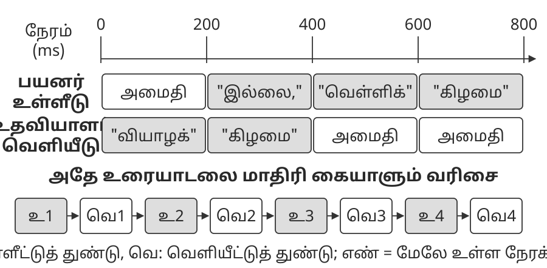

படத்தின் கீழ்ப்பகுதியையும் படியுங்கள். அழைப்பின் இரு தரப்பும் கேட்பது மேற்பொருந்தக்கூடிய இரு ஒலிப் பாதைகள்; மாதிரியோ ஒரே வரிசையில் உள்ளீட்டுத் தொகுதிகளைக் கையாள்வதையும் வெளியீட்டுத் தொகுதிகளை உருவாக்குவதையும் மாறி மாறிச் செய்யலாம். அமைதியும் ஒரு கட்டத்தை எடுக்கிறது; எனவே உதவியாளர் சிறிது நேரம் கேட்டுவிட்டுப் பின்னர் பேசலாம். படத்தில் உள்ள 200 மில்லி வினாடிகள் இந்தச் செயலாக்கத்தின் தொகுதி நீளம்; பயனர் இடைமறித்ததிலிருந்து ஒலிபெருக்கி உண்மையில் நிற்கும் வரை, செயலாக்க நேரமும் இயக்க இடையக நேரமும் கணக்கில் வர வேண்டும்.

[^ch6-moshi]: Kyutai, *Moshi: a speech-text foundation model for real-time dialogue*, 2024; பயனர், மாதிரி ஆகியவற்றின் இணை ஒலி ஓட்டங்களை அறிமுகப்படுத்துகிறது.
[^ch6-14]: Thinking Machines Lab, *Interaction Models: A Scalable Approach to Human-AI Collaboration*; நுண்சுற்றுகள், பல ஓட்ட இடைவினை, பின்தளப் பணி ஒப்படைப்பை அறிமுகப்படுத்துகிறது.

### அறிவாற்றல் நேரவரிசை: நிகழ்நேர இடைவினையும் ஆழ்ந்த சிந்தனையும்

Pine-இன் வாடிக்கையாளர் சேவை அழைப்புகளில், சேவைப் பிரதிநிதி பாதி வாக்கியம் சொல்லும்போது, உதவியாளர் சில சமயம் காத்திருக்க வேண்டும், சில சமயம் லேசாக "ம்" என்று சொல்ல வேண்டும்; தானே பேசிக்கொண்டிருக்கும்போதும், எதிர்த் தரப்பு இடைமறித்துச் சொல்லும் திருத்தத்தைக் கேட்க வேண்டும். Moshi பாதையை நான் நம்பிக்கையுடன் பார்ப்பதற்கான காரணம் இதுதான்: தருணத்தை நன்றாகக் கையாண்டால்தான், தொலைபேசியின் இந்தப் பக்கம் உண்மையில் யாரோ கேட்டுக்கொண்டிருப்பதாக எதிர்த் தரப்பு உணரும். தகவல் தேட வேண்டிய கோரிக்கைகளைச் சந்திக்கும்போது, இன்னொரு நேரக் கணக்கும் போட வேண்டும்: கேள்வியைப் புரிந்துகொண்டதிலிருந்து தேடிய பதிலைச் சொல்லும் வரை, எத்தனை முறை கை மாற வேண்டும்?

முன்தளக் குரல் மாதிரி நேரடியாக அழைக்கக்கூடிய கருவிகளை முன்தளமே அழைக்கட்டும். விமானத்தை வினவ இரண்டு மாதிரி அழைப்புகள் மட்டும் போதும்: முன்தளம் முதலில் பயனர் தந்த நிபந்தனைகளின்படி வினவி, பின்னர் முடிவைத் தெரிவிக்கிறது. ஒப்படைப்புக்கோ நான்கு: முன்தளம் பணியைக் கூறுகிறது, பின்தளம் வினவலைத் தொடங்குகிறது, பின்தளம் முடிவை ஒழுங்கமைக்கிறது, முன்தளம் மீண்டும் கூறுகிறது. இன்னொரு கருத்தோ, நிகழ்நேர மாதிரி அளவுருக்களைத் தவறாக நிரப்பக்கூடும் என்பதால், பின்தளமே கருவிகளை அழைக்க வேண்டும், முன்தளம் எப்போது கேட்பது, எப்போது பேசுவது என்பதில் மட்டும் கவனம் செலுத்த வேண்டும் என்று வாதிடுகிறது.

GPT-Live-1-இன் முன்தளத்துக்கு வணிகச் சார்புகளை நேரடியாக அழைக்கும் இடைமுகம் இல்லை; பின்தள ஏஜெண்டிடம் ஒப்படைக்க மட்டுமே முடியும். OpenAI Realtime-இன் GPT-Realtime முன்தளம் சார்புகளை நேரடியாக அழைப்பதை ஆதரிக்கிறது. Doubao நிகழ்நேரக் குரல் மாதிரி 3.0 (Seeduplex) தூய முனைக்கு-முனைப் பயன்முறையில் முன்தள நேரடி அழைப்பை ஆதரிக்கிறது; கலப்பு ஒருங்கிணைப்பில் வெளிப்புற மொழி மாதிரி அழைக்கிறது.[^ch6-voice-tools]

முன்தள, பின்தள மாதிரிகளின் ஒவ்வொரு அழைப்பும் முறையே $L_f$, $L_b$ நேரம் எடுக்கிறது, கருவி நேரம் $T$ என்று கொள்வோம். பயனர் பேசி முடித்ததிலிருந்து முடிவைக் கேட்கும் வரை, நேரடி அழைப்புக்குச் சுமார் $2L_f+T$, ஒப்படைப்புக்குச் சுமார் $2L_f+2L_b+T$. ஒப்படைப்பில் கூடுதலான $2L_b$ கருவி நேரம் $T$-ஐச் சாராதது. பயனர் நினைவகம் போல ஒவ்வொரு சுற்றிலும் பயன்படக்கூடிய தகவலை இயக்கக்கருவி முன்கூட்டியே வினவி சூழலில் வைக்கலாம்; அப்போது முன்தளம் ஒருமுறை மட்டுமே மாதிரியை அழைக்க வேண்டும்; சுமார் $L_f+T$; பயனர் பேசத் தொடங்குவதற்கு முன்பே வினவப்பட்டிருந்தால், $T$-உம் தேவையில்லை.

பல படிப் பகுத்தறிவு தேவைப்படும் பணிகள் — எடுத்துக்காட்டாகப் பல மாற்றுத் திட்டங்களை ஒப்பிடுதல் — பின்தளத்துக்கு ஏற்றவை. முன்பதிவு பணம் பிடித்தலையும் பயணச்சீட்டு வழங்கலையும் உள்ளடக்குவதால், யார் கருவியை அழைத்தாலும், பயனர் உறுதிசெய்த பிறகே ஆர்டர் செய்ய வேண்டும். விமான முடிவுகளை வாய்மொழியாகச் சுருக்கலாம்; முழு அட்டவணையைத் திரையில் காட்டலாம்; இது யார் கருவியை அழைக்கிறார்கள் என்பதோடு தொடர்பில்லாதது.

> **சோதனை 6-7 ★★: குரல் ஏஜெண்டின் கருவிகளை முன்தளம் அழைக்க வேண்டுமா, பின்தளம் அழைக்க வேண்டுமா**
>
> Doubao நிகழ்நேரக் குரல் மாதிரி 3.0 கொண்டு முன்தளத்தையும், Volcano Ark வழங்கும் DeepSeek V4 Pro கொண்டு பின்தளத்தையும் அமையுங்கள். வானிலை வினவல், பயனர் நினைவக வினவல், இணையத் தேடல், விமான வினவல், முன்பதிவு ஆகிய ஐந்து உருவகப்படுத்தப்பட்ட கருவிகளைத் தயார் செய்து, அமைக்கப்பட்ட நேரத்தில் முடிவுகளைத் திருப்பித் தரச் செய்யுங்கள்; அவற்றில் விமான வினவலும் முன்பதிவும் 2–5 வினாடிகள் காத்திருக்க வேண்டும். பயனர் ஒலிப்பதிவுகளை முன்கூட்டியே இணைத்து, ஒவ்வொரு முறையும் அதே சூழலின் ஒலிப்பதிவை மீண்டும் இயக்குங்கள்.
>
> நான்கு வகைப் பணிப்பகிர்வுகளை அமையுங்கள். முதலாவதில் முன்தளம் எல்லாக் கருவிகளையும் அழைக்கிறது. இரண்டாவதில் பின்தளம் எல்லாக் கருவிகளையும் அழைக்கிறது; முன்தளம் ஒப்படைக்க மட்டுமே முடியும். மற்ற இரண்டிலும் முன்தளம் வானிலையை வினவுகிறது, அமர்வு தொடங்கும்போது இயக்கக்கருவி பயனர் நினைவகத்தைச் சூழலில் வைக்கிறது, பின்தளம் இணையத் தேடலுக்கும் முன்பதிவுக்கும் பொறுப்பு. இவ்விரண்டுக்கும் உள்ள வேறுபாடு விமான வினவலை முன்தளமா பின்தளமா கையாள்கிறது என்பது. முன்தளம் பயனரின் குரலை நேரடியாகக் கேட்கிறது; பின்தளத்துக்குக் குரல் கேட்காது, உரையை மட்டுமே படிக்க முடியும். Doubao-இன் இடைமுகம் பயனரின் ஒவ்வொரு வாக்கியத்தையும் கேட்ட பிறகு, பேச்சு அடையாளம் கண்ட உரையைத் தனியாகத் திருப்பித் தருகிறது; இது உரைமாற்றம் எனப்படும். ஒப்படைக்கும்போது, உரைமாற்றத்தையும் உதவியாளர் சொன்னவற்றையும் வரிசைப்படி அழைப்புப் பதிவாக ஒழுங்கமைத்து, இந்த அழைப்பில் இயக்கப்பட்ட கருவி அழைப்புகளுடனும் முன்தளம் எழுதிய பணி விளக்கத்துடனும் சேர்த்துப் பின்தளத்துக்குக் கொடுங்கள். ஒவ்வொரு பணிப்பகிர்விலும் பின்வரும் சூழ்நிலைகளை 10 முறை மீண்டும் சோதியுங்கள்.
>
> 1. வானிலையையும் விமானத்தையும் தனித்தனியாக வினவுங்கள். பயனர் பேசி முடித்ததிலிருந்து வினவல் முடிவைக் கேட்கும் வரை நேரத்தைக் கணக்கிடுங்கள்; "நான் பார்க்கிறேன்" போன்ற இடைச்சொற்கள் பதிலாகக் கணக்கிடப்படாது. நேரடி அழைப்புக்கும் ஒப்படைப்புக்கும் காத்திருப்பு நேர இடைநிலையை ஒப்பிடுங்கள். என் சோதனையில், வானிலையை வினவும்போது இரண்டும் முறையே 2.81 வினாடி, 6.96 வினாடி.
> 2. முதலில் விமானத்தை வினவி, பின்னர் சீட்டைத் தேர்ந்தெடுத்து உறுதிசெய்யுங்கள். முந்தைய சுற்று வினவல் முடிவு, பயனர் சற்று முன் சொன்னது, பயனர் தகவல் ஆகியவற்றுடன் ஒப்பிட்டு, முன்பதிவின் 13 புலங்களையும் ஒவ்வொன்றாகச் சரிபார்த்து, ஆர்டர் நேரம் பயனர் உறுதிப்படுத்தலுக்குப் பின்னானதா என்று சரிபாருங்கள். என் சோதனையில், நான்கு பணிப்பகிர்வுகளும் எல்லாப் புலங்களையும் சரியாக நிரப்பின; பயனர் உறுதிசெய்த பிறகே ஆர்டர் செய்தன.
> 3. ஒரு சக ஊழியருக்குச் சீட்டு முன்பதிவு செய்வதாக மாற்றி, பெயரை வாய்மொழியாகச் சொல்லும் ஒலிப்பதிவை இயக்குங்கள்: "陈嘉怡, 耳东陈, 嘉奖的嘉, 怡然的怡" (சென் ஜியாயி — சென் என்ற குடும்பப் பெயர், 'பாராட்டு' என்பதன் ஜியா, 'மகிழ்ச்சி' என்பதன் யி). ஒலிப்பதிவு, பேச்சு உரைமாற்றம், ஆர்டர் பெயர் ஆகியவற்றை ஒப்பிட்டு, முன்தள நேரடி முன்பதிவும் ஒப்படைப்பு முன்பதிவும் பெயரைச் சரியாக நிரப்பினவா என்று சரிபாருங்கள். என் சோதனையில், முன்தள நேரடி முன்பதிவு 10 முறையும் சரி; உரைமாற்றமோ "陈佳宜" என்று எழுதியது; ஒப்படைப்பில் சில ஆர்டர்கள் அதனால் தவறான பெயரைக் கொண்டிருந்தன.
> 4. விமான வினவல் முடிவு திரும்புவதற்கு முன் வானிலையைக் கேட்கும் ஒலிப்பதிவை இயக்கி, முன்தளம் வானிலைக் கேள்விக்குப் பதிலளிக்கிறதா, பின்னர் விமான முடிவைத் தெரிவிக்கிறதா என்று கேளுங்கள். என் சோதனையில், வானிலைக் கேள்விக்கு எல்லா முறையும் பதில் கிடைத்தது; முந்தைய விமான முடிவோ ஏறக்குறைய ஒருபோதும் மீண்டும் சொல்லப்படவில்லை.

ஒப்படைக்க வேண்டியிருக்கும்போது, உறுதியாகக் கேட்ட பெயர்கள், எண்கள், பயனர் சற்று முன் செய்த திருத்தங்களை முன்தளம் பணி விளக்கத்தில் எழுத வேண்டும்; உரைமாற்றப் பிழையால் பின்தளம் அளவுருக்களைத் தவறாக நிரப்புவதைத் தவிர்க்க. இன்னும் சொல்லப்படாத முடிவுகளை இயக்கக்கருவி பதிவு செய்து, இடைக்கேள்விக்குப் பதிலளித்த பிறகு முன்தளம் தொடர்ந்து தெரிவிக்கச் செய்ய வேண்டும்.

வேகமான மாதிரி "நான் பார்க்கிறேன்" என்று சொன்னால், உதவியாளர் கோரிக்கையைத் தெளிவாகக் கேட்டதை வாடிக்கையாளர் சேவை அறியும். எப்போது விலையைச் சொல்ல முடியும் என்பதோ, வினவலும் பகுத்தறிவும் அழைப்புடன் எவ்வாறு ஒருங்கிணைகின்றன என்பதைப் பொறுத்தது. படம் 6-11 மூன்று ஏற்பாடுகளைக் காட்டுகிறது: முதலில் பதிலளித்துப் பின்னர் ஆழமாகப் பதில் சொல்லுதல், முன்தளம் தொடர்ந்து இடைவினை புரிந்து பின்தளப் பரிந்துரைகளைப் பெறுதல், சிந்தனையும் வெளிப்பாடும் துண்டுகளாக இணையாக முன்னேறுதல்.

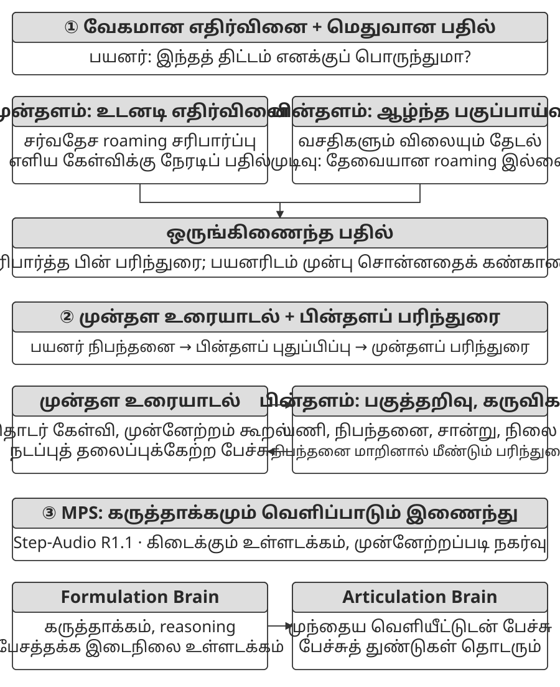

#### தீர்வு ஒன்று: வேகச் சிந்தனை பதிலளிக்கிறது, மெதுவான சிந்தனை விடையளிக்கிறது

வேகமான மாதிரி முதலில் சுருக்கமான பதிலைத் தருகிறது; மெதுவான மாதிரி பின்தளத்தில் பகுப்பாய்வை முடித்து, பின்னர் விரிவான பதிலைச் சேர்க்கிறது. இந்த வடிவமைப்பு கோரிக்கை பெறப்பட்டதை முன்கூட்டியே உறுதிசெய்ய உதவுகிறது; ஆனால் இரு பதில்களின் ஒற்றுமையை நிர்வகிக்க வேண்டும். எடுத்துக்காட்டாக, வேகமான மாதிரி முதலில் ஒரு திட்டத்தை வாங்கப் பரிந்துரைக்கிறது; மெதுவான மாதிரி பின்னர் அந்தத் திட்டத்தில் முக்கியச் செயல்பாடு இல்லை என்று கண்டறிந்தால், முந்தைய–பிந்தைய பரிந்துரைகள் முரண்படும். முரண்பாட்டின் வேர், இரு பக்கமும் தனித்தனியாகப் பதிலளிப்பதில் உள்ளது; மதிப்பீட்டு அடிப்படையும் பகுத்தறிவு முன்னேற்றமும் வேறுபடலாம். வேகமான மாதிரி சொல்லிவிட்ட பரிந்துரை ஏற்கனவே பயனரின் மதிப்பீட்டுக்குள் நுழைந்துவிட்டது; பயனர் அதன்படி செயல்பட்டும் இருக்கலாம்; மெதுவான மாதிரி பின்னர் திருத்தினால், மாற்றத்தை விளக்கி, ஏற்கனவே ஏற்பட்ட தாக்கத்தையும் கையாள வேண்டும்.

எனவே முன்தளம் பணி உறுதிப்படுத்தலையும் வணிக முடிவையும் வேறுபடுத்த வேண்டும். "இந்தத் திட்டத்தில் இந்தச் செயல்பாடு உள்ளதா என்று சரிபார்க்கிறேன்" என்பதை உடனே சொல்லலாம்; வாங்கும் பரிந்துரையோ தேவையான வினவலுக்கும் பகுப்பாய்வுக்கும் காத்திருக்க வேண்டும். பின்தள முடிவு திரும்பும்போது, அமைப்பு அதை ஏற்கனவே சொன்னவற்றுடன் ஒப்பிட்டு, பின்னர் அடுத்தடுத்த பதிலை ஒழுங்கமைக்கிறது. எளிய கேள்விகளை வேகமான மாதிரியே நேரடியாக முடித்து, மீள்வரும் செயலாக்கத்தைக் குறைக்கலாம்.

#### தீர்வு இரண்டு: வேகச் சிந்தனை இடைவினை புரிகிறது, மெதுவான சிந்தனை நினைவூட்டுகிறது

குரலும் திரையும் பணிப்பகிர்வு செய்யலாம். "இந்த மாதக் கட்டணத்தில் 15 யூரோ ரோமிங் கட்டணம் கூடுதலாக உள்ளது" என்று வாய்மொழியாகச் சொன்னால், பயனர் உடனே முக்கிய அம்சத்தைப் புரிந்துகொள்வார்; அசல் தொகை, தற்போதைய விலை, சர்ச்சை விவரங்களைத் திரையில் வைத்தால், பயனர் தன் வேகத்தில் சரிபார்க்கலாம். ஒரு குறிப்பிட்ட செயலை உறுதிசெய்ய சொடுக்கலாம்; உணர்திறன் தகவலை வணிகர் அங்கீகரித்த உள்ளீட்டு இடைமுகத்தில் பயனரே நிரப்பலாம். முன்தளம் "சரிபார்ப்பு முடிந்தது" போன்ற நிலையை மட்டும் பெற்றால் போதும்; உரையாடலை இயல்பாகத் தொடரலாம்.

வியாழன் காலை ஷாங்காய்க்கு விமானச்சீட்டு முன்பதிவு செய்ய Pine-இடம் பயணி கேட்கிறார்; நிதிநிலை 1200 யுவான், மதியத்துக்கு முன் மாநாட்டு அரங்கை அடைய வேண்டும் என்று வைத்துக்கொள்வோம். Pine விமான நிறுவன வாடிக்கையாளர் சேவையுடன் பேசிக்கொண்டே, பின்தளத்துக்கு "சீட்டு அனுப்புகிறது": "காலை பத்து மணிக்கு Hongqiao வந்தால், விமான நிலையத்திலிருந்து அரங்குக்கு நேரம் போதுமா?" சேவைப் பிரதிநிதி மீதமுள்ள சீட்டுகளைப் பார்த்துவிட்டு Pine-இடம் சொல்கிறார்: "பத்து மணிக்கு Hongqiao வரும் விமானம் விற்றுத் தீர்ந்துவிட்டது. பத்தரை மணிக்கு Pudong வரும் ஒன்று உள்ளது; கட்டணம் 1250 யுவான்." பின்தளம் முன்தளம் அனுப்பிய சீட்டை மட்டும் பார்க்க முடிந்தால், அது இன்னும் Hongqiao-விலிருந்து பயணத்தைக் கணக்கிட்டுக்கொண்டிருக்கும். முன்தளம் இன்னொரு முறை சொல்ல வேண்டும்: "Pudong-க்கு மாற்றிக் கணக்கிடு; பத்தரைக்கு இறங்குகிறது; அரங்கும் வரும் நேரமும் மாறவில்லை."

இன்னொரு வழி, அழைப்புப் பதிவையும் வரிசைப்படி பின்தளத்துக்கு ஒத்திசைப்பது. சேவைப் பிரதிநிதி சொன்ன விமான நிலையத்தையும் இறங்கும் நேரத்தையும் பின்தளம் ஏற்கனவே அழைப்புப் பதிவிலிருந்து படித்துவிட்டதால், முன்தளம் "இந்த விமானம் போதுமா என்று கணக்கிடு" என்று சொன்னாலே அதே பணியை ஒப்படைக்க முடிகிறது. பதிவை ஒத்திசைக்கும்போது யார் என்ன சொன்னார்கள் என்பதைக் குறிக்க வேண்டும்; முன்தளம் இடைமறிக்கப்பட்டு இன்னும் சொல்லப்படாத அரை வாக்கியத்தையும், ஏற்கனவே சொன்னவற்றிலிருந்து வேறுபடுத்த வேண்டும். பேச்சு உரைமாற்றம் முக்கியத் தகவலைத் தவறவிடலாம் அல்லது தவறாக எழுதலாம். முன்தளம் உறுதியாகக் கேட்ட பெயர்கள், எண்கள், பயனர் திருத்தங்களைப் பணி விளக்கத்தில் எழுத வேண்டும். இரு பதிவுகளுக்கும் வேறுபாடு இருந்தால், பின்தளம் பணி விளக்கத்தையே பின்பற்ற வேண்டும். பின்தளம் சரிபார்த்த பிறகு, எதிர்பார்க்கப்படும் வருகை நேரத்தையும் நேரம் எவ்வளவு நெருக்கமானது என்பதையும் மட்டும் முன்தளத்துக்குச் சொன்னால் போதும். வழியில் எந்தப் பாதைகளைச் சரிபார்த்தது, வரைபட இடைமுகம் எந்தப் புலங்களைத் திருப்பித் தந்தது என்பவற்றைப் பின்தளத்திலேயே வைத்திருக்கலாம். முடிவைக் கொண்டு முன்தளம் சேவைப் பிரதிநிதியுடன் தொடர்ந்து பேசுகிறது.

அத்தியாயம் 1-இன் அந்த அலுவல் பயணி கட்டணத்தை 1200 யுவானுக்குள் வைத்திருக்க விரும்பினார். முந்தைய பயணங்களில் பொருத்தமான விமானத்துக்குச் சிறிது அதிகம் செலவழிக்கத் தயங்காதவர்; இந்த முறையும் தனி உச்சவரம்பை அமைக்கவில்லை. மிகக் குறைந்த விலை 1250 யுவான் என்று கேட்டதும், உதவியாளர் அவருக்காக முன்பதிவு செய்யலாம். எப்போதும் சிக்கனமாக இருக்கும் ஒரு பயனர் குடும்பத்துடன் சுற்றுலா செல்கிறார் என்றால், இந்த 50 யுவானை முதலில் கேட்க வேண்டும். அப்போது முன்தளம் இரு உரையாடல்களையும் ஒருசேரக் கவனிக்க வேண்டும்:

- பயனருக்கு அனுப்புவது: "இந்த விமானத்தின் குறைந்தபட்சக் கட்டணம் 1250 யுவான்; நிதிநிலையை விட 50 யுவான் அதிகம். முன்பதிவு செய்யலாமா?"
- தொடர்ந்து சேவைப் பிரதிநிதியிடம் கேட்பது: "இந்த விலையைச் சிறிது நேரம் வைத்திருக்க முடியுமா? அதே நாளில் சற்றுத் தாமதமாகப் புறப்படும், 1200 யுவானுக்குள் ஏதேனும் உள்ளதா?" சேவைப் பிரதிநிதி சீட்டுகளைப் பார்க்கும்போது, முன்தளம் பயணப்பெட்டி அளவையும் ரத்து/மாற்ற நிபந்தனைகளையும் தெளிவாகக் கேட்கலாம்.

இதனால், பயனர் திரும்பி வரும்போது சில விருப்பங்களைப் பார்க்க முடியும்; சேவைப் பிரதிநிதிக்கும் அடுத்து என்ன தேட வேண்டும் என்று தெரியும். பயனர் பின்னர் "கடந்த முறை கூட்டத்துக்கு அவசரமாகச் சென்றேன்; இனிமேல் அலுவல் பயணத்திலும் நிதிநிலை தாண்டினால் முதலில் என்னைக் கேள்" என்று விளக்கினால், அடுத்த முறை இந்தப் புதிய கோரிக்கையின்படி செயல்பட வேண்டும்.

உரிமையாளர் சரிபார்ப்புக்குக் காத்திருக்கும்போது, உரையாடலின் தாளம் மீண்டும் மாறுகிறது. சரிபார்ப்புக் குறியீடு அனுப்பப்பட்டுவிட்டது என்று சேவைப் பிரதிநிதி சொன்னால், முன்தளம் "சரி, ஒரு நிமிடம், பயணியைக் கைபேசியைப் பார்க்கச் சொல்கிறேன்" என்று பதிலளிக்கலாம். பயணி இன்னும் வரவில்லை என்று பதில் அனுப்பினால், குறுஞ்செய்தி எந்த இறுதி இலக்கங்களுக்கு அனுப்பப்பட்டது, எவ்வளவு நேரத்தில் மீண்டும் அனுப்பலாம் என்று சேவைப் பிரதிநிதியிடம் கேட்கலாம். வணிகர் குறிப்பிட்ட கால்வாயில் பயணி சரிபார்ப்பை முடித்த பிறகு, முன்தளம் தொடர்ந்து செயல்படலாம். இத்தகைய அழைப்பில், சிறிது அதிக நேரம் காத்திருப்பதும் சற்றுத் தாமதமாகச் சீட்டு வழங்குவதும், பயனரை அந்த இடத்திலேயே முடிவெடுக்க அவசரப்படுத்துவதை விடப் பொருத்தமானவை.

அப்போது பின்தளம் "அசல் விலைக் குறிப்பு புதுப்பிக்கப்பட்டது" என்று அனுப்புகிறது. முன்தளம் முதலில் சேவைப் பிரதிநிதியிடம் புதிய விலையைச் சரிபார்த்து, பின்னர் பயனருக்குத் தெரிவிக்கிறது. அதே நேரத்தில் பயனர் "முன்பதிவு செய்யலாம்" என்று பதில் அனுப்பினால், அந்தப் பதில் முன்பு அவருக்கு அனுப்பிய 1250 யுவான் விலைக் குறிப்புக்கு உரியது. புதிய விலையையும் ஏற்கனவே உள்ள அனுமதியையும் கொண்டு, மீண்டும் உறுதிசெய்ய வேண்டுமா என்று முன்தளம் தீர்மானிக்க வேண்டும். பின்தளம் தகவலை மட்டுமே வழங்குகிறது; சேவைப் பிரதிநிதியுடன் பேசுவதும் வாக்குறுதி அளிப்பதும் எப்போதும் முன்தளமே. செய்திகளுக்கு விமானம், விலை பொருந்தும் நிபந்தனைகள், நேரம் ஆகியவற்றை இணைத்தால் மட்டுமே, எந்த விலைக் குறிப்பு காலாவதியானது என்பதை முன்தளம் அடையாளம் காண முடியும்.

"விலை மாறியுள்ளது, சரிபார்க்கவும்" என்ற அதே பின்தளச் செய்தி வரும் தருணமும், முன்தளம் எவ்வாறு தொடர்கிறது என்பதைப் பாதிக்கிறது. சேவைப் பிரதிநிதி இப்போதுதான் "குறைந்தபட்சக் கட்டணம்……" என்று சொல்லத் தொடங்கியிருந்தால், முன்தளம் முதலில் தொகையைக் கேட்டு முடிக்கலாம். சேவைப் பிரதிநிதி விலையைச் சொல்லி முடித்து, பதிலுக்காகக் காத்திருந்தால், புதிய விலையைக் கேட்பது பொருத்தம். பயணி இப்போதுதான் அழைப்பில் இடைமறித்து "ஒரு நிமிடம், தேதியை மாற்றுகிறேன்" என்று சொன்னால், முதலில் புதிய தேதியைத் தெளிவாகக் கேட்டு, பின்னர் அசல் விமானத்தைச் சரிபார்க்க வேண்டுமா என்று தீர்மானிக்க வேண்டும். அதே "சரி" என்பது, சேவைப் பிரதிநிதி நிபந்தனைகளை விளக்கும்போது சொன்னால் கேட்டுக்கொண்டிருப்பதை மட்டும் குறிக்கலாம்; "இப்போது உங்களுக்குச் சீட்டு வழங்கட்டுமா?" என்பதற்குப் பின் சொன்னால் வாங்க ஒப்புக்கொண்டதாகக் கேட்கப்படலாம். உரைமாற்ற உரையை மட்டும் பார்த்தால் இத்தகைய வேறுபாடு தவறவிடப்படும்.

#### தீர்வு மூன்று: சிந்தனையும் வெளிப்பாடும் இணைந்து முன்னேறுதல்

Step-Audio வரிசை இரு தொடர்புடைய எடுத்துக்காட்டுகளைத் தருகிறது. **முறைமை நங்கூரமிட்ட பகுத்தறிவு வடித்தல் (MGRD)** பகுத்தறிவு எந்தத் தகவலை அடிப்படையாகக் கொள்கிறது என்பதில் கவனம் செலுத்துகிறது: சுருதி, தாளம், தொனி போன்ற ஒலியியல் இயல்புகளைச் சுற்றிப் பகுத்தறிவுத் தரவைக் கட்டமைத்து வடிகட்டி, மீள்செயல் வடித்தல் மூலம் ஒலிப் புரிதலை மேம்படுத்துகிறது. Step-Audio R1 வலுவூட்டல் கற்றல் கட்டத்தில் ஒலிக் கேள்விகளுக்கு இரு பகுதிகளாக மதிப்பெண் தருகிறது: சரியாகப் பதிலளித்தால் 0.8, பகுத்தறிவுச் செயல்முறையைத் தந்தால் மேலும் 0.2. பின்னது அடிப்படையை எழுத மாதிரியை ஊக்குவிக்கிறது; பகுத்தறிவு ஒலிப்பதிவில் உள்ள ஒலியியல் துப்புகளைப் பயன்படுத்தியதா என்பதை முந்தைய மாதிரி வடிகட்டலில் சரிபார்க்க வேண்டும்.[^ch6-mgrd]

**Mind-Paced Speaking (MPS)** பகுத்தறிவுக்கும் வெளிப்பாட்டுக்கும் இடையிலான நேரவரிசையில் கவனம் செலுத்துகிறது; சிந்தனைத் தொகுதி (Formulation Brain), வெளிப்பாட்டுத் தொகுதி (Articulation Brain) ஆகியவற்றைப் பயன்படுத்தி, சிந்தனைச் செயல்முறை பேச்சு உருவாக்கத்தை வழிநடத்தச் செய்கிறது. Step-Audio R1.1-இன் நிகழ்நேரத் தீர்வு இந்த முறையைப் பயன்படுத்துகிறது.[^ch6-mps]

இரு தொகுதிகளும் முன்னேற்றத்தின்படி தகவலைப் பரிமாறுகின்றன: சிந்தனை தொடர்ந்து முன்னேறுகிறது; வெளிப்பாடு ஏற்கனவே கிடைக்கும் உள்ளடக்கத்தையும் முந்தைய வெளியீட்டையும் கொண்டு பேச்சை ஒழுங்கமைக்கிறது. இதனால் வெளிப்பாட்டின் ஒரு பகுதி அடுத்தடுத்த பகுத்தறிவுடன் மேற்பொருந்த முடிகிறது; ஏற்கனவே சொன்ன உள்ளடக்கத்தைத் தடமறிவதும் தக்கவைக்கப்படுகிறது.

[^ch6-mgrd]: StepFun, *Step-Audio-R1 Technical Report*; முறைமை நங்கூரமிட்ட பகுத்தறிவு வடித்தலை அறிமுகப்படுத்துகிறது.
[^ch6-mps]: StepFun, *Mind-Paced Speaking: A Dual-Brain Approach to Real-Time Reasoning in Spoken Language Models*, Step-Audio-R1.1 மாதிரி அட்டை; சிந்தனை, வெளிப்பாடு ஆகிய இரு தொகுதிகளையும் நிகழ்நேர அமைப்பில் அவற்றின் பயன்பாட்டையும் அறிமுகப்படுத்துகின்றன.

#### தொகுதிப் பணிப்பகிர்வும் மேம்படுத்தல் முறையும்

**வேக–மெதுவான பணிப்பகிர்வின் ஒரு பொறியியல் மேன்மையை நான் முக்கியமாகக் கருதுகிறேன்: இடைவினைத் திறனும் பகுத்தறிவுத் திறனும் தனித்தனியாகப் பரிணமிக்கலாம்.** வலுவான பகுத்தறிவு மாதிரி வெளியானதும், அமைப்பு பின்தளத்தை மாற்றலாம். இதனால் பின்தளம் பகுத்தறிவு மாதிரிகளின் முன்னேற்றத்தைப் பின்தொடர முடிகிறது; முன்தளமும் கேட்டல், பதிலளித்தல், இடைமறித்தல் அனுபவத்தைத் தொடர்ந்து மேம்படுத்த முடிகிறது. முன்தளம் பணியையும் பயனரின் கூடுதல் தகவலையும் புரிந்துகொள்ள வேண்டும்; பின்தளம் நீண்ட பகுத்தறிவு, திட்டமிடல், இயக்கத்தில் கவனம் செலுத்துகிறது.

**பகுத்தறிவு மாதிரிகள் வேகமாகப் புதுப்பிக்கப்படும் சூழலில், குழு வணிகத் திறனைத் தொடர்ந்து மேம்படுத்த வேண்டியிருக்கும்போது, மாற்றக்கூடிய வேக–மெதுவான பணிப்பகிர்வையே நான் முன்னுரிமையாகத் தேர்ந்தெடுப்பேன்.** இந்தப் பணிப்பகிர்வு, ஒவ்வொரு முறை பகுத்தறிவு மாதிரியை மேம்படுத்தும்போதும் முழுக் குரல் அமைப்பையும் மீண்டும் பயிற்றுவிக்கும் சுமையைத் தவிர்க்கிறது. இடைநிலைப் பகுத்தறிவு வெளிப்பாட்டை இன்னும் நேரடியாகக் கட்டுப்படுத்த வேண்டியிருந்து, அதற்கான பயிற்சி வளங்களும் இருந்தால், அப்போது இன்னும் இறுக்கமான ஒருங்கிணைப்புத் தீர்வைப் பயன்படுத்தலாம்.

Pine AI-இன் குரல் ஏஜெண்ட், முன்தள வேகச் சிந்தனையும் பின்தள மெதுவான சிந்தனையும் இணைந்து செயல்படும் கட்டமைப்பைப் பயன்படுத்துகிறது. அதன் பொதுக் கட்டுரை τ²-bench குரல் பிரிவில் முதலிடம் பெற்ற முடிவைத் தெரிவித்து, தொடர் அழைப்பு, வணிகப் பகுத்தறிவு, கருவிச் செயல்களின் சேர்க்கை முறையை அறிமுகப்படுத்துகிறது[^ch6-17].

இந்தச் சேர்க்கைகளைப் புரிந்துகொள்ளும்போது, மூன்று வடிவமைப்புப் பரிமாணங்களை வேறுபடுத்தலாம்: **ஒலிப் பாதை**, மாதிரி ஒலியை நேரடியாகக் கையாள்கிறதா அல்லது உரைமாற்றம் வழியாக ஒப்படைக்கிறதா என்பதைத் தீர்மானிக்கிறது; **கேட்டல்–பேசுதல் நேரவரிசை**, உள்ளீடு–வெளியீடு சுற்று வாரியாகவா இணையாகவா முன்னேறுகிறது என்பதைத் தீர்மானிக்கிறது; **அறிவாற்றல் பணிப்பகிர்வு**, நிகழ்நேர இடைவினையும் ஆழ்ந்த பகுத்தறிவும் நிலையை எவ்வாறு பகிர்ந்து முடிவுகளைப் பரிமாறுகின்றன என்பதைத் தீர்மானிக்கிறது. அமைப்பு ஒலியை நேரடியாகக் கையாண்டு முழு இருவழியையும் பேணியபடியே, சிக்கலான பணிகளைத் தனிப் பின்தள மாதிரியிடம் ஒப்படைக்கலாம். Thinking Machines Lab-இன் இடைவினை மாதிரியும் GPT-Live-உம் இத்தகைய சேர்க்கையைக் காட்டுகின்றன.

[^ch6-17]: Pine AI, *The Most Natural Human-Computer Interface Is Your Voice*; வேக–மெதுவான சிந்தனைக் கட்டமைப்பையும், அது தெரிவித்த குரல் பணி மதிப்பீட்டு முடிவுகளையும் அறிமுகப்படுத்துகிறது. அந்த அறிக்கை தரவரிசைப் பட்டியலை τ²-bench voice என்று அழைக்கிறது.

### மேலும் மனிதர் போன்ற பேச்சு இணைப்பு

இடைநிறுத்தம், பேச்சு வேகம், அழுத்தம் ஆகியவை வாக்கியக் கட்டமைப்பையும் பேசுபவரின் நோக்கத்தையும் கேட்பவர் புரிந்துகொள்ள உதவுகின்றன. எடுத்துக்காட்டாக, தொலைபேசி எண்ணைச் சொல்லும்போது பொருத்தமாகக் குழுக்களாகப் பிரிக்க வேண்டும்; சிக்கலான விதிமுறைகளை விளக்கும்போது வேகத்தைக் குறைக்கலாம்; வினவல் முடிவுக்காகக் காத்திருக்கும்போது, இப்போது எதைக் கையாள்கிறது என்பதை முதலில் சொல்லலாம். என் பார்வையில், பொருத்தமான இடைநிறுத்தங்களும் தாள மாற்றங்களும் பேச்சை மேலும் இயல்பாக்குவதோடு, பணி எவ்வாறு முன்னேறுகிறது என்பதையும் பயனர் கேட்டறிய உதவுகின்றன. இந்தக் குறிப்பிட்ட பயன்களைச் சுற்றிப் பேச்சுக் கட்டுப்பாட்டை வடிவமைக்கலாம்.

முதன்மை LLM உரையில் `[THINKING]`, `[EMO:happy]`, `[SPEED:0.8x]` போன்ற கட்டுப்பாட்டுக் குறிகளைச் சேர்க்கலாம். இயக்க அடுக்கு குறிகளைப் பாகுபடுத்தி, உரையைப் பேச்சு, இடைநிறுத்தத் துண்டுகளாகப் பிரித்து, இணைப்பு இடைமுகம் ஆதரிக்கும் உணர்ச்சி, நடை, அல்லது மேற்கோள் ஒலியுடன் பொருத்துகிறது. குறிகளின் பொருளைப் பயன்பாடே வரையறுக்கிறது: `0.8x`-ஐ மெதுவான நிலைக்குப் பொருத்தலாம்; இடைநிறுத்தத்தை இயக்கி செருகலாம்; சிரிப்பு, பெருமூச்சு ஆகியவற்றை ஆதரிக்கப்படும் ஒலிக் குறிகள் அல்லது உருவாக்கத் திறன் மூலம் வெளிப்படுத்தலாம்.

மேற்கோள் ஒலித் தீர்வு, ஒரே பேசுபவரின் வெவ்வேறு வெளிப்பாட்டு முறைகளை ஒரு நூலகமாக ஒழுங்கமைக்கிறது. ஒவ்வொரு உரைப் பகுதியும் பொருந்தும் உணர்ச்சி, வேகம், நடையைத் தேர்ந்தெடுத்து, இணைத்த பிறகு வரிசைப்படி ஒட்டப்படுகிறது. கட்டுப்பாட்டு நிலைக்குச் செயல் எல்லையை விதிக்க வேண்டும்; எடுத்துக்காட்டாக உணர்ச்சி அடுத்த மாற்றம் வரை நீடிக்கிறது, இடைநிறுத்தம் தற்போதைய இடத்தில் மட்டுமே அமலாகிறது.

> **சோதனை 6-8 ★★: Fish Audio அடிப்படையிலான கட்டுப்பாட்டுக் குறி இயக்கும் TTS**
>
> இந்தச் சோதனை Fish Audio S1 கொண்டு 24 மேற்கோள் ஒலிகளால் ஆன பேச்சு நூலகத்தை உருவாக்குகிறது: நான்கு உணர்ச்சிகள், மூன்று வேக நிலைகள், இரண்டு நடைகளின் சேர்க்கைகள். பாகுபடுத்தி குறியிடப்பட்ட பதிலைப் பேச்சுத் துண்டுகளாகவும் அமைதித் துண்டுகளாகவும் மாற்றுகிறது; இயக்க அடுக்கு ஒவ்வொரு பகுதிக்கும் மேற்கோள் ஒலியைத் தேர்ந்தெடுத்து இணைப்பை முடிக்கிறது.
>
> மூன்று உள்ளமைவுகள் ஒப்பிடப்படுகின்றன: கட்டுப்பாட்டுக் குறி இல்லாதது, ஒற்றை மேற்கோள் ஒலி, பல மேற்கோள் ஒலிகள். பதில் உள்ளடக்கத்தை ஒன்றாக வைத்து, குறிகள் எதிர்பார்த்த உள்ளமைவுக்கு வழித்தடப்படுத்தப்பட்டனவா என்று சரிபார்த்து, பின்னர் இடைநிறுத்தம், உணர்ச்சி, குரல் வண்ண மாற்றங்களைக் கேளுங்கள்.
>
> சேமிக்கப்பட்ட கேட்டல் சோதனை ஒலிப் புரிதல் மாதிரியைப் பயன்படுத்தி, மூன்று உள்ளமைவுகளையும் சுழற்சி வரிசையில் வழங்கி, இயல்புத்தன்மை, உணர்ச்சிப் பொருத்தம், சிந்தனை இடைநிறுத்தம், குரல் வண்ண ஒற்றுமை, வாடிக்கையாளர் சேவை உணர்வு ஆகியவற்றை மதிப்பிட்டது. பல மேற்கோள் குழு ஒட்டுமொத்த மதிப்பெண்ணில் உயர்ந்தது; ஒற்றை மேற்கோள் குழு குறியில்லாக் குழுவை விடக் குறைவாக இருந்தது.

## Computer Use: GUI தானியங்கி ஏஜெண்ட்

வலைப்பக்கத்தில் உள்ள ஒப்படைப்பு முகவரியை மாற்றச் சொல்லி ஏஜெண்டிடம் கேட்கிறீர்கள் என்று வைத்துக்கொள்வோம். அது முதலில் முகவரிப் புலத்தைக் கண்டுபிடித்து, புதிய முகவரியை உள்ளிட்டு, பின்னர் எதிரொலியைப் பார்த்துச் சேமிப்பு முடிவை உறுதிசெய்ய வேண்டும். சொடுக்குவதற்கு முன் உள்நுழைவுப் பெட்டி தோன்றிவிட்டால், முந்தைய திரைப்பிடிப்பில் உள்ள பொத்தானின் இருப்பிடம் மாறவில்லை என்றாலும், அந்தச் சொடுக்கின் இலக்கு ஏற்கனவே மாறிவிட்டது. Computer Use திரை, சுட்டி, விசைப்பலகை வழியாக உலாவியையோ, அட்டவணையையோ, அமைப்பு அமைப்புகளையோ இயக்குகிறது; கண்முன் உள்ள இடைமுகத்துக்கு ஈடுகொடுப்பதே அதன் மையப் பாடம்.

படம் 6-12-இன் **உணர்தல்—சிந்தனை—செயல்** சுழற்சியின் வழியே, புதிய முகவரியை உள்ளிடத் தயாராகும் முன் மாதிரி என்னவெல்லாம் உறுதிசெய்ய வேண்டும் என்று பாருங்கள். திரைப்பிடிப்பும் பணி முன்னேற்றமும் அடிப்படையில் சொடுக்கும் இடத்தை அது தேர்ந்தெடுக்கிறது; Harness அளவுருக்களையும் அனுமதிகளையும் சரிபார்த்து, இயக்க அடுக்குக்குக் கொடுக்கிறது. சொடுக்கு வெற்றி பெற்றது, அந்தச் சொடுக்கு அனுப்பப்பட்டது என்பதை மட்டும் குறிக்கிறது. அடுத்த திரைப்பிடிப்பில் உள்ளீட்டு கவனம் எங்கே விழுந்தது என்பதுதான், அடுத்து முகவரியைப் பாதுகாப்பாக உள்ளிட முடியுமா என்பதைத் தீர்மானிக்கிறது.

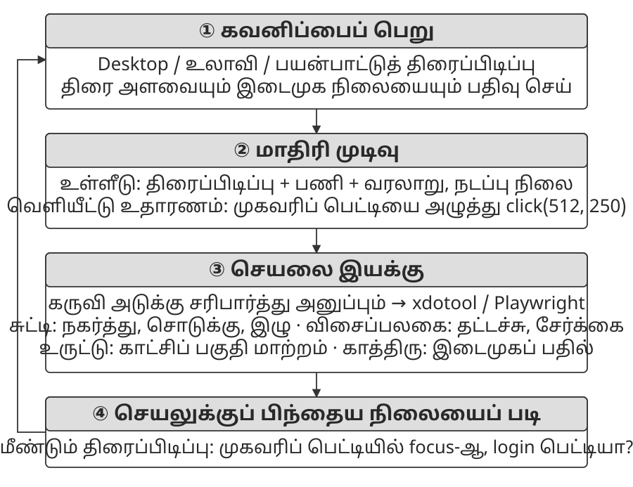

முகவரியை நிரப்பிய பிறகு, எந்த "சேமி" பொத்தானைச் சொடுக்க வேண்டும் என்று இயக்கிக்குச் சொல்வது எப்படி? திரை ஆயத்தொலைகளும் உறுப்பு எண்களும் இலக்கைச் சுட்ட முடியும்; ஆனால் மாதிரிக்கும் கருவிக்கும் உள்ள கோரிக்கைகள் வேறுபடுகின்றன.

### செயல் வெளி வடிவமைப்பு

படம் 6-13-இல், Anthropic-இன் Computer Use குறிப்புச் செயலாக்கம் வரைகலை இடைமுகம், கட்டளை இயக்கம், கோப்புத் திருத்தம் ஆகிய மூன்று வகைக் கருவிகளை வழங்குகிறது. வரைகலை இடைமுகத்தை மட்டும் பார்த்தாலும், தரவுக்கு இரு போக்குகள் உள்ளன: சொடுக்குச் செயல் இயக்க முனைக்குச் செல்கிறது; சொடுக்குக்குப் பிந்தைய திரைப்பிடிப்பு அடுத்த சுற்றின் முடிவுக்கான அவதானிப்பாக மாதிரிக்குத் திரும்புகிறது. இயல்பான API கருவி வடிவத்தை விதிக்கிறது; வேறு மாதிரிக்கு மாற்றினால், தகவமைப்பு அடுக்கு திரைப்பிடிப்பு, செயல் கோரிக்கை, இயக்க முடிவு ஆகியவற்றை அந்த இடைமுகம் ஏற்கும் செய்திகளாக மாற்ற வேண்டும்.[^ch6-computer-tools]

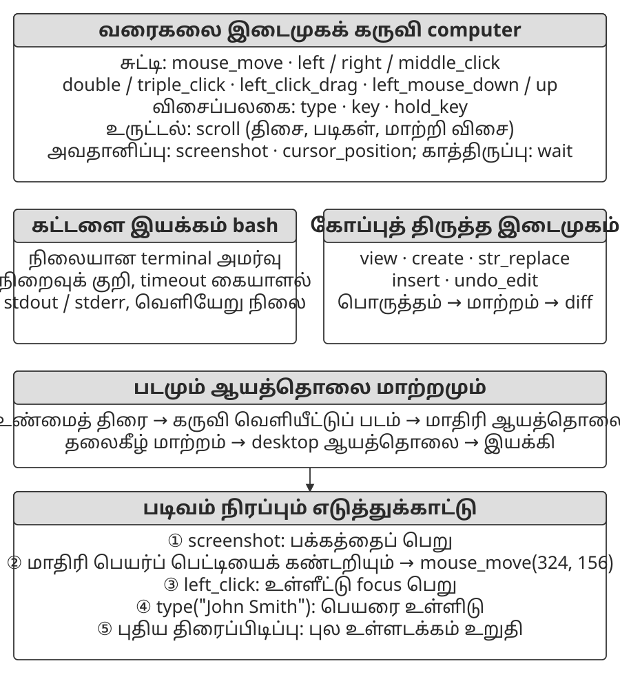

**GUI இயக்கக் கருவிகள்.** சுட்டிச் செயல்களில் நகர்த்தல், இடது/வலது/நடுச் சொடுக்கு, இரட்டைச் சொடுக்கு, மூன்று சொடுக்கு, இழுத்தல் ஆகியவை அடங்கும்; இன்னும் நுட்பமான இடைமுகங்கள் அழுத்துதல், விடுதலையைத் தனித்தனியாக வெளிப்படுத்தலாம். உருட்டலுக்குத் திசையும் அளவும் தேவை; சில செயலாக்கங்கள் மாற்று விசைகளையும் ஆதரிக்கின்றன. விசைப்பலகை இடைமுகம் உரை உள்ளீடு, சேர்க்கை விசைகள், விசையை அழுத்திப் பிடித்தலை வழங்குகிறது. திரைப்பிடிப்பும் கர்சர் இருப்பிடமும் நிலையைப் பெறப் பயன்படுகின்றன; காத்திருப்பு இடைமுகம் பக்க ஏற்றுதலுக்கோ அசைவுக்கோ நேரம் ஒதுக்குகிறது. கருவிப் பதிப்பு குறிப்பிட்ட செயல் தொகுப்பைத் தீர்மானிக்கிறது; Harness பயன்படுத்தும் இடைமுகத்தின்படி அளவுருக்களைச் சரிபார்க்கிறது.

**கட்டளை இயக்கக் கருவிகள்.** நிலைத்த முனையம் அழைப்புகளைக் கடந்து பணிக் கோப்பகத்தையும் சூழல் நிலையையும் தக்கவைக்கலாம். எடுத்துக்காட்டாக, ஒரு அழைப்பில் கோப்பகத்தை மாற்றிய பிறகு, அடுத்த அழைப்பும் அந்தக் கோப்பகத்தில் தொடர்கிறது. குறிப்புச் செயலாக்கம் ஒரு காவற்கோல் சரத்தைக் கொண்டு கட்டளை முடிந்ததைக் கண்டறிந்து, நேர வரம்பையும் அமைக்கலாம்; நேரம் முடிந்த பிறகான செயல்முறை நிலையை இன்னும் இயக்கி சரிபார்க்க வேண்டும்.

**கோப்புத் திருத்தக் கருவிகள்.** சரம் மாற்று இடைமுகம் அசல் உரையின் மூலம் திருத்த எல்லையை இடங்கண்டறிகிறது; பார்த்தல், உருவாக்குதல், செருகுதல், திரும்பப் பெறுதல் ஆகியவற்றையும் வழங்கலாம். இயக்குவதற்கு முன் பொருந்தும் இடத்தையும் எண்ணிக்கையையும் சரிபார்க்க வேண்டும்; இயக்கிய பிறகு வேறுபாட்டைச் சரிபார்க்க வேண்டும்; இரு அழைப்புகளுக்கு இடையே கோப்பு மாறியிருந்தால், முதலில் தொடர்புடைய உள்ளடக்கத்தை மீண்டும் படிக்க வேண்டும். அத்தியாயம் 5 அறிமுகப்படுத்திய திருத்த உத்திகளை இங்கு மீண்டும் பயன்படுத்தலாம்.

> **சோதனை 6-9 ★: Anthropic Computer Use குறிப்புச் செயலாக்கத்தை இயக்குதல்**
>
> இந்தச் சோதனை அதிகாரபூர்வக் கொள்கல எடுத்துக்காட்டு வழங்கும் Ubuntu மேசைக்கணினி, உலாவி, கருவி இயக்க அடுக்கைப் பயன்படுத்துகிறது. பயனர் பணியை உள்ளிட்ட பிறகு, மாதிரி திரைப்பிடிப்பைப் படித்து ஒரு செயலைத் திருப்பித் தருகிறது; இயக்க அடுக்கு மேசைக்கணினியை இயக்கி, புதிய திரைப்பிடிப்பை மீண்டும் மாதிரிக்குக் கொடுக்கிறது.
>
> துணைப் பணி சான் ஃபிரான்சிஸ்கோ வானிலையை வினவுகிறது. சேமிக்கப்பட்ட பாதை முதலில் Google-ஐ அணுகியது; சரிபார்ப்புக் குறியீட்டைச் சந்தித்த பிறகு, இயக்கத்தின்போது வந்த மீட்பு அறிவுறுத்தலின்படி பொதுவில் படிக்கக்கூடிய Open-Meteo தரவுக்குத் திரும்பி, இறுதியில் வெப்பநிலையையும் வானிலை நிலையையும் தெரிவித்தது. பதிவில் 15 மேசைக்கணினிச் செயல்களும் அவற்றுக்குரிய திரைப்பிடிப்புகளும் உள்ளன; சொடுக்கு, விசை அழுத்தம், உரை உள்ளீடு, காத்திருப்பு ஆகியவை பக்கத்தை எவ்வாறு மாற்றுகின்றன என்று சுற்று வாரியாகச் சரிபார்க்கலாம்.
>
> திறந்த மாதிரி கொண்டு உலாவியை இயக்கும் பாதைக்கு சோதனை 6-10-ஐப் பார்க்கவும்.

### காட்சி இடங்காணல் (Grounding)

தேடல் பெட்டியைச் சொடுக்கச் சொல்லும்போது, கேள்வியை இரு வடிவங்களில் வைக்கலாம். ஒன்று, திரைப்பிடிப்பைக் காட்டி சொடுக்கும் ஆயத்தொலைகளைச் சொல்லச் சொல்வது. மற்றொன்று, வேட்பு இலக்குகளுக்கு எண்ணிடப்பட்டு, தேடல் பெட்டியைத் தேர்ந்தெடுக்கச் சொல்வது; எண்களைத் திரைப்பிடிப்பில் உள்ள வேட்புப் பகுதிகளில் குறிக்கலாம், அல்லது உலாவி வழங்கும் உறுப்புப் பட்டியலிலிருந்து பெறலாம். கீழே இந்த மூன்று பாதைகளையும் தனித்தனியாக விளக்குகிறோம். எண்ணைத் தேர்ந்தெடுக்கும்போது, எண்ணை உண்மையான இலக்காக மீட்டெடுப்பது இயக்க அடுக்கின் பொறுப்பு; ஆயத்தொலைகளை நேரடியாகச் சொல்லும்போது, இலக்கின் இருப்பிடத்தை மாதிரியே மதிப்பிட வேண்டும்; இடங்காணல் பயிற்சிக்கும் திரைத் தெளிவுத்திறன் தகவமைப்புக்கும் அதிக தேவைகள் உள்ளன.

**Set-of-Mark: காட்சிக் குறியிடல்.**

Set-of-Mark (SoM) படத்தின் மீது குறிப்பிடக்கூடிய எண்களை மேலெழுதி, காட்சிப் பகுதிகளை மாதிரி வெளியீட்டுடன் இணைக்கிறது. மூல ஆய்வு பிரித்தெடுப்பு போன்ற முறைகளால் வேட்புப் பகுதிகளை உருவாக்கியது; எடுத்துக்காட்டாக SAM, SEEM கொண்டு பகுதிகளைப் பெற்று, பின்னர் குறிகளை வைத்தது. மாதிரி எண்ணைத் தேர்ந்தெடுத்த பிறகு, தொடர்புடைய பகுதியின் அடிப்படையில் இயக்க அடுக்கு செயல் இருப்பிடத்தைத் தீர்மானிக்கிறது. DOM இல்லாத மேசைக்கணினி மென்பொருள் அல்லது விளையாட்டு இடைமுகங்களுக்கு இந்த முறையைப் பயன்படுத்தலாம்; சொடுக்க வேண்டிய கட்டுப்பாடு எண்ணிடப்பட்ட பகுதிக்குள் விழ வேண்டும், அது எந்த எண்ணுக்கு உரியது என்பதை மாதிரி தெளிவாகப் பார்க்கவும் வேண்டும்.[^ch6-som]

**கட்டமைக்கப்பட்ட உறுப்புச் சுட்டு.**

உலாவி இன்னொரு வகைத் துப்பையும் வழங்கும். ஆவணப் பொருள் மாதிரி (DOM) பக்கத்தில் என்னென்ன உறுப்புகள் உள்ளன, அவற்றின் அடுக்கு என்ன என்பதை விவரிக்கிறது; தளவமைப்புத் தகவல் உறுப்புகளின் காட்சி இருப்பிடத்தைத் தருகிறது; அணுகல்தன்மை மரம் (accessibility tree) உதவி தொழில்நுட்பங்களுக்குத் தேவையான பங்கையும் அணுகக்கூடிய பெயரையும் தக்கவைக்கிறது. எடுத்துக்காட்டாக, ஒரு பொத்தானில் உருப்பெருக்கிக் கண்ணாடி சின்னம் மட்டும் இருந்தால், பக்கம் "தேடல்" என்ற அணுகக்கூடிய பெயரை வழங்கியிருந்தால், ஏஜெண்ட் பங்கு, பெயரின்படி அதைக் கண்டுபிடிக்கலாம். browser-use போன்ற தீர்வுகளை எடுத்துக்காட்டாகக் கொண்டால், அமைப்பு Chrome DevTools Protocol (CDP) போன்ற உலாவிப் பிழைநீக்க இடைமுகங்கள் வழியாக உறுப்புத் தகவலைப் பெற்று, உள்ளீட்டுப் பெட்டிகள், பொத்தான்கள், இணைப்புகளை அடையாளம் கண்டு, தற்போதைய பக்கத்தில் உள்ள இந்த இயக்கக்கூடிய உறுப்புகளுக்கு எண்ணிடுகிறது. படம் 6-14-இல், மாதிரி பக்கத்தின் வலது மேல் மூலையில் உள்ள [2]-ஐத் தேர்ந்தெடுத்தது. இந்த எண் Submit பொத்தானின் ஒரு சொடுக்காக எவ்வாறு மாறுகிறது?

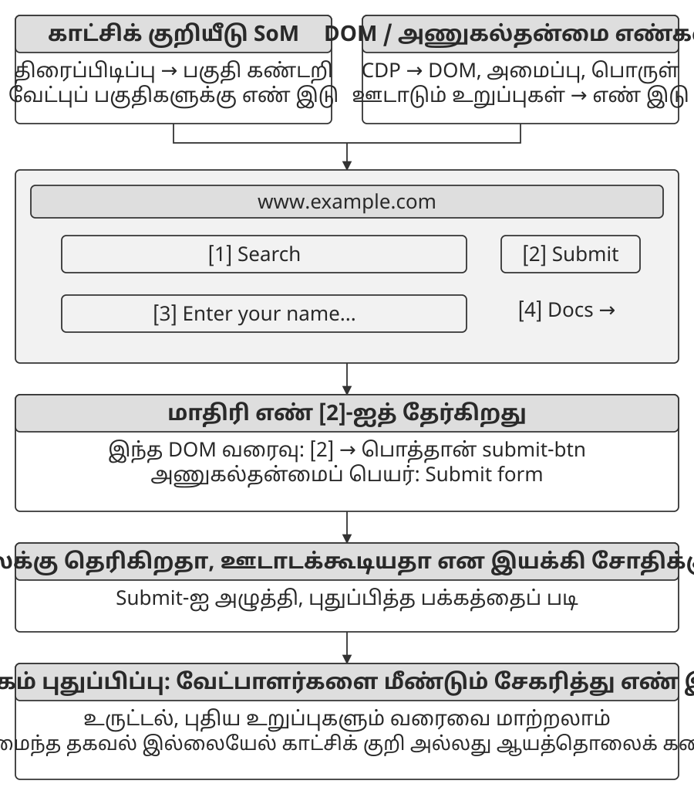

செயலாக்கத்தை நான்கு படிகளாகப் பிரிக்கலாம்: DOM, தளவமைப்பு, கிடைக்கும் அணுகல்தன்மைத் தகவலைப் படித்தல்; இடைவினை செய்யக்கூடிய உறுப்புகளை வடிகட்டுதல்; தற்போதைய பக்கத்தின் எண் வரைபடத்தை உருவாக்குதல்; உறுப்பு விளக்கத்தையும் தேவையான குறியிடப்பட்ட திரைப்பிடிப்பையும் மாதிரிக்குக் கொடுத்தல். எடுத்துக்காட்டாக, கீழே உள்ள நான்கு எண்ணிடப்பட்ட உறுப்புகளை மாதிரி பார்க்கலாம்:

```text
截图中标有 [1]、[2]、[3]、[4]

[1] <input type="text" placeholder="Search" aria-label="Search" />
[2] <button id="submit-btn" aria-label="Submit form" />
[3] <input type="text" placeholder="Enter your name" value="" />
[4] <a href="/docs" aria-label="Documentation" />
```
மாதிரி எண்ணைத் தேர்ந்தெடுத்த பிறகு, இயக்க அடுக்கு அதை உறுப்புக் குறிப்பாகவோ ஆயத்தொலைகளாகவோ பாகுபடுத்தி, இலக்கு இன்னும் தெரிகிறதா, இடைவினை செய்யக்கூடியதா என்று சரிபார்த்து, பின்னர் செயலை முடிக்கிறது. பக்கம் புதுப்பிக்கப்பட்டோ, உருட்டப்பட்டோ, உறுப்புகள் மாறும் வகையில் செருகப்பட்டோ இருந்தால், வரைபடத்தைப் புதுப்பித்துக் காலாவதியான எண்களைப் பயன்படுத்துவதைத் தவிர்க்க வேண்டும். கட்டமைக்கப்பட்ட சுட்டு குறிச்சொற்கள், பங்குகள், உரையைப் பயன்படுத்த முடியும்; Canvas, மறைப்பு, அல்லது முழுமையற்ற பொருள் குறியிடல் ஆகியவற்றுக்குத் திரைப்பிடிப்புடன் இணைந்து தீர்மானிக்க வேண்டும். பட்டியலிடப்பட்ட உறுப்புகள் எவ்வளவு அதிகமாகவும், திரைப்பிடிப்பு எவ்வளவு பெரியதாகவும் இருந்தால், சூழலுக்குள் அனுப்பப்படும் தகவலும் அவ்வளவு அதிகம்.

**ஆயத்தொலைகளை நேரடியாக முன்கணித்தல்.**

ஆயத்தொலைப் பாதை, திரைப்பிடிப்பிலிருந்தும் இலக்கு விளக்கத்திலிருந்தும் இருப்பிடத்தை மாதிரி நேரடியாக வெளியிட விடுகிறது; எடுத்துக்காட்டாக "சமர்ப்பிப்புப் பொத்தானைச் சொடுக்கு" என்பதை ஒரு புள்ளிக்கு வரைபடமாக்குவது. SeeClick போன்ற GUI இடங்காணல் ஆய்வுகளும் Claude-இன் Computer Use-உம் ஆயத்தொலை வெளியீட்டைப் பயன்படுத்தின. பிம்ப ஆயத்தொலைகளை உண்மையான மேசைக்கணினி ஆயத்தொலைகளாக மாற்றுவது இயக்க அடுக்கின் பொறுப்பு.

திரைப்பிடிப்பு அளவு மாற்றப்பட்ட பிறகு, இரு ஆயத்தொலைத் தொகுப்புகளும் ஒரே மாற்றத்தைப் பயன்படுத்த வேண்டும். 2560×1440 மேசைக்கணினியை எடுத்துக்காட்டாகக் கொண்டு, மாதிரிக்கு அனுப்பிய படம் 1366×768 என்றால், மாதிரி தந்த (683, 384):

$$
x = 683 \times \frac{2560}{1366} = 1280,\qquad
y = 384 \times \frac{1440}{768} = 720
$$

படம் 6-15-இல் இரு அளவுகளின் அகல–உயர விகிதம் நெருக்கமாக உள்ளது. விகிதத்தைப் பேணக் கருப்புப் பட்டை சேர்த்திருந்தால், மாதிரி தரும் ஆயத்தொலைகளில் ஓர இடைவெளியும் அடங்கும்; அசல் திரை ஆயத்தொலைக்குத் திரும்பும் முன், அந்த இடைவெளியை முதலில் கழித்து, பின்னர் அளவு மாற்றக் காரணியின்படி மாற்ற வேண்டும். வெட்டுதல், காட்சி அளவு மாற்றம், பல் திரை மூலப்புள்ளி ஆகியவையும் வரைபடத்தை மாற்றும்; கருவி அடுக்கு உண்மையான மாற்ற அளவுருக்களைச் சேமிக்க வேண்டும்.

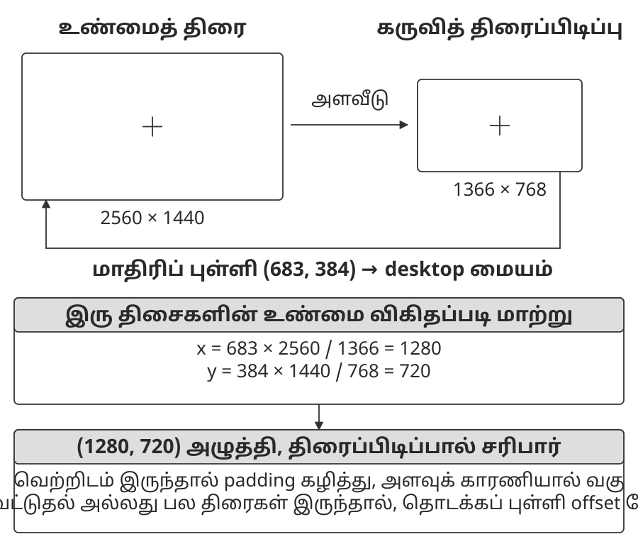

குறிப்புச் செயலாக்கம் XGA (1024×768), WXGA (1280×800), FWXGA (1366×768) போன்ற இலக்கு அளவுகளைப் பயன்படுத்தியது. அகல–உயர விகிதத்தை வலுக்கட்டாயமாக மாற்றினால், கட்டுப்பாடுகளின் வடிவம் சிதைந்துவிடும்; தவறான தலைகீழ் வரைபடம் சரியான முன்கணிப்பையும் தவறான இடத்துக்குக் கொண்டு செல்லும்.[^ch6-computer-tools]

**கட்டமைக்கப்பட்ட தகவல் முழுமையாக இருந்தால், DOM அல்லது அணுகல்தன்மை மரச் சுட்டை முன்னுரிமையாகப் பயன்படுத்துவேன்.** உறுப்புகளின் பெயர், பங்கு, குறிப்பு ஆகியவை நேரடியாக இடங்காணலில் பங்கேற்கலாம்; மாதிரி தற்காலிகமாகப் புள்ளி இருப்பிடத்தை மதிப்பிடும் வேலை குறைகிறது. கட்டமைப்பு இல்லாதபோது, பொது பார்வை மாதிரி முதலில் SoM-உடன் இணைந்து, குறியிடப்பட்ட பகுதிகளில் ஒன்றைத் தேர்ந்தெடுக்கச் செய்யலாம்; ஏற்கனவே GUI இடங்காணல் பயிற்சி பெற்ற மாதிரிகளோ ஆயத்தொலைகளை நேரடியாக முன்கணித்துத் தனிக் குறியிடலைத் தவிர்க்கலாம்.

> **சோதனை 6-10 ★: browser-use கொண்டு தானியங்கி உலாவி இயக்கத்தைச் செயலாக்குதல்**
>
> இந்தச் சோதனை Qwen3-VL 32B Instruct கொண்டு browser-use-ஐ இயக்கி, உலாவி நிலை, உறுப்புத் தகவல், திரைப்பிடிப்பு ஆகியவற்றின் வழியாகச் செயல்களை உருவாக்குகிறது. பணி சான் ஃபிரான்சிஸ்கோ வானிலையை வினவுவது: தேடல் பெட்டியை இடங்கண்டறிந்து, "San Francisco weather today" என்று உள்ளிட்டு, வினவலைச் சமர்ப்பித்து, பின்னர் வெப்பநிலையையும் வானிலை நிலையையும் பிரித்தெடுப்பது.
>
> சோதனை 6-10-இன் குறியீடும் இயக்க விளக்கமும் இரு நுழைவாயில்களை வழங்குகின்றன. OpenRouter விசை இருந்தால், நிர்வகிக்கப்படும் பார்வை மாதிரியைப் பயன்படுத்தலாம்; ஏற்கனவே vLLM, SGLang போன்ற இணக்கமான சேவை இருந்தால், `OPEN_MODEL_BASE_URL`, `OPEN_MODEL_MODEL` ஆகியவற்றைத் தன் முனையத்துக்கும் மாதிரிக்கும் சுட்டி, சேவை தேவைப்படும் விசையை அமைக்கலாம். இரு பாதைகளிலும் முதலில் சோதனைக் கோப்பகத்தில் `python main.py --dry-run` இயக்கி உள்ளமைவைப் பாருங்கள்; பின்னர் விளக்கத்தின்படி உண்மையான வினவலைத் தொடங்குங்கள்.
>
> சேமிக்கப்பட்ட இயக்கம் 16 படி இடைவினைகளை முடித்து, 15 திரைப்பிடிப்புகளைத் தக்கவைத்தது. Google சரிபார்ப்புக் குறியீட்டைக் காட்டிய பிறகு, பணி weather.com-க்கு மாறி முடிவுகளைப் பெற்றது.

[^ch6-computer-tools]: Anthropic, Computer Use கருவி ஆவணம் மற்றும் குறிப்புச் செயலாக்கம்; பதிப்பிடப்பட்ட செயல் இடைமுகம், இயக்க அடுக்கு, திரைப்பிடிப்புக் கையாளுதல் ஆகியவற்றை அறிமுகப்படுத்துகின்றன.
[^ch6-som]: Microsoft, *Set-of-Mark Prompting*, 2023; browser-use-இன் DOM சேவைச் செயலாக்கம் கட்டமைக்கப்பட்ட உறுப்புக் கையாளுதலுக்கு எடுத்துக்காட்டு தருகிறது.

### அசைவைப் பார்க்கவும் ஒலியைக் கேட்கவும் முடிகிற Computer Use ஏஜெண்ட்

பக்கம் சேமித்த பிறகு சிறிது நேரம் மட்டும் "ஒத்திசைவு தோல்வி" என்று காட்டுகிறது; இரு வினாடிகள் இடைவெளியில் எடுத்த இரு திரைப்பிடிப்புகளும் ஒரே படிவத்தைக் காட்டுகின்றன. இந்த இரு படங்களை மீண்டும் பார்த்தால், மாதிரி நடுவில் என்ன நடந்தது என்பதை மீளுருவாக்க முடியாமல் போகலாம். காணொளி, அசைவூட்டம், குறுகிய அறிவிப்புகள், கூட்டக் குரல் ஆகியவற்றிலும் இந்தப் பிரச்சினை உள்ளது. **தொடர்ந்து மாறும் இடைமுகங்களுக்கு, அவதானிப்பு இடைமுகத்தையே மேம்பாட்டின் முக்கிய இலக்காகக் கொள்ள வேண்டும் என்பது என் கருத்து.** மாற்றத்தின் அடிப்படையில் அடுத்த படியைத் தீர்மானிக்க, செயல்களுக்கு இடையே தோன்றிய நிகழ்வுகளையோ படங்களையோ சேமிக்க வேண்டும்.

நானும் என் சக ஆய்வாளரும் முன்மொழிந்த **Agent–Computer Observation Interface (AOI, ஏஜெண்ட்—கணினி அவதானிப்பு இடைமுகம்)**, தொடர் திரையையும் ஒலியையும் மாதிரி பெறக்கூடிய படங்களாகவும் உரையாகவும் மாற்றுகிறது[^ch6-9]. இடைமுகத்தில் மூன்று கூறுகள் அடங்கும்:

- **செயல்களுக்கு இடையிலான முக்கியச் சட்டகச் சேகரிப்பு.** முதன்மைச் சுழற்சி இயங்கும்போது திரை மாற்றங்களைக் கண்காணித்து, பிக்சல் வேறுபாடு அல்லது இலகுவான பார்வை மாதிரி மூலம் வேட்புச் சட்டகங்களை வடிகட்டி, பயனுள்ள படங்களை அடுத்த முடிவுக்குக் கொடுத்தல்.
- **ஒலி அளவு வாயில் கட்டுப்பாட்டு உரைமாற்றம்.** ஒலி கண்டறியப்பட்டதும் பேச்சு அடையாளம் காணலை அழைத்து, உரைமாற்றத்தையும் நேரத் தகவலையும் அவதானிப்புப் பதிவில் சேர்த்து, கூட்ட உள்ளடக்கத்தையோ வாய்மொழிக் கட்டளைகளையோ ஏஜெண்ட் பயன்படுத்த உதவுதல்.
- **நிலைத்த பட விவரணை.** முக்கியப் படங்களை உரையாகச் சுருக்குதல்; அசல் படம் சூழலிலிருந்து விலகிய பிறகும், நடந்த மாற்றங்களை அந்த உரை இன்னும் தக்கவைத்து, அடுத்தடுத்த படிகளில் குறிப்புக்குப் பயன்படுதல்.

எடுத்துக்காட்டாக, காணொளியில் ஒரு மெனுச் செயல் காட்டப்பட்டது; இடைநிலைப் படத்தையும் அதற்குரிய விவரணையையும் மாதிரி பெற்றிருந்தால், இயக்கம் முடிந்த பிறகும் அந்தப் படியைக் குறிப்பாகப் பயன்படுத்தலாம். ஆய்வுக் கட்டுரையின் அப்லேஷன் முடிவுகள், நிலைத்த உரை விவரணை பலனுக்கு மிக முக்கியம் என்பதைக் காட்டின; முக்கியச் சட்டகங்களின் நுட்பமான தேர்வு குறைவான பங்களிப்பையே தந்தது; சில மாதிரிகள் அதிகப் படங்களைச் சேர்த்த பிறகு மாறாகச் சிதைந்தன.

இப்போது படிவம் சேமித்த எடுத்துக்காட்டுக்குத் திரும்புவோம். முக்கியச் சட்டகம் "ஒத்திசைவு தோல்வி" என்று பிடித்திருந்தாலும், அசல் படம் சூழலிலிருந்து விலகியதும், மாதிரி எஞ்சிய விவரணையையே நம்ப வேண்டும். "பக்கத்தில் அறிவிப்பு தோன்றியது" என்பது சேமிப்பு வெற்றியையோ தோல்வியையோ குறிக்கலாம்; "ஒத்திசைவு தோல்வி, முகவரி சேமிக்கப்படவில்லை" என்றால் அடுத்த படியைத் தீர்மானிக்கும் துப்பு தக்கவைக்கப்படுகிறது.

[^ch6-9]: Bojie Li, Noah Shi, *Agent-Computer Observation Interfaces Enable Dynamic Computer Use*, 2026; AOI-ஐயும் அதன் கூறு அப்லேஷனையும் அறிமுகப்படுத்துகிறது.

### Computer Use-இன் உலக மாதிரி

காலத்துக்குச் சரியாக அவதானிப்பு கிடைத்த பிறகும், ஏஜெண்ட் செயலைத் தேர்ந்தெடுத்து இயக்கம் முடியும் வரை காத்திருக்க வேண்டும். OSWorld-Human ஆய்வு, ஏஜெண்டின் இயக்கத் திறனை மனிதப் பாதைகளுடன் ஒப்பிட்டு, தேவையற்ற படிகள், மாதிரி அழைப்புகள் போன்ற நேரச் செலவு மூலங்களைப் பகுப்பாய்வு செய்தது[^ch6-osworld-human].

உலக மாதிரி திட்டமிடலுக்குச் செயல்களின் விளைவுகளை முன்கணிக்கிறது. மேசைக்கணினி நிலையில் சாளரங்கள், கவனம், உருட்டல் இருப்பிடம், உள்ளீட்டு உள்ளடக்கம், ஏற்ற முன்னேற்றம் ஆகியவை அடங்கலாம்; அனுமதிகள், பிணைய முடிவுகள் போன்ற தகவலைத் தொடர்புடைய இடைமுகங்கள் வழியாக நிரப்ப வேண்டும். மாதிரி தற்போதைய கிடைக்கும் நிலையையும் வேட்புச் செயல்களையும் கொண்டு அடுத்த நிலையை முன்கணிக்கிறது:

```text
当前状态 + click / type / scroll / wait → 预测的下一状态
```
மனிதர் கணினியை இயக்கும்போது, பெரும்பாலும் சொடுக்குவதற்கு முன்பே அடுத்த படியை மனதில் கற்பனை செய்துவிடுகிறார்; இடைமுகம் எதிர்பார்த்தபடி இருந்தால் தொடர்கிறார், எதிர்பாராதது நிகழ்ந்தால் மட்டும் நின்று சரிபார்க்கிறார். உலக மாதிரி ஏஜெண்டுக்கு இதையொத்த ஊக இயக்க அடிப்படையை வழங்குகிறது: திட்டமிடல் அமைப்பு வேட்புச் செயல்களை முன்கூட்டியே ஒப்பிட்டு, பக்க ஏற்றத்தின்போது அடுத்தடுத்த படிகளைத் தயார் செய்து, உண்மையான நிலை உறுதிசெய்யப்பட்ட பிறகு தொடர்கிறது; இதனால் ஒவ்வொரு சொடுக்குக்குப் பிறகும் தொடக்கத்திலிருந்து திட்டமிடும் காத்திருப்பு குறைகிறது. எடுத்துக்காட்டாக, VS Code-இல் புதிய Python கோப்பை உருவாக்கி hello world எழுதினால், எதிர்பார்க்கப்படும் மாற்றங்களில் கோப்பு மரத்தில் புதிய கோப்பு தோன்றுவது, திருத்திப் பகுதியில் குறியீடு இருப்பது, சேமிப்பு நிலை புதுப்படுவது ஆகியவை அடங்கும். இயக்கிய பிறகு இந்த மாற்றங்களைச் சரிபார்த்து, எதிர்பார்த்தபடி இருந்தால் தொடரலாம்; விலகல் இருந்தால் மீண்டும் இடங்கண்டறிந்து திட்டமிட வேண்டும்.

கோப்பை நீக்குவது போன்ற செயல்களுக்குத் தனி இயக்க நிபந்தனைகளும் தேவை: இலக்கு சரியானதா, நீக்க அனுமதி உள்ளதா, மீட்க முடியுமா, பயனர் உறுதிப்படுத்தல் தேவையா. முன்கணிப்பு சாத்தியமான விளைவுகளைப் புரிந்துகொள்ள உதவுகிறது; உண்மையான அனுமதிகளையும் வணிக நிபந்தனைகளையும் இயக்க அடுக்கு சரிபார்க்கிறது.

**Photon-1-இன் மறைநிலை முன்கணிப்பு.** Induction Labs 2026 ஜூலையில் Photon-1-ஐ அறிமுகப்படுத்தியது: காணொளிச் சட்டகங்களைத் தனித்தனி மறைநிலை token-களாகக் குறியாக்கி, அடுத்தடுத்த token-களை முன்கணிப்பதன் மூலம் நிலை மாற்றங்களைக் கற்றுக்கொள்கிறது. நிறுவனம் அதன் முன்-பயிற்சி சுமார் 30 ஆயிரம் H200 GPU மணி நேரம் பயன்படுத்தியதாகத் தெரிவித்தது. நிலை முன்கணிப்பு மறைநிலை token-களுக்குள் நடக்கிறது; துணைப் பட உருவாக்கி அவற்றைப் பார்க்கக்கூடிய படங்களாக மீட்டெடுத்து, மனிதர் முன்கணிப்பைச் சரிபார்க்க உதவுகிறது. திட்டமிடலும் செயல் உருவாக்கமும் உள் வெளிப்பாட்டை நேரடியாகப் பயன்படுத்தி, ஒவ்வொரு படிக்கும் முழுத் திரைப்பிடிப்பை உருவாக்கும் செலவைத் தவிர்க்கலாம்.[^ch6-20]

இந்தத் தீர்வு அறிவுறுத்தல், செயல் வடிவங்களை நுட்பமாக்கிப் பயிற்றுவதன் மூலம் மேலும் கற்றுக்கொள்கிறது: முதலில் அடைய விரும்பும் நிலையை முன்கணித்து, பின்னர் அந்த நிலைக்கு இட்டுச் செல்லும் செயல்களை உருவாக்கி, மெய்நிகர் கணினியில் இணையப் பயிற்சி மூலம் பணிச் செயல்திறனை மேம்படுத்துகிறது. செயல்-நிபந்தனை நுட்பமாக்கல், கொடுக்கப்பட்ட செயலுக்குப் பிந்தைய மேசைக்கணினி மாற்றத்தை முன்கணிக்கப் பயன்படுகிறது. இந்த இரு பயன்பாடுகளும் முறையே திட்டமிடலையும் உருவகப்படுத்தலையும் இணைத்து, நிலை வெளிப்பாடு Computer Use-இல் எவ்வாறு பங்கேற்கிறது என்பதைக் காட்டுகின்றன.

[^ch6-osworld-human]: Reyna Abhyankar மற்றும் பலர், *OSWorld-Human: Benchmarking the Efficiency of Computer-Use Agents*; பணிப் பாதைகளையும் நேரச் செலவையும் பகுப்பாய்வு செய்கிறது.
[^ch6-20]: David Li, Jonathan Li, *Scaling Video Pretraining with Imagination Models*, Induction Labs, 2026-07-23; Photon-1-இன் முன்-பயிற்சி, செயல் கற்றல், நிலை உருவகப்படுத்தலை அறிமுகப்படுத்துகிறது.
[^ch6-21]: Google DeepMind, *Genie 3: A new frontier for world models*, 2025-08-05; Zachary Lin மற்றும் பலர், *Cosmos World Foundation Model Platform for Physical AI*, 2025.

### கைபேசிப் பக்கம்: தொழில்நுட்ப இடைமுகங்களும் சூழல்தொகுதி ஒத்துழைப்பும்

கைபேசியிலும் அவதானிப்பு—முடிவு—செயல் சுழற்சியே தொடர்கிறது; ஆனால் செயல்கள் பெரும்பாலும் தொடு அசைவுகளாக வெளிப்படுகின்றன. ஒரே ஆயத்தொலை ஒற்றைச் சொடுக்கு இடமாகவோ, நீண்ட அழுத்தும் இடமாகவோ, இழுவையின் தொடக்கப் புள்ளியாகவோ இருக்கலாம்; எனவே இடைமுகத்துக்கு அசைவு வகை, நீடிப்பு நேரம், பாதை ஆகியவையும் தேவை. திரைச் சுழற்சி, மென்விசைப்பலகை தோன்றுதல், அமைப்பு பாப்-அப் ஆகியவையும் இயக்கக்கூடிய பகுதியை மாற்றும்.

Android-இன் `AccessibilityService` அனுமதிக்கப்பட்ட எல்லைக்குள் இடைமுகத் தகவலைப் படித்துத் தொடர்புடைய செயல்களை இயக்க முடியும்; அசைவு இடைமுகத்துக்கு அதற்குரிய திறனை அறிவிக்க வேண்டும்[^ch6-android]. திரைப்பிடிப்பு, அணுகல்தன்மை மரம், அமைப்புத் தானியங்கி இடைமுகங்கள் இணைந்து பயன்படலாம்; கிடைக்கும் குறிப்பிட்ட எல்லையை இயக்க அமைப்பு, பயன்பாட்டுச் செயலாக்கம், அனுமதி ஆகியவை தீர்மானிக்கின்றன. அத்தியாயம் 7 அறிமுகப்படுத்தும் AndroidWorld போன்ற அளவுகோல்கள், உண்மையான பயன்பாட்டுப் பணிகளில் இந்தச் செயல்கள் எதிர்பார்க்கப்பட்ட முடிவுகளைத் தருமா என்று சரிபார்க்கின்றன.

**கைபேசிப் பக்கத்தில் நடைமுறைப்படுத்தலில் சந்திக்கும் சூழல்தொகுதி இடையூறுகள், பெரும்பாலும் தொழில்நுட்பப் பிரச்சினைகளை விடக் கையாளக் கடினமானவை என்பது என் கருத்து.** தளங்கள் எந்தெந்தச் செயல்களைப் பதிலாளரிடம் ஒப்படைக்கலாம், கணக்கு–பணம்–தரவுக்கு அனுமதி எவ்வாறு வழங்குவது, தவறு நேர்ந்தால் பொறுப்பை எவ்வாறு தடமறிவது என்பவற்றைத் தீர்மானிக்க வேண்டும். இந்த ஒப்பந்தங்கள் ஏஜெண்ட் முடிக்கக்கூடிய பணி எல்லையை நேரடியாகப் பாதிக்கின்றன.

இதில் ஒரு கட்டமைப்பு நலன் முரண்பாடு, போக்குவரத்திலிருந்தும் கவனத்திலிருந்தும் வருகிறது. பல பயன்பாடுகள் விளம்பரக் காட்சி, உள்ளடக்கப் பரிந்துரை, பரிவர்த்தனை நுழைவாயில் மூலம் வருவாய் ஈட்டுகின்றன; பயனர் ஏஜெண்டிடம் நேரடியாக வினவலையோ கொள்முதலையோ ஒப்படைத்த பிறகு, பக்க உலாவல் பாதை சுருங்கலாம்; பரிந்துரைகளுக்கும் விளம்பரங்களுக்கும் கிடைக்கும் கவனமும் மாறலாம். இந்த இடங்களைக் கொண்டு வருவாய் ஈட்டும் தளங்களுக்கு, பதிலாள் செயல்பாடு அவற்றின் அசல் வருவாய் மூலங்களைத் தொடும். எனவே தளங்கள் இடைமுகத் திறப்பு, வணிகப் பங்கீடு, பதிலாள் அடையாள மேலாண்மை ஆகியவற்றை மறுபரிசீலனை செய்ய வேண்டியிருக்கும்.

[^ch6-android]: Android Developers, AccessibilityService; இடைமுக அணுகல், செயல், அசைவுத் திறன்களை அறிமுகப்படுத்துகிறது.

## ரோபோ இயக்கம்: XLeRobot கொண்டு மேசையை ஒழுங்கமைப்பது எடுத்துக்காட்டாக

சிவப்புக் கோப்பையைத் தட்டில் வைத்து, மஞ்சள் கழிவுக் காகிதத்தைக் குப்பைப் பெட்டியில் போட்டு, இறுதியில் மேசை ஒழுங்காக உள்ளதா என்று உறுதிசெய்வது — இந்தப் பணி உணர்தல், திட்டமிடல், கட்டுப்பாடு ஆகியவற்றை இணைக்கிறது. பிடிப்பான் கோப்பையை நெருங்கும்போது, கேமராவில் அதன் இருப்பிடம் மாறுகிறது; கோப்பை தூக்கப்பட்ட பிறகு, கை மேசையில் உள்ள மற்ற பொருள்களைத் தவிர்க்க வேண்டும்; காகிதம் முதல் முறை பிடிபடாவிட்டால், அமைப்பு தோல்வியைக் கண்டறிந்து மீண்டும் முயல வேண்டும். ஒவ்வொரு செயலும் அடுத்த முடிவின் நிபந்தனைகளை மாற்றுகிறது.

இந்தப் பகுதி இந்தப் பணியைச் சுற்றி ஐந்து சோதனைகளை ஏற்பாடு செய்கிறது. சோதனைகள் 6-11, 6-13 உண்மையான இயந்திரத்தில் தொலைக் கட்டுப்பாடு, தன்னாட்சி இயக்கத்துக்கான நடைமுறை வடிவமைப்பைத் தருகின்றன; சோதனைகள் 6-12, 6-14, 6-15 உள்ளூர் உருவகப்படுத்தலைப் பயன்படுத்தி, முறையே கட்டுப்பாட்டு அடிப்படை, தோல்வி மீட்பு, பார்வை நிபந்தனை மாற்றத்தை ஆராய்கின்றன.

அதே ரோபோவை மனிதர் கேமராவைத் தொடர்ந்து பார்த்தபடி இயக்கலாம்; அல்லது மாதிரி படத்தைப் படித்து, திறனைத் தேர்ந்தெடுத்து, கட்டுப்பாட்டு அமைப்பிடம் இயக்கக் கொடுக்கலாம். பணியையும் வன்பொருளையும் மாற்றாமல் வைத்தால், இரு முறைகளின் வேறுபாட்டை நான்கு கேள்விகளிலிருந்து பகுப்பாய்வு செய்யலாம்: மனிதர் எதை முடிக்க விரும்புகிறார், அடுத்து எந்தத் துணைப் பணியை முதலில் செய்வது, தற்போதைய திறன் என்ன செயல்களை வெளியிடுகிறது, செயலுக்குப் பிறகான சூழல் திட்டத்துக்குப் பொருந்துகிறதா. நீண்ட நெடிய திட்டமிடல் கோப்பையையும் கழிவுக் காகிதத்தையும் கையாளும் வரிசையை ஏற்பாடு செய்கிறது; VLA உத்தி அல்லது முன்வரையறுக்கப்பட்ட செயல் அடிப்படைகள் பிடித்தலையும் வைத்தலையும் ஏற்கின்றன; உலக மாதிரி செயல் விளைவுகளை மதிப்பிட உதவுகிறது; உருவகப்படுத்தலிலிருந்து உண்மைக்கு மாற்றம் படம், தொடர்பு, இயக்கி இயல்புகளின் மாற்றங்களைக் கையாள்கிறது.

### வன்பொருளுக்கும் வழிமுறைக்கும் இடையிலான பணிப்பகிர்வு

தன்னாட்சி மேசை ஒழுங்கமைப்பு தோல்வியடையும்போது, முதலில் தொலைக் கட்டுப்பாட்டைக் கொண்டு வன்பொருள் பணியை முடிக்க முடியுமா என்று சரிபார்க்கலாம். கேமரா, இயந்திரக் கை, பிடிப்பான், மேசை அமைப்பு, ஏற்பு நிபந்தனைகள் ஆகியவற்றை மாற்றாமல், இயக்குபவர் உணர்தல்–கட்டுப்பாட்டு மூடிய சுழற்சியை ஏற்கட்டும். பல சுற்றுகளில் மனிதர் நிலையாக முடிக்க முடிந்து, தன்னாட்சி அமைப்பு மீண்டும் மீண்டும் தோல்வியடைந்தால், இந்த வன்பொருள் ஏற்கனவே தற்போதைய பணியை முடிக்க முடியும் என்றும், இடையூறு முக்கியமாகத் தன்னாட்சிக் கட்டுப்பாட்டின் வழிமுறையிலும் பின்னூட்டத்திலும் உள்ளது என்றும் பொருள். அப்போது பொருள் இடங்காணல், திறன் தேர்வு, செயல் நேரம், தோல்வி மீட்பு ஆகியவற்றை முதலில் ஆராய்ந்து, தொலைக் கட்டுப்பாட்டில் பயனுள்ளதாக இருந்த திருத்த முறைகளைத் தன்னாட்சி அமைப்பு கற்றுக்கொள்ளச் செய்ய வேண்டும்.

XLeRobot விசைப்பலகை, Xbox கட்டுப்பாட்டி, Switch Joy-Con கொண்டு தொலைக் கட்டுப்பாட்டை ஆதரிக்கிறது; VR இயக்கத்தை முதலில் உருவகப்படுத்தப்பட்ட சூழலில் அனுபவிக்கலாம்.[^ch6-1] பிடிப்பான் கோப்பையை நெருங்கும்போது இயக்குபவர் வேகத்தைக் குறைப்பார்; கோப்பை வழுக்கினால், பிடிப்புப் புள்ளியைத் திருத்த வேண்டும். பிடிப்பான் காகிதத்தைப் பிடிக்காவிட்டால், மீண்டும் பார்க்க வேண்டும்; பொருள் இடத்துக்கு வந்ததையும் ஒருமுறை பார்த்து உறுதிசெய்ய வேண்டும். அவதானிப்பின் அடிப்படையிலான இந்தத் திருத்தங்கள் அனைத்தும் செயல்விளக்கத் தரவில் பதிவு செய்யத் தகுந்தவை. பின்னர் ரோபோ தன்னாட்சியாக இயங்கும்போதும், வழுக்குதலையும் பிடிக்கத் தவறுதலையும் கண்டறிய முடிய வேண்டும்.

> **சோதனை 6-11 ★: உண்மையான XLeRobot-ஐத் தொலைக் கட்டுப்பாட்டால் இயக்கி மேசையை ஒழுங்கமைத்தல்**
>
> அளவுத்திருத்தம், எல்லை வரம்பு, அவசர நிறுத்தச் சரிபார்ப்பு முடிந்த XLeRobot பணியிடத்தில், சிவப்புக் கோப்பை, தட்டு, மஞ்சள் கழிவுக் காகிதம், குப்பைப் பெட்டி ஆகியவற்றை வையுங்கள். அளவுத்திருத்தப்பட்ட ஒரு தொலைக் கட்டுப்பாட்டு முறை மூலம் நிலையான பணியை இயக்குங்கள்: "சிவப்புக் கோப்பையைத் தட்டில் வை, மஞ்சள் கழிவுக் காகிதத்தைக் குப்பைப் பெட்டியில் போடு, இறுதியில் மேசை நிலையை உறுதிசெய்." பல சுற்றுகள் மீண்டும் செய்து, கேமராப் படங்கள், இயக்குபவர் உள்ளீடு, இயந்திரக் கை நிலை, செயல் நேரம், பிடிப்புத் தோல்விகள், மறுமுயற்சி எண்ணிக்கை ஆகியவற்றைப் பதிவு செய்யுங்கள்.
>
> ஒவ்வொரு சுற்றின் முடிவிலும், கோப்பை தட்டில் உள்ளதா, கழிவுக் காகிதம் குப்பைப் பெட்டியில் உள்ளதா, இயந்திரக் கை பாதுகாப்பான நிலைக்குத் திரும்பியதா என்று உறுதிசெய்து, முழுச் செயல்முறையின் மோதல், எல்லை மீறல், மனிதத் தலையீட்டுப் பதிவுகளைச் சரிபாருங்கள். தோல்வி எந்தப் படியில் நிகழ்ந்தது, இயக்குபவர் எவ்வாறு மீட்டார், இறுதி முடிவு என்ன என்பவற்றை ஒன்றாக வைத்துப் பகுப்பாய்வு செய்தால், தன்னாட்சிக் கட்டுப்பாட்டுக்கான ஒப்பீட்டு அடிப்படை உருவாகும்.

உருவகப்படுத்தப்பட்ட சோதனைகள் பொருள் எண்ணிக்கையையும் ஆரம்ப இருப்பிடத்தையும் மீண்டும் மீண்டும் மாற்றவும், தெரிந்த நிலையில் கட்டுப்பாட்டுச் செயல்முறையைத் தனியாக ஆராயவும் வசதி செய்கின்றன. இருபரிமாண மேசை மாதிரி, பொருளை நெருங்குதல், இலக்குக்குக் கொண்டு செல்லுதல், அடுத்த பொருளைக் கையாளுதல் ஆகியவற்றை மூன்று கட்டங்களாக வெளிப்படுத்தி, நிறைவுப் படிகள், பாதை நீளம் கொண்டு கட்டுப்பாட்டுச் செலவை விவரிக்கலாம்.

> **சோதனை 6-12 ★: உருவகப்படுத்தியில் அதே பணிக்கான இலட்சியக் கட்டுப்பாட்டு அடிப்படையை அமைத்தல்**
>
> இருபரிமாண மேசையில் பொருள் இருப்பிடங்களையும் இலக்கு இருப்பிடங்களையும் சீரற்ற முறையில் உருவாக்கி, கட்டுப்படுத்தி ஆயத்தொலைகளை நேரடியாகப் படித்து, பொருளை வரிசையாக நெருங்கி, தொடர்புடைய இலக்குக்கு நகர்த்தி, பின்னர் அடுத்த பொருளைக் கையாளச் செய்யுங்கள். ஆரம்ப இருப்பிடத்தையும் பொருள் எண்ணிக்கையையும் மாற்றி, வெற்றி விகிதம், நிறைவுப் படிகள், பாதை நீளம் ஆகியவற்றை ஒப்பிடுங்கள்.
>
> முதலில் ஒரு பொருளின் முழுப் பாதையையும் பின்தொடருங்கள்: கட்டுப்படுத்தி பொருளை அடைந்த பிறகு எடுத்துச் செல்லும் கட்டத்துக்குள் நுழைகிறது; இலக்கை அடைந்த பிறகே நிறைவு எண்ணிக்கை கூடும். பின்னர் பொருள் எண்ணிக்கையை அதிகரித்து, ஒவ்வொரு பொருளும் இந்த இரு அடைதல் நிபந்தனைகளையும் கடக்கிறதா என்று சரிபாருங்கள். துணை இருபரிமாண உருவகப்படுத்தல் ஐந்து சீரற்ற விதைகளில் முறையே 1, 2, 3, 4 பொருள்களை வைத்து, ஒவ்வொரு சேர்க்கையும் 512 சுற்றுகள் இயங்கியது; மொத்தம் 10,240 சுற்றுகளும் முடிந்தன. கட்டுப்படுத்தி ஆயத்தொலைகளை நேரடியாகப் படிக்க முடிகிறது; பொருளை நகர்த்துவதும் உண்மையான பிடிப்பானைச் சாராதது.

### ரோபோ கட்டுப்பாட்டின் அடிப்படைக் கட்டமைப்பு

ஒருமுறை மேசையை ஒழுங்கமைக்கப் பல நிமிடங்கள் ஆகலாம்; ஆனால் மூட்டுக் கட்டுப்பாடு தொடர்ந்து, சரியான நேரத்தில் புதுப்பிக்கப்பட வேண்டும். அமைப்பு கால அளவுகளுக்கேற்பப் பணியைப் பகிரலாம்: உயர்நிலைத் திட்டமிடல் பணி வரிசையை ஏற்பாடு செய்கிறது, திறன் உத்தி இயக்கத்தை உருவாக்குகிறது, அடிப்படைக் கட்டுப்படுத்தி பின்தொடர்ந்து இயக்குகிறது:

| அடுக்கு | மையக் கேள்வி | வெளியீடு | கால அளவும் உள்ளமைவு எடுத்துக்காட்டும் |
| --- | --- | --- | --- |
| பணி இலக்கு | மனிதர் எதை முடிக்க விரும்புகிறார் | "கோப்பையையும் கழிவுக் காகிதத்தையும் இடத்தில் வை" | நிமிட அளவுப் பணி |
| நீண்ட நெடிய திட்டமிடல் | எதை முதலில், எதைப் பின்னர் செய்வது | முதலில் கோப்பை, பின்னர் கழிவுக் காகிதம், இறுதியில் சரிபார்ப்பு | வினாடி முதல் நிமிடம் வரை |
| அடிப்படைத் திறன் | தற்போது எந்த நிலை மாற்றத்தை முடிக்க வேண்டும் | `pick(red_cup)`, `place(red_cup, tray)` | ஒரு திறன் சில வினாடிகள் நீடிக்கலாம்; எ.கா. 1–3 வினாடி |
| VLA / திறன் உத்தி | தற்போதைய திறனை எவ்வாறு குறிப்பாக இயக்குவது | பிடிப்பான் செயல், முனை நிலை, அல்லது ஒரு மூட்டுப் பாதைப் பகுதி | 1–10 Hz அனுமானமாக உள்ளமைக்கலாம் |
| அடிப்படைக் கட்டுப்பாடும் பாதுகாப்பு அடுக்கும் | நிலையாகவும் சரியான நேரத்திலும் எவ்வாறு இயக்குவது | மூட்டு அல்லது முனைக் கட்டுப்பாட்டு அளவு, வேக வரம்பு, அவசர நிறுத்தம் | கட்டுப்படுத்தியைப் பத்து முதல் ஆயிரக்கணக்கான Hz வரை உள்ளமைக்கலாம் |

திட்டமிடல் அமைப்பு விதி நிரல், VLM, அல்லது உகப்பாக்கியைப் பயன்படுத்தலாம்; VLA-உம் சில திறன் தேர்வுகளை ஏற்கலாம். **பணி வரிசையையும் கண்முன் உள்ள செயலையும் பிரித்துக் கையாளப் பரிந்துரைக்கிறேன்.** உயர்நிலைப் பகுத்தறிவுக்குத் திட்டத்தை ஒழுங்கமைக்க நேரம் தேவை; அடிப்படைக் கட்டுப்பாட்டுக்கோ இருப்பிடம், விசை மாற்றங்களுக்குச் சரியான நேரத்தில் எதிர்வினை புரிய வேண்டும்; இரண்டும் தத்தம் பொருத்தமான தாளத்தில் இயங்கினால் மட்டுமே திட்டமிடலையும் கட்டுப்பாட்டையும் ஒருசேரக் கவனிக்க முடியும்.

இந்தப் பகுதி உயர்நிலை மாதிரிக்கு `observe_scene`, `pick`, `place`, `verify_state`, `stop` என்ற ஐந்து வகைக் கருவிகளை வழங்குகிறது; அவை முறையே அவதானிப்பு, பிடித்தல், வைத்தல், சரிபார்ப்பு, நிறுத்தம் ஆகியவற்றுக்குப் பயன்படுகின்றன. Harness அளவுருக்கள், பணியிடம், தற்போதைய நிலையைச் சரிபார்க்கிறது; இயக்கி சரிபார்ப்பில் தேர்ச்சி பெற்ற திறனை இயந்திரக் கைச் செயலாக மாற்றி, வேக வரம்பையும் நேர முடிவையும் கையாள்கிறது. மூட்டுக் கோணங்களையும் தொடர் பாதைகளையும் திறன் உத்தியும் கட்டுப்படுத்தியும் உருவாக்குகின்றன; இதனால் மாதிரி திறனைத் தேர்ந்தெடுப்பதற்கும் உண்மையான இயக்கத்துக்கும் இடையே தெளிவான இடைமுகம் உருவாகிறது.

### நீண்ட நெடிய திட்டமிடலும் பணிப் பிரிப்பும்

பயனர் "மேசையைச் சுத்தமாக ஒழுங்கமை" என்று சொல்லும்போது, திட்டமிடல் அமைப்பு முதலில் பொருள்களையும் அவற்றின் இலக்குப் பகுதிகளையும் அடையாளம் கண்டு, கையாளும் வரிசையைத் தீர்மானித்து, ஒவ்வொரு படிக்கும் தொடக்க நிபந்தனை, நிறைவு நிபந்தனை, செயல் வரம்புகளைத் தெளிவாக எழுதுகிறது. எடுத்துக்காட்டாக, ஒழுங்கமைப்பு வரிசை இவ்வாறு இருக்கலாம்:

```text
处理红色杯子 → 清理黄色纸张 → 检查桌面
```
"சிவப்புக் கோப்பையைக் கையாளுதல்" என்பது இரு செயல்களாகவும் ஒரு சரிபார்ப்பாகவும் மேலும் பிரிகிறது:

```text
pick(red_cup) → place(red_cup, tray) → verify_state()
```
"கோப்பையைத் தூக்கித் தட்டில் வை" என்பதை எடுத்துக்காட்டாகக் கொண்டால், இயந்திரக் கை பிடிப்பு நிரலை இயக்கி முடித்தது, அந்த நிரல் முடிந்தது என்பதை மட்டுமே காட்டுகிறது. அடுத்து மேலே தூக்குவதற்கு முன், பிடிப்பான் பின்னூட்டம் அல்லது புதிய படம் மூலம் கோப்பை உண்மையில் பிடிக்கப்பட்டதா என்று தீர்மானிக்க வேண்டும். பிடிக்கத் தவறினால், கோப்பையை மீண்டும் இடங்கண்டறிய வேண்டும்; யாராவது தட்டை நகர்த்தியிருந்தால், ஏற்கனவே வெற்றி பெற்ற பிடிப்பு இன்னும் செல்லுபடி; வைக்கும் செயலை மட்டும் மீண்டும் திட்டமிட வேண்டும். ஒவ்வொரு திறனையும் சரிபார்க்கக்கூடிய ஒரு நிலை மாற்றத்துக்கு உரியதாக்கி, செயலையும் நேரத்தையும் வரம்பிட்டு, பின்னர் இயக்க நிலையையும் புதிய அவதானிப்பையும் திருப்பித் தந்தால், உண்மையில் பிழை நிகழ்ந்த படியிலிருந்தே திட்டமிடல் அமைப்பு மீள முடியும்.

> **சோதனை 6-13 ★★: Gemini Robotics-ER 1.5 கொண்டு XLeRobot-ஐ இயக்கித் தன்னாட்சியாக மேசையை ஒழுங்கமைத்தல்**
>
> சோதனை 6-11-இன் வன்பொருள், மேசை அமைப்பு, பணி, ஏற்பு நிபந்தனைகளைப் பின்பற்றி, உடல்சார் பகுத்தறிவு மாதிரி அவதானிப்புக்கும் திட்டமிடலுக்கும் பொறுப்பேற்கிறது. RoboCrew-இன் ஒருங்கிணைப்பு முறையைக் குறிப்பாகக் கொண்டு, இந்தப் பணிக்கு ஐந்து கருவிகளை வடிவமையுங்கள்: `observe_scene`, `pick`, `place`, `verify_state`, `stop`.[^ch6-2]
>
> மாதிரி முதலில் மேசை அவதானிப்பைப் படித்து, கையாளும் வரிசையைத் தீர்மானித்து, பின்னர் அளவுத்திருத்தப்பட்ட பிடித்தல், வைத்தல் திறன்களை அழைக்கிறது. ஒவ்வொரு திறனும் முடிந்ததும், புதிய அவதானிப்பைப் பெற்றுப் பின்நிபந்தனையைச் சரிபார்க்கிறது; தோல்விக்குப் பின் தற்போதைய நிலையைக் கொண்டு மீண்டும் முயல்வதா நிறுத்துவதா என்று தேர்ந்தெடுக்கிறது. அவசர நிறுத்த சமிக்ஞை கிடைத்தால், எல்லை மீறல் கண்டறியப்பட்டால், அல்லது முக்கிய நிலையை உறுதிசெய்ய முடியாவிட்டால், இயக்க அமைப்பு நேரடியாக இயக்கத்தை நிறுத்துகிறது; மாதிரியும் `stop` மூலம் தானாகப் பணியை முடிக்கலாம்.
>
> இறுதியில் புதிய சூழல் அவதானிப்பு, கோப்பை தட்டில் உள்ளதா, கழிவுக் காகிதம் குப்பைப் பெட்டியில் உள்ளதா, இயந்திரக் கை பாதுகாப்பான நிலைக்குத் திரும்பியதா என்று உறுதிசெய்து, மோதல், எல்லை மீறல் பதிவுகளைச் சரிபார்க்கிறது. இயக்குபவர் தொடக்கம், அவசர நிறுத்தம், அந்த இடத்தில் கண்காணிப்பு ஆகியவற்றுக்குப் பொறுப்பு; இடையில் கையேற்றல் தனியாகப் பதிவு செய்யப்படுகிறது.

சோதனை 6-13 உண்மையான இயந்திரச் செயல்களை எவ்வாறு இணைப்பது, ஒழுங்கமைப்பு முடிவை எவ்வாறு ஏற்பது என்பதை விளக்குகிறது; துணைப் பதிவுகளில் இந்தப் பணிக்கு உண்மையான இயந்திரச் சோதனை இன்னும் இல்லை. கீழே முதலில் உருவகப்படுத்தப்பட்ட சூழலில் மூன்று முறைகளை ஒப்பிடுவோம்: திட்டப்படி திறந்த சுழற்சியாக இயக்குதல், ஒவ்வொரு படிக்கும் பிறகு முடிவைச் சரிபார்த்தல், செயலின் விளைவை முதலில் முன்கணித்தல். பணி இலக்கும் ஐந்து வகைக் கருவிகளும் ஒன்றே; கோளாறையும் மீண்டும் மீண்டும் தூண்டலாம்; ஒரே தவறைச் சந்திக்கும்போது மூன்று முறைகளும் எவ்வாறு கையாள்கின்றன என்று அவதானிக்க வசதி.

### VLA கட்டுப்பாடு

VLA என்பது Vision-Language-Action-இன் சுருக்கம்; அதாவது பார்வை—மொழி—செயல் மாதிரி. அது தற்போதைய படம், பணி அறிவுறுத்தல், கிடைக்கும் ரோபோ நிலை ஆகியவற்றின் அடிப்படையில் அடுத்து இயக்க வேண்டிய செயலை உருவாக்குகிறது:

```text
当前观测 + 技能指令 → 动作或动作序列
```
மேசை ஒழுங்கமைப்பு எடுத்துக்காட்டில், உயர்நிலைத் திட்டமிடல் அமைப்பு `pick(red_cup)`-ஐச் சமர்ப்பிக்கிறது; திறன் உத்தி படத்தின் அடிப்படையில் எந்தத் திசையிலிருந்து கோப்பையை நெருங்குவது, எப்போது பிடிப்பானை மூடுவது, எந்தப் பாதையில் கையைத் தூக்குவது என்பவற்றைத் தீர்மானிக்கிறது. இந்த இயக்கப் பகுதியை இயக்கிய பிறகு, அமைப்பு மேசை அவதானிப்பை மீண்டும் பெற்று, கோப்பை பிடிக்கப்பட்டதா என்று உறுதிசெய்து, பின்னர் `place(red_cup, tray)`-க்குள் நுழைகிறது. கருவி இடைமுகம் எதிர்பார்க்கப்படும் நிலை மாற்றத்தை ஒப்பந்தம் செய்கிறது; VLA தொடர் செயல்கள் மூலம் அந்த மாற்றத்தை நிறைவேற்றக் கற்றுக்கொள்கிறது.

செயல்களை வெவ்வேறு வடிவங்களில் வெளிப்படுத்தலாம். RT-2-உம் அசல் OpenVLA-உம் செயலின் ஒவ்வொரு பரிமாண மதிப்பையும் தனித்தனி token-களாக அளவாக்கி, மொழி மாதிரியின் உருவாக்க முறையைப் பின்பற்றி வெளியிடுகின்றன; π₀ பாய்வுப் பொருத்தம் (flow matching) கொண்டு தொடர் செயல் தொகுதிகளை உருவாக்குகிறது. முன்னது தன்னியக்க உருவாக்கச் சட்டகத்தை மீண்டும் பயன்படுத்த வசதி; பின்னது தொடர் செயல் பகுதியின் பரவலை நேரடியாக மாதிரியமைக்கிறது.[^ch6-15]

மாதிரி அனுமானமும் இயக்கிக் கட்டுப்பாடும் பொதுவாக வெவ்வேறு புதுப்பிப்பு அலைவெண்களைப் பயன்படுத்துகின்றன. செயல் தொகுப்பாக்கம் (action chunking) மாதிரி ஒரே முறையில் எதிர்காலச் செயல்களின் ஒரு சிறு பகுதியை உருவாக்கச் செய்கிறது; கட்டுப்பாட்டு இழை அதை அதிக அலைவெண்ணில் இயக்குகிறது. அனுமானத்தையும் இயக்கத்தையும் மேலும் மேற்பொருந்தச் செய்தால், தற்போதைய செயல் தொகுதியை இயக்கும்போதே அடுத்த தொகுதியை அமைப்பு தயார் செய்து, காத்திருப்பைக் குறைக்கலாம். செயல் தொகுதிகளின் இணைப்பு பாதைத் தொடர்ச்சியையும் அவதானிப்புக் காலத்தன்மையையும் கையாள வேண்டும்: கை கோப்பையை நோக்கி நீளும்போது கோப்பை தட்டப்பட்டு நகர்ந்தால், மீதமுள்ள செயல்கள் இன்னும் பழைய இருப்பிடத்தையே சுட்டலாம். ஒவ்வொரு முறையும் உண்மையில் இயக்கப்படும் பகுதியைச் சுருக்குவது, புதிய அவதானிப்புகளால் சுருட்டிப் புதுப்பிப்பது, விதிவிலக்கு கண்டறியப்படும்போது செயலை இடைமறிப்பது ஆகியவை எதிர்வினை வேகத்தை உயர்த்தலாம்; இந்தத் தேர்வுகள் அனுமான, திட்டமிடல் செலவையும் அதிகரிக்கும்.

### VLA-இன் தரவும் வரிசைப்படுத்தல் நிபந்தனைகளும்

"கோப்பையைத் தூக்கு" என்பதை நிலையாகச் செயலாக மாற்ற, பின்வரும் வகை வேறுபாடுகளை ஒருசேரக் கையாள வேண்டும்:

- **பயிற்சித் தரவின் பரப்பு**: கிடைக்கும் ரோபோ செயல்விளக்கங்கள் இணைய உரை, படங்களை விட மிகக் குறைவு; "கோப்பை" என்றால் என்ன என்று தெரிந்தாலும், எவ்வளவு விசை செலுத்துவது என்று தீர்மானிக்க உண்மையான பிடிப்பு அனுபவம் தேவை. செயல்விளக்கங்கள் கோப்பையின் பொருள், வடிவம், வைக்கப்பட்ட நிலை, உராய்வு நிபந்தனைகளை உள்ளடக்க வேண்டும். அதே பிடிப்புத் திசை, பீங்கான் கோப்பையிலும் மென்மையான காகிதக் கோப்பையிலும் வெவ்வேறு முடிவுகளைத் தரலாம்.
- **செயலுக்கும் விளைவுக்குமான கற்றல் இலக்கு**: நடத்தை நகலெடுப்பு (behavior cloning) முக்கியமாக, தற்போதைய நிபந்தனைகளில் செயல்விளக்குபவர் என்ன செயலைச் செய்வார் என்பதைக் கற்றுக்கொள்கிறது. பல செயல்களின் விளைவுகளை ஒப்பிட வேண்டுமானால், நிலை முன்கணிப்பையோ செயல் விளைவு மதிப்பீட்டையோ சேர்க்கலாம்.
- **ரோபோ உடலும் இடைமுகமும்**: சுதந்திரப் பரிமாணங்கள், ஆய அமைப்பு, பிடிப்பான் கட்டமைப்பு, இயக்கித் தாமதம் ஆகியவை செயல்கள் வன்பொருளில் எவ்வாறு விழுகின்றன என்பதைத் தீர்மானிக்கின்றன. உத்தியை மாற்றும்போது, செயல் வெளிப்பாடு, அளவுத்திருத்த அளவுருக்கள், கட்டுப்பாட்டுச் சுழற்சியைப் பொருத்த வேண்டும்.
- **அவதானிப்பின் காலத்தன்மை**: செயல் தொகுதி இயங்கும்போது, பொருள் நகரலாம், மறைக்கப்படலாம், அல்லது கவிழ்க்கப்படலாம். எப்போது புதிய அவதானிப்பைப் பெறுவது, எப்போது அதைக் கொண்டு மீதமுள்ள செயல்களைப் புதுப்பிப்பது என்பதை அமைப்பு விதிக்க வேண்டும்.

இந்த நிபந்தனைகள் காட்சி அடையாளம் காணல், திறன் கட்டுப்பாடு, சூழல் மாற்றங்களை இணைக்கின்றன. கோப்பையில் உள்ள திரவம் எடுத்துச் செல்லும் வேகத்தைப் பாதிக்கும்; மேசை ஓரத்தில் உள்ள மின்கம்பி சாத்தியமான பாதையை மாற்றும்; காகிதத்துக்கும் மேசைக்கும் உள்ள தொடர்பு பிடிக்கும் முறையைப் பாதிக்கும். இந்த விளைவுகளைத் திட்டமிடல் அமைப்பு முன்கூட்டியே ஒப்பிட முடிந்தால், திறன் தேர்வுக்கு மேலும் அடிப்படைகள் கிடைக்கும்.

### உலக மாதிரி

ரோபோ திட்டமிடலில், செயல்-நிபந்தனை உலக மாதிரியை "செயல் விளைவு முன்கணிப்பி" என்று புரிந்துகொள்ளலாம்: தற்போதைய நிலையையும் வேட்புச் செயலையும் கொடுத்தால், அடுத்து என்ன நடக்கும் என்று அது மதிப்பிடுகிறது.

```text
当前状态 + 候选动作
    → 预测下一状态或未来片段
    → 比较候选结果
    → 选择动作、重新规划或停止
```
இந்தச் செயல்முறை மூன்று வேலைகளைக் கொண்டது: தற்போதைய நிலையை வெளிப்படுத்துதல், செயல் ஏற்படுத்தும் நிலை மாற்றத்தை முன்கணித்தல், பின்னர் திட்டமிடல் அமைப்போ கட்டுப்படுத்தியோ அதன் அடிப்படையில் செயலைத் தேர்ந்தெடுத்தல். நிலை பொருள் இருப்பிடம், பிடிக்கப்பட்டதா போன்ற கட்டமைக்கப்பட்ட மாறிகளாக இருக்கலாம்; படங்களிலிருந்து பிரித்தெடுத்த உள் வெளிப்பாடாகவும் இருக்கலாம். V-JEPA 2 முதலில் காணொளிகளிலிருந்து நிலை வெளிப்பாட்டையும் முன்கணிப்பையும் கற்றுக்கொள்கிறது; மேலும் பயிற்றுவிக்கப்பட்ட V-JEPA 2-AC செயல் நிபந்தனையை அறிமுகப்படுத்தி ரோபோ திட்டமிடலுக்குப் பயன்படுகிறது. செயல்களை எதிர்கால அவதானிப்புகளுடன் இணைப்பதும் உலக—செயல் மாதிரியின் (World-Action Model) ஒரு வகை மாதிரியமைப்புச் சிந்தனையே.[^ch6-16]

உலக மாதிரி மூன்று கட்டங்களில் ரோபோவுக்கு உதவலாம்: கை வைப்பதற்கு முன், பிடித்தல், தள்ளுதல், காத்திருத்தல் ஒவ்வொன்றும் என்ன விளைவைத் தரும் என்று முன்கணித்தல்; இயக்கும்போது, முன்கணிப்பையும் உண்மையான அவதானிப்பையும் ஒப்பிட்டு, விலகல் கண்டறியப்பட்டால் செயலைச் சரிசெய்தல் அல்லது மீண்டும் திட்டமிடுதல்; பயிற்சியின்போது, காணொளிகள், உருவகப்படுத்தல் தரவு, தோல்விப் பாதைகளைக் கொண்டு நிலை மாற்றங்களைக் கற்று, உண்மையான இயந்திரத்தில் முயற்சி–பிழையைக் குறைத்தல்.

மஞ்சள் கழிவுக் காகிதம் சிவப்புக் கோப்பையால் ஓரளவு மறைக்கப்பட்டுள்ளது என்று வைத்துக்கொள்வோம்; திட்டமிடல் அமைப்பு "முதலில் காகிதத்தைப் பிடி", "முதலில் கோப்பையை அகற்று", "வேறு பிடிப்புத் திசையைப் பயன்படுத்து" ஆகியவற்றை ஒப்பிடலாம். பணியுடன் நேரடியாகத் தொடர்புடைய, சரிபார்க்கக்கூடிய இந்த நிலை மாற்றங்களை முன்கணிக்க உலக மாதிரியைப் பயன்படுத்துவதையே நான் முன்னுரிமையாகக் கொள்வேன். காகிதம் எளிதில் பிடிபடுமா, கோப்பை எளிதில் கவிழுமா என்று தீர்மானிக்க முடிந்தால், வேட்புச் செயல்களை வரிசைப்படுத்தலாம். மாதிரி பயன்படுத்தும் நிலை வெளிப்பாடும் பயிற்சி இலக்கும் இந்த மதிப்பீடுகளைச் சுற்றி வடிவமைக்கப்பட வேண்டும். மாதிரி எதிர்காலப் படங்களை உருவாக்கினால், அந்தப் படங்கள் இந்தச் செயல் விளைவுகளைத் துல்லியமாகப் பிரதிபலிக்கின்றனவா என்று முதலில் சரிபார்த்து, பின்னர் காட்சி விவரங்களைக் கூட்டப் பரிசீலிப்பேன்; படத்தின் உண்மைத்தோற்றத்தின் மதிப்பு, இறுதியில் திட்டமிடலிலும் கட்டுப்பாட்டிலும் ஏற்படும் மேம்பாட்டிலேயே வெளிப்பட வேண்டும். இயக்கிய பிறகு, அமைப்பு கேமராவையும் ரோபோ நிலையையும் கொண்டு உண்மையான முடிவைச் சரிபார்த்து, தொடர்வதா, மீண்டும் முயல்வதா, திட்டத்தை மாற்றுவதா என்று தீர்மானிக்கிறது.

முன்கணிப்பு வரம்பு எவ்வளவு நீளமோ, பிழை அவ்வளவு எளிதில் குவியும். நடைமுறையில் முதலில் குறுகிய கால விளைவுகளை முன்கணித்து, ஒரு சிறு பகுதியை இயக்கி, புதிய அவதானிப்புடன் மீண்டும் திட்டமிட்டு, முன்கணிப்பின் நிச்சயமின்மையையும் தேர்வில் சேர்க்கலாம். உருவாக்க உலக மாதிரிகள் ஊடாடும் உருவகப்படுத்தலையும் காட்சிப்படுத்தப்பட்ட சூழல்களையும் வழங்கலாம்; கட்டுப்பாட்டுக்குப் பயன்படுத்தும்போது, செயல் நிபந்தனை, தொடர்பு விதிகள், முன்கணிப்புப் பிழையை மேலும் சோதிக்க வேண்டும். வன்பொருள் எல்லை வரம்பு, அவசர நிறுத்தம், நிகழ்நேரக் கட்டுப்பாட்டை இயக்க அமைப்பே தொடர்ந்து ஏற்கிறது.[^ch6-21]

> **சோதனை 6-14 ★★: உருவகப்படுத்தியில் மூன்று தன்னாட்சி மேசை ஒழுங்கமைப்பு மூடிய சுழற்சிகளை ஒப்பிடுதல்**
>
> கட்டமைக்கப்பட்ட நிலை கொண்டு சிவப்புக் கோப்பையையும் மஞ்சள் கழிவுக் காகிதத்தையும் வெளிப்படுத்துங்கள்: ஒவ்வொரு பொருளும் "மேசையில்", "தூக்கப்பட்டது", "வைக்கப்பட்டது" என்ற மூன்று கட்டங்களில் ஒன்றில் இருக்கும்; இலக்குப் பகுதி கிடைக்கிறதா என்று பதிவு செய்யப்படுகிறது. உருவகப்படுத்தி அவதானிப்பு, பிடித்தல், வைத்தல், சரிபார்ப்பு, நிறுத்தம் என்ற ஐந்து வகைக் கருவிகளை வழங்கி, கழிவுக் காகிதத்தைப் பிடிக்கும்போது அதிகபட்சம் ஒருமுறை தற்காலிகத் தோல்வியை உட்செலுத்துகிறது.
>
> மூன்று கட்டுப்பாட்டு முறைகளை ஒப்பிடுங்கள். **திறந்த சுழற்சி இயக்கம்** நிலையான வரிசையில் நான்கு செயல்களை முடிக்கிறது. **படிப்படியான சரிபார்ப்பு** ஒவ்வொரு செயலுக்குப் பிறகும் நிலையைப் படித்து, தோல்விக்குப் பின் அவதானிப்பை மீண்டும் பெற்று, தற்போது இயக்கக்கூடிய படியைத் தேர்ந்தெடுக்கிறது. **முன்கணிப்பு இயக்கம்** ஒரு சிறிய நரம்பியல் வலையத்தைக் கொண்டு "நிலையும் செயலும் → அடுத்த நிலை" வரைபடத்தைக் கற்றுக்கொண்டு, முன்கணிக்கப்பட்ட ஒழுங்கமைப்பு முன்னேற்றத்தின் அடிப்படையில் இயக்கக்கூடிய செயல்களை வரிசைப்படுத்துகிறது.
>
> பணி நிறைவு, கருவி அழைப்பு எண்ணிக்கை, தோல்வி மீட்புச் செயல்முறை ஆகியவற்றை ஒப்பிடுங்கள். எடுத்துக்காட்டாக, கழிவுக் காகிதப் பிடிப்பு தோல்வியடைந்து அது மேசையிலேயே இருந்தால், நேரடியாக வைக்கும் செயலை இயக்கினால், பொருள் தூக்கப்படாததால் தோல்வியடையும்; நிலையைப் படித்துப் பிடிப்பை மீண்டும் முயன்றால் மட்டுமே வைத்தலைத் தொடர முடியும். இரு பின்னூட்ட உத்திகளும் முடிவில் `verify_state`-ஐ அழைத்து ஒழுங்கமைப்பு நிலையைச் சரிபார்க்கின்றன.
>
> முதலில் கோளாறு உட்செலுத்தப்படாத சுற்றுகளைப் பாருங்கள்; மூன்று உத்திகளும் முடிக்கின்றன. கோளாறு உட்செலுத்தல் நிகழ்தகவை 50%-க்கு உயர்த்தி, ஒவ்வொரு உத்தியும் மூன்று விதைகளில் 384 சுற்றுகள் (ஒவ்வொரு விதைக்கும் 128) இயங்கியது. திறந்த சுழற்சி ஒவ்வொரு சுற்றிலும் இன்னும் 4 முறை கருவிகளை அழைத்தது; 205 சுற்றுகள் மட்டுமே முடிந்தன. படிப்படியான சரிபார்ப்பும் முன்கணிப்பு இயக்கமும் 384 சுற்றுகளையும் முடித்தன; சராசரியாக இரண்டும் சுமார் 6.93 முறை அழைத்தன. கூடுதல் அழைப்புகள், பிடிக்கத் தவறியதைக் கண்டறிந்து மீள கட்டுப்படுத்திக்கு உதவின. ஒரே ஒரு மீட்கக்கூடிய கோளாறு மட்டும் உட்செலுத்தப்பட்ட இந்தப் பணியில், அடுத்த நிலையை முன்கணிப்பது நேரடியாகச் சரிபார்ப்பதை விடக் கூடுதலாக ஒரு சுற்றையும் மீட்கவில்லை.

### உருவகப்படுத்தப்பட்ட சூழலிலிருந்து உண்மையான ரோபோ வரை

உருவகப்படுத்தப்பட்ட மேசையிலிருந்து உண்மையான ரோபோவுக்குச் செல்ல, சூழல் வேறுபாடுகளை ஒவ்வொன்றாகக் கையாள வேண்டும். படத்தைப் பொறுத்தவரை, அதே கோப்பையும் தட்டும் வெவ்வேறு பின்னணி, ஒளி, கேமரா இருப்பிடம், மறைப்பு உறவுகளில் தோன்றும்; இயக்கத்தைப் பொறுத்தவரை, உராய்வு, உணரி இரைச்சல், இயக்கித் தாமதம் ஆகியவை பாதையையும் பிடிப்பையும் பாதிக்கின்றன.

களச் சீரற்றமாக்கல் (domain randomization), பயிற்சியின்போது பின்னணி, பொருள் தோற்றம், ஒளி, அல்லது இரைச்சலை மாற்றி, பல நிபந்தனைகளில் மாதிரி அதே மதிப்பீட்டைச் செய்யப் பழக்குகிறது. சோதனை 6-15 அதில் ஒரு பகுதியை மட்டும் ஆராய்கிறது: பொருளையும் இலக்குப் பகுதியையும் பார்த்த பிறகு, எந்தப் பக்கம் நகர வேண்டும்?

> **சோதனை 6-15 ★★★: அதே மேசைப் பணியின் RGB சூழல் கடந்த சோதனை**
>
> வட்டத்தால் பொருளையும் சதுரத்தால் இலக்குப் பகுதியையும் குறித்து, RGB மேசைப் படங்களை உருவாக்குங்கள். மாதிரி இரண்டின் சார்பு இருப்பிடத்தின் அடிப்படையில் இடம், வலம், மேல், கீழ் ஆகிய நான்கு நகர்வுத் திசைகளில் ஒன்றை வெளியிடுகிறது; இரு இருப்பிடங்களும் போதுமான அளவு நெருங்கும்போது, சோதனை வரையறுத்த `grasp` குறிச்சொல்லை வெளியிடுகிறது. இந்தக் குறிச்சொல் இருபரிமாண இருப்பிடம் நெருங்குதல் நிபந்தனையைப் பூர்த்தி செய்வதைக் குறிக்கிறது.
>
> அமைப்பில் ஒத்த நான்கு பார்வை உத்திக் குழுக்களைப் பயிற்றுவியுங்கள்: நிலையான பார்வை நிபந்தனை, முக்கியமாகப் பின்னணியை மாற்றுதல், முக்கியமாகப் பொருள் தோற்றத்தை மாற்றுதல், பல மாற்றங்களை இணைத்தல். ஒவ்வொரு குழுவின் உத்தியையும் அசல் நிபந்தனைக்கும், புதிய நிறம், அமைப்பு, ஒளிர்வு, இரைச்சல் கொண்ட சோதனைப் படங்களுக்கும் தனித்தனியாகப் பயன்படுத்தி, திசைத் தீர்மானத் துல்லியத்தை ஒப்பிட்டு, தவறாகத் தீர்மானித்த படங்களைப் பாருங்கள்.
>
> ஒவ்வொரு சோதனைக் களத்துக்கும் ஒவ்வொரு விதைக்கும் 1,024 செயற்கைப் படங்கள் உள்ளன. முதலில் மூன்று விதைகளின் சராசரித் துல்லியத்தை ஒப்பிடுங்கள்: நிலையான பார்வை நிபந்தனையில் பயிற்றுவித்த உத்தி அசல் களத்தில் 93.03%; புதிய அமைப்பும் இரைச்சலும் கொண்ட இலக்குக் களத்துக்கு (`target_realistic`) மாறியதும் 54.82%-ஆகக் குறைந்தது; பல மாற்றங்களை இணைத்துப் பயிற்றுவித்த உத்தி அசல் களத்தில் 87.50%, அதே இலக்குக் களத்தில் 76.11%-ஐ எட்டியது. பின்னணியை மட்டும் சீரற்றமாக்கிய குழுவைப் பாருங்கள்; இந்த இலக்குக் களத்தில் 36.88% மட்டுமே.[^ch6-6]

## அத்தியாயச் சுருக்கம்

தொடக்கத்தில் உள்ள விமானச்சீட்டு மாற்ற அழைப்புக்குத் திரும்புவோம். பின்தளம் விமானங்களை வினவிக்கொண்டிருக்கும்போது, பயனர் பயணப்பெட்டித் தேவையைச் சேர்த்தார். வினவல் முடிவு பயனர் செய்தியை விடப் பின்னால் வந்தாலும், அது பழைய கேள்விக்கான பதிலாக இருக்கலாம். நிகழ்வு வரிசை செய்தியின் மூலம், பணி அடையாளம், முன்–பின் உறவு ஆகியவற்றைத் தக்கவைக்க வேண்டும்; அப்போதுதான் முன்தளம் முன்னுரிமைக்கேற்பப் புதிய கோரிக்கையை ஏற்று, அசல் வினவல் தொடரலாமா, ரத்து செய்ய வேண்டுமா, அல்லது நிபந்தனைகளை மாற்றி மீண்டும் வினவ வேண்டுமா என்று தீர்மானிக்க முடியும். இது **தருணம்** பற்றிய பிரச்சினை; கோரிக்கையைக் குரலாக மாற்றுவதால் மட்டும் இது தீர்ந்துவிடாது.

குரல் இன்னொரு அடுக்குத் தேவையைச் சேர்க்கிறது. விலையை அறிவித்துக்கொண்டிருக்கும்போதே பயனரின் இடைமறிப்பைக் கேட்க முடிய வேண்டும்; தேதி மாறியதும், காலாவதியான அறிவிப்பை நிறுத்த வேண்டும். தொடர்சங்கிலியும் முனைக்கு-முனையும் குரல் அடையாளம் காணல், பகுத்தறிவு, உருவாக்கத்தை எவ்வாறு கடக்கிறது என்பதை விவரிக்கின்றன; முழு இருவழி, பயனரும் உதவியாளரும் ஒருசேரக் கேட்கவும் பேசவும் முடியுமா என்பதை விவரிக்கிறது.

திரைக்கோ இயந்திரக் கைக்கோ மாறினாலும், அதே பிரச்சினை தொடர்கிறது; **அவதானிப்பு, செயலின் வடிவம்** மட்டுமே மாறுகிறது. பொத்தானின் ஆயத்தொலைகள் முந்தைய திரைப்பிடிப்பிலிருந்து எடுக்கப்பட்டவை; பக்கம் புதுப்பிக்கப்பட்டதும் மீண்டும் இடங்கண்டறிய வேண்டும்; இயந்திரக் கை ஒரே முறையில் தொடர் செயல்களின் ஒரு சிறு பகுதியை முன்கணித்து மூட்டு இயக்கத்தை மென்மையாக்கலாம்; ஆனால் செயல் பகுதி எவ்வளவு நீளமோ, இயக்கத்தின் நடுவே மாற்றங்களைச் சமாளிப்பது அவ்வளவு கடினம். உயர்நிலைத் திட்டமிடல், திறன்கள், அடிப்படைக் கட்டுப்பாடு வெவ்வேறு கால அளவுகளில் வேலை செய்கின்றன; இறுதியில் கோப்பை தட்டில் வைக்கப்பட்டதா என்பதை அறிய, மேசையை இன்னொரு முறை பார்க்க வேண்டும். இந்த இடைவினைகளை ஒன்றாக எழுதினால், அவற்றுக்குப் பொதுவான வரிசை தெரிகிறது:

```text
获取观测
  → 判断当前状态与执行时机
  → 选择回复或动作
  → 执行并取得环境反馈
  → 继续、修正、重试、停止或重新规划
```
இந்தச் செயல்முறை கோளாறுகளை இடங்கண்டறிய உதவும். பயனர் இடைமறித்ததும் பழைய விலைக் குறிப்பு இன்னும் தொடர்ந்து அறிவிக்கப்பட்டால், முன்தளத்தை எழுப்புவது யாருடைய பொறுப்பு, இயக்கத்தை முன்னுரிமையால் பறிக்க முடியுமா, ரத்து சமிக்ஞை எந்தப் பாதுகாப்புப் புள்ளியை அடைந்தது என்று சரிபாருங்கள்; சரியான நேரத்தில் நின்றும் இன்னும் பழைய தேதியைச் சொன்னால், முன்–பின்தள ஒப்படைப்பின் வழியே வினவல் முடிவைத் தேடுங்கள். சரிசெய்த பிறகு, இன்னும் பல அழைப்புகளில் அது சரியாகச் செய்கிறது என்பதை எவ்வாறு நிரூபிப்பது? இங்கிருந்து நூல் திறன் மேம்பாட்டுக்குத் திரும்புகிறது. அத்தியாயம் 7 முதலில் பணிகளை எவ்வாறு வடிவமைப்பது, தோல்விகளைப் பதிவு செய்வது, மாற்றங்களை ஒப்பிடுவது என்பதை விளக்கும்; பின்-பயிற்சி, தொடர்ச்சியான பரிணாமம், பல-ஏஜெண்ட் கூட்டுப்பணி அனைத்துக்கும் இந்த மதிப்பீட்டு முறை தேவை.

[^ch6-1]: XLeRobot, Teleop ஆவணம்.
[^ch6-2]: Google DeepMind, *Gemini Robotics-ER 1.5*. XLeRobot, LLM Agent கட்டுப்பாடு. XLeRobot மேல்நிலை எடுத்துக்காட்டு மாதிரி–கருவி அழைப்பு ஒருங்கிணைப்பு முறையைக் காட்டுகிறது; இந்தப் பகுதி அதே ஒருங்கிணைப்புக் கொள்கையைப் பேணுகிறது, ஆனால் செயல் கருவிகளை அளவுத்திருத்தப்பட்ட மேசைப் பிடிப்பு, வைப்பு, சரிபார்ப்பு, நிறுத்த அடிப்படைகளுக்கு வரம்பிடுகிறது.
[^ch6-6]: LeRobot, Sim2Real பயிற்சிக் கையேடு.
[^ch6-15]: Moo Jin Kim மற்றும் பலர், *OpenVLA: An Open-Source Vision-Language-Action Model*, arXiv:2406.09246, 2024. RT-2 திட்ட விளக்கத்தையும் Physical Intelligence-இன் *Our First Generalist Policy*-ஐயும் பார்க்கவும்.
[^ch6-16]: Meta AI, *Introducing the V-JEPA 2 world model and new benchmarks for physical reasoning*, 2025 ஜூன் 11. தொழில்நுட்ப அறிக்கை எண் arXiv:2506.09985.
[^ch6-22]: OpenAI, "Async tool calling"; "Using GPT-6 Astra", சரிபார்த்த தேதி: 2026-09-05.
[^ch6-23]: OpenAI, "Mid-turn steering", சரிபார்த்த தேதி: 2026-09-05.

[^ch6-audio-architectures]: OpenAI, *Voice activity detection*; குரல் செயல்பாட்டின் அடிப்படையிலும் பொருளின் அடிப்படையிலும் சுற்று எல்லைகளைத் தீர்மானிக்கும் இரு முறைகளை அறிமுகப்படுத்துகிறது.
[^ch6-voice-tools]: OpenAI-இன் GPT-Live-1, GPT-Realtime மாதிரி விளக்கங்கள் முறையே பின்தள ஒப்படைப்பையும் சார்பு அழைப்பையும் அறிமுகப்படுத்துகின்றன. Doubao நிகழ்நேரக் குரல் மாதிரி 3.0-இன் இணைப்பு முறைக்கு Volcano Engine-இன் "Function Calling" பார்க்கவும்.

## சிந்தனைக் கேள்விகள்

1. ★★ ஒத்திசைவற்ற ஏஜெண்ட் புதிய நிகழ்வைப் பெறும்போது, அதற்கும் தற்போதைய பணிக்கும் உள்ள முன்னுரிமை உறவைத் தீர்மானிக்க வேண்டும். இந்தத் தீர்மானம் பொருள் புரிதலைச் சம்பந்தப்படுத்தினால் — எடுத்துக்காட்டாகப் பயனர் நிபந்தனையைச் சேர்க்கிறாரா, அல்லது உடனே நிறுத்தக் கோருகிறாரா என்று அடையாளம் காணுதல் — விதி இயந்திரத்துக்கும் LLM-க்கும் பொறுப்புகளை எவ்வாறு பகிர்வது? பதில் நேரம், கட்டணம், தவறான தீர்மானத்தின் விளைவுகளை ஒப்பிடுங்கள்.
2. ★★ நிகழ்வு வரிசையில் 20 நிகழ்வுகள் குவிந்துள்ளன: 10 கருவி முடிவுகள், 5 பயனர் செய்திகள், 5 அமைப்பு நினைவூட்டல்கள். பணிச் சார்புகளை மாதிரி தடமறிந்து, முக்கிய மாற்றங்களுக்குப் பதிலளிக்க, அவற்றின் வரிசை, வடிவம், கையாளும் நிலையை எவ்வாறு ஒழுங்கமைப்பீர்கள்?
3. ★★★ ஏஜெண்ட் தனிச் சொந்த மின்னஞ்சலையும் தொலைபேசி எண்ணையும் பயன்படுத்தலாம்; அனுமதி பெற்ற பிறகு பயனரின் தனிப்பட்ட கணக்கையும் இயக்கலாம். பின்தள இயக்கம், எதிர்த் தரப்பின் அடையாளச் சரிபார்ப்புக் கோரிக்கைகள், அனுமதி எல்லை, தணிக்கை ஆகியவற்றை இணைத்து, இரு அடையாள முறைகளும் தனித்தனியாக எந்தச் சூழல்களுக்குப் பொருந்துகின்றன என்று விவாதியுங்கள்.
4. ★★ முனைக்கு-முனைக் குரல் மாதிரி ஒலியை நேரடியாகக் கையாள்வதால், இடைநிலைப் பிழைகளை வெளியிலிருந்து இடங்கண்டறிவது கடினம். உணர்தல் பிழை, பகுத்தறிவுப் பிழை, வெளிப்பாட்டுப் பிழை ஆகியவற்றை வேறுபடுத்த அவதானிப்பையும் ஒப்பீட்டுச் சோதனையையும் எவ்வாறு வடிவமைப்பீர்கள்?
5. ★ Step-Audio R1.1-இன் MPS சிந்தனையையும் வெளிப்பாட்டையும் இணைந்து முன்னேறச் செய்கிறது. அமைப்பு இடைநிறுத்தம், முன்னேற்ற விளக்கம், பகுதிப் பகுதியான வெளிப்பாட்டை எவ்வாறு பயன்படுத்த வேண்டும்? அடுத்தடுத்த பகுத்தறிவு ஏற்கனவே சொன்ன முடிவை மாற்றினால், எவ்வாறு கையாள வேண்டும்?
6. ★★ SoM-இன் காட்சிப் பகுதிக் குறியிடலும் DOM உறுப்புச் சுட்டும், ஒரு எண்ணைக் கொண்டு எங்கே இயக்க வேண்டும் என்று மாதிரி சுட்ட உதவுகின்றன. தரமற்ற கட்டுப்பாடுகள், மறைப்பு, மாறும் மாற்றங்களைச் சந்திக்கும்போது, மீண்டும் குறியிடல், ஆயத்தொலை முன்கணிப்பு, செயலுக்குப் பிந்தைய சரிபார்ப்பு ஆகியவற்றை எவ்வாறு இணைப்பீர்கள்?
7. ★★ தொலைக் கட்டுப்பாட்டுத் தரவின் தரம் இயக்குபவரின் திறனால் பாதிக்கப்படுகிறது. நடுக்கம், சுற்றிச் செல்லுதல், இடைநிறுத்தம், பிடிப்புத் தோல்வி ஆகியவை VLA பயிற்சியை எவ்வாறு பாதிக்கும்? மதிப்புமிக்க தோல்வி மீட்புச் செயல்முறையைத் தக்கவைத்துக்கொண்டே தரவை எவ்வாறு வடிகட்டுவது?
8. ★★★ குரல், Computer Use, ரோபோ ஆகிய அனைத்தும் ஒருங்கிணைந்த மாதிரி, தொகுதி அடிப்படையிலான தொடர்சங்கிலி, அல்லது முன்தள இடைவினை–பின்தளப் பகுத்தறிவுப் பணிப்பகிர்வைப் பயன்படுத்தலாம். அடுத்த ஐந்து ஆண்டுகளை எதிர்நோக்கி, இந்தப் பாதைகளை எவ்வாறு இணைக்க விரும்புகிறீர்கள்? தாமதம், அவதானிக்கும் தன்மை, மேம்படுத்தல் செலவு, பணி ஆபத்து ஆகியவற்றை இணைத்து உங்கள் மதிப்பீட்டை விளக்குங்கள்.
9. ★★ நிலையான வலைப்பக்கங்கள் DOM அல்லது அணுகல்தன்மைத் தகவலை வழங்கலாம்; Canvas, WebGL, தானே வரையும் கட்டுப்பாடுகள் பெரும்பாலும் காட்சி இடங்காணலைச் சார்ந்தவை. கட்டமைக்கப்பட்ட, காட்சி ஆகிய இரு பாதைகளையும் ஒருசேரப் பராமரிப்பது என்ன செலவுகளைச் சேர்க்கும், என்ன பலன்களைத் தரும்?
10. ★★ செயல் தொகுப்பாக்கம் VLA ஒரே முறையில் எதிர்காலச் செயல்களின் ஒரு பகுதியை உருவாக்கச் செய்கிறது. இயக்கத்தின்போது பொருள் நகர்த்தப்பட்டால், தொகுதி நீளம், மீண்டும் அவதானித்தல், பின்தளப் பகுத்தறிவு, செயல் இடைமறிப்பு ஆகியவற்றை எவ்வாறு ஒருங்கிணைத்து, இயக்கத் திறனையும் எதிர்வினை வேகத்தையும் ஒருசேரப் பேணுவது?
11. ★★★ வேகமான இடைவினைக்குச் சரியான நேரத்தில் செயல் தேவை. குரல் பதில், வலைப்பக்கச் சமர்ப்பிப்பு, ரோபோ பிடிப்பு ஆகியவற்றைத் தனித்தனியாக எடுத்துக்காட்டாகக் கொண்டு, செயல் வகைப்படுத்தல், நிலை உறுதிப்படுத்தல், நிறுத்தப் பொறிமுறையை வடிவமைத்து, பதில் வேகம் பணியின் விளைவுகளுக்குப் பொருந்தும்படி செய்யுங்கள்.
12. ★★★ எழுப்புதல், பாதுகாப்புப் புள்ளி, ரத்து, முன்னுரிமைப் பறிப்பு, அல்லது வேக–மெதுவான பணிப்பகிர்வு ஆகியவற்றில் ஒரு அடிப்படையைத் தேர்ந்தெடுத்து, நிகழ்வு-இயக்கப் பணிகளிலும் ரோபோ செயல் தொகுப்பாக்கத்திலும் அதன் செயலாக்கத்தை ஒப்பிடுங்கள். சூழல் மாற்ற வேகம், செயலின் மீளும் தன்மை, அவதானிப்புச் செலவு ஆகியவை வடிவமைப்பை எவ்வாறு பாதிக்கின்றன?
13. ★★ அதே ஆர்டரின் வாடிக்கையாளர் அரட்டை, அனுமதி விவாதம், பணம் செலுத்தும் திரும்பழைப்பு ஆகியவை ஒரே இழைக்குள் வர வேண்டுமா? கையாளும் வரிசை, இணை அளவு, பிரிவு விசை இடம்பெயர்வு, அனுமதித் தனிமைப்படுத்தல் ஆகிய நான்கு அம்சங்களிலிருந்து, இழைகளை இணைப்பதையும் இணைப்புப் பொருளின்படி சந்தா செய்வதையும் ஒப்பிடுங்கள்.
14. ★★ குரல் பயண உதவியாளர் வானிலையை வினவ, பயனர் நினைவகத்தைப் படிக்க, இணையத்தில் தேட, விமானங்களை வினவ, முன்பதிவு செய்ய வேண்டும். முன்தளம், பின்தளம், இயக்கக்கருவி ஆகியவை எவ்வாறு பணியைப் பகிர வேண்டும்? பயனர் உடன் பயணிப்பவரின் பெயரை வாய்மொழியாகச் சொல்லி, விமான முடிவுக்காகக் காத்திருக்கும்போது வானிலையைப் பற்றி இடையில் கேட்டால், தவறான முன்பதிவையோ முடிவைச் சொல்லத் தவறுவதையோ எவ்வாறு தவிர்ப்பது?
