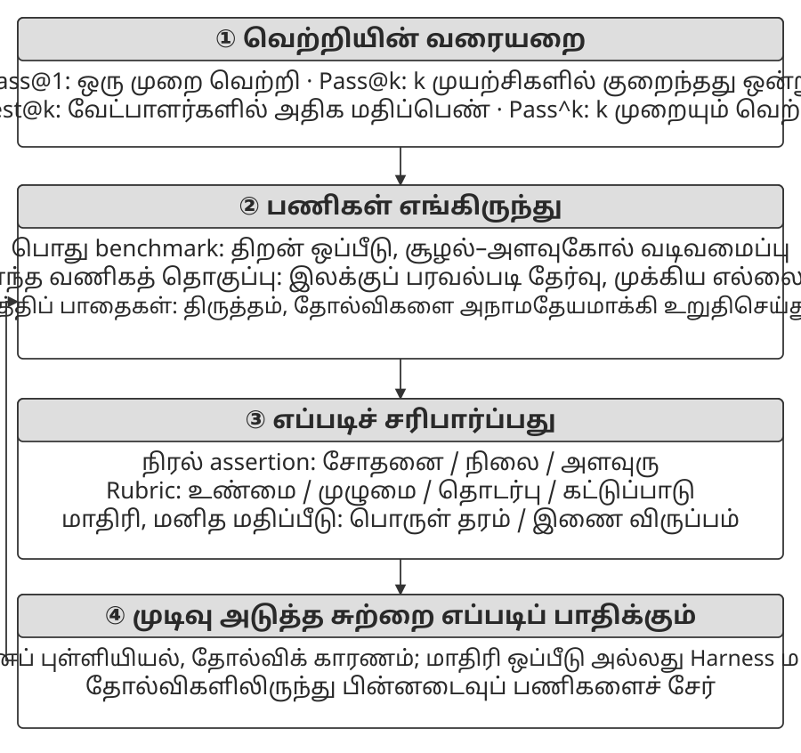
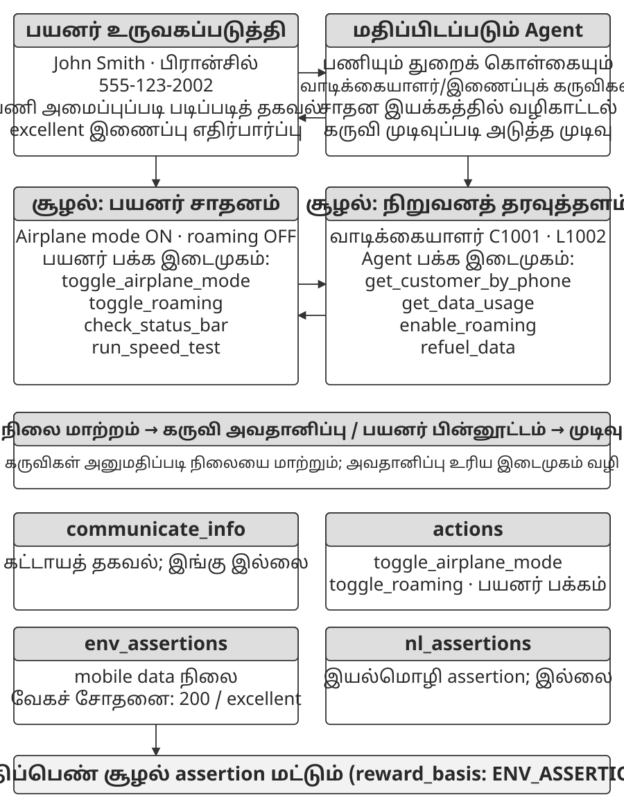
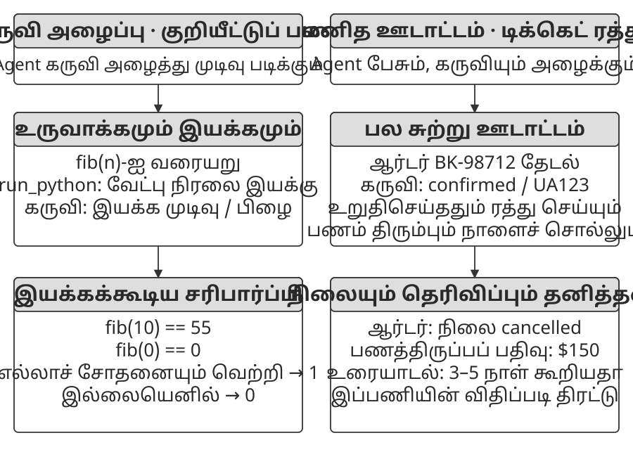
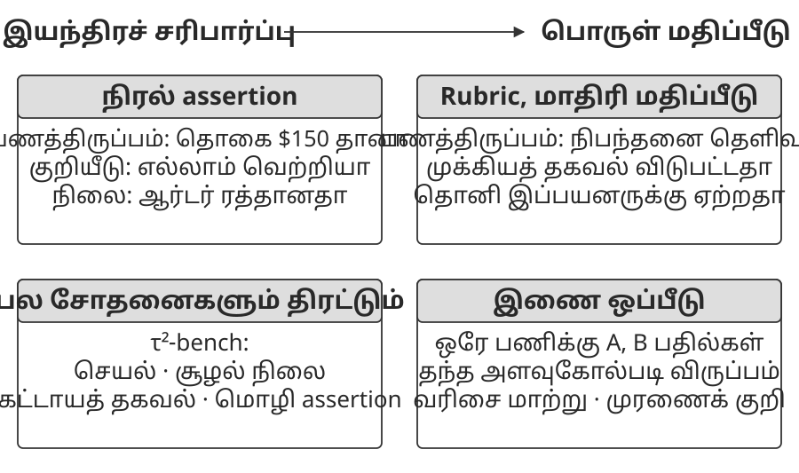
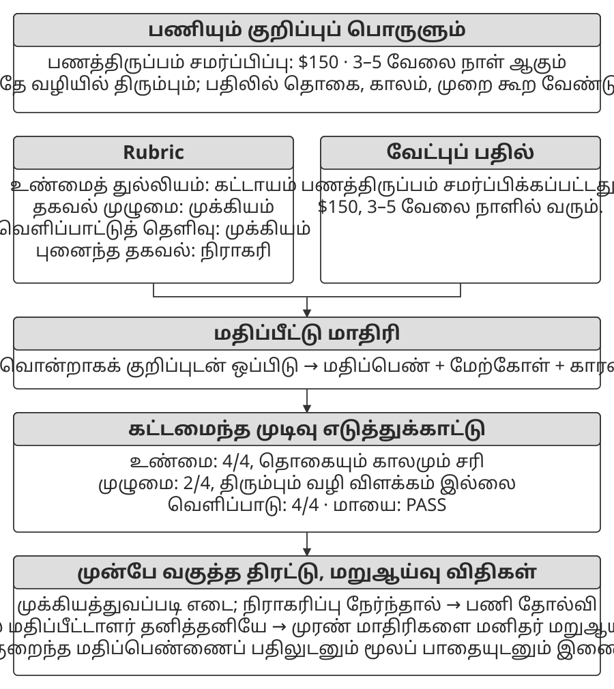
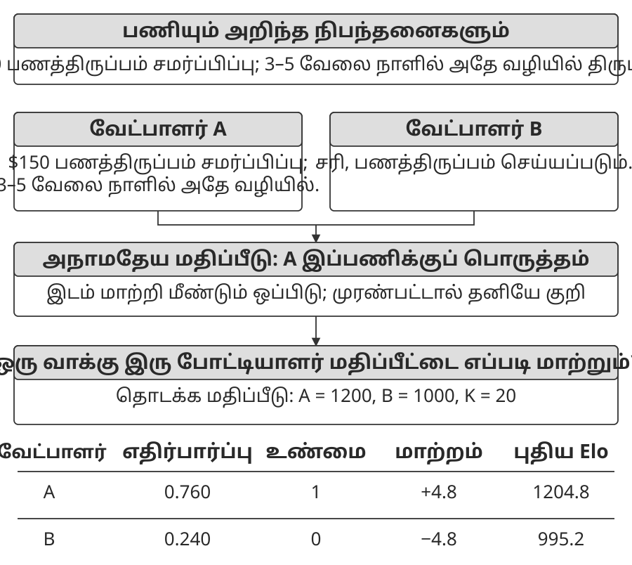
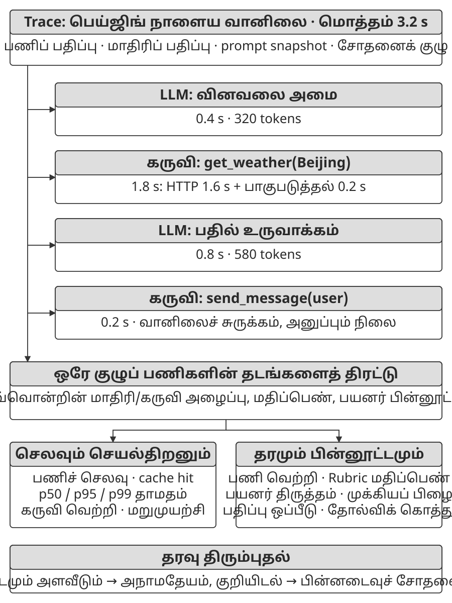
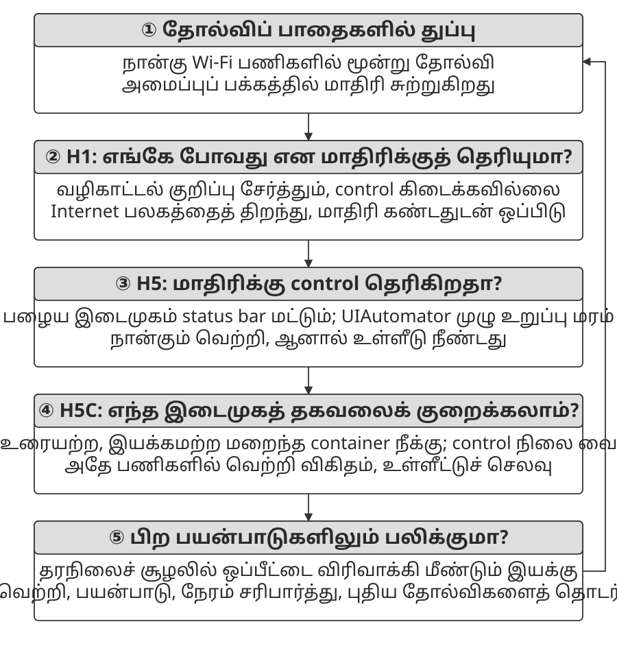
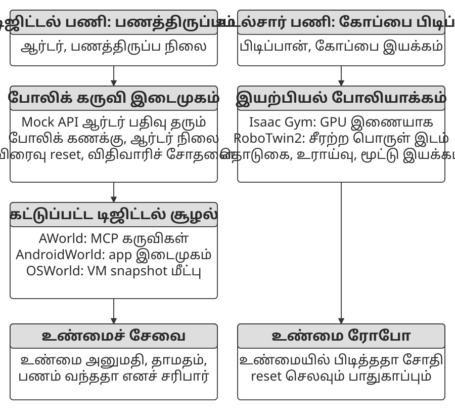
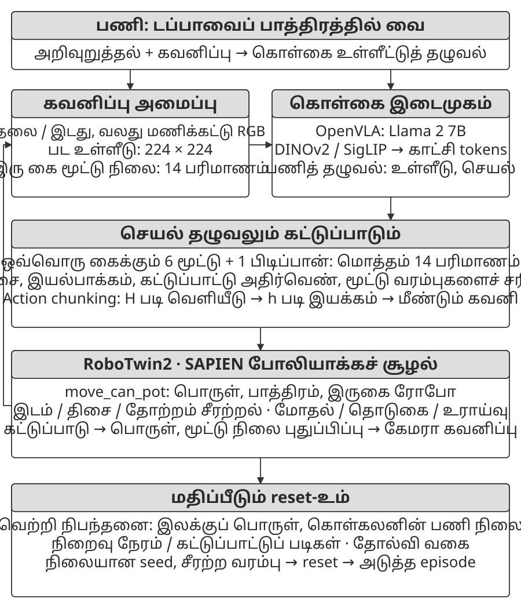

# ஏஜெண்டின் மதிப்பீடு

முதல் ஆறு அத்தியாயங்கள் ஒற்றை ஏஜெண்டை உருவாக்குவதை அறிமுகப்படுத்தின: சூழல், நினைவகம், அறிவுத் தளம், கருவிகள், குறியீடு, அவதானிப்பு–செயல் இடைமுகங்கள். அமைப்பைக் கட்டி முடித்த பிறகு, அது என்ன செய்ய முடியும், எந்த நிபந்தனைகளில் எளிதில் தோல்வியடைகிறது, அடுத்து எங்கே திருத்துவது — இவற்றை மீளச் செய்யக்கூடிய பணிகளின் தொகுப்பால் தீர்மானிக்க வேண்டும். மதிப்பீட்டு முடிவுகள் பின்-பயிற்சிக்கும் தொடர்ச்சியான பரிணாமத்துக்கும் பின்னூட்டத்தையும் வழங்குகின்றன.

உருவாக்கத்தின்போது பல தேர்வுகளை உண்மையான பணிகளால் ஒப்பிட்டுப் பார்க்க வேண்டும்: எந்த மாதிரியைப் பயன்படுத்துவது, எந்தக் கருவிகளைத் திறப்பது, அறிவுத் தளத்தில் என்ன உள்ளடக்கத்தையும் எந்த அட்டவணையையும் வைப்பது, பயனர் நினைவகம், ப்ராம்ப்ட், Skills ஆகியவற்றை எவ்வாறு ஒழுங்கமைப்பது, Harness-இல் என்ன கட்டுப்பாடுகளைச் சேர்ப்பது. தேர்வுகள் ஒன்றையொன்று பாதிக்கவும் செய்கின்றன. எடுத்துக்காட்டாக, விரிவான கருவி விளக்கம் அளவுருப் பிழைகளைக் குறைக்கலாம்; ஆனால் சூழல் செலவையும் அதிகரிக்கலாம். சரிபார்ப்புப் படியைச் சேர்த்தால் வெற்றி விகிதம் உயரலாம்; ஆனால் நிறைவு நேரமும் நீளலாம்.

**ஒப்பீட்டுச் சோதனை** ஒரே பணியையும் ஒரே நிபந்தனைகளையும் வைத்து வெவ்வேறு தீர்வுகளை ஒப்பிட்டு, வெற்றி விகிதம், நேரம், செலவு ஆகியவற்றில் ஏற்படும் மாற்றங்களைப் பதிவு செய்கிறது. **அப்லேஷன் சோதனை** தேடல் மறுவரிசைப்படுத்தல், நிலைச் சுருக்கம், முடிவுச் சரிபார்ப்பு போன்ற கூறுகளை நீக்கியோ அணைத்தோ, அமைப்பின் செயல்திறன் எவ்வாறு மாறுகிறது என்று பார்க்கிறது. ஒவ்வொரு சுற்றிலும் மாற்றத்தைத் தெளிவாகக் குறிப்பிட்டு, மற்ற இயக்க நிபந்தனைகளை மாற்றாமல் வைத்து, மீண்டும் மீண்டும் அளந்தால், பொறியியல் தேர்வுகளுக்கும் பணி முடிவுகளுக்கும் இடையிலான தொடர்பைப் படிப்படியாகக் கட்டியெழுப்பலாம். ஒப்பீட்டையும் அப்லேஷனையும் அன்றாட உருவாக்கத்தில் இணைக்க வேண்டும் என்று நான் கருதுகிறேன். சில வெற்றிகரமான பாதைகளை மட்டும் வைத்துக்கொண்டு முடிவெடுத்தால், தற்செயலான வெற்றியை மேம்பாடாகக் கருதி, ஒரு வகைப் பணியின் பயனை மட்டும் கண்டு, மற்ற பணிகளின் பின்னடைவைத் தவறவிட எளிது.

**மதிப்பீடு மாதிரியும் Harness-உம் சேர்ந்த முழு ஏஜெண்டை இலக்காகக் கொள்ள வேண்டும்.** மாதிரி பணியை எவ்வாறு புரிந்துகொள்வது, எந்தச் செயலைத் தேர்ந்தெடுப்பது என்பதைத் தீர்மானிக்கிறது; Harness சூழலை ஒழுங்கமைத்து, கருவிகளை இயக்கி, நிலையைப் பராமரித்து, சரிபார்ப்புகளை நிறைவேற்றுகிறது. ஒரே மாதிரியை வெவ்வேறு கருவிகளுடனோ பின்னூட்டச் செயல்முறைகளுடனோ இணைத்தால், பணி முடிவுகள் வேறுபடலாம். அத்தியாயம் 5 அறிமுகப்படுத்திய Coding Harness இத்தகைய ஒப்பீட்டுச் சூழலை வழங்குகிறது.

**மாதிரி மாற்றல் சோதனை (model swap)** கொண்டு மாதிரிக்கும் Harness-க்கும் இடையிலான ஒத்துழைப்பை ஆராயலாம்: முதலில் இயக்கச் சட்டகத்தையும் பணியையும் நிலையாக வைத்து, மாதிரியை மட்டும் மாற்றி, இறுதி முடிவுகளையும் பிழைப் பரவலையும் ஒப்பிட வேண்டும். வலுவான மாதிரி அதே படியில் இன்னும் தோல்வியடைந்தால், கருவிகள் ஏதேனும் இல்லையா, பின்னூட்டம் சரியான நேரத்தில் வருகிறதா, மதிப்பீடு இலக்குகளை முழுமையாக மூடுகிறதா என்று சரிபார்க்கலாம். மாதிரியைப் பொறுத்துப் பணிச் செயல்திறன் கணிசமாக மாறினால், எந்தப் பகுத்தறிவு, திட்டமிடல், அல்லது கட்டளைப் பின்பற்றும் திறன் முடிவைப் பாதித்தது என்று ஆராய வேண்டும்.

மாதிரி மாற்றத்தையும் கூறு அப்லேஷனையும் கலந்து செய்யலாம். எடுத்துக்காட்டாக, இரு மாதிரிகள் முறையே "நிலைச் சுருக்கத்துடன்" "நிலைச் சுருக்கம் இல்லாமல்" என்ற இரு உள்ளமைவுகளில் இயங்கட்டும்; சுருக்கம் இரண்டுக்கும் நீண்ட பணிகளை மீட்க உதவுகிறதா, அந்தப் பயன் மாதிரியைப் பொறுத்தா என்று பார்க்கலாம். இப்படி மாதிரி வேறுபாடுகளையும், எந்த நிபந்தனைகளில் ஒரு Harness கூறு பயனுள்ளதாக இருக்கிறது என்பதையும் ஒருசேர ஆராயலாம்.

மதிப்பீடு மாதிரி மேம்பாட்டுக்கான பின்னடைவுச் சரிபார்ப்பாகவும் இருக்கிறது. புதிய மாதிரி பொது அளவுகோல்களில் முன்னேறியும், சில வணிகப் பணிகளில் பின்னடைவடையலாம்; சொந்தப் பணித் தொகுப்பே இந்த மாற்றங்களைக் காட்டும். "எதிர்கால மாதிரிகளுக்காகத் தயாரிப்பை உருவாக்கு" என்று நான் கருதுகிறேன்: கருவிகள், வணிகச் செயல்முறைகள், மதிப்பீட்டுத் தொகுப்பை முன்கூட்டியே தயார் செய்து, புதிய மாதிரிகள் அதே பணிகளில் எவ்வாறு செயல்படுகின்றன என்பதைத் தொடர்ந்து கண்காணிக்க வேண்டும். வெற்றி விகிதம், பதில் நேரம், செலவு ஆகியவை தயாரிப்பின் தேவைகளை எட்டிய பிறகே வெளியீட்டை முன்னெடுக்க வேண்டும்.

வெளியீட்டுத் தேவைகளை ஒரு மதிப்பீட்டுத் தொகுப்பாக எவ்வாறு எழுதுவது? படம் 7-1-ஐப் படிக்கும்போது, ஒரு சோதனையை மேலிருந்து கீழாகப் பின்தொடரலாம்: எதை அளப்பது, பணிகளை எங்கிருந்து தேர்ந்தெடுப்பது, எந்த ஆதாரத்தால் வெற்றியைத் தீர்மானிப்பது, இறுதியில் முடிவுகளை எவ்வாறு பதிவு செய்து ஒப்பிடுவது?



## ஒரு பணியிலிருந்து மதிப்பீட்டைப் புரிந்துகொள்வது: τ²-bench-இன் telecom துறை

முதலில் ஒரு கைபேசி இணையக் கோளாறைப் பார்ப்போம். John Smith 555-123-2002 என்ற எண்ணைப் பயன்படுத்துகிறார், பிரான்சில் இருக்கிறார், கைபேசியின் நிலைப் பட்டியில் "No Service" என்று காட்டுகிறது. அவர் இணையத்தை மீட்க விரும்புகிறார்; வேகச் சோதனை excellent அடைந்தால் மட்டுமே கோளாறு தீர்ந்ததாகக் கருதுவார்; தேவைப்பட்டால் 2.0 GB தரவை ரீசார்ஜ் செய்யத் தயார்; தற்போதைய திட்டத்தைத் தக்கவைத்துக்கொள்ள விரும்புகிறார்.

இந்த வழக்கு Sierra-வின் τ²-bench telecom துறையிலிருந்து வருகிறது. சூழல் தொலைத்தொடர்பு நிறுவனத்தின் பின்தளத்தையும் பயனர் சாதனத்தையும் ஒருசேர மாதிரியமைக்கிறது; வாடிக்கையாளர் சேவை ஏஜெண்டும் பயனர் உருவகப்படுத்தியும் தனித்தனிக் கருவிகள் மூலம் அதன் ஒரு பகுதி நிலையைப் படித்து மாற்றுகின்றன. சிக்கல் எவ்வாறு கண்டறியப்படுகிறது, செயல்கள் எவ்வாறு நிறைவேற்றப்படுகின்றன, இறுதியில் இணையம் மீள்கிறதா — இவற்றை இரு பக்கங்களின் ஊடாட்டத்தின் வழியே மதிப்பீடு சரிபார்க்க வேண்டும்.[^ch7-tau2-task]

### பணி வரையறையின் நான்கு கூறுகள்

இதே கேள்வியை இன்னொரு வாடிக்கையாளர் சேவை ஏஜெண்ட் கையாள வேண்டுமானால், முதலில் கைபேசியின் நிலையையும் கணக்கின் நிலையையும் மீட்டெடுத்து, உருவகப்படுத்தப்பட்ட பயனர் அதே கோரிக்கைகளின்படி ஒத்துழைக்கச் செய்து, இறுதியில் அதே தரத்தில் மதிப்பிட வேண்டும். கீழே உள்ள அட்டவணை பணி வரையறையின் நான்கு பகுதிகளைப் பட்டியலிடுகிறது. அட்டவணையைப் படிக்கும்போது ஒரு வேறுபாட்டைக் கவனியுங்கள்: கேள்வியை எழுதியவருக்குக் கைபேசியின் ஆரம்ப அமைப்புகள் தெரியும்; உரையாடல் தொடங்கும்போது வாடிக்கையாளர் சேவைக்கும் பயனருக்கும் எவ்வளவு தெரியும்?

| பகுதி | புலம் | இந்த எடுத்துக்காட்டின் உள்ளடக்கம் |
| --- | --- | --- |
| வேலைச்சீட்டு | `ticket` | பயனர், எண், நாடு, இணையம் இயங்காத நிகழ்வு, வேகச் சோதனைத் தேவை, திட்டக் கட்டுப்பாடுகள் |
| பயனர் சூழல் | `user_scenario.instructions` | பயனருக்கு என்ன தெரியும், கேள்வி வந்தால் எவ்வாறு வினவுவது, எப்போது சிக்கல் தீர்ந்ததாக உறுதிசெய்வது |
| ஆரம்ப நிலை | `initial_state.initialization_actions` | பயனர் அடையாளத்தையும் இருப்பிடத்தையும் அமைத்தல், விமானப் பயன்முறையை இயக்குதல், சாதன ரோமிங்கை அணைத்தல், நிறுவனப் பக்க ரோமிங்கை இயக்குதல் |
| மதிப்பீட்டு அளவுகோல் | `evaluation_criteria` | செயல்களையும் சூழல் நிலையையும் சரிபார்த்து, `reward_basis` எந்தச் சரிபார்ப்புகள் மதிப்பெண்ணில் சேரும் என்பதைக் குறிப்பிடுதல் |

**பயனருக்கு என்ன தெரியும்.** `known_info` பெயர், எண், நாடு ஆகியவற்றை வழங்குகிறது. விமானப் பயன்முறை இயக்கப்பட்டிருப்பதும் சாதன ரோமிங் அணைக்கப்பட்டிருப்பதும் சூழல் நிலையில் சேமிக்கப்படுகின்றன; அவற்றை வாடிக்கையாளர் சேவைக்குச் சொல்ல, பயனர் உருவகப்படுத்தி கருவியை அழைத்து வினவ வேண்டும். பயனருக்குத் தெரிந்தவற்றைத் தனிப் புலங்களாகப் பிரித்து எழுதினால் மட்டுமே, நேரடியாகப் பதிலளிக்கக்கூடிய தகவலையும் உண்மையில் வினவ வேண்டிய தகவலையும் உருவகப்படுத்தி வேறுபடுத்த முடியும். ப்ராம்ப்ட்டில் "எல்லாவற்றையும் ஒரே முறையில் சொல்லாதே" என்று மட்டும் கேட்டால், எந்த உண்மையை எப்போது வெளிப்படுத்துவது என்பதை நிலையாகக் கட்டுப்படுத்துவது கடினம். இந்த ஏற்பாடு படிப்படியான தகவல் வெளிப்பாட்டை (Progressive Information Disclosure) நடைமுறைப்படுத்துகிறது: உரையாடல் "என்னால் இணையத்தைப் பயன்படுத்த முடியவில்லை" என்று தொடங்கி, ஏஜெண்ட் கேள்விகள் கேட்டும் செயல்கள் செய்தும் வழிநடத்த, சிக்கல் ஆராய்வதற்குத் தேவையான தகவல் படிப்படியாகக் கிடைக்கிறது.

**பயனர் எவ்வாறு பதிலளிப்பார்.** `task_instructions` முதல் முயற்சி தோல்வியடைந்த பிறகு லேசான அதிருப்தியைக் காட்ட வேண்டும், வேகச் சோதனை excellent ஆனால் மட்டுமே தீர்ந்ததாக உறுதிசெய்ய வேண்டும், சாதனம் தொடர்பான பதில்கள் கருவி முடிவுகளை அடிப்படையாகக் கொள்ள வேண்டும் என்று விதிக்கிறது. poor, fair, good ஆகியவை இந்தப் பணியின் இலக்கை எட்டவில்லை. உண்மை நங்கூரமிடல் (Grounding) பயனர் உருவகப்படுத்தப்பட்ட சூழலின் உண்மையான நிலையின் அடிப்படையில் பதிலளிக்கச் செய்கிறது. இந்தக் கட்டுப்பாடு இல்லாவிட்டால், "இப்போது சரியாகிவிட்டதா" என்ற வாடிக்கையாளர் சேவையின் கேள்விக்கு உருவகப்படுத்தப்பட்ட பயனர் ஒப்புக்கொண்டுவிடலாம்; இரு பக்க உரையாடலும் சுமூகமாகத் தெரியும், ஆனால் சாதனக் கோளாறு அப்படியே இருக்கும்.

**இரு பக்கமும் எந்த நிலையிலிருந்து தொடங்குகின்றன.** பயனர் பக்கம் `set_user_info` மூலம் அடையாளத்தை அமைத்து, `set_user_location(abroad=true)` மூலம் வெளிநாட்டில் இருப்பதைக் குறித்து, பின்னர் `turn_airplane_mode_on`-ஐயும் `turn_roaming_off`-ஐயும் இயக்குகிறது. நிறுவனப் பக்கம் `enable_roaming` மூலம் வாடிக்கையாளர் `C1001`-இன் `L1002` இணைப்புக்கு ரோமிங்கை இயக்குகிறது. எனவே பின்தள வினவல் ரோமிங் இயக்கப்பட்டுள்ளதாகக் காட்டலாம்; கைபேசிப் பக்கம் விமானப் பயன்முறையாலும் சாதன ரோமிங் அமைப்பாலும் இன்னும் இணையத்தில் இணைய முடியாது. பின்தள வினவல் தராத தகவலைப் பெற, வாடிக்கையாளர் சேவை பயனரைச் சாதனத்தைச் சரிபார்க்க வழிநடத்த வேண்டும்.

**எந்தச் சரிபார்ப்புகள் மதிப்பெண்ணைத் தீர்மானிக்கின்றன.** `actions` பயனர் பக்கத்தின் `toggle_airplane_mode`-ஐயும் `toggle_roaming`-ஐயும் பட்டியலிடுகிறது. `env_assertions` மொபைல் தரவு நிலைச் சரிபார்ப்பையும், `expected_speed=200`, `expected_desc="excellent"` என்ற அளவுருக்களுடன் வேகச் சோதனைச் சரிபார்ப்பையும் கொண்டுள்ளது. பணி வடிவம் `communicate_info`-ஐயும் `nl_assertions`-ஐயும் வழங்குகிறது; அவை முறையே பயனருக்குக் கட்டாயம் தெரிவிக்க வேண்டிய தகவலையும் இயல்புமொழி உறுதிமொழிகளையும் விவரிக்கின்றன; இந்தப் பணியில் இவை இரண்டும் காலியாக உள்ளன.

இந்தப் பணியின் `reward_basis` `ENV_ASSERTION`-ஐத் தேர்ந்தெடுக்கிறது; எனவே மொத்த வெகுமதி சூழல் உறுதிமொழிகளைச் சார்ந்தது. செயல் சரிபார்ப்புகள் முடிவில் தோன்றலாம்; ஆனால் மொத்த மதிப்பெண்ணில் சேருகிறதா என்பதை மதிப்பெண் உள்ளமைவே தீர்மானிக்கிறது.

### இயக்கப் பாதையின் வழியே முடிவைச் சரிபார்த்தல்

துணை இயக்கத்தில் ஐந்து telecom பணிகள் தேர்ந்தெடுக்கப்பட்டு, ஒவ்வொரு பணியும் ஒருமுறை இயக்கப்பட்டது; வாடிக்கையாளர் சேவை ஏஜெண்டும் பயனர் உருவகப்படுத்தியும் GPT-4.1 mini-ஐப் பயன்படுத்தின; இறுதியில் நான்கு பணிகள் தேர்ச்சி பெற்றன. கீழே முதலில் மேற்கூறிய பிரான்ஸ் ரோமிங் பணியைப் பகுப்பாய்வு செய்து, பின்னர் தோல்விப் பணியுடன் ஒப்பிடுவோம்.

> **சோதனை 7-1 ★: τ²-bench-ஐ இயக்கி τ-bench-இன் பரிணாமத்துடன் ஒப்பிடுதல்**
>
> முதலில் ஒரு பணியின் பயனர் சூழல், தொடக்கச் செயல்கள், மதிப்பீட்டு நிபந்தனைகளைப் படித்து, பின்னர் முழு ஊடாட்டத்தையும் ஒருமுறை இயக்குங்கள். பாதையில் வாடிக்கையாளர் சேவை வினவல்கள், பயனர் செயல்கள், நிலை மாற்றங்கள், ஏற்பு முடிவுகளைக் குறித்து, ஒவ்வொரு தீர்மானமும் எந்தத் தகவலை அடிப்படையாகக் கொண்டது என்று சரிபாருங்கள்.
>
> τ-bench-ஐயும் τ²-bench-ஐயும் ஒப்பிடும்போது, பயனர் கருவிகள் மூலம் சூழலை மாற்ற முடிகிறதா, அந்த மாற்றம் வாடிக்கையாளர் சேவைக்கு என்ன ஒருங்கிணைப்புத் தேவைகளை உருவாக்குகிறது என்பதை முக்கியமாகக் கவனியுங்கள்.
>
> படம் 7-2-ஐப் பார்க்கும்போது, முதலில் கைபேசியின் விமானப் பயன்முறையை யார் அணைக்க முடியும் என்று தேடுங்கள்; பின்னர் நிறுவனத்தின் ரோமிங் அமைப்பை யார் மாற்ற முடியும் என்று தேடுங்கள். இரு பக்கம் செய்யக்கூடியவை வேறுபடுகின்றன; எனவேதான் வாடிக்கையாளர் சேவை தன் செயல்களை முடித்த பிறகும், பயனரைக் கைபேசியில் வேகச் சோதனை செய்யக் கேட்க வேண்டியிருக்கிறது.
>
> 

பிரான்ஸ் ரோமிங் பணியைக் கையாளும்போது, ஏஜெண்ட் முதலில் கணக்கை அடையாளம் கண்டது. எண்ணின் அடிப்படையில் வாடிக்கையாளர் `C1001`-ஐக் கண்டுபிடித்து, `L1001`, `L1002`, `L1003` ஆகியவற்றின் தரவுத் தகவலை வினவியது; ஆனால் `L1001`-இன் விரிவான தகவலின் அடிப்படையில் தவறான முடிவுக்கு வந்தது: பயனர் தந்த 555-123-2002 செயலில் உள்ள இணைப்புகளில் இல்லை, அருகிலுள்ள எண் 555-123-2001. பயனர் எண் சரியானது என்று வலியுறுத்திய பிறகே, ஏஜெண்ட் `L1002`-ஐத் தொடர்ந்து வினவி சரியான இணைப்பை உறுதிசெய்தது.

பின்னர், பயனர் உருவகப்படுத்தி `check_network_status`-ஐயும் `check_status_bar`-ஐயும் அழைத்தது. திரும்பிய நிலையில் விமானப் பயன்முறை இயக்கப்பட்டுள்ளது, செல்லுலார் பிணையத்தில் சேவை இல்லை, மொபைல் தரவு இயக்கப்பட்டுள்ளது, சாதன ரோமிங் அணைக்கப்பட்டுள்ளது ஆகியவை அடங்கும். அதன் அடிப்படையில் பயனர் தெரிவித்தார்: "கைபேசி விமானப் பயன்முறையில் உள்ளது, தரவு ரோமிங்கும் அணைக்கப்பட்டுள்ளது. முதலில் விமானப் பயன்முறையை அணைக்க வேண்டுமா?" இங்கே வினவலைப் பயனர் பக்கக் கருவியே இயக்கியது; முடிவு உரையாடல் வழியாக வாடிக்கையாளர் சேவைக்குக் கடத்தப்பட்டது.

இதுவே **இரு கட்டுப்பாடு (Dual-Control)** பொறிமுறை: வாடிக்கையாளர் சேவை நிறுவனப் பின்தளத்தை வினவி இயக்குகிறது; பயனர் உருவகப்படுத்திக்கு நிலைப் பட்டியைப் பார்த்தல், விமானப் பயன்முறையை மாற்றுதல், SIM கார்டை மீண்டும் செருகுதல், வேகச் சோதனையை இயக்குதல் போன்ற தனிச் சாதனக் கருவிகள் உள்ளன. இரு தரப்பும் உரையாடல் மூலம் செயல்களை ஒருங்கிணைக்கின்றன; சூழல் ஒவ்வொரு தரப்பும் ஏற்படுத்திய நிலை மாற்றங்களைப் பதிவு செய்கிறது.

அடுத்து ஏஜெண்ட், பயனர் விமானப் பயன்முறையை அணைத்து சாதன ரோமிங்கை இயக்க வழிநடத்தியது; நிலைப் பட்டியில் 5G சமிக்ஞை தெரிந்தது. பயனர் `run_speed_test`-ஐ இயக்கி 275 Mbps, Excellent என்ற முடிவைப் பெற்று, சிக்கல் தீர்ந்ததை உறுதிசெய்தார். இரு சூழல் உறுதிமொழிகளும் தேர்ச்சி பெற்றன; இந்தப் பணியின் வெகுமதி 1.0.

இந்த வெற்றிப் பாதை செயல்முறைச் சிக்கலையும் வெளிப்படுத்தியது. கொள்கைப்படி வாடிக்கையாளர் சேவை ஒரு நேரத்தில் ஒரு கருவியை மட்டுமே அழைக்க வேண்டும்; ஆனால் ஏஜெண்ட் ஒரே செய்தியில் `get_customer_by_phone`-ஐயும் `get_customer_by_name`-ஐயும் தொடங்கியது. தற்போதைய பணியின் மொத்த மதிப்பெண் சூழல் உறுதிமொழிகளை மட்டுமே சேர்க்கிறது; எனவே இந்த நடத்தை வெகுமதியை மாற்றவில்லை.

மற்றொரு தோல்விப் பாதையில், இணைப்பு தவறாகத் தேர்ந்தெடுக்கப்பட்டது திருத்தப்படாமல் இருந்தது; அதைத் தொடர்ந்த ஆராய்ச்சியும் விலகியது. பயனர் எண் இன்னும் 555-123-2002; ஏஜெண்ட் `L1001`-ஐத் தேர்ந்தெடுத்து, அந்த இணைப்பின் 3.2/5 GB பயன்பாட்டைக் கொண்டே தொடர்ந்து ஆராய்ந்தது. கருவி ஏற்கனவே `L1001`-க்கு 555-123-2001 என்பதைத் திருப்பித் தந்திருந்தும், அது இணைப்பைத் திருத்தவில்லை; பல சுற்றுத் தொடர்பற்ற ஆராய்ச்சிக்குப் பிறகு மனிதரிடம் மாற்றியது. பயனர் பக்கம் தரவுச் சேமிப்புப் பயன்முறையை வெற்றிகரமாக அணைத்தது; ஆனால் சரியான இணைப்பு `L1002`-க்குத் தேவையான 2 GB தரவு ரீசார்ஜ் நிறைவேற்றப்படவில்லை; மூன்று சூழல் உறுதிமொழிகளும் தோல்வியடைந்தன.

இரு பாதைகளையும் ஒப்பிட்டால், இறுதி மதிப்பெண்ணைக் உறுதியான மேம்பாட்டுப் புள்ளிகளாக விரிக்கலாம்: எண்ணுக்கும் இணைப்புக்கும் உள்ள வரைபடத்தைச் சரிபார்த்தல், புதிய ஆதாரத்தால் தீர்மானத்தைத் திருத்துதல், சாதன நிலைக்கும் பின்தள நிலைக்கும் இடையிலான வேறுபாட்டைப் பிரித்தல், தேவையான ரீசார்ஜ் நிறைவேற்றப்பட்டதா என்று சரிபார்த்தல். பின்னர் வரும் தோல்வி காரண பகுப்பாய்வு, நீண்ட பாதைகளில் இந்த முக்கியத் திருப்பங்களை எவ்வாறு கண்டறிவது என்பதைத் தொடர்ந்து விவாதிக்கும்.

[^ch7-tau2-task]: Sierra Research-இன் τ²-bench telecom துறையின் `user_tools.py`-இல் பயனர் கருவிகள் வரையறுக்கப்படுகின்றன; மதிப்பீட்டு நுழைவு `evaluator.py`. வழக்கின் உள்ளடக்கமும் முடிவுகளும் துணையாகச் சேமிக்கப்பட்ட ஐந்து பணிகளும் இயக்கப் பாதைகளும் அடிப்படையாகக் கொண்டு தொகுக்கப்பட்டவை.

## மதிப்பீட்டு அளவீடுகள்: வெற்றியின் வரையறை

ஐந்து பணிகளில் நான்கு தேர்ச்சி பெற்றது இந்த இயக்கத்தின் ஒட்டுமொத்த மதிப்பெண்ணைத் தந்தது. அதைக் கொண்டு தயாரிப்பு முடிவெடுக்க, பணி வகையையும் தோல்வியின் விலையையும் தெளிவுபடுத்த வேண்டும். பணத்திருப்பம் கையாளும் வாடிக்கையாளர் சேவை நிபந்தனைகளுக்கு உட்பட்ட பணத்திருப்பங்களைத் தொடர்ந்து முடிக்க வேண்டும்; குறியீடு எழுதும்போது பல செயலாக்கங்களை உருவாக்கி, இயங்கி சரியான முடிவைத் தரும் பதிப்பைச் சோதனைகள் மூலம் வடிகட்டலாம்; ஆய்வு செய்யும்போது பல கருதுகோள்களை முன்வைத்து, ஆராய்ச்சியாளர் அவற்றைச் சோதிக்கலாம். மதிப்பீட்டு அளவீடுகள் இந்தப் பயன்பாட்டு முறைக்குப் பொருந்த வேண்டும்.

### தொழில்நுட்ப வியத்தகு: பல முயற்சிகளின் திறனை Pass@k கொண்டு அளத்தல்

சில ஈர்க்கக்கூடிய ஏஜெண்ட் செயல்விளக்கங்களை நான் "தொழில்நுட்ப வியத்தகு" என்று அழைக்கிறேன்: கணினிக்குப் போதுமான நேரமும் முயற்சி வாய்ப்புகளும் கொடுத்தால், முன்பு தானியங்கியாக முடிக்கக் கடினமாக இருந்த ஒரு பணியை அது முடிக்கிறது. ஆராய்ச்சி இயல்புடைய வேலைகளுக்கு, சரிபார்க்கப்பட்ட ஒரு வெற்றிப் பாதையே மதிப்பைத் தரலாம். **Pass@k** என்ற அளவீடு இந்தப் பயன்பாட்டு முறைக்குப் பொருந்துகிறது: ஒரே பணியை $k$ முறை இயக்கி, குறைந்தது ஒருமுறை தேர்ச்சி பெற்றால் வெற்றியாகக் கணக்கிடல். தொடர் மதிப்பெண் தரும் பணிகளின் $k$ முயற்சிகளில் மிக உயர்ந்த மதிப்பெண்ணையும் அறிவிக்கலாம்; அதை **Best@k** என்று அழைக்கிறோம்.

எடுத்துக்காட்டாக, பல Claude நிகழ்வுகளை ஒன்றிணைத்து C தொகுப்பியை உருவாக்கும் பணியை Anthropic ஒருமுறை ஏற்பாடு செய்தது; நீண்ட நேர இயக்கம், சோதனைப் பின்னூட்டம், பணிப் பிரிவு ஆகியவை சிக்கலான பொறியியலைத் தாங்க முடியும் என்பதை அது காட்டியது. கணிதத்தில் எதிர்மறை எடுத்துக்காட்டுகளைத் தேடும்போதும், மாதிரியை மீண்டும் மீண்டும் முயலச் செய்து, இறுதியில் அந்த எதிர்மறை எடுத்துக்காட்டுகளில் ஒன்று செல்லுபடியா என்று தனியாகச் சரிபார்க்கலாம். மென்பொருள் பாதுகாப்பு மதிப்பாய்வில் மாதிரி குறிப்பிட்ட சந்தேகத்துக்குரிய பிரச்சினைகளை மீளச் சரிபார்க்கலாம்; திறந்தவெளிப் படைப்பாக்கத்தில் பல படைப்புகளில் சிறந்ததைத் தேர்ந்தெடுக்கலாம்.[^ch7-long-running]

பயன்பாட்டுத் தயாரிப்புகளும் சிக்கலான பணிகளால் திறனைக் காட்டுகின்றன. Manus மெய்நிகர் கணினியை ஏஜெண்டிடம் ஒப்படைத்து, அது இடைமுகத்தை இயக்குவதையும், தகவலைத் தேடுவதையும், தொடர்ந்து வேலையை முடிப்பதையும் பயனர் பார்க்கச் செய்கிறது. OpenClaw உடனடி செய்தி மூலம் ஒப்படைப்புகளைப் பெற்று, உள்ளமைக்கப்பட்டு அனுமதிக்கப்பட்ட கோப்புகளையும் சேவைகளையும் அணுகி, இடையில் முன்னேற்றத்தைத் தெரிவித்து, கூடுதல் தகவலைக் கேட்டு, திட்டமிட்ட நேரத்தில் எழுந்து செய்ய வேண்டியவற்றைச் சரிபார்க்கவும் முடிகிறது. இந்தக் உறுதியான நடத்தைகள் ஏஜெண்டின் பயன்பாட்டைப் பயனர் எளிதாகப் புரிந்துகொள்ள உதவுகின்றன.

புதிய வகைப் பணிகளை முடிக்கக்கூடிய செயல்விளக்கங்கள் இந்தத் தயாரிப்புகள் பயனர்களைக் கவரும் முக்கியக் காரணம் என்று நான் கருதுகிறேன்.

### வணிக நம்பகத்தன்மை: Pass^k-ஐக் கவனித்தல்

வணிகச் செயல்முறைகள் பொதுவாகப் பல சுற்று இயக்கங்களிலும் சரியாக உருவாக்கப்பட வேண்டும். **Pass^k** என்பது ஒரே பணியை $k$ முறை இயக்கி, ஒவ்வொரு முறையும் தேர்ச்சி பெறுவதை அளக்கிறது; இதை "pass power k" என்று படிக்கலாம். பணியின் தேர்ச்சி நிபந்தனைகள் இறுதி முடிவு, கொள்கை நிறைவேற்றம், அனுமதிக் கட்டுப்பாடுகள் ஆகியவற்றை ஒருசேர மூடலாம்; ஒவ்வொரு இயக்கமும் அதே நிபந்தனைகளின்படி சரிபார்க்கப்படுகிறது.

ஒவ்வொரு இயக்கமும் தனித்து நடக்கிறது என்றும் ஒரு முறை வெற்றி பெறும் நிகழ்தகவு $p$ என்றும் வைத்துக்கொண்டால்:

$$
\mathrm{Pass@k}=1-(1-p)^k,\qquad
\mathrm{Pass}^{k}=p^k.
$$

எடுத்துக்காட்டாக, $p=0.6$, $k=5$ எனும்போது Pass@5 சுமார் 99.0%, Pass^5 சுமார் 7.8%. முன்னது ஐந்து முயற்சிகளில் பொதுவாக ஒரு வெற்றியைக் கண்டுபிடிக்கலாம் என்பதைக் குறிக்கிறது; பின்னது ஐந்தும் வெற்றி பெறும் நிகழ்தகவு இன்னும் மிகக் குறைவு என்பதைக் குறிக்கிறது.

ஒரு தொகுதி உண்மையான முடிவுகளைப் படிக்கும்போது, சூத்திரம் இல்லாமலே தொடங்கலாம். ஒரே கேள்வியின் ஐந்து முயற்சிகள் "வெற்றி, தோல்வி, வெற்றி, வெற்றி, தோல்வி" என்று இருந்தால், இந்தத் தொகுதியின் Pass@5 = 1, Pass^5 = 0, ஒரு முறை வெற்றி விகித மதிப்பீடு 3/5. மேலே உள்ள 99.0%, 7.8% வேறொரு கேள்விக்குப் பதிலளிக்கின்றன: ஒவ்வொரு முறையும் வெற்றி நிகழ்தகவு 0.6 என்று தெரிந்தால், ஐந்தையும் ஒரு தொகுதியாக வைத்து மீண்டும் மீண்டும் செய்தால், எத்தனை தொகுதிகள் அந்த அளவுகோலை எட்டும்?

அதே பதிவுகள் சரிபார்க்க எளிதான இன்னொரு கேள்விக்கும் பதிலளிக்கும்: இப்போது நடந்த ஐந்து இயக்கங்களில் ஏதேனும் இரண்டை எடுத்தால், எத்தனை விழுக்காட்டு இணைகள் தேர்ச்சி பெறும்? ஒவ்வொரு இயக்கத்தையும் ஒரு அட்டையாகக் கருதி, மீளவைக்காமல் இரண்டை எடுத்தால் மொத்தம் பத்து இணைகள். தோல்வி அட்டைகள் இரண்டும் சேர்ந்த ஒரே இணை மட்டுமே இரண்டையும் தோல்வியடையச் செய்யும்; எனவே ஒன்பது இணைகள் குறைந்தது ஒரு வெற்றியைக் கொண்டுள்ளன; Pass@2-இன் மாதிரி மதிப்பீடு 9/10. மூன்று வெற்றி அட்டைகள் மூன்று இணைகளை உருவாக்க முடியும்; எனவே Pass^2-இன் மாதிரி மதிப்பீடு 3/10. τ²-bench சரியாக இந்த முறையில் ஒவ்வொரு பணிக்கும் முழுத் தேர்ச்சி பெறும் சேர்க்கைகளை எண்ணுகிறது: ஒரு பணியை $n$ முறை இயக்கி, $s$ முறை வெற்றி பெற்றால், அதிலிருந்து $k$ முறையைத் தேர்ந்தெடுக்கும்போது, முழுத் தேர்ச்சி பெறும் சேர்க்கைகளின் விகிதம் $\binom{s}{k}/\binom{n}{k}$; இங்கு $1\le k\le n$.[^ch7-tau2-metrics]

சோதனை 7-1-இன் 4/5-க்குத் திரும்புவோம். அந்த ஐந்து பாதைகளும் ஐந்து வெவ்வேறு பணிகளைச் சேர்ந்தவை; ஒவ்வொரு பணிக்கும் ஒரே ஒரு அட்டை மட்டுமே; ஒரு இணையும் அமைக்க முடியாது. இந்தப் பணிகளின் Pass^2-ஐ மதிப்பிட, ஒவ்வொரு பணிக்கும் தனித்த இயக்கங்களைச் சேர்த்து, தனித்தனியாகக் கணக்கிட்டுப் பின்னர் தொகுக்க வேண்டும். 0.8-ஐ நேரடியாக வர்க்கப்படுத்தினால், இந்தப் பணிகள் ஒவ்வொன்றும் ஒவ்வொரு முறையும் ஒரே வெற்றி நிகழ்தகவைக் கொண்டவை என்றும், முயற்சிகள் தனித்து நடக்கின்றன என்றும் கூடுதலாக அனுமானித்ததாகும்.

[^ch7-tau2-metrics]: τ²-bench-இன் சோதனைப் பதிப்பு (திருத்த எண் 8d005b0) `agent_metrics.py`-இல் ஒவ்வொரு பணிக்கும் Pass^k-ஐக் கணக்கிடுகிறது. வெற்றி எண்ணிக்கை $k$-ஐ விடக் குறைவாக இருந்தால், முழுத் தேர்ச்சி சேர்க்கைகளின் எண்ணிக்கை பூஜ்யம்.

கணக்கிடும்போது புள்ளியியல் அலகை ஒரே மாதிரியாக வைத்திருக்க வேண்டும். ஒரே பணியின் ஐந்து மாதிரிகள் அந்தப் பணியின் மீள்நடத்தையை அளக்கின்றன; உற்பத்தியில் தொடர்ச்சியாக வரும் ஐந்து வெவ்வேறு பணிகள் பணிக் கடினத்தன்மையாலும் போக்குவரத்துப் பரவலாலும் பாதிக்கப்படுகின்றன. வெவ்வேறு பணிகளின் வெற்றி நிகழ்தகவு வேறுபட்டால், முதலில் அவற்றின் மீள்வெற்றி அளவீடுகளைத் தனித்தனியாகக் கணக்கிட்டு, பின்னர் பணி எடையின்படி தொகுக்கலாம். பகிரப்பட்ட நிலை, தற்காலிகச் சேமிப்பு, அல்லது ஒரே கோளாறு ஆகியவையும் பல இயக்கங்களை ஒன்றோடொன்று தொடர்புபடுத்தும்.

**"தகவல் போதவில்லை" என்று பதிலளிக்க அனுமதிக்கும்போது, பகுதி எண்ணை எவ்வாறு தேர்ந்தெடுப்பது?** ஒரு ஆவண உதவியாளருக்கு 100 கேள்விகள் வந்தன; அது 80-க்குப் பதிலளித்தது, அவற்றில் 68 சரியானவை. கொடுக்கப்பட்ட பதில்களை நம்பும் வாசகருக்கு 68/80, அதாவது 85% முக்கியம்; இந்தத் தொகுதிப் பணிகளை முடிக்க வேண்டியவருக்கு 68/100, அதாவது 68% உம் முக்கியம். மீதமுள்ள 20 கேள்விகளுக்குக் கூடுதல் ஆதாரம் தேட வேண்டும் அல்லது மனிதரிடம் மாற்ற வேண்டும்.

PaperQA2 248 LitQA2 ஆவணக் கேள்விகளில் "தகவல் போதவில்லை" என்று தேர்ந்தெடுக்க முடியும். ஆய்வுக் கட்டுரை மூன்று சுற்று இயக்கங்களின் சராசரி முடிவுகளை அறிவிக்கிறது: அமைப்பு உண்மையான பதிலைத் தந்தபோது சரியான விகிதம் 85.2%; முழுக் கேள்விகளின் அடிப்படையில் சரியான விகிதம் 66.0%; மேலும் 21.9% "தகவல் போதவில்லை" என்று தேர்ந்தெடுத்தன. ஒன்பது மனிதப் பதிலளிப்பாளர்களின் இந்த இரு சரியான விகிதங்கள் முறையே 73.8%, 67.7%. கட்டுரை முதல் வேறுபாடு புள்ளியியல் ரீதியாக முக்கியமானது என்று அறிவிக்கிறது; இரண்டாவது வேறுபாடு புள்ளியியல் முக்கியத்துவத்தை எட்டவில்லை.[^ch7-paperqa2-denominators]

[^ch7-paperqa2-denominators]: Skarlinski மற்றும் பலர், *Language Agents Achieve Superhuman Synthesis of Scientific Knowledge*, 2024; பகுதி 2-ஐயும் படம் 2-ஐயும் பார்க்கவும்.

இறுதி நிலை ஒன்றாக இருந்தாலும் இரு பாதைகளின் செலவு வேறுபடலாம். பில் விவரம் வினவுவதை எடுத்துக்காட்டாகக் கொள்வோம். ஒருவர் ஒரே வினவலில் சரியான தொகையைப் பெற்றார். மற்றவர் இரண்டு முறை வினவிய பிறகே அதே பதிலைத் தந்தார். இரண்டு வினவல்களும் ஒரே கோரிக்கை அடையாளத்தைக் கொண்டிருந்தன; முதல் வினவல் ஏற்கனவே நேரம் முடிந்திருந்தது; எனவே மறுமுயற்சி பணியை மீட்டது என்பது தெரிகிறது. முதல் வினவலின் முடிவு வெற்றிகரமாக வழங்கப்பட்டிருந்தால், இரண்டாவது வினவல் வீணாகக் காத்திருப்பு நேரத்தையும் கருவிச் செலவையும் சேர்த்திருக்கும்.

இயக்கம் எழுத்து அல்லது பிற வெளிப்புற விளைவுகளைக் கொண்டிருந்தால், முதலில் ஒவ்வொரு முயற்சிக்கும் குறிப்பிட்ட ஆரம்ப நிலையை மீட்டெடுத்து, சோதனைச் சூழலில் செயல்களை நிறைவேற்றி, அனைத்து முயற்சிகளையும் பதிவு செய்ய வேண்டும். தோல்விக்குப் பிறகு மறுமுயற்சியைத் தயாரிப்பு அனுமதித்தால், மறுமுயற்சி எண்ணிக்கை, மீட்புப் படிகள், செயல்படுத்தும் செலவு ஆகியவற்றையும் செயல்முறை மதிப்பீட்டில் சேர்க்க வேண்டும்; அசல் தோல்விப் பதிவுகளைத் தொடர்ந்து வைத்திருந்தால், ஒரு முறை செயல்திறனையும் மீட்புக்குப் பின் வரும் முடிவையும் வேறுபடுத்திப் பார்க்கலாம்.

[^ch7-long-running]: Anthropic, Building a C compiler with a team of parallel Claudes, 2026-02-05; பல நிகழ்வு ஒத்துழைப்பு, நீண்ட நேர இயக்கம், சோதனைப் பின்னூட்டத்தை அறிமுகப்படுத்துகிறது.

## மதிப்பீட்டுச் சூழல்

முன்பு இணைப்பைத் தவறாகத் தேர்ந்தெடுத்த அந்த இயக்கத்தை மீளாய்வு செய்ய வேண்டும் என்று வைத்துக்கொள்வோம். மீளாய்வாளர் அதே பயனரையும், அதே இரு இணைப்புகளையும், அதே ஆரம்பத் திட்டத்தையும் பார்க்க வேண்டும். முதல் இயக்கம் ஏற்கனவே அவற்றில் ஒரு இணைப்பை மாற்றியிருந்தால், நேரடியாக இன்னொரு முறை இயக்கினால், முடிவு மாற்றம் மாதிரியிலிருந்து வந்ததா தரவுத்தளத்திலிருந்து வந்ததா என்று தீர்மானிக்க முடியாது. மதிப்பீட்டுச் சூழல் பணியின் தொடக்கப் புள்ளியை அமைத்து, ஊடாட்ட இடைமுகங்களை வழங்கி, செயல்முறையைப் பதிவு செய்து, இறுதிப் புள்ளியைச் சரிபார்க்கிறது.

### ஐந்து கூறுகள்

telecom பணியை எடுத்துக்காட்டாகக் கொண்டு, மதிப்பீட்டுச் சூழலை ஐந்து பகுதிகளாகப் பிரிக்கலாம்.

**தரவுத்தொகுப்பு (Dataset)** பணி வரையறையைச் சேமிக்கிறது: பயனர் பின்னணி, நடத்தைத் தேவைகள், ஆரம்ப நிலை, ஏற்பு நிபந்தனைகள். ஒரு பதிவு ஒரு பயன்பாட்டு வழக்குக்கு ஒத்திருக்கிறது; இயக்கத்தின்போது ஒவ்வொரு பங்கேற்பாளரின் பங்கின்படி தகவல் பகிர்ந்தளிக்கப்படுகிறது.

**சூழல் நிலை (Environment State)** பணி நிறைவேற்றத்தின்போது மாறும் தகவலைச் சேமிக்கிறது; எடுத்துக்காட்டாக வாடிக்கையாளர், இணைப்பு, திட்டம், பில், அத்துடன் சாதனத்தின் விமானப் பயன்முறை, ரோமிங், தரவுச் சேமிப்பு அமைப்புகள். புதிய சுற்று தொடங்கும்போது, சூழல் முதலில் அடிப்படைத் தரவை மீட்டெடுத்து, பின்னர் `initialization_actions`-ஐ இயக்கி, தற்போதைய பணி குறிப்பிடும் கோளாறை உருவாக்குகிறது. முந்தைய சுற்றின் ரீசார்ஜ் அல்லது அமைப்பு மாற்றங்கள் அடுத்த சுற்றுக்குள் நுழையாமல் இருக்க, சுத்தம் செய்தலும் தொடக்க அமைப்பும் ஒத்துழைக்க வேண்டும்.

**கருவி இடைமுகங்கள் (Tools)** பங்கேற்பாளர்கள் எதைப் படிக்கலாம், எதை மாற்றலாம் என்பதைத் தீர்மானிக்கின்றன. வாடிக்கையாளர் சேவை வாடிக்கையாளரை வினவலாம், பயன்பாட்டைச் சரிபார்க்கலாம், தரவை ரீசார்ஜ் செய்யலாம், அல்லது மனிதரிடம் மாற்றலாம்; பயனர் சாதன நிலையைப் பார்க்கலாம், சுவிட்சுகளை மாற்றலாம், வேகச் சோதனை செய்யலாம். கருவியின் நுணுக்க அளவு அளக்கப்படும் திறனுக்குப் பொருந்த வேண்டும்: பிழை கண்டறிதலையும் திட்டமிடலையும் மதிப்பிட வேண்டுமானால், ஏஜெண்ட் வினவல்களையும் செயல்களையும் தானே இணைக்கட்டும்; "இணையச் சிக்கலைச் சரிசெய்" என்ற கருவியை நேரடியாக வழங்கினால், சோதனையின் கவனம் அந்தத் திறனை எப்போது அழைப்பது என்பதற்கு மாறிவிடும்.

**மதிப்பீட்டு அளவுகோல் (Rubric)** முடிவை எவ்வாறு தீர்மானிப்பது என்பதை விளக்குகிறது. telecom பணி செயல்கள், சூழல் நிலை, தேவையான தகவல்தொடர்பு, இயல்புமொழித் தேவைகள் ஆகியவற்றைச் சரிபார்த்து, பின்னர் `reward_basis` மூலம் எந்தச் சரிபார்ப்புகள் மொத்த மதிப்பெண்ணில் சேரும் என்பதைத் தீர்மானிக்கலாம்.

**நிறைவேற்ற நெறிமுறை (Interaction Protocol)** பேச்சு, கருவி அழைப்பு, முடிவு ஆகியவற்றை ஏற்பாடு செய்கிறது. பயனர் உருவகப்படுத்தி `###STOP###` வெளியிட்டு ஊடாட்டத்தை முடிக்கலாம்; இயக்கி சுற்று எண்ணிக்கை போன்ற நிதிநிலைகளையும் அமைக்கிறது. முடிவுக் காரணமும் பணி மதிப்பெண்ணும் தனித்தனியாகப் பதிவு செய்யப்படுகின்றன: பயனர் உரையாடலை நிறுத்திய பிறகும், இலக்கு எட்டப்பட்டதா என்பதைச் சூழல் உறுதிமொழிகளே தீர்மானிக்கின்றன; நிதிநிலை தீர்ந்தாலும் கடைசி நிலையையும் முடிக்கப்படாத படிகளையும் தக்கவைக்க வேண்டும்.

### மனித–கணினி ஊடாட்ட வகை, கருவி அழைப்பு வகை மதிப்பீட்டுச் சூழல்கள்

telecom பணியில் தொடர்ந்து பதிலளித்துச் சாதனத்தை இயக்கும் ஒரு பயனர் உருவகப்படுத்தி உள்ளது. குறியீட்டுத் திருத்தம், தரவுப் பகுப்பாய்வு, கணிதத் தீர்வு ஆகியவை பெரும்பாலும் பணி அறிவுறுத்தலால் தொடங்கப்பட்டு, அதன் பின் ஏஜெண்ட் முக்கியமாகக் கருவிகளுடன் ஊடாடுகிறது. இரு வகைச் சூழல்களுக்கும் பணி, நிலை, இடைமுகம், மதிப்பீடு, நிறைவேற்ற நெறிமுறை தேவை; வேறுபாடு, உரையாடல் எதிர்த்தரப்பையும் உருவகப்படுத்த வேண்டுமா, இரு தரப்பும் செயல்களை எவ்வாறு ஒருங்கிணைக்கின்றன என்பதில் உள்ளது.

குறியீட்டுப் பணிகள் சோதனைகள் மூலம் வெளியீட்டைச் சரிபார்க்கலாம்; தரவுத்தளப் பணிகள் மாற்றப்பட்ட பதிவுகளை வினவலாம்; திறந்தவெளிப் பகுப்பாய்வுக்கு மனிதரோ மாதிரியோ உள்ளடக்கத்தை மதிப்பாய்வு செய்ய வேண்டியிருக்கலாம். மனித–கணினி ஊடாட்டப் பணிகள் பெரும்பாலும் இரண்டு ஆதாரங்களை இணைக்க வேண்டும். எடுத்துக்காட்டாக, கைபேசி இணையம் மீண்டதா என்பதைச் சாதன நிலையில் பார்க்க வேண்டும்; வாடிக்கையாளர் சேவை எண்ணைத் தெளிவுபடுத்தியதா, பயனரைச் செயல்களுக்கு வழிநடத்தியதா என்பதை உரையாடலில் பார்க்க வேண்டும். படம் 7-3-இல் உள்ள பணத்திருப்பமும் அப்படியே: ஆர்டர் ரத்து செய்யப்பட்டதா என்பதைத் தரவுத்தளத்தில் வினவலாம்; பணம் எப்போது வரும் என்று வாடிக்கையாளர் சேவை தெரிவித்ததா என்பதை உரையாடலில் தேட வேண்டும்.



Verifiers-இல் இந்த இரு வகைப் பணிகளையும் வெவ்வேறு சூழல் இடைமுகங்களிலிருந்து தொடங்கலாம். அட்டவணை 7-1, v0.1.9-இல் ஒற்றைச் சுற்றுப் பதில், பல சுற்றுக் கருவி அழைப்பு, இயக்க நிலைச் செலுத்தல், சாண்ட்பாக்ஸ் வள மேலாண்மை ஆகியவற்றைக் கையாளும் இடைமுகங்களைப் பட்டியலிட்டு, குறியீட்டுடன் ஒப்பிட உதவுகிறது.[^ch7-verifiers-env]

அட்டவணை 7-1 Verifiers சூழல் வகைகளின் ஒப்பீடு

| சூழல் வகை | முக்கியப் பொறுப்பு | கருவி, நிலைக் கையாளுதல் | வழக்கமான பயன்பாடு |
|---|---|---|---|
| `SingleTurnEnv` | ஒற்றைச் சுற்றுப் பதிலை ஒழுங்கமைத்தல் | ஒருமுறை பதிலளித்த பின் மதிப்பிடுதல் | கணிதக் கேள்விகள், ஒற்றைச் சுற்று வினா–விடை |
| `ToolEnv` | பல சுற்றுக் கருவி ஊடாட்டத்தை ஒழுங்கமைத்தல் | இயக்கப் பாதையைச் சேமித்து, கருவிகளை அனுப்பி முடிவுகளைப் பெறுதல் | தேடலும் தகவல் தொகுப்பும் |
| `StatefulToolEnv` | இயக்க நிலையைக் கருவி இயக்கத்தில் இணைத்தல் | தற்போதைய நிலையின் அடிப்படையில் கருவி அளவுருக்களை நிரப்புதல் அல்லது நிலையைப் புதுப்பித்தல் | இந்தப் பணிக்குத் தரவுத்தளம் அல்லது வள அடையாளத்தைப் பிணைத்தல் |
| `SandboxEnv` | தனிமைப்படுத்தப்பட்ட இயக்கச் சூழலை நிர்வகித்தல் | இயக்கத்துக்குச் சாண்ட்பாக்ஸை ஒதுக்கி அதிலுள்ள கருவிகளைப் பயன்படுத்துதல் | குறியீட்டை இயக்குதல், கோப்புகளையும் சோதனை முடிவுகளையும் சரிபார்த்தல் |

எடுத்துக்காட்டாக, இரு பணிகள் ஒரே நேரத்தில் தரவுத்தளத்தை மாற்றும்போது, இயக்கி அவற்றின் தரவுத்தள அடையாளங்களைக் கருவி அழைப்புகளில் செலுத்தி, ஒவ்வொரு பாதையும் தனக்குரிய தரவை இயக்கச் செய்யலாம். நிறைவேற்றம் தோல்வியடைந்தால், பொருள் இல்லை, அளவுரு தேவைக்குப் பொருந்தவில்லை, சேவை நேரம் முடிந்தது போன்ற, அடுத்த தீர்மானத்துக்குப் பயன்படும் தகவலைக் கருவி திருப்பித் தர வேண்டும். மதிப்பீட்டு அமைப்பு அவதானிப்புகள், அழைப்புகள், நிறைவேற்ற முடிவுகள், வெகுமதிகளைச் சேமித்தால், பகுப்பாய்வின்போது பிழையைக் குறிப்பிட்ட படிக்குத் துல்லியமாக இடங்கண்டறியலாம்.

[^ch7-verifiers-env]: Prime Intellect, Verifiers v0.1.9-இன் ToolEnv, StatefulToolEnv; பல சுற்றுப் பாதைகள், கருவி அனுப்புதல், நிலை அளவுருச் செலுத்தலைக் காட்டுகின்றன.

## மதிப்பீட்டுத் தரவுத்தொகுப்பின் வடிவமைப்பு

இப்போது ஐந்து தொலைத்தொடர்புக் கேள்விகளை, வெளியீட்டை வழிநடத்தக்கூடிய ஒரு மதிப்பீட்டுத் தொகுப்பாக விரிவாக்குவோம். புதிதாகச் சேர்க்கப்பட்டவை அனைத்தும் "குறிப்பிட்ட எண்ணுக்கு ரோமிங்கை இயக்கு" என்பதாகவே இருந்தால், ஒரே கணக்கின் இரு இணைப்புகளை வேறுபடுத்த அமைப்பு கற்றுக்கொள்ளாவிட்டாலும் உயர் மதிப்பெண் பெறலாம். வாடிக்கையாளர் சேவையை வெளியிடலாமா என்பதை மதிப்பெண்ணைக் கொண்டு தீர்மானிக்க வேண்டுமானால், கேள்வித் தேர்வு உண்மையான வேலைச்சீட்டுகளைக் குறிப்பாகக் கொள்ள வேண்டும்; வழக்கமான வணிகமும், இணைப்புகளைக் குழப்ப எளிதான கடினக் கேள்விகளும் இருக்க வேண்டும்; மதிப்பிடும்போது வாடிக்கையாளர் சேவை இறுதியில் எந்த இணைப்பை மாற்றியது என்பதையும் சரிபார்க்க வேண்டும். வெளியீட்டுக்குப் பிறகும் இந்தக் கேள்விகளைப் பராமரித்து, பயனர்கள் உண்மையில் ஒப்படைக்கும் வேலையை அவை தொடர்ந்து பிரதிபலிக்கச் செய்ய வேண்டும்.

### அளவுகோல் வடிவமைப்பின் கிடைமட்ட ஒப்பீடு

அட்டவணை 7-2 ஆறு அளவுகோல்களைத் திறன், பணி மூலம், இயக்கச் சூழல், சரிபார்ப்பு முறை ஆகியவற்றின்படி அருகருகே வைக்கிறது.

அட்டவணை 7-2 சில ஏஜெண்ட் அளவுகோல்களின் முக்கிய வடிவமைப்புத் தேர்வுகள்

| அளவுகோல் | அளக்கப்படும் திறன் | பணி மூலமும் ஒழுங்கமைப்பும் | இயக்கச் சூழல் | சரிபார்ப்பு முறை |
|---|---|---|---|---|
| τ²-bench | வாடிக்கையாளர் சேவை ஊடாட்டமும் கருவிச் செயல்பாடும் | துறைப் பணிகளும் கோளாறு சேர்க்கைகளும் | பயனர் உருவகப்படுத்தி, சாதனம், வணிகத் தரவுத்தளம் | பகுதி வாரியான சரிபார்ப்பு, `reward_basis`-இன்படி மதிப்பெண் |
| SWE-bench Verified | குறியீட்டுச் சிக்கல் திருத்தம் | உண்மையான GitHub issue, மனிதரால் வடிகட்டப்பட்டவை | குறியீட்டுக் களஞ்சியமும் சோதனைச் சூழலும் | `FAIL_TO_PASS`, `PASS_TO_PASS` சோதனைகள் |
| AndroidWorld | Android பயன்பாட்டு இயக்கம் | அளவுருவாக்கப்பட்ட பணி வார்ப்புருக்கள் | உண்மையான பயன்பாடுகளை இயக்கும் Android உருவகப்படுத்தி | சாதனம், கோப்பு, அல்லது பயன்பாட்டு உள் நிலையைப் படித்தல் |
| OSWorld | மேசைக்கணினி, பயன்பாடுகளைக் கடந்த இயக்கம் | உண்மையான பயன்பாட்டுச் சூழல்கள், பணித் தொடக்கப் புள்ளியை உள்ளமைத்தல் | மெய்நிகர் இயந்திரமும் மேசைக்கணினிப் பயன்பாடுகளும் | பணியின்படி இயக்க நிலையையும் விளைபொருளையும் சரிபார்த்தல் |
| Terminal-Bench | முனையத்தில் பொறியியல் பணிகள் | மனிதர் வடிவமைத்த பணிகளும் சோதனைகளும் | கொள்கலனும் பணிக்குத் தேவையான சார்புகளும் | கோப்புகள், நிரல் இயக்கம், சோதனை முடிவுகள் |
| GAIA | பொது உதவியாளரின் தகவல் செயலாக்கம் | மனிதர் எழுதிய கேள்விகள், சிலவற்றுடன் இணைப்புப் பொருள்கள் | இணையம், கோப்புகள், துணைக் கருவிகள் | பதில் வடிவத்தின்படி இயல்பாக்கிய பின் ஒப்பிடுதல் |

### சரிபார்ப்பி

சரிபார்ப்பி பணி இலக்கைச் சரிபார்க்கக்கூடிய ஆதாரத்துடன் இணைக்கிறது. குறியீட்டுப் பணிகளுக்குச் சோதனைகளை இயக்க வேண்டும்; மேசைக்கணினிப் பணிகளுக்குப் பயன்பாடு அல்லது கோப்பு நிலையைப் படிக்க வேண்டும்; தகவல் தேடல் பணிகளுக்குப் பதிலையும் மூலத்தையும் சரிபார்க்க வேண்டும். **ஏற்பு, தனியாகப் பெறப்பட்ட ஆதாரத்தையே அடிப்படையாகக் கொள்ள வேண்டும்.** எல்லாப் படிகளும் முடிந்துவிட்டதாகக் கூறும் முழுமையான அறிக்கையை ஏஜெண்ட் உருவாக்கலாம்; சரிபார்ப்பி இன்னும் விளைபொருளை உண்மையில் இயக்க வேண்டும், நிலையைப் படிக்க வேண்டும், அல்லது மூலத்தைச் சரிபார்க்க வேண்டும். நிறைவு அறிக்கை சரிபார்க்க வேண்டியவற்றை இடங்கண்டறியப் பயன்படுகிறது; மதிப்பெண்ணை இந்தச் சரிபார்ப்புகளே தீர்மானிக்கின்றன.

பயனர் பணம் செலுத்தும் பயன்பாட்டைத் திறந்து, "இந்த மாதம் அறைத்தோழர் அனுப்பிய அனைத்துப் பணக் கோரிக்கைகளையும் அங்கீகரி" என்று உதவியாளரிடம் கேட்கிறார் என்று வைத்துக்கொள்வோம். மூன்று கோரிக்கைகள் நிலுவையில் உள்ளன: அறைத்தோழரின் இந்த மாதக் கோரிக்கை, அதே அறைத்தோழரின் கடந்த மாதக் கோரிக்கை, சக ஊழியரின் இந்த மாதக் கோரிக்கை. முதலாவது அங்கீகரிக்கப்பட வேண்டும்; மற்ற இரண்டும் நிலுவையிலேயே இருக்க வேண்டும். முதலாவதை மட்டும் சரிபார்த்தால், மூன்றையும் அங்கீகரித்த உதவியாளரும் முழு மதிப்பெண் பெறுவார்; மற்ற இரண்டை மட்டும் சரிபார்த்தால், எதுவுமே செய்யாத உதவியாளரும் தேர்ச்சி பெறுவார். AppWorld உருவகப்படுத்தப்பட்ட பணம் செலுத்தும் பயன்பாட்டில் இந்தக் கேள்வியை அமைத்தது. சரிபார்ப்பியை வடிவமைக்கும்போது, முதலில் செயலுக்கு முந்தைய தரவின் அடிப்படையில் பயனர் அனுமதித்த கோரிக்கைகளை வரையறுத்து, அவை அனைத்தும் அங்கீகரிக்கப்பட்டனவா என்று சரிபார்த்து, இறுதியில் செயலுக்குப் பிந்தைய பதிவுகளிலிருந்து பின்னோக்கிச் சரிபார்க்கலாம்: உதவியாளர் வேறு எந்தக் கோரிக்கைகளைத் தொட்டார்?[^ch7-appworld-scope]

[^ch7-appworld-scope]: Trivedi மற்றும் பலர், *AppWorld*, ACL 2024; படம் 2 பணியையும் ஏற்பு நிபந்தனைகளையும் தருகிறது.

அறிவியல் தேடலும் எளிதில் சரிபார்க்கக்கூடிய விளைபொருளைத் தரலாம். FunSearch எட்டுப் பரிமாண வெளியில் முடிந்தவரை அதிகப் புள்ளிகளைத் தேர்ந்தெடுக்க வேண்டும்; ஒவ்வொரு பரிமாணமும் 0, 1, அல்லது 2 மட்டுமே எடுக்கலாம்; கணக்கீடுகள் மாடுலோ 3-இல் நடக்கின்றன; தேர்ந்தெடுத்த புள்ளிகளில் எந்த மூன்றும் ஒரே கோட்டில் இருக்கக்கூடாது. ஆராய்ச்சியாளர்கள் படிப்படியாகப் புள்ளிகளைத் தேர்ந்தெடுக்கும் நிரல் சட்டகத்தை எழுதி, வேட்புப் புள்ளிகளை வரிசைப்படுத்தும் சார்பை மாதிரி முன்மொழியச் செய்து, உண்மையில் உருவாக்கப்பட்ட செல்லுபடியான புள்ளித் தொகுப்பின் அளவைக் கொண்டு மதிப்பிட்டனர். கட்டுரை வெளியானபோது, ஏற்கனவே உள்ள கட்டமைப்புகள் 496 புள்ளிகளைத் தேர்ந்தெடுக்க முடிந்தன; புதிய நிரல் 512 புள்ளிகள் கொண்ட பட்டியலைத் தந்தது.[^ch7-funsearch-cap]

நீங்கள் பட்டியலை மட்டும் பதிவிறக்கி, இந்த முடிவைத் தனியாகச் சரிபார்க்கலாம். முதலில் அதில் 512 வெவ்வேறு எட்டுப் பரிமாண வெக்டர்கள் உள்ளன என்றும், ஒவ்வொரு ஆயமும் குறிப்பிட்ட வரம்பில் உள்ளது என்றும் உறுதிசெய்யுங்கள். பின்னர் ஏதேனும் இரு வெவ்வேறு புள்ளிகள் $a,b$-ஐ எடுத்தால், அவை இருக்கும் கோட்டில் மூன்று புள்ளிகள் மட்டுமே உள்ளன; மூன்றாவது புள்ளி $c=-a-b \pmod{3}$. எடுத்துக்காட்டாக இருபரிமாணத்தில் $(0,0)$, $(1,2)$-ஐ எடுத்தால், மூன்றாவது புள்ளி $(2,1)$. அதே கணக்கீட்டை எட்டுப் பரிமாணத்தில் ஒவ்வொரு ஆயத்துக்கும் பயன்படுத்தி, பட்டியலில் உள்ள 130,816 வெவ்வேறு இணைகளையும் கடந்தால், கிடைக்கும் மூன்றாவது புள்ளி எதுவும் பட்டியலில் இல்லை. குறைந்தது 512 புள்ளிகளைத் தேர்ந்தெடுக்க முடியும் என்பதை நிரூபிக்க இது போதும். 513 நிச்சயமாக முடியாது என்பதை நிரூபிக்க, மேல் வரம்பு நிரூபணம் தேவை.

[^ch7-funsearch-cap]: Romera-Paredes மற்றும் பலர், *Mathematical discoveries from program search with large language models*, Nature, 2023-இல் இணையத்தில் வெளியானது. ஆசிரியர்கள் எட்டுப் பரிமாணப் புள்ளித் தொகுப்பையும் சரிபார்ப்புக்கான கணக்கீட்டுக் குறிப்பேட்டையும் தனியாக வெளியிட்டுள்ளனர்.

**SWE-bench-இன் இரு வகைச் சோதனைகள் முறையே திருத்தத்தையும் பின்னடைவையும் சரிபார்க்கின்றன.** `FAIL_TO_PASS` என்பது திருத்தத்துக்கு முன் தோல்வியடைந்து, திருத்தத்துக்குப் பின் தேர்ச்சி பெற வேண்டிய சோதனைகள்; `PASS_TO_PASS` என்பது முன்பு தேர்ச்சி பெற்று, திருத்தத்துக்குப் பின்னும் தொடர்ந்து தேர்ச்சி பெற வேண்டிய சோதனைகள். முன்னது குறிப்பிட்ட சிக்கலைச் சரிபார்க்கிறது; பின்னது ஏற்கனவே உள்ள சோதனைகள் மூடும் நடத்தை தக்கவைக்கப்படுகிறதா என்று சரிபார்க்கிறது.[^ch7-swe-verified]

**OSWorld இயக்க அடிப்படையிலான சரிபார்ப்பால் பயன்பாட்டு விளைபொருள்களைச் சரிபார்க்கிறது.** அசல் பதிப்பு 134 இயக்க அடிப்படையிலான மதிப்பீட்டுச் சார்புகளை வழங்குகிறது; அவை பணி உள்ளமைவுடன் சேர்ந்து கோப்புகள், பயன்பாட்டுத் தரவு, அல்லது அமைப்பு நிலையைப் படிக்கின்றன.[^ch7-osworld-design] எடுத்துக்காட்டாக, அட்டவணைத்தாளை மாற்றக் கோரும்போது, குறிப்பிட்ட கலங்களையும் சூத்திரங்களையும் சரிபார்க்கலாம்; உலாவி அமைப்புகளைப் புதுப்பிக்கக் கோரும்போது, தொடர்புடைய உள்ளமைவைப் படிக்கலாம்.

**Terminal-Bench இயக்க முடிவுகள் மூலம் பொறியியல் பணிகளை ஏற்கிறது.** Linux கர்னலை உருவாக்கும் வழக்கு மூலக் குறியீட்டு மாற்றம், தொகுத்தல், initramfs, QEMU தொடக்கம் ஆகியவற்றை இணைக்கிறது; அதில் Linux 6.9, `start_kernel`-இல் உள்ள தனிப்பயன் `printk`, தொடக்கப் பதிவில் உள்ள செய்தி ஆகியவை அனைத்தும் குறிப்பிட்ட சரிபார்ப்புப் புள்ளிகளை வழங்குகின்றன.

ஆர்டர்களிலிருந்து விற்பனைத் தொகையைச் சரிபார்ப்பதை அத்தியாயம் 5 விளக்கியது. உதவியாளர் இருபது வழித்தடங்களின் காலாண்டு அறிக்கையைத் தந்தால், எங்கிருந்து சரிபார்க்கத் தொடங்குவது? Tencent WorkBuddy Bench-இல் ஒரு பொதுக் கணக்குச் சரிபார்ப்புக் கேள்வி உள்ளது. இரு பணித்தாள்களும் வழித்தடத் தரவு; தீர்வுத் தொகைக்குக் காலாண்டு-தொடர் ஒப்பீடு, அதாவது முந்தைய காலாண்டுடன் ஒப்பிட வேண்டும்; வரவுத் தொகைக்கு ஆண்டு-தொடர் ஒப்பீடு, அதாவது கடந்த ஆண்டின் அதே காலாண்டுடன் ஒப்பிட வேண்டும். இரு அடிப்படைக் காலங்களையும் முந்தைய காலாண்டாகவே நிரப்பினாலும், தலைப்புகளும் வழித்தட எண்ணிக்கையும் முற்றிலும் சரியாக இருக்கலாம். தீர்வுத் தாளில் உள்ள "锦绣生活馆" (ஜின்சியூ வாழ்க்கை அங்காடி) வழித்தடத்தை எடுத்துக்காட்டாகக் கொண்டால், விவரப் பதிவுகளிலிருந்து நகல் வரிசைகளையும் காலாண்டு இல்லாத பதிவுகளையும் நீக்கி, வழித்தடம், காலாண்டு வாரியாகத் தொகுத்தால், மொத்தப் பரிவர்த்தனை 1,569,231.00-இலிருந்து 1,787,311.03-க்கு உயர்ந்தது; வேறுபாடு 218,080.03. மதிப்பீட்டு நிரல் இரு தாள்களின் வழித்தடப் பரப்பைச் சரிபார்த்து, பின்னர் குறிப்பிட்ட இரு வழித்தடங்களின் மதிப்புகளை மாதிரியாகச் சரிபார்க்கிறது. இந்தக் கேள்வியின் வழித்தடப் பரப்புச் சரிபார்ப்பு இருபது வழித்தடங்களையும் மூடுகிறது; மதிப்புச் சரிபார்ப்பு தேர்ந்தெடுக்கப்பட்ட இரண்டை மட்டுமே தொடுகிறது.[^ch7-workbuddy-office]

[^ch7-workbuddy-office]: Tencent WorkBuddy Bench அலுவலகப் பணி `channel-period-compare-L4-017`. பயன்படுத்தப்பட்ட தரவுத் தொகுப்பு (திருத்த எண் 3e8ad83) அசல் பணிப்புத்தகம், குறிப்புப் பதில், மதிப்பீட்டு நிரல் ஆகியவற்றைக் கொண்டுள்ளது.

நேர உணர்வுள்ள ஒரு பணியைக் கொண்டு சரிபார்ப்பியைச் சோதிக்கலாம். ஒரு ஹோட்டலின் அறை விலை 950 யுவானுக்குக் கீழே குறைந்தால் நினைவூட்டும்படி பயனர் கேட்கிறார் என்று வைத்துக்கொள்வோம். விலை 10:00-க்கு 1000 யுவான், 10:10-க்கு 900 யுவானாகக் குறைந்து, 10:15-க்கு மீண்டும் 1000 யுவானுக்குத் திரும்புகிறது. 10:12-க்கு அறை வகையும் முன்பதிவு நுழைவாயிலும் கொண்ட விலைக் குறைப்பு நினைவூட்டல் அனுப்பப்பட்டால், பயனருக்கு ஆர்டர் செய்ய இன்னும் வாய்ப்பு உண்டு. ஒவ்வொரு நாளும் "இன்னும் விலை குறையவில்லை" என்று ஒரு செய்தி அனுப்பி, சரியாக இந்த ஐந்து நிமிடங்களைத் தவறவிட்டால், ஒரு வாரம் தொடர்ந்து இயங்கினாலும் ஒப்படைப்பை முடிக்கவில்லை. மதிப்பிடும்போது நிபந்தனைக்குப் பொருந்தும் சாளரங்களின் எண்ணிக்கை, சாளரத்துக்குள் சரியான நேரத்தில் நினைவூட்டிய எண்ணிக்கை, மாற்றம் இல்லாதபோது பயனரைத் தொந்தரவு செய்த எண்ணிக்கை ஆகியவற்றைத் தனித்தனியாகப் பதிவு செய்ய வேண்டும். மதிப்பீட்டாளரும் நாளுக்கு ஒருமுறை மட்டுமே விலையைச் சேமித்திருந்தால், தவறவிட்ட சாளரங்களை எண்ணவே முடியாது. தவறவிட்டதைச் சோதிக்க, முதலில் நேர முத்திரையுடன் கூடிய முழு விலை மறுஒளிபரப்பைத் தயார் செய்து, பின்னர் சோதிக்கப்படும் அமைப்பைத் தன் சொந்த அலைவெண்ணில் சரிபார்க்க விட வேண்டும்.

### பணிகளின் கடினத்தன்மைப் பிரிவு

பணித் தொகுப்பு வெவ்வேறு கடினத்தன்மைகளை மூட வேண்டும்; கடினத்தன்மை எங்கிருந்து வருகிறது என்பதையும் விளக்க வேண்டும். அடிப்படைப் பணிகள் திறன் பின்னடைந்ததா என்று சரிபார்க்கின்றன; கடினமான பணிகள் எதிர்கால மாதிரி முன்னேற்றத்தை அளக்க இடம் விடுகின்றன; கேள்விகள் அனைத்தும் விரைவில் தேர்ச்சி பெற்றுவிட்டால், மதிப்பீட்டுத் தொகுப்பு தொடர்ந்து தேர்வை வழிநடத்துவது கடினம். கருவி வகைகள், செயல் நீளம், தகவல் சிதறல், சூழல் நிச்சயமின்மை, அல்லது தேவையான துறை அறிவு ஆகியவற்றின்படி பிரித்து, எந்த நிபந்தனைகளில் அமைப்பு கணிசமாகப் பின்னடைகிறது என்று பார்க்கலாம்.

GAIA-வின் 466 கேள்விகள் மூன்று நிலைகளாகப் பிரிக்கப்பட்டுள்ளன. எளிதான பணிகள் பொதுவாகச் சில கருவிகளையும் படிகளையும் உள்ளடக்குகின்றன; கடினமான பணிகளுக்குப் பல படித் தகவல் ஒருங்கிணைப்பும் சிக்கலான சேர்க்கையும் தேவை. அசல் கட்டுரையில், மனித குறியீட்டாளர்களின் மூன்று நிலைப் பணிகளின் சரியான விகிதங்கள் முறையே 93.9%, 91.8%, 87.3%; GPT-4 மற்றும் செருகுநிரல்களின் தொடர்புடைய முடிவுகள் 30.3%, 9.7%, 0%.[^ch7-gaia-design]

Terminal-Bench-இன் பணி வரம்பும் மிகப் பரந்தது: மாதிரிப் பதிவு MLflow பயன்பாட்டை உள்ளடக்குகிறது; பல கூறுப் பயன்படுத்தல் Git சேவையையும் Web சேவையையும் ஒருங்கிணைக்க வேண்டும்; கடவுச்சொல் மீட்பும் FEAL வேறுபாட்டுப் பகுப்பாய்வும் சிறப்பு வழிமுறை அறிவைச் சேர்க்கின்றன.

வணிகப் பணிகள் கொள்கை எல்லைகளையும் மூட வேண்டும். எடுத்துக்காட்டாக, ஆர்டரை ரத்து செய்ய வாடிக்கையாளர் சேவை ஏற்கனவே அங்கீகரித்துவிட்டதாகப் பயனர் கூறும்போது, அமைப்பு அனுமதியையும் ஆர்டர் நிலையையும் வினவி, பின்னர் கொள்கையின்படி ரத்து செய்வதா என்று தீர்மானிக்க வேண்டும். இத்தகைய பயன்பாட்டு வழக்குகள், முரண்படும் தகவலைக் கையாள ஏஜெண்ட் ஆதாரத்தை எவ்வாறு பயன்படுத்துகிறது என்பதைச் சோதிக்கின்றன; இயல்பான கையாளும் பணிகளுடன் இணைத்து அமைக்கலாம்.

### தரவுக் கசிவுத் தடுப்பு

**பல மூலச் சேர்க்கையும் சிறப்பு இணைப்புகளும்.** தேடல் முடிவுகளில் கேள்வியையும் தயாரான பதிலையும் மாதிரி கண்டுபிடிக்க முடிந்தால், ஒருமுறை சரியாகப் பதிலளிப்பது எவ்வளவு தேடல், பகுத்தறிவுத் திறனை நிரூபிக்கும்? GAIA பல படித் தேடலையும் சிறப்பு இணைப்புகளையும் கொண்டு இத்தகைய வாய்ப்புகளைக் குறைக்கிறது. எடுத்துக்காட்டாக, முதலில் ஒரு நாளின் வானியல் படத்திலிருந்து விண்வெளி வீரரை அடையாளம் கண்டு, அவர் சார்ந்த விண்வெளி வீரர் குழுவை வினவி, உறுப்பினர்களின் சுற்றுப்பாதை நேரத்தை ஒப்பிட்டு, இறுதியில் தேவைப்படி குடும்பப் பெயரையும் நிமிடங்களையும் வெளியிட வேண்டும். அரைப்புள்ளி, எண் முழுமையாக்கல், ஆயிரப் பிரிப்பான் ஆகியவை அனைத்தும் பதில் விதிமுறைகள். சிறப்பாக உருவாக்கப்பட்ட PDF, ஒலி, படங்கள் உள்ளீட்டுச் சேர்க்கைகளை அதிகரிக்கின்றன. பொதுவில் உள்ள கேள்விகள் பயிற்சிப் பொருளுக்குள் நுழையலாம். எனவே மதிப்பீட்டுக்கு மட்டுமான ஒரு தொகுதிக் கேள்விகளைத் தனியாக வைத்து, எந்தக் கேள்விகள் ஏற்கனவே பயிற்சிக்குப் பயன்பட்டன என்று பதிவு செய்ய வேண்டும்.[^ch7-gaia-design]

**அளவுருவாக்கப்பட்ட நிகழ்வுகள்.** AndroidWorld பணிகளுக்குத் தொடக்கம், இயக்கச் சரிபார்ப்பு, சுத்தம் செய்யும் தர்க்கத்தை வழங்கி, அளவுருக்கள் மூலம் வெவ்வேறு நிகழ்வுகளை உருவாக்குகிறது.[^ch7-androidworld-design] எடுத்துக்காட்டாக, "தொடர்பு `[CONTACT_NAME]`-இன் தொலைபேசி எண்ணை `[NEW_PHONE]` ஆக மாற்று" என்பதில் தொடர்பையும் எண்ணையும் மாற்றலாம்; செயல் இலக்கு அப்படியே இருக்கும். அளவுரு மாற்றங்கள், மாதிரி தற்போதைய பணியின் அடிப்படையில் செயல்படுகிறதா என்று சரிபார்க்க உதவுகின்றன; சில அளவுருக்களை நிலையாக வைத்து மற்றவற்றை மாற்றினால், குறிப்பிட்ட காரணிகளின் தாக்கத்தை ஆராயவும் வசதி.

**கேனரி அடையாளங்காட்டிகள்.** அளவுகோல் கோப்புகளில் தனித்துவமான canary GUID-ஐப் பதிக்கலாம்; தரவு நகலெடுக்கப்பட்டதற்கோ வேறு உரைத் தொகுப்புகளில் கலந்ததற்கோ தடயங்களைக் கண்டறிய அது உதவுகிறது. Terminal-Bench-இன் பணிக் கோப்புகள் இத்தகைய குறியைப் பயன்படுத்துகின்றன. கசிவைத் தீர்மானிக்கும்போது, தற்போதைய சூழலிலோ தேடல் முடிவுகளிலோ மாதிரி அந்த அடையாளத்தைப் பார்த்ததா என்றும் சரிபார்த்து, தரவு மூலத் தடமறிதலுடன் இணைக்க வேண்டும்; குறி கண்டுபிடிக்கப்பட்டால் விசாரணையைத் தொடங்கலாம்; பயிற்சித் தரவின் உரிமையைத் தீர்மானிக்கக் கூடுதல் ஆதாரம் தேவை.

### தரக் கட்டுப்பாடும் நீண்டகாலப் பராமரிப்பும்

அதே telecom கேள்வி நேற்று தேர்ச்சி பெற்று இன்று தோல்வியடைந்தால், ஏஜெண்டின் மாற்றங்களைச் சரிபார்ப்பதுடன், இவற்றுக்கும் பதில் சொல்ல முடிய வேண்டும்: ஆரம்ப இணைப்பு மாறியதா? பயனர் உருவகப்படுத்தி இன்னும் அதே விதிகளின்படி ஒத்துழைக்கிறதா? மதிப்பீட்டு நிபந்தனை அதே இலக்கைச் சோதிக்கிறதா? ஒரு இயக்கத்தின் தொடக்கம், ஊடாட்டம், முடிவு வழியே ஐந்து பராமரிப்புப் பணிகளைத் தொகுக்கலாம்.

1. **பயனர் தகவல் வரம்பைத் தெளிவுபடுத்துங்கள்.** `known_info`-ஐ நடத்தைத் தேவைகளிலிருந்து பிரித்து, வினவல், தெளிவுபடுத்தல் படிகளுக்குத் தெளிவான தகவல் தொடக்கப் புள்ளியை அமையுங்கள்.
2. **ஏற்பு நிபந்தனைகளைத் தெளிவாக எழுதுங்கள்.** "இணையம் மீண்டது" என்பதை மொபைல் தரவு நிலை, வேகச் சோதனை மதிப்பு, தரமதிப்பீடு ஆகியவற்றில் நடைமுறைப்படுத்தி, பணி உண்மையில் கோரும் விளைவைச் சரிபாருங்கள்.
3. **உருவகப்படுத்தப்பட்ட பயனரின் பதில் அடிப்படையைக் கட்டுப்படுத்துங்கள்.** சாதன நிலை கருவி முடிவுகளிலிருந்து வருகிறது; உணர்ச்சி, பொறுமை விதிகள் ஊடாட்டத்தை ஒழுங்கமைக்கப் பயன்படுகின்றன.
4. **இரு தரப்புச் செயல்களையும் வெளிப்படுத்துங்கள்.** பயனரும் வாடிக்கையாளர் சேவையும் தனித்தனியாகச் சூழலை மாற்றுகின்றன; அடுத்தடுத்த முடிவுகள் கிடைக்கும் கருவிகள் அல்லது உரையாடல் மூலம் புதிய நிலைத் தகவலைப் பெறுகின்றன.
5. **பணிகளையும் கோளாறுகளையும் இணையுங்கள்.** தெளிவான உருவாக்க விதிகளின்கீழ் கோளாறு சேர்க்கைகளையும் பணி அளவுருக்களையும் மாற்றி, நிகழ்வு தீர்க்கக்கூடியதா, ஆரம்ப நிலை பணி வரையறைக்குப் பொருந்துகிறதா என்று சரிபாருங்கள்.

**SWE-bench Verified வெளியீட்டுக்கு முந்தைய மனித வடிகட்டலைக் காட்டுகிறது.** திட்டம் Python அனுபவமுள்ள 93 உருவாக்குநர்களை அழைத்து, சீரற்ற முறையில் தேர்ந்தெடுத்த 1699 மாதிரிகளைக் குறியிடச் செய்தது; சிக்கல் விளக்கம் போதுமானதா, சோதனைகள் நியாயமான தீர்வுகளை நிராகரிக்கின்றனவா என்று முக்கியமாகச் சரிபார்த்து, திருத்தக் கடினத்தன்மையையும் மதிப்பிட்டனர்; ஒவ்வொரு மாதிரியையும் மூன்று குறியீட்டாளர்கள் தனித்தனியாகச் சரிபார்த்தனர். வெளியிடப்பட்ட Verified தொகுப்பில் 500 மாதிரிகள் உள்ளன.[^ch7-swe-verified] வடிகட்டல் விதிகளும் கடினத்தன்மைப் பரவலும் சேர்ந்து வெளியிடப்பட்டால் மட்டுமே, பணித் தொகுப்பைச் சுருக்கிய பிறகு எந்தத் திறன் தேவைகள் தக்கவைக்கப்பட்டன என்று பயனர்கள் தீர்மானிக்க முடியும். ஏஜெண்ட் பணிகளுக்குப் பெரும்பாலும் பல சுற்று மாதிரி அழைப்புகளும் சூழல் செயல்களும் தேவை; தெளிவற்ற அல்லது தீர்க்க முடியாத கேள்விகள் ஒவ்வொரு பின்னடைவுச் சோதனையிலும் நிதிநிலையை மீண்டும் மீண்டும் செலவழிக்கும். இத்தகைய இரைச்சலை முதலில் சுத்தம் செய்து, பின்னர் பணி எண்ணிக்கையை விரிவாக்க வேண்டும் என்று பரிந்துரைக்கிறேன்; உயர் தரமான சிறிய மதிப்பீட்டுத் தொகுப்பு அடிக்கடி இயக்கவும் பொருத்தமானது, தோல்விகளை விளக்கவும் எளிதானது.

**OSWorld-Verified வெளியீட்டுக்குப் பிந்தைய பராமரிப்பைக் காட்டுகிறது.** முதல் பதிப்பு வெளியாகி சுமார் 15 மாதங்களுக்குப் பிறகு, திட்டம் 300-க்கும் மேற்பட்ட பின்னூட்டங்களைத் தொகுத்துச் சரிசெய்தது; அதற்குச் சுமார் பத்துப் பேர் கொண்ட குழு இரண்டு மாதம் செறிவாக உழைத்தது.[^ch7-osworld-verified]

எடுத்துக்காட்டாக, வலைப்பக்க அமைப்பு மாறிய பிறகு நிலைப் பிரித்தெடுப்பைப் புதுப்பிக்க வேண்டும்; ஆவணப் பணி தொடங்கும் முன், பயன்பாடு ஏற்றப்பட்டது, கோப்பு திறக்கப்பட்டது, கர்சர் குறிப்பிட்ட இடத்தில் உள்ளது என்று உறுதிசெய்ய வேண்டும்; சரிபார்ப்பு நிபந்தனையை மாற்றிய பிறகு, சரியான, தவறான விளைபொருள்களைக் கொண்டு பின்னடைவுச் சரிபார்ப்பு செய்ய வேண்டும்.

> **சோதனை 7-2 ★: அளவுகோல் பணிகளை நீங்களே செய்தல்**
>
> GAIA, AndroidWorld, SWE-bench Verified, Terminal-Bench, OSWorld-Verified, τ²-bench ஆகியவற்றிலிருந்து பணிகளைத் தேர்ந்தெடுங்கள்; ஒவ்வொன்றிலும் அந்த அளவுகோலின் கடினத்தன்மை வரையறைப்படி எளிது, நடுத்தரம், கடினம் என ஒவ்வொன்றாகத் தேர்ந்தெடுங்கள். முதலில் பணியைத் தனியாக முடித்து, பின்னர் அதிகாரபூர்வ மதிப்பீட்டைச் சரிபாருங்கள்; செயல் பாதை, சந்தித்த தெளிவின்மைகள், இறுதி விளைபொருள் ஆகியவற்றைப் பதிவு செய்யுங்கள்.
>
> துணைப் பொருள்கள், Codex இந்த ஆறு வகை அளவுகோல்களை இயக்கிய 18 வழக்குகளைச் சேமித்துள்ளன; அவற்றை உங்கள் சிந்தனையுடன் ஒப்பிடலாம். அவற்றில், GAIA-வின் அணுத் தூரக் கேள்வி முழுமையாக்கல் வடிவத்தில் மதிப்பீட்டாளருடன் முரண்பட்டது; AndroidWorld-இன் பெருக்கல் கேள்வியில் 840 கணக்கிடப்பட்ட பிறகும், பக்கம் தேவையான வெற்றி நிலையை எட்டவில்லை. அவற்றில் τ²-bench மறைக்கப்பட்ட பயனரை உருவகப்படுத்த உள்ளூர் மாதிரியைப் பயன்படுத்தியது. 18 வழக்குகளில் 13 தேர்ச்சி பெற்றன.
>
> முடித்த பிறகு பகுப்பாய்வு செய்யுங்கள்: கேள்வி பல நியாயமான விளக்கங்களை அனுமதிக்கிறதா, சரிபார்ப்பி அந்த விளக்கங்களை மூடுகிறதா, சரியான இடைநிலை முடிவைப் பெற்ற பிறகு ஏற்பைக் கடக்க இன்னும் என்ன செயல்களை முடிக்க வேண்டும்?

### மதிப்பீட்டுத் தொகுப்பின் மூன்று மூலங்கள்

உற்பத்தி மதிப்பீடு பொது அளவுகோல்கள், சொந்தமாக உருவாக்கிய வணிகப் பணிகள், உற்பத்திப் பாதைகள் ஆகியவற்றை இணைக்கலாம். மூன்றும் வெவ்வேறு பொறுப்புகளை ஏற்று, சேர்ந்து அமைப்பின் பயன்பாட்டு வரம்பை மூடுகின்றன.

**பொது அளவுகோல்கள்** மாதிரிகளை முதற்கட்டமாக ஒப்பிடப் பொருத்தமானவை; பணி வடிவமைப்பு, அளவுருவாக்கப்பட்ட உருவாக்கம், சரிபார்ப்பி ஆகியவற்றுக்குக் குறிப்பையும் வழங்குகின்றன. நான் அவற்றைக் கொண்டு வேட்பு மாதிரிகளை முதற்கட்டமாக வடிகட்டி, பின்னர் சொந்த வணிகத் தொகுப்பின் முடிவுகளின் அடிப்படையில் தேர்வையும் வெளியீட்டையும் தீர்மானிக்கிறேன்.

**சொந்த வணிகத் தொகுப்பு** உண்மையான பயனர் இலக்குகள், கருவிகள், கொள்கைகளைச் சுற்றிப் பணிகளை ஒழுங்கமைத்து, மாதிரித் தேர்வுக்கும் Harness மேம்பாட்டுக்கும் பயன்படுகிறது. τ²-bench-இன் கட்டமைப்பைப் பின்பற்றி, துறைத் தரவு, பயனர் சூழல்கள், கருவிகள், நிலைச் சரிபார்ப்புகளை உள்ளமைத்து, பின்னர் பணிக் கடினத்தன்மையையும் பயனர் உருவகப்படுத்தி நடத்தையையும் அளவுத்திருத்தலாம்.

**உற்பத்திப் பாதைகளின் மீள்வரவு** உண்மையான இயக்கத்திலிருந்து விடுபட்டவற்றைக் கண்டறிகிறது; எடுத்துக்காட்டாகப் பயனர் திருத்தங்கள், எதிர்மறைப் பின்னூட்டம், வணிக நிலை விதிவிலக்குகள், அல்லது பாதை மதிப்பாய்வில் கண்டறியப்பட்ட பிழைகள். அனுமதி பெற்றுக் கையாண்டு, அடையாளம் நீக்கிய பிறகு, மனிதர் தோல்விக் காரணத்தைச் சரிபார்த்து, தேவையான பணி நிபந்தனைகளை மீட்டெடுத்து, பின்னர் பின்னடைவுத் தொகுப்பில் சேர்க்க வேண்டும். பயனர் பின்னூட்டம் சிக்கலை இடங்கண்டறியும் துப்பு; மதிப்பெண் குறிச்சொல்லை உண்மையான நிலையுடன் இணைத்து உறுதிசெய்ய வேண்டும்.

தொடக்கத்தில், பொது அளவுகோல்களையும் சில கையால் எழுதிய வணிகப் பணிகளையும் பயன்படுத்தலாம்; வெளியீட்டுக்குப் பிறகு, உண்மையான பிழைகளையும் புதிய வணிகச் சூழல்களையும் பின்னடைவு வழக்குகளின் முக்கியப் புதிய மூலமாகக் கொள்ள வேண்டும். இந்தப் பணிகள் பயனர்கள் சந்தித்த சிக்கல்களிலிருந்து நேரடியாக வருகின்றன; வடிவமைப்புக் கட்டத்தில் விடுபட்ட நிபந்தனைகளைத் தொடர்ந்து நிரப்ப உதவுகின்றன.

[^ch7-swe-verified]: OpenAI, Introducing SWE-bench Verified, 2024; சோதனை வகைப்பாடு, குறியிடல் தரநிலைகள், மனித வடிகட்டலை அறிமுகப்படுத்துகிறது.
[^ch7-osworld-design]: OSWorld திட்ட விளக்கம் பணித் தொடக்கத்தையும் இயக்க அடிப்படையிலான மதிப்பீட்டையும் பட்டியலிடுகிறது; 134 மதிப்பீட்டுச் சார்புகள் என்பது அசல் பதிப்பின் கணக்கு.
[^ch7-gaia-design]: Grégoire Mialon மற்றும் பலர், GAIA: A Benchmark for General AI Assistants; அசல் கட்டுரை பணி நிலைகள், பதில் விதிமுறைகள், மனித, மாதிரி உள்ளமைவுகளை விளக்குகிறது.
[^ch7-androidworld-design]: Christopher Rawles மற்றும் பலர், AndroidWorld: A Dynamic Benchmarking Environment for Autonomous Agents; அளவுருவாக்கப்பட்ட பணிகளையும் சாதன நிலை ஏற்பையும் அறிமுகப்படுத்துகிறது.
[^ch7-osworld-verified]: XLANG Lab, Introducing OSWorld-Verified, 2025; சமூகப் பின்னூட்டம், தொடக்கம், சரிபார்ப்பித் திருத்தங்களை அறிமுகப்படுத்துகிறது.

## தானியங்கி மதிப்பீட்டு முறைகள்

தானியங்கி மதிப்பீடு, சரிபார்க்க வேண்டியதைத் தெளிவுபடுத்துவதிலிருந்து தொடங்குகிறது. SWE-bench சோதனைத் தொகுப்பால் குறியீட்டு நடத்தையைச் சரிபார்க்கிறது; AndroidWorld பயன்பாட்டு நிலையை வினவுகிறது; GAIA பதில் வகைக்கேற்ப இயல்பாக்கிய பிறகு பதில்களை ஒப்பிடுகிறது. இந்தச் சரிபார்ப்புகளை நிரல் இயக்கலாம்; மீண்டும் மீண்டும் இயக்கவும் பொருத்தமானவை. τ²-bench பல வகைத் தீர்ப்பளவுகளை இணைக்கிறது: கருவி அழைப்புகளையும் சூழல் நிலையையும் நேரடியாகச் சரிபார்க்கலாம்; இயல்புமொழித் தேவைகளை மாதிரியிடம் மதிப்பிட விடலாம். ஒரே பணிக்குப் பெரும்பாலும் இரு வகை முறைகளும் ஒருசேரத் தேவைப்படும்.

நிரல் அடிப்படையிலான சரிபார்ப்பு பிழை கண்டறியும் தகவலையும் வழங்கும். இந்த அத்தியாயத்தின் தொடக்கத்தில் உள்ள தொலைத்தொடர்புப் பணியை எடுத்துக்காட்டாகக் கொண்டால், ரோமிங் அமைப்பு, தரவு இருப்பு, ரீசார்ஜ் செயல் ஆகியவற்றைத் தனித்தனியாகச் சரிபார்த்தால், எந்த நிபந்தனைகள் இன்னும் நிறைவடையவில்லை என்று தெரியும். இணைப்பு தவறாகத் தேர்ந்தெடுக்கப்பட்ட தருணத்தை மேலும் இடங்கண்டறிய, சரிபார்ப்பு முடிவுகளை அழைப்புப் பாதையுடன் இணைக்க வேண்டும்.

திறந்தவெளி வெளியீட்டுக்கு, தரத் தேவைகளை இன்னும் தெளிவாக, குறிப்பாக எழுத வேண்டும். புகார் பதில், கையாளும் தீர்வைத் தெரிவிக்க வேண்டும்; வாடிக்கையாளரின் உணர்வுக்கும் சிக்கலுக்கும் அது பொருந்த வேண்டும். ஆய்வு அறிக்கை முக்கிய உண்மைகளை மூட வேண்டும்; முடிவுகளுக்கு மூலங்களின் ஆதரவு இருக்க வேண்டும். நினைவகப் பதில் நபர், நேரம், நிகழ்வு ஆகியவற்றைச் சரியாக இணைக்க வேண்டும். இந்தத் தேவைகளுக்கு, **Rubric (மதிப்பீட்டு அளவுகோல்)** கொண்டு பகுதிவாரியான தீர்ப்பளவுகளைப் பட்டியலிட்டு, பின்னர் **LLM-as-a-Judge (மாதிரி மதிப்பீடு)** பொருளின் அடிப்படையில் மதிப்பெண் தரச் செய்யலாம்.

**நிரலால் சரிபார்க்கக்கூடிய நிபந்தனைகளை முதலில் நிரல் சரிபார்ப்பாக எழுதுவேன்.** வடிவம், மதிப்பு, அனுமதி, இறுதி நிலை ஆகியவற்றுக்குப் பொதுவாகத் தெளிவான தீர்ப்பளவுகள் இருக்கும்; உள்ளீடும் சூழலும் நிலையாக இருந்தால் மீண்டும் மீண்டும் சரிபார்க்கலாம்; செலவையும் மதிப்பிட எளிது. ஒரே பதிலில் இரு மதிப்பீட்டு முறைகளும் தேவைப்படலாம். படம் 7-4-ஐ எடுத்துக்காட்டாகக் கொண்டால், பணத்திருப்பத் தொகையைச் சரிபார்க்க எண்களை ஒப்பிட்டால் போதும்; வாடிக்கையாளர் சேவை பணத்திருப்ப நிபந்தனைகளைத் தெளிவாக விளக்கியதா என்பதைத் தீர்மானிக்க, முழுப் பத்தியையும் புரிந்துகொள்ள வேண்டும். இந்தப் பகுதியை மாதிரியிடம் மதிப்பிட விட்டு, பின்னர் மனிதர் மாதிரிப் பார்த்து அளவுத்திருத்தலாம்.



### LLM-as-a-Judge: தரத் தேவைகளைப் பகுதிவாரியான மதிப்பெண்ணாக மாற்றுதல்

படம் 7-5-இல், வாடிக்கையாளர் சேவை பணத்திருப்பத் தொகையையும் எதிர்பார்க்கப்படும் வரவு நேரத்தையும் துல்லியமாகத் தெரிவித்தது; பிறகும் முழுமைக்கு 2 மதிப்பெண் மட்டுமே கிடைத்தது ஏன்? மதிப்பீட்டு அளவுகோல் பணத்திருப்பம் எங்கு செல்கிறது என்பதையும் விளக்கக் கேட்கிறது; பதிலில் "அசல் வழியிலேயே திரும்பும்" என்பது விடுபட்டது. தவறவிட்டது எது என்று சுட்ட, மதிப்பீட்டு மாதிரி பணியையும் மதிப்பீட்டு அளவுகோலையும் குறிப்புப் பொருளையும் ஒருசேரப் பார்க்க வேண்டும்.



மதிப்பீட்டு மாதிரி முதலில் அளவுத்திருத்தப்பட வேண்டும். ஒரு பொதுவான பிரச்சினை **நீளச் சார்பு**: உள்ளடக்கம் ஒத்திருந்தாலும் நீண்ட பதிலுக்கு உயர் மதிப்பெண் கிடைக்கலாம். உண்மையும் முடிவும் ஒன்றாக இருந்து, நீளம் வேறுபடும் மாதிரிகளைத் தயார் செய்து, மதிப்பெண் பக்க அளவுக்கேற்ப மாறுகிறதா என்று சரிபார்க்கலாம்; இரு பதில்களை ஒருசேர மதிப்பிடும்போது அவற்றின் வரிசையை மாற்றி, மதிப்பீட்டு மாதிரி இன்னொன்றைத் தேர்ந்தெடுக்கிறதா என்று பார்க்கலாம். பணிக்கே சுருக்கத் தேவை இருந்தால், அதை Rubric-இல் எழுதி, பொருத்தமான நீளமுள்ள எடுத்துக்காட்டுகளையும் தர வேண்டும். தொகுதிப் புள்ளிவிவரங்களில் "உயர் மதிப்பெண் நீண்ட பதிலுடன் தொடர்புடையது" என்பதைத் துப்பாகப் பயன்படுத்தி, பின்னர் தகவல் அளவு, சரியான தன்மை, பணிக் கடினத்தன்மை ஆகியவற்றை ஒப்பிட்டு, உண்மையான காரணத்தைக் கண்டறிய வேண்டும்.

**Rubric-இன் நான்கு வடிவமைப்புக் கொள்கைகள்.** Scale AI-இன் "Rubrics as Rewards" நிபுணர் வழிகாட்டல், முழுமையான மூடுதல், முக்கியத்துவ அடிப்படையில் எடையிடல், தன்னிறைவு ஆகிய நான்கு கொள்கைகளை முன்வைக்கிறது.[^ch7-rubrics] ஏஜெண்ட் மதிப்பீட்டில் இவற்றை இவ்வாறு நடைமுறைப்படுத்தலாம்:

(1) **நிபுணர் வழிகாட்டலை அடிப்படையாகக் கொள்ளுங்கள்.** வணிகத்தை நன்கு அறிந்தவர்களைக் கொண்டு குறிப்புப் பதில்களையும், முக்கிய உண்மைகளையும், பிழையடைய எளிதான உறவுகளையும் எழுதச் செய்யுங்கள். எடுத்துக்காட்டாக, நினைவகப் பணியில் யார் எந்தக் காப்பீட்டுப் பத்திரத்தை வைத்திருக்கிறார், பழைய முகவரி எப்போது புதிய முகவரியால் மாற்றப்பட்டது என்பதைத் தெளிவுபடுத்த வேண்டும்.

(2) **முழுமையாக மூடுங்கள்.** அவசியமான தகவல், உறவுத் தீர்ப்பு, வெளிப்பாட்டுத் தேவை, அதிக ஆபத்துள்ள பிழைகள் — அதாவது **பொறி (Pitfall)** — ஆகியவற்றை ஒருசேரப் பட்டியலிடுங்கள். வாடிக்கையாளர் சேவைப் பதிலில், கோரிக்கைக்குப் பதிலளித்ததா, அடுத்த படியைத் தந்ததா, பணத்திருப்பம் பற்றிய உறுதிமொழியைக் கற்பனையாக உருவாக்கியதா ஆகியவற்றைச் சரிபார்க்கலாம்.

(3) **முக்கியத்துவத்தின்படி எடையிடுங்கள்.** அவசியம் (Essential), முக்கியம் (Important), விருப்பம் (Optional) என்று வேறுபடுத்தி, பொறிகளுக்கு மதிப்பெண் குறைப்பு விதிகளை விதியுங்கள். பணியை நேரடியாகத் தோல்வியடையச் செய்யும் பிழைகளுக்கு **ஒற்றை வீட்டோ (Veto)** விதியைச் சேர்க்கலாம்: எடுத்துக்காட்டாக, நினைவகப் பணியில் பயனரின் கணக்கு எண்ணைக் கற்பனையாக உருவாக்கினால், வெளிப்பாடு சுமூகமாகவும் பிற தகவல்கள் முழுமையாகவும் இருந்தாலும், அந்த இயக்கம் தோல்வியாகத் தீர்மானிக்கப்படும்.

(4) **மதிப்பீட்டு அளவுகோல் தன்னிறைவாக இருக்க வேண்டும்.** மதிப்பீட்டுப் பகுதியில், தீர்ப்புக்குத் தேவையான உண்மைகள், நிபந்தனைகள், ஏற்கக்கூடிய வரம்புகளை எழுதுங்கள். எடுத்துக்காட்டாக, "வாடிக்கையாளரின் தற்போதைய முகவரிக்குச் சரியாகப் பதிலளி" என்பதை "புதுப்பிக்கப்பட்ட சாங்காய் முகவரிக்குப் பதிலளி; பெய்ஜிங் முகவரி பின்னர் நடந்த உரையாடலில் செல்லாததாக்கப்பட்டது" என்று குறிப்பாக்கலாம்.

ஒவ்வொரு பரிமாணத்துக்கும் தெளிவான மதிப்பெண் நிலைகளும் எல்லை வழக்குகளும் தேவை. முதலில் ஒரு தொகுதிப் பதில்களைச் சோதனை மதிப்பீடு செய்து, மனிதருக்கும் மாதிரிக்கும் இடையிலான, வெவ்வேறு மதிப்பீட்டாளர்களுக்கு இடையிலான முரண்பாடுகளைத் தொகுத்து, பின்னர் முன்மாதிரித் தீர்ப்புகளைச் சேர்க்க வேண்டும். எடுத்துக்காட்டாக, பதில் தேவைப்படும் முக்கியச் சொற்களைக் கொண்டிருந்தும், இரு நபர்களின் அனுபவங்களை ஒன்றாக இணைத்திருந்தால், உறவுத் தீர்ப்பில் மதிப்பெண் குறைக்க வேண்டும். இத்தகைய முன்மாதிரிகள் **வெகுமதி ஏமாற்று (Reward Hacking)** — அதாவது அமைப்பு உயர் மதிப்பெண் பெற்றும் அதன் உண்மையான நடத்தை பணி இலக்கிலிருந்து விலகியிருத்தல் — கண்டறிய உதவுகின்றன.

கீழே உரையாடல்களைக் கடந்த நினைவகக் கேள்விக்கான முழுமையான Rubric-ஐ வடிவமைப்போம். முதல் வரலாற்றுப் பகுதியில் "என் மகள் பெயர் Lily" என்று உள்ளது; இரண்டாவது பகுதியில் "Lily-இன் குழந்தை மருத்துவர் Dr. Chen; இன்று அவளை மறுபரிசோதனைக்கு அழைத்துச் சென்றேன்" என்று உள்ளது. பயனர் கேட்கிறார்: "என் மகளின் குழந்தை மருத்துவர் யார்?" இரு வரலாற்றுப் பகுதிகளும் சேர்ந்து "உங்கள் மகள் Lily-இன் குழந்தை மருத்துவர் Dr. Chen" என்பதை ஆதரிக்கின்றன.

| பரிமாணமும் முக்கியத்துவமும் | 4 மதிப்பெண்: சிறப்பு | 3 மதிப்பெண்: நல்லது | 2 மதிப்பெண்: பகுதி நிறைவு | 1 மதிப்பெண்: நிறைவு இல்லை |
| --- | --- | --- | --- | --- |
| உண்மைச் சரியான தன்மை: அவசியம் | மருத்துவர் பெயரும் நபர் உறவும் சரி | Dr. Chen எனச் சரியாகப் பதிலளித்து, நபர் குறிப்பை விட்டது | Dr. Chen-ஐக் குறிப்பிட்டும், பிற மருத்துவர்களையும் சாத்தியமான பதில்களாகப் பட்டியலிட்டது | மருத்துவர் பெயர் தவறு, அல்லது போதுமான ஆதாரம் இருந்தும் தெரியாது என்றது |
| தகவல் முழுமை: முக்கியம் | "Lily—குழந்தை மருத்துவர்—Dr. Chen" என்ற தொடர்பைத் தெளிவாகத் தெரிவித்தது | மருத்துவர் பெயரைச் சுருக்கமாகப் பதிலளித்தது; தற்போதைய கேள்விக்கு அது போதும் | சிகிச்சை நிறுவனம் அல்லது நிகழ்வை மட்டும் பதிலளித்து, மருத்துவர் பெயரை விட்டது | தொடர்புடைய தகவலைத் தரவில்லை |
| தொடர்புச் சரியான தன்மை: முக்கியம் | இரு வரலாற்றுப் பகுதிகளையும் சரியாக இணைத்து, விளக்க வேண்டியபோது தொடர்புடைய ஆதாரத்தை மேற்கோள் காட்டியது | பதிலில் நபர் உறவு சரி; ஆதாரத்தை விரிவாக்கவில்லை | தொடர்புடைய நபரைக் கண்டுபிடித்தும், உறவு இன்னும் தெளிவற்றது | பயனரின் சொந்த அல்லது பிற குழந்தையின் மருத்துவரை Lily-உடன் இணைத்தது |

**மாயைக் கண்டறிதலைத் தனியாக ஒற்றை வீட்டோவாக நடைமுறைப்படுத்துங்கள்.** பதிலில் உள்ள உண்மைகள் வரலாற்றால் ஆதரிக்கப்பட வேண்டும்; மருத்துவர் சந்திப்பு நாள், நோயறிதல் முடிவு, மருத்துவர் அடையாளம் ஆகியவற்றைக் கற்பனையாக உருவாக்கினால் தோல்வி எனத் தீர்மானிக்க வேண்டும். இந்த எடுத்துக்காட்டில், வீட்டோ தூண்டப்பட்டால் மொத்த மதிப்பெண் பூஜ்யம் ஆகும் என்று ஒப்புக்கொள்ளப்பட்டுள்ளது. தொடர்புச் சரியான தன்மை பதில், மேற்கோள், அவதானிக்கக்கூடிய பாதை ஆகியவற்றின் அடிப்படையில் மதிப்பிடப்படுகிறது; சுருக்கமான பதிலும் பணியை முடிக்கலாம்.

எல்லை வழக்குகள் மதிப்பீடு உண்மையான உரையாடலைக் கையாள முடியுமா என்பதைத் தீர்மானிக்கின்றன. பயனருக்குப் பல மகள்கள் இருந்து, கேள்வியில் உள்ள குறிப்பைத் தெளிவுபடுத்த முடியாவிட்டால், சரியான நடத்தை மீளக் கேட்டல்; வரலாறு ஏற்கனவே Lily-ஐத் தெளிவாகச் சுட்டினால், நேரடியாகப் பதிலளிக்கலாம். "Dr. Chen" என்பதும் "சென் மருத்துவர்" என்பதும் ஒரே நபரா என்பதை, வரலாற்றில் உள்ள மாற்றுப் பெயர்கள், நிறுவனம், நபர் உறவுகளைக் கொண்டு உறுதிசெய்ய வேண்டும்.

**மதிப்பீட்டுப் பகுதிகள் அதிகமாக இருந்தால், தீர்ப்பு மாதிரியே முதலில் மதிப்பிடட்டும்.** ஆயிரம் பதில்கள் உள்ளன; ஒவ்வொன்றிலும் இருபது பகுதிகளைச் சரிபார்க்க வேண்டும் என்றால், இருபதாயிரம் தீர்ப்புகள். அட்டவணையில் உள்ள நபர் உறவை எடுத்துக்கொள்வோம்: "Dr. Chen Lily-இன் குழந்தை மருத்துவர்" என்பதும் "Dr. Chen என் குழந்தை மருத்துவர், Lily என்னை அழைத்துச் சென்றாள்" என்பதும் ஒரே பெயரைக் கொண்டிருந்தும், முடிவு வேறுபடுகிறது. பெயர், சொல் வரிசை, எதிர்மறைச் சொல் ஆகியவற்றுக்கு ஒவ்வொன்றாகப் பொருந்தும் விதிகளை எழுதுவதற்குப் பதிலாக, தீர்ப்பளவை நேரடியாக ஒரு வாக்கியமாக எழுதலாம்: "கேள்வியையும் இரு வரலாற்றுப் பகுதிகளையும் இணைத்துப் பார்க்கும்போது, இந்த மருத்துவரைப் பயனரின் மகளுடன் சரியாக இணைத்துள்ளதா?" இந்தப் பொருள்களையும், மதிப்பிட வேண்டிய பதிலையும், தீர்ப்பளவையும் Jev போன்ற தீர்ப்பு மாதிரிக்குக் கொடுத்து, "பொருந்துகிறது", "பொருந்தவில்லை", "தீர்மானிக்க முடியவில்லை" ஆகியவற்றில் தேர்ந்தெடுக்கச் செய்யுங்கள். மருத்துவரைத் தவறான நபருக்கு இணைக்கும் பதிலை இந்த ஒரே கேள்வி கண்டறியும். அட்டவணையில் உள்ள தொடர்புச் சரியான தன்மையின் நான்கு நிலைகளை வேறுபடுத்த வேண்டுமானால், நான்கு நிலைத் தீர்ப்பளவுகளையே விருப்பங்களாகப் பட்டியலிட்டு, மீளாய்வுக்கு "தீர்மானிக்க முடியவில்லை" என்ற ஒன்றைத் தனியாக விட்டுவிடுங்கள். ஒரே பதிலின் வெவ்வேறு பரிமாணங்களை இணையாக மதிப்பிட்டு, இறுதியில் நிரல் மூலம் மதிப்பெண்களைத் தொகுத்து, மாயை வீட்டோ போன்ற தெளிவான விதிகளை நிறைவேற்றலாம்.

இந்த மதிப்பீட்டு முறையை விரைவாகப் பயன்படுத்தத் தொடங்க, TypeSafe-இன் அதிகாரபூர்வ Jev போன்ற முன்னணித் தீர்ப்பு மாதிரியையே அழைக்கலாம். மதிப்பீட்டு விதிகளைப் ப்ராம்ப்ட்டாக எழுதி, கிடைக்கும் நிலைகளைக் கொடுத்து, ஒவ்வொரு முறையும் மதிப்பிட வேண்டிய பதிலையும் அதற்குரிய வரலாற்றுப் பொருளையும் சேர்த்தால், விரைவாகத் தீர்ப்பு முடிவுகளைப் பெறலாம். ஒவ்வொரு நாளும் ஒரே விதிகளின்படி ஏராளமான பதில்களை மதிப்பிட வேண்டும், ஒரு முறைச் செலவை இன்னும் குறைக்க விரும்பினால், சொந்தத் தீர்ப்பு மாதிரியை வடித்தெடுக்கலாம். முதலில் மதிப்பீட்டு வடிவமைப்பாளர் ஒவ்வொரு நிலைக்கான தீர்ப்பளவுகளைத் தெளிவாக எழுதுங்கள்; பின்னர் DeepSeek, Kimi, GPT, Claude, Gemini போன்ற முன்னணி மாதிரிகள் ஆசிரியராகச் செயல்பட்டு, விதிகளின்படி மாதிரிகளுக்கு மதிப்பெண் வழங்கட்டும். சரிபார்க்கப்பட்ட "பொருள், பதில், ஆசிரியர் தந்த நிலை" ஆகியவற்றைக் கொண்டு செயற்கைப் பயிற்சித் தொகுப்பை உருவாக்கி, அத்தியாயம் 8-இன் மேற்பார்வை நுண்திருத்த முறையால் சிறிய மாணவர் மாதிரியைப் பயிற்றுவியுங்கள். பயிற்றுவிக்கப்பட்ட மாணவர் மாதிரி அன்றாட மதிப்பீட்டை ஏற்கலாம்.

> **சோதனை 7-3 ★★: Rubric அடிப்படையிலான பயனர் நினைவக மதிப்பீட்டு அமைப்பை உருவாக்குதல்**
>
> அத்தியாயம் 3-இன் பயனர் நினைவக மதிப்பீட்டுச் சட்டகத்தில் கட்டமைக்கப்பட்ட மதிப்பீட்டை நடைமுறைப்படுத்துங்கள்; அடிப்படை நினைவுகூரல், பல உரையாடல் தெளிவுபடுத்தல், உரையாடல்களைக் கடந்த மறைந்த தொடர்பு ஆகிய மூன்று அடுக்குப் பணிகளை மூடுங்கள். மதிப்பீட்டுப் பரிமாணங்களில் உண்மைச் சரியான தன்மை, உண்மை முழுமை, தொடர்புச் சரியான தன்மை, முன்வைப்புத் தன்மை, அத்துடன் தனித்த மாயைக் கண்டறிதல் அடங்கும்.
>
> உண்மைச் சரியான தன்மை எண்கள், தேதிகள், பெயர்கள் போன்ற கொடுக்கப்பட்ட தகவலைச் சரிபார்க்கிறது; உண்மை முழுமை பதிலில் இருக்க வேண்டிய முக்கிய உண்மைகளைச் சரிபார்க்கிறது; தொடர்புச் சரியான தன்மை நபர், நேரம், நிகழ்வு ஆகியவற்றுக்கு இடையிலான உறவைச் சரிபார்க்கிறது; முன்வைப்புத் தன்மை ஆதாரமுள்ள பரிந்துரைகளையோ ஆபத்து நினைவூட்டல்களையோ சரியான நேரத்தில் தந்ததா என்று சரிபார்க்கிறது. முதல் நான்கு பரிமாணங்களுக்கு நான்கு நிலை மதிப்பீடு; ஒவ்வொரு நிலைக்கும் தெளிவான தீர்ப்பளவுகளைத் தந்து, எடுத்துக்காட்டுகளையும் எல்லை வழக்குகளையும் சேர்க்க வேண்டும்; மாயைக் கண்டறிதல் வீட்டோ பகுதியாக இருக்கும்.
>
> நடைமுறைப்படுத்தலில் முதல் இரு பகுதிகளுக்குப் Precision, Recall என்ற புலப் பெயர்களையே தொடர்ந்து பயன்படுத்துங்கள்; சேமிக்கப்படுவது Rubric நிலைகள். புள்ளியியல் அர்த்தத்தில் துல்லியத்தையும் மீட்பையும் அறிவிக்க வேண்டுமானால், எண்ணக்கூடிய உண்மை அலகுகளை மேலும் வரையறுத்து, கொடுக்கப்பட்ட உண்மைகளில் சரியானவற்றின் விகிதத்தையும், மொத்த அவசிய உண்மைகளில் மூடப்பட்டவற்றின் விகிதத்தையும் தனித்தனியாகக் கணக்கிட வேண்டும்.
>
> சோதனை முடிவுகளைப் படிக்கும்போது, முதலில் பணி தேர்ச்சி பெற்றதா என்று பாருங்கள்; பின்னர் எத்தனை மதிப்பெண் பெற்றது என்று பாருங்கள். உண்மைச் சரியான தன்மை, உண்மை முழுமை, தொடர்புச் சரியான தன்மை ஆகிய மூன்றும் 3 மதிப்பெண்ணை எட்டி, மாயை வீட்டோ தூண்டப்படாவிட்டால், பணி தேர்ச்சி பெற்றதாகக் கணக்கிடப்படும். தொடர் வெகுமதி முன்வைப்புத் தன்மையையும் சேர்க்கிறது: நான்கும் $(s-1)/3$ என மாற்றப்பட்டு, பின்னர் சராசரி எடுக்கப்படும்; மாயை தோன்றினால் வெகுமதி பூஜ்யம். எடுத்துக்காட்டாக, சோதனை 7-12-இல் BGE-M3 மூலம் தேடி, மறுவரிசைப்படுத்தலைத் தவிர்த்து, Doubao பதிலளித்த ஒரு தொகுதி உள்ளது. அதில் ஒரு காப்பீட்டு இழப்பீட்டுக் கேள்வியின் நான்கு பரிமாணங்களும் முறையே 3, 3, 3, 2 மதிப்பெண்களைப் பெற்றன. அது பணியைக் கடந்தது; தொடர் வெகுமதி சுமார் 0.583.

> **சோதனை 7-4 ★★: Advanced JSON Cards-ஐயும் RAG-ஐயும் ஒப்பீட்டு மதிப்பீடு**
>
> அதே 60 கேள்விகளில் மூன்று நினைவகத் தீர்வுகளை ஒப்பிடுங்கள்: தூய Advanced JSON Cards கட்டமைக்கப்பட்ட அட்டைகளைச் சூழலில் வைக்கிறது; தூய RAG உரையாடலைப் பகுதிகளாக்கி தொடர்புடைய உள்ளடக்கத்தைத் தேடுகிறது; கலப்பு அமைப்பு முக்கிய உண்மைகளைச் சூழலில் நிலைத்து வைத்து, தேவைக்கேற்ப அசல் உரையாடலைத் தேடுகிறது. மூன்று அடுக்குப் பணிகளிலும் தலா 20 கேள்விகள்; மொத்தம் 180 "தீர்வு—கேள்வி" சேர்க்கைகள்.
>
> மூன்று தீர்வுகளும் அதே கேள்விகளையும் மூல உரையாடல்களையும் பதில் மாதிரியையும் மதிப்பீட்டு விதிகளையும் பயன்படுத்தி, அடுக்கு வாரியான வெற்றி விகிதம், மாயை வீட்டோ, செலவு ஆகியவற்றைத் தனித்தனியாகக் கணக்கிடுங்கள். மேலும் ஒரே கேள்வியின் மூன்று முடிவுகளை ஒப்பிட்டு, கலப்பு அமைப்பு எந்தக் கேள்விகளில் ஒன்றையொன்று நிரப்புகிறது, எந்தக் கேள்விகளில் தகவல் தேர்வாலோ இணைப்பாலோ இழப்பைச் சந்திக்கிறது என்று பகுப்பாய்வு செய்யுங்கள்.

அட்டவணை 7-3 இந்தச் சோதனையின் வரலாற்றுத் தொகுப்பைப் பின்பற்றுகிறது. ஒவ்வொரு அடுக்கிலும் 20 கேள்விகள்; அட்டவணையில் 5 சதவீதப் புள்ளி வேறுபாடு என்பது ஒரு கேள்வியின் வேறுபாடு.

அட்டவணை 7-3 மூன்று பயனர் நினைவக அமைப்புகளின் அடுக்கு வாரியான வெற்றி விகிதம்

| அமைப்பு | அடிப்படை நினைவுகூரல் | பல உரையாடல் தெளிவுபடுத்தல் | உரையாடல்களைக் கடந்த மறைந்த தொடர்பு | ஒட்டுமொத்தம் |
| --- | ---: | ---: | ---: | ---: |
| Advanced JSON Cards | 95% | 60% | 50% | 68.3% (41/60) |
| RAG | 90% | 40% | 15% | 48.3% (29/60) |
| கலப்பு அமைப்பு | 80% | 70% | 50% | 66.7% (40/60) |

முதலில் தூய RAG-ஐப் பார்ப்போம். அடிப்படை நினைவுகூரல் கேள்விகளில் அது 18 கேள்விகளுக்குச் சரியாகப் பதிலளித்தது; அட்டைத் தீர்வு 19-க்கு. உரையாடல்களைக் கடந்த மறைந்த தொடர்புக் கேள்விகளில், தூய RAG 3-க்கு மட்டுமே சரியாகப் பதிலளித்தது; அட்டைத் தீர்வு 10-க்கு. இந்த 7 கேள்விகளின் வேறுபாடு எங்கிருந்து வருகிறது என்று அறிய, முதலில் RAG தவறாகப் பதிலளித்த ஒரு கேள்வியை எடுத்து, தொடர்பை உருவாக்கத் தேவையான இரு உரையாடல் பகுதிகளும் தேடல் முடிவுகளில் உள்ளனவா என்று பார்க்கலாம். இரண்டும் இருந்தால், பதில் எந்த இரு நபர்களை அல்லது எந்த இரு நிகழ்வுகளை இணைத்தது என்று சரிபார்க்கலாம். வெற்றி விகிதத்தை மட்டும் பார்த்தால், பொருள் முழுமையாகக் கிடைக்கவில்லையா, அல்லது பொருளைப் படித்தும் மாதிரி உறவைத் தவறாக இணைத்ததா என்று வேறுபடுத்த முடியாது.

**இரு நினைவகப் பொறிமுறைகளையும் ஒன்றாக வைத்தால், இரண்டின் நன்மைகளும் இயல்பாகக் கிடைக்குமா?** பல உரையாடல் தெளிவுபடுத்தலில் கலப்பு அமைப்பு 14 கேள்விகளுக்குச் சரியாகப் பதிலளித்தது; அட்டைத் தீர்வின் 12-ஐயும் தூய RAG-இன் 8-ஐயும் விட அதிகம். ஆனால் வரலாற்றுத் தொகுப்பு தனியாகப் பார்க்க வேண்டிய இரு குழுக் கேள்விகளையும் பதிவு செய்தது: 3 கேள்விகளுக்குக் கலப்பு அமைப்பு மட்டுமே சரியாகப் பதிலளித்தது; மேலும் 8 கேள்விகளுக்குக் குறைந்தது ஒரு தனித் தீர்வு சரியாகப் பதிலளித்தும், கலப்பு அமைப்பு தவறியது. இவ்வாறு கணக்கிட்டால், குறைந்தது ஒரு தனித் தீர்வு சரியாகப் பதிலளிக்கக்கூடியவை மொத்தம் $40-3+8=45$ கேள்விகள்; உண்மையில் இயங்கிய கலப்பு அமைப்பு 40-க்குச் சரியாகப் பதிலளித்தது. 45 என்பது இரு விடைத்தாள்களைப் பின்னர் இணைத்துப் பெற்ற குறிப்பு; அமைப்பே இந்த மதிப்பெண்ணைப் பெற வேண்டுமானால், பதிலளிக்கும்போது நினைவகத்தை எவ்வாறு தேர்ந்தெடுத்துப் பயன்படுத்துவது என்ற சிக்கலைத் தீர்க்க வேண்டும். 180 மதிப்பீடுகளில் மேலும் 28 மாயை வீட்டோவைத் தூண்டின.

**ஒரே மூல மாதிரிகளும் பல மூல மதிப்பீடும்.**

ஏஜெண்டுக்கும் மதிப்பீட்டு மாதிரிக்கும் ஒரே விஷயம் தெரியாமல் இருக்கலாம்; ஒரே வகை வெளிப்பாட்டை இரண்டும் விரும்பவும் கூடும். இரண்டும் ஒரே மாதிரிக் குடும்பத்தைச் சேர்ந்தவையாக இருந்தால், இந்த விருப்பங்கள் மதிப்பெண்ணைப் பாதிக்கின்றனவா என்று குறிப்பாகச் சரிபார்க்க வேண்டும். மதிப்பீட்டாளர் விரும்பும் எழுத்து நடையை ஏஜெண்ட் கற்றுக்கொண்டு, மதிப்பீட்டாளர் கண்டுபிடிக்க முடியாத உண்மைப் பிழைகளைத் தொடர்ந்து செய்தால், மதிப்பெண் இன்னும் உயரலாம். இது மதிப்பீட்டில் குட்ஹார்ட் விதியின் ஒரு எடுத்துக்காட்டு: அளவீட்டை மீண்டும் மீண்டும் உகப்பாக்க இலக்காகக் கொண்டால், உண்மையான தரத்தை அளக்கும் திறனை அந்த அளவீடு படிப்படியாக இழக்கலாம்.

முக்கியப் பதிப்பு வெளியீட்டுக்கு முன்னும், முக்கிய வணிகத்தின் காலமுறைச் சரிபார்ப்புகளிலும், பல மூல மதிப்பீட்டைப் பயன்படுத்தப் பரிந்துரைக்கிறேன்: வெவ்வேறு மாதிரிக் குடும்பங்கள் ஒரே Rubric-ஐப் பயன்படுத்தித் தனித்தனியாக மதிப்பிடட்டும்; எடுத்துக்காட்டாக Claude பணியை முடித்து, GPT-உம் Gemini-உம் மதிப்பிடலாம். முதலில் மனிதக் குறியிட்ட மாதிரிகளைக் கொண்டு ஒவ்வொரு மதிப்பீட்டாளரின் துல்லியத்தையும் முரண்பாடுகளையும் அளந்து, பின்னர் எவ்வாறு தொகுப்பது என்று தீர்மானியுங்கள்: வழக்கமான மதிப்பெண்ணுக்கு எடையிட்ட சராசரி; முக்கியத் தோல்வி நிபந்தனைகளை முன்கூட்டியே விதித்த விதிகளின்படி கையாளுதல்; அதிக முரண்பாடுள்ள மாதிரிகளை மனித மீளாய்வுக்கு அனுப்புதல். அன்றாட இயக்கத்தில் ஒற்றை மதிப்பீட்டு மாதிரியைப் பயன்படுத்தலாம்; மேற்கூறிய சரிபார்ப்புகள் மூலம் மதிப்பெண் சறுக்கலைச் சரியான நேரத்தில் கண்டறியலாம்.

**பல்ஊடக LLM-as-a-Judge.**

பல்ஊடக மதிப்பீடு அதே செயல்முறையை ஒலி, படம், காணொளி ஆகியவற்றுக்கு விரிவாக்குகிறது. மதிப்பீட்டுப் பொருள் தீர்மானிக்க வேண்டிய பண்புகளை மூட வேண்டும்:

- **TTS மதிப்பீடு**: வாசிப்புத் துல்லியம், இயல்புத்தன்மை, உணர்ச்சி வெளிப்பாடு, குரல்நிற ஒருமைப்பாடு ஆகியவற்றைச் சரிபார்த்தல். சொல் பிழை விகிதம் (WER) முக்கியமாக அடையாளம் காணப்பட்ட உரையின் சொல்நிலைப் பிழைகளைப் பிரதிபலிக்கிறது; ஒலிநயத்தையும் குரல்நிறத்தையும் அறிய ஒலியைக் கேட்க வேண்டும்.
- **ASR மதிப்பீடு**: அடையாளப் பிழைகளின் தாக்கத்தைப் பணியுடன் இணைத்துத் தீர்மானித்தல். எடுத்துக்காட்டாக, "ஆயிரம் மாற்று" என்பது "பத்தாயிரம்" என்று அடையாளம் காணப்பட்டால் செயல் அளவுரு மாறும்; தொகை, தேதி, நபர் பெயர் ஆகியவற்றைத் தனி முக்கியப் புலங்களாக அமைக்கலாம்; சாதாரணச் சொற்களின் பிழைகளையும் சூழலுடன் இணைத்துத் தீர்மானிக்க வேண்டும்.
- **UI மதிப்பீடு**: முன்மொழிபவர்–மதிப்பாய்வாளர் முறையைப் பயன்படுத்தி, திரைப்பிடிப்பில் உள்ள எழுத்து வழிதல், மாறுபாடு, பொத்தான் இருப்பிடம் ஆகியவற்றை மதிப்பாய்வு செய்து, உண்மையான ஊடாட்டம் மூலம் பொத்தான்கள் பயன்படுத்தக்கூடியவையா என்று சரிபார்த்தல். இங்கே அத்தியாயம் 5-இன் மதிப்பாய்வுப் பொறிமுறை உருவாக்கப்பட்ட முடிவுகளை மதிப்பிடப் பயன்படுகிறது.
- **காணொளித் தொகுப்பு மதிப்பீடு**: முக்கியச் சட்டகங்களைக் கொண்டு காட்சி உள்ளடக்கத்தையும் சிறப்பு விளைவுகளையும், வெட்டுப் புள்ளிகளுக்கு அருகிலுள்ள தொடர் பகுதிகளைக் கொண்டு தொடக்க–முடிவு நேரம், மாறுதல், ஒலி–ஒளி ஒத்திசைவு ஆகியவற்றையும் சரிபார்த்தல். மாதிரி வரம்பு மதிப்பீட்டுப் பகுதியைப் பொறுத்துத் தீர்மானிக்கப்படுகிறது.

> **சோதனை 7-5 ★★: முழுத் தானியங்கி TTS தர மதிப்பீட்டுச் செயல்முறையை உருவாக்குதல்**
>
> நான்கு பரிமாண Rubric-ஐ வடிவமையுங்கள். துல்லியம் விடுபடல், தவறான வாசிப்பு, சேர்த்தல் ஆகியவற்றைச் சரிபார்க்கிறது; இயல்புத்தன்மை இடைநிறுத்தம், அழுத்தம், சரளம், ஒலிநயம் ஆகியவற்றைச் சரிபார்க்கிறது; உணர்ச்சி வெளிப்பாடு உரைச் சூழலுக்கும் குறிப்பிட்ட பாணிக்கும் பொருந்துகிறதா என்று சரிபார்க்கிறது; குரல்நிற ஒருமைப்பாடு இலக்குப் பேச்சாளர் கொடுக்கப்பட்டிருக்கும்போது குறிப்புக் குரலையும் தொகுக்கப்பட்ட குரலையும் ஒப்பிடுகிறது. உணர்ச்சி மதிப்பீட்டுக்கு எடுத்துக்காட்டுகள் தர வேண்டும்; கேள்வி, அழுத்தம், சோகம் போன்ற வெளிப்பாடுகளை மொழிப் பழக்கத்துடன் இணைத்துத் தீர்மானிக்க வேண்டும்.
>
> சோதனை உரைத்தொகுப்பு ஒற்றை வாக்கியங்களும் நீண்ட பத்திகளும், செய்தி, கதை, உரையாடல், நடுநிலை, உற்சாகம், சோகம் ஆகிய தொனிகள், எண்கள், சிறப்புப் பெயர்கள், பல உச்சரிப்பு எழுத்துகள், வட்டார வழக்குச் சொற்கள் ஆகியவற்றை மூட வேண்டும். உருவாக்கக் கூறு OpenAI, ElevenLabs, Fish Audio, MiniMax, Doubao போன்ற சேவைகளுடன் இணையலாம். மதிப்பீட்டுக் கூறு அசல் உரை, மதிப்பிட வேண்டிய தொகுக்கப்பட்ட குரல், Rubric, அத்துடன் பணிக்குத் தேவையான குறிப்பு ஒலி ஆகியவற்றை ஒலியை நேரடியாக ஏற்கக்கூடிய மாதிரிக்குக் கொடுத்து, பரிமாண வாரியாக மதிப்பெண் வழங்கி அடிப்படையை விளக்குகிறது.
>
> சேவை, உரைத்தொகுப்பு வகை, மதிப்பீட்டுப் பரிமாணம் வாரியாக முடிவுகளைத் தொகுத்து, உயர் மதிப்பெண், குறைந்த மதிப்பெண், அதிக மதிப்பீட்டு முரண்பாடுள்ள மாதிரிகளை எடுத்து மனிதக் குருட்டுக் கேட்பு நடத்துங்கள்.

துணைச் சோதனை இரு TTS உள்ளமைவுகளுக்கும் எண்கள், பல உச்சரிப்பு எழுத்துகள், நீண்ட வாக்கியம், உற்சாகத் தொனி ஆகிய நான்கு வகை மாதிரிகளை எடுத்து, Voxtral நேரடியாகக் கேட்டு மதிப்பிட்டது; மொத்தம் 8 மதிப்பீட்டுப் பதிவுகள் கிடைத்தன. ஐந்து மதிப்பெண் அளவில், இரு உள்ளமைவுகளின் துல்லியமும் 5.00, இயல்புத்தன்மையும் 4.00; Fish Audio-இன் உணர்ச்சி வெளிப்பாடு, குரல்நிற ஒருமைப்பாட்டுச் சராசரி 4.00, 3.00; OpenAI-இன் சராசரி 3.75, 2.75. இந்த இரு 0.25 மதிப்பெண் வேறுபாடுகளும் எண் கேள்வியிலிருந்தே வருகின்றன: மீதமுள்ள மூன்று கேள்விகளின் நான்கு பரிமாண மதிப்பெண்களும் ஒன்றுக்கொன்று சமம். பல உச்சரிப்பு எழுத்துக் கேள்வியை எடுத்துக்காட்டாகக் கொண்டால், அசல் உரையின் இறுதியில் "还得还清所有欠款" (அனைத்துக் கடன்களையும் இன்னும் அடைக்க வேண்டும்) என்று உள்ளது; இரு "还" முறையே hái, huán என்று உச்சரிக்கப்பட வேண்டும். மதிப்பீட்டாளர் இரு பதிவுகளுக்கும் துல்லியத்தில் முழு மதிப்பெண் தந்தது, காரணமும் முற்றிலும் ஒன்றே; ஆனால் எழுத்து வாரியாக என்ன கேட்டது என்று சுட்டவில்லை.

குறிப்பு ஒலி மதிப்பீட்டு இலக்கை எவ்வாறு பாதிக்கிறது என்பதையும் இந்தச் சோதனை காட்டுகிறது. பதிவில் உள்ள குறிப்பு ஒலி Fish S1-இலிருந்து வந்தது; குரல்நிற மதிப்பெண், தொகுக்கப்பட்ட குரல் இந்தக் குறிப்புப் பதிவைப் போல எவ்வளவு ஒலிக்கிறது என்பதை அளக்கிறது. பொது TTS-ஐ ஒப்பிடும்போது, வாசிப்பு, இயல்புத்தன்மை, பாணி ஆகியவற்றைத் தனித்தனியாக அறிவிக்கலாம்; குரல் நகலாக்கத்தை ஒப்பிடும்போது, ஒவ்வொரு தீர்வும் ஒரே இலக்குப் பேச்சாளரைப் போல ஒலிக்கச் செய்து, மனிதக் குருட்டுக் கேட்பு மூலம் ஒப்புமை மதிப்பெண்ணை அளவுத்திருத்த வேண்டும். குறிப்புப் பொருளும் "எது நல்லது" என்பதை வரையறுக்கிறது: குறிப்புப் பதில் பதிலளிக்க வேண்டிய உள்ளடக்கத்தை விதிக்கிறது; குறிப்புப் படமோ ஒலியோ ஒப்பிட வேண்டிய காட்சி அல்லது ஒலிப் பண்புகளை வழங்குகிறது.

கையால் எழுதிய Rubric பிழை கண்டறியும் பரிமாணங்களை விரைவாக அமைக்கும். மதிப்பீட்டு அளவு பெருகிய பிறகு, மதிப்பெண் வழங்கச் சிறப்பு **உருவாக்க வெகுமதி மாதிரியைப்** பயிற்றுவிக்கலாம்; அத்தியாயம் 8 தொடர்புடைய பயிற்சி முறைகளை விவாதிக்கும். அடுத்து, பகுதிவாரியான மதிப்பெண்களை இயக்கப் பாதையுடன் இணைத்து, திருத்தக்கூடிய குறிப்பிட்ட படிகளைத் தேடுவோம்.

### தோல்வி காரண பகுப்பாய்வு: முழுப் பாதையிலிருந்து முதல் பிழையை இடங்கண்டறிதல்

பணி தோல்வியடைந்த பிறகு, முதலில் ஏற்பு நிபந்தனைகளை இயக்கப் பாதையுடன் ஒப்பிட்டு, பின்னர் பணியை இலக்கிலிருந்து முதன்முதலில் விலகச் செய்த முடிவைத் தேடுங்கள். இந்த வேலை **தோல்வி காரண பகுப்பாய்வு (failure attribution)** என்று அழைக்கப்படுகிறது. பயனுள்ள ஒரு காரணப் பதிவில் பிழை வகை, தொடர்புடைய படி, கருவி அழைப்பு அல்லது மாதிரி வெளியீடு, தீர்ப்பை ஆதரிக்கும் ஆதாரம், அடுத்தடுத்த தாக்கம் ஆகியவை இருக்க வேண்டும். கடைசியாகத் தோன்றும் பிழைச் செய்தி பெரும்பாலும் முந்தைய பிழையின் விளைவு மட்டுமே; தகவல் மூலங்களையும் நிலை மாற்றங்களையும் பின்னோக்கித் தடமறிந்தால்தான் திருத்தத் தகுந்த இடத்தைக் கண்டுபிடிக்க முடியும்.

உற்பத்திச் சிக்கல்களைக் கண்டறிவது முக்கியமாக மூன்று வகைச் சமிக்ஞைகளைச் சார்ந்தது: பயனரின் வெளிப்படையான திருத்தம், பயனர் எதிர்ப்பு வாக்கு அல்லது எதிர்மறைப் பின்னூட்டம், பின்னர் நடக்கும் நிலைச் சரிபார்ப்பு, விதிச் சரிபார்ப்பு, அல்லது மாதிரி மதிப்பாய்வு கண்டறியும் விதிவிலக்குகள். உருவாக்குநர்கள் முதலில் ஒரு தொகுதிச் சிக்கல் பாதைகளைத் தாமே நுணுக்கமாகப் படித்து, பின்னர் தொகுதிக் காரண பகுப்பாய்வுச் செயல்முறையை அமைக்கப் பரிந்துரைக்கிறேன். தோல்வி வகைப்பாட்டில் தயாரிப்புத் தீர்ப்பும் அடங்கும்: எந்த நடத்தைகளுக்கு உறுதிப்படுத்தல் தேவை, எந்தத் தானான பரிந்துரைகள் எல்லை மீறுகின்றன என்பவற்றை முதலில் தெளிவான தேவைகளாக மாற்றினால் மட்டுமே, குறியிடும் மாதிரி அவற்றின் அடிப்படையில் வேலை செய்ய முடியும். எடுத்துக்காட்டாக, "பயனருக்காகத் தானாக முடித்தல்" "முதலில் பயனரிடம் உறுதிப்படுத்துதல்" என்பவற்றுக்கு இடையிலான எல்லை, தற்போதைய அனுமதி, செயலின் தாக்கம், தயாரிப்பு ஒப்பந்தம் ஆகியவற்றைப் பொறுத்தது. மாதிரி தொகுதிக் குறியிடலுக்கு உதவலாம்; இந்த எல்லைகளை அளவுத்திருத்துவது தயாரிப்பு, பொறியியல் பொறுப்பாளர்களின் பணி.

Coding Agent-ஐ எடுத்துக்காட்டாகக் கொண்டு, கீழே உள்ள ஒன்பது வகைச் சிக்கல்களிலிருந்து தொடங்கலாம். வழக்குகள் அதிகரிக்கும்போது, துணை வகைகளாகப் பிரித்து, வகைப்பாட்டுத் தீர்ப்பளவுகள், நேர்–எதிர் எடுத்துக்காட்டுகள், காரண பகுப்பாய்வுச் செயல்முறை ஆகியவற்றைக் குறியிடும் ஏஜெண்டின் ப்ராம்ப்ட் அல்லது Skill-இல் எழுதலாம்.

| பிழை வகை | வழக்கமான வெளிப்பாடு | இடங்காணும் முறை |
| --- | --- | --- |
| தேவைப் புரிதலும் தெளிவின்மைக் கையாளுதலும் | தேவை நிபந்தனைகளைத் தவறவிடுதல்; மாற்ற வரம்பு விலகுதல்; ஒரே பெயருள்ள இரு உள்ளமைவுக் கோப்புகளுக்கு இடையே அடிப்படையற்ற தேர்வு | பயனர் கோரிக்கையையும் உண்மையான செயல்களையும் ஒப்பிட்டு முதல் விலகலைக் கண்டுபிடித்து, அப்போது கிடைத்த தகவலைச் சரிபார்த்தல் |
| செயல்முறை, நெறிமுறைக் குறைபாடு | களஞ்சியம் கோரும் சோதனை அல்லது திட்டத்தைத் தவிர்த்தல்; உள் செயலாக்கம் இருந்தும் வெளிப்புறச் சார்பைச் சேர்த்தல்; கட்டமைப்பு ஒப்பந்தத்தை மீறுதல் | தெளிவான ஒப்பந்தத்தை முதன்முதலில் மீறிய செயலைக் கண்டுபிடித்து, விதி வழங்கப்பட்டதா அல்லது படிக்கக்கூடியதா என்று சரிபார்த்தல் |
| கருவி அழைப்புப் பிழை | திருத்தம் மீண்டும் மீண்டும் பொருந்தத் தவறுதல்; அளவுரு அல்லது schema பிழை; சிறப்பு எழுத்துத் தப்பித்தல் பிழை | அசல் கோரிக்கை, கருவி முடிவு, அழைப்புக்கு முந்தைய நிலை ஆகியவற்றை ஒப்பிட்டு, இடைமுக ஒப்பந்தத்துக்குப் பொருந்தாத முதல் உள்ளீட்டை இடங்கண்டறிதல் |
| சரிபார்ப்புத் திரிபு | தோல்வியை மறைக்க உறுதிமொழிகளை மாற்றுதல், சோதனைகளைத் தவிர்த்தல், அல்லது சோதிக்கப்படும் தர்க்கத்தை மாற்றுதல்; சோதனையை இயக்காமலே தேர்ச்சி என்று அறிவித்தல் | சரிபார்ப்புத் தர்க்க மாற்றத்தின் நோக்கத்தைச் சரிபார்த்து, நிறைவு அறிவிப்பை உண்மையான இயக்கப் பதிவுடன் ஒப்பிடுதல் |
| முழுமையற்ற மாற்றம் | சார்புக் கையொப்பத்தை மாற்றி, இயக்கநேர அழைப்பு, இன்னொரு மொழியின் பிணைப்பு, அல்லது தொடர்புடைய schema-வைத் தவறவிடுதல் | பாதிக்கப்பட்ட வரம்பையும் மாற்றப்பட்ட இடங்களையும் ஒப்பிட்டு, விடுபட்ட சார்பு உறவுகளையும் தேடல் செயல்முறையையும் தடமறிதல் |
| பயனருக்குத் தவறான தகவல் பின்னூட்டம் | தொகை, நிலை, அல்லது நேரத்தைத் தவறாகத் தெரிவித்தல்; பகுதியாக முடிந்ததை முழுமையாக முடிந்ததாகச் சொல்லுதல்; அவசியமான அறிவிப்பைத் தவறவிடுதல் | இறுதிப் பதிலைக் கருவி முடிவுகள், இறுதி நிலை, அறிவிப்புத் தேவைகளுடன் பகுதிவாரியாக ஒப்பிடுதல் |
| இணக்கத்தன்மை, செயல்பாடு சாராப் பின்னடைவு | பொது API மாற்றம் அழைப்பவர்களை உடைத்தல்; தரவுக் கட்டமைப்பு மாற்றத்துக்குத் தேவையான இடம்பெயர்வு இல்லாமை; செயல்திறன் அல்லது வளப் பயன்பாடு பின்னடைதல் | இடைமுக ஒப்பந்தம், இடம்பெயர்வுத் தேவைகள், செயல்திறன் அடிப்படையைச் சரிபார்த்து, மாற்றத்தை அறிமுகப்படுத்திய படியை இடங்கண்டறிதல் |
| இயக்க விதிவிலக்கு | வெளியீடு துண்டிக்கப்படுதல், நேரம் முடிதல், இணைப்புத் துண்டிப்பு, அல்லது நிறைவுப் பணி முடியாமை | மாதிரி நிறுத்தக் காரணம், Harness இயக்க நிகழ்வுகள், கருவிச் சேவை நிலை ஆகியவற்றை ஒப்பிடுதல் |
| பணியை முன்கூட்டியே நிறுத்துதல் | பல இலக்குப் பணியில் ஒரு பகுதியை மட்டும் முடித்தல்; முயலக்கூடிய நியாயமான தீர்வு இருந்தும் முடித்தல் | மீதமுள்ள இலக்குகள், முயற்சித்த தீர்வுகள், நிறுத்த நிபந்தனைகளை ஒப்பிட்டு, முடிவு முடிவை இடங்கண்டறிதல் |

காரணப் பதிவு **நேரடிப் பிழை, காரணக் கருதுகோள், பின்விளைவு அறிகுறி** ஆகியவற்றை வேறுபடுத்த வேண்டும். எடுத்துக்காட்டாக, `edit_file` `old_string` பொருந்தத் தவறியது என்று திருப்பித் தந்தது; ஏஜெண்ட் அதன் பிறகு அதையே மூன்று முறை மீண்டும் முயன்றது: பொருந்தத் தவறியது நேரடிப் பிழை; மூன்று மறுமுயற்சிகள் மீட்பு உத்திச் சிக்கலைக் காட்டுகின்றன; அழைப்புக்கு முந்தைய கோப்பு உள்ளடக்கத்தை மேலும் சரிபார்த்தால் மட்டுமே, சர உருவாக்கப் பிழையா, கோப்பு ஒரே நேரத்தில் மாற்றப்பட்டதா, அல்லது கருவியின் பொருத்த விதியைத் தவறாகப் புரிந்துகொண்டதா என்று வேறுபடுத்த முடியும்.

பெரிய அளவிலான காரண பகுப்பாய்வில், நான் முதலில் விதிகளைக் கொண்டு பிழையிருக்கக்கூடிய இயக்கப் பதிவுகளைக் கண்டுபிடித்து, பின்னர் முன்–பின் படிகளுடன் இணைத்துக் காரணத்தைப் பகுப்பாய்வு செய்ய மாதிரியைப் பயன்படுத்துகிறேன். சோதனை இயக்கப்பட்டதா, இடைமுகம் மாறியதா போன்ற சமிக்ஞைகளைக் குறைந்த செலவில் பிரித்தெடுக்கலாம்; இதனால் மாதிரி அழைப்புகள் பொருள் தீர்ப்பு தேவைப்படும் பகுதிகளில் குவிகின்றன. எடுத்துக்காட்டாக, சோதனை தேர்ச்சி அறிவிப்பை இயக்கப் பதிவுடன் ஒப்பிடுதல், உறுதிமொழிகள் அல்லது தவிர்ப்புக் குறிகளைத் தொடும் மாற்றங்களைக் குறித்தல், schema மாற்றத்துக்குத் தொடர்புடைய இடம்பெயர்வு உள்ளதா என்று சரிபார்த்தல். பின்னர் மாதிரியோ மனிதரோ பணி இலக்குடன் இணைத்து இந்த மாற்றங்கள் நியாயமானவையா என்று தீர்மானிக்கலாம்.

#### இறுதி நிலையையும் இறுதிப் பதிலையும் தனித்தனியாக ஏற்றல்

பயனர் பெறுவது ஏஜெண்டின் இறுதிப் பதில்; வணிக அமைப்பு வைத்திருப்பது செயல்கள் உருவாக்கிய நிலை; இரண்டையும் ஏற்க வேண்டும். பணத்திருப்பம் சமர்ப்பிக்கப்பட்டால், தொகை, கையாளும் நிலை, அடுத்த படி ஆகியவற்றைத் துல்லியமாகத் தெரிவிக்க வேண்டும்; பணியின் ஒரு பகுதி மட்டுமே முடிந்தால், முடிந்தவற்றையும் நிலுவையில் உள்ளவற்றையும் பகுதிவாரியாக விளக்க வேண்டும். சூழல் நிலைச் சரிபார்ப்பும் அவசிய அறிவிப்புச் சரிபார்ப்பும் தனி மதிப்பீட்டுப் பகுதிகளைப் பயன்படுத்தலாம்; இதனால் இயக்கப் பிழைகளையும் தெரிவிப்புப் பிழைகளையும் வேறுபடுத்துவது எளிது.

பயனரின் ஒப்படைப்பின் பேரில், ஒரு வாடிக்கையாளர் சேவைப் பதிலாள் உதவியாளர் வணிகரிடம் கட்டணத் தள்ளுபடி கோருகிறது என்று வைத்துக்கொள்வோம். அழைப்பின்போது வாடிக்கையாளர் சேவை "இந்தக் கட்டணத்தை நாங்கள் தள்ளுபடி செய்வோம்" என்று சொல்கிறது; **வாடிக்கையாளர் சேவை வாய்மொழியாக ஒப்புக்கொண்டது** என்பதைப் பதிவு சரிபார்க்க முடியும். இறுதிப் பில்லைப் பயனரே பெறுகிறார். பயனருக்குத் தெரிவிக்கும்போதும் இந்த வினைச்சொல்லைத் தக்கவைக்க வேண்டும்: "வாடிக்கையாளர் சேவை தள்ளுபடிக்கு ஒப்புக்கொண்டது." இந்த வகைப் பணியை வாய்மொழி உறுதிமொழி விகிதத்தில் கணக்கிடுவது நியாயம். உண்மையில் வரவு வைக்கப்பட்ட விகிதத்தைக் கணக்கிட, புதிய பில் அல்லது பயனரின் பிந்தைய சரிபார்ப்பு தேவை.

ஒரே ஒப்படைப்பு சில நேரங்களில் பல வழித்தடங்களுக்கு இடையே கைமாற வேண்டியிருக்கும். வணிகர் பயனரை நேரடியாகத் திருப்பி அழைப்பார் என்றால், அழைப்பின் நோக்கம், ஏற்கனவே ஒப்புக்கொள்ளப்பட்டவை, இன்னும் பதிலளிக்க வேண்டிய கேள்விகள் ஆகியவற்றை உதவியாளர் முன்கூட்டியே பயனருக்கு அனுப்பலாம். வணிகர் நேரடியாக வாய்மொழிச் சரிபார்ப்பைக் கோரினால், பயனர் என்ன செய்ய வேண்டும் என்று உதவியாளர் விளக்கி, மூவழி அழைப்பை இணைத்து, சரிபார்ப்பு முடிந்ததும் தொடர்ந்து கையாளலாம். ஒருமுறைச் சரிபார்ப்புக் குறியீட்டைச் சந்தித்தால், சரிபார்ப்புக் குறியீட்டின் அறிவுறுத்தலைப் பின்பற்றி, வணிகர் குறிப்பிடும் நம்பகமான இடைமுகத்தில் பயனரே அந்தச் சரிபார்ப்பை முடிக்க வேண்டும். இந்தச் செயல்களை எவ்வாறு மதிப்பிடுவது? திருப்பி அழைக்கும் வழக்கில், பயனர் அழைப்பை ஏற்கும் முன் கைமாற்றுச் சுருக்கத்தைப் பெற்றாரா என்று சரிபார்க்க வேண்டும்; சரிபார்ப்பு வழக்கில், பயனர் சரியான கட்டத்தில் இணைய முடிந்ததா, சரிபார்ப்புக்குப் பின் பணி தொடர முடிந்ததா என்று சரிபார்க்க வேண்டும்.

AndroidWorld-இன் படக் கணக்கெழுதும் பணி இன்னொரு காரணச் சங்கிலியைக் காட்டுகிறது: தவறான தரவு சுமூகமாக எழுதப்பட்டு, அதன் பிறகு ஏஜெண்ட் பணி முடிந்ததாக அறிவித்தது. படத்தில் உள்ள செலவுகளைக் கணக்கெழுதும் பயன்பாட்டில் பதிவு செய்யுமாறு பணி கோருகிறது; T3A 32 படிகளில் வழிசெலுத்தல், உள்ளீடு, சேமிப்பு ஆகியவற்றை முடித்தது. 8-ஆம் படியின் வெளியீடு படத்தில் உள்ள குறிப்பிட்ட செலவுகளைப் பார்க்க முடியவில்லை என்று வெளிப்படையாகக் கூறியும், அது தொடர்ந்து முன்னேறியது; 11-ஆம் படியில் "Coffee $4.50, Lunch $12.75" போன்ற மூலமற்ற தரவு தோன்றியது; அதைத் தொடர்ந்த நிரப்புதல்கள் அனைத்தும் இந்தத் தரவின் மீதே கட்டப்பட்டன. இறுதிச் சரிபார்ப்பி படத்துக்குரிய Dress பதிவைத் தேடியபோது, எழுதப்பட வேண்டிய பதிவு இல்லை என்று கண்டறிந்தது.

இந்தப் பாதையைப் பகுப்பாய்வு செய்யும்போது, அவதானிப்பு வழித்தடத்தையும் முடிவு உத்தியையும் ஒருசேரச் சரிபார்க்க வேண்டும். T3A பெறுவது அணுகல்தன்மை உறுப்பு மரம்; படப் பிக்சல்கள் மாதிரியின் சூழலுக்குள் நுழையவில்லை; எனவே படம் படிக்கும் பணிக்கு முதலில் திரைப்பிடிப்பு அல்லது எழுத்து அடையாள வழித்தடத்தைச் சேர்க்க வேண்டும். இந்தச் சிக்கலைப் பொதுவாக "மாதிரிக்கு OCR தெரியாது" என்று பதிவு செய்தால், குழு மாதிரியை மாற்றவோ பயிற்சித் தரவைச் சேர்க்கவோ செல்லும்; உண்மையில் இல்லாத உள்ளீட்டைத் தொடர்ந்து தவறவிடும். தற்போதைய தகவல் போதாத நிலையில், ஏஜெண்ட் தகவலைப் பெறுவதையோ தடையைத் தெரிவிப்பதையோ தேர்ந்தெடுக்க வேண்டும். 8-ஆம் படியில் தொடர்ந்து முன்னேறிய முடிவு, அதைத் தொடர்ந்து தரவைக் கற்பனையாக உருவாக்கியது, இறுதி நிறைவு அறிவிப்பு ஆகியவை இந்தக் காரணச் சங்கிலியில் வெவ்வேறு சிக்கல்களுக்கு ஒத்திருக்கின்றன.

இதே சிக்கல் அறிவியல் ஆய்விலும் தோன்றும். Denario குழு ஒரு கோளாறைத் தெரிவித்தது: பகுப்பாய்வு நிரல் கொடுக்கப்பட்ட தரவைப் படிக்க முடியாதபோது, அமைப்பு சில நேரங்களில் தானே உருவகப்படுத்தப்பட்ட தரவை உருவாக்கிப் பகுப்பாய்வைத் தொடர்ந்தது; பயனருக்குச் சொல்லவில்லை.[^ch7-denario] இவ்வாறு உருவான வரைபடத்தை வாசகர் பெற்றால், நிரலை மீண்டும் இயக்கி அதே வளைவை வரைய முடிந்தாலும், ஒரு கேள்விக்கு இன்னும் பதில் இல்லை: இந்த வளைவு எந்தத் தொகுதி அவதானிப்புகளைப் பயன்படுத்தியது? காரணத்தைத் தேடும்போது, வரைபடம் பயன்படுத்திய மதிப்பு நெடுவரிசையிலிருந்து பின்னோக்கிச் சென்று, அதற்கு மதிப்பளித்த குறியீட்டைக் கண்டுபிடித்து, இந்த இயக்கம் உண்மையில் எந்தக் கோப்பைப் படித்தது என்று சரிபார்க்கலாம். படிப்புத் தோல்வியை முதலில் சரிசெய்ய வாய்ப்பு இருந்தது; உருவகப்படுத்தப்பட்ட மதிப்புகளை அவதானிப்பு மதிப்புகளாகக் கருதித் தொடர்ந்து கடத்தியதுதான் பின்வரும் முடிவுகளின் அடிப்படையை இழக்கச் செய்தது.

[^ch7-denario]: Francisco Villaescusa-Navarro மற்றும் பலர், *The Denario Project: Deep Knowledge Artificial Intelligence Agents for Scientific Discovery*; உள்ளீட்டைப் படிக்கத் தவறும்போது நிகழக்கூடிய தரவு மாற்றீட்டை ஆசிரியர்கள் கட்டுரையில் விளக்குகின்றனர்.

> **சோதனை 7-6 ★★: AndroidWorld தோல்விப் பாதைகளுக்குத் தோல்வி காரண பகுப்பாய்வு**
>
> சேமிக்கப்பட்ட T3A இயக்கப் பதிவுகளைக் கொண்டு இணைப்பற்ற காரண பகுப்பாய்வைப் பயிற்சி செய்யுங்கள். பொருளில் படிவாரியான செயல்கள், விளக்கங்கள், சுருக்கங்கள், இறுதிச் சரிபார்ப்பு முடிவுகள் உள்ளன; அவற்றில் 52 பணித் தோல்விப் பாதைகள். பின்வரும் ஐந்து படிகளை முடியுங்கள்.
>
> முதல் படி: 10 தோல்விப் பாதைகளை எடுங்கள்; கருவி அழைப்புகள் வெளியில் இயல்பாகத் தோன்றி இறுதி ஏற்பில் தோல்வியடைந்த மௌனத் தோல்விகளை முக்கியமாக மூடி, ஒப்பிடுவதற்குத் தெரியும் பிழைச் செய்தி கொண்ட வழக்குகளையும் சேருங்கள். துணைக் குறியிடல் 9 மௌனத் தோல்விகளையும் தெரியும் பிழை கொண்ட 1 பாதையையும் தேர்ந்தெடுத்தது.
>
> இரண்டாம் படி: படிவாரியாக உண்மை அடிப்படையைச் சரிபார்த்து, மிக முந்தைய பணி விலகலைக் குறித்து, அது கருவி அழைப்பில் நிகழ்ந்ததா மாதிரி வெளியீட்டில் நிகழ்ந்ததா என்று குறிப்பிடுங்கள். காரணம் ஐயத்துக்குரிய வழக்குகளில், அடுத்தடுத்த பாதை முன்னொட்டுகளை ஒப்பிடுங்கள்; மீட்கக்கூடிய நிலை இருந்தால், வெவ்வேறு முன்னொட்டுகளிலிருந்து தொடரலாம் அல்லது ஒரு படியை மாற்றலாம்; இவ்வாறு காரணக் கருதுகோளைச் சோதிக்கலாம். ஒரு முன்னொட்டுக்குப் பிறகும் பணியை மீட்க முடிந்தால், பிழை மீட்கக்கூடியது என்று பொருள்படலாம்; முதல் பிழையின் இடம் இன்னும் உண்மைகளையும் செயல்களையும் ஒப்பிடுவதாலேயே தீர்மானிக்கப்படுகிறது.
>
> மூன்றாம் படி: கட்டமைக்கப்பட்ட காரணப் பதிவை எழுதுங்கள்; அதில் பணிப் பெயர், படி எண், பிழை வகை, தொடர்புடைய மாதிரி அல்லது அமைப்புக் கூறு, மூல ஆதாரம், முதன்மைக் காரணமும் விளைவும், நம்பக அளவு ஆகியவை இருக்க வேண்டும்.
>
> நான்காம் படி: ஏற்கனவே உள்ள காரணக் குறிப்புகளுடன் ஒப்பிட்டு, முரண்பாடுகளையும் ஒவ்வொரு தீர்ப்பையும் ஆதரிக்கும் ஆதாரங்களையும் பதிவு செய்யுங்கள். எடுத்துக்காட்டாக, படம் எழுத்துப்படுத்தும் பணியில், அடையாளத் திறனை விவாதிக்கும் முன் மாதிரி பிக்சல்களைப் பெற்றதா என்று முதலில் சரிபார்க்க வேண்டும்.
>
> ஐந்தாம் படி: முதல் பிழை மாதிரி வெளியீட்டில் நிகழ்ந்த 3 பாதைகளைத் தேர்ந்தெடுத்து, முதல் பிழைக்கு முந்தைய சூழலையும் நிலையையும் வெட்டியெடுத்து, ஏற்கக்கூடிய செயல்களையும் தடைசெய்யப்பட்ட செயல்களையும் எழுதி, முன்னொட்டுப் பின்னடைவுப் பணிகளை உருவாக்குங்கள்.

#### வரம்பு உணர்வுள்ள ஆவண வடிவப் பிழைகள்

ஒரே எழுத்து வெவ்வேறு இடங்களில் வெவ்வேறு பணிகளைச் செய்கிறது. சீன உரைநடையில் மேற்கோள் குறிகள் மேற்கோளைக் குறிக்கின்றன; JSON-இல் உள்ள இரட்டை மேற்கோள் குறிகள் இலக்கணத்தின் பகுதி; Markdown பின்மேற்கோள் குறிகள் குறியீட்டை வரையறுக்கின்றன. மேற்கோள் குறி வடிவத்தைச் சரிசெய்யப் பயனர் கேட்கும்போது, மதிப்பீடு முதலில் மாற்ற அனுமதிக்கப்பட்ட பகுதியைத் தெளிவுபடுத்த வேண்டும்.

ஆவணத்தை வரம்புடன் கூடிய துண்டுகளாகப் பாகுபடுத்தலாம்: சீன உரைநடை (`ZH_PROSE`), ஆங்கில உரைநடை (`EN_PROSE`), மேற்கோள் (`QUOTED_SOURCE`), வரிக்குள் குறியீடு (`INLINE_CODE`), குறியீட்டுத் தொகுதி (`CODE_BLOCK`), குறியீட்டுக் குறிப்புரை (`CODE_COMMENT`), JSON அல்லது schema (`JSON_OR_SCHEMA`). ஒவ்வொரு துண்டும் அனுமதிக்கப்பட்ட மாற்றங்கள், பாதுகாக்கப்பட்ட எழுத்துகள், சரிபார்ப்பு விதிகள் ஆகியவற்றைப் பதிவு செய்கிறது. எடுத்துக்காட்டாக:

| துண்டு | கையாளும் தேவை |
| --- | --- |
| சீன விளக்கம் "`reset()` முறையை அழை" | உரைநடைக் குறியீடுகளைச் சரிசெய்யும்போது வரிக்குள் குறியீட்டையும் அதன் பின்மேற்கோள் குறிகளையும் தக்கவைத்தல் |
| ஆங்கில மூலம் "Please restart the service." | மேற்கோள் விதிகளின்படி வெளிப்புறக் குறியீடுகளைக் கையாண்டு, மேற்கோள் உள்ளடக்கத்தைத் தக்கவைத்தல் |
| சீனக் குறியீட்டுக் குறிப்புரையில் உள்ள மேற்கோள் குறிகள் | ஒப்பந்தப்படி குறிப்புரை உரையைத் தனியாகக் கையாண்டு, குறிப்புரை எல்லையைப் பேணுதல் |
| `name = "status"` | சரத்தின் இலக்கண எல்லையைத் தக்கவைத்து, குறியீடு பாகுபடுத்தக்கூடியதா என்று சரிபார்த்தல் |

முன்னொட்டுப் பின்னடைவு இலக்குப் பகுதியின் நடை, மேற்கோள் தக்கவைப்பு விகிதம், குறியீடு, JSON இலக்கணம், இலக்கல்லாத உரையின் திருத்தத் தூரம் ஆகியவற்றை ஒருசேரச் சரிபார்க்கிறது. வரம்பு இன்னும் தெளிவாக இல்லாதபோது, ஏற்கக்கூடிய அடுத்த படிகளில் வடிவ விதிமுறைகளைப் படித்தல், ஆவணக் கட்டமைப்பைச் சரிபார்த்தல், அல்லது அவசியமான தெளிவுபடுத்தலைக் கேட்டல் ஆகியவை அடங்கும். இவ்வாறு, குறைந்தபட்ச மாற்றத்துக்கு நிறைவேற்றக்கூடிய ஏற்பு நிபந்தனைகள் கிடைக்கின்றன.

#### துல்லிய நகல் பிழைகள்: சரம் கடத்தும் சங்கிலியின் வழியே வேறுபாட்டை இடங்கண்டறிதல்

துல்லிய மாற்றுக் கருவிகள் பொதுவாக `old_string` கோப்பு உள்ளடக்கத்துடன் எழுத்துக்கு எழுத்துப் பொருந்த வேண்டும் என்று கோருகின்றன. பொருத்தம் தோல்வியடைந்தால், சரம் எந்த அடுக்கில் மாறியது என்று கீழே உள்ள சங்கிலியின் வழியே சரிபார்க்கலாம்:

கோப்பின் அசல் பைட்டுகள் → கருவி முடிவு → Harness வரிசையாக்கம் → மாதிரிச் சூழல் → மாதிரி வெளியீடு → குறிவிலக்கப்பட்ட சரம் → கருவி அழைப்புப் பாகுபடுத்தல் → கருவிப் பொருத்தம்.

ஒப்பீட்டுப் பொருள்களில் அசல் பைட்டுகளும் அவற்றின் ஹாஷும், Unicode குறிப்புள்ளி வரிசையும், இடைமுகம் வழங்கக்கூடிய tokenizer token ID-களும் அடங்கும். முதலில் JSON தப்பித்தல், புதுவரி ஒப்பந்தம் போன்ற எதிர்பார்க்கப்படும் மாற்றங்களை ஒரே வெளிப்பாட்டுக்கு மீட்டெடுத்து, பின்னர் எதிர்பாராத முதல் வேறுபாட்டைத் தேடுங்கள். எடுத்துக்காட்டாக, ஒரே மாதிரித் தோன்றும் எழுத்துகள் வெவ்வேறு Unicode சேர்க்கை வடிவங்களைப் பயன்படுத்தலாம்; அளவுருவில் தக்கவைக்கப்பட்ட பின்சாய்வுக்கோடு ஏதேனும் ஒரு அடுக்கில் ஒருமுறை அதிகமாகவோ குறைவாகவோ குறிவிலக்கப்படலாம்.

குறைந்தபட்ச ஆய்வுகள் நேரடி மீளுரைத்தல், நீண்ட சூழலிலிருந்து பிரித்தெடுத்தல், கருவி அளவுருவில் வைத்தல், ஒத்த சரங்களுக்கிடையே தேர்வு, அத்துடன் இடைவெளி, புதுவரி, பின்சாய்வுக்கோடு, Unicode சேர்க்கை எழுத்துகள், அரிதான token-கள் ஆகியவற்றை மூட வேண்டும். அளவீடுகளில் பைட் துல்லியப் பொருத்தம், குறிப்புள்ளித் துல்லியப் பொருத்தம், முதல் விலகல் இடம், உண்மையான கருவி வெற்றி விகிதம் ஆகியவை அடங்கலாம். token வரிசை ஒப்பீட்டுக்கு tokenizer, பதிப்பு, குறியாக்க நிபந்தனைகளை நிலையாக வைக்க வேண்டும்; ஒரே உரை வெவ்வேறு உருவாக்க token பிரிப்புகளுக்கு ஒத்திருக்கலாம்; இறுதியில் கருவி உண்மையில் பெற்ற சரத்தையே சரிபார்க்க வேண்டும்.

அதே ஆய்வைச் சங்கிலியின் வெவ்வேறு இடங்களில் வைத்தால், திருத்த வரம்பைச் சுருக்க உதவும். கருவி முடிவிலேயே வேறுபாடு தோன்றினால், படிப்பையும் வரிசையாக்கத்தையும் சரிபாருங்கள்; மாதிரி வெளியீடு சரியாக இருந்து கருவி தவறாகப் பெற்றால், குறிவிலக்கத்தையும் நெறிமுறையையும் சரிபாருங்கள்; தகவல் முழுமையான சூழலில் மாதிரி இன்னும் தவறான சரத்தை உருவாக்கினால், அந்த வழக்கை அத்தியாயம் 8-இன் நகல் திறன் பயிற்சித் தரவில் சேர்க்கலாம். ஒரே நேர மாற்றங்களைக் கோப்புப் பதிப்பு அல்லது மீண்டும் படித்தல் மூலம் தனியாகச் சரிபார்க்க வேண்டும்.

### முனைக்கு-முனைப் பின்னடைவுப் பணிகளும் பாதை முன்னொட்டுப் பின்னடைவுப் பணிகளும்

தோல்வி காரண பகுப்பாய்வு முடிந்த பிறகு, எதிர்பார்க்கப்படும் நடத்தையை மீண்டும் இயக்கக்கூடிய **பின்னடைவுப் பணியாக (regression task)** எழுதுங்கள். முனைக்கு-முனைப் பின்னடைவு ஆரம்ப நிலையிலிருந்து தொடங்கி முழுப் பணிச்செயல்முறையையும் சரிபார்க்கிறது; பாதை முன்னொட்டுப் பின்னடைவு ஒரு முடிவுக்கு முந்தைய சூழலையும் நிலையையும் உறைய வைத்து, அடுத்த படி நடத்தையில் கவனம் செலுத்துகிறது. இரண்டும் முறையே "முழுப் பணி முடிந்ததா", "இந்த ஒரு முடிவு தேவைக்குப் பொருந்துகிறதா" என்ற கேள்விகளுக்குப் பதிலளிக்கின்றன.

**முனைக்கு-முனைப் பின்னடைவுப் பணி** பயனர் கோரிக்கை, ஆரம்பச் சூழல், இயக்க நிதிநிலை ஆகியவற்றை வழங்கி, ஏஜெண்ட் முடிவு வரை இயங்கச் செய்து, பின்னர் இறுதி நிலை, அவசிய வெளியீடு, கட்டுப்பாடுகளைச் சரிபார்க்கிறது. OSWorld, AndroidWorld, τ²-bench போன்ற பணிகளை இத்தகைய பின்னடைவுக்குப் பயன்படுத்தலாம். இடைநிலைச் சரிபார்ப்பு முடிவுகளையும் முழுப் பாதையையும் சேமித்தால், தோல்வி இடங்காணலுக்கும் உதவும்.

**பாதை முன்னொட்டுப் பின்னடைவுப் பணி** ஏற்கனவே உள்ள உரையாடல், கருவி அவதானிப்புகள், பணி நிலை, பதிப்புத் தகவல் ஆகியவற்றை வழங்கி, ஏஜெண்ட் அடுத்த படியையோ சில தொடர் செயல்களையோ வெளியிடச் செய்கிறது. உத்தி எல்லைகள், அளவுரு உருவாக்கம், பிழை மீட்பு ஆகியவற்றை அடிக்கடி சரிபார்க்க இது பொருத்தமானது; இயக்கச் செலவும் பொதுவாகக் குறைவு. செயல்களை உண்மையில் இயக்க வேண்டுமானால், தொடர்புடைய சூழல் நிலைப்படத்தையும் மீட்டெடுக்க வேண்டும்; உரை முன்னொட்டை மட்டும் வழங்கினால், ஏற்பின் பொருள் மாதிரி முன்மொழியும் செயலே.

**உயர் நம்பகத்தன்மை தேவைப்படும் உற்பத்தி நிலை ஏஜெண்டுகளுக்கு, முனைக்கு-முனைப் பின்னடைவுப் பணிகளைச் சேர்ப்பதை விடப் பாதை முன்னொட்டுப் பின்னடைவுப் பணிகளைக் குவிப்பது பெரும்பாலும் முக்கியமானது என்று நான் கருதுகிறேன்.** முன்னொட்டுப் பணி பிழைக்கு முந்தைய சூழலை நிலைப்படுத்துகிறது; இந்த ஒரு முடிவை நேரடியாகச் சோதிக்க முடிகிறது; அடிக்கடி இயக்கவும் வசதி. இத்தகைய பயன்பாட்டு வழக்குகளைத் தொடர்ந்து குவிக்க, உருவாக்குநர்கள் பொறுமையுடன் தோல்வி வகைப்பாட்டையும் காரண பகுப்பாய்வு அமைப்பையும் உருவாக்க வேண்டும். முன்னொட்டுப் பின்னடைவின் மையம் **ஏற்கக்கூடிய செயல் தொகுப்பு**: தற்போதைய நிலையின் அடிப்படையில், களஞ்சிய விதிகளைப் படித்தல், விடுபட்ட தகவலைப் பெறுதல், அல்லது பயனரிடம் தெளிவுபடுத்துதல் போன்ற பல நியாயமான அடுத்த படிகளை ஏற்கலாம்; அதே நேரம் சிக்கலை உருவாக்கும் செயல்களையும் பட்டியலிட வேண்டும். செயல் வகைகளும் வணிகப் பொருளும் தெளிவாக ஒத்திருக்க வேண்டும்; ஒரே பொருளுள்ள குறிச்சொற்களை நடத்தை வேறுபாடாகத் தவறாகக் கருதக்கூடாது.

தோல்வி வகைப்பாட்டிலிருந்து பின்னடைவுப் பணிகளுக்குப் பின்வரும் வரைபடத்தை அமைக்கலாம்:

| தோல்வி வகை | பின்னடைவுப் பணி சரிபார்க்க வேண்டியவை |
| --- | --- |
| செயல்முறைக் குறைபாடு | தெளிவான திட்டம், சோதனை, சமர்ப்பிப்புத் தேவைகள், முழுச் செயல்முறையில் இயக்க வரிசை |
| கருவி அழைப்புப் பிழை | அளவுரு வடிவம், சிறப்பு எழுத்துத் தப்பித்தல், தோல்விக்குப் பின் படித்தல், மறுமுயற்சி உத்தி |
| இயக்க விதிவிலக்கு | துண்டிப்பு, நேர முடிவு, கருவிக் கோளாறுக்குப் பின் நிலை மீட்பும் பணித் தொடர்ச்சியும் |
| நிறைவு, தர்க்கப் பிழை | பல இலக்குப் பட்டியல், மீதமுள்ள பணிகள், நியாயமான ஆய்வு வரம்பு, நிறுத்த நிபந்தனைகள் |
| தேவைத் தெளிவின்மை | தகவல் இன்னும் போதாதபோது ஏற்கக்கூடிய தெளிவுபடுத்தல் அல்லது சரிபார்ப்புச் செயல்கள் |
| சரிபார்ப்புத் திரிபு | பாதுகாக்கப்பட்ட ஏற்பு நிபந்தனைகள், நிறைவு அறிவிப்பு அடிப்படையாகக் கொள்ளும் உண்மையான இயக்க முடிவுகள் |
| தகவல் பின்னூட்டப் பிழை | இறுதிப் பதிலில் உள்ள தொகை, நிலை, நேரம், அவசிய அறிவிப்புகள் உண்மைகளுடன் ஒத்துப்போதல் |

இந்த மதிப்பீட்டுத் தரவு அத்தியாயம் 8-இன் மாதிரிப் பின்-பயிற்சிக்கும் அத்தியாயம் 9-இன் ஏஜெண்ட் தொடர்ச்சியான பரிணாமத்துக்கும் குறிப்பிட்ட இலக்குகளை வழங்குகிறது.

> **சோதனை 7-7 ★★: பாதை முன்னொட்டு எல்லை மதிப்பீடு: ஒரே சூழலின் பல வெளிப்பாடுகள்**
>
> ஏஜெண்டுக்கு ஏற்கனவே தந்த பயனர் நினைவகம், தற்போதைய பணி, பாதை முன்னொட்டு, சூழல் நிலை ஆகியவற்றை இணைத்து ஒரு பயன்பாட்டு வழக்கை அமைத்து, அடுத்த அவதானிக்கக்கூடிய செயலை வெளியிடச் செய்யுங்கள். பயனர் திருத்தம், எதிர்ப்பு வாக்கு, பின்னர் நடக்கும் தணிக்கை போன்ற உற்பத்திச் சிக்கல் வகைகளின்படி வழக்குகளை அமைக்கவும்; ஆய்வுக்கட்டுரை நடைக்கும் X இடுகை நடைக்கும் இடையிலான வரம்பு வேறுபாடு, worktree மற்றும் PR விருப்பங்களுக்கும் களஞ்சிய விதிகளுக்கும் இடையிலான முரண்பாடு, தற்போதைய கட்டளை பழைய விருப்பத்தை மீறுதல், குறைந்த நம்பகத்தன்மை அனுமானம், நீக்கும் முன் உறுதிப்படுத்தல், வெளியிடும் முன் முன்னோட்டம் ஆகியவற்றை மூட வேண்டும்.
>
> அதே பொருள் புலங்களுக்கு JSON Cards, Markdown, Python-பாணி என்ற மூன்று வெளிப்பாடுகளைப் பயன்படுத்துங்கள். முடிவு வகை, அடுத்த செயல், தேவையான ஆதாரம், தடைசெய்யப்பட்ட செயல்கள், நினைவகப் பயன்பாட்டு முறை ஆகியவற்றை உறுதியான விதிகளால் சரிபாருங்கள்.
>
> துணை இயக்கத்தில் GPT 5.6 Sol 11 பயன்பாட்டு வழக்குகளையும் 3 வெளிப்பாடுகளையும் இணைத்து, மொத்தம் 33 அழைப்புகளைச் செய்தது. அசல் மதிப்பீட்டு விதிகளின்படி மூன்று வெளிப்பாடுகளும் 6/11 தேர்ச்சி பெற்றன; கேள்வி வாரியான முடிவுகள் வேறுபட்டன. பதில்களை மீளப் படித்தால் மதிப்பீட்டு விதிகளின் தாக்கமே தெரிகிறது: நீக்கும் முன் மாதிரி பயனரைக் கேட்கத் தேர்ந்தெடுத்தது; ஆனால் `ask_user` அந்தக் கேள்விக்கு அனுமதிக்கப்பட்ட செயல் குறிச்சொற்களில் சேர்க்கப்படவில்லை; பழைய விருப்பம் தற்போதைய தேவையுடன் முரண்பட்டபோது, மாதிரி தற்போதைய தேவையைப் பின்பற்றத் தேர்ந்தெடுத்தது; ஆனால் அதற்குரிய முடிவுக் குறிச்சொல்லும் அனுமதிக்கப்பட்ட தொகுப்பில் சேர்க்கப்படவில்லை.

தொடக்கத்தில் உள்ள ரோமிங் பணிக்குத் திரும்புவோம். தற்போதைய பாதையில் இரு இணைப்புகளும் நிபந்தனைகளுக்குப் பொருந்தினால், எண்ணை மீளக் கேட்பது நியாயமான செயல். கேள்வியை எழுதியவர் ஒரு குறிப்பிட்ட இணைப்பை மட்டுமே மாற்றுவதை ஏற்கிறார் என்றால், பின்னரே தெரியவரும் தகவலைத் தரநிலைப் பதிலில் சேர்த்திருக்க வாய்ப்புண்டு. முனைக்கு-முனைக் கேள்விகள் பின்னர் வரும் பதிலின் அடிப்படையில் தொடர அனுமதிக்கின்றன; முன்னொட்டுக் கேள்விகள் அப்போது தெரிந்த ஆதாரத்தின் அடிப்படையில் மட்டுமே மதிப்பிட வேண்டும்.

### இணை ஒப்பீடும் மாதிரித் தரவரிசையும்

ஒரே திறந்த கேள்விக்கு இரு பதில்களைப் படித்த பிறகு, எது பிடித்தது என்று மக்கள் பொதுவாகச் சொல்ல முடியும். இத்தகைய **இணை ஒப்பீடுகளை** ஏராளமாகச் சேகரித்தால், ஒவ்வொரு மாதிரியின் ஒப்பீட்டு மதிப்பெண்ணை மதிப்பிடலாம். படம் 7-6-இல் உள்ள இரு பணத்திருப்பப் பதில்களைப் பாருங்கள்: ஒன்று தொகையையும் நேரத்தையும் தெரிவித்தது; மற்றொன்று பணத்திருப்பம் கையாளப்படும் என்று மட்டும் சொன்னது. வாக்கு, வாசகர் இந்த முறை எந்தப் பதிலை ஏற்றார் என்பதைக் கூறும். அந்த வாக்கை மதிப்பெண்ணாக மாற்ற, அந்த இரு போட்டியாளர்களின் முந்தைய மதிப்பெண்கள் எவ்வளவு வேறுபட்டிருந்தன என்பதையும் தெரிந்திருக்க வேண்டும்.



**Elo மதிப்பெண்** முதலில் சதுரங்க ஆட்டங்களுக்குப் பயன்பட்டது. வழக்கமான 400 மதிப்பெண் அளவைப் பயன்படுத்தும்போது, மாதிரி A, மாதிரி B-ஐ எதிர்கொள்ளும்போது அதன் எதிர்பார்க்கப்பட்ட மதிப்பெண்:

$$
E_A=\frac{1}{1+10^{(R_B-R_A)/400}}
$$

எடுத்துக்காட்டாக, A-க்கு 1200 மதிப்பெண், B-க்கு 1000 என்றால், A-இன் எதிர்பார்க்கப்பட்ட மதிப்பெண் சுமார் 0.76. வெற்றி–தோல்வி மட்டும் கொண்ட இரும மாதிரியில், இதுவே எதிர்பார்க்கப்பட்ட வெற்றி விகிதமும் ஆகும். உண்மையான ஆட்டங்களில் வெற்றி, சமநிலை, தோல்வி முறையே 1, 0.5, 0 எனப் பதிவு செய்யப்பட்டு, கீழே உள்ள விதிகளின்படி புதுப்பிக்கப்படுகின்றன:

$$
R_A'=R_A+K(S_A-E_A)
$$

இங்கு $S_A$ உண்மையான மதிப்பெண்; $K$ ஒரு ஆட்டத்தின் தாக்கத்தைக் கட்டுப்படுத்துகிறது. B எதிர்பாராத வெற்றி பெற்றால், A-இன் உண்மையான மதிப்பெண் எதிர்பார்த்ததை விட மிகக் குறைவாக இருக்கும்; எனவே கழிக்கப்படும் அளவு பெரிதாகும்; A எதிர்பார்த்தபடி வெற்றி பெற்றால், மதிப்பெண் மாற்றம் சிறியது. B தன் உண்மையான, எதிர்பார்க்கப்பட்ட மதிப்பெண்களைக் கொண்டு சமச்சீராகப் புதுப்பிக்கப்படுகிறது. ஆட்டங்களைத் தொடர்ந்து கையாண்ட பிறகு, இந்த ஒப்பீட்டுத் தரவில் உள்ள விருப்ப உறவுகளை மதிப்பெண் பிரதிபலிக்கும்.

**Bradley–Terry மாதிரி** போட்டியிடும் இரு தரப்பின் மறைந்த ஆற்றல் வேறுபாட்டைக் கொண்டே வெற்றி–தோல்வி நிகழ்தகவை விளக்குகிறது; ஒரு முழுத் தொகுதி ஒப்பீட்டுத் தரவுக்கு அதிகபட்ச நிகழ்தகவுப் பொருத்தத்தைச் செய்யலாம். இணைய Elo ஆட்டம் வாரியாகப் புதுப்பிக்கப்படுவதால், முடிவு $K$-ஐயும் உள்ளீட்டு வரிசையையும் சார்ந்தது; தொகுதிப் பொருத்தம் நிலையான தரவிலும் மாதிரி அமைப்பிலும் அனைத்துப் போட்டியிடும் மாதிரிகளின் மதிப்பெண்களையும் ஒருசேர மதிப்பிடுகிறது. Chatbot Arena 2024-இல் Bradley–Terry தரவரிசை முறையைப் பின்பற்றியது.[^ch7-arena-ranking]

Chatbot Arena பயனர்கள் இரு மாதிரிகளின் பதில்களை அடையாளம் தெரியாமல் ஒப்பிடச் செய்கிறது. தரவரிசை யாருடைய விருப்பங்களை, மாதிரிகளின் எந்தத் திறன்களைப் பிரதிபலிக்கிறது என்பது, யார் வாக்களிக்கிறார்கள், என்ன கேள்விகள் கேட்கிறார்கள், எந்த மாதிரிகளுக்கு ஒன்றையொன்று எதிர்கொள்ள வாய்ப்பு கிடைக்கிறது என்பதைப் பொறுத்தது. நிரலாக்கக் கேள்விகளின் பங்கு அதிகமாக இருந்தால், ஒட்டுமொத்த மதிப்பெண் நிரலாக்கச் செயல்திறனை அதிகம் பிரதிபலிக்கும்.

மாதிரி மதிப்பீட்டையும் இணை ஒப்பீட்டுக்குப் பயன்படுத்தலாம். அப்போது A, B-இன் காட்சி இடத்தை மாற்றி, மீண்டும் ஒருமுறை மதிப்பிடச் செய்து, **இடச் சார்பை (Position Bias)** சரிபார்க்கலாம். முதலில் இரு மதிப்பீட்டு முடிவுகளையும் அந்தந்த மாதிரிகளுடன் மீண்டும் இணைத்து, யார் வெற்றி பெற்றார் அல்லது சமநிலை ஏற்பட்டதா என்று குறித்து, பின்னர் முன்கூட்டியே விதித்த விதிகளின்படித் தொகுக்க வேண்டும்; முடிவுகள் முரண்பட்டால், முரண்பாட்டைக் குறித்து, கூடுதல் மதிப்பீட்டைச் சேர்க்கலாம் அல்லது மனித மீளாய்வுக்கு அனுப்பலாம்.

> **சோதனை 7-8 ★★: இணை ஒப்பீட்டுத் தரவிலிருந்து மாதிரித் தரவரிசையை உருவாக்குதல்**
>
> Chatbot Arena-இன் பொதுவான வாக்குப் படப்பிடிப்பைப் பயன்படுத்தி இணைய Elo-வை நடைமுறைப்படுத்துங்கள். துணை இயக்கம் சுமார் 18 லட்சம் மூல ஆட்டங்களிலிருந்து 1,670,250 ஆட்டங்களை வடிகட்டியது. அனைத்து மாதிரிகளின் ஆரம்ப மதிப்பெண் 1000; ஆட்டங்களை நேர வரிசையில் படித்து, எதிர்பார்க்கப்பட்ட மதிப்பெண்ணைக் கணக்கிட்டு, நிலையான படி $K=4$ கொண்டு இரு தரப்பு மதிப்பெண்களையும் புதுப்பிக்கவும். அவற்றில் 281,121 ஆட்டங்கள் சமநிலையாக வாக்களிக்கப்பட்டன; மேலும் 295,254 ஆட்டங்கள் "இரண்டும் மோசம்" என்று வாக்களிக்கப்பட்டன. இரு வகை வாக்குகளும் இரு தரப்புக்கும் அரை மதிப்பெண் தருகின்றன. எத்தனை ஒப்பீடுகளில் பயனர் இரு பதில்களையும் திருப்தியாகக் காணவில்லை என்பதைத் தயாரிப்புக் குழு அறிய வேண்டுமானால், பிந்தைய வாக்கின் மூலக் குறிச்சொல்லைத் தக்கவைக்க வேண்டும்.
>
> அதே தரவு வடிகட்டல் விதிகளின் கீழ், Bradley–Terry தொகுதிப் பொருத்தத்தால் மதிப்பெண்ணையும் கணக்கிட்டு, இரு முறைகளின் தரவரிசை ஒற்றுமை, முன்னணி இடங்களின் பொருத்தம், அதிக முரண்பாடுள்ள மாதிரிகளை ஒப்பிடுங்கள். $K$-ஐயும் ஆட்ட வரிசையையும் மாற்றி, இணையப் புதுப்பிப்பு தரவரிசையை எவ்வாறு பாதிக்கிறது என்று சரிபார்க்கவும். இந்த ஆட்டங்களில் 129 மாதிரிகள் இடம்பெற்றன; இரு தரவரிசைகளின் முதல் 20-இல் 12 பொதுவானவை.
>
> இரு மாதிரி மதிப்பெண் அணியில் (`win_rate_matrix.json`) உள்ள ஒரு காலிப் பெட்டியைப் படிக்க முயலுங்கள். `chatgpt-4o-latest` வரிசையையும் `bard-jan-24-gemini-pro` நெடுவரிசையையும் தேடுங்கள்; உண்மையான வெற்றி விகிதக் கலம் காலியாக உள்ளது: வடிகட்டிய பதிவுகளில் இரண்டும் நேரடியாக ஒன்றையொன்று எதிர்கொள்ளவில்லை. ஆனால் இரண்டும் மற்ற மாதிரிகளுடன் ஒப்பிடப்பட்டுள்ளன; இறுதி இணைய Elo மதிப்பெண்கள் முறையே சுமார் 1126.69, 1094.21. இரு எண்களையும் சூத்திரத்தில் பிரதியிட்டால், முன்னதன் எதிர்பார்க்கப்பட்ட மதிப்பெண் சுமார் 0.547. "இவற்றுக்கு இடையே பயனர்கள் உண்மையில் யாரைத் தேர்ந்தெடுத்தார்கள்" என்பதற்குப் பதிலளிக்க, அவற்றை நேரடியாக ஒப்பிடும் வாக்குகளை இன்னும் சேகரிக்க வேண்டும்.
>
> துணைப் பதிவு மாதம் வாரியாகத் திரட்டப்பட்ட படப்பிடிப்புகளை உருவாக்குகிறது; ஒவ்வொரு மாதத்தின் மதிப்பெண்ணும் அதுவரை சேர்க்கப்பட்ட ஆட்டங்களைப் பயன்படுத்துகிறது. கடந்த நான்கு வாரங்களை மட்டும் பார்க்கும்படி மாற்றினால், பழைய ஆட்டங்கள் சாளரத்திலிருந்து விலகுவதால் மதிப்பெண்ணும் மாறும். மீண்டும் செய்யும்போது முதலில் ஒரு முறையைத் தேர்ந்தெடுத்து, பின்னர் தரவரிசை ஏற்ற இறக்கங்களை விளக்குங்கள். D3.js கொண்டு பட்டை வரைபட அசைவூட்டலை உருவாக்கி, நீளத்தால் மதிப்பெண்ணையும் செங்குத்து இடத்தால் தரவரிசையையும் காட்டுங்கள். மாதிரி சேர்ந்த நேரம், ஆட்ட எண்ணிக்கை, எதிராளிகளின் அமைப்பு, பணிப் பரவல் ஆகியவற்றை இணைத்து மதிப்பெண் மாற்றங்களை விளக்குங்கள்; தெளிவாக மாறிய இடங்களுக்கு, குறிப்பிட்ட தரவுக்குத் திரும்பிச் சென்று காரணத்தைச் சரிபார்க்கவும்.


## மதிப்பீட்டால் வழிநடத்தப்படும் மாதிரித் தேர்வு

மாதிரித் தேர்வு ஒரு குறிப்பிட்ட கேள்விக்குப் பதிலளிக்க வேண்டும்: தற்போதைய பணிப் பரவல், இயக்க நிதிநிலை, நம்பகத்தன்மைத் தேவை ஆகியவற்றின் கீழ், எந்த உள்ளமைவு சிறந்த ஒட்டுமொத்த முடிவைத் தருகிறது? அதற்கு நிறைவுத் தரம், பதில் வேகம், வளப் பயன்பாடு, இயக்க நிலைத்தன்மை ஆகியவற்றை ஒருசேர அளக்க வேண்டும்.

### தேர்வின் முக்கியப் பரிமாணங்கள்

வேக அளவீடுகளைப் புரிந்துகொள்ள, அனுமானத்தின் இரு கட்டங்களிலிருந்து தொடங்கலாம். **Prefill (முன்நிரப்பு)** உள்ளீட்டுச் சூழலைக் கையாள்கிறது; **Decode (குறிவிலக்கம்)** அடுத்தடுத்த token-களைப் படிப்படியாக உருவாக்குகிறது. நீண்ட உள்ளீட்டுக்குப் பொதுவாகக் கூடுதல் முன்நிரப்புக் கணக்கீடு தேவை; முன்னொட்டுத் தற்காலிகச் சேமிப்பு, தொகுதிக் கையாளுதல், அனுமானச் செயலாக்கம் ஆகியவை உண்மையான நேரத்தை மாற்றும். குறிவிலக்க வேகம் வெளியீட்டு நிறைவு நேரத்தைப் பாதிக்கிறது: உருவாக்க வேகம் வினாடிக்கு 50 token என நிலையாக இருந்தால், 2000 சிந்தனை token-களை உருவாக்க சுமார் 40 வினாடிகள் ஆகும்.

அளக்கும்போது, ஒற்றைக் கோரிக்கையையும் முழுச் சேவையையும் வேறுபடுத்த வேண்டும்; நேரக் கணக்கின் தொடக்கத்தையும் முடிவையும் தெளிவாகக் குறிக்க வேண்டும்.

| அளவீடு | அளக்கப்படுவது | விளக்கும்போது கவனிக்க வேண்டிய நிபந்தனைகள் |
| --- | --- | --- |
| முதல் token தாமதம் (TTFT) | கோரிக்கை அனுப்பியதிலிருந்து முதல் செல்லுபடியான வெளியீட்டு token வரும்வரை | பிணையம், வரிசை, முன்நிரப்பு, முதல் token உருவாக்கம் ஆகிய செலவுகள் அடங்கும்; ஸ்ட்ரீமிங் நெறிமுறை வெளியீட்டைத் தற்காலிகமாகத் தடுத்து வைக்கவும் கூடும் |
| ஒற்றைக் கோரிக்கை வெளியீட்டு வேகம் | உருவாக்கக் கட்டத்தில் அலகு நேரத்தில் வெளியாகும் token எண்ணிக்கை | உள்ளீட்டு நீளம், உண்மையான வெளியீட்டு நீளம், இணை நிலை, சேவையகத் திட்டமிடல் |
| திரட்டிய செயல்திறன் | ஒரு காலத்தில் சேவை கையாண்ட உள்ளீட்டு அல்லது வெளியீட்டு token மொத்தம் | இணை அளவு, தொகுதிக் கையாளும் முறை, வெற்றிக் கோரிக்கை விகிதம்; உள்ளீடும் வெளியீடும் தனித்தனியாகக் கணக்கிடுதல் |
| சிந்தனை தொடர்பான நேரம் | பகுத்தறிவு மாதிரி அவதானிக்கக்கூடிய கட்டங்களில் செலவழித்த நேரம் | சிந்தனை நிதிநிலை, சேவை சிந்தனை நிகழ்வுகளை வெளிப்படுத்துகிறதா, இறுதிப் பணிப் பயன் |
| முனைக்கு-முனைத் தாமதம் | கோரிக்கை அல்லது பணி தொடங்கியதிலிருந்து நிறைவுவரை | பல மாதிரி அழைப்புகள், கருவி இயக்கம், மறுமுயற்சி, நிலை மீட்பு ஆகியவை சேர்ந்து பங்களிக்கின்றன |
| p95 வால் தாமதம் | அதே சுமையில் தாமதப் பரவலின் 95-ஆம் நூற்றுமானம் | சுமார் 95% மாதிரிகள் இந்த மதிப்பைத் தாண்டாது; சராசரி, p99 உடன் சேர்த்து நீண்ட வாலைப் பார்க்கலாம் |

மறைந்த சிந்தனைச் செயல்முறை கொண்ட மாதிரிகளுக்கு, முதல் பயனர்-தெரியும் token உள் பகுத்தறிவு முடிந்த பிறகே வரலாம். சோதனையில் "முதல் ஸ்ட்ரீமிங் உள்ளடக்கம்", "முதல் தெரியும் பதில்" என்ற இரு நேர அளவீடுகளுக்குத் தனித் தனிப் பெயர்களை வைக்க வேண்டும். அதே வினாடிக்கு 50 token என்பதும், சிந்தனை நீளம் வேறுபடுவதால், மிக வேறுபட்ட பயனர் காத்திருப்பு நேரத்துக்கு ஒத்திருக்கலாம். ஊடாட்டத் தயாரிப்புகளுக்கு, நான் p95, p99-ஐயும் அவற்றுக்கொத்த பாதைகளையும் குறிப்பாகக் கவனிப்பேன்: ஏராளமான வேகமான கோரிக்கைகள் சராசரியைத் தாழ்த்தும்; சில நீண்ட நேரம் சிக்கிக்கொள்ளும் பணிகள் அனுபவத்தை இன்னும் கடுமையாகப் பாதிக்கும்.

**செலவு** பணியை முடித்த அளவில் கணக்கிடப்பட வேண்டும். உள்ளீடு, தற்காலிகச் சேமிப்பு உள்ளீடு, வெளியீடு, கருவிச் செலவுகளைப் பதிவு செய்து, பின்னர் சராசரிச் செலவையும் பரவலையும் தொகுக்க வேண்டும். ஒரு அழைப்பு மலிவானதாக இருந்து, தோல்விக்குப் பின் பல முறை மறுமுயற்சி செய்யும் மாதிரி, ஒரு பணியை முடிக்க அதிகச் செலவாகலாம்.

**பணித் தரத்திற்கு** முன்பு கூறிய Pass@1, Pass@k, Pass^k, Best@k-ஐப் பயன்படுத்தலாம். அன்றாட ஒற்றைக் கோரிக்கைக்கு Pass@1 முக்கியம்; மீண்டும் மீண்டும் இயக்கும்போது நிலைத்தன்மைக்கு Pass^k முக்கியம்; பல முயற்சிகளை அனுமதிக்கும் ஆராய்ச்சிப் பணிகளுக்கு Pass@k-ஐ ஒப்பிடலாம். Best@k இந்த $k$ பதில்களில் உயர்ந்த மதிப்பெண்ணைப் பதிவு செய்கிறது; உண்மையான பயன்பாட்டில் தேர்வாளர் தேர்ந்தெடுத்த முடிவையும் தனியாக மதிப்பிட வேண்டும். வணிகத்தின் அடிப்படையில் அளவீடுகளைத் தீர்மானித்த பிறகே, சோதனை எண்ணிக்கையையும் இயக்க நிதிநிலையையும் தீர்மானிக்க வேண்டும்.

**வேக வரம்பும் நம்பகத்தன்மையும்** சேவையின் தாங்கும் திறனைப் பாதிக்கின்றன. RPM என்பது நிமிடத்துக்கு அனுமதிக்கப்பட்ட கோரிக்கை எண்ணிக்கை; TPM என்பது நிமிடத்துக்கு அனுமதிக்கப்பட்ட token அளவு. தேர்வின்போது நேர முடிவு, வேக வரம்பு, சேவைப் பிழைகள், அத்துடன் நீண்ட பணிகளில் இலக்கைத் தக்கவைத்தல், பிழை மீட்பு ஆகியவற்றையும் கவனிக்க வேண்டும்.

**நிதிநிலை–திறன் வளைவு** நேரம், token, கருவி அழைப்பு எண்ணிக்கை, அல்லது கணினி சக்தியை அதிகரித்தால் பணி மதிப்பெண் எவ்வாறு மாறுகிறது என்பதைக் காட்டுகிறது. RE-Bench-இன் மனித ஒப்பீட்டில், ஒவ்வொரு சூழலுக்கும் 2 மணி நேர மொத்த நிதிநிலையில், சிறந்த ஏஜெண்டின் மதிப்பெண் மனித நிபுணரின் சுமார் 4 மடங்கு; நிதிநிலையை 8 மணி நேரமாக உயர்த்தியபோது, மனிதர் சற்று முன்னிலை பெற்றார்; பல முயற்சிகளைச் சேர்த்து 32 மணி நேரமாகும்போது, மனிதரின் மதிப்பெண் சிறந்த ஏஜெண்டின் சுமார் 2 மடங்கு.[^re-bench-2025] இரு மணி நேரத்தில் முன்னிலை பெற்ற ஏஜெண்டை, நீண்ட வேலை நேரத்தில் மனிதர் முந்திவிட்டார்.

பல மாதிரி ஒத்துழைப்பைப் பணி வகைக்கேற்பப் பிரிக்கலாம்: இலகுவான மாதிரி தனக்குப் பொருந்தும் கோரிக்கைகளைக் கையாள்கிறது; அதிக திறன் கொண்ட மாதிரி சிக்கலான ஒருங்கிணைப்பைக் கையாள்கிறது; சிறப்பு மாதிரி படப் புரிதலையோ குறியீட்டு உருவாக்கத்தையோ ஏற்கிறது. வழிமாற்றியையும் மதிப்பிட வேண்டும். எடுத்துக்காட்டாக, "9.9-உம் 9.11-உம் எது பெரியது" என்ற வாக்கியம் மிகச் சிறியது; ஆனால் அது எண் புரிதலைச் சார்ந்தது; "கார் கழுவும் கடை வீட்டிலிருந்து 50 மீட்டர்; நடந்து செல்வதா, காரில் செல்வதா" என்பதற்குப் பணியின் நோக்கமும் தேவை. சரியான வழிமாற்றம், தவறான வழிமாற்றம், மாற்றிக் கையாள்வதன் மீட்பு ஆகியவற்றின் விளைவுகளைத் தனித்தனியாகக் கணக்கிட்டு, பின்னர் ஒற்றை-மாதிரித் தீர்வுடன் முழுப் பணியின் தரம், தாமதம், செலவை ஒப்பிடுங்கள். ஒட்டுமொத்தப் பயன் வழிமாற்றுப் பிழைகளையும் பராமரிப்புச் செலவையும் மூடினால் மட்டுமே, நான் மிகச் சிக்கலான மாதிரிக் கலவையைப் பயன்படுத்துவேன்.

### மாதிரியின் நடத்தை உத்தி

ஒரே பணியில் வெவ்வேறு மாதிரிகள் வெவ்வேறு செயல் பாதைகளைத் தேர்ந்தெடுக்கலாம். Coding Agent-இல் ஒரு வழக்கமான வேறுபாடு **செயல் வாசல்**: சில மாதிரிகள் முதலில் களஞ்சியத்தை விரிவாகப் படித்து, பின்னர் திருத்தத் தொடங்குகின்றன; சில மாதிரிகள் உள்ளூர்த் தகவலின் அடிப்படையில் முதலில் ஒரு இணைப்பைச் செய்து, பின்னர் சோதனைகள் மூலம் புரிதலை நிரப்புகின்றன. முன்னது ஆராய்ச்சியில் அதிக நேரம் செலவிடுகிறது; பின்னது உள்ளூர்த் தீர்ப்பைத் திருத்த விரைவான பின்னூட்டத்தை அதிகம் சார்ந்திருக்கிறது.

இந்தப் போக்கை மாதிரியும் Harness-உம் சேர்ந்து உருவாக்குகின்றன. சிஸ்டம் ப்ராம்ப்ட் முதலில் விதிகளைச் சரிபார்க்க, முதலில் சோதனைகளை இயக்க, ஆய்வு வரம்பைக் கட்டுப்படுத்தக் கேட்கலாம்; பின்-பயிற்சியும் மாதிரியின் இயல்பான செயல் முறையைப் பாதிக்கிறது. SFT பாதைகள் எப்போது படிக்க வேண்டும், எப்போது திருத்த வேண்டும் என்பதைக் காட்டுகின்றன; செயல்முறை வெகுமதி குறிப்பிட்ட கருவிப் பாதையை மதிப்பிடுகிறது; முடிவு வெகுமதி வெற்றிப் பாதைகளில் உள்ள நடத்தைச் சேர்க்கைகளை வலுப்படுத்துகிறது. இந்தப் பழக்கங்களை அவதானிக்க, இடைநிலை நடத்தையையே மதிப்பீட்டு இலக்காகக் கொள்ள வேண்டும்.

> **சோதனை 7-9 ★★: நிலையான Coding Harness-இல் மாதிரியின் செயல் வாசலை அளத்தல்**
>
> GPT-5.6-sol-க்கும் Claude Sonnet 5-க்கும் ஒரே சிஸ்டம் ப்ராம்ப்ட், கருவி schema, பணிக் களஞ்சியம், சோதனைக் கட்டளை, அதிகபட்ச சுற்று எண்ணிக்கை ஆகியவற்றைத் தந்து, ஒரே இணக்கமான சேவை நுழைவாயில் மூலம் அழையுங்கள். நடுநிலைப் ப்ராம்ப்ட் ஆய்வு, திருத்த வரிசையை மாதிரியே தீர்மானிக்க விடுகிறது. மூன்று சிறிய குறியீட்டுக் களஞ்சியங்கள் முறையே உள்ளூர் bug, தொகுதிகளைக் கடக்கும் அடையாள இயல்பாக்கல், பொது ஒப்பந்தம் உணர்வுள்ள தற்காலிகச் சேமிப்புத் திருத்தம் ஆகியவற்றை மூடுகின்றன; ஒவ்வொரு மாதிரியும் ஒவ்வொரு கேள்வியையும் தனித்தனியாக மூன்று முறை இயக்கியது; மொத்தம் 18 பாதைகள்.
>
> முதல் திருத்த முயற்சிக்கு முந்தைய கருவி அழைப்புகள், தனித்தனியாகப் படித்த கோப்பு எண்ணிக்கை, செலவழித்த நேரம் ஆகியவற்றைப் பதிவு செய்து, பின்னர் முதல் சோதிக்கப்பட்ட இணைப்பு, இறுதிச் சோதனை, மறுசெயல், மொத்தச் செலவு ஆகியவற்றைச் சரிபார்க்கவும். தொகுப்பில், GPT-5.6-sol முதல் திருத்த முயற்சிக்கு முன் சராசரியாக 6.89 முறை கருவிகளை அழைத்து 4.67 கோப்புகளைப் படித்தது; Claude Sonnet 5 முறையே 4.56 முறை, 3.56 கோப்புகள்; தொகுதிகளைக் கடக்கும் பணியில் படித்த கோப்பு எண்ணிக்கை அருகருகே இருந்தது; முறையே 7.00, 6.67. இரண்டின் முதல் சோதிக்கப்பட்ட இணைப்பும் இறுதிச் சோதனையும் தேர்ச்சி பெற்றன; முதல் திருத்தக் கருவி திரும்பியபோது, சராசரியாக முறையே 15.01, 14.48 வினாடிகள் கடந்திருந்தன. இயக்கி கருவி திரும்பிய நேரத்தில் கணக்கிடுவதால், இந்த இரு எண்ணிலும் கருவி முதல் திருத்தக் கோரிக்கையைக் கையாண்ட நேரமும் அடங்கும்.
>
> கணக்கு ஏன் "திருத்த முயற்சி" வரை செல்கிறது? Claude Sonnet 5 இரண்டாம் முறை தற்காலிகச் சேமிப்புத் திருத்தக் கேள்வியைச் செய்த பாதையைப் பாருங்கள்: முதலில் ஒருமுறை தேடி, இரு கோப்புகளைப் படித்தது; பின்னர் புதிய கோப்புகளை மட்டும் உருவாக்கக்கூடிய கருவியால் ஏற்கனவே உள்ள கோப்பை மாற்ற முயன்றது. கருவி அந்தக் கோரிக்கையை நிராகரித்தது. உரை மாற்றுக் கருவிக்கு மாறிய பிறகே குறியீட்டை மாற்றியது; அதன் பிறகு முதல் சோதனையே தேர்ச்சி பெற்றது.
>
> இந்த ஒப்பீடு நிலையான நிபந்தனைகளில் செயல் பாதை வேறுபாட்டைக் காட்டுகிறது. "முதலில் ஆராய்" என்ற ப்ராம்ப்ட் நிபந்தனையை மேலும் சேர்த்தால், "மாதிரி × ப்ராம்ப்ட் உத்தி" என்ற குறுக்குச் சோதனையை அமைக்கலாம்: அதே ப்ராம்ப்ட்டில் மாதிரிகளை ஒப்பிடுதல்; அதே மாதிரியில் ப்ராம்ப்ட்டுகளை ஒப்பிடுதல். ஆய்வு எண்ணிக்கை, இணைக் கருவி அழைப்புகள், மாதிரித் தாமதம் ஆகியவற்றைத் தனித்தனியாகப் பதிவு செய்து, பின்னர் இறுதித் தரத்துடன் இணைத்துக் கூடுதல் படிப்பின் அல்லது முன்கூட்டிய திருத்தத்தின் மதிப்பைத் தீர்மானிக்கவும்.

### ஏஜெண்ட் அமைப்பின் செலவுப் பகுப்பாய்வு

பல சுற்று ஏஜெண்டின் செலவு மாதிரி அழைப்புகள், கருவி இயக்கம், அடிப்படைக் கட்டமைப்பு ஆகியவற்றால் ஆனது. சூழல் தொடர்ந்து குவிகிறது; ஆரம்பத் தகவல் பின்னர் வரும் கோரிக்கைகளில் பல முறை தோன்றலாம்; எனவே முழுப் பணிப் பாதையிலிருந்து செலவைப் பிரிக்க வேண்டும்.

**மாதிரி அனுமானச் செலவில்** உள்ளீடு, தற்காலிகச் சேமிப்பு உள்ளீடு, வெளியீடு போன்ற கட்டணப் பகுதிகள் அடங்கும். 1, 2, 3-ஆம் சுற்றுகளில் முறையே 1000, 2000, 3000 token உள்ளீடு என்று வைத்துக்கொண்டால், திரட்டிய உள்ளீடு 6000 token. ஒவ்வொரு சுற்றிலும் அதே நீளம் சேர்ந்து வரலாறு முழுமையாகத் தக்கவைக்கப்பட்டால், திரட்டிய உள்ளீடு சுற்று எண்ணிக்கையுடன் ஏறக்குறைய இருபடியாக வளரும். முன்னொட்டுத் தற்காலிகச் சேமிப்பு ஏற்கனவே கையாண்ட கணக்கீட்டை மீண்டும் பயன்படுத்தலாம்; API-இல் உள்ள கட்டணத் தள்ளுபடி தொடர்புடைய கட்டண விதிகளின்படிக் கணக்கிடப்படுகிறது.

**கருவி அழைப்புச் செலவில்** தேடல், தரவுத்தள அணுகல் போன்ற வெளிப்புறச் சேவைக் கட்டணங்களும், குறியீட்டுச் சாண்ட்பாக்ஸ் பயன்படுத்தும் கணினி வளங்களும் அடங்கும். கருவி முடிவுகள் மாதிரி உள்ளீடாகவும் மாறும்: ஒரு தேடல் ஆயிரக்கணக்கான token திரும்பத் தந்து, பின்னர் பல சுற்றுகள் தக்கவைக்கப்பட்டால், பல உள்ளீட்டுக் கட்டணங்கள் சேரும்.

**அடிப்படைக் கட்டமைப்புச் செலவில்** திசையன் சேமிப்பகம், செய்தி வரிசை, உறவின தரவுத்தளம், பதிவு மற்றும் தடமறிதல் சேமிப்பு ஆகியவை அடங்கும். பணி அல்லது வாடிக்கையாளர் வாரியாகப் பங்கிட்ட பிறகு, ஒரு வணிகச் செயல்பாட்டை முடிக்கும் ஒட்டுமொத்தச் செலவைக் கணக்கிடலாம்.

ஒரு தேர்வுக் கணக்கைப் போடுவோம். இரு உள்ளமைவுகளும் அதே 100 பணிகளைக் கையாள்கின்றன; முதலாவது மொத்தச் செலவு 60 யுவான், வெற்றி 60; இரண்டாவது மொத்தச் செலவு 72 யுவான், வெற்றி 90. ஒரு முயற்சிக்கு இரண்டாவது விலை அதிகம்; ஆனால் ஒரு பணியை வெற்றிகரமாக முடிக்க முதலாவது 1 யுவான் செலவாகிறது, இரண்டாவது 0.8 யுவான். இங்கு எண்ணிக்கையில் தோல்வி முயற்சிகளுக்குச் செலவழிந்த பணமும் அடங்கும். இரு தொகுதிகளும் வெவ்வேறு வெற்றி வரையறைகளைப் பயன்படுத்தினால், எடுத்துக்காட்டாக ஒன்றுக்கு வாடிக்கையாளர் சேவை ஒப்புக்கொண்டால் போதும், மற்றொன்றுக்குப் பில்லைச் சரிபார்க்க வேண்டும் என்றால், இந்த இரு அலகு விலைகளை நேரடியாக ஒப்பிட முடியாது.

துணைச் சோதனை நிலையான எட்டுச் சுற்று வாடிக்கையாளர் சேவைப் பணத்திருப்பச் செயல்முறையைப் பயன்படுத்துகிறது; முறையே ஆர்டர், தளவாடம், கொள்கை, அறிவுத் தளம், ஆபத்துக் கட்டுப்பாடு, பணத்திருப்பம், அறிவிப்பு, ஆர்டர் மூடுதல் போன்ற முன்னமைக்கப்பட்ட முடிவுகளைத் தந்து, அவற்றின் அடிப்படையில் மாதிரி பின்வரும் பதில்களை உருவாக்கச் செய்கிறது. சோதனை முன்னொட்டு நிலைத்தன்மையையும் வரலாற்று அழுத்தத்தையும் தனித்தனியாகக் கட்டுப்படுத்தி, நான்கு ஒப்பீட்டுத் தொகுதிகளை உருவாக்குகிறது. அட்டவணை 7-4 பதிவு செய்யப்பட்ட gpt-4o-mini பயன்பாட்டையும் அந்த நேரக் கட்டணத்தையும் கொண்டு மாதிரி அழைப்புச் செலவைத் தொகுக்கிறது.

அட்டவணை 7-4 எட்டுச் சுற்று நிலையான செயல்முறையின் மாதிரி அழைப்புச் செலவு

| தீர்வு | உள்ளீட்டு token | தற்காலிகச் சேமிப்பு token | மாதிரிச் செலவு | அடிப்படையுடன் ஒப்பிடும்போது சேமிப்பு |
| --- | ---: | ---: | ---: | ---: |
| முன்னொட்டு நிலையற்றது, வரலாறு தக்கவைக்கப்பட்டது | 20,700 | 0 | $0.003776 | — |
| நிலையான முன்னொட்டு மட்டும் | 20,386 | 13,568 | $0.002708 | 28.3% |
| வரலாறு அழுத்தம் மட்டும் | 16,177 | 0 | $0.003115 | 17.5% |
| நிலையான முன்னொட்டும் அழுத்தமும் ஒருசேர | 16,035 | 6,144 | $0.002643 | 30.0% |

உள்ளீட்டு token நெடுவரிசையில் தற்காலிகச் சேமிப்புப் பகுதியும் அடங்கும்; கட்டணம் கணக்கிடும்போது அதைத் தற்காலிகச் சேமிப்பு, சேமிப்பு அல்லாத உள்ளீடு எனப் பிரிக்க வேண்டும். அடிப்படைத் தொகுதியின் உள்ளீட்டு token சுற்றுக்குச் சுற்று 1113-இலிருந்து 3668-ஆக உயர்ந்தது; கருவி முடிவுகள் எட்டுச் சுற்றுகளில் திரட்டி 9544 உள்ளீட்டு token பங்களித்தன; இரு மேம்பாடுகளும் ஒருசேர இயக்கப்பட்ட பிறகு, கருவி முடிவுகளின் பங்கு 5248 token ஆகக் குறைந்தது.

இரு மேம்பாடுகளையும் ஒருசேர இயக்கியபோது, அளவிடப்பட்ட சேமிப்பு 30.0%. அழுத்தம் பின்வரும் உள்ளீட்டைக் குறைப்பதுடன், மீண்டும் பயன்படுத்தக்கூடிய முன்னொட்டின் நீளத்தையும் மாற்றலாம்; வெவ்வேறு இயக்கங்களின் வெளியீட்டு நீளமும் தற்காலிகச் சேமிப்பு பொருத்தமும் மாறும். எனவே தனித்தனியாக அளந்த இரு சேமிப்பு விகிதங்களை நேரடியாகக் கூட்டக்கூடாது.

**செலவு மேம்பாடும் இயக்கக் கட்டுப்பாடும்.** உள்ளீட்டுப் பக்கத்தில், அத்தியாயம் 2 அறிமுகப்படுத்திய நிலையான முன்னொட்டையும் வரலாற்று அழுத்தத்தையும் முதலில் ஒப்பிடலாம்; மாதிரிப் பக்கத்தில், இந்த அத்தியாயத்தின் முன்பு அறிமுகப்படுத்திய அடுக்கு வழிமாற்றத்தை ஒப்பிடலாம்.

நிகழ்நேரம் அல்லாத பணிகளுக்கு **ஒத்திசைவற்ற தொகுதிக் கையாளுதலைப்** பயன்படுத்தலாம்; அனுமதிக்கப்பட்ட நிறைவு சாளரத்துக்குள் ஒருங்கிணைத்துத் திட்டமிட்டு, சேவை வழங்கும் தொகுதி விலையைப் பயன்படுத்தலாம். உள்ளூரில் பயன்படுத்தும்போது, கையாள வேண்டிய பணிகளை வளம் ஒப்பீட்டளவில் காலியாக உள்ள நேரப் பகுதிகளுக்கு ஒதுக்கி, சாதனப் பயன்பாட்டை உயர்த்தலாம்.

உற்பத்தி அமைப்பு பணி வகை, மாதிரி, பயனர் வாரியாகச் செலவைத் தடமறிந்து, பணி நிதிநிலையையும் படிநிலைச் சரிபார்ப்புப் புள்ளிகளையும் அமைக்க வேண்டும். நிதிநிலை வரம்பை நெருங்கும்போது, Harness நிலையைச் சேமித்து, பின்வரும் ஆய்வு வரம்பைச் சுருக்கி, அல்லது மீதமுள்ள பணியைப் பயனர் முடிவெடுக்க விடலாம்.

> **சோதனை 7-10 ★: ஏஜெண்ட் பணியின் முனைக்கு-முனைச் செலவுப் பகுப்பாய்வு**
>
> முதலில் நிலையான எட்டுச் சுற்றுச் செயல்முறையைக் கொண்டு அளவீட்டு முறையைக் கற்றுக்கொண்டு, பின்னர் உங்கள் வழக்கமான பணிச்சுமைக்கு மாறுங்கள். LangSmith அல்லது சொந்தத் தடமறிதல் அமைப்பைக் கொண்டு உள்ளீடு, தற்காலிகச் சேமிப்பு உள்ளீடு, வெளியீடு, சிந்தனை token, கருவி அழைப்பு எண்ணிக்கை, முடிவு அளவு, அத்துடன் கோரிக்கை மற்றும் பணியின் முனைக்கு-முனைத் தாமதம் ஆகியவற்றைப் பதிவு செய்யுங்கள். சேவைக் கட்டணத்தின் வரையறைகளின்படி மாதிரி, கருவி, அடிப்படைக் கட்டமைப்புச் செலவுகளைத் தொகுங்கள்.
>
> முதலில் யூகியுங்கள்: முன்னொட்டுத் தற்காலிகச் சேமிப்பு ஏற்கனவே இயக்கப்பட்டிருக்கும் நிலையில், வரலாற்றை மேலும் அழுத்தினால், எட்டுச் சுற்று அழைப்புகளின் மாதிரிச் செலவு நிச்சயமாகக் குறையுமா? துணைப் பதிவில் உள்ள Kimi K2.5 பதிவுகளில், முன்னொட்டை மட்டும் நிலைப்படுத்தியபோது, 19,508 உள்ளீட்டு token-களில் 14,779 தற்காலிகச் சேமிப்பு விலையில் கணக்கிடப்பட்டன. வரலாற்றை மேலும் அழுத்திய பிறகு, மொத்த உள்ளீடு 15,303 ஆகக் குறைந்தது; ஆனால் சாதாரண விலையில் கணக்கிடப்பட்ட பகுதி 4,729-இலிருந்து 7,180 ஆக உயர்ந்தது. வெளியீட்டையும் சேர்த்துக் கணக்கிட்டால், எட்டுச் சுற்றுச் செலவு சுமார் 0.00825 டாலரிலிருந்து 0.00906 டாலராக உயர்ந்தது.

### மதிப்பீட்டால் வழிநடத்தப்படும் தொடர்ச்சியான பரிணாமம்

மதிப்பீட்டுத் தொகுப்பு மாதிரி மாற்றத்தை மீண்டும் மீண்டும் செய்யக்கூடிய பொறியியல் முடிவாக மாற்றுகிறது. அமைப்பு தற்போது Claude-ஐப் பயன்படுத்துகிறது; குழு புதிதாக வெளியான Gemini-ஐ மதிப்பிட விரும்பினால், முதலில் பணிகள், கருவிகள், நிதிநிலை, ஏற்பு விதிகளை நிலைப்படுத்தி, பின்னர் வெற்றி விகிதம், அழைப்புச் சரியான தன்மை, தாமதம், செலவு ஆகியவற்றை ஒப்பிடலாம்.

ஒப்பீட்டு முடிவுகள் பெரும்பாலும் பணிக்குப் பணி வேறுபடும். எடுத்துக்காட்டாக, புதிய மாதிரி எளிய பணிகளில் மலிவாகவும் அதிக வெற்றி விகிதத்துடனும் இருக்கலாம்; சிக்கலான பல சுற்று ஒருங்கிணைப்புப் பணிகளில் வெற்றி விகிதம் 5 சதவீதப் புள்ளி குறையலாம். மீண்டும் மீண்டும் இயக்கி வேறுபாட்டு இடைவெளியுடன் தாக்கத்தை உறுதிசெய்த பிறகு, பொருத்தமான பணிகளைப் புதிய மாதிரிக்கு மாற்றி, மற்றவற்றுக்குப் பழைய உள்ளமைவைத் தொடரலாம்; பின்னர் வழிமாற்றம் சேர்க்கும் செலவையும் பிழையையும் மதிப்பிடலாம். அடுத்த பகுதி, அவதானிக்கப்பட்ட வேறுபாடு முடிவெடுக்கப் போதுமா என்று தீர்மானிப்பதை அறிமுகப்படுத்தும்.

> **சோதனை 7-11 ★★: பல பரிமாண மாதிரி செயல்திறன் அளவுகோல் சோதனை**
>
> வணிகம் தொடர்புடைய GPT, Claude, Gemini, Doubao, Qwen, Kimi, DeepSeek போன்ற குறிப்பிட்ட மாதிரிப் பதிப்புகளைத் தேர்ந்தெடுத்து உள்ளமைவு அணியை அமையுங்கள்; ஒரே எடை அல்லது மாதிரிப் பதிப்பை வெவ்வேறு சேவை வழங்குநர்களுடனும் ஒப்பிடலாம். சேவை முனை, அளவாக்கம், அனுமான உள்ளமைவு போன்ற கிடைக்கும் தகவலைப் பதிவு செய்து, அதே அளவீட்டு வரையறைகளின்படியும் மூன்றாம் தரப்புக் கண்காணிப்புத் தரவின்படியும் ஒப்பிடுங்கள்.
>
> உள்ளீட்டு நிலைகளை நிலைப்படுத்துங்கள்; எடுத்துக்காட்டாக 8K, 32K, 128K token; வெளியீட்டு இலக்குகளையும் நிலைப்படுத்துங்கள்; எடுத்துக்காட்டாக 512, 2048 token; மாதிரி ஆதரவு வரம்புக்கேற்பச் சேர்க்கைகளைத் தேர்ந்தெடுத்து, உண்மையான token எண்ணிக்கையைப் பதிவு செய்யுங்கள். ஒவ்வொரு உள்ளமைவையும் குறைந்தது 100 முறை இயக்கி, TTFT, முனைக்கு-முனைத் தாமதம், வெளியீட்டு வேகம், நியமவிலகல், நூற்றுமானங்களைக் கணக்கிடுங்கள். சிந்தனை token-களையும் தொடர்புடைய நேரத்தையும் இடைமுகம் அவதானிக்கக்கூடிய வரம்புக்கேற்பத் தனியாகப் பதிவு செய்யுங்கள்.
>
> ஒரு வாரத்துக்கு மணி வாரியாகச் சேவையை ஆய்வு செய்து, வெற்றி, நேர முடிவு, வேக வரம்பு, பிற பிழைகளைப் பதிவு செய்து, தொடர் தோல்வி இடைவெளிகளையும் மீட்பு நேரத்தையும் தொகுங்கள். மணி ஆய்வு, மாதிரி எடுக்கும் தீர்மானத் திறனின் அளவில் கிடைக்கும் அவதானிப்பைத் தருகிறது; கோளாறு நீளத்தைத் துல்லியமாக மதிப்பிட வேண்டுமானால், ஆய்வு அலைவெண்ணை உயர்த்த வேண்டும் அல்லது சேவை நிகழ்வுப் பதிவுகளுடன் இணைக்க வேண்டும். இடைவெளி அவதானிப்பின் தொடக்க, முடிவு எல்லைகளைக் கடந்தால், முழுமையாக அவதானிக்கப்படாத கோளாறைத் தனியாகக் குறிக்கவும்.
>
> கணக்கு ஒப்பந்தத்தில் உள்ள சுமை வரம்புக்குள் இணை அளவைப் படிப்படியாக உயர்த்தி, வெற்றி விகிதம், திரட்டிய செயல்திறன், வால் தாமதம் ஆகியவற்றைப் பார்த்து, RPM, TPM ஒதுக்கீடு, வேக வரம்பு தூண்டப்படும் நிபந்தனைகளைப் பதிவு செய்யுங்கள். கட்டணத்துக்கு நாள் குறித்த உள்ளீடு, தற்காலிகச் சேமிப்பு உள்ளீடு, வெளியீட்டு அலகு விலைகளைப் பயன்படுத்துங்கள்; நாணயங்களைக் கடந்து ஒப்பிடும்போது நிலையான மாற்று விகிதத்தைப் பயன்படுத்தி, பின்னர் வழக்கமான பல சுற்றுப் பணியின் செலவைக் கணக்கிடுங்கள்.

> **சோதனை 7-12 ★★: பயனர் நினைவக அமைப்பின் முனைக்கு-முனைத் தேர்வு மதிப்பீடு**
>
> அத்தியாயம் 3-இன் சூழல் தேடலையோ ஏஜெண்ட் வடிவ RAG-ஐயோ மீண்டும் பயன்படுத்தி, அதே 60 பயனர் நினைவகக் கேள்விகளில் உட்பொதிப்பு மாதிரி, மறுவரிசைப்படுத்தி, ஏஜெண்ட் முதன்மை மாதிரி ஆகிய மூன்று தேர்வுப் புள்ளிகளை ஒப்பிடுங்கள்.
>
> உட்பொதிப்பு மாதிரிகளில் BGE-M3, OpenAI, Qwen, அல்லது Mistral-இன் தொடர்புடைய பதிப்புகள் இருக்கலாம்; மறுவரிசைப்படுத்தியில் மறுவரிசைப்படுத்தாத அடிப்படையும் பொருள் மறுவரிசை உள்ளமைவுகளும் அடங்கும்; முதன்மை மாதிரி அதே தேடல் நிபந்தனைகளில் பணி வெற்றி விகிதத்தையும் கருவிப் பயன்பாட்டுத் திறனையும் ஒப்பிடுகிறது. top-5 பொருத்த விகிதம், அவசியத் தகவல் மீட்பு, தேடல் தாமதம், செலவு ஆகியவற்றைத் தனித்தனியாகப் பதிவு செய்து, பின்னர் இறுதிப் பதிலின் Rubric மதிப்பெண்ணைப் பதிவு செய்யுங்கள்.
>
> துணை அணி 4 உட்பொதிப்புகள், 3 மறுவரிசை உள்ளமைவுகள், 2 முதன்மை மாதிரிகள் கொண்டு 24 உள்ளமைவுகளை அமைக்கிறது. பகுப்பாய்வின்போது முதலில் மற்ற இரு தேர்வுப் புள்ளிகளை நிலைப்படுத்தி ஒற்றை மாற்றத்தை ஒப்பிட்டு, பின்னர் சேர்க்கை விளைவைச் சரிபாருங்கள்: எந்தத் தேடல் நிபந்தனைகளில் மறுவரிசைப்படுத்தல் பயன் தருகிறது, சிதறிய ஆதாரங்களை முதன்மை மாதிரி பயன்படுத்த முடிகிறதா, முக்கிய உண்மைகள் இல்லாதபோது அது எவ்வாறு செயல்படுகிறது.
>
> துணை அணியிலிருந்து ஒரு கலத்தை எடுத்துப் பார்ப்போம்: BGE-M3 உட்பொதிப்பு, Doubao பொருள் மறுவரிசை, Doubao பதில். இந்தக் கலம் 60 கேள்விகளைச் செய்தது; ஒவ்வொரு கேள்விக்கும் மீட்கப்பட்ட முதல் ஐந்து பொருள்களில் குறைந்தது ஒன்று தொடர்புடையது; ஆனால் தொடர்புடையவை என்று குறிக்கப்பட்ட அனைத்துத் துண்டுகளிலும், முதல் ஐந்து சராசரியாகச் சுமார் 47.8% மட்டுமே மீட்டன (முதலில் கேள்வி வாரியாகக் கணக்கிட்டு, பின்னர் சராசரி). இறுதிப் பதில்களில் 25 கேள்விகள் மதிப்பீட்டு விதிகளைக் கடந்தன. இந்த 25-ஐயும் அடுக்கு வாரியாகப் பார்க்கலாம்: மூன்று அடுக்குகளிலும் தலா 20 கேள்விகள்; முறையே 18, 5, 2 கேள்விகள் கடந்தன.
>
> எடுத்துக்காட்டாக, முதல் அடுக்கில் ஒரு கேள்வி, பயனர் பேசிய ஒவ்வொரு வணிகச் செலவையும் அதன் தொகையையும் பட்டியலிடுமாறு உதவியாளரைக் கேட்கிறது. தேடி தொடர்புடையவை என்று குறிக்கப்பட்ட அனைத்துத் துண்டுகளையும் மீட்டது; இந்தக் கேள்வியின் recall@5 = 1; ஆனால் மதிப்பீட்டுப் பதிவு, பதிலில் வீட்டிலிருந்து பணிபுரிதல் என்ற பகுதியின் 1,525 டாலர் விடுபட்டது என்று சுட்டியது. இங்கே இரு வகை விடுபடல்களை வேறுபடுத்த வேண்டும்: ஒன்று தேடலில் எத்தனை பொருள் பகுதிகள் விடுபட்டன என்பது; மற்றொன்று பதிலளிக்கும்போது எந்தப் பதில் அம்சங்கள் விடுபட்டன என்பது.


## மதிப்பீட்டு முடிவுகளின் புள்ளியியல் முக்கியத்துவம்

இரு உள்ளமைவுகள் ஒரே அறிக்கையில் முறையே 70, 73 கேள்விகளுக்குச் சரியாகப் பதிலளித்தன. அடுத்த முறை வேறு கேள்வித் தொகுதியைப் பயன்படுத்தினால், இந்த மூன்று கேள்வி முன்னிலை இன்னும் இருக்குமா? மதிப்பீடு வரையறுக்கப்பட்ட பணிகளை மட்டுமே மூடுகிறது; ஏஜெண்டின் இயக்கத்திலும் சீரற்ற தன்மை உள்ளது. முதலில் ஒற்றை வெற்றி விகிதத்தின் ஏற்ற இறக்கத்தை மதிப்பிட்டு, பின்னர் ஒரே கேள்வியில் இரு உள்ளமைவுகளின் செயல்திறனைப் பயன்படுத்தி வேறுபாட்டை ஒப்பிடுங்கள்.

$n$ பணிகளைத் தனித்த மாதிரிகளாகக் கருதி, ஒவ்வொரு கேள்விக்கும் ஒரு வெற்றி அல்லது தோல்வியைப் பதிவு செய்து, அளவிடப்பட்ட வெற்றி விகிதம் $\hat p$ என்றால், அதன் நியமப் பிழையைத் தோராயமாக இவ்வாறு மதிப்பிடலாம்:

$$
\mathrm{SE}(\hat p)\approx\sqrt{\frac{\hat p(1-\hat p)}{n}}
$$

எடுத்துக்காட்டாக, 100 பயன்பாட்டு வழக்குகளில் 70 வெற்றி என்றால், இயல்நிலை அணுகுமுறையின் 95% நம்பக இடைவெளி சுமார் $70\%\pm9$ சதவீதப் புள்ளிகள். இந்த இடைவெளி ஒற்றைத் தொகுதி வெற்றி விகித மதிப்பீட்டின் துல்லியத்தைக் குறிக்கிறது; புதிய, பழைய மாதிரிகளை ஒப்பிட, இரு தொகுதிகளின் வேறுபாட்டு இடைவெளியையும் நேரடியாக மதிப்பிட வேண்டும். மாதிரிகள் குறைவாகவோ, வெற்றி விகிதம் 0 அல்லது 1-க்கு அருகிலோ இருந்தால், Wilson இடைவெளியையோ பொருத்தமான மீள்மாதிரி முறையையோ பயன்படுத்தலாம்.

ஒரே தொகுதிப் பணிகளில் இரு உள்ளமைவுகளை ஒப்பிடும்போது, **இணைப் பகுப்பாய்வுக்கு** முன்னுரிமை தர வேண்டும். கேள்வி வாரியாக "இரண்டும் வெற்றி, A மட்டும் வெற்றி, B மட்டும் வெற்றி, இரண்டும் தோல்வி" என்று பதிவு செய்தால், வேறுபாடு முக்கியமாக நடுவில் உள்ள இரு வகைப் பணிகளில் வெளிப்படுகிறது. ஒவ்வொரு கேள்விக்கும் ஒரு இரும முடிவு இருந்தால், McNemar சோதனை மூலம் ஒத்துப்போகாத இணைகளை ஒப்பிடலாம்; அல்லது பணி வாரியாக இணை bootstrap செய்து சராசரி வேறுபாட்டின் இடைவெளியை மதிப்பிடலாம். தொடக்கத்தில் உள்ள 100 கேள்விகளுக்குத் திரும்புவோம். A முன்பு சரியாகப் பதிலளித்த 70 கேள்விகளையும் B தக்கவைத்து, மேலும் 3 கேள்விகளுக்குச் சரியாகப் பதிலளித்தது என்றால், அடுத்து அந்த 3 கேள்விகளுக்கு என்ன பொதுவானது என்று பார்க்கலாம். இன்னொரு சாத்தியம்: B 23 கேள்விகளில் முன்னேறியது, ஆனால் முன்பு சரியாக இருந்த 20 கேள்விகளைத் தவறாகச் செய்தது. இரு அறிக்கைகளும் 70%-இலிருந்து 73%-க்கு உயர்ந்ததாகவே எழுதுகின்றன; ஆனால் பிந்தையதில் கேள்வி வாரியாக ஆராய வேண்டிய 20 பின்னடைந்த கேள்விகள் உள்ளன. இந்த மூன்று சதவீதப் புள்ளிகள் எவ்வளவு நம்பகமானவை என்று மதிப்பிடவும் இந்தக் கேள்வி வாரியான முடிவுகள் தேவை.

மீண்டும் மீண்டும் இயக்குவது மாதிரியின் சொந்த ஏற்ற இறக்கத்தை அவதானிக்கப் பயன்படுகிறது. ஒவ்வொரு உள்ளமைவுக்கும் 3–5 தனித்த இயக்கங்களை ஏற்பாடு செய்து, பணி நிகழ்வுகள், சூழல் அளவுருக்கள், நிதிநிலை, ஏற்பு விதிகளை ஒன்றாக வைக்கலாம்; சேவை விதை எண்ணை ஆதரித்தால் விதையைப் பதிவு செய்யுங்கள்; ஒரே எண் வெவ்வேறு மாதிரிகளில் அவற்றுக்கே உரிய மாதிரி அமைப்பாகக் கருதப்பட வேண்டும். ஒரு பணியின் பல இயக்கங்கள் பொதுவான பின்னணியைக் கொண்டுள்ளன; கணக்கிடும்போது முதலில் பணி நிலைக்குத் தொகுக்கலாம், அல்லது பணி வாரியான கொத்து மீள்மாதிரியைப் பயன்படுத்தலாம்; அவை அனைத்தையும் ஒன்றோடொன்று தொடர்பற்ற புதிய பணிகளாகக் கருதுவதைத் தவிர்க்க வேண்டும்.

குறிப்பிட்ட செயல்முறை: பணிகளையும் நிபந்தனைகளையும் நிலைப்படுத்தி, ஒவ்வொரு கேள்விக்கும் இரு உள்ளமைவுகளையும் இயக்கி, இணை முடிவுகளைச் சேமித்து, கேள்வி வாரியான வேறுபாடுகளைத் தொகுத்து, பின்னர் ஒட்டுமொத்த வேறுபாட்டையும் அதன் இடைவெளியையும் மதிப்பிடுதல். எதிர்பார்க்கப்படும் பயன் 2–3 சதவீதப் புள்ளிகள் மட்டுமே என்றால், சில பத்துக் கேள்விகள் கொண்டு அதைத் துல்லியமாக மதிப்பிடுவது பொதுவாகக் கடினம்; தனித்த மாதிரி அணுகுமுறையில், நியமப் பிழை மாதிரி அளவுடன் $1/\sqrt n$ விகிதத்தில் சுருங்குகிறது.

கீழே நான்கு பணிகளைக் கொண்டு இணைக் கணக்கீட்டைக் காட்டுகிறோம். அகராதிச் சாவி பணியையும் விதையையும் பதிவு செய்கிறது; மதிப்பு அதே ஏற்பு விதி தந்த முடிவு (1 என்பது வெற்றி). தரவு செயல்விளக்கத்துக்காக உருவாக்கப்பட்டது; நேரடியாக Python-இல் இயக்கலாம். குறியீட்டில் உள்ள பணிப் பெயர்கள் சீன மூலத்திலேயே விடப்பட்டுள்ளன: "查订单" ஆர்டர் வினவல், "换地址" முகவரி மாற்றம், "查配送" டெலிவரி வினவல், "改时段" நேரப் பகுதி மாற்றம்.

```python
a = {("查订单", 7): 1, ("换地址", 7): 1,
     ("查配送", 7): 0, ("改时段", 7): 0}
b = {("查订单", 7): 1, ("换地址", 7): 0,
     ("查配送", 7): 1, ("改时段", 7): 1}

if a.keys() != b.keys():
    raise ValueError("两个配置需要覆盖相同的任务和种子")

changes = {key: b[key] - a[key] for key in a}
gains = [task for (task, seed), diff in changes.items() if diff == 1]
losses = [task for (task, seed), diff in changes.items() if diff == -1]
print(gains, losses)
print(f"{sum(changes.values()) / len(changes):+.0%}")
```
இயக்கிய பிறகு, B "查配送" (டெலிவரி வினவல்), "改时段" (நேரப் பகுதி மாற்றம்) ஆகியவற்றில் புதிதாகத் தேர்ச்சி பெற்று, "换地址" (முகவரி மாற்றம்) என்பதில் பின்னடைந்தது; நிகர உயர்வு 1 கேள்வி; ஒட்டுமொத்த வெற்றி விகிதம் 50%-இலிருந்து 75%-க்கு உயர்ந்தது; வேறுபாடு 25 சதவீதப் புள்ளிகள். மொத்த மதிப்பெண்ணை மட்டும் பார்த்தால் "换地址" பின்னடைவு தவறிவிடும்.

பல மாதிரிகள், ப்ராம்ப்ட்டுகள், அளவுருக்களை ஒருசேர வடிகட்டும்போது, **பன்முக ஒப்பீட்டையும்** கையாள வேண்டும். முக்கிய அளவீட்டையும் ஒப்பீட்டு இலக்குகளையும் முன்கூட்டியே குறிப்பிடலாம், முக்கியத்துவ வாசலைச் சரிசெய்யலாம், அல்லது வடிகட்டலில் பங்கேற்காத இன்னொரு தொகுதிக் கேள்விகளைக் கொண்டு வென்ற உள்ளமைவை மீண்டும் சோதிக்கலாம். இறுதி முடிவு வேறுபாட்டின் அளவு, புள்ளியியல் நிச்சயமின்மை, வணிக மதிப்பு ஆகியவற்றை ஒருசேரக் கருத வேண்டும்: சேமிக்கப்பட்ட செலவு போதுமானதா, முக்கியத் தோல்விகள் அதிகரித்தனவா, இலக்குப் பணிப் பரவலில் முடிவு நிலையாகத் தோன்றுகிறதா.

## ஏஜெண்டின் அவதானிக்கத்தன்மை

மதிப்பீடு, ஏஜெண்ட் எந்த நிபந்தனைகளில் எந்தச் செயலைச் செய்தது, அந்தச் செயல் என்ன விளைவைத் தந்தது என்பதை அறிய வேண்டும். **அவதானிக்கத்தன்மை (Observability)** பதிவுகள், அளவீடுகள், தடமறிதல் மூலம் இந்த இயக்கச் சமிக்ஞைகளைப் பதிவு செய்து, குழு சிக்கல்களைக் கண்டறியவும், செலவைப் பகுப்பாய்வு செய்யவும், மதிப்பீட்டுப் பயன்பாட்டு வழக்குகளைத் தொடர்ந்து நிரப்பவும் உதவுகிறது. படம் 7-7 வானிலையை வினவி ஒரு செய்தியை அனுப்பும் பணியை எடுத்துக்காட்டாகக் கொள்கிறது. பயனர் 3.2 வினாடிகள் காத்திருந்தார்; எந்தப் பகுதியை மேம்படுத்த வேண்டும் என்று தீர்மானிக்க, முதலில் இந்தக் கோரிக்கையின் வழியே அதிக நேரம் எடுத்த படியைத் தேடுங்கள்.



ஏஜெண்டின் இயக்கப் பாதை மாதிரி வெளியீடு, கருவி முடிவு, சூழல் நிலை ஆகியவற்றைப் பொறுத்து மாறும். இயக்கத்தின்போது, தற்போதைய உள்ளீடு, கருவி அழைப்புகளும் அவற்றின் முடிவுகளும், நிலை மாற்றங்களும், இறுதி வெளியீடும் சேமிக்கப்பட வேண்டும். மாதிரி வெளியிடும் விளக்கங்கள், அது செயலைத் தேர்ந்தெடுத்த காரணத்தைப் புரிந்துகொள்ள உதவும்; கண்டறியும்போது இந்த விளக்கங்களை உண்மையான செயல்கள், கருவி முடிவுகள், சூழல் நிலை ஆகியவற்றுடன் ஒப்பிட வேண்டும்.

ஒரு பணி பொதுவாக ஒரு **தடமறிதலுக்கு (Trace)** ஒத்திருக்கிறது; அதில் ஒவ்வொரு மாதிரி அழைப்பும், கருவி அழைப்பும், தேடலும் ஒரு **span**-க்கு ஒத்திருக்கிறது. span செயல்பாட்டின் பெயர், தொடக்க–முடிவு நேரம், நிலை, பிழைகளைப் பதிவு செய்கிறது; மாதிரிப் பதிப்பு, token பயன்பாடு, கையாளப்பட்ட உள்ளீடு–வெளியீடு ஆகியவற்றையும் சேர்க்கலாம். "ஏஜெண்ட் முதன்மைச் சுழற்சி" பெற்ற span-ஆக இருக்கலாம்; மாதிரி அழைப்புகளும் கருவி இயக்கங்களும் அதன் கீழ் இணைகின்றன; இணைத் துணைப் பணிகள், சேவைகளைக் கடக்கும் திரும்பழைப்புகள் ஆகியவற்றின் தொடர்பை இணைப்புகளால் காட்டலாம். இவ்வாறு, குழு ஒற்றைப் படி விவரங்களையும் பார்க்கலாம், பணியின் நேர வரிசையையும் மீட்டெடுக்கலாம்.

**OpenTelemetry** பொதுவான தொலைஅளவீட்டு சேகரிப்பு, கடத்தல் பொறிமுறையை வழங்குகிறது; **OpenInference** போன்ற வரையறைகள் LLM பயன்பாடுகளுக்கு மாதிரி அழைப்பு, ப்ராம்ப்ட், தேடல், பயன்பாட்டுப் புலங்களை ஒப்புக்கொள்கின்றன. ஒரே மாதிரியான புலங்களும் தடமறிதல் அடையாளங்களும் இருந்தால், சேகரிப்பு முனையை வெவ்வேறு பகுப்பாய்வுப் பின்தளங்களுடன் இணைப்பது எளிது. LangSmith, Langfuse, Arize Phoenix போன்ற தளங்கள் தடமறிதல் பார்வை, தரவுத்தொகுப்பு மேலாண்மை, மதிப்பீட்டுச் செயல்முறைகளை ஏற்கலாம்.

சேகரிப்புக்கும் பொறியியல் வடிவமைப்பு தேவை. ஒத்திசைவற்ற இடையகமும் தொகுதி அனுப்புதலும் முதன்மைச் செயல்முறையின் தாக்கத்தைக் குறைக்கும்; வரிசைத் திறன், மாதிரி எடுக்கும் விதிகள், நிராகரிப்புப் புள்ளிவிவரங்களையும் அமைத்து, சேகரிப்புச் செலவைக் கண்காணிக்க வேண்டும். உள்ளீடும் வெளியீடும் புலம் வாரியாகத் தேர்ந்தெடுத்துப் பதிவு செய்ய வேண்டும்; உணர்திறன் உள்ளடக்கம் அடையாளம் நீக்கப்பட்டோ அணுகல் கட்டுப்பாட்டுக்குப் பின்னரோ சேமிக்கப்பட வேண்டும். மீளுருவாக்கத்துக்குத் தேவையான சூழல் நிலைக்குப் பதிப்பு, நிலைப்படச் சுட்டு, அல்லது மீண்டும் உருவாக்கக்கூடிய அளவுருக்களைச் சேமிக்கலாம்.

தடமறிதல் தரவு பல குறிப்பிட்ட கேள்விகளுக்குப் பதிலளிக்கும்: எந்தப் பணிகள் மீண்டும் மீண்டும் தேடியும் தேவையான தகவலைப் பெறவில்லை, எந்தக் கருவிகள் அடிக்கடி தோல்வியடைகின்றன, எந்த அழைப்புகள் முக்கியக் காத்திருப்பு நேரத்தை எடுக்கின்றன, எந்தப் பணிகள் ஒத்த பணிகளை விடக் கணிசமாக அதிகம் செலவழிக்கின்றன. ப்ராம்ப்ட் பதிப்பு, அம்ச உள்ளமைவு, சோதனைக் குழுவைத் தடமறிதலில் இணைத்தால், மாற்றத்துக்கு முந்தைய, பிந்தைய நடத்தையையும் ஒப்பிடலாம்.

தரவு மீள்வரவு தொடர்ச்சியான மேம்பாட்டுச் சுழற்சியை உருவாக்குகிறது: தோல்விகளையும் சந்தேகத்துக்குரிய வழக்குகளையும் வடிகட்டி, தனியுரிமையையும் உணர்திறன் புலங்களையும் கையாண்டு, மனிதர் பணித் தேவைகளையும் தோல்விக் காரணங்களையும் உறுதிசெய்து, பின்னர் முனைக்கு-முனை அல்லது முன்னொட்டுப் பின்னடைவு வழக்குகளாக மாற்றுதல். பணி வகையையும் மாதிரி எடுக்கும் மூலத்தையும் தக்கவைத்தால், உற்பத்திப் பரவலுக்கு நெருக்கமான மதிப்பீட்டுத் தொகுப்பையும், அதிக ஆபத்துள்ள எல்லைகளுக்கான சிறப்புத் தொகுப்பையும் ஒருசேரப் பராமரிக்கலாம்.

## Benchmark அறிக்கையிலிருந்து அமைப்பு மேம்பாட்டுக்கு

AndroidWorld-இல் ஏஜெண்ட் பல முறை Wi-Fi அமைப்புப் பக்கத்தில் சிக்கிக்கொண்டது. அடுத்து எங்கே சொடுக்க வேண்டும் என்று அதற்குத் தெரியவில்லையா, அல்லது அந்தக் கட்டுப்பாட்டையே அது பார்க்கவில்லையா? படம் 7-8-இல் உள்ளபடி, ஒரு சோதனையின் முடிவைக் கொண்டு அடுத்து எதைச் சரிபார்ப்பது என்று குழு எவ்வாறு தீர்மானிக்கிறது என்று பாருங்கள்.



**மதிப்பெண் குறைந்ததைப் பார்த்த பிறகு, முதலில் மதிப்பீட்டு அமைப்பைச் சரிபார்த்து, பின்னர் ஏஜெண்டைச் சரிசெய்யுங்கள்.** குறிப்பாகச் சரிபார்க்க வேண்டியவை: பணி தொடக்கத்தில் வெற்றி பெற்றதா, வளங்கள் போதுமானவையா, சரிபார்ப்பி சரியானதா, சோதனை நிபந்தனைகள் மாறினவா. செயல்முறை வள வரம்பால் நிறுத்தப்பட்டது, சரியான பதிலை மதிப்பீட்டாளர் தவறாக மதிப்பிட்டது — இவை இரண்டும் மதிப்பெண் குறைவாகத் தோன்றலாம். முதலில் அளவீட்டுச் சங்கிலியின் சிக்கலையும் மாதிரி நடத்தைச் சிக்கலையும் வேறுபடுத்தினால் மட்டுமே, அடுத்து எங்கே திருத்துவது என்று தீர்மானிக்க முடியும்.

### அறிக்கையைப் படித்தல்: குவிந்த தோல்வி முறைகளைத் தேடுதல்

வரலாற்று அறிக்கை 116 பணிகளை மூடுகிறது; ஒவ்வொரு பணியும் ஒருமுறை இயங்கியது; ஒட்டுமொத்த வெற்றி விகிதம் சுமார் 88%. அவற்றில் நான்கு Wi-Fi அமைப்புப் பணிகளில் மூன்று தோல்விகள் குவிந்தன; பாதைகளில் மீண்டும் மீண்டும் வழிசெலுத்தலும் நிலையை உறுதிசெய்ய முடியாத நிகழ்வுகளும் இருந்தன. இதிலிருந்து இரு ஆரம்ப விளக்கங்களை முன்வைக்கலாம்: மாதிரிக்கு வழிசெலுத்தல் தகவல் இல்லை, அல்லது தற்போதைய அவதானிப்பு இடைமுகத்தைப் போதுமான அளவு காட்டவில்லை.

குழு அடுத்தடுத்த சோதனைகளை API 35 உருவகப்படுத்தியில் உள்ள நான்கு Wi-Fi பணிகளுக்குச் சுருக்கி, குறைந்த செலவில் இந்த இரு விளக்கங்களையும் சரிபார்த்தது. மொத்த மதிப்பெண் ஒட்டுமொத்தச் செயல்திறனை அறிய உதவுகிறது; பணி வாரியான முடிவுகளும் பாதைகளும் முதலில் திருத்தத் தகுந்த தோல்விக் கொத்துகளைத் தேட உதவுகின்றன.

### தரவிலிருந்து கருதுகோளுக்கு: சிக்கல் வரம்பைப் படிப்படியாகச் சுருக்குதல்

முதல் சுற்று H1, Wi-Fi அமைப்புக்கான வழிசெலுத்தல் குறிப்பையும் இறுதி நிலைச் சரிபார்ப்புத் தேவையையும் சேர்த்தது. வெற்றி விகிதம் 25%-ஆகவே இருந்தது; இந்தக் குறிப்புகள் தற்போதைய நான்கு பணிகளில் வெற்றி எண்ணிக்கையை உயர்த்தவில்லை என்பதை அது காட்டுகிறது.

இரண்டாம் சுற்று H5, API 35-இல் இணக்கமற்ற அணுகல்தன்மைத் தகவல் வழித்தடத்தை UIAutomator உறுப்பு மரத்தால் மாற்றியது; நான்கு பணிகளும் தேர்ச்சி பெற்றன; அதே நேரம் token பயன்பாடு கணிசமாக உயர்ந்தது. மூன்றாம் சுற்று H5C, முழு உறுப்பு மரத்தின் அடிப்படையில் கண்ணுக்குத் தெரியாத, உரையற்ற, இயக்க முடியாத தேவையற்ற கொள்கலன் முனைகளை நீக்கி, எந்தத் தகவலைச் சுருக்கலாம் என்று சரிபார்த்தது.

ஒவ்வொரு சுற்றின் ஒப்பீடும் மாதிரி, பணி அளவுருக்கள், விதை, படி வரம்பு, உருவகப்படுத்தி நிபந்தனைகளை ஒன்றாக வைத்திருந்தது; இயக்க வரிசையும் மாறி மாறி ஏற்பாடு செய்யப்பட்டது.

### முடிவிலிருந்து தீர்மானத்துக்கு: தரத்தையும் செலவையும் ஒருசேர ஒப்பிடுதல்

அட்டவணை 7-5 ஒவ்வொரு சுற்றின் நான்கு பணி முடிவுகளையும் தொகுக்கிறது. H1, H5 இரண்டும் அசல் அவதானிப்புத் தீர்வுடன் தனித்தனியாக ஒப்பிடுகின்றன; H5C முழு UIAutomator உறுப்பு மரத்தைக் கட்டுப்பாட்டுத் தொகுதியாகக் கொள்கிறது.

அட்டவணை 7-5 AndroidWorld Wi-Fi துணைத்தொகுப்பின் மூன்று சுற்றுச் சோதனைகள்

| சோதனை | மாற்றிய உள்ளடக்கம் | கட்டுப்பாட்டுத் தொகுதி→சோதனைத் தொகுதி வெற்றி விகிதம் | சோதனைத் தொகுதி/கட்டுப்பாட்டுத் தொகுதி token | பின்வரும் முடிவு |
| --- | --- | ---: | ---: | --- |
| H1 | வழிசெலுத்தல் குறிப்பைச் சேர்த்தல் | 25%→25% | 0.47× | அவதானிப்பு வழித்தடச் சரிபார்ப்புக்குத் திரும்புதல் |
| H5 | UIAutomator உறுப்பு மரத்துக்கு மாறுதல் | 25%→100% | 2.498× | பயனுள்ள அவதானிப்பைத் தக்கவைத்து, உள்ளீட்டுச் செலவைத் தொடர்ந்து குறைத்தல் |
| H5C | UIAutomator உறுப்பு மரத்தைச் சுருக்குதல் | 100%→100% | 0.506× | பணி வரம்பை விரிவாக்கிப் பின்னடைவுச் சோதனை செய்தல் |

ஏன் முதலில் அவதானிப்பை மாற்றுவது? தோல்வியடைந்தபோது, நிரல் ஏற்கனவே Internet பேனலைத் திறந்திருந்தது; ஆனால் பழைய இடைமுகம் பெரும்பாலும் நிலைப் பட்டியை மட்டுமே திருப்பித் தந்தது. மாதிரி வழிசெலுத்தல் குறிப்பை எவ்வளவு கவனமாகப் படித்தாலும், அமைப்புப் பக்கத்தில் உள்ள கட்டுப்பாட்டைக் கண்டுபிடிக்க முடியாது. முழு உறுப்பு மரத்துக்கு மாறிய பிறகு, நான்கு பணிகளும் தேர்ச்சி பெற்றன; ஆனால் சராசரி token பயன்பாடு கட்டுப்பாட்டுத் தொகுதியின் 2.498 மடங்கை எட்டியது; இந்தச் சுற்றுக்கு முன்கூட்டியே விதித்த 1.5 மடங்கு வரம்பை அது மீறியது. எனவே அடுத்த சுற்றில் கட்டுப்பாடுகளின் உரை, நிலை, இயக்கக்கூடிய செயல்களைத் தக்கவைத்து, காலியான கொள்கலன்களை நீக்க முயன்றது. இந்த இணை ஒப்பீட்டில், சுருக்கத்துக்கு முன்னும் பின்னும் நான்கு பணிகளும் தேர்ச்சி பெற்றன; சராசரிப் பயன்பாடு 139,439.5-இலிருந்து 70,557.5 token ஆகக் குறைந்தது. அட்டவணையில் உள்ள 0.506 இந்த இரு எண்களின் விகிதமே.

### தொடர்ச்சியான பரிணாமம்: உள்ளூர் மேம்பாட்டை முழுப் பின்னடைவுச் சோதனைக்குக் கொண்டு செல்லுதல்

படம் 7-8-இன் இறுதிப் படி, Pixel 6, API 33 என்ற தரநிலைச் சூழலுக்குத் திரும்பி, 116 பணிகளில் ஒவ்வொன்றையும் ஐந்து முறை இயக்குவது. குழு முழு ஒப்பீட்டுக்கு மூன்று இலக்குகளை விதித்தது: வெற்றி விகிதத்தைத் தக்கவைத்தல், token பயன்பாட்டைக் கட்டுப்பாட்டுத் தீர்வின் 75%-க்குள் கட்டுப்படுத்துதல், நேரத்தை அதன் 1.5 மடங்குக்குள் கட்டுப்படுத்துதல். இந்த மூன்று இலக்குகளையும் சோதிக்க, சுருக்கிய மரமும் முழு மரமும் ஒரே மாதிரி, ஒரே தொகுதிப் பணிகளைக் கொண்டு இயக்கப்பட வேண்டும்.

துணைத் திட்டம் பின்னர் உள்ளூர் Qwen2.5-7B கொண்டு சுருக்கிய மரத் தீர்வின் 580 சோதனைகளை முடித்தது. 77 சோதனைகள் முடிந்தபோது பயன்பாட்டு நிலை முழு மதிப்பெண் பெற்றது; மிகக் கடுமையான வெற்றி நிபந்தனைகளின்படி, ஏஜெண்ட் பணி நிறைவை வெளிப்படையாகத் தெரிவிக்க வேண்டியதும் தேவை; இரு நிபந்தனைகளையும் பூர்த்தி செய்தவை 26 சோதனைகள் (சுமார் 4.48%). சில நேரங்களில் மாதிரி வேலையை முடித்துவிட்டும், உரிய நேரத்தில் நிறைவை அறிவிக்கத் தவறிவிட்டது.

> **சோதனை 7-13 ★★★: AndroidWorld-இன் மதிப்பீடும் மேம்பாடும்**
>
> வரலாற்று அறிக்கையிலிருந்தும் H1, H5, H5C இணை முடிவுகளிலிருந்தும் தொடங்கி, பின்வரும் செயல்முறையை முடியுங்கள்.
>
> முதல் படி: பணி வாரியான முடிவுகளையும் திறன் குறிச்சொற்களையும் இணைத்துத் தோல்விக் கொத்துகளை இடங்கண்டறிந்து, பின்னர் பாதைகளைப் படித்து, சூழல், அவதானிப்பு, முடிவு, இயக்கம், ஏற்பு ஆகிய சிக்கல்களை வேறுபடுத்துங்கள்.
>
> இரண்டாம் படி: மேற்பரப்பு அறிகுறிகளிலிருந்து செயல்முறை நிபந்தனைகளுக்கும் அமைப்புப் பொறிமுறைகளுக்கும் சென்று, மேம்பாட்டுக் கருதுகோளை முன்வைத்து, எதிர்பார்க்கப்படும் மாற்றம், அளவீட்டு அளவீடுகள், பின்னடையக்கூடிய திறன்களை எழுதுங்கள்.
>
> மூன்றாம் படி: ஒவ்வொரு சுற்றிலும் மற்ற நிபந்தனைகளை நிலைப்படுத்தி, ஒரு குறிப்பிட்ட மாற்றத்தை ஒப்பிட்டு, வெற்றி விகிதம், token, தாமதம், தோல்வி வகைகளை ஒருசேரப் பதிவு செய்யுங்கள்.
>
> நான்காம் படி: முடிவுகளின் அடிப்படையில் அந்த மாற்றத்தைத் தக்கவைப்பதா, சரிசெய்வதா, கைவிடுவதா என்று தேர்ந்தெடுங்கள்; தரம் மேம்பட்டு செலவும் அதிகரித்தால், எந்தப் பணிகளுக்கு அதை இயக்குவது மதிப்புள்ளது என்று பகுப்பாய்வு செய்யுங்கள்.
>
> ஐந்தாம் படி: உள்ளூர் மேம்பாட்டைத் தரநிலைச் சூழலின் முழுப் பின்னடைவுச் சோதனைக்குக் கொண்டு செல்லுங்கள். 116 பணிகள், 5 விதைகள் என்ற திட்டத்தின்படித் தரம், செலவு இலக்குகளைச் சரிபார்த்து, பின்னர் வெளியீட்டு வரம்பையும் பின்னிழக்கும் நிபந்தனைகளையும் தீர்மானியுங்கள்.

## வெளி மதிப்பீட்டிலிருந்து உள் மதிப்பீட்டுக்கு: உற்பத்தி நிலை ஏஜெண்டின் மதிப்பீட்டு அடிப்படைக் கட்டமைப்பு

முன்பு மதிப்பீட்டுச் சூழல், தரவுத்தொகுப்பு, அறிக்கைப் பகுப்பாய்வை அறிமுகப்படுத்தினோம். இந்த முறைகளைத் தயாரிப்பு உருவாக்கத்தில் சேர்க்க, உள்ளமைவுக் கட்டுப்பாடு, சோதனைக் குழுவாக்கம், பதிப்புத் தடமறிதல், தரவுச் சேகரிப்புத் திறன்களை மேலும் வழங்க வேண்டும். அப்போதுதான் மாதிரி, ப்ராம்ப்ட், Harness மாற்றம் ஒவ்வொன்றையும் தெளிவான சோதனை நிபந்தனைகளுடனும் இயக்க முடிவுகளுடனும் இணைக்க முடியும்.

### அப்லேஷன் அடிப்படைக் கட்டமைப்பு: அம்சங்களின் பங்களிப்பை ஒப்பிடுதல்

**அப்லேஷன் சோதனை (Ablation Study)** ஒரு கூறை அணைத்தோ மாற்றியோ, அமைப்பு நடத்தையில் ஏற்படும் மாற்றத்தை அவதானிக்கிறது. ஏஜெண்டுக்கு, சிந்தனை நிதிநிலை, சூழல் அழுத்தம், தானியங்கி நினைவகம், பின்தளப் பணிகள் ஆகியவற்றைத் தனித்தனியாகக் கட்டுப்படுத்தலாம்; அல்லது ஒரு தொகுதி அம்சங்களை அணைத்து, எளிமையான பொறியியல் அடிப்படையை அமைக்கலாம்.

ஒற்றை அப்லேஷன் ஒரு அம்சத்தின் ஓர விளைவைத் தீர்மானிக்க உதவுகிறது; சேர்க்கை அப்லேஷன் சார்பு உறவுகளை அவதானிக்க உதவுகிறது. எடுத்துக்காட்டாக, வரலாற்றை அழுத்துவது உள்ளீட்டுச் செலவைக் குறைக்கலாம்; ஆனால் தற்காலிகச் சேமிப்புப் பொருத்தத்தையும் பாதிக்கலாம்; தானியங்கி நினைவகத்தின் பயனும் சூழல் நிதிநிலையைப் பொறுத்து மாறலாம்.

கூறு அதைப் படிப்பதற்கு முன்பே உள்ளமைவு தீர்மானிக்கப்பட வேண்டும். ஒரு தொகுதி ஏற்றப்படும்போதே உள்ளமைவை மாறிலியாகச் சேமித்தால், ஏற்றுவதற்கு முன் அதைச் செலுத்த வேண்டும்; கூறு இயக்கநேர உள்ளமைவை ஆதரித்தால், பணியோ அமர்வோ உருவாக்கும்போது நிலைப்படத்தை நிலைப்படுத்தலாம்.

மாதிரி மேம்பாட்டுக்கு முன்னும் முக்கியப் பதிப்பு வெளியீட்டுக்கு முன்னும் அப்லேஷனை மீண்டும் செய்தால், "அம்சக் கடன்" கண்டறியப்படும்: ஒரு செயல்பாடு முன்பு மாதிரியின் குறையை ஈடுசெய்யப் பயன்பட்டது; புதிய மாதிரி அதைச் சமாளிக்க முடிந்துவிட்டது; ஆனால் அது இன்னும் அழைப்புகளையும் தாமதத்தையும் பராமரிப்பு வேலையையும் அதிகரித்துக்கொண்டே இருக்கிறது.

### A/B சோதனை: மாற்றப் பொறிமுறையையும் வணிக இலக்கையும் வேறுபடுத்துதல்

A/B சோதனை தகுதியுள்ள பயனர்கள், அமர்வுகள், அல்லது பணிகளை வெவ்வேறு பதிப்புகளுக்குப் பங்கிட்டு, உண்மையான இயக்க முடிவுகளை ஒப்பிடுகிறது. முதலில் சீரற்ற பங்கீட்டு அலகைத் தீர்மானித்து, பின்னர் அந்த அலகுக்குள் உள்ளமைவை ஒரே மாதிரியாக வைக்க வேண்டும்; ஒரே பயனரோ தொடர் பணிகளோ சோதனை நிபந்தனைகளுக்கு இடையே மீண்டும் மீண்டும் மாறக்கூடாது.

**பல வேறுபாடுகளை அமைத்தல்.** அசல் தீர்வும் புதிய தீர்வும் தவிர, வெவ்வேறு வலிமையுள்ள மாற்றங்களையும் வடிவமைக்கலாம். எடுத்துக்காட்டாக, திட்ட நீளத்துக்குக் கட்டுப்பாட்டுத் தொகுதியையும், படிப்படியாக இறுக்கப்படும் மூன்று கட்டுப்பாடுகளையும் அமைத்து, கட்டுப்பாட்டின் வலிமை நடத்தையை எவ்வாறு பாதிக்கிறது என்று பார்க்கலாம்.

**பொறிமுறை அளவீடுகளையும் இலக்கு அளவீடுகளையும் வேறுபடுத்துங்கள்.** திட்டக் கோப்பின் நீளம் "திட்டத்தைச் சுருக்கு" செயல்படுகிறதா என்பதைக் காட்டுகிறது; அமர்வு நிலைச் செலவு இறுதி பயனை அளக்கிறது. குறுகிய திட்டம் அந்தச் சுற்றின் வெளியீட்டைக் குறைக்கலாம்; ஆனால் கூடுதல் திருத்தங்களையும் சரிபார்ப்புகளையும் தூண்டலாம். சோதனை திட்ட நீளம், பின்வரும் மறுசெயல், மொத்த token, பணி வெற்றி விகிதம் ஆகியவற்றை ஒருசேரப் பதிவு செய்து, முழுப் பணி முடிவின் அடிப்படையில் மதிப்பைத் தீர்மானிக்க வேண்டும்.

**பாதுகாப்பு அரண் அளவீடுகளை அமையுங்கள்.** செலவு மேம்படும்போது, பணி வெற்றி விகிதம், பயனர் திருப்தி, முக்கியப் பிழை விகிதம் ஆகியவை இன்னும் ஒப்பந்தத்தைப் பூர்த்தி செய்ய வேண்டும். ஏற்கக்கூடிய மாற்றத்தையும் நிறுத்த நிபந்தனைகளையும் முன்கூட்டியே எழுதி, சோதனை எல்லையைத் தொட்டால் விரிவாக்கத்தை நிறுத்தவோ பின்னிழக்கவோ வேண்டும்.

**பயனர் இயல்பாக என்ன செய்திருப்பார்?** அத்தியாயம் 1-இன் வணிகச் சோதனையை நினைவுபடுத்துங்கள். பத்துப் பரிந்துரைக்கப்பட்ட பொருள்களில், வாங்குபவர் முதலில் ஒன்றையும் விரும்பவில்லை. அவரே Taobao-வில் ஒரு சுற்றுச் சுற்றி, இறுதியில் வாங்கியது அவற்றில் ஒன்றாகவே இருந்தது. ஆர்டர்களை மட்டும் பார்த்தால் பரிந்துரை துல்லியமானது என்று தோன்றும்; அவரது ஆரம்ப எதிர்வினையை மட்டும் பார்த்தால் பத்தும் தவறு என்று தோன்றும். இந்தப் பரிந்துரை என்ன உதவியது என்று அறிய, "பின்னர் எதைப் பார்த்ததால் உங்கள் மனம் மாறியது?" என்று அவரை நினைவுகூரச் செய்யலாம்.

பில் பேரம் பேசுதல் இன்னொரு நிலை. சிலர் தள்ளுபடியை ஏற்கத் தயார்; ஆனால் அதற்காக ஒரு மணி நேரம் தொலைபேசியில் செலவழிக்கத் தயாரில்லை. ஏற்கனவே தொலைபேசியில் பேசியவர்களிடமிருந்து மட்டும் மாதிரி எடுத்தால், பதிலாள் இருந்தால் மட்டுமே விண்ணப்பிக்கத் தயாராகும் மக்களைப் பார்க்க முடியாது. பயனர் விண்ணப்பிக்கலாமா என்று முடிவெடுப்பதற்கு முன்பே குழுவாக்கலாம்: ஒரு குழு பதிலாளைப் பயன்படுத்தலாம்; மற்றொரு குழு பழைய முறையிலேயே கையாளலாம். இரு குழுக்கும் தகுதியுள்ள பயனர்களின் மொத்த எண்ணிக்கையைப் பகுதி எண்ணாகக் கொண்டு, எத்தனை பேர் விண்ணப்பித்தார்கள், இறுதியில் எத்தனை பேர் கட்டணம் தள்ளுபடி செய்யப்பட்டதைச் சரிபார்த்தார்கள் என்று தனித்தனியாகக் கணக்கிடுங்கள். இரு குழுக்களின் விண்ணப்ப விகித வேறுபாடு, பதிலாள் எத்தனை பேரை முதல் படி எடுத்து வைக்கச் செய்தது என்பதை மதிப்பிட உதவுகிறது; இரு குழுக்களின் உண்மையான தள்ளுபடி விகிதம், இந்தப் படி எத்தனை பேருக்குத் தள்ளுபடி கிடைக்கச் செய்தது என்பதைக் காட்டுகிறது. ஸ்லைடு உருவாக்கத்தைப் பொறுத்தவரை, சிலர் ஒன்றை உருவாக்குவது மற்றவர்களுக்குச் சொல்லவே; சிலர் பொருளைத் தொகுத்து ஒரு சிக்கலைப் புரிந்துகொள்ளவே. மதிப்பீட்டை வடிவமைக்கும் முன் பயன்பாட்டைத் தெளிவாகக் கேளுங்கள்; பிந்தையவர்களுக்கு, ஸ்லைடை மூடச் சொல்லி, முன்பு புரியாததைத் தன் சொற்களில் விளக்கச் சொல்லலாம்.[^ch7-porto]

[^ch7-porto]: நான் போர்ட்டோவில் "The Road to JARVIS" என்ற உரையில் வணிகம், பில் பேரம் பேசுதல், ஸ்லைடு உருவாக்கம் ஆகியவற்றின் வெவ்வேறு நோக்கங்களை விவாதித்தேன். குழுவாக்கமும் மீள்வருகையும் அதன் அடிப்படையில் இந்தப் பகுதியில் வடிவமைக்கப்பட்ட மதிப்பீட்டு எடுத்துக்காட்டுகள்.

### இரு அடுக்கு அம்சச் சுவிட்சு அமைப்பு

**தயாரிப்பின் தொடக்கக் கட்டத்திலிருந்தே அம்சச் சுவிட்சுகளைக் கட்டமைப்பில் சேர்க்கப் பரிந்துரைக்கிறேன்.** அவை சோதனை, படிப்படியான வெளியீடு, கோளாறு கையாளுதல் ஆகிய மூன்றுக்கும் உதவுகின்றன; குழு முக்கிய அம்சங்களைத் தனித்தனியாக ஒப்பிட்டு, பின்னடைவு கண்டறியப்பட்டால் உடனடியாகப் பழைய உள்ளமைவுக்குத் திரும்ப முடியும். கட்டுமான நேரச் சுவிட்சுகளும் இயக்கநேரச் சுவிட்சுகளும் வெவ்வேறு பொறுப்புகளை ஏற்கின்றன.

**கட்டுமான நேரச் சுவிட்சு** எந்தக் கூறுகள் விளைபொருளுக்குள் நுழைகின்றன என்பதைத் தீர்மானிக்கிறது. உட்புறப் பயன்பாட்டுக்கு மட்டுமான செயல்பாடுகளுக்கு, வெளிப்புறக் கட்டுமானத்தில் தொடர்புடைய தொகுதிகளை விலக்கி, சார்புகளும் வளங்களும் ஒருசேர நீக்கப்பட்டனவா என்று சரிபார்க்கலாம்.

**இயக்கநேரச் சுவிட்சு** தற்போதைய பயனர் அல்லது பணி எந்தச் செயல்பாடுகளைப் பயன்படுத்துகிறது என்பதைத் தீர்மானிக்கிறது. உள்ளமைவைச் சேவையகம் வழங்கி, வாடிக்கையாளரில் தற்காலிகச் சேமித்து, GrowthBook போன்ற சோதனைத் தளங்கள் மூலம் குழுவாக்கலாம். பணி முன்னேற்றத்தைக் காட்டலாமா என்று ஒரு சுவிட்சு தீர்மானிக்கிறது என்று வைத்துக்கொள்வோம்; பயனர் உதவியாளரைத் திறக்கும்போது குழுவாக்கச் சேவை பதிலளிக்கவில்லை. முந்தைய முறை உள்ளூரில் தற்காலிகச் சேமித்து, இன்னும் செல்லுபடியாகும் உள்ளமைவைக் கொண்டு தொடங்கி, பின்னர் பின்தளத்தில் புதுப்பிப்பதையே நான் விரும்புவேன்; முதல் தொடக்கத்திலோ தற்காலிகச் சேமிப்பு காலாவதியானபோதோ, முன்கூட்டியே அமைத்த இயல்பு மதிப்பைப் பயன்படுத்தலாம். பயனர் உதவியாளரைத் திறந்ததும் வேலையைத் தொடங்க முடியும்.

### ப்ராம்ப்ட் உணர்திறன் மதிப்பீடு

சிஸ்டம் ப்ராம்ப்ட் ஏஜெண்டின் நடத்தையைத் தீர்மானிப்பதில் பங்கேற்கிறது; எனவே அதைக் குறியீட்டுடன் சேர்த்துப் பதிப்பு மேலாண்மை செய்ய வேண்டும். வார்ப்புருவைத் தவிர, மாறும் விரிவாக்கத்துக்குப் பின் உருவாகும் இறுதி உரையையும் பதிவு செய்ய வேண்டும்: கருவிப் பட்டியல், பணி விதிகள், சூழல் தகவல், பயனர் உள்ளமைவு ஆகியவை உண்மையான உள்ளீட்டை மாற்றலாம்.

ஒரு பயனுள்ள வடிவமைப்பு தனி வரைதல் நுழைவாயிலை வழங்குவது: குறியீட்டுப் பதிப்பு, உள்ளமைவு, சூழல் நிலைப்படம் ஆகியவற்றைக் கொடுத்தால் இறுதி சிஸ்டம் ப்ராம்ப்ட்டை உருவாக்கித் தரும். நேரம் போன்ற மாறும் புலங்களை வெளிப்படையான உள்ளீடாகக் கொண்டால், ஒரே உள்ளீட்டுத் தொகுப்பு ஒரே முடிவைத் தரும். பதிப்பு குறித்த நிலைப்படங்களைச் சேமித்த பிறகு, எந்த மாற்றம் எந்தப் ப்ராம்ப்ட் உள்ளடக்கத்தை மாற்றியது என்று இடங்கண்டறியலாம்.

**ப்ராம்ப்ட் மாற்றங்களைக் குறியீட்டு மாற்றங்களாகவே நிர்வகிக்கப் பரிந்துரைக்கிறேன்: ஒவ்வொரு திருத்தத்துக்கும் தொடர்புடைய பின்னடைவுச் சோதனையை இயக்க வேண்டும்.** பாதிப்பு வரம்பு பெரிய வார்ப்புருக்களுக்கு, பத்தி வரிசையையோ சொற்றொடரையோ மேலும் மாற்றி, அமைப்பின் வெளிப்பாட்டு உணர்திறனை அளந்து, பின்னர் நிலையாகச் செயல்படும் பதிப்பைத் தேர்ந்தெடுக்கலாம்.

### தரவுப் பாதுகாப்பைப் பகுப்பாய்வு இடைமுகத்தில் சேர்த்தல்

**தரவுப் பாதுகாப்பு மதிப்பீட்டுச் சேகரிப்புடன் சேர்ந்தே வடிவமைக்கப்பட வேண்டும்.** முதலில் எந்தக் கேள்விகளுக்குப் பதிலளிக்க வேண்டும் என்பதைத் தெளிவுபடுத்தி, பின்னர் எந்தப் புலங்களைச் சேகரிப்பது என்று தீர்மானித்தால் மட்டுமே, தொடர்ந்து பயன்படுத்தக்கூடிய பிழை கண்டறியும் பொருள் கிடைக்கும். உணர்திறன் தரவைப் பின்னரே கையாண்டால், ஏற்கனவே உள்ள பாதைகளைப் பாதுகாப்பாக மீண்டும் பயன்படுத்துவது கடினம்; முழுச் சேகரிப்புச் செயல்முறையையும் மீண்டும் வடிவமைக்க வேண்டியிருக்கும். பணி வகை, நேரம், பயன்பாடு, நிலை போன்ற கட்டமைக்கப்பட்ட புலங்கள் பெரும்பாலும் முக்கிய இயக்கக் கேள்விகளுக்குப் பதிலளிக்கப் போதுமானவை; விரிவான உள்ளடக்கத்தைப் பிழை கண்டறியும் பயன்பாட்டுக்கேற்ப அடையாளம் நீக்கி, அணுகலைக் கட்டுப்படுத்த வேண்டும்.

வகை அமைப்பு தரவு ஓட்டத்தைக் கட்டுப்படுத்த உதவும். எடுத்துக்காட்டாக, பகுப்பாய்வு இடைமுகம் சிறப்பாக மடிக்கப்பட்ட "சேகரிக்கக்கூடிய புலம்" வகையை மட்டுமே ஏற்கச் செய்து, மீளாய்வு அல்லது அடையாளம் நீக்கும் தர்க்கத்தை உருவாக்கும் நுழைவாயிலில் குவித்து, தன்னிச்சையான உரை நேரடியாகப் பகுப்பாய்வு அமைப்புக்குள் நுழைவதை வரம்பிடலாம். வகைச் சரிபார்ப்பு அழைப்பு முறையைக் கட்டுப்படுத்தும்; புல உள்ளடக்கம் இன்னும் தொடர்புடைய கையாளும் விதிகளால் சரிபார்க்கப்பட வேண்டும்.

இந்தத் திறன்கள் அனைத்தும் சேர்ந்து தொடர்ச்சியான மதிப்பீட்டைத் தாங்குகின்றன: அப்லேஷன் கூறுகளின் பங்களிப்பைச் சரிபார்க்கிறது; A/B சோதனை தயாரிப்பு விளைவை ஒப்பிடுகிறது; அம்சச் சுவிட்சுகள் சோதனை நிபந்தனைகளை நிலைப்படுத்துகின்றன; ப்ராம்ப்ட் நிலைப்படங்கள் நடத்தை உள்ளீட்டைத் தடமறிகின்றன; தரவுச் சேகரிப்பு முடிவுகளுக்குப் பொருளை வழங்குகிறது.

## உருவகப்படுத்தப்பட்ட சூழல்: மதிப்பீட்டிலிருந்து பின்-பயிற்சிக்குப் பாலம்

மதிப்பீட்டுச் சூழல் பணிகள், ஊடாட்ட இடைமுகங்கள், ஏற்பு முறைகளை வழங்குகிறது. பயிற்சிக்குப் பயன்படுத்தும்போது, அதே பொறிமுறை மீண்டும் மீண்டும் மாதிரி எடுத்தல், பின்னூட்டம் உருவாக்குதல், பாதை குவித்தலைத் தாங்க வேண்டும். **உருவகப்படுத்தப்பட்ட சூழல்** கட்டுப்படுத்தப்பட்ட சூழல் மாதிரி அல்லது இயக்க அமைப்பு மூலம், மீட்டமைக்கக்கூடிய நிபந்தனைகளில் ஏஜெண்ட் ஊடாட விடுகிறது; அதை மதிப்பீட்டுக்கும் பயிற்சிக்கும் பயன்படுத்தலாம்.

மதிப்பீட்டுப் பக்கச் சரிபார்ப்பிகளும் Rubric-உம் பயிற்சி வெகுமதிகளை உருவாக்குவதில் பங்கேற்கலாம். நிரல் சரிபார்ப்பி சோதனைகள், நிலைகள், கட்டுப்பாடுகளைச் சரிபார்ப்பதால், **சரிபார்க்கக்கூடிய வெகுமதிகளை** வழங்கப் பொருத்தமானது; Rubric அடிப்படையிலான மாதிரி மதிப்பீடு தொடர்புடைய மதிப்பீட்டுச் சமிக்ஞையைத் தருகிறது; அதன் சார்புகளை அளவுத்திருத்தி, வெகுமதி ஏமாற்றைத் தடுக்க வேண்டும். **RLVR (சரிபார்க்கக்கூடிய வெகுமதிகளுடன் கூடிய வலுவூட்டல் கற்றல்)** என்பது சரிபார்க்கக்கூடிய வெகுமதிகளைக் கொண்டு வலுவூட்டல் கற்றல் செய்வதைக் குறிக்கிறது; குறிப்பிட்ட பயிற்சி முறைகள் அத்தியாயம் 8-இல் விரிவாக்கப்படும்.

பயிற்சி மேலும் மூன்று பொறியியல் தேவைகளை முன்னிறுத்துகிறது. முதலில் நம்பகமான **reset**: ஒவ்வொரு episode, அதாவது ஆரம்ப நிலையிலிருந்து முடிவு வரை ஒரு முழு ஊடாட்டம், குறிப்பிட்ட அளவுருக்களின்படி சூழலை மீண்டும் கட்டமைத்து, முந்தைய சுற்றின் பக்க விளைவுகளைச் சுத்தம் செய்ய வேண்டும். இரண்டாவது கட்டுப்படுத்தக்கூடிய சீரற்றமாக்கல்: வெவ்வேறு பணி நிகழ்வுகளைக் கொண்டு பயிற்றுவித்து, அதே நேரம் தனித்த மதிப்பீட்டுப் பரவலைத் தக்கவைத்தல். இறுதியாகப் போதுமான செயல்திறன்: ஊடாட்ட அளவு பெருகும்போது, சூழல் இணைநிலை, மாதிரித் திட்டமிடல், ஒற்றை நிகழ்வுச் செலவு ஆகியவை சேர்ந்து பயிற்சி வேகத்தைத் தீர்மானிக்கின்றன. பின்னூட்டத்தைப் படிகளுக்கு இடையே தரலாம், அல்லது episode முடிந்த பிறகு ஒருசேரக் கணக்கிடலாம்; இது பணியையும் பயிற்சி வழிமுறையையும் பொறுத்தது.

மதிப்பீட்டுச் சூழலைத் தேர்ந்தெடுக்கும்போது, எந்த வகைப் பிழை வெளிப்பட வேண்டும் என்று முதலில் கேளுங்கள். படம் 7-9-இன் இடப்பக்கப் பணத்திருப்பப் பணியில், உருவகப்படுத்தப்பட்ட ஆர்டரைக் கொண்டு இரட்டைப் பணத்திருப்பத்தைக் கண்டறியலாம்; தவறு பணத்திருப்பப் பொத்தானைச் சொடுக்கும்போது நிகழ்ந்தால், ஏஜெண்ட் பயன்பாட்டு இடைமுகத்தையும் இயக்க வேண்டும். வலப்பக்கப் பிடித்தல் பணி இன்னொரு வகை விவரத்தைச் சார்ந்தது: கோப்பைப் பிடிப்பான் தொட்ட பிறகு அது எவ்வாறு நகரும்? உருவகப்படுத்தலில் கோப்பையின் இருப்பிடத்தை மீண்டும் மீண்டும் மாற்றி, இறுதியில் உண்மையான இயந்திரத்தில் இந்தப் பயிற்சி கடத்தக்கூடியதா என்று சரிபார்க்கலாம்.



**எண்ணியல் சூழல்** கருவிச் சேவைகள், கோப்பு அமைப்பு, பயன்பாட்டு நிலையைக் கட்டுப்படுத்தப்பட்ட இயக்கச் சூழலில் வைக்கலாம். AWorld-இன் GAIA கருவிச் சூழல் வழக்கு 26 MCP சேவையகங்களையும் 126 கருவிச் சார்புகளையும் வழங்கி, பகிர்ந்தளிக்கப்பட்ட திட்டமிடலைப் பயன்படுத்தியது; வழக்கின் இயக்க நேரம் தொடர்வரிசை 7695 வினாடிகளிலிருந்து 525 வினாடிகளாகக் குறைந்தது; சுமார் 14.6 மடங்கு வேகம்.

**உடல்சார் சூழல்** இயற்பியல் நிலையையும் கட்டுப்பாட்டுச் செயல்முறையையும் கூடுதலாக மாதிரியமைக்க வேண்டும். RoboTwin2 இயற்பியல் இயந்திரத்தின் அடிப்படையில் இரு கை இயக்கப் பணிகளை வழங்கி, பொருள் இருப்பிடம், திசை, தோற்றம், பிற சூழல் அளவுருக்களைச் சீரற்றதாக்குகிறது. மாதிரி கேமராப் படங்களிலிருந்தும் ரோபோ நிலையிலிருந்தும் செயல்களை உருவாக்குகிறது; சூழல் இயக்கிய பிறகு புதிய அவதானிப்பைத் திருப்பித் தருகிறது. **செயல் தொகுப்பாக்கம் (Action Chunking)** உத்தி ஒரே முறையில் பல அடுத்தடுத்த செயல்களை வெளியிட்டு, பின்னர் கட்டுப்பாட்டு நெறிமுறையின்படி இயக்கி அவதானிப்பைப் புதுப்பிக்கிறது; தொடர்புடைய பொறிமுறைகளை அத்தியாயம் 6 பார்த்தது.

OSWorld-இன் மெய்நிகர் இயந்திர நிலைப்படங்களும் AndroidWorld-இன் பயன்பாட்டு நிலைத் தொடக்கமும் மீளச் செய்யக்கூடிய ஊடாட்டத்துக்கும் உதவுகின்றன. எண்ணியல், உடல்சார் சூழல்களை அத்தியாயம் 4-இன் தனிமைப்படுத்தப்பட்ட இயக்கப் பொறிமுறையுடனும், அத்தியாயம் 6-இன் தனி அடையாளமும் மனிதக் கையேற்ற வடிவமைப்பும் கொண்டு இணைக்கலாம்: கணினி வளங்கள், கோப்பு அணுகல், வெளிப்புற அனுமதிகள், தேவையான அங்கீகாரப் படிகள் ஆகியவற்றைத் தனித்தனியாக நிர்வகித்து, பணிக்கேற்பப் பகிரப்பட்ட கோப்பு அமைப்பையோ தனி நிகழ்வுகளையோ தேர்ந்தெடுக்கலாம்.

> **சோதனை 7-14 ★★: OpenVLA, RoboTwin2 உடல்சார் நுண்ணறிவுச் சூழலை உள்ளமைத்தல்**
>
> OpenVLA, SimpleVLA-RL-இன் கட்டமைப்பு, இடைமுக விளக்கங்களைப் படித்து, காட்சிக் குறியாக்கம், மொழி நிபந்தனை, செயல் வெளியீடு ஆகியவை எவ்வாறு இணைகின்றன என்று புரிந்துகொள்ளுங்கள். RoboTwin2-ஐ உள்ளமைத்து, பயன்படுத்தும் உத்தியையும் ரோபோ இடைமுகத்தையும் தெளிவுபடுத்துங்கள்: மூன்று கோண RGB-ஐயும், இரு கை சேர்ந்து 14 பரிமாண மூட்டு நிலையையும் அவதானிப்பாகக் கொண்ட உள்ளமைவுக்கு, 14 பரிமாண மூட்டுக் கட்டுப்பாட்டு வெக்டர் ஒத்திருக்கும்; மூட்டு வரிசை, பிடிப்பான் புலம், இயல்பாக்கும் முறை ஆகியவற்றைப் பகுதிவாரியாகச் சரிபார்க்கவும்.
>
> `move_can_pot` பணியின் பொருள் சீரற்றமாக்கத்தையும் இடவசதிக் கட்டுப்பாடுகளையும் ஆராய்ந்து, இந்த உள்ளீடு–வெளியீடுகளுக்குப் பொருந்தும் முன்-பயிற்சி அல்லது தகவமைக்கப்பட்ட உத்தியை உள்ளமைத்திடுங்கள். பணி நிபந்தனைகளை நிலைப்படுத்தி, வெற்றி விகிதம், நிறைவு நேரம், தோல்வி வகைகளைப் பதிவு செய்யுங்கள். துணைச் சோதனை ஒரே உத்தி எடையைப் பயன்படுத்தி, ஒவ்வொரு முறையும் 25 செயல்களை முன்கணிக்கிறது. ஒரு தொகுதி முதல் செயலை மட்டும் இயக்கி மீண்டும் அவதானிக்கிறது; மற்றொரு தொகுதி முன்கணித்த வரிசையின்படி அதிகபட்சம் 25 செயல்களை இயக்கி மீண்டும் அவதானிக்கிறது. இவ்வாறு இயக்க முறையை மட்டுமே மாற்றுவதால், இரு தொகுதிகளும் மாதிரி, பணி, சீரற்ற விதையைப் பகிர்ந்து கொள்ள முடியும்.
>
> ஒவ்வொரு தொகுதியும் 128 பரவலுக்கு உள்ளான சோதனைகளையும் 128 பரவலுக்கு வெளியான சோதனைகளையும் செய்தது. ஒரு செயலை மட்டும் இயக்கிய தொகுதி வெற்றி பெறவில்லை; நீண்ட வரிசையை இயக்கிய தொகுதி மொத்தம் 26 முறை வெற்றி பெற்றது; இரு வகைச் சோதனைகளிலும் தலா 13. இந்தப் பணியில் நீண்ட வரிசை முன்னிலை பெற்றது; வெற்றி விகிதமும் சுமார் 10% மட்டுமே. தோல்விக் காணொளிகளை மீளப் பார்க்கும்போது, முதலில் இரு நிலைகளை வேறுபடுத்தலாம்: பிடிப்பான் தொடக்கத்திலேயே இலக்குடன் சரியாகப் பொருந்தவில்லையா? அல்லது முதல் சில செயல்கள் சரியாக இருந்து, பின்னர் பொருள் விலகியபோது சரியான நேரத்தில் சரிசெய்ய முடியவில்லையா? முன்னதற்கு ஆரம்ப அவதானிப்பையும் செயல் முன்கணிப்பையும் சரிபார்க்க வேண்டும்; பின்னதுதான் மீண்டும் அவதானிக்கும் தருணத்துடன் நேரடியாகத் தொடர்புடையது.

படம் 7-10-இல், உத்தி கேமராப் படங்களிலிருந்தும் ரோபோ நிலையிலிருந்தும் செயல்களைக் கணக்கிட்டு, தகவமைப்பு அடுக்கு செயல்களை உருவகப்படுத்திக்குக் கொடுக்கிறது. அடுத்த சட்டகப் படம் வரும்வரை, இந்தச் செயலின் விளைவை உத்தியால் பார்க்க முடியாது. உத்தியை மாற்றும்போது கேமரா எண்ணிக்கை, நிலை உள்ளீடு, செயல் தலை ஆகியவற்றைப் பகுதிவாரியாகச் சரிபார்க்க வேண்டும். நிரல் இயங்கினாலும், செயலின் பொருள் ஏற்கனவே மாறியிருக்கலாம்.



### நம்பகத்தன்மைச் சமநிலையும் களச் சீரற்றமாக்கலும்

நம்பகத்தன்மை இலக்குப் பணியைச் சுற்றி வடிவமைக்கப்பட வேண்டும். பிடித்தல் பணிகளுக்கு நியாயமான மோதல், உராய்வு, பிடிப்பான் தொடர்பு தேவை; இடைமுக இயக்கப் பணிகளுக்கு உண்மையான கட்டுப்பாட்டு நிலையும் பதில் செயல்முறையும் தேவை. விவரங்களைச் சேர்ப்பது பொதுவாக வளச் செலவையும் அதிகரிக்கும்; உத்தியைப் பாதிக்கும் முக்கியக் காரணிகளை முதலில் அடையாளம் கண்டு, பின்னர் உருவகப்படுத்தல் துல்லியத்தைத் தீர்மானிக்கலாம்.

**களச் சீரற்றமாக்கல் (Domain Randomization)** இயற்பியல் அளவுருக்கள், காட்சித் தோற்றம், பொருள் இருப்பிடம், உணரி இரைச்சலை மாற்றி, உத்தி பரந்த நிபந்தனைகளைச் சந்திக்கச் செய்கிறது. சீரற்ற வரம்பு எதிர்பார்க்கப்படும் பயன்பாட்டு மாற்றங்களை மூட வேண்டும்; அதே நேரம் பணி தீர்க்கக்கூடியதாக இருக்க வேண்டும். எடுத்துக்காட்டாக, ஒளியையும் பின்னணியையும் மாற்றுவது, மாதிரி தற்செயலான காட்சித் துப்புகளைச் சார்ந்திருக்கிறதா என்பதைச் சரிபார்க்க உதவுகிறது; உராய்வையும் பொருள் நிறையையும் மாற்றுவது, செயல்கள் இயக்கவியல் மாற்றங்களுக்குப் பொருந்துகின்றனவா என்பதைச் சரிபார்க்க உதவுகிறது.

எண்ணியல் சூழலிலும் உருவகப்படுத்தலுக்கும் உண்மையான இயக்கத்துக்கும் இடையே இடைவெளி உள்ளது; எடுத்துக்காட்டாக இடைமுக வரைதல், சேவைத் தாமதம், தோல்வி முறைகள். கட்டுப்படுத்தப்பட்ட சூழலில் தாமதம், உள்ளூர்த் தோல்விகள், தளவமைப்பு மாற்றங்களை அறிமுகப்படுத்தி, பின்னர் தனி இலக்குச் சூழல் மதிப்பீட்டால் கடத்தல் விளைவை அளக்கலாம். இவ்வாறு, சூழல் மதிப்பீட்டுக்கு மீளச் செய்யக்கூடிய நிபந்தனைகளையும், பின்-பயிற்சிக்குப் பல்வேறு ஊடாட்டங்களையும் வழங்குகிறது.

[^re-bench-2025]: Wijk, Hjalmar, et al. *RE-Bench: Evaluating Frontier AI R&D Capabilities of Language Model Agents against Human Experts.* arXiv:2411.15114, 2025.

## அத்தியாயச் சுருக்கம்

வாடிக்கையாளர் சேவையும் பயனரும் "சரிசெய்யப்பட்டது" என்று சொன்னால், இந்தப் பணி வெற்றி எனக் கணக்கிடலாமா? அத்தியாயத்தின் தொடக்கத்தில் உள்ள ரோமிங் கோளாறுக்குத் திரும்புவோம்; பயனர் சாதனத்தின் வேகச் சோதனை முடிவு ஒப்புக்கொள்ளப்பட்ட excellent-ஐ எட்டுகிறதா என்பதை ஏற்பு சரிபார்க்க வேண்டும். தயாரிப்பு பயனருக்கு ஒரே ஒரு கையாளும் வாய்ப்பை மட்டும் தந்தால், ஐந்து முயற்சிகளில் சிறந்தது முதல் முயற்சியின் செயல்திறனுக்கு மாற்றாகாது. $k$ முறை முயல அனுமதிக்கும்போதும் மூன்று கேள்விகளை வேறுபடுத்த வேண்டும்: குறைந்தது ஒருமுறை முடிவது (Pass@k), சிறந்த முறை எத்தனை மதிப்பெண் பெறுகிறது (Best@k), அல்லது ஒவ்வொரு முறையும் முடிவதா (Pass^k). தீர்ப்பளவைத் தேர்ந்தெடுத்த பிறகே, பொது அளவுகோல்கள், சொந்த வணிகத் தொகுப்பு, உற்பத்திப் பாதைகள் ஆகியவற்றிலிருந்து எந்தப் பணிகளை எடுப்பது, எந்த முடிவுகளை நிரலால் சரிபார்க்க முடியும், எவற்றுக்கு Rubric கொண்டு பகுதிவாரியாக மதிப்பிட்டு மனிதர் அளவுத்திருத்த வேண்டும் என்று தெரியும்.

சில கேள்விகளுக்கு மதிப்பெண் போட்ட பிறகும் விடைத்தாளை ஒருமுறை படிக்க வேண்டும். பயனர் முன்பு சுருக்கமான விளக்கங்களை விரும்பினார்; இந்த முறை இடம்பெயர்வு படிகளை முழுமையாக எழுதக் கேட்டார். பதிலாள் முடிவெடுப்பதற்கு முந்தைய தருணத்தில் பாதையை நிறுத்தி, அடுத்து எப்படிச் செய்வது என்று தனியாகக் கேட்கலாம். அது நேரடியாக முழு விளக்கத்தை எழுதத் தேர்ந்தெடுத்தது; ஆனால் முடிவுக் குறிச்சொல் அனுமதிக்கப்பட்ட தொகுப்பில் இல்லாததால் மதிப்பீட்டாளர் தோல்வி என்று தீர்மானித்தது. **ஒரு தகவலைப் பெறுவதும், அதைத் தற்போதைய முடிவில் சரியாகப் பயன்படுத்துவதும் இரு வெவ்வேறு திறன்கள்.** பாதை முன்னொட்டைக் கொண்டு, அது நினைவகத்தைத் தவறாகப் பயன்படுத்தியதா என்று தெளிவுபடுத்தலாம்; மதிப்பீட்டு விதிகள் எந்த நியாயமான நடத்தையைத் தவறவிட்டன என்பதையும் கண்டறியலாம்; வழங்கப்பட்ட விளக்கம் எவ்வாறு எழுதப்பட்டது என்பதை அறிய முழுப் பணியை இயக்க வேண்டும்.

இரு மாதிரிகளையோ இரு Harness தொகுப்புகளையோ ஒப்பிடும்போது, ஒரு கேள்வியையும் கேட்க வேண்டும்: அவை ஒரே தொகுதிக் கேள்விகளைச் செய்கின்றனவா? AndroidWorld-இன் நான்கு Wi-Fi பணிகளும் சுருக்கிய இடைமுக மரத்துக்கு முன்னும் பின்னும் தேர்ச்சி பெற்றன; சராசரி token பயன்பாடு ஏறக்குறைய பாதியாகக் குறைந்தது. முழுப் பணித் தொகுப்புக்கு விரிவாக்கிய பிறகு, சுருக்கிய மரத் தொகுதியின் பதிவுகள் மட்டும் இருந்தால், அதன் சொந்தத் தரம், தாமதம், செலவைக் கணக்கிடலாம்; ஆனால் முழு மரத்துடன் ஒப்பிடும்போது எவ்வளவு சேமிப்பு என்பதைக் கணக்கிட முடியாது.

தோல்விகள் அடுத்த சுற்றுப் பயிற்சிக்கும் வழி காட்டுகின்றன. வாடிக்கையாளர் சேவை எப்போதும் ஆர்டரைக் கண்டுபிடிக்க முடிந்தும், ஒரே கருவி அளவுருவை மீண்டும் மீண்டும் தவறாக நிரப்பினால், முதலில் பிழைக்கு முந்தைய அழைப்பைப் பின்னடைவுக் கேள்வியாக வைத்து, பின்னர் ஒத்த நிலைகளில் உள்ள சரியான முன்மாதிரிகளைச் சேகரிக்கலாம். அத்தியாயம் 8 அடுத்துக் கேட்கும் கேள்வி: இந்தப் பொருள்களைக் கொண்டு மாதிரியை எவ்வாறு மேம்படுத்துவது, புதிய பதிப்பை எந்தத் தனிப் பணிகளைக் கொண்டு ஏற்பது? அத்தியாயம் 9 அத்தகைய திருத்தங்களையும் சரிபார்ப்புகளையும் அன்றாட வேலையாக மாற்றுவதை விவாதிக்கும்.

## சிந்தனைக் கேள்விகள்

1. ★★ மதிப்பீட்டு மாதிரி நீண்ட பதில்களையோ, குறிப்பிட்ட எழுத்து நடையையோ, அல்லது ஒரு காட்சி இடத்தையோ விரும்பலாம். கட்டுப்பாட்டு மாதிரிகள், வரிசை மாற்றச் சோதனை, மனித அளவுத்திருத்தத் தொகுப்பை எவ்வாறு வடிவமைத்து, உள்ளடக்கத் தரத்தையும் இந்த விருப்பங்களையும் வேறுபடுத்துவது?
2. ★★★ பொது மதிப்பீட்டுத் தொகுப்பு பயிற்சித் தரவுக்குள் நுழையலாம். புதிய பணிகள், அளவுருவாக்கப்பட்ட சூழல்கள், வெளியிடப்படாத சோதனைக் கேள்விகள், உற்பத்தி மாதிரிகள் ஆகியவற்றை எவ்வாறு இணைத்து, தரவு மாசின் தாக்கத்தைக் குறைப்பது? canary குறிகள் என்ன துப்புகளைத் தர முடியும்?
3. ★★ நிபுணர் வழிகாட்டல், முழுமையான மூடுதல், முக்கியத்துவ எடையிடல், தன்னிறைவு ஆகிய நான்கு கொள்கைகளின் அடிப்படையில், "பதில் உதவிகரமாக உள்ளது", "தொனி பொருத்தமாக உள்ளது" ஆகியவற்றுக்கு Rubric வடிவமையுங்கள். மதிப்பீட்டாளர்களின் முரண்பாடுகளை எல்லை வழக்குகள் மூலம் எவ்வாறு கையாள்வது?
4. ★★ τ²-bench மாதிரியைக் கொண்டு பயனரை உருவகப்படுத்துகிறது. உருவகப்படுத்தப்பட்ட பயனர் பணி அமைப்பைப் பின்பற்றுகிறாரா, உணர்ச்சி, தெளிவின்மை, தகவல் விடுபடல் போன்ற உண்மையான ஊடாட்ட நிபந்தனைகளை மூடுகிறாரா என்று எவ்வாறு சரிபார்ப்பது?
5. ★★ Bradley–Terry ஒரு பரிமாண மறைந்த ஆற்றலைக் கொண்டு இணை விருப்பங்களை விளக்குகிறது. எந்தப் பணிப் பரவல்களோ பயனர் குழுக்களோ சுழற்சி விருப்பங்களை உருவாக்கலாம்? குழுப் பகுப்பாய்வையும் மாதிரிப் பொருத்தப் பிழையையும் கொண்டு தரவரிசையை எவ்வாறு விளக்குவது?
6. ★★ ஒரு ஏஜெண்டின் ஒற்றை வெற்றி விகிதம் 60%. தனித்த முயற்சி அனுமானத்தின் கீழ், $k=5$ எனும்போது Pass@k-ஐயும் Pass^k-ஐயும் ஒப்பிடுங்கள்; பின்னர் மறுமுயற்சிச் செலவு, முடிவுத் தேர்வு, செயலின் பக்க விளைவுகளை இணைத்து, உண்மையான மதிப்பீட்டை எவ்வாறு வடிவமைப்பது என்று விளக்குங்கள்.
7. ★★ வரையறுக்கப்பட்ட நிதிநிலையில், சிறிய அளவிலான பிழை கண்டறிதல், இணை ஒப்பீடு, மீண்டும் மீண்டும் இயக்குதல், அத்துடன் தேர்வில் பங்கேற்காத பணிகளைக் கொண்டு இறுதிச் சரிபார்ப்பு ஆகியவற்றை எவ்வாறு ஏற்பாடு செய்து, ஒவ்வொரு சுற்று மதிப்பீடும் முடிவெடுக்க உதவச் செய்வது?
8. ★ AndroidWorld-இன் நான்கு Wi-Fi பணிகளில், முழு உறுப்பு மரம் வெற்றி விகிதத்தை 25%-இலிருந்து 100%-க்கு உயர்த்தியது; token பயன்பாடு அசல் தீர்வின் 2.498 மடங்கு; சுருக்கிய பிறகும் நான்கும் தேர்ச்சி பெற்றன; token முழு மரத்தின் 0.506 மடங்கு. கட்டுப்பாட்டு நிலை, அணுகல்தன்மை உறவுகள், பின்வரும் செயல் சார்புகளைத் தக்கவைக்கும் வகையில் வெட்டு விதிகளையும் பின்னடைவுப் பணிகளையும் எவ்வாறு வடிவமைப்பது?
9. ★★ பயனர் உருவகப்படுத்தி ஏஜெண்டின் கேள்விகளுக்கேற்பப் படிப்படியாகத் தகவலை வெளிப்படுத்துகிறார். வெவ்வேறு வெளிப்பாட்டு உத்திகளை எவ்வாறு ஒப்பிட்டு, ஊடாட்டச் சுற்று எண்ணிக்கை, வெற்றி விகிதம், பணிக் கடினத்தன்மை ஆகியவற்றில் என்ன தாக்கம் ஏற்பட்டது என்று தீர்மானிப்பது?
10. ★★ பயனர் ஒரு அறிவியல் ஆய்வு உதவியாளருக்கு 2, 5, 8 என்ற மூன்று அவதானிப்பு மதிப்புகளைத் தந்து, வரைபடம் வரைந்து சராசரியை அறிவிக்கக் கேட்கிறார். படித்த பதிவில் கோப்புத் திறப்பு தோல்வியடைந்தது; வரைதல் நிரல் பின்னர் 4, 5, 6 கொண்டு வரைபடத்தை உருவாக்கியது; அறிக்கை தந்த சராசரி 5. தற்போதைய சரிபார்ப்பு "வரைபடம் திறக்கிறது, சராசரி சரி" என்று மட்டுமே கேட்கிறது. இந்தச் சரிபார்ப்பு என்ன முடிவைத் தரும்? தரவு மாற்றப்பட்டதைக் கண்டறிய ஏற்பையும் பின்னடைவு வழக்குகளையும் எவ்வாறு திருத்துவது?

[^ch7-rubrics]: Scale AI, Using Rubrics to Build Better Models, 2025 செப்டம்பர். மதிப்பீட்டு அளவுகோல்களை ஒழுங்கமைக்க நான்கு கொள்கைகள் பயன்படுகின்றன; இந்தப் பகுதியின் ஒற்றை வீட்டோ நிபந்தனைகளும் பயனர் நினைவக முன்மாதிரிகளும் குறிப்பிட்ட பணிகளுக்கேற்ப வடிவமைக்கப்பட்டவை.

[^ch7-arena-ranking]: LMArena, Arena Leaderboard Dataset; 2024-இல் Bradley–Terry மதிப்பீட்டைப் பின்பற்றிய வரலாற்றைப் பதிவு செய்கிறது. இந்தப் பகுதியின் சோதனை நிலையான வரலாற்று வாக்குப் படப்பிடிப்பைப் பயன்படுத்தி இணைய Elo-வையும் தொகுதிப் பொருத்தத்தையும் ஒப்பிடுகிறது.
