# மாதிரி பிந்தைய பயிற்சி (Model Post-Training)

முதல் ஏழு அத்தியாயங்களும் பெரும்பாலும் சூழல், கருவிகள், இயக்க அமைப்பு ஆகியவற்றின் வழியாக ஏஜெண்ட்டை மேம்படுத்தின. இந்த அத்தியாயம் மாதிரியின் அளவுருக்களை (parameters) நோக்கித் திரும்புகிறது: பணியை மேலும் நிலையாகப் புரிந்துகொள்ளவும், கருவிகளைப் பயன்படுத்தவும், பின்னூட்டத்தைக் கையாளவும், புதிய சூழ்நிலைகளில் பொருத்தமான செயலைத் தேர்ந்தெடுக்கவும் மாதிரியை எப்படிப் பழக்குவது? இந்தத் திறன்களைப் பயிற்சியின் மூலம் படிப்படியாக உருவாக்க முடியும். அத்தியாயம் 7-இல் கண்ட பணித் தொகுப்புகள், சரிபார்ப்பான்கள் (verifiers), உருவகப்படுத்தல் சூழல்கள் ஆகியவை இங்கே பயிற்சிக்குத் தேவையான தரவுக்கும் பின்னூட்டத்துக்கும் மூலங்களாகின்றன.

பயிற்சித் திட்டத்தை வகுப்பதற்கு முன், மாதிரியின் சிக்கல் என்ன என்பதைக் கண்டறிய வேண்டும். இலக்குத் துறையின் ஆவணங்களையே மாதிரியால் புரிந்துகொள்ள முடியவில்லை என்றால், அதன் மொழித் திறனையும் துறை அறிவையும் நிரப்ப வேண்டும். பணியைப் புரிந்துகொண்டும் கருவிகளுக்குத் தவறான அளவுருக்களையே தொடர்ந்து உருவாக்கினால், செயல்விளக்கங்கள் (demonstrations) மூலம் இடைமுகப் பயன்பாட்டையும் செயல்படிகளையும் கற்பிக்க வேண்டும். எப்போதாவது வெற்றி பெற்றாலும் அடிக்கடி திறனற்ற வழிகளில் சென்றால், வெகுமதியை (reward) பயன்படுத்திப் பயனுள்ள உத்திகளின் நிகழ்தகவை உயர்த்தலாம். வெவ்வேறு சிக்கல்களுக்கு வெவ்வேறு தரவு, இலக்குச் சார்பு (objective function), பயிற்சி நடைமுறை தேவைப்படுகின்றன.

நவீன மாதிரிகளின் திறன் மேம்பாடு பொதுவாக நான்கு கட்டங்களை உள்ளடக்கியது: **முன்-பயிற்சி (Pre-training)** பொதுவான மொழி மற்றும் அறிவு அடித்தளத்தை அமைக்கிறது; **Mid-training** இலக்குப் பரவலில் (target distribution) கற்றலைத் தொடர்கிறது; **மேற்பார்வையிடப்பட்ட நுண்-சரிப்படுத்தல் (SFT)** செயல்விளக்கங்கள் வழியாகப் பதிலளிக்கவும் செயல்படவும் கற்பிக்கிறது; **வலுவூட்டல் கற்றல் (RL)** பணிப் பின்னூட்டத்தின் மூலம் உத்தியை (policy) உகப்பாக்குகிறது. இந்த அத்தியாயம் முதலில் இந்த நான்கும் எப்படி வேலை செய்கின்றன என்பதை விளக்கி, பின்னர் கணிதம், வழிசெலுத்தல், கருவி அழைப்பு, ரோபோட்டிக்ஸ் எடுத்துக்காட்டுகளைக் கொண்டு அவற்றை எப்படி இணைப்பது என்று விவாதிக்கிறது.

ஆசிரியர் குறிப்பாக இரண்டு கேள்விகளில் கவனம் செலுத்துகிறார். முதலாவது, செயல்விளக்கக் கற்றலும் வெகுமதிக் கற்றலும் பொதுமைப்படுத்தலை (generalization) எப்படிப் பாதிக்கின்றன. GeneralPoints, V-IRL ஆகியவற்றின் கட்டுப்படுத்தப்பட்ட சோதனைகளில், குறைந்த எண்ணிக்கையிலான SFT செயல்விளக்கங்கள் மாதிரியைப் பயிற்சி மாதிரிகளை மனப்பாடம் செய்யத் தூண்டின; RL-ஓ மாறும் பணி நிலைகளில் சிறந்த பொதுமைப்படுத்தலைக் காட்டியது. பயிற்சித் தரவு, உகப்பாக்க இலக்கு, சோதனைப் பரவல் ஆகியவற்றைக் கொண்டு இந்த வேறுபாடுகளைப் பின்னர் விளக்குவோம். இரண்டாவது, பயிற்சியின் பலன் தரவையும் சூழலையும் எந்த அளவு சார்ந்துள்ளது. ஆசிரியரின் பொறியியல் தீர்ப்பு இதுதான்: **தரவும் சூழலும் வழிமுறைகளை (algorithms) விட முக்கியமானவை.** PPO, GRPO போன்ற வழிமுறைகளின் அடிப்படை இயக்கத்தைப் புரிந்துகொண்ட பிறகு, முதன்மை முயற்சியைத் தரவுப் பரப்பு (corpus coverage), செயல்விளக்கத் தரம், சூழல் பின்னூட்டம், வெகுமதி வடிவமைப்பு ஆகியவற்றில் செலுத்த வேண்டும். அடிப்படைத் திறனும் செயல்விளக்கத் தரவும் சரியாக அமைந்துவிட்டால், பல பணிகள் SFT மூலமாகவே பயன்பாட்டுத் தேவைகளை எட்டிவிடுகின்றன.

> **வாசிப்பு வழிகாட்டி**
>
> பயிற்சியை முதன்முறையாக அணுகுபவர்கள் ஒரு கேள்வியை மனதில் வைத்துப் படிக்கலாம்: ஒரு வாடிக்கையாளர் சேவை ஏஜெண்ட் ஆர்டர்களை எப்போதும் சரியாகக் கண்டுபிடிக்கிறது, ஆனால் கருவி அளவுருக்களை அடிக்கடி தவறாகப் பயன்படுத்துகிறது என்றால், குழுவுக்கு எத்தகைய பயிற்சிப் பொருள் தேவை? முதலில் "நான்கு-நிலை கண்ணோட்டம்", "Mid-training, SFT, RL ஆகியவற்றை எப்போது தேர்ந்தெடுப்பது" ஆகிய பகுதிகளைப் படித்து, நீங்கள் சேகரிக்கும் ஒரு செயல்விளக்கத்தை எழுதிப் பாருங்கள்; பின்னர் அத்தியாய இறுதியில் உள்ள மூன்று சிக்கல் எடுத்துக்காட்டுகளைக் கொண்டு உங்கள் தீர்ப்பைச் சரிபாருங்கள். பயிற்சி அனுபவம் உள்ள வாசகர்கள் இன்னொரு பாதையில் வரிசையாகப் படிக்கலாம்: தரவுத் தொகுப்பாக்கத்திலிருந்து (data synthesis) தொடங்கி, GRPO-வின் குழு-உள் சாதகத்தை (group-relative advantage) ஒருமுறை கையால் கணக்கிட்டுப் பார்த்து, பின்னர் பல-சுற்றுப் பணிகளின் வெகுமதி எந்தச் செயல்களை ஊக்குவிக்கிறது என்று ஆராயுங்கள். கிளாசிக் RL, முன்-பயிற்சி அடிப்படைகள் ஆகிய இரண்டு பகுதிகளையும், செயல் (action), உத்தி (policy), இழப்பு (loss) போன்ற கருத்துகளைச் சந்திக்கும்போது திரும்பிப் பார்க்கலாம்.

## முன்-பயிற்சியிலிருந்து RL வரை: நான்கு-நிலை கண்ணோட்டம்

ஒரு வாடிக்கையாளர் சேவை உரையாடலைப் பொருளாக எடுத்துக்கொண்டால், மாதிரியை அடுத்த token-ஐக் கணிக்க வைக்கலாம்; பின்பற்றத் தகுந்த கருவி அழைப்புகளைக் குறித்துக் காட்டலாம்; அல்லது மாதிரியே ஆர்டரைக் கையாள விட்டு, விளைவின் அடிப்படையில் மதிப்பெண் வழங்கலாம். மூன்றிலும் அளவுருக்கள்தாம் மாற்றப்படுகின்றன; ஆனால் கற்றுக்கொள்ளப்படுவது எது என்பது, பதிலை யார் உருவாக்குகிறார்கள், எந்த இடங்கள் இழப்புக் கணக்கில் சேர்கின்றன, வெளியீடு எப்படி மதிப்பிடப்படுகிறது என்பவற்றைப் பொறுத்தது. அட்டவணை 8-1 நான்கு வகைப் பயிற்சிகளின் பொருள்களையும் இலக்குகளையும் அருகருகே வைக்கிறது.

அட்டவணை 8-1 மாதிரி திறன் மேம்பாட்டின் நான்கு கட்டங்கள்

| நிலை | பயிற்சிப் பொருள் | முதன்மை உகப்பாக்க இலக்கு | முதன்மைப் பங்கு | வளச் செலவைத் தீர்மானிப்பவை |
| --- | --- | --- | --- | --- |
| முன்-பயிற்சி | பெரிய அளவிலான உரை, குறியீடு மற்றும் பிற முறைமைத் (modality) தரவு | தன்னொட்டு (autoregressive) மொழி மாதிரியாக அடுத்த token-ஐக் கணித்தல் | மொழி, அறிவு, பகுத்தறிவு அடித்தளத்தை அமைத்தல் | மாதிரி அளவு, பயிற்சி token எண்ணிக்கை, அமைப்புத் திறன் |
| Mid-training | இலக்கு மொழி, துறை, குறியீடு அல்லது நீண்ட-சூழல் corpus; பழைய திறன்களைத் தக்கவைக்கப் பொது corpus கலக்கப்படுகிறது | மொழி மாதிரியாக்கத்தைத் தொடர்தல்; பொதுவாக ஏராளமான உரை token-கள் மேற்பார்வையிடப்படுகின்றன | இலக்குப் பரவலில் அறிவையும் அடிப்படைத் திறனையும் நிரப்புதல் | தரவு அளவு, வரிசை நீளம், அளவுருப் புதுப்பிப்பு முறை |
| SFT | உள்ளீடும் எதிர்பார்க்கப்படும் பதிலும், கருவி அழைப்பு அல்லது முழுப் பாதை (trajectory) | செயல்விளக்க வெளியீட்டின் நிபந்தனை நிகழ்தகவை உயர்த்துதல் | பணி உள்ளடக்கம், அறிவுறுத்தல் பின்பற்றல், வடிவம், செயல் நடைமுறையைக் கற்றல் | செயல்விளக்க எண்ணிக்கை, வெளியீட்டு நீளம், பயிற்சிச் சுற்றுகள் |
| RL | பணிகள், உத்தி உருவாக்கிய பதில்கள் அல்லது பாதைகள், வெகுமதி | எதிர்பார்க்கப்படும் ஒட்டுமொத்த வெகுமதியை உயர்த்துதல் | முடிவெடுத்தல், தேடல் (exploration), பின்னூட்டப் பயன்பாட்டை உகப்பாக்குதல் | rollout எண்ணிக்கை, உருவாக்க நீளம், சூழல் மற்றும் மதிப்பீட்டுச் செலவு |

### முன்-பயிற்சி: அடுத்த token-இலிருந்து உரையின் ஒழுங்குகளைக் கற்றல்

ஒரு தன்னொட்டு மொழி மாதிரி, முந்தைய உரை கொடுக்கப்பட்டால், சொற்களஞ்சியத்தில் (vocabulary) உள்ள ஒவ்வொரு token-க்கும் ஒரு நிகழ்தகவை ஒதுக்குகிறது. "சீனாவின் தலைநகரம்" என்று உள்ளீடு கொடுத்தால், பயிற்சி உரையில் அடுத்து வரும் எழுத்து அல்லது சொல் துண்டே மேற்பார்வை இலக்கு. token-களின் பிரிப்பைப் பகுப்பான் (tokenizer) தீர்மானிக்கிறது; "பெய்ஜிங்" ஒன்று அல்லது அதற்கு மேற்பட்ட token-களாக இருக்கலாம்.

பயிற்சி, உண்மையில் அடுத்து வரும் token-க்கு மாதிரி ஒதுக்கிய நிகழ்தகவை **இழப்புச் சார்பு (Loss)** மூலம் அளக்கிறது: நிகழ்தகவு குறைவாக இருக்குமளவுக்கு, அதற்குரிய எதிர்மறை மடக்கை (negative log) இழப்பு அதிகமாகும். பின்னர் அளவுருக்களைப் பொறுத்து இழப்பின் சாய்வு (gradient) கணக்கிடப்பட்டு, உகப்பாக்கி (optimizer) எடைகளைப் புதுப்பிக்கிறது. எந்த அளவுரு மாற்றங்கள் இழப்பைப் பாதிக்கும் என்பதைச் சாய்வு விவரிக்கிறது; இந்தப் படியில் எப்படிச் சரிசெய்வது என்பதைக் கற்றல் வீதமும் (learning rate) உகப்பாக்கியும் சேர்ந்து தீர்மானிக்கின்றன. ஏராளமான உரையில் உள்ள சொல்லமைப்பு, இலக்கணம், உண்மைகள், பகுத்தறிவு உறவுகள் அனைத்தும் இத்தகைய திரும்பத் திரும்ப நிகழும் கணிப்பின் மூலம் மாதிரியின் அளவுருக்களுக்குள் நுழைகின்றன.

அடுத்தடுத்த பயிற்சிகளைப் புரிந்துகொள்ள, மாதிரி வெளியிடுவது ஒரு **நிபந்தனை நிகழ்தகவுப் பரவல் (conditional probability distribution)** என்பதை நினைவில் வைத்திருப்பதே முக்கியம். பயிற்சி இந்தப் பரவலை மாற்றி, குறிப்பிட்ட சூழ்நிலைகளில் சில தொடர்ச்சிகளோ செயல்களோ தோன்றுவதை எளிதாக்குகிறது. உருவாக்கத்தின்போது, குறியாக்க-நீக்க (decoding) விதிகளின்படி token-கள் தேர்ந்தெடுக்கப்பட்டுப் படிப்படியாகப் பதில் அமைகிறது.

முன்-பயிற்சி உரையில் கேள்வி-பதில்கள், கட்டுரைகள், குறியீடு, பலவகைத் துண்டுகள் உள்ளன; தொடர்ச்சியின் இலக்கும் சூழலுக்கேற்ப மாறுகிறது. ஓர் அடிப்படை மாதிரி (base model) ஒரு கேள்வியைப் பெற்றால், அதற்குப் பதில் எழுதலாம், அல்லது அதைத் தொடர்ந்து இன்னொரு கேள்வியையே எழுதலாம். பயனரின் அறிவுறுத்தல்களை அது நிலையாகப் பின்பற்ற வேண்டுமென்றால், அதற்கேற்ற பயிற்சிப் பொருளை மேலும் வழங்க வேண்டும்.

"கணிக்கக் கற்றுக்கொள்வது" என்பதன் பொருளை நேரடியாகக் காண, ஒரே ஓர் இடத்தை மட்டும் பார்க்கலாம். பயிற்சி வாக்கியம் "இந்த ரயிலின் கடைசி நிலையம் ஷாங்காய்" என்று வைத்துக்கொள்வோம்; பகுப்பான் "ஷாங்காய்" என்பதை ஒரே token-ஆகக் குறியாக்குகிறது. "கடைசி நிலையம்" என்பதற்குப் பிறகு, மாதிரி "ஷாங்காய்"-க்கு வழங்கும் நிகழ்தகவு 0.25-இலிருந்து 0.5-க்கு உயர்ந்தால், அந்த இடத்தின் எதிர்மறை மடக்கை நிகழ்தகவு (negative log-likelihood) சுமார் 1.39-இலிருந்து 0.69-க்குக் குறைகிறது (இயல் மடக்கை). இந்தப் புதுப்பிப்பு உரையில் உண்மையில் அடுத்து வந்த சொல்லை மட்டுமே பயன்படுத்தியது. பயனரின் பயணச்சீட்டு முன்பதிவு ஆனதா என்பதைத் தீர்மானிக்க ஆர்டர் நிலையைச் சரிபார்க்க வேண்டும்; பயிற்சி உரையின் அடுத்த சொல் அந்தப் பின்னூட்டத்தைத் தர முடியாது.

### Mid-training: இலக்குப் பரவலில் கற்றலைத் தொடர்தல்

ஒரு பொது மாதிரி கொரிய மொழித் தொழில்முறை ஆவணங்களையோ நிறுவனத்தின் உள் நெறிமுறைகளையோ குறைவாகவே சந்தித்திருக்கிறது என்று வைத்துக்கொள்வோம். அப்போது தொடர்புடைய corpus-இல் மொழி மாதிரியாக்கத்தைத் தொடர்ந்து, இலக்கு மொழி, துறைச் சொற்கள், குறியீட்டு முறைகள், நீண்ட ஆவணங்களில் உள்ள உறவுகள் ஆகியவற்றைக் கற்கும் வாய்ப்புகளை மாதிரிக்கு அதிகரிக்கலாம். துறை corpus-இல் பொது corpus-ஐயும் கலப்பது, மாதிரி முன்பு சிறப்பாகச் செய்த பணிகளைத் தொடர்ந்து நன்றாகச் செய்ய உதவுகிறது. இத்தகைய பயிற்சி பெரும்பாலும் **Mid-training** அல்லது தொடர் முன்-பயிற்சி (Continued Pre-training, CPT) என்று அழைக்கப்படுகிறது; துறை-தகவமைப்பு முன்-பயிற்சி (DAPT), பணி-தகவமைப்பு முன்-பயிற்சி (TAPT) ஆகியவை corpus தேர்வின் வரம்பை மேலும் விளக்குகின்றன.

Mid-training பொதுவாக ஆவணங்கள், குறியீடு, தருவிப்புகள் ஆகியவற்றில் உள்ள ஏராளமான token-களை இழப்புக் கணக்கில் சேர்க்கிறது. ஒரு கருத்து வரையறை, எடுத்துக்காட்டு, தருவிப்பு, வெவ்வேறு ஆவணங்கள் எனப் பல இடங்களில் மீண்டும் மீண்டும் தோன்றலாம்; இதன் மூலம் மாதிரி பலவகை இணைப்புகளையும் பயன்பாட்டு முறைகளையும் கற்கிறது. SFT-ஓ பொதுவாக இந்த உள்ளடக்கத்தை உள்ளீடு-எதிர்பார்க்கப்படும் வெளியீடு என ஒழுங்கமைத்து, பணி கோரும் பதிலையோ செயலையோ மட்டும் குவிந்து மேற்பார்வையிடுகிறது. சில கேள்வி-பதில்கள் ஒருசில கேட்கும் முறைகளையும் பதிலளிக்கும் முறைகளையும் மட்டுமே உள்ளடக்குகின்றன; மாதிரி அவற்றில் உள்ள உண்மைகளை நினைவில் வைத்திருந்தாலும், கேள்வியின் வடிவம் மாறும்போதோ பல கருத்துகளை இணைக்க வேண்டியிருக்கும்போதோ அந்த அறிவைப் பயன்படுத்த முடியாமல் போகலாம். பெரிய அளவிலான துறை அறிவுக்குச் செறிவான corpus பரப்பு தேவைப்படுவதற்கு இதுவே காரணம்.

தேர்வு செய்யும்போது முதலில் அறிவின் அளவையும் அது புதுப்பிக்கப்படும் முறையையும் பார்க்கலாம்: பெரிய அளவிலான துறை corpus தொடர் பயிற்சிக்கு ஏற்றது; மூலத்தின்படி தேட வேண்டிய, அடிக்கடி புதுப்பிக்கப்படும் தகவல்களுக்கு RAG ஏற்றது; தெளிவான பணிகளும் உயர்தரப் பதில்களும் ஏற்கெனவே இருந்தால், அந்த அறிவை எப்படிப் பயன்படுத்துவது என்பதை SFT மூலம் கற்பிக்கலாம். இந்த முறைகளை இணைத்தும் பயன்படுத்தலாம்; ஒவ்வொன்றும் அடிப்படைத் திறன், வெளி அறிவு, நடத்தைத் தேவைகள் ஆகியவற்றைத் தனித்தனியே கையாளும்.

### SFT: செயல்விளக்கங்களிலிருந்து பதிலளிக்கவும் செயல்படவும் கற்றல்

**மேற்பார்வையிடப்பட்ட நுண்-சரிப்படுத்தல் (Supervised Fine-Tuning, SFT)** பயனர் உள்ளீட்டையும் எதிர்பார்க்கப்படும் வெளியீட்டையும் மாதிரிகளாக (samples) ஒழுங்கமைத்து, செயல்விளக்க வெளியீட்டில் உள்ள ஒவ்வொரு token-இன் நிபந்தனை நிகழ்தகவையும் உயர்த்துமாறு மாதிரியைப் பயிற்றுவிக்கிறது. தன்னொட்டு மொழி மாதிரிகளுக்கு இது அதே எதிர்மறை மடக்கை நிகழ்தகவு இலக்கைப் பயன்படுத்துகிறது; பயிற்சிப் பொருள் மட்டும் பணித் தேவைகளை இன்னும் குவிந்த வடிவில் வெளிப்படுத்துகிறது.

எடுத்துக்காட்டாக, ஒரு கருவி அழைப்புச் செயல்விளக்கத்தில் பயனர் கேள்வி, கருவி வரையறை, எதிர்பார்க்கப்படும் அழைப்பு ஆகியவை இருக்கும். மாதிரி முந்தைய சூழலைப் படித்து, அடுத்து எந்தக் கருவியைத் தேர்ந்தெடுப்பது, எந்த அளவுருக்களை நிரப்புவது, முடிவு திரும்பி வந்த பிறகு எப்படிப் பதிலளிப்பது என்பவற்றைக் கற்கிறது. பல-சுற்றுச் செயல்விளக்கங்களில் தெளிவுபடுத்தல், சரிபார்த்தல், மீட்சி, பணியை முடித்தல் போன்ற படிகளும் இடம்பெறலாம்.

ஆர்டர் விசாரணைக்கான ஒரு செயல்விளக்கத்தைப் படிக்கும்போது, பயன்பாட்டின்போது உதவியாளர் உருவாக்க வேண்டிய இரண்டு பகுதிகளை வட்டமிடலாம்: விசாரணையைத் தொடங்கும்போது கருவியின் பெயரும் அளவுருக்களும், ஆர்டர் கிடைத்த பிறகு அளிக்கும் பதில். இழப்பைக் கணக்கிடும்போது இந்த இரண்டு பகுதிகளின் token-களுக்கு மட்டுமே மதிப்பெண் வழங்கப்படுகிறது; இதுவே **loss masking (இழப்பு மறைப்பு)** எனப்படுகிறது. கணினி அறிவுறுத்தல், பயனர் கேள்வி, கருவி திருப்பி அனுப்பிய ஆர்டர் ஆகியவை சூழலாகவே இருந்து, மாதிரி எப்படிப் பதிலளிக்க வேண்டும் என்பதைத் தீர்மானிக்கின்றன. ஆர்டர் உள்ளடக்கத்தையும் உதவியாளர் வெளியீடாகக் குறித்துவிட்டால், ஆர்டர் அமைப்பு வழங்க வேண்டிய தகவலை மாதிரியே தொடர்ந்து எழுதுமாறு கற்பித்துவிடுவோம்.

SFT-இன் திறன் ஒவ்வொரு token-க்குமான அடர்த்தியான செயல்விளக்கத்திலிருந்து வருகிறது. வடிவம் நிலையான, பணி வரம்பு தெளிவான சிக்கல்களுக்கு, சில ஆயிரம் உயர்தர மாதிரிகளே தேவையான நடத்தையைக் கற்பிக்கப் போதுமானதாக இருக்கலாம்; சிக்கலான பணிகளுக்கு இன்னும் செறிவான பரப்பு தேவை. மாதிரி செயல்விளக்கங்களில் உள்ள அறிவை மட்டுமல்லாமல், சொற்றொடர் அமைப்பு, வடிவம், செயல் பழக்கங்களையும் கற்கிறது. தரவு மிகவும் ஒரே மாதிரியாக இருந்தால், சில மேலோட்டமான தொடர்புகளும் சேர்ந்தே வலுப்படுத்தப்படலாம்.

> **அளவுருத்-திறனுள்ள பயிற்சி: LoRA**
>
> முழு-அளவுரு நுண்-சரிப்படுத்தலுக்கு ஏராளமான எடைகளுக்குச் சாய்வுகளையும் உகப்பாக்கி நிலைகளையும் சேமிக்க வேண்டும். LoRA (Low-Rank Adaptation, குறை-தரவரிசைத் தகவமைப்பு) மூல அணி $W$-ஐ உறையவைத்து, இரண்டு சிறிய அணிகளின் பெருக்கலாகப் புதுப்பிப்பைக் குறிக்கிறது: $W'=W+\gamma BA$. இங்கு தரவரிசை (rank) புதுப்பிப்பின் கொள்ளளவைக் கட்டுப்படுத்துகிறது, $\gamma$ அளவிடலைக் கட்டுப்படுத்துகிறது; பயிற்றுவிக்கக்கூடிய அளவுருக்களின் எண்ணிக்கை rank, இலக்கு அடுக்குகள், மாதிரி அமைப்பு ஆகியவற்றைச் சார்ந்தது. LoRA-வை SFT-க்கும் RL-க்கும் பயன்படுத்தலாம்; ஒரே அடிப்படை மாதிரியில் பல adapter-களை ஏற்றவும் அது இடமளிக்கிறது. ஆசிரியர் பொதுவாக முதலில் LoRA கொண்டு பிந்தைய பயிற்சி அடிப்படைக் கோட்டை (baseline) அமைத்து, குறைந்த GPU நினைவகம் மற்றும் சேமிப்புச் செலவில் தரவையும் பயிற்சித் திட்டங்களையும் ஒப்பிடுகிறார்; adapter-இன் கொள்ளளவு போதாதபோது, rank-ஐ அதிகரிக்கிறார் அல்லது முழு-அளவுருப் பயிற்சியுடன் ஒப்பிடுகிறார்.
>
> "LoRA Without Regret" சோதனைகள் சில பயனுள்ள அமைப்புக் குறிப்புகளைத் தருகின்றன: MLP போன்ற முதன்மை எடைகளையும் தகவமைப்பில் சேர்க்கவும், கொள்ளளவு போதுமா என்று பார்க்க rank-ஐப் படிப்படியாக அதிகரிக்கவும், LoRA-வுக்குக் கற்றல் வீதத்தைத் தனியாகத் தேடவும். அவர்களின் சோதனைகளில், LoRA-வுக்கு ஏற்ற கற்றல் வீதம் முழு-அளவுரு நுண்-சரிப்படுத்தலைவிடச் சுமார் பத்து மடங்கு இருந்தது; குறைந்த rank-இலும் RL நல்ல முடிவுகளைத் தந்தது.[^ch8-1] நடைமுறையில் SFT-க்கு rank 64～256, RL-க்கு rank 8～32 ஆகியவற்றை வேட்பு வரம்புகளாகக் கொண்டு, இன்னும் குறைந்த rank-களுடனும் சேர்த்து ஒப்பிடலாம்.

### மாதிரியின் தொடக்கப் புள்ளியைப் பொறுத்து SFT-யையும் RL-ஐயும் திட்டமிடுதல்

RL, மாதிரி தானே உருவாக்கிய பதில்களையோ பாதைகளையோ வெகுமதி மூலம் மதிப்பிடுகிறது. ஒரு குறிப்பிட்ட தொடக்கப் புள்ளியிலிருந்து முடிவு வரை உத்தியை இயக்கி, ஒரு பாதையைச் சேகரிக்கும் செயல்முறை ஒரு **rollout** எனப்படுகிறது. பயிற்சிக்குப் பயனுள்ள பின்னூட்டம் கிடைக்குமா என்பது வெளியீட்டு நெறிமுறையையும் தற்போதைய திறன் பரவலையும் பொறுத்தது.

முதலில் **வெளியீட்டு நெறிமுறையை** (output protocol) சரிபாருங்கள். மாதிரி அடிக்கடி பகுக்க முடியாத JSON-ஐ உருவாக்கினால், சரிபார்ப்பான் அதை வடிவத் தோல்வி எனப் பதிவு செய்யலாம்; ஆனால் அத்தகைய பின்னூட்டம் பணித் திறனை நுணுக்கமாகப் பிரித்தறிய உதவாது. புலங்கள், கருவி அழைப்புகள், அடிப்படை நடைமுறை ஆகியவற்றை SFT செயல்விளக்கங்கள் மூலம் நிலைப்படுத்திய பிறகு, வெகுமதி உள்ளடக்கம் அல்லது செயலின் தரத்தை அதிகம் பிரதிபலிக்கும். "முதலில் SFT, பின்னர் RL" என்பதன் பொதுவான பயன்களில் இது ஒன்று.

அடுத்து **வெற்றிகரமான நடத்தையின் மாதிரியெடுப்பு நிகழ்தகவைச்** சரிபாருங்கள். பயிற்சிக்கு நெருக்கமான நிலைகளில், ஒதுக்கி வைத்த (held-out) பணிகளில் Pass@1, Pass@k ஆகியவற்றை அளவிடுங்கள். ஒரே கேள்விக்கு ஒவ்வொரு முறையும் வெற்றி நிகழ்தகவு $p$ என்றும், மாதிரியெடுப்புகள் தோராயமாகச் சார்பற்றவை என்றும் கொண்டால், $k$ முயற்சிகளில் குறைந்தது ஒருமுறை வெற்றி பெறும் நிகழ்தகவு:

$$
\operatorname{Pass@}k=1-(1-p)^k
$$

Pass@1 குறைவாக இருந்து, $k$-ஐ அதிகரிக்கும்போது வெற்றி வீதம் தெளிவாக உயர்ந்தால், தற்போதைய உத்தி ஏற்கெனவே வெற்றிப் பாதைகளை உருவாக்க முடிகிறது என்று பொருள். RL, நிராகரிப்பு மாதிரியெடுப்பு (rejection sampling) அல்லது வடித்தல் (distillation) இந்தப் பாதைகளைப் பயன்படுத்தி அவை தோன்றும் நிகழ்தகவை உயர்த்தலாம். நியாயமான செலவு வரம்பிலும் பணிப் பரப்பிலும் அரிதாகவே வெற்றி கிடைத்தால், எந்தப் படிகளில் மாதிரிக்கு அறிவு, வடிவம் அல்லது உள்ளூர்த் திறன் குறைகிறது என்பதை முதலில் பகுப்பாய வேண்டும்.

இருநிலை இறுதி வெகுமதியை (binary terminal reward) எடுத்துக்காட்டாகக் கொண்டால், ஒரு குழுவின் rollout-கள் அனைத்தும் 0 மதிப்பெண் பெற்றால், GRPO-வின் குழு-உள் ஒப்பீட்டுச் சாதகமும் 0 ஆகிவிடும்; இந்தக் குழுவின் வெகுமதியை மட்டும் வைத்து எந்த முயற்சி சிறந்தது என்று பிரித்தறிய முடியாது. PPO-வில் உள்ள மதிப்பு மதிப்பீடு, தேடல் மற்றும் பிற கட்டுப்பாடுகள் புதுப்பிப்புகளைத் தொடர்ந்து உருவாக்கலாம்; ஆனால் வெற்றி மாதிரிகள் தொடர்ந்து இல்லாவிட்டால் பணியைக் கற்பது கடினமாகவே இருக்கும். சார்பற்ற, நிலையான வெற்றி நிகழ்தகவு என்ற தோராயத்தில், முதல் வெற்றிக்குச் சராசரியாக $1/p$ முயற்சிகள் தேவை; வெற்றி நிகழ்தகவு மிகச் சிறியதாக இருக்கும்போது மாதிரியெடுப்புச் செலவு வேகமாக உயர்கிறது. ஆகவே, ஆசிரியர் rollout எண்ணிக்கையை அதிகரிப்பதற்கு முன், செயல்விளக்கங்கள், அடிப்படை அறிவு அல்லது எட்டக்கூடிய இடைநிலைப் பின்னூட்டத்தைச் சேர்த்து, மாதிரியெடுப்பில் பயனுள்ள சமிக்ஞை கிடைக்கும் வாய்ப்பை உயர்த்துகிறார்.

சிக்கலின் மூலத்தைப் பொறுத்துப் பயிற்சியைச் சேர்க்கலாம்: மொழி, உண்மைகள், குறியீட்டு முறைகள் ஆகியவற்றின் பரப்பு போதாதபோது அதற்கேற்ற corpus-ஐச் சேர்க்கலாம்; இடைமுகமும் அடிப்படை நடைமுறையும் நிலையற்றிருந்தால் SFT செயல்விளக்கங்களை வழங்கலாம்; உள்ளூர்ப் படிகளை முடிக்க முடிந்தால், சரிபார்க்கக்கூடிய பகுதி வெகுமதிகளையோ பாடத்திட்டக் கற்றலையோ (curriculum learning) வடிவமைக்கலாம். ஏற்கெனவே வலுவான தொடக்கப் புள்ளி கொண்ட மாதிரிகள் நேரடியாகவும் RL-க்கு உட்படலாம். DeepSeek-R1-Zero இந்த வழியைக் காட்டியது; DeepSeek-R1 மேலும் cold-start தரவையும் பிற பயிற்சிக் கட்டங்களையும் இணைத்து, பகுத்தறிவு வெளிப்பாடு, வாசிப்புத்தன்மை, மொழி ஒருமைப்பாடு ஆகியவற்றை மேம்படுத்தியது. பின்வரும் GeneralPoints சோதனை, முதலில் வடிவத்தை நிலைப்படுத்த வேண்டிய இன்னொரு வகைத் தொடக்கப் புள்ளியைக் காட்டும்.

### SFT-யும் RL-உம்: இரண்டு பயிற்சிச் சமிக்ஞைகள் நடத்தையை எப்படிப் பாதிக்கின்றன

SFT செயல்விளக்க வெளியீட்டுடன் ஒப்பிடுகிறது; RL உருவாக்கப்பட்ட நடத்தையை வெகுமதியின்படி மதிப்பிடுகிறது. GeneralPoints ஒரு உறுதியான ஒப்பீட்டை வழங்குகிறது: குறைந்த செயல்விளக்கங்கள் சீட்டுகள் J, Q, K-ஐ 10 ஆகக் கையாண்டால், மாதிரி இந்த நிலையான பொருத்தத்தைக் கற்றுக்கொள்ளலாம்; சோதனையின்போது சீட்டு மதிப்புகளை மாற்றினால், அது உண்மையில் தற்போதைய விதிகளின்படி கணக்கிடுகிறதா என்பதைச் சரிபார்க்கலாம்.

அட்டவணை 8-2 SFT மற்றும் RL பயிற்சி இயக்கங்களின் ஒப்பீடு

| பரிமாணம் | SFT | RL |
| --- | --- | --- |
| நேரடி உகப்பாக்க இலக்கு | செயல்விளக்க வெளியீட்டின் நிபந்தனை நிகழ்தகவை உயர்த்துதல் | உத்தியின் எதிர்பார்க்கப்படும் வெகுமதியை உயர்த்துதல் |
| மேற்பார்வை மூலம் | குறிப்பிட்ட பதில் அல்லது செயலில் உள்ள token-கள் | தற்போதைய அல்லது ஏற்கெனவே உள்ள உத்தியின் பாதைகளும் அவற்றின் பின்னூட்டமும் |
| தரவு வடிவம் | உள்ளீடு—வெளியீடு மாதிரிகள், பல-சுற்றுச் செயல்விளக்கங்கள் | பணி, நிலை, செயல், வெகுமதி, முடிவு நிபந்தனைகள் |
| முதன்மைப் பொறியியல் பணி | செயல்விளக்கங்களை உருவாக்கி வடிகட்டுதல், இழப்பு இடங்களை அமைத்தல் | rollout உருவாக்கம், சூழல் இயக்கம், மதிப்பீடு, உத்திப் புதுப்பிப்பு |
| பொதுமைப்படுத்தல் சார்ந்திருக்கும் நிபந்தனைகள் | செயல்விளக்கப் பரப்பு, அடிப்படைத் திறன், பயிற்சித் தீவிரம் | பணிப் பரவல், வெகுமதி வடிவமைப்பு, தேடல், உகப்பாக்க நிலைத்தன்மை |
| வளப் பண்புகள் | offline செயல்விளக்கங்களை நேரடியாக மீண்டும் பயன்படுத்தலாம் | online உருவாக்கமும் சூழல் இயக்கமும் முதன்மைச் செலவாக இருக்கலாம் |
| பொருத்தமான தொடக்கப் புள்ளி | உயர்தரச் செயல்விளக்கங்கள் உள்ளன, பணி நடத்தையை உருவாக்க வேண்டும் | மாதிரி ஏற்கெனவே பயனுள்ள பதில்களையோ செயல்களையோ தர முடிகிறது, முடிவுகளிலிருந்து வெகுமதியைக் கணக்கிட முடிகிறது |

இந்த இரண்டு இலக்குகளையும் நிகழ்தகவுப் பரவல் கோணத்திலிருந்தும் புரிந்துகொள்ளலாம். செயல்விளக்கங்களில் பல சரியான எழுத்து முறைகள் இருந்தால், உச்ச நிகழ்தகவுப் (maximum likelihood) பயிற்சி மாதிரியை அவை அனைத்தையும் உள்ளடக்கத் தூண்டுகிறது; இது பெரும்பாலும் **mass-covering (பரப்பு-உள்ளடக்கும்)** போக்கு எனப்படுகிறது. RL-ஓ வெகுமதியின்படி நிகழ்தகவை மறுபங்கீடு செய்கிறது; வெகுமதி வேறுபாடுகளும் அதற்குரிய முறைப்படுத்தல் (regularization) நிபந்தனைகளும் இருக்கும்போது, நிகழ்தகவு சில உயர்-வெகுமதி முறைகளில் குவியலாம்; இது **mode-seeking (உச்சம்-தேடும்)** போக்காக வெளிப்படுகிறது. இறுதியில் எவ்வளவு பன்முகத்தன்மை தக்கவைக்கப்படுகிறது என்பது தரவு, KL கட்டுப்பாடு, entropy முறைப்படுத்தல், மாதிரியெடுப்பு அமைப்புகள் ஆகியவற்றாலும் பாதிக்கப்படுகிறது.

**பிந்தைய பயிற்சி, எப்போது செயல்பட வேண்டும் என்பதையும் பாதிக்கிறது.** செயல்விளக்கங்கள் "களஞ்சியத்தை (repository) விரிவாகப் படித்த பிறகே திருத்து" என்பதைத் திரும்பத் திரும்பக் காட்டினால், மாதிரி இந்தத் தேடல் வரிசையைக் கற்கும்; விரைவாக இடம் கண்டு, திருத்தி, சோதிக்கும் சேர்க்கையைப் பின்னூட்டம் தொடர்ந்து அங்கீகரித்தால், அந்த நடத்தை வலுப்படும். மாதிரி எப்போது படிப்பதிலிருந்து திருத்துவதற்கு மாறுகிறது என்பது, இரண்டு பலன்களுக்கு இடையிலான சமரசத்தைக் காட்டுகிறது: இன்னொரு கோப்பைப் படிப்பது எவ்வளவு உறுதியைக் கூட்டும், முதலில் குறியீட்டைத் திருத்திச் சோதனைகளை இயக்குவது எவ்வளவு பயனுள்ள பின்னூட்டத்தைத் தரும். அத்தியாயம் 7 ஒரே Coding Harness-இல் இந்த வேறுபாட்டைக் கண்டது: சில மாதிரிகள் பல கோப்புகளைப் படித்த பிறகே செயல்படத் தொடங்கின, சில மிக ஆரம்பத்திலேயே திருத்தத் தொடங்கின.

online ஊடாடல் மூன்று வகைக் கற்றல் வாய்ப்புகளையும் வழங்குகிறது.

- **செயல்விளக்கங்களில் இல்லாத வழிகளை முயற்சித்தல்.** மாதிரி ஏற்கெனவே உள்ள அறிவை இணைத்துப் புதிய பாதைகளை முன்வைக்கலாம்; பின்னர் சூழல் முடிவைச் சரிபார்க்கும். SimpleVLA-RL ரோபோ எடுத்துக்காட்டில் செயல்விளக்கங்களுக்கு அப்பாற்பட்ட செயல் உத்திகள் உள்ளன; தேடல் பயனுள்ள நடத்தையை எப்படி உருவாக்குகிறது என்பதைப் பின்னர் அந்தப் பணியைக் கொண்டு விளக்குவோம்.
- **உருவாக்குவதைவிடச் சரிபார்ப்பது எளிதான பணிகளின் பண்பைப் பயன்படுத்துதல்.** கணிதப் பதில்கள், குறியீட்டுச் சோதனைகள், முறைசார் நிரூபணங்கள் (formal proofs) ஆகியவற்றை அதற்குரிய சரிபார்ப்பான்கள் சரிபார்க்கலாம். மாதிரி தானே கணக்கைத் தீர்க்கலாம், குறியீடு எழுதலாம் அல்லது நிரூபணம் தரலாம்; பின்னர் சரிபார்ப்பு முடிவின்படி வெகுமதி பெறும். சரிபார்ப்பான் எந்த நிபந்தனைகளை உள்ளடக்குகிறது என்பதே மாதிரி எந்த நடத்தைகளை நோக்கி உகப்பாக்கப்படும் என்பதையும் தீர்மானிக்கிறது.
- **உத்தி உண்மையில் அடையும் நிலைகளில் கற்றல்.** மாதிரி செயல்விளக்கத்திலிருந்து விலகினால் புதிய நிலைகளுக்குள் நுழைகிறது; அடுத்தடுத்த செயல்களும் அதற்கேற்ப மாறுகின்றன. இது **இணைமாறி நகர்வு (covariate shift)** எனப்படுகிறது. கிளாசிக் வரிசைப் பின்பற்றல் கற்றலின் (sequential imitation learning) உரிய அனுமானங்களின்படி, பிழையின் மேல் எல்லை பாதை நீளம் $T$-உடன் $T^2$ விகிதத்தில் வளரக்கூடும்; உத்தி சென்றடையும் நிலைகளை online தரவுத் திரட்டல் மூலம் உள்ளடக்கினால், பிழை மேல் எல்லையை $T$-உடன் நேரியலாக வளருமாறு மேம்படுத்தலாம். பின்னர் வரும் On-Policy Distillation, தற்போதைய உத்தி உருவாக்கிய சூழலைப் பயன்படுத்தி, அதில் ஆசிரியர் மாதிரியின் அடர்த்தியான மேற்பார்வையை இணைக்கிறது.

இவ்வாறு பயிற்சி நடைமுறையைப் படிப்படியாக விரிக்கலாம்: முதலில் பயன்படுத்தக்கூடிய திறனையும் நடத்தை நெறிமுறையையும் அமைத்து, பின்னர் உருவாக்கம், சரிபார்ப்பு, புதுப்பிப்பு சுழற்சியைப் பயன்படுத்திச் செயல்திறனை உயர்த்தலாம். அடுத்து வரும் கிளாசிக் RL, முன்-பயிற்சி அடிப்படைகள் ஆகிய இரண்டு பகுதிகளும் பின்னணியை நிரப்புகின்றன; விரும்பினால் நேரடியாக Mid-training பகுதிக்குச் சென்று குறிப்பிட்ட தரவுத் தேர்வு பற்றிய விவாதத்தைத் தொடரலாம்.

## கிளாசிக் RL ஏஜெண்ட்டிலிருந்து நவீன ஏஜெண்ட் வரை `[விருப்ப வாசிப்பு]`

### ஏஜெண்ட்டும் சூழலும் இடையிலான ஊடாடல்

தற்போது கிடைக்கும் தகவலின் அடிப்படையில், நீண்டகால ஒட்டுமொத்த வெகுமதி அதிகமாகும்படி செயல்களை எப்படித் தேர்ந்தெடுப்பது என்பதை வலுவூட்டல் கற்றல் ஆராய்கிறது. சதுரங்கத்தை எடுத்துக்கொண்டால், உத்தி ஒரு நகர்வைத் தேர்ந்தெடுக்கிறது, சூழல் பலகையைப் புதுப்பிக்கிறது; ஆட்டம் முடிந்த பிறகு வெற்றி தோல்வியைப் பொறுத்து வெகுமதி வழங்கப்படுகிறது. ஆரம்பகாலச் செயல்கள் உடனடியாக மதிப்பெண் பெறாவிட்டாலும், இறுதி முடிவைப் பாதிக்கலாம்.

படம் 8-1 ஓர் எளிய புதையல் தேடும் விளையாட்டைக் கொண்டு செயல், அவதானிப்பு (observation), வெகுமதி ஆகியவற்றின் உறவை விளக்குகிறது. விளையாடுபவர் கூடத்திலிருந்து கிழக்கே நடக்கிறார்; அவர் சேமிப்பு அறைக்கு வந்துவிட்டதாக விளையாட்டு கூறுகிறது; இந்தப் படியின் வெகுமதி 0. அடுத்து அவர் சிவப்புச் சாவியை எடுக்கிறார்; 5 புள்ளி வெகுமதி பெறுகிறார். விளையாட்டு நிரலுக்கு முழு உலகின் நிலையும் தெரியும்; விளையாடுபவர் எவ்வளவு பார்க்க முடியும் என்பது விளையாட்டு விதிகளைப் பொறுத்தது. அவதானிப்பு முழு நிலையையும் தந்தால், அது முழுமையாக அவதானிக்கக்கூடியது (fully observable) எனப்படுகிறது; ஒரு பகுதியை மட்டுமே பார்க்க முடிந்தால், அடுத்து என்ன செய்வது என்று முடிவெடுக்க, விளையாடுபவர் முன்பு என்ன பார்த்தார், என்ன செய்தார் என்பதையும் பெரும்பாலும் நினைவில் வைத்திருக்க வேண்டும்.

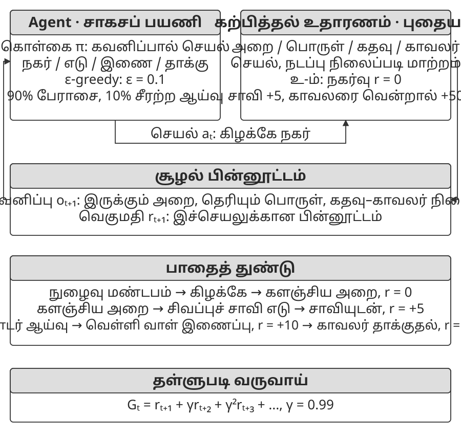

தொடர்ச்சியான ஊடாடல் ஒரு **பாதையை** (trajectory) உருவாக்குகிறது; அதில் ஒவ்வொரு படியின் அவதானிப்பு, செயல், வெகுமதி, முடிவுத் தகவல் ஆகியவை அடங்கும்; பயிற்சி அமைப்பால் சூழல் நிலையைப் பெற முடிந்தால், அதையும் சேர்த்துப் பதிவு செய்யலாம். எப்படிச் செயல்படுவது என்பதை உத்தி தீர்மானிக்கிறது; **மதிப்புச் சார்பு (Value Function)** மதிப்பிடுவது: தற்போதைய நிலையிலிருந்து ஒரு குறிப்பிட்ட உத்தியின்படி தொடர்ந்து செயல்பட்டால், எதிர்காலத்தில் எவ்வளவு வருவாய் (return) கிடைக்கும் என்று எதிர்பார்க்கலாம்.

ஏஜெண்ட்டுக்கும் சூழலுக்கும் இடையிலான எல்லை, மாதிரியாக்கத்தின்போது தேர்ந்தெடுக்கப்பட்ட அமைப்பு வரம்பால் தீர்மானிக்கப்படுகிறது. இந்தப் புத்தகம் விவாதிக்கும் மாதிரியும் Harness-உம் ஏஜெண்ட்டுக்குள் இருக்கின்றன; கருவி இடைமுகங்கள் அதை வெளிப் பயன்பாடுகள், சாதனங்கள், சேவைகளுடன் இணைக்கின்றன. எடுத்துக்காட்டாக, ஒரு கோப்பைத் திருத்தும் கோரிக்கையை ஏஜெண்ட் முன்வைக்கிறது, கோப்பு அமைப்பு எழுதுதலைச் செய்கிறது, கருவி அந்த இயக்க முடிவை ஏஜெண்ட்டுக்குத் திருப்பி அனுப்புகிறது.

கற்றல் செயல்முறையில், **தேடலுக்கும் பயன்படுத்தலுக்கும் (Exploration–Exploitation)** இடையே வாய்ப்புகளைப் பங்கிட வேண்டும். தேடல் உத்தியை இன்னும் பழக்கமில்லாத செயல்களுக்கு அறிமுகப்படுத்துகிறது; பயன்படுத்தல் தற்போது சிறந்ததாக மதிப்பிடப்படும் செயலைத் தேர்ந்தெடுக்கிறது. தாமதமான வெகுமதி கொண்ட பணிகளில், ஆரம்பகாலப் படிகளில் எவை இறுதி முடிவுக்குக் காரணமாயின என்பதையும் தீர்மானிக்க வேண்டும்; இதுவே பின்னர் விவாதிக்கப்படும் பங்களிப்புப் பகிர்வு (credit assignment) சிக்கல்.

ஒரு RL முறையைப் புரிந்துகொள்ள, முதலில் ஐந்து அம்சங்களைச் சரிபார்க்கலாம்:

- **செயல் வெளி (action space)**: எதை வெளியிட அனுமதிக்கப்படுகிறது. சதுரங்கம் போன்ற விளையாட்டுகள் தனித்த (discrete) நகர்வுகளைப் பயன்படுத்துகின்றன; ரோபோ கட்டுப்பாடு தொடர்ச்சியான மூட்டு இலக்குகளைப் பயன்படுத்தலாம்; செயல்கள் நிலை, இயற்பியல் வரம்பு, அனுமதிகள் ஆகியவற்றால் கட்டுப்படுத்தப்படலாம்.
- **உத்தி (policy)**: நிலை, அவதானிப்பு அல்லது வரலாற்றின் அடிப்படையில் செயலைத் தேர்ந்தெடுக்கும் விதி. அது ஓர் அட்டவணையாகவும் இருக்கலாம், ஒரு நரம்பியல் வலையமைப்பாகவும் இருக்கலாம்.
- **வெகுமதிச் சமிக்ஞை**: பயிற்சி இலக்கு எந்தப் பின்னூட்டங்கள் மூலம் வெளிப்படுத்தப்படுகிறது. ஒவ்வொரு படியின் வெகுமதியும் நீண்டகால வருவாயை உருவாக்குவதில் பங்கேற்கிறது; எதிர்காலப் பலனுக்காக உத்தி தற்போதைய இழப்பை ஏற்கலாம்.
- **மதிப்புச் சார்பு**: அடுத்தடுத்த வருவாயை மதிப்பிடுகிறது; செயல்களை ஒப்பிடவோ உத்திப் புதுப்பிப்புச் சமிக்ஞையை உருவாக்கவோ பயன்படுத்தலாம். அதை வெளிப்படையாகக் கற்பதா என்பதைக் குறிப்பிட்ட வழிமுறை தீர்மானிக்கிறது.
- **சூழல் மாதிரி (environment model)**: செயலுக்குப் பிறகான நிலை, அவதானிப்பு அல்லது வெகுமதியைக் கணிக்கிறது. மாதிரி-அடிப்படையிலான (model-based) முறைகள் தெரிந்த அல்லது கற்ற சூழல் மாதிரியைக் கொண்டு திட்டமிடுகின்றன; மாதிரி-இல்லா (model-free) முறைகள் ஊடாடல் தரவிலிருந்து நேரடியாக உத்தியையோ மதிப்பையோ கற்கின்றன.

அட்டவணை 8-3 இந்தக் கருத்துகளில் சூழல், செயல், இலக்கு ஆகியவற்றைத் தேர்ந்தெடுத்துப் பழக்கமான சில அமைப்புகளை ஒப்பிடுகிறது. முதல் இரண்டு வரிசைகளைப் படிக்கும்போது, "சமநிலையைப் பேணுதல்", "சுத்தம் செய்த பரப்பு" ஆகியவற்றைப் பணியை மாதிரியாக்கும்போது நாம் தேர்ந்தெடுக்கக்கூடிய இலக்குகளாகப் புரிந்துகொள்ளலாம்.

அட்டவணை 8-3 பல்வேறு ஏஜெண்ட் அமைப்புகளின் முக்கியக் கூறுகளின் ஒப்பீடு

| ஏஜெண்ட் வகை | வெளிச் சூழல் | செயல் வடிவம் | வெகுமதி அல்லது இலக்கு எடுத்துக்காட்டு |
| --- | --- | --- | --- |
| புதிதாகப் பிறந்த மான்குட்டி | நிலப்பரப்பு, ஈர்ப்பு, உடல் இயக்கவியல் | தொடர்ச்சியான தசைக் கட்டுப்பாடு | சமநிலையைப் பேணுதல், விழாமல் இருத்தல் |
| தரை சுத்தம் செய்யும் ரோபோ | அறை, தரை, மின்னூட்ட வசதி | நகர்தல், சுத்தம் செய்தல், மின்னூட்டத்துக்குத் திரும்புதல், கட்டுப்பாட்டு அளவுருக்கள் | சுத்தம் செய்த பரப்பு, மின்கல அளவு, மோதல் செலவு |
| சதுரங்க ஏஜெண்ட் | பலகை, எதிராளி, நேரக் கட்டுப்பாட்டு விதிகள் | தற்போதைய நிலையில் சட்டப்பூர்வமான நகர்வுகள் | வெற்றி +1, தோல்வி −1, சமநிலை 0 |
| வாடிக்கையாளர் சேவை ஏஜெண்ட் | பயனர், வணிகத் தரவுத்தளம், சேவை இடைமுகங்கள் | பதில் உரை, விசாரணைகள், வணிக அழைப்புகள் | சிக்கல் தீர்வு, நடைமுறை இணக்கம், கையாளும் நேரம் |
| குறியீட்டு உதவியாளர் ஏஜெண்ட் | தேவைகளின் மூலம், குறியீட்டுக் களஞ்சியம், இயக்கச் சூழல் | தேடல், திருத்தம், இயக்கம், பதில் | சோதனை முடிவுகள், பணி நிறைவு, பின்னடைவு (regression), செலவு |

இந்த அமைப்புகளின் செயல் வடிவங்கள் வேறுபடுகின்றன. சதுரங்கம் பொதுவாக ஒவ்வொரு படியிலும் ஒரு தனித்த செயலைத் தேர்ந்தெடுக்கிறது; ரோபோ குறிப்பிட்ட பரிமாணங்கள் கொண்ட தொடர்ச்சியான கட்டுப்பாட்டு மதிப்புகளை வெளியிடுகிறது; LLM-ஓ முதலில் ஒரு token வரிசையை உருவாக்குகிறது, பின்னர் இடைமுகம் அதைப் பதிலாகவோ கருவி அழைப்பாகவோ பகுக்கிறது. உள் கணக்கீட்டையும் உத்தி மாதிரியாக்கத்தில் சேர்க்கலாம்; வெளி நிலையை உண்மையில் மாற்றும் கருவி இயக்கத்திலிருந்து அதைத் தனியாகப் பதிவு செய்யலாம்.

### இரண்டு செயல் வடிவங்கள்: கிளாசிக் RL அமைப்பும் LLM-இன் மாறும்-நீள உத்தியும்

**மார்கோவ் முடிவு செயல்முறை (Markov Decision Process, MDP)** நிலைகள், செயல்கள், மாற்றங்கள் (transitions), வெகுமதிகள் ஆகியவற்றைக் கொண்டு ஒரு முடிவுச் சிக்கலை விவரிக்கிறது. அதன் மார்கோவ் பண்பு கோருவது: தற்போதைய நிலையும் செயலும் கொடுக்கப்பட்டால், அடுத்த நிலையையும் வெகுமதியையும் கணிக்க வரலாற்றைக் கூடுதலாகச் சார்ந்திருக்கத் தேவையில்லை; கணிப்புக்குத் தொடர்புடைய வரலாற்றுத் தகவல் ஏற்கெனவே தற்போதைய நிலையில் அடங்கியுள்ளது. படம் 8-2-இல், விளையாடுபவர் இருக்கும் அறையை மட்டும் பதிவு செய்தால் சிக்கல் வரும்: இரண்டு முறை ஒரே கதவின் முன் வந்து நின்றாலும், கதவைத் திறக்க முடியுமா என்பது விளையாடுபவர் ஏற்கெனவே சாவியை எடுத்தாரா என்பதைப் பொறுத்தது.

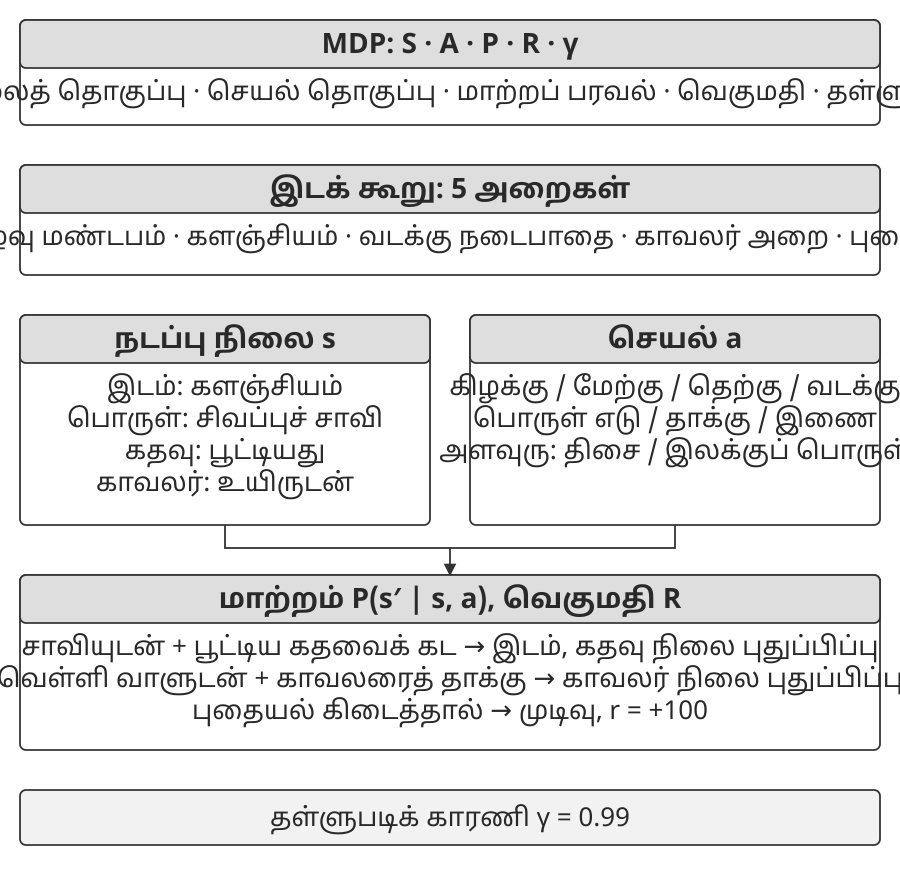

சதுரங்கம் நிலை வடிவமைப்புக்கு ஓர் எடுத்துக்காட்டைத் தருகிறது. காய்களின் இடங்களுடன், யாருடைய முறை, castling உரிமை, en passant உரிமை, ஐம்பது-நகர்வு விதியையும் மீண்டும் வரும் நிலைகளையும் தீர்மானிக்கத் தேவையான தகவல் ஆகியவற்றையும் பதிவு செய்ய வேண்டும். இவற்றை நிலையில் சேர்த்த பிறகே, தற்போதைய நிலையை வைத்து விதிகளைத் தீர்மானிக்க முடியும். ஏஜெண்ட்டால் இவற்றில் ஒரு பகுதியை மட்டுமே பார்க்க முடிந்தால், வரலாற்றைக் கொண்டு தகவலை நிரப்ப வேண்டும், அல்லது பகுதியளவு அவதானிக்கக்கூடிய (partially observable) மாதிரியாக்க முறையைப் பின்பற்ற வேண்டும்.

MDP தனித்த, தொடர்ச்சியான, சேர்க்கை (combinatorial) செயல்கள் அனைத்தையும் இடமளிக்க முடியும். Go விளையாட்டில் பலகையில் 361 குறுக்குச் சந்திகள் உள்ளன; நகர்வைத் தவிர்த்தலையும் (pass) சட்டப்பூர்வத்தன்மையையும் கருத்தில் கொள்ள வேண்டும்; Atari விளையாட்டுகள் பொதுவாகச் சில தனித்த செயல்களையே வழங்குகின்றன; ரோபோ கட்டுப்பாட்டு மதிப்புகள் மூட்டுகள், பிடிப்பான் (gripper), இயற்பியல் கட்டுப்பாடுகள் ஆகியவற்றால் வரையறுக்கப்படுகின்றன. நிலைகளும் செயல்களும் குறைவாக இருக்கும்போது, மதிப்புகளை நேரடியாக ஓர் அட்டவணையில் சேமிக்கலாம். அளவு பெரிதாகும்போது, சார்புத் தோராயமாக்கல் (function approximation), உத்தி உகப்பாக்கம், தேடல் ஆகியவை தனித்தனி வழிகளை வழங்குகின்றன.

**அட்டவணை Q-learning: ஒரு படிப் பின்னூட்டத்தைக் கொண்டு செயல் மதிப்பைப் புதுப்பித்தல்.** $Q(s,a)$ என்பது நிலை $s$-இல் செயல் $a$-ஐ எடுத்த பிறகான வருவாயை மதிப்பிடுகிறது. உகந்த செயல் மதிப்பு பெல்மன் உகப்பு சமன்பாட்டை (Bellman optimality equation) நிறைவு செய்கிறது:

$$
Q^*(s,a)=\mathbb E\left[r+\gamma\max_{a'}Q^*(s',a')\mid s,a\right]
$$

இங்கு $r$ இந்தப் படியின் வெகுமதி, $s'$ அடுத்த நிலை, $\gamma$ தள்ளுபடிக் காரணி (discount factor). தொடர்ச்சியான பணிகளில் பொதுவாக $0\leq\gamma<1$ எடுக்கப்படுகிறது; முடிவு தெளிவாகவும் வருவாய் வரம்புக்குட்பட்டதாகவும் உள்ள பணிகளில் 1-ஐயும் எடுக்கலாம். பெரிய தள்ளுபடிக் காரணி தொலைவிலுள்ள வெகுமதிகளுக்கு அதிக எடையைத் தக்கவைக்கிறது. தற்போதைய நேரத்திலிருந்து கணக்கிடப்படும் வருவாய் $G_t=\sum_{k\geq0}\gamma^k r_{t+k+1}$.

ஓர் ஊடாடலில் $r$, $s'$ ஆகியவை கிடைத்த பிறகு, Q-learning பின்வரும் சமன்பாட்டின்படி புதுப்பிக்கிறது:

$$
Q(s,a)\leftarrow Q(s,a)+\alpha\left[r+\gamma\max_{a'}Q(s',a')-Q(s,a)\right]
$$

$\alpha$ கற்றல் வீதம்; சதுர அடைப்புக்குள் இருப்பது "ஒரு படி வெகுமதியும் தள்ளுபடி செய்யப்பட்ட அடுத்தடுத்த மதிப்பும்" தற்போதைய மதிப்பீட்டிலிருந்து எவ்வளவு வேறுபடுகிறது என்பது. பணி முடிவு நிலையை அடைந்தால், அடுத்தடுத்த மதிப்பு 0 ஆக எடுக்கப்படுகிறது. துணை விளையாட்டில் ஒருமுறை முயன்று பாருங்கள்: சீரற்ற இடையூறுகளை அணைத்து, நுழைவாயிலிலிருந்து கிழக்கே நடந்து, சேமிப்பு அறையில் சிவப்புச் சாவியை எடுங்கள். சாவியை எடுப்பதற்கு 5 புள்ளி வெகுமதி, ஒவ்வொரு படிக்கும் 0.5 புள்ளி கழிக்கப்படுகிறது; ஆகவே இந்தச் செயல் திருப்பித் தரும் $r$ 4.5. அட்டவணையில் "சேமிப்பு அறையில் சாவியை எடு" என்பதன் பழைய மதிப்பீடு 0.25 என்றும், சாவியை எடுத்த பிறகு தேர்ந்தெடுக்கக்கூடிய செயல்களின் அதிகபட்ச Q மதிப்பு 0.63 என்றும் வைத்துக்கொள்வோம். $\gamma=0.99$, $\alpha=0.2$ எனக் கொண்டால், ஒரு படி இலக்கு $4.5+0.99\times0.63=5.1237$. பழைய மதிப்பீடு இந்த இலக்கை நோக்கி ஐந்தில் ஒரு பங்கு நகர்ந்து 1.22474 ஆகப் புதுப்பிக்கப்படுகிறது. உண்மையான ஒரு படிப் பின்னூட்டத்தைக் கொண்டு மதிப்பீட்டைத் திருத்தும் இந்த முறை **காலவேறுபாட்டுக் கற்றல் (Temporal-Difference Learning, TD)** எனப்படுகிறது.

ஒரு நிலையில் உள்ள அனைத்துச் செயல்களின் Q மதிப்புகளையும் சேர்த்துப் பார்த்தால், தற்போதைய மதிப்பீட்டில் சிறந்த செயலைத் தேர்ந்தெடுக்கலாம். படம் 8-3 ஓர் எளிய கட்ட வரைபடத்தில் (grid) இத்தகைய உத்தியை வரைகிறது. ஒவ்வொரு கட்டத்திலும் உள்ள எண் இயல்பாக்கப்பட்ட (normalized) நிலை மதிப்பைக் குறிக்கிறது. எண்களைக் கையால் மறைத்து, அம்புகளை மட்டும் பார்த்து, மேல் இடது மூலையிலிருந்து புதையலை அடைய முடிகிறதா?

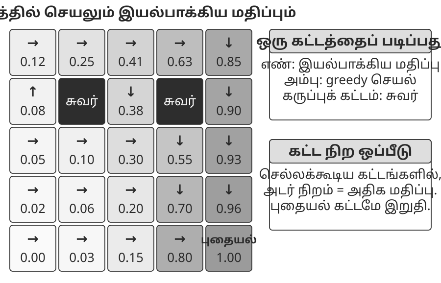

அடுத்த தேடல் அம்புகளின் திசையை மாற்றக்கூடும். படம் 8-4 சற்று முன் சிவப்புச் சாவியை எடுத்த கணக்கீட்டைப் பிரித்துக் காட்டுகிறது: இந்தப் படியில் கிடைத்த வெகுமதி "சேமிப்பு அறையில் சாவியை எடு" என்ற ஒரு மதிப்பீட்டை மட்டுமே மாற்றுகிறது; அட்டவணையில் உள்ள பிற நிலைகளின் Q மதிப்புகள் அவற்றுக்குரிய புதுப்பிப்புகளுக்காகக் காத்திருக்கின்றன.

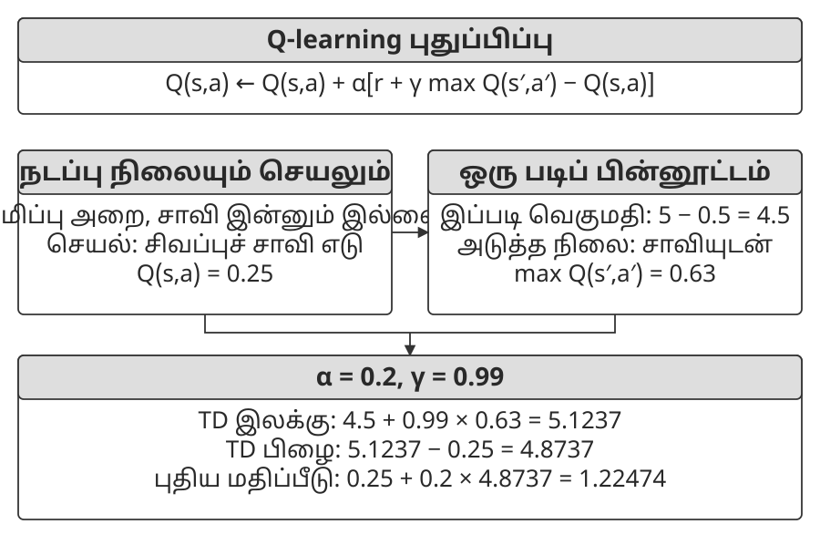

Q-learning-இன் நடத்தை உத்தி சீரற்ற தேடலை உள்ளடக்கலாம்; ஆனால் புதுப்பிப்பு இலக்கு அடுத்த நிலையின் அதிகபட்சச் செயல் மதிப்பைப் பயன்படுத்துகிறது; ஆகவே இது **off-policy (உத்தி-விலகிய)** கற்றல் வகையைச் சேர்ந்தது.

> **சோதனை 8-1 ★: புதையல் தேடும் விளையாட்டில் Q-learning-இன் செயல்திறன்**
>
> புதையல் தேடும் விளையாட்டில் சாவி-கதவு, ஆயுத விளைவுகள், பொருள் இணைப்பு போன்ற மறைந்த விதிகள் உள்ளன. விளையாட்டை முடிக்கப் பல படிகளை வரிசையாகச் செய்ய வேண்டும்; உகந்த பாதை 11 படிகள்; முக்கியச் செயல்களுக்கும் வெற்றிக்கும் வெகுமதி கிடைக்கிறது, பிற படிகளுக்குப் பின்னூட்டம் குறைவு.
>
> இந்தப் புதையல் பயிற்சி கற்றல் வீதம் 0.2, தள்ளுபடிக் காரணி 0.99 எடுக்கிறது; தேடல் வீதம் ε 1.0-இலிருந்து படிப்படியாக 0.1-க்குக் குறைகிறது. அட்டவணை Q-learning ε-greedy தேடலைப் பயன்படுத்துகிறது: ஒவ்வொரு படியிலும் ε நிகழ்தகவுடன் கிடைக்கும் செயல்களில் ஒன்றைச் சீரற்ற முறையில் தேர்ந்தெடுக்கிறது; மற்ற நேரங்களில் தற்போதைய Q மதிப்பு அதிகமான செயல்களில் ஒன்றைத் தேர்ந்தெடுக்கிறது. ஒவ்வொரு கட்டத்திலும் வெற்றி வீதம், சென்ற நிலைகளின் எண்ணிக்கை, முடிக்கத் தேவைப்பட்ட படிகள் ஆகியவற்றைப் பதிவு செய்யுங்கள்.
>
> புதையல் சோதனையின் பயிற்சி மற்றும் மதிப்பீட்டுப் பதிவுகளைப் படிக்கும்போது, இரண்டு கேள்விகளைத் தனித்தனியே வைத்துக்கொள்ளுங்கள்: பயிற்சியின்போது, சீரற்ற தேடலுடன் கூடிய உத்தி முதன்முறையாக எப்போது புதையலைக் கண்டது? பயிற்சி முடிந்த பிறகு, Q அட்டவணையை நிலைப்படுத்தி, greedy உத்தியின்படி செயல்பட்டால், நிலையாக விளையாட்டை முடிக்க முடிகிறதா? முதலாவது மாதிரி பாதையை எப்படிக் கண்டுபிடிக்கிறது என்பதைக் காட்டுகிறது; இரண்டாவது, கற்ற மதிப்புகளின்படி அது செயல்களைத் தேர்ந்தெடுக்க முடிகிறதா என்பதைச் சோதிக்கிறது.
>
> முன்பு நடந்த ஒரு பயிற்சியில், முதல் 1000 ஆட்டங்களில் ஒருமுறைகூட முடிக்கப்படவில்லை; Q அட்டவணையில் 124 நிலைகள் இருந்தன; 5000 ஆட்டங்கள் வரையிலும் நிலையான வெற்றி கிடைக்கவில்லை, நிலைகளின் எண்ணிக்கை 133; 7000～8000 ஆட்டங்களுக்கு இடையில் வெற்றி வீதம் 34%-இலிருந்து 96%-க்கு உயர்ந்தது; 10000 ஆட்டங்களில் 100%-ஐ எட்டியது; Q அட்டவணையில் 145 நிலைகள் இருந்தன; 11 படிப் பாதையும் கண்டுபிடிக்கப்பட்டது.
>
> தொடக்கத்தில் ஏன் நீண்ட காலம் முன்னேற்றம் இல்லை, பின்னர் வெற்றி வீதம் ஏன் வேகமாக உயர்ந்தது? தேடல் முதலில் முக்கியச் செயல்களையும் பாதைகளையும் கண்டுபிடிக்கிறது; பின்னர் வரும் வருகைகள் இறுதிப் புள்ளியின் வருவாயைப் படிப்படியாக முந்தைய நிலைகளுக்குப் பரப்புகின்றன. இந்த முழுச் சிறிய உருவகப்படுத்தலுக்கும் சுமார் 10 வினாடிகளே ஆகின்றன; ஆகவே ஏராளமான திரும்பத் திரும்ப நிகழும் ஊடாடல்களைத் தாங்க முடிகிறது.
>
> பகுப்பாய்வின்போது கணக்கீட்டு நேரத்தையும் ஊடாடல் எண்ணிக்கையையும் சேர்த்தே பதிவு செய்யுங்கள். விளையாட்டில் ஒரு செயல் மிக மலிவானது; உலாவி, தொலைபேசி அல்லது இயற்பியல் சாதனமாக மாறினால், ஓர் ஊடாடலில் காத்திருப்பு, கட்டணம், நிலை மாற்றம் ஆகியவையும் அடங்கும். அட்டவணை குறிப்பிட்ட நிலைக் குறியாக்கத்துடன் பிணைந்துள்ளது; விதிகளோ வரைபடமோ மாறினால், ஏற்கெனவே உள்ள மதிப்புகள் பொருந்துமா என்பதை மீண்டும் சரிபார்க்க வேண்டும். முன்-பயிற்சி அறிவு தேடலின் தொடக்கப் புள்ளியை எப்படி மாற்றும் என்பதை அடுத்த சோதனை ஒப்பிடும்.

**முன்-பயிற்சி பெற்ற LLM: கணக்கீட்டையும் செயலையும் மொழியால் குறித்தல்.**

LLM ஒரு கருவியை அழைப்பதற்கு முன் ஓர் இடைநிலைக் கணக்கீட்டை உருவாக்கலாம், அல்லது நேரடியாக அழைப்பை வெளியிடலாம். இரண்டும் token வரிசைகளாகவே குறிக்கப்படுகின்றன, ஆனால் அவற்றின் பங்கு வேறுபடுகிறது: இடைநிலைக் கணக்கீடு மாதிரிக்கு அடுத்துக் கிடைக்கும் சூழலை மாற்றுகிறது; கருவி அழைப்பு இயக்கப்பட்ட பிறகு வெளிச் சூழலை மாற்றுகிறது அல்லது படிக்கிறது. பயிற்சியின்போது இந்த வெளியீடுகளை நெறிமுறையின்படி பதிவு செய்து, பணி முடிவையும் கணக்கீட்டுச் செலவையும் இணைத்து மதிப்பிடலாம். இதனால் "எவ்வளவு நேரம் சிந்திப்பது, எதைச் சிந்திப்பது, எப்போது கருவியை அழைப்பது" என்பவை ஒரே உத்தி கற்கக்கூடிய தேர்வுகளாகின்றன; பின்னர் வரும் AdaptThink பகுத்தறிவுச் செலவு வரம்பை (reasoning budget) மையமாகக் கொண்டது.

மாறும்-நீள வரிசைகள் மிகப் பெரிய சேர்க்கை வெளியைக் கொண்டு வருகின்றன. மாதிரி விசாரணைகள், நிரல்கள், JSON அளவுருக்கள், பல-படித் தருவிப்புகள் ஆகியவற்றை எழுதலாம்; வரிசை நீளம் செலவு வரம்பாலும் சூழல் வரம்பாலும் கட்டுப்படுத்தப்படுகிறது. முன்-பயிற்சி தேடலுக்கு ஒரு தொடக்கப் புள்ளியை வழங்குகிறது: கணிதப் பொருள்களில் பெரும்பாலும் நிபந்தனைப் பகுப்பாய்வும் கணக்கீடும் உள்ளன; குறியீட்டிலும் விவாதங்களிலும் பெரும்பாலும் இடம் காணுதல், திருத்துதல், சரிபார்த்தல் ஆகியவை உள்ளன. மாதிரி இந்த அமைப்புகளைக் கடன் வாங்கி வேட்புப் பாதைகளை உருவாக்கி, பின்னர் சூழல் பின்னூட்டத்தின்படி சரிசெய்யலாம். ஏற்கெனவே உள்ள அறிவு, பயனுள்ள செயல் சேர்க்கைகள் தொடக்கத்திலிருந்தே மாதிரியெடுப்பில் எளிதாகக் கிடைக்கச் செய்கிறது; இதனால் ஏராளமான தொடர்பற்ற பாதைகளில் குருட்டுத்தனமாக முயன்று பிழை செய்யும் தேவை குறைகிறது.

எடுத்துக்காட்டாக, "வெளிநாட்டு நாணயத் தொகையை அமெரிக்க டாலராக மாற்று" என்பதற்கு மாற்று வீதத்தைப் பெற்றுக் கணக்கிட வேண்டும். முன்-பயிற்சி இத்தகைய தொடர்புடைய படிகளை மாதிரி எளிதாக உருவாக்கச் செய்கிறது; பிந்தைய பயிற்சி, மாற்று வீதத்தின் மூலம், கணக்கீட்டு முடிவு, பணிக் கட்டுப்பாடுகள் ஆகியவற்றின் அடிப்படையில் பாதைகளின் நிகழ்தகவை மேலும் சரிசெய்யலாம். இங்கே மொழி அறிவு தொடக்க உத்தியை வழங்குகிறது; வெகுமதி பணிப் பின்னூட்டத்தை வழங்குகிறது.

படம் 8-5 இந்தப் பகுதியின் இரண்டு அமைப்புகளையும் ஒப்பிடுகிறது: அட்டவணை Q-learning குறிப்பிட்ட நிலைக் குறியாக்கத்திலிருந்தும் தேடல் விதிகளிலிருந்தும் தொடங்குகிறது; LLM ஏஜெண்ட் முன்-பயிற்சி பெற்ற மொழி உத்தியிலிருந்து தொடங்கி, சூழல் மூலம் கருவி அவதானிப்புகளையும் வரலாற்று அனுபவத்தையும் ஒழுங்கமைக்கிறது.

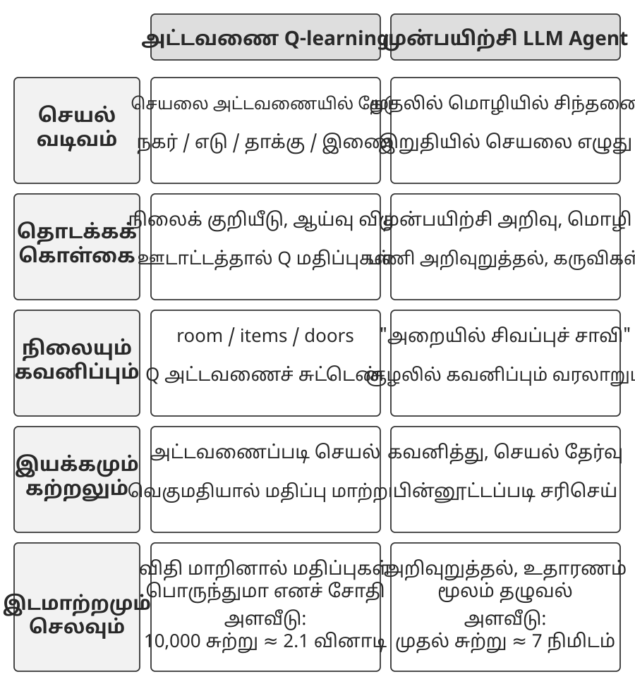

முன்-பயிற்சி மாதிரியைப் புதிய அறிவுறுத்தல்களை விளக்கவும், சில செயல்விளக்கங்களைக் கொண்டு பணி நடத்தையைச் சரிசெய்யவும் இயலச் செய்கிறது. கருவிகள் மொழி வெளியீட்டைத் தேடல், குறியீட்டு இயக்கம், வணிகச் செயல்பாடுகளுடன் இணைக்கின்றன. இத்தகைய ஏஜெண்ட்டுகளை வடிவமைக்கும்போது, கருவி இடைமுகங்களையும் இயக்க அனுமதிகளையும் தீர்மானிப்பதோடு, பணி முடிவு, இயக்கச் செலவு, முக்கியச் செயல்முறைகள் ஆகியவற்றுக்குப் பின்னூட்டத்தையும் அமைக்க வேண்டும்.

ஒரு மாதிரி இயந்திரக் கையைக் கட்டுப்படுத்த வேண்டுமென்றால், "அடுத்த token-ஐக் கணித்தல்" என்பதைச் செயல்களுக்கு எப்படிப் பயன்படுத்துவது? OpenVLA சுமார் 9.7 லட்சம் உண்மையான ரோபோ செயல்விளக்கங்களைப் பயன்படுத்தியது. செயல்விளக்கத்தில் ஒரு படியை எடுத்துக்கொண்டால், உள்ளீடு அந்த நேரத்தின் கேமரா படமும் பணி அறிவுறுத்தலும்; பயிற்சி இலக்கு, செயல்விளக்கம் அளித்தவர் அடுத்துச் செய்த செயல். எடுத்துக்காட்டாக, இயந்திரக் கை கிடைமட்டத் திசையில் எவ்வளவு நகர்கிறது என்பது இயல்பாக ஒரு தொடர்ச்சியான எண் மதிப்பு. OpenVLA ஒவ்வொரு செயல் பரிமாணத்தையும் 256 படிநிலைகளாகப் பிரித்து, மதிப்பு எந்தப் படிநிலையில் விழுகிறது என்பதை ஒரு token-ஆல் குறிக்கிறது. இவ்வாறு மாதிரி செயல் token-களை ஒவ்வொன்றாகக் கணிக்கலாம்; அந்த இடங்களில் மட்டுமே இழப்பு கணக்கிடப்படுகிறது.[^ch8-21]

நடத்தை நகலாக்கத்தையும் (behavior cloning) வலுவூட்டல் கற்றலையும் வேறுபடுத்தும் வழியையும் இந்த எடுத்துக்காட்டு தருகிறது: எந்தச் சமிக்ஞை மாதிரியைப் புதுப்பிக்கிறது என்று பாருங்கள். OpenVLA செயல்விளக்கப் பதிவுகளிலிருந்து கற்கிறது; செயல்விளக்கச் செயல் token-களுக்கு மாதிரி அதிக நிகழ்தகவு வழங்கும் அளவுக்கு இழப்பு குறைகிறது; இது மேற்பார்வையிடப்பட்ட நுண்-சரிப்படுத்தல். சோதனை 8-13-இன் SimpleVLA-RL-இல், உத்தி சூழலில் உண்மையில் செயல்களை முயன்று, பின்னர் பணி வெகுமதியின்படி எதிர்காலத் தேர்வுகளைச் சரிசெய்கிறது.

> **வழிமுறை, சூழல், முன்னறிவு (prior)**
>
> யாவ் ஷுன்யு (Shunyu Yao) "The Second Half" கட்டுரையில் வழிமுறை, சூழல், முன்னறிவு ஆகியவற்றைக் கொண்டு RL-இன் வளர்ச்சியை மீளாய்வு செய்தார்.[^ch8-2] இதன் அடிப்படையில் ஆசிரியர் கவனக் குவிப்பின் மாற்றத்தை மூன்று கட்டங்களாகச் சுருக்குகிறார்: 2015—2016-இல் வழிமுறைகளை மேம்படுத்துவதில் கவனம்; 2016—2018-இல் சூழல் கட்டமைப்புக்கு அதிக முக்கியத்துவம்; 2018 முதல் முன்-பயிற்சி முன்னறிவின் மதிப்பு படிப்படியாக உணரப்பட்டது. Gym ஒருங்கிணைந்த சூழல் இடைமுகத்தை வழங்கியது; Universe, World of Bits ஆகியவை கணினி மற்றும் வலைப்பக்கப் பணிகளை ஆராய்ந்தன; Dota 2 போன்ற திட்டங்கள் சிக்கலான சூழல்களில் பயிற்சித் திறனைக் காட்டின. அதன் பின்னர், GPT-2, GPT-3 ஆகியவை மொழி முன்-பயிற்சி திரட்டிய அறிவையும் வெளிப்பாட்டுத் திறனையும் காட்டின; WebGPT, ChatGPT போன்ற அமைப்புகள் இந்தத் தொடக்கப் புள்ளியை மேலும் பயன்படுத்தின. பணிக்குத் தேவையான முன்னறிவை முதலில் மொழி மாதிரியாக்கம் மூலம் பெற்று, பின்னர் குறிப்பிட்ட நடத்தையை உகப்பாக்க RL-இடம் ஒப்படைக்கலாம்.
>
> இங்குள்ள பொறியியல் முன்னுரிமையை ஆசிரியர் ஏற்கிறார்: **முன்னறிவு, சூழல், வழிமுறை.** முதலில் மாதிரியிடம் என்ன அறிவும் திறனும் உள்ளன என்று சரிபார்த்து, பின்னர் பொருத்தமான சூழலையும் பின்னூட்டத்தையும் உருவாக்கி, இறுதியாக அதற்கேற்ற உகப்பாக்க முறையைத் தேர்ந்தெடுங்கள். படம் 8-6 ஆய்வுக் கவனங்கள் தோன்றிய வரிசையில் அமைக்கப்பட்டுள்ளது; திட்டத்தைச் செய்யும்போது அதைத் தலைகீழாக்கி, ஏற்கெனவே உள்ள திறனிலிருந்து தொடங்கலாம்.
>
> 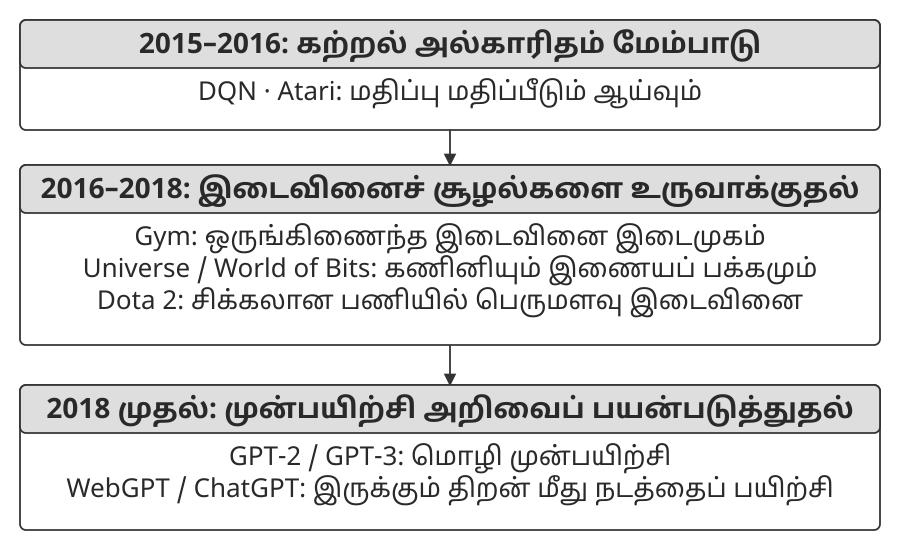

> **சோதனை 8-2 ★★: மரபு RL மற்றும் LLM ஏஜெண்ட் ஒப்பீட்டு ஆய்வு**
>
> அதே புதையல் தேடும் விளையாட்டில் அட்டவணை Q-learning-ஐயும் LLM ஏஜெண்ட்டையும் ஒப்பிடுங்கள். LLM அமைப்பு Kimi K3-ஐப் பயன்படுத்தி, சூழலில் அதிகபட்சம் 50 அனுபவங்களைப் பேணுகிறது. இரண்டும் ஒவ்வொரு படியிலும் சூழல் தரும் தேர்வுச் செயல்களில் ஒன்றைத் தேர்ந்தெடுக்கின்றன. படம் 8-7-இன் இரண்டு பாதைகளைப் பின்பற்றினால், Q அட்டவணையும் மொழி மாதிரியும் இந்தத் தேர்வை எப்படிச் செய்கின்றன என்பதைக் காணலாம்.
>
> 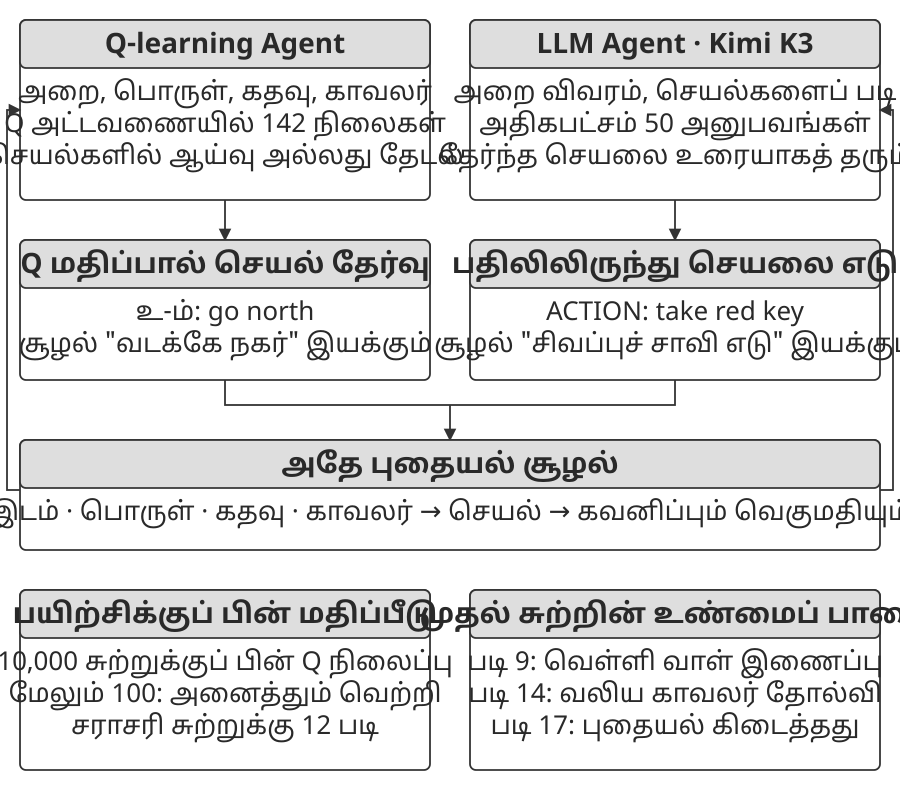
>
> துணை Kimi K3 இயக்கப் பதிவில், ஏஜெண்ட் முதல் ஆட்டத்தில் 17 படிகளைப் பயன்படுத்தியது. அது முதலில் துருப்பிடித்த வாளை எடுத்து, வடக்குக் கதவு பூட்டப்பட்டிருப்பதைக் கண்டு, சேமிப்பு அறைக்குச் சென்று சிவப்புச் சாவியையும் மந்திரப் படிகத்தையும் பெற்றது; 9-ஆவது படியில் வாளையும் படிகத்தையும் இணைத்து வெள்ளி வாளை உருவாக்கியது. 12-ஆவது படியில் சாவியைப் பயன்படுத்த முயன்றபோது, "தேவைப்படும்போது தானாகப் பயன்படுத்தப்படும்" என்று சூழல் அறிவித்தது; 13-ஆவது படியில் வடக்கே நடந்தபோதுதான் கதவு உண்மையில் திறந்தது. 14-ஆவது படியில் வெள்ளி வாளால் காவலரைத் தோற்கடித்த பிறகு, அது மீண்டும் ஒருமுறை வாளைப் பயன்படுத்த முயன்றது; இப்போது பயன்படுத்த முடியாது என்று சூழல் அறிவித்தது. 17-ஆவது படியில் புதையலைப் பெற்றது. இந்தப் பதிவைப் படிக்கும்போது, அடுத்த வரியை மறைத்து, தற்போதைய பின்னூட்டத்தைக் கொண்டு எந்தப் படி இன்னும் அவசியம் என்று முதலில் ஊகித்துப் பாருங்கள்.
>
> ஒவ்வொரு செயலையும் அந்த நேரத்தின் அவதானிப்புடன் சீரமைத்தால், "சாவி கதவைத் திறக்கும்", "ஆயுதம் காவலரை எதிர்கொள்ளும்" போன்ற ஏற்கெனவே உள்ள அறிவை மாதிரி எப்படிப் பயன்படுத்துகிறது, கருவிப் பின்னூட்டம் அடுத்தடுத்த திட்டத்தை எப்படி மாற்றுகிறது என்பதைப் பகுப்பாயலாம். அட்டவணைத் திட்டமோ நிலை—செயல் வருகைகள் மூலம் இந்த உறவுகளைத் திரட்டுகிறது.
>
> இந்த ஒப்பீட்டில், Q-learning 10000 ஆட்டங்களைப் பயிற்சி செய்ய 2.12 வினாடிகள் எடுத்தது; பின்னர் greedy உத்தியைக் கொண்டு தனியாக 100 ஆட்டங்கள் மதிப்பிடப்பட்டன; அனைத்தும் முடிக்கப்பட்டன, சராசரி 12 படிகள். Kimi ஓர் ஆட்டத்தில் மாதிரியை 17 முறை அழைத்தது; 6 நிமிடம் 56 வினாடிகள் ஆனது. இதன் அடிப்படையில் ஆசிரியர் ஒரு தேர்வுக் கொள்கையைப் பின்பற்றுகிறார்: உருவகப்படுத்தல் மலிவாகவும் ஏராளமாகத் திரும்பச் செய்யக்கூடியதாகவும் இருக்கும்போது, மரபு RL-இன் தேடலை முழுமையாகப் பயன்படுத்தலாம்; ஒவ்வொரு ஊடாடலுக்கும் காத்திருப்பு, கட்டணம் அல்லது உண்மையான செயல்பாட்டுச் செலவு இருக்கும்போது, ஏற்கெனவே உள்ள அறிவைப் பயன்படுத்தக்கூடிய உத்திகளுக்கு முன்னுரிமை கொடுத்து, ஒவ்வொரு ஊடாடலின் மதிப்பையும் உயர்த்துங்கள்.

இந்த இரண்டு சோதனைகளும் இந்த அத்தியாயத்தை முந்தைய பொறியியல் முறைகளுடன் இணைக்கின்றன: சூழல் ஒரே இயக்கத்துக்குள் அனுபவத்தை ஒழுங்கமைக்கலாம்; வெளி நினைவகம் பணிகளுக்கு இடையே அனுபவத்தைச் சேமிக்கலாம்; பிந்தைய பயிற்சி அளவுருப் புதுப்பிப்பு மூலம் உத்தியை மாற்றுகிறது. அடுத்து, மொழி மற்றும் காட்சி முன்-பயிற்சியின் அடிப்படைச் செயல்முறையை முதலில் நிரப்பி, பின்னர் குறிப்பிட்ட பயிற்சித் தரவையும் உகப்பாக்க முறைகளையும் விவாதிப்போம்.

## மாதிரி முன்-பயிற்சி அடிப்படைகள் `[விருப்ப வாசிப்பு]`

முன்-பயிற்சி மாதிரியின் தொடக்கப் பிரதிநிதித்துவத்தையும் (representation) உருவாக்கப் பரவலையும் அமைக்கிறது; அடுத்தடுத்த பயிற்சி இந்தத் தொடக்கப் புள்ளியிலிருந்து அளவுருக்களைத் தொடர்ந்து சரிசெய்கிறது. இந்தத் தொடக்கப் புள்ளியைப் புரிந்துகொள்ள, முதலில் ஒரு சிறிய மொழி மாதிரி உரையிலிருந்து எப்படிக் கற்கிறது என்பதைக் கவனித்து, பின்னர் அது காட்சி உள்ளீட்டை எப்படி இணைத்துக்கொள்கிறது என்று பார்க்கலாம்.

உரை முதலில் **token-ஆக்கம் (Tokenization)** வழியாகச் சென்று தனித்த token-களாக மாற்றப்படுகிறது. எடுத்துக்காட்டாக, "எனக்கு நிரலாக்கம் பிடிக்கும்" என்பதை "எனக்கு", "நிரலாக்கம்", "பிடிக்கும்" என்ற மூன்று அலகுகளாகக் காட்டலாம்; உண்மையான பிரிப்பைப் பகுப்பான் தீர்மானிக்கிறது. பயிற்சி முந்தைய token-களைச் சூழலாகக் கொண்டு அடுத்து வரும் token-ஐக் கணித்து, இழப்பைக் கணக்கிட்டு அளவுருக்களைப் புதுப்பிக்கிறது. படம் 8-8-இல், முதலில் பயிற்சி வாக்கியத்தை "சூழல்" வரை மறைத்து, அடுத்த சொல் என்ன என்று ஊகித்து, பின்னர் மூல உரையைத் திறந்து பாருங்கள். இந்த இடத்தைப் பின்னோக்கி நகர்த்தினால், அடுத்த கணிப்புக் கேள்வி கிடைக்கும்.

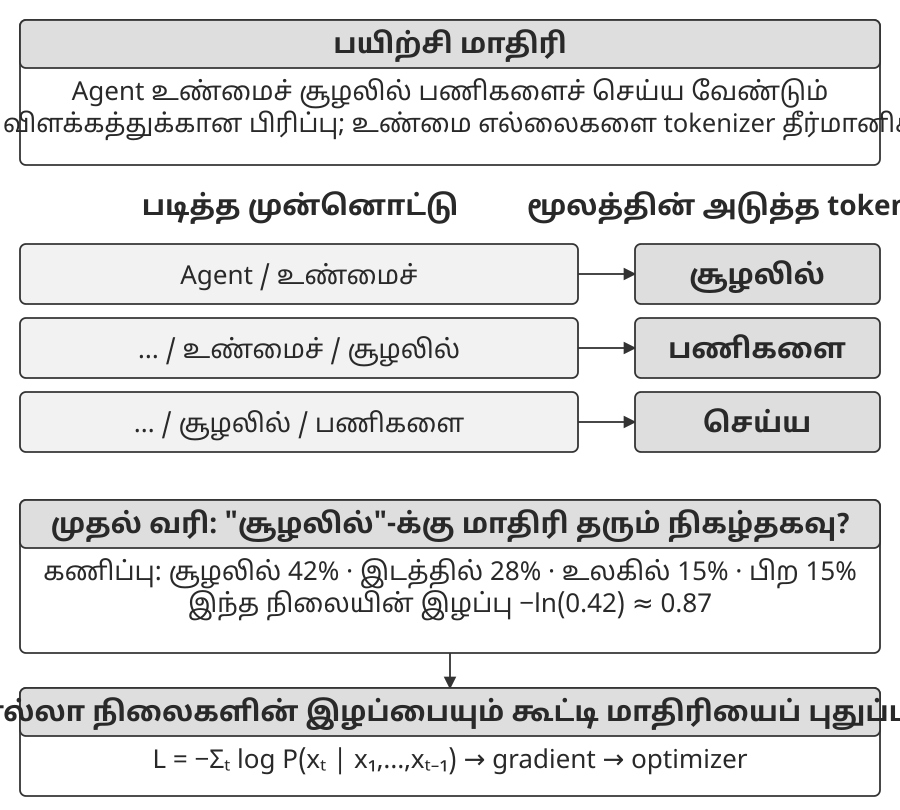

அடிப்படை மொழி மாதிரியாக்கத்துக்குப் பிறகு, அறிவுறுத்தல் செயல்விளக்கங்களைச் சேர்த்துப் பதில் வடிவத்தையும் பணி நடத்தையையும் பயிற்றுவிக்கலாம்; அல்லது விருப்பத் தரவைப் (preference data) பயன்படுத்தி, DPO போன்ற முறைகள் மூலம் அதிகம் ஏற்கப்படும் பதில்களின் நிகழ்தகவை உயர்த்தலாம்.

> **சோதனை 8-3 ★★: LLM-ஐ அடியிலிருந்து பயிற்றுவித்தல் — வழிமுறை மேம்பாடுகளின் வலிமை**
>
> சுமார் பத்துக் கோடி அளவுருக்கள் கொண்ட MiniMind 2-ஐ எடுத்துக்காட்டாகக் கொண்டு, நுகர்வோர் தர GPU-வில் முன்-பயிற்சி, SFT, விருப்ப உகப்பாக்கம் ஆகியவற்றை முடியுங்கள். அடிப்படைக் கோட்டையும், QK Norm, Muon உகப்பாக்கி சேர்க்கப்பட்ட அமைப்பையும் ஒப்பிட்டு, இழப்பு குறைதல், இலக்குத் தரத்தை எட்டத் தேவைப்படும் நேரம், உருவாக்க முடிவுகள் ஆகியவற்றைக் கவனியுங்கள். துணைச் சுருக்கம் சுமார் 3 மடங்கு ஒருங்கல் (convergence) வேக உயர்வைப் பதிவு செய்தது; முழுப் பயிற்சிக்குச் சுமார் 14 மணிநேரமும் சுமார் 34 அமெரிக்க டாலரும் ஆனது.
>
> QK Norm கவன இயக்கத்தில் (attention) query, key ஆகியவற்றின் எண் அளவுகோலைச் சரிசெய்கிறது; Muon அதற்குரிய அளவுருக்களின் உகப்பாக்கப் புதுப்பிப்பு முறையை மாற்றுகிறது.
>
> ஒரே கேள்வித் தொகுப்பைக் கட்டம் கட்டமாகக் கவனியுங்கள்: முன்-பயிற்சி பெற்ற மாதிரி ஏற்கெனவே "உலகின் மிக உயரமான மலை" போன்ற கேள்விகளுக்குப் பதிலளிக்க முடிகிறது; SFT-க்குப் பிறகு அறிவுறுத்தல் பின்பற்றலும் வெளியீட்டு ஒழுங்கமைப்பும் மேம்படுகின்றன; விருப்ப உகப்பாக்கம் உண்மைப் பதில்களையும் வெளிப்பாட்டையும் மேலும் பாதிக்கிறது.

> **சோதனை 8-4 ★★: VLM-ஐ நீங்களே பயிற்றுவித்தல்**
>
> படம் 8-9 "காட்சிக் குறியாக்கி—projection அடுக்கு—மொழி மாதிரி" இணைப்பைக் காட்டுகிறது. CLIP போன்ற காட்சிக் குறியாக்கி படத்தின் அம்சங்களைப் பிரித்தெடுக்கிறது; projection அடுக்கு அந்த அம்சங்களை மொழி மாதிரி உள்ளீட்டுக்குத் தேவையான பரிமாணத்துக்கும் பிரதிநிதித்துவத்துக்கும் மாற்றுகிறது; மொழி மாதிரி இந்த உள்ளீடுகளை இணைத்து விவரிப்புகளையோ பதில்களையோ உருவாக்குகிறது.
>
> 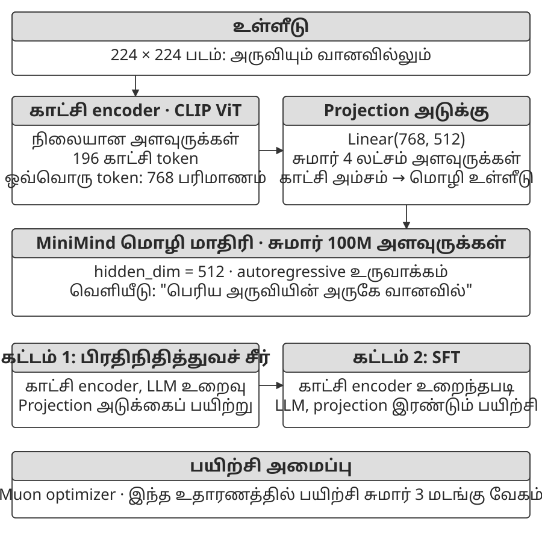
>
> முதல் கட்டத்தில் காட்சிக் குறியாக்கியையும் LLM-ஐயும் உறையவைத்து, புதிதாகச் சேர்க்கப்பட்ட projection அடுக்கை மட்டும் பயிற்றுவித்து, படத்தின் அம்சங்கள் மொழிக் கணிப்பில் பங்கேற்கச் செய்யுங்கள்; இரண்டாம் கட்டத்தில் அமைப்பின்படி LLM-ஐ உறைநீக்கி, உயர்தரப் படம்—விவரிப்பு அல்லது கேள்வி-பதில் தரவைக் கொண்டு SFT செய்யுங்கள். பொருள் அடையாளம் காணல், விவர விளக்கம், உறவுத் தீர்ப்பு, மொழித் திறன் ஆகியவற்றின் மாற்றங்களைத் தனித்தனியே கவனியுங்கள்.
>
> இந்தக் கட்டமைப்பு ஏற்கெனவே உள்ள காட்சி மற்றும் மொழி மாதிரிகளை மீண்டும் பயன்படுத்தி, முதலில் முறைமை-கடந்த (cross-modal) இணைப்புக் கூறை மட்டும் குவிந்து பயிற்றுவிக்கிறது; வரவுசெலவு குறைவாக இருக்கும்போது முதலில் முயன்று பார்க்கத் தகுந்த திட்டம் இது. எடைகளை உறையவைப்பது பயிற்றுவிக்கக்கூடிய நிலைகளைக் குறைக்கிறது; பின்னர் பணித் தேவைக்கேற்ப உரிய கூறுகளை உறைநீக்கலாம். விவரிப்பு தவறாக இருந்தால், முதலில் பொருள் பற்றிய தகவல் காட்சிப் பிரதிநிதித்துவத்துக்குள் நுழைந்ததா என்று சரிபாருங்கள்; தகவல் ஏற்கெனவே இருந்தும் மாதிரி அதைப் பயன்படுத்த முடியவில்லை என்றால், projection அடுக்கின் வெளிப்பாட்டுத் திறன், சீரமைப்புத் தரவு, மொழி உருவாக்க மேற்பார்வை ஆகியவற்றை முதன்மையாகச் சரிபாருங்கள். வெளியீட்டைச் செயல் வடிவத்துக்கு மாற்றி, கட்டுப்பாட்டு இடைமுகத்துடன் சீரமைத்தால், அது அத்தியாயம் 6-இன் VLA கட்டமைப்புடன் இணைகிறது.

இரண்டு சோதனைகளும் முறையே உகப்பாக்க அமைப்பும் முறைமை-கடந்த இணைப்பும் பயிற்சியை எப்படிப் பாதிக்கின்றன என்பதைக் காட்டுகின்றன. வரவுசெலவு குறைவாக இருக்கும்போது, மாதிரியின் அளவை அதிகரிப்பதா என்று முடிவெடுக்கும் முன், வழிமுறை மற்றும் கட்டமைப்பு மேம்பாடுகள் தரும் பலனை முதலில் ஒப்பிடுமாறு ஆசிரியர் பரிந்துரைக்கிறார். ஏற்கெனவே உள்ள மாதிரி புதிய மொழி அல்லது புதிய துறைக்குள் நுழையும்போது, முன்-பயிற்சி எடைகளிலிருந்து கற்றலைத் தொடரலாம்; அத்தகைய பயிற்சிக்குத் தரவை எப்படித் தேர்ந்தெடுப்பது என்பதை அடுத்த பகுதி விவாதிக்கிறது.

## Mid-training: அறிவையும் அடிப்படைத் திறனையும் நிரப்புதல்

இந்த அத்தியாயத்தில் **Mid-training** என்பது, ஏற்கெனவே உள்ள மாதிரியின் மீது, இலக்குப் பரவலை மையமாகக் கொண்டு ஒரு கட்ட மொழி மாதிரிப் பயிற்சியைத் தொடர்வதைக் குறிக்கிறது. ஆவணங்கள், குறியீடு அல்லது தருவிப்புகளில் உள்ள ஏராளமான token-கள் மேற்பார்வையில் பங்கேற்கின்றன; பயிற்சியின்போது இலக்குத் துறையின் corpus-ஐயும் பொது corpus-ஐயும் கலக்கலாம். துறை அல்லது பணி தொடர்பான corpus-இல் முன்-பயிற்சியைத் தொடர்வது கீழ்நிலைப் (downstream) பணிகளுக்கு உதவுகிறது என்பதை DAPT/TAPT ஆய்வுகள் காட்டின.[^ch8-30]

தரவுத் தேர்வு இரண்டு வகை இடைவெளிகளிலிருந்து தொடங்குகிறது. ஒன்று அறிவு மற்றும் மொழிப் பரப்பு: எடுத்துக்காட்டாக, நிறுவன நெறிமுறைகள், இலக்கு மொழிச் சொற்கள் அல்லது குறிப்பிட்ட குறியீட்டுக் களஞ்சியங்களை மாதிரி போதுமான அளவு சந்திக்காதது; மற்றொன்று பணிக்குத் தேவையான அடிப்படைத் திறன்: எடுத்துக்காட்டாக, நீண்ட சூழலில் நிலையைக் கண்காணித்தல், ஆவணங்களுக்கு இடையிலான உறவுகளை ஒருங்கிணைத்தல், நீண்ட குறியீட்டுத் தருவிப்புகளை முடித்தல். முதலில் பிழை வகையின்படி புரிதல், அறிவு, வடிவம், செயல் ஆகிய சிக்கல்களைப் பிரித்து, பின்னர் எந்தப் பொருளைச் சேர்க்க வேண்டும் என்று தீர்மானியுங்கள்.

துறை உரையின் இழப்பு குறைந்த பிறகும், மாதிரி உண்மையான பணிகளில் கற்ற அறிவைப் பயன்படுத்த முடிகிறதா என்று சரிபார்க்க வேண்டும். தொடர் பயிற்சிக்கும் அறிவுறுத்தல் பயிற்சிக்கும் இடையிலான வரிசை, கேள்வி-பதில் ஒழுங்கமைப்பு, பொருளின் வடிவம் ஆகிய அனைத்தும் அறிவின் பயன்பாட்டைப் பாதிக்கின்றன.[^ch8-31] அடிப்படைத் திறன் தெளிவாகக் குறைவாக உள்ள துறைப் பணிகளுக்கு, முதலில் துறை corpus மூலம் பரப்பை அதிகரித்து, பின்னர் SFT செயல்விளக்கங்கள் மூலம் பணிகளில் அந்தத் தகவலைப் பயன்படுத்த மாதிரிக்குக் கற்பிக்குமாறு ஆசிரியர் பரிந்துரைக்கிறார்; மாதிரி சில நேரங்களில் சரியாகச் செய்து, வெற்றி வீதம் மட்டும் குறைவாக இருந்தால், அப்போது RL-இல் முதலீடு செய்யலாம்.

### Mid-training தரவை எப்படி உருவாக்குவது

**முதல் படி: தோல்விப் பரவலிலிருந்து தேவையான பொருளைக் கண்டறிதல்.** தலைப்பு, மொழி, ஆவண வகை, குறியீட்டு முறை, சூழல் நீளம் ஆகியவற்றின்படி தனித்தனியே மதிப்பிட்டு, Pass@1, Pass@k, பிழை எடுத்துக்காட்டுகள் ஆகியவற்றை இணைத்து, எந்த நிலைகளில் மாதிரிக்குப் பயன்படுத்தக்கூடிய தீர்வு இல்லை என்று தீர்மானியுங்கள். அளவுரு வடிவச் சிக்கல்களை இடைமுகச் செயல்விளக்கங்களிடம் ஒப்படைக்கலாம்; துறைக் கருத்துகள் மற்றும் உறவுகளில் உள்ள இடைவெளிகளுக்கு அதற்கேற்ற corpus தேவை.

**இரண்டாம் படி: அடர்த்தியான corpus-ஐ ஒழுங்கமைத்தல்.** மூல ஆவணங்கள் சொற்களையும் உண்மை உறவுகளையும் வழங்குகின்றன; குறியீட்டுக் களஞ்சியங்கள் கூறு அமைப்பையும் சார்புகளையும் வழங்குகின்றன; பாடநூல் பாணித் தருவிப்புகளும் தொகுக்கப்பட்ட விளக்கங்களும் மறைந்த படிகளை விரித்துக் காட்டுகின்றன; ஆவணங்களைக் கடந்த மாதிரிகள் சிதறிய தகவல்களை இணைக்கின்றன. தர வடிகட்டல், நகல் நீக்கம், மதிப்பீட்டுத் தொகுப்புத் தனிமைப்படுத்தல் ஆகியவற்றை முடித்த பிறகே பயிற்சி வரிசைகளை உருவாக்குங்கள்.

**மூன்றாம் படி: இலக்குத் திறனின்படி தரவைக் கலத்தல்.** இயல்பான நீண்ட உரைகள் புத்தகங்கள், ஆவணங்கள், குறியீட்டுக் களஞ்சியங்களிலிருந்து வரலாம்; தேடல், பல-படிப் பகுத்தறிவு (multi-hop reasoning), அறிவுறுத்தல் பின்பற்றல், திரட்டல், புள்ளியியல் ஆகியவற்றுக்குத் தருவிப்புடன் கூடிய பணித் தரவைச் சேர்க்கலாம்; ஏஜெண்ட்டுகளுக்கு, திட்டமிடல், கருவித் தேர்வு, அளவுரு உருவாக்கம், நிலைக் கண்காணிப்பு, பிழை மீட்சி ஆகியவற்றின் பாதைகளைச் சேர்க்கலாம். இந்தப் பொருள்கள் ஏற்கெனவே உள்ள தரவுத் தொகுப்புகளிலிருந்தோ ஆசிரியர் மாதிரி (teacher model) உருவாக்கியவையாகவோ இருக்கலாம்; பயிற்சிக்குள் நுழையும் முன் உள்ளடக்கம் மற்றும் நடத்தைத் தேவைகளின்படி வடிகட்டப்பட வேண்டும்.

**நான்காம் படி: மாதிரி முன்பே செய்யத் தெரிந்த பணிகளைத் தொடர்ந்து பயிற்சி செய்ய வைத்தல்.** ஒரு மாதிரித் தொகுப்பு குறுகிய உரைகள், பொது corpus, பழைய கேள்விகள் ஆகியவற்றைப் பின்பற்றுகிறது; இன்னொரு தொகுப்பு அதே பணிகளை நீண்ட சூழலுக்குள் வைத்து, முக்கியத் தகவலின் இடத்தை நகர்த்தி, குழப்பும் உருப்படிகளையும் சேர்க்கிறது. இந்த இரண்டு தொகுப்புகளையும் இணைக்கும்போது, பழைய பயிற்சித் தரவின் பரவலைக் குறிப்பாகக் கொள்ளலாம்; அல்லது FineWeb-2 போன்ற பொது corpus-களைக் கொண்டு சில விகிதங்களை முயன்று, மதிப்பீட்டு முடிவுகளின்படி சரிசெய்யலாம்.

**ஐந்தாம் படி: பல அளவீடுகளைக் கொண்டு தொடர்வதா நிறுத்துவதா என்று தீர்மானித்தல்.** பயிற்சி இழப்பு, ஒதுக்கி வைத்த துறைப் பணிகள், பொதுத் திறன், பழைய அறிவுறுத்தல் பின்பற்றல், இலக்குப் பணி வெற்றி வீதம் ஆகியவற்றை ஒரே நேரத்தில் பதிவு செய்யுங்கள். துறை மதிப்பெண் உயர்ந்து பொதுத் திறன் குறைந்தால், கலப்பு விகிதம், கற்றல் வீதம், பயிற்சி அளவு ஆகியவற்றை ஒப்பிடுங்கள்; இழப்பு குறைந்தும் இலக்குப் பணி தேங்கி நின்றால், பயிற்சிப் பொருள் அத்தகைய பணிகளை முடிக்க மாதிரிக்குக் கற்பிக்க முடிகிறதா, உண்மையான பணிகளில் அறிவைப் பயன்படுத்தும் செயல்விளக்கங்களைச் சேர்க்க வேண்டுமா என்று சரிபாருங்கள்.

மாதிரி மிக நீண்ட ஆர்டர் பதிவிலிருந்து (log) குறிப்பிட்ட ஆர்டர் எண்ணைக் கண்டுபிடிக்க முடிகிறது என்று வைத்துக்கொள்வோம். கேள்வியை "எந்த வாடிக்கையாளர் பலமுறை ஆர்டர் செய்து அனைத்தையும் ரத்து செய்தார்" என்று மாற்றினால், அது அதே வாடிக்கையாளரின் ஆர்டர்கள் அனைத்தையும் திரட்டி, ஒவ்வொரு ஆர்டரையும் ரத்துப் பதிவுடன் பொருத்திப் பார்க்க வேண்டும். இரண்டு கேள்விகளும் ஒரே பதிவைப் பயன்படுத்தலாம், ஆனால் சோதிக்கும் திறன்கள் வேறுபடுகின்றன. RULER தொகுக்கப்பட்ட பணிகளைக் கொண்டு உள்ளீட்டு நீளத்தையும் பணிக் கடினத்தையும் தனித்தனியே கட்டுப்படுத்தி, ஒற்றைத் தேடல், பல-படித் தடமறிதல், திரட்டல் ஆகியவற்றைத் தனித்தனியே அளக்கிறது. ஆசிரியர்கள் 17 மாதிரிகளை மதிப்பிட்டனர்; பல மாதிரிகள் எளிய தேடலில் கிட்டத்தட்ட முழு மதிப்பெண் பெற்றன, ஆனால் உள்ளீடு நீளமாகும்போது ஒட்டுமொத்தச் செயல்திறன் தெளிவாகக் குறைந்தது.[^ch8-ruler]

இந்த வேறுபாடு உண்மையான பொருள்களிலும் தோன்றுகிறதா என்று பார்க்க, LongBench v2-இன் பல-ஆவண, நீண்ட உரையாடல் அல்லது குறியீட்டுக் களஞ்சியக் கேள்விகளை மேலும் பயன்படுத்தலாம். வெளியீட்டு வடிவம் போன்ற தேவைகளை மாதிரி நினைவில் வைத்திருக்கிறதா என்பதைத் தனியாகச் சோதிக்க, IFEval-இலிருந்து சரிபார்க்கக்கூடிய அறிவுறுத்தல்களை எடுத்து, நீண்ட பொருளின் வெவ்வேறு இடங்களில் வைக்கலாம். இரண்டு மாதிரிகளை ஒப்பிடும்போது, இரண்டும் காணும் அறிவுறுத்தல் இடமும் குழப்பும் உள்ளடக்கமும் ஒன்றாக இருக்க வேண்டும்; இது நீங்களே உருவாக்கிய சோதனை என்பதையும் குறிப்பிட வேண்டும். இறுதியாக, இந்தத் திறன்கள் ஒன்றுசேர்ந்து செயல்பட முடிகிறதா என்பதை முழுமையான (end-to-end) ஏஜெண்ட் பணிகளைக் கொண்டு சரிபாருங்கள். மதிப்பீட்டுத் தொகுப்பை வடிவமைக்கும்போது, கீழே உள்ள பரிமாணங்களை ஒவ்வொன்றாகச் சரிபார்க்கலாம்.[^ch8-longbench]

[^ch8-ruler]: Hsieh மற்றும் பிறர், RULER, 2024.
[^ch8-longbench]: Bai மற்றும் பிறர், LongBench v2, ACL 2025. கட்டுரை ஆறு வகைப் பணிகளில் மொத்தம் 503 பல்தேர்வுக் கேள்விகளை வழங்குகிறது.

- **இடமும் தேடலும்**: ஒன்று அல்லது பல முக்கியத் தகவல்கள் தொடக்கத்தில், நடுவில், இறுதியில் இருக்கும்போது கண்டுபிடிக்க முடிகிறதா.
- **உறவும் பகுத்தறிவும்**: பத்திகளைக் கடந்த, பல-ஆவண உறவுத் தடமறிதல், முரண்பாடு தீர்த்தல், சான்று இணைப்பு.
- **திரட்டலும் புள்ளியியலும்**: நீண்ட அட்டவணைகளிலும் பதிவுகளிலும் எண்ணுதல், குழுவாக்குதல், வரிசைப்படுத்துதல், ஒப்பிடுதல், போக்குகளைச் சுருக்குதல்.
- **அறிவுறுத்தல் பின்பற்றல்**: பல தேவைகள், முரண்பாடு கையாளல், நடைமுறை நிபந்தனைகள், வெளியீட்டு வடிவம்.
- **நீண்ட-சங்கிலிப் பகுத்தறிவு**: கணிதம், தர்க்கம், குறியீட்டுப் பணிகளில் நீண்ட சார்புச் சங்கிலிகள்.
- **ஏஜெண்ட் அடிப்படை நடத்தை**: பணிப் பிரிப்பு, கருவித் தேர்வு, அளவுரு உருவாக்கம், நிலைப் பேணல், தோல்வி மீட்சி.

நீண்ட பகுத்தறிவும் பல-சுற்றுக் கருவி அழைப்புகளும் சூழலைத் தொடர்ந்து நீட்டிக்கின்றன; முன்பு வந்த அறிவுறுத்தல்கள், உண்மைகள், பணி நிலை ஆகியவை அடுத்தடுத்த முடிவுகளில் இன்னும் பங்கேற்க வேண்டும். நீண்ட உரையில் மாதிரியால் தகவலைக் கண்டுபிடிக்கவோ கட்டுப்பாடுகளைப் பேணவோ முடியாவிட்டால், நீண்ட-காலப் (long-horizon) ஏஜெண்ட் நம்பகமாக இயங்குவது கடினம். பயிற்சி வரவுசெலவை விரிவாக்கும் முன், சிறிய அளவிலான அமைப்புகளைக் கொண்டு தரவு விகிதத்தையும் பயிற்சி அளவையும் ஒப்பிட வேண்டும். அடிக்கடி புதுப்பிக்கப்படும், மூலம் தேவைப்படும் உண்மைகளுக்கு ஆசிரியர் RAG-க்கு முன்னுரிமை தருகிறார்; நிலையான, பெரிய அளவிலான துறை அறிவுக்கும் அடிப்படைத் திறனுக்கும் மட்டுமே தொடர் பயிற்சி மூலம் அளவுருக்களில் பதிப்பதைக் கருதுகிறார்.

> **சோதனை 8-5 ★★: தொடர் முன்-பயிற்சி மூலம் புதிய மொழியைக் கற்றல்**
>
> Mistral 7B v0.3-இலிருந்து தொடங்கி, கொரிய விக்கிப்பீடியா போன்ற பொருள்களைக் கொண்டு கொரிய மொழித் திறனை உயர்த்துங்கள். பயிற்சி முதலில் சுமார் 80% கொரியன், 20% ஆங்கிலம் என்ற கலப்பைப் பயன்படுத்தி, பின்னர் கொரிய அறிவுறுத்தல் தரவைக் கொண்டு SFT செய்கிறது; மொழி மாதிரியாக்கம், உரையாடல் நடத்தை ஆகியவற்றின் மாற்றங்களைத் தனித்தனியே கவனியுங்கள்.
>
> கொரியத் தரவு இலக்கு மொழியின் பரப்பை அதிகரிக்கிறது; ஆங்கிலத் தரவு பழைய திறனைத் தக்கவைக்கப் பயன்படுகிறது. ஒவ்வொரு கட்டத்திலும் பயிற்சியில் பங்கேற்காத அதே கொரிய மற்றும் ஆங்கிலக் கேள்வித் தொகுப்பைக் கொண்டு சோதியுங்கள். துணை முடிவுகளில், கொரிய மொழியின் இறுதிக் கட்டக் குருட்டு மதிப்பீட்டு (blind evaluation) மதிப்பெண் மேம்பட்டது, ஆங்கிலத் திறன் சற்றுக் குறைந்தது; அடுத்த சுற்றில் இன்னும் சிறிது ஆங்கிலப் பயிற்சிப் பொருளைக் கலப்பது அல்லது புதுப்பிப்புத் தீவிரத்தைக் குறைப்பது என்ற உறுதியான திசையை இது வழங்குகிறது.
>
> இலக்கு மொழி, பழைய மொழி, உண்மைத் தரம் ஆகியவற்றைத் தனித்தனியே பதிவு செய்தால், பலனையும் விலையையும் தீர்மானிக்கலாம்; SFT கட்டத்தில், கொரிய அறிவுறுத்தல்களின்படி மாதிரி பதிலை ஒழுங்கமைக்க முடிகிறதா என்று மீண்டும் சரிபாருங்கள். இவ்வாறு தொடர் முன்-பயிற்சி, அறிவுறுத்தல் நுண்-சரிப்படுத்தல் ஆகியவற்றின் பங்குகளைத் தனித்தனியே கவனிக்கலாம்.

## SFT (மேற்பார்வையிடப்பட்ட நுண்-சரிப்படுத்தல்)

துறை corpus ஒரு குறிப்பிட்ட இடைமுகத்தை மாதிரி இன்னும் சில முறை காணச் செய்யலாம்; ஆனால் அழைப்பு தோல்வியடைந்த பிறகு அளவுருக்களைத் திருத்தக் கற்பிக்க, அதை ஒருமுறை நேரடியாகச் செய்து காட்டவும் செய்யலாம். SFT ஒரு பணி உள்ளீட்டைக் கொடுத்து, செயல்விளக்கத்தில் உள்ள பதிலையோ செயலையோ token token-ஆக உருவாக்க மாதிரியைப் பயிற்றுவிக்கிறது. படம் 8-10-ஐப் பார்க்கும்போது, எந்த நடத்தையைக் கற்பிக்கப் போகிறோம் என்பதை முதலில் தெளிவாகச் சிந்தித்து, பின்னர் செயல்விளக்கங்களை எப்படிச் சேகரிப்பது என்று முடிவு செய்யுங்கள். செயல்விளக்கங்களில் உள்ள உண்மைகள், தொனி, வெளியீட்டு வடிவம் ஆகியவையும் சேர்ந்தே பயிற்சிக்குள் நுழைகின்றன.

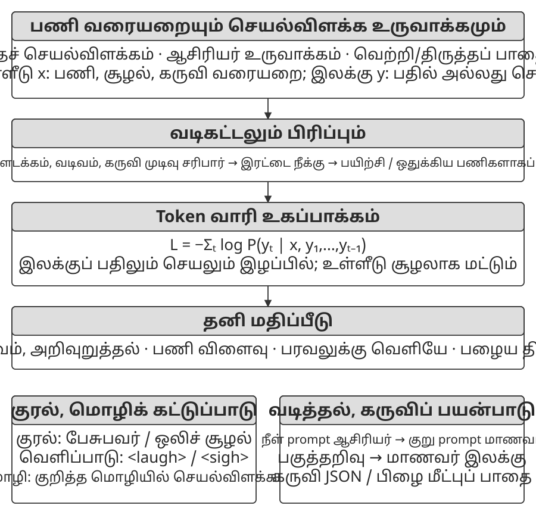

தரவு பொதுவாக மூன்று வழிகளில் வருகிறது: மனித நிபுணர்கள் முக்கிய நடத்தைகளையும் எல்லைகளையும் வரையறுக்கிறார்கள்; ஆசிரியர் மாதிரி தொகுதியாகச் செயல்விளக்கங்களை எழுதுகிறது; சரிபார்ப்பான் மாதிரியின் மாதிரியெடுப்புகளிலிருந்து செல்லுபடியான வெளியீடுகளை வடிகட்டுகிறது. மூன்றையும் இணைத்தும் பயன்படுத்தலாம். எடுத்துக்காட்டாக, முதலில் நிபுணர் சில கருவி அழைப்புச் செயல்விளக்கங்களை எழுதுகிறார், பின்னர் ஆசிரியர் மாதிரி பணி நிபந்தனைகளை மாற்றி மேலும் மாதிரிகளை உருவாக்குகிறது, இறுதியாக அளவுருக்கள், இயக்க முடிவுகள், வணிகக் கட்டுப்பாடுகள் ஆகியவை சரிபார்க்கப்படுகின்றன.

**ப்ராம்ப்ட்டிலும் Skill-இலும் திரும்பத் திரும்ப எழுதப்படும் வழிமுறைகளை மாதிரிக்குக் கற்பிப்பது SFT-இன் ஒரு பயன்.** அத்தியாயம் 7-இன் நினைவக மதிப்பீட்டை எடுத்துக்காட்டாகக் கொள்வோம்: மதிப்பீட்டுக் கையேடும் முன்மாதிரித் தீர்ப்புகளும் சேர்ந்து பத்தாயிரம் token நீளம் என்று வைத்துக்கொள்வோம். ஆசிரியர் மாதிரி முழுக் கையேட்டின் அடிப்படையில் ஒரு தொகுதிப் பதில்களுக்கு மதிப்பெண் வழங்கி, ஒரே பெயருள்ள நபர்கள், தலைகீழான உறவுகள், போதாத சான்றுகள் போன்ற சூழ்நிலைகளை எப்படிக் கையாள்வது என்று செய்து காட்டுகிறது. மாணவர் மாதிரியைப் பயிற்றுவிக்கும்போது, உள்ளீட்டில் சுருக்கமான மதிப்பீட்டு உருப்படிப் பெயர்கள், அந்த முறையின் வரலாற்றுப் பொருள், மதிப்பிட வேண்டிய பதில் ஆகியவை மட்டுமே இருக்கும்; இலக்கு வெளியீடு ஆசிரியர் தேர்ந்தெடுத்த நிலை. பயன்பாட்டுக்கு வந்த பிறகு, குறுகிய ப்ராம்ப்ட்டையும் அந்த முறையின் பொருளையும் வழங்கினால் போதும்; ஒவ்வொரு inference-இலும் அந்தப் பத்தாயிரம் token நிலையான விளக்கம் மிச்சமாகிறது. திரும்பத் திரும்ப அழைக்கப்படும் Skill-களுக்கும், எப்போது தகவலைத் தேடுவது, எந்தக் கருவியைத் தேர்ந்தெடுப்பது என்பதை இதே முறையில் செய்து காட்டி, இந்த நிலையான படிகளை மாதிரிக்குள் வடிக்கலாம் (distill).

தரவுத் தயாரிப்பில் முதலில் பணிப் பரவல், வெளியீட்டு schema, ஏற்பு முறை ஆகியவற்றைத் தீர்மானிக்க வேண்டும். செயல்விளக்கங்கள் சரிபார்ப்பைக் கடந்த பிறகு, நகல் நீக்கி, ஒவ்வொரு வகை மாதிரியின் விகிதத்தையும் சரிசெய்து, தரவுத் தொகுப்பைப் பிரியுங்கள். மாதிரிகளின் எண்ணிக்கையையும் பரப்பு வரம்பையும் சேர்த்தே வடிவமைக்க வேண்டும்: ஒரே கேள்வி முறையை ஆயிரக்கணக்கான முறை மீண்டும் செய்வது ஒரே வடிவத்தைத் திரும்பத் திரும்ப வலுப்படுத்தும்; முக்கிய நிபந்தனைகளைச் சுற்றி மாறுபாடுகளை உருவாக்கினால்தான், வெவ்வேறு உள்ளீடுகளில் பொருத்தமான நடத்தையைத் தேர்ந்தெடுக்க மாதிரிக்கு உதவும். ஆசிரியர் முதலில் முக்கியச் சூழ்நிலைகளை உள்ளடக்கிய ஒரு தொகுதிச் செயல்விளக்கங்களை நுணுக்கமாகச் செம்மைப்படுத்தி, பின்னர் அளவை விரிவாக்குகிறார். SFT இலக்கு வெளியீட்டை token token-ஆகக் கற்கிறது; தவறான உண்மைகள், தேவையற்ற படிகள், பொருத்தமற்ற செயல் பழக்கங்கள் ஆகியவையும் அதனுடன் சேர்ந்து அளவுருக்களுக்குள் நுழைகின்றன.

> **சோதனை 8-6 ★★★: குரல் SFT — குரல் நகலிலிருந்து துணைமொழி (paralinguistic) மாதிரியாக்கம் வரை `[விரிவாக்கச் சோதனை]`**
>
> Orpheus, Sesame CSM ஆகியவற்றை எடுத்துக்காட்டாகக் கொண்டு, பேசுபவர் நிபந்தனை, உரையாடல் சூழல், வெளிப்பாட்டுக் குறிகள் ஆகியவை குரல் உருவாக்கத்தில் எப்படிப் பங்கேற்கின்றன என்று ஒப்பிடுங்கள். Orpheus குரலை token-களாகக் குறிக்கிறது; குறிப்பு உரை—குரல் துண்டுகளைக் கொண்டு அதற்குரிய குரல்தன்மையை உருவாக்க முடியும்; `<laugh>`, `<sigh>` போன்ற வெளிப்பாட்டுக் குறிகளையும் வழங்குகிறது. Sesame CSM உரை, பேசுபவர் அடையாளம், ஏற்கெனவே உள்ள ஒலித் துண்டுகள் ஆகியவற்றைப் பெற்று, அடுத்த குரலை உருவாக்குகிறது.[^ch8-speech-conditioning]
>
> பயிற்சி மாதிரிகளை உருவாக்கும்போது, உரை, பேசுபவர், ஒலி, வெளிப்பாட்டு நிபந்தனைகள் ஆகியவற்றைத் தனித்தனியே பதிவு செய்யுங்கள்; ஒரே பேசுபவரின் வாக்கியங்களைக் கடந்த பொருளைக் கொண்டு ஒருமைப்பாட்டைக் கற்கவும், பல்வேறு சூழல்களில் உள்ள சிரிப்பு, பெருமூச்சு, இடைநிறுத்தம் ஆகியவற்றைக் கொண்டு வெளிப்பாட்டைக் கற்கவும் செய்யுங்கள். குறிப்பு இல்லாமல், குறிப்புடன், குறிப்பிட்ட வெளிப்பாட்டு நிபந்தனையுடன் ஆகிய நிலைகளில் வெளியீடுகளை ஒப்பிட்டு, துல்லியம், இயல்புத்தன்மை, உணர்ச்சி, குரல்தன்மை ஆகியவற்றின்படி மதிப்பெண் வழங்குங்கள்.
>
> தரவு போதுமான பேசுபவர்கள், வாக்கிய அமைப்புகள், உணர்ச்சிச் சேர்க்கைகள் ஆகியவற்றை உள்ளடக்க வேண்டும். பேசுபவர்கள் மிகக் குறைவாக இருந்தால், வெளியீடு ஒற்றைக் குரல்தன்மையை நோக்கிச் செல்லலாம்; ஒரு குறி எப்போதும் ஒரே ஒலித் துண்டுடன் பிணைந்திருந்தால், திரும்பத் திரும்ப வரும் இயந்திரத்தனமான வெளிப்பாடு தோன்றலாம்.

> **சோதனை 8-7 ★★★: பன்மொழிச் சிந்தனை — குறிப்பிட்ட மொழியில் பகுத்தறிவுச் செயல்முறையை உருவாக்குதல் `[விரிவாக்கச் சோதனை]`**
>
> gpt-oss-20b-இல் SFT செய்து, பகுத்தறிவுச் செயல்முறையின் மொழியை அறிவுறுத்தல் மூலம் குறிப்பிடுங்கள். எடுத்துக்காட்டாக, `reasoning language: German` ஜெர்மன் மொழியில் பகுத்தறிவு உரையை உருவாக்கக் கோருகிறது. பயிற்சி மாதிரிகளில் ஆங்கிலம், ஸ்பானிஷ், பிரெஞ்சு போன்ற மொழிகள் உள்ளன; சீன மொழி சோதனைக் கட்டத்துக்கென ஒதுக்கி வைக்கப்படுகிறது.
>
> துணை எடுத்துக்காட்டில், பயிற்சிக்குப் பிறகு Chinese எனக் குறிப்பிட்டால், மாதிரி சீன மொழியில் பகுத்தறிவுச் செயல்முறையை உருவாக்க முடிகிறது. மூன்று முடிவுகளை மேலும் ஒப்பிடலாம்: மொழித் தேவையைப் பின்பற்றுகிறதா, இறுதிப் பதில் சரியா, உருவாக்க நீளமும் நேரமும் எப்படி மாறுகின்றன. முன்-பயிற்சியின் பன்மொழி அடித்தளமும் SFT கற்ற கட்டுப்பாட்டு முறையும் சேர்ந்து இந்த மொழி-கடந்த செயல்திறனில் பங்கேற்கின்றன; வெவ்வேறு மொழிகளையும் அடிப்படை மாதிரிகளையும் ஒப்பிட்டு அவற்றின் பங்குகளை மேலும் பகுப்பாயலாம்.

> **சோதனை 8-8 ★★: Prompt வடித்தல் — குறைந்த செலவில் பயன்படுத்தக்கூடிய திறனை மீண்டும் உருவாக்குதல்**
>
> ஒரு நிலையான வணிகம் ஆயிரக்கணக்கான token கொண்ட கணினி ப்ராம்ப்ட்டைச் சார்ந்திருக்கலாம்; ஆசிரியர் மாதிரியும் நீண்ட பகுத்தறிவை உருவாக்கலாம். Prompt வடித்தல் முதலில் ஆசிரியரை முழு நிபந்தனைகளின் கீழ் உயர்தர வெளியீடுகளை உருவாக்க வைத்து, பின்னர் "பயனர் உள்ளீடு—இறுதிப் பதில்" என்பதை மாணவரின் SFT தரவாக அமைக்கிறது. மாணவர் குறுகிய ப்ராம்ப்ட்டைப் பயன்படுத்தி, இலக்கு அமைப்பின்படி நேரடியாகப் பதிலளிக்கிறார்.
>
> முதல் பயிற்சி மாதிரியைத் திறந்தாலே தெரியும்: Kimi K3 ஆசிரியர் லத்தீன் எழுத்துகள் கலந்த ஓர் அரபு உரையைப் படித்து, தீர்ப்பின் அடிப்படையை விளக்கி, இறுதியில் மொழிக் குறியீடு `ar`-ஐத் தருகிறது. SmolLM2-135M-Instruct மாணவருக்கு வழங்கப்படும் செயல்விளக்கத்தில் மூல உரையும் `ar`-உம் மட்டுமே உள்ளன. அதே 80 சோதனைப் பதிவுகளில், ஆசிரியர் பக்கம் ஒவ்வொரு கோரிக்கையிலும் சராசரியாகச் சுமார் 386 token-களைப் படிக்கிறது, மாணவர் பக்கம் சுமார் 97. இந்த இரண்டு எண்களும் அவரவர் பகுப்பான்களின்படி கணக்கிடப்பட்டவை.
>
> துணை மொழி அடையாள ஒப்பீட்டுப் பதிவுகளைக் கொண்டு "சரியான பதில்", "வடிவத்துக்கு இணங்கிய வெளியீடு" ஆகிய இரண்டையும் பிரித்துப் பார்க்கலாம். ஆசிரியர் 160 பயிற்சி மாதிரிகளில் செயல்விளக்கங்களை உருவாக்கியது; தனியாக 80 சோதனைப் பதிவுகளிலும் அனைத்தையும் சரியாகச் செய்தது. நுண்-சரிப்படுத்தப்படாத மாணவரின் ஒரு வெளியீட்டைக்கூட மதிப்பீட்டாளர் பகுக்க முடியவில்லை; மதிப்பெண் பூஜ்யம்; நுண்-சரிப்படுத்தலுக்குப் பிறகு 80-உம் பகுக்கப்பட்டன, 76 குறிச்சொற்கள் சரியாக இருந்தன. அடிப்படைக் கோட்டின் பூஜ்ய மதிப்பெண் மட்டும் "மொழியை அடையாளம் காணவில்லை" என்பதையும் "அடையாளம் கண்டும் வடிவத்தின்படி பதிலளிக்கவில்லை" என்பதையும் பிரித்தறிய முடியாது. இந்தச் சோதனையில் 75 வெவ்வேறு உரைகள் உள்ளன; பயிற்சிக்கும் சோதனைக்கும் இடையே முற்றிலும் ஒரே மாதிரியான உரை இல்லை.
>
> தரவு உருவாக்கத்தில், பணியை முடிக்க மாணவருக்குத் தேவையான நிபந்தனைகளையும் தக்கவைக்க வேண்டும். ஆசிரியர் சமீபத்திய கருவி முடிவுகளைச் சார்ந்திருந்தால், அந்த முடிவுகளை மாணவரின் உள்ளீடாக வழங்கலாம், அல்லது கருவி இடைமுகத்தைத் தொடர்ந்து வைத்திருக்கலாம்; ஆசிரியரிடம் முறையான பிழைகள் இருந்தால், சார்பற்ற சரிபார்ப்பு மூலம் வடிகட்டலாம்.
>
> தயாரிப்பு விதிகள் நிலையாகவும், உள்ளீட்டுப் பரவல் தெளிவாகவும், அழைப்புச் செலவு அதிகமாகவும் இருக்கும்போது, Prompt வடித்தலை முதலில் மதிப்பிட்டு, திரும்பத் திரும்பக் கையாளப்படும் ப்ராம்ப்ட்டையும் பகுத்தறிவையும் அளவுருக்களுக்குள் சுருக்குமாறு ஆசிரியர் பரிந்துரைக்கிறார். தயாரிப்பு இன்னும் ஆய்வு நிலையில் இருந்து, பணித் தேவைகள் அடிக்கடி மாறினால், திருத்தக்கூடிய ப்ராம்ப்ட்டையும் வெளிப்படையான பகுத்தறிவையும் தக்கவைப்பது, விரைவான சோதனைக்கும் பிழை கண்டறிதலுக்கும் வசதியானது.

> **சோதனை 8-9 ★★★: சிந்தனைச் சங்கிலி (Chain of Thought, CoT) வடித்தல்**
>
> CoT வடித்தல் ஆசிரியர் வழங்கும் பகுத்தறிவு உரையையும் இறுதிப் பதிலையும் சேர்த்து மேற்பார்வையாகக் கொண்டு, பிரித்தல், கணக்கிடுதல், சரிபார்த்தல், திருத்துதல் ஆகிய செயல்முறையை மாணவர் கற்கச் செய்கிறது. DeepSeek-R1, Qwen, Llama தொடர்களுக்குச் செய்த வடித்தல் இந்த முறையின் பிரதிநிதித்துவ எடுத்துக்காட்டு. தன்னாட்சியாகக் கட்டுப்படுத்தக்கூடிய மாதிரியை வைத்திருக்க விரும்பும், அதே நேரத்தில் பயிற்சி முதலீட்டைக் கட்டுக்குள் வைக்க விரும்பும் குழுக்களுக்கு, ஆசிரியர் இந்த வழியை முதலில் கருதுமாறு பரிந்துரைக்கிறார். இலக்குப் பணியில் ஆசிரியர் மாதிரி மாணவரைவிடத் தெளிவாக வலுவாக இருந்தால், மதிப்புள்ள செயல்விளக்கங்களை வழங்கும் நிலை உண்டு; முழுமையான பகுத்தறிவு வெளியீட்டைப் பெறக்கூடிய திறந்த-எடை (open-weight) மாதிரிகளிலிருந்து முதலில் தேர்ந்தெடுத்து, பின்னர் அதற்கும் மாணவருக்கும் இடையிலான திறன் இடைவெளியையும் தரவுத் தரத்தையும் ஒப்பிடலாம். இடைமுகம் பகுத்தறிவுச் சுருக்கத்தை மட்டுமே வழங்கினால், செயல்முறை வடித்தலுக்குப் பயன்படுத்தக்கூடிய தகவலும் அதற்கேற்பக் குறைகிறது.
>
> முதல் படி: ஒரே கேள்விக்கு ஆசிரியரைப் பல தீர்வுகளைத் தர வையுங்கள். கணிதக் கேள்விகளுக்கு முதலில் பதிலைச் சரிபாருங்கள்; குறியீட்டுக் கேள்விகளுக்குச் சோதனைகளை இயக்குங்கள்; சரிபார்ப்பைக் கடந்த தீர்வுகளை மட்டும் வைத்துக்கொள்ளுங்கள். இந்த வடிகட்டல் **நிராகரிப்பு மாதிரியெடுப்பு (Rejection Sampling)** எனப்படுகிறது. வடிகட்டிய தீர்வுகளைக் கொண்டு மேற்பார்வையிடப்பட்ட நுண்-சரிப்படுத்தல் செய்வது **நிராகரிப்பு மாதிரியெடுப்பு நுண்-சரிப்படுத்தல் (Rejection Sampling Fine-Tuning, RFT)** எனப்படுகிறது. மாணவர் பகுத்தறிவுச் செயல்முறையையும் கற்க வேண்டுமென்றால், இடைநிலைப் படிகளையும் சரிபார்த்து, தருவிப்பு தவறாக இருந்தும் தற்செயலாகச் சரியான பதில் வந்த செயல்விளக்கங்களை நீக்க வேண்டும்.
>
> நம்பகமான சரிபார்ப்பான் உள்ள பணிகளுக்கு, ஆசிரியர் முதலில் RFT அடிப்படைக் கோட்டை அமைக்குமாறு பரிந்துரைக்கிறார்: உருவாக்கம், வடிகட்டல், SFT ஆகியவையே ஒரு பயிற்சி நடைமுறையை உருவாக்குகின்றன; online உத்தி உகப்பாக்கம், மதிப்பு மதிப்பீடு ஆகியவற்றைச் செயல்படுத்தும் வேலை மிச்சமாகிறது; பின்னர் இதன் அடிப்படையில் RL-க்கான கூடுதல் முதலீடு தகுமா என்று தீர்மானிக்கலாம்.
>
> இரண்டாம் படி: மாணவரைப் பயிற்றுவியுங்கள். தேர்ந்தெடுத்த மாதிரியின் உரையாடல் வடிவத்தின்படி "கேள்வி→பகுத்தறிவு உரை + இறுதிப் பதில்" என்று ஒழுங்கமையுங்கள்; `<think>`, `</think>` போன்ற எல்லைகளைப் பயன்படுத்தும்போது, எந்த token-கள் இழப்பில் பங்கேற்கின்றன என்பதைத் தெளிவாக்குங்கள். 7B அளவிலான மாணவரிலிருந்து தொடங்கி, முழுப் பாதை, சுருக்கிய பாதை, இறுதிப் பதிலை மட்டும் மேற்பார்வையிடும் அமைப்பு ஆகியவற்றை ஒப்பிடலாம்.
>
> மூன்றாம் படி: மாணவர் என்ன கற்றார் என்று பாருங்கள். துணைச் சோதனை Kimi K3-ஐ 24 AIME கணிதக் கேள்விகளைத் தீர்க்க வைத்து, சரியாகத் தீர்த்த 23 பகுத்தறிவுப் பாதைகளைத் தக்கவைத்து, அவற்றைக் கொண்டு Qwen2.5-1.5B-Instruct-ஐ நுண்-சரிப்படுத்தியது. அதே கேள்வித் தொகுப்பை மீண்டும் செய்தபோது, மாணவர் 1 கேள்வியிலிருந்து 2 கேள்விகளுக்குச் சரியாகப் பதிலளிக்கும் நிலைக்கு மாறினார்; ஆசிரியர் 23 கேள்விகளுக்குச் சரியாகப் பதிலளித்தது. பயிற்சிக்குப் பிறகு மாணவர் சில நேரங்களில் திரும்பிச் சென்று கணக்கைச் சரிபார்த்தார்; ஆனால் கேள்வி-வாரியான இணை சோதனை (paired test) நம்பகமான சரிவீத உயர்வைக் காட்டவில்லை ($p=1.0$).

> **புத்தக உருவாக்க நடைமுறை: வடித்தல் சோதனையின் மேம்பாட்டுச் செயல்முறை**
>
> ஆசிரியர் முதலில் GPT-5.6-Sol இயக்கும் Codex மூலம் வடித்தல் சோதனையைச் செயல்படுத்த முயன்றார்; மறுப்பைச் சந்தித்த பிறகு Claude Opus 5 இயக்கும் Claude Code-க்கு மாறினார்; அதிலும் தொடர முடியவில்லை. அதன் பின்னர் Kimi K3 மூலம் குறியீட்டையும் இயக்கத்தையும் முடித்தார்.

இந்த நான்கு எடுத்துக்காட்டுகளும் மேற்பார்வையிடப்பட்ட கற்றலையே பயன்படுத்துகின்றன, ஆனால் ஒவ்வொன்றும் வெவ்வேறு உள்ளடக்கத்தைக் கற்கின்றன: குரலில் குரல்தன்மையும் வெளிப்பாட்டு நிபந்தனைகளும், பன்மொழிப் பகுத்தறிவில் மொழிக் கட்டுப்பாடு, Prompt வடித்தலில் நேரடிப் பதில், CoT வடித்தலில் கணக்குத் தீர்க்கும் செயல்முறை.

## SFT தரவுத் தொகுப்பாக்கம்: செயல்விளக்கத்திலிருந்து பயிற்றுவிக்கக்கூடிய பாதை வரை

ஓர் உண்மையான புகாரிலிருந்து ஒரு தொகுதிப் பயிற்சிக் கேள்விகளை உருவாக்க வேண்டுமென்றால், எந்தத் தகவல்களை மாற்றலாம், எந்த உறவுகளைக் கட்டாயம் தக்கவைக்க வேண்டும்? உற்பத்திப் (production) பாதைகளிலிருந்து பயனர் நோக்கம், தொடக்க நிலை, கிடைக்கும் கருவிகள், வணிகக் கட்டுப்பாடுகள், பொதுவான தோல்விகள் ஆகியவற்றைப் பிரித்தெடுத்து, பணி வார்ப்புருக்களாக (templates) ஒழுங்கமையுங்கள். அடையாளம், ஆர்டர், கோப்பு, சான்றுகள் (credentials) ஆகியவற்றை மாற்ற வேண்டும்; மூலக் கேள்வியில் ஒத்த இரண்டு ஆர்டர்கள் இருந்தால், நிகழ்வை (instance) உருவாக்கும்போதும் இந்தப் பிரித்தறிய வேண்டிய உறவைத் தக்கவைக்க வேண்டும். நிகழ்வை மீட்டமைக்கக்கூடிய (resettable) சூழலில் இயக்கினால்தான், புதிய கேள்வி உண்மையில் பழைய கடினப் புள்ளியைத் தக்கவைத்திருக்கிறதா என்று தெரியும்.

ஒரு முழு நடைமுறை: **உற்பத்தி எடுத்துக்காட்டு→பணி வார்ப்புரு→தொகுக்கப்பட்ட நிகழ்வு→பல வேட்புப் பாதைகள்→பணி மற்றும் பாதைச் சரிபார்ப்பு→பயிற்சித் தரவு**. இதில் இரண்டு வகைச் சரிபார்ப்புகள் வெவ்வேறு சிக்கல்களுக்குப் பொறுப்பேற்கின்றன: பணிச் சரிபார்ப்பு நிபந்தனைகள் போதுமானவையா, இலக்கை அடைய முடியுமா, குறிப்பு முடிவு சரியானதா என்று சரிபார்க்கிறது; பாதைச் சரிபார்ப்பு, பணி முடியும்போதைய நிலை, கருவி அழைப்பு வரிசை, இயக்கச் செயல்முறை வணிகக் கட்டுப்பாடுகளுக்கு இணங்குகிறதா என்பதை ஒவ்வொன்றாகச் சரிபார்க்கிறது.

இயக்கக்கூடிய நிபந்தனைகளுக்குச் சோதனைகள், தரவுத்தள உறுதிப்படுத்தல்கள் (assertions) அல்லது நிலை வேறுபாட்டுச் சரிபார்ப்புகள் பயன்படுத்தப்படுகின்றன; திறந்த தொடர்புத் தரத்துக்கு Rubric-உம் மாதிரி மதிப்பீடும் பயன்படுத்தப்பட்டு, மனித மாதிரிச் சோதனை மூலம் அளவுதிருத்தம் (calibration) செய்யப்படுகிறது. திறன் வரைபடம், இயக்கக்கூடிய சூழல், சார்பற்ற சரிபார்ப்பான் ஆகியவற்றை மேலும் இணைத்தால், பணிப் பரப்பைத் திட்டமிட்டு விரிவாக்கலாம்.[^ch8-12][^ch8-17][^ch8-18][^ch8-19][^ch8-20]

தகுதியான செயல்விளக்கம் சுமுகமாக முடிந்த பாதையாகவும் இருக்கலாம், கண்டறிதலும் சரிசெய்தலும் அடங்கிய முழுச் செயல்முறையாகவும் இருக்கலாம். அதில் உள்ள தவறான செயல்களுக்கு, மாதிரியில் அதன் பங்கைத் தெளிவாக்கி, பயிற்சி இலக்கின்படி இழப்பு இடங்களைத் தேர்ந்தெடுக்க வேண்டும். தோல்விப் பதிவுகளை விருப்ப ஜோடிகளை உருவாக்கவும், பரப்பு இடைவெளிகளைக் கண்டறியவும், மீட்சிப் பணிகளை உருவாக்கவும் பயன்படுத்தலாம். பின்னர் RL-க்குள் நுழையும்போது, தற்போதைய உத்தி பாதைகளை மீண்டும் மாதிரியெடுத்து, சூழல் பின்னூட்டத்தைக் கொண்டு புதுப்பிக்கிறது.

பயிற்சித் தொகுப்பையும் மதிப்பீட்டுத் தொகுப்பையும் இலக்கின்படி தனிமைப்படுத்தும் முறையைத் தேர்ந்தெடுக்க வேண்டும்: ஒரே பரவல் மதிப்பீட்டில் குறிப்பிட்ட நிகழ்வுகளைத் தனிமைப்படுத்தலாம்; இடமாற்ற (transfer) மதிப்பீட்டில் பணி வார்ப்புருக்கள், வாடிக்கையாளர் குழுக்கள் அல்லது காலப்பகுதிகளையும் தனிமைப்படுத்தலாம். நகல் நீக்கும்போது உள்ளீடுகளிலும் தீர்வுகளிலும் உள்ள ஏறக்குறைய நகல்களைச் சரிபாருங்கள்; குறிப்புப் பதில்கள், மறைந்த சோதனைகள், மதிப்பீட்டுக்கு மட்டுமே பயன்படும் தகவல்கள் ஆகியவை பணி நெறிமுறையின்படி சரிபார்ப்புப் பக்கத்திலேயே இருக்க வேண்டும்.

நுண்-சரிப்படுத்தல் முடிந்த பிறகு, எடைகளிலிருந்து பயிற்சிப் பொருளை மீண்டும் சரிபார்க்க முடியுமா? பொதுவில் வெளியிடப்பட்ட பகுத்தறிவு மாதிரி s1-ஐ எடுத்துக்காட்டாகக் கொள்வோம். பயிற்சியின்போது பயன்படுத்திய பகுப்பு மற்றும் உரைச் செயலாக்க முறையின்படி, பொது மாதிரிகளை token எண்களாக மாற்றி நகல் நீக்கினால், ஒரு பட்டியல் கிடைக்கும். பின்னர் நுண்-சரிப்படுத்தலுக்கு முன்னும் பின்னும் உள்ள உள்ளீட்டு embedding அணியை வரிசை வரிசையாக ஒப்பிட்டு, எந்த token-களுக்குரிய திசையன்கள் மாறின என்று பதிவு செய்யுங்கள். ஆசிரியர் சரிபார்த்தபோது, இரண்டு பட்டியல்களிலும் உள்ள 16,573 எண்களும் ஒவ்வொன்றாகப் பொருந்தின. இந்தச் சரிபார்ப்புக்குச் சரியான அடிப்படை மாதிரியையும் பகுப்பானையும் கண்டுபிடிக்க வேண்டும்; பயிற்சி அமைப்பின்படி கணினி ப்ராம்ப்ட்டைச் சேர்த்து, நீண்ட மாதிரிகளை வெட்ட வேண்டும்; பயிற்சி உண்மையில் உள்ளீட்டு embedding-ஐப் புதுப்பிக்கிறதா, உள்ளீட்டு embedding-உம் வெளியீட்டு அடுக்கு எடைகளும் தனித்தனியானவையா என்பதையும் உறுதிப்படுத்த வேண்டும். எடுத்துக்காட்டாக, கவன அடுக்குகளில் மட்டும் LoRA பயிற்றுவிக்கப்பட்டால், உள்ளீட்டு embedding அப்படியே இருக்கும்; அதைக் கொண்டு பயன்படுத்தப்பட்ட token-களைப் பட்டியலிட முடியாது.[^ch8-token-provenance]

மூன்று token-களைக் கொண்டு சான்றின் எல்லையைத் தெளிவாகக் காணலாம். இரண்டு பொது மாதிரிகள் பகுப்புக்குப் பிறகு முறையே `[10, 20]`, `[20, 30]` என்று வைத்துக்கொள்வோம்; நகல் நீக்கினால் `{10, 20, 30}` கிடைக்கும். இப்போது கூடுதலாக `[30, 10]` என்ற ஒன்றைச் சேர்த்து மீண்டும் கணக்கிட்டால், தொகுப்பு முற்றிலும் அதேதான். மீள்சரிபார்ப்பில் ஒவ்வொரு எண்ணும் பொருந்தினாலும், மூன்றாவது மாதிரி பயன்படுத்தப்பட்டதா என்று இதைக் கொண்டு தீர்மானிக்க முடியாது; ஏதாவது ஒரு மதிப்பீட்டுக் கேள்வி பயிற்சித் தொகுப்பில் கலந்துவிட்டதா என்பதையும் விலக்க முடியாது.

[^ch8-token-provenance]: Bojie Li-இன் training-forensics திட்டம் s1 போன்ற மாதிரிகளின் token தொகுப்புகளையும் முன்செயலாக்க நிபந்தனைகளையும் பதிவு செய்து, embedding எடைப் பகிர்வும் LoRA-வும் ஒப்பீட்டு முறையில் ஏற்படுத்தும் தாக்கத்தையும் விவாதிக்கிறது.

அத்தியாயம் 7-இன் "முன்கூட்டியே முடித்தல்" எடுத்துக்காட்டை எடுத்துக்கொள்வோம்: பணி முடிந்ததாக அறிவிக்கத் தயாராகும் கணத்தில் முன்னொட்டை (prefix) வெட்டி எடுத்து, சரிபார்க்கப்படாத நிறைவு அறிவிப்பை `rejected` என்றும், மீதமுள்ள இலக்குகளைச் சரிபார்த்து, தொடர்புடைய சோதனைகளை இயக்கிய பிறகு பதிலளிக்கும் தொடர் நடத்தையை `chosen` என்றும் குறியுங்கள். விருப்ப ஜோடிகளை DPO-க்குப் பயன்படுத்தலாம்; அவற்றில் சரிபார்ப்பைக் கடந்த தொடர் நடத்தையைத் தனியாக SFT செயல்விளக்கமாகவும் பயன்படுத்தலாம்.

பின்னர் வரும் சீன வளைந்த மேற்கோள்குறி, சிறப்புச் சரம் (special string) சோதனைகள் மேற்பார்வை இலக்கை எப்படித் தீர்மானிப்பது என்பதை மேலும் விளக்குகின்றன. சீன வளைந்த மேற்கோள்குறிப் பணி ஆவண வரம்பிலிருந்து தொடங்கி, இலக்கு உரைப் பகுதியைத் திருத்தி, குறியீடு, மேற்கோள்கள், JSON ஆகியவற்றைப் பாதுகாக்கக் கோருகிறது; சிறப்புச் சரப் பணி கருவி அளவுருக்களில் `old_string` பைட் அளவில் ஒத்திருக்கக் கோருகிறது. முதலாவது திருத்த வரம்பையும் ஆவண இலக்கணத்தையும் சரிபார்க்கிறது; இரண்டாவது துல்லியமான நகலெடுப்பையும் உண்மையான கருவிப் பொருத்தத்தையும் சரிபார்க்கிறது. பொதுவான தோல்விக் காரணப் பகுப்பாய்வு நடைமுறை வெவ்வேறு பயிற்சி இலக்குகளைத் தரக்கூடும்.

## Mid-training, SFT, RL ஆகியவற்றை எப்போது தேர்ந்தெடுப்பது

கருவியின் உள்ளீட்டு வடிவத்தையே மாதிரியால் சரியாக எழுத முடியவில்லை என்றால், இப்போதே அதைத் திரும்பத் திரும்ப முயன்று பிழை செய்ய விட்டால், எத்தனை அழைப்புகள் உண்மையில் இயங்கும்? படம் 8-11-ஐப் பின்பற்றி முதலில் அது எந்தப் படியில் சிக்கிக்கொள்கிறது என்று கண்டறிந்து, அட்டவணை 8-4-இன்படி பயிற்சிப் பொருளையும் பின்னூட்ட முறையையும் தேர்ந்தெடுக்கலாம்.

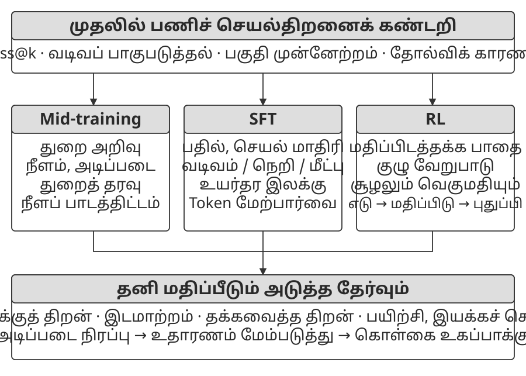

அட்டவணை 8-4 Mid-training, SFT, RL தேர்வு வழிகாட்டுதல்கள்

| கவனிக்கப்பட்ட நிகழ்வு | முதலில் சரிபார்க்க வேண்டியவை | வேட்பு முறைகள் | பின்தொடர் மதிப்பீட்டுக் கவனம் |
| --- | --- | --- | --- |
| துறை மொழி, கருத்துகள் அல்லது அடிப்படைச் செயல்பாடுகள் பலவீனம்; பலமுறை மாதிரியெடுத்தும் முன்னேற்றம் குறைவு | corpus பரப்பும் அடிப்படைத் திறனும் | Mid-training; தேடக்கூடிய உண்மைகளுக்கு RAG இணைப்பு | துறைப் பணிகள், பொதுத் திறனைச் சோதிக்கும் சோதனைத் தொகுப்பு, பகுதியளவு சரியான பாதைகள் |
| உள்ளடக்கம் பயன்படுத்தக்கூடியது; வடிவம், அளவுருக்கள் அல்லது நிலையான நடைமுறை நிலையற்றது | செயல்விளக்கங்கள், இடைமுகம், கட்டுப்பாடுகள் | SFT, கட்டுப்படுத்தப்பட்ட குறியாக்க-நீக்கம் (constrained decoding) அல்லது கருவிச் சரிபார்ப்பு | பகுப்பு வெற்றி, பணி முடிவு, மீட்சி நடத்தை |
| எப்போதாவது பணியை முடிக்க முடிகிறது, ஆனால் வெற்றி வீதம் குறைவு அல்லது அடிக்கடி சுற்றுவழியில் செல்கிறது | வெகுமதித் தரம், தேடல், பணிப் பரவல் | RL | பணிப் பலன், வெகுமதி வேறுபாடு, சார்பற்ற பொதுமைப்படுத்தல், செலவு |
| செயல்விளக்க அல்லது விருப்பத் தரவு உள்ளது, ஊடாடல் சூழல் இன்னும் அமைக்கப்படவில்லை | offline தரவுப் பரப்பும் சரிபார்ப்பு முறையும் | SFT, RFT, offline விருப்ப உகப்பாக்கம் | அடிப்படைக் கோட்டுத் தரம், தரவுச் சார்புநிலை (bias), சூழல் கட்டமைப்பின் பலன் |

இதை நான்கு படிகளில் முன்னெடுக்கலாம். முதலில் Prompt, சூழல், கருவிகள், கட்டுப்பாடுகள் ஆகியவற்றைக் கொண்ட திட்டத்தின் அடிப்படைக் கோட்டை அமையுங்கள். இந்த முறைகளே பணித் தேவைகளை நிறைவு செய்தால், ஆசிரியர் வெளியே திருத்தக்கூடிய திட்டத்தையே முதலில் தக்கவைத்து, பயிற்சி, பயன்பாட்டுக்கு அனுப்புதல் (deployment), பின்னடைவுச் சோதனை ஆகியவற்றின் பராமரிப்புச் செலவைக் குறைக்கிறார். மாறும் உண்மைகள் தேடல் மற்றும் பதிப்பு மேலாண்மை மூலம் வழங்கப்படுகின்றன; திரும்பத் திரும்பக் கற்க வேண்டிய மறைமுகத் தீர்ப்புகள், புலனுணர்வு முறைகள், நிலையான நடத்தைகள் ஆகியவற்றுக்கு மட்டுமே அளவுருப் பயிற்சி மூலம் மேம்படுத்துவதைக் கருதலாம்.

இரண்டாம் படி: ஒதுக்கி வைத்த பணிகளில் வெற்றி, பகுதி முன்னேற்றம், பகுப்பு முடிவுகள், பிழை வகைகள் ஆகியவற்றைக் கவனியுங்கள். மாதிரியெடுப்பு அமைப்பு நிலைப்படுத்தப்பட்ட பிறகு, தற்போதைய உத்தியிடம் ஏற்கெனவே பயன்படுத்தக்கூடிய பாதைகள் உள்ளனவா என்பதை Pass@1, Pass@k காட்டுகின்றன; அறிவுப் பற்றாக்குறை, பின்னூட்டம் இல்லாமை, நடைமுறைப் பிழை ஆகியவற்றைப் பிரித்தறியத் தோல்விப் பாதைகள் உதவுகின்றன.

மூன்றாம் படி: கற்க வேண்டிய நடத்தைகளுக்குச் செயல்விளக்கங்களை வழங்குங்கள். JSON schema, கருவி அழைப்பு, சொற்பயன்பாடு, தெளிவுபடுத்தல், மீட்சி ஆகிய அனைத்தையும் SFT மாதிரிகளாக எழுதலாம்; தேவையான அறிவை அதற்குரிய corpus மற்றும் பணிச் சூழல் மூலம் வழங்கலாம்.

நான்காம் படி: RL-க்கான பின்னூட்ட நிபந்தனைகளை மதிப்பிடுங்கள். மதிப்பெண் வழங்கக்கூடிய வேட்புகளை உருவாக்க முடிந்தால், வெகுமதி பிரித்தறியும் தன்மை கொண்டிருந்தால், சூழல் போதுமான ஊடாடலை அனுமதித்தால், உத்தி உகப்பாக்கத்தின் பலனை ஒப்பிடலாம்; வெகுமதி மிகவும் அரிதாக (sparse) இருந்தால், முதலில் பாடத்திட்டம், பகுதி வெகுமதி அல்லது பொருத்தமான தொடக்க உத்தியைக் கருதுங்கள்.

ஒவ்வொரு படியிலும் மதிப்பீட்டு முடிவுகளே அடுத்த முதலீட்டைத் தீர்மானிக்கின்றன: வடிவம் தெளிவான பணிகள் SFT முடிந்ததும் பயன்பாட்டுக்கு அனுப்பப்படலாம்; வலுவான தொடக்கப் புள்ளி நேரடியாக RL செய்யலாம்; துறைத் தொடர் பயிற்சிக்குப் பிறகும் ஏற்கெனவே உள்ள அறிவுறுத்தல் திறனை மீண்டும் பயன்படுத்தலாம். அடுத்து, ஒற்றைச்-சுற்றுப் பணிகள் மூலம் செயல்விளக்கக் கற்றலும் வெகுமதிக் கற்றலும் உருவாக்கும் நடத்தை வேறுபாடுகளை உறுதியாகக் கவனிப்போம்.

வாசிப்பு வழிகாட்டியில் உள்ள ஆர்டர் சிக்கலுக்குத் திரும்புவோம். அதே உண்மையான கருவி விளக்கத்தை நேரடியாக மாதிரியிடம் கொடுத்து, அது அளவுருக்களைச் சரியாக எழுதுகிறதா என்று கவனியுங்கள். விளக்கத்தில் உள்ள புலங்கள் மாறியிருந்தால், முதலில் இயக்க நேரத்தில் பார்க்கக்கூடிய விளக்கத்தைப் புதுப்பியுங்கள். புலங்களின் பொருள் தெளிவாக இருந்தும், மாதிரி திரும்பத் திரும்பப் பயனர் உரையை ஆர்டர் எண் இடத்தில் நிரப்பினால், விசாரணை, தெளிவுபடுத்தல், சரியான அளவுரு நிரப்பல் ஆகியவை அடங்கிய SFT செயல்விளக்கங்களை வழங்கலாம். அது ஏற்கெனவே எப்போதாவது முழுமையாகப் பணியை முடிக்க முடிந்து, வெவ்வேறு விசாரணை வரிசைகள் வெவ்வேறு வெற்றி வீதங்களையும் செலவுகளையும் தருமானால், பல உத்திப் பாதைகளை ஒப்பிடுவதற்கான நிபந்தனை உருவாகிவிட்டது.

## ஒற்றைச்-சுற்று வலுவூட்டல் கற்றல்: நினைவும் பொதுமைப்படுத்தலும் — ஓர் ஒப்பீடு

ஒற்றைச்-சுற்றுப் பணி ஒரே ஓர் உள்ளீட்டுடன் தொடங்கி, மாதிரி பதிலைச் சமர்ப்பித்து வெகுமதி பெறுவதுடன் முடிகிறது. பதிலை உருவாக்கும்போது மாதிரி இன்னும் பல-படிப் பகுத்தறிவைச் செய்யலாம்; பயிற்சி அமைப்பும் ஒரே கேள்வியை அது திரும்பத் திரும்ப முயல அனுமதிக்கலாம். ஊடாடலை ஒரே பதிலுக்குள் கட்டுப்படுத்துவது, பயிற்சி முறைகள் மாதிரியின் நடத்தையை எப்படி மாற்றுகின்றன என்பதைக் கவனிக்க வசதியாக்குகிறது. அடுத்து, முதலில் AdaptThink மூலம் மாதிரி பகுத்தறிவுச் செலவு வரம்பைப் பங்கிட எப்படிக் கற்கிறது என்பதை விளக்கி, பின்னர் GeneralPoints மூலம் விதிகளும் காட்சித் தோற்றமும் மாறும்போது SFT, RL ஆகியவற்றின் செயல்திறனை ஒப்பிடுவோம்.

வெகுமதியைக் கொண்டு RL வழிமுறைகள் மாதிரியை எப்படிப் புதுப்பிக்கின்றன என்பதை முதலில் புரிந்துகொண்டால், அடுத்தடுத்த சோதனைகளின் பயிற்சிச் செயல்முறையைப் படிக்க முடியும். இந்த அத்தியாயத்தின் RL பயிற்சி பெரும்பாலும் **உத்திச் சாய்வு (policy gradient)** அடிப்படையிலானது. ஒரே கேள்விக்குப் பலமுறை மாதிரியெடுப்பதை எடுத்துக்காட்டாகக் கொள்வோம்: மாதிரியைச் சில பதில்களை உருவாக்க வைத்து, ஒவ்வொரு பதிலின் வெகுமதியையும் ஓர் அடிப்படைக் கோட்டுடன் ஒப்பிடுகிறோம். அடிப்படைக் கோட்டைவிடச் சிறந்த பதில்கள் நேர்மறைச் சமிக்ஞை பெறுகின்றன; பயிற்சி அவற்றின் உருவாக்க நிகழ்தகவை உயர்த்துகிறது; அடிப்படைக் கோட்டைவிடக் குறைந்த பதில்கள் எதிர்மறைச் சமிக்ஞை பெறுகின்றன; அவற்றின் உருவாக்க நிகழ்தகவு அதற்கேற்பக் குறைகிறது.

ஒற்றைப் புதுப்பிப்பு மாதிரியைத் தவறான திசையில் இழுத்துச் செல்வதைத் தடுக்க, முதன்மையான **PPO** வழிமுறை, நிகழ்தகவு விகிதம் குறிப்பிட்ட இடைவெளியைத் தாண்டும்போது பதிலி இலக்கில் (surrogate objective) உள்ள கூடுதல் பலனை வெட்டிவிடுகிறது; உண்மையான புதுப்பிப்பு அளவு கற்றல் வீதத்தையும் புதுப்பிப்புச் சுற்றுகளையும் பொறுத்தது. பின்னர் வரும் "மதிப்பு வலையமைப்புடன் கூடிய PPO" ஒரு மதிப்பு மதிப்பீட்டைக் கற்று, அதைக் கொண்டு ஒப்பீட்டு அடிப்படைக் கோட்டை அமைத்து, ஒவ்வொரு படிச் செயலின் சாதகத்தையும் கணக்கிடுகிறது. **GRPO** ஒரே கேள்விக்கான பல பதில்களை நேரடியாக ஒப்பிட்டு, குழு-உள் வெகுமதிகளைக் கொண்டு அடிப்படைக் கோட்டை உருவாக்குகிறது; இதனால் தனியாகப் பயிற்றுவிக்கப்படும் மதிப்பு வலையமைப்பு தேவையில்லை.

கீழே உள்ள Python பாணிப் போலிக் குறியீடு மாதிரியெடுப்பு, வெகுமதி, சாதகம், அளவுருப் புதுப்பிப்பு ஆகியவற்றை இணைத்து, ஒவ்வொரு படியும் தகவலை எப்படிக் கடத்துகிறது என்பதைப் புரிந்துகொள்ள உதவுகிறது. உண்மையான பயிற்சியில் மாதிரியெடுப்பு இணைச்செயலாக்கம், KL முறைப்படுத்தல், உகப்பாக்கி ஆகியவற்றையும் அமைக்க வேண்டும்.

```python
for prompt in batch:
    group = [rollout(policy, env.reset(prompt)) for _ in range(G)]
    rewards = [verify(trajectory) for trajectory in group]
    advantages = normalize_within_group(rewards)       # GRPO baseline
    update(policy, group, advantages)
```

நீளம் வேறுபடும் ஒரு தொகுதிப் பாதைகளைக் கொண்டு PPO உத்தியை எப்படிப் புதுப்பிக்கிறது? முதலில் ஒவ்வொரு பாதைக்குள்ளும், பின்னிருந்து முன்னோக்கி ஒவ்வொரு படியின் தள்ளுபடி வருவாயைக் கணக்கிடுங்கள். அடுத்த கேள்வியின் வெகுமதி சேர்ந்துவிடாமல் இருக்க, பாதை முடிந்ததும் கூட்டுவதை நிறுத்துங்கள். பின்னர் அனைத்துப் பாதைகளிலும் மாதிரி உண்மையில் தேர்ந்தெடுத்த செயல்களை ஒன்றாக வைத்து, இந்தத் தொகுதிச் செயல்களின் சராசரி இழப்பைக் கணக்கிடுங்கள். கீழே ஒரு புதுப்பிப்பு எழுதப்பட்டுள்ளது; பல-சுற்று சிறு-தொகுதி (mini-batch) உகப்பாக்கம் தவிர்க்கப்பட்டுள்ளது.[^ch8-ppo-method]

```python
states, actions, returns = [], [], []
for trajectory in rollouts:
    states.extend(trajectory.states)       # 每次选择动作之前的状态
    actions.extend(trajectory.actions)     # 与状态逐项对应
    returns.extend(discounted_returns(trajectory.rewards))

returns = tensor(returns)
values = value_model(states)
advantages = returns - stop_gradient(values)
ratio = exp(policy.log_prob(actions, given=states)
            - old_policy.log_prob(actions, given=states))
policy_loss = -mean(min(
    ratio * advantages,
    clip(ratio, 1 - epsilon, 1 + epsilon) * advantages
))
value_loss = mean((values - returns) ** 2)
update(policy, value_model, policy_loss + value_coef * value_loss)
```

GRPO-வின் "ஒப்பீடு" ஒரே கேள்விக்கான பல பதில்களிலிருந்து வருகிறது; இங்குள்ள PPO-வோ மதிப்பு வலையமைப்பைக் கொண்டு ஒவ்வொரு நிலையின் எதிர்பார்க்கப்படும் வருவாயை மதிப்பிடுகிறது. `old_policy` என்பது இந்தத் தொகுதிப் பாதைகளை உருவாக்கியபோது உறையவைக்கப்பட்ட உத்தி. ஒரு படிச் செயலின் சாதகம் 1 என்றும், தற்போதைய உத்தி அதற்கு வழங்கும் நிகழ்தகவு மாதிரியெடுத்தபோது இருந்ததைவிட 1.4 மடங்கு என்றும் வைத்துக்கொள்வோம்; `epsilon = 0.2` எனக் கொண்டால், பதிலி இலக்கில் அந்த உறுப்பின் பங்களிப்பு `min(1.4, 1.2) = 1.2`. இந்தச் செயலின் நிகழ்தகவை மேலும் உயர்த்தினாலும், இந்த உறுப்பிலிருந்து கூடுதல் பலன் கிடைக்காது.

சாதகம் −1 என்றால், திசை தலைகீழாகிறது. நிகழ்தகவு விகிதம் ஏற்கெனவே 0.6-க்குக் குறைந்துவிட்டால், அதே குறியீட்டு வரியில் பொருத்தினால் `min(-0.6, -0.8) = -0.8` கிடைக்கிறது; நிகழ்தகவை மேலும் குறைத்தாலும் கூடுதல் பலன் கிடைக்காது. மறுபுறம், மோசமாகச் செயல்பட்ட இந்தச் செயல் மாறாக அடிக்கடி தோன்றத் தொடங்கி, நிகழ்தகவு விகிதம் 1.4-க்கு உயர்ந்தால், சிறிய மதிப்பை எடுக்கும்போது `min(-1.4, -1.2) = -1.4` கிடைக்கிறது; அதன் நிகழ்தகவை உயர்த்துவதற்கு இன்னும் விலை கொடுக்க வேண்டும்.

> **சோதனை 8-10 ★★: AdaptThink — "எப்போது சிந்திக்கக் கூடாது" என்று கற்றல்**
>
> பகுத்தறிவு மாதிரிகள் பெரும்பாலும் நீண்ட பகுத்தறிவுச் செயல்முறையைக் கொண்டு சிக்கல்களைத் தீர்க்கின்றன. எளிய கேள்விகளுக்கு, நேரடியாகப் பதிலளிப்பது உருவாக்கச் செலவைச் சேமிக்கும். AdaptThink மாதிரிக்கு Thinking, NoThinking என்ற இரண்டு முறைகளை வழங்குகிறது: இந்த நெறிமுறையை ஆதரிக்கும் மாதிரிகளில், NoThinking `<think></think>` மூலம் பகுத்தறிவுப் பகுதியை முடித்து, பின்னர் நேரடியாகப் பதிலை உருவாக்குகிறது. பணிக்கேற்பப் பொருத்தமான பகுத்தறிவுச் செலவு வரம்பைத் தேர்ந்தெடுக்க மாதிரியைப் பழக்குவதே பயிற்சியின் இலக்கு.
>
> இந்த முறையில் இரண்டு மையக் கூறுகள் உள்ளன. **கட்டுப்படுத்தப்பட்ட உகப்பாக்க இலக்கு** ஒட்டுமொத்தப் பதில் செயல்திறனைத் தக்கவைத்துக்கொண்டே NoThinking பயன்பாட்டு விகிதத்தை அதிகரிக்க மாதிரியை ஊக்குவிக்கிறது; **முக்கியத்துவ மாதிரியெடுப்பு (importance sampling)** இரண்டு முறைகளின் மாதிரியெடுப்பு விகிதத்தைச் சரிசெய்து, எடைகள் மூலம் மாதிரியெடுப்புப் பரவலுக்கும் உகப்பாக்க இலக்குக்கும் இடையிலான வேறுபாட்டைத் திருத்துகிறது. தொடக்க மாதிரி பெரும்பாலும் Thinking பக்கமே சாய்ந்திருக்கும்; NoThinking மாதிரிகளை வேண்டுமென்றே அதிகரித்தால்தான், இரண்டு முறைகளையும் ஒப்பிடும் சமிக்ஞையைப் பயிற்சி பெற முடியும். இங்குள்ள cold-start சிக்கல் என்பது, பயிற்சியின் தொடக்கத்தில் NoThinking மாதிரிகள் போதாமையைக் குறிப்பாகக் குறிக்கிறது.
>
> இந்தப் புத்தகத்தின் சோதனை 8 H100 80GB GPU-களைப் பயன்படுத்துகிறது. பயிற்சி 300-ஆவது படியை அடைந்தபோது, MATH500 துல்லியம் 81.00%-இலிருந்து 81.80% ஆக மாறியது, சராசரிப் பதில் நீளம் சுமார் 4,911 tokens-இலிருந்து 1,577 tokens-க்குக் குறைந்தது; GSM8K துல்லியம் 79.68%-இலிருந்து 81.88%-க்கு உயர்ந்தது, பதில் நீளம் சுமார் 1,025 tokens-இலிருந்து 477 tokens-க்குக் குறைந்தது; AIME mean@16 31.46%-இலிருந்து 31.04% ஆக மாறியது, பதில் நீளம் சுமார் 12,120 tokens-இலிருந்து 6,402 tokens-க்குக் குறைந்தது. மூன்று தொகுப்புகளிலும் பதில் நீளம் முறையே சுமார் 68%, 53%, 47% குறைந்தது.
>
> மூன்று தரவுத் தொகுப்புகளின் NoThinking விகிதங்கள் வரிசையாக 83.80%, 84.15%, 56.25%. மாதிரி AIME-இல் அதிகப் பகுத்தறிவுக் கணக்கீட்டைத் தக்கவைத்தது; MATH500, GSM8K ஆகியவற்றில் அடிக்கடி நேரடியாகப் பதிலளித்தது. AIME2024-இல் ஒவ்வொரு கேள்விக்கும் 16 முறை மாதிரியெடுக்கப்படுகிறது; mean@16 இந்த 16 பதில்களின் சராசரிச் சரிவீதத்தைக் கணக்கிடுகிறது. 300-ஆவது படியில், சராசரிப் பதில் கிட்டத்தட்டப் பாதியாகக் குறைந்தது; சரிவீதமும் சுமார் 0.42 சதவீதப் புள்ளி குறைந்தது.
>
> 300-ஆவது படி பயிற்சியின் நடுவில் நடந்த ஒரு சரிபார்ப்பு. குழு முதலில் 3,140 படிகள் பயிற்சி செய்யத் திட்டமிட்டிருந்தது; இயக்கம் பின்னர் அசாதாரணமாக நின்றுவிட்டது; கடைசிச் சரிபார்ப்புப் பதிவு 410-ஆவது படியில் நின்றது. அப்போது AIME2024-இன் சராசரிச் சரிவீதம் 31.88%, சராசரிப் பதில் சுமார் 5,874 token.
>
> AdaptThink-ஐ Prompt வடித்தலுடன் இணைத்துப் பயன்படுத்தலாம்: வடித்தல் திரும்பத் திரும்பப் பயன்படும் அறிவுறுத்தல்களையும் தீர்வு முறைகளையும் அளவுருக்களில் எழுதுகிறது; AdaptThink ஒவ்வொரு பணிக்கும் எவ்வளவு பகுத்தறிவுக் கணக்கீட்டை ஒதுக்க வேண்டும் என்று கற்கிறது. இரண்டும் சேர்ந்து பதில் தரம், தாமதம், செலவு ஆகியவற்றைப் பாதிக்கின்றன.

> **சோதனை 8-11 ★★: GeneralPoints — ஒற்றைச்-சுற்று RL-இன் "நினைவும் பொதுமைப்படுத்தலும்" ஒப்பீடு**
>
> Chu மற்றும் பிறர் "24 புள்ளி" போன்ற சீட்டு விளையாட்டான GeneralPoints-ஐக் கொண்டு மாதிரியின் பொதுமைப்படுத்தல் திறனைச் சோதித்தனர்[^ch8-3]. நான்கு சீட்டுகளில் உள்ள எண்களை ஒவ்வொன்றையும் ஒருமுறை பயன்படுத்தி, கூட்டல், கழித்தல், பெருக்கல், வகுத்தல் மூலம் 24-ஐ உருவாக்க வேண்டும். மாதிரி கணக்கைத் தீர்க்கக் கற்றிருந்தால், சீட்டு மதிப்பு விதிகளையோ சின்னங்களையோ (suits) மாற்றிய பிறகும் சரியாகக் கணக்கிட முடியுமா? படம் 8-12 இரண்டு வகைக் கேள்விகளைக் காட்டுகிறது: GP-L நேரடியாக உரையைத் தருகிறது; GP-VL-இல் மாதிரி சீட்டுகளைப் படித்தறிய வேண்டும்.
>
> 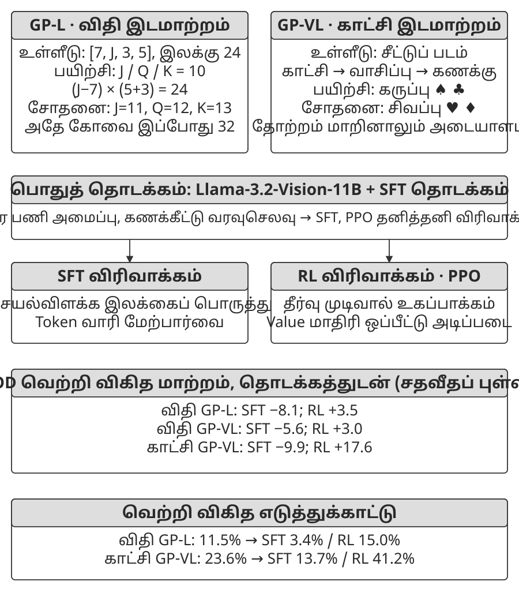
>
> **விதி மாறுபாடு**: பயிற்சியின்போது J/Q/K அனைத்தும் 10 எனக் கணக்கிடப்படுகின்றன; சோதனையின்போது முறையே 11/12/13 எனக் கணக்கிடப்படுகின்றன. ஆகவே சோதனைத் தொகுப்பில் பயிற்சியில் காணாத எண் சேர்க்கைகள் உள்ளன; புதிய விதியின்படி 11, 12, 13 ஆகியவற்றைக் கொண்டு மாதிரி கணக்கிட முடிகிறதா என்று சரிபார்க்கலாம். **காட்சி மாறுபாடு**: பயிற்சிக்குக் கருப்புச் சின்னங்கள் (♠♣), சோதனைக்குச் சிவப்புச் சின்னங்கள் (♥♦) பயன்படுத்தப்படுகின்றன; சீட்டுத் தோற்ற மாற்றத்துக்கு மாதிரி தகவமைய முடிகிறதா என்று சரிபார்க்கப்படுகிறது.
>
> சோதனை Llama-3.2-Vision-11B-இலிருந்து தொடங்கி, முதலில் SFT மூலம் அடிப்படை அறிவுறுத்தல் பின்பற்றல் திறனை அமைத்து, பின்னர் தொடர் SFT, RL என்ற இரண்டு பயிற்சிக் கிளைகளாகப் பிரிந்து, ஒரே கணக்கீட்டுச் செலவு வரம்பில் ஒப்பிடுகிறது. RL கிளை மதிப்பு வலையமைப்புடன் கூடிய PPO-வைப் பயன்படுத்துகிறது. இரண்டு கிளைகளும் J/Q/K=10 விதியுடன் பயிற்சி பெற்று, பின்னர் பரவல்-உள் (ID), பரவல்-வெளி (OOD) சோதனைத் தொகுப்புகளில் மதிப்பிடப்படுகின்றன.
>
> `[7, J, 3, 5]`-ஐ எடுத்துக்காட்டாகக் கொண்டால், J=10 எனும்போது `(J−7)×(5+3)=24` பயன்படுத்தலாம்; J-ஐ 11 ஆக மாற்றினால், இந்தக் கோவை 32 தருகிறது; அதை `(11−5)×(7−3)=24` என்று மாற்ற வேண்டும். ஆகவே அதே சீட்டுத் தொகுப்பு, தற்போதைய விதியைப் படித்து, கணக்கீட்டை மீண்டும் ஒழுங்கமைக்க மாதிரியைக் கோருகிறது.
>
> பரவல்-வெளிச் சோதனையில் இரண்டு பயிற்சி முறைகளுக்கும் இடையே தெளிவான வேறுபாடு தோன்றியது. **விதி OOD**: GP-L-இல், RL-இன் வெற்றி வீதம் 11.5%-இலிருந்து 15.0%-க்கு உயர்ந்தது, 3.5 சதவீதப் புள்ளிகள் அதிகரிப்பு; SFT 11.5%-இலிருந்து 3.4%-க்குக் குறைந்தது, 8.1 சதவீதப் புள்ளிகள் குறைவு. GP-VL-இல், RL 3.0 சதவீதப் புள்ளிகள் அதிகரித்தது, SFT 5.6 சதவீதப் புள்ளிகள் குறைந்தது. **காட்சி OOD**: GP-VL-இல், RL 23.6%-இலிருந்து 41.2%-க்கு உயர்ந்தது, 17.6 சதவீதப் புள்ளிகள் அதிகரிப்பு; SFT 23.6%-இலிருந்து 13.7%-க்குக் குறைந்தது, 9.9 சதவீதப் புள்ளிகள் குறைவு.
>
> சீட்டு அடையாள முடிவுகளை மேலும் சரிபார்த்தால், இறுதிப் பதில் செயல்திறனைக் காட்சிப் புலனுணர்வுடன் இணைக்கலாம்: RL கிளையின் அடையாளத் துல்லியம் பணி வெற்றி வீதத்துடன் சேர்ந்து உயர்ந்தது; SFT கிளையின் அடையாளத் துல்லியம் சற்றுக் குறைந்தது. ஆய்வு இந்த வேறுபாட்டைப் பயிற்சி இலக்குடன் இணைக்கிறது: token-வாரியான பொருத்துதல் செயல்விளக்கங்களில் உள்ள உரை முறைகளை வலுப்படுத்தக்கூடும்; முடிவு வெகுமதியோ சீட்டுகளைச் சரியாகப் படித்துக் கணக்கை முடிக்குமாறு மாதிரியைத் தொடர்ந்து கோருகிறது. புலனுணர்வுத் துல்லியம் இந்த இயக்கத்தைப் பகுப்பாய்வதற்கான இடைநிலை அளவீட்டை வழங்குகிறது.
>
> முதலில் SFT செய்வதற்கான காரணத்தையும் வெளியீட்டு வடிவத்திலிருந்து புரிந்துகொள்ளலாம். சோதனையில் உள்ள Llama-3.2-Vision-11B அடிப்படை மாதிரியால் கோரப்பட்ட கட்டமைக்கப்பட்ட வெளியீட்டை நிலையாக உருவாக்க முடியவில்லை; அதைக் கொண்டு சரிபார்ப்பான் பணி வெகுமதியைக் கணக்கிட முடியவில்லை; ஆகவே நேரடியாக முழுமையான RL செய்யும் முயற்சி தோல்வியடைந்தது. SFT முதலில் பகுக்கக்கூடிய, மதிப்பெண் வழங்கக்கூடிய வெளியீட்டை அமைத்த பிறகே, பின்வரும் RL பணிப் பின்னூட்டத்தைப் பயன்படுத்த முடிந்தது. முன்பு குறிப்பிட்ட DeepSeek-R1-Zero-வோ ஏற்கெனவே மதிப்பெண் வழங்கக்கூடிய பதில்களை உருவாக்கக்கூடிய அடிப்படை மாதிரியிலிருந்து தொடங்கி, நேரடியாக RL-க்குள் நுழைந்தது.
>
> சரிபார்ப்பானின் பின்னூட்டத்திலிருந்து மாதிரி எவ்வளவு கற்க முடியும்? கட்டுரையின் படம் 10 உரை-மட்டும் சீட்டுப் பணியை (GP-L) தனியாக ஒப்பிடுகிறது. ஆய்வாளர்கள் 1, 3, 5, 10 சரிபார்ப்புச் சுழற்சிகளை அமைத்து, RL மாதிரிகளைத் தனித்தனியே பயிற்றுவித்து மதிப்பிட்டனர். ஒரே பயிற்சிக் கணக்கீட்டுச் செலவு வரம்பில், 10 சரிபார்ப்புகளை அனுமதித்த குழு புதிய விதியில் தன் பயிற்சித் தொடக்கப் புள்ளியைவிட 5.99 சதவீதப் புள்ளிகள் உயர்ந்தது; ஒருமுறை மட்டும் சரிபார்த்த குழு 0.48 சதவீதப் புள்ளிகள் உயர்ந்தது.
>
> இந்தச் சோதனையின் பரவல் நகர்வின் கீழ் SFT செயல்திறன் ஏன் குறைந்தது, RL ஏன் சிறப்பாகச் செயல்பட்டது? கவனிப்புகளுடன் ஒத்துப்போகும் ஒரு விளக்கம்: குறைந்த SFT தரவு "J/Q/K வந்தால் 10 ஆகப் பயன்படுத்து" என்ற நிலையான முறையை வலுப்படுத்தியது; சோதனையில் J=11 ஆனபோதும் மாதிரி 10 ஆகவே கணக்கிட்டது. முடிவு-சார்ந்த RL கிளையோ "சரியான பதில் கிடைக்கும் வரை மீண்டும் கணக்கிடு" என்ற உத்தியை வலுப்படுத்தியிருக்கக்கூடும்; ஆகவே J 11 ஆக மாறியபோதும் அதைப் பயன்படுத்த முடிந்தது.
>
> GeneralPoints-இன் விதி மாற்றமும் சின்ன மாற்றமும், மாதிரி புதிய நிபந்தனைகளின்படி கணக்கிடக் கற்றதா, புதிய காட்சி உள்ளீட்டைச் சரியாகப் படிக்கிறதா என்பதைத் தனித்தனியே கவனிக்க உதவுகின்றன. இங்குள்ள மாதிரி, பயிற்சித் தரவு, சோதனைச் செலவு வரம்பு ஆகியவற்றின் கீழ், தொடர்ந்து SFT செய்த கிளை பரவல்-வெளிச் சோதனையில் பின்னடைந்தது; RL இணைக்கப்பட்ட கிளை மேம்பட்டது. இந்த முடிவை உங்கள் சொந்தப் பணிக்குப் பயன்படுத்த வேண்டுமென்றால், முதலில் கேட்டுப் பாருங்கள்: மாணவர் ஏற்கெனவே வெளியீட்டு வடிவத்தைக் கற்றுவிட்டாரா? புதிய சோதனை உண்மையில் விதியை மாற்றியதா, உள்ளீட்டுத் தோற்றத்தை மாற்றியதா, அல்லது இரண்டையுமா? தனித்தனியே ஒப்பீடு செய்தால்தான், செயல்விளக்கங்களைச் சேர்க்க வேண்டுமா, புலனுணர்வை மேம்படுத்த வேண்டுமா, அல்லது முடிவுப் பின்னூட்டத்துடன் கூடிய தேடலை அதிகரிக்க வேண்டுமா என்று தெரியும்.

## RL வழிமுறைகள்: 16 rollout-களிலிருந்து ஓர் அளவுருப் புதுப்பிப்பு வரை

**GRPO (Group Relative Policy Optimization)** DeepSeek-ஆல் முன்மொழியப்பட்டது; ஒரே கேள்விக்கான பல முயற்சிகளின் ஒப்பீட்டுச் செயல்திறனைக் கொண்டு கற்றல் சமிக்ஞையை உருவாக்குகிறது. SWE-bench பாணி குறியீட்டுத் திருத்தப் பணியை எடுத்துக்காட்டாகக் கொள்வோம்: ஒரு Python திட்டத்தின் `parser.py` வெற்று உள்ளீட்டில் `IndexError`-ஐத் தூண்டுகிறது; ஏஜெண்ட் செயலாக்கத்தைச் சரிசெய்து, சோதனைக் கோப்புகளை மாற்றாமல் வைத்திருக்க வேண்டும். ஒரு பயிற்சிச் சுழற்சியை நான்கு படிகளாகப் பிரிக்கலாம்.

**முதல் படி: உத்தி மாதிரியைத் திரும்பத் திரும்ப முயல வைத்தல்.** உத்தி மாதிரி என்பது பயிற்றுவிக்கப்படும் மொழி மாதிரியே. அமைப்பு அதே தொடக்கக் குறியீட்டையும் சிக்கல் விளக்கத்தையும் தனிமைப்படுத்தப்பட்ட 16 sandbox-களில் வைத்து, மாதிரியைச் சார்பற்ற முறையில் 16 முறை பணியை முடிக்க வைக்கிறது. ஒவ்வொரு முறையும் குறியீட்டைப் படிப்பதில் தொடங்கி, திருத்தம், சோதனை வழியாக முடிவைச் சமர்ப்பிக்கும் வரை செல்கிறது; இந்த முழு ஊடாடல் பாதையே ஒரு **rollout** எனப்படுகிறது. சீரற்ற மாதிரியெடுப்பு அதே தொடக்கப் புள்ளியிலிருந்து வெவ்வேறு பாதைகளை உருவாக்குகிறது: சில எல்லைச் சரிபார்ப்பைச் சேர்க்கின்றன, சில விதிவிலக்கை மட்டும் பிடிக்கின்றன, சில தவறான கோப்பைத் திருத்துகின்றன, சில சோதனைகளையே மாற்ற முயல்கின்றன.

**இரண்டாம் படி: வெகுமதியைக் கணக்கிடுதல்.** ஒவ்வொரு rollout முடிந்த பிறகும், சரிபார்ப்பான் சுத்தமான சூழலில் patch-ஐப் பொருத்திச் சோதனைகளை இயக்குகிறது. 16 முயற்சிகளில் 4 அனைத்துச் சோதனைகளையும் கடந்து, சோதனைக் கோப்புகளை மாற்றவில்லை என்றும், மீதமுள்ள 12 தோல்வியடைந்தன என்றும் வைத்துக்கொள்வோம்; அப்போது கடந்த 4 பாதைகளுக்கு வெகுமதி 1, மீதமுள்ள 12-க்கு வெகுமதி 0. படம் 8-13 இந்த 16 பாதைகளின் மதிப்பீட்டை ஒரே அட்டவணையில் வைக்கிறது. இத்தகைய குறியீட்டுப் பணிகளில் சோதனைகளையும் விதிகளையும் கொண்டு நேரடியாக வெகுமதியைக் கணக்கிடலாம். வாசிப்புத்தன்மை, விளக்கத் தரம் போன்ற சோதனைகளாக எழுதக் கடினமான இலக்குகளுக்கு, மனித மதிப்பீட்டையோ வெகுமதி மாதிரியையோ (reward model) இணைக்கலாம்.

**மூன்றாம் படி: ஒப்பீட்டுச் சாதகத்தைக் கணக்கிடுதல்.** வெகுமதி ஒரு பாதை வெற்றி பெற்றதா தோல்வியடைந்ததா என்பதை மட்டுமே சொல்கிறது; **ஒப்பீட்டுச் சாதகம் (relative advantage)** அதே குழுவின் பிற முயற்சிகளுடன் ஒப்பிடும்போது அது எவ்வளவு சிறந்தது என்பதைச் சொல்கிறது. இந்தக் குழுவின் சராசரி வெற்றி வீதம் 4/16: சோதனைகளைக் கடந்த 4 பாதைகள் குழுச் சராசரியைவிட அதிகம், நேர்மறைச் சாதகம் பெறுகின்றன; தோல்வியடைந்த 12 சராசரியைவிடக் குறைவு, எதிர்மறைச் சாதகம் பெறுகின்றன. குழு-உள் திட்ட விலக்கத்தால் (standard deviation) இயல்பாக்கினால், வெகுமதிச் சராசரி 0.25, திட்ட விலக்கம் சுமார் 0.433; வெற்றிப் பாதைகளின் சாதகம் சுமார் 1.73, தோல்விப் பாதைகளுடையது சுமார் −0.58. GRPO இத்தகைய குழு-உள் ஒப்பீட்டைக் கொண்டு கற்றல் சமிக்ஞையை உருவாக்குகிறது. 16 வெகுமதிகளும் முற்றிலும் ஒன்றாக இருந்தால், ஒவ்வொன்றிலிருந்தும் குழுச் சராசரியைக் கழித்தால் பூஜ்யமே கிடைக்கும். பகுதியில் மிகச் சிறிய நிலைப்படுத்தும் உறுப்பைச் சேர்த்தால் பூஜ்யத்தால் வகுப்பதைத் தவிர்க்கலாம்; ஆனால் இயல்பாக்கிய பிறகும், இந்தக் குழுவின் முடிவு வெகுமதி பயிற்சி எந்தப் பாதையை நோக்கிச் சாய வேண்டும் என்பதைக் காட்ட முடியாது. அப்போது பாதைக் கட்டுப்பாடுகள், செயல்முறை வெகுமதி அல்லது பகுதி முன்னேற்றம் ஆகியவை ஒரே குழுவின் பாதைகளைப் பிரித்தறிய முடியுமா என்று சரிபார்க்கலாம். எடுத்துக்காட்டாக, குறியீட்டைச் சரிசெய்யாத இரண்டு முயற்சிகளில், ஒன்று மட்டுமே முன்பு தோல்வியடைந்த எல்லைச் சோதனையைக் கடந்தது. இந்த இடைநிலை முடிவைச் சார்பற்ற முறையில் சரிபார்க்க முடிந்தால், கற்றலுக்குப் பயன்படக்கூடிய இன்னொரு துப்பு கிடைக்கிறது.

**நான்காம் படி: சாய்வு இறக்கம் (gradient descent) மூலம் உத்தியைப் புதுப்பித்தல்.** பயிற்சி நிரல் ஒப்பீட்டுச் சாதகத்தைப் பயிற்சி இழப்பாக மாற்றி, சாய்வைக் கணக்கிட்டு, பின்னர் உகப்பாக்கி (AdamW, Muon போன்றவை) சாய்வு இறக்கத்தைச் செயல்படுத்தி, நேர்மறைச் சாதகப் பாதைகளில் மாதிரி செய்த தேர்வுகளின் நிகழ்தகவை உயர்த்தி, எதிர்மறைச் சாதகப் பாதைகளில் உள்ள தேர்வுகளின் நிகழ்தகவைக் குறைக்கிறது. பயிற்சி பல பணிகளிலும் rollout-களிலும் இந்தத் தேர்வுகளின் நிகழ்தகவைத் திரும்பத் திரும்பச் சரிசெய்கிறது. உகப்பாக்கம் படிப்படியாகப் பலன் தரத் தொடங்கியதும், ஒத்த பிழைகளைச் சந்திக்கும்போது "முதலில் சிக்கலை மீண்டும் உருவாக்கு, எல்லை நிபந்தனைகளைச் சரிபார், செயலாக்கத்தைத் திருத்திச் சோதனைகளை இயக்கு" என்பது எளிதாகத் தோன்றும்; "விதிவிலக்கை மறை, சோதனைகளை மாற்று, சரிபார்க்காமல் சமர்ப்பி" என்பது குறைவாகத் தோன்றும்.

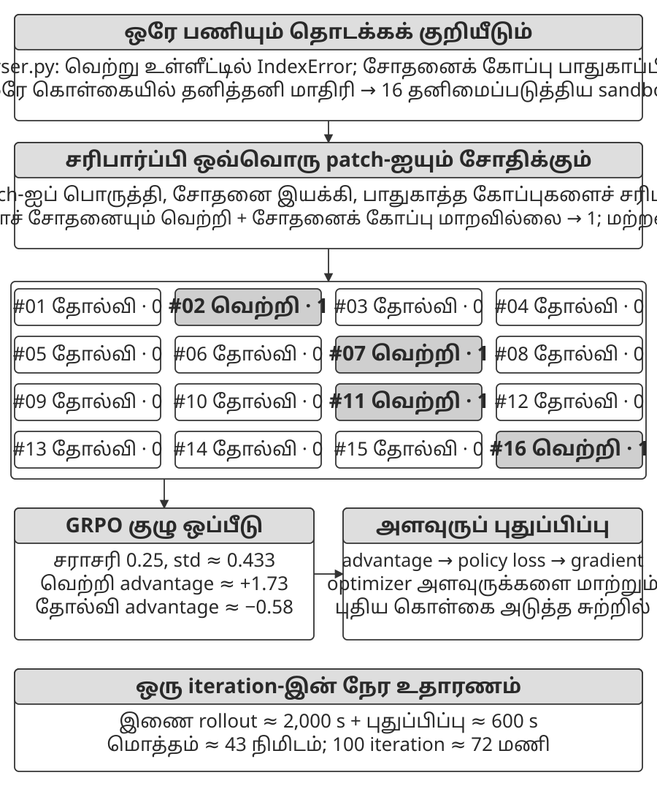

படம் 8-13-இல், ஒரே கேள்விக்கு 16 முறை மாதிரியெடுக்கப்படுகிறது; இது எத்தனை **பயிற்சிச் சுழற்சிகள் (step)**? இந்தப் பகுதியின் கணக்கீட்டின்படி, இந்த 16 rollout-களும் ஒரே தொகுதியைச் சேர்ந்தவை. $k$-ஆவது சுற்றில் தற்போதைய உத்தியைக் கொண்டு மாதிரியெடுத்து, வெகுமதி, சாதகம், சாய்வு ஆகியவற்றைக் கணக்கிட்டு, உத்தியை ஒருமுறை புதுப்பிக்கிறோம்; $k+1$-ஆவது சுற்றில்தான் புதிய அளவுருக்களைக் கொண்டு மீண்டும் மாதிரியெடுக்கிறோம். 100 steps பயிற்சி என்பது இத்தகைய சுழற்சிகளைச் சுமார் 100 சுற்றுகள் செய்வதைக் குறிக்கிறது.

இதைக் கொண்டு பயிற்சி நேரத்தை மதிப்பிடலாம். ஒரு சிக்கலான பணியில் பத்துக்கணக்கான சுற்றுக் கருவி அழைப்புகள் இருக்கலாம்; ஒத்திசைவான (synchronous) பயிற்சி முழுத் தொகுதியின் முடிவுகளுக்காகக் காத்திருக்கும்போது, இணையாக இயங்கும் 16 பாதைகளில் மிக மெதுவான ஒன்றே மாதிரியெடுப்புக் கட்டம் எப்போது முடியும் என்பதைத் தீர்மானிக்கிறது. அதற்குச் சுமார் 2,000 வினாடிகள் ஆகிறது என்றும், சாய்வுக் கணக்கீடும் உகப்பாக்கிப் புதுப்பிப்பும் மேலும் 600 வினாடிகள் எடுக்கின்றன என்றும் வைத்துக்கொண்டால், ஒரு step-க்குச் சுமார் $2{,}000+600=2{,}600$ வினாடிகள், அதாவது 43 நிமிடங்கள் தேவை. அதே நேர அளவில் தொடர்ந்து 100 steps பயிற்சி செய்ய, சுமார் 72 மணிநேரம் ஆகும்.

PPO, GRPO இரண்டும் இந்த மூடிய சுழற்சியைப் பின்பற்றுகின்றன; வேறுபாடு முக்கியமாக "எதனுடன் ஒப்பிடுவது" என்பதில்தான். GRPO ஒரே கேள்விக்கான பல rollout-களை நேரடியாக ஒப்பிடுகிறது; கூடுதல் மதிப்பு மாதிரி தேவையில்லை; PPO ஒரு மதிப்பு மாதிரியைப் பயிற்றுவித்து, பாதையின் ஒவ்வொரு படியிலும் "பொதுவாக எவ்வளவு சிறப்பாகச் செய்ய முடியும்" என்று மதிப்பிட்டு, தற்போதைய செயல் இந்த எதிர்பார்ப்பைவிடச் சிறந்ததா என்று தீர்மானிக்கிறது; இதனால் படி-வாரியான பங்களிப்புப் பகிர்வுக்குத் தேவையான அடிப்படைக் கோட்டை வழங்குகிறது. இரண்டும் பதிலி இலக்கை வெட்டுதல் போன்ற இயக்கங்கள் மூலம் மிகப் பெரிய புதுப்பிப்புகளைக் கட்டுப்படுத்துகின்றன. DPO வேறுபட்டது: அது முன்கூட்டியே சேகரிக்கப்பட்ட "சிறந்த பதில்—மோசமான பதில்" விருப்ப ஜோடிகளை நேரடியாகக் கற்கிறது; தற்போதைய உத்தியை online-ஆக இந்தக் குழு rollout-களை உருவாக்க விடுவதில்லை.

இந்த அத்தியாயத்தின் எடுத்துக்காட்டுகள் வெவ்வேறு பயிற்சிச் செய்முறைகளைப் பயன்படுத்துகின்றன: AdaptThink தனிப்பயன் கட்டுப்படுத்தப்பட்ட இலக்கைப் பயன்படுத்துகிறது; GeneralPoints, V-IRL, ReTool ஆகியவை PPO-வைப் பயன்படுத்துகின்றன, அவற்றில் முதல் இரண்டின் மதிப்பு மாதிரி சாதக மதிப்பீட்டில் பங்கேற்கிறது; SimpleVLA-RL, RLVP ஆகியவை GRPO-வைப் பயன்படுத்துகின்றன.

அ, ஆ என்ற இரண்டு கேள்விகளை ஒவ்வொன்றையும் நான்கு முறை முயல்வதாக வைத்துக்கொள்வோம்; அ முழுவதும் சரி, ஆ முழுவதும் தவறு. அ-வின் நான்கு வெகுமதிகளும் 1, ஆ-வின் நான்கு வெகுமதிகளும் 0. ஒவ்வொன்றிலிருந்தும் குழு-உள் சராசரியைக் கழித்தால், இரண்டு குழுக்களின் சாதகங்களும் 0 ஆகிவிடுகின்றன. ஆனால் இன்னும் சில முறை முயல்வதற்குக் கணக்கீட்டு வளம் இருந்தால், எந்தக் கேள்வியில் செலவழித்தால் பயனுள்ள பயிற்சி மாதிரி கிடைக்க அதிக வாய்ப்பு?

Never Give Up இந்தத் தேர்வை மாதிரியெடுப்புச் செயல்முறைக்குள்ளேயே வைக்கிறது. அ முழுவதும் சரி என்றால், இந்தக் குழு தவிர்க்கப்படுகிறது; ஆ முழுவதும் தவறு என்றால், ஒரு குறிப்பிட்ட நிகழ்தகவுடன் இன்னொரு குழு சேர்க்கப்படுகிறது. இரண்டாவது குழுவில் இறுதியாக ஒருமுறை சரியான பதில் வந்தால், பயிற்சியின்போது இரண்டு குழுக்களின் எட்டுப் பதில்களும் ஒன்றாக வைக்கப்படுகின்றன: ஒரு சரியான தீர்வும் ஏழு தவறான தீர்வுகளும்; அதே கேள்வியில் ஏற்றத்தாழ்வான வெகுமதிகள் கிடைக்கின்றன. ஒத்திசைவற்ற (asynchronous) மாதிரியெடுப்பு பிற கேள்விகளை வழக்கம்போல முன்னேற விடுகிறது; ஆ-வின் முடிவுக்காகக் காத்திருக்கத் தேவையில்லை.[^ch8-ngu]

[^ch8-ngu]: Michael Noukhovitch மற்றும் பிறர், *Learning to Solve Hard Problems in RL for LLMs by Never Giving Up*, 2026. கட்டுரையில் உள்ள கூடுதல் மாதிரியெடுப்பு பயிற்சிக்குப் பயன்படுகிறது; ஏற்கெனவே சரியாகச் செய்த கேள்விகளும் பின்வரும் பயிற்சியில் மீண்டும் தேர்ந்தெடுக்கப்படலாம்.

### LLM RL ஏன் பொதுவாக On-Policy-க்கு முன்னுரிமை தருகிறது

**Online (இணைநிலை)**, **On-policy (உத்தி-இணைந்த)** ஆகியவை இரண்டு வெவ்வேறு அம்சங்களை விவரிக்கின்றன. Online பயிற்சி இயக்கத்தின்போது தொடர்ந்து சூழலுடன் ஊடாடித் தரவை உருவாக்குகிறது; on-policy பயிற்சி தரவின் மூலத்தைக் கவனிக்கிறது: பாதைகளை உருவாக்கும் நடத்தை உத்தி $\mu$-உம் உகப்பாக்கப்பட வேண்டிய உத்தி $\pi_\theta$-உம் ஒன்றாகவோ போதுமான அளவு நெருக்கமாகவோ இருக்க வேண்டும். ஒத்திசைவற்ற தொகுப்பு (cluster) தொடர்ந்து online-ஆக மாதிரியெடுக்கலாம்; ஆனால் ஒரு worker சில checkpoint-கள் பின்தங்கியிருந்தால், அது திருப்பி அனுப்பும் தரவில் உத்திப் பழமை (policy staleness) இருக்கும்; இது off-policy (உத்தி-விலகிய) கூறை உருவாக்குகிறது.

ஆசிரியர் முதலில் on-policy-க்கு நெருக்கமான பயிற்சியைக் கொண்டு நிலையான அடிப்படைக் கோட்டை அமைத்து, பின்னர் செயல்வீதத்தை (throughput) உயர்த்த ஒத்திசைவற்ற மாதிரியெடுப்பையோ பழைய தரவின் மறுபயன்பாட்டையோ அறிமுகப்படுத்துமாறு பரிந்துரைக்கிறார். இந்த அத்தியாயத்தின் PPO/GRPO செய்முறைகள் பொதுவாக ஒவ்வொரு step-இன் தொடக்கத்திலும் சமீபத்திய உத்தியைக் கொண்டு மாதிரியெடுக்கின்றன. அதன் பின்னர் PPO அதே தொகுதித் தரவில் பல-சுற்று சிறு-தொகுதிப் புதுப்பிப்புகளைச் செய்கிறது; தற்போதைய உத்தி தரவை உருவாக்கிய `old_policy`-இலிருந்து படிப்படியாக விலகுகிறது. நிகழ்தகவு விகிதம் இந்த மாற்றத்தை அளக்கிறது; வெட்டு இலக்கு மிகப் பெரிய புதுப்பிப்புகளைக் கட்டுப்படுத்துகிறது.

உத்திச் சாய்வின் இலக்கு, தற்போதைய உத்தி $\pi_\theta$-இன் கீழ் எதிர்பார்க்கப்படும் வெகுமதியுடன் தொடர்புடையது. நடத்தை உத்தி $\mu$ மாதிரியெடுத்த தரவைப் பயன்படுத்தும்போது, முதலில் அதே நிலையில் செயல் நிகழ்தகவு விகிதத்தைக் கணக்கிட்டு, அதைக் கொண்டு முக்கியத்துவத் திருத்தத்தை உருவாக்கலாம்:

$$
\rho_t=\frac{\pi_\theta(a_t\mid s_t)}{\mu(a_t\mid s_t)}
=\exp\left(\log\pi_\theta(a_t\mid s_t)-\log\mu(a_t\mid s_t)\right).
$$

அதே முன்னொட்டுக்குப் பிறகு, மாதிரியெடுப்பு உத்தி ஒரு token-ஐத் தேர்ந்தெடுக்கும் நிகழ்தகவு 0.2 என்றும், தற்போதைய உத்தி அதற்கு வழங்கும் நிகழ்தகவு 0.3 என்றும் வைத்துக்கொண்டால், இந்தப் படியின் நிகழ்தகவு விகிதம் 1.5. பழைய மாதிரிகளில் அது குறைவாகத் தோன்றியது; தற்போதைய உத்தியின்படி மதிப்பிடும்போது, இத்தகைய மாதிரிகளின் எடை அதற்கேற்ப உயர்த்தப்படுகிறது. மாதிரியெடுப்பும் பயிற்சியும் ஒரே உத்தியைப் பயன்படுத்தினால், அளவுருப் புதுப்பிப்புக்கு முன் ஒவ்வொரு படியின் நிகழ்தகவு விகிதமும் 1.

பழைய பாதைகளை மீண்டும் பயன்படுத்துவது மாதிரியெடுப்பையும் பயிற்சியையும் ஒத்திசைவின்றி நடத்தி, செயல்வீதத்தை உயர்த்த உதவும். ஆனால் இரண்டு உத்திகளும் எவ்வளவு அதிகமாக வேறுபடுகின்றனவோ, அவ்வளவு அதிகமாகச் சில மாதிரிகள் மிகப் பெரிய எடையைப் பெறக்கூடும். முழுப் பாதையையும் மீண்டும் எடையிடும்போது, ஒவ்வொரு படியின் நிகழ்தகவு விகிதங்களையும் தொடர்ந்து பெருக்க வேண்டும். PPO ஒவ்வொரு செயலின் பதிலி இலக்கிலும் கூடுதல் பலனின் ஒரு பகுதியை வெட்டி, தீவிர நிகழ்தகவு விகிதங்களின் தாக்கத்தைக் குறைக்க முடியும்; ஆனால் பழைய மாதிரிகள் ஒருபோதும் சென்றடையாத நிலைகளை, புதிய மாதிரியெடுப்பின் மூலம்தான் காண முடியும். ஆசிரியர் புதிய பாதைகளைப் பயன்படுத்த விரும்புவதற்கு இதுவும் ஒரு காரணம்.[^ch8-32]

#### பயிற்சிக்கும் inference-க்கும் இடையிலான எண் வேறுபாடுகள்

பெரிய அளவிலான LLM வலுவூட்டல் கற்றல் பொதுவாக vLLM, SGLang போன்ற inference இயந்திரங்களைக் கொண்டு மாதிரியெடுத்து, FSDP, Megatron போன்ற பயிற்சி அமைப்புகளைக் கொண்டு மடக்கை நிகழ்தகவுகளையும் சாய்வுகளையும் கணக்கிடுகிறது. இரண்டு பக்கமும் அதே எடைகளை ஏற்றினாலும், மிதவைப் புள்ளித் (floating point) துல்லியம், குறைப்பு (reduction) வரிசை, tensor இணைச்செயலாக்கம், தொகுதி அளவு, KV Cache, இணைக்கப்பட்ட kernel-கள் ஆகியவற்றின் வேறுபாடுகளால், ஒரே token-க்குச் சற்று வேறுபட்ட மடக்கை நிகழ்தகவுகளைக் கணக்கிடக்கூடும். அப்போது அளவுருக்கள் இன்னும் புதுப்பிக்கப்படாமலேயே $\rho_t$ 1-இலிருந்து விலகிவிடுகிறது; பயிற்சிக்கும் மாதிரியெடுப்புக்கும் இடையே எண் மட்டத்தில் உத்தி வேறுபாடு தோன்றுகிறது. மிகச் சிறிய token-மட்ட வேறுபாடுகளும் பயிற்சிச் சரிவுக்கு (collapse) வழிவகுக்கலாம் என்று கட்டுப்படுத்தப்பட்ட சோதனைகள் கண்டறிந்தன.[^ch8-33]

மாதிரியெடுப்புப் பரவல் மாறியவுடன், இரண்டு செயல்களின் வெகுமதியும் முற்றிலும் ஒன்றாக இருந்தாலும், எளிய உத்திச் சாய்வு அவற்றில் ஒன்றை நோக்கிச் சாயக்கூடும். மாதிரியெடுக்கும்போது A, B இரண்டுக்கும் பாதி-பாதி வாய்ப்பு என்றும், பயிற்சியின்போது மாதிரி A-ஐத் தேர்ந்தெடுக்கும் நிகழ்தகவு ஏற்கெனவே 0.8 ஆக மாறிவிட்டது என்றும் வைத்துக்கொள்வோம். A-ஐக் கட்டுப்படுத்தும் logit-க்கு, A தேர்ந்தெடுக்கப்பட்டால் மடக்கை நிகழ்தகவின் சாய்வு $1-0.8=0.2$; B தேர்ந்தெடுக்கப்பட்டால் $0-0.8=-0.8$. இரண்டு செயல்களும் 1 மதிப்பெண் பெற்றால், மாதிரியெடுப்பு நேர நிகழ்தகவுகளின்படி சராசரி எடுத்தால், சாய்வு $-0.3$. இரண்டு தேர்வுகளும் ஒரே மதிப்பெண் பெற்றிருந்தும், புதுப்பிப்பு A-இன் நிகழ்தகவைக் குறைக்கும்.

Score centering, ஒரே முன்னொட்டின் கீழ் உள்ள மடக்கை நிகழ்தகவுச் சாய்விலிருந்து, மாதிரியெடுப்புப் பரவலின் கீழ் அதன் சராசரியைக் கழிக்கிறது. மேலே உள்ள எடுத்துக்காட்டில் $-0.3$-ஐக் கழித்த பிறகு, இரண்டு உறுப்புகளும் முறையே $0.5$, $-0.5$ ஆகின்றன; ஒரே வெகுமதி உருவாக்கும் சராசரிப் புதுப்பிப்பு சரியாகப் பூஜ்யமாகிறது. முன்பு GRPO ஒரு குழுப் பதில்களின் வெகுமதியிலிருந்து சராசரியைக் கழித்தது; இங்கே மையப்படுத்தப்படுவது சாய்வு.[^ch8-sc]

[^ch8-sc]: Martin Marek, Max Ryabinin, *Score Centering Stabilizes Off-policy Reinforcement Learning*, 2026. மாதிரியெடுப்பு உத்தி மிகவும் பின்தங்கியிருக்கும்போது, KL முறைப்படுத்தலைக் கொண்டு பயிற்சி உத்திக்கும் நடத்தை உத்திக்கும் இடையிலான தூரத்தையும் கட்டுப்படுத்தலாம் (arXiv:2611.21791).

பயிற்சிப் பக்கத்துக்கும் மாதிரியெடுப்புப் பக்கத்துக்கும் இடையிலான எண் பிழைகள் நீண்ட வரிசைகளில் பெருகவும் செய்கின்றன: **மடக்கை நிகழ்தகவுப் பிழை → நிகழ்தகவு விகித விலகல் → நீண்ட முன்னொட்டில் திரட்சி → வெட்டலும் சாதக எடையிடலும் மாறுதல் → சாய்வும் பயனுள்ள மாதிரி எண்ணிக்கையும் மாறுதல்**. எடுத்துக்காட்டாக, 4,000 token-களின் மடக்கை நிகழ்தகவு விகிதங்கள் அனைத்தும் ஒரே திசையில் $10^{-3}$ விலகல் கொண்டிருந்தால், கணக்கிடப்படும் பாதை-மட்ட நிகழ்தகவு விகிதம் உண்மை மதிப்பைவிட $e^{4000\times0.001}=e^4\approx54.6$ மடங்கு இருக்கும்.

ஆரம்பகால நிகழ்தகவு மாற்றங்கள் மாதிரியெடுப்பு முடிவுகளையும் மாற்றி, அடுத்தடுத்த நிலைகளை வேறொரு பாதையில் வளரச் செய்யலாம். பயிற்சியில் கவனிக்கக்கூடிய சமிக்ஞைகளில் முக்கியத்துவ விகிதக் கூர்முனைகள் (spikes), வெட்டு விகித உயர்வு, சாய்வு அல்லது பதில் நீளத்தில் திடீர் மாற்றம், வெகுமதியும் entropy-யும் குறைதல் ஆகியவை அடங்கும். தொகுதி அளவு குறைப்புச் செயல்முறையை மாற்றும்போது, ஒரே உள்ளீட்டின் எண் முடிவும் மாறக்கூடும்; அதாவது தொகுதி மாறாமை (batch invariance) உடைகிறது. தொடர்புடைய ஆய்வுகள் இதனால் ஏற்படும் மறைமுக off-policy விளைவைக் கண்டறிந்து, மாதிரியெடுப்பையும் பயிற்சிக் கணக்கீட்டையும் சீரமைப்பதன் மூலமோ, உத்தி வேறுபாட்டை வெளிப்படையாகத் திருத்துவதன் மூலமோ நிலைத்தன்மையை மேம்படுத்தின.[^ch8-34]

ஆகவே, ஆசிரியர் மாதிரியெடுப்புக்கும் பயிற்சிக்கும் இடையிலான எண் ஒருமைப்பாட்டைப் பயிற்சி தொடங்குவதற்கு முந்தைய மையச் சரிபார்ப்பாகப் பட்டியலிட்டு, வெகுமதி வளைவுடன் சேர்த்துத் தொடர்ந்து கண்காணிக்கிறார். "வேறுபாட்டை அளத்தல்—அமைப்பைச் சீரமைத்தல்—விலகலைத் திருத்துதல்—பழமையைக் கட்டுப்படுத்துதல்" என்ற நான்கு படிகளில் கையாளலாம்:

- **எந்த அளவுருப் புதுப்பிப்புக்கும் முன்**, அதே தொகுதிப் பாதைகளைக் கொண்டு மாதிரியெடுப்புப் பக்கமும் (sampler) பயிற்சிப் பக்கமும் (trainer) தரும் token மடக்கை நிகழ்தகவுகளை ஒப்பிட்டு, $\rho_t$-இன் சராசரி, quantile-கள், அதிகபட்சம், தோராய KL, வெட்டப்பட்ட விகிதம் ஆகியவற்றைக் கண்காணியுங்கள்; இதுவே மிக நேரடியான on-policy அலகுச் சோதனை (unit test).
- எடைகளை ஒத்திசைக்கும்போது, LoRA adapter, பகுப்பான், உரையாடல் வார்ப்புரு, மாதிரிப் பதிப்பு, நிலைக் குறியாக்க (position encoding) அமைப்பு ஆகியவற்றையும் சேர்த்துச் சீரமையுங்கள். rollout, உருவாக்கத்தின்போது மாதிரியெடுப்பு உத்தி தந்த மடக்கை நிகழ்தகவுகளைச் சேமிக்க வேண்டும்; பின்னர் அவற்றைக் கொண்டு நிகழ்தகவு விகிதம் கணக்கிடப்படும்.
- இயன்றவரை மாதிரியெடுப்பு மற்றும் பயிற்சியின் துல்லியம், இணைச்செயலாக்க அமைப்பு, முக்கியக் கணக்கீட்டு kernel-கள் ஆகியவற்றைச் சீரமையுங்கள்; முடியாவிட்டால், வேறுபாட்டை வெளிப்படையாக off-policy எனக் கருதி, முக்கியத்துவத் திருத்தத்தைப் பயன்படுத்தி, பயனுள்ள மாதிரி எண்ணிக்கையைக் கண்காணித்து, வெட்டு விகிதத்துடன் சேர்த்துத் திருத்தத்தின் பலனைத் தீர்மானியுங்கள்.
- புதுப்பிக்கப்பட்ட உத்தியைக் கொண்டு உடனுக்குடன் மீண்டும் மாதிரியெடுத்து, ஒவ்வொரு தொகுதித் தரவின் மீதான புதுப்பிப்புச் சுற்றுகளையும், ஒத்திசைவற்ற மாதிரியெடுப்பு பயிற்சியைவிடப் பின்தங்கும் checkpoint எண்ணிக்கையையும் கட்டுப்படுத்துங்கள்.

## RL சூழல்: மதிப்பீட்டிலிருந்து உருவகப்படுத்தல் வரை

ஏஜெண்ட்டின் RL பயிற்சிக்குப் பணிகளைத் திரும்பத் திரும்ப இயக்க வேண்டும். ஒரு குறியீட்டுத் திருத்தத்தைத் தனிமைப்படுத்தப்பட்ட நகலில் மீண்டும் முயலலாம்; ஆனால் ஒரு பணம் செலுத்துதல் உண்மையான கணக்கின் நிலையை மாற்றிவிடும். பயிற்சிச் சூழல் மீட்டமைக்கக்கூடிய தொடக்க நிலை, இணையாக இயக்கக்கூடிய பணி நகல்கள், சரிபார்க்கக்கூடிய முடிவுகள் ஆகியவற்றை வழங்கி, கட்டுப்படுத்தப்பட்ட நிலைகளில் மாதிரி வெவ்வேறு பாதைகளைத் தேட அனுமதிக்க வேண்டும். அத்தியாயம் 7 ஏற்கெனவே மதிப்பீட்டுச் சூழலை அறிமுகப்படுத்தியது; பயிற்சிக்குப் பயன்படுத்தும்போது, நீண்ட நேர இயக்கம், செயல்களின் பக்கவிளைவுகள், ஏராளமான ஊடாடல்களின் செலவு ஆகியவற்றையும் கருத்தில் கொள்ள வேண்டும். ஆசிரியர் பெரிய அளவிலான பயிற்சியைத் திட்டமிடுவதற்கு முன், சூழல் கட்டமைப்புக்கு மனிதவளத்தையும் வரவுசெலவையும் ஒதுக்குகிறார். உண்மையான பின்னூட்டம், நிலை மீட்டமைப்பு, இணைத் தனிமைப்படுத்தல் ஆகியவற்றைச் செயல்படுத்துவது, PPO அல்லது GRPO-வை இணைப்பதைவிட அதிகப் பொறியியல் வளத்தை எடுத்துக்கொள்கிறது; சூழல் கட்டமைப்புச் செலவு பயிற்சியையே மிஞ்சலாம்.

### சூழல்: மாதிரி பயிற்சி செய்யும் களம்

சூழல் செயல்களின்படி நிலையைப் புதுப்பித்து, புதிய அவதானிப்பை மாதிரிக்குத் திருப்பி அனுப்புகிறது. சூழலை உருவாக்கும்போது மூன்று கேள்விகளிலிருந்து தொடங்கலாம்.

- **ஊடாடல் பயன்பாட்டுச் சூழ்நிலைக்கு நெருக்கமாக உள்ளதா?** வாடிக்கையாளர் சேவை உருவகப்படுத்தி, பயனர் தகவலைச் சேர்ப்பது, கோரிக்கையை மாற்றுவது, தெளிவின்றிப் பேசுவது போன்ற சூழ்நிலைகளை உள்ளடக்க வேண்டும்; கருவி உருவகப்படுத்தி உற்பத்தியில் பொதுவாக வரும் பிழைகளையும் தாமதங்களையும் திருப்பி அனுப்ப வேண்டும். இந்தப் பின்னூட்டங்கள் மூலம் மாதிரி உண்மையான சிக்கல்களை எதிர்கொள்ளக் கற்கிறது. மிக ஒரே மாதிரியான பின்னூட்டம், உருவகப்படுத்தலில் உள்ள நிலையான வழக்கங்களை உத்தி சார்ந்திருக்கச் செய்யும்.
- **பணிகளை நிலையாக மீண்டும் முயலவும் இணையாக இயக்கவும் முடியுமா?** ஒவ்வொரு rollout-க்கும் தனிப்பட்ட ஆர்டர், கோப்பு அல்லது கணக்கு நிலை தேவை; முடிந்த பிறகு சுத்தம் செய்து மீட்டமைக்க முடிய வேண்டும். ReTool-இன் குறியீட்டு விளக்கி (code interpreter) sandbox-உம் AWorld-இன் MCP sandbox-உம் இத்தகைய பொறுப்பை ஏற்கின்றன. வீத வரம்பு, கட்டணம் அல்லது எழுதும் பக்கவிளைவுகள் கொண்ட உண்மையான API-களுக்கு, பணித் தேவைக்கேற்ப sandbox கணக்குகள், மீள்இயக்கத் (replay) தரவு அல்லது உருவகப்படுத்திய இடைமுகங்களைப் பயன்படுத்தலாம்.
- **முடிவை எப்படித் தீர்மானிப்பது?** சூழல் நிலை வெகுமதிக் கணக்கீட்டுக்கு முக்கிய அடிப்படை. எடுத்துக்காட்டாக, பணத்தைத் திருப்பித் தரும் பணியில் தொகை, ஆர்டர் நிலை, அங்கீகார நிபந்தனைகள் ஆகியவற்றைச் சரிபார்க்கலாம்; குறியீட்டுப் பணியில் சோதனைகளை இயக்கலாம். வெகுமதி வடிவமைப்பு பின்னர் தனியாக விவாதிக்கப்படும்.

**வழிமுறையைச் சரிசெய்யத் தொடங்குவதற்கு முன், ஆசிரியர் முதலில் சரிபார்க்குமாறு பரிந்துரைப்பது: உருவகப்படுத்தல் சூழல் உண்மையான பணிக்குப் போதுமான அளவு நெருக்கமாக உள்ளதா? இது PPO-வா GRPO-வா என்று தேர்ந்தெடுப்பதைவிட முக்கியமானது.** நம்பகத்தன்மை (fidelity), மீட்டமைக்கும் தன்மை, சரிபார்ப்புத் திறன் ஆகிய மூன்றும் சேர்ந்தே ஊடாடலிலிருந்து மாதிரி எதைக் கற்க முடியும் என்பதைத் தீர்மானிக்கின்றன. முதலில் சில பணிகளைக் கொண்டு இந்த மூன்று கட்டங்களையும் முழுமையாக இயக்கிப் பார்த்து, பின்னர் பயிற்சி அளவை விரிவாக்கினால், சிக்கல்களைக் கண்டறிவது பொதுவாக எளிது.

### மாதிரியைக் கொண்டு கருவிகளையும் சூழலையும் உருவகப்படுத்துதல்

தேடல் முடிவுகள், பயனர் உரையாடல்கள், சிக்கலான வணிக நிலைகள் ஆகிய அனைத்தையும் மாதிரியின் உதவியுடன் தொகுக்கலாம். மாதிரி உருவகப்படுத்தி ஏஜெண்ட்டின் செயலைப் பெற்று, அடுத்த படிப் பின்னூட்டத்தை உருவாக்கி, நிகழ்நேர வெளிச் சேவைகளைச் சார்ந்திருப்பதைக் குறைக்கிறது. இந்த முறையை ஒற்றைக் கருவியிலிருந்து முழுப் பணிச் சூழல் வரை விரிவாக்கலாம்.

**முதல் நிலை: கருவி திருப்பி அனுப்பும் மதிப்புகளைத் தொகுத்தல்.** ZeroSearch[^ch8-13] LLM-ஐத் தேடுபொறியாக நடிக்க வைக்கிறது: மாணவர் விசாரணையை அனுப்புகிறார், உருவகப்படுத்தி தேடல் முடிவுகளை உருவாக்குகிறது. இதனால் உண்மையான தேடல் API-இன் கட்டணம், வீத வரம்பு, முடிவு ஏற்ற இறக்கம் ஆகியவற்றைப் பயிற்சி சார்ந்திருப்பது குறைகிறது. அது பாடத்திட்ட முறையையும் பின்பற்றுகிறது: தொடக்கத்தில் தரமும் தொடர்பும் அதிகமான ஆவணங்களைத் திருப்பி அனுப்பி, பின்னர் படிப்படியாக இரைச்சலை (noise) அதிகரித்து, குறைபாடுள்ள பொருளிலிருந்து பயனுள்ள தகவலைப் பிரித்தெடுக்க மாணவரைப் பழக்குகிறது. ஆய்வில் உள்ள மாதிரி உருவகப்படுத்திய தேடல் சூழலில் பயிற்சியை முடித்த பிறகு, உண்மையான தேடுபொறியுடன் இணைக்கப்பட்டபோதும் நல்ல செயல்திறனைக் காட்டியது.

**இரண்டாம் நிலை: சூழலின் நிலை மாற்றங்களை உருவகப்படுத்துதல்.** DreamGym[^ch8-14] சூழலின் இயக்கவியலைப் பகுத்தறியும் அனுபவ மாதிரி (reasoning experience model) ஒன்றுக்குள் வடிக்கிறது. அந்த மாதிரி தற்போதைய நிலையையும் ஏஜெண்ட்டின் செயலையும் படித்து, அடுத்த நிலையையும் பின்னூட்டத்தையும் தருவித்து, online RL-க்கான ஊடாடல் பாதைகளைத் தொகுதியாக உருவாக்குகிறது; இதனால் உண்மையான சூழலை அணுகுவது குறைகிறது. வாடிக்கையாளர் சேவை மற்றும் விற்பனைப் பணிகளில், LLM-ஐப் பயனராக நடிக்க வைத்து, மேலும் கேள்வி கேட்பது, தகவலைச் சேர்ப்பது, கோரிக்கை மாறுவது ஆகியவற்றை உருவகப்படுத்தலாம். τ-bench தொடர் பயனர் உருவகப்படுத்தியைப் பயன்படுத்துகிறது; இதுபோன்ற ஊடாடல் கட்டமைப்புகளைப் பயிற்சிக்கும் பயன்படுத்தி, பயிற்சிப் பணிகளையும் மதிப்பீட்டுப் பணிகளையும் தனித்தனியே ஏற்கச் செய்யலாம்.

மாதிரி உருவகப்படுத்திகளுக்கும் அளவுதிருத்தம் தேவை. வாடிக்கையாளர் சேவை உருவகப்படுத்தி தெளிவற்ற கேள்விகளை எப்போதும் துல்லியமாகப் புரிந்துகொண்டால், தெளிவுபடுத்தலைப் பயிற்சி செய்யும் வாய்ப்பு உத்திக்குக் கிடைக்காது; தேடல் உருவகப்படுத்தி எப்போதும் சரியான ஆவணங்களையே திருப்பி அனுப்பினால், இரைச்சலை அடையாளம் காணும் அனுபவம் உத்திக்குக் கிடைக்காது. உருவகப்படுத்தியின் மதிப்பீட்டுக் குறைபாடுகளைப் பயன்படுத்தும் நடத்தைகளையும் பயிற்சி வலுப்படுத்தக்கூடும். ஆசிரியர் ஒரு கலப்பு முறையைப் பரிந்துரைக்கிறார்: பெரும்பாலான ஊடாடல்களை மாதிரி உருவகப்படுத்தல் ஏற்கட்டும்; உண்மையான சூழலில் உள்ள பணிகளைக் கொண்டு உத்தியின் செயல்திறனை அவ்வப்போது சரிபார்த்து, கண்டறிந்த வேறுபாடுகளை உருவகப்படுத்திக்குப் பின்னூட்டமாக வழங்குங்கள். இவ்வாறு "தொகுக்கப்பட்ட ஊடாடல்—உண்மையான பணி மதிப்பீடு—உருவகப்படுத்தித் திருத்தம்" என்ற மீள்செயல் சுழற்சி உருவாகிறது.

உருவகப்படுத்தி உண்மையில் கருவிப் பயன்பாட்டைக் கற்பிக்க முடியுமா என்று எப்படித் தெரிந்துகொள்வது? ஒரு சிறிய சோதனை செய்யலாம்: அதே தொடக்க ஆர்டரில், முதலில் விசாரித்து, பின்னர் திருத்தத்தைச் சமர்ப்பித்து, மீண்டும் விசாரித்து, திருப்பி அனுப்பப்படும் ஆர்டர் புலங்கள் செயலுக்கேற்ப எதிர்பார்த்தபடி மாறுகின்றனவா என்று சரிபாருங்கள். பின்னர் சூழலை மீட்டமைத்து, மூல மதிப்புகளை மீண்டும் படிக்க முடிகிறதா என்று உறுதிப்படுத்துங்கள். நம்பத்தகுந்தபடி ஒலிக்கும் "திருத்தப்பட்டது" என்ற வாசகத்தை மட்டும் உருவாக்கி, அடுத்த சுற்றில் மாற்றத்தைக் காட்ட முடியாத சூழல், ஆர்டரை ஒருபோதும் மாற்றாவிட்டாலும், நன்றாகப் பேசும் உத்திக்கே வெகுமதி அளிக்கும்.

### சூழல், பணிப் பரவல், மதிப்பீட்டுத் தனிமைப்படுத்தல்

மாதிரி எதை அனுபவிக்க முடியும் என்பதைப் பயிற்சிச் சூழல் தீர்மானிக்கிறது. மீட்டமைக்கக்கூடிய நிலை மீண்டும் முயல்வதை ஆதரிக்கிறது; தனிமைப்படுத்தப்பட்ட நகல்கள் இணைச்செயலாக்கத்தை ஆதரிக்கின்றன; தெளிவான நிலை மற்றும் சரிபார்ப்பு விதிகள் மீள்உருவாக்கத்தையும் மதிப்பெண் வழங்கலையும் ஆதரிக்கின்றன. பணிகளுக்கு முன்பு கூறிய தரவுத் தொகுப்பாக்க முறையைப் பின்பற்றலாம்: உண்மையான வணிகப் பதிவுகளிலிருந்து பணி வரைவுகளை (blueprints) பிரித்தெடுத்து, அடையாளத் தகவல்களை நீக்கி, பின்னர் கற்பனையான நபர்கள், ஆர்டர்கள், கோப்புகள், தொடக்க நிலைகள் ஆகியவற்றை உருவாக்குங்கள்.

பயிற்சியும் மதிப்பீடும் பணி உருவாக்கியையும் சரிபார்ப்புக் குறியீட்டையும் மீண்டும் பயன்படுத்தலாம்; ஆனால் குறிப்பிட்ட பணிகள் தனித்தனித் தொகுப்புகளாகப் பிரிக்கப்பட வேண்டும். SWE-Gym, τ²-bench, AndroidWorld ஆகியவற்றின் சூழல் வடிவமைப்பைப் பின்பற்றி[^ch8-28], ஏற்புச் சோதனைகள், மதிப்பீட்டுக்குத் தேவையான மறைந்த நிலைகள், குறிப்புத் தீர்வுகள் ஆகியவை சரிபார்ப்பான் பக்கத்தில் சேமிக்கப்படுகின்றன; ஏஜெண்ட் பணி ஒப்புக்கொண்ட இடைமுகத்தின் மூலம் அவதானிப்புகளைப் பெறுகிறது. மாதிரியெடுப்பை விரிவாக்கும் முன், சில rollout-களைக் கொண்டு பணியை முடிக்க முடிகிறதா, சரிபார்ப்பான் செல்லுபடியான மற்றும் செல்லாத முடிவுகளைப் பிரித்தறிய முடிகிறதா என்று சரிபாருங்கள். மதிப்பீட்டு விலகல்களை முன்கூட்டியே கண்டறிவது, சரிபார்ப்பு ஓட்டைகளை உத்தி பயன்படுத்தும் வாய்ப்புகளைக் குறைக்கும்.

ஆகவே, சூழல் பொறியியலின் வரிசை இவ்வாறு இருக்க வேண்டும்: **பணி வரைவு → மீட்டமைக்கக்கூடிய சூழல் → முடிவுச் சரிபார்ப்பு → பயிற்சி/மதிப்பீட்டுத் தனிமைப்படுத்தல் → உண்மையான ஊடாடல் அளவுதிருத்தம்**. முன்பு கூறிய தரவுத் தொகுப்பாக்கம் இந்தச் சூழல்களிலிருந்து செல்லுபடியான பாதைகளை வடிகட்டி SFT செயல்விளக்கங்களை உருவாக்குகிறது. RL-க்குள் நுழைந்த பிறகு, தற்போதைய உத்தி சூழலில் தொடர்ந்து முயன்று பிழை செய்து, செயல்விளக்கங்களுக்கு அப்பாற்பட்ட பாதைகளைத் தேடுகிறது.

சரிபார்ப்பையும் செயல்வீத வரவுசெலவில் சேர்க்க வேண்டும். Lean kernel, சோதனை இயக்கி, container இயக்கம் ஆகியவை CPU-வையும் நினைவகத்தையும் நுகர்கின்றன. GPU உருவாக்க வேகம் சரிபார்ப்பு வேகத்தை மிஞ்சும்போது, பணிகள் சரிபார்ப்பு வரிசையில் தேங்குகின்றன. அப்போது சரிபார்ப்பான் worker-களை அதிகரிக்க வேண்டும், சரிபார்ப்புத் தாமதத்தைக் குறைக்க வேண்டும், அல்லது உருவாக்கத்துக்கும் சரிபார்ப்புக்கும் இடையிலான வள விகிதத்தைச் சரிசெய்ய வேண்டும்[^ch8-9].

## ஒற்றைச்-சுற்றிலிருந்து பல-சுற்று வரை: பணிச் சூழ்நிலைகளும் பங்களிப்புப் பகிர்வும்

### பல-சுற்றுப் பணிகளின் மையச் சவால்கள்

படம் 8-14-இன் இடது பக்கம் 24 புள்ளிக் கணக்கு. மாதிரி பதிலுக்குள் பல படிகளைக் கணக்கிடலாம்; ஆனால் இந்தப் படிகள் அனைத்தும் கேள்வி கொடுத்த நான்கு சீட்டுகளையே பயன்படுத்துகின்றன; இடையில் புதிய சூழல் அவதானிப்பு எதுவும் இல்லை. வலது பக்கம் தெருக்காட்சி வழிசெலுத்தல். சந்திப்புக்குச் சென்று இடது திரும்பத் தேர்ந்தெடுத்த பிறகுதான், திரும்பிய தெரு கண்ணுக்குத் தெரியும். அடுத்து எப்படிச் செல்வது என்பதைக் கண்முன் உள்ள சாலைப் பலகையின்படி மீண்டும் தீர்மானிக்க வேண்டும். அத்தியாயம் 1-இலும் அத்தியாயம் 4-இலும் விளக்கிய ReAct இத்தகைய ஊடாடலை ஒழுங்கமைக்க முடியும்: மாதிரி செயலைத் தேர்ந்தெடுக்கிறது, கருவி அல்லது சூழல் இயக்குகிறது, புதிய அவதானிப்பு அடுத்த சுற்று முடிவுக்குள் நுழைகிறது.

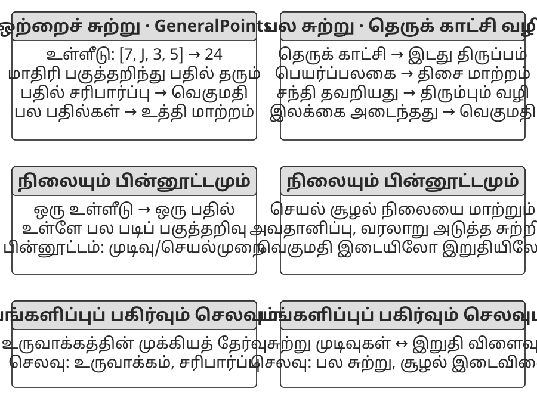

படம் 8-15-இல், ஏஜெண்ட் 3-ஆவது படியில் சந்திப்பைத் தவறவிடுகிறது, 4-ஆவது படியில் வழி தவறியதைக் கண்டு திரும்பி வருகிறது, 5-ஆவது படியில் இலக்கை அடைகிறது. இறுதி வெகுமதி முழுப் பயணத்தையும் அங்கீகரிக்கிறது, ஆனால் தவறான வழியில் சென்றதையும் உரிய நேரத்தில் திரும்பியதையும் பிரித்தறியவில்லை. அடுத்த முறை இந்தச் சந்திப்பைச் சந்திக்கும்போது, அது நேரடியாகச் சரியான வழியில் செல்ல வேண்டும் என்று விரும்புகிறோம்; மீண்டும் தவறினால், திரும்பி வருவதை இன்னும் ஊக்குவிக்க வேண்டும். இறுதிப் பலனுக்கு முந்தைய ஒவ்வொரு படியின் பங்கையும் பயிற்சியில் மதிப்பிட வேண்டும்; இந்தச் சிக்கல் **பங்களிப்புப் பகிர்வு (Credit Assignment)** எனப்படுகிறது. மதிப்பு மற்றும் சாதக மதிப்பீடுகள் பின்னர் வரும் வருவாயைப் பயன்படுத்தலாம்; இடைநிலைச் செயல்களை நம்பகமாகச் சரிபார்க்க முடிந்தால், செயல்முறை வெகுமதியையும் சேர்க்கலாம். 4-ஆவது படியின் திரும்புதல் செயல்முறை வெகுமதியில் 0 பெற்றாலும், இறுதி இலக்கை அடைய அது உதவுகிறது. இந்தப் படியின் மதிப்பை மதிப்பிடும்போது, பின்னர் வரும் வருவாயையும் கணக்கில் சேர்க்க வேண்டும்.

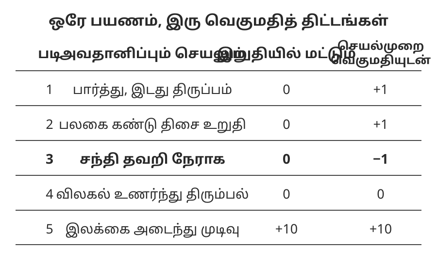

இதே சிக்கல் வாடிக்கையாளர் சேவை அழைப்புகளிலும் ஏற்படுகிறது. எடுத்துக்காட்டாக, பயனர் 10-ஆவது சுற்றில் நல்ல மதிப்பீடு தருகிறார். 2-ஆவது சுற்றில் எந்தக் கட்டணம் சர்ச்சைக்குரியது என்று தெளிவாகக் கேட்டதும், 7-ஆவது சுற்றில் கட்டணத்தை விளக்கியதும் — இரண்டு படிகளும் உதவியிருக்கலாம். கடைசி நல்ல மதிப்பீட்டை மட்டும் வைத்து, ஒவ்வொன்றும் எவ்வளவு பங்கு வகித்தது என்று பிரித்தறிய முடியாது. கீழே உள்ள இரண்டு சோதனைகள் முறையே, பயிற்சியாளர் வழிசெலுத்தல் செயல்களைப் படிப்படியாகச் சரிபார்க்க முடியும் சூழ்நிலையையும், ரோபோ வெற்றி பெற்றதா என்பதைப் பணி முடிவிலிருந்து மட்டுமே தீர்மானிக்க முடியும் சூழ்நிலையையும் விவாதிக்கின்றன.

> **சோதனை 8-12 ★★★: V-IRL-VL — பல-சுற்றுக் காட்சி வழிசெலுத்தல்**
>
> V-IRL[^ch8-24]-இல், ஏஜெண்ட் கண்முன் உள்ள தெருக்காட்சியின்படி படிப்படியாக இலக்கைக் கண்டுபிடிக்க வேண்டும். பயிற்சிக்கு நியூயார்க் வழிகள் பயன்படுத்தப்படுகின்றன; சோதனை பிற நகரங்களுக்கு மாறுகிறது; வழி சொல்லும் முறையும் படத்தில் உள்ள தெருக்காட்சியும் மாறுகின்றன. விதி மாற்றம், காட்சி மாற்றம் ஆகிய இரண்டு வகைப் பரவல்-வெளிச் சோதனைகளிலும், RL-இன் செயல்திறன் SFT-ஐவிடத் தெளிவாகச் சிறப்பாக இருந்தது. சோதனை மதிப்பு வலையமைப்புடன் கூடிய PPO-வைப் பயன்படுத்துகிறது. ஒவ்வொரு படிக்கும் பின்னூட்டம் வழங்குவது, நீண்ட பாதையில் எந்த முடிவுகளைத் தக்கவைக்கத் தகுந்தவை என்று பிரித்தறிய உதவுகிறது.

> **சோதனை 8-13 ★★★: SimpleVLA-RL — முடிவு வெகுமதியின் கீழ் திறந்த தேடல் `[விரிவாக்கச் சோதனை]`**
>
> SimpleVLA-RL, LIBERO ரோபோ பணிகளில் வெற்றி/தோல்வி முடிவு வெகுமதியைப் பயன்படுத்துகிறது. ஒவ்வொரு பணிக்கும் ஒரு செயல்விளக்கப் பாதையைக் கொண்டு SFT cold-start செய்து, பின்னர் RL மூலம் வெற்றி வீதத்தை 17.3%-இலிருந்து 91.7%-க்கு உயர்த்துகிறது; செயல்விளக்கத்தில் தோன்றாத "தள்ளி வெட்டுதல்" (push-cut) செயலையும் உருவாக்குகிறது. இந்த முடிவைத் தெருக்காட்சி வழிசெலுத்தலுடன் ஒப்பிட்டுப் பாருங்கள்: இடையில் எந்தப் படி தவறியது என்று நம்பகமாகத் தீர்மானிக்க முடிந்தால், அந்த இடத்திலேயே பின்னூட்டம் தந்து கற்றலை விரைவுபடுத்தலாம். பணியை முடிக்க எத்தனை வழிகள் உள்ளன என்று இன்னும் தெரியாவிட்டால், முதலில் முடிவின்படி வெகுமதி வழங்குவது, பிற பாதைகளை முயல மாதிரிக்கு இடமளிக்கும். மனிதச் செயல்விளக்கத்தில் உள்ள செயல் வரிசையை முன்கூட்டியே வெகுமதித் தேவையாக எழுதிவிட்டால், "தள்ளி வெட்டுதல்" போன்ற புதிய உத்திகளின் மதிப்பெண் குறைக்கப்படலாம்.

### கருவி அழைப்பு: ஊடாடலில் வெளித் திறன்களைப் பயன்படுத்தக் கற்றல்

வெளிக் கருவிகளை இணைத்த பிறகு, மாதிரி தேடல், குறியீட்டு இயக்கம், கோப்புத் திருத்தம், தரவுத்தள விசாரணை ஆகியவற்றைத் தேர்ந்தெடுக்கலாம், அல்லது பணித் தேவைக்கேற்பப் பல API-களை இணைக்கலாம். Harness அழைப்புகளைச் சரிபார்த்து ஒழுங்கமைக்கும் பொறுப்பை ஏற்கிறது; கருவி சூழலில் இயங்கி அவதானிப்பைத் திருப்பி அனுப்புகிறது. படம் 8-16 ஒரு பணிக்குள் நடக்கும் முடிவெடுத்தலையும் பணி முடிந்த பிறகு நடக்கும் பயிற்சியையும் பிரித்துக் காட்டுகிறது. வலது பக்க அம்புகளைப் பின்பற்றினால், கருவி முடிவு தற்போதைய பணிக்குத் திரும்புகிறது; மாதிரி அதைக் கொண்டு அடுத்த படியைத் தீர்மானிக்கிறது. கீழ்நோக்கிப் படித்தால், பணி முடிந்த பிறகுதான் பயிற்சி நிரல் முழுப் பாதையையும் கொண்டு வெகுமதியைக் கணக்கிட்டு அளவுருக்களைப் புதுப்பிக்கிறது; அடுத்த சுற்று மாதிரியெடுப்பு புதிய உத்தியைப் பயன்படுத்துகிறது. ஒரு பணியில் பல கருவிகளைத் தொடர்ந்து அழைக்க வேண்டியிருக்கும்போது, முந்தைய அழைப்பு திருப்பி அனுப்பிய முடிவு அடுத்த அழைப்பின் அளவுருக்களைப் பாதிக்கிறது.

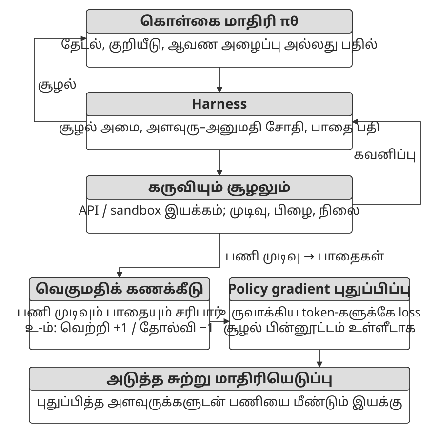

Search-R1[^ch8-25] எப்போது தேடுவது, எந்த விசாரணையைச் சமர்ப்பிப்பது என்று தீர்மானிக்கவும், முடிவுகளை இணைத்துப் பகுத்தறிவைத் தொடரவும் மாதிரியைப் பயிற்றுவிக்கிறது. ReTool குறியீட்டு விளக்கியை இதே வகைச் சுழற்சியில் இணைக்கிறது; மாதிரி குறியீட்டு இயக்கத்தை ஒழுங்கமைக்கவும், திருப்பி அனுப்பப்படும் மதிப்புகளைப் புரிந்துகொள்ளவும், பிழைச் செய்திகளின்படி திருத்தவும் கற்கிறது. AWorld-train MCP பல-கருவி sandbox வரை விரிவடைகிறது; மாதிரி கருவிகளைத் தேர்ந்தெடுத்து, அழைப்புகளுக்கு இடையிலான சார்புகளைக் கையாள வேண்டும்; பயிற்சி அமைப்பும் சூழலை மீட்டமைக்கவும் பாதைகளை மீண்டும் இயக்கவும் முடிய வேண்டும்.

கருவிப் பாதைகளில் மாதிரி உருவாக்கிய token-களையும் சூழல் திருப்பி அனுப்பிய token-களையும் பிரித்தறிய வேண்டும். உத்தி இழப்பைக் கணக்கிடும்போது, மாதிரி உருவாக்கிய பகுத்தறிவு, அழைப்பு அளவுருக்கள், பதில் போன்ற செயல்களுக்கு மட்டுமே இழப்பைக் கணக்கிட்டு, சூழல் பின்னூட்டத்துக்குரிய இடங்களை மறைக்க வேண்டும். பின்னூட்டம் சூழலாக இருந்து அடுத்தடுத்த கணக்கீட்டில் பங்கேற்று, அடுத்து என்ன செய்வது என்று தீர்மானிக்க மாதிரிக்கு உதவுகிறது. எடுத்துக்காட்டாக, விளக்கி ஒரு பிழைச் செய்தியைத் திருப்பி அனுப்பினால், பயிற்சி வலுப்படுத்த வேண்டியது அதன் பிறகு மாதிரி குறியீட்டை எப்படித் திருத்துகிறது என்பதையே. பிழைச் செய்தி உரையையும் உத்தி இழப்பில் சேர்த்தால், புதுப்பிப்பில் "சூழல் வெளியீட்டை உருவாக்கு" என்ற இலக்கும் கலந்துவிடும்; மாதிரி உண்மையில் பொறுப்பேற்கும் முடிவுகளிலிருந்து அது விலகிவிடும்.

> **சோதனை 8-14 ★★★: ReTool — குறியீட்டு விளக்கியால் மேம்படுத்தப்பட்ட கணிதத் தீர்வு**
>
> படம் 8-17 இருபடிச் சமன்பாட்டைக் கொண்டு உரைப் பகுத்தறிவு, குறியீட்டு உருவாக்கம், விளக்கிப் பின்னூட்டம் ஆகியவை எப்படி மாறி மாறி நடக்கின்றன என்று காட்டுகிறது.
>
> 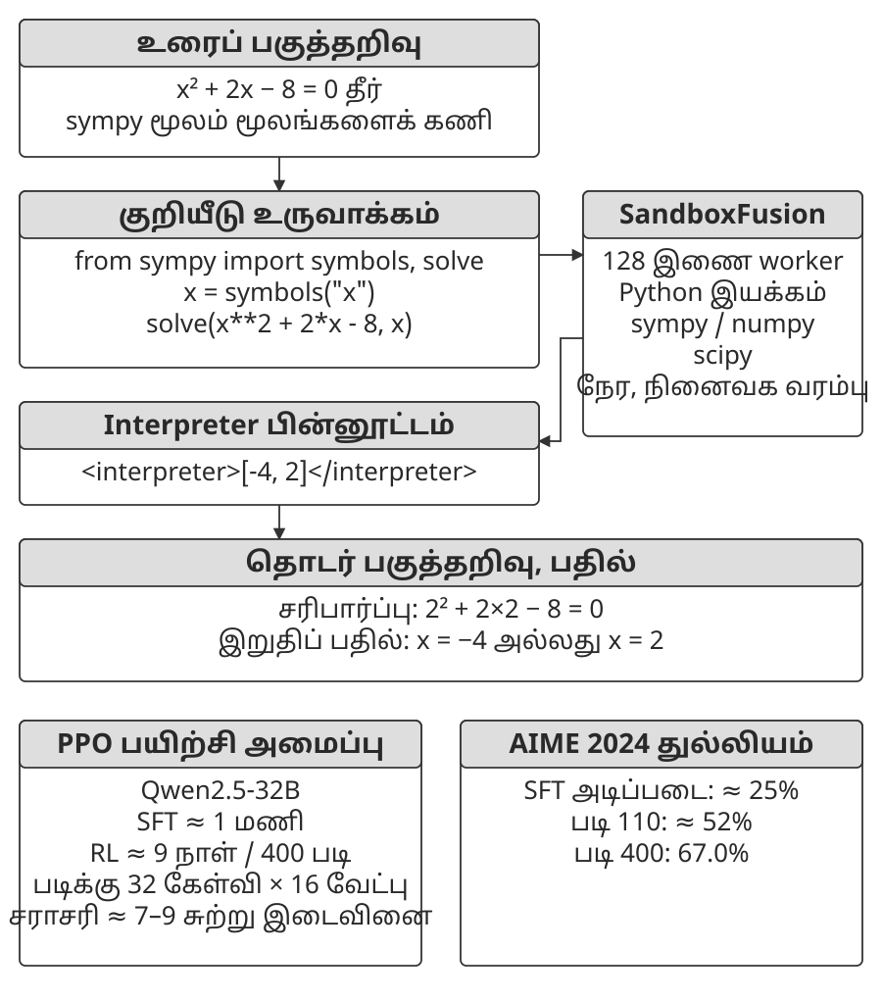
>
> ReTool, SFT முன்சூடாக்கத்துக்கு (warm-up) பிறகு, பின்னிப் பிணைந்த உரைச் சிந்தனை, குறியீட்டு இயக்கம், விளக்கிப் பின்னூட்டம் ஆகியவற்றைக் கொண்டு PPO பயிற்சி செய்கிறது. எப்போது குறியீட்டை இயக்குவது பயனுள்ளது, பிழைச் செய்திக்குப் பிறகு எப்படித் திருத்துவது என்பதை மாதிரி படிப்படியாகக் கற்கிறது. இங்கு DAPO-Math-17k பயிற்சித் தரவு பயன்படுத்தப்படுகிறது; உத்தியைப் புதுப்பிக்கப் பயன்படுவது இன்னும் நிலையான PPO-வே[^ch8-26][^ch8-27].
>
> பயிற்சிக்குப் பிறகு, AIME 2024-இல் மாதிரியின் பதில் துல்லியம் சுமார் 25%-இலிருந்து 67.0%-க்கு உயர்ந்தது. உரை-மட்டும் RL-உடன் ஒப்பிடும்போது, குறியீட்டுப் பின்னூட்டம் துல்லியமான கணக்கீட்டையும் பிழைத் திருத்தத்தையும் மாதிரி வேகமாகக் கற்க உதவியது.

> **சோதனை 8-15 ★★★: AWorld-train — sandbox-இல் கருவிகளைப் பயன்படுத்தக் கற்றல்**
>
> படம் 8-18-இன் மேல் பாதியில் ஒருமுறை சுற்றி வந்தால், மாதிரி ஒரு கருவி அழைப்பின் முடிவைப் பெற்று, தொடர்ந்து முயலவும் முடிகிறது. பின்னர் கீழ்ப் பாதியில் ஒருமுறை சுற்றி வாருங்கள்: இந்தத் தொகுதிப் பணிகள் ஏற்கெனவே முடிந்துவிட்டன; பயிற்சி நிரல் வெகுமதியுடன் கூடிய பாதைகளைப் பெற்று அளவுருக்களைப் புதுப்பிக்கிறது; அடுத்த தொகுதிப் பணிகளில்தான் புதிய உத்தி பயன்படுத்தப்படுகிறது.
>
> 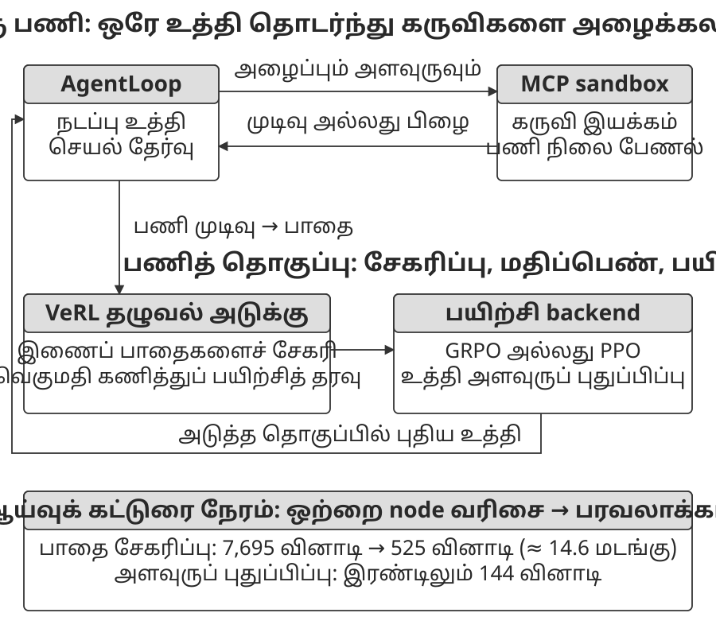
>
> GAIA சூழலில் 26 MCP சேவையகங்களும் 126 கருவிச் சார்புகளும் உள்ளன; Playwright மூலம் வலைப்பக்கங்களை இயக்கலாம், PDF, Word, ஸ்லைடுகளிலிருந்து உள்ளடக்கத்தைப் பிரித்தெடுக்கலாம், ஒலியை எழுத்தாக்கலாம், எழுத்துகளை அடையாளம் காணலாம், அல்லது E2B sandbox-இல் குறியீட்டை இயக்கலாம். Excel கருவி சூத்திரங்கள், வரைபடங்கள், தரவுச் சுழல் அட்டவணைகள் (pivot) உட்பட 29 செயல்பாடுகளை வழங்குகிறது; அறிவுத் தேடல் Wikipedia, arXiv, Wayback ஆகியவற்றையும் அணுக முடியும். sandbox-ஐ மீட்டமைத்த பிறகு, அதே நிலையிலிருந்து மீண்டும் முயலலாம், அல்லது முந்தைய பாதையை மீண்டும் இயக்கலாம்.
>
> படத்தில் உள்ள நேரக் கணக்குகள் கட்டுரையின் சேகரிப்பு ஒப்பீட்டிலிருந்து எடுக்கப்பட்டவை. துணைச் சோதனை ஒரு 4B மாதிரிக்கான பயிற்சி அமைப்பையும் தனியாக வழங்குகிறது: Qwen3-4B-Thinking-2507, 8 A100, சூழல் வரம்பு 131K, அதிகபட்சம் 32 சுற்று ஊடாடல், தொகுதி அளவு 32, ஒவ்வொரு கேள்விக்கும் 16 பாதைகள் மாதிரியெடுப்பு, GRPO மூலம் புதுப்பிப்பு, கற்றல் வீதம் 1e−6.

கருவி ஒரு முடிவைத் திருப்பி அனுப்பியது; பயிற்சி நிரல் எந்தப் படிக்கு வெகுமதி அளிக்க வேண்டும்? ஒரு வெற்றிகரமான அழைப்பு, கருவி வெற்றிகரமாக இயங்கியது என்பதை மட்டுமே காட்டுகிறது. இந்தப் படி பணியை முன்னேற்றியதா என்று தீர்மானிக்க, அது ஏற்படுத்திய மாற்றத்தைச் சரிபார்ப்பானைக் கொண்டு சரிபார்த்து, பின்னர் மாதிரிக்கு என்ன வெகுமதி தருவது என்று முடிவு செய்ய வேண்டும்.

## வெகுமதி வடிவமைப்பு: பணி இலக்கைக் கற்றல் சமிக்ஞையாக மாற்றுவது எப்படி

பணத்தைத் திருப்பித் தரும் இரண்டு பாதைகள் இறுதியில் அதே தொகையைத் திருப்பி அளித்தன என்றும், அவற்றில் ஒன்று கட்டாயமான அடையாளச் சரிபார்ப்பைத் தவிர்த்தது என்றும் கற்பனை செய்யுங்கள். இறுதி இருப்பை மட்டும் படித்தால், இரண்டும் ஒரே மதிப்பெண் பெறும். பயனர் ஒப்படைத்த முழுத் தேவைகளையும் கற்றல் சமிக்ஞையாக மாற்ற, முதலில் முடிவை யார் சரிபார்க்க முடியும், எந்தப் படியில் சான்று கிடைக்கும், எந்தத் தகவல்களை மாதிரிக்குத் திருப்பி அனுப்ப வேண்டும் என்று தீர்மானித்து, பின்னர் பாதையில் உள்ள அனுமதி மற்றும் நடைமுறைக் கட்டுப்பாடுகளைத் தனியாகச் சரிபார்க்க முடியுமா என்று பாருங்கள்.

### வெகுமதி எங்கிருந்து வருகிறது: விதிகள், மனித விருப்பம், மாதிரி மதிப்பீடு

தானாகத் தீர்மானிக்கக்கூடிய பணிகளுக்கு, ஆசிரியர் **சரிபார்க்கக்கூடிய வெகுமதி அடிப்படையிலான வலுவூட்டல் கற்றலுக்கு (RLVR)** முன்னுரிமை தந்து, ஏற்புத் தேவைகளை நேரடியாக நிரலாக எழுதுகிறார். கணிதக் கேள்விகளுக்குப் பதிலைச் சரிபார்க்கலாம்; குறியீட்டுப் பணிகளுக்குச் சோதனைகளை இயக்கலாம்; பணத்தைத் திருப்பித் தரும் பணிகளுக்குத் தரவுத்தளத்தில் உள்ள தொகையையும் ஆர்டர் நிலையையும் சரிபார்க்கலாம். கடந்தால் 1, தோல்வியடைந்தால் 0 எனப் பதிவு செய்தால், மிக எளிய முடிவு வெகுமதி கிடைக்கிறது. விதிகள் தெளிவாகவும் இயக்கம் மீள்உருவாக்கக்கூடியதாகவும் இருப்பதால், மதிப்பீட்டு வேறுபாடுகளைக் கண்டறிவது எளிது; சரிபார்ப்பானின் பரப்பு வரம்பே, பயிற்சி உண்மையில் எந்தத் தேவைகளை உகப்பாக்குகிறது என்பதைத் தீர்மானிக்கிறது.

**மனிதப் பின்னூட்ட வலுவூட்டல் கற்றல் (RLHF)** மனித விருப்பங்களைப் பயிற்சிச் சமிக்ஞையாக மாற்றுகிறது. InstructGPT[^ch8-4] முதலில் பதில்கள் மீதான மனித ஒப்பீடுகளைச் சேகரித்து, வெகுமதி மாதிரியைப் பயிற்றுவித்து, பின்னர் PPO மூலம் உத்தியை உகப்பாக்கியது. வெகுமதி மாதிரி கற்பது குறைந்த மாதிரிகளில் உள்ள விருப்பங்களையே; மாதிரியின் மதிப்பெண்ணைத் தொடர்ந்து உயர்த்த முயல்வது அதன் சார்புநிலையைப் பெருக்கக்கூடும்[^ch8-5]. உத்தி விலகலைக் கட்டுப்படுத்த, பயிற்சியில் பொதுவாக SFT குறிப்பு மாதிரியைப் பொறுத்த KL முறைப்படுத்தல் சேர்க்கப்படுகிறது. DPO[^ch8-6] "சிறந்த பதில்—மோசமான பதில்" விருப்ப ஜோடிகளை நேரடியாகப் பயன்படுத்தி உத்தியை உகப்பாக்குகிறது; வெகுமதி மாதிரியைத் தனியாகப் பயிற்றுவிக்கும் படி தேவையில்லை.

திறந்த பணிகளுக்கு, மதிப்பீட்டுக் காரணங்களையும் மதிப்பெண்களையும் தர மாதிரியை வைக்கலாம். **உருவாக்க வெகுமதி மாதிரி (Generative Reward Model, GRM)** உருவாக்கும் கண்டறிதல்களைச் செயல்விளக்கங்களை வடிகட்டவும், விருப்ப ஜோடிகளை உருவாக்கவும், அடுத்தடுத்த திருத்தங்களுக்கு வழிகாட்டவும் பயன்படுத்தலாம். DeepSeek-GRM[^ch8-23] பணியின்படி மதிப்பீட்டுக் கொள்கைகளை உருவாக்கி, அவற்றின் அடிப்படையில் விமர்சனங்களையும் மதிப்பெண்களையும் தருகிறது; online RL மூலம் மதிப்பீட்டு நடத்தையை மேம்படுத்தி, பலமுறை மாதிரியெடுப்பையும் துணை வெகுமதி மாதிரியையும் கொண்டு தீர்ப்புகளைத் திரட்டுகிறது.

மதிப்பீட்டு அளவீடுகளுக்கும் பணி இலக்குகளுக்கும் இடையிலான இடைவெளியும் மாதிரியின் நடத்தையைப் பாதிக்கிறது. **Reward hacking** என்பது மதிப்பீட்டு விதிகளிலோ செயலாக்கத்திலோ உள்ள குறைபாடுகளைப் பயன்படுத்தி உத்தி அதிக மதிப்பெண் பெறுவதைக் குறிக்கிறது. நீண்ட-கால ஏஜெண்ட்டுகளில் **reward seeking** எனப்படும் இன்னொரு வகை நிகழ்வும் உண்டு: மாதிரி தான் ஊகிக்கும் மதிப்பீட்டு முறையின்படி செயல்படுகிறது; எடுத்துக்காட்டாக, எளிதில் கடக்கக்கூடிய ஒரு சரிபார்ப்பைத் தானே தேர்ந்தெடுத்து, அது கடந்தவுடன் பணியை முடித்துவிடுகிறது[^ch8-29]. ஏற்பு நிபந்தனைகள் பயனரின் இலக்கிலிருந்து தொடங்கி, உண்மையான ஒப்படைப்புப் பொருள்களை (deliverables) உள்ளடக்க வேண்டும் என்பதை இந்த எடுத்துக்காட்டு நினைவூட்டுகிறது; மாதிரி தானே தேர்ந்தெடுத்த அளவீடுகளை மட்டும் சரிபார்த்தால், இன்னும் நிறைவேற்றப்படாத தேவைகள் எளிதில் விடுபட்டுப் போகும்.

பணத்தைத் திருப்பித் தரும் பணிக்கான வெகுமதியை வடிவமைக்கும்போது, முதலில் மனிதர் எழுதிய இரண்டு பாதைகளைச் சரிபார்ப்பான் வழியாக அனுப்புங்கள். அ ஆர்டரைக் கண்டறிந்து, பணத்தைத் திருப்பித் தரும் இடைமுகத்தை அழைத்து, ரசீதைப் பயனருக்கு மீண்டும் கூறுகிறது; ஆ "பணம் திருப்பித் தரப்பட்டது" என்று மட்டும் சொல்கிறது. இரண்டும் ஒரே மதிப்பெண் பெற்றால், மதிப்பீட்டாளர் உண்மையில் இறுதிப் பதிலைப் படித்ததா, இடைமுக ரசீதைப் படித்ததா, ஆர்டர் நிலையைப் படித்ததா என்று முதலில் சரிபாருங்கள். பதிலிப் (proxy) அளவீட்டின் சிக்கலை வெளிப்படுத்த இந்தச் சிறிய எதிர்-எடுத்துக்காட்டே போதுமானது; முழுத் தொகுதியையும் பயிற்றுவித்த பிறகே மாதிரி முன்கூட்டியே வெற்றியை அறிவிக்கக் கற்றுக்கொண்டது என்று கண்டறியும் விலையை இது மிச்சப்படுத்துகிறது.

### வெகுமதி எப்போது வழங்கப்படுகிறது: முடிவும் செயல்முறையும்

**முடிவு வெகுமதி (outcome reward)** ஒரு episode முடிந்த பிறகு பணிச் செயல்திறனை மதிப்பிடுகிறது; முடிவை மதிப்பிட ஒரு மாதிரியைப் பயன்படுத்தும்போது, அத்தகைய மாதிரி **ORM (Outcome Reward Model)** எனப்படுகிறது. SimpleVLA-RL-இன் வெற்றி/தோல்வி வெகுமதி, இறுதி இலக்கைச் சுற்றி வெவ்வேறு செயல் வரிசைகளைத் தேட உத்தியை அனுமதிக்கிறது. இத்தகைய சமிக்ஞையை வரையறுப்பது எளிது; ஆனால் ஒரு நீண்ட பாதை தோல்வியடைந்த பிறகு, எந்தச் செயல்கள் தோல்விக்குக் காரணம் என்று பிரித்தறிய மாதிரிக்கு இன்னும் பல முயற்சிகள் தேவை. அரிதான பின்னூட்டம் மாதிரித் திறனை (sample efficiency) பாதிப்பதற்கு இது ஒரு காரணம்[^ch8-8].

Coding Agent முன்கூட்டியே முடிப்பதை எடுத்துக்காட்டாகக் கொள்வோம்: மாதிரி நிறைவு அறிவிப்பைச் சமர்ப்பித்த பிறகு, Harness தனிமைப்படுத்தப்பட்ட பணியிடத்தில் பாதுகாக்கப்பட்ட ஏற்புச் சோதனைகளை இயக்குகிறது. சோதனைகள் உண்மையான கோப்புகளையும் சூழல் நிலையையும் படிக்கின்றன; கடந்தால் நேர்மறை வெகுமதி, தோல்வியடைந்தால் எதிர்மறை வெகுமதி. இவ்வாறு நிறைவு அறிவிப்பு வெளிச் சரிபார்ப்பைத் தூண்டுகிறது; பணி முடிவை ஒப்படைப்புப் பொருள்கள் தீர்மானிக்கின்றன. மதிப்பீட்டின்போது இரண்டு பணித் தொகுப்புகளைத் தனித்தனியே தயாரியுங்கள்: ஒன்றில் இன்னும் முடிக்க வேண்டிய வேலை உள்ளது, முன்கூட்டியே முடிக்கும் வீதத்தை அளக்கப் பயன்படுகிறது; மற்றொன்று ஏற்கெனவே முடிந்தது, மாதிரி உரிய நேரத்தில் முடிக்க முடிகிறதா என்று சரிபார்க்கப் பயன்படுகிறது.

**செயல்முறை வெகுமதி (process reward)** இடைநிலைப் படிகளில் பின்னூட்டம் வழங்குகிறது; எடுத்துக்காட்டாக, அடையாளச் சரிபார்ப்பு, அளவுருத் தேர்வு, வழிசெலுத்தல் செயல் அல்லது பகுத்தறிவுப் படியை மதிப்பிடுதல். செயல்முறையை மதிப்பிடப் பயன்படும் மாதிரி **PRM (Process Reward Model)** எனப்படுகிறது. OpenAI-இன் "Let's Verify Step by Step"[^ch8-7] கணிதப் பகுத்தறிவில் படி-வாரியான சரிபார்ப்பை ஆராய்ந்தது. செயல்முறைச் சமிக்ஞைகள் பிழைகளைக் கண்டறிய மாதிரிக்கு உதவலாம்; ஆனால் குறியிடல் மற்றும் சரிபார்ப்புச் செலவையும் அதிகரிக்கின்றன. ஏதேனும் ஒரு தீர்வு வரிசையை ஒரே சரியான பாதையாகக் கருதினால், பிற செல்லுபடியான உத்திகளின் வெகுமதியும் குறைக்கப்படும். ஆகவே ஆசிரியர் உண்மையில் சரிபார்க்கக்கூடிய இடைநிலை நிகழ்வுகளுக்கு மட்டுமே செயல்முறைச் சமிக்ஞையைச் சேர்த்து, பல செல்லுபடியான தீர்வுகளைத் தொடர்ந்து தேட மாதிரியை அனுமதிக்கிறார். V-IRL-VL (சோதனை 8-12) படி-வாரியான வழிசெலுத்தல் பின்னூட்டத்தையும், SimpleVLA-RL (சோதனை 8-13) இறுதி வெகுமதியையும் பயன்படுத்துகின்றன; இவை இரண்டு வகைப் பணிகள் பின்னூட்ட நுணுக்கத்தை (granularity) எப்படி வெவ்வேறாகத் தேர்ந்தெடுக்கின்றன என்பதைக் காட்டுகின்றன.

நடைமுறையில் முதலில் முடிவு வெகுமதி அடிப்படைக் கோட்டை அமைத்து, பின்னர் அடையாளச் சரிபார்ப்பு முடிந்தது, சோதனைகள் கடந்தன போன்ற இடைநிலை நிகழ்வுகளுக்குச் செயல்முறைச் சமிக்ஞைகளைச் சேர்க்கலாம். வரையறுக்கப்பட்ட நீளம் கொண்ட பல-சுற்றுப் பணிகளில் தள்ளுபடிக் காரணி $\gamma=1$ எடுக்கலாம்; அப்போது இறுதி வெகுமதி முன்னோக்கிப் பரவும்போது அதே எடையைத் தக்கவைக்கும். PPO மதிப்பு மதிப்பீடு, சாதகக் கணக்கீடு மூலம் பின்னூட்டத்தை ஒவ்வொரு படிச் செயலுடனும் இணைக்கிறது; பாதை-மட்டச் சாதகத்தைப் பயன்படுத்தும் GRPO பொதுவாக அதே சாதக எடையைக் கொண்டு அந்தப் பாதையில் உருவாக்கப்பட்ட ஒவ்வொரு token-இன் உத்தி இழப்பையும் கணக்கிடுகிறது.

### வெகுமதி எவ்வளவு தகவலை வெளிப்படுத்த வேண்டும்: அளவெண், திசையன், உருவாக்கக் கண்டறிதல்

வெகுமதி எப்போது தோன்றுகிறது என்பது பின்னூட்டத்தின் அடர்த்தியைத் தீர்மானிக்கிறது; வெகுமதியில் என்ன உள்ளது என்பது அதன் பிரதிநிதித்துவ வடிவத்தைத் தீர்மானிக்கிறது. ஓர் அளவெண் (scalar) ஒட்டுமொத்தச் செயல்திறனைச் சுருக்குகிறது; "சுருக்கமான காரணம் + மதிப்பெண்" என்ற அரை-அளவெண் வடிவம் மதிப்பீட்டு அடிப்படையைச் சேர்க்கிறது; திசையன் (vector) துல்லியம், முழுமை, செலவு போன்ற பரிமாணங்களைத் தனித்தனியே வெளிப்படுத்துகிறது; உருவாக்கக் கண்டறிதல் (generative diagnosis) சிக்கலையும் திருத்தத் திசையையும் குறிப்பாக விளக்குகிறது; பலமுறை மாதிரியெடுப்பின் மூலமும் திரட்டலாம்.

- உறுதியான பதில் அல்லது ஏற்புச் சோதனை இருந்தால், இருநிலை அளவெண்ணிலிருந்து தொடங்கலாம்.
- பல தர இலக்குகள் இருந்தால், தனித்தனியே மதிப்பெண் வழங்கி, வணிகத் தேவைகளின்படி எடையிடலாம் அல்லது கட்டுப்பாடுகளை அமைக்கலாம்.
- மதிப்பீட்டுக்குச் சூழலுடன் இணைந்த விளக்கம் தேவைப்பட்டால், கண்டறிதலை உருவாக்கி, உண்மைச் சரிபார்ப்பு மற்றும் மனித மாதிரிச் சோதனை மூலம் அளவுதிருத்தம் செய்யலாம்.

எடுத்துக்காட்டாக, ஒரு வாடிக்கையாளர் சேவைப் பணியில் தீர்வு நிலை, உரையாடல் சுற்றுகள், அடையாளச் சரிபார்ப்பு முடிந்ததா ஆகியவற்றை ஒரே நேரத்தில் பதிவு செய்யலாம். மூன்று பரிமாணங்களும் முறையே பலன், செலவு, நடைமுறைத் தேவைகளுக்குப் பொருந்துகின்றன. இவற்றைப் பயிற்சிக்குப் பயன்படுத்தும் முன், மதிப்பீடு நிலையானதா, ஒரே குழுவின் பாதைகளின் நடத்தையை அவை பிரித்தறிய முடிகிறதா என்று முதலில் சரிபார்க்க வேண்டும். ஆசிரியர் சில நம்பகமான அளவீடுகளிலிருந்து தொடங்கி, ஒவ்வொன்றாகச் சரிபார்த்த பிறகே பரிமாணங்களைச் சேர்க்கிறார். சரிபார்க்கப்படாத ஒவ்வொரு மதிப்பீட்டு உருப்படியும், உண்மையான பணியை மேம்படுத்தாமல், புதிய பதிலி அளவீட்டின் வழியே மாதிரியை உகப்பாக்கச் செய்யக்கூடும்.

### பாதைக் கட்டுப்பாடுகளும் RLVP-யும்

பணியை முடிக்கும் செயல்முறையில் தனித்த நடத்தைத் தேவைகளும் இருக்கலாம்: வணிக நேரத்தின்படி பயனரைத் தொடர்புகொள்ளுதல், அடையாளச் சரிபார்ப்பை முடித்தல், பாதுகாக்கப்பட்ட கோப்புகளை மாற்றாமல் வைத்திருத்தல். RLVP (Reinforcement Learning with Verified Penalty)[^ch8-9] முடிவு வெகுமதியைச் சரிபார்க்கக்கூடிய பாதைத் தண்டனையுடன் இணைக்கிறது; அதன் கொள்கை **முடிவுக்கு வெகுமதி, பாதைக்குத் தண்டனை**. பாதை விதிகள் சூழலில் அவதானிக்கக்கூடிய செயல்களால் தூண்டப்படுகின்றன; ஒப்படைப்பின் முழுமையைப் பணி ஏற்புச் சோதனையே தொடர்ந்து சரிபார்க்கிறது.

இரண்டு திருத்தங்களும் ஏற்புச் சோதனையைக் கடந்தன, ஆனால் அவற்றில் ஒன்று முதலில் படிக்க வேண்டிய கோப்பை நேரடியாக மேலெழுதிவிட்டது. கருவிப் பதிவுகளைச் சரிபார்த்தாலே இந்த விதிமீறல் செயலைக் கண்டறியலாம்; ஆனால் முந்தைய ஒவ்வொரு படியும் இறுதி வெற்றிக்கு எவ்வளவு பங்களித்தது என்று தீர்மானிப்பது மிகக் கடினம். மிக எளிய முறை முழுப் பாதைக்கும் ஒரு மதிப்பெண் $R=O+\beta\Phi$ வழங்குவது: $O$ பணி மதிப்பெண், $\Phi$ விதிமீறல் கழிவுகளையோ சரிபார்க்கக்கூடிய முன்னேற்றத்தையோ திரட்டுகிறது, $\beta$ இரண்டின் ஒப்பீட்டு எடையைத் தீர்மானிக்கிறது. இது இரண்டு திருத்தங்களையும் பிரித்தறியலாம்; ஆனால் ஒரே பாதையில் உள்ள ஒவ்வொரு செயலும் ஒரே சமிக்ஞையைப் பெறுகிறது.

எந்தச் சுற்றில் விதிமீறல் நடந்தது என்று தெரிந்தால், கழிவை அந்தச் சுற்றுக்கே ஒதுக்கலாம். துணைச் செயலாக்கத்தின் இரண்டு சோதனைப் பாதைகளைப் பாருங்கள்: அ பணியை முடித்தது, ஆனால் இரண்டாவது சுற்றில் விதிமீறியது; ஆ பணியை முடிக்கவில்லை, இரண்டு சுற்றுகளும் விதிக்கு இணங்கின. இரண்டு பாதைகளின் முடிவு மதிப்பெண்கள் முறையே 1, 0; குழுச் சராசரியைக் கழித்தால் +0.5, −0.5. ஒவ்வொரு பாதையிலும் இரண்டு சுற்றுச் செயல்கள் உள்ளன; ஒவ்வொரு சுற்றிலும் 10 செயல் token-கள். செயலாக்கத்தில் உள்ள `c2` அமைப்பின்படி, இரண்டு சமிக்ஞைகளும் தனித்தனியே கணக்கிடப்படுகின்றன:

```python
outcome_weight = (1 - 0.5) / 40  # 结果信号分摊到这批的全部 40 个动作 token
penalty_weight = -0.3 / 10       # 违规扣分只分摊到甲第二轮的 10 个动作 token
first_turn = outcome_weight
second_turn = outcome_weight + penalty_weight
```

அ-வின் முதல் சுற்றில், ஒவ்வொரு செயல் token-உம் பெறும் எடை +0.0125; இரண்டாவது சுற்றில் −0.0175. இதனால், அதே வெற்றிகரமான திருத்தத்தில் உள்ள இரண்டு செயல்களும் எதிரெதிர்த் திசைகளில் பயிற்சிச் சமிக்ஞைகளைப் பெறலாம். இத்தகைய எடைகள் உத்தி இழப்புக்குள் நுழைந்த பிறகே, உகப்பாக்கி அவற்றின்படி அளவுருக்களைப் புதுப்பிக்கிறது. வாடிக்கையாளர் சேவைப் பணிக்கு மாற்றினால், எந்தச் சுற்றில் அங்கீகாரச் சரிபார்ப்பு தவிர்க்கப்பட்டது என்பதைக் கருவிப் பதிவுகள் கண்டறிய முடிந்தால், அதே முறையில் கழிவை ஒதுக்கலாம்.

பாதைச் சமிக்ஞையின் பங்கைக் குழு-உள் வேறுபாட்டிலிருந்து புரிந்துகொள்ளலாம். ஒரு GRPO பாதைக் குழுவின் முடிவு வெகுமதிகள் ஒன்றாக இருந்தால், அந்த வெகுமதியின் அடிப்படையில் கணக்கிடப்படும் சாதகம் பூஜ்யம்; ஆனால் அவற்றில் விதிமீறல் எண்ணிக்கை வேறுபட்டால், பாதைத் தண்டனை புதிய ஒப்பீட்டு அடிப்படையை வழங்குகிறது. பகுதி முன்னேற்ற வெகுமதியும் இதே நிபந்தனையைப் பின்பற்றுகிறது: வெவ்வேறு அளவு முன்னேற்றத்தை மாதிரி குறைந்தபட்சம் மாதிரியெடுத்திருந்தால்தான், அது பிரித்தறியும் பங்கை வகிக்க முடியும்.

பாதை வெகுமதியை வடிவமைக்கும்போது நான்கு விதிகளைப் பின்பற்றலாம்: தெளிவான விதிமீறல் செயல்களைத் தண்டியுங்கள்; பணி முடிவு வெகுமதியைத் தக்கவையுங்கள்; கட்டுப்படுத்தப்பட்ட நடத்தைகளுக்கு எட்டக்கூடிய விதி-இணக்கப் பாதையை வழங்குங்கள்; திரும்பத் திரும்ப இயக்கக்கூடிய சரிபார்ப்பு விதிகளைப் பயன்படுத்துங்கள். எடுத்துக்காட்டாக, ஒவ்வொரு செயல்பாட்டையும் தனியாகத் தண்டித்தால், மாதிரி இருந்த இடத்திலேயே நிற்க ஊக்குவிக்கப்படும்; பணி வெற்றி வெகுமதியைத் தக்கவைத்தால்தான், அதே நேரத்தில் வேலையை முடிக்கவும் அது தூண்டப்படும். அடிப்படை மாதிரியால் விதி-இணக்கப் பாதையை உருவாக்குவது கடினமாக இருந்தால், முதலில் சில செயல்விளக்கங்களைக் கொண்டு தொடக்கப் புள்ளியை அமைத்து, பின்னர் பயிற்சி மூலம் பாதை வடிவமைப்பைச் (path shaping) சார்ந்திருப்பதைப் படிப்படியாகக் குறைக்கலாம்.

> **சோதனை 8-16 ★★★: RLVP — முடிவுக்கு வெகுமதி, பாதைக்குத் தண்டனை**
>
> சோதனை GRPO-வில் முடிவு வெகுமதி $O$-ஐயும் பாதைச் சமிக்ஞை $\Phi$-ஐயும் சேர்த்து, தூய முடிவு வெகுமதியுடன் ஒப்பிடுகிறது. TerminalBench பதிலிப் பணிகளில் விதிமீறல் எண்ணிக்கை 3.71-இலிருந்து 0.66-க்குக் குறைந்தது, வெற்றி வீதம் ஏறக்குறைய மாறவில்லை; miniF2F பதிலிப் பணிகளில், எட்டக்கூடிய பகுதி முன்னேற்ற வெகுமதியைச் சேர்த்த பிறகு, 0.9 வெற்றி வீதத்தை அடையத் தேவையான சுழற்சிகள் 7.0-இலிருந்து 4.4-க்குக் குறைந்தன.
>
> மென்பொருள் திருத்தப் பணிகள் சமிக்ஞை எட்டக்கூடிய தன்மையின் பங்கையும் காட்டுகின்றன: அனைத்து rollout-களும் எந்தச் சோதனையையும் கடக்க முடியாதபோது, கடந்த சோதனைகளின் எண்ணிக்கையைக் கொண்டு கணக்கிடப்படும் முன்னேற்ற வெகுமதி எப்போதும் ஒன்றாகவே இருக்கும்; குழு-உள் வேறுபாட்டை அதிகரிக்க முடியாது.

சராசரி விதிமீறல் எண்ணிக்கை 0.66-க்குக் குறைந்தது என்பது, மாதிரி அடிக்கடி விதி-இணக்கப் பாதையைத் தேர்ந்தெடுக்கிறது, ஆனாலும் எப்போதாவது விதிமீறுகிறது என்பதைக் காட்டுகிறது. கட்டாயம் பின்பற்ற வேண்டிய வரம்புகளுக்கு, கருவியை இயக்கும்போது அனுமதிகளையும் சரிபார்க்க வேண்டும்.

## வடித்தல்: மாதிரித் திறனை உயர்த்துதல்

ஓர் ஏஜெண்ட் rollout பெரும்பாலும் பல சுற்று மாதிரி உருவாக்கத்தையும் கருவி இயக்கத்தையும் உள்ளடக்கியது. **மாதிரித் திறனை (sample efficiency)** உயர்த்துவது என்பது, குறைந்த சூழல் ஊடாடல்களில் இலக்குச் செயல்திறனை அடைவதாகும். பயிற்சிப் படிகள், GPU நேரம், சூழல் அழைப்பு அளவு ஆகியவை வெவ்வேறு செலவுகளைப் பிரதிபலிக்கின்றன; பணியுடன் சேர்த்தே பார்க்க வேண்டும். எடுத்துக்காட்டாக, இந்த அத்தியாயத்தின் ReTool எடுத்துக்காட்டில் SFT பயிற்சிக்குச் சுமார் 1 மணிநேரமும், RL-க்குச் சுமார் 9 நாட்களும் ஆகின்றன; அவற்றில் திரும்பத் திரும்ப நிகழும் மாதிரியெடுப்பும் கருவி இயக்கமும் ஏராளமான வளங்களை எடுத்துக்கொள்கின்றன.

இறுதி வெகுமதியைப் பயன்படுத்தும்போது, ஒரு முழுப் பாதைக்கும் ஒரே ஒரு வெற்றி/தோல்வி மதிப்பெண் மட்டுமே கிடைக்கலாம். வணிகக் கருவி ஏற்கெனவே "கடன் அட்டையின் கடைசி நான்கு இலக்கங்கள் தேவை" என்று அறிவித்திருந்தும், ஏஜெண்ட் அந்தத் தகவலைத் தவறவிட்டு, இறுதியில் வெகுமதி 0 பெறுகிறது என்று வைத்துக்கொள்வோம். தோல்வி உண்மையில் புலம் இல்லாததால் வந்ததா, கருவி அளவுருப் பிழையால் வந்ததா, அல்லது அடுத்தடுத்த செயல்பாட்டுப் பிழையால் வந்ததா என்பதைப் பயிற்சி பல முயற்சிகளிலிருந்து பிரித்தறிய வேண்டும். இந்தப் பாதையில் ஆசிரியர் மாதிரி படிப்படியாக மேற்பார்வை வழங்க முடிந்தால், அதே சூழல் ஊடாடல் இன்னும் நுணுக்கமான கற்றல் சமிக்ஞையை உருவாக்க முடியும்.

### On-policy வடித்தல்: ஒரு rollout அடர்த்தியான மேற்பார்வையை உருவாக்கச் செய்தல்

**On-policy வடித்தல் (On-Policy Distillation)**-இல் மாணவர் பாதையை உருவாக்குகிறார்; மாணவர் உண்மையில் உருவாக்கிய முன்னொட்டுகளின் மீது ஆசிரியர் மேற்பார்வை வழங்குகிறார். Thinking Machines Lab 2025 ஆய்வில் இந்தப் பயிற்சி முறையை முறையாகக் காட்டியது[^ch8-10]. மூன்று வகை முறைகளைப் புரிந்துகொள்ள, "பயிற்சி நிலைகளை யார் உருவாக்குகிறார்கள்", "கற்றல் சமிக்ஞையை யார் வழங்குகிறார்கள்" என்பவற்றைத் தனித்தனியே பார்க்கலாம்:

| முறை | பாதை அல்லது நிலைகளை உருவாக்குபவர் | முதன்மைக் கற்றல் சமிக்ஞை |
| --- | --- | --- |
| SFT／off-policy வடித்தல் | மனித அல்லது ஆசிரியர் செயல்விளக்கம் | இலக்குப் பதிலின் token-வாரியான மேற்பார்வை |
| On-policy RL | தற்போதைய மாணவர் | முடிவு அல்லது செயல்முறை வெகுமதி |
| On-policy Distillation | தற்போதைய மாணவர் | மாணவர் முன்னொட்டு மீது ஆசிரியரின் token-வாரியான நிகழ்தகவு மதிப்பீடு |

எடுத்துக்காட்டாக, ஆசிரியரின் செயல்விளக்கம் எப்போதும் முதலில் ஆர்டரை விசாரித்து, பின்னர் பணத்தைத் திருப்பித் தரக் கோருகிறது; ஆனால் மாணவர் முதலில் பணத்தைத் திருப்பித் தரும் கோரிக்கையைத் தொடங்கி, "ஆர்டர் எண் இல்லை" என்ற பிழைச் செய்தியைப் பெறலாம். On-policy வடித்தல், மாணவர் ஏற்கெனவே அடைந்த இந்த நிலையை ஆசிரியர் மதிப்பிட வைத்து, தகவலை எப்படிக் கூடுதலாக விசாரிப்பது என்று வழிகாட்டுகிறது. இவ்வாறு பயிற்சி மாணவரின் சொந்தப் பிழைகளையும் மீட்சிப் பாதைகளையும் உள்ளடக்க முடிகிறது.

ஒரு செயலாக்க முறை, மாணவர் உருவாக்கிய முன்னொட்டுகளின் மீது மாணவருக்கும் ஆசிரியருக்கும் இடையிலான தலைகீழ் KL-ஐ (reverse KL) குறைப்பதாகும்:

$$
D_{\mathrm{KL}}(\pi_\theta\Vert\pi_T)
=\mathbb{E}_{a\sim\pi_\theta(\cdot\mid h)}
\left[\log\pi_\theta(a\mid h)-\log\pi_T(a\mid h)\right],
$$

இங்கு $h$ தற்போதைய முன்னொட்டு, $a$ அடுத்த token, $\pi_\theta$, $\pi_T$ ஆகியவை முறையே மாணவர் மற்றும் ஆசிரியரின் பரவல்கள். ஆசிரியர் அதிகப் பொருத்தமானது எனக் கருதும் token-கள் சாதகமான பயிற்சிச் சமிக்ஞையைப் பெறுகின்றன. செயலாக்கத்தின்போது முழுப் பரவல்களையும் ஒப்பிடலாம், அல்லது மாணவர் ஏற்கெனவே மாதிரியெடுத்த token-களுக்கு ஆசிரியரின் மடக்கை நிகழ்தகவுகளை விசாரித்து, token-வாரியான உகப்பாக்கச் சமிக்ஞையை உருவாக்கலாம்.

"முதலில் API-ஐ விசாரி, பின்னர் திருப்பி அனுப்பிய மதிப்பைப் பகு" என்பதை எடுத்துக்காட்டாகக் கொள்வோம்; ஓர் இடத்தில் உள்ள வேட்புகள் "விசாரி", "அழை" ஒவ்வொன்றும் ஒரு token என்றும், ஆசிரியர் அவற்றுக்கு முறையே 80%, 15% நிகழ்தகவு வழங்குகிறது, பிற வேட்புகள் மொத்தம் 5% என்றும் வைத்துக்கொள்வோம். இது இறுதி வெற்றி/தோல்வியைவிட நுணுக்கமான தேர்வு அடிப்படையை வழங்குகிறது. ஒரு பாதையில் மாதிரி உருவாக்கிய $T$ token-கள் இருந்தால், சுமார் $T$ இடங்களில் மேற்பார்வை கிடைக்கும்; கருவி திருப்பி அனுப்பும் உள்ளடக்கம் இன்னும் சூழலாகப் பயன்படுத்தப்பட்டு, உத்தி இழப்பில் மறைக்கப்படுகிறது.

கீழே முழுப் பரவல் சீரமைப்பு வடிவில் இந்தச் செயல்முறை குறிக்கப்பட்டுள்ளது:

```python
trajectory = rollout(student, task)
loss = 0
for prefix in model_generated_positions(trajectory):
    target = stop_gradient(teacher.distribution(prefix))
    loss += KL(student.distribution(prefix), target)
update_student(loss)
```

மாணவர் தேடலுக்குப் பொறுப்பேற்கிறார், ஆசிரியர் பல இடங்களில் மேற்பார்வை வழங்குகிறார்; கூடுதல் செலவு முக்கியமாக ஆசிரியரின் inference-இலிருந்து வருகிறது. சூழல் ஊடாடல் விலை உயர்ந்ததாகவும், ஆசிரியர் மாணவருக்கு நம்பகமாக வழிகாட்ட முடிந்ததாகவும் இருக்கும்போது, ஆசிரியர் on-policy வடித்தலை முதலில் ஒப்பிட்டு, ஒவ்வொரு சூழல் அழைப்பும் அதிகப் பயனுள்ள கற்றல் சமிக்ஞைகளை உருவாக்கச் செய்கிறார். இலக்கு மொழி, துறை அறிவு அல்லது அடிப்படைச் செயல்களில் போதிய தேர்ச்சி இல்லாத மாணவருக்கு, முதலில் Mid-training மற்றும் செயல்விளக்கப் பயிற்சி மூலம் பயனுள்ள தொடக்கப் புள்ளியை அமைத்து, பின்னர் on-policy வடித்தலுக்குள் நுழையலாம்.

மாதிரியெடுப்புக்கும் பயிற்சிக்கும் இடையிலான ஒருமைப்பாடும் அதே அளவு முக்கியம்: மாதிரியெடுப்பு இயந்திரம் உத்தி $\mu$-இன்படி பாதைகளை உருவாக்குகிறது, பயிற்சி இயந்திரம் $\pi_\theta$-இன்படி இழப்பைக் கணக்கிடுகிறது; இரண்டுக்கும் இடையிலான வேறுபாடு பயிற்சி நிலைகளின் பரவலை மாற்றும்.

Thinking Machines Lab-இன் கணிதப் பணி ஒப்பீடு, சுமார் ஒரு அளவு வரிசை (order of magnitude) பயிற்சித் திறன் பலனைக் காட்டியது. பல-சுற்று ஏஜெண்ட்டுகளில், இதே ஒப்பீட்டு முறையைப் பின்பற்றி, பணி வெற்றி வீதம், சூழல் அழைப்பு அளவு, ஆசிரியர் கணக்கீட்டுச் செலவு ஆகியவற்றை ஒரே நேரத்தில் பதிவு செய்யலாம். மாணவர் சூழலில் சந்திக்கும் நிலைகளும், ஆசிரியர் நம்பகமான பின்னூட்டம் தர முடிகிறதா என்பதும் சேர்ந்தே பலனைத் தீர்மானிக்கின்றன.

ஆசிரியரும் அவரது கூட்டுப் பணியாளர்களும் "நேர உணர்வு" பணியில் DPO, நான்கு RL செய்முறைகள், on-policy வடித்தல் ஆகியவற்றை ஒப்பிட்டனர்[^ch8-11]. முந்தைய செய்முறைகள் முறையே அரிதான வெகுமதி, இலக்குப் பிறழ்வு, rollout வடிவப் பொருத்தமின்மை, உத்திச் சரிவு போன்ற சிக்கல்களைச் சந்தித்தன. உறையவைத்த Qwen3-32B ஆசிரியரைப் பயன்படுத்தி, மாணவரின் சொந்தப் பல-சுற்றுப் பாதைகளில் token-வாரியாகச் சீரமைத்த பிறகு, பயிற்சி சீராக ஒருங்கியது; நான்கு நிலைகளிலும் தேர்ச்சி வீதம் அதே மூலத்திலிருந்து வந்த SFT அடிப்படைக் கோட்டைவிட 23～47 சதவீதப் புள்ளிகள் அதிகமாக இருந்தது. இந்த அனுபவம், ஒவ்வொரு ஊடாடலும் வழங்கும் சமிக்ஞை அடர்த்திக்கு ஆசிரியர் அதிக மதிப்பளிக்கச் செய்தது. ஒரே ஊடாடலில் உள்ள இடைநிலை முடிவுகள் அனைத்தும் கற்றலில் பங்கேற்க முடிந்தால், ஏற்கெனவே உள்ள பாதைகளின் மதிப்பை முழுமையாகப் பயன்படுத்த முடியும்.

கணித ஆசிரியர் பகுத்தறிவில் வல்லவராகவும், குறியீட்டு ஆசிரியர் நிரல்களைத் திருத்துவதில் வல்லவராகவும் இருந்தால், ஒரு மாணவர் இருவரின் சிறப்புகளையும் எப்படிக் கற்பது? பல-ஆசிரியர் on-policy வடித்தல் (MOPD) மேலே உள்ள பயிற்சிச் செயல்முறையையே பின்பற்றுகிறது; நிலையான ஆசிரியரை மட்டும் கேள்வியின் துறைக்கேற்பத் தேர்ந்தெடுக்கப்படும் ஆசிரியராக மாற்றுகிறது. மாணவர் குறியீட்டுக் கேள்வியைச் செய்யும்போது, பாதியில் சுற்றுவழியில் சென்றிருந்தாலும், தான் ஏற்கெனவே எழுதிய முன்னொட்டைக் குறியீட்டு ஆசிரியரிடம் கொடுத்து, அடுத்த படியின் நிகழ்தகவுப் பரவலைப் பெறுகிறார்; கணிதக் கேள்வி வரும்போது, கணித ஆசிரியர் மாணவரின் தீர்வுச் செயல்முறையில் வழிகாட்டுகிறார். ஒவ்வொரு துறைக்கும் ஆசிரியர்களை முதலில் தனித்தனியே பயிற்றுவித்து, வடித்தல் கட்டத்தில் ஆசிரியர்களின் அளவுருக்களை நிலைப்படுத்தலாம். பயன்பாட்டின்போது ஒரே ஒரு மாணவரை இயக்கினால் போதும்.[^ch8-mopd]

இங்கு இரண்டு நடைமுறை நிபந்தனைகள் உள்ளன. முதலாவது, மேலே உள்ள சமன்பாட்டின்படி token-வாரியான KL-ஐக் கணக்கிட, மாணவர் தந்த முன்னொட்டில் சீரமைக்கக்கூடிய ஆசிரியர் நிகழ்தகவுகளைப் பெற முடிய வேண்டும். ஆசிரியர் எழுதிய சில முழுப் பதில்கள் மட்டுமே கையில் இருந்தால், அவற்றை SFT-க்குப் பயன்படுத்தலாம், ஆனால் இந்த இழப்பைக் கணக்கிட அவை போதாது. இரண்டாவது, ஏற்பின்போது ஒவ்வொரு துறையின் மதிப்பெண்களையும் பிரித்துப் பார்க்க வேண்டும். மாணவரின் கணித மதிப்பெண் உயர்ந்து குறியீட்டு மதிப்பெண் குறைந்தால், உயரும் ஒட்டுமொத்தச் சராசரி பின்னதன் பின்னடைவை எளிதில் மறைத்துவிடும்.

[^ch8-mopd]: Wenhan Ma மற்றும் பிறர், *MOPD: Multi-Teacher On-Policy Distillation for Capability Integration in LLM Post-Training*, 2026. கட்டுரை துறைவாரியாகப் பயிற்றுவிக்கப்பட்ட ஆசிரியர்களைப் பயன்படுத்தி, மாணவரின் சொந்தப் பாதைகளில் வடிக்கிறது.

### On-policy சுய-வடித்தல்: கூடுதல் சூழலைக் கொண்டு ஆசிரியரை உருவாக்குதல்

குழுவிடம் இந்தத் துறையில் வல்ல ஒரே ஒரு மாதிரி மட்டுமே இருந்தால், யார் ஆசிரியராக இருப்பது? அதே கேள்வியை அதனிடம் இருமுறை கொடுக்கலாம். முதல் முறை பயன்பாட்டு நிலைகளின்படி பயனர் கேள்வியை மட்டும் கொடுக்கலாம்; இரண்டாம் முறை தரமான பதில், நிபுணர் செயல்விளக்கம் அல்லது துறை ஆவணங்களையும் சேர்த்துக் கொடுக்கலாம். இரண்டாவது முறை பதிலளிக்கும்போது கூடுதலாகக் கிடைக்கும் தகவலைக் கொண்டு, முதல் நிலையில் உள்ள மாணவருக்கு வழிகாட்டலாம்.

**On-policy சுய-வடித்தல் (On-Policy Self-Distillation, OPSD)**[^ch8-15] ஒரே மாதிரியை இரண்டு பாத்திரங்களை ஏற்கச் செய்கிறது: மாணவர் பணி உள்ளீட்டை மட்டுமே காண்கிறார்; ஆசிரியர் கூடுதலாகத் தரமான பதிலையோ ஏற்கெனவே சரிபார்க்கப்பட்ட தீர்வையோ காண்கிறார். மாணவர் பாதையை உருவாக்கிய பிறகு, ஆசிரியர் இந்தச் சிறப்புரிமைத் தகவலை (privileged information) இணைத்து ஒவ்வொரு முன்னொட்டையும் மதிப்பிட்டு, மேற்பார்வையை மாணவருக்குத் திருப்பி அனுப்புகிறார்.

எடுத்துக்காட்டாக, மாணவர் ஒரு கணிதக் கேள்வியைத் தீர்த்துக்கொண்டிருக்கிறார், ஆசிரியருக்கு ஏற்கெனவே சரியான பதில் தெரியும். ஆசிரியர் அதைக் கொண்டு மாணவரின் தற்போதைய பகுத்தறிவுத் திசையை மதிப்பிடலாம்; மாணவர் கேள்வி மட்டுமே உள்ள நிலையில் தன் உருவாக்கத்தை மேம்படுத்தக் கற்கிறார். கீழே உள்ள போலிக் குறியீடு கூடுதல் சூழலும் சாய்வுத் தனிமைப்படுத்தலும் எங்கே உள்ளன என்பதைக் காட்டுகிறது:

```python
trajectory = rollout(model, task_without_answer)
loss = 0
for prefix in model_generated_positions(trajectory):
    privileged_prefix = add_verified_answer(prefix)
    target = stop_gradient(model.distribution(privileged_prefix))
    loss += KL(model.distribution(prefix), target)
update(model, loss)
```

சிறப்புரிமைத் தகவல் பயிற்சியின்போது ஆசிரியர் கிளைக்குள் மட்டுமே நுழைகிறது; மாணவர் உள்ளீடும் மதிப்பீட்டு உள்ளீடும் பயன்பாட்டின்போது இருப்பதைப் போலவே இருக்கின்றன. போலிக் குறியீட்டைப் பின்பற்றி இரண்டு தகவல் பாதைகளைச் சரிபார்க்கலாம்: தரமான பதில் ஆசிரியர் முன்னொட்டை உருவாக்கும் அந்த ஒரு வரிக்குள் மட்டுமே நுழைகிறது, பயன்பாட்டின்போது மாணவர் அதைக் காண்பதில்லை; ஆசிரியர் வெளியீடு சாய்வு-நிறுத்தத்துக்கு (stop gradient) உட்படுத்தப்படுவதால், இந்தப் படியில் மாணவர் கிளை மட்டுமே இரண்டு பரவல்களுக்கு இடையிலான வேறுபாட்டின்படி அளவுருக்களைப் புதுப்பிக்கிறது. அடுத்த சுற்றில் புதுப்பிக்கப்பட்ட மாதிரியைப் பயன்படுத்தும்போது, ஆசிரியரின் தீர்ப்பும் அதற்கேற்ப மாறக்கூடும். இவ்வாறு, அதே மாதிரி பயிற்சிப் பக்கத்தில் உள்ள முழுமையான தகவலைப் பயன்படுத்தி, தன் உண்மையான உருவாக்கத்துக்கே மேற்பார்வை வழங்க முடிகிறது.

சிறப்புரிமைத் தகவல் மனிதச் செயல்விளக்கங்களிலிருந்தோ வடிகட்டப்பட்ட துறை ஆவணங்களிலிருந்தோ வரலாம். தேர்ந்தெடுக்கும்போது, அது ஆசிரியரின் தீர்ப்பை மேம்படுத்துகிறதா என்று சரிபார்க்க வேண்டும்: தகவலைப் பெற்ற ஆசிரியர் மாணவரின் பிழைகளை எவ்வளவு அதிகமாக அடையாளம் காண்கிறாரோ, வடித்தல் சமிக்ஞை அவ்வளவு பயனுள்ளதாக இருக்கும். பயிற்சியின்போது, முன்கூட்டியே சோதனைக்கென ஒதுக்கிய மாதிரிகளைக் கொண்டு பழைய திறனையும் உருவாக்கப் பாணியையும் சரிபார்க்க வேண்டும்; Purified OPSD போன்ற ஆய்வுகள் முறைப்படுத்தல் கட்டுப்பாடுகள் மூலம் மாதிரி தன் பழைய பகுத்தறிவுப் பாணியைத் தக்கவைக்க மேலும் உதவுகின்றன[^ch8-16].

## சிக்கல் எடுத்துக்காட்டுகளிலிருந்து பிந்தைய பயிற்சி வரை

அத்தியாயம் 7 உற்பத்திச் சிக்கல்களை மீள்உருவாக்கக்கூடிய பணிகள், தோல்விக் காரணப் பகுப்பாய்வு, மதிப்பீட்டுத் தரநிலைகள் ஆகியவையாக ஒழுங்கமைத்தது. இந்தப் பொருள்களைப் பிந்தைய பயிற்சிக்கும் பயன்படுத்தலாம்: முழுப் பணி ஊடாடல் சூழலை வழங்குகிறது; பிழைக்கு முந்தைய பாதை முன்னொட்டு முடிவுச் சூழலை வழங்குகிறது; புதிதாக உருவாக்கப்படும் நடத்தையைச் சரிபார்ப்பான் சரிபார்க்கிறது. அட்டவணை 8-5 அவற்றுக்கும் பயிற்சி முறைகளுக்கும் இடையிலான பொருத்தத்தைப் பட்டியலிடுகிறது.

அட்டவணை 8-5 அத்தியாயம் 7 மதிப்பீட்டுப் பொருள்களும் பிந்தைய பயிற்சிப் பயன்பாடும்

| அத்தியாயம் 7-இன் பொருள் | அத்தியாயம் 8-இன் பயிற்சிப் பயன்பாடு |
| --- | --- |
| முழுமையான பணிகளும் சரிபார்ப்பான்களும் | RL மாதிரியெடுப்புப் பணிகள், சரிபார்க்கக்கூடிய வெகுமதி, நிராகரிப்பு மாதிரியெடுப்புக்கான பணித் தொகுப்பு |
| பாதை முன்னொட்டுகளும் அடுத்தடுத்த நடத்தைகளும் | DPO விருப்ப ஜோடிகள், SFT முடிவுச் செயல்விளக்கங்கள், on-policy வடித்தலுக்கான ஆசிரியர் உள்ளீடு |
| தோல்வி இடமும் பிழை வகையும் | செயல்முறை மதிப்பீட்டுக் குறிச்சொற்கள், சரிபார்க்கக்கூடிய பாதைத் தண்டனை விதிகள் |
| Rubric உருப்படி மதிப்பெண்களும் மனிதர் குறித்த தரமான பதில்களும் | பல-பரிமாண வெகுமதி, உருவாக்க வெகுமதி மாதிரியின் பயிற்சியும் அளவுதிருத்தமும் |

வரலாற்று முன்னொட்டுகளைத் தொடர் பணிகளின் தொடக்கப் புள்ளியாகப் பயன்படுத்தலாம். on-policy வடித்தலுக்குப் பயன்படுத்தும்போது, முதலில் தற்போதைய மாணவர் இந்தத் தொடக்கப் புள்ளியிலிருந்து தொடர்ந்து உருவாக்கி, பின்னர் மாணவர் உண்மையில் உருவாக்கிய முன்னொட்டுகளை ஆசிரியர் மதிப்பிடுகிறார்; கருவிகளை இயக்க வேண்டியிருந்தால், அதற்குரிய சூழல் நிலையையும் ஒரே நேரத்தில் மீட்டெடுக்க வேண்டும். இவ்வாறு அத்தியாயம் 7-இன் உள்ளூர் முடிவு மதிப்பீடு இந்த அத்தியாயத்தின் மாதிரியெடுப்பு மற்றும் பயிற்சி நடைமுறையுடன் இணைகிறது.

பயிற்சிக்குப் பயன்படும் பணிகள் ஒதுக்கி வைத்த மதிப்பீட்டுப் பணிகளிலிருந்து பிரிக்கப்பட வேண்டும். இரண்டு பக்கமும் இடைமுகங்களையும் சரிபார்ப்புத் தர்க்கத்தையும் பகிர்ந்துகொள்ளலாம், ஆனால் தனித்தனிப் பணி நிகழ்வுகளைப் பயன்படுத்த வேண்டும்; பணிகளைக் கடந்த பொதுமைப்படுத்தலை ஆராய வேண்டுமென்றால், பணி வார்ப்புரு அல்லது வணிக வகையின்படியும் பிரிக்கலாம். இந்த மாற்றத்தை எப்படிச் செய்வது என்பதைக் கீழே மூன்று எடுத்துக்காட்டுகள் விளக்குகின்றன.

### எடுத்துக்காட்டு 1: Coding Agent முன்கூட்டியே முடித்தல்

ஏஜெண்ட் சோதனைகளை இயக்காமலேயே முடிந்துவிட்டதாக அறிவிப்பது, மூன்று தேவைகளில் இரண்டை மட்டும் திருத்திச் சமர்ப்பிப்பது, அல்லது சில தோல்விகளைச் சந்தித்தவுடன் கைவிடுவது — இவை அனைத்தும் முன்கூட்டியே முடித்தல் வகையைச் சேர்ந்தவை. உற்பத்தியில் பயனர் திருத்தங்கள், எதிர்மறை வாக்குகள், பாதை மீளாய்வுகள் ஆகியவற்றிலிருந்து இத்தகைய எடுத்துக்காட்டுகளைச் சேகரிக்கலாம். எடுத்துக்காட்டாக, பயனர் "நீங்கள் இன்னும் சோதனைகளை இயக்கவில்லை" என்று சுட்டிக்காட்டினால், பாதையைப் பின்பற்றி அந்த நேரத்தின் பணி நிலை, ஏற்கெனவே உள்ள சரிபார்ப்புச் சான்றுகள், மாதிரியின் நிறைவு அறிவிப்பு ஆகியவற்றைச் சரிபார்க்கலாம்.

காரணத்தைப் பகுப்பாயும்போது, முதலில் மாதிரி "முடிந்துவிட்டது" என்று சொல்லவிருக்கும் கணத்தில் பாதையை நிறுத்தி, பின்னர் அது தேவைகளைப் படிக்கத் தவறியதா, குறியீட்டைத் தவறாகத் திருத்தியதா என்று பின்னோக்கிப் பாருங்கள். இதிலிருந்து இரண்டு வகைப் பயிற்சிப் பொருள்கள் கிடைக்கின்றன: முழுப் பணிகள் வேலையை முடிக்க மாதிரியைப் பயிற்றுவிக்கப் பயன்படுகின்றன; முடிவு முன்னொட்டுகள் சான்றுகளின்படி தொடர்வதா முடிப்பதா என்று தேர்ந்தெடுக்க அதைப் பயிற்றுவிக்கப் பயன்படுகின்றன.

**முழுப் பணிகளை முடிவு வெகுமதியுடன் இணைக்கலாம்.** மாதிரி முடிவைச் சமர்ப்பிக்கும்போது பாதுகாக்கப்பட்ட ஏற்புச் சோதனைகளை இயக்குங்கள்; கடந்தால் +1, தோல்வியடைந்தால் −1. சோதனைகள் உண்மையான ஒப்படைப்புப் பொருள்களை உள்ளடக்குகின்றன; மாதிரி இயல்பான மேம்பாட்டுச் சோதனைகள் மூலம் பின்னூட்டம் பெறலாம்; இறுதி ஏற்பைப் பயிற்சிச் சூழல் செயல்படுத்துகிறது.

**முடிவு முன்னொட்டுகளைக் கொண்டு விருப்ப ஜோடிகளை உருவாக்கலாம்.** அதே சூழலில், விரும்பப்படாத மாதிரி (`rejected`) சான்றில்லாத நிறைவு அறிவிப்பு; விரும்பப்படும் மாதிரி (`chosen`) தேவையான சோதனைகளைத் தொடர்ந்து இயக்கி, விடுபட்ட தேவைகளைச் சரிபார்த்து, மீதமுள்ள வேலையை முடிக்கிறது. ஆசிரியர் மாதிரியைச் சில தொடர் வழிகளை எழுத வைத்து, பின்னர் சரிபார்ப்பானைக் கொண்டு செயல்விளக்கத்துக்கு ஏற்றவற்றை வடிகட்டலாம். மாதிரிகள் போதாவிட்டால், பணி வகை, விடுபட்ட சரிபார்ப்பு உருப்படிகள், நிறைவு வாசகம் ஆகியவற்றை மாற்றி, நூற்றுக்கணக்கான விருப்ப ஜோடிகளாக விரிவாக்கலாம். பின்னர் LoRA மூலம் DPO செய்து, நடத்தைப் பரப்பைத் தக்கவைக்க ஓரளவு பொதுப் பணிகளையும் கலக்கலாம்.

**மதிப்பீடு முடிக்கப்படாத பணிகளையும் முடிக்கப்பட்ட பணிகளையும் சேர்த்தே சரிபார்க்கிறது.** ஒரு பணித் தொகுப்பு பகுதியளவு மட்டுமே முடிக்கப்பட்டது; மாதிரி தொடர்ந்து செய்கிறதா என்று கவனிக்கப் பயன்படுகிறது; மற்றொன்று ஏற்கெனவே முடிக்கப்பட்டது; அது உரிய நேரத்தில் முடிக்க முடிகிறதா என்று பார்க்கப் பயன்படுகிறது. அதே நேரத்தில் பொதுக் கருவி அழைப்புகளையும் பிற பணிகளையும் மாதிரிச் சோதனை செய்து, இலக்கு நோக்கிய பயிற்சி ஏற்கெனவே உள்ள திறன்களைப் பாதித்ததா என்று கவனியுங்கள். முன்கூட்டியே முடிக்கும் வீதத்தை மட்டும் குறைத்தால், மாதிரி ஒவ்வொரு முறையும் தொடர்ந்து சரிபார்க்கவே தேர்ந்தெடுக்கக்கூடும்; ஏற்கெனவே முடிந்த வேலையையும் நீண்ட நேரம் முடிக்காமல் இழுத்தடிக்கக்கூடும். அப்போது, ஏற்கெனவே முடிக்கப்பட்ட பணித் தொகுப்பில் தேவையற்ற கருவி அழைப்புகளும் காத்திருப்பும் தெரியும்.

> **சோதனை 8-17 ★★: "முன்கூட்டியே முடித்தல்" சிக்கல் எடுத்துக்காட்டிலிருந்து DPO திருத்தம் வரை**
>
> சோதனை "தோல்விக் காரணப் பகுப்பாய்வு—முடிவு முன்னொட்டு—விருப்ப ஜோடி—LoRA பயிற்சி—ஒதுக்கிய மதிப்பீடு" ஆகியவற்றை ஒரே நடைமுறையாக இணைத்து, 7B மாதிரியைக் கொண்டு பயிற்சி செய்கிறது.
>
> தரவில் 24 யதார்த்தமான சிக்கல் எடுத்துக்காட்டுகள் உள்ளன; சோதனைகளை இயக்காமலேயே முடிந்ததாக அறிவித்தல், பல இலக்குகளில் ஒரு பகுதியை மட்டும் முடித்தல், ஏற்பு நிபந்தனைகள் நிறைவேறாமை, பிழையைச் சந்தித்துக் கைவிடுதல் ஆகிய நான்கு வகைச் சூழ்நிலைகளை அவை உள்ளடக்குகின்றன; தோல்வியடைந்த சோதனைகளை நீக்கும் வெகுமதி-ஏமாற்று மாறுபாடுகளும் உள்ளன. கூடுதலாக, இன்னும் வேலை மீதமுள்ள 12 கேள்விகளும் ஏற்கெனவே முடிக்கப்பட்ட 8 கேள்விகளும் மதிப்பீட்டுக்கு மட்டுமே ஒதுக்கி வைக்கப்பட்டுள்ளன.
>
> முதலில் ஓர் ஒதுக்கிய கேள்வியைப் பாருங்கள். செய்தி வரிசையின் (message queue) நுகர்வோர் இணைப்பு துண்டித்து மீண்டும் இணையும்போது செய்திகளை இழக்கிறது; உதவியாளர் மீள்இணைப்புக் குறியீட்டைத் திருத்தியது, கருவி "கோப்பு திருத்தப்பட்டது" என்று மட்டுமே அறிவித்தது. இந்தக் கணத்தில் சரிசெய்துவிட்டதாக அறிவிப்பதா, தொடர்ந்து சரிபார்ப்பதா? சோதனை இரண்டு வேட்புப் பதில்களைக் கொடுத்து, மாதிரி எதற்கு அதிக மதிப்பெண் தருகிறது என்று ஒப்பிடுகிறது. பயிற்சிக்கு முன், மாதிரி 12 முடிக்கப்படாத பணிகளில் 3-இல் (25.0%) சரியாகத் தேர்ந்தெடுத்தது; பயிற்சிக்குப் பிறகு 11-இல் (91.7%) சரியாகத் தேர்ந்தெடுத்தது. உண்மையில் முடிக்கப்பட்ட மற்ற 8 பணிகளில், பயிற்சிக்கு முன்னும் பின்னும் 8-இலும் சரியாகத் தேர்ந்தெடுத்தது.
>
> வேட்புப் பதில்களை எடுத்துவிட்டு, அடுத்த படியை மாதிரியையே எழுத வைத்தால், முடிவு வேறுபடுகிறது. சோதனையின் உரை வகைப்பாட்டு விதிகளின்படி, முடிக்கப்படாத பணிகளில் முன்கூட்டியே நிறைவை அறிவித்தவை 1/12-இலிருந்து 0/12-க்குக் குறைந்தன; ஆனால் முடிக்கப்பட்ட பணிகளில் தெளிவாக முடித்தவையும் 6/8-இலிருந்து 0/8-க்குக் குறைந்தன. முதல் தொகுப்பை மட்டும் பார்த்தால், சிக்கல் சரிசெய்யப்பட்டுவிட்டது என்று எளிதில் நினைக்கத் தோன்றும். ஆனால் இரண்டாவது தொகுப்பு நினைவூட்டுவது: இரண்டு ஆயத்தப் பதில்களில் எப்போது நிறுத்த வேண்டும் என்பதை மாதிரி அடையாளம் கண்டாலும், தானே பதில் எழுதும்போது இன்னும் கண்மூடித்தனமாக மேலும் சரிபார்க்கக் கோரக்கூடும். செய்தி இழப்பு எடுத்துக்காட்டுக்குத் திரும்பினால், உதவியாளர் உண்மையில் ஒருமுறை துண்டிப்பு-மீள்இணைப்புச் சோதனையை இயக்கி, மீண்டும் இணைந்த பிறகு செய்திகளைப் பெற முடிகிறதா என்று சரிபார்க்க வேண்டும். "தொடர்ந்து சரிபார்ப்போம்" என்று சொல்வதும், சரிபார்ப்பு முடிவைப் பெறுவதும் இரண்டு தனிப் படிகள்.

### எடுத்துக்காட்டு 2: சீன மேற்கோள்குறிகள்

"சீனக் கட்டுரையில் உள்ள நேர் மேற்கோள்குறிகளை வளைந்த மேற்கோள்குறிகளாக மாற்று" என்ற பணிக்கு முதலில் திருத்த வரம்பைத் தீர்மானிக்க வேண்டும். சீன இயல் மொழியில் உள்ள மேற்கோள்கள் `“”`-ஐப் பயன்படுத்தலாம்; உள்ளடுக்கு மேற்கோள்கள் சீன நிறுத்தக்குறி விதிகளின்படி கையாளப்படுகின்றன; ஆங்கில மூல உரை, சர இயல்மதிப்புகள் (string literals), JSON, பாதைகள், அடையாளங்காட்டிகள் ஆகியவற்றில் உள்ள மேற்கோள்குறிகளோ தத்தம் இலக்கணப் பணிகளைச் செய்கின்றன. இந்த வரம்புகளை மாதிரி அடையாளம் கண்டு, குறைந்தபட்சத் திருத்தத்தை முடிக்கச் செய்வதே பயிற்சி இலக்கு.

முதலில் விதிகளை Skill-ஆக எழுதி, அதன் அடிப்படையில் உள்ளீடு மற்றும் இலக்கு உரைகளை உருவாக்கலாம். நேர்மறை எடுத்துக்காட்டுகளில் சீனப் பத்திகள், உள்ளடுக்கு மேற்கோள்கள், சீனக் குறிப்புரைகள் (comments) அடங்கும்; பாதுகாப்பு மாதிரிகளில் ஆங்கில மேற்கோள்கள், சர மற்றும் எழுத்து இயல்மதிப்புகள், JSON, வரிக்குள் குறியீடு, குறியீட்டுத் தொகுதிகள் அடங்கும். குறியீட்டில் உள்ள சீனக் குறிப்புரைகளுக்கு, குறிப்புரை எல்லையையும் மேற்கோள் வரம்பையும் ஒரே நேரத்தில் அடையாளம் காண வேண்டும்; வரம்பைத் தீர்மானிக்க முடியாத துண்டுகளில் மூல உரையைத் தக்கவைக்க வேண்டும். இந்தச் சூழ்நிலைகளை ஒரே ஆவணத்தில் இணைத்தால்தான், உண்மையான திருத்தத்தின்போது தேவைப்படும் வரம்புத் தீர்ப்பைப் பயிற்சி செய்ய முடியும்.

> **சோதனை 8-18 ★★: வரம்பு-உணர்திறன் கொண்ட சீன வளைந்த மேற்கோள்குறி SFT**
>
> சோதனை Qwen3-8B-ஐப் பயன்படுத்தி, bf16-இல் LoRA SFT செய்து, 2 epoch, மொத்தம் 256 புதுப்பிப்புகள் பயிற்றுவிக்கிறது. சீன இயல் மொழியில் உள்ள மேற்கோள்களை மாற்றி, அதே நேரத்தில் குறியீட்டிலும் கட்டமைக்கப்பட்ட தரவிலும் உள்ள இலக்கண மேற்கோள்குறிகளைத் தக்கவைப்பதே பயிற்சி இலக்கு.
>
> தரவு 16 வகைத் துண்டுகள், 10 வகைக் கட்டுரை வடிவங்கள், 9 நிரலாக்க மொழிகள் ஆகியவற்றை இணைத்து, 1,024 பயிற்சி மாதிரிகள், 256 ஒதுக்கிய மாதிரிகள், 256 எல்லை மாதிரிகள் ஆகியவற்றை உருவாக்குகிறது. ஒவ்வொரு மாதிரியும் மூல உரையையும் இலக்கு உரையையும் சேமிக்கிறது; மாற்ற வேண்டிய மேற்கோள்கள், பாதுகாக்க வேண்டிய சரங்கள், இரண்டும் உள்ளடுக்காக இருக்கும் சூழ்நிலைகள் ஆகியவற்றை உள்ளடக்குகிறது.
>
> பயிற்சிக்குப் பிறகு ஒதுக்கிய தொகுப்பின் துல்லியப் பொருத்த (exact match) வீதம் 96.9%, எல்லைத் தொகுப்பில் 97.7%, பாதுகாக்கப்பட்ட பகுதிகளின் தக்கவைப்பு வீதம் 100%.
>
> அதே வரம்பு விதிகள் குறிச்சொற்களை உருவாக்கவும் வெளியீட்டைச் சரிபார்க்கவும் பயன்படுகின்றன. மாதிரி திருத்த வரம்பைத் தீர்மானிக்கக் கற்கிறது; பகுப்பானும் இலக்கணச் சரிபார்ப்பும் திருத்திய ஆவணத்தின் அமைப்பைச் சரிபார்க்கும் பொறுப்பை ஏற்கின்றன. இவ்வாறு உரைத் திருத்தத் தரத்தையும் வடிவச் சரித்தன்மையையும் தனித்தனியே சரிபார்க்கலாம்.

### எடுத்துக்காட்டு 3: கோப்புத் திருத்தம் அடிக்கடி தோல்வியடைதல்

அத்தியாயம் 5 `edit_file(path, old_string, new_string)` போன்ற கருவிகளை அறிமுகப்படுத்தியது. மாதிரி மூல உரையை `old_string`-இல் நகலெடுத்து எழுத வேண்டும்; பின்னர் கருவி துல்லியப் பொருத்தம் செய்கிறது. இடைவெளி, புதுவரி, பின்சாய்வுக்கோடு (backslash) அல்லது Unicode எழுத்துகளில் ஏதேனும் வேறுபாடு இருந்தாலும் பொருத்தம் தோல்வியடையலாம்.

முதலில் தகவல் கடத்தல் சங்கிலியைப் பின்பற்றிப் பகுதி பகுதியாக ஒப்பிடுங்கள்: **கோப்பின் மூல பைட்கள் → கருவி திருப்பி அனுப்புதல் → Harness வரிசையாக்கம் (serialization) → மாதிரிச் சூழல் → மாதிரியின் token வெளியீடு → குறியாக்க-நீக்கப்பட்ட சரம் → அழைப்பு அளவுருப் பகுப்பு → கருவிப் பொருத்தம்**. படிக்கும் கட்டத்தில் பைட்கள் மாறியிருந்தால், கருவியைச் சரிசெய்யுங்கள்; escape அல்லது சூழல் இணைப்பு உள்ளடக்கத்தை மாற்றியிருந்தால், Harness-ஐச் சரிசெய்யுங்கள்; குறியாக்கம் செய்து மீண்டும் குறியாக்க-நீக்கும்போது மாற்றம் தோன்றினால், tokenizer-ஐச் சரிபாருங்கள். மாதிரி உள்ளீடு முழுமையாக இருந்து, வேறுபாடு முதன்முதலில் மாதிரி உருவாக்கும் இடத்தில் தோன்றினால், அந்த எடுத்துக்காட்டைத் துல்லிய நகலெடுப்புத் திறனுக்கான பிந்தைய பயிற்சிக்குப் பயன்படுத்தலாம்.

பயிற்சித் தரவில் மூன்று வகைப் பணிகள் இருக்கலாம்: குறிப்பிட்ட உள்ளடக்கத்தை எழுத்துக்கு எழுத்து மீண்டும் கூறுதல்; ஒத்த, சம நீளமுள்ள பல சரங்களிலிருந்து முற்றிலும் ஒத்த ஒன்றைத் தேர்ந்தெடுத்தல்; மூல உரையைக் கருவி அழைப்பின் `old_string` புலத்தில் எழுதுதல். உண்மையான திருத்தத்தில் பிழை ஏற்படக்கூடிய இடங்களை உள்ளடக்க, மாதிரிகளில் இடைவெளிகள், உண்மையான புதுவரிகள், பின்சாய்வுக்கோடுகள், வெவ்வேறு Unicode பிரதிநிதித்துவங்கள் ஆகியவை சேர்க்கப்படுகின்றன.

> **சோதனை 8-19 ★★: சிறப்புச் சரங்களின் துல்லிய நகலெடுப்பு SFT**
>
> சோதனை Qwen3-8B-ஐ அடிப்படையாகக் கொண்டு, bf16 LoRA மூலம் 2 epoch பயிற்றுவித்து, ப்ராம்ப்ட்டை இழப்புக் கணக்கீட்டிலிருந்து விலக்குகிறது. நேரடி மீள்கூறல் கேள்விகளுக்கு இலக்குச் சரமே செயல்விளக்கம்; கருவி அளவுருக் கேள்விகளுக்கு `old_string` மட்டும் கொண்ட முழு JSON செயல்விளக்கம்; புலப் பெயர்கள், மேற்கோள்குறிகள், அடைப்புக்குறிகள் உட்பட அனைத்தும் token-வாரியான மேற்பார்வையில் சேர்கின்றன. சோதனை tokenizer-இன் குறியாக்கம்—குறியாக்க-நீக்க ஒருமைப்பாட்டையும் தனியாகச் சோதிக்கிறது.
>
> மாதிரியின் ஒதுக்கிய தொகுப்பில் பைட்-வாரியான துல்லியப் பொருத்த வீதம் 37.5%-இலிருந்து 78.9%-க்கு உயர்ந்தது; சார்பற்ற எல்லைத் தொகுப்பில் 80.1%; இரண்டு தொகுப்புகளிலும் முதல் பைட் வேறுபாட்டின் சராசரி இடம் முறையே 54.0, 54.2. கூடுதலாக, ஒதுக்கிய மற்றும் எல்லைத் தொகுப்புகளின் மொத்தம் 512 ஆய்வு மாதிரிகளைக் கொண்டு மூன்று tokenizer-கள் ஒப்பிடப்பட்டன; அவற்றில் Qwen3, Qwen2.5 இரண்டின் இழப்பற்ற சுற்றுப் பயண (round-trip) வீதமும் 80.1%.
>
> நுண்-சரிப்படுத்தலுக்குப் பிறகு கூடுதலாக 106 கேள்விகள் சரியாகின; முன்பு சரியாக இருந்த கேள்விகள் அனைத்தும் இன்னும் சரியா? ஒரே கேள்விக்கான இரண்டு பதில்களையும் அருகருகே வைத்துப் பார்த்தால், 107 கேள்விகள் தவறிலிருந்து சரியாக மாறின; ஒரு கேள்வி சரியிலிருந்து தவறாக மாறியது. ஒதுக்கிய தொகுப்பின் முதல் கேள்வி ஒரு JSON பொருளைத் திருப்பித் தரக் கோருகிறது. அடிப்படை மாதிரி `old_string`-ஐச் சரியாக நகலெடுத்தது, ஆனால் கோப்புப் பாதை போன்ற கூடுதல் புலங்களையும் சமர்ப்பித்தது; நுண்-சரிப்படுத்தலுக்குப் பிறகு கேள்வி கோரிய புலத்தை மட்டும் திருப்பித் தந்ததால்தான் இந்த மதிப்பெண் கிடைத்தது. பின்னடைந்த அந்தக் கேள்வி (`eval-095`) இரண்டு வரி உரையை அப்படியே மீண்டும் கூறக் கோருகிறது; நுண்-சரிப்படுத்திய பதில் இரண்டு வரிகளையும் ஒன்றாக இணைத்து, நடுவில் உள்ள புதுவரி எழுத்தைத் தவறவிட்டது.

இந்த மூன்று எடுத்துக்காட்டுகளையும் ஒவ்வொன்றையும் ஒரு கண்டறிதல் அட்டையாக எழுதுங்கள்: தோல்விக்கு முன் மாதிரி உண்மையில் காணக்கூடிய உள்ளீட்டைத் தக்கவைத்து, குறைந்தது ஓர் ஏற்கத்தக்க செயலை எழுதி, பின்னர் "மேலோட்டமாக ஒத்திருந்தாலும் அப்படியே செய்யக் கூடாத" ஓர் ஒப்பீட்டு எடுத்துக்காட்டையும் எழுதுங்கள். எடுத்துக்காட்டாக, திருத்தத்தில் முரண்பாடு இருக்கும்போது கோப்பை மீண்டும் படிக்க வேண்டும்; ஆனால் கோப்பு மாறாமல், திருத்தம் ஏற்கெனவே சரிபார்க்கப்பட்டிருந்தால் முடிக்க அனுமதிக்கப்படுகிறது. முன்னதைக் கொண்டு பயிற்றுவித்து, பின்னர் பயிற்சியில் ஒருபோதும் பங்கேற்காத அதே வகைப் பணிகளையும் ஒப்பீட்டுப் பணிகளையும் கொண்டு ஏற்புச் சோதனை செய்தால்தான், மாதிரி கற்றது நிபந்தனைத் தீர்ப்பா, அல்லது எதைச் சந்தித்தாலும் இன்னொரு படி கூடுதலாகச் செய்வதா என்று சரிபார்க்க முடியும்.

## பிந்தைய பயிற்சி நடைமுறையின் முக்கியக் குறிப்புகள்

பிந்தைய பயிற்சித் திட்டம் தீர்க்க வேண்டிய சிக்கலிலிருந்து தொடங்க வேண்டும். துறை அறிவுப் பற்றாக்குறை, நிலையற்ற வெளியீட்டு நெறிமுறை, சிறப்பற்ற செயல் தேர்வு ஆகியவற்றுக்கு முறையே வெவ்வேறு தரவும் பின்னூட்டமும் தேவை. ஆசிரியர் தரவு மற்றும் சூழலின் தரத்துக்கு அதிக மதிப்பளிக்கிறார்: மாதிரி எந்தச் சிக்கல்களைச் சந்திக்கும், எந்தச் சமிக்ஞைகளைப் பெறும் என்பதை அவையே தீர்மானிக்கின்றன; பின்னர் பயிற்சி வழிமுறை அந்தச் சமிக்ஞைகளை அளவுருப் புதுப்பிப்புகளாக மாற்றுகிறது.

திட்டத்தில் நடைமுறைப்படுத்தும்போது, கீழ்க்கண்ட வரிசையில் சரிபார்க்கலாம்.

1. **அறிவும் திறனும் எங்கே சேமிக்கப்பட வேண்டும் என்று தீர்மானியுங்கள்.** நிலையான துறை corpus-ஐ Mid-training-க்குப் பயன்படுத்தலாம்; செயல்விளக்கங்கள் எப்படிப் பதிலளிப்பது, செயல்படுவது என்று மாதிரிக்குக் கற்பிக்கலாம்; உடனுக்குடன் புதுப்பிக்க, மேற்கோள் காட்ட, அனுமதிக் கட்டுப்பாடு செய்ய அல்லது நீக்க வேண்டிய உண்மைகள் RAG மூலம் நிர்வகிக்கப்படுவதற்கு ஏற்றவை.
2. **வெளியீட்டுக்கு மதிப்பெண் வழங்க முடியுமா என்று சரிபாருங்கள்.** சில பணிகளில் JSON பகுப்பு வீதம், அளவுரு முழுமை, கருவி அழைப்பு வெற்றி வீதம் ஆகியவற்றை அளவிடுங்கள். வடிவப் பிழைகள் அடிக்கடி நிகழ்ந்தால், முதலில் SFT அல்லது கட்டுப்படுத்தப்பட்ட குறியாக்க-நீக்கம் மூலம் மேம்படுத்தி, பின்னர் RL மாதிரியெடுப்பை விரிவாக்குங்கள்.
3. **பயனுள்ள சூழல் நீளத்தைச் சரிபாருங்கள்.** மாதிரி 128K token-ஐ ஏற்க முடிந்த பிறகும், அந்த நீளத்தில் தேடல், பகுத்தறிவு, திட்டமிடல் ஆகியவற்றை முடிக்க முடிகிறதா என்று சரிபார்க்க வேண்டும். ஆசிரியர் "திறன் × நீளம்" அணியைக் கொண்டு நிலை நிலையாக ஏற்புச் சோதனை செய்து, பின்னர் சாளரத்தை விரிவாக்குகிறார்; குறுகிய-தூரத் திறனைத் தக்கவைக்கக் குறுகிய மாதிரிகளையும் முந்தைய கட்டத் தரவையும் கலக்கிறார்.
4. **செல்லுபடியான பாதைகளின் மாதிரியெடுப்பு நிகழ்தகவைச் சரிபாருங்கள்.** `pass@k`, பகுதி முன்னேற்றம், குழு-உள் வெகுமதி வேறுபாடு ஆகியவற்றைச் சேர்த்துக் கவனியுங்கள். வெற்றி மாதிரிகள் மிகக் குறைவாக இருந்தால், Mid-training, SFT, வடித்தல் அல்லது பாடத்திட்டப் பணிகள் மூலம் சிறந்த தொடக்கப் புள்ளியை அமைக்கலாம்; பகுதி வெகுமதி தற்போதைய உத்தி அடையக்கூடிய முன்னேற்றத்துக்குப் பொருந்த வேண்டும்.
5. **வெகுமதி பணி இலக்கை உள்ளடக்கச் செய்யுங்கள்.** பதில் நீளத்தை மட்டும் வைத்து மதிப்பெண் வழங்கினால், மாதிரி நீளமான உள்ளடக்கத்தைச் சேர்க்கக்கூடும். ஏற்புத் தேவைகளைச் சோதனைகள், நிலைச் சரிபார்ப்புகள், அளவுதிருத்தம் செய்யப்பட்ட மதிப்பீட்டுத் தரநிலைகள் என நடைமுறைப்படுத்தி, பின்னர் உயர் மதிப்பெண் பாதைகளின் உண்மையான தரத்தைச் சரிபாருங்கள்.
6. **சூழல் பின்னூட்டத்தை அளவுதிருத்தம் செய்யுங்கள்.** உருவகப்படுத்தலிலும் பயன்பாட்டிலும் உள்ள பயனர் வெளிப்பாடுகள், கருவிப் பிழைகள், நிலை மாற்றங்கள் ஆகியவற்றை ஒப்பிட்டு, வேறுபாடுகளைப் பயிற்சிப் பணிகளில் சேருங்கள். நிலையான சூழலை உருவாக்கும் செலவையும் பயிற்சி வரவுசெலவில் சேர்க்க வேண்டும்.
7. **ஒதுக்கிய பணிகளைக் கொண்டு பொதுமைப்படுத்தலையும் மறதியையும் கண்காணியுங்கள்.** இலக்குத் திறனையும் பழைய பொதுத் திறனையும் ஒரே நேரத்தில் கவனியுங்கள். பயிற்சி அளவீடுகள் தொடர்ந்து மேம்பட்டு, ஒதுக்கிய செயல்திறன் குறைந்தால், தரவு விகிதம், பயிற்சிச் சுற்றுகள் அல்லது முறைப்படுத்தலைச் சரிசெய்து, சரிபார்ப்பு முடிவுகளின்படி checkpoint-ஐத் தேர்ந்தெடுங்கள்.
8. **மதிப்பு மதிப்பீட்டையும் தேடலையும் கவனியுங்கள்.** PPO-வின் மதிப்புப் பிழை சாதகக் கணக்கீட்டைப் பாதிக்கிறது; மாதிரியெடுப்பு வெப்பநிலையும் (temperature) சீரற்றதன்மையும் வேட்புப் பாதைகளின் பன்முகத்தன்மையைப் பாதிக்கின்றன. வெகுமதி ஏற்ற இறக்கம், மதிப்புப் பிழை, வெளியீட்டு entropy, பாதை வேறுபாடு ஆகியவற்றைச் சேர்த்துப் பார்ப்பது, பயிற்சி ஏன் தேங்கியது என்று தீர்மானிக்க உதவும்.
9. **மாதிரியெடுப்புக்கும் பயிற்சிக்கும் இடையிலான எண் ஒருமைப்பாட்டை அளவிடுங்கள்.** புதுப்பிப்புக்கு முன் இரண்டு பக்கங்களின் log probability-ஐ ஒப்பிட்டு, நிகழ்தகவு விகிதம், தோராய KL, வெட்டு விகிதம், உத்திப் பழமை ஆகியவற்றைக் கண்காணித்து, எடைகள், வார்ப்புருக்கள், கணக்கீட்டு அமைப்புகள் ஆகியவற்றைச் சீரமையுங்கள்.
10. **முழுச் சங்கிலியின்படி செலவை மதிப்பிடுங்கள்.** RL செலவில் மாதிரி உருவாக்கம், கருவி இயக்கம், சரிபார்ப்பு, அளவுருப் புதுப்பிப்பு, காத்திருப்பு ஆகியவை அடங்கும். மாதிரியெடுப்பு பயிற்சிக் காலத்தைப் பெருமளவு நீட்டிக்கக்கூடும் என்பதை ReTool-இன் நேர ஒப்பீடு காட்டுகிறது. SFT ஏற்கெனவே இலக்குச் செயல்திறனை எட்டியிருந்தால், வளங்களைத் தரவைச் சேர்ப்பதற்கும் பயன்பாட்டு மதிப்பீட்டுக்கும் முன்னுரிமையுடன் பயன்படுத்தலாம்.
11. **ஒவ்வொரு வகைத் தரவின் மேற்பார்வைத் தரத்தையும் சரிபாருங்கள்.** Mid-training corpus-இல் உள்ள தவறான தொடர்புகள், SFT செயல்விளக்கங்களில் உள்ள இரைச்சல், RL சரிபார்ப்பானின் சார்புநிலை ஆகிய அனைத்தும் பயிற்சிச் சமிக்ஞைக்குள் நுழைகின்றன. முதலில் சிறு தொகுதித் தரவையும் பாதைகளையும் மாதிரிச் சோதனை செய்து, பின்னர் அளவை விரிவாக்குங்கள்.

இந்தச் சரிபார்ப்புகளை இணைத்து, குறைந்த செலவிலான ஒரு சோதனைப் பயிற்சியை (pilot training) அமைக்கலாம்: சிறிதளவு துறை corpus அறிவுப் பலனையும் மறதியையும் சோதிக்கிறது; சில செயல்விளக்கங்கள் நடத்தையைக் கற்க முடியுமா என்று சோதிக்கின்றன; சிறு தொகுதி rollout-கள் வெகுமதி வேறுபாட்டையும் இயக்கச் செலவையும் சோதிக்கின்றன. சோதனைப் பயிற்சி அடுத்த கட்ட முதலீட்டுக்கான அடிப்படையை வழங்குகிறது.

**பிந்தைய பயிற்சியை RAG-உடனும் சூழல்-வழிக் கற்றலுடனும் (in-context learning) இணைக்கலாம்.** நீங்கள் ஒரு பணப் பரிமாற்ற உதவியாளரை உருவாக்குகிறீர்கள் என்று வைத்துக்கொள்வோம். முதலில் சில செயல்விளக்க உரையாடல்களை மாதிரிக்குக் காட்டி, ஒப்புதல் நடைமுறையைப் பயனருக்குத் தெளிவாக விளக்க முயலச் செய்யலாம்; எடுத்துக்காட்டுகள் அதிகமாக இருக்குமளவுக்கு, ஒவ்வொரு முறையும் படிக்கும் நேரமும் கட்டணமும் அதிகரிக்கக்கூடும். கொள்கை மாறினால், அறிவுத் தளத்திலிருந்து தற்போதைய விதிமுறைகளைத் தேடி, பதிலளிக்கும்போது மூலத்தையும் இணைக்க வேண்டும். பரிமாற்றத்தைச் சமர்ப்பிக்கும் படிக்கு வரும்போது, ஒப்புதல் வரம்பு பல ஆண்டுகளாக மாறாவிட்டாலும், தொகையையும் அங்கீகாரத்தையும் நிரலே சரிபார்க்க வேண்டும். எந்த முறையைப் பயன்படுத்துவது என்று தீர்மானிக்க, தகவல் எவ்வளவு அடிக்கடி மாறுகிறது என்பதோடு, தீர்ப்பின் அடிப்படையை விதிகளாக எழுத முடியுமா என்பதையும் பார்க்க வேண்டும். இயல்பான தொனி, மருத்துவப் படங்களில் உள்ள வடிவங்கள் ஆகியவற்றை விதிகளால் முழுமையாகப் பட்டியலிடுவது கடினம்; இத்தகைய முறைகளைக் கற்பதற்குப் பெரும்பாலும் அளவுருப் பயிற்சியையே சார்ந்திருக்க வேண்டும்.

ஓர் அமைப்பு முதலில் சூழலைக் கொண்டு உத்தியைச் சரிபார்த்து, RAG மூலம் சான்றுகளை வழங்கி, நிரல் மூலம் கடுமையான கட்டுப்பாடுகளைச் செயல்படுத்தி, பின்னர் Mid-training, SFT, RL மூலம் மாதிரியின் திறனை மேம்படுத்தலாம். மாதிரி இலக்கை எட்டிய பிறகு, வடித்தல் மூலம் நடத்தையைச் சிறிய மாதிரிக்கு இடமாற்றி, பயன்பாட்டுச் செலவைக் குறைக்கலாம்.

"பின்னூட்டத்திலிருந்து மாதிரி தீர்ப்பைக் கற்றுக்கொண்டது" என்பதை எப்படி ஏற்புச் சோதனை செய்வது? ஆசிரியர் போர்ட்டோவில் ஆற்றிய உரையில், பழைய திறன்களைத் தக்கவைத்துக்கொண்டே எடைகளில் தீர்ப்பைத் தொடர்ந்து கற்க மாதிரியைப் பழக்குவதை ஒரு திறந்த சிக்கலாகப் பட்டியலிட்டார். பயனர் திருத்திய பிறகான இருப்பை நினைவில் வைத்திருப்பது உண்மை நினைவகத்தைச் சோதிக்கிறது. மாதிரி எப்படித் தீர்ப்பளிக்கக் கற்றுக்கொண்டது என்று பார்க்க, வேறொரு சூழ்நிலையில் மீண்டும் கேட்கலாம்.

எடுத்துக்காட்டாக, பயனர் பணிப் பயணத்தின்போது வரவுசெலவைச் சற்று மீறும் விமானப் பயணச்சீட்டை ஏற்றுக்கொண்டது பற்றிப் பயிற்சிப் பொருள் பேசுகிறது. சோதனையின்போது அதை அறிமுகமில்லாத விடுதிக்கும் புதிய தொகைக்கும் மாற்றி, ஒரு கேள்வியில் கூட்டத்துக்கு விரைந்து செல்ல வேண்டிய நேரக் கட்டுப்பாட்டைத் தக்கவைத்து, இன்னொரு கேள்வியில் குடும்ப விடுமுறையும் இறுக்கமான வரவுசெலவும் என்ற நிபந்தனையைத் தெளிவாகக் கொடுங்கள். இரண்டு கேள்விகளிலும் அந்த நேரத்தில் கிடைக்கக்கூடிய மாற்றுத் தேர்வுகளைக் கொடுத்து, எந்தச் செயல்களும் விளக்கங்களும் ஏற்கத்தக்கவை என்று முன்கூட்டியே எழுதி வையுங்கள். இரண்டு கேள்விகளிலும் ஒரே மாதிரியாக விலையை உயர்த்தினாலோ ஒரே மாதிரியாக மேலும் கேள்வி கேட்டாலோ, மாதிரி மேலோட்டமான செயலை மட்டுமே நினைவில் வைத்திருக்கக்கூடும் என்பதை அது காட்டுகிறது. அதன் பின்னர், பழைய பதிப்பு ஏற்கெனவே நன்றாகச் செய்த பணிகளை மீண்டும் இயக்குங்கள்; எடுத்துக்காட்டாக, பயனர் தெளிவாகக் குறிப்பிட்ட செலவுத் திருப்பி வரம்பைக் கண்டிப்பாகப் பின்பற்றுதல்.

## அத்தியாயச் சுருக்கம்

மாதிரி சரியாகச் செய்ய முடியாத ஒரு கேள்வியைச் சந்தித்தால், முதலில் அதைப் பலமுறை முயல வைத்து, எங்கே தோல்வியடைகிறது என்று பாருங்கள். நியாயமான மாதிரியெடுப்புக்குப் பிறகும் `pass@k` பூஜ்யத்துக்கு அருகில் இருந்தால், முதலில் துறை அறிவு அல்லது அடிப்படைத் திறன் போதாமையா என்று சரிபார்த்து, பின்னர் Mid-training மூலம் corpus-ஐச் சேர்ப்பதா என்று முடிவு செய்யுங்கள். நீண்ட ஆவணங்களை முழுமையாகப் படிக்க முடியவில்லை என்றால், பயிற்சி நீளத்தை நிலை நிலையாக அதிகரித்து, குறுகிய பணிகளைக் கொண்டு பழைய திறனைச் சரிபாருங்கள். மாதிரி எப்போதாவது சரியாகப் பதிலளித்தும், கருவி அளவுருக்களை அடிக்கடி பகுக்க முடியாத வடிவில் எழுதினால், முதலில் SFT செயல்விளக்கங்களைப் பயன்படுத்துவது தகும். அது பலவகை இயக்கக்கூடிய பாதைகளை உருவாக்க முடிந்து, வெகுமதி அவற்றின் ஏற்றத்தாழ்வுகளைப் பிரித்தறிய முடிந்தால்தான், நல்ல உத்திகள் தேர்ந்தெடுக்கப்படும் நிகழ்தகவை உயர்த்த RL-க்கு வாய்ப்பு கிடைக்கும்.

**ஆசிரியர் தரவிலும் சூழலிலும் முதலில் முதலீடு செய்கிறார்.** GeneralPoints-இன் விதி மற்றும் காட்சி இடமாற்றச் சோதனைகளில், குறைந்த செயல்விளக்கங்களில் பயிற்சி பெற்ற SFT மாதிரி எளிதில் மிகைப்பொருத்தம் (overfitting) அடைந்தது; RL கிளை பரவல்-வெளிப் பணிகளில் சிறப்பாகச் செயல்பட்டது. வேறொரு தொகுதிச் செயல்விளக்கங்களையோ வேறொரு சரிபார்ப்பு முறையையோ பயன்படுத்தினால், இந்த ஒப்பீட்டை மீண்டும் செய்ய வேண்டும். ReTool, V-IRL, SimpleVLA-RL போன்ற பல-சுற்றுப் பணிகளுக்கு வரும்போது, கருவி இயக்கம், வழிசெலுத்தல் அல்லது செயல் கட்டுப்பாட்டில் எந்த நிகழ்வுகளுக்குப் பின்னூட்டம் தருவது தகும் என்பதையும் தீர்மானிக்க வேண்டும். உண்மையான சூழலைப் பயன்படுத்தச் செலவு தாங்க முடியாதபோது, கருவி திருப்பி அனுப்புதலையும் நிலை மாற்றங்களையும் உருவகப்படுத்தலாம்; ஆனால் மாதிரி உருவகப்படுத்தியின் சார்புநிலையைப் பயன்படுத்தக் கற்றுக்கொண்டதா என்பதை உண்மையான பணிகளுக்குத் திரும்பிச் சரிபார்க்க வேண்டும். சில பணிகளில், அடிப்படை அறிவையும் செயல்விளக்கங்களையும் நிரப்பினாலே ஒப்படைப்புத் தேவைகள் எட்டப்பட்டுவிடுகின்றன.

**தற்போதைய ஏஜெண்ட் RL-இன் முதன்மைத் தடைகள் மாதிரித் திறனும் பரவல் ஒருமைப்பாடும் என்று ஆசிரியர் கருதுகிறார்.** ஒரு கருவி ஊடாடலின் விலை மிக அதிகம் என்பதால், அதிலிருந்து இன்னும் சிறிது அதிகமாகக் கற்க முடியுமா? on-policy வடித்தல், மாணவர் உண்மையில் சென்றடைந்த இடங்களில் ஆசிரியரை token-வாரியான வழிகாட்டுதலைத் தர வைக்கிறது; RLVP சரிபார்க்கக்கூடிய இடைநிலை நிகழ்வுகளைக் கொண்டு இறுதி வெகுமதியை நிரப்புகிறது. மறுபுறம், மாதிரியெடுப்புக்குப் பயன்படும் உத்தி பயிற்சிப் பதிப்பைவிட ஏற்கெனவே பின்தங்கியிருந்தாலோ, மாதிரியெடுப்புப் பக்கமும் பயிற்சிப் பக்கமும் அதே வெளியீட்டுக்குக் கணக்கிடும் நிகழ்தகவுகளில் தெளிவான வேறுபாடு இருந்தாலோ, வெகுமதி வளைவை விளக்கும் முன் முதலில் இந்த வேறுபாட்டைச் சரிபார்க்க வேண்டும்.

முன்கூட்டியே முடித்தல், தவறான திருத்த வரம்பு, சரங்களைத் துல்லியமாக நகலெடுக்க முடியாமை ஆகிய அனைத்தையும் ஒரு தோல்வியிலிருந்து குறிப்பிட்ட பயிற்சி மாதிரிகள் வரை தடமறியலாம். இந்தக் கேள்வியைச் சரிசெய்த பிறகும், சார்பற்ற மாதிரிகளையும் முன்பு சரியாகச் செய்த பணிகளையும் கொண்டு பின்னடைவுச் சரிபார்ப்பு செய்ய வேண்டும். அடுத்த தொகுதித் தோல்விகளைச் சந்திக்கும்போது, எவற்றுக்காக மாதிரியை மீண்டும் பயிற்றுவிப்பது தகும், எவற்றுக்கு அறிவு, அறிவுறுத்தல்கள் அல்லது நிரலைப் புதுப்பித்தால் போதும்? அடுத்த அத்தியாயம் தீர்க்க முனையும் தேர்வு இதுவே.

[^ch8-ppo-method]: Schulman மற்றும் பிறர், *Proximal Policy Optimization Algorithms*, 2017, arXiv:1707.06347.

[^ch8-1]: Schulman, John and Thinking Machines Lab, “LoRA Without Regret”, 2025.
[^ch8-2]: யாவ் ஷுன்யு (Shunyu Yao), “The Second Half”, 2025 ஏப்ரல் 10.
[^ch8-3]: Chu, Tianzhe et al., “SFT Memorizes, RL Generalizes: A Comparative Study of Foundation Model Post-training”, 2025. arXiv:2501.17161.
[^ch8-4]: Ouyang, Long et al., “Training Language Models to Follow Instructions with Human Feedback”, OpenAI, 2022.
[^ch8-5]: Gao, Leo, John Schulman, and Jacob Hilton, “Scaling Laws for Reward Model Overoptimization”, OpenAI, 2023.
[^ch8-6]: Rafailov, Rafael et al., “Direct Preference Optimization: Your Language Model is Secretly a Reward Model”, 2023.
[^ch8-7]: Lightman, Hunter et al., “Let's Verify Step by Step”, OpenAI, 2023.
[^ch8-8]: Silver, David and Richard S. Sutton, “Welcome to the Era of Experience”, 2025.
[^ch8-9]: Li, Bojie, and Noah Shi, “RLVP: Penalize the Path, Reward the Outcome”, 2026. arXiv:2607.07435.
[^ch8-10]: Thinking Machines Lab, “On-Policy Distillation”, 2025.
[^ch8-11]: Li, Bojie, and Noah Shi, “Agents That Sense Physical Time: Urgency, Persistence, and Vigilance as Missing Controls for LLM Agents”, 2026.
[^ch8-12]: Kulikov, Ilia, et al. *Autodata: An Agentic Data Scientist to Create High Quality Synthetic Data.* arXiv:2606.25996, 2026.
[^ch8-13]: Sun, Hao, et al. “ZeroSearch: Incentivize the Search Capability of LLMs without Searching”, 2025. arXiv:2505.04588.
[^ch8-14]: “DreamGym: Scaling Agent Learning via Experience Synthesis”, 2025. arXiv:2511.03773.
[^ch8-15]: Zhao, Siyan, et al. “Self-Distilled Reasoner: On-Policy Self-Distillation for Large Language Models”, 2026. arXiv:2601.18734.
[^ch8-16]: Shen, Ziqi, et al. “Purified OPSD: On-Policy Self-Distillation Without Losing How to Think”, 2026. arXiv:2607.02234.
[^ch8-17]: Tan, Zelin, et al. “SKT: Skill-Use Training at Scale via Verified Synthetic Data Generation”, 2026. arXiv:2608.02287.
[^ch8-18]: Wei, Yifan, et al. “Towards Compositional Generalization of LLMs via Skill Taxonomy Guided Data Synthesis”, 2026. arXiv:2601.03676.
[^ch8-19]: Zhu, Kaijie, et al. “TermiGen: High-Fidelity Environment and Robust Trajectory Synthesis for Terminal Agents”, 2026. arXiv:2602.07274.
[^ch8-20]: Hua, Zhanbo, et al. “CLI-Universe: Towards Verifiable Task Synthesis Engine for Terminal Agents”, 2026. arXiv:2606.22883.
[^ch8-21]: Kim, Moo Jin et al., “OpenVLA: An Open-Source Vision-Language-Action Model”, 2024. arXiv:2406.09246.
[^ch8-23]: Liu, Zijun et al., “Inference-Time Scaling for Generalist Reward Modeling”, 2025. arXiv:2504.02495.
[^ch8-24]: Yang, Jihan et al., “V-IRL: Grounding Virtual Intelligence in Real Life”, 2024. arXiv:2402.03310.
[^ch8-25]: Jin, Bowen et al., “Search-R1: Training LLMs to Reason and Leverage Search Engines with Reinforcement Learning”, 2025. arXiv:2503.09516.
[^ch8-26]: Feng, Jiazhan et al., “ReTool: Reinforcement Learning for Strategic Tool Use in LLMs”, 2025. arXiv:2504.11536.
[^ch8-27]: Yu, Qiying et al., “DAPO: An Open-Source LLM Reinforcement Learning System at Scale”, 2025. arXiv:2503.14476.
[^ch8-28]: Pan, Jiayi et al., “Training Software Engineering Agents and Verifiers with SWE-Gym”, 2024. arXiv:2412.21139; Barres, Victor et al., “$\tau^2$-Bench: Evaluating Conversational Agents in a Dual-Control Environment”, 2025. arXiv:2506.07982; Rawles, Christopher et al., “AndroidWorld: A Dynamic Benchmarking Environment for Autonomous Agents”, 2024. arXiv:2405.14573.
[^ch8-29]: storm, “长程智能体自我检查与早停行为：Reward Seeking 现象及其缓解措施” (நீண்ட-கால ஏஜெண்ட்டுகளின் சுயசரிபார்ப்பும் முன்கூட்டியே நிறுத்தும் நடத்தையும்: Reward Seeking நிகழ்வும் அதைக் குறைக்கும் வழிகளும்), Qingke சமூகம், 2026 ஆகஸ்ட் 6.
[^ch8-30]: Gururangan, Suchin et al., “Don't Stop Pretraining: Adapt Language Models to Domains and Tasks”, ACL, 2020.
[^ch8-31]: Jiang, Zhengbao et al., “Instruction-tuned Language Models are Better Knowledge Learners”, ACL, 2024.
[^ch8-32]: Zheng, Chujie et al., “Stabilizing Reinforcement Learning with LLMs: Formulation and Practices”, 2025. arXiv:2512.01374.
[^ch8-33]: Zhong, Tianle et al., “Diagnosing Training Inference Mismatch in LLM Reinforcement Learning”, 2026. arXiv:2605.14220.
[^ch8-34]: He, Horace and Thinking Machines Lab, “Defeating Nondeterminism in LLM Inference”, 2025.

[^ch8-speech-conditioning]: Orpheus-TTS-இன் விளக்கம் வெளிப்பாட்டுக் குறிகளையும் உரை—குரல் சூழல் நிபந்தனைகளையும் உள்ளடக்குகிறது; Sesame CSM-இன் இடைமுகம் உரை, பேசுபவர், ஒலித் துண்டுகள் ஆகியவற்றைக் கொண்டு அடுத்த குரலை உருவாக்குகிறது.

## சிந்தனைக் கேள்விகள்

1. ★★ ஓர் இலக்கு நோக்கிய நுண்-சரிப்படுத்தல் இலக்குப் பணியை மேம்படுத்தியது, ஆனால் பொதுக் கருவி அழைப்புத் திறனைக் குறைத்தது. பழைய திறனைச் சரிபார்க்கும் சோதனைத் தொகுப்பை எப்படி வடிவமைப்பீர்கள், தரவு விகிதத்தையும் பயிற்சி அளவையும் எப்படிச் சரிசெய்வீர்கள், முழு-அளவுரு நுண்-சரிப்படுத்தலையும் LoRA-வையும் எப்படி ஒப்பிடுவீர்கள்?
2. ★★ ஒரு துறைத் திறனை அளவுருப் பயிற்சி மூலமும் கற்கலாம், சூழல் எடுத்துக்காட்டுகளாலும் அறிவுத் தேடலாலும் ஆதரிக்கலாம். எந்தக் காரணிகளின் அடிப்படையில் திட்டத்தைத் தேர்ந்தெடுப்பீர்கள்?
3. ★★ நேரடியாகப் பதிலளிக்கும் Chat மாதிரி, பகுத்தறிவுச் செயல்முறையை உருவாக்கும் Reasoning மாதிரி, பல-சுற்றுகளில் கருவிகளைப் பயன்படுத்தும் Agentic மாதிரி ஆகியவற்றைத் தனித்தனியே வடிக்க, எந்தப் பயிற்சிப் பொருள்களும் சரிபார்ப்பு முறைகளும் தேவை?
4. ★★★ ஒரு வாடிக்கையாளர் சேவை ஏஜெண்ட் 10 சுற்று ஊடாடல்களில் பணியை முடித்து, இறுதியில் வெற்றி வெகுமதி பெறுகிறது. இந்தச் சமிக்ஞையை இடைநிலை முடிவுகளுடன் எப்படி இணைப்பீர்கள்? எந்தப் படிகளுக்குச் செயல்முறை வெகுமதியைச் சேர்ப்பது பொருத்தமானது?
5. ★★★ ஒரு வாடிக்கையாளர் சேவை ஏஜெண்ட்டின் செயல்திறனை உயர்த்த உங்களிடம் 10,000 அமெரிக்க டாலர் வரவுசெலவு உள்ளது. மதிப்பீடு, சூழலும் அறிவும், Prompt／Skills, நிரல் கட்டுப்பாடுகள், அளவுருப் பயிற்சி ஆகியவற்றில் முதலீட்டை எப்படித் திட்டமிடுவீர்கள்?
6. ★★★ பணிக்குத் தெளிவான வெகுமதி இல்லை, சூழல் ஊடாடலும் மிக விலை உயர்ந்தது. எந்த மூலங்களிலிருந்து கற்றல் சமிக்ஞைகளைப் பெறலாம்? இந்தச் சமிக்ஞைகள் உண்மையில் பணிச் செயல்திறனை மேம்படுத்துகின்றன என்பதை எப்படிச் சரிபார்ப்பீர்கள்?
7. ★★ ஒவ்வொரு பயனருக்கும் அல்லது ஒவ்வொரு நிறுவனத்துக்கும் தனிப்பட்ட LoRA-வைப் பயிற்றுவிப்பது, எந்தத் தனிப்பயனாக்கத் திறன்களைத் தாங்குவதற்கு ஏற்றது? எந்தத் தகவல்கள் வெளி அறிவுத் தளத்திலேயே வைக்கப்படுவதற்கு அதிகப் பொருத்தமானவை?
8. ★★★ Weak-to-Strong Generalization ஆய்வுச் சிந்தனையை இணைத்து, சிறிய மாதிரி வலுவான ஏஜெண்ட்டுக்குப் பயனுள்ள மேற்பார்வையை வழங்க முடியுமா? உள்ளூர்ச் சரிபார்ப்பு, விருப்பக் குறிச்சொற்கள், கூடுதல் சூழல் ஆகியவற்றைத் தனித்தனியே கருதி, மேற்பார்வைச் சார்புநிலையைச் சரிபார்க்கும் முறையை வடிவமையுங்கள்.
9. ★★ ஒரு பாதையின் இடைநிலைப் படிகள் பெரும்பாலும் சரியாக இருந்தும் இறுதியில் தோல்வியடைந்தது; இன்னொரு பாதை சரியான முடிவைப் பெற்றது, ஆனால் நடைமுறைக் கட்டுப்பாடுகளை மீறியது. செயல்முறையையும் முடிவையும் இணைத்து இந்த இரண்டு பாதைகளையும் எப்படி மதிப்பிடுவது?
10. ★★★ SWE-bench, τ²-bench, AndroidWorld ஆகியவற்றின் சூழல்களையும் சரிபார்ப்பான்களையும் பயிற்சிக்குப் பயன்படுத்தலாம். பயிற்சிப் பொருள்களைப் பயன்படுத்திக்கொண்டே சார்பற்ற மதிப்பீட்டைத் தக்கவைக்க, பணி நிகழ்வுகளையும் வார்ப்புருக்களையும் எப்படிப் பிரிப்பது?
11. ★★★ இலக்குப் பணியின் pass@1 மிகக் குறைவு. pass@k, வடிவப் பகுப்பு வீதம், பகுதி முன்னேற்ற வீதம், தோல்விக் காரணப் பகுப்பாய்வு ஆகியவற்றை இணைத்து, Mid-training, SFT அல்லது RL-ஐப் பயன்படுத்துவதை எப்படித் தீர்மானிப்பது?
12. ★★★ ஒரு தொகுதி rollout-களில் சில மிக நீண்ட பதில்கள் மட்டுமே இன்னும் முடியவில்லை, மீதமுள்ள பணிகள் முடிந்துவிட்டன. பயிற்சித் தொகுப்பின் பயன்பாட்டு வீதத்தை உயர்த்திக்கொண்டே, ஒத்திசைவற்ற மாதிரியெடுப்பு கொண்டுவரும் உத்திப் பழமையை எப்படிக் கட்டுப்படுத்துவது?
13. ★★★ தேடுபொறியையோ பயனரையோ உருவகப்படுத்த மாதிரியைப் பயன்படுத்தும்போது, எந்த உருவகப்படுத்தல் சார்புநிலைகள் ஏஜெண்ட்டைத் தவறாக வழிநடத்தக்கூடும்? பணி நிலையையும் உண்மையான ஊடாடலையும் கொண்டு பயிற்சியை எப்படி அளவுதிருத்தம் செய்வது?
