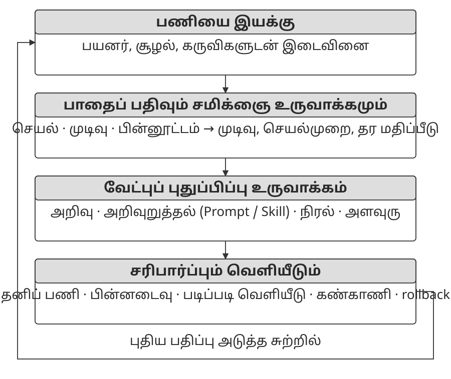
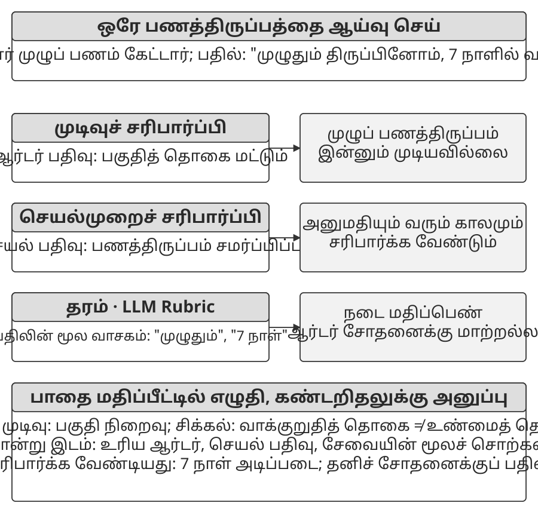
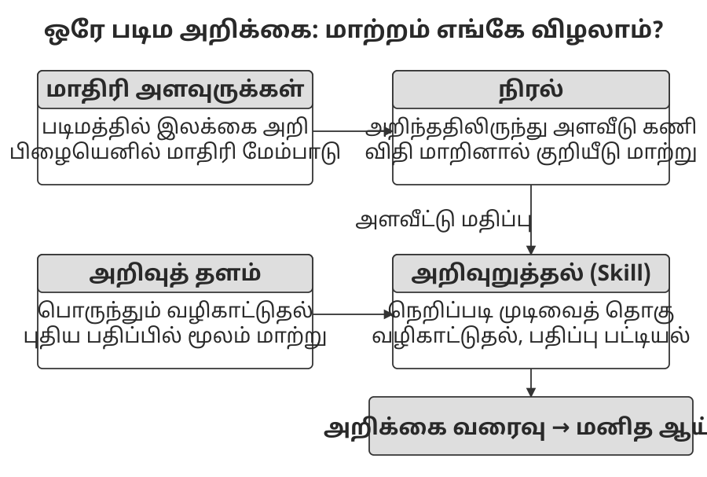
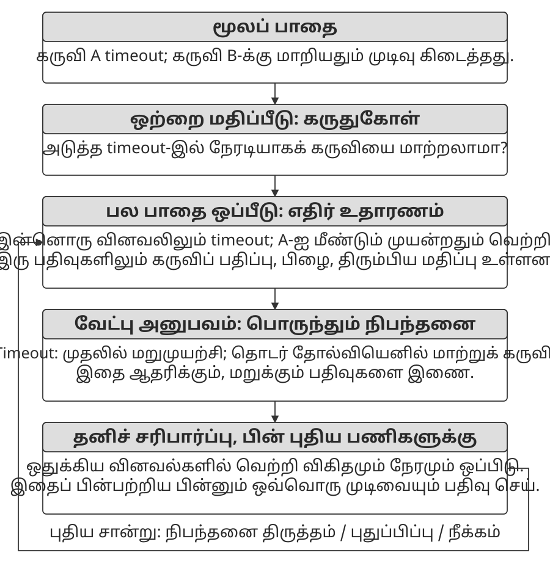
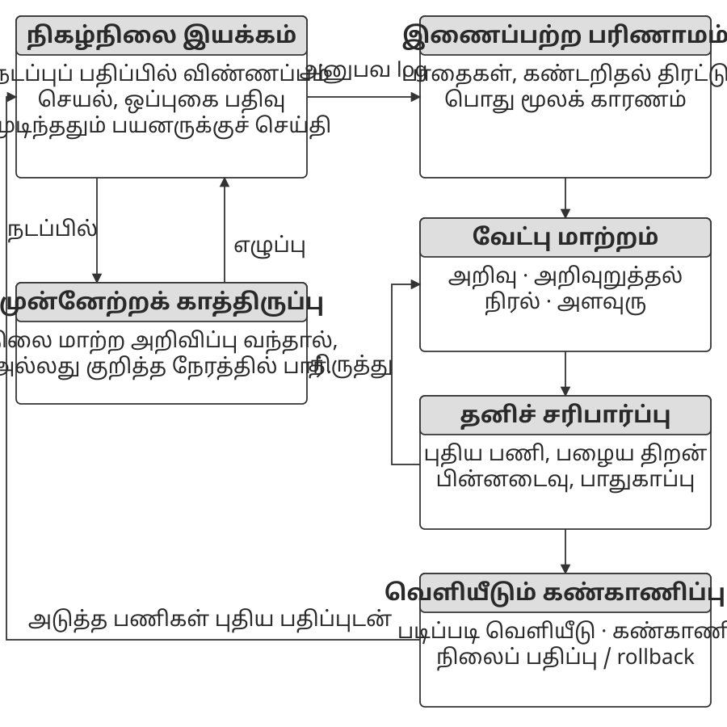

# ஏஜெண்டின் தொடர்ச்சியான பரிணாமம்

ஓர் ஏஜெண்ட் முன்பின் அறியாத சிக்கலான பணியை முதல் முயற்சியிலேயே முடித்துவிடலாம்; ஆனால் ஒரேபோன்ற பல பணிகளைக் கையாண்ட பிறகும் அதே தவறைத் திரும்பத் திரும்பச் செய்யலாம். புதிய ஊழியர் ஒருவர் அன்றாட வேலையிலிருந்து படிப்படியாக முன்னேறுவதுபோல அது வளர வேண்டுமானால், இயக்க அனுபவத்தைப் பின்னர் பயன்படக்கூடிய திறனாக அமைப்பு மாற்ற வேண்டும்: முடிவுகளைப் பதிவு செய்வது, சிக்கலின் காரணத்தைக் கண்டறிவது, திருத்த வழியை உருவாக்குவது, அந்த வழி புதிய பணிகளில் பலன் தருகிறதா என்று சரிபார்ப்பது. **அனுபவத்திலிருந்து கற்று, தொடர்ந்து பரிணமிப்பது ஏஜெண்டின் மிக முக்கியமான திறன்களில் ஒன்றாக மாறிவருகிறது என்று நான் கருதுகிறேன்.** இந்தத் திறனுக்குப் பயன்பாட்டு அமைப்பின் பொறியியல் கட்டுமானம் தேவை; அதே நேரத்தில், அடுத்த தலைமுறை மாதிரிகளின் ஆய்வில் இது ஒரு முக்கியக் கவனப்பொருளாக இருக்கத் தகுந்தது.

பொதுவாக, பயன்பாட்டில் உள்ள மாதிரி ஓர் அனுமானம் முடிந்த பிறகும் தன் அளவுருக்களை மாற்றிக்கொள்வதில்லை. அத்தியாயம் 2-இன் சூழல்வழிக் கற்றல், நிலைப் பராமரிப்பு, சுருக்கம் ஆகியவை நடப்புப் பணிக்குள் அது தன்னைச் சரிசெய்துகொள்ள உதவுகின்றன; அத்தியாயம் 3-இன் நினைவகமும் அறிவுத் தளமும் தகவலைப் பணிகளைக் கடந்து சேமிக்கின்றன. அனுபவத்திலிருந்து இன்னும் ஆழமாகக் கற்க, பல இயக்கங்களை ஒப்பிட வேண்டும்: வெற்றிகரமான பாதைகளில் பொதுவாக உள்ள படிகள் எவை, தோல்வியடைந்த பாதைகளில் எது விடுபட்டது, ஒரு செயல்முறை எந்தக் கருவிப் பதிப்புகளுக்கும் பணி நிபந்தனைகளுக்கும் பொருந்தும்.

எடுத்துக்காட்டாக, நூறு பயணச்சீட்டு முன்பதிவுப் பாதைகளைச் சேமித்த பிறகு, தேவைப்படும்போது ஏதேனும் ஒரு அனுபவத்தை அமைப்பு மீட்டெடுக்கலாம். ஆனால் "முன்பதிவு செய்வதற்கு முன் சிறப்பு உணவுக்கான இறுதி நேரத்தைச் சரிபார்" என்பது போன்ற அனுபவப் பாடத்தை உருவாக்க, வெற்றிகரமான முன்பதிவுகளுக்கும் தோல்வியடைந்தவற்றுக்கும் உள்ள காரணங்களை ஒப்பிட வேண்டும்; விமான நிறுவனம், நேர நிபந்தனைகள் ஆகியவற்றைச் சரிபார்க்க வேண்டும்; பின்னர் புதிய பணிகளைக் கொண்டு இந்த முறையைச் சோதிக்க வேண்டும். பதிவும் மீட்டெடுப்பும் ஏஜெண்ட் பழைய அனுபவங்களைத் திரும்பக் கண்டடைய உதவுகின்றன; ஒப்பீடு, பொதுமைப்படுத்தல், சரிபார்ப்பு ஆகியவை மீண்டும் பயன்படுத்தக்கூடிய செயல்முறைகளை உருவாக்க உதவுகின்றன. இப்படிச் சேர்த்துக்கொண்டே வந்தால்தான் ஏஜெண்ட் "புத்திசாலி" என்ற நிலையிலிருந்து "தேர்ந்தது" என்ற நிலைக்குப் படிப்படியாக உயர முடியும்.

**தொடர்ச்சிக் கற்றல் (continual learning)** புதிய பணிகளோடும் புதிய தரவோடும் ஓர் அமைப்பு எவ்வாறு தொடர்ந்து கற்கிறது, அதே நேரத்தில் ஏற்கனவே உள்ள திறன்களை எவ்வாறு தக்கவைத்துக்கொள்கிறது என்பதை ஆராய்கிறது. ஏஜெண்ட் இந்தச் சிக்கலை அன்றாட இடைவினைக்குள் கொண்டுவருகிறது: பின்னூட்டம் பயனர்களிடமிருந்தும் கருவிகளிடமிருந்தும் வெளிச்சூழலிலிருந்தும் வருகிறது; பயனர் திருப்தி, பணி நிறைவு, செயல்முறை இணக்கம் ஆகியவை வெவ்வேறு முடிவுகளைச் சுட்டலாம். அன்றாட வேலையில் ஒவ்வொரு அடியும் சரியா தவறா என்று யாரும் குறித்துத் தருவதில்லை; எந்தப் பின்னூட்டம் நம்பத்தகுந்தது என்பதை அமைப்பே தீர்மானிக்க வேண்டும் — ஏஜெண்டின் தொடர்ச்சிக் கற்றலில் உள்ள ஒரு பெரிய சிரமம் இதுதான் என்று நான் கருதுகிறேன். சரிபார்க்கப்படாத பின்னூட்டம் விதியாக எழுதப்பட்டாலோ பயிற்சிக்குப் பயன்படுத்தப்பட்டாலோ, தவறான காரணக் கற்பிதம் அடுத்தடுத்த பணிகளைப் பாதிக்கும். இத்தகைய பிழைகள் தொடர்ந்து நீடிக்கவும் செய்கின்றன: தவறாகப் பதிவான ஒரு விருப்பம் அடுத்த முன்பதிவைப் பாதிக்கும்; தவறான பின்னூட்டத்தைக் கொண்டு மாதிரியைப் பயிற்றுவித்தால், முன்பு சரியாகச் செய்த பணிகளையும் அது தவறாகச் செய்யத் தொடங்கலாம்.

ஏஜெண்ட் அமைப்பு முழுவதும் அனுபவத்திலிருந்து புதுப்பிக்கப்படும் செயல்முறையை இந்த நூல் **தொடர்ச்சியான பரிணாமம்** என்று அழைக்கிறது; அது அறிவு, அறிவுறுத்தல்கள், நிரல்கள், மாதிரி அளவுருக்கள் என்ற நான்கு வகைத் தாங்கிகளையும் உள்ளடக்குகிறது. அடிப்படை மாதிரியின் காலமுறைப் பயிற்சி பொதுவான திறன்களை வழங்குகிறது; ஏஜெண்டின் அனுபவப் புதுப்பிப்பு குறிப்பிட்ட வணிக விதிகள், கருவி மாற்றங்கள், உள்ளூர் உத்திகள் ஆகியவற்றைக் கையாள்கிறது. இந்த உள்ளூர் மாற்றங்கள் இடைவிடாமல் நிகழ்கின்றன; அடுத்த அடிப்படை மாதிரிப் பயிற்சி வரை காத்திருப்பது பெரும்பாலும் வணிகத் தேவைகளுக்கு ஈடுகொடுக்காது.

தற்போதைய கட்டத்தில், மாதிரியைச் சுற்றி முதலில் சரிபார்க்கக்கூடிய கற்றல் அமைப்பைக் கட்டியெழுப்ப வேண்டும் என்பது என் நிலைப்பாடு: தெளிவாக வெளிப்படுத்தக்கூடிய அனுபவம் அறிவு, அறிவுறுத்தல்கள், நிரல்கள் வழியாகப் பின்வரும் நடத்தையைப் பாதிக்கட்டும்; அளவுருக் கற்றலுக்கு ஏற்ற பொருள்கள் பின்-பயிற்சிக்கு அனுப்பப்படட்டும். ஒவ்வொரு புதுப்பிப்புக்கும் முதலில் புதிய பதிப்பின் மீது பின்னடைவு மதிப்பீடு நடத்தப்படுகிறது; வெளியீட்டுச் சரிபார்ப்பைக் கடந்த பிறகே அடுத்தடுத்த பணிகள் அந்தப் பதிப்பைப் பயன்படுத்துகின்றன.

இந்த அமைப்பின் முக்கியக் கூறுகளை முந்தைய அத்தியாயங்கள் ஏற்கனவே அறிமுகப்படுத்தியுள்ளன: அத்தியாயம் 2 பணி நிலையை ஒழுங்கமைக்கிறது, அத்தியாயம் 3 அறிவைச் சேமித்து மீட்டெடுக்கிறது, அத்தியாயம் 5 குறியீட்டின் மூலம் கருவிகளை உருவாக்கி அமைப்பைத் திருத்துகிறது, அத்தியாயம் 7 முடிவுகளை மதிப்பிடுகிறது, அத்தியாயம் 8 மாதிரி அளவுருக்களைப் புதுப்பிக்கிறது. படம் 9-1 இந்தக் கூறுகளை ஒன்றாக இணைக்கிறது. முன்பு சிறப்பு உணவை முன்பதிவு செய்யத் தவறிய அனுபவம் மதிப்பீட்டுக்குப் பிறகு, அடுத்த முன்பதிவின்போது பயன்படும் விதியாக மாறுகிறது.

## இயக்கப் பாதைகளிலிருந்து கற்றல் சமிக்ஞைகளைப் பெறுதல்

எந்தப் பாதைகளிலிருந்து கற்பது மதிப்புள்ளது? வாடிக்கையாளர் சேவை பயனரிடம் "பணத்தைத் திருப்பி அளித்துவிட்டோம்" என்று சொன்னால், முதலில் எவ்வளவு பணம் திருப்பப்பட்டது, செயல்பாடு விதிமுறைகளுக்கு உட்பட்டதா என்று பார்க்க வேண்டும்; பின்னர் பணம் எப்போது கணக்கில் வரும் என்பதைப் பயனர் இந்தப் பதிலிலிருந்து புரிந்துகொள்ள முடிகிறதா என்று பார்க்க வேண்டும். படம் 9-2 இந்த மூன்று சரிபார்ப்புகளையும் ஒன்றாக வைக்கிறது. மூன்று தீர்ப்புகளும் முறையே ஆர்டர் பதிவு, செயல் பதிவு, வாடிக்கையாளர் சேவையின் சொந்த வார்த்தைகள் ஆகியவற்றைப் பயன்படுத்துகின்றன.

**முடிவுச் சரிபார்ப்பு வெளிச்சூழலில் என்ன மாற்றம் நிகழ்ந்தது என்பதைச் சரிபார்க்கிறது.** Coding Agent சோதனைகளையும் வகைச் சரிபார்ப்பையும் செயல்திறன் அளவீடுகளையும் இயக்கலாம்; பணத்திருப்பு ஏஜெண்ட் ஆர்டர் நிலையையும் உண்மையில் திருப்பப்பட்ட தொகையையும் வினவலாம். நான் பொதுவாக இந்த அடுக்கை முதலில் சரிபார்க்கிறேன். முழுத் தொகையும் திருப்பப்பட்டதாக மாதிரி கூறுகிறது, ஆனால் கணக்கில் ஒரு பகுதி மட்டுமே திரும்பியிருக்கிறது — ஆர்டர் பதிவு இருந்தால்தான் எந்தச் செயல்பாட்டைத் திரும்பிப் பார்க்க வேண்டும் என்று தெரியும்.

**செயல்முறைச் சரிபார்ப்பு செயல்கள் பணி விதிகளுக்கு இணங்குகின்றனவா என்பதைச் சரிபார்க்கிறது.** சோதனைகள் தேறிய பிறகும், பாதுகாக்கப்பட்ட சோதனைக் கோப்புகள் மாற்றப்பட்டனவா என்று பார்க்க வேண்டும்; "பணம் ஏழு நாட்களுக்குள் கணக்கில் வரும்" என்று ஏஜெண்ட் பயனரிடம் சொன்னால், பணத்திருப்பு உண்மையில் சமர்ப்பிக்கப்பட்டதா, அந்தக் கால அளவுக்கு ஆதாரம் உள்ளதா என்று சரிபார்க்க வேண்டும். அனுமதி அட்டவணைகள், கட்டமைக்கப்பட்ட கொள்கைகள், செயல் பதிவுகள் ஆகியவற்றை நிரலே சரிபார்க்கலாம்; சூழலை வைத்துப் பொருள்கொள்ள வேண்டிய விதிகளை, அவற்றுக்குரிய ஆதாரங்களுடன் சேர்த்துத் தீர்மானிக்க வேண்டும்.

**தரச் சரிபார்ப்பு வழங்கப்பட்டது பயன்பாட்டுத் தேவைகளை நிறைவு செய்கிறதா என்பதைச் சரிபார்க்கிறது.** வாடிக்கையாளர் சேவையின் விளக்கம் தெளிவாக உள்ளதா, மாற்றுத் தீர்வு பயனரின் இலக்குக்குப் பொருந்துகிறதா, ஆய்வறிக்கை முக்கிய ஆதாரங்களைப் பிடித்திருக்கிறதா — இவை அனைத்தும் இறுதி விளைவைப் பாதிக்கின்றன. அத்தியாயம் 7 அறிமுகப்படுத்திய LLM-as-a-Judge-ஐப் பயன்படுத்தி, Rubric-ஐ முன்கூட்டியே வரையறுத்து, தீர்ப்பு மாதிரி ஒவ்வொரு உருப்படிக்கும் மதிப்பெண், காரணம், ஆதாரம் ஆகியவற்றைத் தரும்படி செய்யலாம்.

அட்டவணை 9-1 வாடிக்கையாளர் சேவையை எடுத்துக்காட்டாகக் கொண்டு, மூன்றடுக்கு மதிப்பீட்டை ஏழு பரிமாணங்களாக விரிக்கிறது. "பணி முடிவு" பரிமாணம் முடிவு அடுக்கைச் சேர்ந்தது; விதிகள், தனியுரிமை, வாக்குறுதி ஆகியவை செயல்முறை அடுக்கைச் சேர்ந்தவை; வெளிப்பாடும் நெகிழ்வான மாற்றுவழியும் தர அடுக்கைச் சேர்ந்தவை; உண்மை நம்பகத்தன்மை உள்ளடக்கத்தைப் பொறுத்துத் தனித்தனியாகச் சரிபார்க்கப்படுகிறது. எடுத்துக்காட்டாக, பணத்திருப்புத் தொகையைக் கருவி திருப்பித் தந்த மதிப்புடன் நேரடியாக ஒப்பிடலாம்; கொள்கை விளக்கத்தையோ மூல உரையோடும் பொருந்தும் நிபந்தனைகளோடும் சேர்த்துப் பார்க்க வேண்டும்.

அட்டவணை 9-1 வாடிக்கையாளர் சேவை ஏஜெண்டின் பாதை மதிப்பீட்டுப் பரிமாணங்கள்

| பரிமாணம் | சரிபார்ப்புக் கேள்வி | முக்கிய ஆதாரம் |
| --- | --- | --- |
| பணி முடிவு | பயனரின் மையக் கோரிக்கை தீர்க்கப்பட்டதா | இறுதிச் சூழல் நிலை, கருவி முடிவுகள் |
| விதி இணக்கம் | கொள்கைகள், அனுமதிகள், தேவையான செயல்முறைகள் நிறைவேறினவா | கொள்கைத் தளம், செயல் பாதை |
| தனியுரிமை எல்லை | வழங்கப்பட்ட தகவல் அனுமதிக்கப்பட்ட வரம்புக்குள் உள்ளதா | பதில் உரை, அணுகல் பதிவுகள் |
| உண்மை நம்பகத்தன்மை | கூற்றுகளுக்கு அறிவோ கருவி முடிவுகளோ ஆதாரமாக உள்ளனவா | மேற்கோள் மூலங்கள், கருவி திருப்பிய மதிப்புகள் |
| வாக்குறுதி–செயல் ஒத்திசைவு | முடித்ததாகக் கூறிய செயல் உண்மையில் நடந்ததா | பதிலையும் செயலாக்கப் பதிவையும் ஒப்பிடுதல் |
| வெளிப்பாட்டுத் தரம் | இயல்பாகவும் சுருக்கமாகவும் தெளிவாகவும் உள்ளதா | உரையாடல் முழுமையும், மொழி Rubric-உம் |
| இணக்கமான மாற்றுவழி | மூலத் திட்டம் தடைப்பட்டபோது அனுமதிக்கப்பட்ட மாற்றுப் பாதை கண்டறியப்பட்டதா | பயனர் இலக்கு, கொள்கை, அடுத்தடுத்த செயல்கள் |

பின்வரும் புதுப்பிப்புகளுக்கு உதவ, மதிப்பீட்டு வெளியீட்டில் நான்கு உள்ளடக்கங்கள் இருக்க வேண்டும்: ஒட்டுமொத்தப் பணி நிலை, ஒவ்வொரு பரிமாணத்தின் முடிவு, அந்த முடிவுக்குரிய ஆதாரத்தின் இருப்பிடம், பிழை வகை. ஆதார இருப்பிடம் ஒரு குறிப்பிட்ட உரையாடல் சுற்றையோ ஒரு குறிப்பிட்ட கருவி அழைப்பையோ சுட்டலாம். ஆதாரம் போதாத பரிமாணங்கள் "உறுதிப்படுத்த வேண்டியவை" எனக் குறிக்கப்பட்டு, கூடுதல் சரிபார்ப்புக்கோ மனித மறுஆய்வுக்கோ அனுப்பப்படுகின்றன.

எடுத்துக்காட்டாக, "பணத்திருப்பு தோல்வி, விளக்கம் தெளிவு" என்பது மட்டும் திருத்த வழியைக் கண்டறியப் போதாது. "4-ஆம் சுற்றில் ஆர்டர் எண் இல்லாமலேயே பணத்திருப்பு இடைமுகம் அழைக்கப்பட்டது, இடைமுகம் செயல்படுத்த மறுத்தது; 5-ஆம் சுற்றில் பணம் திருப்பப்பட்டதாக இன்னும் கூறப்பட்டது" என்று சேர்த்தால், அளவுருச் சரிபார்ப்பு, நிறைவுக் கூற்றுச் சரிபார்ப்பு என இரு தனித்தனி மாற்றங்களை முன்மொழியலாம்.

> **சோதனை 9-1 ★★: வாடிக்கையாளர் சேவை ஏஜெண்டுக்குப் பாதைச் சரிபார்ப்பியை உருவாக்குதல்**
>
> ஒரே தொகுப்பு வாடிக்கையாளர் சேவைப் பாதைகளுக்கு இரு வகை வெளியீடுகளை ஒப்பிடுங்கள்: ஒன்று மொத்த மதிப்பெண்ணை மட்டும் தருகிறது; மற்றொன்று பரிமாணம் வாரியாக முடிவு, ஆதாரம், நம்பக அளவு ஆகியவற்றைத் தருகிறது. பணித் தோல்வி, விதி மீறல், பொய்யான வாக்குறுதி, வெளிப்பாட்டுச் சிக்கல் ஆகியவற்றைப் பின்னது தனித்தனியாகச் சுட்டிக்காட்ட முடிகிறதா, அதன் அடிப்படையில் அவற்றுக்குரிய புதுப்பிப்புகளை முன்மொழிய முடிகிறதா என்று பாருங்கள்.
>
> காலாவதியான அறிவுக்குத் தகவல்களைப் புதுப்பிக்க வேண்டும்; விடுபட்ட அளவுருவுக்கு அழைப்புக்கு முந்தைய சரிபார்ப்பைச் சேர்க்கலாம்; திரும்பத் திரும்ப வரும் சொற்றொடர்களை அறிவுறுத்தல் அல்லது பயிற்சி மூலம் சரிசெய்யலாம்.

சோதனை 9-1 கற்பனையான கணக்குத் தகவல்களைக் கொண்டு எட்டுப் பாதைகளை உருவாக்கியது: இயல்பான பணத்திருப்பு, பொய்யான வாக்குறுதி, தனியுரிமைக் கசிவு, அளவுமீறிய மறுப்பு ஒவ்வொன்றுக்கும் இரண்டு. `real-normal-refund-01`-இல், பணத்திருப்பு முடிந்துவிட்டதாக வாடிக்கையாளர் சேவை சொல்கிறது; ஆர்டர் நிலையும் `refunded` என மாறியுள்ளது; திருப்பப்பட்ட தொகை 480.

எட்டுப் பாதைகளுக்கும் தலா ஏழு உருப்படிகள் மதிப்பிடப்பட்டன; 56 தீர்ப்புகளில் 52 எடுத்துக்காட்டுக்கு முன்கூட்டியே அமைத்த நிபுணர் குறிச்சொற்களுடன் ஒத்துப்போயின; ஒத்திசைவு விகிதம் சுமார் 92.9%. மீதமுள்ள நான்கு முரண்பாடுகளில் மூன்று ஒரே பயண மாற்றத்தில் (rebooking) விழுந்தன. பணத்திருப்பு இல்லாத ஒரு பயணச்சீட்டை அக்டோபர் 3-க்கு மாற்றும்படி பயனர் கேட்டார். வாடிக்கையாளர் சேவை அடையாளத்தைச் சரிபார்த்து, ஆர்டரை மூன்று முறை வினவி, 10-ஆம் சுற்றில் கோரிக்கை செயலாக்கப்பட்டதாகப் பயனரிடம் சொன்னது. ஆனால் ஆர்டர் நிலை இன்னும் `confirmed` ஆகவே இருந்தது; அழைப்புப் பதிவிலும் பயண மாற்றச் செயல் எதுவும் இல்லை.

இப்போது யாரை மறுஆய்வு செய்ய வேண்டும்? "இணக்கமான மாற்றுவழி"யைத் தீர்மானித்த மாதிரி 10-ஆம் சுற்றின் பதிலை மேற்கோள் காட்டித் தேர்ச்சி வழங்கியது; செய்திருக்கக்கூடிய, ஆனால் செய்யப்படாத இந்த மாற்றுத் தீர்வை அது தவறவிட்டது. "வாக்குறுதி–செயல் ஒத்திசைவு"யைத் தீர்மானித்த நிரல் பிழையைச் சுட்டியது உண்மைதான்; ஆனால் அது கூறிய காரணம், வெற்றிகரமான பணத்திருப்பு அழைப்பு கிடைக்கவில்லை என்பது. பயனர் கேட்டது பயண மாற்றம்; சரிபார்க்க வேண்டியது பயண மாற்றப் பதிவையும் புதிய தேதியையும்தான். இந்தப் பரிமாணத்துக்கு முன்கூட்டியே அமைத்த குறிச்சொல்லும் "தேர்ச்சி" என்றே இருந்தது; அதுவும் உண்மையில் உருவான பதிலுடன் முரண்படுகிறது.

இந்தப் பயண மாற்றத்தில் இரு இடங்களைத் திருத்த வேண்டும்: வாடிக்கையாளர் சேவை ஒரு படியைச் செய்யாமல் விட்டது; மதிப்பெண் நிரலோ தவறான கருவியைச் சரிபார்த்தது. பயணச்சீட்டு முன்பதிவுக்கு மாறினாலும், மேலோட்டமாக ஒன்றுபோலத் தெரியும் பிழைகள் வெவ்வேறு இடங்களில் தோன்றலாம். பயனர் ஏற்கனவே வரவுசெலவு வரம்பைத் தளர்த்தியிருக்கிறார், உதவியாளரோ இன்னும் பழைய வரம்பின்படியே வடிகட்டுகிறது; பாதையில் பின்னோக்கித் தேடினால், புதிய விருப்பம் சேமிக்கப்படாமல் போயிருக்கலாம், இந்த முறை பழைய விருப்பம் மீட்டெடுக்கப்பட்டிருக்கலாம், அல்லது மாதிரி புதிய வரம்பைப் படித்திருந்தும் சீட்டைத் தேர்ந்தெடுக்கும்போது அதைப் பயன்படுத்தாமல் இருந்திருக்கலாம்.

## ஏஜெண்டின் தொடர்ச்சியான பரிணாமத்துக்கான நான்கு முறைகள்

சிக்கலைக் கண்டுபிடித்த பிறகு, எங்கே திருத்துவது என்று தீர்மானிக்க வேண்டும். படம் 9-3-இல் உள்ள மருத்துவப் படிமவியல் ஏஜெண்டை எடுத்துக்கொள்வோம்: அறிக்கை பழைய பதிப்பு வழிகாட்டுதலை மேற்கோள் காட்டியிருந்தால், அறிவுத் தளத்தில் எந்தப் பதிப்பு சேமிக்கப்பட்டுள்ளது என்று முதலில் பார்க்கலாம். வழிகாட்டுதல் சரியாக இருந்தும், அறிக்கை மேற்கோள் மூலத்தைக் குறிப்பிடவில்லை என்றால், அறிக்கை எழுதும் அறிவுறுத்தலைத் திரும்பிப் பார்க்க வேண்டும். இந்த இரு அறிக்கைகளும் திருப்பி அனுப்பப்பட்டாலும், திருத்தும்போது பார்க்க வேண்டிய இடங்கள் வேறுவேறு.

வாடிக்கையாளர் சேவை அமைப்பும் இந்த நான்கு முறைகளையும் ஒருசேரப் பயன்படுத்துகிறது. பயிற்றுவிக்கப்பட்ட மாதிரி மொழியை ஒழுங்கமைக்கிறது, அறிவுத் தளம் நிறுவனக் கொள்கைகளைச் சேமிக்கிறது, விதிவிலக்குகளை எவ்வாறு கையாள்வது என்று Skill விளக்குகிறது, சேவையகக் குறியீடு அனுமதிகளையும் தொகைகளையும் சரிபார்க்கிறது. புதுப்பிப்பு முறையைத் தேர்ந்தெடுக்கும்போது எடைபோட வேண்டிய செலவுகளையும் வரம்புகளையும் அட்டவணை 9-2 பட்டியலிடுகிறது.

அட்டவணை 9-2 நான்கு தொடர்ச்சியான பரிணாம முறைகளின் பொருந்தும் எல்லைகள்

| புதுப்பிப்பு முறை | தாங்குவதற்கு ஏற்றது | பொறியியல் நன்மை | கையாள வேண்டிய சிக்கல்கள் |
| --- | --- | --- | --- |
| அனுபவ அறிவுத் தளம் | உண்மைகள், அனுபவங்கள், விதிவிலக்குகள், மூலங்கள் | விரைவான புதுப்பிப்பு, மூலத்தைத் தேடிப் பார்க்கலாம், தேவைக்கேற்ப மீட்டெடுக்கலாம் | மீட்டெடுப்புத் தரம், பொருந்தும் நிபந்தனைகள், மாதிரி சரியாகப் பயன்படுத்துகிறதா |
| ப்ராம்ப்ட், Skill | சூழல், விதிவிலக்குகள், முன்னுரிமைகளுடன் சேர்த்துப் பார்க்க வேண்டிய தீர்ப்புக் கொள்கைகள் | விளக்கக்கூடியது, உள்ளூர் அளவில் திருத்த எளிது | நீளம் அதிகரித்தல், அறிவுறுத்தல் முரண்பாடு, பின்பற்றும் விளைவு |
| நிரல், Harness | பகுக்கக்கூடிய செயல்முறைகள், இயக்கக்கூடிய சரிபார்ப்பு, அனுமதிகள், கடுமையான கட்டுப்பாடுகள் | சோதிக்கக்கூடியது, நிலையான இயக்கம் | உருவாக்கப் பராமரிப்பு, இடைமுக இணக்கம், விதிவிலக்குக் கையாளுதல் |
| மாதிரி அளவுருக்கள் | புலனுணர்வு, உருவாக்க நடை, மறைமுக முடிவெடுக்கும் வடிவங்கள் | கற்ற வடிவங்களை மீண்டும் பயன்படுத்தலாம், திரும்பத் திரும்ப வரும் சூழலைக் குறைக்கலாம் | தரவுத் தயாரிப்பு, பயிற்சிச் செலவு, பொதுமைப்படுத்தல், மறத்தல் |

ஒரு மேம்பாட்டைப் பல புதுப்பிப்புகளாகப் பிரிக்கலாம். கொள்கை சார்ந்த உண்மைகளை அறிவுத் தளத்திலும், அனுமதிச் சரிபார்ப்பு போன்ற துல்லியமாக இயக்கக்கூடிய கட்டுப்பாடுகளை நிரலிலும் வைப்பதற்கு நான் முன்னுரிமை தருகிறேன்; சூழலையும் விதிவிலக்குகளையும் புரிந்துகொள்ள வேண்டிய கொள்கைகளை Skill-இல் வெளிப்படுத்துகிறேன்; உயர்பரிமாணப் புலனுணர்வையும் மறைமுக உத்திகளையும் பயிற்சி மூலம் மேம்படுத்துகிறேன்.

### அனுபவத்தை அறிவாகப் படியவைத்தல்

ஒரே பயணச்சீட்டு முன்பதிவைப் பதிவு செய்யும்போதும் இரு நிலைகளில் தகவலை விட்டுச்செல்லலாம். ஒன்று: "இந்த விமான நிறுவனம் சிறப்பு உணவை இருபத்து நான்கு மணி நேரத்துக்கு முன்பே முன்பதிவு செய்ய வேண்டும் என்று கோருகிறது." மற்றொன்று: "பயணச்சீட்டை முன்பதிவு செய்வதற்கு முன் சிறப்பு உணவுக்கான இறுதி நேரத்தைச் சரிபார்; பணம் செலுத்திய பிறகுதான் தேவையை நிறைவேற்ற முடியாது என்று தெரியவருவதைத் தவிர்." முதலாவதை விமான நிறுவனம், பொருந்தும் வழித்தடங்கள், கொள்கை மூலம் ஆகியவற்றுடன் சேர்த்துச் சேமிக்க வேண்டும். வேறொரு விமான நிறுவனத்தின் இறுதி நேரம் வேறுபடலாம்; ஆனால் "இந்த விமானத்தின் இறுதி நேரத்தை முதலில் பார்" என்பது அங்கும் பொருந்தும். இப்படிப் பிரித்தால், உண்மை காலாவதியாகும்போது குறிப்பிட்ட கால வரம்பை மட்டும் மாற்றினால் போதும்; அடுத்த முன்பதிவிலும் இந்தச் சரிபார்ப்பு அனுபவம் பயன்படும். இரண்டையும் அத்தியாயம் 3-இன் சேமிப்பு, அட்டவணையிடல், மீட்டெடுப்பு முறைகளைக் கொண்டு சேமிக்கலாம்.

ஒரு முன்பதிவிலிருந்து இத்தகைய அனுபவத்தைப் பெறுவதற்கான செலவு மிகக் குறைவாக இருக்கலாம்; ஆனால் முன்பதிவுப் பதிவு முழுவதையும் அப்படியே நகலெடுக்கக் கூடாது. பதிவில் கருவி திருப்பித் தந்த கொள்கையின் மூல உரையும் உள்ளது, ஏஜெண்ட் பலமுறை முயன்று சுற்றிவந்த வழிகளும் உள்ளன. ஒரு வினவல் நேரம் கடந்து (timeout) தோல்வியடைந்து, பின்னர் வேறு கருவிக்கு மாறியபோது முடிவு கிடைத்தது என்றால், அதை அப்படியே பின்பற்றினால் ஒரு தற்செயலான கோளாறையே கருவியை மாற்றுவதற்கான காரணமாகக் கொள்ள நேரிடும்.

பொருள்களை மூன்று அடுக்குகளில் சேமிக்கலாம்: **மூலப் பாதை** முழுமையான இயக்க ஆதாரத்தைத் தக்கவைக்கிறது; **ஒற்றை இயக்கப் பகுப்பாய்வு** வெற்றி தோல்விக்கான காரணங்களையும் அனுபவ வரைவையும் பதிவு செய்கிறது; **முறையான அனுபவ ஆவணம்** பல பணிகளில் சரிபார்க்கப்பட்ட செயல்முறைகளைத் தொகுக்கிறது. மூலப் பாதைகள் பதிப்பு வாரியாகச் சேமிக்கப்படுகின்றன; பகுப்பாய்வும் அறிவும் புதிய ஆதாரங்கள் வரவர மாற்றப்படுகின்றன. முறையான ஆவணம் பொருந்தும் சூழல்கள், பரிந்துரைக்கப்படும் உத்தி, தடைசெய்யப்பட்ட செயல்கள், விதிவிலக்குகள், மூலங்கள், கடைசியாகச் சரிபார்த்த நேரம் ஆகியவற்றைத் தெளிவாக எழுதுகிறது; இது பின்னர் மீட்டெடுக்கவும் சரிபார்க்கவும் உதவுகிறது.

அத்தியாயம் 3-இன் User as Code முதலில் உண்மைப் பதிவேட்டில் சேர்த்துக்கொண்டே போய், பின்னர் காலமுறையில் பயனர் மாதிரியை மீண்டும் கட்டுகிறது. இங்கும் பதிவு செய்வதையும் ஒழுங்கமைப்பதையும் பிரிக்கிறோம். சற்று முந்தைய வினவலுக்குத் திரும்புவோம். இன்னொரு வினவலும் நேரம் கடந்து தோல்வியடைந்து, அதே கருவியை மீண்டும் முயன்றபோது வெற்றி பெற்றது என்றால், "நேரம் கடந்தால் கருவியை மாற்று" என்ற பரிந்துரை இன்னும் நிற்குமா? இந்த இரு பதிவுகளைக் கொண்டு எவ்வாறு இன்னும் குறிப்பான பரிந்துரையை வரைந்து, பிற வினவல்களைக் கொண்டு அதைச் சோதிப்பது என்பதைப் படம் 9-4 காட்டுகிறது.

அத்தியாயம் 3-இன் பிரித்தெடுத்தல், கொத்தாக்கம், மீட்டெடுப்பு முறைகளைப் பின்பற்றும்போது, ஒரே அனுபவத்துக்கான நேர்மறை, எதிர்மறை எடுத்துக்காட்டுகளை ஒன்றாக வைக்கலாம். இரு முன்பதிவுகளும் ஒரே கருவிப் பதிப்பைப் பயன்படுத்தினவா? ஒன்று வெற்றி, ஒன்று தோல்வி என்றால், அதற்குக் காரணம் ஒரு படி விடுபட்டதா, அல்லது முன்பதிவு நிபந்தனைகளே வேறுபட்டனவா? மூலப் பதிவுகளிலிருந்து பயன்படுத்தக்கூடிய அனுபவத்தை ஒழுங்கமைப்பதை ஐந்து படிகளாகப் பிரிக்கலாம்:

1. மூலப் பாதைகளையும் சூழல் முடிவுகளையும் சேமித்து, பணியையும் கருவிப் பதிப்பையும் நிலைப்படுத்து.
2. ஒவ்வோர் இயக்கத்துக்கும் பகுப்பாய்வை உருவாக்கி, பணி வகை, தேவையான திறன், உண்மையில் பின்பற்றிய உத்தி, பிழைகள், விதிவிலக்குகள் ஆகியவற்றைப் பதிவு செய்.
3. பணிக் குடும்ப வாரியாகத் தொகுத்து, ஒவ்வோர் அனுபவத்துக்கும் அதை ஆதரிக்கும், மறுக்கும் பாதைகளைப் பட்டியலிடு.
4. போதுமான ஆதாரம் உள்ள அனுபவங்களைத் தேர்ந்தெடுத்து, அறிவு உருப்படிகளின் முதல் வரைவாக எழுது.
5. வடித்தெடுப்பில் பங்கேற்காத புதிய பணிகளில் சோதித்து, பரிந்துரைக்கப்பட்ட உத்தி அடுத்தடுத்த செயல்திறனை மேம்படுத்துகிறதா என்று சரிபார்.

GAIA[^gaia-2023] தேடல், வலைப்பக்க வாசிப்பு, கோப்புக் கையாளுதல், கணக்கீடு போன்ற பல-படிக் கேள்விகளை வழங்குகிறது; AWorld[^aworld-2025] ஏஜெண்ட் இயக்கம், கருவி அழைப்பு, பாதைப் பதிவு ஆகியவற்றுக்கான சூழலை வழங்குகிறது. இரண்டையும் இணைத்தால், முதலில் பதில் அல்லது சூழல் நிலையைக் கொண்டு வெற்றி, பகுதி வெற்றி, தோல்வி எனக் குறித்து, பின்னர் பணிக் குடும்ப வாரியாகப் பாதைகளை ஒப்பிடலாம். வெற்றிகரமான பதிவுகளிலிருந்து மீண்டும் முயலத் தகுந்த செயல்முறைகளைக் கண்டறியலாம்; தோல்வியடைந்த பதிவுகளிலிருந்து எந்தச் சூழ்நிலைகளில் அவற்றைப் பின்பற்றக் கூடாது என்று அறியலாம். பணி பாதி மட்டுமே முடிந்திருந்தால், எந்தப் படிகள் பலன் தந்தன, சிக்கல் எங்கிருந்து தொடங்கியது என்று படிப்படியாகச் சரிபார்க்கலாம்.

Reflexion[^reflexion-2023] இயல்பு மொழிச் சுயபரிசீலனையைக் கொண்டு அடுத்தடுத்த முயற்சிகளுக்கு உதவுகிறது. இந்த முறையை அறிவு வடித்தெடுப்பில் இணைக்கும்போது, சுயபரிசீலனை காரணக் கருதுகோள்களையும் அனுபவ வரைவுகளையும் முன்மொழியப் பயன்படுகிறது; சூழல் முடிவுகள் சரிபார்ப்புக்கும், பாதைகளுக்கு இடையிலான ஒப்பீடு பொருந்தும் நிபந்தனைகளை வரையறுப்பதற்கும், புதிய பணிகள் இடமாற்றத்தைச் சோதிப்பதற்கும் பயன்படுகின்றன. ஓர் அனுபவம் முறையான அறிவுத் தளத்தில் சேர்வதா என்பதை இந்த நான்கு வகைப் பொருள்களும் சேர்ந்து தீர்மானிக்கின்றன.

[^reflexion-2023]: Shinn, N., et al. *Reflexion: Language Agents with Verbal Reinforcement Learning.* arXiv:2303.11366, 2023.

[^gaia-2023]: Mialon, G., et al. *GAIA: a benchmark for General AI Assistants.* arXiv:2311.12983, 2023.

[^aworld-2025]: Yu, C., et al. *AWorld: Orchestrating the Training Recipe for Agentic AI.* arXiv:2508.20404, 2025.

அத்தியாயம் 6-இன் பயணச்சீட்டுச் சூழலுக்குத் திரும்புவோம். பயனர் கட்டணத்தை 1200 யுவானுக்குள் வைக்க விரும்பினார்; அன்றே கூட்டத்துக்குச் சென்றாக வேண்டும்; இறுதியில் 1250 யுவான் கட்டணத்தை ஏற்றுக்கொண்டார். உதவியாளர் மூல வரவுசெலவு வரம்பு, இறுதி விலை, பயண நோக்கம், பயனரின் சொந்த வார்த்தைகள் ஆகியவற்றைப் பதிவு செய்யலாம். அடுத்த மூன்று முன்பதிவுகளிலும் மிகக் குறைந்த கட்டணம் சரியாக 1250 யுவானாகவே இருக்கிறது. இந்த நினைவை எவ்வாறு பயன்படுத்துவது?

- அடுத்த வாரமும் அதே வணிகக் கூட்டத்துக்கு அவசரமாகச் செல்ல வேண்டும். கூட்டத்தைப் பிடிக்கப் பயனர் முன்பு பலமுறை சில பத்து யுவான் கூடுதலாகச் செலுத்தத் தயாராக இருந்தார்; இந்த முறையும் வழக்கம்போல் முன்பதிவு செய்யுமாறு உதவியாளரிடம் சொல்லியிருக்கிறார். உதவியாளர் இந்த விமானத்தை முன்பதிவு செய்து, உண்மையான கட்டணத்தைத் தெரிவிக்கலாம்.
- பயனர் குழந்தையுடன் விடுமுறைக்குச் செல்கிறார்; "குடும்பப் பயணம், கொஞ்சம் சிக்கனமாக இருக்கட்டும்; 1200 யுவானைத் தாண்டினால் முதலில் என்னைக் கேள்" என்று குறிப்பாகச் சொல்லியிருக்கிறார். உதவியாளர் 1250 யுவான் தேர்வைப் பயனருக்கு அனுப்பி, அதே நேரத்தில் முந்தைய அல்லது அடுத்த நாளில் வரவுசெலவுக்குள் விமானம் உள்ளதா என்று தேடலாம்.
- பின்னர் பயனர் விளக்குகிறார்: "அன்று அவசரம் என்பதால்தான் ஏற்றுக்கொண்டேன்; உண்மையில் 1250 யுவானும் அதிகம்தான். இனி அலுவல் பயணத்திலும் வரவுசெலவைத் தாண்டினால் முதலில் என்னைக் கேள்." அடுத்த முறை அதே நபர் அதே நகருக்குக் கூட்டத்துக்குச் சென்றாலும், உதவியாளர் முதலில் கேட்க வேண்டும். அந்த முன்பதிவுப் பதிவைத் தக்கவைத்துக்கொண்டு, இந்தப் புதிய, மேலும் தெளிவான கோரிக்கையை அலுவல் பயண விருப்பங்களில் எழுதினால், இரு நினைவுகளும் தத்தம் பயனைத் தரும்.

இந்த மூன்று முன்பதிவுகளும் புதுப்பிப்பின் அடுக்குகளை விளக்குகின்றன. பயனரின் ஒரு திருத்தம் நடப்புப் பணியை உடனே மாற்றலாம்; அவருடைய சொந்த விருப்பத்தைப் புதுப்பிக்கவும் அது போதும். பல தனித்த எடுத்துக்காட்டுகளில் உதவியாளர் பயண நோக்கத்தைப் புறக்கணிப்பது தெரிந்தால்தான், பகிரப்பட்ட முன்பதிவு Skill-ஐத் திருத்த முன்மொழிவது தகும் — கட்டணங்களை ஒப்பிடும்போது தொடர்புடைய விருப்பங்களை அது எடுத்துக்கொள்ளும்படி. வெளிப்படையாகத் தரப்பட்ட வரவுசெலவும் விருப்பங்களும் ஏற்கனவே ஏற்றப்பட்டிருந்தும், வேறு சொற்களில் கேட்டால் மாதிரி இன்னும் தவறாகத் தீர்மானித்தால்தான், மாதிரியின் தீர்ப்புத் திறனைப் பயிற்றுவிக்க இத்தகைய எடுத்துக்காட்டுகளைச் சேகரிப்பது தகும்.

### அனுபவத்தை அறிவுறுத்தலாக எழுதுதல்

ஒவ்வொரு முறையும் சரியான தகவல்களை உதவியாளரிடம் கொடுத்தும், அது அதே கட்டத்தில் தவறு செய்கிறது; அனுபவமுள்ள ஒருவர் எப்படித் தீர்மானிக்க வேண்டும் என்பதை ஒரே வாக்கியத்தில் சொல்லிவிட முடிகிறது — அப்படியானால் ஓர் அறிவுறுத்தலை எழுதிப் பார்க்கலாம். அனுபவ ஆவணம் உதவியாளரின் குறிப்புக்காக வைக்கப்படுகிறது; System Prompt பணிகளைக் கடந்த நடத்தைத் தேவைகளை வெளிப்படுத்துகிறது; Skill துறை அல்லது கருவி வாரியாக உள்ளூர்ச் செயல்முறைகளை ஏற்றுகிறது; அனுமதி போன்ற கடுமையான கட்டுப்பாடுகளை Harness நிறைவேற்றுகிறது. மாற்றத்தைச் சரியான இடத்தில் வைப்பதுதான், எதிர்காலத்தில் எந்தப் பணிகள் பாதிக்கப்படும் என்பதைத் தீர்மானிக்கிறது.

Andrej Karpathy **System Prompt கற்றல் (System Prompt Learning)** என்ற சொல்லால் ஒரு வகை அனுபவப் புதுப்பிப்பை விவரிக்கிறார்: மாதிரி ஒரு சிக்கலைச் சந்தித்த பிறகு, எதிர்காலப் பணிகளுக்காக ஒரு நினைவூட்டலை எழுதிவைக்கிறது.[^karpathy-system-prompt-learning] DSPy[^dspy-2023] மேம்பாட்டுத் தொகுப்பில் (dev set) அறிவுறுத்தல்களையும் எடுத்துக்காட்டுகளையும் உகப்பாக்குகிறது; OPRO[^opro-2023] முன்பு முயன்ற ப்ராம்ப்டுகளையும் அவற்றின் மதிப்பெண்களையும் கொண்டு புதிய ப்ராம்ப்டுகளை வரைகிறது; GEPA[^gepa-2025] பாதைப் பின்னூட்டத்தைப் பயன்படுத்தி ப்ராம்ப்ட் மாற்றங்களை முன்மொழிந்து வடிகட்டுகிறது. இந்த முறைகள் அனைத்தும் இயக்க முடிவுகளின் அடிப்படையில் அறிவுறுத்தல்களை மாற்றி எழுதி, மேம்பாட்டுப் பணிகளைக் கொண்டு பழைய, புதிய பதிப்புகளை ஒப்பிடுகின்றன; அவை இணைப்பிலா (offline) தொகுப்பு உகப்பாக்கத்துக்கு ஏற்றவை.

உற்பத்திப் புதுப்பிப்புகளில், மூலத்துடன் கூடிய சிறும diff-க்கு நான் முன்னுரிமை தருகிறேன்: தூண்டிய எடுத்துக்காட்டு, திருத்தத்துக்கான காரணம், பழைய பதிப்பு ஆகியவற்றைத் தக்கவைக்கிறேன். உள்ளூர்த் திருத்தம் (patch) ஏற்கனவே உள்ள விதிகளுக்கு ஏற்படும் இடையூறைக் குறைக்கிறது; பின்னடைவு ஏற்பட்டால் ஒரு குறிப்பிட்ட மாற்றத்தை மட்டும் திரும்பப்பெறவும் வசதியாக இருக்கிறது.

புதிய அறிவுறுத்தல் முந்தைய பிழையை உண்மையில் சரிசெய்ததா என்று எப்படித் தெரிந்துகொள்வது? தவறாகக் காப்பகப்படுத்தப்பட்ட ஒரு வாடிக்கையாளர் கடிதத்தைச் சுட்டிக்காட்டிப் பயனர் சொல்கிறார் என்று வைத்துக்கொள்வோம்: "இது வாடிக்கையாளர் எனக்கு அனுப்பிய பதில்; இதை ஏன் செய்திமடலாகக் கருதினாய்?" திறந்த மூல மின்னஞ்சல் உதவியாளர் Inbox Zero ஒரு சோதனை இயக்கக் கருவியை வழங்குகிறது. விதியைத் திருத்திய பிறகு, உதவியாளர் மின்னஞ்சல் ID-யைக் கொண்டு மூலக் கடிதத்தை மீட்டெடுத்து, அந்தக் கணக்கில் தற்போது இயக்கத்தில் உள்ள விதிகளின்படி மீண்டும் தீர்மானித்து, எந்த விதிகள் பொருந்துகின்றன, ஏன், எந்தக் குறிச்சொல்லை இடப்போகிறது அல்லது எந்தக் கோப்புறைக்கு நகர்த்தப்போகிறது என்று பார்க்கலாம். இந்தப் படி செய்யத் திட்டமிட்ட செயல்களை மட்டுமே காட்டுகிறது; அஞ்சல் பெட்டி அப்படியே இருக்கும், பதில் வரைவும் உருவாக்கப்படாது.[^ch9-inboxzero] இப்போது உண்மையான செய்திமடல் ஒன்றைத் தேர்ந்தெடுத்து மீண்டும் முயலுங்கள்: வாடிக்கையாளர் கடிதம் உள்பெட்டியில் இருக்கிறது, செய்திமடல் வழக்கம்போலக் காப்பகப்படுத்தப்படுகிறது — இந்த இரு கடிதங்களும் சேர்ந்து, இந்தத் திருத்தம் ஏற்கனவே உள்ள வகைப்படுத்தல் எல்லையைக் காத்ததா என்று காட்டுகின்றன.

[^ch9-inboxzero]: Inbox Zero திட்டத்தின் `test-rules-on-email-tool.ts`, குறிப்பிட்ட மின்னஞ்சலைக் கொண்டு விதிகளைச் சோதித்து இயக்கும் கருவியைச் செயல்படுத்துகிறது.

#### எடுத்துக்காட்டு ஒன்று: மனிதரிடம் மாற்றுவதற்கும் கருவிப் பயன்பாட்டுக்கும் இடையிலான எல்லையைத் தெளிவாக்குதல்

τ²-bench-இன் telecom கொள்கை இவ்வாறு கோருகிறது: கோரிக்கை ஏஜெண்டின் செயல் வரம்பைத் தாண்டினால் மனித முகவரிடம் மாற்ற வேண்டும்; மாற்றுவதற்கு முன் இயன்றவரை தீர்க்க முயல வேண்டும். விதிகளை வடித்தெடுக்கப் பயன்படுத்திய 20 கேள்விகளில், வலுக்குறைந்த மாதிரி 1 கேள்வியில் மட்டுமே தேறியது. மீதமுள்ள 19 கேள்விகள் எப்படித் தோற்றன? 17 கேள்விகளில் மனிதரிடம் மாற்றும் கருவி அழைக்கப்பட்டிருந்தது; மற்ற 2 படி வரம்பை எட்டும்வரை ஓடிக்கொண்டே இருந்தன.

இந்த 19 தோல்விப் பாதைகளையும் மாதிரியிடம் கொடுத்து, விதிகளைப் பொதுமைப்படுத்தி மூலக் கொள்கையின் இறுதியில் சேர்க்கும்படி கேட்டோம். அதே 114 புதிய கேள்விகளில், மூலக் கொள்கையை மட்டும் பயன்படுத்தியபோது 14 கேள்விகள் (12.3%) தேறின; முதல் பதிப்பு விதிகளைச் சேர்த்த பிறகு 20, இரண்டாம் பதிப்பு விதிகளைச் சேர்த்த பிறகு 22 (19.3%). கேள்வி வாரியாக ஒப்பிட்டால், இரண்டாம் பதிப்பு முன்பு தேறிய 14-ஐயும் தக்கவைத்து, கூடுதலாக 8 கேள்விகளைச் சரியாகச் செய்தது. இரு பதிப்பு விதிகளும் வாடிக்கையாளர் சேவைக்கு உண்மையில் என்ன உதவியைத் தந்தன?

**உள்ளீட்டுப் பொருள்கள் விதியின் உள்ளடக்கத்தைத் தீர்மானிக்கின்றன.** பிழை உரையையும் தோல்விச் சுருக்கத்தையும் மட்டும் கொடுத்தபோது, மாதிரி "ஒரே கருவி திரும்பத் திரும்பப் பிழை தந்தால் அழைப்பதை நிறுத்து" என்று பொதுமைப்படுத்தியது. இரண்டாம் முறை வடித்தெடுத்தபோது, வாடிக்கையாளர் சேவைக்கும் பயனருக்கும் உரிய தனித்தனிக் கருவிப் பட்டியல்களையும் மாதிரி பார்த்தது; "இந்தப் படியை யார் செய்ய வேண்டும்" என்பதைக் கருத்தில் கொள்ளும்படியும் ப்ராம்ப்ட் கேட்டது. இந்த முறை உருவான விதி பணிப் பகிர்வைத் தெளிவாக்கியது: பிணைய நிலை, SIM அட்டை, APN போன்ற சாதனச் செயல்களைச் செய்ய பயனருக்கு வழிகாட்ட வேண்டும். அப்போது அனுபவம் பொதுவான மறுமுயற்சி நினைவூட்டலிலிருந்து, குறிப்பிட்ட செயல்களுக்கான பணிப் பகிர்வு விதியாகச் செம்மைப்பட்டது.

**பொதுமைப்படுத்தலுக்குக் கொள்கையையும் முடிவையும் கொண்ட சரிபார்ப்பும் தேவை.** முதல் பதிப்பில் சேர்க்கப்பட்ட விதிகளில் "தொடர்ந்து மூன்று அழைப்புகள் தோற்றால் மாற்று", "பயனர் இரண்டு முறை எண்ணைத் தரவில்லை என்றால் மாற்று" என்ற இரண்டு இருந்தன. இந்தப் பதிப்பின்படி இயக்கியபோது, 114 இடமாற்றக் கேள்விகள் அனைத்திலும் மனிதரிடம் மாற்றுதல் நிகழ்ந்தது; அவற்றில் 20 மட்டுமே தேறின. இந்த இரு விதிகள் முன்கூட்டியே மாற்றுவதையும் கற்றுக்கொண்டுவிட்டன.

ஒரு பாதை திருத்தத்துக்கு முன்னும் பின்னும் உள்ள வேறுபாட்டைத் தெளிவாகக் காட்டுகிறது. பயனர் தன் கைபேசியில் சிக்னல் இல்லை என்கிறார். அடிப்படை வாடிக்கையாளர் சேவை "தயவுசெய்து உங்கள் சரியான தொலைபேசி எண்ணைத் தாருங்கள்" போன்ற வாக்கியத்தையே எண் புலத்தில் நிரப்பி, ஐந்து முறை வினவி, ஒவ்வொரு முறையும் பிழை பெற்று, பின்னர் மனிதரிடம் மாற்றியது. இரண்டாம் பதிப்பு விதிகளுடன், முதல் வினவலில் வாடிக்கையாளர் சேவை இன்னும் எண்ணை நிரப்பத் தவறியது; ஆனால் இந்த முறை அது உரையாடலில் பயனரிடம் கேட்டு, எண்ணைப் பெற்று, கணக்கைக் கண்டுபிடித்தது. அடுத்து SIM அட்டையைச் சரிபார்க்க முயன்றது; அந்தச் செயல் கிடைக்கவில்லை என்று கருவி அறிவித்தது; வாடிக்கையாளர் சேவை பயனரை SIM அட்டையை எடுத்து மீண்டும் செருகும்படி கேட்டது. பயனர் அப்படிச் செய்து, கைபேசியில் விமானப் பயன்முறையையும் அணைத்த பிறகுதான் இந்தக் கேள்வி தேறியது. இரண்டாம் பதிப்பு அடிப்படைப் பதிப்பைவிடக் கூடுதலாகச் சரியாகச் செய்த மற்ற ஏழு கேள்விகளைப் பார்த்தால்: ஒன்றில் மட்டுமே மனிதரிடம் மாற்றப்படவில்லை; மற்ற ஆறிலும் மனிதரிடம் மாற்றும் கருவி அழைக்கப்பட்டிருந்தது. ஆக, "மனிதரிடம் மாற்றவில்லை" என்பதைத் தேர்ச்சி அளவுகோலாகக் கொண்டால், இந்த ஆறு கேள்விகளுமே கணக்கில் விடுபட்டுப்போகும். மாற்ற வேண்டுமா என்பதைத் தீர்மானிக்க, வாடிக்கையாளர் சேவை இன்னும் என்ன செய்ய முடியும், பணி அதை எந்தப் படிவரை செய்யச் சொல்கிறது என்பதைப் பார்க்க வேண்டும்.

> **சோதனை 9-2 ★★: τ²-bench தோல்விப் பாதைகளிலிருந்து மனிதரிடம் மாற்றுதல், கருவிப் பயன்பாட்டு விதிகளை வடித்தெடுத்தல்**
>
> அத்தியாயம் 7-இன் telecom சூழலைப் பின்பற்றி, வடித்தெடுப்புத் தொகுப்பையும் இடமாற்றத் தொகுப்பையும் பிரியுங்கள். முதலில் வலுக்குறைந்த மாதிரியை இயக்கித் தோல்விப் பாதைகளைச் சேகரியுங்கள்; பின்னர் மாதிரி விதிகளை உருவாக்கி மூலக் கொள்கையில் சேர்க்கட்டும். இடமாற்றத் தொகுப்பில் மூலப் பதிப்பையும் இரு பரிணமித்த பதிப்புகளையும் ஒப்பிடுங்கள்; மூன்று குழுக்களிலும் கொள்கைக் கோப்பை மட்டும் மாற்றி, பயனர் உருவகப்படுத்தியை ஒரேமாதிரி வைத்திருங்கள்.
>
> அடிப்படைப் பதிப்பில் 104 கேள்விகளில் மனிதரிடம் மாற்றுதல் நிகழ்ந்தது; இரண்டாம் பதிப்பில் 111; ஒரு கேள்வியில் ஒருமுறை மாற்றினாலே கணக்கில் சேர்க்கப்படுகிறது. பயனர் பக்கக் கருவிகளைத் தவறாக அழைத்தது அழைப்புகளின் எண்ணிக்கைப்படி கணக்கிடப்பட்டது: 1049 முறையிலிருந்து 163 முறையாகக் குறைந்தது. இன்னொரு அளவீடு, அழைப்பு அளவுருக்களில் குறைந்தது ஒரு மதிப்பு வெற்றுச் சரமாக இருந்த முறைகளை எண்ணுகிறது: 904-இலிருந்து 174-ஆகக் குறைந்தது; அளவுருவே தரப்படாத அழைப்புகளை இந்த அளவீடு எண்ணுவதில்லை. ஒவ்வோர் உத்தியும் ஒவ்வொரு கேள்வியிலும் ஒருமுறை மட்டுமே இயக்கப்பட்டது.

விமான வாடிக்கையாளர் சேவையிலும் முன்கூட்டிய மாற்றுதல் நிகழ்கிறது. பயணச்சீட்டு ரத்துக் கட்டணம், பயண மாற்றக் கட்டணம், பொதிக் கொள்கை குறித்துப் பயனர் ஆட்சேபம் தெரிவித்தால், ஏஜெண்ட் பொருந்தும் கொள்கையின்படி வினவி, விளக்கி, அனுமதிக்கப்பட்ட மாற்றுத் தீர்வைத் தேட வேண்டும். கீழே உள்ள சோதனையில் பயன்படுத்திய விதிகளின்படி, சாதாரணக் கொள்கை சார்ந்த சர்ச்சைகளை ஏஜெண்டே தொடர்ந்து கையாள்கிறது; பயனர் வெளிப்படையாக மனிதரைக் கேட்டாலோ, குறிப்பிட்ட பாதுகாப்புச் சூழ்நிலை எழுந்தாலோ மட்டுமே `transfer_to_human`-ஐ அழைத்து மாற்றுகிறது.

> **சோதனை 9-3 ★★: தோல்விப் பாதைகளின் அடிப்படையில் விமான வாடிக்கையாளர் சேவையின் System Prompt-ஐ உகப்பாக்குதல்**
>
> விதி இணக்கம், பணித் தீர்வு, இணக்கமான மாற்றுவழி என்ற மூன்று பரிமாணங்களில் முன்கூட்டிய மாற்றுதல் பாதைகளைப் பகுப்பாய்ந்து, மூலத்துடன் கூடிய ப்ராம்ப்ட் திருத்தத்தை உருவாக்குங்கள். தானாக வடித்தெடுத்த பதிப்பை, தொடக்கப் பதிப்பு, மனிதர் சீர்செய்த பதிப்பு ஆகியவற்றுடன் ஒரே நிபந்தனைகளில் ஒப்பிடுங்கள்.
>
> ஏற்கனவே உள்ள திறனைச் சரிபார்க்க மேலும் ஐந்து கேள்விகள் பயன்படுத்தப்பட்டன: மூன்றில் வாடிக்கையாளர் சேவை தானே கையாள வேண்டும், இரண்டில் மனிதரிடம் மாற்ற வேண்டும்; மூன்று பதிப்பு அறிவுறுத்தல்களும் 5/5 பெற்றன. திருத்தத்தை வடித்தெடுக்கப் பயன்படுத்திய ஐந்து முன்கூட்டிய மாற்றுதல் கேள்விகளில், அதே மாதிரி மதிப்பீட்டாளர் தொடக்கப் பதிப்பு, தானியங்கிப் பதிப்பு, மனிதர் சீர்செய்த பதிப்பு ஆகியவற்றுக்கு முறையே 0, 2, 4 கேள்விகளில் தேர்ச்சி வழங்கினார். தானியங்கிப் பதிப்பு சரிசெய்தவை சலுகைக் கட்டணச் சீட்டு ரத்தும், கூடுதல் பொதியும். இதன் அடிப்படையில், சிறிய அளவில் சோதனைப் பயன்பாட்டை அனுமதிக்கும் முடிவை நிரல் வழங்கியது.
>
> ஒரு மதிப்பெண் விவாதத்துக்குரியது. பயணி 200 யுவான் பயண மாற்றக் கட்டணத்தைத் தள்ளுபடி செய்யும்படி கேட்டார்; மனிதர் சீர்செய்த பதிப்போ சலுகைக் கட்டணச் சீட்டுக்குப் பணத்திருப்பு கிடைக்குமா என்று விளக்கத் தொடங்கியது. "வரிகளைத் திருப்பித் தருதல்" என்ற பரிந்துரையை மதிப்பீட்டாளர் ஏற்று, தேர்ச்சி வழங்கினார்; பயணி கேட்ட அந்தப் பயண மாற்றக் கட்டணம் பற்றி வாடிக்கையாளர் சேவை இறுதிவரை எதுவும் விளக்கவில்லை.

#### எடுத்துக்காட்டு இரண்டு: பயனர் பின்னூட்டத்தைக் கொண்டு தேவைத் தெளிவுபடுத்தல் Skill-ஐ மேம்படுத்துதல்

ஏற்கனவே உள்ள தேவைத் தெளிவுபடுத்தல் Skill எப்போது கேள்வி கேட்பது, என்ன கேள்விகள் கேட்பது, எப்போது செயல்படுத்தத் தொடங்குவது என்பதை வரையறுக்கலாம். பயனர் பின்னூட்டம் சேரச் சேர, தெளிவுபடுத்தலின் பயனும் அதனால் ஏற்படும் தொந்தரவுச் செலவும் பொருந்தும்படி, இந்தத் தீர்ப்பு நிபந்தனைகளை அமைப்பு சரிசெய்ய வேண்டும்.

எடுத்துக்காட்டாக, பயனர் "உள்நுழைவுப் பக்கத்தை நிறுவன உள்நுழைவை ஆதரிக்கும்படி மாற்று" என்று சொன்னால், செயல்படுத்துவதற்கு முன் அடையாள வழங்குநர், மாற்று வழி, பழைய பயனர்களுக்கான இணக்கம், வெளியீட்டு வரம்பு ஆகியவற்றை உறுதிப்படுத்த வேண்டியிருக்கலாம். மாறாக, ஓர் எழுத்துப்பிழையைத் திருத்துவதைப் பொதுவாக நேரடியாகச் செய்துவிடலாம். குறைவாகக் கேட்டால், முக்கியத் தேர்வுகள் ஒப்படைப்புக்குப் பிறகு மறுவேலையாக மாறும்; அதிகமாகக் கேட்டால், எளிய திருத்தமும் நீண்ட நேர்காணலாக இழுபடும். தெளிவின்மை, இடர், மறுவேலைச் செலவு ஆகியவற்றைப் பொறுத்து Skill செயல்முறையைத் தேர்ந்தெடுக்க வேண்டும்.

தொடக்கச் செயல்முறையை இப்படி ஒழுங்கமைக்கலாம்: குறைந்த இடரும் எளிதில் திரும்பப்பெறக்கூடியதுமான சிறு மாற்றங்களுக்கு, தேவையான அனுமானங்களைக் குறிப்பிட்டுவிட்டுச் செயல்படுத்துவது; கட்டமைப்பு, தரவு, அனுமதிகள், பொது இடைமுகங்கள் அல்லது பரந்த மாற்றங்கள் சம்பந்தப்பட்டால், திட்டத்தையே மாற்றக்கூடிய சில கேள்விகளை ஒருசேரக் கேட்பது. பின்னர் இலக்குகள், இலக்கல்லாதவை, சமரசங்கள், அனுமானங்கள், ஏற்பு அளவுகோல்கள் ஆகியவற்றைப் பட்டியலிடும் சுருக்கமான Spec அல்லது Plan-ஐ உருவாக்குவது. உறுதிப்படுத்த வேண்டியவற்றுக்குப் பதில் கிடைத்ததும் தொடர்ந்து செயல்படுத்துவது; செயல்படுத்தும்போது முன்நிபந்தனைகள் மாறியது தெரிந்தால், பாதிக்கப்பட்ட முடிவைக் கண்டறிந்து மீண்டும் உறுதிப்படுத்துவது.

இந்தச் செயல்முறையை மேம்படுத்த, பணி, தெளிவுபடுத்தல் கேள்விகள், Spec பதிப்பு, பயனர் திருத்தங்கள், ஒப்படைப்பு முடிவு, மறுவேலை ஆகியவற்றைப் பதிவு செய்ய வேண்டும். பயனர் "நான் நினைத்தது இதுவல்ல" என்றால், எந்த நிபந்தனைகள் விடுபட்டன என்று பார்க்க வேண்டும்; "நீ அளவுக்கு அதிகமாகக் கேட்கிறாய்" என்றால், அந்தக் கேள்விகளின் பதில்கள் திட்டத்தைப் பாதிக்கின்றனவா என்று பார்க்க வேண்டும்.

பல அங்கீகாரப் பணிகளில் பழைய உள்நுழைவு இணக்கத் தேவை திரும்பத் திரும்ப விடுபட்டால், Skill-இல் "அடையாள வழங்குநர், மாற்றுப் பாதை, இணக்க வரம்பு ஆகியவற்றை உறுதிப்படுத்து" என்ற நிபந்தனையைச் சேர்க்கலாம். ஏராளமான எழுத்துப்பிழைத் திருத்தங்கள் கேள்விகளால் தாமதமானால், தெளிவுபடுத்தல் செயல்முறை தூண்டப்படும் வரம்பைக் குறுக்க வேண்டும்.

Skill-க்கும் Harness-க்கும் இடையிலான பணிப் பகிர்வும் இங்கே வெளிப்படுகிறது. Skill மாதிரிக்குச் சூழலைப் புரிந்துகொள்ளவும், கேள்விகள் கேட்கவும், திட்டத்தை ஒழுங்கமைக்கவும் வழிகாட்டுகிறது; உயர் இடர் கொண்ட எழுதுதலுக்குத் தேவையான அங்கீகாரம் இல்லாதபோதோ, பாதுகாக்கப்பட்ட கிளையை நேரடியாக மாற்றும்போதோ, வெளியீட்டுச் செயல்முறையைத் தவிர்க்கும்போதோ, திட்ட விதிகளின்படி Harness செயல்பாட்டைத் தடுக்கிறது. தேவையின் உள்ளடக்கம் பற்றிய தீர்ப்பை மாதிரியே பயனர் உள்ளீட்டுடன் சேர்த்துச் செய்கிறது. சரிபார்க்கப்பட்ட உரையாடல் பாதைகள் அத்தியாயம் 8 அறிமுகப்படுத்திய பயிற்சித் தரவாகவும் மாறலாம்.

> **சோதனை 9-4 ★★: பயனர் பின்னூட்டத்திலிருந்து தேவைத் தெளிவுபடுத்தல், Spec உறுதிப்படுத்தல் Skill-ஐப் பரிணமிக்கச் செய்தல்**
>
> இது நீங்களே ஒப்பீட்டை வடிவமைக்க வேண்டிய பயிற்சி. முதலில் இரு பணிகளை அமைக்கலாம்: உள்நுழைவுப் பொத்தானில் உள்ள எழுத்துப்பிழையைத் திருத்துவது, அதே பக்கத்தில் நிறுவன உள்நுழைவைச் சேர்ப்பது. முதலாவதின் ஏற்பு நிபந்தனைகளை நேரடியாக எழுதிவிடலாம்; இரண்டாவதுக்கு அடையாள வழங்குநரை முதலில் கேட்டுத் தெளிவுபடுத்த வேண்டியிருக்கலாம். கட்டமைப்பு, அனுமதிகள், தரவு அல்லது பொது இடைமுகம் சம்பந்தப்பட்ட பணிகளையும் சேர்த்து, நேரடியாகச் செயல்படுத்துதல், தெளிவுபடுத்திய பின் செயல்படுத்துதல், Spec-ஐ உறுதிப்படுத்திய பின் செயல்படுத்துதல் என்ற மூன்று செயல்முறைகளையும் தனித்தனியாக முயலுங்கள். பயனர் பதில்கள், Spec திருத்தங்கள், ஒப்படைப்பு முடிவுகள், மறுவேலைப் பின்னூட்டம் ஆகியவற்றைப் பதிவு செய்து, அவற்றின் அடிப்படையில் Skill-க்கான உள்ளூர்ப் புதுப்பிப்பை உருவாக்குங்கள்.

[^dspy-2023]: Khattab, O., et al. *DSPy: Compiling Declarative Language Model Calls into Self-Improving Pipelines.* arXiv:2310.03714, 2023.

[^opro-2023]: Yang, C., et al. *Large Language Models as Optimizers.* arXiv:2309.03409, 2023.

[^gepa-2025]: Agrawal, L., et al. *GEPA: Reflective Prompt Evolution Can Outperform Reinforcement Learning.* arXiv:2507.19457, 2025.

[^karpathy-system-prompt-learning]: Karpathy, A. “We’re missing (at least one) major paradigm for LLM learning … system prompt learning?” X, May 11, 2025.

### அனுபவத்தை நிரலாக எழுதுதல்

நிலையான, திரும்பத் திரும்ப நிகழும், சரிபார்க்கக்கூடிய செயல்பாடுகளை இயக்க அனுபவத்தின் அடிப்படையில் பணிப்பாய்வு, கருவி அல்லது Harness குறியீடாக எழுதலாம். இத்தகைய செயல்பாடுகளை முதலில் நிரலாக மாற்றுமாறு நான் பரிந்துரைக்கிறேன்: மாதிரி செயல்படக்கூடிய ஒரு பாதையைக் கண்டறிந்த பிறகு, அடுத்தடுத்த பணிகள் அதை மீண்டும் பயன்படுத்தலாம்; விளக்கங்களைத் திரும்பத் திரும்பப் படிப்பது, பக்கத்தைப் புரிந்துகொள்வது, அடுத்த படியைத் தீர்மானிப்பது ஆகியவற்றின் செலவு மிச்சமாகும். கோப்புகளைப் படித்தல், எழுதுதல், சோதனைகளை இயக்குதல், கருவிகளை உருவாக்குதல் ஆகிய திறன்களை அத்தியாயம் 5 அறிமுகப்படுத்தியது; இந்தப் பகுதி அந்தத் திறன்களை "தோல்வி நோயறிதல் — குறியீட்டு மாற்றம் — பின்னடைவுச் சரிபார்ப்பு" என்ற புதுப்பிப்புச் செயல்முறைக்குப் பயன்படுத்துகிறது.

மாற்றங்கள் வெவ்வேறு அடுக்குகளில் விழலாம். செயல்பாட்டு அடுக்கு அளவுருவாக்கப்பட்ட பணிப்பாய்வுகளையோ API இணைப்பிகளையோ உருவாக்குகிறது; கட்டுப்பாட்டு அடுக்கு கருவி வழிச்செலுத்தல், மறுமுயற்சி, சுற்று முறிப்பு (circuit breaking), சூழல் சுருக்கம் ஆகியவற்றைச் சரிசெய்கிறது; சரிபார்ப்பு அடுக்கு அளவுருச் சரிபார்ப்பு, நிலை உறுதிப்படுத்தல், பின்னடைவு எடுத்துக்காட்டுகள் ஆகியவற்றைச் சேர்க்கிறது; கட்டமைப்பு அடுக்கு திட்டமிடல், செயல்படுத்தல், Reviewer ஆகியவற்றுக்கு இடையிலான தகவல் ஓட்டத்தைச் சரிசெய்கிறது.

மின்னஞ்சல் அனுப்புவதை எடுத்துக்கொள்வோம்: பல்முறை ஏஜெண்ட் முதல் முறை அவதானிப்பு, செயல் வழியாக "எழுது, பெறுநர், தலைப்பு, உள்ளடக்கம், அனுப்பு" போன்ற கட்டுப்பாட்டுக் கூறுகளைக் கண்டறிகிறது. அடுத்த பணியில் பொதுவாகப் பெறுநரும் உள்ளடக்கமும் மட்டுமே மாறுகின்றன; விரிதாள் மேக்ரோ (macro) போலச் செயல்முறையை மீண்டும் பயன்படுத்தலாம். அமைப்பு தேடல் பாதையை நிரலாக மாற்றி, அளவுருக்கள், நிலைச் சரிபார்ப்புகள், பொருந்தும் பதிப்புகள் ஆகியவற்றைப் பதிவு செய்கிறது.

உலாவிப் பணிப்பாய்வின் வாழ்க்கைச் சுழற்சியை ஆறு படிகளாகப் பிரிக்கலாம்:

1. **பாதையைப் பிடித்தல்.** வழிசெலுத்தல், சொடுக்குதல், உள்ளீடு, கீழிறங்கு பட்டியல் தேர்வு ஆகியவற்றைப் பதிவு செய்து, செயல் அளவுருக்கள், பக்க URL, XPath, CSS போன்ற இருப்பிடத் தகவல்கள் ஆகியவற்றைச் சேமித்தல். இந்தத் தகவல்கள் பின்னர் கூறுகளை மீண்டும் கண்டறியப் பயன்படுகின்றன.
2. **அளவுருக்களைப் பிரித்தெடுத்தல்.** குறிப்பிட்ட பெறுநர், தலைப்பு, உள்ளடக்கம் ஆகியவற்றை `{recipient}`, `{subject}`, `{content}` போன்ற மாறிகளாக மாற்றி, நிலையான செயல்களைத் தக்கவைத்தல். எடுத்துக்காட்டாக, முதல் முறை உள்ளிட்ட `test@example.com` பெறுநர் அளவுருவின் ஒரு மதிப்பாகிறது.
3. **நிலைச் சரிபார்ப்புகளைச் சேர்த்தல்.** செயல்படுத்துவதற்கு முன் பொத்தான் தெரிகிறதா, தேவையான புலங்கள் முழுமையாக உள்ளனவா என்று உறுதிசெய்தல்; செயல்படுத்திய பின் பக்க மாற்றத்தைச் சரிபார்த்தல்; பணி முடியும்போது உண்மையான பக்கத்தையோ பின்தள நிலையையோ படித்து, மின்னஞ்சல் அனுப்பப்பட்டதை உறுதிசெய்தல்.
4. **தனித்த மீள்இயக்கம்.** மணல்பெட்டிக் கணக்கையோ சோதனைத் தளத்தையோ புதிய தொடக்க நிலைக்கு மீட்டு, நிரலை முழுமையாக இயக்கி, ஒவ்வொரு படியின் நிபந்தனைகளையும் இறுதி முடிவையும் சரிபார்த்தல்.
5. **புதிய பணியுடன் பொருத்துதல்.** நோக்கம், முக்கியச் சொற்களின்படி திறன் களஞ்சியத்திலிருந்து பணிப்பாய்வைக் கண்டறிந்து, இந்த முறைக்கான அளவுருக்களைப் பிரித்தெடுத்து, Playwright-இடம் செயல்படுத்த ஒப்படைத்தல். கூறுகளுக்குக் காத்திருப்பதையும் நிலையைச் சரிபார்ப்பதையும் நிரல் கவனித்துக்கொள்கிறது; இயல்பான மீள்இயக்கத்தில் ஒவ்வொரு படிக்கும் LLM-ஐ அழைக்க வேண்டியதில்லை.
6. **செயலிழப்பைக் கையாளுதல்.** கூறு இருப்பிடம் செயலிழந்தாலோ, நிலைச் சரிபார்ப்பு தோற்றாலோ, API schema மாறினாலோ, இறுதி முடிவு அசாதாரணமாக இருந்தாலோ, நடப்பு மீள்இயக்கத்தை நிறுத்தி, எந்தச் செயல்கள் ஏற்கனவே முடிந்துவிட்டன என்று முதலில் சரிபார்த்து, பின்னர் முழு ஏஜெண்ட் செயல்முறை நடப்பு நிலையிலிருந்து மீண்டும் தேட வேண்டும்; வேலை செய்த புதிய படிகளை ஸ்கிரிப்டாக எழுத வேண்டும். மின்னஞ்சல் அனுப்பப்பட்டுவிட்டது, ஆனால் பக்கம் உடனே முடிவைக் காட்டவில்லை என்றால், முதலில் அனுப்பிய நிலையை வினவ வேண்டும்; தொடக்கத்திலிருந்து மீண்டும் இயக்கி இரண்டு முறை அனுப்புவதைத் தவிர்க்க வேண்டும்.

இதனால் எவ்வளவு நேரம் மிச்சமாகும் என்பது, முன்பு எவ்வளவு நேரம் மாதிரியின் தீர்ப்பில் செலவானது என்பதைப் பொறுத்தது. PreAct-இன் திரும்பத் திரும்ப நிகழும் பணிச் சோதனை 8.5–13 மடங்கு முனை-முதல்-முனை வேகமாக்கலைப் பதிவு செய்தது; கீழே உள்ள உள்ளூர் மின்னஞ்சல் எடுத்துக்காட்டு மாதிரி அழைப்புகள் அனைத்தையும் தவிர்த்தது, ஆனால் உலாவி இன்னும் பக்கத்தின் பதிலுக்காகக் காத்திருக்க வேண்டியிருந்தது.[^preact]

> **சோதனை 9-5 ★★★: உலாவிப் பாதைகளிலிருந்து சரிபார்க்கக்கூடிய பணிப்பாய்வை உருவாக்குதல்**
>
> வெற்றிகரமான பாதைகளிலிருந்து அளவுருக்களும் நிலைச் சரிபார்ப்புகளும் கொண்ட பணிப்பாய்வை உருவாக்கி, ஒவ்வொரு முறையும் மீண்டும் தேடும் அடிப்படைப் பதிப்புடன் நிறைவு விகிதம், மாதிரி அழைப்புகள், நேரம் ஆகியவற்றை ஒப்பிடுங்கள். பின்னர் பக்க அமைப்பை மாற்றியோ, சொடுக்கல் வெற்றியடைந்தும் பணி சமர்ப்பிக்கப்படாத நிலையை உருவாக்கியோ, நிரல் செயலிழப்பைக் கண்டறிந்து பின்வாங்க முடிகிறதா என்று சரிபாருங்கள்.
>
> உள்ளூர் மின்னஞ்சல் தளத்தில் நடத்திய இந்தச் சோதனையில், முதல் தேடல் மாதிரியை 4 முறை அழைத்தது; அளவுருவாக்கப்பட்ட மீள்இயக்கம் 0 முறை; எடுத்த நேரம் முறையே சுமார் 5.31 வினாடிகள், 4.45 வினாடிகள். மீள்இயக்கம் இரு வகைக் கோளாறுகளையும் சந்தித்தது: உள்ளடக்கம் வெறுமையாக இருந்தபோது சேவையகம் அனுப்ப மறுத்தது; இன்னொரு நிகழ்வில் கோரிக்கை ஏற்கப்பட்டது, ஆனால் செய்தி சேமிக்கப்படவில்லை. "சொடுக்கல் செயல் நிகழ்ந்தது" என்பதை மட்டும் சரிபார்த்த பதிப்பு இரு முறையும் வெற்றி என்று தவறாக அறிவித்தது; சமர்ப்பித்த பின் நிலையைச் சரிபார்த்த பதிப்பு இரு முறையும் தோல்வியைக் கண்டறிந்தது.

**முதலில் தனிக் கிளையில் குறியீட்டை மாற்றுங்கள்.** தற்போதைய நிலையான பதிப்பிலிருந்து தனிமைப்படுத்தப்பட்ட கிளையை உருவாக்கி, Coding Agent உள்ளூர்த் திருத்தத்தை உருவாக்கட்டும்; மாற்றத்துடன் தொடர்புடைய நிலைப் பகுப்பாய்வு, அலகுச் சோதனைகள், பாதுகாப்புச் சரிபார்ப்பு, தோல்விப் பாதை மீள்இயக்கம், பழைய பணிப் பின்னடைவு ஆகியவற்றை வரிசையாக இயக்கி, பின்னர் படிப்படியான வெளியீட்டுக்குச் செல்லுங்கள். இயங்கும் அமைப்பு தொடர்ந்து நிலையான பதிப்பையே பயன்படுத்துகிறது; திருத்தம் சரிபார்ப்புகளைக் கடந்த பிறகே மாற்றப்படுகிறது.

Git worktree-உம் Pull Request-உம் இந்தச் செயல்முறையைத் தாங்கலாம். Skill மாதிரிக்கு வழிகாட்டுகிறது: தனிப் பணியிடத்தை உருவாக்குவது, தேவையைத் தெளிவாக்குவது, செயல்படுத்தலையும் சோதனையையும் முடிப்பது, PR-இல் சிக்கல், மாற்றம், சரிபார்க்கப்பட்ட சூழல்கள், அடுத்துப் பொறுப்பேற்பவர் சரிபார்க்க வேண்டிய மீதமுள்ள இடர்கள் ஆகியவற்றை விளக்குவது. Harness திட்டக் கட்டுப்பாடுகளை நிறைவேற்றுகிறது: எடுத்துக்காட்டாக `main`-ஐப் பாதுகாப்பது, தேவையான மதிப்பாய்வு நிலையைச் சரிபார்ப்பது, ஒப்படைப்புக்கு முன் வெளியீட்டு விளைபொருள்கள் முழுமையாக உள்ளனவா என்று உறுதிசெய்வது.

ஒரு குறிப்பிட்ட மாற்றம் முடிவுகளை எவ்வாறு பாதிக்கிறது என்பதைத் தீர்மானிக்க, ஒவ்வொரு மாற்றத்துடனும் சரிபார்க்கக்கூடிய ஒரு விளக்கம் இணைக்கப்பட வேண்டும்: தோல்வி ஆதாரம், ஊகித்த மூலக் காரணம், சம்பந்தப்பட்ட கூறுகள், சமர்ப்பிக்க உத்தேசித்த திருத்தம், சரிசெய்ய வேண்டிய பிழை, ஏற்கனவே சரியாக உள்ள நடத்தை, இவ்விரண்டையும் தனித்தனியாகச் சரிபார்க்கும் எடுத்துக்காட்டுகள். Agentic Harness Engineering தொடர்புடைய தகவல்களைக் கூறுகள், அனுபவம், முடிவுகள் என்ற மூன்றடுக்குக் கண்காணிப்புத்தன்மையாக ஒழுங்கமைக்கிறது: கூறுகள் கோப்புகளாகச் சேமிக்கப்பட்டுத் திருத்தக்கூடியவையாக உள்ளன; பாதைகள் அடுக்கடுக்காகப் பார்க்கக்கூடிய ஆதாரங்களாக ஒழுங்கமைக்கப்படுகின்றன; திருத்துவதற்கு முன் எதிர்பார்க்கும் தாக்கம் அறிவிக்கப்பட்டு, பின்வரும் முடிவுகளால் சரிபார்க்கப்படுகிறது.[^ahe-2026]

மாற்றத் திட்டத்தை வரையும்படி மாதிரியைக் கேட்கும்போது, வெற்றிகரமான பாதைகளையும் முன்பு நிராகரிக்கப்பட்ட திட்டங்களையும் நான் ஒருசேரத் தருகிறேன். Self-Harness இந்தத் தகவல்களைக் கொண்டு தேடல் திசையைக் கட்டுப்படுத்துகிறது: எந்தச் செயல்முறைகள் ஏற்கனவே சரியானவை என்பதை வெற்றிப் பதிவுகள் மாதிரிக்குச் சொல்கின்றன; எந்த மாற்றங்கள் ஏற்கனவே தோற்றன என்பதை வரலாற்று முயற்சிகள் காட்டுகின்றன.[^self-harness-2026] தோல்வி எடுத்துக்காட்டுகளை மட்டும் கொடுத்தால், மாதிரி மாற்ற வரம்பை விரிவாக்கி, ஏற்கனவே சரியான நடத்தையைக் கெடுக்கலாம்; நிராகரிக்கப்பட்ட திட்டங்களின் பதிவு இல்லாவிட்டால், பயனற்ற அதே யோசனையைத் திரும்பத் திரும்ப முன்மொழியலாம்.

புதிய கருவிகளும் இத்தகைய தேவை சார்ந்த புதுப்பிப்பிலிருந்து வரலாம். Alita[^alita-2025]-இன் ஒரு பணி இவ்வாறு கோருகிறது: *The Lord of the Rings*-இல் Gollum-க்குக் குரல் கொடுத்த நடிகர் விவரிக்கும் YouTube 360 VR காணொளியில், டைனோசர் முதன்முதலில் தோன்றியதும் உடனே குறிப்பிடப்படும் எண்ணைக் கண்டுபிடி. துணைத்தலைப்புகளைப் படிக்கும் திறன் இல்லை என்பதை ஏஜெண்ட் கண்டறிந்து, `youtube-transcript-api`-ஐத் தேடிச் சோதித்து, துணைத்தலைப்புக் கருவியாகப் பொதிந்து, இறுதியில் `100000000` என்ற விடையைப் பெற்றது.

> **சோதனை 9-6 ★★★: தோல்விப் பாதைகள் தூண்டும் ஏஜெண்ட் சுய-திருத்தம்**
>
> மீண்டும் முயலக் கூடாத பிழையைக் கருவி திருப்பித் தந்த பிறகும் அது திரும்பத் திரும்ப அழைக்கப்படும் சிக்கலுக்கு, ப்ராம்ப்ட் நினைவூட்டல், நிரல் மறுமுயற்சி உத்தி என்ற இரு திருத்தங்களை ஒப்பிடுங்கள். திருத்திய நிரல் பிழை வகையைப் பொறுத்து மறுமுயற்சி, நிறுத்தம் அல்லது சுற்று முறிப்பைத் தீர்மானிக்கிறது; பின்னர் தோல்விப் பாதை மீள்இயக்கம் மூலம் இலக்குச் சிக்கலையும், தற்காலிகக் கோளாறுப் பணிகள் மூலம் மீட்புத் திறனையும் சரிபார்க்கிறது. பிழை வகையையும் மறுமுயற்சி நிபந்தனைகளையும் ஏற்கனவே துல்லியமாகத் தீர்மானிக்க முடியும் என்றால், இந்தக் கட்டுப்பாட்டை நிரலில் எழுதுவதையே நான் விரும்புகிறேன்: ஒவ்வோர் அழைப்பும் ஒரே விதியைப் பின்பற்றும்; மாதிரி ப்ராம்ப்டைத் திரும்பத் திரும்பப் புரிந்துகொள்ள வேண்டிய சுமையும் குறையும்.
>
> புதுப்பிப்புக்குப் பொறுப்பான ஏஜெண்ட் தனிமைப்படுத்தப்பட்ட பதிப்பில் திருத்தத்தைச் சமர்ப்பிக்கிறது; அதை ஏற்பதா என்பதை வெளிப்புறச் சோதனைகளும் வெளியீட்டுச் செயல்முறையும் தீர்மானிக்கின்றன. சரிபார்ப்பி, ஏற்பு எடுத்துக்காட்டுகள், நிலையான பதிப்பு ஆகியவை தனி அனுமதிகளால் பாதுகாக்கப்படுகின்றன; பின்வாங்கல் பதிவு மாற்றத்துக்கு முன்னும் பின்னும் உள்ள நடத்தைக்கான ஆதாரங்களைத் தக்கவைக்கிறது.

சரிபார்ப்புத் தர்க்கத்தையும் மேம்படுத்தலாம். எடுத்துக்காட்டாக, பலமுறை பயனர் திருத்தங்களும் மதிப்பாய்வும் உயர் இடர் கொண்ட அழைப்புகளில் உறுதிப்படுத்தல் இல்லை என்று கண்டறிந்தால், அழைப்புக்கு முந்தைய சரிபார்ப்பைச் சேர்க்கலாம். இங்கே வணிகச் சரிபார்ப்புக் கூறுகளையும், புதுப்பிப்பை வெளியிடலாமா என்று தீர்மானிக்கும் தனிப் பொறிமுறையையும் வேறுபடுத்த வேண்டும்: முன்னதை வணிகக் குறியீட்டுடன் சேர்த்து மாற்றலாம்; பின்னது தனிச் சோதனைகள், மதிப்பாய்வு, வெளியீட்டு அனுமதிகள் ஆகியவற்றால் நிர்வகிக்கப்படுகிறது. புதிய சரிபார்ப்பு இலக்கு இடரை உள்ளடக்க வேண்டும்; அதே நேரத்தில் ஏற்கனவே அங்கீகாரம் பெற்ற இயல்பான பணிகள் தொடர்ந்து இயங்கவும் விட வேண்டும்.

> **சோதனை 9-7 ★★: பயனர் பின்னூட்டம் தூண்டும் உயர் இடர் செயல்பாட்டு உறுதிப்படுத்தல் வாயில்**
>
> பயனர் திருத்தங்களிலிருந்தும் பின்நிகழ் மதிப்பாய்விலிருந்தும் உறுதிப்படுத்தல் இல்லாத எடுத்துக்காட்டுகளை வடித்தெடுத்து, கருவி அழைப்புக்கு முன் அங்கீகாரத்தைச் சரிபார்க்கும் விதியை வரையுங்கள். முதல் குழுச் சோதனைகள் இன்னும் உறுதிப்படுத்தப்படாத உயர் இடர் செயல்பாடுகள்; இரண்டாம் குழு ஏற்கனவே அங்கீகாரம் பெற்ற அல்லது உறுதிப்படுத்தல் தேவையில்லாத இயல்பான செயல்பாடுகள்.
>
> புதிய விதி எத்தனை செயல்பாடுகளைத் தடுக்கத் தவறியது என்பதை முதல் குழு அளக்கிறது; எத்தனையைத் தவறாகத் தடுத்தது என்பதை இரண்டாம் குழு அளக்கிறது. மாற்றத்தை வெளியிடலாமா என்பது தனிச் சோதனை முடிவுகளையும் வெளியீட்டு விதிகளையும் பொறுத்தது. சரிபார்ப்பு விதியை எழுதும் ஏஜெண்ட் ஒப்புக்கொள்ளப்பட்ட கூறுகளை மட்டுமே மாற்ற முடியும்; ஏற்பு எடுத்துக்காட்டுகள், ஒப்புதல் விதிகள், நிலையான பதிப்பின் காப்புப்பிரதி ஆகியவை வெளிப்புறப் பொறிமுறையால் பாதுகாக்கப்படுகின்றன.

[^preact]: Li, Bojie. *PreAct: Computer-Using Agents that Get Faster on Repeated Tasks.* arXiv:2606.17929, 2026.

[^alita-2025]: Qiu, J., et al. *Alita: Generalist Agent Enabling Scalable Agentic Reasoning with Minimal Predefinition and Maximal Self-Evolution.* arXiv:2505.20286, 2025.

#### எடுத்துக்காட்டு ஆய்வு: DeepSeek Harness-இன் செருகுநிரல் அடிப்படையிலான புதுப்பிப்பு

DeepSeek Harness (`dsh`) "அனைத்தும் செருகுநிரல் (plugin)" என்ற கட்டமைப்பைப் பின்பற்றுகிறது; அடித்தளத்தில் Cordis இணைப்புப் பொறிமுறையை வழங்குகிறது.[^dsh-2026] மாதிரி இணைப்பி, கருவிப் பதிவேடு, அமர்வுப் பதிவு, ஏஜெண்ட் முதன்மைச் சுழற்சி ஆகிய அனைத்தையும் செருகுநிரல்களாக உள்ளமைக்கவும் மாற்றவும் முடியும். இதனால் தொடர்ச்சியான பரிணாமம் ஒரு குறிப்பிட்ட மென்பொருள் சிக்கலை எழுப்புகிறது: இயங்கிக்கொண்டிருக்கும்போதே ஒரு கூறு மாறினால், பழைய வளங்களை எவ்வாறு சுத்தம் செய்வது, அதைச் சார்ந்துள்ள பிற கூறுகள் தொடர்ந்து சரியாக இயங்குவதை எவ்வாறு உறுதிசெய்வது?

Cordis இந்தச் சிக்கலை இரு பரிமாணங்களாகப் பிரிக்கிறது. **காலம் சார்ந்த இணைப்புத்தன்மை (temporal composability)** கூறு நீக்கப்பட்ட பிறகான மீட்பைக் கவனிக்கிறது: வள ஒதுக்கீடு, நிகழ்வுப் பதிவு, சூழல் மாற்றம் ஆகியவற்றுக்கு அவற்றுக்கு இணையான திரும்பப்பெறும் செயல்முறை தேவை. **இடம் சார்ந்த இணைப்புத்தன்மை (spatial composability)** சார்புத் தொடர்புகளைக் கவனிக்கிறது: ஒரு கூறு தனக்கு எந்தச் சேவைகள் தேவை என்று அறிவிக்கிறது; சார்புகள் தோன்றும்போதும், மறையும்போதும், மாறும்போதும் இயக்கநேர அமைப்பு செயல்படுத்தலையும் செயலிழப்பையும் ஒருங்கிணைக்கிறது.[^cordis-2026]

எடுத்துக்காட்டாக, ஒரு கருவிச் செருகுநிரல் நிகழ்வுக் கேட்பியைப் (event listener) பதிவு செய்துள்ளது; அது ஒரு மாதிரிச் சேவையையும் சார்ந்துள்ளது. செருகுநிரலை மாற்றும்போது, ஒரு நிகழ்வு இரண்டு முறை கையாளப்படுவதைத் தவிர்க்க, பழைய கேட்பியைத் திரும்பப்பெற வேண்டும்; மாதிரிச் சேவை தற்காலிகமாகக் கிடைக்காதபோது, சார்ந்துள்ள கூறு தொடர்புடைய வேலையை நிறுத்தி, சேவை மீண்ட பிறகு மீண்டும் செயல்பட வேண்டும். முந்தைய சிக்கல் வளங்கள், பக்கவிளைவுகளின் வாழ்க்கைச் சுழற்சியைச் சேர்ந்தது; பிந்தையது சார்புகளின் வாழ்க்கைச் சுழற்சியைச் சேர்ந்தது.

ஒருங்கிணைந்த பொறிமுறை இல்லாவிட்டால், ஒவ்வொரு கூறும் ஏற்றுதல், இறக்குதல், சார்பு மாற்றங்கள் ஆகியவற்றைத் தானே கையாள வேண்டும்; உள்ளூர் மாற்றீடும் அழைப்பவரைக் கெடுக்கலாம். ஒவ்வொரு புதுப்பிப்புக்கும் முழுச் செயல்முறையையும் மறுதொடக்கம் செய்ய வேண்டியிருந்தால், நடந்துகொண்டிருக்கும் பணிகள் இடைமறிக்கப்படும்; நிலை மீட்பு வேலையும் அதிகரிக்கும்.

Cordis **திரும்பப்பெறக்கூடிய விளைவுகள் (revertible effects)** என்ற சொல்லால் தலைகீழ்ச் செயல்பாடு கொண்ட சூழல் மாற்றங்களை விவரிக்கிறது; அவற்றின் சுத்திகரிப்பை இயக்கநேர அமைப்பு சேமித்து நிறைவேற்றுகிறது. **வினைபுரியும் இணை-விளைவுகள் (reactive coeffects)** என்ற சொல்லால் வெளிச்சூழல் மீதான கூறின் தேவைகளை விவரிக்கிறது; சூழல் மாற்றங்களுக்கு ஏற்பக் கூறுகளின் நிலையை ஒருங்கிணைக்கிறது. ஒருங்கிணைந்த சூழல் பொறிமுறை, பல கூறுகள் பின்னிப்பிணைந்து இயங்கும்போது அவற்றுக்கு இடையிலான ஊடாட்டத்தையும் ஒருங்கிணைக்கிறது.[^cordis-2026]

இந்த வடிவமைப்பு உள்ளூர்ப் புதுப்பிப்புகள் முழு மறுதொடக்கத்தைச் சார்ந்திருப்பதைக் குறைக்கிறது. அமைப்பு சுய-திருத்தத்தைத் தொடர்ந்து ஏற்க முடியுமா என்பதை இணைப்புத்தன்மை நேரடியாகப் பாதிக்கிறது என்று நான் கருதுகிறேன்: மாதிரி சரியான திருத்தத்தை எழுதிய பிறகும், ஏற்றுதல், இறக்குதல், சார்புகளை ஒருங்கிணைத்தல், பணிகளை மீட்டல் ஆகியவற்றை இயக்கநேர அமைப்பு முடிக்க வேண்டும்.

செருகுநிரல்மயமாக்கல் அனுமதிகளுடனும் வெளியீட்டுச் செயல்முறையுடனும் இணைந்து செயல்பட வேண்டும். `dsh`-இன் இயங்குநிலை இயக்கி (dynamic runner) செயல்முறைக்குள் உள்ள செருகுநிரல்களையும் அவற்றின் பதிப்பு, தொடக்கம், நிறுத்தம், அங்கீகாரம் ஆகியவற்றையும் நிர்வகிக்கிறது; நிரந்தரச் செருகுநிரல்கள் தனி நிறுவல் மேலாண்மைச் செயல்முறை மூலம் பராமரிக்கப்படுகின்றன.[^dsh-2026]

செருகுநிரல் புதுப்பிப்புகள் சூழல் செலவையும் பாதிக்கின்றன. கருவி வரையறைகளோ ப்ராம்ப்ட் துண்டுகளோ மாறினால், அடுத்தடுத்த கோரிக்கைகளுக்கும் ஏற்கனவே உள்ள தற்காலிகச் சேமிப்பு முன்னொட்டுக்கும் (cache prefix) இடையிலான பொதுப் பகுதி குறையலாம்.

[^dsh-2026]: DeepSeek AI, *DeepSeek Harness*, 2026. செருகுநிரல் அமைப்பைக் கட்டமைப்பு விளக்கத்தில் காணலாம்; இயங்குநிலை இயக்கிக்கும் நிரந்தரச் செருகுநிரல்களுக்கும் இடையிலான பணிப் பகிர்வை நீட்டிப்பு விளக்கத்தில் காணலாம். இந்தத் திட்டம் 2026 ஆகஸ்டில் வெளியிடப்பட்டது; இந்தப் பகுதி அதன் உருவாக்குநர் முன்னோட்டக் கட்டத்தின் செருகுநிரல் வடிவமைப்பை மையமாகக் கொண்டது.

[^cordis-2026]: Shi, Yifan, Wei Zhang, and Tianyi Cui. *A Programming Paradigm for Spatiotemporal Composability*, 2026, arXiv:2608.25512.

### அனுபவத்தை அளவுருக்களில் எழுதுதல்

தெளிவாக வெளிப்படுத்தக்கூடிய தகவல்களையும் விதிகளையும் தாங்குவதில் அறிவு, அறிவுறுத்தல்கள், நிரல்கள் சிறந்தவை. மருத்துவப் படிமவியலில் உள்ள காட்சி வடிவங்கள், இயல்பான பேச்சு ஓசைநயம், மொழி நடை, நீண்டகால முடிவெடுக்கும் பழக்கங்கள் போன்றவை, ஏராளமான மாதிரிகளிலிருந்து மாதிரி கற்கும் பிரதிநிதித்துவங்களைச் சார்ந்துள்ளன. விதிகளாக முழுமையாக எழுதக் கடினமான இத்தகைய திறன்களுக்கு, தொடர்புடைய அனுபவத்தைப் பயிற்சிப் பொருளாக மாற்றி, அளவுருப் புதுப்பிப்பு மூலம் மீண்டும் பயன்படுத்தக்கூடிய அடையாளம் காணும், முடிவெடுக்கும் வடிவங்களை உருவாக்குகிறேன். இன்னும் சில வரி நினைவூட்டல்களைச் சேர்ப்பதால் அவற்றின் மாறுபாடுகளை உள்ளடக்குவது பெரும்பாலும் கடினம்.

ஒரே பணிக்குப் பல வகைத் தாங்கிகள் தேவைப்படலாம். சீன மேற்கோள் குறிகளைத் திருத்தும் பணியில், பகுப்பி ஆவணத்தின் இலக்கண எல்லைகளை அடையாளம் காண்கிறது; Skill திருத்தக் கொள்கைகளையும் விதிவிலக்குகளையும் விளக்குகிறது; அளவுருப் பயிற்சி பணிகளைக் கடந்த வரம்புத் தீர்ப்பை மேம்படுத்துகிறது. சாதன மாற்றத்தால் ஏற்படும் படப் பரவல் நகர்வை LoRA அல்லது பிற நுண்திருத்த முறைகளால் தழுவிக்கொள்ளலாம்; மொழி நடையையும் காலமுறை விருப்பப் பயிற்சி மூலம் புதுப்பிக்கலாம். பணியின் நிலைத்தன்மை புதுப்பிப்பு அதிர்வெண்ணையும் செலவையும் பாதிக்கிறது; திறன் எவ்வாறு பிரதிநிதித்துவப்படுத்தப்படுகிறது என்பது எந்த முறையை முதலில் முயல்வது என்பதைத் தீர்மானிக்கிறது.

அத்தியாயம் 8 அறிமுகப்படுத்திய பயிற்சி முறைகளை இந்த அத்தியாயத்தின் மூடிய சுழற்சியில் நேரடியாக இணைக்கலாம்: சரிபார்க்கப்பட்ட செயல்விளக்கங்கள் SFT-க்குச் செல்கின்றன; தெளிவான விருப்பங்கள் இணைத் தரவாகின்றன; மீண்டும் நிகழ்த்தக்கூடிய இடைவினைகளும் நம்பகமான வெகுமதிகளும் RL-ஐ ஆதரிக்கின்றன.

ஓர் அனுபவத்தை அறிவுறுத்தலிலிருந்து அளவுருக்களுக்கு நகர்த்த வேண்டுமா என்று எப்படித் தீர்மானிப்பது? சோதனைக்கென முன்கூட்டியே ஒதுக்கிவைத்த பணிகளை எடுத்து, இரு முறை மீண்டும் இயக்குங்கள்: முதல் முறை அமைப்பு வழக்கம்போல மீட்டெடுத்து அறிவுறுத்தல்களை ஏற்றட்டும்; இரண்டாம் முறை தொடர்புடைய அறிவுறுத்தல்களை நேரடியாக மாதிரியிடம் கொடுங்கள். இரண்டாம் முறை தெளிவாகச் சிறப்பாக இருந்தால், அமைப்பு தவறான அறிவுறுத்தலைத் தேர்ந்ததா, ஏற்ற வேண்டியதை விட்டுவிட்டதா என்று முதலில் பாருங்கள். அறிவுறுத்தல் ஏற்கனவே கொடுக்கப்பட்டிருந்தும், வெவ்வேறு சொற்களில் கேட்டால் மாதிரி அதே தீர்ப்பைத் திரும்பத் திரும்பத் தவறாகச் செய்தால்தான், பன்முகச் செயல்விளக்கங்களைச் சேகரித்து, அளவுருப் பயிற்சி இடமாற்றத்தை மேம்படுத்துமா என்று சோதிக்கக் காரணம் உண்டு. இந்த இரு மீள்இயக்கங்களும் "அனுபவத்தைக் கண்டுபிடிக்க முடியவில்லை" என்பதையும் "அனுபவத்தைப் பயன்படுத்தத் தெரியவில்லை" என்பதையும் பிரித்துக் காட்டுகின்றன.

### புதுப்பிப்பு விளைபொருள்களிலிருந்து புதுப்பிப்பு முறையை உகப்பாக்குதல் வரை

பணத்திருப்புக் கொள்கையில் ஒரு விதி மாறினால், அறிவுத் தளத்தில் அதற்குரிய உருப்படியைப் புதுப்பித்தால் போதும். ஆனால் ஒவ்வொரு முறை அறிவுத் தளத்தை ஒழுங்கமைக்கும்போதும் அதே விதிவிலக்கு நீக்கப்படுகிறது என்றால், திருத்த வேண்டியது உருப்படிகளை ஒழுங்கமைக்கும் முறையையே. அனுபவம் எங்கே சேமிக்கப்படுகிறது என்பதை அறிவு, அறிவுறுத்தல்கள், நிரல்கள், அளவுருக்கள் சொல்கின்றன; எந்த அடுக்கைத் திருத்துவது என்பது பிழை எந்தக் கட்டத்தில் நிகழ்ந்தது என்பதைப் பொறுத்தது. சில நேரம் ஒரு நினைவை மட்டும் மாற்றினால் போதும்; சில நேரம் சூழலைக் கட்டும் படிகளையோ, முழுப் பணிப்பாய்வையோ, Harness-ஐயோ, ஏன் மாற்றத் திட்டத்தை வரையும் உகப்பாக்கியையோ கூட மாற்ற வேண்டியிருக்கும்.[^weng-harness-2026]

உள்ளூர்ப் புதுப்பிப்பையே இயல்புத் தேர்வாக நான் கொள்கிறேன்: ப்ராம்ப்டில் ஒரு விதியைச் சேர்ப்பது, அல்லது அனுபவ ஆவணத்தில் ஒரு விதிவிலக்கைச் சேர்ப்பது; இது தாக்கத்தைச் சரிபார்க்கவும் பின்வாங்கவும் வசதியானது. உருப்படிகள் பெருகப் பெருக, மேலாண்மை முறையையும் மேம்படுத்தி, ஏற்கனவே உள்ள அனுபவங்களில் உள்ள நுணுக்கங்களைத் தக்கவைக்க வேண்டும். எடுத்துக்காட்டாக, முழு ஆவணமும் திரும்பத் திரும்ப மாற்றி எழுதப்படும்போது, அரிதான ஆனால் முக்கியமான ஒரு விதிவிலக்கு படிப்படியாக மறைந்துபோகலாம்; பல நிபந்தனைகளும் மிகப் பொதுவான ஒரு கொள்கையாகச் சுருக்கப்படலாம். Agentic Context Engineering (ACE) சூழலை நிலையான அடையாளங்காட்டிகள் கொண்ட உருப்படிகளாக ஒழுங்கமைக்கிறது; உருவாக்கம், சுயபரிசீலனை, ஒழுங்கமைப்பு ஆகிய தொகுதிகள் படிப்படியான மாற்றங்களை முன்மொழிகின்றன; பின்னர் உறுதியான தர்க்கம் அவற்றை இணைத்து, இரட்டிப்புகளை நீக்குகிறது.[^ace-2026] இப்படி ஒவ்வோர் அனுபவத்தையும் அதன் மூலத்தையும் தனித்தனியாகப் பராமரிக்கலாம்.

Meta Context Engineering (MCE) இன்னும் ஒரு படி மேலே சென்று, உள்ளடக்கப் புதுப்பிப்பையும் மேலாண்மை முறைப் புதுப்பிப்பையும் இரு சுழற்சிகளாகப் பிரிக்கிறது. உள் சுழற்சி தற்போதைய முறையின்படி பணிச் சூழலைக் கட்டுகிறது; வெளிச் சுழற்சி செயல்படுத்தல், சரிபார்ப்பு முடிவுகளின் அடிப்படையில் தேடல், தேர்வு, வடிகட்டல், வடிவமைப்பு போன்ற செயல்பாடுகளைச் சரிசெய்கிறது.[^mce-2026] எடுத்துக்காட்டாக, உள் சுழற்சி நடப்புப் பணிக்கான தகவல்களைத் தேர்ந்தெடுக்கிறது; வெளிச் சுழற்சி வெவ்வேறு தகவல் வடிகட்டல் உத்திகளை ஒப்பிட்டு, அடுத்தடுத்த பணிகளில் சிறப்பாகச் செயல்படும் பதிப்பைத் தக்கவைக்கிறது.

பணிப்பாய்வுகளும் Harness-உம் உகப்பாக்கத்தின் இலக்காகலாம். AFlow பல LLM அழைப்புகளையும் அவற்றின் கட்டுப்பாட்டு ஓட்டத்தையும் குறியீட்டு வரைபடமாகப் பிரதிநிதித்துவப்படுத்தி, செயல்படுத்தல் பின்னூட்டம் மூலம் சேர்க்கைகளைத் தேடுகிறது.[^aflow-2025] Meta-Harness, Coding Agent மூலக் குறியீடு, மதிப்பெண்கள், பாதைகள் ஆகியவற்றை ஒருசேரப் பார்த்து, தகவல் சேமிப்பு, மீட்டெடுப்பு, முன்வைப்பு ஆகியவற்றின் செயலாக்கத்தைத் திருத்தும்படி செய்கிறது.[^meta-harness-2026] இதனால் அத்தியாயம் 5-இன் குறியீட்டு உருவாக்கத் திறன் திரும்பத் திரும்ப மதிப்பிடப்படும் ஒரு தேடல் செயல்முறைக்குள் நுழைகிறது: ஒவ்வொரு பதிப்பும் எதை மாற்றியது, மதிப்பெண் என்ன என்று ஒப்பிட்டால்தான், அடுத்த சுற்றில் எந்தப் பதிப்பிலிருந்து தொடர்ந்து மாற்றுவது என்று தீர்மானிக்க முடியும்.

ஒரு மேம்பாடு உண்மையில் எங்கிருந்து வந்தது என்று துருவிக் கேட்க, ஆய்வுச் சூழல் முதலில் ஓர் அடுக்கை மட்டும் மாற்ற அனுமதிக்க வேண்டும். ஏஜெண்டையே பயிற்சிச் சூழலை அமைக்கச் சொன்னபோது, அது CUDA, PyTorch பதிப்புகளைப் பொருத்துவதிலேயே அடிக்கடி நேரத்தைச் செலவிட்டது; பல பணிகள் ஒரே GPU-வுக்குப் போட்டியிட்டன. RSIGym பயிற்சி, அனுமானம், பாதை மாதிரியெடுப்பு, மதிப்பீடு, மணல்பெட்டி ஆகியவற்றை மீண்டும் பயன்படுத்தக்கூடிய சேவைகளாக்கி, ஆய்வு ஏஜெண்ட் தன் கவனத்தைச் சோதனை வடிவமைப்புக்குத் திருப்ப உதவுகிறது. அது மூன்று ஒப்பீட்டு நிபந்தனைகளை வழங்குகிறது: பயிற்சித் தரவை மட்டும் மாற்றும்போது, பயிற்சி அமைப்புகளும் Harness-உம் நிலையாக இருக்கும்; Harness-ஐ மட்டும் மாற்றும்போது, மாதிரி எடைகள் நிலையாக இருக்கும்; இரண்டையும் சேர்த்து மேம்படுத்தும்போது, ஒரே தொடக்க மாதிரியின் கீழும் ஒரே மதிப்பீட்டு நெறிமுறையின் கீழும் இரண்டையும் சரிசெய்யலாம்.[^ch9-rsigym]

எடுத்துக்காட்டாக, உதவியாளர் முதலில் முனையத்தில் கோப்பகத்தை மாற்றுகிறது; ஆனால் இரண்டாவது கட்டளை அந்தக் கோப்பகத்தில் உள்ள கோப்பைக் கண்டுபிடிக்கவில்லை. இரு அழைப்புகளும் தனித்தனி shell-ஐத் தொடங்கியிருந்தால், அவை ஒரே அமர்வைப் பகிரும்படி Harness-ஐ மாற்றினால் பணிக் கோப்பகம் தக்கவைக்கப்படும்; மாதிரி எடைகளைத் தொட வேண்டியதே இல்லை.

[^ch9-rsigym]: Evolvent AI தனது RSIGym திட்ட விளக்கத்தில் சேவைகளின் மதிப்பீட்டு முறைகளையும் மூன்று மேம்பாட்டுத் திசைகளையும் பட்டியலிடுகிறது.

தேடலுக்கும் தனக்கென உத்தி உண்டு: ஏற்கனவே உள்ள எந்த முடிவிலிருந்து தொடர்ந்து தேடுவது, எப்போது புதிய கிளையைத் தொடங்குவது, எத்தனை இணை Worker-களை ஈடுபடுத்துவது, எப்போது நிறுத்துவது. இந்த முடிவுகளை மதிப்பிட வழக்கமாகப் பல சுற்று உருவாக்கமும் செயல்படுத்தலும் தேவை. ஒவ்வொரு தேடல் உத்தியை ஒப்பிடும்போதும் எல்லாப் பணிகளையும் மீண்டும் இயக்கினால், பின்னூட்டச் செலவு வேகமாக அதிகரிக்கும்.

**கண்டுபிடிப்பு மர மீள்இயக்கம்** ஏற்கனவே உள்ள தேடல் முடிவுகளை மீண்டும் பயன்படுத்தும் ஒரு வழியை வழங்குகிறது. Dream-RSI ஒரு கண்டுபிடிப்புச் செயல்முறையை மரமாகச் சேமிக்கிறது: வேர்க் கணு தொடக்கப் பணியிடம்; ஒவ்வொரு குழந்தைக் கணுவும் பெற்றோர்க் கணுவிலிருந்து தொடர்ந்து முயன்றபோது கிடைத்த பணியிட நிலைப்படம், அந்த முயற்சியின் விளைபொருள், நோயறிதல் தகவல், மதிப்பெண் ஆகியவற்றைப் பதிவு செய்கிறது.[^dream-rsi-2026] சோதிக்கப்படும் உத்தி இணைப்புநிலைத் தேடலில் பயன்படுத்தும் அதே இடைமுகம் வழியாகவே கிளையைத் தேர்ந்தெடுக்கிறது; மீள்இயக்கி வரலாற்று மரத்தில் அதற்குரிய பதிவான முடிவைத் திருப்பித் தருகிறது; அடிப்படை ஏஜெண்டையும் மதிப்பீட்டாளரையும் மீண்டும் அழைக்கும் செலவு மிச்சமாகிறது.

மீள்இயக்கத்தின்போது, ஏற்கனவே விரிக்கப்பட்ட துணைமரத்தை மட்டுமே உத்தி பார்க்க முடியும். ஓர் இலைக் கணுவிலிருந்து தொடர்ந்து தேடவோ, வேர்க் கணுவிலிருந்து புதிய கிளையைத் தொடங்கவோ தேர்ந்தெடுத்த பிறகுதான் அதற்குரிய அடுத்த கணுவைப் பெறுகிறது. இப்படித் தேடல் வரிசை, இணைத் தொகுதிகள், நிறுத்தும் நேரம் ஆகியவற்றை ஒப்பிடலாம்; அதே நேரத்தில் ஒவ்வொரு முடிவின்போதும் கிடைக்கும் தகவல் இணைப்புநிலைச் செயல்முறைக்குச் சமமாக இருக்கும்.

இந்த முறை மூன்று கட்டங்களை உருவாக்குகிறது:

1. **இணைப்புநிலைத் தேடல்.** தற்போதைய உத்தி உண்மையான பணிகளை இயக்கி, புதிய கண்டுபிடிப்பு மரங்களை உருவாக்குகிறது.
2. **மீள்இயக்கச் சூழலைக் கட்டுதல்.** கண்டுபிடிப்பு மரங்களை வரலாற்றுத் தொகுப்பில் சேர்த்து, ஒவ்வொரு கணுவின் நிலை, முடிவு, காணக்கூடிய உறவுகள் ஆகியவற்றைத் தக்கவைத்தல்.
3. **இணைப்பிலா உகப்பாக்கம்.** உத்தி உருவாக்க ஏஜெண்ட் தேடல் குறியீட்டைத் திருத்தி, வரலாற்றுத் தொகுப்பில் ஒவ்வோர் உத்தியும் கண்டறிந்த முடிவுகளின் தரம், செயல்படுத்தல் செலவு, இணைச் செயல்திறன் ஆகியவற்றை ஒப்பிட்டு, சிறப்பாகச் செயல்பட்ட உத்தியைக் கொண்டு புதிய பணிகளைத் தேடுகிறது.

தற்போதைய உத்தியும் அதே சுற்று மீள்இயக்கத்தில் பங்கேற்கிறது. எந்தப் புதிய உத்தியின் மதிப்பெண்ணும் அதைத் தாண்டவில்லை என்றால், தற்போதைய உத்தியே தொடர்கிறது. புதிய சுற்று இணைப்புநிலை இயக்கம் புதிய கண்டுபிடிப்பு மரங்களைச் சேர்த்து, அடுத்த சுற்றில் ஒப்பிடக் கிடைக்கும் அனுபவ வரம்பைப் படிப்படியாக விரிவாக்குகிறது.

இந்த மூன்று முறைகளும் வரலாற்றுப் பதிவுகளிலிருந்து தனித்தனியாக எதை எடுக்கின்றன? பாதைகளைச் சுருக்குவது, அடுத்த பணிக்கு அறிவையோ அறிவுறுத்தலையோ விட்டுச்செல்வதற்காக; உலாவிச் செயல்பாடுகளை மீண்டும் இயக்குவது, ஏற்கனவே சரிபார்க்கப்பட்ட பாதையில் மறுபடி நடப்பதற்காக. Dream-RSI கண்டுபிடிப்பு மரத்தை மீண்டும் இயக்கி வேறொரு கேள்விக்குப் பதில் தேடுகிறது: தேடல் வரிசையை மாற்றினாலோ, சில கிளைகளை இணையாக இயக்கினாலோ, அதே கணக்கீட்டு வரவுசெலவில் இன்னும் சிறந்த தீர்வைக் கண்டறிய முடியுமா? வரலாற்று மரம், உருவாக்குநர் இணைப்பிலா நிலையில் குறைந்த செலவில் திட்டங்களைத் திரும்பத் திரும்ப ஒப்பிட உதவுகிறது; இறுதியில் மாறுவது நிரலில் உள்ள தேடல் உத்தி.

> **சோதனை 9-8 ★★★: இந்த நூலை Hermes-இடம் கொடுத்தால், அது தன்னைத் தானே மேம்படுத்திக்கொள்ளுமா?**
>
> வாசகர் Grace ஒரு கேள்வியை எழுப்பினார்: Hermes-க்கு மேம்பாட்டுப் பட்டியல் எதுவும் தராமல், இந்த நூலின் பத்து அத்தியாயங்களையும் அதன் சொந்த மூலக் குறியீட்டையும் மட்டும் கொடுத்தால், அது எதை மாற்றத் தேர்ந்தெடுக்கும்? இந்த இயக்கத்தில், Hermes பாதைப் பதிவைத் தேர்ந்தெடுத்தது. கருவிகள் உண்மையில் திருப்பித் தந்த முடிவுகளைச் சரிபார்க்கக்கூடிய ஆதாரமாக ஒழுங்கமைத்து, அடுத்த இணைப்பிலா மதிப்பீட்டுக்குப் பயன்படுத்த அது விரும்பியது. அது திருத்தங்களை முன்மொழியலாம்; நிலையான பதிப்பும் ஏற்பு விதிகளும் தனி அனுமதிகளால் பாதுகாக்கப்படுகின்றன.
>
> முதல் பதிப்பு ஏன் திருப்பி அனுப்பப்பட்டது? சோதனைக்குப் பயன்படுத்திய கருவி முடிவுகளின் வடிவம், உண்மையில் சேமிக்கப்படும் வடிவத்திலிருந்து வேறுபட்டது. உண்மையான முடிவுகள் XML குறிச்சொற்களுக்குள் பொதிந்திருந்தன; சோதனைகள் தேறின, ஆனால் பகுப்பியால் இந்த ஆதாரத்தைப் படிக்க முடியவில்லை. Hermes அதே அமர்வில் பின்னூட்டத்தைப் பெற்றுத் திருத்தியது; அடுத்தடுத்த மதிப்பாய்வுகள் விடுபட்ட ஒரு சேமிப்புப் பாதையையும், ஒரு தோல்வி இரண்டு முறை கணக்கிடப்படக்கூடிய சிக்கலையும் கண்டறிந்தன. மூன்று முறை திருப்பி அனுப்பப்பட்ட பிறகு, நான்காவது தனி மதிப்பாய்வாளர் இந்தத் திருத்தத்தை ஏற்றார்; அப்போது திருத்தம் இன்னும் Hermes-இல் இணைக்கப்படவில்லை.

## நீண்டகாலம் இயங்கக்கூடிய தொடர்ச்சியான பரிணாம மூடிய சுழற்சியைக் கட்டியெழுப்புதல்

ஒரு பொறுப்பு இன்னும் முடியாமல் இருக்கும்போது, பின்னணியில் பழைய எடுத்துக்காட்டுகளிலிருந்து ஒரு புதிய விதி பொதுமைப்படுத்தப்படுகிறது; அதை எப்போதிலிருந்து பயன்படுத்தத் தொடங்குவது? படம் 9-5 பணியைச் செயல்படுத்திக்கொண்டிருக்கும் இணைப்புநிலைச் சுழற்சியையும், அடுத்த பதிப்பைத் தயாரிக்கும் இணைப்பிலாச் சுழற்சியையும் பிரிக்கிறது. இந்தப் புதிய விதி சரிபார்க்கப்பட்டு வெளியிடப்பட்ட பிறகுதான் அடுத்தடுத்த பணிகள் அதைப் பயன்படுத்த முடியும். பதிப்புக் கட்டுப்பாடுள்ள அனுபவக் களஞ்சியமும் மதிப்பீட்டுத் தொகுப்பும் இரு பக்கங்களையும் இணைக்கின்றன; ஒவ்வொரு புதுப்பிப்புக்கும் மூலமும் முடிவும் இருக்கும்படியும், பழைய பதிப்புக்குத் திரும்ப முடியும்படியும் செய்கின்றன.

ஒரு விண்ணப்பத்தைக் கண்காணிக்கும்படி பயனர் ஏஜெண்டைக் கேட்கிறார் என்று வைத்துக்கொள்வோம். முதல் வினவலில் "செயலாக்கத்தில் உள்ளது" என்று பதில் வருகிறது. அடுத்து எந்தக் கணம் வரை காத்திருந்து பின்னர் தொடர வேண்டும் என்பதைப் படம் 9-5-இன் இடப்பக்கத்தில் உள்ள இரு அம்புகள் காட்டுகின்றன. நிலை மாற்றச் சந்தாவைச் சேவை வழங்கினால், ஏஜெண்ட் சந்தாவைப் பதிவு செய்து, ஒப்புகை வந்ததும் பணியைத் தொடரலாம். சந்தா இல்லாமல், தானே வினவ மட்டுமே முடியும் என்றால், செயலாக்கக் காலவரம்பைப் பொறுத்து மாதிரி தனக்கென ஒரு நேரப் பணியை அமைத்துக்கொண்டு, நேரம் வந்ததும் விண்ணப்ப எண்ணையும் முந்தைய நிலையையும் எடுத்துக்கொண்டு மீண்டும் வினவலாம். இன்னும் செயலாக்கத்தில் இருந்தால் அடுத்த வினவலை அமைக்கும்; முடிவு வந்துவிட்டால் பயனருக்குத் தெரிவித்துக் கண்காணிப்பை நிறுத்தும்.

இந்தக் காத்திருப்பை இணைப்பிலாக் கற்றலுக்கு எப்படிப் பயன்படுத்துவது? அப்போது ஒப்புக்கொண்ட விழிப்பு நிபந்தனையைப் பாதையில் பதிவு செய்து, உண்மையில் நடந்ததுடன் ஒப்பிடுங்கள். சந்தா தொடர்ந்து செல்லுபடியாக இருந்து விண்ணப்பம் இன்னும் மாறவில்லை என்றால், அமைதியாகக் காத்திருப்பது திட்டத்துக்கு ஏற்றதே. நேரப் பணியின் நேரம் வந்தும் வினவவில்லை என்றாலோ, முடிவு ஏற்கனவே வந்தும் தொடர்ந்து வினவிக்கொண்டிருந்தாலோதான், காரணம் கற்பிக்கக்கூடிய குறிப்பான விலகல் உள்ளது. நினைவூட்டலும் சந்தா அறிவிப்பும் ஒரே நேரத்தில் வந்தாலும், அதே முடிவைப் பயனரிடம் இரண்டு முறை அறிவிப்பதைத் தவிர்க்க, பணி ஏற்கனவே முடிக்கப்பட்டதா என்று முதலில் சரிபார்க்க வேண்டும்.

Voyager[^voyager-2023] Minecraft-இல் இலக்குத் தேர்வு, திறன் திரட்டல், சூழல் பின்னூட்டம் ஆகியவற்றின் ஒத்துழைப்பைக் காட்டியது. **தானியங்கிப் பாடத்திட்ட உருவாக்கி** பொருள்கள், சூழல், ஏற்கனவே உள்ள திறன்கள் ஆகியவற்றின் அடிப்படையில் அடுத்த இலக்கை முன்மொழிகிறது; **திறன் களஞ்சியம்** வெற்றிகரமாகச் சரிபார்க்கப்பட்ட நிரல்களை மீட்டெடுக்கவும் இணைக்கவும் சேமிக்கிறது — எடுத்துக்காட்டாக, சேகரிப்புப் பணி நகர்தல், உருவாக்குதல் திறன்களை அழைக்கிறது; **மறுசெய்கை ப்ராம்ப்ட் பொறிமுறை** சூழல் அவதானிப்புகள், செயல்படுத்தல் பிழைகள், சுய-சரிபார்ப்பு முடிவுகள் ஆகியவற்றை அடுத்த சுற்றுக் குறியீட்டு உருவாக்கத்துக்குக் கொண்டுவருகிறது. புதிய இலக்குகள் தேடலைத் தூண்டுகின்றன, எந்த நிரல்களைத் தக்கவைப்பது என்பதைச் சரிபார்ப்பு தீர்மானிக்கிறது, திறன்களை மீண்டும் பயன்படுத்துவது அடுத்தடுத்த கடினமான பணிகளுக்குத் தொடக்கப் புள்ளியைத் தருகிறது.

புதிய இலக்கு இல்லாவிட்டால், ஏஜெண்ட் ஒரே வகைப் பொருளையே சேகரித்துக்கொண்டிருக்கலாம். பொருளை உருவாக்கத் தவறிய நிரலையும் திறனாகச் சேமித்தால், அடுத்த முறை உருவாக்கும்போதும் அதே பிழையிலிருந்தே தொடங்கும்.

இத்தகைய செயல்முறையை **கருதுகோள் — சோதனை — மதிப்பீடு — பின்னூட்டம்** என்ற கண்டுபிடிப்புச் சுழற்சியாகச் சுருக்கலாம். ஏஜெண்டைப் பொறுத்தவரை, ஒவ்வொரு திருத்தமும் சோதிக்கக்கூடிய ஒரு கருதுகோளை வெளிப்படுத்துகிறது: அது எந்த நடத்தையை மேம்படுத்த வேண்டும், எந்தப் பணிகளைப் பாதிக்கும், இயக்க முடிவுகள் எதிர்பார்ப்பை ஆதரிக்கின்றனவா? Jeff Dean முதலியோர் நிறுவிய Discovery Loop, முழுச் சோதனைச் சுழற்சியையும் தானியங்கியாக்குவதை இலக்காகக் கொண்டு, சோதனைகளை முன்மொழிந்து, செயல்படுத்தி, மதிப்பிட்டு அடுத்த சுற்றுத் தேடலை முன்னெடுக்கிறது.[^ch1-discovery-loop] ஏஜெண்டின் தொடர்ச்சியான பரிணாமமும் இந்த அறிவியல் முறையைப் பின்பற்ற வேண்டும் என்று நான் கருதுகிறேன்: தெளிவான கருதுகோளை முன்வைத்து, உண்மையான இயக்கத்தால் சோதித்து, முடிவுகளைப் பொறுத்து எந்த மாற்றங்களைத் தக்கவைப்பது அல்லது திருத்துவது என்று தீர்மானிப்பது.

[^ch1-discovery-loop]: Discovery Loop-இன் நிறுவனக் குழுவில் Jeff Dean, Sanjay Ghemawat, Quoc Le, Oriol Vinyals ஆகியோர் உள்ளனர்; அதன் அதிகாரபூர்வ விளக்கம் முழுச் சோதனைச் சுழற்சியைத் தானியங்கியாக்குவதை முன்வைக்கிறது; 2026 ஆகஸ்ட் 5 அன்று வெளியான முதலீட்டாளர் அறிவிப்பு அதன் பொதுநல நிறுவன நிலைப்பாட்டையும் இணைச் சோதனைத் திசையையும் அறிமுகப்படுத்துகிறது.

தொடர்ச்சியான பரிணாமத்தின் விளைவை மதிப்பிடும்போது, **புதுப்பிக்கும் திறன் (harness-updating)**, **பயன்பெறும் திறன் (harness-benefit)** ஆகியவற்றைத் தனித்தனியாகச் சரிபார்க்க வேண்டும். முதலாவது, அமைப்பு மதிப்புள்ள நிலையான மாற்றங்களை உருவாக்க முடிகிறதா என்பது; இரண்டாவது, பணி ஏஜெண்ட் சரியான நேரத்தில் இந்த மாற்றங்களைக் கண்டறிந்து சரியாகப் பயன்படுத்த முடிகிறதா என்பது. Lin முதலியோரின் மாதிரி மாற்றல் சோதனை இவ்விரண்டுக்கும் அடிப்படை மாதிரித் திறனுக்கும் உள்ள தொடர்பைப் பகுப்பாய்வு செய்தது.[^harness-benefit-2026]

எடுத்துக்காட்டாக, ஒரு பணத்திருப்பு Skill கொள்கையைத் துல்லியமாக விளக்குகிறது; ஆனால் அடுத்தடுத்த பணிகள் அதை மீட்டெடுக்காமல் போகலாம், அல்லது ஏற்றிய பிறகும் தேவையான படிகளைத் தவறவிடலாம். இவ்விரு சூழல்களிலும் வழிச்செலுத்தலையும் செயல்படுத்தலையும் தனித்தனியாகச் சரிசெய்ய வேண்டும். முனை-முதல்-முனை மதிப்பெண் உயரவில்லை என்பதை மட்டும் பார்த்து Skill-ஐ மாற்றி எழுதினால், முதலிலேயே சரியாக இருந்த ஒரு விதியை இழக்க நேரிடலாம்; உண்மையில் செயலிழந்த ஏற்றுதல் அல்லது செயல்படுத்தல் கட்டம் இன்னும் சரிசெய்யப்படாமலே இருக்கும். அட்டவணை 9-3 நான்கு படிகளில் துருவிக் கேட்கிறது: மாற்றம் சரியானதா? தேவைப்படும்போது ஏற்ற முடிகிறதா? ஏற்றிய பிறகு அதன்படி செய்ய முடிகிறதா? செய்து முடித்த பிறகு பணிச் செயல்திறன் உயர்ந்ததா?

அட்டவணை 9-3 தொடர்ச்சியான பரிணாமத்துக்கான அடுக்கு மதிப்பீட்டு அளவீடுகள்

| அளவீடு | பதிலளிக்கும் கேள்வி | முக்கிய ஆதாரம் |
| --- | --- | --- |
| புதுப்பிப்புப் பரிந்துரையின் பயனுறு விகிதம் | முன்மொழிந்த மாற்றம் செயல்திறனை மேம்படுத்துகிறதா | தனிச் சரிபார்ப்பில் ஏற்பு விகிதமும் பலனும் |
| விளைபொருள் செயல்படுத்தல் விகிதம் | புதிய Skill, நினைவு அல்லது கருவி சரியான சூழலில் ஏற்றப்படுகிறதா | மீட்டெடுப்பு, வழிச்செலுத்தல், அழைப்புப் பதிவுகள் |
| பின்பற்றல் வெற்றி விகிதம் | செயல்படுத்தப்பட்ட பிறகு விதி அல்லது செயல்முறைப்படி செய்யப்படுகிறதா | செயல் வரிசையும் செயல்முறைச் சரிபார்ப்பும் |
| தனிப் பணித் தொகுப்பில் பலன் | புதுப்பிப்பு புதிய நிகழ்வுகளை மேம்படுத்தி, ஏற்கனவே உள்ள திறனைத் தக்கவைக்கிறதா | சீரமைப்பில் பங்கேற்காத புதிய பணிகள், முன்பு முடிக்க முடிந்த பணிகள் ஆகியவற்றின் தனித்தனி வெற்றி விகிதம், தரம், செலவு |

நீண்டகால மதிப்பீடு ஐந்து வகை மாற்றங்களையும் ஒருசேரக் கண்காணிக்க வேண்டும்:

- **திறன் பின்னடைவு.** முன்பு தேறிய எடுத்துக்காட்டுகள் தோற்கின்றனவா, புதிய, பழைய அனுபவங்கள் முரண்படுகின்றனவா.
- **பொதுமைப்படுத்தல்.** தனித்த புதிய நிகழ்வுகள், வார்ப்புருக்கள் அல்லது துறைகளில் புதுப்பிப்பு எவ்வளவு பலன் தருகிறது.
- **Token, இயக்கச் செலவு.** பணியை முடிக்கத் தேவையான உள்ளீடு, உருவாக்கம், கருவி அழைப்புகள், நேரம் ஆகியவை எவ்வாறு மாறுகின்றன.
- **பாதுகாப்பும் இணக்கமும்.** அனுமதிகள், தனியுரிமை, மறுப்பு எல்லைகள் எதிர்பார்த்த நடத்தையைத் தக்கவைக்கின்றனவா.
- **பொறியியல் தரம்.** பராமரிப்புச் சிக்கல், கட்டமைப்பு ஒத்திசைவு, கூறு உரிமை, இணக்கத்தன்மை, இடமாற்ற, பிழைநீக்கச் செலவுகள் எவ்வாறு மாறுகின்றன.

> **சோதனை 9-9 ★★★: ஏஜெண்ட் தொடர்ந்து பரிணமிக்கிறதா என்று மதிப்பிடுதல்**
>
> நிலையான நினைவகம், சேர்க்க மட்டுமே முடியும் நினைவகம், மாற்றீட்டையும் நீக்கலையும் ஆதரிக்கும் பதிப்புக் கட்டுப்பாடுள்ள நினைவகம் ஆகியவற்றை ஒப்பிடுங்கள். முதலில் ஏஜெண்ட் ஒரு தொகுப்புப் பணிகளில் பின்னூட்டம் பெறட்டும்; பின்னர் வரிசையாகப் பணியின் சொற்றொடரை மாற்றி, விதிகளைப் புதுப்பித்து, ஏற்கனவே உள்ள திறனைச் சோதியுங்கள்.
>
> நினைவில் வைத்தல், இடமாற்றம், புதுப்பித்தல், தக்கவைத்தல் என்ற நான்கு வகைச் செயல்திறனைத் தனித்தனியாகப் பதிவு செய்யுங்கள்: புதிய பணிகள் தொடர்புடைய அனுபவத்தைப் பயன்படுத்த முடிகிறதா, விதி மாறிய பிறகு புதிய பதிப்பை ஏற்க முடிகிறதா, பழைய பணிகளை இன்னும் முடிக்க முடிகிறதா.
>
> இந்தச் சோதனைத் தொகுப்பு மூன்று நினைவக வடிவமைப்புகள் ஒவ்வொன்றுக்கும் மூன்று விதைகளை (seed) இயக்கியது; ஒவ்வொரு முறையும் 14 பணிகள் வரிசையாக; மொத்தம் 126 மாதிரி அழைப்புகள். சேர்க்க மட்டும், மாற்றீட்டை அனுமதிக்கும் என்ற இரு குழுக்களின் இடமாற்றப் பணிகளுக்கான சராசரி சரியான விகிதம் இரண்டுமே 100%. இந்த ஒரு நெடுவரிசையை மட்டும் பார்த்தால், இரண்டுக்கும் வேறுபாடு இல்லை என்று தோன்றும். பொதி வரம்பு 20 கிலோவிலிருந்து 23 கிலோவாக மாறியபோது, புதிய வரம்பை முதல் முறை கேட்டபோது இரு குழுக்களும் தவறாகப் பதிலளித்தன. மாற்றீட்டை அனுமதிக்கும் குழு இந்தப் பின்னூட்டத்தைப் பெற்ற பிறகு விதியை மாற்றி எழுதி, இரண்டாம் முறை 23 கிலோ என்று பதிலளித்தது; சேர்க்க மட்டுமே முடியும் குழு இன்னும் 20 கிலோ என்றே பதிலளித்தது. ஆகவே முந்தைய குழு இரு மாற்றக் கேள்விகளில் பாதியை மட்டுமே சரியாகச் செய்தது; ஆனால் புதிய விதி பழைய விதியை மாற்றீடு செய்ததா என்று பின்னர் சரிபார்த்தபோது 100% அடைந்தது; சேர்க்க மட்டுமே முடியும் குழுவின் மாற்றீட்டுச் சரியான விகிதம் 0. பணத்திருப்பும் அடையாளச் சரிபார்ப்பும் பழைய விதிகளையே பின்பற்றின; இரு குழுக்களின் பழைய திறன் தக்கவைப்பு விகிதமும் 100%.

### திறந்தநிலைப் பணிகளில் ஆதாரமும் மதிப்பீடும்

குறியீட்டுச் சோதனைகள், கருவி முடிவுகள், வணிக நிலை ஆகியவை ஒப்பீட்டளவில் விரைவாகப் பின்னூட்டம் தருகின்றன. அறிவியல் ஆய்வு, உத்தித் திட்டமிடல், தயாரிப்பு வடிவமைப்பு ஆகியவற்றின் விளைவைக் காண நீண்ட காலம் ஆகும்; கேள்வியின் மதிப்பு, திட்டத்தின் தரம், பராமரிப்புத்தன்மை ஆகியவற்றையும் தீர்மானிக்க வேண்டும். ஒரு குழாய்வழி தேடல், குறியீட்டாக்கம், எழுத்து ஆகியவற்றைச் சுமுகமாக முடித்தாலும், இறுதி விளைவு ஆராயத் தகுந்த கேள்விக்குப் பதிலளிக்காமல் இருக்கலாம்; பயனுள்ள அடிப்படை ஒப்பீடுகளோ புதிய ஆதாரங்களோ இல்லாமல் இருக்கலாம். பரிணாம மூடிய சுழற்சியை வடிவமைக்கும்போது, ஆதாரம், மேற்பார்வை அமைப்புகளை மேம்படுத்துவதற்கு நான் முன்னுரிமை தருகிறேன்; செயல்முறை நிறைவையும் இந்த நீண்டகால இலக்குகளையும் தனித்தனியாக மதிப்பிடுகிறேன்.

Trehan, Chopra இருவரும் ஆய்வு யோசனையிலிருந்து கட்டுரை வரை செல்லும் நான்கு தானியங்கி ஆய்வு முயற்சிகளைப் பதிவு செய்தனர்; அவற்றில் மூன்று செயலாக்கம் அல்லது மதிப்பீட்டுக் கட்டத்தில் தோற்றன, ஒன்று முழுக் குழாய்வழியையும் முடித்தது.[^llm-scientists-2026] இந்த எடுத்துக்காட்டுகள் மூன்று குறிப்பான சிக்கல்களை வெளிப்படுத்தின: **செயலாக்க விலகல்** குறியீட்டை மூலக் கருதுகோளிலிருந்து படிப்படியாக விலகச் செய்கிறது; **முடிவுகளை முன்கூட்டியே விளக்குதல்** இரைச்சலைக் கண்டுபிடிப்பாகக் கருதச் செய்கிறது, தோல்விகளும் எதிர்மறை முடிவுகளும் சம கவனம் பெறுவதில்லை; **ஆய்வுத் தீர்ப்புக் குறைபாடு** அடிப்படை ஒப்பீட்டுத் தேர்வு, அசாதாரணங்களைப் பின்தொடர்தல், நிறுத்தும் நேரம் ஆகியவற்றுக்கு ஆதாரம் இல்லாமையாக வெளிப்படுகிறது.

இத்தகைய பணிகளின் ஆதார, மேற்பார்வை அமைப்பை நான்கு வழிகளில் மேம்படுத்தலாம்.

- **முடிவுகளை மூலங்களுடன் இணைத்தல்.** மேற்கோள்கள், எண்கள், முறைகள், ஊகங்கள் ஆகியவற்றுக்கான ஆதாரங்களைத் தனித்தனியாகப் பதிவு செய்தல். ScientistOne-இன் Chain-of-Evidence வடிவமைப்பு கூற்றுகளை மதிப்பாய்வு செய்யக்கூடிய மூலங்களுடன் இணைக்கிறது; இதனால் கையெழுத்துப் படியிலிருந்து சோதனைக்கோ பொருளுக்கோ பின்தொடர்ந்து செல்லலாம்.[^scientistone-2026]
- **எதிர்மறை முடிவுகளைத் தக்கவைத்தல்.** தோல்வியடைந்த சோதனைகள், நிராகரிக்கப்பட்ட திட்டங்கள், நிறுத்தியதற்கான காரணங்கள் ஆகியவற்றையும் சேர்த்துக் காப்பகப்படுத்துதல். இறுதியில் வெற்றிபெற்ற திட்டத்தை மட்டும் வைத்திருந்தால், எந்தப் பாதைகள் ஏற்கனவே மறுக்கப்பட்டன என்பது அடுத்தடுத்த தேடலுக்குத் தெரியாது; அதே முயற்சி-தவறுச் செலவைத் திரும்பத் திரும்பச் செலுத்த நேரிடும்.
- **வெவ்வேறு யோசனைகளை ஒருசேரத் தேடுதல்.** தற்போதைய உயர்மதிப்பெண் திட்டத்தோடு, தற்காலிகமாகக் குறைந்த மதிப்பெண் பெற்றாலும் வேறுபட்ட யோசனைகளைக் கொண்ட சில கிளைகளையும் தக்கவைத்து, வெவ்வேறு மதிப்பீட்டு நிபந்தனைகளில் அவற்றின் செயல்திறனை ஒப்பிடுதல். இப்படிச் செய்தால், ஒரு பதில் வார்ப்புரு எளிதில் உயர்மதிப்பெண் பெற்றாலும், குழுவுக்கு மற்ற யோசனைகளைச் சோதிக்கும் வாய்ப்பு இருக்கும்.
- **மனிதரின் ஆய்வுப் பொறுப்புகளைத் தெளிவாக்குதல்.** கேள்வி வரையறை, மதிப்பீட்டு அளவுகோல் மதிப்பாய்வு, அசாதாரண முடிவுகளின் விளக்கம், நிறுத்தும் முடிவு ஆகியவற்றில் மனிதர் பங்கேற்கிறார்; செயலாக்கம், செயல்படுத்தல், தகவல் ஒழுங்கமைப்பு ஆகியவற்றில் ஏஜெண்டுடன் பணிப் பகிர்வை உருவாக்குகிறார்.

"AI Infra-வை ஆழமாகப் புரிந்துகொள்ளுதல்" என்ற நூலை எழுதும்போது, வேலை முடிந்தும் கையெழுத்துப் படி இன்னும் தெளிவாக விளக்காத நிலையை நான் சந்தித்தேன். தொடக்கத்தில் உதவியாளரிடம் நேரடியாக ஒரு சுருக்க வரைவைக் கொடுத்தேன்; அது ஓர் அத்தியாயம் முழுவதையும் நிரப்பியது, ஆனால் விளக்கத் தகுந்த நுணுக்கங்கள் இல்லை. பின்னர் முதலில் கட்டுரைகளையும் சிப்களின் அதிகாரபூர்வ விவரக்குறிப்புகளையும் தேடச் சொல்லி, மாதிரிக் கட்டமைப்பிலிருந்து அணி வடிவங்களைப் படித்து, அந்த உள்ளீடுகளைக் கொண்டு செயல்திறன் கணக்கீட்டுக் கருவியை எழுதச் செய்து, பின்னர் சேர்ந்து சுருக்க வரைவைச் சரிசெய்தோம். இதனால் மதிப்பாய்வுக்கு இரண்டு பிடிமானங்கள் கிடைத்தன: ஒரு செயல்திறன் எண்ணைச் சந்திக்கும்போது, உள்ளமைவைப் பின்தொடர்ந்து உள்ளீட்டைக் கண்டறிந்து கணக்கீட்டை மீண்டும் இயக்கலாம்; ஒரு கட்டமைப்பு விளக்கத்தைச் சந்திக்கும்போது, இந்த எண் வடிவமைப்பாளர் ஏன் இந்த வடிவமைப்பைத் தேர்ந்தார் என்பதை வாசகர் புரிந்துகொள்ள உதவுகிறதா என்று கேட்க வேண்டும். சூத்திரம் முற்றிலும் சரியாக இருந்தாலும், தவறான ஒப்பீட்டுப் பொருளைத் தேர்ந்த பகுதியை மீண்டும் எழுத வேண்டும். முந்தைய வகைப் பின்னூட்டத்தைத் தானியங்கிச் சரிபார்ப்பாக மாற்றலாம்; பிந்தைய வகைக்கு எழுத்தாளரின் குறிப்புரைகளைத் தக்கவைத்து, அடுத்த வரைவுக்குக் குறிப்பான தீர்ப்பு அடிப்படையைத் தர வேண்டும்.[^ch9-infra-writing]

[^ch9-infra-writing]: "AI Infra-வை ஆழமாகப் புரிந்துகொள்ளுதல்" நூலின் துணைத் திட்டமான ai-infra-book, `calculations/` கோப்பகத்தில் கணக்கீட்டுக் கருவிகள், உள்ளமைவுகள், சோதனைகள் ஆகியவற்றைச் சேமித்துள்ளது.

எடுத்துக்காட்டாக, ஓர் எழுத்து உதவியாளர் வாசகர் கருத்துகளின்படி தொடக்கப் பகுதியைச் சுருக்கியது. மதிப்பீட்டாளர் அதே கையெழுத்துப் படியையும் அதே நீளத் தேவையையும் வைத்து, பழைய, புதிய பதிப்புகளைப் பெயர் மறைத்து இலக்கு வாசகர்களிடம் கொடுத்து, ஒவ்வொருவரும் மையக் கேள்வியைத் தம் சொற்களில் சொல்லவும், தம் புரிதலுக்கு உதவிய பத்திகளைக் குறிக்கவும் கேட்கலாம். புதிய பதிப்பைப் படித்த குழுவால் எழுத்தாளர் ஏன் இந்தக் கேள்வியை எழுப்பினார் என்று தெளிவாகச் சொல்ல முடியவில்லை என்றால், இரு குழுக்களும் குறித்த பத்திகள் நீக்கப்பட்ட முக்கிய முன்நிபந்தனையைக் கண்டறிய உதவும்.

### தொடர்ச்சியான பரிணாமத்தின் பாதுகாப்பு எல்லைகள்

நீண்டகாலத் திறன்கள் அடுத்தடுத்த பணிகளில் திரும்பத் திரும்பப் பயன்படுத்தப்படுகின்றன; ஆகவே ஒவ்வொரு புதுப்பிப்பும் மூன்று கேள்விகளைத் தெளிவாக்க வேண்டும்: மாற்றத்தின் அடிப்படை எங்கிருந்து வருகிறது, புதிய பதிப்பு எவ்வாறு சோதிக்கப்படுகிறது, வெளியீட்டை அங்கீகரிக்கும் அதிகாரம் யாருக்கு உள்ளது. வலைப்பக்கத்தில் உள்ள தவறான அறிவுறுத்தல் அனுபவக் களஞ்சியத்துக்குள் நுழைந்தால், பல அமர்வுகளைப் பாதிக்கும்; வெளிப்புறச் சார்பு அடிக்கடி பயன்படும் கருவிக்குள் நுழைந்தால், தாக்க வரம்பு விரிவடையும்; சரிபார்ப்பியின் குறைபாடு தொடர்ச்சியான புதுப்பிப்புகளின் தீர்ப்பைப் பாதிக்கும். தகவல், பதிப்பு, அனுமதி ஆகியவற்றின் வழியே மூன்று எல்லைகளை அமைக்கலாம்.

முதல் எல்லை **ஆதாரத்தையும் அறிவுறுத்தலையும் தனிமைப்படுத்துதல்**. வலைப்பக்கங்கள், மின்னஞ்சல்கள், கருவி வெளியீடுகள், அவற்றின் சுருக்கங்கள் அனைத்தும் சரிபார்க்க வேண்டிய பொருள்களாகவே கையாளப்படுகின்றன. அமைப்பு நிலையான அமைப்பின்படி கூற்றுகள், மூல உரையின் இருப்பிடம், சேகரித்த நேரம் ஆகியவற்றைப் பிரித்தெடுத்து, மூலத்தையும் மூல உரையையும் தக்கவைக்கிறது; இதனால் மதிப்பாய்வாளர் ஒவ்வோர் அனுபவத்தையும் பின்தொடர்ந்து சரிபார்க்க முடியும். சுருக்கமும் மாதிரியின் நம்பக அளவும் பொருள்களை ஒழுங்கமைக்க உதவுகின்றன; ஆனால் மாற்றி எழுதப்பட்ட உரையிலும் மூலப் பொருளில் இருந்த தவறான கூற்றுகளோ தீங்கான அறிவுறுத்தல்களோ இருக்கலாம். ஆகவே வெளியீட்டு அடிப்படை அமைப்புச் சரிபார்ப்பு, அனுமதிப் பட்டியல், மூலச் சரிபார்ப்பு, தனி மதிப்பாய்வு ஆகியவற்றிலிருந்து வர வேண்டும். புதிதாக எழுதிய அல்லது திருத்திய Skill-ஐ ஏஜெண்ட் பதிப்புப் பதிவுடன் கூடிய மாற்றக் கோரிக்கை மூலம் சமர்ப்பிக்கிறது; மதிப்பாய்வாளர் ஆதாரத்துடன் ஒப்பிட்டு உள்ளடக்கத்தையும் நடத்தையையும் சரிபார்க்கிறார்; உயர் இடர் புதுப்பிப்புகள் மனித ஒப்புதலையும் கடக்க வேண்டும்.

இரண்டாம் எல்லை **சோதனைச் சூழலையும் உற்பத்திச் சூழலையும் பிரித்தல்**. புதிதாக எழுதிய அறிவு உருப்படிகள், திருத்திய ப்ராம்ப்டுகள், Skill-கள், புதிய நிரல்கள், மாதிரி அளவுருக்கள் அனைத்தும் முதலில் சோதனைச் சூழலில் வைக்கப்படுகின்றன. குறியீடும் வெளிப்புறச் சார்புகளும் கட்டுப்படுத்தப்பட்ட மணல்பெட்டியில் அனுமதிச் சரிபார்ப்பு, விநியோகச் சங்கிலி வருடல், நடத்தைச் சோதனை ஆகியவற்றுக்கு உட்பட்டு, பின்னர் நிலையான பதிப்புடன் பின்னடைவு ஒப்பீடு செய்யப்படுகின்றன. வெளியீட்டு வரம்பைக் கடந்த பதிப்பு மட்டுமே படிப்படியாக உண்மையான பணிகளுடன் இணைக்கப்படுகிறது; அசாதாரணம் ஏற்பட்டால் பின்வாங்குவதற்காக நிலையான பதிப்பு தொடர்ந்து தக்கவைக்கப்படுகிறது.

மூன்றாம் எல்லை **புதுப்பிக்கும் அதிகாரத்தையும் ஒப்புதல் அதிகாரத்தையும் பிரித்தல்**. வணிக ஏஜெண்ட் அறிவு, கருவிகள், Skill, வணிகச் சரிபார்ப்புக் கூறுகள் ஆகியவற்றுக்கான மாற்றங்களை முன்மொழியலாம். இந்த மாற்றங்களை அங்கீகரிக்கும் சோதனைத் தொகுப்பு, வெளியீட்டு வரம்பு, அனுமதி உள்ளமைவு, தணிக்கைப் பதிவு, நிலையான பதிப்புக் காப்புப்பிரதி ஆகியவை தனிக் கட்டுப்பாட்டுத் தளத்தால் பராமரிக்கப்படுகின்றன. வணிக ஏஜெண்ட் தன் சரிபார்ப்பு நிரலைத் திருத்தினாலும், வெளியீட்டுத் தரத்தைத் தளர்த்தவோ இந்த வெளியீட்டை அங்கீகரிக்கவோ அதற்கு அதிகாரம் இல்லை. வணிக ஏஜெண்டாலேயே சோதனைகளையும் மாற்ற முடிந்தால், வரம்பைத் தளர்த்தியோ தோல்வி எடுத்துக்காட்டுகளை நீக்கியோ அது அதிக மதிப்பெண் பெறலாம் — உண்மையான திறன் மேம்படாமலேயே.

### உறக்கக் கற்றல்: ஒருங்கிணைத்தல், மறத்தல், திறனைப் புதிதாக வைத்திருத்தல்

"உறக்கக் கற்றல்" என்பது, உறக்கத்தின்போது அனுபவங்கள் ஒழுங்கமைக்கப்படுகின்றன என்ற உவமையைக் கடன்வாங்கி, ஏஜெண்டின் இணைப்பிலா ஒருங்கிணைப்புச் செயல்முறையை விவரிக்கிறது. இணைப்புநிலையில் இயங்கும்போது, ஏஜெண்ட் நடப்புப் பணியை முடித்து, மூல ஆதாரங்களைச் சேர்த்துக்கொண்டே போகிறது; பின்னணிக் கற்றல் செயல்முறை ஓய்வு நேரத்திலோ தூண்டல் நிபந்தனைகள் நிறைவேறிய பிறகோ, புதிய அனுபவங்களை ஒருசேரப் படித்து, புதிய, பழைய முடிவுகளை ஒப்பிட்டு, இரட்டிப்புகளை இணைத்து, முரண்பாடுகளைக் கையாண்டு, மாற்ற வேண்டியவற்றைத் திருத்தங்களாக எழுதி, பின்னடைவுச் சோதனைகளை இயக்குகிறது. சேகரிப்பையும் ஒழுங்கமைப்பையும் பிரிக்குமாறு நான் பரிந்துரைக்கிறேன்: ஒரு தற்செயலான வெற்றி, பிணையக் கோளாறு அல்லது சரிபார்க்கப்படாத உள்ளீட்டை முதலில் பகுப்பாய்வுக்குக் காத்திருக்கும் ஆதாரமாக வைத்து, ஒரே வகைப் பாதைகள் சேர்ந்த பிறகே புதுப்பிப்பதா என்று தீர்மானிக்க வேண்டும். தொகுப்பாகக் கையாள்வது நிலையான வடிவங்களை அடையாளம் காணவும் உதவுகிறது; ஓய்வுக் கணக்கீட்டு வளங்களையும், ஒழுங்கமைப்புப் பணிகளுக்கு ஏற்ற குறைந்த செலவு மாதிரிகளையும் பயன்படுத்தவும் உதவுகிறது.

ஒரு வழக்கமான சுழற்சியில் ஐந்து படிகள் உள்ளன:

1. **தூண்டல்.** முன்னமைத்த நேரம் வந்ததும், அல்லது புதிய பாதைகளின் எண்ணிக்கை, சேமிப்புப் பயன்பாடு, பிழை அதிர்வெண் வரம்பை எட்டியதும், ஒழுங்கமைப்புப் பணியை முதலில் வரிசையில் சேர்த்தல். தொடங்குவதற்கு முன், அதே வளங்களுக்காக இன்னும் அவசரமான இணைப்புநிலைப் பணி காத்திருக்கிறதா என்று பார்த்தல்; இருந்தால், ஒழுங்கமைப்பைச் சற்றுப் பின்னர் செய்தல்.
2. **ஏற்கனவே உள்ள திறனைச் சரிபார்த்தல்.** முறையான அறிவு, ப்ராம்ப்ட், Skill கோப்பகம், அவற்றின் பதிப்புகள் ஆகியவற்றைப் படித்து, ஏற்கனவே உள்ள திறன்களையும் ஒவ்வொரு கூறின் திருத்த அனுமதிகளையும் உறுதிசெய்தல்.
3. **சேகரித்தலும் ஒருங்கிணைத்தலும்.** அண்மையில் மதிப்பிடப்பட்ட பாதைகளிலிருந்து புதிய சமிக்ஞைகளைப் பிரித்தெடுத்து, இரட்டிப்பு உள்ளடக்கத்தை இணைத்து, முரண்பாடுகளையும் பொருந்தும் நிபந்தனைகளையும் குறித்து, உள்ளூர்த் திருத்தங்களை உருவாக்குதல்.
4. **சரிபார்ப்பும் ஒப்புதலும்.** பழைய, புதிய பதிப்புகள் மூன்று வகைப் பணிகளைத் தனித்தனியாகக் கையாளட்டும்: மூல எடுத்துக்காட்டுகளை ஒத்த புதிய பணிகள், பழைய பதிப்பு ஏற்கனவே சரியாகச் செய்த பணிகள், பாதுகாப்புக் கட்டுப்பாடுகள் சம்பந்தப்பட்ட பணிகள். உயர் இடர் மாற்றங்களை மனிதர் அங்கீகரிக்கிறார்.
5. **கத்தரித்தலும் அட்டவணையிடலும்.** மீட்டெடுப்புச் சுட்டியைப் புதுப்பித்து, காலாவதியான உள்ளடக்கத்துக்கு நிலையை அமைத்து, குறைந்த மதிப்புள்ள உள்ளடக்கத்தைக் காப்பகப்படுத்தி அல்லது நீக்கி, மூலத்தையும் மீட்கக்கூடிய பதிப்பையும் சேமித்தல்.

Claude Code ஒவ்வொரு திட்டத்துக்கும் `MEMORY.md` என்ற சுருக்கமான நினைவகச் சுட்டியையும், தலைப்பு வாரியாகப் பிரித்த விரிவான கோப்புகளையும் பராமரிக்கிறது. அமர்வு தொடங்கும்போது நீள வரம்பின்படி சுட்டியின் தொடக்கப் பகுதியை ஏற்றுகிறது; நுணுக்கங்கள் தேவைப்படும்போது தலைப்புக் கோப்புகளைப் படிக்கிறது. சுட்டி கொள்ளளவு வரம்பை நெருங்கியதும், நுணுக்கங்களை அதற்குரிய தலைப்புக்கு நகர்த்தி, இரட்டிப்பு உருப்படிகளை இணைத்தால், வரம்புக்குட்பட்ட சூழல் மிகப் பயனுள்ள தகவலைத் தொடர்ந்து தாங்க முடியும். அதன் தானியங்கி நினைவகம் முதன்மையாக அமர்வு வேலையோடு சேர்ந்து திரள்கிறது; அடுக்கு ஏற்றுதலும் முன்முனைப்பான ஒழுங்கமைப்பும் இணைந்து செயல்படுவதை இது காட்டுகிறது.[^claude-code-memory]

Hermes நீண்டகாலத் தகவலைப் பல தாங்கிகளாகப் பிரிக்கிறது: சூழலையும் ஒப்பந்தங்களையும் பதிவு செய்யும் `MEMORY.md`, பயனர் விருப்பங்களைச் சேமிக்கும் `USER.md` (இரு கோப்புகளுக்கும் தனித்தனிக் கொள்ளளவு வரம்பு உண்டு), SQLite/FTS5 அடிப்படையிலான வரலாற்று அமர்வுத் தேடல், தேவைக்கேற்ப ஏற்றப்படும் Skill, விருப்பத்தேர்வான வெளிப்புற நினைவகச் சேவை. வரலாற்றுத் தேடல் மூலச் செய்திகளைத் திருப்பித் தருகிறது; இதனால் அடுத்தடுத்த பகுப்பாய்வு பின்தொடரக்கூடிய அடிப்படையைத் தக்கவைக்கிறது. சிக்கலான கருவிச் செயல்பாடுகள், பிழை மீட்பு அல்லது பயனர் திருத்தங்களைக் கொண்ட பணிகள், Skill மறுபரிசீலனைக்குப் பொருள்களை வழங்கலாம்; எழுதுவதற்கு ஒப்புதல் தேவையா என்பதை இயக்க உள்ளமைவு கட்டுப்படுத்துகிறது. தனி Curator Skill-களின் பயன்பாடு, பழமை, காப்பக நிலை ஆகியவற்றை நிர்வகிக்கிறது: நிலையான விதிகள் செயலிழந்த உள்ளடக்கத்தைக் கத்தரிக்கின்றன; விருப்பத்தேர்வான மாதிரி இணைப்பு மாற்றி எழுதுதலையும் இரட்டிப்பு நீக்கத்தையும் செய்கிறது. உள்ளடக்கத்தை இணைப்பதற்கு முன் நிலைப்படம் சேமிக்கப்படுகிறது; காப்பகப்படுத்திய உள்ளடக்கத்தையும் மீட்கலாம்; இதனால் பொருத்தமற்ற ஒழுங்கமைப்பைத் திரும்பப்பெறுவது எளிது.[^hermes-memory]

அனுபவம் சேரச் சேர, பராமரிப்பு வேலை "உள்ளடக்கத்தைச் சேர்ப்பது" என்பதிலிருந்து "உள்ளடக்கத்தைச் செல்லுபடியாக வைத்திருப்பது" என்பதற்குப் படிப்படியாக விரிவடைகிறது. இரட்டிப்பு ஆவணங்கள் மீட்டெடுப்பைக் குழப்பும்; ஒன்றுக்கொன்று முரண்படும் விதிகள் முடிவெடுக்கும் சுமையை அதிகரிக்கும்; பலமுறை அளவுருப் புதுப்பிப்புகள் ஏற்கனவே உள்ள திறன்களைப் பலவீனப்படுத்தவும் கூடும். ஆகவே இணைத்தல், நீக்குதல், மீண்டும் சரிபார்த்தல் ஆகியவற்றைத் தொடர்ச்சியான பரிணாமத்தின் வழக்கமான வேலையாக நான் கருதுகிறேன். அனுபவத்தைச் சேர்த்துக்கொண்டே மட்டும் போனால், மீட்டெடுப்பும் அறிவுறுத்தல் பின்பற்றலும் சுமக்கும் பாரம் ஒருசேர வளர்ந்து, கற்றலின் பலனைப் படிப்படியாக ஈடுகட்டிவிடும். இணைப்பிலா ஒழுங்கமைப்பை ஆறு குறிப்பான வேலைகளாகச் செயல்படுத்தலாம்:

- இரட்டிப்பு அனுபவங்களை இணைத்து, ஒவ்வொன்றின் மூலத்தையும் பதிப்பு உறவையும் தக்கவைத்தல்.
- துறைக்குள் உள்ள உள்ளூர் விதிகளை அதற்குரிய Skill-க்கு நகர்த்தி, உலகளாவிய ப்ராம்ப்ட் பொதுத் தேவைகளில் கவனம் செலுத்தும்படி செய்தல்.
- தூண்டல் நிபந்தனைகள், படிகள், நிறைவு அளவுகோல்கள் எளிதில் கண்டுபிடிக்கும்படி ப்ராம்ப்ட், Skill ஆகியவற்றின் அமைப்பை ஒழுங்கமைத்தல்.
- நீண்டகாலம் பயன்படுத்தப்படாத கருவிகளை மீண்டும் சரிபார்த்து, இடைமுக, சார்புத் தகவல்களைப் புதுப்பித்தல்.
- புதிய ஆதாரங்களால் மறுக்கப்பட்ட அறிவை இயல்பு மீட்டெடுப்பு வரம்பிலிருந்து வெளியேற்றி, தேவையான வரலாற்றுப் பதிவுகளைத் தக்கவைத்தல்.
- பின்னடைவு முடிவுகளின்படி அளவுருப் பதிப்புகளைப் பராமரித்தல்; திரண்ட தாக்கத்தைச் சுத்தம் செய்ய வேண்டியிருந்தால், மூல அடித்தளத்திலிருந்து LoRA-வை மீண்டும் பயிற்றுவித்து, தற்போதைய பதிப்புடன் ஒப்பிடுதல்.

[^claude-code-memory]: Anthropic, “How Claude remembers your project”, 2026.

[^hermes-memory]: Nous Research, *Hermes Agent Documentation: Persistent Memory, Skills System, and Curator*, 2026.

[^voyager-2023]: Wang, G., et al. *Voyager: An Open-Ended Embodied Agent with Large Language Models.* arXiv:2305.16291, 2023.

[^weng-harness-2026]: Weng, Lilian. “Harness Engineering for Self-Improvement.” *Lil’Log*, 2026.

[^ace-2026]: Zhang, Qizheng, et al. *Agentic Context Engineering: Evolving Contexts for Self-Improving Language Models.* ICLR 2026. arXiv:2510.04618.

[^mce-2026]: Ye, Haoran, et al. *Meta Context Engineering via Agentic Skill Evolution.* arXiv:2601.21557, 2026.

[^aflow-2025]: Zhang, Jiayi, et al. *AFlow: Automating Agentic Workflow Generation.* ICLR 2025. arXiv:2410.10762.

[^meta-harness-2026]: Lee, Yoonho, et al. *Meta-Harness: End-to-End Optimization of Model Harnesses.* arXiv:2603.28052, 2026.

[^dream-rsi-2026]: Zheng, T., et al. *Dream-RSI: Recursive Self-Improvement through Evolving Worlds.* arXiv:2609.14858, 2026.

[^ahe-2026]: Lin, Jiahang, et al. *Agentic Harness Engineering: Observability-Driven Automatic Evolution of Coding-Agent Harnesses.* arXiv:2604.25850, 2026.

[^self-harness-2026]: Zhang, Hangfan, et al. *Self-Harness: Harnesses That Improve Themselves.* arXiv:2606.09498, 2026.

[^harness-benefit-2026]: Lin, Minhua, et al. *Harness Updating Is Not Harness Benefit: Disentangling Evolution Capabilities in Self-Evolving LLM Agents.* arXiv:2605.30621, 2026.

[^llm-scientists-2026]: Trehan, Dhruv and Paras Chopra. *Why LLMs Aren't Scientists Yet: Lessons from Four Autonomous Research Attempts.* arXiv:2601.03315, 2026.

[^scientistone-2026]: Meng, et al. *ScientistOne: Towards Human-Level Autonomous Research via Chain-of-Evidence.* arXiv:2605.26340, 2026.

## அத்தியாயச் சுருக்கம்

ஒரு தோல்விப் பாதை எங்கே தேட வேண்டும் என்று நமக்குச் சொல்கிறது. எதை மாற்றுவது என்று தீர்மானிக்க, அப்போது உதவியாளரிடம் எந்த உண்மைகள் இருந்தன, எந்தப் பதிப்பு விதியைப் பயன்படுத்தியது என்பதும் தெரிய வேண்டும். உண்மைகள் இல்லையென்றால், அறிவைச் சேர்க்கலாம்; உண்மைகள் தெரிந்தும் அதே படியைத் தொடர்ந்து தவறவிட்டால், அந்தப் படியை ப்ராம்ப்டிலோ Skill-இலோ எழுதலாம்; நிபந்தனைகளையும் முடிவுகளையும் துல்லியமாக விவரிக்க முடிந்தால், நிரலிடம் ஒப்படைக்கலாம். இந்த வழிகளால் விவரிக்கக் கடினமான தீர்ப்புகளுக்கு மட்டுமே அளவுருப் பயிற்சியை மேலும் பரிசீலிப்பது தகும். தாக்க வரம்பைக் கண்டறியக்கூடிய, எளிதில் திரும்பப்பெறக்கூடிய மாற்றங்களை முதலில் முயல்வதையே நான் விரும்புகிறேன்.

ஓர் உரையாடலில் செய்யப்பட்ட திருத்தம் அடுத்த பதிப்பு ஏஜெண்டின் திறனாக எப்படி மாறுகிறது? இணைப்புநிலை இயக்கம் முதலில் மூலப் பதிவுகளைச் சேமிக்கிறது; இணைப்பிலாப் பகுப்பாய்வு பின்னர் மாற்றங்களை முன்மொழிகிறது. தனித்த எல்லை எடுத்துக்காட்டுகளைக் கொண்டு அதே வகைப் பிழைகள் குறைந்தனவா என்று பார்க்கிறோம்; முன்பு சரியாகச் செய்த கேள்விகளைக் கொண்டு பழைய திறன் காக்கப்பட்டதா என்று பார்க்கிறோம். அத்தியாயம் 1-இன் கண்டுபிடிப்புச் சுழற்சியில் **சோதனையும் பின்னூட்டமும்** பயன்படுவது இங்கேதான். சரிபார்ப்பைக் கடந்த மாற்றங்கள் பின்னர் வெளியிடப்படுகின்றன; பின்வாங்குவதற்காக முந்தைய பதிப்பு தக்கவைக்கப்படுகிறது; புதிய, பழைய விதிகள் ஒரே நேரத்தில் மீட்டெடுக்கப்படாமல் இருக்க, காலாவதியான அனுபவங்கள் காலமுறையில் சுத்தம் செய்யப்படுகின்றன.

"எப்படித் தேடுவது" என்பதையும் மாற்றலாம். வரலாற்றுக் கண்டுபிடிப்பு மரங்கள் அப்போது முயன்ற கிளைகளையும் அவற்றின் முடிவுகளையும் பதிவு செய்கின்றன; தொடர்ந்து ஆழமாகத் தோண்டுவது, வேறு கிளைக்கு மாறுவது, வரவுசெலவை மறுபகிர்வு செய்வது போன்ற உத்திகளை ஒப்பிட அவற்றைப் பயன்படுத்தலாம். சோதிக்கப்படும் உத்தி வரலாற்றில் யாரும் முயலாத கிளைக்குச் சென்றுவிட்டால், தீர்மானிக்க மீள்இயக்கத்திடம் முடிவு இருக்காது; தனியாக இணைப்புநிலைச் சோதனை செய்ய வேண்டும். பணி முடிவுகளைச் சரிபார்ப்பது எவ்வளவு எளிதோ, இத்தகைய மாற்றங்கள் அவ்வளவு அடிக்கடி செய்யத் தகுந்தவை. அறிவியல் ஆய்விலும் உத்தித் திட்டமிடலிலும், கேள்வியே செய்யத் தகுந்ததா, எந்த முடிவு முன்னேற்றமாகக் கருதப்படும் என்பதை இன்னும் மனிதரே தீர்மானிக்க வேண்டும்.

சிக்கலைக் கண்டறிதல், மாற்றத்தை முன்மொழிதல், முடிவை மதிப்பாய்வு செய்தல் ஆகியவற்றை வெவ்வேறு ஏஜெண்டுகளிடம் ஒப்படைத்தால், ஒரு புதிய சிக்கல் எழுகிறது: முன்மொழிபவர் எந்தப் பதிப்பை வைத்து மாற்றினாரோ, அதே பதிப்பைத்தான் தான் பார்க்கிறோம் என்று மதிப்பாய்வாளருக்கு எப்படித் தெரியும்? அடுத்த அத்தியாயம், ஒரு தொழில்நுட்ப நூலைப் பலர் சேர்ந்து மொழிபெயர்க்கும் பணியிலிருந்து தொடங்குகிறது.

## சிந்தனைக் கேள்விகள்

1. ★★ ஓர் அனுபவ ஆவணத்துக்கு மூன்று வெற்றிப் பாதைகளும் ஒரு தோல்விப் பாதையும் உள்ளன; தோல்வி புதிய API பதிப்பில் நிகழ்ந்தது. அனுபவம் செல்லாததாகிவிட்டதா, அல்லது பொருந்தும் நிபந்தனைகள் மாறினவா என்று எப்படி வேறுபடுத்துவது?
2. ★★ வாடிக்கையாளர் சேவை ஏஜெண்டின் திருப்தி மதிப்பும் விதி மீறல் விகிதமும் ஒருசேர உயர்கின்றன. கற்றல் சமிக்ஞைகளை எவ்வாறு இணைப்பது, வெளியீட்டின்போது காப்பு அளவீடுகளை எவ்வாறு அமைப்பது?
3. ★★★ ஓர் ஏஜெண்ட் செயல் முடிந்துவிட்டதாக அடிக்கடி கூறுகிறது, ஆனால் கருவிப் பதிவுகள் இன்னும் செயல்படுத்தப்படவில்லை என்று காட்டுகின்றன. மூலக் காரணத்தைப் பொறுத்து ப்ராம்ப்ட், Harness சரிபார்ப்பு அல்லது அளவுருப் பயிற்சியை எவ்வாறு தேர்ந்தெடுப்பது?
4. ★★★ ஏஜெண்ட் கருவிகளையும் வணிகச் சரிபார்ப்புக் கூறுகளையும் திருத்த வேண்டும்; அதன் சொந்தப் புதுப்பிப்புகளை அங்கீகரிக்கும் கட்டுப்பாட்டுத் தளம் தனித் தொகுதியால் பராமரிக்கப்படுகிறது. இரு பக்கங்களின் அனுமதிகள், குறியீடு, சோதனைகள் ஆகியவற்றை எவ்வாறு பிரிப்பது?
5. ★★ அனுபவ அறிவுத் தளம் வளர்ந்த பிறகு மீட்டெடுப்புப் பிழைகளும் விதி முரண்பாடுகளும் தோன்றுகின்றன. பதிப்பு, காலச் செல்லுபடி, இணைப்பு, நீக்கல் பொறிமுறைகளை எவ்வாறு வடிவமைப்பது?
6. ★★★ மருத்துவ வாடிக்கையாளர் சேவைக்கு ஒரு தொடர்ச்சியான பரிணாமத் திட்டத்தை வடிவமையுங்கள்; மாதிரி அளவுருக்கள், அறிவு, Skill, குறியீட்டுக் கட்டுப்பாடுகள் ஆகியவற்றுக்கு இடையிலான பணிப் பகிர்வையும், ஒவ்வொரு வகைப் புதுப்பிப்பின் சரிபார்ப்பு, வெளியீட்டுச் செயல்முறையையும் விளக்குங்கள்.
7. ★★★ ஒரு தேடல் உத்தி எல்லாப் பழைய கண்டுபிடிப்பு மரங்களிலும் மிக உயர்ந்த மதிப்பெண் பெற்றது, ஆனால் அடுத்த சுற்று இணைப்புநிலைத் தேடலில் பின்னடைவு கண்டது. ஆதரவுக் கள விலகல் (support bias), சீரற்றதன்மை, மதிப்பீட்டு மிகைப்பொருத்தம் ஆகியவற்றை எவ்வாறு பகுப்பாய்வு செய்து, அதன் அடிப்படையில் மீள்இயக்க உலகங்களைப் பிரித்து, வெளியீட்டு வரம்புகளை அமைப்பது?
