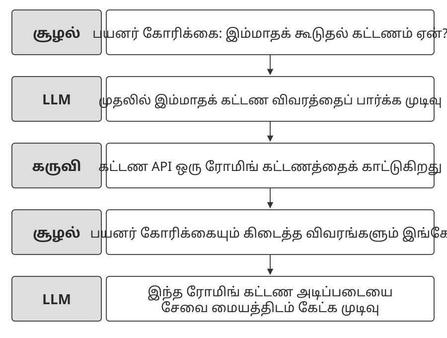
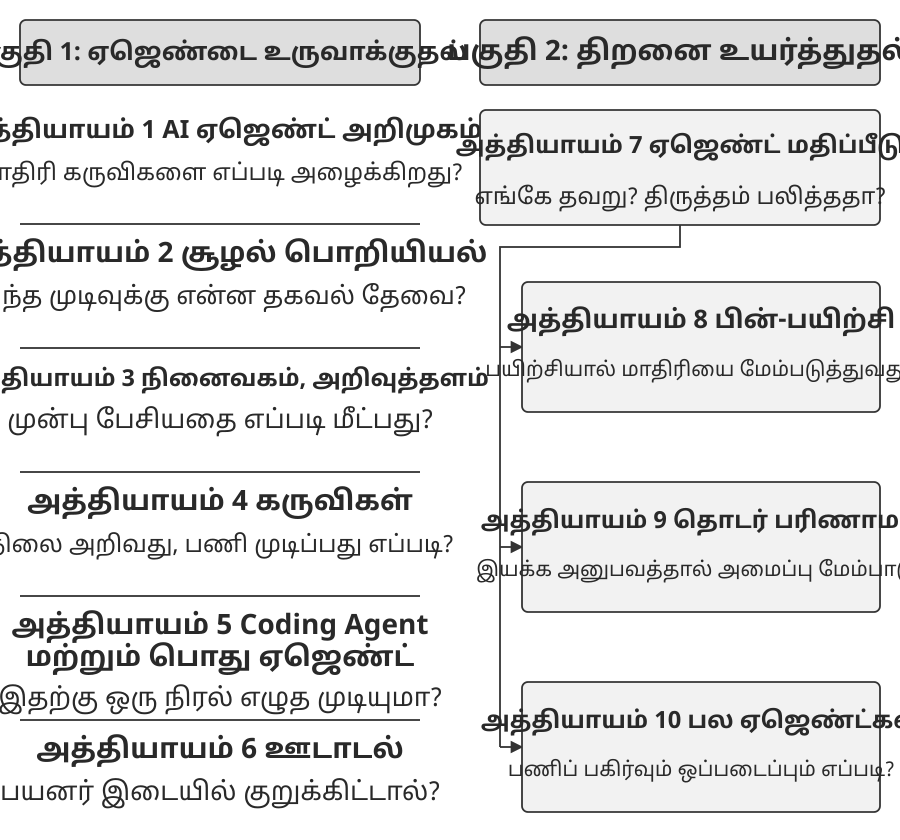

# முன்னுரை {.unnumbered}

2025 ஆகஸ்ட் முதல் 2026 தொடக்கம் வரை, டூரிங் (Turing) பதிப்பகத்தில் "Agent பயிற்சி முகாம்" என்ற இணையவழி காணொளிப் பாடநெறியை நடத்தினேன். விளக்கக்கூடிய, சரிபார்க்கக்கூடிய, மீண்டும் பயன்படுத்தக்கூடிய பொறியியல் முறைகளைக் கொண்டு AI ஏஜெண்டுகளை (AI Agent, நுண்ணறிவு முகவர்) எவ்வாறு உருவாக்குவது என்பதே அதன் பேசுபொருள். பாடநெறி ஒரு ஏஜெண்டை இயக்கிப் பார்ப்பதில் தொடங்கி, அது ஏன் அந்தக் கட்டமைப்பைப் பின்பற்றுகிறது என்பதைப் பகுப்பாய்வு செய்கிறது: ஒவ்வொரு வடிவமைப்பும் எந்தப் பிரச்சினையைத் தீர்க்கிறது, அதற்கு என்ன விலை கொடுக்க வேண்டியுள்ளது, எந்த வகைப் பணிகளுக்கு அது பொருந்தும் என்பவற்றை ஆராய்கிறது. இந்த நூல் அந்தப் பாடநெறியின் விரிவுரைக் குறிப்புகளையும் அவற்றோடு இணைந்த சோதனைகளையும் அடிப்படையாகக் கொண்டு தொகுக்கப்பட்டது.

> **இந்த நூல் உருவான விதம்: மனிதனும் இயந்திரமும் இணைந்து செய்த ஒரு பணி**
>
> பாடம் தயாரிக்கும்போது, முதலில் என் வெளிக்கோட்டை Pine-இன் குரல் ஏஜெண்டிடம் வாய்மொழியாகச் சொல்லி, அதைத் தகவல் திரட்டவும் முதல் வரைவை எழுதவும் சொல்வேன். இப்படி வாய்மொழியாகச் சொல்லிச் செய்யும் கூட்டுப்பணியை **whisper coding** என்று அழைக்கிறோம். பாடம் முடிந்ததும், மாணவர்கள் எந்த இடத்தில் தடுமாறினார்கள், எந்தச் சோதனையின் முடிவு எதிர்பாராததாக இருந்தது என்பதைப் பார்த்து, தொடர்புடைய எடுத்துக்காட்டுகளையும் வாதங்களையும் மீண்டும் சரிபார்ப்பேன்.

2025 முதல் ஒரு முக்கியமான மாற்றத்தை நான் கவனித்து வருகிறேன்: AI ஆய்விலும் தொழில்துறை நடைமுறையிலும் கவனம், அடிப்படை மாதிரியின் திறனை உயர்த்துவதிலிருந்து விரிவடைந்து, ஏஜெண்டுகளை உண்மையான பணிகளை முடிக்க வைப்பதை நோக்கி நகர்கிறது. இதனால் மாதிரிப் பயிற்சியும் பயன்பாடும் முன்னெப்போதையும் விட நெருக்கமாக இணைந்துள்ளன. DeepSeek-R1 போன்ற பகுத்தறிவு மாதிரிகள், வலுவூட்டல் கற்றல் கணிதம், நிரலாக்கம், பகுத்தறிவு ஆகிய திறன்களை எவ்வளவு உயர்த்துகிறது என்பதைக் காட்டின.[^preface-r1] ஏஜெண்டிக் வலுவூட்டல் கற்றல் (Agentic Reinforcement Learning) கருவி அழைப்பையும் வெளிச்சூழலுடனான இடைவினையையும் பயிற்சிக்குள் கொண்டுவருகிறது; இதன் மூலம் மாதிரி நிரலாக்கத்தையும் வரைகலை இடைமுகங்களை இயக்குவதையும் கற்றுக்கொள்கிறது. பின்னதைப் பொதுவாக Computer Use என்கிறோம்: மாதிரி திரைப்பிடிப்பைப் பார்த்துப் பக்கத்தின் நிலையை மதிப்பிட்டு, சொடுக்குதல், உள்ளீடு, உருட்டுதல் மூலம் செயல்களை முடிக்கிறது. Manus, Claude Code, OpenClaw போன்ற தயாரிப்புகள் பயனர்கள் பணிகளை நேரடியாக ஒப்படைக்க அனுமதிக்கின்றன; "குறியீடு உருவாக்கம் + கோப்பு முறைமை" ஒரு பொது ஏஜெண்டை எவ்வாறு தாங்கி நிற்கிறது என்பதையும் அவை காட்டுகின்றன.

2026 செப்டம்பரில் Meta நிறுவனம் Muse-ஐ அறிமுகப்படுத்தியது. அந்தக் காலகட்டத்தில் சீனாவிலும் வெளிநாடுகளிலும் தனிநபர் ஏஜெண்ட் தயாரிப்புகள் மழைக்காலக் காளான்கள் போலப் பெருகின. இந்த நூல் விவாதிக்கும் பல பிரச்சினைகளை, நானும் என் குழுவும் அதற்கு முன்பே Pine-ஐ உருவாக்கும்போது எதிர்கொண்டோம். நான் Pine AI நிறுவனத்தின் தலைமை விஞ்ஞானி; நுகர்வோருக்காக வேலைகளைச் செய்து முடிக்கும் இந்தத் தனிநபர் ஏஜெண்டை என் சக ஊழியர்களுடன் சேர்ந்து உருவாக்கினேன். 2025 ஜனவரி தொடக்கத்திலேயே Pine அமெரிக்காவில் அறிமுகமானது. பயனர்கள் அதனிடம் வணிக நிறுவனங்களைத் தொலைபேசியில் அழைத்துக் கட்டணங்களைப் பேசிக் குறைக்கவும், பணத்திருப்பம் கோரவும், சந்தாக்களை ரத்து செய்யவும் சொல்லலாம்.

ஒரு வணிக நிறுவனம் தொலைபேசியில் ஒரு கட்டணத்தைத் தள்ளுபடி செய்ய ஒப்புக்கொண்டால், அந்த நேரத்தில் Pine பயனரிடம் சொல்லக்கூடியது "வாடிக்கையாளர் சேவை ஒப்புக்கொண்டது" என்பது மட்டுமே; "பணம் திருப்பித் தரப்பட்டுவிட்டது" என்று சொல்ல, அந்தப் பணத்திருப்பம் கட்டண அறிக்கையில் தோன்றும் வரை காத்திருக்க வேண்டும். இத்தகைய வேலைகளைச் செய்ய, பயனர் எதற்கு அனுமதி கொடுத்தார் என்பதை மாதிரி நினைவில் வைத்திருக்க வேண்டும்; அடுத்து எதைச் சரிபார்க்க வேண்டும் என்பதை அறிந்திருக்க வேண்டும்; வேலை எந்தக் கட்டத்தை எட்டியுள்ளது என்பதையும் பிரித்தறிய வேண்டும். பின்னர் தொழில்துறை Skill, Harness, Loop பொறியியல் பற்றிப் பேசத் தொடங்கியபோது, அவற்றில் பல நடைமுறைகளை நாங்கள் இந்தத் தொலைபேசி அழைப்புகளுக்குள்ளேயே தடவித் தேடிக் கண்டுபிடித்திருந்தோம்.

- **Skill.** ஒரு பணிக்குத் தேவைப்படும்போது மட்டுமே அதற்குரிய ப்ராம்ப்டுகளை ஏற்றினோம். கருவிகளின் எண்ணிக்கை அதிகரித்த பிறகு, மாதிரி கட்டளை வரி (command line) வழியாகக் கருவிகளை அழைக்கும்படி செய்தோம்; இதனால் ஒவ்வொரு கோரிக்கையிலும் எல்லாக் கருவிகளின் வரையறைகளையும் பட்டியலிட வேண்டிய அவசியம் இல்லாமல் போனது.
- **Harness.** இயக்கச் சூழல், தற்போதைய நேரம், பயனரின் பணி நிலை ஆகியவற்றை ஒரு நிலைப் பட்டையில் (status bar) எழுதி, முடிவெடுக்கும்போது மாதிரி அவற்றைக் குறிப்பாகப் பயன்படுத்தும்படி செய்தோம். மாதிரி சில சமயம் முடிவுகளைப் புனைகிறது, தவறான கருவியை அழைக்கிறது, அல்லது அறிவுறுத்தல்களைத் தவறவிடுகிறது; ஆபத்தான செயல்கள் பயனர் வழங்கிய அனுமதியை மீறவும் கூடும். இதற்காகச் செயல்பாட்டுச் செயல்முறைக்குக் கட்டுப்பாடுகளைச் சேர்த்தோம்; பின்னர் Claude Code-இலும் இதை ஒத்த அணுகுமுறையைக் கண்டோம்.
- **Loop பொறியியல்.** மாதிரி சில சமயம் வேலையைப் பாதி மட்டுமே செய்துவிட்டு முடிந்ததாக அறிவித்துவிடுகிறது. எனவே ஒரு ஏஜெண்ட் வேலையைச் செய்ய, மற்றொன்று கட்டண அறிக்கையையோ ஆர்டரையோ சரிபார்க்கும்படி அமைத்தோம்; விடுபட்ட வேலை கண்டுபிடிக்கப்பட்டால் அது மீண்டும் முதல் ஏஜெண்டிடம் திருப்பி அனுப்பப்படும். இதுவே முன்மொழிபவர்–மதிப்பாய்வாளர் (proposer-reviewer) பணிப்பகிர்வு ஆகும்.

பிற மாதிரி மற்றும் ஏஜெண்ட் குழுக்களும் இதையொத்த பிரச்சினைகளைத் தீர்க்கும்போது, தனித்தனியே இதையொத்த முறைகளை வந்தடைந்தன. எங்கள் குழு சந்தித்த பல சிரமங்கள், ஏஜெண்ட் அமைப்புகள் நடைமுறைப் பயன்பாட்டை நோக்கி நகரும்போது அனைவரும் பொதுவாக எதிர்கொள்ளும் பிரச்சினைகள் என்ற என் நம்பிக்கையை இது மேலும் உறுதிப்படுத்தியது. "Agent பயிற்சி முகாம்" தவிர, 2024—2026 காலப்பகுதியில் சீன அறிவியல் அகாடமி பல்கலைக்கழகத்திலும் (University of Chinese Academy of Sciences) ஏஜெண்ட் நடைமுறை குறித்த பாடநெறியைத் தொடர்ந்து கற்பித்து வருகிறேன். இரு பாடநெறிகளின் மாணவர்களும் எழுப்பிய கேள்விகள், எந்த அனுபவங்களை இன்னும் தெளிவாக விளக்க வேண்டும் என்பதை அடையாளம் காண எனக்கு உதவின. இந்த நூல் திறந்த மூலமாக வெளியிடப்படுகிறது; மேலும் பல ஆய்வாளர்களும் பொறியாளர்களும் இந்த முறைகளைப் பயன்படுத்தவும், சோதித்துப் பார்க்கவும், மேம்படுத்தவும் வேண்டும் என்பதே என் விருப்பம்.

**நடைமுறை முதலில், பெயரிடுதல் பின்னர்.** மேம்பாட்டுக் குழுக்களுக்கு இதில் இன்னொரு பொருளும் உண்டு: ஒரு சொல் தொழில்துறையின் பொது ஒப்புதலைப் பெறும் நேரத்தில், முன்னணிக் குழுக்கள் பெரும்பாலும் அதை நீண்ட காலமாக ஆராய்ந்து முடித்திருக்கும். சொந்தப் பொறியியல் மேன்மையைச் சேர்த்துக்கொள்ள வேண்டுமானால், உண்மையான வணிகத்திலிருந்து பிரச்சினைகளை முன்கூட்டியே கண்டறிந்து, அவற்றைத் தீர்க்க முயல வேண்டும். இதைச் சாதிக்க இரண்டு முக்கிய நிபந்தனைகள் தேவை என்று நான் கருதுகிறேன்.

**முதலாவதாக, ஏஜெண்டின் திறனிடம் போதுமான அளவு உயர்ந்த கோரிக்கைகளை வைக்கும் உண்மையான வணிகத்தைத் தேர்ந்தெடுத்து, அதிலிருந்து தொடர்ந்து பின்னூட்டம் பெற வேண்டும்.** Pine-இன் ஒரு பணி பல மணிநேரங்கள், ஏன் பல வாரங்கள் கூட நீடிக்கலாம். அது பல தரப்பினருடன் தொடர்பு கொள்ள வேண்டும்; நீண்ட தொலைபேசி அழைப்புகளை நடத்த வேண்டும், சிக்கலான படிவங்களை நிரப்ப வேண்டும், பல சுற்று மின்னஞ்சல் பரிமாற்றங்களைச் செய்ய வேண்டும். அதே நேரத்தில் எண்கள் துல்லியமாக இருக்க வேண்டும், செயல்கள் கட்டுக்குள் இருக்க வேண்டும், பயனரின் நலன்கள் காக்கப்பட வேண்டும். இத்தகைய சூழ்நிலைகள் மாதிரியின் திறனுக்கும் வணிகத் தேவைகளுக்கும் இடையிலான இடைவெளியைத் தொடர்ந்து வெளிப்படுத்தி, குழுவை Harness-ஐ மேம்படுத்தத் தூண்டுகின்றன. ஒரு தயாரிப்பின் முக்கிய மதிப்பு ஏதோ ஒரு தலைமுறை மாதிரியின் குறைபாட்டை ஈடுசெய்வது மட்டுமே என்றால், அடுத்த மாதிரி மேம்படுத்தல் அந்த மதிப்பை முழுவதுமாக விழுங்கிவிடக்கூடும்; அப்படிப்பட்ட குழு நீடித்த மேன்மையைச் சேர்ப்பது கடினம்.

**இரண்டாவதாக, முறையான மதிப்பீட்டு (Evaluation) பொறிமுறையை நிறுவ வேண்டும்.** அமைப்பை மாற்றிய பிறகு ஒரு கட்டணப் பேச்சுவார்த்தை வெற்றி பெற்றால், உதவியாளர் சரியான கேள்வியைக் கேட்டதால் இருக்கலாம்; அல்லது இந்த முறை தொடர்பு கொண்ட வாடிக்கையாளர் சேவைப் பிரதிநிதிக்குத் தள்ளுபடி அளிக்கும் அதிகாரம் தற்செயலாக இருந்ததாலும் இருக்கலாம். ஒரே தொகுப்பு எடுத்துக்காட்டுகளைக் கொண்டு புதிய, பழைய பதிப்புகளை மீண்டும் மீண்டும் ஒப்பிட்டால்தான், வேறுபாடு நிலையானதா என்பது தெரியும். வெற்றி அளவுகோல்களை எவ்வாறு அமைப்பது, மதிப்பீட்டுச் சூழலை எவ்வாறு கட்டமைப்பது, தோல்விகளை எவ்வாறு பகுப்பாய்வு செய்வது, மாற்றங்களை எவ்வாறு சோதிப்பது என்பதை அத்தியாயம் 7 விரிவாக விளக்கும்.

Pine-இல் கட்டணத் தள்ளுபடியிலிருந்து ஒரு வழிமுறையைக் கற்றுக்கொண்டோம்: மதிப்பாய்வாளர் கட்டண அறிக்கையில் அந்தத் தொகையையே பார்க்க வேண்டும். இதே வழிமுறையைப் பயணச்சீட்டு மாற்றத்திற்குப் பயன்படுத்தினால், புதிய பயணச்சீட்டு வழங்கப்பட்டதா என்று பார்க்க வேண்டும். குறிப்பிட்ட சான்றுகள் வணிகத்துக்கு வணிகம் மாறுகின்றன; ஆனால் அவற்றின் பின்னால் ஒரு பொதுக் கொள்கை உள்ளது: ஒரு பணி முடிந்ததா என்று தீர்மானிக்க, அந்தச் செயல் வெளியுலகில் என்ன விளைவை விட்டுச் சென்றது என்பதைப் பார்க்க வேண்டும். **நல்ல கொள்கைகள் மாதிரிகளின் தலைமுறை மாற்றங்களைக் கடந்தும் நிலைத்து நிற்கின்றன.**

## இந்த நூலின் நோக்கம் {.unnumbered}

ஒருவர் தன் கைபேசிக் கட்டண அறிக்கையை ஒரு உதவியாளரிடம் கொடுத்து, தொலைத்தொடர்பு நிறுவனத்தைத் தொடர்பு கொண்டு தள்ளுபடி பேசிப் பெறச் சொல்கிறார் என்று வைத்துக்கொள்வோம். தொடங்குவதற்கு முன், எந்தக் கட்டணம் குறித்து சர்ச்சை உள்ளது என்பதை உதவியாளர் தெளிவுபடுத்திக்கொள்ள வேண்டும்; அழைப்பின்போது, விளக்கங்களைக் கேட்டு, நிபந்தனைகள் குறித்துத் தொடர்ந்து கேள்வி எழுப்ப வேண்டும்; முடிவில், வாடிக்கையாளர் சேவை உண்மையில் என்ன ஒப்புக்கொண்டது என்பதைப் பயனரிடம் சொல்ல வேண்டும். உதவியாளர் எடுக்கும் ஒவ்வொரு அடியிலும் மூன்று கேள்விகளுக்குப் பதில் சொல்ல வேண்டும்: இந்தக் கணத்தில் உதவியாளருக்கு என்ன தெரியும்? அது என்னென்ன செயல்களை மேற்கொள்ள முடியும்? அடுத்த அடியை எதன் அடிப்படையில் தேர்ந்தெடுக்கிறது? இந்த மூன்று கேள்விகளிலிருந்து தொடங்கி, ஏஜெண்டின் அமைப்பு, அதை உருவாக்கும் முறைகள், அதன் திறனின் எல்லைகள் ஆகியவற்றை இந்த நூல் அறிமுகப்படுத்துகிறது. மையச் சூத்திரம் **ஏஜெண்ட் = LLM + சூழல் + கருவிகள்**: LLM புரிந்துகொள்ளுதல், திட்டமிடுதல், முடிவெடுத்தல் ஆகியவற்றுக்குப் பொறுப்பு; சூழல் (context) தற்போதைய முடிவுக்குத் தேவையான தகவலைத் தாங்குகிறது; கருவிகள் வெளிப்புறச் சூழலுடன் இணைத்து, அவதானிப்புகளைப் பெறவோ செயல்களை மேற்கொள்ளவோ பயன்படுகின்றன.

ஒரு எளிய உவமையைச் சொன்னால், LLM "மூளை", சூழல் "தற்போதைய முடிவுப் பார்வைப் புலம்", கருவிகள் "புலன்களும் கைகால்களும்". இந்தப் பார்வைப் புலத்தில் வெளிச்சூழல் பற்றிய தகவல், உரையாடல் வரலாறு, நினைவகம், அறிவு ஆகியவை உள்ளன; அமைப்பு அறிவுறுத்தல்கள், கருவி வரையறைகள், பணி நிலை ஆகியவையும் உள்ளன. தேடல், படித்தல், திரைப்பிடிப்பு ஆகியவை தகவலைக் கொண்டுவருகின்றன; சொடுக்குதல், எழுதுதல், வணிக இடைமுகங்களை அழைத்தல் ஆகியவை வெளிப்புற நிலையை மாற்றுகின்றன. படம் 0-1 ஒரு கட்டண விசாரணையைப் பிரித்துக் காட்டுகிறது. முதல் முறை முடிவெடுக்கும்போது, பயனருக்குக் கட்டணம் குறித்து ஐயம் உள்ளது என்பது மட்டுமே மாதிரிக்குத் தெரியும்; இரண்டாவது முறை, எந்தத் தொகையைப் பற்றிக் கேட்க வேண்டும் என்பதை அதனால் சுட்டிக்காட்ட முடிகிறது.



வலுவூட்டல் கற்றல் (Reinforcement Learning, RL) பற்றி அறிந்த வாசகர்கள், உத்தி (policy), அவதானிப்பு, செயல் ஆகிய கருத்துகளைக் கொண்டும் இந்தப் பணிப்பகிர்வைப் புரிந்துகொள்ளலாம். LLM சூழலின் அடிப்படையில் அடுத்த அடியைத் தேர்ந்தெடுக்கிறது; அதன் முடிவெடுக்கும் பணி ஏறக்குறைய ஓர் உத்தியை ஒத்தது. இந்த முடிவுக்குப் பயன்படும் குறிப்பிட்ட அவதானிப்புகளையும் வரலாற்றையும் சூழல் தாங்குகிறது; கருவிகள் அவதானிப்பு, செயல் இடைமுகங்களை வழங்குகின்றன. எந்தெந்த அவதானிப்புகள் கிடைக்கக்கூடும் என்பதை அவதானிப்பு வெளி (Observation Space) விவரிக்கிறது; எந்தெந்தச் செயல்கள் அனுமதிக்கப்படுகின்றன என்பதைச் செயல் வெளி (Action Space) விவரிக்கிறது. இவ்விரண்டும் சேர்ந்து ஏஜெண்ட் வெளிச்சூழலுடன் இடைவினை புரியும் எல்லையை வரையறுக்கின்றன.[^preface-spaces] அத்தியாயம் 1 கருவி அழைப்பு எடுத்துக்காட்டுகள் மூலம் இந்தக் கருத்துகளை விரிவுபடுத்தி, உற்பத்திச் செயலாக்கங்களில் Model-க்கும் Harness-க்கும் இடையிலான பணிப்பகிர்வை அறிமுகப்படுத்தும்.

> **விரிவான சிந்தனை: உயிரிலிருந்து வடிவமைக்கப்பட்ட பொருள்கள் வரை**
>
> பொறியியல் நடைமுறைக்கு அப்பால், நுண்ணறிவு அமைப்புகளின் பரிணாமம் பற்றிய கேள்விகளையும் ஏஜெண்டுகள் எழுப்புகின்றன. டூரிங் விருது பெற்றவரும் வலுவூட்டல் கற்றலின் முன்னோடியுமான Richard Sutton, பிரபஞ்சத்தின் பரிணாமத்தைத் தூசி, நட்சத்திரங்கள், உயிர், "வடிவமைக்கப்பட்ட பொருள்கள்" (designed entities) என்ற நான்கு கட்டங்களாகச் சுருக்கிக் கூறுகிறார்.[^preface-sutton] உயிரினங்கள் சீரற்ற மாற்றம், இயற்கைத் தேர்வு மூலம் பரிணமிக்கின்றன; வடிவமைக்கப்பட்ட பொருள்களையோ, ஏற்கனவே உள்ள நுண்ணறிவு அமைப்புகள் ஒரு நோக்கத்துடன் உருவாக்கி மேம்படுத்த முடியும்.
>
> ஏஜெண்டுகள் குறியீட்டை உருவாக்கலாம், புதிய ஏஜெண்டுகளைக் கட்டமைக்கலாம், பின்னர் அவற்றின் இயக்க நடத்தையைப் பகுப்பாய்வு செய்து, மாற்றங்களை முன்மொழிந்து, முடிவுகளைச் சரிபார்க்கலாம்; இவ்வாறு படிப்படியாகத் தன்னைத் தானே தூக்கி நிறுத்துதலையும் (bootstrap) தொடர்ச்சியான பரிணாமத்தையும் அடையலாம். இது ஒரு நிரலர் இன்னொரு நிரலரை எழுதுவது போன்றது; பின்னவர் புதிய அமைப்புகளை உருவாக்குவதில் தொடர்ந்து பங்கேற்கிறார். தன்னைப் புரிந்துகொண்டு தன்னை மேம்படுத்திக்கொள்ளும் இந்தச் சாத்தியமே, குறியீடு உருவாக்கம், தொடர்ச்சியான பரிணாமம் ஆகிய இரண்டு அத்தியாயங்களை எழுதும்போது என்னை மிகவும் ஈர்த்த கேள்விகளில் ஒன்று.

## நூலின் அமைப்பு {.unnumbered}

அத்தியாயங்களுக்கு இடையிலான தொடர்புகளைப் படம் 0-2 காட்டுகிறது. பயனர் அழைப்பின் நடுவே தன் கோரிக்கையை மாற்றிக்கொண்டும், உதவியாளர் பழைய கோரிக்கையின்படியே செயல்படுகிறது என்றால், இடது நெடுவரிசையில் உள்ள அத்தியாயம் 6-இலிருந்து படிக்கத் தொடங்கி, பயனர் இடைமறித்துப் பேசுவதை உதவியாளர் எவ்வாறு கையாள்கிறது என்று பார்க்கலாம். சரிசெய்த பிறகு, மற்ற அழைப்புகளிலும் அது புதிய கோரிக்கைகளைக் கேட்டு நடக்கிறது என்பதை எப்படி அறிவது? அதற்கு வலது நெடுவரிசையில் உள்ள அத்தியாயம் 7-இன் மதிப்பீட்டு முறைகள் தேவை. படத்தில் அத்தியாயம் 7-இலிருந்து பிரியும் மூன்று அம்புகள், மதிப்பீட்டு முடிவுகள் கிடைத்த பிறகு தோல்விக்கான காரணத்தைப் பொறுத்து வெவ்வேறு மேம்பாட்டு வழிகளைத் தேர்ந்தெடுக்கலாம் என்பதைக் குறிக்கின்றன.



- **அத்தியாயம் 1 (AI ஏஜெண்டுகள்: ஓர் அறிமுகம்)** தயாரிப்புகள், கருவி அழைப்பு எடுத்துக்காட்டுகள் மூலம் மையக் கூறுகள், இயக்கச் சுழற்சி, Harness, ஒருங்கிணைப்பு முறைகள் ஆகியவற்றை அறிமுகப்படுத்தி, நூல் முழுவதையும் புரிந்துகொள்வதற்கான கருத்துக் கட்டமைப்பை நிறுவுகிறது.
- **அத்தியாயம் 2 (சூழல் பொறியியல்)** நூலின் மிக முக்கியமான அத்தியாயம்; மாதிரிக்கு இப்போது தேவைப்படும் தகவலை எவ்வாறு ஒழுங்கமைப்பது என்பதை விவாதிக்கிறது. ப்ராம்ப்ட் வடிவமைப்பு, தேவைக்கேற்ப ஏற்றுதல் முதல் வரலாற்று மேலாண்மை வரை விளக்கி, KV Cache-உடன் இணைத்து இந்த முறைகள் பதிலின் தரத்தையும் இயக்கச் செலவையும் எவ்வாறு பாதிக்கின்றன என்பதை விளக்குகிறது.
- **அத்தியாயம் 3 (பயனர் நினைவகமும் அறிவுத் தளமும்)** அமர்வுகளைக் கடந்து நிற்கும் தகவலை எவ்வாறு சேமித்துப் பயன்படுத்துவது என்பதை விவாதிக்கிறது. பயனர் நினைவகம் முதல் RAG, கட்டமைக்கப்பட்ட சுட்டுகள், அறிவுப் புதுப்பிப்பு வரை விளக்கி, நிலையான அறிவை மீட்டெடுக்கவும் பராமரிக்கவும் வாசகர்களுக்கு உதவுகிறது.
- **அத்தியாயம் 4 (கருவிகள்)** ஏஜெண்ட் எவ்வாறு அவதானிப்புகளைப் பெறுகிறது, செயல்களை மேற்கொள்கிறது, ஒத்துழைப்பைக் கோருகிறது என்பதை விவாதிக்கிறது. கருவி வகைப்பாடு, இடைமுக வடிவமைப்பு, MCP, செயல்பாட்டு மேலாண்மை மூலம் வெளிப்புறத் திறன்களை அமைப்பில் எவ்வாறு இணைப்பது என்பதைப் புரிய வைக்கிறது.
- **அத்தியாயம் 5 (Coding Agent-உம் பொது ஏஜெண்டும்)** பொது ஏஜெண்டுக்கான ஒரு மையக் கட்டமைப்புச் சிந்தனையை முன்வைக்கிறது: Coding Agent-ஐச் செயல்பாட்டு மையமாகவும், கோப்பு முறைமையைப் பணியிடமாகவும் கொள்வது. முதலில் மேம்பாட்டுச் செயல்முறையை விளக்கி, பின்னர் பல்லூடகம், வணிக அமைப்புகள் போன்ற எடுத்துக்காட்டுகள் மூலம், ஏஜெண்ட் நிரல்களை எழுதிப் பிரச்சினைகளைத் தீர்ப்பதையும், அதன் வழியே கருவிகளை உருவாக்கிப் புதிய ஏஜெண்டுகளைக் கட்டமைப்பதையும் விளக்குகிறது.
- **அத்தியாயம் 6 (இடைவினை: அவதானிப்பு, செயல் வெளிகளின் விரிவாக்கம்)** முறைமை (modality), நேரம் ஆகிய இரண்டு பரிமாணங்களிலிருந்து ஏஜெண்டின் இடைவினை முறைகளை விவாதிக்கிறது. ஒத்திசைவற்ற நிகழ்வுகள், குரல், Computer Use, ரோபோக்கள் மூலம் தொடர் அவதானிப்பு, வேக–மெதுவான பாதைகள், செயல்பாட்டுக் கட்டுப்பாடு ஆகியவற்றைப் புரிய வைக்கிறது.
- **அத்தியாயம் 7 (ஏஜெண்ட் மதிப்பீடு)** அமைப்பின் செயல்திறனையும் ஒரு மாற்றத்தின் விளைவையும் எவ்வாறு தீர்மானிப்பது என்ற கேள்விக்குப் பதில் அளிக்கிறது. முதலில் வெற்றி அளவுகோல்கள், வெளிச்சூழல், தரவுத்தொகுப்பு ஆகியவற்றை நிர்ணயித்து, பின்னர் சரிபார்ப்பான்கள், மதிப்பெண் வழங்கல், புள்ளியியல் பகுப்பாய்வு ஆகியவற்றை விளக்கி, இறுதியில் தோல்விக் காரணங்களைப் பகுப்பாய்வு செய்து மேம்பாட்டுத் திசையைக் கண்டறிகிறது.
- **அத்தியாயம் 8 (மாதிரிப் பின்-பயிற்சி)** தரவையும் வெளிச்சூழலையும் கொண்டு மாதிரியின் திறனை எவ்வாறு புதுப்பிப்பது என்பதை விவாதித்து, தரவுத் தரத்திலும் பயிற்சி வெளிச்சூழலிலும் முன்னுரிமை கொடுத்து முதலீடு செய்ய வேண்டும் என்று வலியுறுத்துகிறது. மேற்பார்வை நுண்சரிப்படுத்தல், வலுவூட்டல் கற்றல், வெகுமதி வடிவமைப்பு மூலம், எடுத்துக்காட்டுகளைப் பார்த்துக் கற்றலும் ஆய்ந்தறிதலும் ஏன் வெவ்வேறு பொதுமைப்படுத்தல் செயல்திறனைத் தருகின்றன என்பதையும், வழிமுறையை மட்டும் மாற்றுவது ஏன் பெரும்பாலும் குறைந்த பலனையே தருகிறது என்பதையும் விளக்குகிறது.
- **அத்தியாயம் 9 (ஏஜெண்டின் தொடர்ச்சியான பரிணாமம்)** இயக்க அனுபவத்தைக் கொண்டு ஏஜெண்டின் அடுத்தடுத்த பதிப்புகளை எவ்வாறு மேம்படுத்துவது என்பதை விவாதிக்கிறது. அறிவு, அறிவுறுத்தல்கள், நிரல்கள், அளவுருக்கள் என்ற நான்கு வகைப் புதுப்பிப்புகளை ஒப்பிட்டு, பின்னர் சரிபார்ப்பு, வெளியீடு, மீட்பு ஆகிய செயல்முறைகள் மூலம் நீண்டகால மாற்றங்களை நிர்வகிக்கிறது.
- **அத்தியாயம் 10 (பல-ஏஜெண்ட் ஒத்துழைப்பு)** பல உறுப்பினர்கள் எப்போது கூடுதல் மதிப்பைத் தருகிறார்கள், அவர்களிடையே பணியை எவ்வாறு பகிர்வது, தொடர்புகொள்வது, ஒருங்கிணைப்பது என்பதை விவாதிக்கிறது. முதலில் சூழலும் கட்டுப்பாட்டு அதிகாரமும் எவ்வாறு பகிரப்படுகின்றன என்பதை விளக்கி, பின்னர் எடுத்துக்காட்டுகளுடன் ஒத்துழைப்புப் பொறிமுறைகளை விளக்கி, தோல்விக் காரணங்களைப் பகுப்பாய்வு செய்து, ஏஜெண்ட் சமூகம், பொருளாதாரம் ஆகியவற்றின் சாத்தியமான வடிவங்களை விவாதிக்கிறது.

## இந்த நூலை எவ்வாறு படிப்பது {.unnumbered}

- **ஏஜெண்ட் தயாரிப்பை அடியிலிருந்து உருவாக்க**: நூல் முழுவதையும் படிக்குமாறு பரிந்துரைக்கிறேன். முதலில் அத்தியாயங்கள் 1–6 கொண்டு வேலை செய்யக்கூடிய ஒரு உதவியாளரை உருவாக்கி, பின்னர் அத்தியாயம் 7 கொண்டு அது எந்தப் பணிகளில் எளிதில் தவறுகிறது என்று சோதியுங்கள். அடுத்த மூன்று அத்தியாயங்கள் இந்தத் தோல்விகளின் அடிப்படையில் மாதிரியையோ, அமைப்பையோ, உறுப்பினர்களுக்கு இடையிலான பணிப்பகிர்வையோ எவ்வாறு மேம்படுத்துவது என்பதை விவாதிக்கின்றன.
- **முதலில் ஒட்டுமொத்தப் புரிதலைப் பெற**: அத்தியாயங்கள் 1, 2, 4, 7 ஆகியவற்றை வரிசையாகப் படியுங்கள். ஒரு கருவி அழைப்பைப் பின்தொடர்ந்து செல்லுங்கள்: முதலில் ஏஜெண்டின் இயக்கச் சுழற்சியைப் புரிந்துகொண்டு, பின்னர் மாதிரி என்ன தகவலைப் பெறுகிறது, கருவி உண்மையில் என்ன செய்கிறது என்பதைப் பார்த்து, இறுதியில் மதிப்பீட்டைக் கொண்டு முடிவு பயனரின் கோரிக்கைக்கு ஏற்ப உள்ளதா என்று தீர்மானியுங்கள். அத்தியாயம் 2-இல் KV Cache பற்றிய பகுதிக்கு வரும்போது, முதல் வாசிப்பில் தொடக்கத்தில் உள்ள மூன்று முடிவுகளை மட்டும் உள்வாங்கிக்கொண்டு, சோதனைகளைச் செய்த பிறகு அடிப்படைக் கொள்கைகளுக்குத் திரும்பி வரலாம்.
- **மாதிரிப் பயிற்சியில் கவனம் செலுத்த**: முதலில் அத்தியாயங்கள் 1, 2 கொண்டு ஏஜெண்ட் எவ்வாறு இயங்குகிறது என்பதைப் புரிந்துகொண்டு, பின்னர் அத்தியாயம் 7-இன் மதிப்பீட்டு முறைகளுடன் இணைத்து அத்தியாயம் 8-ஐப் படியுங்கள். இவ்வாறு பயிற்சி இலக்குகளை உண்மையான பணிச் செயல்திறனுடன் இணைத்துப் பார்க்க முடியும்.
- **ஏற்கனவே வெளியிடப்பட்ட ஏஜெண்டைப் பராமரிக்க**: அத்தியாயம் 7-ஐப் பின்பற்றி, ஒரு தொகுதி உண்மையான பணிகளைத் தேர்ந்தெடுத்து மதிப்பீடு செய்யுங்கள். எடுத்துக்காட்டாக, உதவியாளர் பயனரிடம் பழைய விலையைச் சொன்னால், அது எந்தப் பதிப்பு விலைப்பட்டியலைப் பெற்றது என்பதை முதலில் சரிபாருங்கள். அறிவோ செயல்முறையோ காலாவதியாகியிருந்தால், இந்தத் தோல்வியைக் கையில் வைத்துக்கொண்டு அத்தியாயம் 9-ஐப் படியுங்கள்; விலைப்பட்டியலும் கருவிகளும் போதுமான அளவு வழங்கப்பட்டு, செயல்முறையைத் திருத்திய பின்னரும் மாதிரி மீண்டும் மீண்டும் தவறான தேர்வைச் செய்தால், அத்தியாயம் 8-ஐப் படித்து, பயிற்சித் தரவைத் தயாரிப்பது பயனுள்ளதா என்று தீர்மானியுங்கள்.

ஒவ்வொரு அத்தியாயத்திலும் சோதனைகளும் சிந்தனைக் கேள்விகளும் உள்ளன. சோதனைகள் "சோதனை X-Y" என்று எண்ணிடப்பட்டுள்ளன; X அத்தியாய எண்ணையும், Y அத்தியாயத்திற்குள் அதன் வரிசையையும் குறிக்கின்றன. நட்சத்திரக் குறிகள் கடினத்தன்மையைக் குறிக்கின்றன: ★ தொடக்கநிலையினருக்கு ஏற்றது, ★★ ஓரளவு பொறியியல் அனுபவம் தேவை, ★★★ திறந்த கேள்விகளையோ சிக்கலான அமைப்பு வடிவமைப்பையோ உள்ளடக்கியது. பெரும்பாலான சோதனைகளுக்கு இயக்கக்கூடிய குறியீடு உண்டு; அவை அனைத்தும் ஒரு திறந்த மூலக் களஞ்சியத்தில் தொகுக்கப்பட்டுள்ளன:

> **துணைக் குறியீட்டுக் களஞ்சியம்**: `bojieli/ai-agent-book`

முதல் முறையாகச் சோதனை செய்பவர்கள் "சோதனை 1-1: சூழலின் முக்கியப் பங்கு" என்பதிலிருந்து தொடங்கலாம். Git பயன்படுத்தினால், முனையத்தில் (terminal) பின்வருவதை இயக்குங்கள்:

```bash
git clone https://github.com/bojieli/ai-agent-book.git
cd ai-agent-book
```

களஞ்சியப் பக்கத்தில் **Code → Download ZIP** என்பதைத் தேர்ந்தெடுத்துப் பதிவிறக்கி விரித்தாலும் அதே கோப்பகம் கிடைக்கும். அத்தியாயம் 1-இன் சோதனைச் சுட்டியில் (`chapter1/README.md`) எண் 1-1-ஐக் கண்டுபிடித்து, `chapter1/context/README.md`-ஐத் திறவுங்கள். இனி "சோதனை X-Y" என்பதைச் சந்திக்கும்போதெல்லாம், களஞ்சியத்தில் உள்ள `chapterX/README.md`-இல் அதன் திட்டத்தையும் இயக்கும் முறையையும் கண்டறியலாம். "மீளுருவாக்க வழிகாட்டி" வெளிப்புறத் திட்டங்களையும் அவற்றைப் பெறும் வழிகளையும் தருகிறது; நிறுவல் கட்டளைகளும் கோப்பக விளக்கங்களும் README-இல் ஒருங்கே உள்ளன.

## முன்நிபந்தனைகள் {.unnumbered}

இந்த நூல், அடிப்படை நிரலாக்கத் திறன் கொண்டு, ஏஜெண்டுகளைப் புரிந்துகொள்ளவும் உருவாக்கவும் விரும்பும் வாசகர்களுக்கானது. சோதனைகளை நேரடியாகச் செய்யும்போது பின்வரும் அடிப்படைகள் தேவைப்படும்.

**அவசியம்: நூல் முழுவதையும் படிப்பதற்கான அடிப்படை**

- **Python நிரலாக்கம்**: தொடரியல், பொதுவான தரவுக் கட்டமைப்புகள், pip போன்ற தொகுப்பு மேலாண்மைக் கருவிகள் ஆகியவற்றில் பரிச்சயம் இருக்க வேண்டும்; சோதனைக் குறியீட்டைப் படித்துப் புரிந்து மாற்றும் திறன் வேண்டும். நூலின் பெரும்பாலான சோதனைகள் Python அடிப்படையிலானவை.
- **LLM பயன்பாட்டு அனுபவம்**: ChatGPT, Claude அல்லது அதையொத்த தயாரிப்புகளைப் பயன்படுத்தியிருக்க வேண்டும்; கோரிக்கை வைத்தல், பதிலைப் படித்தல், தொடர்ந்து கேள்வி கேட்டல் என்ற அடிப்படைச் செயல்முறையில் பரிச்சயம் இருக்க வேண்டும்.
- **மென்பொருள் பொறியியல் பொது அறிவு**: கட்டளை வரி, Git, JSON, REST API ஆகியவற்றைப் புரிந்திருக்க வேண்டும்; அவற்றைக் கொண்டு திட்டங்களை இயக்கவும், மாற்றங்களைச் சரிபார்க்கவும், இடைமுகத் தரவைப் படிக்கவும் முடிய வேண்டும்.

சோதனைகளை நேரடியாகச் செய்யும்போது, Claude Code, Codex, Cursor, TRAE ஆகியவற்றில் ஒன்றைத் தேர்ந்தெடுக்குமாறு வலுவாகப் பரிந்துரைக்கிறேன். ஒரு குறியீட்டுப் பகுதியைப் பிழைநீக்க அதனிடம் உதவி கேட்டு, அது எந்தக் கோப்புகளைப் படித்தது, எந்தக் கருவிகளை அழைத்தது என்று பாருங்கள். பின்னர் இயக்கச் சுழற்சி, சூழல் மேலாண்மை பற்றிப் படிக்கும்போது, ஒப்பிட்டுப் பார்க்க உங்களுக்கென ஒரு நேரடி அனுபவம் இருக்கும்.

**பரிந்துரை: அத்தியாய வாரியாகக் கூடுதல் அறிவு**

- **இயந்திரக் கற்றல் அடிப்படைகள் (அத்தியாயம் 8)**: பயிற்சியும் அனுமானமும், இழப்புச் சார்பு (loss function), சரிவு இறக்கம் (gradient descent), மிகைப்பொருத்தம் (overfitting) ஆகியவை மாதிரி புதுப்பிப்புச் செயல்முறையைப் புரிந்துகொள்ள உதவும்.
- **அடிப்படைக் கணிதம் (அத்தியாயங்கள் 2, 3, 7, 8)**: வெக்டர்களும் அணிகளும் உட்பொதிவுகளையும் (embedding) கவனத்தையும் (attention) புரிந்துகொள்ள உதவுகின்றன; நிகழ்தகவும் புள்ளியியலும் மதிப்பீட்டு அளவீடுகளையும் எதிர்பார்க்கப்படும் வெகுமதியையும் புரிந்துகொள்ள உதவுகின்றன. நூல் உள்ளுணர்வு சார்ந்த விளக்கங்களுக்கும் நடைமுறைப் பயன்களுக்கும் முக்கியத்துவம் அளிக்கிறது.
- **வலை மேம்பாட்டு அடிப்படைகள் (அத்தியாயம் 6)**: HTTP, WebSocket, முன்முனை–பின்முனைப் பணிப்பகிர்வு ஆகியவை ஒத்திசைவற்ற நிகழ்வுக் கட்டமைப்பையும் நிகழ்நேரக் குரல் தொடர்பையும் புரிந்துகொள்ள உதவுகின்றன.
- **Transformer அடிப்படைகள் (அத்தியாயங்கள் 2, 8)**: கவனமும் மாதிரிக் கட்டமைப்பும் பற்றிய புரிதல், சூழல் கணக்கீட்டையும் பின்-பயிற்சியையும் புரிந்துகொள்ள உதவும். முறையாகக் கற்க விரும்பும் வாசகர்கள் *Hands-On Large Language Models* (Jay Alammar, Maarten Grootendorst எழுதியது, Li Bojie மொழிபெயர்த்தது, டூரிங் கல்வி வெளியீடு) என்ற நூலைப் படிக்கலாம். அந்த நூல் படங்கள் மூலம் Transformer, முன்-பயிற்சி, நுண்சரிப்படுத்தல் ஆகியவற்றை விளக்குகிறது; இந்த நூலின் பொறியியல் கண்ணோட்டத்துக்கு அது ஒரு நிரப்பியாக அமைகிறது.

அத்தியாயம் 8-இன் பின்-பயிற்சி தவிர, மற்ற அத்தியாயங்களில் கணிதமும் இயந்திரக் கற்றல் அறிவும் குறைவாகவே பயன்படுகின்றன; அடிப்படை நிரலாக்க அனுபவம் இருந்தாலே படிக்கத் தொடங்கலாம்.

## நன்றியுரை {.unnumbered}

இந்த நூலைத் தொகுத்ததற்காகவும், "Agent பயிற்சி முகாம்" பாடநெறியை ஒழுங்கமைக்க உழைத்ததற்காகவும் டூரிங் நிறுவனத்தைச் சேர்ந்த ஆசிரியர்கள் மெங் கே, லியு மெய்யிங் ஆகியோருக்கு நன்றி; சீன அறிவியல் அகாடமி பல்கலைக்கழகத்தில் ஏஜெண்ட் நடைமுறைப் பாடநெறியைத் தொடங்கிய பேராசிரியர் லியு ஜுன்மிங்கிற்கும் நன்றி. இரு பாடநெறிகளின் மாணவர்களுக்கும் நன்றி; உங்கள் கேள்விகளும், சோதனைகள் குறித்த பின்னூட்டங்களும், ஆலோசனைகளும் என் விளக்கங்களைத் தொடர்ந்து மேம்படுத்த உதவின; இந்தக் கருத்துகள் பற்றிய என் புரிதலையும் ஆழப்படுத்தின.

Pine AI-இல் உள்ள என் சக ஊழியர்கள் அனைவருக்கும் நன்றி. உண்மையான வணிகத்தின் சவால்களும் குழு விவாதங்களுமே இந்த நூலின் பல முறைகளுக்கும் எடுத்துக்காட்டுகளுக்கும் மூலமாக அமைந்தன. உங்கள் நடைமுறையும் நுண்ணறிவும் இந்தப் புரிதல்களைத் தொடர்ந்து செம்மைப்படுத்த உதவின.

AI துறையில் உள்ள நண்பர்களுக்கு நன்றி. ஒவ்வொரு கலந்துரையாடலிலும் நீங்கள் வெளிப்படையாகக் கருத்துகளைத் தெரிவித்து, வெவ்வேறு அனுபவங்களையும் மதிப்பீடுகளையும் பகிர்ந்துகொண்டு, மாதிரிகளையும் ஏஜெண்டுகளையும் இன்னும் ஆழமாகப் புரிந்துகொள்ள எனக்கு உதவினீர்கள்.

எல்லாவற்றுக்கும் மேலாக என் குடும்பத்தினருக்கு, குறிப்பாக என் மனைவி மெங் ஜியாயிங்கிற்கு நன்றி. இந்த நூலை எழுதுவதற்கு அவர் எப்போதும் ஆதரவாக இருந்தார்; கையெழுத்துப் பிரதிக்குப் பல மதிப்புமிக்க ஆலோசனைகளையும் வழங்கினார்.

[^preface-r1]: DeepSeek-AI, *DeepSeek-R1: Incentivizing Reasoning Capability in LLMs via Reinforcement Learning*, 2025.
[^preface-spaces]: Gymnasium ஆவணத்தின் "Spaces" பகுதி.
[^preface-sutton]: Richard Sutton, Dwarkesh Patel இடையிலான நேர்காணல், 2025-09-26, "Succession to AI" பகுதி.
