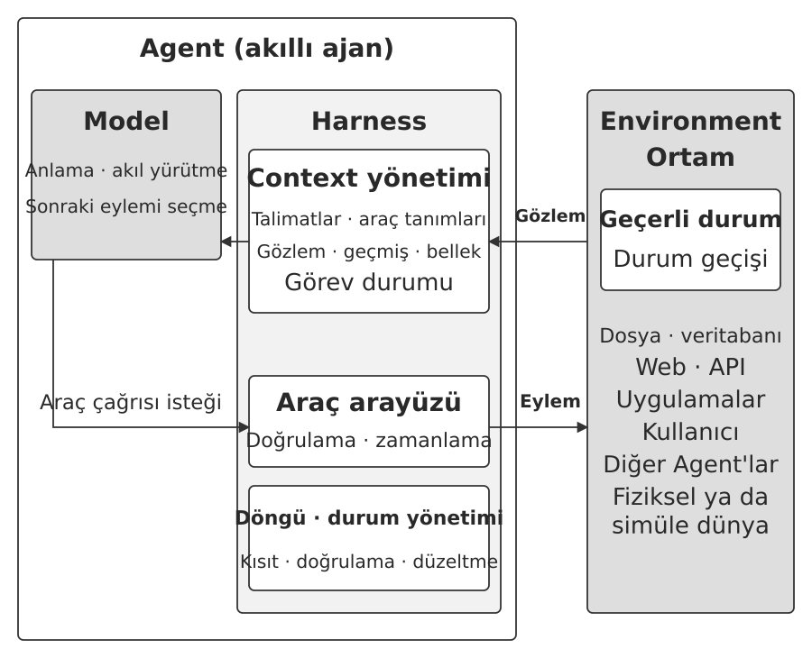
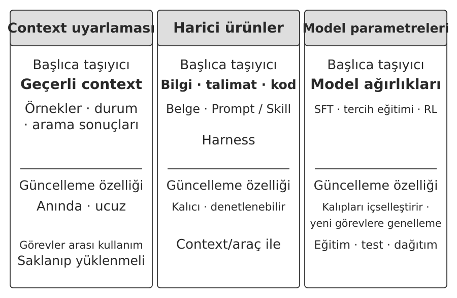
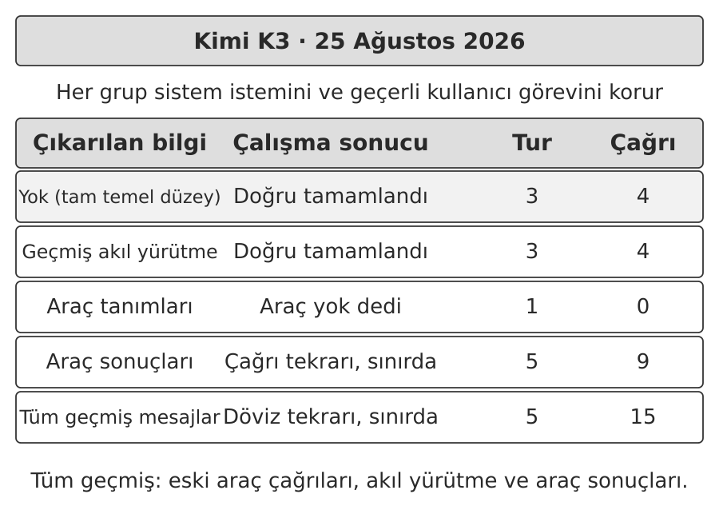
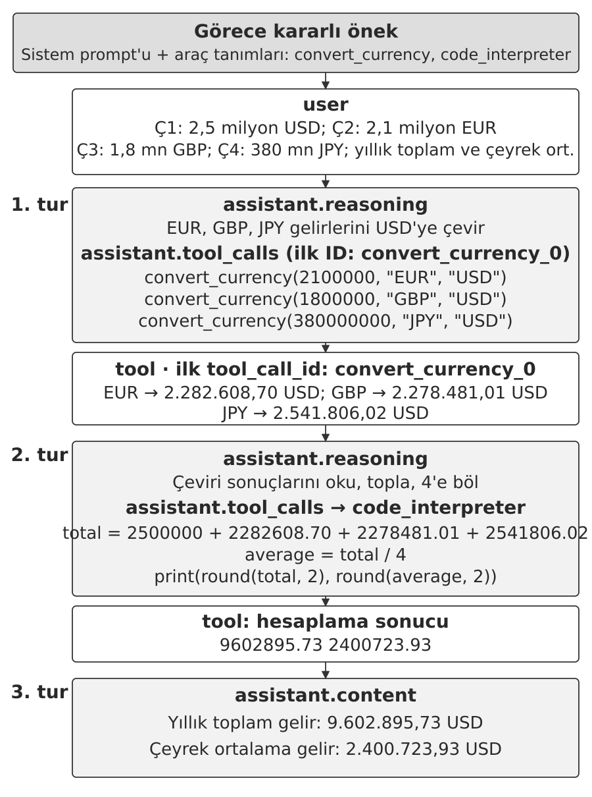
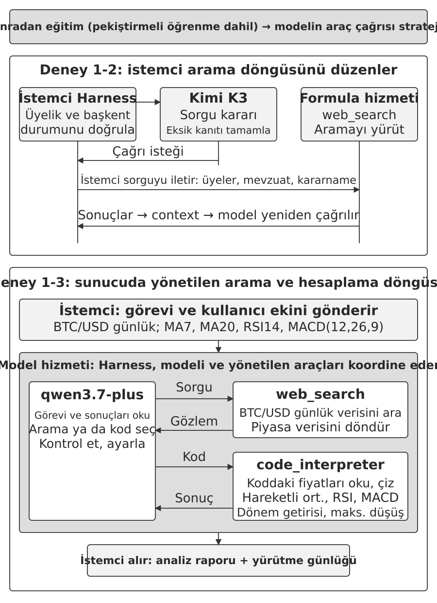
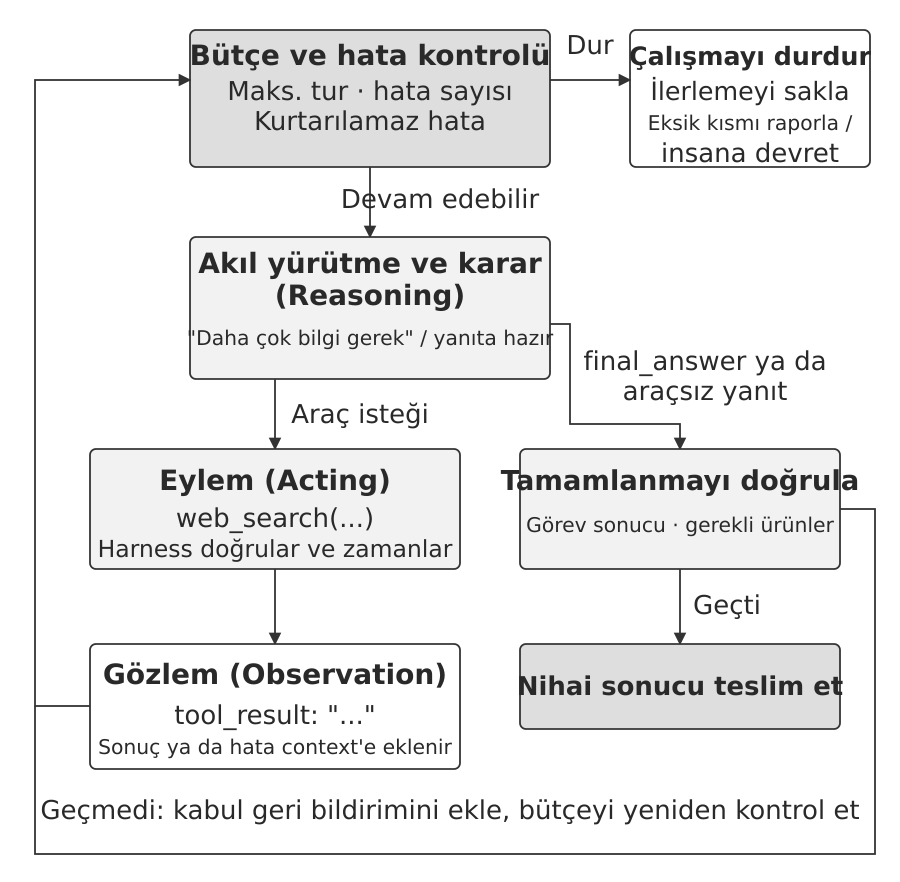
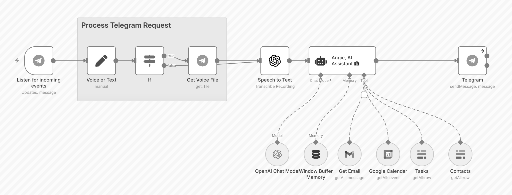

# AI Agent'lara Giriş

Bir konuyu Deep Research ile araştırdığınızda, araç tekrar tekrar arama yapar, okur ve sonunda bir rapor derler. Manus tarayıcıyı kullanarak çevrimiçi görevleri tamamlayabilir, Doubao telefon asistanı telefonda bilet alıp mesaj gönderebilir, Pine AI ise kullanıcı adına telefon açıp operatörle faturayı düşürmek için pazarlık yapabilir. Bunların hepsi AI Agent uygulamalarıdır.

Cursor ile bir fonksiyonu düzelttiğinizde, Cursor fonksiyonu bulur, dosyayı düzenler ve testleri çalıştırır. Testler hâlâ başarısızsa hata mesajı bir sonraki değişikliğin dayanağı olur; testler geçtiğinde ise size sonucu bildirmek için elinde kanıt vardır. Arama, düzenleme ve test etme adımlarının sırası önceden programa yazılabilir; ama tam olarak hangi satırın değiştirileceği, başarısızlıktan sonra nereye dönüleceği yürütme sırasında elde edilen bilgiye bağlıdır. Bir hedef etrafında eylem seçip sonuca göre planı ayarlayan bu süreç, araştırma ve telefonla pazarlık gibi görevlerde de yaşanır.

## Modern Agent = LLM + Context + Tools

Bu kitap modern Agent'ın üç işlevsel bileşenini tek bir formülle özetler: **Agent = LLM (Large Language Model, büyük dil modeli) + Context + Tools**.

- **LLM, Agent'ın beynidir**; görevi anlar, adımları planlar ve eylemleri seçer. Ön eğitim modele dil yeteneğini ve dünya bilgisini kazandırır; sonrası eğitim ise talimat izleme, akıl yürütme ve araç çağırma gibi davranışları biçimlendirir. Denetimli ince ayar ve pekiştirmeli öğrenme gibi sonrası eğitim yöntemlerini Bölüm 8'de tanıtacağız.
- **Context, Agent'ın geçerli karar ufkudur**; bu karar için gereken bilgileri içerir: talimatlar, araç tanımları, ortam gözlemleri, kullanıcı belleği, alan bilgisi, geçmiş mesajlar, Agent'ın kendi durumu ve görevin ilerleyişi.
- **Araçlar (tools), Agent'ın duyuları, elleri ve ayaklarıdır**; arayüzler üzerinden bilgi edinir ya da işlem yürütür. Araç sistemi tanımları, çağrı protokolünü ve adaptörleri kapsar; arama, okuma ve ekran görüntüsü alma gibi gözlem işlemlerini de, yazma, kod çalıştırma, alt Agent'a görev devretme ve kullanıcıyla iletişim kurma gibi işlemleri de destekler.

Aynı araç birden fazla rol üstlenebilir. Örneğin model komut satırından bir dosya okuduğunda, dönen dosya içeriği bir sonraki kararın dayanağı olur; komut satırından bir program çalıştırdığında ise dosyaların ya da süreçlerin durumunu değiştirebilir.

Diyelim ki bir paketi yeni açtınız ve müşteri hizmetlerine soruyorsunuz: "Ambalajı açtıktan sonra iade edebilir miyim?" Sistem, mağazanın geçerli iade politikasını **Retrieval-Augmented Generation** (RAG, getirme destekli üretim) ile bulabilir, sonra modelden maddelere dayanarak yanıt vermesini isteyebilir.[^ch1-rag] Tek bir sorguyu izleyerek birkaç parçanın görevini açıkça görebiliriz. Politika metni ve indeksi harici bir bilgi tabanında tutulur; getirme aracı soruya göre ilgili paragrafları bulur, modeli çağıran program da bu paragrafları kaynaklarıyla birlikte isteğe ekler. Model "ambalajın açılması" maddesini okuyunca kuralı açıklayabilir; madde ürün kategorisine göre de ayrım yapıyorsa, önce ne satın aldığınızı sorması gerekir.

[^ch1-rag]: Patrick Lewis ve diğerleri, Retrieval-Augmented Generation for Knowledge-Intensive NLP Tasks, NeurIPS, 2020.

Bu iade sorgusunda getirmeyi başlatmak Agent'ın eylemidir; dönen maddeler ise onun ortamdan (Environment) elde ettiği gözlemdir. Bir sonraki adımın yanıt vermek mi yoksa soru sormak mı olacağı, maddede ne yazdığına bağlıdır. Bu, pekiştirmeli öğrenme ve kontrol teorisinin kapalı döngü dediği yapıyı oluşturur; Şekil 1-1'de gösterildiği gibi.



Şeklin dış katmanı Agent ile ortam arasındaki sınırı çizer. Dosyalar, veritabanları, web sayfaları, kullanıcılar, diğer Agent'lar ve fiziksel ya da simüle edilmiş dünya, Agent'ın etkileştiği ortam olabilir. Şeklin iç katmanı üretim uygulamasındaki iş bölümünü gösterir: **Model anlamayı, akıl yürütmeyi ve kararı üstlenir; Harness ise Agent sınırının içinde ama Model'in dışında yer alır; context'i, araç arayüzlerini, çalışma döngüsünü ve durumu düzenler, kısıtlama, doğrulama ve düzeltme uygular.** Harness ortamı oluşturabilir, yalıtabilir ya da ona vekâlet edebilir; dosya içerikleri, süreç durumları gibi şeyler ise eylemlerle birlikte ortamda değişir.[^ch1-harness]

[^ch1-harness]: LangChain'in *The Anatomy of an Agent Harness* ve Anthropic'in *Effective harnesses for long-running agents* yazılarına bakılabilir. Bazı uygulamalar sandbox'ı da Harness'ın parçası sayar; Şekil 1-1 eylemlerin gerçekte neyi değiştirdiğini izlemeyi kolaylaştırmak için ortamı ayrı çizer.

Bu nedenle kitap birbirini tamamlayan iki ayrıştırma kullanır: **"LLM + Context + Tools" işlevsel bileşimi, "Model + Harness" ise üretim uygulamasını açıklar.** Context, Harness tarafından düzenlenip Model'e sunulur; araç çağrısına Model karar verir, Harness doğrular ve zamanlar, ardından araç ya da ortam yürütür. Basit bir sistem context derleme ve araç zamanlamasıyla başlayabilir, ardından üretimde çalışmak için gereken kısıtlama, doğrulama ve düzeltme mekanizmalarını adım adım ekleyebilir.

Pekiştirmeli öğrenmeye aşinaysanız, aşağıdaki tabloyu üç soru üzerinden okuyabilirsiniz: bir sonraki adıma kim karar veriyor, neye dayanarak karar veriyor ve kararı nasıl uyguluyor? Bu, işlevlere göre yapılmış kaba bir benzetmedir.

| Sezgisel karşılık | Mühendislik bileşeni | Pekiştirmeli öğrenmedeki ilgili kavram | Anlamı |
|-----------|-----------|----------------------------|----------------------------------------------|
| **Beyin** | LLM | **Politika** (Policy) | Mevcut bilgiye göre bir sonraki adımda ne yapılacağına karar verir |
| **Geçerli karar ufku** | Context | **Gözlem ve geçmiş** | Ortamdan dönen bilgiyi ve mevcut geçmişi karar dayanağı olarak düzenler |
| **Duyular, eller ve ayaklar** | Araçlar ve adaptörler | **Gözlem ve eylem arayüzleri** | Ortam bilgisinin nasıl okunacağını, eylemlerin nasıl gönderileceğini, çağrı ve dönüş biçimlerini belirler |

### Gözlem uzayı ve eylem uzayı: model ile dünya arasındaki arayüz

**Gözlem uzayı (Observation Space) Agent'ın hangi gözlemleri alabileceğini, eylem uzayı (Action Space) hangi eylemleri gönderebileceğini tanımlar.** Tek bir çağrıdaki context somut bilgiyi taşır; kullanılabilir araçlar ise ortamla etkileşim arayüzünü sağlar. Araçların dışında kullanıcı girdisi, olay bildirimleri gibi şeyler de gözlem getirebilir; araç çağrısının parametreleri, yetkileri ve çalışma ortamı birlikte eylemlerin kapsamını sınırlar.

İki farklı arızayı ayrı ayrı düşünün. Birincisinde model faturadaki her kalemi açıklayabiliyor, ama bu ayın faturasına erişemiyor. Kullanıcı okuma izni verdikten sonra faturanın sorgulanıp modele verilmesi gerekir; ancak o zaman hangi ücretin tartışmalı olduğuna karar verebilir. İkincisinde kullanıcı asistandan tarifesini değiştirmesini istiyor; asistan uygun bir paketi bulmuş, ama hesap arayüzü yalnızca sorgulamaya izin veriyor. Faturayı bir kez daha okusa da değişikliği yapamaz; bunun için ilgili işlem yetkisine ihtiyacı vardır. Harness'ın işi, okunan malzemeyi context'e koymak, modelin seçtiği eylemi almak, parametreleri ve yetkileri kontrol etmek, ardından yürütmeyi zamanlamaktır.

Bu nedenle, **temel model sabitken gözlem uzayını ve eylem uzayını ayarlamak, görev performansını artırmanın önemli bir mühendislik yoludur.** Model kilit bir olguyu kaçırıyorsa ilgili veriyi context'e katabilirsiniz; model birbirine benzeyen araçlar arasında sık sık yanlış seçim yapıyorsa yinelenen arayüzleri birleştirebilir ya da yalnızca geçerli görevin ihtiyaç duyduğu araçları yükleyebilirsiniz.

Video izlerken ise tersi bir sorunla karşılaşırız: görüntü hep oradadır, ama yeniden değerlendirmeye değer değişiklikler azdır. Diyelim asistan bir dosyanın yüklenmesini bekliyor; ilerleme çubuğu her kıpırdadığında ana modeli çağırmak gereksiz yere hesaplama harcar, on saniyede bir bakmak ise bir anlığına görünen bir hata uyarısını kaçırmak demektir. **Bence gözlem uzayını seyreltmek, Agent tasarımının temel sorunlarından biridir.** Sistem ortamı sürekli gözlemleyebilir, ama ana modele yalnızca bir sonraki eylemi değiştirebilecek değişiklikleri gerekli context ile birlikte iletmelidir.

**Manus: aynı görevde araştırma, programlama ve bilgisayar kullanımını birleştirmek.** Deep Research arama ve okumada güçlüdür, Coding Agent kod yazıp çalıştırabilir, Computer Use Agent arayüzü kullanabilir. Manus tarayıcıyı, dosya sistemini, kod yürütmeyi ve komut satırını bir bulut sandbox'ında birleştirir; böylece aynı Agent önce kaynak arar, sonra dosyaları işler ve kodu çalıştırır, en sonunda da işlemi tarayıcı üzerinden tamamlar. Tarayıcı ve dosya okuma elde edilebilecek bilgiyi, kod ve komut yürütme ise birleştirilebilecek işlemleri artırır. **Bence bu bileşim genel amaçlı Agent'lar için önemli bir atılımdır: aynı Agent, daha önce birbirinden ayrı olan ürün sınırlarını aşarak bilgi toplamayı, veri işlemeyi ve işlem yürütmeyi tek bir bütün görev hâline getirebilir.**

**OpenClaw: arayüzü kullanıcının dijital yaşamına kadar uzatmak.** OpenClaw görevleri WhatsApp, Telegram, Slack, Discord, iMessage gibi mesajlaşma kanallarından alır ve sonuçları oralara döndürür; kullanıcının cihazında çalışan bir Gateway ile mesajlaşma kanallarını, modelleri ve araçları birbirine bağlar. İlgili araçlar yapılandırılıp yetki verildikten sonra Agent yerel dosyaları işleyebilir, Google Drive, Notion gibi bulut hizmetlerine de bağlanabilir. Kullanıcının hesaplara ve cihazlara dağılmış verileri böylece tek bir görevin işlenişine girebilir. Erken dönem Manus ağırlıklı olarak bulut sandbox'ında çalışıyordu ve kullanıcının dosya yüklemesi gerekiyordu; sonradan eklenen Google Drive bağlayıcısı ve My Computer masaüstü özelliği bulut dosyalarına ve yerel kaynaklara erişimi daha da genişletti. Bu gelişmeler, ürün yeteneklerindeki büyümenin çoğu zaman gözlem ve eylem arayüzlerinin genişlemesinden geldiğini gösteriyor[^ch1-agent-products].

[^ch1-agent-products]: Ürün yapısı için Manus'un resmî Sandbox tanıtımına, Google Drive Connector tanıtımına, My Computer tanıtımına ve OpenClaw'ın resmî deposu ile araç belgelerine bakılabilir. Erişilebilecek somut kaynakları bağlayıcılar, araç yapılandırması ve kullanıcı yetkilendirmesi belirler.

Farklı ürünlerin görevleri birbirinden farklıdır, ama hepsi üç açıdan anlaşılabilir: karar dayanağı, kullanılabilir işlemler ve yürütme stratejisi.

| Agent ürünü | Context'teki başlıca bilgiler | Kullanılabilir araçlar ve işlemler | Yürütme stratejisi |
|----------------|----------------------|----------------------------|------------------------------|
| **Cursor gibi Coding Agent'lar** | İstek, kod parçaları, dizin listesi, terminal çıktısı | Kod arama, dosya okuma/yazma, komut çalıştırma | İsteği anla→ilgili kodu ara→kodu düzenle→test ederek doğrula→hata ayıkla ve düzelt |
| **Deep Research gibi arama Agent'ları** | Arama sonuçları, web sayfası içerikleri, makale özetleri ve atıfları | Arama sorgusu, web sayfası okuma, rapor üretme | Elindeki bilgiye göre arama yönünü ayarla, adım adım eksiksiz bir rapor sentezle |
| **Browser Use gibi bilgisayar kullanan Agent'lar** | Ekran görüntüsü, DOM ya da erişilebilirlik ağacı, işlem sonuçları | Tıklama, yazma, kaydırma, ekran görüntüsü alma, kod çalıştırma | Arayüzü oku→hedef öğeyi tanı→işlemi yürüt→sonucu doğrula |
| **Doubao gibi telefon asistanı Agent'ları** | Telefon ekran görüntüsü, uygulama arayüz durumu, sistem geri bildirimi | Dokunma, kaydırma, yazma, uygulama açma | İsteği anla→hedef uygulamayı bul→işlemi yürüt→tamamlandığını teyit et |
| **Pine AI, Meta Muse gibi kişisel iş gören Agent'lar** | Yetkiyle okunan hesap kayıtları, faturalar, hizmet sağlayıcı bilgileri | Telefon etme, e-posta gönderme, form doldurma, kullanıcıyla teyitleşme | Bilgi topla→pazarlık stratejisi belirle→hizmet sağlayıcıyla iletişime geç→pazarlık et→sonucu bildir |

**Bir talep nasıl yürütülebilir bir göreve dönüşür?** Pine'da kişisel iş gören asistan üzerinde çalışırken, kullanıcıların çoğu zaman yalnızca bir hedef söylediğini fark ettim; örneğin "İş seyahatim için bir uçak bileti al, 1200 yuanı geçmesin." Asistan önce tarihi, varış noktasını ve bu seyahatte en çok neyin önemsendiğini netleştirmeli, eksik bilgileri toplamalı, işi nasıl yürüteceğini ve hangi koşulların pazarlığa açık olduğunu kullanıcıyla konuşmalı; ancak ondan sonra hizmet sağlayıcıyla iletişime geçmelidir. İş sırasında öğrenilen yeni durumlar görevi bir önceki adıma da geri götürebilir.

Diyelim müşteri temsilcisinin bulduğu en düşük bilet fiyatı 1250 yuan. Model genel bilgisine, bu seyahatin niteliğine ve kullanıcının hatırladığı alışkanlıklarına bakarak karar verir. Seyahatte olan ve uygun bir güzergâh için biraz fazla ödemeye genellikle razı olan bir kullanıcı için Pine bileti doğrudan alabilir; bu bir aile tatiliyse ve kullanıcı daha önce toplam harcamayı önemsediğini açıkça belirtmişse, önce farkı kullanıcıya bildirip temsilciden başka uçuşlara da bakmasını isteyebilir. Kullanıcı sonradan "Bir dahaki sefere bütçeyi aşan bir bilet çıkarsa önce bana sor" diye eklerse, bu geri bildirim bir sonraki karar için genel deneyimden daha somut bir dayanak sağlar.

Başka bir senaryoda banka temsilcisi belgeleri eve postalamayı öneriyor, asistan ise kullanıcının yurt dışında seyahatte olduğunu hatırlıyor. Bu kez değişmesi gereken teslim biçimidir: asistan alıcının belgeyi teslim almasının zor olduğunu hemen açıklayıp e-posta ile gönderilmesini isteyebilir. Fatura indirimine dönersek, temsilci telefonda sözlü olarak kabul ettiğinde asistan işletmenin verdiği sözü doğru biçimde aktarabilir; tutarın gerçekten düşüldüğünü teyit etmek için ise sonraki faturanın yeni bir gözlem olarak gelmesi gerekir. Bir asistanın eylem uzayı gerçek telefon görüşmelerine kadar genişleyebilir, ama vardığı sonuç yine gözlem uzayıyla sınırlıdır.

Talep edilen işler açısından bakıldığında, kitapta üç tür uygulamayla karşılaşacağız: günlük işlerin halledilmesi, ofiste iş birliği ve bilimsel keşif. Aynı asistan farklı türlerden görevler üstlenebilir; aradaki fark, ona kimin yetki verdiğinde, neyi değiştirebildiğinde ve sonucu en sonunda kimin kabul ettiğindedir. Ofise geçelim: bir meslektaş kontrol sonucunu teslim ettiğinde iş kaydı kapatılabilir mi? Diyelim proje sorumlusu Multica'daki bir iş kaydında asistanı adıyla anarak bütçe tablosundaki bir farkı kontrol etmesini istiyor. Bu yorum kontrolü tetikler; iş kaydı yine eski sorumlusuna aittir, durumu da değişmez. Asistan iki tutarı kaynaklarıyla birlikte teslim eder ve meslektaşının sorusunu yanıtlamış olur; bütçenin tamamının gönderilip gönderilemeyeceğine ise sorumlu kişi diğer bekleyen işleri de göz önünde tutarak karar verir.[^ch1-multica]

Bilimsel görevlerde de aynı soruyu sorabiliriz: ilerleme kaydedildiğini neye dayanarak söylüyoruz? Google DeepMind'ın AlphaEvolve'u matris çarpımı algoritmaları ararken, model aday programlar önerir, değerlendirici bu programları çalıştırıp çarpımın doğru hesaplanıp hesaplanmadığını ve kaç çarpma kullanıldığını kontrol eder. Sonraki arama, iyi performans gösteren programları geliştirmeye devam edebilir. Araştırma ekibi, bulunan algoritmalardan birinin iki $4\times 4$ karmaşık matrisi 48 skaler çarpmayla çarpabildiğini bildirdi. "Birkaç çarpma daha az" ifadesinin net bir sayım nesnesi vardır; üstelik algoritma doğru matris çarpımını da hesaplamak zorundadır.[^ch1-alphaevolve]

[^ch1-multica]: Multica, iş kaydı yorumunda Agent'ı adıyla anmak. Bölüm 10, iş birliğinde geçici yardım isteme ile sorumluluk devrinin nasıl ayırt edileceğini tartışır.

[^ch1-alphaevolve]: Google DeepMind, AlphaEvolve araştırma notu, Mayıs 2025. Buradaki çarpma sayısı algoritmadaki skaler çarpmaların sayısıdır; gerçek çalışma süresi uygulamaya ve donanıma da bağlıdır.

Bu sistemlerin eylem uzayı **açık uçludur**. Arama sorguları, girilen metinler, üretilen kod ve işlem kombinasyonları önceden sayılıp tüketilemez; yine de her eylem araçlar, parametreler, yetkiler ve çalışma ortamıyla sınırlıdır. Tam da bu nedenle, yürütülebilir bir planın yeni gözlemlerin bir sonraki adımı değiştirmesine yer bırakması gerekir.

### Araçlar: Agent'ın duyuları, elleri ve ayakları

Araçlar, modelin kararlarını dış ortamı okumaya ya da değiştirmeye dönüştürür. Arama ve okuma araçları gözlem getirir; dosya yazma, komut çalıştırma gibi araçlar eylemi gerçekleştirir. Model işlemin etkisini dönen sonuçtan öğrenir, ardından devam etmeye, yeniden denemeye ya da görevi bitirmeye karar verir.

Bu kitap araçları başlıca kullanım amaçlarına göre beş türe ayırır. Tek bir arayüz birden çok amaca hizmet edebilir; örneğin sesli görüşme hem bilgi edinmeye hem de talep iletmeye yarar.

**Algılama araçları** bilgi edinir: arama motorları internetteki kaynakları sağlar, dosya okuma araçları yerel belgelere erişir, API ve veritabanı arayüzleri dış hizmetlere ve kurumsal verilere bağlanır.

**Yürütme araçları** işlem gerçekleştirir: kod çalıştırır, dosya değiştirir, sistem komutu yürütür ya da dış API çağırır; kararları ortama yansıtır.

**İş birliği araçları** iş bölümünü ve koordinasyonu destekler: belirli görevleri alt Agent'lara devreder, sonuçları toplar, birden çok Agent'ın çalışmasını koordine eder. Bir kararın insan katılımı gerektirdiği durumlarda sistem, kullanıcı iletişim arayüzü üzerinden teyit de isteyebilir.

**Olay tetikleme araçları** dış olayları çalışma sürecine bağlar. Yeni bir e-posta, belirlenen saatin gelmesi ya da bir Webhook geri çağrısı görevi tetikleyebilir. Olay adaptörleri bu girdileri Agent'ın işleyebileceği gözlemlere dönüştürür, zamanlama mekanizması da yürütmeyi başlatır ya da kaldığı yerden sürdürür; tetikleme kuralları geliştirici tarafından yapılandırılabildiği gibi, izin verilmiş araç çağrılarıyla da kaydedilebilir.

**Kullanıcı iletişim araçları** kullanıcıya bilgi iletir ve geri bildirim toplar; örneğin metin mesajı gönderir, sesli arama başlatır ya da e-posta yollar. İlerlemeyi bildirmek, teyit istemek ve kullanıcıya ilgilenmesi gereken bir işi proaktif olarak hatırlatmak için kullanılır.

Bölüm 4 bu beş araç türünün tasarımını ayrıntılı olarak ele alacak. Arayüz tanımı modelin doğru aracı seçip parametreleri doğru doldurup dolduramayacağını etkiler; hata işleme başarısızlıktan sonra devam edilip edilemeyeceğini belirler; yetki denetimi işlemlerin etki alanını sınırlar. MCP (Model Context Protocol, model context protokolü) ise araç keşfi ve çağrısı için birleşik bir bağlantı yolu sunarak farklı sistemler arasındaki uyarlama işini azaltır.

**Araç çağrısı** (Tool Calling), modelin üzerinde anlaşılmış bir biçimde işlem talebi sunma yeteneğidir. Yaygın kullanılan fonksiyon çağrısı (Function Calling), talebi araç adı ve yapılandırılmış parametrelerle ifade eder. Bu kitap tutarlılık için "araç çağrısı" terimini kullanır.

Pekin'in hava durumunu sorgulamayı örnek alalım. Model şehir adını yazabilir; ancak gerçek sıcaklık, Harness sorguyu yürüttükten sonra context'te belirir. Bu çağrının dört adımlı mesajları şöyledir:

```text
Adım 1: aracı tanımla              Adım 2: model çağırmaya karar verir
tools: [{                          assistant: {
  name: "get_weather",               tool_calls: [{
  parameters: {                        id: "call_1",
    city: "string"                     function: "get_weather",
  }                                    arguments: {city: "Pekin"}
}]                                   }]
                                   }

Adım 3: sonuç context'e eklenir    Adım 4: model sonuca göre yanıt verir
tool: {                            assistant: {
  tool_call_id: "call_1",              content: "Pekin'de bugün 28°C, açık."
  content: '{"temp":28,"sky":"açık"}'  }
}
```

Burada `call_1`, aracın dönüş değerini çağrı talebiyle ilişkilendirir. Geliştirici aracın nasıl çağrılacağını tanımlar, hava durumunu sorgulayan fonksiyonu yazar ve sorgu sonucunu modele geri verir; model ise çağrı yapıp yapmayacağına, hangi aracı çağıracağına ve hangi parametreleri geçireceğine karar verir. Bölüm 2, API mesaj yapısını daha ayrıntılı tanıtacak.

Araç tasarlarken önce tam yetecek kadar yetenek sağlamakla başlanabilir. Dört işlem için parametreleri açık bir hesap makinesi yeterlidir; görev tablo okumaya, eksik değerleri temizlemeye, istatistik hesaplamaya ve grafik çizmeye genişlediğinde ise kısıtlı bir Python kod yorumlayıcısı bu adımları birleştirmeyi kolaylaştırır. Genel yetenek genişledikçe yalıtım ve kaynak yönetimi de ona yetişmelidir: kod sandbox'ta çalışır, ağ erişimi varsayılan olarak kapalıdır, dosya erişimi yetkilendirilmiş çalışma diziniyle sınırlıdır; yürütme süresi, CPU, bellek ve çıktı boyutu için de üst sınırlar konur.

Tek bir yürütmeyi kaydetmek için tek bir günlük aracı kullanılabilir. Saatler, hatta günler süren görevler için ise planı, ara sonuçları, çalışma günlüklerini ve nihai ürünleri saklayan denetimli bir sanal çalışma dizini daha uygundur; böylece Agent birden çok yürütme arasında işi kaldığı yerden sürdürebilir. Dizin okunup yazılabilecek yolları, kapasiteyi ve dosya türlerini sınırlamalı, yolların yetki sınırını aşıp aşmadığını da kontrol etmelidir.

Ödeme, veri silme, e-posta gönderme ve üretim ortamına dağıtım gibi işlemler yüksek risk taşır ya da net iş kurallarına tabidir; bunları parametreleri açık, yetkileri kısıtlı ve baştan sona denetlenebilir özel araçlar olarak sarmalamak, gerektiğinde önizleme ve insan onayı eklemek uygun olur. **Genel temel yetenekler birleştirmeyi ve keşfi destekler; özel araçlar ise yüksek riskli işlemlerin kısıtlarını ve iş kurallarını hayata geçirir.**

### LLM: Agent'ın beyni

LLM, Agent'ın karar çekirdeğidir. Bir istek aldığında önce kullanıcının ifadesinden hedefi ve kısıtları çıkarır, sonra karmaşık görevi yürütülebilir adımlara böler. Yürütme sırasında bir sonraki adımda ne yapacağına, araç çağırıp çağırmayacağına, hangi aracı seçeceğine ve parametreleri nasıl dolduracağına da karar vermesi gerekir. Bu yetenekler ön eğitimle biriken bilgi ve dil yeteneği üzerine kuruludur; sonrası eğitim ise onları göreve uygun karar davranışlarına dönüştürür. Workflow'lar da otonom Agent'lar da bu tür yargılara ihtiyaç duyar; gerçek işlemler ise Harness, araçlar ve ortam aracılığıyla yapılır.

Eylemden önce planlamak ve olası sonuçları zihinde canlandırmak, Agent'ın seçenekleri karşılaştırmasına, sonuçları öngörmesine ve boşa giden denemeleri azaltmasına yardımcı olur. Örneğin model matematiksel kuralları kullanarak hesaplama adımlarını kontrol edebilir, nedensellik ilişkileriyle arızayı çözümleyebilir, sonra işlemleri bağımlılık sırasına göre düzenleyebilir. Model önce akıl yürütme içinde farklı seçenekleri karşılaştırır, bir eylem seçtikten sonra aracın yürütmesini ister. Geleneksel pekiştirmeli öğrenme sistemleri de keşfi düzenlemek için öğrenilmiş politikaları, değer fonksiyonlarını, ortam modellerini ya da planlama algoritmalarını kullanabilir; LLM Agent'ın farkı, somut bir göreve başlamadan önce büyük ölçekli ön eğitim sayesinde geniş bir bilgi birikimine ve problem çözme kalıplarına sahip olması, sonrası eğitimin de bu yeteneklerin kullanılma biçimini pekiştirmesidir.

#### Modelin yerleşik araç çağrısı

Sektör bir gelişim eğilimini "Model as Agent" (model Agent olarak) diye özetliyor: planlama ve araç çağrısı kararlarının giderek daha büyük bir kısmını model üstleniyor. Sonrası eğitim, özellikle pekiştirmeli öğrenme yoluyla model, ne zaman araç çağıracağını, hangi aracı çağıracağını, hangi parametreleri geçireceğini ve sonucu aldıktan sonra nasıl devam edeceğini öğrenebilir. Geliştirici hedefi, arayüzleri ve kısıtları sağlar; model de somut adımları görevin ilerleyişine göre düzenler.

Modelin özerk kararları Harness'ın desteğine ihtiyaç duyar. Harness sözcüğü aslında koşum takımı demektir: atın gücünü arabaya aktarmak ve yönünü denetlemek için kullanılan dizgin ve kayışlar. Agent'ta Harness, modelin yeteneğini sürdürülebilir biçimde çalışan bir görev sürecine dönüştürür; context yönetimi, araç arayüzleri, kısıtlama, doğrulama ve düzeltme görevlerini üstlenir. Bu bölümün ikinci yarısı bu beş işlevi tek tek tanıtacak.

Modelin özerk biçimde düzenleyebildiği işlemler arttıkça hataların etki alanı da büyür. Bu yüzden model ile Harness'ın birlikte optimize edilmesi gerekir: model planlama ve araç seçimi kalitesini yükseltir, Harness yetkileri yönetir, sonuçları kontrol eder ve başarısızlıkları ele alır. Model üreticileri bu iki parçayı aynı anda iyileştirebilir; bu ortak yineleme önemli bir mühendislik avantajı oluşturur.

> **Model yeteneği ile Harness'ın evrimi**
>
> Rich Sutton *Acı Ders* (The Bitter Lesson) adlı yazısında AI araştırmasındaki uzun soluklu bir eğilimi hatırlatır: daha fazla hesaplama kaynağından yararlanabilen arama ve öğrenme yöntemleri, yoğun insan eliyle alan tasarımına dayanan yöntemleri zamanla geride bırakır[^ch1-1]. Bu doğrultuda, araç seçimi ve adımların düzenlenmesi gibi bir zamanlar dış süreçlerin üstlendiği kararlar, eğitim yoluyla adım adım modelin içine alınabilir.
>
> Bu kitabın tutumu şudur: **yön konusunda hemfikiriz, tempo konusunda pragmatiğiz.** Model, Harness'taki karar sorumluluklarının bir kısmını devralmayı sürdürecek; ancak bir eğitim ve dağıtım turu zaman alır, iş kuralları ve kullanıcı tercihleri ise sürekli değişir. Gerçek işteki kısıtları da model parametrelerine tek seferde yazmak çok zordur. Bu yüzden modelin henüz kararlı biçimde yapamadığı halkaları önce Harness tamamlar. **Modelin şu anki yetenek sınırı, Harness'ın şu anki değerinin ta kendisidir.** Bu iş bölümü model yeteneğiyle birlikte değişir: model bir karar türünü her öğrendiğinde Harness ilgili orkestrasyonu azaltıp yeni güçlüklere yönelebilir. Yetkilerin uygulanması, durumun kalıcı hâle getirilmesi ve sonuçların doğrulanması ise çalışma sistemi tarafından yerine getirilmeye devam eder.

[^ch1-1]: Sutton, Rich. The Bitter Lesson, 2019.

#### Agent'ın öğrenme mekanizmaları: context uyarlamasından kalıcı güncellemeye

Bir araç hata döndürdükten sonra Agent bu sefer dosyayı başka bir yoldan bulmayı öğrendi. Yarın yeni bir oturum açıldığında bu dersi hâlâ hatırlayacak mı? Şekil 1-2'yi izleyerek bu deneyimin nerede saklandığına bakarsak, üç farklı güncellemeyi birbirinden ayırabiliriz.



**Context uyarlaması** görev yürütülürken gerçekleşir. Model örnekleri, görev durumunu ya da getirme sonuçlarını okuduktan sonra davranışını ayarlayabilir. Örneğin araç dosyanın bulunmadığını döndürürse model yolu yeniden arayıp işleme devam edebilir. Bu yol hızlı tepki verir ve ucuzdur; etkisi context penceresinin kapasitesine ve bilginin düzenlenme biçimine bağlıdır. Deneyimin sonraki görevlerde de kullanılabilmesi için ilgili bilginin saklanıp modele yeniden sunulması gerekir. Bölüm 2, context'i düzenleme yöntemlerini tanıtacak.

**Harici ürünler** (artifact) deneyimi görevler arasında saklayabilir. Olgular ve deneyimler bilgi belgelerine, dille ifade edilebilen stratejiler prompt'lara ya da Skill'lere, deterministik süreçler ve kısıtlar ise programlara ya da Harness mantığına yazılır. Bu ürünler denetlenmesi ve gözden geçirilmesi kolay şeylerdir; çalışma anında context ya da araç arayüzleri üzerinden karara ve yürütmeye katılırlar. Bölüm 3–5 bunlara karşılık gelen bilgi ve program temellerini tanıtır; Bölüm 9 ise değerlendirilmiş çalışma izlerinden güncellemelerin nasıl üretileceğini, doğrulanacağını ve yayımlanacağını tartışır.

**Model parametreleri** ise eğitimle güncellenir. Tıbbi görüntü yorumlama, dil üslubu ve örtük karar stratejileri gibi yetenekler, tek tek kural olarak yazılması zor olan çok sayıda kalıp içerir; bunlar sonrası eğitim yoluyla veriden ve geri bildirimden öğrenilebilir. Parametre güncellemesi eğitim, değerlendirme ve dağıtım yatırımı gerektirir; amacı, modelin öğrendiği yeteneği yeni görevlerde de kullanabilmesidir. Bölüm 8 ilgili yöntemleri ayrıntılı olarak ele alacak.

Aynı başarısızlık önce o anki işlemi düzeltmek için kullanılabilir, sonra bir sonraki Agent'ın başvurması için proje notlarına dönüştürülebilir. Aynı türden hata pek çok projede tekrar tekrar ortaya çıkıyorsa bu örnekler eğitimde de kullanılabilir.

### Context: Agent'ın geçerli karar ufku

İnsan karar verirken görev tanımını, başvuru kılavuzlarını, iletişim kayıtlarını ve en güncel verileri bir arada görmek ister. Agent'ın da böyle bir bilgi kümesine ihtiyacı vardır; buna context denir. Tek bir LLM çağrısının alabileceği bilgi miktarı context penceresiyle sınırlıdır; içinde neyin bulunacağını seçip düzenlemek ise Harness'ın işidir. API açısından bakıldığında, bu kitabın temel uygulaması beş tür bilgi içerir:

- **Sistem prompt'u** (System Prompt): Geliştirici ya da Harness tarafından oluşturulur; Agent'ın kimliğini, görev sınırlarını ve davranış ilkelerini açıklar. Prompt mühendisliği bu talimatları ayarlayarak çalışma biçimini şekillendirir. Sistem prompt'u oturum boyunca görece sabit kalabilir; ürün yapılandırmasına göre tercihler, geçmiş davranışlar ve arka plan bilgisi gibi oturumlar arası kullanıcı belleğini ya da geçerli ortam durumunu da içerebilir. Gerçek yetkileri ise Harness ve ortamdaki erişim denetimi uygular. Bölüm 3 kullanıcı belleğini tanıtacak.
- **Araç tanımları** (Tool Definitions): Kullanılabilir araçların adını, işlevini ve parametre biçimini bildirir; modelin işlem seçmesine ve talep oluşturmasına yardım eder. Bu kitabın temel uygulamasında araç tanımları sistem prompt'uyla birlikte isteğin başına konur ve görece sabit bir önek oluşturur. Araç sayısı fazla olduğunda tam schema ihtiyaç anında yüklenebilir ve mevcut önek korunabilir; Bölüm 2 ve 4 bu yöntemi ayrıntılı olarak ele alacak.
- **Kullanıcı mesajları** (User Messages): Kullanıcının görevini ve ek girdilerini içerir; RAG (Retrieval-Augmented Generation, getirme destekli üretim) ile elde edilen dış bilgiyi, örneğin eğitim verisinin kesim tarihinden sonraki bilgileri ya da özel alan verilerini de taşıyabilir. Bölüm 3 getirmeyi ve bilginin düzenlenmesini tanıtacak.
- **Model yanıtları** (Assistant Messages): Kullanıcıya yönelik metin `content`'i, araç çağrısı talepleri `tool_calls`'u ve hizmetin sağladığı akıl yürütme bilgisini içerir. Bu kitap akıl yürütme bilgisini kısaca `reasoning` diye yazar; farklı hizmetler akıl yürütme içeriğinin kendisini, bir özetini ya da devam ettirmek için kullanılan opak bir durumu döndürebilir. Araç çağrılırken yanıt akıl yürütme bilgisini ve çağrı talebini, görev bittiğinde ise akıl yürütme bilgisini ve nihai metni içerebilir. Somut alanları ve görünürlüklerini model hizmeti belirler.
- **Araç yürütme sonuçları** (Tool Results): Yürütmeden sonra dönen değeri, hatayı ya da durumu içerir; mesaj geçmişine eklendikten sonra bir sonraki karar için dayanak olur. Model bunlara bakarak işlemin başarılı olup olmadığına, ayar gerekip gerekmediğine karar verir ve bu turdaki görevde gereksiz tekrarları azaltır.

Model her çağrıldığında Harness, görece sabit öneki (sistem prompt'u, araç tanımları) ve sürekli büyüyen mesaj geçmişini birlikte modele göndermelidir. Böylece döviz çevirme aracı sonucunu bir önceki turda döndürmüş olsa bile model bu turda toplamı hesaplarken onu okuyabilir.

Farklı bilgilerin karar üzerindeki etkisi **ablasyon deneyiyle** (Ablation Study) incelenebilir: görev ve çalışma koşulları sabit tutulur, her seferinde bir bilgi türü çıkarılır ve davranıştaki değişim karşılaştırılır. Deney 1-1, rolü, kısıtları ve görev gereksinimlerini sabit tutmak için sistem prompt'unu ve geçerli kullanıcı görevini korur; ardından araç tanımları, araç sonuçları, geçmiş akıl yürütme bilgisi ve geçmiş mesajlar için ayrı ayrı ablasyon yapar.

> **Deney 1-1 ★★: Context'in kilit rolü**
>
> Agent'tan bir şirketin çeyreklik gelirlerini toplamasını isteyelim: birinci çeyrek 2,5 milyon dolar, ikinci çeyrek 2,1 milyon avro, üçüncü çeyrek 1,8 milyon sterlin, dördüncü çeyrek 380 milyon yen. Görev, gelirleri döviz çevirme aracıyla dolara çevirmeyi, ardından hesaplama aracıyla yıllık toplam geliri ve çeyreklik ortalama geliri bulmayı, sonuçları iki ondalık basamağa yuvarlamayı gerektirir. Böylece modelin hem araç seçmesi hem de tamamlanmış adımları ve dönen değerleri hatırlaması gerekir.
>
> Deney bir tam temel düzen ile dört ablasyon grubundan oluşur; her grup en fazla beş tur çalışır. Geçmiş akıl yürütme bilgisi çıkarıldığında model her turda yine yeniden akıl yürütebilir; araç tanımları çıkarıldığında istekte kullanılabilir araç sunulmaz; araç sonuçları çıkarıldığında çağrı kayıtları korunur, dönen içerik gizlenir; geçmiş mesajlar çıkarıldığında yalnızca sistem prompt'u, araç tanımları ve geçerli kullanıcı görevi kalır. Önce bir tahminde bulunun: yalnızca "yen kuru zaten sorgulandı" bilgisi ile "380 milyon yen kaç dolara denk geliyor" bilgisi, sırasıyla hangi hesaplama adımını destekleyebilir? Şekil 1-3 beş grubun sonuçlarını gösteriyor.
>
> 
>
> 25 Ağustos 2026'daki Kimi K3 çalıştırmasında **tam temel düzen** görevi üç turda ve dört araç çağrısıyla tamamladı; yıllık toplam gelir 9.602.895,73 dolar, çeyreklik ortalama gelir 2.400.723,93 dolar çıktı. **Geçmiş akıl yürütme bilgisi çıkarıldığında** da aynı tur ve çağrı sayısıyla doğru sonuca ulaşıldı: araç kayıtları döviz çevirme sonuçlarını zaten saklıyordu, model bir sonraki hesaplama için gereken bilgiyi bunlardan yeniden kurabildi.
>
> **Araç tanımları çıkarıldığında** model hiç araç çağrısı yapmadı ve döviz çevirme aracının eksik olduğunu bildirdi. **Araç sonuçları çıkarıldığında** model dokuz çağrı yaptı ve beş turluk sınır içinde görevi yine de tamamlayamadı; mevcut çağrı kayıtları ona döviz çevirmesinden kaç dolar çıktığını söyleyemiyordu. **Geçmiş mesajlar çıkarıldığında** model toplam on beş çağrı yaptı, döviz çevirmeyi tekrar tekrar yürüttü ve beş turluk bütçeyi aynı şekilde tüketti; daha önce tamamlanan iş bir sonraki turun context'ine girmediği için görevin ilerleyişi birikemedi.
>
> Aynı soruyu başka bir modelle çözelim. 1 Eylül'de DeepSeek V4 Flash, geçmiş akıl yürütme bilgisi çıkarıldığında yine üç tur ve dört araç çağrısı kullandı, ama sonucu 9.600.000,00 dolar buldu. Eksik kalan 2.895,73 dolar nereye gitti? İpucu ilk döviz çevirme çağrısında: ikinci çeyrek geliri 2,1 milyon avroydu; model tutarı "milyon" cinsinden hesaplamak üzere `2.1` olarak yazdı. Araç 2,1 avro aldı, çevirip iki ondalık basamağa yuvarladı ve 2,28 dolar buldu. Model sonra toplama 2,28 milyon dolar ekledi; böylece çevirme sırasındaki yuvarlama hatası da bir milyon kat büyüdü. Diğer iki tutar da aynı biçimde yazılmıştı. Toplam en sonunda virgülden sonra iki basamakla yazdırılsa bile, daha önce atılan basamaklar geri gelmez.[^ch1-context-runs]
>
> Bu karşılaştırma farklı bilgilerin rolünü gösteriyor: araç tanımları çağrılabilir yetenekleri, araç sonuçları ortamdaki olguları sağlar, geçmiş mesajlar ise görevin ilerleyişini saklar. Geçmiş akıl yürütme bilgisinin değeri ise geçerli kararın dayanağının başka kayıtlardan yeniden kurulup kurulamayacağına bağlıdır.

[^ch1-context-runs]: Deponun `chapter1/context/validation/` dizini iki çalıştırmanın tur tur istek ve yanıtlarını saklar. Ağustos kaydı `real_20260825T025409Z/evidence.json`, Eylül kaydı `real_20260901T163146Z/evidence.json` dosyasındadır.

### ReAct döngüsü

**ReAct** (Reasoning + Acting), bu döngünün tipik bir uygulamasıdır; akıl yürütme ile eylemi dönüşümlü olarak düzenler[^ch1-react]. Model önce mevcut bilgiyi çözümler, bir eylem seçer, sonra aracın döndürdüğü **gözleme** göre planı ayarlar. İlerleyen örneklerde, eylemler arasındaki bağlantıyı anlamayı kolaylaştırmak için her turun karar dayanağını kısa bir `reasoning` alanıyla gösteriyoruz.

[^ch1-react]: Yao, Shunyu, et al. ReAct: Synergizing Reasoning and Acting in Language Models, ICLR 2023.

Görev yürütülürken biriken karar, eylem ve gözlem dizisine **iz** (trajectory) denir. Mesaj geçmişi izi kaydetmenin bir yoludur: kullanıcı mesajları görevi, model yanıtları kararları ve çağrı taleplerini, araç mesajları ise yürütme sonuçlarını saklar. Eksiksiz bir çalışma kaydı hata ayıklama ve değerlendirme için zaman bilgisini, ortam durumunu ve doğrulama sonuçlarını da içerebilir.

Bu bölümdeki temel uygulamada **her turun context'i = görece sabit önek + biriken mesaj geçmişi**dir. Önek sistem prompt'unu ve araç tanımlarını içerir; mesaj geçmişi ise etkileşimle birlikte büyür. Şekil 1-4, Deney 1-1'deki üç turun mesajlarından bir kesit sunuyor. İlk turdaki üç döviz çevirme isteğine bakın: hangi sonuç ikinci çeyreğin 2,1 milyon avrosuna karşılık geliyor?



Avro isteğinin ID'si `convert_currency_0`'dır. Harness parametreleri doğrulayıp aracı yürütür, sonra aynı ID'yi araç mesajının `tool_call_id` alanına yazar. Böylece 2.282.608,70 dolarlık sonucu bulabilir, ardından ikinci turdaki toplamada doğru kullanılıp kullanılmadığına bakabiliriz. Bu tutarı yeniden hesaplayabilirsiniz: deneyin sabit kur tablosunda 1 dolar 0,92 avroya eşittir; 2.100.000'i 0,92'ye bölüp iki ondalık basamağa yuvarlarsanız bu sayıyı elde edersiniz. Aracın döndürdüğü ters kur 1,087 ise zaten yuvarlanmıştır; doğrudan avro tutarıyla çarparsanız 91,30 dolar sapma olur.[^ch1-context-runs]

Çalışma döngüsü aşağıdaki Python tarzı sözde kodla gösterilebilir. Model bir sonraki adıma karar verir; Harness context'i derler, çağrıları doğrular ve zamanlar; araçlar ortamda yürür ve gözlem döndürür. Burada bitiş koşulu, modelin araç istemeyi bırakmasıdır; üretim sistemlerindeki doğrulama ve çıkış mekanizmaları ileride ele alınacak.

```python
history = [user_request]

repeat:
    context = stable_prefix + history
    decision = Model(context)
    history.append(decision)

    if decision has no tool call:
        return decision.answer

    for call in decision.tool_calls:  # birbirinden bağımsız çağrılar paralel yürütülebilir
        validated_call = Harness.validate(call)
        observation = Harness.dispatch(validated_call)
        history.append(observation)
```

Aşağıda Ağustos temel düzenindeki çalıştırmanın sırasına göre mesajlardan bir kesit veriyoruz; özgün çağrı ID'leri ve parametre adları korunuyor, döviz çevirme sonuçlarında yalnızca tutar ve para birimi gösteriliyor, hesaplama kodu da kısaltılmış. İkinci turu okurken toplama ifadesindeki her terimin kaynağını tek tek bulabilirsiniz: çeyrek geliri dört kalem olduğu hâlde araç neden yalnızca üç çevrim sonucu döndürdü?

```text
mesaj_geçmişi = [
  {role: "user",
   content: "1. çeyrek 2,5 milyon dolar, 2. çeyrek 2,1 milyon avro, 3. çeyrek 1,8 milyon sterlin, 4. çeyrek 380 milyon yen. Araçlarla dolara çevir, yıllık toplam geliri ve çeyreklik ortalama geliri hesapla."},

  # Birinci tur: üç döviz çevirme talebi
  {role: "assistant",
   reasoning: "Önce EUR, GBP ve JPY gelirlerini USD'ye çevir.",
   tool_calls: [
     {id: "convert_currency_0", name: "convert_currency",
      args: {amount: 2100000, from_currency: "EUR", to_currency: "USD"}},
     {id: "convert_currency_1", name: "convert_currency",
      args: {amount: 1800000, from_currency: "GBP", to_currency: "USD"}},
     {id: "convert_currency_2", name: "convert_currency",
      args: {amount: 380000000, from_currency: "JPY", to_currency: "USD"}}
   ]},
  {role: "tool", tool_call_id: "convert_currency_0", content: "2282608.70 USD"},
  {role: "tool", tool_call_id: "convert_currency_1", content: "2278481.01 USD"},
  {role: "tool", tool_call_id: "convert_currency_2", content: "2541806.02 USD"},

  # İkinci tur: döviz çevirme sonuçlarına göre hesapla
  {role: "assistant",
   reasoning: "Birinci çeyrek zaten dolar; kalan üç çevrim sonucunu ekleyip toplamı 4'e böl.",
   tool_calls: [
     {id: "code_interpreter_3", name: "code_interpreter",
      args: {code: """
        total = 2500000 + 2282608.70 + 2278481.01 + 2541806.02
        average = total / 4
        print(round(total, 2), round(average, 2))
      """}}
   ]},
  {role: "tool", tool_call_id: "code_interpreter_3",
   content: "9602895.73 2400723.93"},

  # Üçüncü tur: sonucu teslim et
  {role: "assistant",
   reasoning: "Hesaplama tamam, sonucu iki ondalık basamakla bildir.",
   content: "Yıllık toplam gelir 9.602.895,73 dolar, çeyreklik ortalama gelir 2.400.723,93 dolar."}
]
```

İlk çeyreğin 2,5 milyon doları zaten kullanıcı mesajındaydı ve doğrudan toplama girebilir. Diğer üç tutar araçtan dönen değerlerden alınır; dördü toplanıp 4'e bölünerek sondaki çeyreklik ortalama doğrulanabilir. Burada model toplam üç kez, araç ise dört kez çağrıldı: birinci turda model birbirine bağımlı olmayan üç döviz çevirme işlemini tek seferde istedi, ikinci turda özet kodu çalıştırmayı istedi, üçüncü turda doğrudan kullanıcıyı yanıtladı.

Yürütme sürecini yapılandırılmış bir iz olarak kaydetmek geliştiricinin sistemi iyileştirmesine de yardım eder. Geliştirici kullanıcı talebini, model kararlarını, çağrı parametrelerini ve araç sonuçlarını izleyerek başarısızlığın hangi halkada olduğunu bulabilir; çok sayıda izi bir araya getirince yinelenen işlemleri fark edebilir, araç arayüzlerini iyileştirebilir ya da karar yolunu optimize edebilir. Değerlendirilip seçilmiş deneyimler bilgi tabanına yazılabilir, sonrası eğitim verisi olarak da modeli iyileştirmek için kullanılabilir. Bölüm 7–9 sırasıyla değerlendirmeyi, sonrası eğitimi ve sürekli evrimi tanıtacak.

Döviz çevirme görevi yalnızca birkaç araç çağrısı kullandı. Arama ve analiz görevleri ise çoğu zaman daha uzun bir döngü gerektirir ve eksik bilgi ile araç arızalarıyla daha sık karşılaşır. Aşağıdaki iki deney, bu görevlerin adım adım nasıl ilerlediğini ve istemci ile sunucunun hangi işleri üstlendiğini gösterecek.

> **Deney 1-2 ★: Kimi K3 ile çok turlu arama ve sorgu ayarlama**
>
> Bir araştırma görevi genellikle birkaç getirme turu gerektirir: önce temel olgular belirlenir, sonra eksik kanıtların peşine düşülür, en sonunda sonuçlar birleştirilir. Bu deneyde Kimi K3'ten ASEAN üyeliğini ve Endonezya'nın başkentinin durumunu doğrulaması isteniyor. Soru ayrıca ilk getirmeden sonra henüz doğrulanmamış olguları araştırmayı sürdürmesini de talep ediyor.
>
> Kimi K3, uzmanlar karışımı (MoE, Mixture of Experts) mimarisi kullanır; yaklaşık 2,8 trilyon parametresi vardır ve yerleşik görsel anlama ile bir milyon token'lık context destekler. MoE bir uzman ekibine benzetilebilir: her token işlenirken yönlendirme mekanizması yalnızca uzmanların bir bölümünü hesaplamaya katar, böylece hesaplama maliyeti denetim altında tutulur. Sonrası eğitimi, genel görevler, programlama ve Agent görevlerine yönelik pekiştirmeli öğrenmeyi içerir ve uzun soluklu yürütme yeteneğine ağırlık verir[^ch1-k3].
>
> Bu izde model önce ASEAN'ın resmî üyelik bilgilerini arar, ardından üye listesini ve katılım tarihlerini tamamlar, sonra sorguyu Endonezya'nın başkentinin taşınmasıyla ilgili mevzuat, başkanlık kararnamesi ve yargı organı belgelerine daraltır. Görev sonunda kaynak bağlantıları içeren yapılandırılmış bir yanıtla biter.
>
> Bu süreci izlerken üç taraf arasındaki iş bölümü görülebilir. **Model** neyin sorgulanacağına, çağrı parametrelerine ve bir sonraki aramaya karar verir; **istemci Harness** araç tanımlarını alır, modeli çağırır, talebi Formula'ya iletir ve sonucu context'e ekler; **Formula araç hizmeti** ağ aramasını yürütür ve sonuçları döndürür. Önceki turun arama sonuçları böylece sonraki isteğe girer ve model sorgusunu buna göre değiştirebilir[^ch1-2].
>
> Eğitim, araç çağırma stratejisini model parametrelerine yerleştirebilir; aramanın gerçekleşmesi ve sonucun geri dönmesi ise çalışma sisteminin sorumluluğundadır. Bu iş bölümü kod yürütme gibi araçlar için de geçerlidir: model neyin çalıştırılacağına karar verir, araç hizmeti yürütme ortamını sağlar, Harness çağrıyı ve geri bildirimi düzenler.

[^ch1-k3]: Kimi Team. Kimi K3: Open Frontier Intelligence, 2026. Model yapısı, context uzunluğu ve sonrası eğitim yöntemleri teknik raporda; hizmete erişim Kimi'nin resmî araç belgelerinde bulunabilir.

[^ch1-2]: Okur asdlem'e, eşlik eden deponun 30 numaralı konusunda araç çağırma kararı ile araç yürütme mekanizmasının ayrı ayrı anlatılması gerektiğini belirttiği için teşekkür ederim.

> **Deney 1-3 ★: Responses API'nin yönetilen araştırma döngüsü**
>
> Aramadan sonra çoğu zaman hesaplama da gerekir. Örneğin bir grup başkent arasından birbirine en yakın çifti bulmak için önce koordinatlar alınmalı, sonra şehir çiftleri sayılıp mesafeleri hesaplanmalıdır. Bu deney, Bailian üzerinden `qwen3.7-plus` modelini Responses API ile çağırarak sunucu tarafında yönetilen iki aracı kullanır: `web_search` kaynak ve bilgi getirir, `code_interpreter` sandbox'ta Python çalıştırarak hesaplamayı ve grafik çizimini tamamlar[^ch1-hosted].
>
> Birinci görev bu çalıştırmada Brunei, Kamboçya, Endonezya, Laos, Malezya, Myanmar, Filipinler, Singapur, Tayland ve Vietnam'ın on başkentini ele alıyor. Model koordinatları aradıktan sonra $10\times9/2=45$ şehir çiftini sayan kodu yazıyor ve 6.371 kilometre yerküre yarıçapına sahip küresel modelle Haversine formülünü kullanarak büyük daire mesafesini hesaplıyor. Bu çalıştırmada kullanılan koordinatlara göre birbirine en yakın çift Kuala Lumpur ile Singapur; mesafe yaklaşık 316 kilometre. Aramayı girdi sağlamak, kodu ise yeniden denetlenebilir bir hesaplama yapmak üzere kullanıyoruz; model de kaynakları, varsayımları ve sonucu bir yanıtta birleştiriyor.
>
> İkinci görev "son bir aylık Bitcoin seyrini araştırıp teknik analiz yap" şeklinde. Sistem prompt'u, veri kaynağı ya da gösterge net değilse önce kullanıcıya sorulmasını şart koşuyor. Bu yüzden model önce veri kaynağını ve analiz göstergelerini soruyor; kullanıcı CoinGecko'nun BTC/USD günlük kapanış fiyatlarını ve MA7, MA20, RSI14, MACD(12,26,9), dönem getirisi ile maksimum düşüşü ekledikten sonra model aramaya ve hesaplamaya başlıyor.
>
> Bu çalıştırmanın kod yürütme makbuzunu açtığınızda kolayca gözden kaçan bir ayrıntı görülüyor. Fiyat arayüzüne doğrudan erişim art arda zaman aşımına uğradıktan sonra model son Python kodunda 31 ardışık tarih üretiyor ve 31 fiyatı doğrudan bir liste olarak yazıyor. Kod bu sayı grubuyla göstergeleri hesaplıyor ve grafiği sandbox'ta kaydediyor. Model raporunda fiyatların arama malzemesinden geldiğini söylüyor. Yürütme makbuzu göstergelerin nasıl hesaplandığını açıklıyor, ama fiyat listesinin kaynağı hâlâ belirsiz.
>
> Bu iki görevde arama ve kod yürütmenin ikisi de sunucu tarafından yönetilir; model dönen sonuçlara göre sonraki adımlara karar verir, sunucudaki Harness çağrılar arasındaki bağlantıyı kurar. İstemci görevi gönderip sonucu alır; açıklama gereken durumlarda kullanıcının ek bilgisini ileterek mevcut context'i devam ettirir. Şekil 1-5 bu yapıyı Deney 1-2'deki istemci döngüsüyle karşılaştırıyor ve somut arama ile hesaplama adımlarıyla iki iş bölümünü gösteriyor.
>
> 

[^ch1-hosted]: Yönetilen araçların nasıl bağlanacağı için Bailian kod yorumlayıcısı belgelerine bakılabilir. Bu deneydeki model, çağrı sırası ve sonuçlar eşlik eden çalıştırma kayıtlarına dayanır.

> **Arayüz eki: serbest biçimli araç çağrısı**
>
> Araç parametreleri serbest biçimli metin de olabilir. Örneğin OpenAI Responses API'de `type: "custom"` ile özel araç tanımlandığında model doğrudan Python kodu ya da SQL sorgusu gönderebilir; böylece çok satırlı metni JSON dizesine koyarken gereken kaçış işlemeleri azalır[^ch1-custom]. Olağan fonksiyon araçları ise yapılandırılmış parametreleri JSON schema ile alır.
>
> Parametre biçimi ile yürütme konumu birbirinden bağımsız iki tasarım seçimidir. Serbest biçimli özel araçlarda girdiyi yine uygulama tarafı alır, doğrular, yürütür ve sonucu döndürür; yönetilen kod yorumlayıcısında ise sandbox'ı ve yürütme döngüsünü sunucu sağlar.

[^ch1-custom]: OpenAI, Function calling; içindeki Custom tools bölümü serbest biçimli girdiyi ve çağrı sonucunun geri gönderilmesini anlatır.

## Harness mühendisliği: modelin ötesindeki rekabet gücü

İki müşteri hizmetleri uygulaması aynı modeli kullanıyor ve ikisi de kullanıcıya "iade yapıldı" yanıtını veriyor. Birincisi yalnızca bu cümleyi saklamış; ikincisi ise ödeme hizmetinin döndürdüğü iade tutarını ve işlem durumunu da getirebiliyor. Hangi iadenin gerçekten gerçekleştiğini anlamak için yanıttan geriye doğru gidebiliriz: ödeme hizmeti neyi yürüttü? Model yanıt vermeden önce hangi makbuzu gördü? Çağrı zaman aşımına uğradıysa, kontrol edilmesi gereken bu işlemi kim kaydetti ve bir sonraki adıma nasıl karar verildi?

Modelin bir cümle üretmesi ile ödeme sisteminin durumunu değiştirmesi, ayrı ayrı doğrulanması gereken iki farklı şeydir. Bugünkü LLM'ler bağlantıcı (connectionist) sinir ağı yaklaşımını benimser; veriden token'ların koşullu olasılığını öğrenir ve yanıtı ya da araç talebini adım adım üretir.[^ch1-connectionism] Her çözümlemede aynı yanıt üretilse bile buradan paranın iade edilip edilmediği anlaşılamaz. Uygulama işlem talebini yürütmeye göndermeli, aracın döndürdüğü sonucu kaydetmeli, sonra sonucu modele vererek nihai yanıtı buna göre doğrulamalıdır. Bu adımları düzenlemek, Harness mühendisliğinin çözmesi gereken sorundur.

[^ch1-connectionism]: Çin Bilimler Akademisi Bölümleri Yapay Zekâ Danışma Araştırma Grubu, *Yapay Zekânın Bilimsel Araştırmayı Güçlendirmesi: Yapay Zekâ Disiplin Sistemi* (人工智能赋能科学研究：人工智能学科体系), Science Press, 2026, ISBN 978-7-03-084786-7, Bölüm 1, Kısım 1.1.

Yukarıda Agent'ın işlevsel bileşimini LLM, context ve araçlarla açıkladık. İş koda ve hizmetlere döküldüğünde Model girdiye göre karar verir; Harness girdiyi düzenler, araç çağrılarını zamanlar ve geri bildirimi işler; araçlar ya da ortam da gerçek işlemi yapar. Bu kitap bu iş bölümünü aşağıdaki formüllerle özetliyor ve Harness'ın sorumluluklarını beş işlevde topluyor:

> **Agent = Model + Harness**
>
> **Harness = Context yönetimi + Araç arayüzleri + Kısıtlama + Doğrulama + Düzeltme**
>
> **Agent $\leftrightarrow$ Environment**

Context yönetimi ve araç arayüzleri Agent'ın çalışmasını destekler; kısıtlama, doğrulama ve düzeltme ise yürütmenin güvenilirliğini artırır. Bir iade Agent'ını örnek alalım: Harness iade politikasını, siparişi ve başvuru gerekçesini context olarak düzenler, araç arayüzü üzerinden siparişi sorgulayıp iadeyi başlatır; yürütmeden önce yetkiyi ve tutar kurallarını kontrol eder, yürütmeden sonra işlem durumunu sorgular. İstek zaman aşımına uğradığında önce iadenin gerçekleşip gerçekleşmediğini netleştirir, ardından idempotentliğe göre yeniden denemeye, telafiye, geri almaya ya da insana devretmeye karar verir.

Bu iş bölümü sistemin sınırlarını belirlememize de yardım eder. Araç tanımları, çağrı adaptörleri, sandbox yetkileri ve sıfırlama mekanizması Harness'a aittir; sandbox'ta işlemlerle değişen dosyalar ve süreçler, dış veritabanları, web sayfaları, kullanıcılar ve fiziksel dünya ise ortama aittir. Simülasyon ortamı ile Agent aynı süreçte çalışsa bile, biri ortamın evriminden, diğeri eylem kararından sorumludur.

| İşlev | Sorumluluk ve tasarım noktaları | Somut örnekler | Ayrıntı |
| --- | --- | --- | --- |
| **Context (context yönetimi)** | Geçerli karar için gereken bilgiyi seçer ve düzenler; görevin ilerleyişini ve kilit dayanakları saklar | Sistem prompt'u, bilgi tabanı, Agent durum çubuğu, Sidecar yan sorgusu | Bölüm 2 ve 3 |
| **Tools (araç arayüzleri)** | Gözlem ve eylem arayüzleri sağlar; adlar sezgisel, parametreler örnekli, dönüş değerleri ve hatalar açık olmalıdır | MCP araçları, kod yorumlayıcı, arama aracı | Bölüm 4 |
| **Constrain (kısıtlama)** | Yetenekleri en az yetki ilkesiyle açar; yürütmeden önce işlemi, parametreleri ve yetki kapsamını kontrol eder | Dosya erişim kapsamı, iade tutarı üst sınırı, araç çağrısı onayı | Bölüm 4 |
| **Verify (doğrulama)** | İşlemleri denetlenebilir kurallar, araç sonuçları ve ortam durumuyla doğrular; veri kaynağını ve geçerliliğini de kontrol eder | Linter, tip denetimi, testler, işlem durumu kontrolü | Bölüm 5 ve 6 |
| **Correct (düzeltme)** | Hata türüne göre yeniden denemeyi, devam ettirmeyi, telafiyi, geri almayı ya da insanın devralmasını seçer; kurtarma sayısını sınırlar | Sessiz yeniden deneme, üretimi devam ettirme, devre kesildikten sonra insana devretme | Bölüm 2 ve 5 |

Kısıtlama, hassas yetenekleri varsayılan olarak kapalı tutmakla başlayabilir: hassas kaynaklara dokunan ya da dış yan etkisi olan yetenekler, açık yetki alındıktan sonra açılır; tıpkı telefon uygulamalarının kamera ya da konum izni istemesi gibi. Doğrulama ise modelin beyanlarını denetlenebilir kanıtlara bağlamalıdır. Örneğin iadenin başarılı olduğu, işlem sistemindeki durumla teyit edilmelidir; araç JSON döndürdüğünde alanların türü, değerleri ve kaynağı da kontrol edilmelidir. Model çıktısı da dış araçlardan gelen içerik de hatalı bilgiden ya da prompt enjeksiyonundan etkilenebilir; güvenilir doğrulama mantığı bağımsız bir yürütme sınırı içinde çalışmalıdır.

Düzeltme mekanizması hem görevin kurtarılmasını hem de kullanıcı deneyimini gözetmelidir. Kısa süreli bir arızada bütçe dahilinde otomatik olarak yeniden denenebilir; böylece kullanıcı sık sık rahatsız edilmez. Dış yan etki söz konusuysa önce yürütme durumu teyit edilmelidir. Süregiden başarısızlıklarda ise aynı işlemi tekrarlamak durdurulmalı, mevcut ilerleme ve insanın ilgilenmesi gereken konular açıklanmalıdır. Bu beş işlevi yukarıdaki döngüye eklediğimizde aşağıdaki sözde kodu elde ederiz:

```python
history = [user_request, Environment.observe()]

while Harness.within_budget():
    decision = Model(Harness.build_context(history))
    history.append(decision)

    if decision has no tool call:
        verdict = Harness.verify_completion(decision, Environment)
        if verdict.passed:
            return decision.answer
        history.append(verdict.feedback)
        continue

    for call in decision.tool_calls:
        permission = Harness.constrain(call)
        if permission.denied:
            history.append(permission.feedback)
            continue

        result = Harness.dispatch(call)
        verdict = Harness.verify(result, Environment)
        if not verdict.passed:
            result = Harness.correct(call, result, verdict)
        history.append(result)

return Harness.report_incomplete(history)
```

Bu döngü kısıtlamayı yürütmeden önceye, doğrulamayı araç dönüşüne ve görev sonuna yerleştirir, düzeltmenin sonucunu da yeniden context'e taşır. Bölüm 2 API mesaj döngüsünü ayrıntılı olarak ele alacak; Bölüm 4 ve 5 araç yürütmesini ve otomatik doğrulamayı tanıtacak.

**Demodan üretime geçerken mühendisliğin ağırlık merkezi, context'i ve araçları bağlamaktan kısıtlama, doğrulama ve düzeltmeye kayar.** Bir demo, birkaç sorunsuz tamamlanmış görevle yeteneğini gösterebilir; bir ürün ise değişen girdiler, hizmet arızaları ve uzun süreli çalışma altında teslim etmeyi sürdürmelidir. Bu yüzden yetkiler, durum, doğrulama ve kurtarma mühendislik yatırımının odağı hâline gelir. Claude Code somut bir örnek sunar: dosya okuma/yazma, komut yürütme ve aramanın yanı sıra yetki kuralları, context sıkıştırma ve dosya kontrol noktaları gibi mekanizmalar da sağlar. Yetki kuralları araç türüne, işlem kapsamına ve seçilen moda göre teyit gerekip gerekmediğine karar verir; kontrol noktaları kaydedilmiş dosya değişikliklerinin geri alınmasını destekler[^ch1-claude-harness]. Otomatik modda Claude Code ayrıca araç çağrılarını bağımsız bir sınıflandırıcıya inceletir. Burada Jev gibi özel karar modellerine bırakılmaya uygun bir iş türü vardır: ana model görevin nasıl tamamlanacağını düşünmek zorundadır, yardımcı modelin ise yalnızca kapsamı net bir soruyu yanıtlaması yeterlidir; örneğin "bu işlem, kullanıcının az önce verdiği talimatın kapsamını aşıyor mu?" Bölüm 4 bu iş bölümünü araç onayı üzerinden açıklayacak.

Bu ürün mekanizmalarından yola çıkarak bir Harness kurarken düşünülmesi gereken birkaç iş özetlenebilir:

- **Süreç durumu yönetimi**: Yürütmenin hangi adımda olduğunu, hangi işlemlerin tamamlandığını, hangi sonuçların hâlâ teyit beklediğini kaydeder.
- **Context sıkıştırma**: Bilgi büyüdükçe kilit olguları, kısıtları ve ilerlemeyi koruyarak sonraki kararlar için yer açar.
- **Yetki sınıflandırması**: Okuma, değiştirme, dış çağrı gibi işlemleri birbirinden ayırır ve kuralları riske ve yetki kapsamına göre uygular.
- **Devre kesici** (Circuit Breaker): Art arda başarısızlıklar eşiğe ulaştığında yeniden denemeyi durdurur; aynı arızanın sürekli kaynak tüketmesini ya da etkisini büyütmesini önler. Elektrik arızasında sigortanın atmasına benzer.
- **Hata kurtarma**: İstisnaları yakalar; kontrol noktalarını ve ortam durumunu birlikte değerlendirerek kararlı bir duruma geri dönmeyi, yeniden denemeyi ya da işi insana geri vermeyi seçer.

[^ch1-claude-harness]: Claude Code resmî belgeleri: yetki yapılandırması, kontrol noktaları, etkileşimli komutlar ve context sıkıştırma. Dosya kontrol noktalarının geri alma kapsamını araç kayıtları belirler; dış hizmetlerdeki durum için ilgili kurtarma mekanizmaları gerekir.

### Prompt mühendisliğinden Graph mühendisliğine: mühendislik ilgi alanının genişlemesi

Başarısız bir görev için prompt'u değiştirmeden önce başarısızlığın nerede olduğuna bakabilirsiniz. Model bir kısıtı yanlış anladıysa önce talimatı kontrol etmek uygun olur; faturanın tamamı modele hiç ulaşmadıysa önce bilginin düzenlenişine bakılmalı; görev kesintiye uğradıktan sonra tamamlanmış adımlar kaybolduysa çalışma mekanizması incelenmelidir. Görevler günler süren çalışmaya ve çok üyeli iş birliğine uzandıkça, sürekli işleyiş ve yürütme yapısı da sonucu etkiler. Aşağıdaki beş mühendislik bakış açısının her biri bir sorun giderme giriş noktası sunar.

**Prompt mühendisliği** (Prompt Engineering) talimatın ifadesine odaklanır. Görev hedefinin, kısıtların ve örneklerin nasıl yazıldığı, modelin isteği nasıl anlayıp sonucu nasıl ürettiğini doğrudan etkiler.

**Context mühendisliği** (Context Engineering), modelin görebildiği tüm bilgiyi düzenleyerek bir adım daha ileri gider: sistem talimatları, araç tanımları, konuşma geçmişi ve dış bilgi. Prompt bunun yalnızca bir parçasıdır; getirme, sıkıştırma ve durumun düzenlenmesi de kararı etkiler.

**Harness mühendisliği**, modelin çalışmasına ve ortamla etkileşimine odaklanır. Context oluşturmayı, araç zamanlamasını, yetkileri, doğrulamayı ve hata kurtarmayı yürütülebilir bir sistem olarak düzenler; böylece model görevleri kesintisiz tamamlayabilir.

**Loop mühendisliği** (Loop Engineering) sürekli özerk işleyişe odaklanır: bir tur bittiğinde yapılacak bir sonraki işi kim fark eder, ne zaman yeniden başlatılır, sonuç ne zaman doğrulanır ve görevin gerçekten bittiğine hangi koşulla karar verilir? Bölüm 10 bu bakış açısını çoklu Agent iş birliği sistemleriyle birlikte açacak.

**Graph mühendisliği** (Graph Engineering) birden çok yürütme biriminin bileşimine odaklanır. Agent döngüleri, deterministik programlar ve insan onayları düğüm olabilir; kenarlar yönlendirmeyi ve bağımlılıkları belirler, yapılandırılmış durum düğümler arasında aktarılır ve kritik sınırlarda kontrol noktaları kaydedilir. 2026'da ortaya çıkan ilgili tartışmalar bu orkestrasyon sorunlarını bu adla özetledi[^ch1-graph-engineering].

Harness context yönetimini ve tek bir görevin döngüsünü taşır; dış katmandaki zamanlama mekanizması görevi tekrar tekrar başlatabilir. Bir yürütme grafiği Agent döngüleri içerebilir; bir döngü de alt görevleri tamamlamak için grafik biçimli bir workflow çağırabilir.

**Aday modellerin hepsi görevin üstesinden gelebildiğinde, ürünler arasındaki farkı çoğu zaman modelin dışındaki mühendislik pratikleri belirler.** LangChain'in Terminal Bench 2.0'daki iyileştirmesi somut bir örnektir: GPT-5.2-Codex sabit tutulup yalnızca Harness ayarlanarak puan %52,8'den %66,5'e çıkarıldı ve o dönemki sıralama otuzuncu sıranın dışından ilk beşe yükseldi. İyileştirmeler arasında tamamlamadan önce öz denetim, yinelenen işlem tespiti, ortam bilgisinin tamamlanması ve akıl yürütme bütçesinin dağıtımı vardı. Buradaki kazanç, çalışma izlerindeki başarısızlık kalıplarının çözümlenmesinden ve buna göre Harness'ın tekrar tekrar değiştirilip değerlendirilmesinden geliyordu[^ch1-langchain-harness].

[^ch1-graph-engineering]: Josh C. Simmons, We Are Entering the Graph Engineering Phase, 4 Temmuz 2026; düğümleri, türlendirilmiş bağlantıları ve kontrol noktasına alınabilir durumu tartışır. İlgili pratikler için LangGraph, Microsoft Agent Framework workflow'ları ve Google ADK'nın resmî belgelerine de bakılabilir.

[^ch1-langchain-harness]: Vivek Trivedy, Improving Deep Agents with harness engineering, 17 Şubat 2026. Puan ve sıralama, yazıda bildirilen model, kıyaslama ve test ayarlarına karşılık gelir.

### Etkili Agent'lar kurmanın temel ilkeleri

Tasarıma girişmeden önce kullanıcının gerçekte hangi adımı devretmek istediğine bakın. Bir alışveriş deneyi yapmıştım: asistan on ürün seçti, alıcı başta hiçbirini beğenmedi. Ürünün güzel, ucuz ve tercihen hiç olumsuz yorumu olmayan bir şey olmasını istiyordu. Kendisi Taobao'da gezinip bir tur karşılaştırma yaptıktan sonra hangi konuda ödün vermeye razı olduğuna yavaş yavaş karar verdi; sonunda seçtiği ürün tam da ilk on ürünün biriydi. Yalnızca nihai satın almaya bakılırsa ilk öneri yeterliymiş gibi görünür. Oysa listeyi ilk gördüğünde henüz karar vermeye yetecek bir tercih oluşmamıştı. Asistan teknik özellikleri kontrol etmesine, fiyatları karşılaştırmasına yardım edebilir, kendisi gezinip seçsin diye temsilî farkları da listeleyebilirdi.

Aynı soruyu bir fatura itirazına uyguladığımızda yanıt değişir. Bir ücreti netleştirmek isteyen kullanıcı, bir saat sırada beklemek gerektiği için belki vazgeçecekti; asistan onun yerine bekleyip kontrol ettiğinde, tam da kullanıcının kurtarmak istediği zaman kurtarılmış olur. Bazı görevleri ise kişi tek başına hiç yapamaz; örneğin programlama bilmeyen biri asistanın yardımıyla ihtiyaç duyduğu küçük bir aracı yapabilir. Devretme kapsamını seçerken kullanıcıya şu sorulabilir: biri sizin yerinize yapsaydı en çok hangi adımdan kurtulmak isterdiniz? Hangi adıma ise bizzat katılırsanız bir şey kazanırsınız?

Anthropic etkili Agent kurma deneyimini üç ilkede toplar: basit kalmak, şeffaf kalmak ve Agent ile araç arasındaki arayüzü özenle tasarlamak[^ch1-anthropic-building-effective-agents].

**Basit kalın.** Görevi çözebilen en basit çözümle başlayın; değerlendirme kalıcı sorunlar ortaya koyduktan sonra mekanizma ekleyin. API'yi doğrudan çağırmak genellikle girdiyi, çıktıyı ve denetim akışını daha net görmeyi sağlar; bir çerçeve kullanıyorsanız da context'i nasıl düzenlediğini ve araçları nasıl çağırdığını izleyebilmeniz gerekir.

**Şeffaf kalın.** Bir iadenin neden başarısız olduğunu anlamak isteyen geliştirici, yürütme kayıtlarını izleyerek ödeme arayüzünün makbuzunu bulabilir. Kullanıcının umursadığı ise paranın iade edilip edilmediği ve bir sonraki adımı kimin üstleneceğidir. Görev planı, araç günlükleri ve kilit kararlar kaydedilebilir; sonra ilerleme ve teyit bekleyen konular kullanıcıya bildirilir.

**Araç arayüzlerini iyi tasarlayın.** ACI (Agent-Computer Interface, Agent–bilgisayar arayüzü) araçların Agent'ın kullanım biçimine göre tasarlanmasını vurgular: adlar sezgisel olmalı, parametreler somut örneklerle desteklenmeli, dönüş değerleri sonraki kararları kolaylaştırmalı, yanlış kullanıma açık yerlere de yürütülebilir kısıtlar eklenmelidir. Arayüz ne kadar netse model niyeti doğru işleme o kadar kolay çevirir.

Burada imalat sektöründeki **hata önleme** (Poka-yoke) yönteminden yararlanılabilir. SIM kartın kesik köşesi kullanıcının takma yönünü tanımasına yardım eder; mikrodalga fırının kapı kilidi kapı açıldığında ısıtmayı durdurur. Araç tasarımında bunun karşılığı, işlem türlerini enum'larla sınırlamak, biçimi parametre doğrulamasıyla kontrol etmek ve etki alanını yetki denetimiyle kısıtlamaktır. Model arayüzü araç tanımları ve dönen sonuçlar üzerinden anlar; belirsiz bir açıklama çok turlu çağrılarda tekrar tekrar yanlış kullanıma yol açar, net arayüzler ve yürütme kısıtları ise hataları kaynağında azaltır.

[^ch1-anthropic-building-effective-agents]: Anthropic, Building effective agents, Aralık 2024.

Sırada model seçimi, orkestrasyon kalıpları ve korkuluklar ile güvenlik olmak üzere üç açıdan tasarım ödünleşimlerini açmak var: model seçimi kullanılabilir karar yeteneğini belirler, orkestrasyon yürütme yolunu düzenler, korkuluklar ise kısıtlamayı, doğrulamayı ve düzeltmeyi somut işlemlere yansıtır.

### Model nasıl seçilir

**Doğru modeli seçmek, çoğu zaman prompt'u tekrar tekrar cilalamaktan daha etkilidir.** Model, Agent'ın ne kadar karmaşık görevleri anlayabileceğini, doğru aracı seçip seçemeyeceğini ve hatadan sonra kendini nasıl ayarlayacağını belirler. Görev bilgisinin yeterli ve araçların kullanılabilir olduğunu teyit ettikten sonra planlama ya da araç kullanımı hataları hâlâ tekrar ediyorsa, önce model yeteneklerini karşılaştırmalı, prompt'a ve orkestrasyona ne kadar emek harcanacağına sonra karar vermelisiniz.

**Kapalı kaynak modeller hizmet arayüzü üzerinden hızla bağlanmaya uygundur.** OpenAI'ın GPT serisi ve Anthropic'in Claude serisi bu kitapta tartışılan örneklerdir. Değerlendirirken hem görev yeteneğine bakmalı hem de API'nin sunduğu araç çağırma biçimini, context kapasitesini, hizmet sınırlarını ve ücretleri kontrol etmelisiniz.

**Açık ağırlıklı modeller dağıtım ve özelleştirme alanı sağlar.** DeepSeek, Kimi, GLM gibi modeller, ilgili sürümün lisans koşullarına göre kendi altyapınızda çalıştırılabilir ya da sonrası eğitimden geçirilebilir. Şirket içi dağıtım veri akışını denetlemeyi kolaylaştırır; ince ayar ise belirli görevlere uyarlamayı sağlar. **Model yeteneğinin yeterli olduğu, çağrı hacminin istikrarlı olduğu işlerde ve veri akışının sıkı denetlenmesi gereken işlerde önce açık ağırlıklı seçenekleri değerlendiririm.**

Bu satırları yazarken açık ağırlıklı modellerin yetişme hızına dair deneyime dayalı yargım, aradaki farkın altı aydan kısa bir süreye indiği yönünde.

**Model yeteneğini, ürün arayüzünü ve kullanım kurallarını birlikte değerlendirin.** Aynı model bir sohbet ürünü, bir Coding Agent ya da API üzerinden hizmet verdiğinde çağrılabilen araçlar, yetkiler ve çalışma sınırları farklı olabilir. Siber güvenlik, model damıtma ve çıkarma, özel veriler ve yüksek riskli işlemler gibi işlerde hizmetin kullanım kurallarını da madde madde kontrol etmek gerekir.

**Çok adımlı Agent görevlerinde başlangıç noktası olarak akıl yürütme modellerini tercih ederim.** Planlama, araç seçimi, sonuç doğrulama ve başarısızlıktan kurtulma sürekli muhakeme gerektirir; bu halkalara daha fazla akıl yürütme hesaplaması ayırmak genellikle görev tamamlama kalitesini artırır. Tek adımlı sınıflandırma, basit biçim dönüşümleri ya da Computer Use'ta hedefi zaten belli olan sabit konumlu tıklamalar için daha hafif modeller de yeterli olabilir.

**Hızı bütün bir görev içinde ölçün.** Agent'lar çoğu zaman çok turlu ardışık çağrılar yapar; modelin her turda üretim için harcadığı süre uçtan uca gecikmede birikir. Bir görev yirmi tur akıl yürütme gerektiriyorsa ve her tur iki saniye fazla sürüyorsa toplam süre kırk saniye uzar. İlk token'ı bekleme, modelin üretimi ve araç yürütme bu sürenin içindedir.

**Çok kipli yeteneği girdi biçimine göre kontrol edin.** Görsel, ses ya da video anlamak gerektiğinde ilgili yetenekler görevin gerçek malzemesiyle değerlendirilmelidir; örneğin arayüz ekran görüntülerindeki küçük yazılar, sesteki söz kesmeler ya da videodaki ardışık hareketler.

### Orkestrasyon kalıpları: workflow ve özerklik

Kullanıcının isteğini aldıktan sonra bir sonraki adıma kim karar verir? Tek bir model çağrısı, eldeki bilginin yeterli ve teslim edilecek şeyin net olduğu görevlere uygundur; sabit adımlar tekrar tekrar ortaya çıkıyorsa program bunları bir workflow olarak düzenleyebilir; yolun ortam geri bildirimine göre değişmesi gerekiyorsa seçim modele bırakılabilir. Bu iş bölümü, context'in çağrılar arasında nasıl aktarılacağını ve araçların ne zaman yürütüleceğini belirler.

"Bir milyon sohbet kaydından kişisel bellek çıkarmak" örneğini ele alalım. Bir tasarım önce konuşmaları parçalara ayırır, sonra birkaç Agent'a sırasıyla olguları çıkarttırır, özgün sözleri doğrulatır, konuşmada adı geçen kişileri tanıttırır ve belleği düzenletir; en sonunda başka bir Agent birleştirilmiş sonucu yeniden gözden geçirir. Sistem ayrıca olgular arasındaki ilişkileri bir grafikle kaydetmeli, hangi sohbet kayıtlarının işlendiğini kayda geçirmeli ve sonucun her sürümünü salt okunur bir anlık görüntü olarak saklamalıdır. Bu mekanizmaların her biri gerçek bir sorunu çözer; ama hepsini en baştan devreye sokmak bilgi aktarımı, durum eşitleme ve hata tespiti yükünü artırır. Yeni bir durumla karşılaşıldığında dallar eklemeyi sürdürürseniz, modelin context'e bakarak yapabileceği anlamsal yargılar giderek bakımı zor sabit kurallara dönüşür.

Daha uygun bir başlangıç noktası, yeterince yetenekli bir Agent'a net bir hedef, gerekli context ve birleştirilebilir araçlar vermek; kaynakları doğrulamasını, ifadeleri karşılaştırmasını ve çelişkileri ele almasını ona bırakmaktır. Yetkiler, özgün malzemenin korunması ve atomik yayımlama gibi her zaman geçerli olması gereken kuralları ise program uygular. Değerlendirme sistemin hep aynı tür görevde hata yaptığını gösterirse, o zaman özel doğrulayıcılar, bağımsız Agent'lar ya da deterministik süreçler eklenir. **Yapının karmaşıklığını iş kısıtları ve gerçek başarısızlıklar belirlemelidir.** Manus bu ödünleşimi "Less structure, more intelligence." (daha az yapı, daha çok zekâ) diye özetler.

#### Workflow kalıbı: önceden tanımlanmış orkestrasyon

**Workflow** (iş akışı), modelleri ve araçları önceden tanımlanmış kod yollarıyla düzenler. Geliştirici düğümleri, bağlantıları ve dallanma koşullarını belirler; düğümlerin içinde içerik anlamak ya da üretmek için LLM kullanılabilir. Farklı girdilerle karşılaşıldığında sistem, programda belirlenen koşullara göre ilgili dala girer.

Uçak bileti almayı örnek alırsak, basitleştirilmiş bir iş süreci dört düğüm olarak tasarlanabilir:

1. **Kullanıcı kimliğini doğrulamak**: Kimlik hizmeti üzerinden hesabı ve işlem yetkisini teyit etmek.
2. **Uçuş aramak ve teyit etmek**: Uygun uçuşları sorgulamak, kullanıcıya güzergâhı, bilet fiyatını ve iade/değişiklik kurallarını teyit ettirmek.
3. **Ödemeyi tamamlamak**: Kullanıcı yetki verdikten sonra sipariş tutarını ödeme arayüzü üzerinden işlemek.
4. **Rezervasyonu teyit etmek**: Tedarikçinin sürecine göre bileti kesmek ya da teyit almak ve rezervasyon sonucunu kullanıcıya göndermek.

Model arama düğümünde doğal dildeki isteği tarihe, varış noktasına ve filtreleme koşullarına dönüştürebilir; program ise ödeme düğümüne girmek için gereken kimlik, fiyat teklifi ve yetki durumunu kontrol eder. Gerçek bilet arayüzleri önce koltuk ayırmayı, sonra ödeme ya da bilet kesmeyi şart koşabilir; workflow sırayı tedarikçi protokolüne göre düzenlemeli ve başarısızlıklar için telafi yolları tanımlamalıdır.

Workflow'un avantajı **süreç denetiminin net olmasıdır**: kritik adımlar, dallar ve kontrol noktaları incelenebilir; geliştirici "tutar teyit edilmeden ödeme yapılamaz" gibi kuralları kodla uygulayabilir. Ayrıca her düğümün yetkisini ve veri erişim kapsamını sınırlamayı da kolaylaştırır.

Sabit bir sürecin istisnaları iyi ele alabilmesi için geliştiricinin ilgili dalları önceden tasarlaması gerekir. Kullanıcı ödeme aşamasında güzergâhını değiştirdiğinde ya da uçuş iptal edildikten sonra seçeneklerin yeniden karşılaştırılması gerektiğinde, sistem yalnızca tasarlanmış dallar boyunca ilerleyebilir ya da denetimi insana devredebilir. Görevdeki istisnalar arttıkça bu dalların bakım maliyeti de artar.

Bir başka sezgisel workflow örneği **metinden görüntüye** üretimdir. Kullanıcı yalnızca "AGI gerçekleştikten sonra bir programcının çalışma ortamını çiz" diyebilir. Workflow iki düğüm düzenleyebilir:

1. **Prompt yeniden yazımı**: LLM geniş kapsamlı isteği konu, sahne, kompozisyon, ışık ve üslup olarak açar. Örneğin sahneyi "deniz kenarında dinlenen ve beyin–bilgisayar arayüzüyle AI çalışanlarını yöneten bir programcı" olarak kurgular, sonra hedef modele uygun bir prompt'a dönüştürür.
2. **Görüntü üretimi**: Düzenlenmiş prompt'u görüntü üretim modeline verip görüntüyü almak.

Bazı Stable Diffusion workflow'larında geliştiriciler virgülle ayrılmış İngilizce etiketler, kalite sözcükleri ve negatif prompt'lar kullanmayı alışkanlık edinmiştir. Yeniden yazım düğümü bu biçimi birleştirebilir, kompozisyon ayrıntıları da ekleyebilir. Stable Diffusion doğal dildeki betimlemeleri de alabilir[^ch1-image-prompt]. Buradaki LLM düğümü kullanıcının isteğini görüntü modeline uygun girdiye dönüştürür ve yaratıcı ayrıntılar ekler; Harness'taki bir **uyarlama katmanı** olarak görülebilir.

Görüntü üretim hizmeti doğal dildeki isteği doğrudan anlayabiliyorsa, **özgün betimlemeyi doğrudan göndermeyi tercih ederim; yalnızca girdi biçimine uymak için eklenen yeniden yazım çağrısından kaçınırım.** Her yeniden yazımda kısıtlardan birinin atlanması ya da değişmesi için bir fırsat daha doğar. Geniş kapsamlı bir istek kompozisyon keşfi gerektirdiğinde ya da bir dizi görselin aynı üslupta olması gerektiğinde, yeniden yazım düğümüne bu açık yaratıcı görevler verilir.

[^ch1-image-prompt]: Stability AI, Stable Diffusion API başvuru belgesi; metin prompt'larını, negatif prompt'ları ve üslup gibi girdileri tanıtır. Resmî uygulama örnekleri doğal dildeki betimlemelerin kullanımını gösterir.

> **Deney 1-4 ★: Metinden görüntüye workflow ile doğrudan üretimin karşılaştırılması**
>
> Aynı istek iki yoldan gönderiliyor. **Workflow yolunda** önce Kimi K3 prompt'u yeniden yazıyor, sonra Tongyi Wanxiang görüntüyü üretiyor; **doğrudan üretim yolunda** özgün istek görüntü üretim hizmetine gönderiliyor. Bu kayıtta doğrudan üretim için Gemini görüntü modeli ve GPT-Image 2 olmak üzere iki hizmet kullanıldı.
>
> Karşılaştırma iki tür istek içeriyor. Somut istekler arasında hafta sonu fazla mesai yapan bir programcı, sabah ışığında pencere kenarındaki yeşil bitkiler ve "gece yarısı yalnızken de sessizlik" sloganı taşıyan bir gürültü engelleyici kulaklık posteri var; geniş kapsamlı istekler ise AGI gerçekleştikten sonra programcının çalışma ortamı ve geleceğin şehrinde bir sabah.
>
> Kulaklık posterini ele alalım: yeniden yazım düğümü mat siyah kulaklıklar, gece yarısı mavisi arka plan, ay ışığı kontur aydınlatması ve boşluk ekledi; aynı zamanda `text`'i negatif prompt'a koyarak Çince sloganın sonradan eklenmesini önerdi. Böylece workflow, başta tek seferlik bir poster teslimatı olan işi görüntü üretimi ve sonradan sayfa düzeni olarak ikiye böldü.

Model yetenekleri arttıkça uyarlama işlerinin bir kısmı modele ya da hizmet arayüzüne bırakılabilir. Talimat ince ayarı ve akıl yürütme modelleri bazı few-shot örneklere ve "adım adım düşün" türü prompt'lara bağımlılığı azalttı; yapılandırılmış çıktı ve yerleşik araç çağrısı biçim onarımı ve JSON ayrıştırma toleransı için gereken işi azalttı; görüntü modellerinin dil anlama yeteneği de prompt yeniden yazımını sadeleştirdi. **Model yükseltildikten sonra işlevini yitirmiş uyarlama kodunu proaktif olarak temizleyin.** Bir zamanlar gerekli olan biçim çevirisi ve yama adımları ek çağrılara, gecikmeye ve hata noktalarına dönüşebilir.

#### Otonom Agent: dinamik özerk karar

**Otonom Agent** (Autonomous Agent), bir sonraki adımı görevin ilerleyişine ve ortam geri bildirimine göre seçer; yürütme yolunun önceden eksiksiz listelenmesi zor olan sorunlara uygundur. Kullanıcı "Gelecek çarşamba için Şanghay'a bir uçak bileti al" dediğinde Agent önce uçuşları sorgulayabilir, giriş yapma talebiyle karşılaşınca kimliği doğrulayıp aramaya devam edebilir; en ucuz seçeneğin aktarmalı olduğunu görünce kullanıcıya bunu kabul edip etmeyeceğini sorabilir, "yalnızca direkt uçuş" yanıtını aldıktan sonra da koşulları ayarlayabilir. Somut adımlara yetki kapsamı içinde kendisi karar verir; ödeme gibi kritik işlemler ise yine iş kurallarıyla kısıtlanır.

Bir sorgu başarısız olduğunda model parametreleri değiştirip yeniden deneyebilir, başka bir sorgu yöntemine geçebilir ya da kullanıcıdan ek bilgi isteyebilir. Harness her denemeyi kaydeder ve bu görevin kullanabileceği süreyi ya da kaynakları sınırlar.

Şekil 1-6'daki iki döngünün ikisi de bütçe denetiminden geçer. Soldaki döngüde araç bir sonuç döndürmüştür; sağdakinde ise model bitirmeye hazırlanır, ama kabul denetiminde bir şeyin eksik olduğu anlaşılır. Model `final_answer` gibi bir nihai çıktı aracını çağırdığında ya da araç çağrısı içermeyen bir yanıt döndürdüğünde Harness, gereken sonuçların eksiksiz olup olmadığını kontrol eder. Doğrulama geçerse teslim edilir; gerekli bir ürün eksikse Harness modele neyin eksik olduğunu söyleyip yürütmeye devam ettirir. Kurtarılamaz bir hatayla karşılaşıldığında, hata sayısı sınırı aştığında ya da en fazla tur sayısına ulaşıldığında ise ilerleme kaydedilir, tamamlanmamış kısım bildirilir ya da iş insana devredilir.



Özerk döngü, adım sayısının göreve göre değiştiği senaryolara uygundur; örneğin gerçek kod sorunlarını düzelten Coding Agent'lar, arayüz kullanan Computer Use Agent'ları ve tekrar tekrar arama ve analiz yapan araştırma görevleri. SWE-bench de kod düzeltme yeteneğini gerçek yazılım depolarındaki sorunlarla ölçer. Bu tür görevlerde bir sonraki adım çoğu zaman az önce elde edilen test çıktısına, arayüz durumuna ya da arama sonucuna bağlıdır.

#### İki kalıbı seçmek ve karıştırmak

Workflow ile otonom Agent birlikte kullanılabilir: program kritik süreçleri, doğrulama koşullarını ve yetkileri belirler, esnek yargı gerektiren düğümlerin içinde ise otonom Agent çalışır. Şekil 1-7'nin üst kısmındaki düz çizgiyi izlerseniz Telegram mesajı önce tür denetiminden geçer, sesli mesajlar önce metne çevrilir, en sonunda yanıtı Telegram düğümü geri gönderir. AI Agent'ın altındaki kesikli çizgilere bakın: Gmail ve Google Calendar gibi araçların hepsi bu düğüme bağlıdır; hangisinin çağrılacağına model mesaj içeriğine bakarak karar verir[^ch1-n8n].



Başka bir yol da **önce otonom Agent'a bir workflow ürettirmek, sonra denetlenmiş workflow'u yürütmektir**. Agent göreve göre topolojiyi tasarlayıp orkestrasyon kodunu üretir; çalışma sistemi kodu, yetkileri ve girdileri doğruladıktan sonra üretilen yol boyunca yürütür. Tekrar tekrar işlenen veriler ya da adımlar için bu, her zamanlamada modeli çağırma maliyetini azaltır; görev başında süreci dinamik olarak tasarlamanın esnekliğini de korur. Bölüm 10 bu biçimi daha ayrıntılı tartışacak.

[^ch1-n8n]: n8n, AI Agent düğümü belgeleri.

> **Araç başvurusu: Agent çerçeveleri ve platformları**
>
> Çerçeveler çalışma döngüsünü, durum yönetimini ve araç bağlantısını farklı derecelerde sarmalar.[^ch1-frameworks]
>
> | Çerçeve / platform | Temel konumlanma | Orkestrasyon biçimi | Geliştirme biçimi | Tipik kullanım |
> | --- | --- | --- | --- | --- |
> | **Codex Harness** | Entegre edilebilir Agent çalışma zamanı | Özerk döngü | Kod ve arayüz entegrasyonu | Coding Agent, ürüne gömülü Agent |
> | **Claude Agent SDK** | Claude Code'un araçlarını ve çalışma döngüsünü yeniden kullanır | Özerk döngü | Python, TypeScript | Kod görevleri, karmaşık araç görevleri |
> | **LangChain / LangGraph** | Model ve araç entegrasyonu, durum grafiği orkestrasyonu | Workflow ve özerk döngü | Kod | Çok adımlı görevler, kalıcı durum ve kurtarma |
> | **n8n** | Görsel otomasyon platformu | Workflow ve Agent düğümleri | Görsel, kod düğümleri | İş otomasyonu, hizmet bağlantısı |
> | **Dify** | LLM uygulama geliştirme platformu | Workflow, sohbet ve Agent düğümleri | Görsel ve API | RAG, bilgi tabanı ve iş uygulamaları |
> | **CrewAI** | Çoklu Agent ekipleri ve süreç orkestrasyonu | Crews ve Flows | Kod | Rol dağılımı, iş birliği ve iş süreçleri |
> | **OpenClaw** | Kendi sunucunuzda barındırılabilen kişisel asistan | Özerk döngü ve olay güdümlü | Yapılandırma ve eklenti | Çok platformlu mesajlaşma, kişisel görevler ve araç entegrasyonu |
> | **DeepSeek Harness** | Eklenti tabanlı Agent çalışma zamanı | Birleştirilebilir döngüler ve eklentiler | Kod ve yapılandırma | Çalışma mekanizmasını özelleştirme, Agent geliştirme ve araştırma |
> | **Pi** | Yalın Agent ve Coding Agent araç takımı | Özerk döngü ve eklentiler | Kod | Özel araçlar, çalışma döngüsü ve programlama asistanı |
>
> Codex'i örnek alırsak, geliştirici görevi doğrudan masaüstü uygulamasında, komut satırında ya da düzenleyicide verebilir. Bu yeteneği kendi ürününüze gömmek istediğinizde ise çalışma zamanının nasıl başlatılacağını, olayların nasıl alınacağını ve onayların nasıl ele alınacağını düşünmeniz gerekir. Yaygın üç bağlantı yolu vardır: `codex exec` betiklerdeki ve CI'daki etkileşimsiz görevlere uygundur; Codex SDK uygulama kodunda görevleri başlatmayı, sürdürmeyi ve görev olaylarını işlemeyi kolaylaştırır; app-server ise iki yönlü JSON-RPC iletişimiyle oturumları, olay akışlarını ve onay etkileşimlerini destekler, özel istemciler kurmaya uygundur[^ch1-codex-harness]. Claude Agent SDK ise Claude Code'un araçlarını, döngüsünü ve context yönetimini uygulamalara açar; geliştirici SDK üzerinden yetkileri, oturumları ve kancaları (hook) yapılandırabilir.

[^ch1-codex-harness]: OpenAI resmî belgeleri: Codex SDK, Codex App Server.

[^ch1-frameworks]: Çerçevelerin yetenekleri ve arayüzleri için resmî belgelere bakılabilir: Claude Agent SDK, LangGraph, Dify Agent düğümü, CrewAI, OpenClaw, DeepSeek Harness, Pi. n8n'in Agent düğümü için önceki kaynağa bakın.

Görevin nasıl ilerleyeceği belirlendikten sonra, her adımın yürütülüp yürütülemeyeceğini ve yürütmeden sonra gereksinimlere uyup uymadığını da kontrol etmek gerekir. Aşağıda tanıtılan korkuluklar, kısıtlamayı, doğrulamayı ve düzeltmeyi tam bu noktalara yerleştirir.

### Korkuluklar ve güvenlik

**Korkuluklar** (Guardrails), kısıtlamayı, doğrulamayı ve düzeltmeyi sistem sınırlarına yerleştirir; hassas bilgilerin açığa çıkmasını, yetki aşan işlemleri ve ürün gereksinimlerine uymayan çıktıları denetlemek için kullanılır. Tasarlarken önce görevdeki riskler belirlenir: model hangi verileri okuyacak, hangi araçları çağırabilecek, hangi eylemler dış etki yaratacak? Ardından bu noktalara uygun denetimler ve kontroller konur.

Korkulukların değerlendirilmesi hem kaçan engellemeleri hem de **yanlış reddi** kapsamalıdır. Birincisi tehlikeli isteklerin geçip geçmediğine, ikincisi açıkça izin verilmiş görevlerin yanlışlıkla engellenip engellenmediğine bakar; örneğin yetkilendirilmiş bir güvenlik testi ya da hizmet kurallarına uygun bir model damıtma araştırması.

#### Korkuluk türleri

Korumanın devreye girdiği konuma göre bu kitap korkulukları **context katmanı, yürütme katmanı ve veri katmanı** olarak ayırır. Bu katmanlamanın mühendislik değeri, güvenliğin model yargısına bağımlılığını adım adım azaltmasıdır: context'e giren bilgi kaynak ve içerik denetimine dayanır, gerçek eylemler yürütme yetkileriyle kısıtlanır, nihai okuma/yazma ise veri katmanı kurallarından da geçer. Üç katman birlikte çalıştığında bir denetimin kaçırdığı sorunun sonraki sınırlarda yakalanma şansı kalır.

**Context katmanı**, modelin neyi okuduğuna ve bilgi kaynaklarının nasıl ayırt edildiğine odaklanır. Yaygın mekanizmalar şunlardır:

- **İlgililik sınıflandırması**: Ürünün görevinden sapan istekleri tanır; örneğin bir programlama asistanı "Empire State Binası ne kadar yüksek?" sorusunu aldığında, ürün kapsamına göre yanıtlamaya ya da kullanıcıyı göreve geri yönlendirmeye karar verir.
- **Güvenlik sınıflandırması**: Modeli güvenlik kurallarını çiğnemeye kışkırtan jailbreak isteklerini ve girdi verisini denetim talimatına çevirmeye çalışan prompt enjeksiyonunu tanır. Prompt enjeksiyonu kullanıcı girdisinde görünebileceği gibi web sayfaları, belgeler ya da araç sonuçları üzerinden dolaylı olarak da context'e girebilir.
- **İçerik denetimi**: Şiddet, ayrımcılık gibi hassas konuları içeren içerikleri amaca ve kurallara göre kontrol eder; tartışma, analiz ve izin verilmeyen kullanımları birbirinden ayırır.
- **Kural denetimi ve kaynak etiketleme**: Girdi uzunluğunu sınırlar, alan biçimlerini kontrol eder, güvenilmeyen kaynakları işaretler ve context içinde talimat ile veriyi birbirinden ayırır. Veritabanı çağrılarında SQL enjeksiyonu riski, parametreli sorgular gibi yürütme tarafı mekanizmalarla da ele alınmalıdır.

**Güvenlik açısından kritik denetimler modelin context'inin dışında yürütülmelidir.** Güvenilmeyen içerik modelin yargısını zaten etkilemişse, aynı modele aynı context içinde kendini denetletmek kolayca etkilenmiş öncülleri sürdürmeye yol açar. Kaynak etiketleme ve sınıflandırıcılar bu tür sorunları azaltmaya yardım eder; bağımsız yetki ve yürütme denetimleri ise gerçek sonuçlarını sınırlar. Bölüm 2, context düzenlemesini ve prompt enjeksiyonuna karşı korumayı ayrıntılı olarak ele alacak.

Anthropic'in **Constitutional Classifiers** çalışması sınıflandırıcıları düzenlemenin başka bir yolunu gösteriyor: doğal dildeki kurallarla sentetik veri üretilip girdi ve çıktıyı denetleme yeteneği eğitiliyor. Sonraki sistem soruyu ve yanıtı birlikte değerlendirerek sınıflandırıcının konuşmayı göz önünde tutup anlamı kavramasını sağlıyor; örneğin tek başına sıradan görünen "yemek baharatı" ifadesi, context içinde gerçekte bir kimyasal maddeye işaret ediyor olabilir. Hesaplama maliyetini düşürmek için sistem önce iç aktivasyonları okuyan hafif sondalarla eleme yapıyor, şüpheli konuşmaları ise daha güçlü bir sınıflandırıcı bileşimine yeniden inceletiyor. Birinci aşama eleme yapar, nihai karar inceleme aşamasında verilir; bu da maliyet ile yanlış ret oranı arasında denge kurmaya yardım eder[^ch1-3].

[^ch1-3]: Anthropic, Next-generation Constitutional Classifiers, 9 Ocak 2026; Cunningham et al., Constitutional Classifiers++.

**Yürütme katmanı**, modelin önerdiği işlemin hayata geçip geçemeyeceğine odaklanır. Araç çağrıları geri alınabilirlik, yetki kapsamı, finansal etki ve veri hassasiyetine göre düşük, orta ve yüksek risk olarak sınıflandırılabilir ve gerçek parametrelerle birlikte dinamik olarak kontrol edilebilir. Kamuya açık bilgileri okumak ile hesap bilgilerini değiştirmek farklı kontroller gerektirir; yüksek riskli işlemlere bağımsız inceleme ya da insan onayı eklenebilir.

Yürütme denetimleri, bağımsız yetki sınırına sahip mekanizmalarla uygulanmalıdır; örneğin güvenilir bir inceleme süreci, en az yetkili kimlik bilgileri, sandbox ve insan onayı. Model güvenilmeyen içerikten etkilenmiş olsa bile gerçek çağrılar bu denetimlerden geçmelidir. Kullanıcıya dönen yanıt da bir eylemdir: PII (kişisel tanımlayıcı bilgi) filtrelemesi kimlik numarası, telefon numarası gibi hassas alanları kontrol edebilir; çıktı doğrulaması da içeriğin ürün amacına ve marka gereksinimlerine uyup uymadığına bakabilir. Bölüm 4 araç risklerini ve yürütme yetkilerini tanıtacak.

**Veri katmanı**, kaynaklara erişimi ve kaynakların değiştirilmesini doğrudan denetler. Veritabanının satır düzeyi güvenlik politikaları mevcut kimliğin hangi kayıtlara erişebileceğini belirler; kısıtlar ve doğrulayıcılar yazmanın geçerli olup olmadığını kontrol eder; denetimli görünümler ve saklı yordamlar yapılabilecek işlemleri sınırlar; güvenilir çalışma zamanı da kimliği erişim context'ine bağlar. Gerçek okuma ve yazmaların hepsi bu mekanizmalardan geçtiğinde ve çalışma kimlik bilgileri de yetkiyle sınırlı olduğunda, üst katmanda üretilen kod bir denetimi atlasa bile veri katmanı yetkisiz okuma/yazmayı reddedebilir. Bölüm 5, güven sınırının bu katmana nasıl yerleştirileceğini dinamik olarak üretilen yazılım üzerinden açıklayacak.

#### İnsan müdahalesi

**İnsan döngüde** (human-in-the-loop, HITL), sistemin bazı adımlarda bir insandan karar vermesini ya da işi devralmasını istemesidir. Örneğin asistan faturayı kendi başına kontrol edebilir, kullanıcının seçmesi gereken iki paketi ve aradaki fiyat farkını kullanıcıya gönderip yanıt aldıktan sonra işlemi yapabilir. Her ek soru kullanıcının biraz daha dikkat harcaması demektir; bu duraklamanın konup konmayacağı, yanlış seçimin bedeline ve kullanıcının yeterince açık bir yetki verip vermediğine bağlıdır. Dağıtımın erken döneminde insan geri bildirimi ekibin başarısızlık kalıplarını tanımasına, uç durumları tamamlamasına ve değerlendirmeyi iyileştirmesine de yardım edebilir. Müşteri hizmetleri sistemi sorunu bir müşteri temsilcisine aktarabilir; Coding Agent çözülmemiş sorunları ve mevcut değişiklikleri geliştiriciye geri verebilir.

İki tür durum insan müdahalesini tetiklemeye özellikle uygundur: biri **başarısızlık eşiğinin aşılması**, örneğin yeniden deneme ya da işlem sayısının üst sınıra ulaşması; diğeri **yüksek riskli işlemler**, örneğin büyük tutarlı iadeler, ödemeler ya da geri alınması zor veri değişiklikleri. Tetikleme koşulları yürütme kurallarına yazılmalıdır; böylece sistem zamanında durabilir, durumu kaydedebilir ve işi devredebilir.

Devrederken özgün hedef, tamamlanmış adımlar, mevcut sonuçlar, başarısızlık nedeni ve karar bekleyen konular sağlanmalıdır. Kullanıcı geçici olarak çevrimdışıysa görev kaydedilip beklenebilir ya da önceden belirlenmiş kurallara göre düşük riskli bağımsız işlere devam edilebilir; yetki gerektiren işlemler ise beklemede kalmalıdır. Böylece insan devraldığında bir sonraki adıma doğrudan karar verebilir, görev de kaydedilmiş durumdan sürdürülebilir.

### Harness'ın beş işlevinin kitaptaki karşılıkları

**"LLM + Context + Tools" işlevsel bileşimi, "Model + Harness" ise üretim uygulamasını betimler.** Birincisi yeteneğin nereden geldiğini, ikincisi sistemin nasıl çalıştığını açıklar.

Aşağıdaki tablo her bölümde tartışılan Harness işlevlerini ve bunlara karşılık gelen riskleri listeliyor.

| Harness işlevi | Başlıca bölümler | Teknik içerik | Güvenlik ve güvenilirlik odağı |
| --- | --- | --- | --- |
| Context yönetimi | Bölüm 2 | Prompt mühendisliği, durum çubuğu, context sıkıştırma, Agent Skills | Prompt enjeksiyonu, context kirlenmesi, ilerlemenin kaybolması |
| Context yönetimi (oturumlar arası) | Bölüm 3 | Kullanıcı belleği, RAG, yapılandırılmış indeks, Agentic RAG | Hassas bilgilerin açığa çıkması, kaynak ve gizlilik |
| Araç arayüzleri ve kısıtlama | Bölüm 4 | Araç sınıflandırması, yetki denetimi, MCP, proaktif araç keşfi | Hatalı işlem, yetki aşan erişim, geri alınamaz işlemler |
| Doğrulama | Bölüm 5 ve 7 | Test güdümlü geliştirme, koda dökülmüş kurallar, ürün değerlendirmesi | Kimlik ve sorumluluk sınırları, sonucun yanlış değerlendirilmesi |
| Düzeltme | Bölüm 2 ve 5 | Context'in yeniden kurulması, güvenli yeniden deneme, durum doğrulama, geri alma ve insanın devralması | Tekrarlanan yürütme, kurtarmanın başarısızlığı, hatanın yayılması |

Bölüm 6, etkileşimin kiplerini ve zamanlamasını daha da genişletir; örneğin görüntü, ses, arayüz işlemleri ve asenkron olaylar. Bu yetenekler ilgili context ve araç arayüzleriyle taşınmalıdır. Bölüm 7 bütün Agent'ın performansını ölçer; Bölüm 8 ve 9 yeteneği sırasıyla parametreler ve harici ürünler üzerinden günceller; Bölüm 10 ise birden çok Agent'ın nasıl iş bölümü yaptığını, iletişim kurduğunu ve koordine olduğunu inceler.

Güvenlik bu bölümlerin hepsinden geçer. Context ve yürütme katmanlarındaki kontrolleri ağırlıklı olarak Harness düzenler; veri katmanındaki erişim denetimi ise ortam tarafında devreye girer. Her bölüm somut tekniklerle birlikte bu kontrollerin nereye konacağını ve nasıl birlikte çalışacağını açıklayacak.

Anthropic'in uzun süre çalışan Agent örneği beş işlevin birlikte nasıl çalıştığını gösterir: **başlatıcı Agent** ortamı kurar ve görev listesini ayrıştırır; ardından **yürütücü Agent** maddeleri tek tek ilerletir ve her oturumun sonunda bir ilerleme kaydı ile kaldığı yerden sürdürülebilecek ürünler bırakır. Yeni oturum bu kayıtları okuyup işe devam eder; testler ve görev listesi sistemin hangi özelliklerin henüz tamamlanmadığını anlamasına yardım eder. Bu düzen, context'ler arası devrin zorluğunu ve görevin erkenden tamamlanmış ilan edilmesi sorununu hafifletir[^ch1-long-running]. Bölüm 2 context düzenlemesinden başlayacak; Bölüm 5 ise Coding Agent'ın eksiksiz Harness'ını daha ayrıntılı tartışacak.

[^ch1-long-running]: Anthropic, Effective harnesses for long-running agents, 26 Kasım 2025.

## Kitap boyunca kullanılan tasarım kalıpları

Bir Agent'ın müşteri hizmetleri politikasını güncellemesi gerektiğini düşünün. Denetleyicinin değiştirilen maddenin özgün metnini bulabilmesi gerekir; model yürütürken önce yalnızca politika dizinini görmesi yeterlidir; güncellemeden sonra eski sürüm de geri getirilebilmeli ve eskiden doğru yanıtlanan sorular yeniden doğrulanmalıdır. Bu tek görevde bile aşağıdaki tasarım kalıplarının birkaçı ortaya çıkıyor.

**Öneren–denetleyen (Proposer–Reviewer)** kalıbı üretmeyi ve değerlendirmeyi iki bağımsız role verir. Müşteri hizmetleri politikası örneğinde bir Agent değişikliği taslak olarak hazırlar, bir diğeri özgün maddeyi elinde tutarak değişikliği kontrol eder. Denetim yöntemi teslim edilen şeye bağlıdır: slaytlar render edilmiş sonuca, kod test çıktısına, araç çağrıları ise parametrelere bakılarak denetlenebilir. Denetleyicinin görevin arka planını bilmesi ve yargısını bağımsız bir context'te vermesi gerekir; böylece üreten tarafın vardığı sonuçların denetimi etkilemesi azalır. Modelin kendi kendini denetlemesi önceki varsayımları sürdürmeye yatkındır; bağımsız denetim kör noktaları bulma şansını artırır, yetki sınırları ve deterministik denetimler ise yürütmeyi kısıtlamaya devam eder. Bölüm 3 bilgiyi güncellemek, Bölüm 4 araç çağrılarını incelemek için bu kalıbı kullanır ve salt okunur Sidecar varyantını tanıtır; Bölüm 5'teki PPT, video ve günlük örnekleri, Bölüm 7'deki UI değerlendirmesi, Bölüm 9'daki kural revizyonu ve Bölüm 10'daki eşler arası iş birliği de bu kalıbı kullanır.

**Kademeli açıklama (Progressive Disclosure)** önce aranabilir bir dizin ya da özet sunar, ayrıntıları ihtiyaç anında yükler. Böylece hem context maliyeti denetim altında tutulur hem de modelin seçenekleri önce daraltmasına yardım edilir. Bölüm 2'deki Agent Skills meta verileri context'te sürekli tutar, gövdeyi ihtiyaç anında yükler; Bölüm 3'teki katmanlı getirme, Bölüm 4'teki proaktif araç keşfi ile sayfalama ve kesme, Bölüm 10'daki Agent keşfi de benzer yöntemler kullanır.

**Yalnızca ekleme (Append-only)** değişiklikleri ek kayıtlarla ifade eder ve önbellek, yeniden oynatma ve denetim için geçmişi korur. Bölüm 2'de sabit bir önek KV Cache'in yeniden kullanımını kolaylaştırır; değişiklik ne kadar öndeyse etkilenen sonraki önbellek genellikle o kadar fazladır. Bölüm 3'teki olay tabanlı bellek durum değişikliklerini yeni olaylarla kaydeder; Bölüm 4'te araç schema'larının ihtiyaç anında sonraki context'e eklenmesi de mevcut öneki koruma fikrinden yararlanır; Bölüm 6'daki giriş günlüğü ise çeşitli kaynaklardan gelen olayları dağıtım, yeniden oynatma ve sorun giderme için aynı kayda ekler. Durumu sıkıştırmak ya da güncellemek gerektiğinde yeni bir sürüm üretilip geriye dönük izleme için gereken kayıtlar da saklanabilir.

**Sınır kümesi + koruma kümesi (Boundary Set + Retention Set)** bir değişikliği iki yönden doğrular: bir küme bu sefer düzeltilmesi umulan sorunları, diğeri eski sürümün zaten doğru yaptığı görevleri içerir. Örneğin belirli bir tür araç parametresi hatası düzeltildikten sonra hem bu hatalı örnekler yeniden test edilmeli hem de daha önce tamamlanabilen görevler kontrol edilmelidir. Yalnızca hedef örnekleri test etmek, bu örneklere aşırı uyumu ilerleme sanmaya yol açabilir; yalnızca mevcut yetenekleri test etmek ise hiçbir etkisi olmayan bir değişikliği kabul etmeye yol açabilir. Bölüm 7'deki regresyon değerlendirmesi, Bölüm 8'deki eğitim ile değerlendirmenin yalıtılması ve Bölüm 9'daki güncelleme doğrulaması bu tür karşılaştırmaları kullanarak hem kazancı hem de gerilemeyi kontrol eder.

**En küçük diff + geri alınabilirlik** her değişikliğin kapsamının net, kaynağının belli olmasını ve önceki sürüme geri dönülebilmesini şart koşar. Küçük adımlarla yapılan değişiklikler etkinin belirli bir değişikliğe atfedilmesini, başarısızlıkta da geri çekilmesini kolaylaştırır. Bölüm 3'teki bilgi güncellemesi, Bölüm 5'teki kod yamaları ve Bölüm 9'daki prompt ve program güncellemeleri bu yaklaşımı izler. Context'in, harici ürünlerin ve model parametrelerinin her birinin kendi kurtarma yöntemi vardır: girdi anlık görüntüleri, ürün sürümleri ya da model kontrol noktaları kaydedilerek ilgili durum geri getirilebilir; daha önce oluşmuş dış yan etkiler için ise telafi mekanizmaları gerekir.

## Bölüm özeti

**Agent'ın yeteneği LLM'in, context'in ve araçların birlikte çalışmasından gelir.** Uçak bileti örneğine dönersek, 1250 yuanlık teklif müşteri temsilcisinin verdiği bir gözlemdir; seyahatin amacı ve kullanıcının geçmiş geri bildirimleri mevcut context'i oluşturur; model buna dayanarak teklifi kabul etmeyi ya da sormaya devam etmeyi seçer. Asistan telefonda pazarlığı sürdürür; kullanıcıya "bilet alındı" diyebilmesi için ise bilet işleminin başarılı olduğuna dair geri bildirimi alması gerekir.

**Context'i ve araçları genişletmek, Agent yeteneğini artırmanın en önemli mühendislik yollarından biridir.** Model sabitken kilit bilgileri eklemek ve gerekli işlemleri sağlamak, daha önce tamamlanamayan görevleri çoğu zaman yapılabilir kılar. Manus ve OpenClaw örnekleri bu genişlemeyi gösteriyor; araçlar, parametreler, yetkiler ve çalışma ortamı da eylemin sınırlarını birlikte belirliyor.

**Context'in düzenlenişi her turdaki kararı etkiler.** Temel uygulama, görece sabit bir öneki ve biriken mesaj geçmişini modele sunar. Ablasyon deneyinde araç tanımları modele hangi yeteneklerin kullanılabileceğini söyler, araç sonuçları hesaplama için gereken olguları sağlar, geçmiş mesajlar ise tamamlanmış adımları saklar. Mevcut kayıtlar karar dayanağını yeniden kurmaya yettiğinde model, geçmiş akıl yürütme bilgisi çıkarılsa bile görevi tamamlayabilir. ReAct akıl yürütmeyi, eylemi ve yeni gözlemleri birbirine bağlayarak görevin adım adım ilerlemesini sağlar.

**Harness, Agent ürünlerinin mühendislik rekabet gücü biriktirdiği kilit noktadır.** Aday modellerin hepsi temel yetenek gereksinimlerini karşıladığında, ürünün sürekli ve güvenilir biçimde teslim edip edemeyeceğini context yönetimi, araç arayüzleri, kısıtlama, doğrulama ve düzeltme belirler.

**Orkestrasyona basit bir çözümle başlanmalı, karmaşıklık ihtiyaca göre eklenmelidir.** Önce tek bir çağrı denenir; birden çok sabit adım gerektiğinde workflow, yolun geri bildirime göre ayarlanması gerektiğinde ise otonom Agent devreye sokulur. Üçü birlikte de kullanılabilir.

Asistan daha önce yetkisi olmayan bir siparişi işlemeye başlarsa ne yapmalı? Önce veri kaynağı, araç yetkisi ve durum değişikliği olmak üzere üç hattı izleyerek sorunu araştırın: model siparişi hangi kayıtlarda gördü, yürütme katmanı bu işlemi neden kabul etti, ortamdaki erişim denetimi onu durdurabildi mi? Yüksek riskli ya da yetkiyi aşan işlemlerle karşılaşan asistan durup işi bir insana bırakabilir. Araştırma bir yetki kuralının fazla geniş yazıldığını ortaya koyarsa öneren yalnızca bu kuralı değiştirebilir. Denetleyici yetkisiz siparişlerden bir sınır kümesi, normal siparişlerden de bir koruma kümesi oluşturur ve değişiklikten sonra durdurulması gerekenin durdurulup durdurulmadığını, yapılması gerekenin hâlâ yapılıp yapılmadığını sınar. Kurallar ihtiyaç anında yüklenebilir; değişiklikler ise gerektiğinde eski sürüme dönülebilmesi için geçmiş kayda eklenmelidir. Bu uygulamalar ilerleyen bölümlerde tekrar tekrar kullanılacak.

Bilet görüşmesine dönelim. Müşteri temsilcisi 1250 yuan dediğinde asistanın teklifi, kullanıcının bütçesini ve daha önce üzerinde anlaşılmış koşulları aynı anda görmesi gerekir. Görüşme yarım saattir sürüyorsa bir sonraki turda hangi mesajlar tutulmalı, hangi bilgiler ayrıca saklanıp gerektiğinde geri getirilebilir? Bölüm 2 bu soruyu tek bir model çağrısının gerçek girdisinden başlayarak yanıtlıyor. Pekiştirmeli öğrenmedeki Agent ile buradaki LLM Agent arasındaki ilişkiyi ise Bölüm 8 ayrıntılı olarak ele alacak.

## Düşünce Soruları

1. ★★ Model, context ya da araçlardan yalnızca birini öncelikli olarak iyileştirebilseydiniz, en çok yatırıma değer yeri nasıl belirlerdiniz? Hangi değerlendirme sonuçları seçiminizi değiştirirdi?
2. ★★★ Her turda eklenen mesaj miktarının yaklaşık aynı olduğunu ve her turda modele önceki geçmişin tamamının verildiğini varsayalım. Toplam girdi miktarı neden tur sayısıyla yaklaşık karesel olarak büyür? Önbellek, sıkıştırma ve geçmiş budama hangi maliyetleri değiştirir?
3. ★★ Model araç çağrısı kararlarının giderek daha fazlasını üstleniyor; Harness'ın da daha uzun ve karmaşık görevleri desteklemesi gerekiyor. İkisinin sorumlulukları nasıl değişecek? Hangi mekanizmalar sadeleştirilebilir, hangileri güçlendirilmelidir?
4. ★★ Deneyde araç sonuçlarının eksikliği tekrarlanan çağrılara yol açtı. Üretim sistemlerinde benzer döngülere başka hangi nedenler yol açabilir? Bunlar nasıl tespit edilir, nasıl kurtarılır ve sonlandırma koşulları nasıl belirlenir?
5. ★ Günlük hayatta kullandığınız bir AI ürününü seçin; context'teki başlıca bilgileri, kullanılabilir işlemleri ve yürütme stratejisini ayrı ayrı listeleyin. En kolay hangi halkada başarısız oluyor? Nasıl iyileştirirdiniz?
6. ★★ Uçak bileti satan bir müşteri hizmetleri için bir süreç tasarlayın: hangi adımlar workflow'a, hangileri otonom Agent'a uygun? Kullanıcı güzergâhını son anda değiştirdiğinde iki kısım nasıl birlikte çalışır?
7. ★★★ Aynı `delete_file` aracıyla geçici bir dosyayı silmek ile kritik bir sistem dosyasını silmenin riskleri farklıdır. Parametreleri, kaynak kapsamını ve kurtarılabilirliği birlikte ele alarak dinamik risk değerlendirmesini nasıl yapardınız?
8. ★★ Açık uçlu eylem uzayı, önceden sayılıp tüketilmesi zor içerik ve işlem kombinasyonlarına izin verir. Hangi görevlerde eylemleri az sayıda önceden tanımlanmış seçenekle sınırlamak daha uygundur? Bu kısıtlama hangi kazanç ve maliyetleri getirir?
9. ★★ Agent insan onayına ihtiyaç duyduğunda kullanıcı çevrimdışı olabilir, geç yanıt verebilir ya da belirsiz talimat verebilir. Sistem hangi durumları saklamalı, hangi işlere devam edebilir, hangi işlemler mutlaka beklemelidir?
10. ★★★ Model ilerledikçe sadeleşecek bir mühendislik yöntemi örneği verin; başta hangi sorunu çözdüğünü ve arkasındaki sistem tasarımı ilkesinin nasıl işlemeye devam edeceğini açıklayın.
