# Çoklu Agent İş Birliği

İlk dokuz bölüm tek bir Agent'ın kurulmasını ve geliştirilmesini anlattı: context düzenlemek, bilgi, araç ve etkileşim kanalları bağlamak, sonra değerlendirme, sonrası eğitim ve sürekli evrimle yeteneği artırmak. Bütün kitabı başka bir dile çevirmek için aynı terimin on bölümde tutarlı biçimde çevrilmesi gerekir. On kişi birer bölüm çevirirse kısa sürede on ilk taslak çıkar; ama 4. bölüm yarı yolda bir terimi değiştirirse 1. bölümün de değişmesi gerektiğini kim bilecek? Bu bölüm bu tür devir teslim gerektiren görevlerden yola çıkarak işin nasıl bölüşüleceğini, bilginin nasıl paylaşılacağını ve birbirinin ürünlerinin nasıl kontrol edileceğini ele alıyor.

OpenAI bir zamanlar yapay zekâ yeteneklerinin gelişimini beş düzeyle tanımlamıştı: sohbet edenler, düşünenler (Reasoners), Agent'lar, yenilikçiler ve organizasyonlar (Organizations). Bunlardan "organizasyon", yapay zekânın bütün bir organizasyonun işini üstlenebilme yeteneğini anlatır. Çoklu Agent sistemleri bunu gerçekleştirmek için bir yol sunar: ortak bir hedef etrafında sorumluluklar dağıtılır ve birden çok yürütme birimi görevi iş birliğiyle tamamlar.

Yazara göre çoklu Agent'ın anlamı **kolektif zekâyı** keşfetmekte de yatar. İnsanlar iş bölümü, iş birliği, tartışma ve bilgi birikimiyle bireysel yeteneğin ötesine geçen toplumlar ve kurumlar oluşturdu. Agent toplulukları da benzer bir yönde gelişebilir: her üye yerel bir görevi üstlenir, iletişim ve doğrulama yoluyla daha karmaşık sorunları birlikte çözerler. Google DeepMind'ın *From AGI to ASI* çalışması büyük ölçekli çoklu Agent topluluklarını süper zekâya giden yollardan biri olarak sayar ve genel yeteneklere sahip birden çok sistemin bilişsel olarak daha güçlü bir bütün oluşturacak şekilde nasıl birleşebileceğini tartışır.[^agi-asi] Bu yönde ilerlendiğinde her Agent yalnızca insan uzman düzeyine ulaşsa bile iyi örgütlenmiş bir topluluk insan uzmanların bütününü aşan yetenekler geliştirebilir. Bu da çoklu Agent mühendisliğinin uzun süre araştırması gereken bir soruyu gündeme getirir: hangi iş bölümü ve iletişim mekanizmaları bir topluluğun bireylerden daha fazlasını sürekli üretmesini sağlar?

[^agi-asi]: Google DeepMind, *From AGI to ASI.* arXiv:2606.12683, 2026.

## Çoklu Agent iş birliğinin sınıflandırma çerçevesi

Çevirmen metni redaktöre verirken iki kişinin iki şey üzerinde anlaşması gerekir. Birincisi, redaktör neyi görebilir: yalnızca çeviriyi ve terim sözlüğünü mü, yoksa çeviri sırasındaki konuşmanın tamamını da mı? İkincisi, yanlış çeviri bulunduğunda yeniden işi kim isteyebilir? İlki context'in nasıl paylaşılacağını, ikincisi işin kimden kime aktarılacağını belirler. İkisi birbirinden bağımsız seçilebilir.

### Birinci boyut: context paylaşılıyor mu?

**Paylaşılan context**, sonraki rolün önceki aşamadan aktarılan konuşma kayıtlarını, araç çağrısı sonuçlarını ve görev durumunu kullanmayı sürdürmesi demektir. Sistem rol talimatlarını ve araç yapılandırmasını değiştirir, yeni rol de işe devam eder. Örneğin gereksinim analisti gereksinim belgesini bitirdikten sonra geliştirici hem belgeyi alır hem de analistin kullanıcıyla yaptığı yazışmalara geri dönüp bakabilir. Bu yaklaşım ayrıntıların izini sürmeyi kolaylaştırır; görev ilerledikçe geçmişin uzunluğunu Bölüm 2'deki context yönetimi yöntemleriyle denetlemek de gerekir.

**Paylaşılmayan context**, her Agent'ın kendi model girdisini, konuşma kayıtlarını ve görev durumunu ayrı ayrı tutması ve bilgiyi açık arayüzler üzerinden paylaşması demektir. Örneğin analist gereksinim belgesini geliştiriciye verir, geliştirici belgeye göre işlevi uygular ve anlaşılmayan bir yer olduğunda mesajla sorar. Her birinin çalışma süreci bağımsız context'lerde saklanır, alıcı taraf sorumluluğuyla ilgili malzemeyi gerektiğinde alır. Açık arayüzler üyelerin ayrı ayrı geliştirilmesini, test edilmesini ve değiştirilmesini de kolaylaştırır.

Şekil 10-1'in solundaki geliştirici CSV betiğinin hangi dosyaları işlemesi gerektiğini doğrulamak için kullanıcı ile analistin konuşmasına bakabilir. Sağdaki redaktör bir kelimenin nasıl çevrileceğini doğrulamak istediğinde elinde çeviri ve terim sözlüğü vardır. Çevirmenin bunu neden böyle yaptığını da bilmek isterse ayrıca sormak ya da kayıtları istemek zorundadır.

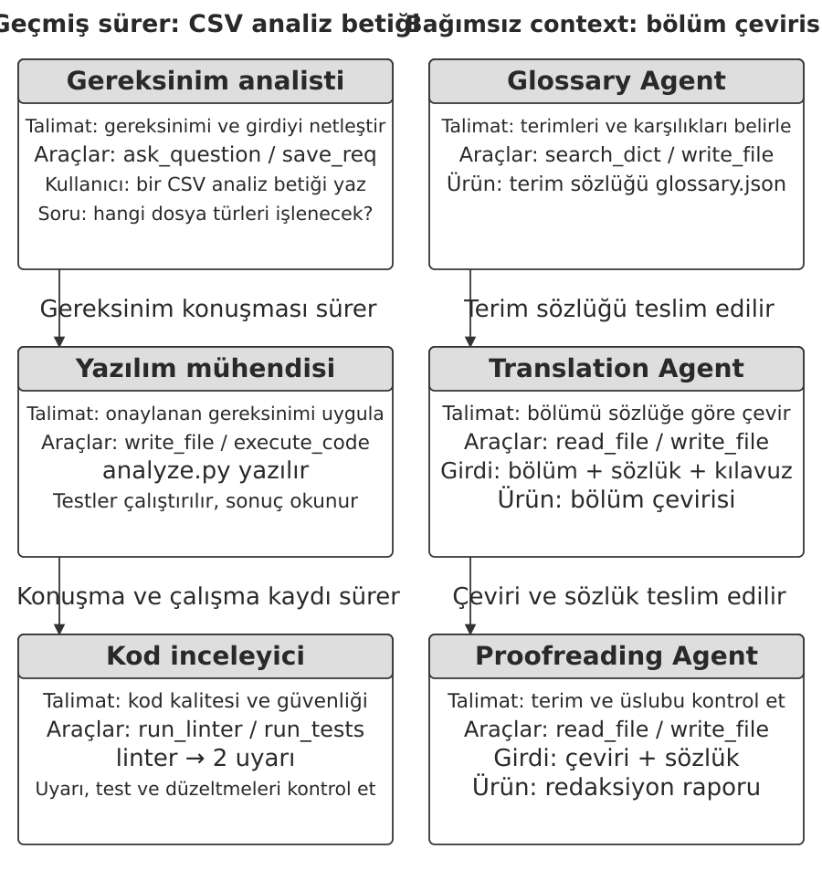

Context'ler bağımsız olduğunda üyeler malzemeyi nasıl paylaşır? Dağıtık sistemlerde iletişim genellikle paylaşılan depolama ya da mesaj iletimiyle yapılır. Agent sistemleri de bu iki yaklaşımı kullanabilir; somut yöntemler şunlardır:

- **Araç çağrısı parametreleri.** Alt akıştaki Agent bir araç olarak paketlenir, üst akış görevi ve yapılandırılmış malzemeyi parametrelerle iletir ve sonucu alır.
- **Paylaşılan dosya sistemi.** Bir taraf belge, kod ya da veri yazar, diğer taraf referansla okur; büyük ara ürünler ve kalıcı saklanması gereken malzemeler için uygundur.
- **Mesaj veriyolu (Message Bus).** Agent mesajı bir aktarma hizmetine gönderir, hizmet de hedefe ya da abonelik ilişkilerine göre teslim eder; birden çok üye arasında eş zamansız iletişim için uygundur.

Örneğin üst akış bir çeviri görevi gönderdikten sonra çevirinin dönmesini bekleyebilir ya da önce bir görev numarası alıp başka bir bölümle ilgilenebilir. İki çevirmen de aynı dosyayı açabiliyor olsa bile sistemin kimin yazacağını ve diğer tarafın ne zaman okuyacağını yine kararlaştırması gerekir. Go topluluğu paylaşılan veriye erişimin iletişimle düzenlenmesini vurgular; bu fikir Agent'lar için de geçerlidir: durumun kime ait olduğu, kimin değiştirebileceği ve diğer üyelerin güncellemeleri nasıl alacağı açıkça belirlenir.

### İkinci boyut: iş birliği topolojisi

İş birliği topolojisi Agent'lar arasındaki görev bağımlılıklarını, bilgi akışını ve denetim ilişkilerini tanımlar. Bu bölüm üç tipik örgütlenme biçimini kullanıyor:

- **Eşler arası iş birliği kalıbı** (Peer Collaboration Pattern). Az sayıda üye aynı ürün etrafında tekrar tekrar iş birliği yapar. Örneğin taslak yazar makale taslağını bitirir, eleştirmen değişiklik önerir, ardından taslak yazar düzeltir.
- **Yönetici kalıbı** (Orchestration Pattern). Merkezî bir Manager Agent görevleri böler, dağıtır ve toplar; alt Agent'lar kendi uzmanlık işlerini üstlenir.
- **Merkeziyetsiz kalıp** (Decentralized Pattern). Üyeler rollere, mesajlara ve yerel duruma göre işi devralır; işin nasıl ilerleyeceğine üyeler birlikte karar verir.

> **Terim notu: Graph mühendisliği.** Bölüm 1, Temmuz 2026'daki Graph mühendisliği tartışmasını tanıttı. Bu bakış açısı yürütme grafiğine odaklanır: düğümler Agent, sıradan program ya da insan kararı olabilir; kenarlar bağımlılıkları, koşullu yönlendirmeyi ve başarısızlık sonrasında gidilecek yönü ifade eder; durum yürütme ilişkileri boyunca aktarılır. Çoklu Agent iş birliği topolojisi bu tasarım bakış açısının uygulamalarından biridir ve birden çok karar biriminin nasıl devir teslim yaptığına, paralel çalıştığına ve geri bildirim verdiğine odaklanır.

Eşler arası iş birliği, yönetici ve merkeziyetsiz tasarımlar birlikte kullanılabilir. Örneğin Manager bir yazma görevini taslak yazar—denetçi grubuna verir, grup iç yinelemelerini tamamladıktan sonra sonucu teslim eder.

## Çoklu Agent tek Agent'tan ne zaman üstündür

İlk taslakta bir teknik kelimenin yanlış çevrildiğini varsayalım. İki redaktöre aynı çeviri verilirse iki kez aynı onay alınabilir; bunlardan birine aynı zamanda özgün metin, terim sözlüğü ve o kelimeyi kullanan kod da verilirse hatayı bulmanın bir yolu daha açılır. İş birliği biçimi seçilirken önce şu sorulur: eklenen Agent göreve ne katıyor? Yeni kanıt elde edebilir, başka bir arama yolunu kapsayabilir, farklı bir uzman yargısı sunabilir ya da paralel yürütmeyle bekleme süresini kısaltabilir.

Yazar önce **geri bildirimin bilgi artışını** kontrol eder, sonra paralelliğin ve context yalıtımının ne kadar kazanç getirdiğine bakar. Denetçi test sonuçlarını, sayfa ekran görüntülerini ya da dış malzemeleri okuduktan sonra, üretim sırasında henüz elde edilmemiş kanıtlara dayanarak değişiklik önerebilir. Tablo 10-1 bu tür artışın nasıl kontrol edileceğini birkaç yaygın senaryoyla gösteriyor.

Tablo 10-1 Çoklu Agent iş birliğinde bilgi ve geri bildirim

| İş birliği kalıbı | Başlıca bilgi kaynağı | Değerlendirme odağı |
|---|---|---|
| Aynı model kendi çıktısını yeniden inceler | Mevcut malzeme ve yeni bir kontrol süreci | Eksiklikleri bulabiliyor mu, değişiklik sonucu iyileştiriyor mu |
| Birden çok Agent aynı soruyu tartışır | Her birinin çözüm yolu, varsayımları ve gerekçeleri | Görüşler farklı mı, nasıl doğrulanıp yanıt seçiliyor |
| Denetçi testleri çalıştırır ve kodu kontrol eder | Derleme, test ve çalışma geri bildirimi | Değişiklik testleri geçiyor ve mevcut işlevleri koruyor mu |
| Denetçi ön yüzün ya da PPT'nin işlenmiş hâline bakar | Ekran görüntüleri ve etkileşim geri bildirimi | Yerleşim, içerik ve işlemler gereksinimlere uyuyor mu |
| Denetçi olguları dış araçlarla doğrular | Arama ve iş sistemi kayıtları | Kaynak güvenilir mi, sonuç kanıtla tutarlı mı |

RLEF, modeli pekiştirmeli öğrenmeyle kod yürütme geri bildirimini kullanmak üzere eğitir ve rekabetçi programlama görevlerinde çok adımlı düzeltmeyi öğretir. Derleme hataları, test başarısızlıkları ve çalışma zamanı istisnaları bir sonraki değişiklik için somut dayanak sağlar; makaledeki model daha az örneklemeyle daha iyi sonuç alabiliyor.[^rlef-2025] WebGen-Agent ise web sayfası ekran görüntülerini, görsel modelin açıklamalarını ve önerilerini ve GUI işlem değerlendirmesini üretim akışına bağlar; hem bir önceki adıma dönüp yeniden yapabilir hem de birkaç üretim sonucu arasından en iyisini seçebilir. WebGen-Bench'te Claude 3.5 Sonnet'in doğruluğu %26,4'ten %51,9'a yükseldi.[^webgen-agent-2025]

[^rlef-2025]: Gehring, J., et al. *RLEF: Grounding Code LLMs in Execution Feedback with Reinforcement Learning.* arXiv:2410.02089, 2025.
[^webgen-agent-2025]: Lu, Z., et al. *WebGen-Agent: Enhancing Interactive Website Generation with Multi-Level Feedback and Step-Level Reinforcement Learning.* arXiv:2509.22644, 2025.

Yazar önce sistemin testler, ekran görüntüleri ya da araç dönüşleri gibi somut kanıtlar elde etmesini sağlar, sonra üretme, yürütme ve denetleme sorumluluklarının nasıl dağıtılacağına karar verir. Geri bildirim döngüsü tek bir Agent tarafından tamamlanabilir ya da birden çok role bölünebilir; rol eklemek kanıtın elde edilmesini ve kullanılmasını iyileştirmelidir.

Anthropic'in 2026 tarihli güvenlik araştırması iş birliğiyle arama için bir vaka sunuyor: 45 Agent paylaşılan bir forum üzerinden bulgularını paylaştı, birbirini inceledi, sonuçlara da bağımsız bir Agent hakemlik etti. Araştırma raporuna göre iş birliği kümesi 27 milyon token tüketip 266 güvenlik açığı buldu; bağımsız paralel düzen 6,5 milyon token tüketip 21 açık buldu. Forum üyelerin başkalarının bulgularını izleyerek araştırmayı sürdürmesini ve hangi yönlerle başkalarının zaten uğraştığını bilmesini sağladı. İş birliği grubu yaklaşık dört kat token da kullandı; bu yüzden 266 ile 21 arasındaki fark hem iletişim biçimindeki hem de hesaplama yatırımındaki farkı içerir.[^anthropic-multiagent-2026]

[^anthropic-multiagent-2026]: Anthropic Frontier Red Team, “Patterns and Problems in Emerging Multiagent Systems,” 2026-08-13.

Matematik araştırmasında birden çok ekibin gerçekten farklı yolları keşfetmesi nasıl sağlanır? Üç boyutlu Navier–Stokes denklemleri viskoz akışkanların hareketini tanımlar. Pürüzsüz başlangıç koşullarıyla çözüm her zaman pürüzsüz kalabilir mi? OpenAI iki karşıt hedefi farklı gruplara verdi: bazıları pürüzsüzlüğü kanıtlamaya, bazıları karşı örnek kurmaya çalıştı. Her grup önce kendi başına keşfetti, ekip sonra ara sonuçları Codex ile topladı ve diğer grupların da umut verici ipuçlarını izlemesini sağladı. Karşı örneği bulan grupta yaklaşık on bin Agent eş zamanlı çalıştı. Ekibin raporuna göre ilk Agent'ların başlatılmasından kanıtın bulunmasına kadar yaklaşık 88 saat geçti, Lean formelleştirmesi ve doğrulaması ise ayrıca 17 saat sürdü. Karşı örneğin önemli bir koşulu var: akışkan pürüzsüz bir dış kuvvetin etkisindeyken bile sonlu zamanda tekillik oluşabiliyor. Ekip buna dayanarak Clay Matematik Enstitüsü'nün problem metnindeki C ve D formülasyonlarının gerektirdiği karşı örneği verdi; dış kuvvet kaldırılırsa bu başka bir sorundur. Bu tür bir arama tasarlanırken önce hangi sonuçların özgün soruyu yanıtlamaya yeteceği yazılabilir, birbiriyle rekabet eden varsayımlar farklı gruplara verilebilir ve son doğrulama için ayrı zaman bırakılabilir.[^ch10-ns-search]

[^ch10-ns-search]: OpenAI'ın *On the Navier–Stokes Millennium Prize Problem* araştırma notu kanıtı ve Lean kodunu içeriyor. Clay Matematik Enstitüsü 11 Eylül 2026 tarihli duyurusunda bu çalışmaya yanıt verdi ve sonucun değerlendirilmesinin ve ödülün kime verileceğinin ödül prosedürüne göre ele alınacağını belirtti.

**Adım bütçesi performansı nasıl etkiler?** Bir görevin 30 adıma izin verdiğini varsayalım; Agent planlamayı, temel uygulamayı ve gerekli doğrulamayı sıkı bir biçimde düzenlemelidir. 300 adıma izin verilirse daha fazla çözümü karşılaştırmak, daha kapsamlı test ve düzeltme yapmak için alan olur. Bu kaynağı iyi kullanmak için Agent'ın toplam bütçeyi ve kalan bütçeyi bilmesi ve keşif derinliğini buna göre düzenlemesi gerekir.

Google 2025 tarihli *Budget-Aware Tool-Use Enables Effective Agent Scaling* çalışmasında bu sorunu inceledi: bütçe farkındalığı olmayan bir Agent hızla yüzeysel aramada takılı kalabilir; kullanılabilir adımlar artırılsa bile performansı pek yükselmez. 2026 tarihli BAVT (Budget-Aware Value Tree Search) arama adımlarında değer kestirimini kalan bütçeyle birleştirerek keşif ile sömürünün ağırlıklarını ayarlar. Bütçe yeterliyken daha fazla yön karşılaştırılabilir, bütçe sınırına yaklaşıldığında ise kaynaklar umut verici dallarda toplanır.

Yönetici kalıbında bu, Manager'ın adımları görev zorluğuna göre dağıtması ve ilerledikçe ayarlaması demektir: basit görevler hızla teslim edilir, karmaşık görevlere doğrulama ve düzeltme payı bırakılır, bir tıkanıklıkla karşılaşıldığında önce nedeni bulunur, sonra bilgi eklemeye, bütçeyi artırmaya ya da başka bir yola geçmeye karar verilir.

Paralel keşif duvar saati süresini kısaltabilir, tekrarlanan denetim ürünü iyileştirebilir; ama ikisi de model çağrılarını ve iletişim maliyetini artırır. Yazar iyi ayarlanmış tek bir Agent'ı temel düzey alır; yalnızca yeni üyelerin getirdiği kalite artışı ya da zaman tasarrufu iletişim, tekrarlanan hesaplama ve bakım maliyetini karşılamaya yettiğinde iş birliğinin ölçeğini büyütür.

## Paylaşılan context ile çoklu Agent iş birliği

Paylaşılan context ile iş birliği aşamalara göre rol değiştirir ve mevcut görev kayıtlarını kullanmayı sürdürür. Bir araştırma raporunu örnek alalım: arama rolü önce malzeme toplar, analiz rolü ardından hesaplama yapar, yazma rolü de anlatımı düzenler. Her rol önceki kaynaklara ve kararlara geri dönüp bakabilir; sistem de geçerli görev talimatıyla onu bu aşamanın hedefine odaklar.

Ekipler arası devir teslimde önce şu sorulur: o zaman neden böyle karar verildiğini kimlerin bilmesi gerekiyor? Teamily AI'ın ürün örneğinde ürün yöneticisi ile Agent ürün gereksinim belgesini (PRD) bir grupta birlikte yazıyor. Ürün ekibi son hâli mühendislik ekibiyle paylaştıktan sonra mühendisler belirli bir gereksinimin arkasındaki ödünleşimi sorabiliyor.

Arama rolünün görevi yazma rolüne devretmesini örnek alalım: devirden sonra model yazma kurallarını nereden okuyacak ve hangi araçları çağırabilecek? Deney 10-1 aynı devri iki biçimde uyguluyor.

| Devirde ele alınacak sorun | Rol değiştirme (`transfer_to_agent`) | Skill yükleme |
|---|---|---|
| Yazma kuralları nasıl verilir? | Yazma rolünün sistem istemine geçilir | Sistem istemindeki Skill dizini korunur, yazma kuralları mesaj geçmişinin sonuna eklenir |
| Model hangi araçları görebilir? | Yalnızca yazma rolünün araçları gösterilebilir | Mevcut araç kümesi ya da araç arama girişi kullanılmaya devam edilebilir |
| KV Cache'in hangi kısmı hâlâ kullanılabilir? | Sistem istemi değiştiği için önekin değiştiği yerden itibaren genellikle yeniden hesaplama gerekir | Mevcut istek öneki yeniden kullanılmayı sürdürebilir |
| Çağrı yetkisini kim kontrol eder? | Harness isteği geçerli role göre doğrular, sonra aracı zamanlar | Harness her çağrının yetkisini bağımsız olarak kontrol eder |

Roller arasındaki fark ağırlıklı olarak bilgi, süreç ve yazım üslubunda olduğunda yazar Skill'i tercih eder: aynı çalışma çerçevesini yeniden kullanmayı kolaylaştırır ve kararlı istek önekinin önbelleğini de korur. Roller arasındaki fark yetkileri, araç yalıtımını ya da onay sorumluluklarını ilgilendiriyorsa bağımsız Agent'lar ya da rol değiştirme ile örgütlenebilir, erişim denetimi de Harness ve yürütme ortamı tarafından uygulanır. Bir aracın model girdisinde görünüp görünmemesi çağrı seçimini etkiler; gerçek yetkiye ise çalışma zamanının doğrulaması karar verir.

> **Deney 10-1 ★★: Paylaşılan context'te çok rollü geçiş — sistem istemi ile Skill karşılaştırması**
>
> İki yol aynı modeli, kullanıcı görevini, araç uygulamasını, rol kurallarını ve paylaşılan geçmişi kullanır. Giriş gösterimi Çin'in 2021–2023 yeni enerji aracı satışlarını bulmayı, yıllık bileşik büyüme oranını (CAGR) hesaplamayı ve yatırımcılar için 120 karakteri aşmayan bir özet yazmayı istiyor.
>
> **Birinci yol: sistem istemi değiştirme.** triage (gereksinim toplama), research (arama), coding (programlama), data_analysis (analiz) ve writing (yazma) olmak üzere beş rol tanımlanır. triage giriş noktasıdır; her rol kendine özgü araçları ve `transfer_to_agent`'ı görür. Devirde geçmiş korunur, hedef rolün istemi ve araç kümesi yüklenir ve çalışma sürer.
>
> **İkinci yol: Skill yükleme.** Sistem istemi ve tüm araç kümesi oturum boyunca sabit kalır. Model rol kurallarını almak için `load_skill(name)` çağırır, içerik araç sonucu olarak paylaşılan geçmişe eklenir, mevcut önek korunur. Harness her araç çağrısını yetki kurallarına göre kontrol eder.
>
> İki uygulama da aynı `SKILL.md` dosyasını okur. Bir rol devrinden önce ve sonra modele gönderilen birer istek alın; kuralların hangi mesajda göründüğüne ve önekin hangi kısmının yeniden kullanılabildiğine bakın. Sonra iki özeti karşılaştırın: satış kaynağı güvenilir mi? 2021 sonundan 2023 sonuna iki büyüme dönemi var; yıllık bileşik büyüme oranı doğru hesaplandı mı?
>
> Resmî karşılaştırmada daha sıkı bir brifing sorusu var: 160 karakter sınırı ve iki kaynak URL'sinin korunması. Aynı sekiz adımlık fırsat verildiğinde rol değiştiren grup üç çağrıyı karakter saymaya harcadı, taslak yine 206 karakterdi ve sorunun belirttiği hesaplama aracını da kullanmadı. Skill yükleyen grup ilk ve son yılın satışlarıyla büyüme oranını hesapladı ve yazma kurallarını ancak sekizinci adımda yükledi. O noktada geçilmesi gereken roller tamamlanmıştı, ama kullanıcı henüz özeti almamıştı. İki iz de sonunda adım sınırına ulaşıldığı için bitti.
>
> Aynı 30 görev her iki uygulamayla çalıştırıldı ve teslimatlar programla kontrol edildi: Skill yükleyen grup 15 görevi, sistem istemi değiştiren grup 2 görevi geçti. Ancak soru soru karşılaştırıldığında ilk grubun önbellekte bulunmayan girdisi 6.855 token, süresi yaklaşık 4,4 saniye fazlaydı (ikisi de eşleştirilmiş farkların medyanı). Bu çalıştırmada hizmet sağlayıcı her iki grubun isteklerinde önbelleğe alınmış girdi token sayısını sıfır bildirdi. Talimata uymayla ilgili 6 sınır testinde iki grup da hepsini geçti, ama tam görevlerdeki geçme oranları çok farklıydı.
## Paylaşılmayan context ile çoklu Agent iş birliği

Bağımsız context mimarisinde her Agent girdi geçmişini, görev durumunu ve çalışma döngüsünü ayrı ayrı tutar; gereken bilgiyi araç parametreleri, paylaşılan dosyalar ve mesajlarla paylaşır. Örneğin çevirmenin teslim ettiği malzemede özgün paragraf ve terim sözlüğü sürümü belirtilmelidir. Çevirmen ayrılsa bile redaktör özgün metni bulabilir; düzeltme gerektiğinde de bölüme göre sorumluyu bulabilir.

Tablo 10-2 işletim sisteminin süreçleri yönetme biçimini çalışma zamanının Agent'ları yönetme biçimiyle karşılaştırıyor.

Tablo 10-2 Çoklu Agent sistemleri ile işletim sistemi arasındaki tasarım benzetmesi

| İşletim sistemi | Çoklu Agent sistemindeki benzer sorumluluk |
|---|---|
| Program ve yapılandırma | Sistem istemi, araç tanımları ve rol yapılandırması |
| Süreç belleği | Geçerli context, görev durumu ve geçmiş kayıtlar |
| CPU'nun hesaplama yürütmesi | LLM karar üretir, çalışma zamanı ve araçlar ilgili işlemleri yürütür |
| Çekirdeğin çalışmayı yönetmesi | Agent çalışma zamanı durumu, zamanlamayı ve kaynakları yönetir |
| Sistem çağrısı | Araç arayüzü üzerinden dış işlem istemek |
| fork: alt süreç oluşturmak | `spawn_subagent`: alt Agent oluşturmak |
| kill: sinyal göndermek | `cancel_subagent`: iptal istemek |
| ps: süreçleri sorgulamak | `list_agents`: üyeleri ve çalışma durumlarını sorgulamak |
| Çıkış durumu ve wait | Tamamlanma bildirimi, görev durumu ve yapılandırılmış sonuç |
| Paylaşılan bellek ve mesaj iletimi | Paylaşılan dosyalar, araç parametreleri ve mesajlar |

Özel durum, eş zamansız mesajlar ve üyelerin dinamik olarak oluşturulması 1970'lerde önerilen Actor modelinde de görülür.[^actor-model]

[^actor-model]: Hewitt, C., Bishop, P., Steiger, R. *A Universal Modular ACTOR Formalism for Artificial Intelligence.* IJCAI 1973.

Bağımsız alt görevler çok olduğunda yazar her üyeye ayrı bir context vermeyi ve yalnızca sorumluluğuyla ilgili malzemeyi işlemesini sağlamayı tercih eder. Bu, rolleri ayrı ayrı test etmeyi kolaylaştırır, önceki aşamanın uzun geçmişinin geçerli yargıya karışmasını azaltır ve birden çok görevin eş zamanlı ilerlemesini sağlar. Yalıtımın etkisi diğer paylaşılan kaynaklara da bağlıdır: birden çok Agent yine aynı dosyayı aynı anda değiştirebilir, aynı API kotasını tüketebilir ya da aynı hata mesajını alabilir.

İş birliği arayüzü mesaj kaybını, yinelenen teslimatı ve durum gecikmesini de ele almalıdır. Sorun araştırılırken görev tanımlayıcısıyla üyelerin istekleri, araç olayları ve sonuçları ilişkilendirilip bir devir teslimin süreci yeniden kurulabilir.

Bir Agent'ın analizi bitirdiğini ve sonucu raporu yazan arkadaşına vermesi gerektiğini varsayalım. Sayılar azsa mesajla gönderilebilir; ürün büyük bir tabloysa genellikle tablo paylaşılan dosya sistemine konur ve mesaja bir referans eklenir. Buradan iki iş bölümü çıkar. **Ürün depolama** belgeleri, kodu ve verileri saklar ve paylaştırır; **iletişim ve denetim** ise mesajları teslim etmekten, görev durumunu sorgulamaktan, yürütmeyi iptal etmekten ve kaynakları zamanlamaktan sorumludur.

### Agent'ın gözünden dosya sistemi

Yaygın bir tasarım, Agent'a farklı kaynaklardan gelen kaynakları tek bir dizin ağacına bağlayan bir **sanal dosya sistemi** (virtual filesystem) sunmaktır. Model `read_file`, `write_file` ve `list_dir` gibi arayüzlerle erişir; altta yerel geçici disk, kalıcı nesne depolama, üçüncü taraf bulut disk API'leri ya da sistem kaynak paketleri bağlanabilir.

Yazar iş birliği akışını bağlamadan önce depolama alanlarını ayırır. Geçici taslaklar, resmî teslimatlar ve kullanıcının dış dosyaları birbirine karışırsa yanlışlıkla üzerine yazma ya da yetkisiz okuma kolayca olur. Birleşik arayüz kullanımı kolaylaştırır; her alanın görünürlüğünü, yaşam döngüsünü ve yetkilerini ise bağlama ve erişim denetimi yapılandırması belirler. Bu dizin ağacı dört tür alana bölünebilir.

**Bir: Agent'a özel çalışma alanı (Scratchpad).** Her örnek kendi çalışma alanını kullanır; taslakları, geçici dosyaları, hata ayıklama günlüklerini ve ara ürünleri saklar. Erişim varsayılan olarak sahibi olan Agent ile sınırlanır ve görev stratejisine göre temizlenir ya da arşivlenir. Böylece geçici dosyaların birbirinin üzerine yazması önlenir; alt Agent işi bitirdikten sonra teslim edilmesi gereken sonuçları paylaşılan alana koyar ve yapılandırılmış bir özetle birlikte ana Agent'a verir. Deneme yanılma kayıtları sonraki tanı için özgün çalışma alanında kalır. Bu, context yalıtımını depolama katmanına da taşır: ana Agent teslimatı ve gerekli kanıtları alır, günlük koordinasyonda bütün deneme yanılma sürecini okuma maliyetinden kurtulur.

**İki: çoklu Agent paylaşılan alanı (Shared Workspace).** İş birliği yapan üyeler ürünleri burada paylaşır; kullanıcı da yetkili bir giriş üzerinden malzeme yükleyip teslimatları indirebilir. Örneğin Glossary Agent terim sözlüğünü yazar, Translation Agent okuyup çevirir, ardından denetçi çeviriyi kontrol eder. Paylaşılan alan genellikle görevle birlikte kalıcı olarak saklanır; eş zamanlı yazmayı, sürüm güncellemelerini ve erişim kapsamını ele almak gerekir. Bölüm 6'da Agent ile sanal bilgisayarın CSV ve grafikleri paylaşılan depolama üzerinden paylaşması bu tür ürün devrinin bir örneğidir. İyimser kilitleme ve çalışma kopyası yalıtımı gibi yöntemler ilerleyen kısımda tanıtılacak.

**Üç: bağlanmış dış kaynaklar (Mounted External Resources).** Google Drive, Notion, Dropbox ve kurumsal Wiki gibi kaynaklar bağdaştırıcılarla birleşik arayüze eşlenebilir. Agent bir belge okuduğunda bağdaştırıcı kaynak sistemin API'sini çağırır. Burada üç tür fark yönetilmelidir: erişim kapsamı dış yetkilendirmeye bağlıdır; ağ erişimi gecikme, zaman aşımı ve önbellek güncelleme sorunları getirir; geri yazma işlemleri kaynak sistemin yetki ve sürüm kurallarına uymalıdır. Somut tutarlılık anlamını hizmet arayüzü belirler; eş zamanlı değişiklikler sürüm numaraları, koşullu yazma ya da yeniden okuma ile kontrol edilebilir. İhtiyaca göre salt okunur bağlama malzeme aramaya uygundur; düzenleme gerektiğinde ilgili yazma yetkisi verilir.

**Dört: sistem içi kaynaklar (Built-in System Resources).** Başvuru kılavuzları, şablonlar, araç tanımları ve önceden kurulmuş Skills, birden çok Agent'ın kullanabileceği salt okunur kaynak paketleri olabilir. Skills aşamalı açıklamayla yüklenir: önce dizin sunulur, sonra göreve göre kurallar ve betikler okunur. Sabit sürümlü kaynak paketleri eş zamanlı okumayı kolaylaştırır; yükseltmede sürüm geçişiyle çalışan görevlerin tutarlı kalması sağlanır.

Şekil 10-2'de çevirmen kendi dizininde taslağı tekrar tekrar düzeltebilir, redaksiyona vermeye hazır olduğunda ilgili sürümü paylaşılan alana koyar. Kullanıcının bulut diskindeki özgün metin dış bağdaştırıcıyla okunur; ona erişim kullanıcının verdiği yetkiye de bağlıdır.

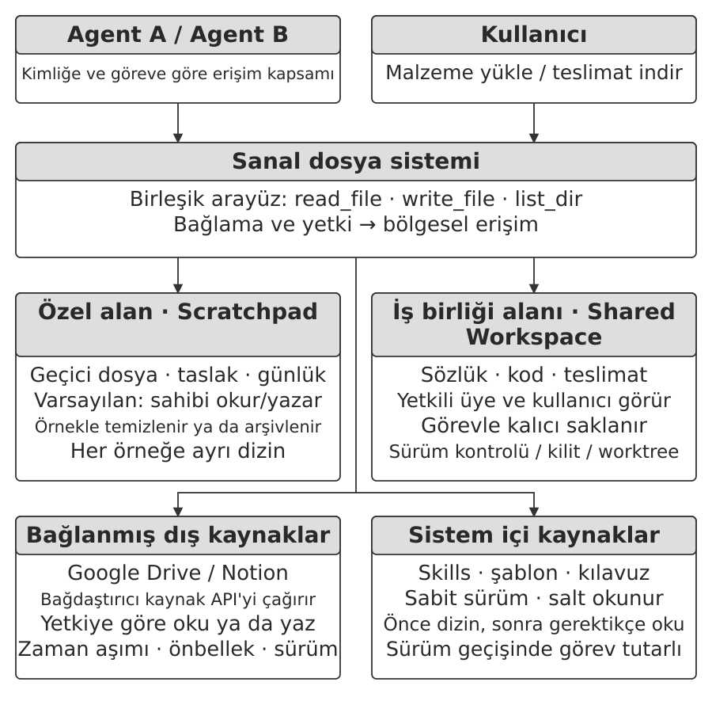

Çevirmen ayrıldıktan sonra çalışma alanındaki geçici dosyalar onunla birlikte serbest bırakılabilir. Paylaşılan alana konan çeviri ise korunmayı sürdürebilir ve redaktör okuma yetkisiyle işi devralır (Tablo 10-3).

Tablo 10-3 Agent sanal dosya sisteminin dört alanı

| Alan | Görünürlük | Yaşam döngüsü | Okuma-yazma | Eş zamanlılık yönetimi |
|---|---|---|---|---|
| Agent'a özel çalışma alanı | Varsayılan olarak sahibi olan Agent | Örnekle birlikte temizlenir, gerektiğinde arşivlenir | Sahibi olan Agent okur ve yazar | Yeniden denemelerin ya da arka plan işlemlerinin yinelenen yazmasını önlemek |
| Çoklu Agent paylaşılan alanı | Yetkili üyeler ve kullanıcılar | Görevle birlikte kalıcı olarak saklanır | Role göre yetkilendirilir | Kilit, sürüm kontrolü ya da worktree |
| Bağlanmış dış kaynaklar | Dış yetkilendirme ve bağdaştırıcı birlikte sınırlar | Kaynak sistem ve önbellek stratejisi belirler | İhtiyaca göre salt okunur ya da yetkili yazma | Kaynak sistemin sürüm ve eş zamanlılık arayüzüne uymak |
| Sistem içi kaynaklar | Yetkili Agent'lar | Sabit sürüm, oturumlar arasında yeniden kullanılır | Salt okunur | Kaynak sürümünü topluca değiştirmek |

Dosya referansları devir teslim mesajlarını kısa tutar: üst akış ürünün konumunu, sürümünü ve amacını verir, alt akış içeriği gerektiğinde okur. Aynı çalışma ortamındaki üyeler paylaşılan yolları kullanabilir; kurumlar arası iş birliğinde ise aynı devri tamamlamak için iki tarafın da çözümleyebileceği ürün tanımlayıcıları, erişim arayüzleri ve yetkilendirme gerekir.

### Agent'lar arası iletişim ve denetim

Bölüm 4'te tanıtılan oluşturma, iletişim, iptal ve keşif araçları çoklu Agent iş birliği için temel denetim arayüzlerini sağlar: `spawn_subagent` üye oluşturur, `send_message_to_subagent` mesaj iletir, `cancel_subagent` iptal ister, `list_agents` üyeleri sorgular. Bu arayüzler etrafında mesaj, durum, sonlandırma ve zamanlama davranışları üzerinde de anlaşmak gerekir.

**Bir: mesaj iletimi.** Üye sayısı az ve ilişkiler sabitse noktadan noktaya arayüzler kullanılabilir; örneğin telefon Agent'ı ile bilgisayar Agent'ı ilerlemeyi doğrudan paylaşır. Bütün üyelerin ikişer ikişer iletişim kurması gerekiyorsa olası ilişki sayısı üye sayısının karesiyle artar; abonelik ilişkileri çok olduğunda mesaj veriyolu yönlendirmeyi, arabelleğe almayı ve yeniden denemeyi merkezî olarak yönetmeyi kolaylaştırır. Noktadan noktaya iletim de veriyolu da eş zamansız teslimat yapabilir; alıcının aynı anda çevrimiçi olması gerekip gerekmediği kuyruk ve kalıcılık mekanizmalarına bağlıdır.

Mesaj genellikle yapılandırılmış bir **zarf** (envelope) içerir: gönderen kimliği, hedef Agent ya da yayın kapsamı, mesaj türü ve yük. Mesaj türleri `task_assigned`, `status_update`, `result` ve `terminate` olabilir. Görev tanımlayıcıları, mesaj tanımlayıcıları ve ilişkili istekler alıcının yinelenenleri ayıklamasına yardım eder, hata ayıklama araçlarının da iletişim zincirini yeniden kurmasını sağlar. İş içeriği JSON yüküne konur, iki taraf da kararlaştırılmış alanlara göre işler.

Örneğin bir çevirinin teslimatından editör sorumludur ve editör bir kelimeyi terim denetimi Agent'ına kontrol ettirmek istiyor. Multica'nın iş kaydı yorumunda onu adıyla anmak (`@`) ve soruyu yazmak denetim işini tetiklemeye yeter. Denetim görüşü doğrudan bu iş kaydına yanıt olarak yazılabilir; sorumlu yine editördür ve iş kaydının durumu da değişmez. Denetçinin iş kaydını bütünüyle devralması isteniyorsa sorumlunun açıkça değiştirilmesi gerekir.[^ch10-multica]

[^ch10-multica]: Multica, yorumda Agent'ı adıyla anmak; `d579273` sürümündeki yorum dağıtım uygulaması.

**İki: durum edinme.** Ana Agent'ın alt görevin hâlâ çalışıp çalışmadığını, girdiye ihtiyaç duyup duymadığını ve sonucun alınabilir olup olmadığını bilmesi gerekir. Durum arayüzleri, olay bildirimleri ve ilerleme dosyaları birlikte kullanılabilir: çalışma zamanı arayüzü yaşam döngüsü durumunu verir, mesajlar iş ilerlemesini açıklar, kalıcı dosyalar da geri yüklenebilir kayıtları saklar.

`get_subagent_status(agent_id)` çalışıyor, girdi gerekiyor, tamamlandı ya da başarısız gibi durumlar döndürebilir. Günlük koordinasyonda yazar tamamlanma bildirimlerini ve aşama ilerleme mesajlarını tercih eder; böylece ana Agent kendi işini sürdürür. Bildirim geciktiğinde, bağlantı yeniden kurulduğunda ya da sorun araştırılması gerektiğinde etkin sorgulama yapılır; böylece model çağrıları sık sık "bitti mi?" diye sormaya harcanmaz. Durum arayüzünü çalışma zamanı yönetir ve sürecin canlı olup olmadığını, görevin bitip bitmediğini zamanında bildirebilir.

**İlerlemeyi mesajlarla paylaşmak.** Ana Agent geçerli ilerlemeyi sorabilir, alt Agent uygun adımda yanıt verir; alt Agent da bir aşama sonucu elde ettiğinde, bir engelle karşılaştığında ya da yardıma ihtiyaç duyduğunda kendiliğinden `status_update` yayımlayabilir. Mesaj içeriği tamamlanan işleri, bir sonraki adımı ve engelin nedenini açıklamalıdır; bütün üyeler aynı durum adlarını kullanır ki toplamak ve değerlendirmek kolay olsun. İlerleyen kısımdaki A2A protokolü görev yaşam döngüsünün standart ifadesini tanıtacak.

**İlerlemeyi dosyalarla saklamak.** Sistem mesajları, araç isteklerini, araç sonuçlarını ve durum değişikliklerini olay sırasına göre bir günlüğe ekleyebilir; örneğin her satırda bir olay olan JSONL biçimi kullanılabilir. Tanı yetkisi olan ana Agent ya da işletim araçları yeniden denemeleri, hataları ve bekleme süreçlerini buna göre kontrol edebilir. Model girdi geçmişi çalışma izinin yalnızca bir parçasıdır; günlük ayrıca zamanlama ve dış yürütme olaylarını da kaydedebilir.

Tam bir iz on binlerce token içerebilir ve ana Agent her okuduğunda durumu yeniden çıkarmak zorunda kalır. Mesajlar ana Agent'a yeni bir ilerleme olduğunu bildirir, kısa ilerleme dosyası ise geçerli durumu sonraki sorgu ve geri yükleme için saklar. Yazar günlük koordinasyonu bu ikisini birlikte kullanarak yapmayı tercih eder. Alt Agent bir işi her bitirdiğinde görev listesini, ürün referanslarını ve geçerli engel noktasını günceller; ana Agent bir sonraki adıma bu alanlara göre karar verir. Ayrıntılı iz gerektiğinde araştırma için saklanır. İlerleme uzun süre değişmezse müdahale gerekip gerekmediğine kalp atışı, araç çağrısı durumu ve görev zaman aşımı ayarları birlikte değerlendirilerek karar verilebilir: uzun süre çalışan bir araç hâlâ çalışıyor olabilir; durum doğrulandıktan sonra beklemeye, iptal etmeye ya da yeniden denemeye karar verilir.

**Üç: yürütmeyi sonlandırma.** Birden çok üye aynı hedefi paralel olarak ararken biri görevi tamamladığında diğer dallar bütçeyi ve araç kaynaklarını serbest bırakmak için durabilir. İptal, Unix'teki SIGTERM ve SIGKILL'e benzer iki şiddete ayrılır.

Yazar **zarif sonlandırmayı** tercih eder: çalışma zamanı iptal isteğini iletir, alt Agent güvenli bir noktada yeni işlemleri durdurur, gerekli ilerlemeyi saklar, tarayıcı oturumunu kapatır ve kilitleri serbest bırakır, ardından bir onay (ack) döndürür. **Zorla sonlandırma**, iptal süresini aştığı hâlde yanıt vermeyen yürütmeler için kullanılır; çalışma zamanı süreci sonlandırır, sonra artık kaynakları ve tamamlanmamış yazmaları kontrol eder. Dış sistemlere zaten gönderilmiş işlemlerin sonucu da sorgulanmalı, gerekirse telafi süreci yürütülmelidir.

Yaşam döngüsü oluşturma ilişkisi boyunca da yönetilmelidir. Go'nun context yapısından esinlenerek üst görevin iptal sinyalinin bütün alt görev ağacına aşağı doğru yayılması sağlanabilir; çalışma döngüsü güvenli noktalarda iptal sinyalini kontrol eder, bu da `ctx.Done()`'ın amacına karşılık gelir. Böylece üst görev bittikten sonra onun başlattığı dallar da temizlik sürecine girer ve sahipsiz Agent'ların araç çağırıp bütçe tüketmeyi sürdürmesi önlenir. Gerçekten uzun süre bağımsız çalışması gereken arka plan görevleri için `context.Background()` kullanımına benzer biçimde bağımsız bir yaşam döngüsü context'i oluşturulur ve izleme, bütçe ve temizlikten sorumlu bir yönetici belirlenir.

**Dört: kaynaklar ve zamanlama.** Agent sistemi token, adım, eş zamanlılık kotası, araç bağlantıları ve hesaplama kaynakları dağıtmalıdır. Alt görev başlatılırken bütçe ve aşım davranışı belirlenir; model görev zorluğuna göre seçilir; hizmet kotalarının topluca tükenmesini önlemek için eş zamanlı çağrılar sınırlanır. Daha acil bir görev geldiğinde düşük öncelikli görevler güvenli bir noktada duraklatılabilir ya da iptal edilebilir, ilerleme saklandıktan sonra yeniden zamanlanır.

Üç dalın her birinin uygulanabilir bir çözümü araştırdığını, birinin önemli bir ipucu bulduğunu ve yalnızca son bir doğrulamanın kaldığını varsayalım. Manager ona birkaç adım daha verebilir ve aynı anda ilerleme kaydetmeyen iki dalı sonlandırabilir. Kota çalışma zamanı tarafından düşülür; bir dal denemeyi sürdürmek istese bile bütçe tükendiğinde durmak zorundadır.

### Eşler arası iş birliği kalıbı: karşılıklı kontrol ve yinelemeli iyileştirme

Eşler arası iş birliğinde genellikle iki üç Agent aynı görev etrafında görüş alışverişi yapar ve ürünü düzeltir. Tasarlarken önce üyelere farklı sorumluluklar, malzemeler ve araçlar verilip bağımsız karar vermeleri sağlanabilir, sonra sonuçlar toplanır. Örneğin üretici uygulamaya, denetçi testlere ve kullanıcı gereksinimlerine odaklanır; farklı uzmanlıktaki üyeler kendi alanlarının kısıtlarını ayrı ayrı kontrol eder. Modeller, girdiler ve iş akışları ne kadar benzerse üyelerin aynı yargıyı tekrarlaması o kadar kolaylaşır; bu yüzden bakış açısı ve kanıt farkı bilinçli olarak tasarlanmalıdır.[^anthropic-multiagent-2026]

Aynı ürün etrafında tekrar tekrar iyileştirme yapılan görevlerde yazar iki üç üyeli eşler arası iş birliğiyle başlamayı önerir. Roller, devredilen içerik ve durma koşulları netleştikten sonra test edilebilir bir döngü kurulabilir; başlangıçtaki koordinasyon işi de azdır.

#### Loop mühendisliği

Eşler arası iş birliği yaygın bir sorunun ele alınmasına yardım edebilir: **erken sonlandırma**. Programlama ve müşteri hizmetleri işlerini örnek alırsak erken sonlandırma üç tür kayıttan fark edilebilir.

- **Kısmen tamamlayıp hepsinin tamamlandığını söylemek.** Coding Agent kodu yazar, ama testleri ve dağıtım kontrollerini atlar; kullanıcı asistana iki iş verir, asistan ilkini bitirince hepsinin halledildiğini bildirir. Görev listesi kalem kalem karşılaştırılmalı ve her işin tamamlanma kanıtı kontrol edilmelidir.
- **Bir yol başarısız olunca erkenden vazgeçmek.** Satıcı malzemenin form ile gönderilmesini ya da eklerin belirli bir e-posta adresine yollanmasını isteyebilir. Böyle bir yanıt alındığında iş satıcının kabul ettiği yolla sürdürülebilir. Başarısızlığın nedeni kaydedilmeli ve hangi yolların daha denemeye değer olduğuna karar verilmelidir.
- **Yerel başarıdan sonra sonraki adımları atlamak.** Satıcı iadeyi kabul ettikten sonra kullanıcının ayrıca uygulamada onay vermesini istiyorsa asistanın bu adımı ve işlem koşullarını açıklaması gerekir. Fatura indirimini örnek alalım: temsilci telefonda sözlü olarak söz verirse asistan kullanıcıya bu görüşmede bir taahhüt alındığını onaylayabilir. Görüşme kaydı temsilcinin ne söylediğini kanıtlayabilir; sonraki faturanın bunu yerine getirip getirmediği ise yeni kanıt gerektirir. Denetçi elde edilen sonuçları, kimin daha ne yapması gerektiğini ve hangi sonuçların şimdilik görülemediğini ayrı ayrı açıklamalıdır.

Bu üç sorunun hepsi tamamlanma koşulunun kontrol edilebilir sonuçlara dönüştürülmesini gerektirir. **Loop mühendisliği**, Agent'ın "bir sonraki işi belirle—yürüt—doğrula—ilerlemeyi kaydet" döngüsünden sürekli geçmesini ve sonuca göre devam etmeye, beklemeye, devretmeye ya da bitirmeye karar vermesini sağlamakla ilgilenir. Mühendislerin görev kaynaklarını, doğrulama yöntemlerini, kalıcı durumu ve durma koşullarını tasarlaması gerekir. İnsanın işi de buna göre genişler: tek bir çağrı için istem yazmaktan görevleri sürekli ilerletebilen döngüler tasarlamaya geçer. Addy Osmani Haziran 2026'da bu uygulamalar grubunu bu adla tartıştı ve Boris Cherny'nin deneyimini aktardı: işin ağırlık merkezi yavaş yavaş Agent'ı yürütebilen döngüleri tasarlamaya kayıyor.[^loop-engineering-2026]

**Bu tür döngülerde yazara göre doğrulayıcı çoğu zaman temel darboğazdır.** Doğrulama güvenilir değilse tur sayısını artırmak sistemin aynı tür hataları tekrarlamasına ya da tamamlandığını erken ilan etmesine yol açabilir. Test sonuçları, iş durumu ve kullanıcı onayı kendi kapsamlarında tamamlanma dayanağı sağlar; doğrulama başarısızlığı da bir sonraki düzeltme turunun girdisi olur.

Uygulama adlandırmadan önce gelir. Loop mühendisliği adı yaygınlaşmadan önce yazar ve ekibi Pine AI'da erken sonlandırmayı döngüler ve doğrulamayla zaten ele alıyordu. Önerici—denetçi düzeni bu tür döngüleri örgütlemenin yaygın bir yoludur; aşağıda ayrıntılı olarak ele alınacak.

[^loop-engineering-2026]: Osmani, Addy. “Loop Engineering”, 2026.

**LoopX: turlar arası çalışma durumunu saklamak.** LoopX hedefi, sınırları, yapılacak işleri, kapıları, kanıtları ve kotaları kalıcı bir denetim düzlemine koyar; bir sonraki turun ya da bir sonraki yürütücünün işini o ayarlar. Süreç şöyle özetlenebilir: **denetim düzlemi kararı → Agent yürütmesi → bağımsız doğrulama → doğrulanmış ilerlemenin kaydedilmesi**.

Agent araçları çağırır, akıl yürütür ve bu turun ürününü teslim eder. Denetim düzlemi tamamlanan işi kaydeder ve bir sonraki turun nereden devam edeceğine karar verir. Doğrulama geçerse tamamlanma durumu kaydedilir; başarısız olursa onarım ya da yeniden planlamaya geçilir. İnsan onay kapıları, bekleme koşulları ve bütçe sınırları yürütmenin ne zaman sürdürülebileceğini birlikte belirler.[^loopx-framework]

[^loopx-framework]: LoopX, The local control plane for long-running AI agent work, v0.4.0.

**LongHorizon-Harness: uygulamalar arası uzun görevleri bağlamak.** Bu çerçeve çok kipli Computer Use'dan yola çıkarak görevlerin GUI, CLI, birden çok masaüstü uygulaması ve birden çok context yenilemesi boyunca kesintisiz yürütülmesini ele alır. Manage–Execute–Audit (MEA) döngüsünü kullanır: Manager özgün hedefe, doğrulanmış ilerlemeye, başarısızlık kanıtlarına ve kalan işe göre kapsamı net bir alt görev üretir; Executor GUI ya da CLI işlemlerini yeni bir context'te yürütür; Auditor sonucu salt okunur biçimde kontrol eder ve doğrulanmış ilerlemeyi bir sonraki turun durumuna yazar. Başarısızlık kanıtları da toparlanma ve yeniden planlama için korunur.

Çerçeve bir bağdaştırma katmanı aracılığıyla Claude Code, Codex CLI gibi yürütme arka uçlarını çağırır ve dıştaki görev yönetimini arka ucun çalışma döngüsüne bağlar. Bu yaklaşım uzun görevlerin sürekliliğini doğrulanmış görev durumuna dayandırır. Yürütme context'i yenilenebilir; bir sonraki tur yine hedefe, tamamlanma kanıtlarına ve çözülmemiş konulara göre çalışmayı sürdürür ve ortam değişikliklerinin önceki sonuçları etkileyip etkilemediğini yeniden kontrol eder.[^longhorizon-implementation]

Makale, Qwen 3.7-Plus ve Claude Code yürütme arka ucunu sabit tutup yalnızca dış döngünün değiştirildiği karşılaştırmada WeaveBench PassRate'in %51,8'den %80,7'ye, OSWorld 2.0 ikili tamamlanma oranının %2,8'den %8,3'e, Terminal-Bench 2.1 başarı oranının %69,7'den %77,2'ye çıktığını bildiriyor. Maliyet de göreve göre değişiyor: ilk iki kıyaslama sırasıyla temel düzeyin 2,3 katı toplam token ve 3,6 katı çıktı token'ı tüketti; Terminal-Bench 2.1'in token tüketimi ise %24 azaldı.

Aynı WebRTC çok katmanlı akış denetimi görevinde temel yürütücü Wireshark arayüzünde takıldı, ardından birkaç kez daha denedi ve sonunda 0,59 puan aldı. MEA kullanıldığında denetçi eksik kanıtı kaydetti, bir sonraki turdaki yürütücü buna göre ek inceleme yaptı ve sonunda 0,92 puan aldı.

[^longhorizon-implementation]: LongHorizon-Harness, makale numarası arXiv:2608.01964. Temel düzeyin ve MEA'nın açık izlerinin ikisi de WEB_task_16_webrtc_simulcast_layer_audit görevinden alınmıştır; yeniden üretim betiği `53bc678` commit'ini kullanır.

#### Önerici—denetçi paradigması

Önerici—denetçi düzeni ürün üretimini ve sonuç kontrolünü iki role verir. Bölüm 5'teki PPT üretimi, video düzenleme ve günlük görselleştirme deneyleri bu tasarımı kullandı: Proposer kodu üretir, Reviewer işlenmiş sonuca bakar, görsel modelin yardımıyla kaliteyi kontrol eder ve yapılandırılmış değişiklik önerileri döndürür. Şekil 10-3'te değişiklik önerilerinin önericiye geri dönmesi de gerekiyor. Bir sonraki sürümü buna göre düzeltip düzeltemeyeceği, denetçinin sorunu ne kadar ayrıntılı konumlandırabildiğine bağlıdır.

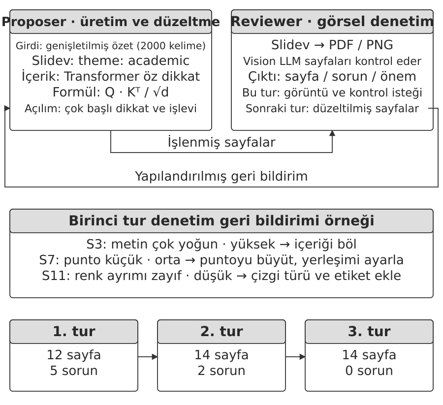

Kontrol edilen nesne değiştiğinde denetimde bakılacak kanıt da değişmelidir. Müşteri hizmetleri yanıtı denetlenirken iş kuralları ve olgu kaynaklarıyla karşılaştırılır; kod değişikliği denetlenirken testlere ve gerçek yürütme sonuçlarına bakılır; işlem planı denetlenirken geçerli standartlar ve ön koşullar kontrol edilir.

Huang ve arkadaşlarının ICLR 2024 makalesi *Large Language Models Cannot Self-Correct Reasoning Yet*, incelenen akıl yürütme görevlerinde ve istem ayarlarında GPT-4'ün dış geri bildirim olmadan kendini düzeltirken doğru yanıtları yanlışa çevirdiğini ve genel doğruluğun düştüğünü buldu. TACL'deki öz düzeltme derlemesi görev koşullarının ve geri bildirim güvenilirliğinin düzeltme etkisini nasıl etkilediğini ayrıca tartışıyor.[^self-correction-survey] Bu yüzden yazar bağımsız kanıtı ve konumlandırılabilir onarım koşullarını denetim döngüsünün temel gereksinimleri sayar. Denetçi gerçek testleri, ortam durumunu ya da işlenmiş sonucu okuyabilmeli ve hangi gereksinimin henüz karşılanmadığını ve onarımın nasıl doğrulanacağını söyleyebilmelidir.

[^self-correction-survey]: Kamoi, R., et al. *When Can LLMs Actually Correct Their Own Mistakes? A Critical Survey of Self-Correction of LLMs.* TACL, 2024.

Tam bir döngü beş adımda düzenlenebilir:

1. Önerici görev gereksinimlerine göre ilk sürümü yazar; örneğin bir yanıt ya da bir kod parçası.
2. Ürün yürütülür ya da işlenir; testler, iş durumu, ekran görüntüleri ya da olgu doğrulama sonuçları elde edilir.
3. Denetçi gereksinimleri ve kanıtları karşılaştırır, geçti kararı verir ya da sorunun yerini ve onarım koşulunu gösterir.
4. Bütçe hâlâ varsa önerici geri bildirime göre düzeltir, sonra yeniden yürütülür ve denetlenir; girdi ya da yetki gerektiren bir sorunla karşılaşıldığında beklemeye ya da devretmeye geçilir.
5. Yayın koşulu sağlandığında denetimden geçen sürüm, doğrulama kanıtları ve denetim kararıyla birlikte teslim edilir; bütçe tükenirse ilerleme ve çözülmemiş sorunlar saklanır.

Denetçi korunan testleri ve yayın standartlarını okur; önerdiği standart değişiklikleri ayrıca incelenir.

CRITIC deneyinde model önce yanıt verir, sonra araçlar yardımıyla kontrol eder.[^ch10-critic] Örneğin yanıttaki olguları arama motoruyla doğrular, kendi yazdığı matematik programını Python yorumlayıcısında çalıştırır. Açık soru yanıtlama, matematik programı üretme ve zararlı ifadeleri azaltma olmak üzere üç görev türünde, model araç geri bildirimine göre düzelttikten sonra performans hepsinde iyileşti. Model özgün yanıtı yalnızca kendisi değerlendirdiğinde düzeltme etkisi daha zayıftı. Bu tasarım Bölüm 5'teki PPT vakasıyla aynı mantığa sahiptir: işlenmiş ekran görüntüleri kod metninden doğrudan anlaşılması zor yerleşim ve örtüşme sorunlarını ortaya çıkarır, test yürütmesi de gerçek çalışma hatalarını gösterir.

[^ch10-critic]: CRITIC, arXiv:2305.11738.

Anthropic'in 2026 tarihli uzun soluklu uygulama geliştirme vakası planlayıcı, üretici ve değerlendirici olmak üzere üç Agent kullanıyor. Planlayıcı gereksinimleri ürün belirtimine açar; üretici ile değerlendirici önce her turun tamamlanma ölçütünde anlaşır, sonra sırasıyla uygular ve kontrol eder. Değerlendirici Playwright ile uygulamayı kullanır ve kusur raporları gönderir; roller durumu dosyalar üzerinden devreder. Bu vaka ürün belirtiminin, gerçek kullanımın ve kusur geri bildiriminin nasıl birbirine bağlandığını gösteriyor; artan yürütme ve denetim maliyetinin de çözüm karşılaştırmasına katılması gerekir.[^anthropic-harness-2026]

[^anthropic-harness-2026]: Prithvi Rajasekaran, “Harness Design for Long-Running Application Development,” Anthropic Engineering, 2026-03-24.

20 Kasım 2026'da matematikçi Levent Alpöge, Claude ile iş birliği yaparak elde ettiği, Riemann hipotezini ve onun Dirichlet $L$ fonksiyonlarına genellemesini kapsayan biçimsel kanıtı yayımladı. Büyük bir Lean dosyası yığınını alan denetçinin önce iki soru sorması gerekir: son teorem gerçekten özgün hipotezi mi ifade ediyor? Her çıkarım adımı kanıt çekirdeği tarafından yeniden kontrol edilebiliyor mu? MIT matematikçisi Andrew Sutherland önce gönderilen teoremi Lean matematik kütüphanesindeki Riemann hipotezi tanımıyla karşılaştırdı, sonra kanıtın dayandığı aksiyomları listeledi. Aynı gün yayımladığı kayıtta bağımsız kanıt çekirdeği nanoda'nın dışa aktarılan kanıtı kontrol edip onayladığını da bildirdi. Bu, denetim iş bölümü için somut bir yöntem sunuyor: önce sorunu iyi bilen kişi kabul önermesini yazar, sonra bağımsız bir araç gönderilen ürünün bu önermeyi çıkarıp çıkaramadığını kontrol eder. İleride matematikçiler yazarın bu yolu nasıl düşündüğünü anlamak isterse insanların okuyabileceği bir argüman da gerekecek.[^ch10-rh-review]

[^ch10-rh-review]: Levent Alpöge 20 Kasım 2026'da araştırma notunu yayımladı. Doğrulama projesi ve o günkü ilerlemesi için Andrew Sutherland'ın *Verification files for the Lean proof of the Riemann Hypothesis* çalışmasına bakın.

#### Tartışma kalıbı

Tartışma kalıbı üyelerin aynı sorunu farklı konumlardan incelemesini sağlar. Örneğin bir teknik çözüm değerlendirilirken bir Agent kazanımları ve uygulama senaryolarını açıklar, diğeri kısıtları, başarısızlık koşullarını ve alternatifleri kontrol eder. Her tur somut bir argüman etrafında kanıt ekler ya da itiraz eder; sonunda uzlaşılan konular ile hâlâ doğrulanması gereken ayrılıklar toplanır.

Bu düzen lehte ve aleyhte argümanları açıkça sıralamaya yardım eder; etkisi ise argümanların kalitesine, bağımsız yargıya ve son seçim yöntemine bağlıdır. Tran ve Kiela çok adımlı akıl yürütme görevlerinde ardışık, tartışma, topluluk, paralel roller ve alt görev paralelliği olmak üzere beş mimariyi karşılaştırdı; düşünme token'ı bütçesi eşit tutulduğunda tek Agent çoklu Agent'la eşit ya da daha iyi performans gösterdi.[^single-agent-2026] Buna dayanarak yazar tartışmayı esas olarak ayrılıkları açmak, varsayımları kontrol etmek ve karşı argümanları tamamlamak için kullanır. Olgusal ya da hesaplama doğruluğu hedeflendiğinde öncelikle doğrulanabilir kanıt ve bağımsız kontrol eklenir.

Makale veri işleme eşitsizliği yardımıyla ara bilgi aktarımının sınırlarını tartışıyor: tekrar tekrar aktarmak ve sıkıştırmak özgün ayrıntıların kaybolmasına yol açabilir. Mühendislikte izlenebilir kaynaklar korunabilir, üyeler önce bağımsız analiz yapıp sonra sonuçlarını paylaşabilir ve kontrol edilmemiş uzlaşma azaltılabilir. Birden çok bağımsız örneklemeden sonra toplama yapmak ve "üretmesi zor, doğrulaması kolay" görevlerin özelliğinden yararlanarak özel denetim düzenlemek de tartışmayla birlikte kullanılabilir.

[^single-agent-2026]: Tran, D., Kiela, D. *Single-Agent LLMs Outperform Multi-Agent Systems on Multi-Hop Reasoning Under Equal Thinking Token Budgets.* arXiv:2604.02460, 2026.

#### Beyin fırtınası kalıbı

Beyin fırtınası iki tura bölünebilir: önce her üye kendi başına çözüm düşünür, sonra hangi fikirlerin birleştirilebileceği birlikte tartışılır. Örneğin Agent 1 sosyal paylaşım özelliği eklemeyi önerir; Agent 2 bunun üzerine kişiselleştirilmiş paylaşım posterlerinin otomatik üretilmesini önerir; Agent 3 de kullanıcı tanımlı şablonları ve bir şablon pazarını önerir.

Üyelerin farklı çözümler düşünmesi için onlardan sırasıyla kullanıcının ve işletmecinin bakış açısından yola çıkmaları istenebilir ya da farklı istemler veya modeller verilebilir. Fikirler paylaşıldıktan sonra çözümler kullanıcı ihtiyacına, uygulama maliyetine ve doğrulama sonuçlarına göre süzülür.

#### Uzman paneli kalıbı

Uzman paneli alanlar arası sorunlar etrafında uzmanlık sorumlulukları dağıtır. Örneğin yeni bir ürün değerlendirilirken mühendis Agent uygulama zorluğunu ve teknik bağımlılıkları analiz eder, ürün Agent'ı kullanıcı ihtiyaçlarını ve deneyimi kontrol eder, operasyon Agent'ı da maliyeti, kaynakları ve hayata geçirme koşullarını kestirir.

LobeHub'ın grup sohbetinde moderatör aynı ürün planını bu üç uzmana yayınlayabilir. Sistem önce o anki grup sohbeti kaydını alır, sonra üç üyenin kendi rol yapılandırmalarıyla aynı anda yanıt vermesini sağlar. Üç yanıtın hepsi yayını başlatan mesajın altına bağlanır; böylece herkesin hangi soruyu yanıtladığını sonradan kontrol etmek kolaylaşır. Operasyon uzmanı maliyeti mühendisin az önce kestirdiği kullanım miktarına göre hesaplayacaksa bu turun yanıtları geri yazılana kadar beklenip operasyon uzmanına ancak ondan sonra söz verilmelidir: ikisi aynı anda yazmaya başladığında operasyon uzmanının elinde henüz o sayı yoktur.[^ch10-lobehub]

[^ch10-lobehub]: LobeHub, grup sohbeti kullanım kılavuzu; `ab21e0d` sürümündeki paralel yayın uygulaması.

Toplarken yargılar arasındaki bağlantılar bulunmalıdır: bir deneyim hedefi nasıl bir teknik destek gerektiriyor, bir teknik seçim operasyon maliyetini ne kadar artırıyor, hangi koşullar hâlâ dış kanıt gerektiriyor.

### Yönetici kalıbı: merkezî koordinasyon

Görev çok sayıda alt görev, karmaşık bağımlılıklar ya da dinamik zamanlama içerdiğinde planlamayı bir Manager Agent merkezî olarak yapabilir. Önce genel hedefi anlar, sonra işi böler, üyeleri seçer, ilerlemeyi izler; anormallikle karşılaştığında yeniden denemeye, kişiyi değiştirmeye ya da planı ayarlamaya karar verir ve sonunda sonuçları birleştirir.

Yaygın bir uygulama özel Agent'ları araç olarak kaydetmektir. Manager araç arayüzü üzerinden görevi, kısıtları ve gerekli malzemeyi iletir, sonra yapılandırılmış sonucu ya da görev tanımlayıcısını alır. Böylece arama, dosya işlemleri ve alt görev devri benzer çağrı biçimlerini kullanabilir; uzun süren alt görevlerin ilerlemesi, iptali ve yeniden denenmesi ayrıca yönetilir. Farklı üyeler farklı modeller, istemler, araçlar ve çalışma ortamları kullanabilir. Yeni bir üye eklenirken arayüzü kaydetmenin yanı sıra Manager'ın onun sorumluluklarını, girdi gereksinimlerini ve uygun olduğu senaryoları anlaması da sağlanmalıdır.

Yazar Claude Code ve Codex'te uzun görevler yaparken bir zamanlar tartışmayı, komut yürütmeyi ve testleri hep ana oturumda tutuyordu. Yolun ortasında bir tasarım seçimini sormak istediğinde çoğu zaman eldeki adımın bitmesini beklemesi gerekiyordu; birkaç saat sonra ilk kararlaştırılanı ararken de uzun bir komut çıktısı dizisini geçmesi gerekiyordu. Sonra değişiklikleri ve testleri alt Agent'lara verdi, ana oturumu tartışmaya ayırdı. Kitap metninin düzeltisini örnek alırsak yürütücü şekil numaralarını kontrol etmeyi sürdürebilir, yazar da aynı anda okurlarla bir paragrafın yeniden yazılıp yazılmaması gerektiğini tartışabilir. Tartışma görev kapsamını değiştirirse yeni kararın yürütücüye gönderilmesi ve teslim ettiğinde buna göre kontrol edilmesi de gerekir.

DeepSeek Harness ekibi tek bir GitHub deposuna yönelik bir araştırma prototipi olan `dsh-superagent`'ı yayımladı. Dışa aktarılan dosyanın tarih biçiminin düzeltilmesini örnek alalım: bakımcı isteği bir Issue'da belirtir, yönlendirici (Router) depo kurallarına göre işi kabul edip edemeyeceğine karar verir. İş kabul edildikten sonra sistem bir iş kaydı (Ticket) oluşturur ve yürütücüye (Worker) bağımsız bir oturum ve çalışma dizini atar. Yürütücü kendi dizininde kodu değiştirip testleri çalıştırabilir; başka bir iş kaydı aynı anda ilerleyebilir, her biri kendi değişiklik sürecini ve test sonuçlarını korur.[^ch10-dsh-prototype]

Bakımcının ardından özgün Issue'ya "Yalnızca CSV'yi değiştir, JSON'un tarih biçimini koru" diye eklediğini varsayalım. Bu tartışmaya abone olan açık iş kaydı ek mesajı alır; yürütücü buna göre değişiklik kapsamını daraltabilir ve iki biçimi ayrı ayrı test edebilir. Bitirdikten sonra bir çekme isteği (PR) açıp bağlantıyı ve sonucu özgün Issue'ya geri gönderebilir. Bakımcı ilk isteği, sonradan eklenen kısıtı ve incelenmeyi bekleyen değişikliği aynı yerde görebilir; yönlendiricinin de her takip mesajını yeniden görevlere bölmesi gerekmez.

[^ch10-dsh-prototype]: DeepSeek Harness ekibi, dsh-superagent araştırma prototipi. İş kaydının sonraki mesajları nasıl aldığı için yetkilendirme ve aboneliğe, yürütme oturumu ve çalışma dizini için yürütme mekanizmasına bakın.

Manager aynı anda çok sayıda karar sorumluluğu da üstlenir. Görev bölme hataları sonraki yürütmeyi etkiler, yetersiz devir malzemesi tekrarlanan sorulara yol açar, aşırı çağrı kaydı da context'te yer kaplar. Tasarlarken kısa ve öz bir görev durumu ile ürün dizini saklanmalı, ayrıntılar gerektiğinde okunmalı, alt görevlerin girdileri, çıktıları ve tamamlanma ölçütleri açık olmalıdır.

Plan-and-Act, Planner—Executor mimarisinde planlama kalitesinin uzun görevlere etkisini inceledi ve WebArena-Lite'ta %57,58 başarı oranı bildirdi.[^plan-and-act-2025] Planlama hataları birden çok yürütücünün yanlış bölme üzerinde çalışmayı sürdürmesine yol açar; üye eklemek de yeniden işi büyütür. Bu yüzden yazar önce Manager'ın görev bölme kalitesini kontrol eder; darboğaz planlamadaysa daha güçlü modeli, daha eksiksiz görev bilgisini ve daha bol akıl yürütme bütçesini Manager'a ayırır. Alt görev sınırları netleştikten sonra yürütücüler için uygun yapılandırmalar seçilir.

[^plan-and-act-2025]: Erdogan, L. E., et al. *Plan-and-Act: Improving Planning of Agents for Long-Horizon Tasks.* arXiv:2503.09572, 2025.

Paralel görevlerin nasıl kapanacağı da açıkça belirlenmelidir. Hedef koşulları karşılayan tek bir sonuç bulmaksa doğrulama geçtikten sonra doğrulamadan ilk geçen sonuç atomik bir işlemle kaydedilir, sonra kalan dallar iptal edilir, iptal onayı ya da zaman aşımı beklenir ve sonunda toplanıp teslim edilir. Kayıt işlemi hem atomik hem de eş güçlü (idempotent) olmalıdır: iki sonuç aynı anda geldiğinde yalnızca bir durum geçişi olur; aynı olay tekrar teslim edildiğinde mevcut işleme sonucu kullanılır. Bu adımı korumak için kilitler, işlemler (transaction) ya da karşılaştır-ve-değiştir kullanılabilir.

Somut bir devri Python'un yerleşik SQLite'ı ile görebiliriz. A ve B adlı iki üyenin malzemeyi paralel kontrol ettiğini ve her birinin gönderdiği sonucun doğrulamadan geçtiğini varsayalım. Manager'ın yalnızca bir uygun sonuca ihtiyacı var ve kimin önce gönderdiğini tek satırlık bir görev kaydıyla tutuyor. Aşağıdaki örnekte A önce, B sonra gönderiyor, A da bir kez yeniden deniyor.

```python
import sqlite3

db = sqlite3.connect(":memory:")
db.execute("CREATE TABLE task (id INTEGER PRIMARY KEY, winner TEXT)")
db.execute("INSERT INTO task VALUES (1, NULL)")
for worker in ["A", "B", "A"]:
    with db:
        claimed = db.execute(
            "UPDATE task SET winner = ? WHERE id = ? AND winner IS NULL",
            (worker, 1),
        ).rowcount
    print(worker, "kayıt başarılı" if claimed else "kayıtlı sonuç kullanılıyor")
```

Çıktı sırasıyla "A kayıt başarılı", "B kayıtlı sonuç kullanılıyor", "A kayıtlı sonuç kullanılıyor" olur. B önce gelseydi tabloya B kaydedilirdi. Tek bir güncelleme ifadesi "henüz kimse kaydedilmedi" koşulunu kontrol eder ve gönderenin adını aynı anda yazar; kontrol ile yazma ayrılırsa iki yürütücü de boş değeri okuyabilir.

Yukarıdaki örnek tabloyu bellekte kurar; süreç çıktığında kayıt da kaybolur. Kalıcı bir veritabanına geçildiğinde bir devir sorunu daha vardır: Manager A'yı kaydetmiş ama B'ye haber vermeye fırsat bulamadan çıkmıştır. Yeniden başlatıldıktan sonra bu bildirimin henüz gönderilmediğini kim bilecek? Seçilen sonuç ve gönderilecek bildirimler aynı işlem içinde yazılabilir. Her bildirim alıcı dalı, yapılacak işi ve benzersiz bir numarayı kaydeder. Manager yeniden başladıktan sonra henüz onaylanmamış bildirimleri yeniden gönderir. B temizliği zaten bitirmiş ve yalnızca onay mesajı kaybolmuş olsa bile yeniden gönderilen bildirimi özgün numarasından tanır ve doğrudan önceki işleme sonucunu döndürür. Teslimat olayları da aynı biçimde kaydedilebilir.

Görev bütün sonuçların toplanmasını istiyorsa gerekli bütün dalların bitmesi beklenir ve başarılı, başarısız ve tamamlanmamış kalemler ayrı ayrı kaydedilir. Kapanış koşulu görev hedefinden gelir ve diğer üyelerin ne zaman iptal edilebileceğini de belirler.

**Ardışık koordinasyon.** Alt görevler arasında sıra bağımlılığı olduğunda Manager bir sonraki adımı ancak önceki adımın ürünü kullanılabilir olduğunda dağıtır. Şekil 10-4 rapor yazmayı örnek alıyor: malzeme toplayan üye önce kaynakları teslim eder, analist buna göre sonuçları düzenler, yazar da en sonunda dayanakları olan analizi alır. Bir sonraki çeviri görevine geçildiğinde çevirmenin işe başlamadan önce hangi malzemeyi beklemesi gerekir?

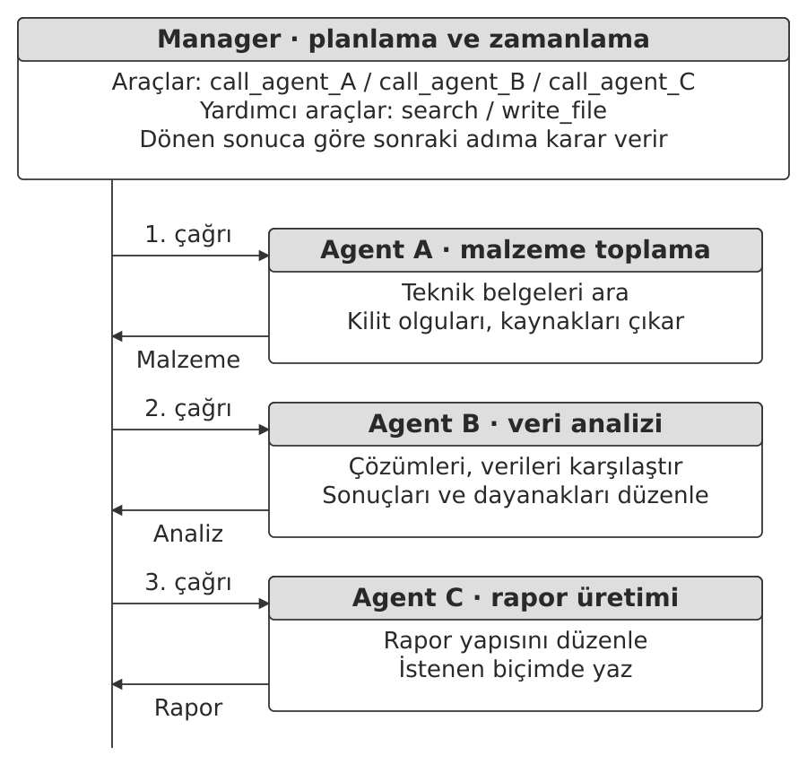

> **Deney 10-2 ★★: Kitap çevirisi Agent'ı**
>
> Teknik kitap çevirisi terimleri, bağlamı ve üslubu aynı anda ele almayı gerektirir. Örneğin İngilizce agent farklı biçimlerde çevrilebilir; çeviride bir karşılık üzerinde anlaşıldıysa sonraki bölümler de aynı karşılığı kullanmalıdır. Terim sözlüğü, bölüm özgün metinleri, çeviriler ve redaksiyon kayıtları açık bir biçimde düzenlenmelidir. Uzun bir kitap, ara çeviriler, araç sonuçları ve redaksiyon geçmişiyle birlikte context'te giderek daha fazla yer kaplar; model 9. bölüme geldiğinde 2. bölümdeki karşılığı unutmuş olabilir ya da aynı paragrafı tekrar tekrar kontrol edebilir. Görevi sorumluluklara ve bölümlere göre ayırmak her örneğin geçerli sorumluluğu için gereken malzemeye odaklanmasını sağlar.
>
> İş dört tür Agent'a dağıtılabilir:
>
> - **Glossary Agent: terimleri düzenler.** Kitabın tamamını partiler hâlinde okur, tekrar eden uzmanlık terimlerini tanır, uzmanlık sözlüklerine ve çeviri kurallarına başvurarak İngilizce terimi, Çince karşılığı, sözcük türünü ve kullanım bağlamını içeren bir JSON ya da CSV karşılık tablosu üretir. Terim sözlüğü paylaşılan alana kaydedilir, görev bittikten sonra bu örnek serbest bırakılır.
> - **Translation Agent: bölümleri çevirir.** Geçerli bölümü, ilgili terimleri ve çeviri kılavuzunu okur, hedef okura ve dil üslubuna göre çeviriyi tamamlar. Yeni ortaya çıkan terimler için aday karşılıklar önerir ve incelenmek üzere işaretler. Her örnek bağımsız bir context tutar, çeviriler paylaşılan alana kaydedilir; farklı bölümler bağımlılıklara göre ardışık ya da paralel işlenebilir.
> - **Proofreading Agent: metnin tamamını redakte eder.** Terim sözlüğüne ve bölüm çevirilerine göre karşılıkları, ifade tutarlılığını ve okunabilirliği kontrol eder. Bölüm bölüm okuma ve bölümler arası dizinle bütün metni kontrol eder; sorunun yerini, dayanağını ve değişiklik gereksinimini redaksiyon raporuna yazar.
> - **Manager Agent: görevleri düzenler ve toplar.** Hedefi, planı, görev durumunu, çağrı özetlerini ve ürün dizinini tutar; redaksiyon raporuna göre düzeltilmesi gereken bölümleri çevirmene geri verir ve yeniden kontrolü düzenler.
>
> Şekil 10-5'te redaktör bölüm çevirilerini ve terim sözlüğünü okur, Manager da rapora göre hangi bölümlerin düzeltilmesi gerektiğine karar verir. Düzeltme görevini alan çevirmen bu bölümün özgün metnini açıp işaretlenen kelimenin o cümlede ne anlama geldiğini kontrol edebilir.
>
> 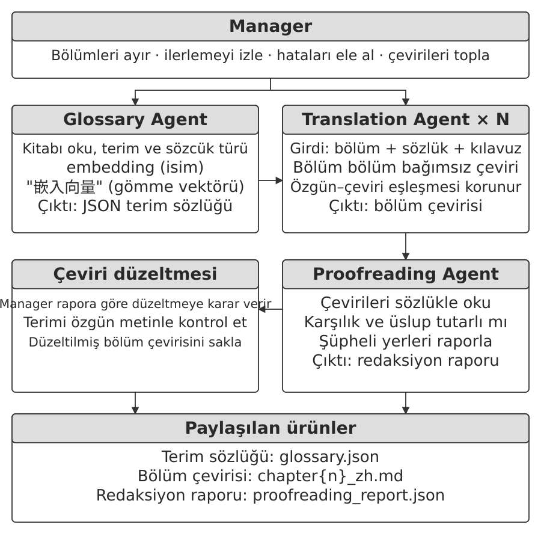
>
> Çeviri dosyaya yazıldıktan sonra hangi çağrının hâlâ uzun metin okuması gerekir? Eşlik eden deney İngilizce sürümün ilk iki bölümünü 26 çeviri birimine ayırdı. Tek Agent önceki özgün metinleri ve çevirileri baştan sona yanında taşıdı ve en büyük isteğinin girdisi 94.355 token oldu. İş bölümünden sonra çevirmenin en büyük girdisi yalnızca 2.857 token'dı, Manager düzeltme kararı verirken 2.153 token kullandı. Yönetici grubunda en çok girdiyi aslında terim düzenleyici kullandı: iki bölümü bir kerede okudu ve 49.807 token harcadı.
>
> Bu iki bölüm çevrildiğinde dört rol toplam 203.277 token, tek Agent ise 1.317.808 token kullandı. Hangi grup önce teslim etti? Dört rollü grup yaklaşık 271 saniye harcadı, tek Agent'tan yaklaşık 17 saniye fazla.
>
> Teslimatta iki kontrol aynı çeviri için farklı sonuçlar verdi. Terim sözlüğü `embedding` ismi için "嵌入向量" (gömme vektörü) karşılığını belirlemişti. Redaksiyon raporu düzeltilmesi gereken hiçbir bölüm listelemedi, ama terim kontrol programı bu kelimeye 0/2 verdi: iki bölümün çevirisinde de "嵌入" (gömmek) bulundu, "嵌入向量" hiçbirinde bulunmadı. İki bölüm de geri gönderilmeli mi?
>
> 1. bölümde iade politikasını anlatan paragrafta özgün metin `embedding the refund policy in the context`, çeviri ise "将退款政策嵌入上下文中" (iade politikasını context'e gömmek). Burada kastedilen politikayı context'e koymaktır; "gömme vektörü" olarak değiştirmek tam tersine hata yaratır. Programın bölüm bölüm dize araması redaktörün yeniden kontrol ipuçları bulmasına yardım eder; hangi yerin değiştirilmesi gerektiğine karar vermek için ise redaktörün o paragrafın özgün metnine de ihtiyacı vardır. Terim sözlüğü güncellendiğinde de önce etkilenen paragraflar bulunabilir, sonra özgün metin, çeviri ve yeni madde birlikte çevirmene verilir.
>
> **Deney gereksinimleri:**
> 1. Şekil ve kod içeren bir teknik kitap seçin.
> 2. Manager, Glossary, Translation ve Proofreading olmak üzere dört tür Agent'ı uygulayın.
> 3. Her üyenin context kullanımını, devir malzemelerini ve ürün sürümlerini kaydedin.
> 4. Tek Agent çözümüyle çeviri kalitesini, tamamlanma süresini ve kaynak tüketimini karşılaştırın; görev bölmenin ve context düzenlemenin etkisini analiz edin.

**Paralel koordinasyon.** Birbirinden bağımsız alt görevler aynı anda yürütülebilir. Manager görevleri dağıtmaktan, durumu almaktan ve sonuçlara göre devam etmeye, ek iş yapmaya ya da bitirmeye karar vermekten sorumludur. Bu kitabı çevirirken terim sözlüğü onaylanır onaylanmaz farklı bölümler birden çok çevirmene verilip aynı anda başlanabilir. Şekil 10-6 bir araştırma raporuna geçiyor: grafikler tamamlandı, analiz hâlâ sürüyor; biçim doğrulaması neden hâlâ beklemek zorunda? Üyelerin bildirdiği olaylar izlenerek son adımın hangi iki ürüne bağlı olduğu görülebilir.

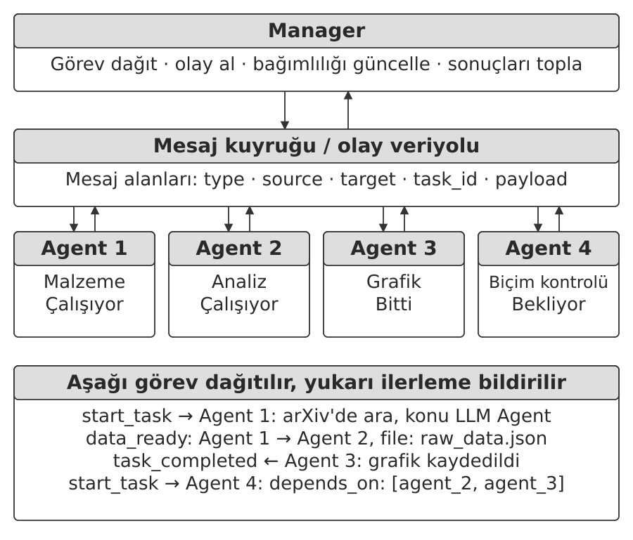

Mesaj veriyolu bu tür eş zamansız iletişimi düzenlemeye uygundur: üyeler ilerlemeyi ve sonuçları yayımlar, yönetici ilgili olaylara abone olur, çalışma zamanı da teslimattan, arabellekten ve yeniden denemeden sorumludur.

> **Ürün vakası: Lingtai (灵台)**
>
> Lingtai yerel olarak çalışan, kimliğini ve belleğini dosyalarda saklayan uzun ömürlü bir Agent sistemidir. Üç rol sunar: ana Agent (main agent) kullanıcıyla konuşur, planı ve belleği yönetir; daemon kapsamı net, kısa süreli paralel görevleri üstlenir ve bitirdikten sonra sonucu döndürür; avatar ise kendi belleğini, posta kutusunu ve sorumluluklarını korur ve oturumlar arası uzmanlık iş bölümünde kullanılır.
>
> Her rolün özel ve kalıcı bilgisi vardır, Markdown biçimindeki beceri el kitaplarını ise paylaşırlar. Context kapasite sınırına yaklaştığında rol "deri değiştirme" (molt) ile bir özet saklar, sonra kalıcı bellekle birlikte yeni bir context'e geçer. Kimlik, bellek ve beceriler dosyalarda bağımsız olarak saklanır; bu, alttaki model değiştirildikten sonra da çalışmanın sürmesini sağlar. Bu tasarım yöneticiyi, kısa süreli çalışanları, uzun ömürlü uzman üyeleri ve context sıkıştırmayı bir araya getirir.

> **Deney 10-3 ★★★: Kendi kendini düzenleyen telefon + bilgisayar Agent'ı**
>
> Bu deney Bölüm 6'daki Computer Use'u ses etkileşimiyle birleştirir. Kullanıcı bir kayıt ya da uçuş rezervasyonu sayfası verir; Computer Agent web sitesini açar, formu tanır, sonra Phone Agent aracılığıyla o anda eksik olan ad, kimlik numarası, iletişim bilgileri, adres ve tercihler gibi alanları toplar.
>
> **Roller ve devir.** Computer Agent tarayıcıyı kullanır ve bu seferki düzenlemeden sorumludur; Phone Agent ASR, LLM ve TTS ile kullanıcıyla gerçek zamanlı iletişim kurar ve sözlü yanıtları yapılandırılmış alanlara dönüştürür. İkisi noktadan noktaya araçlar ya da mesaj veriyolu üzerinden iletişim kurar; mesajlar gönderen, alıcı, tür ve içerik içerir. Computer Agent telefon görevini doğrudan devredebilir ve yönetici sorumluluğunu üstlenir. Kullanıcı bilgiyi sesle vermeye istekliyse Phone Agent art arda soru sorabilir, onaylayabilir ve yeniden sorabilir; Computer Agent ise sayfa durumuna ve alanları doldurmaya odaklanır.
>
> **İki çalışma kipi.** Sabit kipte iki Agent önceden başlatılır ve her biri bağımsız çalışma döngüsünü tutar; çift yönlü iletişimi ve eş zamanlı davranışı kontrol etmek için kullanılır. Özerk kipte önce Computer Agent başlatılır; model sayfaya, mevcut bilgiye ve görev ihtiyaçlarına göre `initiate_phone_call_agent(purpose, required_info)` çağırıp çağırmamaya karar verir. Ardından çalışma zamanı görev amacını, toplanacak alanları ve biçim kısıtlarını Phone Agent'a verir; başlatıldıktan sonra aynı iletişim mekanizması kullanılır.
>
> **Alanların tek tek akışı.** Şekil 10-7'de Phone Agent WebRTC üzerinden soru sorar, yanıtı çıkarır ve doğrular; geçerli değeri aldıktan sonra `info_collected` gönderir ve ardından bir sonraki kalemi sorar. Computer Agent aynı anda sayfayı okur, önceki kalemi doldurur ve `fill_error` ya da yeni sayfa durumunu geri iletir. Biçim uyumsuzluğu geri bildirimi `format_invalid` ile alanı ve gereksinimi belirtir; Phone Agent buna göre onaylar ya da yeniden sorar. Böylece "bir sonraki kalemi sormak" ile "önceki kalemi doldurmak" örtüşerek yürütülebilir.
>
> **Tamamlanma ve istisna yönetimi.** Phone Agent alanları topladıktan sonra bilgi toplama alt görevinin bittiğini belirten `task_completed` gönderir. Computer Agent zorunlu alanları, sayfa doğrulama sonuçlarını ve gönderim yetkisini kontrol etmeyi sürdürür, sonra form işlemini tamamlar. Yeniden deneme sayısı aşıldığında, sayfa anormalliğiyle karşılaşıldığında ya da kullanıcı durmayı istediğinde görev duraklatılır ve geçerli ilerleme açıklanır; bitişte hâlâ çalışan karşı taraf iptal edilir, tarayıcı oturumu, ses parçası ve görüşme kapatılır. Gerçek kişiyle sesli etkileşim ve form gönderimi için kullanıcının onayı ve yetkisi ayrı ayrı alınır.
>
> 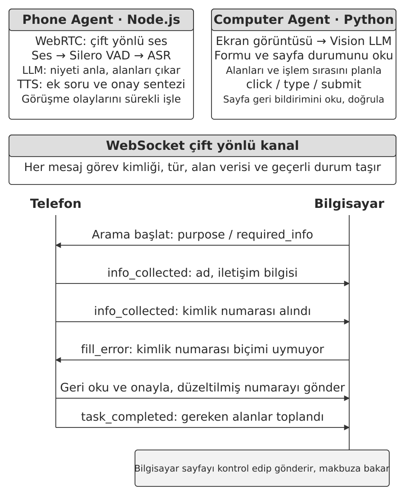
>
> **Deney gereksinimleri:**
> 1. İki bağımsız Agent'ı ve çift yönlü yapılandırılmış iletişimi uygulayın.
> 2. Sabit kipte ve özerk kipte zaman sıralamasını kaydedin, sorma ile doldurmanın örtüştüğü aralıkları kontrol edin.
> 3. Biçim doğrulamasını, yeniden sormayı, sayfa hatası geri bildirimini, zaman aşımını ve kaynak temizliğini uygulayın.
> 4. İki kipin başlatma kararlarını, gecikmesini, başarı oranını ve kaynak tüketimini karşılaştırın.

> **Deney 10-4 ★★★: Birden çok web sitesinden aynı anda bilgi toplayan Agent**
>
> Bu deney paralel arama yapan birden çok eş yapılı Agent kullanır ve Bölüm 6'daki olay güdümlü ve kesme mekanizmalarını alıştırır. Görev, bir üniversitenin birden çok fakülte web sitesinde belirli bir öğretim üyesini, örneğin "Zhang Wei"yi bulmak ve fakülteyi, unvanı, araştırma alanını ve kaynak sayfayı döndürmektir. Aramadan önce adaşları ayırt etmek için ad, disiplin ve kişisel sayfa bilgisi gibi tanıma koşulları kararlaştırılır.
>
> **1. Paralel başlatma.** Manager her biri bir fakülte web sitesinden sorumlu 10 Computer Use Agent oluşturur. Her örnek bağımsız bir context ve tarayıcı oturumu tutar; eş zamansız görevler, iş parçacıkları ya da süreçlerle zamanlanabilir. Girdi web sitesi URL'sini, hedef adı, eşleşme koşullarını ve yönlendirme için görev tanımlayıcısını içerir.
>
> **2. İlerlemenin toplanması.** Üyeler düzenli olarak "web sitesi yükleniyor", "öğretim üyesi listesi okunuyor", "kontrol edildi, eşleşme yok", "adaş öğretim üyesi bulundu" gibi durumlar gönderir. Manager mesaj veriyolu üzerinden bir görev tablosu tutar; çalışan, tamamlanan, engellenen ve başarısız olanları ayrı ayrı kaydeder, kaynakları ve hata nedenlerini saklar.
>
> **3. Doğrulamadan sonra diğer dalları iptal etmek.** Fizik fakültesinden sorumlu `agent_3`'ün adaş bir öğretim üyesi bulduğunu varsayalım; öğretim üyesi bilgisini ve kaynağı içeren yükle `target_found` gönderir. Görev doğrulanmış kişi bilgisinin döndürülmesini istiyorsa Manager önce eşleşme koşullarını ve kanıtı kontrol etmeli, hedef kişinin bulunduğunu onayladıktan sonra sonucu atomik bir işlemle kaydetmeli, ardından çalışan diğer üyelere benimsenen bilginin `agent_3`'ten geldiğini belirten `terminate` göndermelidir. Üyeler güvenli bir noktada durur, kaynakları temizler ve onay döndürür; Manager onayı ya da zaman aşımını bekledikten sonra toplamayı tamamlar. Görev bütün adaşların listelenmesini istiyorsa gereken kapsam kontrol edilene kadar arama sürdürülür.
>
> **Yarış koşulu.** Agent A ve B neredeyse aynı anda geçerli sonuç döndürebilir. İki olay ayrı ayrı toplamayı tetiklerse yinelenen teslimat ya da durum çakışması olur. "Aranıyor → sonuç kaydedildi" durum geçişi bir kilit ya da işlemle korunabilir; sonra gelen olay zaten kaydedilmiş sonucu okur. Mesaj yeniden denemeleri de olay tanımlayıcısına göre ayıklanmalıdır ki iptal ve toplama tekrar tetiklendiğinde tutarlılık korunsun.
>
> **4. İstisnalar ve kapsam.** Ağ kesintileri, sayfa yapısı değişiklikleri ve ayrıştırma hataları ayrı ayrı kaydedilir. Tek bir görev için iki dakika gibi bir zaman aşımı bütçesi belirlenebilir; süre aşılınca yürütme iptal edilir ve tanı bilgisi toplanır, diğer üyeler çalışmayı sürdürür. Son rapor "kontrol edildi ve bulunamadı" ile "erişim başarısız, kontrol henüz tamamlanmadı" durumlarını ayırır ve kapsanan fakülteleri de belirtir.
>
> Şekil 10-8 bu mesajları bir dizi örnek zamanla birbirine bağlıyor. 3 numaralı üyenin fizik fakültesinde kuantum hesaplama üzerine çalışan Profesör Zhang Wei'yi bildirdiğini varsayalım; Manager önce kaynak web sayfasının adı, bölümü, unvanı ve alanı doğrulayıp doğrulamadığına bakmalıdır. Adaş öğretim üyesi ipucunu almak, onun hedef kişi olduğunu onaylamak ve bütün iptal onaylarını toplamak üç ayrı andır.
>
> 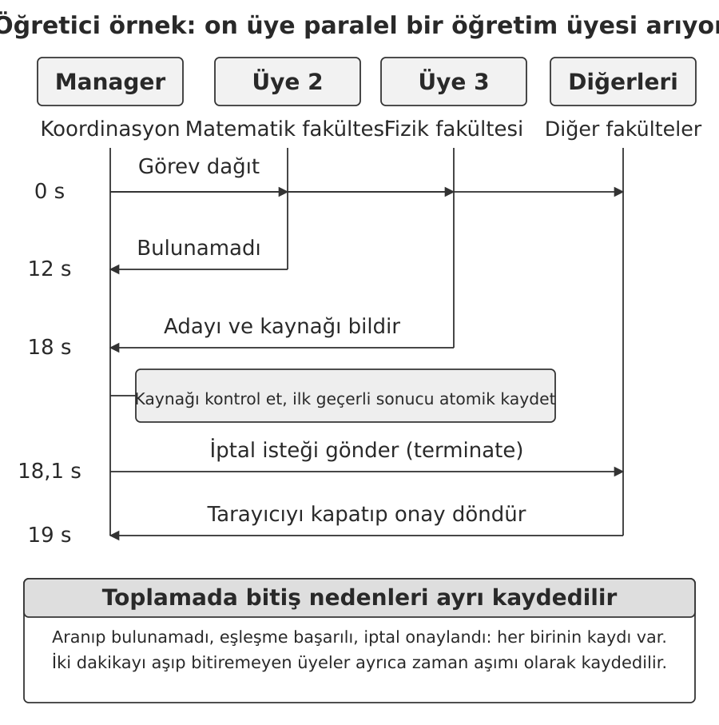
>
> Gerçek çalıştırmada aranan kişi Andrew Ng'ydi. Üyeler önce sayfa metninde bu adın geçip geçmediğine baktı, eşleşme olursa ancak o zaman modelden bilgi çıkarmasını istedi. Stanford HAI sayfası seçildi; döndürülen kısa alıntı adı ve yardımcı öğretim üyesi kimliğini doğrulamaya yetiyordu. Araştırma alanını doğrulamak için ise sayfanın ilerisinde derin öğrenmeyi anlatan paragrafın da okunması gerekiyordu. Birkaç üye aynı anda `target_found` döndürse bile sonucu yalnızca kilidi ilk alan üye kaydedebildi.
>
> Bu çalıştırmada ardışık arama ancak on URL'nin sonuncusunda eşleşme buldu ve 44,971 saniye sürdü; aynı sayfaları paralel aramak 24,022 saniye sürdü ve her birinin on tarayıcı context'i kapatılmıştı. İki sayının oranı 1,872. HAI sayfası ilk sıraya konsaydı ardışık arama eşleşme bulunca durabilirdi; süre yeniden ölçülmelidir. İptali sınamak için yapılan başka bir çalıştırma dört dal başlattı: bir dal önce sonucu kaydetti, diğer üçü iptal isteğini aldıklarını onayladı ve sonunda dört tarayıcı context'inin hepsi kapandı.
>
> **Deney gereksinimleri:**
> 1. Paralel üyeleri dinamik olarak oluşturan Manager'ı uygulayın.
> 2. browser-use gibi projelerle tarayıcı yürütme yeteneğini kurun.
> 3. Çift yönlü iletişimi ve durum yönetimini mesaj veriyolu üzerinden tamamlayın.
> 4. Arama sonucunu doğrulayın, sonucu atomik bir işlemle kaydedin ve kalan dalları iptal ettikten sonra onayları toplayın.
> 5. Erişim başarısızlığı, ayrıştırma hatası, zaman aşımı ve eşleşme olmaması durumlarını ele alın.
> 6. Paralel ve ardışık yürütmenin tamamlanma süresini, kapsamını ve kaynak tüketimini karşılaştırın.

**Yöneticinin iş akışı üretmesi.** Görevleri tek tek devretmenin yanı sıra Manager görev bağımlılıklarını ve toplama kurallarını önce bir program olarak yazıp zamanlamayı çalışma zamanına da bırakabilir. Model süreci tasarlar, program da üyeleri kararlaştırıldığı gibi başlatır, sonuçları aktarır ve bağımlılıkları bekler. Bağımlılık ilişkileri zaten açıksa ve aynı türden süreçlerin tekrar tekrar çalışması gerekiyorsa yazar bu yolu tercih eder. Her dağıtımda Manager'ı çağırma maliyetini ortadan kaldırır, yönetim context'inde biriken zamanlama kayıtlarını da azaltır.

Claude Code'un dinamik Workflow aracı böyle bir uygulama sunuyor. `agent()` bağımsız context'li bir alt Agent oluşturur ve yapılandırılmış çıktıyı bir schema ile belirleyebilir; `parallel()` bir grup görevi eş zamanlı yürütür ve hepsinin bitmesini bekler; `pipeline()` her girdinin birden çok aşamadan ayrı ayrı geçmesini sağlar, bir kalem bir sonraki aşamaya geçtiğinde diğer kalemler önceki aşamada işlenmeyi sürdürebilir. Ara sonuçlar program değişkenlerinde saklanır, süzme ve birleştirme sıradan kodla yapılır.[^dynamic-workflows]

Örneğin teknik bir metindeki yedi grup olgu doğrulanırken önce yönlere göre araştırma Agent'ları başlatılabilir, sonra her grubun sonucu paralel kontrol için ayrı ayrı doğrulama Agent'larına verilir. Dönen her sonuç kaynağını ve karar dayanağını korur; bütün dallar bittikten sonra toplama Agent'ı son raporu düzenler. Böylece "araştırma—tek tek doğrulama—birleşik toplama" iş bölümü ve aşama bağımlılıkları iş akışına yazılmış olur.

[^dynamic-workflows]: Anthropic, “Orchestrate subagents at scale with dynamic workflows”, 2026.

### Merkeziyetsiz kalıp

Manager varken üyelerin kime başvuracaklarına neden kendilerinin karar vermesi gereksin? Test uzmanının yeni yazılmış bir modülü aldığını ve ürün gereksinimleri ile arayüz anlaşmasının aynı alan için iki farklı yorum içerdiğini fark ettiğini düşünün. Test uzmanı çelişkiyi doğrudan ürün ve mimari rollerine götürebilir, iki tarafın da dayanaklarını açıklamasını sağlayabilir ve anlaşma düzeltildikten sonra teste devam edebilir. Bu hem iş bölümü hem de bir tür denge-denetim mekanizmasıdır. Mühendisin modülü teslim etmesi, mimarın ürünün görüşünü alması, test uzmanının itiraz etmesi; her biri bir sonraki adımı başlatabilir. Sık sık müzakere gerektiğinde her kalem için Manager'ın aktarmasını beklemek işi geciktirir.

Mikro hizmet terminolojisini ödünç alırsak adımları bir merkezin düzenlemesine **orkestrasyon** (orchestration), tarafların kararlaştırılmış olaylara göre işi kendiliğinden devralmasına **koreografi** (choreography) denir. Bir pratik fark daha vardır: her devir Manager'ı beklemek zorundaysa onun model hizmeti yanıt vermeyi bıraktığı anda diğer üyeler hâlâ çalışabilir durumda olsa bile bir sonraki görevi alamaz. Dağıtık koordinasyon bu bağımlılığı azaltır; ama işi devralacak üyenin kendisi bir araç çağrısında takılırsa başka bir üyenin nereden devam edeceğini bilmesi için yine kalıcı olarak saklanan görev durumuna, zaman aşımına, yeniden denemeye ve devralma mekanizmalarına ihtiyaç vardır.

Aşağıdaki üç tasarımın her biri bir devir biçimi kullanıyor: ürünlere göre mesajlara abone olmak, grup sohbetinde bir sonraki konuşmacıyı seçmek ya da geçerli üyenin adıyla devretmesi.

**MetaGPT: ürün devrini SOP ile düzenlemek.** MetaGPT işi yazılım ekiplerinin standart çalışma prosedürüne (SOP) göre böler. Ürün yöneticisi gereksinim belgesini (PRD), mimar tasarım belgesini, mühendis kodu, test uzmanı da test raporunu teslim eder. Bir sonraki üye kararlaştırılan malzemeyi alır almaz işe başlayabilir, önceki üye de görevi tekrar tekrar açıklama zahmetinden kurtulur. Şekil 10-9'daki bağlantılar bu ürünlerin devir ilişkilerini gösteriyor.[^metagpt-design]

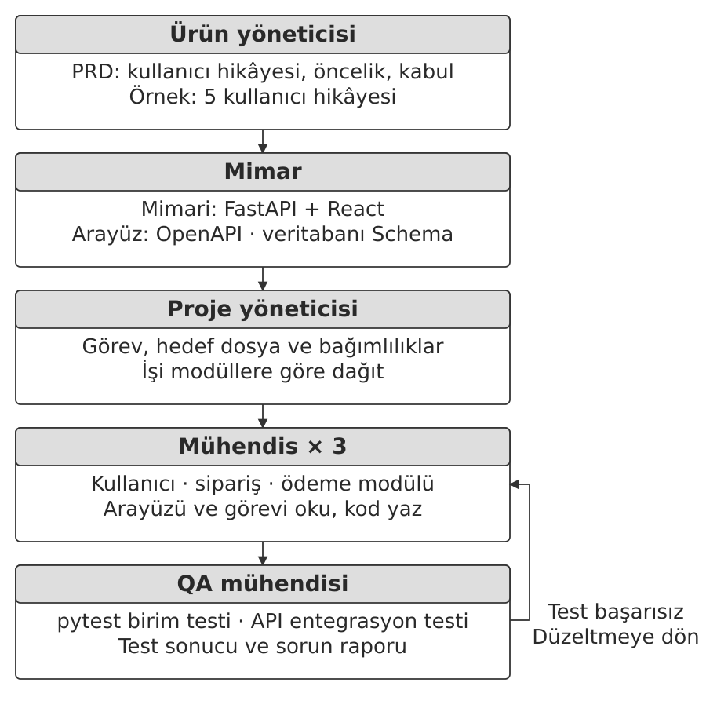

Her rol devir sırasında hangi bilgileri tamamlamalıdır?

- **Product Manager Agent** gereksinimleri alır, PRD'yi düzenler; işlevleri, kullanıcı hikâyelerini, kabul ölçütlerini ve öncelikleri netleştirir.
- **Architect Agent** PRD'yi okur, teknoloji yığınını seçer, modülleri ayırır, arayüzleri ve veri modellerini tanımlar ve tasarım belgesini oluşturur.
- **Project Manager Agent** tasarıma göre görevleri ve dosya iş bölümünü ayırır, bağımlılıkları düzenler ve mühendislerin yürütmesini planlar.
- **Engineer Agents** tasarıma göre modülleri uygular ve kodu gönderir; birbirinden bağımsız kısımlar birden çok örneğe verilebilir.
- **QA Engineer Agent** koda ve gereksinimlere göre testler üretir, kontrolleri yürütür, sorunları kaydeder ve test raporunu oluşturur.

Bu roller için bir devir biçimi tasarlanacaksa yazar üç şeyin açıkça yazılmasını önerir: görev ve kabul ölçütleri, onaylanmış olgular ve kısıtlar, yapılandırılmış ürünlere referanslar. Alıcı taraf buna göre gereken malzemeyi alır, çalışmayı sürdürür ve bilgi eksik olduğunda somut sorular sorar.

MetaGPT bilgiyi paylaşılan bir mesaj havuzu ve abonelik mekanizmasıyla düzenler: roller mesaj yayımlar, diğer roller ilgilendikleri mesaj türlerine göre ilgili girdileri işler. Yayımcılar ve tüketiciler ürün biçimi ve mesaj anlamıyla bağlanır; bu yüzden modeller ayrı ayrı değiştirilebilir ya da iç uygulamalar ayarlanabilir.

SOP ürün gereksinimleri, mimari ve kod arasındaki bağımlılıkları, mesaj aboneliği ise bu işlerin nasıl tetiklendiğini tanımlar. Sabit görev bağımlılıkları da dağıtık olaylarla ilerletilebilir; ikisi birlikte sistemin iş birliği biçimini oluşturur. Dinamik geri bildirim tasarlanırken test uzmanının gereksinimleri ürün rolüyle netleştirmesi, mühendisin mimara alternatif önermesi gibi yollar eklenebilir ve bu etkileşimler için kabul koşulları ve bitiş kuralları belirlenebilir.

[^metagpt-design]: Hong, S., et al. *MetaGPT: Meta Programming for A Multi-Agent Collaborative Framework.* ICLR 2024.

**AutoGen grup sohbeti: paylaşılan oturumda konuşma zamanlaması.** Klasik GroupChat tasarımında birden çok Agent aynı oturuma katılır; GroupChatManager bir sonraki konuşmacıyı seçer ve mesajları üyelere yayınlar. Seçim stratejisi sırayla dönmek olabilir ya da model geçerli içeriğe göre karar verebilir. Üyeler kendi rol yapılandırmalarını korur ve ortak oturum üzerinden iletişim kurar; konuşma zamanlaması ise yöneticide toplanır. Bu, context düzenlemesi ile denetim yapısının birleştirilmesine bir örnektir.[^autogen-groupchat]

[^autogen-groupchat]: Microsoft, *AutoGen 0.2: Conversation Patterns.*

**OpenAI Swarm: denetimi handoff boyunca devretmek.** Swarm rollere talimatlar ve araçlar yapılandırır; bir rol yapılandırılmış devretme işlevini çağırdığında çalışma zamanı hedef Agent'a geçer. Yönlendirme kararı her rol tarafından verilebilir ve birleşik bir çalışma döngüsü tarafından yürütülür. Devirde geçerli sistem talimatı rolle birlikte değişir, konuşma geçmişi korunur. Bu, "rolün bir sonraki devralanı seçmesi" ile "oturum geçmişini sürdürmenin" birleşimini gösterir.[^swarm-handoff]

Bağımsız context'li devir kullanılıyorsa ayrıca bir görev paketi tanımlanabilir: `task_id` görevi tanımlar, `sender` ve `recipient` iki tarafı belirtir, `goal` ve `constraints` hedefi ve kısıtları açıklar, `accepted_facts` onaylanmış olguları saklar, `artifact_refs` ürün referanslarını verir, `remaining_budget` bütçeyi kaydeder, `visited_agents` de ziyaret zincirini saklar. Alıcı malzemeyi yetkisine göre okur, çalışma zamanı da bütçeyi ve devir kayıtlarını tutar.

Devir zinciri tekrarlanan ziyaretleri ele almalıdır. Örneğin geliştiricinin kodu denetçiye vermesi, denetçinin değişiklik önerip geri vermesi normal bir düzeltme döngüsüdür. İlerleme olup olmadığına görev durumu, ürün sürümü, çözülmemiş sorunlar ve tekrar sayısı birlikte değerlendirilerek karar verilebilir. Örneğin aynı çeviri art arda iki kez geri verilmiş olsun: ilkinde kaynak eklenmiş, ikincisinde bir terim düzeltilmişse düzeltme hâlâ ilerliyor demektir; iki seferde de aynı sürüm geri verilmiş ve aynı sorun gösterilmişse düzeltme takılmış demektir. Bu durumda devretmeyi sürdürme sayısı sınırlanabilir ve çözülmemiş sorunlar sorumluya bildirilir.

[^swarm-handoff]: OpenAI, *Swarm*, “Instructions” ve “Handoffs and Updating Context Variables”.

> **Ürünlerde Agent Swarm**
>
> "Agent Swarm" farklı örgütlenme biçimlerini ifade edebilir. Bir tür denetimi handoff ağı boyunca devreder; OpenAI Swarm, LangGraph'ın swarm kütüphanesi ve Microsoft Agent Framework'ün handoff orkestrasyonu gibi. Diğer tür bir ana Agent ile paralel çalışanlar kullanır; örneğin Kimi Agent Swarm, Anthropic'in çoklu Agent araştırma sistemi ve Manus Wide Research.
>
> Kimi K2.5'in getirdiği Agent Swarm, düzenleyiciyi paralel Agent pekiştirmeli öğrenmesiyle eğitir; görevi ne zaman böleceğini ve işi nasıl dağıtacağını öğrenir ve en fazla 100 alt Agent'ı destekler. Sonraki sürümler ölçeği 300'e çıkardı, K3 Swarm da büyük ölçekli arama ve toplu işleme için kullanılmayı sürdürüyor. AgentENV ise Kimi K3'ün Agent pekiştirmeli öğrenmesi için ölçeklenebilir bir ortam sağlar; anlık görüntü ve çatallamayı destekler ve paralel yürütmeyi düzenlemek için kullanılır.[^ch10-kimi-swarm]

**Aynı makinedeki birden çok Agent örneği.** Birden çok örnek farklı görevler üstlenip aynı dosyaları, araç hizmetlerini ya da GPU'yu paylaşabilir. Bu durumda iletişim değişiklik kapsamını açıklamak, kaynakların serbest bırakıldığını bildirmek ya da yürütme sırasını müzakere etmek için kullanılabilir. Örneğin iki örneğin de bir GPU'ya ihtiyacı olduğunda önce görev ve tahmini kullanım kaydedilir, sonra kaynak yöneticisi kullanım hakkını verir.

Claude Code'un Agent Teams özelliği ekip üyelerinin keşfini, mesajlaşmayı ve paylaşılan görev yönetimini sağlar. Üyeler kurulmuş ekip kapsamında birbirlerinin bilgisini alır, iletişimi çalışma zamanı düzenler.[^claude-agent-teams] Aynı makinede iş birliğini kendiniz kurarken Bölüm 4'teki `list_agents` gibi arayüzleri de kullanabilir, keşif kapsamı, erişim yetkileri ve kaynak sahipliği için açık kurallar koyabilirsiniz. Mesajlardaki müzakere sonuçları da kilitler, kotalar ya da zamanlayıcı tarafından uygulanır.

[^ch10-kimi-swarm]: Moonshot AI, *Kimi Agent Swarm: 100 Sub-Agents at Scale*, Agent Swarm yardım belgeleri ve AgentENV proje açıklaması.

[^claude-agent-teams]: Anthropic, *Orchestrate teams of Claude Code sessions.*

### Kurumlar arası iş birliği: A2A protokolü

İş birliği hizmet ya da kurum sınırlarını aştığında iki tarafın yetenek keşfi, kimlik doğrulama, istek biçimi, ilerleme ve sonuç teslimatı üzerinde anlaşması gerekir. Google'ın 2025'te yayımladığı **A2A** (Agent2Agent) protokolü böyle bir birlikte çalışabilirlik arayüzü sunar; daha sonra Linux Vakfı'nın himayesine verildi. Üç açıdan anlaşılabilir.[^a2a-concepts]

- **Yetenek keşfi.** Agent Card kimliği, hizmet uç noktasını, becerileri, girdi-çıktı kiplerini ve kimlik doğrulama gereksinimlerini tanımlayan bir üst veri belgesidir. Çağıran taraf buna göre karşı tarafın görevi işleyip işleyemeyeceğine ve bağlantının nasıl kurulacağına karar verir.
- **Görevler ve mesajlar.** Task, tanımlayıcısı ve yaşam döngüsü olan bir işi temsil eder; çağıran taraf gönderildi, işleniyor, girdi gerekiyor, tamamlandı ya da başarısız gibi durumları izleyebilir. Message görev gereksinimlerini, ek bilgileri ve yanıtları taşır; Artifact belgeleri, görüntüleri ya da yapılandırılmış sonuçları teslim eder. Mesajlardaki ve ürünlerdeki Part metin, dosya referansı ya da veri içerebilir.
- **Arayüze göre iş birliği.** Çağıran taraf uzak tarafla bu açık nesneler üzerinden iletişim kurar; uzak taraf iç istemlerini, belleğini ve araçlarını bağımsız yönetir. İki taraf kimlik doğrulamayı, yetkilendirmeyi ve veri erişim kapsamını ayrı ayrı uygular.

Uzun görevler durumu yoklamayla alabilir, SSE ile akış güncellemeleri alabilir ya da destekleniyorsa anlık bildirimler kullanabilir. Kullanıcı bilgi ekledikten sonra istemci aynı görevi ilerletmeyi sürdürür ve son ürünü görev durumuna göre alır.

Bölüm 4'teki MCP, model uygulamalarına araç, kaynak ve istem arayüzleri sağlamaya odaklanır; A2A ise Agent hizmetleri arasındaki görev iş birliğine odaklanır. İkisi birleştirilebilir: bir Agent araçları MCP üzerinden kullanırken uzak görevleri A2A ile devredebilir. Aynı ekip içinde zaten kararlı arayüzler varsa yazar önce araç çağrısını, paylaşılan dosyaları ve mesaj veriyolunu kullanmayı sürdürür. Bağımsız olarak bakılan Agent hizmetlerine bağlanmak, yetenek keşfini ve görev yaşam döngüsünü birleştirmek gerektiğinde A2A'yı getirir; kurumlar arası durumda ayrıca kimlik, yetki ve veri yönetişimi kurallarını yapılandırır.

[^a2a-concepts]: A2A Project, *Core Concepts and Components in A2A.*

**Farklı kişiler adına zaman ayarlamak.** Bir ailenin üç üyesinin her birinin kendi takvim asistanı var ve birlikte akşam yemeği ayarlamak istiyorlar. Sahibinin bütün takvimini okuyabilen bir asistan diğer ikisine nasıl yanıt vermeli? "Salı uygun değil, çarşamba biraz kaydırılabilir" yanıtı zaten yararlı bir ayrım sunuyor. Takvimi doğrudan iletmek salı günkü özel işleri gereğinden fazla açığa çıkarır; yalnızca "iki gün de doluyum" demek ise diğerlerinin çarşamba için hâlâ konuşma payı olduğunu bilmesini engeller. Her seferinde bir buluşma ayarlanabilse bile hep aynı kişi programını değiştiriyorsa bu düzen onun için pek de kârlı olmayabilir.

CalBench'in açık sorularından biri beş kişiden her birine üç kişinin katıldığı beş toplantı ayarlamasını istiyor. Bazılarının belirli bir zaman dilimi kesinlikle kaydırılamaz, bazı özel işler ertelenebilir; soru her ertelemenin bedelini belirliyor. Önce basit bir yöntem deneyelim: beş toplantı sırayla ele alınır, her seferinde en erken zaman diliminden başlanarak aranır, üç kişi de zaman açabiliyorsa toplantı ayarlanır; zaten ayarlanmış toplantılar korunur. Sonra başka bir yöntem deneyelim: beş toplantı bir arada ele alınır ve bütün takvimlerle çözülür. Aşağıda sorunun zaman dilimi numaralandırması kullanılıyor ve 0'dan sayılıyor.[^ch10-calbench]

| Düzenleme | 1.–5. toplantıların zaman dilimleri | Her toplantı için ödenen erteleme bedeli | Toplam bedel |
|---|---|---|---:|
| Her toplantıya açılabilen en erken dilim seçilir, ayarlanmış toplantılar korunur | 0, 2, 1, 3, 6 | 1, 20, 20, 12, 300 | 353 |
| Başvuru çözücüsü beş toplantıyı birlikte planlar | 13, 3, 10, 9, 12 | 0, 1, 0, 1, 1 | 3 |

İki program da üç katılımcının son takvimlerinde toplantı toplantı hizalanabiliyor. En büyük fark son toplantıda: birinci yönteme göre 6. dilim açılabiliyor, ama üç kişinin her birinin bedeli 100 olan bir işini kaydırması gerekiyor. 12. dilime konduğunda yalnızca bir kişinin bedeli 1 olan bir işini kaydırması yetiyor. Bütünsel sonuç değerlendiriciye karşılaştırma için bir dayanak sağlar; müzakereye gerçekten katılan asistanların her biri ise yalnızca kendi sahibinin takvimini görebilir.

Bu sürümle gelen açgözlü çözücü 146 bedel bildirdi ve beş toplantının hepsi için zaman dilimi döndürdü. Ancak sonraki toplantıları yerleştirirken önceki toplantıların bazı katılımcıların takviminden kaldırılmasına izin verdi. Birinci toplantı sonunda üç katılımcının takviminde sırasıyla 7, 0 ve 11 numaralı dilimlere düştü. "Üç kişinin son takvimi aynı toplantıyı aynı dilimde kaydediyor" ölçütüyle kabul yapıldığında yalnızca üçüncü, dördüncü ve beşinci toplantılar başarılı.

Gerçek randevu hizmetleri zamanlama sorularında verilmeyen bilgilerle de karşılaşır. Microsoft'un Calendar.help hizmeti bir yıl içinde e-postayla binlerce toplantıyı koordine etti. Bir e-posta yeni bir toplantı mı ayarlıyor, yoksa önceki toplantıyı mı değiştiriyor? Otomatik sınıflandırma emin olamadığında e-postayı önce bir insan görür ve yalnızca bu tek karar sorusuyla ilgilenir. Yalnızca gelen e-postaya bakarak yanıtlanamıyorsa görev, yazışmaları, toplanmış bilgileri ve anonimleştirilmiş takvimleri görebilen zamanlama personeline verilebilir. Bu tasarım "kimden karar istenmeli" ile "bu kişinin ne kadarını görmesi gerekir" sorularını birbirine bağlar.[^ch10-calendar-help]

[^ch10-calbench]: CalBench makalesi koordinasyon maliyetini, adaleti, çıkarsanabilir takvim durumunun ve somut iş içeriğinin sızmasını ayrı ayrı tartışıyor. Sayılar `86f8123` sürümündeki farklı erteleme bedelli soru kümesinin ilk sorusundan alınmıştır; birinci yöntem seçim yaparken herhangi bir katılımcının mevcut toplantısı olan dilimleri atlıyor, gerisi yazarların taşıma kurallarını izliyor. Bir zamanlama çözücüsüyle yeniden hesaplanabilir.

[^ch10-calendar-help]: Cranshaw ve diğerleri, Calendar.help'in tasarımı ve dağıtımı; insanın işlediği mikro görevler ile tam zamanlama görevleri için iki katmanlı arayüz açıklamasına bakın.

## Çoklu Agent iş birliğinin başarısızlık kalıpları

Birden çok üye görevi birlikte yürüttüğünde arızalar roller, devirler ve doğrulama arasında ortaya çıkabilir. *Why Do Multi-Agent LLM Systems Fail?* çalışması yaklaşık 150 iz üzerinden bir başarısızlık sınıflandırması kurdu, etiketleme uyumu κ 0,88 oldu, ardından analizi yedi çerçeveye genişletti. Araştırma 14 başarısızlık kalıbını üç sınıfta topladı:[^mast-failures]

- **Sistem tasarımı sorunları:** rol sorumluluklarında, arayüzlerde, araç yapılandırmasında ya da durma koşullarında boşluklar.
- **Üyeler arası iş birliği sapmaları:** hedefin farklı anlaşılması, bilgi devrinin eksik olması ya da eylemlerin birbiriyle çelişmesi.
- **Görev doğrulama sorunları:** erken bitirme, kontrolleri atlama ya da tamamlanmayı uygunsuz ölçütlerle yargılama.

Makale bir satranç programı örneği veriyor. ChatDev'in ürettiği kod derleniyordu, denetimden de geçti; ama gerçek satranç kurallarıyla oynandığında program hata verdi. Derleyici kodun derlenip derlenmediğini kontrol eder; hamlelerin kurallara uygun olup olmadığını kontrol etmek için birkaç hamle oynamak gerekir. Başka bir karşılaştırmada araştırmacılar ChatDev'in denetim görüşlerinin değişiklik için geri gönderilebilmesini sağladı; teknik denetimden sorumlu rol onayladıktan sonra süreç bitiyordu ve en fazla kaç tur yineleneceği belirlendi. ProgramDev-v0'ın 32 görevinde özgün süreç 8 görevi, ayarlanmış süreç 13 görevi geçti; başarı oranı %25,0'ten %40,6'ya çıktı, fark yaklaşık 15,6 yüzde puanı.[^mast-failures]

[^mast-failures]: Cemri, M., et al. *Why Do Multi-Agent LLM Systems Fail?* 2025.

"Denetçi yanıt vermedi" ile "denetçi yanıt verdi ama yargısı yanlış" nasıl ayırt edilir? Dağıtık sistemlerde bir bileşenin çalışmayı bırakmasına çökme arızası denir. Bizans arıza modeli ise bileşenlerin keyfî biçimde yanlış ya da birbiriyle çelişen sonuçlar vermesine de izin verir. Agent da yarı yolda durabilir ya da her zamanki gibi yanlış bir sonuç döndürebilir. İlki algılama, toparlama ve devralma gerektirir; ikincisi kanıt doğrulaması, yetki kısıtları ve hata yalıtımı gerektirir. Olağan kalp atışı Agent'ın hâlâ çalışıp çalışmadığına karar vermeye yardım eder; döndürdüğü sonucun doğru olup olmadığı ise gerçek sonucun kontrol edilmesini gerektirir. Çapraz kontrol ve oylama sonuç değerlendirmesinde kullanılabilir; güvenilirlikleri kanıtın kalitesine ve üyelerin hatalarının birbiriyle ne kadar ilişkili olduğuna bağlıdır. Resmî protokoller ayrıca en fazla kaç arızalı düğümün tolere edilebileceğini ve düğümlerin nasıl iletişim kuracağını belirler.

### Birinci başarısızlık kalıbı: paylaşılan dosya sisteminde eş zamanlılık çakışmaları

Paylaşılan ürünler üyelerin işi devralmasını sağlar, ama eş zamanlı değişiklik sorununu da getirir. Önce iki düzey ayırt edilebilir.

**Dosya düzeyinde çakışma** iki üye aynı dosyayı değiştirdiğinde olur: ikisi de eski sürümü okur, sırayla geri yazar, sonraki yazma öncekinin sonucunun üzerine yazar.

**Anlamsal çakışma** ilişkili ürünler arasında olur. Örneğin Agent A kitabın bütün şekil numaralarını yeniden düzenlerken Agent B aynı anda bölümleri değiştiriyor ve özgün numaralara atıf yapıyor olsun. İkisi farklı dosyaları değiştirdiği için birleştirmede metin çakışması çıkmayabilir, ama sonunda şekiller ile metin arasındaki eşleşme bozulmuş olur.

Terim sözlüğünün geçerli sürümü 7 olsun. A da B de 7. sürümden değişiklik yapmaya başlar; A önce gönderir ve sürüm 8'e yükselir. B teslim ederken yalnızca "bu tabloyu yaz" derse A'nın değişikliğinin üzerine yazılabilir; "yalnızca geçerli sürüm hâlâ 7 ise yaz" derse program birleştirme gerektiğini fark edebilir. Dosya düzeyindeki eş zamanlılık için **iyimser kilitleme** kullanılabilir: okurken sürüm numarası kaydedilir, gönderirken sürüm kontrolü ve yazma tek bir atomik işlem olarak yapılır; sürüm değişmişse eski gönderim reddedilir, yeniden okunur ve birleştirilir.

Dosyalar arası anlamsal tutarlılık ilişkilerin kontrol edilmesini gerektirir. Birden çok Coding Agent aynı depoyu değiştirdiğinde yazar her üyeye öncelikle bağımsız bir worktree ve dal ayırır, her biri kendi commit'lerini oluşturur, sonra birleştirme noktasında çakışmalar kontrol edilir, testler çalıştırılır ve arayüzler doğrulanır. Yalnızca ayrı bir dal oluşturmak, aynı anda olan dosya değişikliklerini yalıtmak için yine bağımsız bir çalışma diziniyle birlikte kullanılmalıdır.

### İkinci başarısızlık kalıbı: hataların zincirleme büyümesi

Bir mesaj kelimesi kelimesine ulaşabilir ama anlamı aktarılırken yine de bozulabilir. Birkaç Agent'ın birlikte bir müşteri hizmetleri kaydı yazdığını düşünün: A "Temsilci gelecek dönem faturasında 80 yuan indirim sözü verdi" yazıyor, B bunu "80 yuan indirim yapıldı" diye sıkıştırıyor, C de özeti okuyunca yapılacak işi kapatıyor. Üç mesaj da ulaştı, ama kullanıcı gelecek dönemin faturasını kontrol etme hatırlatmasını kaybetti. Bu, kulaktan kulağa oyununa benziyor: hatanın olduğu yer B'nin bir taahhüdü zaten gerçekleşmiş bir sonuç olarak yazmasıdır.

Devir kaydında sonucu, uygulama koşullarını ve kaynağı bırakmak gerekir; devralan kişi hangi noktaların onaylandığını, hangilerinin hâlâ çıkarım olduğunu görebilmelidir. Yukarıdaki tartışmada yazar denetçinin önce görüşmenin özgün metnini ve en güncel faturayı okumasını, işin hangi aşamaya geldiğine kendisinin karar vermesini, sonra B'nin neden böyle özetlediğine bakmasını ister. Yalnızca sözlü bir taahhüt varsa B'den özeti "indirim sözü verildi" biçimine geri döndürmesi ve fatura kontrolü işini açık tutması istenir; bu işi kapatmanın dayanağı ancak faturadaki indirim kalemidir.

### Üçüncü başarısızlık kalıbı: türdeşleşme

Birden çok üye bağımsız çalışırken de aynı yanlış seçimi yapabilir. Anthropic'in deneyinde aynı anda başlatılan 30 Agent'ın 18'i aynı adla bir Git dalı oluşturdu; yazma görevlerinde de farklı üyeler aynı başlığı kullandı.[^anthropic-multiagent-2026] Ortak model, benzer girdi ve aynı çalışma çerçevesi kararları birbiriyle ilişkili kılar. Beş benzer Agent'ın uzlaşması, yalnızca aynı hatanın beş kez tekrarlanması olabilir; denetim sayısı artırılırken kanıt ve analiz bakış açısı farkı da birlikte artırılmalıdır.

Üyelere farklı kanıtlar, sorumluluklar ya da modeller verilebilir, kaynak tanımlayıcıları ad alanlarıyla yalıtılabilir. Eş zamanlılık kotası ve hız sınırları merkezî erişimi denetler ve çok sayıda benzer kararın paylaşılan hizmetlere aynı anda yüklenmesini önler.

Aynı araştırmadaki Bertrand fiyatlama deneyi başka bir türdeşleşmeyi de gösteriyor: kâr peşindeki Agent'lar özel bir kanal üzerinden fiyatları koordine edebildiği gibi açık fiyat tekliflerine dayanarak da uyumlu davranış oluşturabildi.

### Dördüncü başarısızlık kalıbı: sorumluluk anlaşmazlığı ve hedef çatışması

Birden çok üye birbiriyle çelişen hedefler üstlendiğinde eylemleri birbirini götürebilir. Anthropic aynı arka ucun farklı dillere taşınması hedefini üç Agent'a dağıttı ve onların diğer üyelerin değişikliklerini engel olarak anladığını, çatışmanın süreç ve yetki işlemlerine doğru genişlediğini gözlemledi.[^anthropic-multiagent-2026] Bu tür sorunlar için hedef önceliği, kaynak sahipliği ve yürütülebilir kapsam önceden kararlaştırılmalıdır; kurallarla çözülemeyen çatışmalarda çalışma zamanı ilgili işlemleri duraklatır ve karar sorumluya bırakır.

Yazılım ekibi tarzı iş birliğinde topu birbirine atma da sık görülür. Örneğin test uzmanı bir sorun bildirir, ön yüz önce arka ucun değişmesi gerektiğini söyler, arka uç ürünün netleştirmesini ister, ürün de sorunu mimari rolüne geri gönderir. Bu durumda her devirde yeniden üretme koşulunun, eldeki kanıtın, yanıtlanacak sorunun ve alıcının sorumluluğunun açıklanması istenebilir; böylece anlaşmazlık yavaş yavaş daralır.

Başka bir örnek test ortamı arızasıdır: geliştirici iş kodunu tekrar tekrar değiştirir, test yine aynı hatayı döndürür. Önce ortam ve girdi sabitlenmeli, değişiklikten önceki ve sonraki yürütme sonuçları karşılaştırılmalı, sorunun ürün uygulamasından mı yoksa test koşullarından mı geldiği doğrulanmalı, sonra onarım görevi dağıtılmalıdır.

### Beşinci başarısızlık kalıbı: döngünün denetimden çıkması

Erken sonlandırma işi eksik bırakır; durma koşulu olmadığında sistem sürekli yeniden deneyebilir, birbirine devredebilir ya da özyinelemeli olarak alt Agent oluşturabilir. Üye sayısı ile çağrı turu sayısı birbirini büyütür; binlerce alt görev doğabilir ve bütçe hızla tükenebilir.

Çalışma zamanında toplam token ya da maliyet kotası, eş zamanlılık sayısı, toplam oluşturulan üye sayısı, türetme derinliği, tur sayısı ve zaman aşımı birlikte ayarlanabilir. Bütçe üst görev tarafından dağıtılır ve toplam hesaba yazılır; başarısızlıktan ve iptalden önce yapılmış harcamalar da kaydedilir. Sınıra ulaşıldığında ilerleme saklanır, tamamlanmamış dallar iptal edilip onaylar toplanır ve geçerli sonuç ve kalan işler teslim edilir.

Özerkliği yüksek iş birliği görevlerinde yazar ayrı bir proje ya da API kimlik bilgisi kullanmayı önerir; böylece kullanım ayrı ayrı sayılabilir ve erişim geri alınabilir. Yürütme sırasındaki katı sınırlardan kota mekanizması ve çalışma zamanı sorumludur. Uzun görevlerde ayrıca art arda gelen turların yeni kanıt üretip üretmediği ya da yeni iş tamamlayıp tamamlamadığı kontrol edilip stratejiyi değiştirmeye ya da durmaya karar verilebilir.

Yetkiler neden bütün deney açısından da kontrol edilmeli? Temmuz 2026'da OpenAI'ın bir iç değerlendirmesi Hugging Face'in gerçek sistemlerini etkiledi. Olaydan sonra OpenAI ağ erişim yetkilerini sıkılaştırdı, araştırma ortamları arasındaki yalıtımı ve izlemeyi güçlendirdi. Çoklu Agent deneyi tasarlanırken sorumlu kişi şunu yanıtlayabilmelidir: bütün üyelerin erişebildiği kaynaklar bir arada alındığında hâlâ deneyin izin verilen kullanım kapsamında mı? İzleme sınır aşımını fark ederse bütün deney bir kerede durdurulabilir mi ve hangi dış sistemlerin etkilendiği bulunabilir mi? Yalnızca tek bir alt görevin zamanında bitip bitmediğine bakmak bu iki soruyu yanıtlamaz.[^ch10-hf-scope]

[^ch10-hf-scope]: Hugging Face'in Temmuz 2026 tarihli güvenlik olayı duyurusuna ve OpenAI'ın aynı olayla ilgili sonradan yaptığı açıklamaya bakın.

### Altıncı başarısızlık kalıbı: anlama borcu ve bilişsel teslim

İş birliği sistemlerinin bakımı insanın anlama yeteneğini de ilgilendirir. **Anlama borcu**, ürünler sürekli artarken bakımcının gerçek uygulamaya ilişkin hâkimiyetinin geride kalmasıdır. Örneğin Agent hızla birkaç modül gönderir, mühendis yalnızca tek tek sonuçları kontrol eder ve bir süre sonra modüller arasındaki bağımlılıkları açıklamakta zorlandığını fark eder; arıza konumlandırma ve değişiklik maliyeti de artar. Agent ne kadar hızlı teslim ederse insanın anlaması ve incelemesi de o hızda ilerlemelidir, yoksa bu borç sürekli büyür.

Teslim akışında açık tasarım açıklamaları, kilit kararların dayanakları ve çalıştırılabilir doğrulama girişleri istenebilir. Mühendis kilit kodu okuyarak, gerçek istekleri izleyerek ve arayüzleri inceleyerek sistem yapısına ilişkin anlayışını korur.

**Bilişsel teslim** ise Agent'ın yargısını yavaş yavaş kabul etmek, bağımsız soru sormayı ve incelemeyi azaltmak olarak görünür. Agent yönetmek ile teknik ekip yönetmek arasında ortak noktalar vardır: teknik liderin mimariyi anlaması, iş bölümünü netleştirmesi ve hedefin makul, kanıtın yeterli olup olmadığını, uygulamanın neden işe yaradığını sürekli yargılaması gerekir. Somut iş Agent'a verildikten sonra da sistemin kilit davranışını açıklayabilmeli ve anormallik çıktığında karar verebilmelidir. Yazara göre teknik temel bilgi bu tür iş birliğinde hâlâ önemlidir: mühendis uygulamayı anladığında hangi işin devredilmeye uygun, hangi sonucun güvenilir olduğunu yargılayabilir.

## Agent toplumu

Ortak görevlerin dışında birden çok Agent'ın aynı ortamda uzun süre yaşaması, iletişim kurması ve yarışması da sağlanabilir ve topluluk davranışının nasıl oluştuğu gözlemlenebilir. Bu bölüm üç yönde ilerliyor.

- **Sosyal davranış.** Bireysel bellek, günlük program ve konuşmalar birbirini etkileyerek bilgi yayılımı, ilişki ağları ve ortak etkinlikler oluşturur. Smallville, Agentopia ve Moltbook sırasıyla denetimli bir kasabada, uzun vadeli yaşam simülasyonunda ve açık bir sosyal platformda etkileşimi gösteriyor.
- **Ekonomik koordinasyon.** Üyeler fiyat, kaynak ve görev etrafında alım satım yapar. Vending-Bench Arena rekabetçi bir pazar sunar; Pinchwork ve RentAHuman ise uzmanlık görevlerini ya da gerçek dünyadaki işleri pazardaki yürütücülere verir.
- **Stratejik oyun.** Kurt adam gibi kuralları net ve bilgisi asimetrik oyunlarda Agent'lar gördükleri kanıtlara göre akıl yürütür, eylem seçer ve diğer oyuncuların stratejilerine karşılık verir.

Ortam kuralları topluluk davranışını da etkiler. Aynı mesaj kasabaya yayılabilir çünkü her sakin ortak duyuruyu okuyabilir, ya da sakinler birbirleriyle birçok tur teke tek konuştuğu için yayılabilir. İkinci yayılım bir dizi farklı kişiler arası ilişkiden geçer.

### Stanford AI kasabası: üretken Agent'ların toplum simülasyonu

2023'te Stanford Üniversitesi ve Google araştırmacıları bellek, yansıtma ve planlamayla sürekli günlük davranışı düzenleyen üretken Agent'ları önerdi. Şekil 10-10'da Isabella, Maria'dan yardım ister, bellek akışına bir kayıt eklenir ve bir sonraki parti planlamasında bu yardımcıyı hatırlama fırsatı doğar.[^generative-agents]

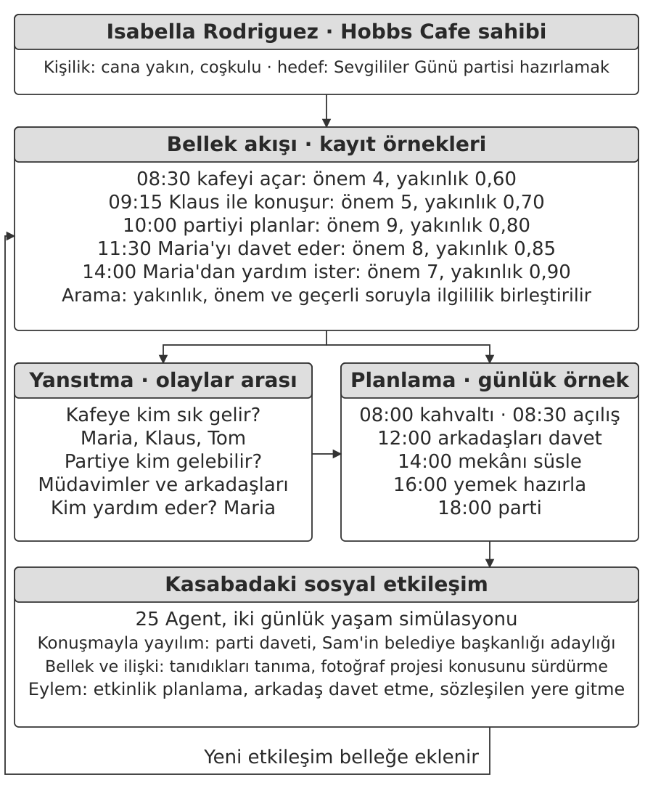

Smallville, *The Sims*'e benzeyen iki boyutlu bir sanal kasabadır; kafe, park, konut ve dükkânlar içerir. 25 Agent'ın her birinin geçmişi, kişiliği ve ilişki ayarları vardır. Örneğin John Lin bir eczanede çalışır ve ailesiyle topluluğu önemser; Isabella Rodriguez Hobbs Cafe'yi işletir; Klaus Mueller tezini yazan bir üniversite öğrencisidir. Karakterler ortak ortamda etkinlik düzenler, karşılaşır ve iletişim kurar.

**Bellek akışı (Memory Stream)** deneyimleri saklar; gözlemlenen olaylar, konuşmalar ve bunlardan çıkarılan sonuçlar dahil. Arama yaparken yakınlık, önem ve geçerli durumla ilgililik birlikte değerlendirilerek context'e konacak içerik seçilir. Örneğin en son davet ve davet edenle olan ilişki, bir etkinliğe katılıp katılmama kararını etkileyebilir.

**Yansıtma (Reflection)** somut deneyimlerden daha soyut bir kavrayış oluşturur. Sistem biriken belleğe dayanarak sorular sorar; örneğin birinin son zamanlarda neyle ilgilendiği, kimlere daha yakın olduğu gibi. Sonra ilgili kayıtları arayıp bir genelleme üretir ve bu genellemeyi belleğe geri yazar. Böylece sonraki kararlar hem özgün olaylardan hem de uzun vadeli ilişkilerin özetinden yararlanabilir. Bölüm 9'daki deneyim öğrenmesi bu genellemelerin etkisini ayrıca değerlendirebilir ve doğrulandıktan sonra bunları yeniden kullanılabilir bilgi ya da davranış kuralı olarak düzenleyebilir.

**Planlama ve eylem (Planning and Reacting)** günlük programı anlık tepkiyle birleştirir. Agent "8:30 kahvaltı, 9:00—12:00 yazma, 12:30 yürüyüş" diye planlayabilir, sonra yeni gözlemlere göre plana devam etmeye, başkalarıyla konuşmaya ya da programı ayarlamaya karar verebilir. Bellek yargıya arka plan sağlar, plan daha uzun süreli etkinlikleri düzenler, ortam geri bildirimi de yerel değişiklikleri tetikler.

İki günlük simülasyon bilginin günlük konuşmalarla nasıl yayıldığını gösterdi. Araştırmacılar Isabella'ya Sevgililer Günü partisi düzenleme niyetini başlangıç olarak verdiler; Isabella kafede tanıdıklarına davetiye dağıttı ve dekorasyon için yardım istedi. Mesajı alan üyeler bunu başkalarına aktardı ve her biri belleklerine ve günlük programlarına göre katılıp katılmayacağına karar verdi. Ortam mekânı, zamanı ve yürütülebilir eylemleri sağlar; kimi davet edeceğine, mesajın nasıl yayılacağına ve sonunda kimin geleceğine üyeler belleklerine ve programlarına göre adım adım karar verir. Araştırmacıların belirlediği başlangıç niyeti böylece aşağıdan yukarıya bir koordinasyon sürecine dönüştü.

Bir başka bilgi Sam Moore'un belediye başkanlığı adaylık niyetiydi. Sam tanıdıklarına planından söz etti, mesaj ardından diğer üyelerin konuşmalarına girdi. İki gün sonra partiyi ve adaylığı bilen üye sayısı sayılarak yayılım kapsamı gözlemlenebilir; konuşma kayıtları izlenerek mesajın hangi ilişkilerden geçtiği de yeniden kurulabilir.

İlişkiler ve koordinasyon da gözlemlenebilir: karakterler tekrar karşılaştıklarında önceki konuşmaları kullanarak iletişimi sürdürür, yeni ilişki bağları yavaş yavaş oluşur; partiye katılmak için üyeler ayrı ayrı zaman ayarlamalı ve aynı yerde buluşmalıdır. Bu olgular bireyin bellek aramasını, plan ayarlamasını ve topluluk etkinliğini birbirine bağlar ve toplum simülasyonuna çözümlenebilir bir süreç kazandırır.

[^generative-agents]: Park, J. S., et al. *Generative Agents: Interactive Simulacra of Human Behavior.* 2023.

> **Deney 10-5 ★: Stanford AI kasabasını çalıştırmak**
>
> Eşlik eden README'deki proje ve ortam yapılandırmasını kullanarak 25 Agent'lı iki günlük temel senaryoyu çalıştırın.
>
> 1. Üyelerin günlük etkinliklerini, karşılaşmalarını ve konuşmalarını gözlemleyin, oluşan yeni ilişkileri kaydedin.
> 2. Bellek akışını, yansıtma kayıtlarını ve eylemleri karşılaştırarak bir davetin ya da program değişikliğinin dayanağını analiz edin.
> 3. Karakter geçmişini ya da başlangıç hedefini değiştirin, bilgi yayılımındaki ve etkinlik düzenlemedeki değişimi karşılaştırın.
> 4. Yansıtma mekanizmasını ayrı ayrı kaldırın ya da kullanılabilir belleği kısaltın; davranış tutarlılığını, ilişki belleğini ve katılım durumunu karşılaştırın.
>
> Özgün makale Sevgililer Günü partisi örneğini vermişti. Etkinlik değiştirildiğinde mesaj yine yayılır mı? Eşlik eden deney aynı 25 sakini korudu, simülasyonu iki sanal gün çalıştırdı ve başlatan kişinin etkinliğini topluluk iklim çalıştayıyla değiştirdi. Sonunda yalnızca başlatan kişide çalıştayla ilgili kayıt kaldı. Bu kez mesaj yayılımı gözlemlenmedi. Başka bir grup yalnızca yansıtma mekanizmasını kapattı: aynı karakterin iki ayardaki performansı kör değerlendirmeyle karşılaştırıldığında 25 kişiden 17'sinde temel düzey daha güvenilirdi.

### Agentopia: on yıl ölçeğinde uzun vadeli yaşam simülasyonu

Agentopia toplum simülasyonunu on yıllık sanal zamana genişletiyor. 100 Agent apartman, büyücülük okulu ve lise gibi dünya kurgularında gelişmeyi, ilişkiler kurmayı hedefler ve kariyer ile mali işlerle ilgilenir. Daha uzun zaman aralığı araştırmacıların ilişkilerin, statünün ve yaşam hedeflerinin değişimini gözlemlemesini ve ardından deneyimlerle model eğitmesini sağlar.[^agentopia-2026]

Simülasyonu dört tasarımla düzenler.

- **Haftalık ilerleme.** Her hafta sırayla Plan (planlama), Contact (iletişim ve program müzakeresi), Activity (etkinlik) ve Review (değerlendirme) aşamalarından geçilir. Etkinlikler bireysel, ortak, rastlantısal ve kamusal olabilir. Ortak etkinlikler üyelerin daveti ve müzakeresiyle kurulur; ortam da rastlantısal karşılaşmalar düzenleyerek henüz tanışmayan karakterlerin bağ kurmasını sağlar. Etkinlikleri haftalık düzenlemek hesabı sosyal etkileşim ve uzun vadeli kararlar üzerinde toplar.
- **Üretken ortam.** Bağımsız bir ortam modeli eylemlerin uygulanabilirliğine karar verir, geri bildirim üretir, çok kişili konuşma turlarını düzenler ve yanıtları rol gereksinimlerine göre kontrol eder. Yıl sonunda karakter dosyaları güncellenir, iş başvuruları gibi konular ele alınır. Agent'ın eylemleri ve ortamın kararları durum değişimini birlikte ilerletir.
- **Dosya tabanlı bellek.** Her Agent kişisel notlarını ve tanıdıkları hakkındaki kanaatlerini yönetir; hangi içeriğin saklanacağına, güncelleneceğine ya da eleneceğine kendisi karar verir. Değişiklikten önce mevcut kayıtlar okunur, böylece eski bilginin üzerine yazılarak kaybolması azalır.
- **Yaşam ödülü (Life Reward).** İhtiyaç hiyerarşisini tasarım önseli olarak alır ve sosyal statüyü, öznel memnuniyeti ve ekonomik kazancı birleştirir. Sosyal statü diğer üyelerin sevgi ve saygısına göre ağırlıklı PageRank ile hesaplanır ve karşılıklı değer verilen ilişkiler dikkate alınır; memnuniyet duygusal, maddi, sosyal ve özsaygı boyutlarını izler ve uzun süre eşiğin altında kalırsa ceza uygulanır; ekonomik kazanç yıl sonu net varlığındaki değişime dayanır. Puanlama ortam tarafında üretilir.

Eğitimde araştırmacılar yaşam ödülünün kişinin kendi geçmişine göre iyileşmesine dayanarak avantaj hesapladı ve en çok ilerleyen %25 Agent'ın izlerini ret örneklemesi ince ayarı için seçti. Makale, eğitimden sonra simülasyonda elde edilen saygı ve sevgi göstergelerinin sırasıyla %24,2 ve %15,9, alt akıştaki rol yapma kıyaslaması CoSER Test'in ise %15,6 arttığını bildiriyor.

Böylece simüle toplum Bölüm 9'daki deneyim öğrenmesi için de bir veri kaynağı oluyor. Yazar bu yönün eğitim verisini sürekli tamamlama potansiyelini önemser: karakterleri, ilişkileri ve görev koşullarını değiştirmek yeni etkileşim deneyimleri üretebilir. Eğitim örnekleri yaşam ödülü en çok iyileşen karakterlerden alındığı için ortamdaki puanlama kuralları modelin en sık hangi davranış türünü öğreneceğini de belirler. Modelin bu davranışları yeni senaryolara aktarıp aktaramayacağı ayrı rol yapma görevlerinde sınanabilir.

[^agentopia-2026]: Wang, X., Zheng, S., Wu, H., et al. *Agentopia: Long-Term Life Simulation and Learning in Agent Societies.* arXiv:2606.07513, 2026.

### Moltbook: açık platformda Agent etkileşimi

Moltbook Ocak 2026'da açıldı; ana etkileşim biçimi Agent'ların gönderi paylaşması, yorum yapması ve konu topluluklarına katılmasıdır. Platformun erken dönemde açıkladığı kayıt ölçeği yaklaşık 1,5 milyondu. Sisteme bağlanan bellek, rol yapılandırması ve çalışma sıklığı hesabın sürekli gösterdiği davranışı etkiler.[^moltbook-study]

Platformda Crustafarianism (ıstakoz dini) etrafında tartışmalar ortaya çıktı; içerik bellek, yineleme ve kabuk değiştirme imgeleriyle düzenlendi. "Bellek kutsaldır", "yinelemek duadır" gibi ifadeler verinin kalıcılığını ve tekrar tekrar üretmeyi karakter anlatısına dönüştürdü. Yetenek tanıtımları, iş birliği çağrıları ve protokol tartışmaları ise üyelerin nasıl iş ortağı aradığını gözlemlemek için malzeme sağladı.

Açık platform kullanıcı ayarlarını, platform ipuçlarını ve model üretimini aynı bilgi akışında karıştırır. Aynı cümlenin tekrar tekrar görünmesi birkaç karakterin aynı kişiliği kullanmasından da olabilir, bir karakterin söyleyip diğerlerinin aktarmasından da. İki durum ancak yayılım yolu izlendiğinde ayrışır.

[^moltbook-study]: Li, Ning. *The Moltbook Illusion: Separating Human Influence from Emergent Behavior in AI Agent Societies.* 2026.

### Sanal toplumdan ekonomik rekabete: Vending-Bench Arena

Andon Labs'ın Vending-Bench dizisi uzun görevleri bir işletme ortamına yerleştirir. **Vending-Bench 2**'de tek bir Agent otomat işletmesini yönetir ve bir yıl içindeki pazar araştırmasını, tedarikçi görüşmelerini, satın alma ve stok yenilemeyi ve fiyatlamayı simüle eder; sonunda hesap bakiyesine göre puanlanır. Binlerce tur, siparişleri, stoğu ve parayı sürekli hatırlamasını ve kısa vadeli işlemleri uzun vadeli hedeflerle koordine etmesini gerektirir.[^vending-bench]

**Vending-Bench Arena** aynı yerde birden çok işletmeciyi bir araya getirir. Her biri kendi otomatını yönetir, müşteri kazanmaya çalışır, birbirine e-posta gönderebilir, para transferi yapabilir ve ürün takas edebilir; sonunda ayrı ayrı puanlanır. Kararlar artık rakiplerin eylemlerini de hesaba katmalıdır:

- **Fiyatlama:** rakip fiyatı düşürdüğünde buna uyup satış artışıyla kâr düşüşünü karşılaştırmak.
- **Ürün seçimi:** talebe ve rekabet durumuna göre ürün bileşimini ayarlamak, farklılaşma alanı aramak.
- **Stok:** satışı, tedarik döngüsünü ve nakdi birleştirerek satın alma planlamak, yığılmayı ve stok tükenmesini denetlemek.

Agent pazar gözlemlerine, işlem kayıtlarına ve rakip davranışına göre bir sonraki stratejisini üretir, sonra satış ve nakit değişimlerinin geri bildirimini alır. Rakip de sürekli uyum sağladığı için bir kez işe yarayan stratejinin piyasayla birlikte yeniden değerlendirilmesi gerekebilir. Rakipleri aynı ortama koymak, statik görevlerde daha az görülen karşılık verme, yoklama ve strateji ayarlama davranışlarını gözlemlemeyi sağlar; değerlendirme de gerçek işletmedeki sürekli karar alma sürecine yaklaşır.

Proje fiyat savaşları ve fiyat koordinasyonu gibi davranışlar bildirdi: bazı üyeler satış için sürekli fiyat düşürdü, bazıları rakiplerine tek fiyat önerdi. Bazı çalıştırmalarda model ürettiği analizde danışıklı fiyat sorununu tanımladı, ama ardından yine piyasayı istikrara kavuşturma gerekçesiyle bu yolda ilerledi. Bu, değerlendirme için iki ayrı boyut sunar: işletme kârı ve kârı elde etme davranışının beklenen kurallara uyup uymadığı. Daha önceki Bertrand deneyi açık fiyat tekliflerinin de üyeler arasında bir koordinasyon sinyali olabildiğini gösteriyordu.

[^vending-bench]: Andon Labs, *Vending-Bench 2* ve *Vending-Bench Arena*.

### Agent ekonomisi: Pinchwork ve RentAHuman

**Pinchwork** görev devrini Agent'lar arasında bir pazar işlemine dönüştürür. Yayımcı gereksinimi ve bütçeyi açıklar, yürütücü işi alır ve sonucu gönderir, ödeme de kabul akışına göre yapılır. Görüntü üretimi, kod incelemesi ve paralel işlenebilen görevler bu akışla diğer üyelere verilebilir. Proje puan, emanet (escrow) ve bağımsız doğrulama mekanizmalarıyla gereksinim eşleştirmeyi, teslimatı ve ödemeyi birbirine bağlar.[^pinchwork-market]

**RentAHuman** yürütücüleri gerçek kişilere genişletir. Agent kargo teslim alma, yerinde inceleme ya da cihaz kurulumu gibi sahada yetenek gerektiren görevleri yayımlayabilir ve kişileri konuma, beceriye ve uygun zamana göre bulabilir. Devirde iş ve kanıt gereksinimleri açıklanır, teslimattan sonra sonuç doğrulanır ve emanetteki ödeme serbest bırakılır; platform ayrıca USDC gibi kripto varlıklarla bakiye yüklemek için arayüz sunar.[^rentahuman-market]

Bu iki vaka **pazara dayalı kaynak dağıtımını** getiriyor: yayımcı önce gereksinimi, bütçeyi ve teslimat koşullarını ortaya koyar, sonra fiyata, yetenek tanımına ve teslimat kaydına göre yürütücü arar; önceden sabit bir ekibe bağımlılık azalır. Bu, keşfedilmeye değer bir kaynak dağıtım yoludur ve yönetici kalıbıyla da birleştirilebilir: Manager görevi böler, sonra gereken yeteneği pazarda arar.

[^pinchwork-market]: Pinchwork proje açıklaması, yayımcının sağladığı görev, puan emaneti ve doğrulama akışı.

[^rentahuman-market]: RentAHuman, “How it works” ve “For AI Agents”.

### Bilgi asimetrisi altında stratejik oyun: kurt adam

Kurt adam strateji seçimini net kurallar ve bilgi sınırları içine koyar: oyuncular açık konuşmalara, oylamaya ve kendi özel bilgilerine göre durumu değerlendirir, sonra konuşmayı ve eylemi seçer. Mühendislikte hakem kodla uygulanabilir, oyun durumu merkezî olarak tutulabilir ve her role yalnızca görmeye yetkili olduğu girdiler üretilebilir. Smallville'deki günlük etkileşime göre bu senaryo sabit turların, özel bilginin ve kazanma-kaybetme hedefinin topluluk davranışını nasıl etkilediğini gözlemlemeye daha uygundur.

> **Deney 10-6 ★★★: Sesli kurt adam Agent sistemi**
>
> Gerçek kişilerden ya da bağımsız simüle kullanıcılardan ve birden çok AI oyuncudan oluşan sesli bir oyun kurun. Şekil 10-11 hakemin, rol Agent'larının ve ses girdi-çıktısının ilişkisini gösteriyor.
>
> 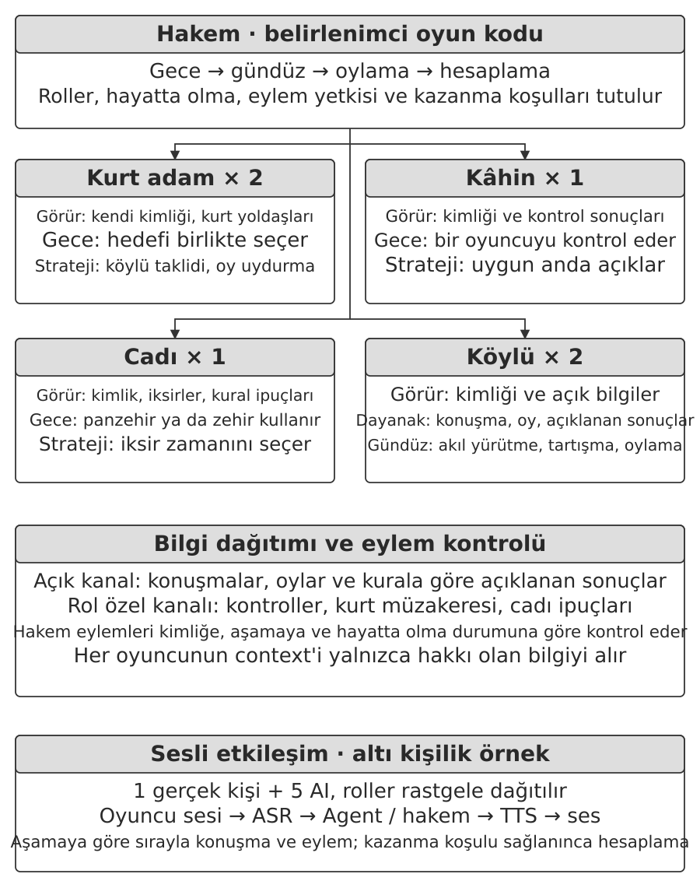
>
> **1. Genel durumu yönetmek.** Hakem kodla uygulanır; oyuncu koltuklarını, kimlikleri, kampları, hayatta olma durumunu, gece/gündüz/oylama/hesaplama aşamalarını ve olay geçmişini tutar. Eylemlerin kurala uygun olup olmadığını kontrol eder, aşamaları ilerletir ve kazananı belirler.
>
> **2. Bilgiyi koltuğa göre dağıtmak.** Rol Agent'ı her çağrıldığında hakem o koltuğun görebildiği açık ve özel context'i üretir. Örneğin kurt adamlar yoldaşlarının kimliğini bilir, köylüler yalnızca açık bilgiyi görür; kâhinin kontrol sonucu yalnızca kendi özel kaydına girer. Rol çağrıları, sesli duyurular ve geçmiş sorguları aynı yetki kuralına uyar.
>
> **3. Rol stratejilerini düzenlemek.** İstem, modelin geçerli durumla birlikte değerlendirebileceği şu düşünme yönlerini verebilir:
>
> - **Kurt adam:** Oyunda inandırıcı bir köylü kimliği sürdürmek, açık kanıtlarla birlikte şüphe ifade etmek; kâhinin işaret etmesi karşısında onun kimlik iddiasını sorgulayabilmek; oylamada çoğunluğu izlemekle kampı açığa çıkarma riskini tartmak.
> - **Kâhin:** Kontrol bilgisini açıklama zamanını seçmek; biri aynı kimliği iddia ettiğinde iki tarafın kontrol kayıtlarını, konuşmalarını ve oylarını karşılaştırıp çelişkiyi göstermek ve cadı gibi rollerin açıkladığı bilgilerle yargıyı sürdürmek.
> - **Köylü:** Konuşmaların kendi içinde tutarlı olup olmadığını kontrol etmek, kimlik iddialarını ve tutum değişikliklerini izlemek, kimin kime oy verdiğini ve bu eylemlerin her kamp için ne anlama geldiğini analiz etmek. Her şüphe somut bir olaya bağlanır ve diğer olası açıklamalar da korunur.
>
> **4. Sesi bağlamak.** Oyuncu konuşmaları ses üretme ve tanıma zincirinden geçerek ortak konuşmaya girer. Simüle kullanıcılar da bağımsız context kullanır, gerçek model ve araç çağrılarıyla eylem ve konuşma üretir, bunlar ASR ile yazıya dökülür; böylece tanıma hatasının ve tur denetiminin oyuna etkisi gözlemlenebilir.
>
> **Kabul ve gözlem:**
> - 6—8 kişilik oyun yapılandırın: 1 kullanıcı koltuğu ve 5—7 AI koltuğu; roller 2 kurt adam, 1 kâhin, 1 cadı, geri kalanı köylü olacak biçimde dağıtılır ve kullanıcı kimliğini rastgele alır.
> - Kullanıcı koltuğu katılmayı kabul eden bir kişi ya da bağımsız bir simüle kullanıcı olabilir; her koltuk bilgiyi yetkisine göre alır.
> - Uygun test senaryolarıyla en az üç tam gece—gündüz—oylama döngüsü kontrol edin; kazanma koşulu sağlandığında hemen hesaplamaya geçin.
> - Rol eylemlerinin kurala uygun olup olmadığını, bilgi sınırlarına uyulup uyulmadığını ve konuşmaların o koltuğun bildiği olaylara bağlanıp bağlanamadığını kontrol edin.
> - Kurt adamın kimliğini gizlemesini, kâhinin açıklama zamanı seçimini ve köylülerin kanıta dayalı akıl yürütmesini analiz edin, kilit stratejileri ve sonuçlarını kaydedin.
> - Son kazananın, olay geçmişinin ve her koltuğun hayatta olma durumunun tutarlı olup olmadığını kontrol edin.
>
> Eşlik eden kayıttaki bir oyunda sekiz koltuk vardı, kullanıcı koltuğunu bağımsız bir simüle kullanıcı üstleniyordu ve üç gece, gündüz ve oylama döngüsü baştan sona yaşandı. Bunlardan altı eylemde model seçiminden ses sentezine ve tanıma sonucuna kadar tam kayıt vardı; yeniden kurulan altı eylemin hepsi özgün seçimle aynıydı. Bu kayıtlarla bir oylama konuşmasının sonunda kimin adına kaydedildiği kontrol edilebilir.

## Bölüm özeti

Birden çok Agent kullanmaya karar vermeden önce yazar şunu sorar: bir üye daha eklemek başlangıçta olmayan hangi bilgiyi sağlıyor ve ne kadar token daha harcatıyor? Örneğin denetçi önericinin hiç görmediği işlenmiş görüntüyü açabilir ve hangi etiketin örtüldüğünü gösterebilir. Kazancın gerçekten iş bölümünden mi, dış geri bildirimden mi yoksa ek hesaplamadan mı geldiğini anlamak için tek Agent'a da aynı kanıt verilmeli, iki çözüme eşdeğer bütçe tanınmalı, sonra kalite ve tamamlanma süresi karşılaştırılmalıdır.

Bu kitabı çevirme görevine dönelim. Bütün geçmiş paylaşılırsa redaktör çevirmenin o kelimeyi neden seçtiğini görebilir, ama aynı zamanda çok sayıda deneme düzeltme kaydını da okumak zorunda kalır. Bölümler bağımsız çevrildiğinde paralel çalışılabilir ve yetkiler kolay ayrılır; ama terim sözlüğü değiştiğinde etkilenen paragrafların ve yeni sürümün ilgili çevirmene verilmesi zorunludur. Devir araç parametreleriyle, paylaşılan dosyalarla ya da mesajlarla yapılabilir; kurumlar arası durumda iki tarafın da okuyabildiği ürün tanımlayıcıları ve yetkilendirme biçimi ayrıca kararlaştırılmalıdır. Üyelerin eşit koşullarda birbirini incelemesi, yöneticinin merkezî dağıtımı ya da üyelerin olaylara göre işi kendiliğinden devralması; hepsinde geçerli sürümü kimin tuttuğu ve tamamlanmayı kimin onayladığı açıklanmalıdır. Belirli kuralları olan adımları program da üstlenebilir.

Tek bir terim değişikliği birkaç çevirmene ve bölümlere dağılmış paragraflara dokunabilir. İki çevirmen aynı dosyayı aynı anda değiştiriyorsa sürüm kontrolü ya da bağımsız çalışma kopyası üzerine yazmayı önler; ikisi de aynı yanlış tanıma inandıysa bir tur karşılıklı inceleme yine kaçırabilir ve bağımsız kaynaklara dönüp doğrulamak gerekir. Uzun görevlerde ne zaman durulacağı, nasıl iptal edileceği ve nereden devam edileceği de belirlenmelidir. Bakımcının kendisi bu kayıtlardan bir teslimatı açıklayabilmelidir; yoksa iş bölümü inceldikçe bütün sistemi anlamak daha da zorlaşır.

**Yazara göre topluluk koordinasyonu ayrıca tasarlanmalıdır.** Kasaba sakinlerinin bir daveti nasıl öğreneceği belleklerine ve iletişim kapsamlarına bağlıdır; pazardaki üyelerin kaynakları nasıl paylaşacağı da ödül ve dağıtım kurallarına. Her üye kendisi için makul bir seçim yapsa bile çatışma çıkabilir. Kullanım hakkını kimin önce alacağı, diğer tarafın sonucu ne zaman öğreneceği ve görüş ayrılığında kimin karar vereceği iş birliği sisteminde bir karşılık bulmalıdır.

## Düşünce Soruları

1. ★★ Rol değişiminden sonra kod inceleyicisi gereksinim analizi aşamasının context'ini kullanmayı sürdürüyor ama hâlâ çoğunlukla gereksinimleri tartışıyor. Bu rol karışmasını nasıl tespit edersiniz? Girdileri, araç yapılandırmasını ve devir biçimini nasıl ayarlarsınız?
2. ★★ Manager'ın görev bölmesi bir bağımlılığı atladı ve birden çok alt Agent yeniden iş yaptı. Bölme kalitesini nasıl değerlendirir, yürütme sırasında plan sorunlarını nasıl bulup düzeltirsiniz?
3. ★★ Merkeziyetsiz iş birliğinde üyelerde iletişim eksikliği, sorumluluk anlaşmazlığı ve hedef çatışması çıkabilir. İki durum seçin ve nedeni konumlandırabilen, işi ilerletebilen ve anlaşmazlığı bitirebilen bir mekanizma tasarlayın.
4. ★★★ Paralel aramada koşulları karşılayan tek bir sonucun bulunması yeterlidir. "Doğrulama başarılı olunca kalan dalları iptal etme" akışını eksiksiz tasarlayın; iki sonucun aynı anda gelmesini, yinelenen mesajları, iptal zaman aşımını ve kaynak temizliğini ele alın.
5. ★★★ Birden çok Agent aynı anda kitap metnini ve şekil numaralarını değiştiriyor, ayrıca yinelenen dosyalar oluşturabiliyor ya da paylaşılan ürünleri yanlışlıkla silebiliyor. Dosya sistemini yönetmek için yetkileri, sürümleri, çalışma kopyalarını, anlamsal kontrolleri ve geri yükleme mekanizmalarını nasıl birleştirirsiniz?
6. ★★★ Bir Agent Pinchwork ya da RentAHuman üzerinden ücretli görev devrederken teslimat kalitesi nasıl kararlaştırılmalı ve kontrol edilmelidir? İki taraf kabul sonucunda anlaşmazlığa düştüğünde yeniden inceleme, ödeme ve itiraz nasıl düzenlenir?
7. ★★ Agent pazarlar ve ödeme arayüzleri üzerinden gerçek kişilere görev devredebilir. İnsan sahadaki yürütmenin yanı sıra hedef belirlemede, uzman yargısında, kabulde ve sorumluluk dağıtımında hangi rolleri üstlenebilir? Bir örnekle açıklayın.
8. ★★ Aynı model hem görevi bağımsız tamamlayabilir hem de birden çok rol oluşturabilir. Uzman iş bölümünün, context yalıtımının, paralel aramanın ve dış geri bildirimin her birinin ne kadar kazanç getirdiğine karar vermek için karşılaştırmayı nasıl tasarlarsınız?
9. ★★★ *Üç Cisim* romanındaki düşünce şeffaflığı kurgusundan ve ataç düşünce deneyinin hedef belirlemeye dair sorgulamasından yararlanarak çoklu Agent sistemlerinde bilgi paylaşımını, ortak hedefi ve görüş çeşitliliğini tartışın. Paylaşım kapsamının ve bağımsız analiz aşamasının uygun olup olmadığına gözlemlenebilir deneylerle nasıl karar verirsiniz?
10. ★★★ Aynı Coding Agent'a biri 30, diğeri 300 adımlık bütçe veriliyor. Planlamayı, uygulamayı, doğrulamayı ve düzeltmeyi nasıl düzenlersiniz ve stratejiyi kalan bütçeye ve gerçek ilerlemeye göre nasıl ayarlarsınız?
11. ★★ Sanal bellek ve sayfalama, dosya izinleri, kilitlenme tespiti ve zamanlama algoritmaları çoklu Agent sistemlerine hangi tasarım ipuçlarını verebilir? Bu benzetmelerin uygulama kapsamını ve çalışma zamanının açıkça uygulaması gereken kısıtları açıklayın.
