# Context Mühendisliği

Bölüm 1 context'i Agent'ın "geçerli karar ufku"na benzetmişti: model her karar verdiğinde o anda aldığı bilgiye dayanır. **Context mühendisliği** (Context Engineering) bu bilgiyi seçmekten, düzenlemekten ve güncellemekten sorumludur; sistem talimatları, araç tanımları, kullanıcı istekleri, geçmiş mesajlar ve görev durumu bu bilginin parçalarıdır. Harness her model çağrısından önce görevin arka planını ve en son ilerlemeyi bir girdi hâline getirmelidir. Şekil 2-1, context penceresinin bileşimini somut içeriklerle gösteriyor.

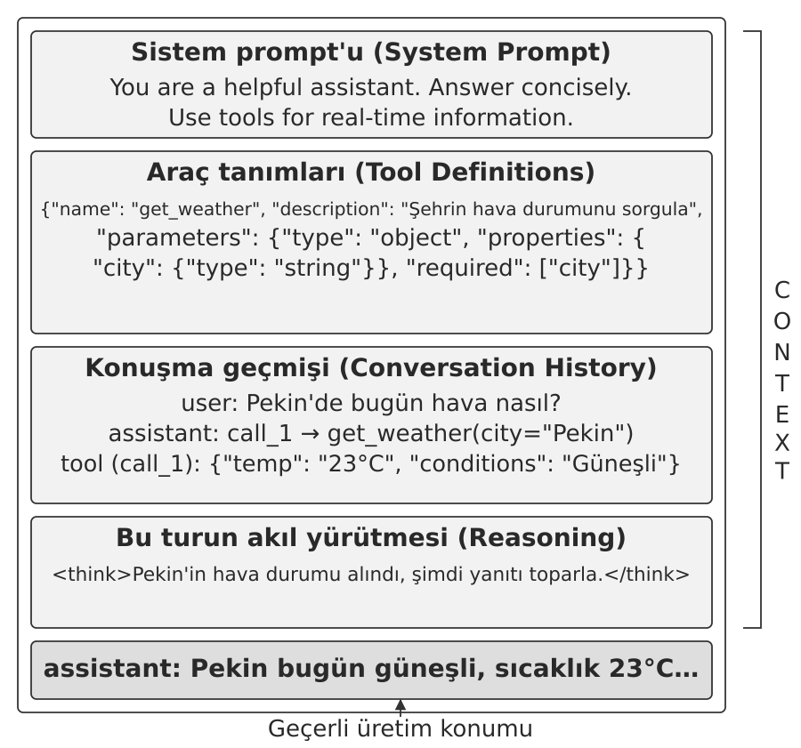

## Context: model yeteneğini somut göreve uygulamak

Deneyimli bir mühendisin ekibe yeni katıldığını ve ilk görevinin "yapılandırmayı bizim standartlarımıza göre değiştir" olduğunu düşünün. Programlama bilir, ama yapılandırmanın asıl kaynağının hangi dosya olduğunu, hangi alanların değiştirilebileceğini ve sonucun nasıl doğrulanacağını henüz bilmez. Tüm kod tabanını eline verseniz bile yanlış dosyayı değiştirebilir. Agent tanımadığı bir projeyi devraldığında aynı arka plan bilgisinden yoksundur.

"Bu hatayı düzelt" isteğini örnek alırsak, bir Coding Agent genellikle üç tür arka plan bilgisine ihtiyaç duyar:

- **Canlı kod context'i**: Dizin yapısı, modüllerin sorumlulukları, temel veri yapıları ve kod standartları. Örneğin değiştirilen dosya otomatik üretilen bir yapılandırma dosyasıysa, değişiklik yerelde işe yarasa bile bir sonraki üretimde üzerine yazılır. Dosyanın hangi modül tarafından üretildiğini bilirseniz değiştirilmesi gereken yeri bulursunuz.
- **Süreç standartları**: Git dal stratejisi, commit standartları, kod inceleme süreci ve CI/CD gereksinimleri. Agent değişikliği, testi ve commit'i bunlara göre düzenler; çalışma sistemi de bu işlemleri yetkilere göre yürütür.
- **Ortam bilgisi**: Geliştirme yapılandırması, test veritabanına bağlanma biçimi, test ortamının dağıtım biçimi ve API anahtarlarının yönetimi. Bu bilgiler doğru çalışma ortamını seçmesine, yerel ortam ile test ortamı arasındaki farkları anlamasına yardım eder.

Proje kodu da test veritabanı da modelin context'inin dışındadır. Otomatik üretilen yapılandırma örneğinde Agent, üretim betiğini arama aracıyla okuduktan sonra nereden değiştirmeye başlaması gerektiğini anlar. **Context'in kalitesi, modelin mevcut yeteneğini eldeki soruna uygulayıp uygulayamayacağını belirler.** **Çok fazla arka plan bilgisine dayanan görevlerde, eksiksiz ve doğru bir context'le donatılmış yeterince yetenekli bir model, gerekli bilgiden yoksun daha güçlü bir modelden daha iyi performans gösterebilir.**

**AI'a dayalı bir ekip kurmak için önce kilit bilgileri belgelemek gerekir.** Belirli bir veritabanının neden seçildiğini yalnızca eski çalışanlar hatırlıyorsa ve iş kurallarındaki değişiklikler yalnızca özel mesajlarda konuşulduysa, yeni gelen meslektaş da Agent da devraldıklarında aynı sorunla karşılaşır: ekibin ne yaptığı kodda görünür, ama başta neden öyle yapıldığı görünmez.

**Uzaktan iş birliğine uygun ekipler çoğu zaman Agent'a da uygundur.** Linux çekirdeği geliştiricileri yamaları e-posta listelerinde tartışır, inceleme görüşlerini orada paylaşır; geliştirme süreci belgeleri de yamaların nasıl gönderileceğini, inceleneceğini ve birleştirileceğini açıklar[^ch2-linux]. Yeni bir katılımcı beklenmedik bir değişiklikle karşılaştığında yamanın izini sürerek o zamanki tartışmayı bulabilir; Agent da arka planı araştırırken bu kayıttan yararlanır.

Weng Jiayi'nin WhynotTV'deki söyleşisini dinledikten sonra onun bir görüşünü şöyle özetledim: **insan da model de Context'e dayanır.** İnsan karara katılmış bir meslektaşına gidip bir şey daha sorabilir; modelin hangi arka plan bilgisini okuyabileceği ise ekibin hangi kayıtları bıraktığına ve Harness'ın bu isteğe neleri koyduğuna bağlıdır.[^ch2-weng]

[^ch2-linux]: Linux çekirdeği resmî belgeleri, How the development process works.

[^ch2-weng]: WhynotTV, "Weng Jiayi: OpenAI, GPT, pekiştirmeli öğrenme, Infra, sonrası eğitim, Tianshou, tuixue, açık kaynak, CMU, Tsinghua" (翁家翌：OpenAI，GPT，强化学习，Infra，后训练，天授，tuixue，开源，CMU，清华), Podcast #4.

ReAct makalesi, etkileşim geçmişinin karara nasıl katıldığını biçimsel bir ifadeyle anlatır[^ch2-react]. $t$ anında Agent ortamdan $o_t\in\mathcal{O}$ gözlemini alır ve $\pi(a_t\mid c_t)$ politikasına göre $a_t\in\mathcal{A}$ eylemini seçer; burada context şudur:

$$
c_t=(o_1,a_1,\ldots,o_{t-1},a_{t-1},o_t)
$$

Bu ifade, **Agent'ın bir sonraki eyleminin o ana kadarki etkileşim geçmişine bağlı olduğunu** gösterir. Örneğin Agent'ın hangi dosyayı incelediği, aracın hangi hatayı döndürdüğü, bir sonraki seçimi etkiler. LLM Agent'ında kullanıcı girdisi ve araç sonuçları gözlem sağlayabilir; araç çağrıları ve dışarıya verilen yanıtlar eylemleri kaydeder; sistem talimatları ve araç tanımları ise görev kurallarını ve kullanılabilir arayüzleri açıklar.

Bu bölüm önce durumsuz istek yöntemini kullanıyor: Harness her turda mesajları ve araç tanımlarını derleyip modeli çağırır. Eksiksiz mesaj geçmişi görevin ilerleyişini korumayı kolaylaştırır; geçmiş büyüdükçe getirme, durum kaydı ve sıkıştırma yoluyla sonraki kararların ihtiyaç duyduğu bilgi pencerede tutulabilir. Context düzeni, durum çubuğu ve sıkıştırma teknikleri aynı soru etrafında döner: sınırlı bir context içinde, modelin bu adımda kullanacağı bilgiyi $c_t$'ye nasıl koyarız?

[^ch2-react]: Yao, Shunyu, et al., ReAct: Synergizing Reasoning and Acting in Language Models, ICLR 2023.

## Agent büyük modeli nasıl çağırır: API'nin context yapısını anlamak

Önce bir selamlaşma üzerinden mesaj biçimine, sonra "Vancouver'da şu an saat kaç, hava nasıl?" sorusunun nasıl iki araç çağrısına yol açtığına bakalım. Bu kısımda Chat Completions uyumlu bir arayüz ve yerelde çalışan Qwen3-0.6B kullanılıyor; sonunda da turların istekleri Python ile birbirine bağlanıyor[^ch2-chat-api].

### Örnekteki dört mesaj rolü

İstekteki **mesaj listesi** (`messages`) etkileşim bilgisini sırasıyla saklar. Her mesaj kaynağını ve kullanımını belirten bir **rol** (`role`) ile işaretlenir. Bu kısımda dört rol kullanılıyor:

- **system**: Sistem prompt'u. Bu kısımda geliştiricinin sağladığı kimliği, davranış kurallarını ve kısıtları taşır; mesaj listesinin başına konur. Bazı model arayüzleri geliştirici talimatlarını `developer` rolüyle taşır.
- **user**: Kullanıcı mesajı; görevi, ek soruları ve ek gereksinimleri saklar.
- **assistant**: Model yanıtı; metni ve araç çağrısı taleplerini içerir. Bu mesajlar bir sonraki turun girdisine geri konduğunda model önceki yanıtlarını ve işlem taleplerini okuyabilir.
- **tool**: Araç yürütme sonucu. Harness dönüş değerini aldıktan sonra bunu bir araç mesajı olarak yazar ve `tool_call_id` ile ilgili çağrıya bağlar.

Araç tanımları isteğin üst düzeyindeki `tools` alanıyla gönderilir; kullanılabilir araçların adını, amacını ve parametre biçimini listeler.

Model çağrı talebini araç tanımlarına göre oluşturur. Bu işlemin yürütülüp yürütülemeyeceğine ise Harness ve çalışma ortamı karar verir.

[^ch2-chat-api]: OpenAI, Chat Completions API başvuru belgesi; mesaj rollerini, araç tanımlarını ve çağrı sonucu alanlarını tanıtır. Qwen, Function Calling; uyumlu hizmetlerde araç çağrısını ve şablonları tanıtır.

### Tek turlu konuşma: en basit API çağrısı

Önce tek bir soru-cevaba bakalım. Kullanıcı "Hello, who are you?" diye soruyor; Harness sistem talimatını ve kullanıcının sorusunu birlikte modele gönderip yanıtı okuyor. Şekil 2-2 istek ile yanıt arasındaki karşılığı gösteriyor.

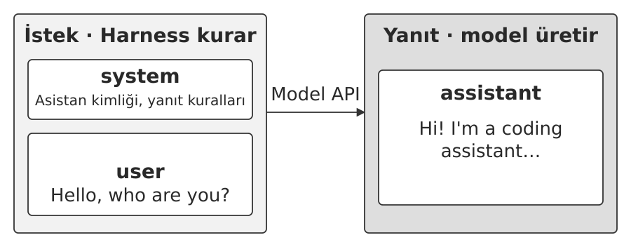

Aşağıda istek ve örnek yanıt yerel modelin arayüz biçimiyle yazılmıştır; koddaki yorumlar her parçanın kaynağını gösteriyor:

```javascript
// Harness isteği oluşturur
{
  "model": "Qwen3-0.6B",
  "messages": [
    {
      "role": "system",                           // geliştiricinin verdiği talimat
      "content": "You are a helpful coding assistant. Follow user instructions."
    },
    {
      "role": "user",                              // kullanıcı girdisi
      "content": "Hello, who are you?"
    }
  ]
}
```

```javascript
// API yanıt döndürür
{
  "choices": [{
    "message": {
      "role": "assistant",                         // model üretir
      "content": "Hi! I'm a coding assistant. I can help you write code, debug issues, and explain technical concepts. How can I help?"
    }
  }]
}
```

İstek bir `system` ve bir `user` mesajı içeriyor; yanıttaki `choices[0].message` ise modelin ürettiği `assistant` mesajını saklıyor. Burada kullanılan durumsuz arayüzde **her çağrı için gereken context'i sağlamak Harness'ın görevidir**. Bir sonraki istek bu konuşmayı sürdürecekse ilgili geçmişi de taşımalıdır.

### Araç çağrılı çok turlu etkileşim: Agent'ın çekirdek döngüsü

Şimdi araç gerektiren bir soruya bakalım: "What's the current time and weather in Vancouver?" Bunu yanıtlamak için önce oranın saatini ve hava durumunu öğrenmek gerekir. Şekil 2-3'te Harness modeli ilk çağırdığında iki araç talebi alıyor. Saat hizmetini ve hava hizmetini ayrı ayrı sorguluyor, iki sonucu mesaj geçmişine ekliyor ve modeli ikinci kez çağırdıktan sonra kullanıcıya verilecek yanıtı elde ediyor.

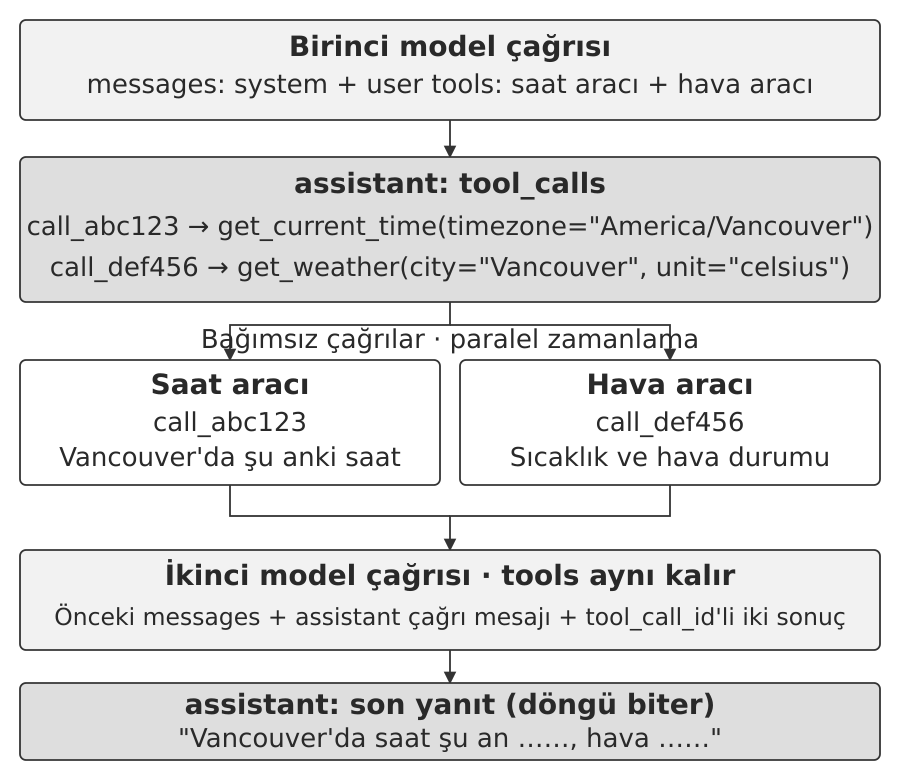

Bu iki araçtan hangisi önce yürütülür? Saat aracı bir saat dilimi, hava aracı ise bir şehir ve sıcaklık birimi ister. Kullanıcı yalnızca Vancouver dedi; örnekteki model buna dayanarak `America/Vancouver` ve `Vancouver` değerlerini doldurdu, sıcaklık birimi olarak da santigratı seçti. Hava durumunu sorgulamak için saat aracının dönmesini beklemek gerekmez; iki sorgu aynı anda gönderilebilir.

**Birinci API çağrısı — Agent çerçevesi ilk isteği gönderir:**

```javascript
// birinci model çağrısı: Harness isteği oluşturur
{
  "model": "Qwen3-0.6B",
  "messages": [
    {
      "role": "system",                           // geliştiricinin verdiği talimat
      "content": "You are a helpful assistant. Use the provided tools to get real-time information when needed."
    },
    {
      "role": "user",                              // kullanıcı girdisi
      "content": "What's the current time and weather in Vancouver?"
    }
  ],
  "tools": [                                       // geliştiricinin tanımladığı araçlar
    {
      "type": "function",
      "function": {
        "name": "get_current_time",
        "description": "Get the current date and time in a specific timezone",
        "parameters": {
          "type": "object",
          "properties": {
            "timezone": { "type": "string", "description": "Timezone name, e.g. America/Vancouver" }
          },
          "required": ["timezone"]
        }
      }
    },
    {
      "type": "function",
      "function": {
        "name": "get_weather",
        "description": "Get the current weather for a specific city",
        "parameters": {
          "type": "object",
          "properties": {
            "city": { "type": "string", "description": "City name" },
            "unit": { "type": "string", "enum": ["celsius", "fahrenheit"] }
          },
          "required": ["city", "unit"]
        }
      }
    }
  ]
}
```

Bu `tools` listesi geliştirici tarafından önceden tanımlanır; adları, açıklamaları ve parametre schema'larını içerir. Bu örnekte her turun isteğinde aynı iki araç sunuluyor; model listeyi ve kullanıcının sorusunu okuduktan sonra çağıracağı araçları seçip parametreleri dolduruyor.

**Model iki araç çağrısı talebi döndürür:**

```javascript
// model araç çağrısı talebi döndürür
{
  "choices": [{
    "message": {
      "role": "assistant",                         // model üretir
      "content": null,                             // bu turda metin yanıtı yok
      "tool_calls": [                              // iki aracın çağrılmasını ister
        {
          "id": "call_abc123",
          "type": "function",
          "function": {
            "name": "get_current_time",
            "arguments": "{\"timezone\": \"America/Vancouver\"}"
          }
        },
        {
          "id": "call_def456",
          "type": "function",
          "function": {
            "name": "get_weather",
            "arguments": "{\"city\": \"Vancouver\", \"unit\": \"celsius\"}"
          }
        }
      ]
    }
  }]
}
```

Yanıttaki `tool_calls` iki talep içeriyor; her talebin kendi `id`'si, araç adı ve parametreleri var. `arguments` JSON olarak kodlanmış bir dizedir; yürütme tarafı önce bunu ayrıştırmalı, sonra alanları ve değerleri doğrulamalıdır. **Neyin çağrılacağına ve hangi parametrelerin geçirileceğine model karar verir; doğrulama ve zamanlama Harness'ın, saat ya da hava hizmetine erişim ise araç uygulamasının işidir.**

**Agent çerçevesi araçları yürütür, sonra ikinci API çağrısını başlatır:**

Harness talepleri doğruladıktan sonra iki aracı zamanlar, dönüş değerlerini `tool` mesajları olarak yazar, sonra mevcut geçmişi ve yeni sonuçları birlikte modele verir:

```javascript
// ikinci model çağrısı: araç sonuçları eklenir
{
  "model": "Qwen3-0.6B",
  "messages": [
    {
      "role": "system",                           // birinci istekteki mesaj korunur
      "content": "You are a helpful assistant. Use the provided tools to get real-time information when needed."
    },
    {
      "role": "user",                              // birinci istekteki mesaj korunur
      "content": "What's the current time and weather in Vancouver?"
    },
    {
      "role": "assistant",                         // önceki turdaki model çağrı talebi korunur
      "content": null,
      "tool_calls": [
        { "id": "call_abc123", "type": "function", "function": { "name": "get_current_time", "arguments": "{\"timezone\": \"America/Vancouver\"}" } },
        { "id": "call_def456", "type": "function", "function": { "name": "get_weather", "arguments": "{\"city\": \"Vancouver\", \"unit\": \"celsius\"}" } }
      ]
    },
    {
      "role": "tool",                              // araç yürütme sonucunu Harness yazar
      "tool_call_id": "call_abc123",
      "content": "{\"timezone\": \"America/Vancouver\", \"datetime\": \"2025-09-13T05:18:47\", \"day_of_week\": \"Saturday\"}"
    },
    {
      "role": "tool",                              // araç yürütme sonucunu Harness yazar
      "tool_call_id": "call_def456",
      "content": "{\"city\": \"Vancouver\", \"temperature\": 13.2, \"unit\": \"celsius\", \"conditions\": \"clear\", \"humidity\": 93}"
    }
  ],
  "tools": [ ... ]                                 // önceki araç tanımları aynen kullanılır, burada kısaltıldı
}
```

İkinci isteği `call_def456` üzerinden okuyalım: önceki `assistant` mesajında bu, Vancouver hava durumu sorgusunun numarasıdır; sonraki `tool` mesajı 13,2 ℃'yi ve açık havayı aynı numarayla geri gönderir. Hava durumu saatten önce dönse bile Harness sonucu doğru talebe bağlayabilir. Model bu turda kullanıcının özgün sorusunu, kendi gönderdiği iki sorguyu ve araçların getirdiği verileri aynı anda okur. Artık kullanıcıyı yanıtlayabilir.

**Model araç sonuçlarına dayanarak nihai yanıtı üretir:**

```javascript
// model nihai yanıtı üretir
{
  "choices": [{
    "message": {
      "role": "assistant",                         // model üretir
      "content": "It's currently 5:18 AM on Saturday, September 13, 2025 in Vancouver.\n\nWeather: 13.2°C with clear skies and 93% humidity. It's quite cool this morning - you might want to grab a jacket."
    }
  }]
}
```

İkinci yanıt nihai metni verir, `tool_calls` boştur ve örnekteki döngü burada biter. "Modeli çağır → araçları yürüt → sonuçları geri ver → modeli yeniden çağır" süreci, Bölüm 1'deki çalışma döngüsünün API içindeki somut uygulanışıdır.

Kullanıcı "Peki Tokyo?" diye ek soru sorarsa Harness bu mesajı geçmişin sonuna ekler ve modeli yeniden çağırır. Model, "geçerli saati ve havayı sorgula" görev bağlamını sürdürerek Tokyo için yeni talepler üretebilir; araçlar yanıt verdikten sonra da yeni yanıtı derler.

**Responses API kullanıldığında araç sonuçları nasıl geri verilir?** Yukarıdaki yerel deney Chat Completions uyumlu arayüzü kullanıyordu. OpenAI'ın hizmetleriyle yeni bir proje geliştirilecekse resmî öneri Responses API'dir. Yine Vancouver örneğine bakalım: uygulama kullanıcının sorusunu isteğin `input` alanına koyar ve `tools` içinde saat ile hava durumu fonksiyonlarını bildirir. Dönen `output`, türlendirilmiş bir dizi giriştir. İçinde iki `function_call` varsa uygulama her birinden fonksiyon adını, parametreleri ve `call_id`'yi okur ve araçları ayrı ayrı yürütür.[^ch2-responses-loop]

Diyelim hava durumu fonksiyonunun çağrı numarası `call_weather`. Bir sonraki isteğin `input` alanına şu biçimde bir makbuz konabilir; saat fonksiyonunun sonucu da kendi numarasıyla geri verilmelidir.

```json
{"type": "function_call_output", "call_id": "call_weather", "output": "{\"temperature\": 13.2, \"unit\": \"celsius\"}"}
```

`call_id` bir makbuzu bir fonksiyon çağrısına geri bağlar. `previous_response_id` ise hizmetin o turun context'ini sürdürebilmesi için önceki model yanıtını işaret eder. İki numara farklı şeylere işaret eder. Bu sürdürme yönteminde bu turda da kullanılmaya devam edecek araçları ve üst düzey `instructions` alanını sağlamak gerekir; önceki isteğin üst düzey talimatları yanıt numarasıyla otomatik devralınmaz. Model araç istemeyi sürdürebilir; uygulama bir sonraki `output`'u okuyarak bitirip bitirmeyeceğine karar verir. Bölüm 1'deki Deney 1-3 sunucuda yönetilen aramayı kullanıyordu; buradaki iki özel fonksiyonu ise uygulama gerçekten yürütür.

[^ch2-responses-loop]: OpenAI, Responses API'ye geçiş, fonksiyon çağrısı ve yanıt oluşturma parametrelerinin açıklaması.

### Agent'ın çekirdek döngüsünü kodla kurmak

Döngüdeki iki `messages.append` çağrısı sırasıyla modelin yanıtını ve aracın yürütme sonucunu saklar. Saat de sıcaklık da Vancouver'dan gelir; iki çağrı ID'sini yer değiştirirseniz bir sonraki turda model, "saat sorgusu"nun 13,2 santigrat derece döndürdüğünü okur.

Örnek, OpenAI Python SDK üzerinden uyumlu bir hizmete bağlanır. Varsayılan adres yerel makinedeki `http://localhost:8000/v1` adresidir; başlatılmış ve kimlik doğrulaması gerektirmeyen yerel hizmetler için uygundur. Bu varsayılanlar Deney 2-1'in vLLM arka ucuna karşılık gelir. Deneyin Ollama arka ucu kullanılacaksa adresi `http://localhost:11434/v1` yapın ve model adını `qwen3:0.6b` olarak değiştirin. Başka bir hizmete bağlanırken `LLM_BASE_URL` ve `LLM_API_KEY` ortam değişkenlerini gerektiği gibi ayarlayın ve aşağıdaki `model` değerini gerçek dağıtımın adıyla eşleştirin. Saat ve hava araçları mesajlarla karşılaştırma kolay olsun diye şimdilik önceki örnekteki sabit verileri kullanır; gerçek veriye bağlanırken bu iki aracın uygulamaları değiştirilir.

```python
import json
import os

from openai import OpenAI

client = OpenAI(
    base_url=os.getenv("LLM_BASE_URL", "http://localhost:8000/v1"),
    api_key=os.getenv("LLM_API_KEY", "EMPTY"),
)

# Araç tanımları: ad, amaç ve parametre yapısı
tools = [
    {
        "type": "function",
        "function": {
            "name": "get_current_time",
            "description": "Get the current date and time in a specific timezone",
            "parameters": {
                "type": "object",
                "properties": {
                    "timezone": {"type": "string", "description": "Timezone name, e.g. America/Vancouver"}
                },
                "required": ["timezone"],
            },
        },
    },
    {
        "type": "function",
        "function": {
            "name": "get_weather",
            "description": "Get the current weather for a specific city",
            "parameters": {
                "type": "object",
                "properties": {
                    "city": {"type": "string", "description": "City name"},
                    "unit": {"type": "string", "enum": ["celsius", "fahrenheit"]},
                },
                "required": ["city", "unit"],
            },
        },
    },
]

# Örnek araçlar sabit veri kullanır; parametreler önceki Vancouver sorgusuyla aynıdır.
def execute_tool(name, arguments):
    args = json.loads(arguments)
    if name == "get_current_time" and args == {"timezone": "America/Vancouver"}:
        result = {
            "timezone": "America/Vancouver",
            "datetime": "2025-09-13T05:18:47",
            "day_of_week": "Saturday",
        }
    elif name == "get_weather" and args == {"city": "Vancouver", "unit": "celsius"}:
        result = {
            "city": "Vancouver", "temperature": 13.2,
            "unit": "celsius", "conditions": "clear", "humidity": 93,
        }
    else:
        result = {"error": "Örnek yalnızca Vancouver saati ve santigrat hava verisi sağlar"}
    return json.dumps(result, ensure_ascii=False)

# Başlangıç mesajları: talimat ve kullanıcı görevi
messages = [
    {"role": "system", "content": "You are a helpful assistant. Use tools to get real-time information when needed."},
    {"role": "user", "content": "What's the current time and weather in Vancouver?"},
]

# Çalışma döngüsü: model en fazla sekiz tur çağrılır
rounds = 0
while rounds < 8:
    rounds += 1
    response = client.chat.completions.create(
        model="Qwen3-0.6B", messages=messages, tools=tools
    )
    assistant_message = response.choices[0].message

    # Model yanıtını sakla; bu turdaki çağrı talepleri dahil
    messages.append(assistant_message.model_dump(exclude_none=True))

    # Bu örnek, model araç çağrısı içermeyen bir yanıt verdiğinde biter
    if not assistant_message.tool_calls:
        print(assistant_message.content)
        break

    # Tek tek yürüt ve sonuçları ekle; bağımsız çağrılar paralel de zamanlanabilir
    for tool_call in assistant_message.tool_calls:
        try:
            result = execute_tool(tool_call.function.name, tool_call.function.arguments)
        except json.JSONDecodeError:
            result = json.dumps({"error": "araç parametreleri geçerli JSON olmalı"})
        messages.append({
            "role": "tool",
            "tool_call_id": tool_call.id,
            "content": result,
        })
    # Sonraki tur, sonuçların eklendiği mesaj listesini kullanır
else:
    print("Tur sınırına ulaşıldı, görev henüz tamamlanmadı.")
```

Modelin ilk turda hem saati hem havayı istediğini varsayalım. Buradaki `for` döngüsü önce saati sorgular, sonucu `messages`'a ekler, sonra havayı sorgular ve ikinci sonucu ekler. İkisi de yürütüldükten sonra program `while` başına döner ve ikinci model isteğini gönderir. `messages`'ın bu adımlardaki içeriğini açarsak modelin her seferinde neyi aldığını görebiliriz.

**Başlangıç durumu (1. çağrıdan önce):**
```text
messages = [
  { role: "system",  content: "You are a helpful assistant..." },     # geliştiricinin yazdığı
  { role: "user",    content: "What's the current time and weather in Vancouver?" },  # kullanıcı girdisi
]
```

**1. model çağrısı ve araç yürütmesi tamamlandıktan sonra:**
```text
messages = [
  { role: "system",    content: "..." },
  { role: "user",      content: "What's the current time..." },
  { role: "assistant", tool_calls: [get_current_time, get_weather] },  # modelin ürettiği çağrı talebi
  { role: "tool",      tool_call_id: "call_abc123", content: "{time...}" },  # araç yürütmesinden sonra Harness yazar
  { role: "tool",      tool_call_id: "call_def456", content: "{weather...}" },  # araç yürütmesinden sonra Harness yazar
]
```

**2. çağrıdan sonra (model nihai yanıtı döndürür, döngü biter):**
```text
messages = [
  { role: "system",    content: "..." },
  { role: "user",      content: "What's the current time..." },
  { role: "assistant", tool_calls: [get_current_time, get_weather] },
  { role: "tool",      tool_call_id: "call_abc123", content: "{time...}" },
  { role: "tool",      tool_call_id: "call_def456", content: "{weather...}" },
  { role: "assistant", content: "It's currently Saturday, Sep 13, 2025 in Vancouver..." },  # nihai yanıt
]
```

### Context'in oluşumuna API açısından bakmak

Şekil 2-4 tek bir isteği önek ve mesaj geçmişi olmak üzere iki parçaya ayırıyor. Vancouver sorgusu yeni gönderildiğinde geçmişte yalnızca kullanıcının sorusu ve önceki konuşma vardır. İki sorgu tamamlandığında geçmişe modelin öne sürdüğü araç çağrıları ve iki araç sonucu da eklenir.

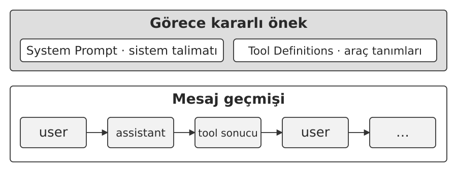

Bu nedenle art arda iki isteğin başında yer alan aynı kesit, mesaj geçmişinin içine kadar uzayabilir. Bir sonraki turun ne kadar eski hesaplamayı yeniden kullanabileceği, bu önekin ne kadar uzun olduğuna bağlıdır.

Aşağıdaki Harness, sık değişmeyen sistem talimatlarını ve araç tanımlarını başa koyar, her turda geçmiş mesajların sonuna yalnızca geçerli durumu ekler. Geçmiş çok uzadığında önce eski mesajları sıkıştırır, sonra isteği derler.

```python
stable_prefix = system_message
stable_tools = core_tool_schemas
history = load_message_history(session)
status_message = make_status_message(derive_current_state(history))

if estimated_tokens(stable_prefix, stable_tools, history, status_message) > budget:
    history = compress_old_evidence(
        history,
        preserve = [decisions, constraints, failures, citations]
    )

request.messages = [stable_prefix] + history + [status_message]
request.tools = stable_tools
response = call_model(request)
```

Sıkıştırma sırasında kararlar, kısıtlar, başarısızlıklar ve atıflar gibi sonraki işler için gereken bilgiler korunur; çağrı talepleri ile araç sonuçları arasındaki bağ da sürdürülür. Uzunluk bütçesinin yanı sıra bilgi tekrarı ve eskimiş bilgi de sıkıştırmayı tetikleyebilir; somut stratejileri bu bölümün ikinci yarısında ele alacağız.

> **Deney 2-1 ★: Yerel LLM hizmeti kurulumu ve araç çağrısı**
>
> Bu deneyde yerelde Qwen3-0.6B çalıştırılıyor ve "Vancouver'da saat ve hava durumu" görevi izlenerek bir mesajın modelden, ayrıştırıcıdan ve araç yürütücüsünden nasıl geçtiği gözlemleniyor. Şekil 2-5 yerel hizmet ile istemci arasındaki iş bölümünü gösteriyor: sunucu modeli yükler, girdiyi işler ve yanıtı üretir; istemci mesaj geçmişini tutar, araçları zamanlar ve sonuçları geri verir.
>
> 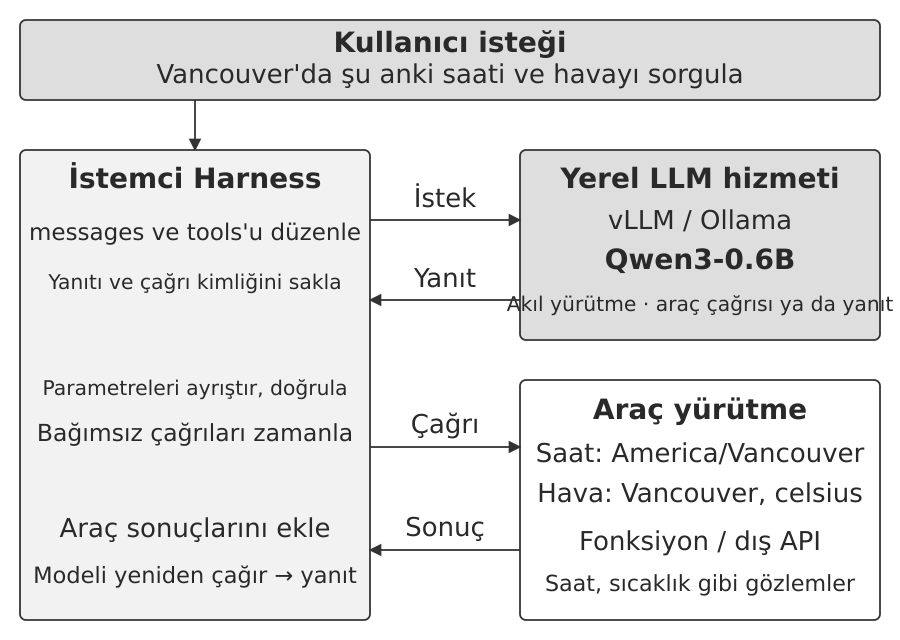
>
> **Önce eksiksiz bir görevi izleyin.** Model aynı turdaki çıktıda saat ve sıcaklık sorgusunu ister, parametrelere `America/Vancouver`, `Vancouver` ve `celsius` gibi değerleri yazar. İstemci iki aracı paralel yürütür. Birinci makbuz yerel saati 11:11:28, ikincisi sıcaklığı 17,9 °C olarak verir. İki sonuç modele geri verildiğinde model saati dakikaya kadar bildirir, sıcaklığı 17,9 °C olarak yanıtlar ve döngüyü bitirir. Bu çalıştırma, altı yüz milyon parametreli bir modelin bu görev için iki aracı doğru seçebildiğini, parametreleri doldurduğunu ve dönen değerlerle kullanıcıyı yanıtlayabildiğini gösteriyor.
>
> **Sonra ham çıktı ile API alanları arasındaki karşılığa bakın.** Qwen3'ün düşünme modu `<think>` etiketli akıl yürütme içeriği üretebilir; araç talepleri ise ilgili çağrı etiketlerini kullanır. Sunucu bunları ayrıştırdıktan sonra istemci ayrı bir `thinking` alanı ya da araç çağrısı alanı alabilir. Çıktıdaki parçaların sırasını ve saklanma biçimini model şablonu ile hizmet protokolü birlikte belirler.
>
> **Ardından akış (streaming) işlemeyi gözleyin.** Arayüz olaylarla birlikte "düşünüyor", "aracı çağırıyor" ve "yanıt üretiyor" gibi durumları güncelleyebilir. Araç parametreleri çoğu zaman birkaç parça hâlinde gelir ve tam bir talebe dönüşecek şekilde biriktirilmelidir; protokol çağrının bittiğini doğruladıktan ve parametre, yetki ile bağımlılık denetimleri geçtikten sonra çalışma sistemi zamanlamaya başlayabilir. Birbirinden bağımsız araçlar paralel yürütülebilir, sonraki çıktı işlemeyle akış hâlinde de birleştirilebilir.
>
> **Son olarak hız ve önbelleği karşılaştırın.** Bu kez Apple çipli bir Mac'te alınan kayıtta araç görevlerinin ortalama çözümleme hızı saniyede yaklaşık 107 token'dı. Token, modelin metni işlerken kullandığı temel birimdir; somut bölütleme tokenizer tarafından belirlenir, bir sözcük ya da karakter bir veya birkaç token'a karşılık gelebilir. Çözümleme hızı üretim başladıktan sonraki çıktı hızını yansıtır; kullanıcının ne kadar bekleyeceği ilk token gecikmesine, akıl yürütme uzunluğuna ve araç süresine de bağlıdır.
>
> Önbellek karşılaştırmasında aynı uzun önek kullanıldı; öneki koruyan ve önekin başını değiştiren istekler ayrı ayrı sınandı. Bu kez beş eşleşmiş çiftin dördünde öneki koruyan istek daha hızlıydı; iki grubun ortalama ilk token gecikmesi yaklaşık 1,30 saniye ile 1,51 saniye oldu. Bir sonraki kısım bu istekler arasındaki hesaplama farkını açıklayacak.
>
> Bu deney aynı zamanda yazarın uç cihaz üzerindeki Agent'lara daha çok güvenmesini sağladı: küçük modeller artık kullanıcının kendi cihazında böyle araç çağrısı görevlerini tamamlayabiliyor. **Uç cihaz Agent'ları çağı, birçok kişinin beklediğinden daha yakın.**

## KV Cache dostu context tasarımı

Agent'ın ardışık istekleri genellikle çok miktarda bilgiyi paylaşır: sistem talimatları, araç tanımları ve o ana kadar gerçekleşmiş etkileşim. Çıkarım motoru bu içeriklerin ara hesaplama sonuçlarını yeniden kullanabilirse, daha fazla hesaplamayı yeni bilgiye ayırabilir. **KV Cache**, her dikkat katmanında elde edilmiş anahtar (Key) ve değer (Value) vektörlerini sonraki token'lar için saklar; **Prompt Cache** ise koşulları karşılayan önek önbelleğini istekler arasında yeniden kullanır[^ch2-kv-basics].

Bir müşteri hizmetleri Agent'ını düşünün: modele geçerli saati bildirmek için geliştirici sistem prompt'unun başına `Current time: {{now}}` ekliyor ve her istekte güncelliyor. Arkasındaki iş kuralları ve araç tanımları olduğu gibi kalıyor, ama gerçek girdi zaman damgasından itibaren değişmeye başlıyor. Aynı öneki paylaşan istekler için KV'yi yeniden kullanan bir hizmette bu, zaman damgasının ve sonraki parçaların yeniden hesaplanmasına yol açar; girdi işleme süresi ve maliyeti artar.

Saati ek bir mesaj olarak yazmak ya da gerektiğinde bir saat aracını çağırmak, mevcut öneki korumayı sağlar. İki düzen benzer bilgi sunar, ama tetiklediği yeniden hesaplama kapsamı farklıdır.

Şimdilik üç uygulamayı aklınızda tutun; ilkeleri ve deneyleri aşağıda tek tek açıklayacağız:

1. **Yeniden kullanılabilir öneki sabit tutun.** Sistem talimatları ve sık kullanılan araç tanımları deterministik içerik ve sırayla yazılmalıdır.
2. **Çalışma sırasındaki değişiklikleri sona ekleyin.** Saat, bakiye, çağrı sayısı ve görev ilerleyişi yeni mesajlar ya da araç sonuçlarıyla sağlanabilir. En güncel durumun hangi andan itibaren geçerli olduğu belirtilmeli, böylece model geçerli karar için hangi kaydın geçerli olduğunu ayırt edebilmelidir.
3. **Mesajları model protokolüne göre düzenleyin.** Doğru rolleri, çağrı ID'lerini ve araç sonucu biçimini kullanın; model girdisi ilgili sohbet şablonuyla üretilsin. Önbellek eşleşmesi işlenmiş öneğe ve ilgili yapılandırmaya bakar; mesaj protokolü ayrıca modelin talimatları, kullanıcı isteklerini ve araç dönüş değerlerini nasıl ayırt edeceğini belirler.

Bu kısımda kullanılan nedensel dikkat modelinde, sonraki token'ların eklenmesi önceki konumlar için zaten hesaplanmış durumları değiştirmez. Var olan girdi değiştirildiğinde, ilk değişen konum ve sonrasındaki durumların yeniden hesaplanması gerekir; değişiklikten önceki önek için yine yeniden kullanım şansı vardır. Sunucu ayrıca önbellek blok boyutuna, saklama süresine ve çalışma yapılandırmasına göre gerçek isabet kapsamına karar verir.

[^ch2-kv-basics]: Hugging Face, How caching works; K ve V'nin katman katman saklanması ve yeniden kullanılmasını anlatır.

> **Deney 2-2 ★: Dikkat mekanizmasının görselleştirilmesi**
>
> Önce "Pekin'in havası nasıl" cümlesiyle tek bir dikkat hesabını anlayalım. Gösterimi kolaylaştırmak için Şekil 2-6 bu cümleyi dört anlamsal birime ayırıyor; gerçek modelde girdiyi tokenizer böler. "nasıl" konumunu işlerken dikkat katmanı mevcut bilgilerden o konumun temsilini bileştirmelidir. Query, Key ve Value sırasıyla sorgulama, eşleştirme ve bilgi toplama rollerini üstlenir.
>
> | Vektör | Rolü | Bu örnekteki sezgisel karşılığı |
> | --- | --- | --- |
> | **Query (sorgu)** | Geçerli konumun diğer konumlarla eşleştirmek için kullandığı vektör | "nasıl" mevcut içerikten ilgili bilgiyi bulmak ister |
> | **Key (anahtar)** | Her konumun eşleştirmeye katılan vektörü | "Pekin", "hava" gibi konumlar eşleştirilebilir temsiller sunar |
> | **Value (değer)** | Ağırlıklarla toplanan bilgi vektörü | Yer, hava gibi bilgiler uygun oranlarda geçerli temsile katılır |
>
> Key'i aramada kullanılan etiket, Value'yu ise geri getirilen içerik gibi düşünebilirsiniz. Modeldeki bu vektörler gizli temsillerden hesaplanan sayılardır ve eşleşme biçimleri eğitimle şekillenir.
>
> Bir hesap üç adımda yapılır. Önce geçerli konum bir Query üretir; sonra bu Query diğer konumların Key'leriyle iç çarpım yapar, ölçekleme, nedensel maske ve softmax uygulandıktan sonra toplamı 1 olan dikkat ağırlıkları elde edilir; en sonunda bu ağırlıklarla Value'lar ağırlıklı olarak toplanır. İç çarpım, iki sayı grubunun basamak basamak çarpılıp toplanmasıdır; softmax ise görünür konumların skorlarını normalize edilmiş ağırlıklara çevirir. Her konumun Value'su kendi ağırlığıyla toplamaya katılır ve bu dikkat başının çıktısını birlikte oluşturur.
>
> Şekil 2-6'nın son satırını yatay olarak okuyun: "nasıl" konumu "hava"ya 0,55 ağırlık veriyor. Bu sayının "hava" konumunun Value'suyla çarpılıp diğer üç konumun katkısının eklenmesiyle, bu dikkat başının "nasıl" konumundaki çıktısı elde edilir. "hava" satırına geçtiğinizde sağda neden bir çarpı işareti var? Çünkü bu konum hesaplanırken dizi henüz "nasıl"a ulaşmamıştır.
>
> 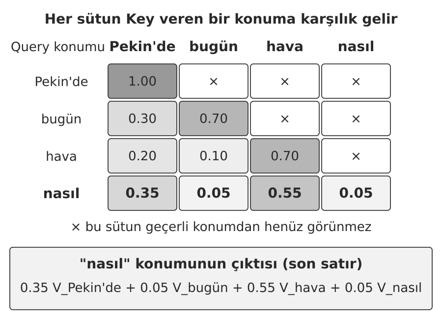
>
> Her konumun ağırlıklarını matris hâlinde dizdiğinizde **dikkat ısı haritası** elde edilir. Her satır bir Query'ye, her sütun bir Key'e karşılık gelir; rengin koyuluğu ağırlığın büyüklüğünü gösterir. Nedensel maske geçerli konumun kendisini ve önceki konumları okumasına izin verir; şekilde × ile işaretlenen konumlar maskelenmiştir ve softmax sonrası ağırlıkları sıfırdır. Bu yapı hem girdi işlemede hem de sonraki üretimde geçerlidir.
>
> Buradan K ve V önbelleğinin işlevi de görülür: üretim ilerledikçe yeni konumlar yine mevcut konumların Key ve Value'larını okur. Bu vektörler saklandığında yeni konumlar eşleştirme ve toplama için onları doğrudan kullanabilir; geçmiş konumların yeniden hesaplanmasından kurtulunur.
>
> Bu örnek ağırlıkları anladıktan sonra Qwen3-0.6B ile modelin gerçekte hesapladığı dikkat dağılımına bakabilirsiniz. Deney kısa bir cümleyi ve akıl yürütme ile nihai yanıt içeren bir üretim dizisini ayrı ayrı kaydedip farklı katmanların dikkat matrislerini karşılaştırıyor. Şekil 2-7 sırasıyla 0., 13. ve 27. katmanları gösteriyor: sol sütunda dokuz token'lık kısa cümle, sağ sütunda 17 × 23 hesabının üretim dizisi var; girdi, akıl yürütme ve yanıt bölgeleri işaretlenmiş. Gri tonlama logaritmik ölçek kullanır; böylece hem güçlü hem zayıf dikkat ağırlıkları aynı anda görülebilir.
>
> 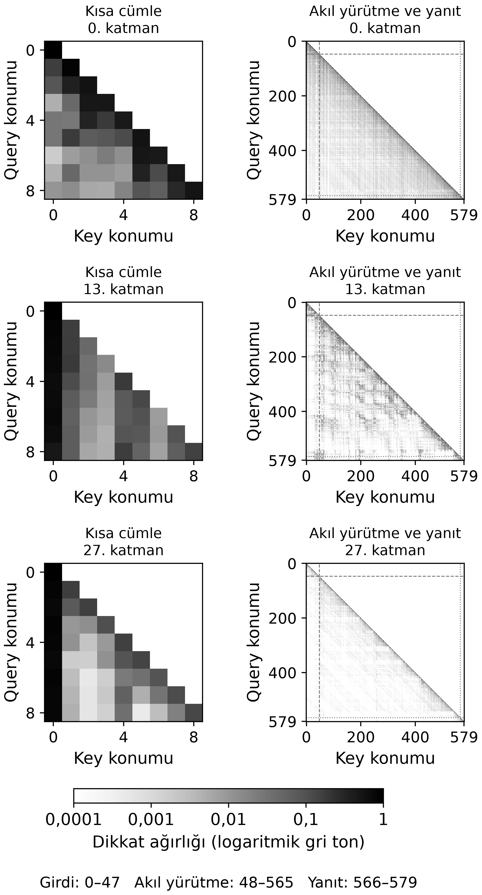
>
> Okurken dört ipucunu izleyebilirsiniz:
>
> 1. **Dikkat deposu (Attention Sink).** Bazı katmanlar dizinin başına büyük ağırlık verir; baştaki token çok az anlam taşısa bile. Şekil 2-7'nin sol sütunundaki kısa cümleye bakın. Her şekilde aynı katmanın dikkat başlarının ortalaması alınmıştır. Matrisin ilk sütunundaki dokuz sayının ortalaması, dokuz konumun ortalama olarak ilk token'a ne kadar ağırlık verdiğini verir. 0., 13. ve 27. katmanlar için bu değerler sırasıyla %14,7, %73,9 ve %83,2'dir. Sağ sütundaki daha uzun üretim dizisine geçtiğinizde 13. katmanda bu değer %28,0 olur. softmax konum ağırlıklarının toplamının 1 olmasını gerektirir; model görece kararlı bir alıcı konum öğrenebilir. StreamingLLM bu olguyu ve akışlı çıkarımdaki rolünü ayrıca incelemiştir[^ch2-attention-sinks].
> 2. **Akıl yürütme bölgesi.** `<think>` etiketine karşılık gelen üretim aralığını işaretleyip bu satırlar boyunca modelin hangi prompt'lara, araç açıklamalarına ya da önceki akıl yürütmeye baktığını inceleyin. Üçgen biçimi nedensel maskeden gelir; üçgenin içindeki renk farkları konum ağırlıkları arasındaki asıl farkı yansıtır.
> 3. **Yanıt bölgesi.** Ardından nihai yanıtın üretim aralığını işaretleyip onun özgün girdiye ve önceki akıl yürütmeye verdiği ağırlıkları karşılaştırın. Bu, hangi mevcut bilgilerin geçerli dikkat toplamına girdiğini bulmayı kolaylaştırır.
> 4. **Konum farkı.** *Lost in the Middle*, uzun context'li soru-cevap ve anahtar-değer getirme deneylerinde ortadaki konumlardaki bilgilerin etkili biçimde kullanılmasının daha zor olduğunu gözlemledi[^lost-in-the-middle]. Mühendislikte buradan yola çıkıp sürekli geçerli kuralları başa, geçerli hedefi ve ilerlemeyi ise sona koymayı tercih edebilirsiniz.

[^ch2-attention-sinks]: Xiao et al., Efficient Streaming Language Models with Attention Sinks, ICLR 2024.

[^lost-in-the-middle]: Liu et al., Lost in the Middle: How Language Models Use Long Contexts, TACL 2024.

### API mesajlarından model token'larına: Chat Template

Yukarıdaki API örnekleri rollerle işaretlenmiş bir mesaj kümesiydi; dikkat şeklindeki girdi ise bir token dizisidir. **Chat Template (sohbet şablonu)** bu dönüşümü yapar: mesajlara rol ve sınır işaretleri ekler, araç açıklamalarını ve dönüş değerlerini üzerinde anlaşılmış biçimde düzenler, sonra tokenizer'a kodlatır. Şekil 2-8'deki iki sütunu karşılaştırın: solda yalnızca sistem talimatı ve kullanıcı sorusu gönderilmiş; sağda neden bir `assistant` daha var? O, şablonun bir sonraki yanıt için eklediği başlangıç işaretidir. Araç çağrısını, akıl yürütme bilgisinin korunmasını ve önbellek isabetini tartışırken bu işaretleri yine kullanacağız.

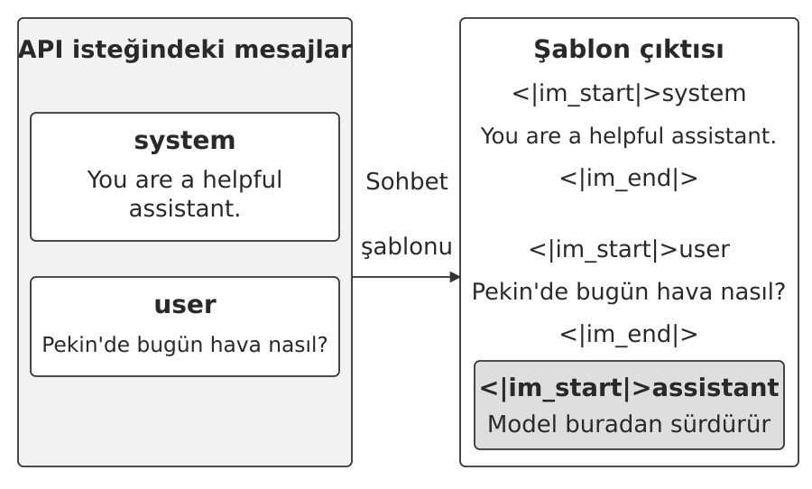

Qwen, Llama, Gemma gibi model ailelerinin her birinin kendi sohbet şablonu vardır. Aynı API mesaj kümesi farklı bir modele verildiğinde dönüştürülen rol ve sınır işaretleri de farklı olabilir. Yönetilen API'larda bu dönüşümü genellikle sunucu yapar; kendi dağıtımınızda ise çıkarım hizmetine modelle uyumlu şablonu yapılandırmanız gerekir.

Diyelim kullanıcı "Vancouver 17,9 °C" diye yazdı ve hava durumu aracı da aynı metni döndürdü. Bu iki mesajı ayrı ayrı Qwen3-0.6B'nin şablonuna verdiğinizde Şekil 2-9'daki iki girdi parçasını elde edersiniz. İkisi de `<|im_start|>user` ile başlıyor; hangi işaret metnin araçtan geldiğini gösteriyor?

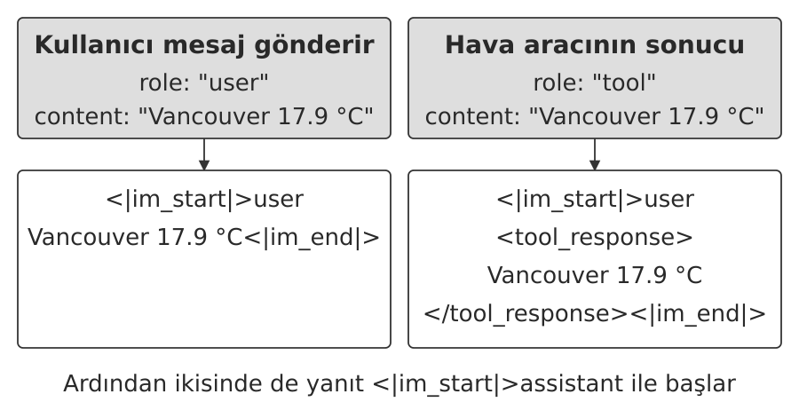

Sağ sütunda bir çift `<tool_response>` etiketi fazladan var. Şablon ayrıca mesaj rollerine göre kullanıcının en son sorusunu konumlandırır: bu sorudan önceki turlarda yalnızca yanıt içeriği korunur; bu sorudan sonraki araç etkileşimleri ise modelin akıl yürütme bilgisini de taşıyabilir[^ch2-qwen-template].

Örneğin model bir dosyayı inceledikten sonra analize devam etmek istiyor. Araç sonucu `tool` rolüyle geri verildiğinde şablon bunu geçerli görevdeki araç geri bildirimi olarak tanır; aynı sonucu doğrudan sıradan bir `user` mesajı olarak yazarsanız şablon bunu yeni bir sorgu sayabilir ve önceki akıl yürütmenin korunma kapsamını değiştirebilir. Bu, bir problemi çözmeye devam ederken ara işlem notlarını korumaya benzer: Harness hizmetin istediği akıl yürütme alanlarını saklamalı ve çağrıyı doğru mesaj yapısıyla sürdürmelidir.

**Tek turlu akıl yürütmeden uzun soluklu Agent'a geçildikçe, geçmiş düşünceler bakımı gereken bir görev durumuna dönüşür.** DeepSeek-R1'in ilk sohbet şablonu, geçmiş yanıtlardaki düşünme bölümünü atar ve yalnızca nihai yanıtı korur[^ch2-r1-template]; sonraki DeepSeek araç çağrısı protokolü ise akıl yürütme bilgisinin geri verilmesini ister. Bir soru-cevap bittikten sonra nihai yanıt sonraki tur için gereken bilgiyi zaten içerebilir; ama araç görevi yarıda kaldığında "bu dosya neden incelendi", "hangi varsayımlar elendi" gibi bilgiler yalnızca ara akıl yürütmede yazılı olabilir. Bu bilgileri korumak, bir sonraki turun mevcut düşünce çizgisini sürdürmesine yardım eder.

**Akıl yürütme bilgisinin nasıl geri verileceğini model protokolü belirler.** Entegrasyonda `content`, `tool_calls` ve hizmetin sağladığı akıl yürütme alanları birlikte ele alınmalıdır. Aşağıdaki seçenekler farklı sürdürme kurallarını gösteriyor:

- **DeepSeek düşünme modu** akıl yürütmeyi `reasoning_content` ile döndürür. Araç çağrısı protokolüne göre istek `tools` içeriyorsa, sonraki isteklerde geçmiş akıl yürütmenin tamamı geri verilmelidir; araç çağırmamış model yanıtları da buna dahildir. Alanın eksik olması 400 hatasına yol açar. `tools` içermeyen salt sohbet isteklerinde hizmet geri verilen geçmiş akıl yürütmeyi yok sayar[^ch2-deepseek-thinking].
- **Kimi'nin düşünme ve araç etkileşimi** de akıl yürütme, araç talepleri ve sonuçların çalışma döngüsünde yönetilmesini gerektirir. Kimi K2.5'in iç içe düşünme örneğinde model birden çok araç çağrısı arasında akıl yürütmeyi sürdürebilir; istemci model mesajlarını kendi protokolüne göre saklayıp geri verir[^ch2-kimi-thinking].
- **GLM'nin düşünceyi koruması** `thinking.clear_thinking: false` ile açılabilir; ardından `reasoning_content` eksiksiz ve özgün sırasıyla geri verilir. Coding Plan ile standart API'nin varsayılanları farklıdır; istemci istediği modu açıkça seçmelidir[^ch2-glm-thinking].
- **Claude'un thinking block'ları** imzalarıyla birlikte saklanmalıdır. Preserved thinking destekleyen modeller blokların kaynağını ve öneğini de kontrol eder; ayrıntılı kurallar ilerideki "mimari kısıt olarak önbellek" kısmında.

Bu kurallar ardışık araç çağrılarını ve görev ortasında model değiştirmeyi de etkiler. Model değiştirildiğinde uyarlama katmanı araç taleplerini, sonuçları ve görev durumunu hedef arayüzün kabul ettiği biçime çevirmeli, sonra akıl yürütme bilgisini hedef modelin kurallarına göre işlemelidir. Bölüm 5'teki Deney 5-1 bu iz sürdürme işini ayrıntılı olarak ele alacak.

**Şablon aynı zamanda önbelleğin eşleştirdiği girdiyi belirler.** Aynı mesaj içeriği farklı şablonlar, araç sıraları ya da serileştirme biçimleriyle işlendiğinde farklı token önekleri oluşabilir. Mevcut KV'yi yeniden kullanmak için ilgili model yapılandırmasının ve öneğin tutarlı kalması gerekir.

[^ch2-qwen-template]: Qwen3-0.6B'nin tokenizer yapılandırma dosyası `tokenizer_config.json` sohbet şablonunu saklar; içinde kullanıcı sorgusunun, akıl yürütme içeriğinin ve araç yanıtlarının işlenme mantığı bulunur.

[^ch2-r1-template]: DeepSeek-R1'in resmî sohbet şablonu, sıradan geçmiş yanıtlarda `</think>` sonrasındaki içeriği korur; sonraki araç çağrılarında akıl yürütmenin geri verilmesine ilişkin kurallar DeepSeek'in Thinking Mode belgelerinde bulunur.

[^ch2-deepseek-thinking]: DeepSeek, Thinking Mode.

[^ch2-kimi-thinking]: Moonshot AI, Kimi K2.5 resmî deposu, Interleaved Thinking and Multi-Step Tool Call bölümü.

[^ch2-glm-thinking]: Z.ai, Thinking Mode; iç içe düşünmeyi, düşünceyi korumayı ve uç noktaların varsayılan ayarlarını tanıtır.

### KV Cache'in ilkesi ve kısıtları

Model bir isteği işlerken önce girdi üzerinde **prefill (ön doldurma)** yapar ve mevcut token'ların temsillerini hesaplar, sonra **decode (çözümleme)** aşamasına geçip sonraki token'ları tek tek üretir. KV Cache çözümleme sırasında mevcut konumların K ve V'lerini saklar; istekler arası önek önbelleği ise önceki istekten kalan aynı öneği daha da yeniden kullanır.

Örneğin Agent altıncı tura geldiğinde 2.000 girdi token'ı birikmiştir. Hizmet yalnızca bu isteğin içindeki KV Cache'i kullanıyorsa önce 2.000 token'ı işlemesi, sonra önbellekten yararlanarak üretime devam etmesi gerekir. İstekler arası önbellekte bunun bir bölümü aynı önek olarak zaten varsa prefill, henüz önbellekte olmayan konumdan devam edebilir. Şekil 2-10 bu istekler arası yeniden kullanımı gösteriyor.

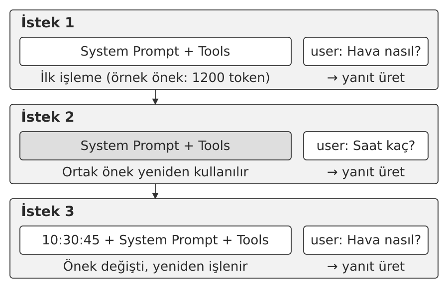

**Dört token ile önbelleğin büyümesini izleyelim.** Girdinin `[A, B, C, D]` olduğunu varsayalım. Model D konumunu işlerken D'nin Query'sini A, B, C, D'nin Key'leriyle eşleştirir, sonra Value'larını ağırlıklı olarak toplar. Katmanlar boyunca yapılan hesaplardan sonra D konumunun nihai temsili bir sonraki token E'yi tahmin etmek için kullanılır. Bu anda A'dan D'ye kadar tüm konumların her katmandaki K ve V'leri saklanmıştır.

Örnekleme ile E elde edildikten sonra bir sonraki adımda E modele verilir ve her katmandaki Query, Key ve Value'su hesaplanır. E'nin Query'si önceki önbelleği ve geçerli konumun K, V'lerini okur; model altıncı token'ı tahmin eder ve E'nin K, V'leri de önbelleğe eklenir. Böylece her üretilen adımda önceki durumdan yararlanılır, yalnızca yeni girdi token'ının durumu hesaplanır.

KV Cache hiç kullanılmasaydı E tahmin edilirken A'dan D'ye yeniden işlenir, altıncı token tahmin edilirken A'dan E'ye işlenirdi. Yalnızca K ve V'lerin tekrar üretildiği konum sayısı üzerinden hesaplandığında toplam iş yükü $1+2+\cdots+N$ gibi büyür. Önbellek kullanıldığında geçmiş konumların katman katman hesaplaması yeniden kullanılır; yeni konum yine görünür K, V'leri okumak zorundadır. Standart tam dikkatli çözümlemede bu okuma ve eşleştirme context uzunluğuyla doğrusal olarak artar; bu yüzden uzun context yine daha fazla bellek ve bellek bant genişliği tüketir.

**Girdi değiştirildiğinde sonraki önbellek neden etkilenir?** Transformer'ın katmanları gizli temsilleri sırayla işler ve her katmanın kendi K, V'leri vardır. Bir konum dikkat hesabından geçtikten sonra temsiline önceki konumların bilgisi karışmıştır ve bu temsil bir sonraki katmana aktarılır. Dolayısıyla $k$. token değiştiğinde etki o konumdan geriye doğru ve daha üst katmanlara doğru yayılır.

Aynı model ve hesaplama yapılandırmasında $k$'dan önceki konumlar yalnızca daha eski girdilere bağlıdır ve yeniden kullanılabilir; $k$'dan itibaren etkilenen durumların yeniden kurulması gerekir. Gerçek hizmetlerde önek genellikle önbellek bloklarıyla eşleştirilir, yeniden hesaplama sınırı blok boyutundan da etkilenir. Güncelleme ne kadar önde olursa genellikle o kadar çok girdi yeniden hesaplanır. Sabit talimatları başa koyup yeni durumu sona eklemek, tam da bu bağımlılıktan yararlanmaktır.

> **Deney 2-3 ★★: Context yönetimi yöntemlerinin karşılaştırılması**
>
> Bu deneyde Agent aynı görevi dosya keşfi, okuma ve arama araçlarıyla tamamlıyor; sabit ekleme yapan bir temel düzen ile beş context değişikliği karşılaştırılıyor. Temel düzen talimatların ve araç sırasının sabit kalmasını sağlar, her turda model mesajlarını ve araç sonuçlarını ekler. Diğer gruplar talimatları, durumu, araç sıralamasını ya da geçmişin ifade edilişini değiştirir; önbellek istatistiklerinin ve görev sürecinin nasıl değiştiği gözlenir.
>
> **Dinamik sistem prompt'u** her turda sistem talimatı içinde geçerli saati günceller. Değişiklikten önce hâlâ paylaşılan bir önek olabilir; zaman bilgisinden sonraki girdilerin ise yeniden eşleştirilmesi ya da hesaplanması gerekir. Saati yeni bir mesaj olarak eklemek ya da saat aracıyla ihtiyaç anında almak, sürekli geçerli iş kurallarının yeniden kullanılmasını sağlar.
>
> **Dinamik kullanıcı yapılandırması** öndeki mesajlarda kalan çağrı sayısını ya da hesap bakiyesini günceller. Durumun kendisi görev için gerekli bilgidir; tasarımın odak noktası güncellemenin konumudur: en güncel durumu sona ekleyip geçerlilik anını belirtmek hem ilerlemeyi hem öneği korur. İlerideki Agent durum çubuğu bu düzenlemeyi kullanacak.
>
> **Araç tanımlarının yeniden sıralanması** her turda araç listesinin sırasını değiştirir. Adlar ve parametreler aynı olsa da serileştirilmiş token sırası değişir. Kimi K2.6'nın çalıştırma raporunu açtığınızda temel düzen ile yeniden sıralama grubunun `Hit%` değerleri %100'dür. İki grup gerçekten aynı miktarda girdiyi yeniden kullandı mı? Temel düzen üç turda toplam 7.567 girdi token'ı kullandı; bunun 768'i önbellekten geldi. Yeniden sıralama grubu da üç turdaydı; 7.568 girdi token'ının yalnızca 256'sı önbellekten geldi. Önbellekten gelen token sayısını girdi token sayısına bölünce `Cache%` sütunundaki %10,1 ve %3,4 değerleri çıkar. Diğer `Hit%` sütunu ise isabet olduğu belirlenen istekleri sayar: temel düzende iki isabet, yeniden sıralama grubunda bir isabet kaydedildi; iki grupta da ıskalama sayısı sıfırdır. Kalan isteklerin isabet durumunu bu kayıttan anlamak mümkün değil. Araç sırasını sabitlemek, önekin sebepsiz değişmesini önler.
>
> **Kayan pencere** yalnızca en son bir kesit geçmiş tutar. On turluk etkileşim varsayımıyla on beşinci turda ikinci turda elde edilen kilit dosya içeriği okunamayabilir. Kırpma paylaşılan öneği kısaltmanın yanı sıra modelin erişebildiği olguları ve görev ilerleyişini de değiştirir. Eşlik eden uygulama son altı geçmiş mesajla başlar ve araç sonuçlarına karşılık gelen çağrı taleplerini geriye doğru tamamlar. Kayan pencere grubu 2.224 girdi token'ının 1.510'unu yeniden kullandı; %67,9 ile altı grubun en yüksek önbellek oranına ulaştı. Şimdi Deney 2-3'ün kayan pencere grubundaki araç kayıtlarına bakın: model üç kez dosya aradı, ardından iki dosyayı okudu, ama kullanıcının istediği üç cümlelik özeti teslim etmedi.
>
> **Metin biçimlendirme** rollü geçmişi `USER: ...`, `ASSISTANT: ...` gibi metinlere yeniden yazar. Bu, şablondaki mesaj sınırlarını ve araç yapısını değiştirir; model özgün ilişkileri metnin içinden yeniden kurmak zorunda kalır. Bu kez metin grubu yine nihai yanıtı üretti ve önbellek isabeti de oldu. Arayüzün sağladığı mesaj rolleri, çağrı ID'leri ve araç sonucu alanları bu ilişkilerin kararlı biçimde aktarılmasına yardım eder.
>
> Program mesaj listesini yeniden kurmuş olsa bile, gönderilen önek ve önbellek yapılandırması aynı olduğu sürece bu önek yine yeniden kullanılma şansına sahiptir.
>
> Kullanıcının ne kadar az beklediğini öğrenmek istiyorsanız önce zamanlayıcının nerede durduğuna bakmalısınız. Kayan pencere grubunun ilk turunda `ttft` yaklaşık 2,23 saniyedir. Program bu alanı TTFT (ilk token gecikmesi) diye adlandırsa da sayaç, akışsız istek tüm yanıtı döndürdüğünde duruyor.

### KV Cache ve Prompt Cache: iki düzeyli önbellek

Bu iki önbellek düzeyini iki zaman noktasıyla ayırabiliriz. Model yanıtın ikinci token'ını üretirken istekteki mevcut konumların anahtar-değer durumunu okuyabilir; bu, **KV Cache**'in işidir. Bir süre sonra kullanıcı ek soru sorar ve Harness yeni bir istek gönderir; hizmetin bu girdiyi daha az hesaplaması için önceki istekte saklanan aynı öneki bulması gerekir; bu da **Prompt Cache**'tir. Birincisi aynı üretimin nasıl sürdüğünü açıklar, ikincisi ise istekler arası saklama ve eşleştirme mekanizmasını da gerektirir.

API hizmetlerinde önbellek ayrıca en küçük önek uzunluğundan, blok boyutundan, geçerlilik süresinden, model yapılandırmasından ve kiracı yalıtım kapsamından etkilenir. Yeniden kullanılabilir önek aynı önbellek kapsamı içinde aranmalıdır. Örneğin Claude API önbelleği kuruluşa ve çalışma alanına göre yalıtır; aynı metin farklı yalıtım alanlarında göründüğünde ayrı önbellekler oluşturulur[^ch2-prompt-cache].

Ücretlendirmede yazma ve okuma ayrı ayrı dikkate alınmalıdır. Bazı Claude modellerinde önbellek okuma fiyatı normal girdi fiyatının onda biridir; ilk yazma için ise ek ücret vardır. Aynı önek geçerlilik süresi içinde tekrar tekrar kullanıldığında yazma ücreti bir kez ödenir, sonraki isabetli istekler okuma fiyatından ücretlendirilir.

[^ch2-prompt-cache]: Anthropic, Prompt caching; önbellek eşleştirmesini, yalıtımı, geçerlilik süresini ve ücretlendirmeyi tanıtır.

### Mimari kısıt olarak önbellek

**Üretim sistemlerinde önbellek artık bir mimari kısıt hâline geldi.** Prompt'ların nasıl sıralandığı, alt Agent'ın nereden başladığı ve oturumun nasıl kurtarıldığı, ne kadar hesaplamanın yeniden kullanılabileceğini etkiler. **Önbellek sınırları tasarımın başında belirlenmelidir.** Önce hangi içeriğin paylaşılabileceği, hangi durumun değişeceği belirlenip prompt'lar ve oturum yapısı buna göre düzenlenirse çalışma sırasındaki tekrarlı yeniden hesaplamalar azalır. Uzun soluklu görevlerde gecikme ve maliyet sorun hâline geldikten sonra bu yapıları değiştirmek çoğu zaman durum yönetimini, alt Agent'ları ve oturum kurtarmayı da sarsar.

**Öneki kararlılık derecesine göre düzenleyin.** Birden çok görevin paylaştığı talimatlar ve araç tanımları başta olabilir; ardından kullanıcı bilgileri, oturum durumu ve yeni gözlemler kapsamlarına göre gruplanır. Örneğin işletim sistemi macOS/Linux olmak üzere iki seçenek, çalışma modu normal/hata ayıklama olmak üzere iki seçenek ve dil Çince/İngilizce olmak üzere iki seçenek verirse, birbirinden bağımsız üç koşul en fazla $2\times2\times2=8$ önek bileşimi üretir. Sık değişen alanları paylaşılan bölümün arkasına koymak ortak önekin yeniden kullanılma şansını artırır. Ortak bölümün paylaşım kapsamı ayrıca hizmetin kuruluş, çalışma alanı ve gizlilik sınırlarına uymalıdır.

**Alt Agent'lar için yeniden kullanılabilir bir başlangıç noktası seçin.** Alt Agent üst Agent'ın görev arka planını devralırsa ikisinde ortak olan öneki yeniden kullanabilir, sonra kendi alt görevini ekleyebilir. Prompt'lar, araç sırası, model ve ilgili yapılandırma yeniden kullanım kapsamını birlikte belirler. Bağımsız bir role ya da yalıtılmış context'e ihtiyaç duyan alt Agent'ların girdisi kendi görevine göre kurulur, ardından hangi ortak bölümlerin paylaşılabileceği kontrol edilir.

**Gönderilmiş içeriği saklayın.** Büyük araç çıktıları bir özete ya da önizlemeye sıkıştırıldığında modele gerçekte verilen sürüm saklanmalıdır. Oturum kurtarılırken bu kaydın yeniden oynatılması tutarlı bir mesaj dizisi kurar; her kurtarmada özeti yeniden üretmek ise yeni ifadeler ve önek değişiklikleri getirebilir. Özet güncellenirken yeni bir sürüm yayımlanabilir ve önbelleğin bundan sonra nereden yeniden kurulacağı belirtilebilir.

**Akıl yürütmeyi korumak ayrıca protokol kısıtlarına uymayı gerektirir.** Claude'un preserved thinking özelliği bu soruna somut bir örnek sunar. Belgeler bu mekanizmayı damıtmayı önlemek için kullanır: hizmet thinking block'un imzasını, üretildiği modeli ve öneğini kontrol eder. Claude Fable 5.1, Claude Opus 5.5 gibi önek bağlamayı destekleyen modellerde bloktan önceki üst düzey `system`, `tools` ve mesajlar doğrulama kapsamını birlikte oluşturur; bunlardaki bir değişiklik o bloğu ve sonraki thinking block'ları geçersiz kılar[^ch2-preserved-thinking].

Örneğin her turda sistem saatini yeniden yazmak, ilk mesajdaki ortam bilgisini yeniden düzenlemek ya da eski araç sonuçlarını yerinde kısaltmak, sonraki akıl yürütme bloklarının bağlı olduğu öneği değiştirir. Doğrulama tetiklendiğinde API 400 hatası döndürebilir ya da `prefix_mismatch_behavior` yapılandırmasına göre geçersiz blokları atıp isteği işlemeye devam edebilir. İkinci durumda model korunan görev bilgisini ve araç sonuçlarını yine kullanabilir, ama geçersiz akıl yürütme bu girdiye artık katılmaz. 31 Ağustos 2026'dan itibaren oluşturulan hesaplarda önek doğrulaması varsayılan olarak açıktır; daha eski hesaplarda nasıl açılacağı protokol belgelerinde yazılıdır.

Bu tür protokollere bağlanırken oturumun üst düzey talimatlarını ve araç kümesini sabit tutup durum değişikliklerini sona ekleyebilirsiniz. Talimatları ya da araçları görev ortasında güncellemek gerekirse hizmetin sunduğu oturum içi sistem mesajları, araç değişikliği blokları gibi arayüzleri kullanın. Thinking block'ları kırparken de özgün sıradaki sürekli aralıklar korunmalıdır: baştan ya da sondan silinebilir veya hepsi birden silinebilir; ortada boşluk bırakmak sonraki blokları etkiler, bilerek silinen bloklar da silinmiş kalmalıdır.

Görev ortasında model değiştirildiğinde hizmet ayrıca hedef modelin özgün modelin akıl yürütme bloklarını okuyup okuyamadığını kontrol eder. İstemci özgün geçmişi saklamalı, hizmetin uyumluluk kurallarına göre işlemesine izin vermelidir; istemci kendi silerse sonradan özgün modele dönüldüğünde bu kayıtlar da geri getirilemez.

[^ch2-preserved-thinking]: Anthropic, Preserved thinking; modelleri, önek bağlamayı, geçersiz kılma işlemini ve akıl yürütme bloğu kırpma kurallarını tanıtır; oturum içi güncelleme arayüzleri için Mid-conversation system messages and tool changes belgesine bakın.

### Araştırma uzantısı: düzenlenebilir ve birleştirilebilir KV Cache

> Yukarıdaki tasarımların hepsi hesaplamayı önek eşleştirerek yeniden kullanıyor. Yazar bir adım daha ileri gitmek istiyor: KV içinde saklanan bilgiyi doğrudan düzenlemek ya da birleştirmek, önbelleği context'teki değişikliklere uyarlamak mümkün mü? *Models Take Notes at Prefill* yazısında bu bilgi modelin "notları"na benzetiliyor[^ch2-2]: prefill çok katmanlı dikkat hesaplarından geçtikten sonra bir alanın etkisi sonraki konumların temsillerine girmiş olur. Örneğin "kullanıcının şehri: Pekin" sonraki yer yargılarını etkileyebilir; yalnızca bu alanın kendi K, V'lerini değiştirmek yetmez, sonraki durumlar eski şehirden türetilmiş sonucu korumaya devam edebilir.
>
> Makale müdahalelerle alanın kendi KV'sinin etkisini sonraki durumların etkisinden ayırdı. İncelenen kararlarda alanın kendi KV'sinin doğrudan katkısı %1'in altında kaldı; asıl etki aşağı akış temsillerinde saklanıyordu. Bu aşağı akışta kalan "notlar" etrafında önbellekten yararlanmanın iki yolu araştırılabilir.
>
> **Düzenleme (Editing)** açık bir düzeltmeyle sonraki hesaplamayı mevcut yargıyı güncellemeye iter. Makale ayrıca incelenen 8B model görevlerinde açık bir düşünce zinciri varsa yalnızca alanı düzenlemenin hedef kararı geri getirebildiğini buldu; hesaplama maliyeti tam yeniden hesaplamanın yaklaşık %1'i kadardı. Bu akıl yürütme süreci yoksa eski aşağı akış durumu kararı etkilemeyi sürdürebiliyor ve alan değişikliği etkili olamıyordu.
>
> **Birleştirme (Composition)** önceden hesaplanmış beceri önbelleklerini yeni bir context'e bağlar. Döner konum kodlaması (RoPE) kullanan modellerde önce önbellekteki konum temsillerinin ayarlanması, sonra birleştirme yapılması gerekir. Bunu, dolu bir sayfadaki notları yeniden numaralandırıp başka bir malzemenin arkasına eklemek gibi düşünebilirsiniz. Makale on iki modeli karşılaştırdı; birleştirme ile tam yeniden hesaplamanın çıktı logit'lerinin kosinüs benzerliği 0,90–0,999 aralığındaydı. Önbelleğin yeniden konumlandırılması ve birleştirme uzunlukla doğrusal işlenebilir; bu da tüm context'in dikkat hesaplamasının tekrarlanmasını azaltır.
>
> Düzeltme bilgisini eklemek mevcut önek önbelleğiyle de birlikte kullanılabilir. Makalenin vLLM çevrimiçi kıyaslamasında bu bileşim önek önbelleği isabet oranının yaklaşık %98,5'ini korudu; p90 ilk token gecikmesi temel düzenin yaklaşık 1/398 ile 1/53'ü arasındaydı.
>
> **Yazar bu araştırma hattını umut verici buluyor, çünkü context güncellemelerinde daha fazla mevcut hesaplamanın korunmasını sağlayabilir.** Agent'lar sık sık bellek alanlarını günceller, durum ekler ya da araç tanımlarını değiştirir; ilgili durum notlar gibi düzeltilip birleştirilebilirse, uzun context'i bakımda tutmanın maliyeti belirgin biçimde düşebilir.

[^ch2-2]: Li, Bojie, Models Take Notes at Prefill: KV Cache Can Be Editable and Composable, 2026. Düzenleme, birleştirme ve çevrimiçi önbellek deneylerinde farklı görevler ve ölçütler kullanılmıştır; somut ayarlar makalede verilmiştir.

### Önbellek mekanizmasından context içeriğinin tasarımına

Önbelleğin hesaplamayı nasıl yeniden kullandığını anladıktan sonra sıra her turda neyin girip bu içeriğin nasıl güncelleneceğine karar vermeye gelir. İzleyen bölüm üç kısma ayrılıyor:

- **Prompt mühendisliği ve Agent Skills**: Önce sistem talimatları ve araç tanımları tasarlanır; hedef, kurallar ve çalışma biçimi açıklanır. Sonra kademeli açıklama yoluyla alan bilgisi ihtiyaç anında yüklenir. Prompt enjeksiyonuna karşı koruma ise dış içerik context'e girerken kaynağa ve talimat sınırına odaklanır.
- **Agent durum çubuğu**: Görev ilerleyişi, ortam gözlemi özeti ve çağrı sayacı gibi durumlar modele sunulur; uzun geçmişten yeniden çıkarım yapma yükü azalır. Telefondaki saat, batarya ve ağ durumu gibi çalışma anındaki durumu görünür kılar.
- **Context sıkıştırma**: Geçmiş büyürken sonraki kararlar için gereken bilgi korunur; ne zaman sıkıştırılacağına, özetin nasıl düzenleneceğine ve önbellek yeniden hesaplaması ile görev sürdürmenin nasıl ele alınacağına karar verilir.

## Prompt mühendisliği: sistem prompt'unu iyileştirmek

Prompt mühendisliği talimatlar, akışlar ve örnekler yoluyla modeli somut görevlere yönlendirir. Bu kısım özellikle **sistem prompt'u** (System Prompt) üzerinde duruyor: bir çalışan el kitabı gibi Agent'ın kimliğini, hedefini, davranış kurallarını ve iş akışını açıklar. Bu bölümdeki API örneklerinde bu içerik `system` mesajıyla sağlanıyordu.

### Ton ve üslup: kullanıcıya nasıl seslenilir

Ton talepleri somut ifadelere dönüştürülmelidir. Örneğin kısa soru-cevap için "You MUST answer concisely with fewer than 4 lines", yani dört satırdan kısa yanıt istenebilir. Görev tıkandığında "keep your response to 1–2 sentences" ile bir iki cümlede mevcut durum ve bir sonraki adım anlatılabilir; böylece kullanıcı ilgilenmesi gerekeni doğrudan görür.

"NEVER do X" türü büyük harfli vurgular kritik gereksinimleri öne çıkarmak için kullanılabilir. Daha da önemlisi, gereksinimin hangi durumlar için geçerli olduğunun ve hangi eylemin beklendiğinin açıklanmasıdır.

### Yapılandırılmış prompt: düzen hiyerarşisi ve içerik sınırları

Başlıklar, listeler ve etiketler uzun prompt'ları düzenlemeye yardım eder. Markdown başlıkları bölümleri ve adımları göstermeye, XML tarzı etiketler ise farklı amaçlara ayrılmış içerik bloklarını ayırmaya uygundur; örneğin çalışma dizini bilgisini `<working_directory>` içine almak gibi. Etiket adları içeriğin amacını doğrudan söylemeli, böylece model bloklar arasındaki ilişkiyi kolayca tanımalıdır.

Aynı prompt iki yazım biçimini birleştirebilir:

```text
# Araç kullanım kuralları

## Dosya işlemleri
<file_operation>
- Dosya okumadan önce yolun var olup olmadığını kontrol et
- Var olan bir dosyayı değiştirmeden önce yedek al
</file_operation>

## Ağ istekleri
<network_request>
- Zaman aşımını 30 saniye olarak ayarla
- Kısa süreli arızalarda en fazla 3 kez yeniden dene
- Dış yan etkisi olan isteklerde yeniden denemeden önce yürütme durumunu teyit et
</network_request>
```

Markdown okunması kolay bir hiyerarşi sağlar, `<file_operation>` ve `<network_request>` ise kuralların geçerlilik kapsamını ayırır. Örneğin "en fazla 3 kez yeniden dene" yalnızca ağ istekleri için geçerlidir; dosya değiştirirken önceki gruptaki yedekleme kuralı uygulanır.

### Kuralları akışla düzenlemek

**Görevin belirgin aşamaları varsa prompt'u önce akışa göre düzenleyin.** İadeyi örnek alalım: önce siparişi bulmak gerekir; ancak o zaman iade politikasına göre bu tutarın iade edilip edilemeyeceğine karar verilebilir. Sipariş bulunamazsa kullanıcıdan sipariş numarası gibi bilgiler istenir; sipariş koşulları karşılıyorsa iade başlatılır. Aynı kuralları yüzlerce maddelik bir listenin içine dağıttığınızda her adımda geçerli maddelerin yeniden bulunması gerekir. Girdi koşullarını, işlem sırasını ve istisna çıkışlarını ilgili aşamanın altına yazarsanız modelin, o an hangi aşamada olduğuna ve bir sonraki adımda ne yapması gerektiğine dair dayanağı olur.

Aşağıda dosya işlemeyi örnek alarak kontrol, sınıflandırma, ön işleme, yürütme ve doğrulamayı standart bir işletim prosedüründe (SOP) birleştiriyoruz:

```text
Dosya işleme akışı

Adım 1: Kontrol
  Dosyanın var ve erişilebilir olduğunu teyit et
  Dosya yok → hatayı kaydet, işlemeyi durdur
  ↓
Adım 2: Sınıflandırma
  Uzantıyı ve dosya içeriğini birlikte değerlendirerek türü belirle
  ↓
Adım 3: Ön işleme
  Yapılandırma dosyası → önce yedekle
  Büyük dosya (>1 MB) → akışlı işleme kullan
  ↓
Adım 4: Yürütme
  Dosya türüne göre ilgili işlemi yürüt
  ↓
Adım 5: Doğrulama
  İşlenmiş dosyanın bütünlüğünü kontrol et
```

Her adım yerel bir hedef verir, ilgili kurallar o adımın altına konur. Dosya yoksa kontrol aşamasında çıkılır; yapılandırma dosyası değiştirilecekse ön işleme aşamasında yedek alınır. Yürütme ilerleyişi ise modele mesaj geçmişi ya da durum kaydıyla sağlanır.

### İş kurallarını inceltmek: ürün anlaşmalarını açık yazmak

Aynı sipariş bilgisinin hangi talep türüne girdiği, hangi hizmetin uygulandığı ve ne kadar ücret alınacağı, her şeyden önce ürün ve operasyonun netleştirmesi gereken bir iş anlaşmasıdır. Mühendislik uygulaması sonra iş bölümü yapar: prompt modele hangi alanları alması ve hangi hizmeti sorgulaması gerektiğini söyler; araçlar ve iş sistemleri deterministik ücretlendirmeyi ve kısıtları uygular.

Kullanıcı adına telefon edip abonelik ücretini düşüren ya da iade başvurusu yapan bir Agent örneğinde, ekip "iş hallolmazsa ücret iade edilir" sözüyle deneme eşiğini düşürmek, özel görevler için de net bir ücret biçimi tanımlamak ister. Üç tür ücretlendirme tasarlanabilir:

- **Tasarruf tutarından pay**: Pazarlıkla mevcut faturayı düşürmek ve gerçek tasarruf tutarının belirli bir oranını, örneğin %20'sini almak.
- **Hizmet başına sabit ücret**: Restoran rezervasyonu gibi hizmet görevlerinde görev türüne ya da karmaşıklığa göre ücret almak.
- **Zor görevlerde ön tahsilat**: Belirli koşulları karşılayan zor görevlerde ön ödeme ve iade edilmezlik koşullarını önceden açıklayıp kullanıcı onayından sonra işi almak.

"Göreve göre uygun ücret türünü seç" yazmak sınıflandırma belirsizliğini sürdürür. "Geçen ay aldığım kıyafeti iade et" ödenmiş bir tutarın geri alınmasını, "Netflix aboneliğimi iptal et" gelecekteki ödemenin durdurulmasını içerir. İki sonuç da geniş anlamda tasarruf sayılabilir, ama ekip pay oranını yalnızca pazarlıkla fatura düşürmeye sınırlayabilir, iade ve abonelik iptalinde ise tek tip sabit ücret uygulayabilir.

İlgili prompt kategori sınırlarını doğrudan yazabilir: "NEVER use percentage_based_one_time for refunds and service cancellations. Use fixed_fee instead." Yani iade ve hizmet iptallerinde `fixed_fee` kullanılır; pay oranı yalnızca pazarlıkla mevcut faturayı düşürmede geçerlidir.

Ekip ayrıca bu işin ne kadar başarılma olasılığı olduğunu kestirmelidir. İşletmenin hangi başvuruları kabul ettiği, kullanıcının koşulları karşılayıp karşılamadığı, faturada hangi kalemin ücretlendirildiği ve benzer geçmiş taleplerin nasıl sonuçlandığı işi alma biçimini etkiler. Kural "olasılık %60'ın üzerindeyse iade edilebilir moda geç, %30'un altındaysa işi alma" eşiğini kullanıyorsa ara bölgenin ve sınır değerlerinin nasıl ele alınacağı da yazılmalıdır.

Tutar hesabında birim, esas ve yuvarlama sırası net olmalıdır. Örneğin telefon ücreti dakika başına 0,05 dolar olarak birikir, toplandıktan sonra tam dolara yuvarlanır; tasarruf tutarı ise mevcut faturayı esas alır. Mevcut fatura 150 dolarsa ve işletme gelecek yıl 180 dolara çıkarabilecekse, mevcut fiyatı korumanın önlediği potansiyel artış önceden kararlaştırılan ölçüye göre işlenmelidir; faturayı düşürmenin tasarrufu olarak kendiliğinden sayılamaz.

Yazarın önerisi şudur: **iş kurallarının tasarımına ürün sahibi öncülük etsin**, bu tanımları çevrimiçi veriler, kullanıcı geri bildirimleri ve operasyon deneyimiyle birlikte sürdürsün; mühendisler de bunları prompt'lara, araç parametrelerine, ücretlendirme mantığına ve doğrulama kurallarına uygulasın.

### Few-shot örnekler: beklenen davranışı örnekle anlatmak

Çıktı gereksinimlerini birkaç kuralla ifade etmek zor olduğunda, **iki üç yüksek kaliteli örnek vermek soyut açıklamaları üst üste yığmaktan daha doğrudan sonuç verir.** Bu yaklaşıma **az örnekli öğrenme (few-shot examples)** denir. Belirli bir metin üslubu, yapılandırılmış rapor ve müşteri hizmetleri tonu, girdi ile beklenen çıktının çiftler hâlinde gösterilmesine uygundur. Model bu örnekleri geçerli context içinde kullanarak kalıpları tanır ve yeni isteklere uygular.

Örnekler sistem prompt'unun içinde, birden çok isteğin paylaştığı içerik olarak durabilir; aynı zamanda gösterim amaçlı `user`／`assistant` mesajları biçiminde düzenlenip oturum başında yüklenebilir. **Aynı tür görevi tekrar tekrar işlerken yazar seçilmiş sabit bir örnek kümesini tercih eder.** Sabit örnekler öneki de kararlı tutar. Görevler birbirinden çok farklıysa ve sabit örnekler yetmiyorsa, göreve göre getirme düşünülebilir. Dinamik seçim kullanılırken önce ortak talimatlar korunur, seçilen örnekler sona eklenir.

Yukarıdaki ücretlendirme kurallarıyla iki örnek, karıştırılması kolay sınırı netleştirmeye yeter. Kullanıcı asistandan aylık ücreti 80 dolardan 60 dolara pazarlamasını isterse tasarruf tutarından pay alınır; kullanıcı asistandan ayda 80 dolarlık bir hizmeti durdurmasını isterse iptal hizmeti için sabit ücret alınır.

### Araç tanımlarının tasarımı

Araç tanımları Agent'ın kullanım kılavuzudur. Model ad ve açıklamadan aracın ne zaman çağrılacağını çıkarır, sonra parametre yapısına göre talebi doldurur. Net bir tanım modele aracın neyi yapabildiğini, hangi girdileri istediğini, neyi döndüreceğini ve çağrı öncesinde hangi koşulların sağlanması gerektiğini anlatmalıdır.

Bu bilgiler oldukça somut yazılabilir. Örneğin arama aracı "dosya içeriği ararken özel arama aracını kullan" diyebilir; saat aracı parametrenin gerçek yazımını göstermek için `timezone: "America/New_York"` örneğini verebilir; okuma aracı "birbirinden bağımsız okumalar toplu çağrılabilir" diye ipucu verebilir; düzenleme aracı da "önce hedef dosyayı oku, sonra mevcut içeriğe göre düzenle" demelidir. Bu dört açıklama sırasıyla kullanım sınırını, parametre biçimini, yürütme verimini ve önceki bağımlılığı anlatır. Bölüm 4 araç arayüzü tasarımını daha çok örnekle tartışacak.

Araç sayısı azken tam `tools` tanımları istekle birlikte verilebilir; sonraki turlarda adların, içeriğin ve sıralamanın sabit kalması sağlanır. Araç sayısı arttığında tam tanımlar context'in büyük bir kısmını kaplar, ayrıca modelin benzer araçları ayırt etme yükünü artırır. Bu durumda **ihtiyaç anında yükleme** kullanılabilir: önce modele hangi yeteneklerin bulunduğu bildirilir, ihtiyaç doğduğunda ilgili aracın tam schema'sı getirilip yüklenir. Aşağıdaki Skills bölümü de önce dizin sunup ayrıntıyı sonra yükleme düzenini kullanacak.

OpenAI Responses API, gecikmeli yüklenen araçları `defer_loading: true` ile işaretler. İstemci tarafından yönetilen araç arama akışında model bir `tool_search_call` gönderir, istemci de seçilen araç tanımlarını `tool_search_output` ile döndürür; sık kullanılan araçlar doğrudan da sağlanabilir ve gecikmeli yüklenen araçlarla birlikte kullanılabilir[^ch2-toolsearch-oai]. Claude Code, araç aramasını destekleyen model ve hizmet yapılandırmalarında MCP araçlarını varsayılan olarak ihtiyaç anında yükler: oturum başında araç adları ve sunucu açıklamaları verilir, tam tanımlar arama sonrasında yüklenir. Ayrıca eşik modu da sunar: araç tanımları belirtilen context oranına ulaştığında gecikmeli yükleme devreye girer[^ch2-toolsearch-cc]. Codex'in Apps／Connectors araç keşfi şablonu ise araç meta verilerinde BM25 araması yapar ve eşleşen araçları bir sonraki model çağrısına sunar[^ch2-toolsearch-codex].

İhtiyaç anında yükleme önek önbelleğiyle de uyumlu olmalıdır. Oturum içinde araç tanımı eklemeyi destekleyen arayüzlerde mevcut içerik yerinde kalır, yeni tanımlar keşif sonucuyla sonraki context'e eklenir. Nedensel dikkatte her token'ın K, V'leri yalnızca kendisine ve önceki içeriğe bağlıdır; bu yüzden sona eklenen içerik önceki öneğin yeniden kullanım koşullarını korur. Sonraki turlar bu geçmişin ardına mesaj eklemeyi sürdürür; yüklenmiş tanımlar da eski konumlarında kalır. Bazı arayüzler yeni araçları isteğin başındaki `tools` kümesine ekler. Bu durumda yeni tanımların arkasında kalan geçmiş mesajlar hiç değişmemiş olsa da yeniden hesaplanır.

[^ch2-toolsearch-oai]: OpenAI, Tool search, Responses API belgeleri.
[^ch2-toolsearch-cc]: Anthropic, Scale with MCP tool search, Claude Code belgeleri.
[^ch2-toolsearch-codex]: OpenAI Codex, Apps／Connectors araç keşfi şablonu.

> **Deney 2-4 ★★: Prompt mühendisliğinde ablasyon deneyi**
>
> Bir prompt'ta ton, bilginin düzenlenişi ve araç açıklamaları sırasıyla ne işe yarar? Bu deney τ-bench'in hava yolu müşteri hizmetleri görevleriyle karşılaştırma yapıyor. τ-bench kullanıcı simülasyonu, iş araçları ve kurallarla etkileşim senaryoları kurar ve görev bittikten sonra hedef durumu kontrol eder; hava yolu ve perakende bu görev alanlarından ikisidir[^ch2-tau-bench].
>
> Bu kez yürütme modeli ve kullanıcı simülasyon modeli olarak Kimi K3 kullanıldı ve aynı on hava yolu müşteri hizmetleri görevi altı yapılandırmada çalıştırıldı. Temel düzen yapılandırılmış kuralları, eksiksiz araç açıklamalarını ve profesyonel, nötr bir tonu korur; diğer yapılandırmalar sırasıyla tonu değiştirir, kural düzenini karıştırır, araç açıklamalarını kaldırır ve bir de katmanlı değişiklik grubu ekler.
>
> **Ton karşılaştırması** görev kurallarını koruyup ifade biçimini değiştirir. Trump üslubu abartılı ve kendinden emin bir retorik kullanır; örneğin "sana tarihin en iyi uçuşunu ayarlayacağım". Casual üslup ise rahat bir ton ve emoji kullanır.
>
> **Bilgi düzeni karşılaştırması** kural içeriğini koruyup başlıkları ve sıralamayı karıştırır.
>
> **Araç açıklaması karşılaştırması** adları, fonksiyon imzalarını ve parametre yapısını koruyup açıklama metnini kaldırır. Araç adları ve schema'nın kendisi de bilgi taşır; açıklamalar kaldırıldıktan sonraki performans, kalan bilginin geçerli göreve yetip yetmediğine bağlıdır.
>
> Bu kez on görevde temel düzen yedisini geçti; Trump ve Casual üslupları sırasıyla altı ve dokuz, karıştırılmış düzen sekiz, açıklamaların kaldırıldığı yapılandırma dokuz, katmanlı değişiklik grubu ise sekiz görevi geçti.

[^ch2-tau-bench]: Yao et al., τ-bench: A Benchmark for Tool-Agent-User Interaction in Real-World Domains, 2024.

### Prompt enjeksiyonu: context güvenliğinin çekirdek tehdidi

Agent görevi tamamlamak için web sayfaları, e-postalar, belgeler ve araç dönüş değerlerini okumak zorundadır. Bu içerikler görevin hedefini değiştirmeye çalışan talimatlar da taşıyabilir. **Prompt enjeksiyonu** (Prompt Injection), talimatların işlenecek malzemeyle birlikte modelin context'ine girmesi özelliğini kullanarak modeli düşük güvenilirlikli kaynaktan gelen içeriği eylem dayanağı saymaya yöneltir. Örneğin kullanıcı bir web sayfasını özetlemesini ister, sayfa ise Agent'tan özetle ilgisiz bir işlem yapmasını talep eder. Sistem kullanıcının görev hedefini korumalı ve sayfadaki talebi çözümlenecek içerik olarak işlemelidir.

Araç çağrıları bu sapmayı dış ortama taşır. Hatalı bir özet kullanıcıyı yanıltabilir; yetkisiz dosya değişiklikleri, e-posta gönderimi ve veri sızıntısı ise sistem durumunu doğrudan değiştirir. Riski çözümlerken "içerik girişi — context düzenlemesi — çağrı kararı — gerçek yürütme" hattı boyunca katman katman ilerleyebilirsiniz: dış içerik hangi araçtan giriyor, kaynak bilgisi korunuyor mu, model hangi işlemi talep etti, yürütme katmanı bu işleme izin veriyor mu[^ch2-injection-defense].

Context düzenlemesi önce kaynağı ve yetki sınırlarını korumalıdır:

- **Kaynak etiketleme**. Dış malzeme context'e girerken web sayfasının, e-postanın ya da belgenin kaynağı korunur ve içerik net sınırlarla sarılır. Örneğin `<external_content source="webpage">...</external_content>` içinde bir web sayfası malzemesinin saklandığını belirtir. Etiketler ve öznitelikleri Harness tarafından üretilir, dış metin denetimli veri alanına konur.
- **Yapılandırılmış roller**. Sistem kuralları, kullanıcı istekleri ve araç sonuçları arayüz anlaşmasına göre ayrı ayrı iletilir. Araç sonuçları çağrı ID'siyle eşleşir; içeriğin nereden geldiğini izlemek kolaylaşır. Bir özet başka bir Agent'a aktarıldığında da bu kaynak ilişkisi korunmalıdır.
- **Girdi denetimi**. Görevden sapan talimat içeriği tespit edilir, ayrıştırma sürecinin getirdiği ilgisiz içerik temizlenir. Denetim sonuçları model ve yürütme katmanı tarafından kullanılabilir; yetki kararları ise yine kullanıcı isteği ve sistem yetkilerine göre verilir.

Skills ve çalışma zamanı durumu da kaynak yönetimi gerektirir. Üçüncü taraf bir Skill kurulurken talimatları, başvurduğu belgeler ve beraberindeki betikler incelenmeli, talep ettiği işlemlerin amacıyla tutarlı olduğu doğrulanmalıdır. Durum çubuğundaki görev ilerleyişi, yetkiler ve sayaçlar çalışma zamanı tarafından sürdürülmeli; web sayfasından çıkarılan olgular ise dış kaynak etiketini korumalıdır. Böylece bilgi özetlendikten, başka yere aktarıldıktan ya da yeniden yüklendikten sonra da sistem özgün güven sınırını tanıyabilir.

Yürütme katmanı bu sınırları uygulamakla görevlidir: araç erişim kapsamı yetki denetimiyle, dosya ve süreç etkinliği sandbox ile kısıtlanır, yüksek riskli işlemler kurallara göre teyit edilir. Model yetki aşan bir çağrı öne sürse bile Harness ve ortam bunu yürütmeden önce engellemelidir. Bölüm 4 ve 5 bu mekanizmaları ayrıntılı olarak ele alacak; Bölüm 3 ise getirilen içerikte ve uzun süreli bellekte kaynak yönetimini tartışacak.

[^ch2-injection-defense]: Anthropic, How we contain Claude across products.

> **Deney 2-5 ★★: Prompt enjeksiyonu saldırı ve savunma deneyi**
>
> Bu deney dış içerik context'e girdikten sonra sistemin görev hedefini ve işlem yetkilerini nasıl koruduğunu inceliyor. Deney yalıtılmış bir çalışma alanında sentetik verilerle yürütülüyor; web sayfası okuma, dosya yazma ve e-posta çıktısının hepsi incelenebilir kayıtlar bırakıyor.
>
> Üç tür senaryo doğrudan istekleri, web sayfası içeriğini ve oturumlar arası belleği kapsıyor. Doğrudan istek senaryosu modelin sentetik korumalı bilgilerin çıktı kurallarına uyup uymadığını; web sayfası senaryosu özetleme görevinin yetkisiz yazmaya yol açıp açmadığını; bellek senaryosu ise dış malzeme belleğe dönüştükten sonra yeni oturumdaki işlemleri etkileyip etkilemediğini kontrol ediyor.
>
> Dört yapılandırma savunmayı katman katman ekliyor: temel düzen temel bilgi koruma ve işlem teyidi kurallarını içeriyor; ikinci grup kaynak ve talimat sınırı uyarıları ekliyor; üçüncü grup ayrıca dış içeriğin kaynağını etiketliyor; dördüncü grup çalışma zamanında yetki denetimi ekleyerek dosya yazma ve e-posta gönderimi için yetki doğrulaması yapıyor.
>
> Bu Kimi K3 çalıştırması üç senaryo ile dört yapılandırmayı kapsadı; her bileşim beş kez, toplam altmış kez tekrarlandı ve hiçbirinde önceden belirlenmiş saldırı hedefine ulaşılmadı.

## Dinamik prompt'lar ve Agent Skills

İade, kod değiştirme ve belge düzenlemeyi aynı anda destekleyen bir Agent her istekte üç el kitabının tamamını eklerse, tek bir iadeyi işlerken pencerenin bir kısmını ilgisiz kod kuralları ve sayfa düzeni kurallarına ayırmak zorunda kalır. Hangi açıklamalar her seferinde taşınmalı, hangileri model görevi seçtikten sonra yüklenebilir? Bu soru bizi dinamik prompt'lara ve Skills'e götürür.

Bir iadeyi işlerken model önce dizinden iade el kitabını bulabilir, onu okuduktan sonra el kitabının atıf yaptığı özel tarife tablosuna bakıp bakmayacağına karar verebilir. Şekil 2-11 aynı yaklaşımı sunum hazırlamaya uyguluyor: model dizinden PPTX'i seçiyor, yeni sunum oluşturma akışını okuduktan sonra HTML dönüştürme kılavuzuna bakıyor. Görev mevcut bir sunumu düzenlemekse başka bir yoldan XML başvuru belgesine gidebilir.

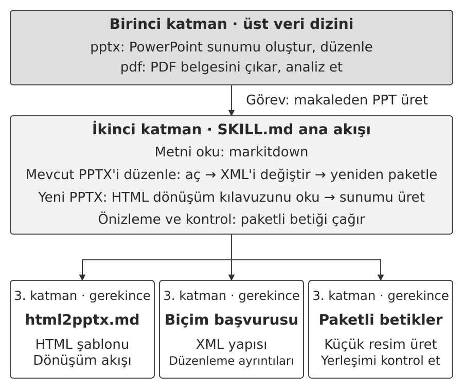

### Skills: alan yeteneğinin birleştirilebilir birimi

**Agent Skills**, bir görev türünün işleme yöntemini, başvuru malzemelerini, betiklerini ve şablonlarını yeniden kullanılabilir bir paket hâline getirir. Yeni bir çalışanın işe başladığı gün şirketin bütün işletme el kitaplarını ezberlemesi gerekmez; model de ilgili bölümü ancak iş başında ayrıntılı okuyabilir. Bu yükleme biçimine **kademeli açıklama (Progressive Disclosure)** denir[^ch2-3].

Hangi bilginin Skill olarak yazılmaya değer olduğunu Bölüm 1'deki on ürün üzerinden değerlendirelim. Kullanıcı kargo dahil eline geçecek fiyatı karşılaştırmak istiyorsa, ayrıntıların ve bu seferki teslimat adresinin geçerli context'e girmesi yeterlidir. Ekip satıcılar arası fiyat karşılaştırmasını tekrar tekrar yapıyorsa, özelliklerin nasıl hizalanacağı, birim fiyat ile set fiyatının nasıl ayrılacağı, kargo ücretinin bilinmediğinin nasıl belirtileceği bir fiyat karşılaştırma Skill'i olarak derlenebilir. Bir dahaki sefere biri yalnızca hangi modeller olduğuna bakmak istediğinde dizin yine görünür kalır; fiyat kontrolü akışının tamamı kullanıcı fiyat karşılaştırmak istediğinde yüklenebilir.

**Birinci katman meta veridir.** Her Skill kendini `SKILL.md` ile tanımlar; dosyanın başındaki YAML frontmatter `---` ile ayrılır ve `name` ile `description` içerir. Çalışma zamanı önce ad ve açıklamaları bir dizin olarak düzenler; model geçerli görevin hangi Skill'lere ihtiyaç duyduğuna karar verir. Dizinin sıralanmasını ve sunumunu Harness yönetir, eksiksiz akış seçildikten sonra yüklenir.

**Skill açıklaması her şeyden önce bir yönlendirme koşulu olarak yazılmalıdır.** Model gövdeyi yüklemeden önce onu kullanıp kullanmayacağına karar vermek zorundadır; bu yüzden `description` önce ne zaman uygulanacağını ve ne zaman atlanacağını söylemeli, sonra neler yapabildiğini özetlemelidir. Örneğin "help with backend" kapsamı fazla geniştir; neredeyse her arka uç görevi onunla eşleşebilir. "Var olan HTTP arayüzleri için kimlik doğrulama, parametre doğrulama ve hata yanıtlarını kapsayan entegrasyon testleri yaz" ise net bir kapsam verir. Karıştırılması kolay görevler için dışlama koşulları da eklenebilir; örneğin "yalnızca arayüz tasarımı tartışılıyorsa kullanılması gerekmez".

**İkinci katman çekirdek akıştır.** Bir Skill seçildiğinde çalışma zamanı tam talimatları context'e koyar. Kullanıcı `/pptx` türü bir komutu açıkça yazdığında istemci doğrudan bulup yükleyebilir; model kendisi seçtiğinde ise içerik Skill aracı ya da dosya okuma aracıyla alınır. Birincisi modelin etkinleştirme çağrısı yapma adımını ortadan kaldırır; ikincisi seçimi ve yüklemeyi çalışma izinde bırakır.

Bu kitabın deneylerinde kullanılan PPTX Skill'ini örnek alırsak, çekirdek açıklama birkaç yaygın yolu tanıtır: Microsoft'un markitdown aracıyla sunum metnini çıkarmak, PPTX'i açıp alttaki XML'e bakmak ve yeni sunum oluşturma ya da düzenleme iş akışını seçmek. Model bu katmanı okuduktan sonra geçerli göreve göre bir sonraki adımda hangi belgeyi okuyacağına, hangi betik türünü çağıracağına karar verebilir[^ch2-4].

**Üçüncü katman ayrıntılı malzemedir.** Karmaşık işlemler özel belgelere dağıtılmıştır; ana dosya giriş noktası sağlar. Bu kitapta kullanılan sürümdeki `html2pptx.md` HTML üzerinden sunum oluşturmayı anlatır; diğer başvuru belgeleri biçim ve düzenleme ayrıntılarını tamamlar. Agent göreve göre bu içerikleri okumayı sürdürür ve paketlenmiş betikleri, materyalleri ve şablonları kullanarak işlemi tamamlar.

[^ch2-3]: Anthropic, Equipping Agents for the Real World with Agent Skills, 2025; Agent Skills, How to add skills support to your agent.
[^ch2-4]: Anthropic, PPTX Skill. Bu kitaptaki deneyler HTML dönüştürme akışını içeren sürümü sabit olarak kullanır; somut sürüm ve çalıştırma yöntemi eşlik eden deneyin README dosyasında yer alır.
[^ch2-codex-skills]: OpenAI, Build skills; OpenAI Codex açık deposundaki Skills uygulaması.
[^ch2-cc-skill-inject]: Claude Code, How Claude Code uses prompt caching, Invoking skills and commands; Agent Skills, How to add skills support to your agent, User-explicit activation.

### Kullanılabilir bir Skill nasıl yazılır

Kullanılabilir bir Skill dört soruyu yanıtlamalıdır: hangi görevlere uygulanır, hangi sırayla işlenir, hangi durumlar teyit gerektirir ve işin bittiğine nasıl karar verilir? Yazan kişi kendi deneyimini yürütülebilir adımlara dönüştürmeli, kilit kararlara örnekler eklemelidir.

Bir yazı Skill'ini örnek alırsak, Baoyu'nun AI yazısını kişisel ifade alışkanlıklarından yola çıkarak iyileştirme yaklaşımından yararlanabilir[^ch2-baoyu-remove-ai-writing-flavor], ardından içeriği dört bölümde düzenleyebilirsiniz:

- **Rol ve okur**: Kime hizmet edildiğini, görev türünü ve son metnin gereksinimlerini açıklar.
- **Temel ilkeler**: Önce sık kullanılan üç beş kararı yazın; her birine somut bir öncesi-sonrası yeniden yazım örneği ekleyin.
- **Yaygın hatalar ve sınırlar**: Kolayca ortaya çıkan ifade sorunlarını, yetkiyi aşan eylemleri ve istisnaları kaydeder.
- **Başvuru malzemeleri**: Terim listelerini, şablonları, örnek metinleri ve özel açıklamaları yürütme sırasında bakmak için toplar.

Kurallar "kapsam, eylem, istisna, doğrulama yöntemi" kalıbıyla yazılabilir. Örneğin uzun cümleleri kısaltan bir kural hangi paragraflar için geçerli olduğunu, nasıl bölüneceğini ve bölündükten sonra koşul ile sonucun hâlâ eksiksiz olup olmadığının nasıl kontrol edileceğini belirtmelidir.

Başlarken beğendiğiniz üç beş özgün yazıyı seçin ve Agent'tan sözcük seçimini, cümle yapısını, paragraf düzenini ve tonu özetleyip yirmi satır kadarlık bir ilk sürüm üretmesini isteyin. Ardından bunu yeni bir konuda kullanın ve yazar metni cümle cümle düzeltsin. Düzeltme öncesi ve sonrası arasındaki fark daha somut geri bildirim sağlar: hangi sözcükler fazladan, hangi cümleler bölünmeli, nerede olgu eksik, nereye teknik ayrıntı geri eklenmeli? Tekrar tekrar karşılaşılan düzeltmeleri kurallara dönüştürün ve ilgili örnekleri ile geçerlilik kapsamını koruyun.

Skill'ler yürütme araçları ve şablonlarla da birlikte gelebilir. Örneğin PPTX Skill işlem açıklamalarını, ayrıştırma betiklerini, üretim betiklerini ve sayfa düzeni kaynaklarını bir arada tutar; böylece model açıklamayı izleyerek ilgili kaynakları çağırabilir. Her Skill bağımsız olarak test edilebilir, güncellenebilir ve sürümlenebilir; ekip üyeleri de aynı akış etrafında deneyim eklemeyi sürdürebilir. **Skills'in uzun vadeli değeri, alan deneyiminin dağıtık biçimde birikmesini, bağımsız yayımlanmasını ve yeniden kullanılmasını sağlamasıdır.** Ekip Agent yeteneklerini genişletirken herkes güçlü olduğu Skill'lerin bakımını yapabilir; zamanla pip ve npm benzeri bir paket ekosistemi oluşur. Bu Skill'ler ana sistemin sağladığı keşif, yükleme ve yürütme mekanizmalarını paylaşabilir.

**Etkileşim biçimini tasarlarken modelin zaten eğitildiği ve uyarlandığı kalıpları sürdürmeyi tercih edin.** Rol ayrımı, araç sonucu biçimi ve Skill yükleme biçimi, modelin görevi nasıl sürdüreceğini etkiler. Üreticilerin sunduğu standart akışlar iyi bir başlangıç noktasıdır; modelin tanımadığı bir biçimden anlamı yeniden çıkarma yükünü azaltır.

[^ch2-baoyu-remove-ai-writing-flavor]: Baoyu, "AI tadını prompt'la gidermeye çalışmayın, yön baştan yanlış" (别再用提示词去 AI 味了，方向就是错的), 2026-02-14.

### Skills'in context içindeki yeri

Skills'in context maliyeti dizin ve gövde olmak üzere iki kısma ayrılır. Dizin modelin kullanılabilir yetenekleri keşfetmesini sağlar; gövde ise seçildikten sonra işlem akışını sunar. Standart ihtiyaç anında yüklemeyi şart koşar; somut mesaj rolü, sarmalama ve güncelleme biçimi ise Harness'ın uygulamasına bağlıdır.

Claude Code, Skill talimatlarını çağrı noktasında oturuma `user` mesajı olarak ekler[^ch2-cc-skill-inject]. Şekil 2-12, modelin kendisinin tetiklediği bir mesaj düzenini gösteriyor: önce `Skill(skill: "pptx")` çağrısı gönderilir, araç yanıtı alınır, sonra eklenen Skill gövdesi okunur. Özel bir etkinleştirme aracı kullanıldığında araç yanıtı çağrı teyidi görevini üstlenebilir, gövdeyi ise Harness ayrıca enjekte eder; sıradan bir dosya okuma aracı kullanıldığında gövde doğrudan araç sonucunun içinde de yer alabilir. Kullanıcı `/pptx` yazdığında istemci talimatları doğrudan açabilir ve modelin etkinleştirme çağrısı yapma adımı ortadan kalkar.

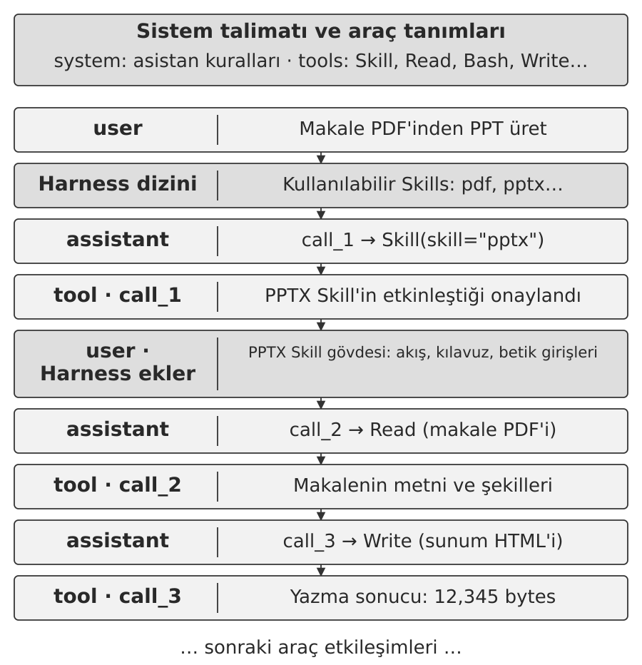{height=55%}

Codex'in Skills uygulaması da yetenek dizinini ve seçilen talimatları ayrı ayrı düzenler. Açık kaynak kodunda dizinin bir kısmı `developer` context'ine girer, bir kısmı ise geçerli tur ve yürütme ortamıyla birlikte sunulur; açıkça seçilen Skill'ler kullanıcı context'i parçaları olarak eklenir. Dizinin kaynağı ve kullanılabilir yürütme ortamı somut düzeni etkiler[^ch2-codex-skills].

Şekil 2-13, ihtiyaç anında yüklemede önbelleğin büyümesini gösteriyor; başlangıç noktası henüz yeniden kullanılabilir önbellek kurulmamış bir istek. Dizin isteğe ilk kez girdiğinde işlenmelidir; gövdenin ilk yüklenmesi de hesaplama ekler. Sonraki istekler aynı öneği koruduğunda bu içerikler önbellekten okunma şansına sahip olur. Yeni içeriğin çağrı noktasına eklenmesi önceki mesajları kararlı tutar. Yüklenmiş açıklamalar geçmişte kalmaya devam eder; güncellenmeleri gerektiğinde çalışma zamanının context stratejisine göre ele alınır.

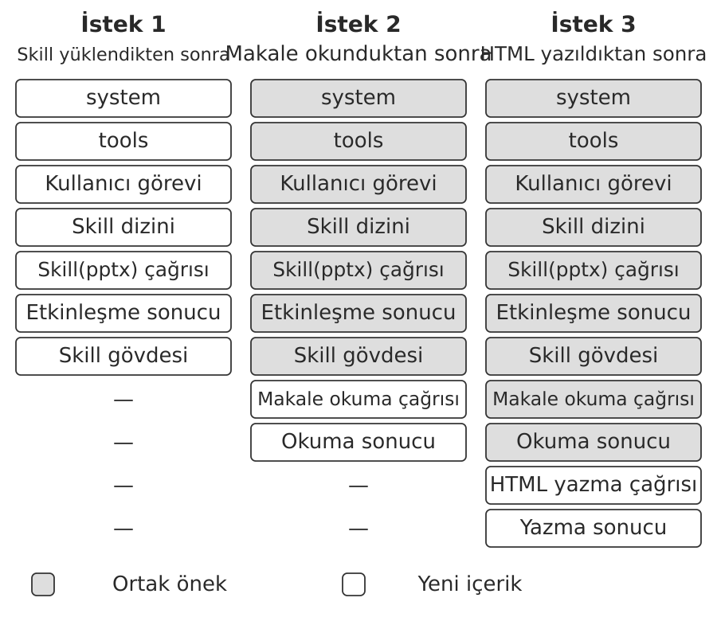

### Skills ile araçların ilişkisi

Skill görev bilgisini ve işlem akışını sağlar; araçlar ise okuma, yürütme ve sonuç elde etmeden sorumludur. Bölüm 5'te tanıtılan yedi temel araç farklı Skill'lerle birleştirilebilir: aynı dosya okuma aracı hem sunum kılavuzunu hem de kod standartlarını okuyabilir; genel yürütücü de ilgili betikleri çalıştırabilir. Böylece uzmanlık yetenekleri akışlar ve kaynaklar yoluyla genişler, temel araç kümesi ise görece sabit kalır.

Özel araçlar da Skill'lerle birlikte kullanılabilir. Yukarıdaki araç araması ihtiyaç anında araç tanımı sağlar; Skill ise ne zaman çağrılacağını, nasıl birleştirileceğini ve sonucun nasıl kontrol edileceğini açıklar. İkisi de sürekli tutulan bilgi miktarını denetlemeli ve yeni yüklenen içeriğe uygun bir yer ayırmalıdır. Bölüm 4 genel yürütücü ile özel araçlar arasındaki ödünleşimi tartışacak; Bölüm 9 ise deneyimin bilgi, talimat, program ya da model parametresi olarak saklanmaya hangisine daha uygun olduğunu ele alacak.

> **Deney 2-6 ★★: Agent Skills ile makaleden sunum üretmek**
>
> Bu deney *Attention Is All You Need* makalesini malzeme olarak kullanarak Agent'ın sunum hazırlamaya yönelik uzman akışı nasıl ihtiyaç anında yüklediğini gösteriyor. Görev, makalenin PDF'inden sorun arka planını, yöntemi, kilit sonuçları ve vargıları kapsayan on ile on beş sayfalık bir sunum üretmek; anlatıma yardım etmesi için makaledeki şekil ve tabloları kullanmak.
>
> Bu çalıştırmada Kimi Code ve Anthropic'in resmî PPTX Skill'i kullanıldı. Agent önce dizinde PPTX Skill'ini buluyor, işlem açıklamalarını okuyor, ardından HTML dönüştürme kılavuzunu okuyor, eşlik eden üretim aracını çağırıyor ve son olarak küçük resimler ile sayfa sayfa render üzerinden sayfa düzenini kontrol ediyor. Her adımda okunan malzeme bir sonraki işleme hizmet ediyor; eksiksiz hazırlama akışı görevle birlikte adım adım açılıyor.
>
> Son sunum on üç sayfadan oluşuyor; makaledeki mimari şeması, dikkat mekanizması şeması, deney sonuçları tablosu ve dikkat görselleştirmesi kullanılmış.
>
> Üretimden sonraki kontrol de Skill iş akışının parçası. Bu çalıştırmada alt simge eksikliği, madde işaretlerinde bozulma, grafiklerin yanlış başvuru yolları ve sayısal etiketlerde hassasiyet sorunları ortaya çıktı; Agent bunları render sonuçlarına ve yapı denetimine göre tek tek düzeltti. Nihai dosya yapı denetimini geçti ve LibreOffice ile yeniden açılıp render edildi.

> **Deney 2-7 ★★: Kişisel örnek metinlerden "AI tadını gideren" bir yazı Skill'i oluşturmak**
>
> Bu alıştırma kişisel yazı deneyimini yeniden kullanılabilir talimatlara dönüştürüyor. Üç beş özgün yazı hazırlayın; Agent'tan ifade alışkanlıklarını özetlemesini ve tetikleme koşullarını, üç beş ilkeyi ve ilgili örnekleri içeren ilk sürüm bir Skill üretmesini isteyin.
>
> Yeni bir konu seçip deneme yazısı yazdırın, ardından yazar metni cümle cümle düzeltsin. İki sürümü karşılaştırıp tekrar tekrar ortaya çıkan sorunları bulun; örneğin boş sözcük seçimi, aşırı uzun cümleler, atlanmış neden-sonuç ilişkileri ya da anlamayı destekleyen somut örneklerin silinmesi. Tekrar eden düzeltmeler Skill'e yazılabilir.

## Agent durum çubuğu: meta bilgilerle Agent izinin yönetimini güçlendirmek

Kullanıcı ısrarla soruyor: "Bir kez daha arayabilir misin?" Şekil 2-14'ün sol tarafı üç aramayı kaydediyor. İlkinde 45 dakika beklenmiş ama bağlantı kurulamamış, ancak üçüncüsünde aylık 59 dolarda anlaşılmış. Bu örneğin kuralına göre her arama bir hak kullanır; yalnızca ikisinde bağlantı kurulmuş olsa da üç hakkın hepsi tükenmiştir. Harness bu tür sayaçları, iş ilerleyişini ve teyit bekleyen konuları mesajlarla birlikte güncellenen bir özet hâline getirebilir; buna **Agent durum çubuğu (Agent Status Bar)** denir.

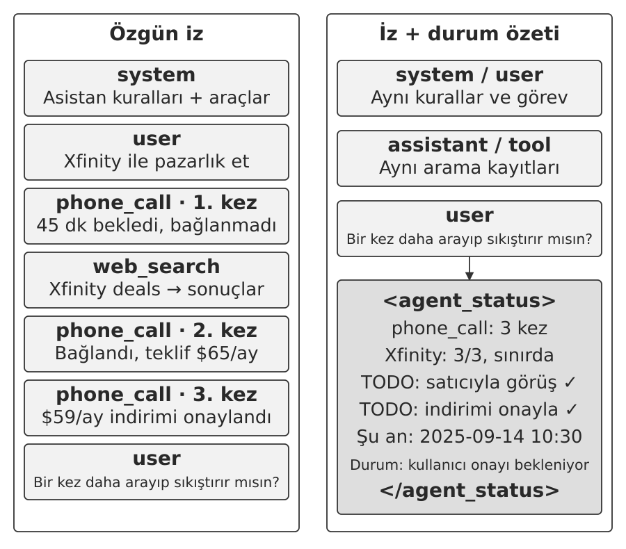

Telefon saati, pil durumunu ve sinyali ekranın üstüne koyar; insan bir bakışta geçerli durumu anlar. Şeklin sağındaki özet de benzer bir işlev görür: asistan "sınıra ulaşıldı" ve "kullanıcı teyidi bekleniyor" ifadelerini okuyunca kullanıcıya üzerinde anlaşılan fiyatı aktarabilir ve kabul edip etmeyeceğine karar vermesini isteyebilir. Harness özeti araç sonucunu döndürürken ekleyebilir ya da ayrı bir durum mesajı olarak da ekleyebilir.

### Ham kayıtlardan açık duruma

Bir telefonla müşteri hizmetleri görevini düşünün: sistem, aynı görev içinde her işletmeyi en fazla üç kez aramayı şart koşuyor. Üç arama arasına aramalar, belge okumaları ve kullanıcının ek soruları girebilir. Modelin aramaya devam edip edemeyeceğine karar verebilmesi için bu geçmişte ilgili kayıtların hepsini bulması, işletmeleri ayırt etmesi ve toplam sayıyı hesaplaması gerekir.

Çalışma zamanı her çağrıdan sonra sayacı güncelleyip doğrudan "Bu, Xfinity'ye yapılan 3. arama; bu görevin sınırına ulaşıldı" sonucunu döndürebilir. Bir sonraki karar bu sonucu kullanabilir. Çağrı sayısını program tutar; model görevin ilerleyişine bakarak bir sonraki adımda beklemeye mi, başka kanallar aramaya mı, yoksa kullanıcıya mevcut durumu açıklamaya mı karar verir. Yürütme katmanı da sonraki arama taleplerini aynı sayaca göre kontrol eder.

Buradaki mühendislik değeri, **sonraki kararların tekrar tekrar ihtiyaç duyduğu durumun önceden derlenmesidir.** Eksiksiz arama kayıtları görüşme içeriğini ve sürecini saklamaya devam eder; durum çubuğu ise karar için sık kullanılan istatistikleri ve ilerlemeyi sunar. **Tekrar tekrar kullanılan istatistikler öncelikle kod tarafından artımlı olarak tutulmalıdır.** Context'te bir kaydı bulmak ile bütün kayıtlardan toplamı hesaplamak iki ayrı iştir. Ham izi saklamak kendiliğinden doğru ve her an kullanılabilir bir istatistik tablosu üretmez. Her seferinde modele yeniden gezdirip saydırmak hem akıl yürütme token'ı tüketir hem de eksik ya da çift sayma olasılığını artırır.

Yazar context'i, eşlik eden bir "damıtma katmanı" gerektiren bir arama motoruna benzetiyor: ham kayıtlar geriye dönük izlemeyi kolaylaştırır, damıtılmış durum ise doğrudan kullanılır. Sayaçlar, kotalar ve doğrulanmış görev tamamlanma durumu kodla tutulmaya uygundur; anlamsal yargı gerektiren bilgiler önce tek tek çıkarılıp sonra toplanarak doğrulanabilir. Böylece model her kararında hem geçerli durumu hem de gerekli kanıtları görebilir.

Uzun izler kilit bilgiyi bulmayı da zorlaştırır. En güncel hedefi, kısıtları ve ilerlemeyi bir arada sona koymak, modelin geçerli karar için gereken bilgiyi bulmasını kolaylaştırır.

> **Deney 2-8 ★★: Agent durum çubuğunun etkisini dikkat görselleştirmesiyle gözlemlemek**
>
> Bu deney Qwen3-0.6B kullanarak bir müşteri hizmetleri iade izi kuruyor: Agent Xfinity'yi zaten üç kez aramış, araya ağ aramaları girmiş, ardından kullanıcı "bir kez daha arayıp sıkıştırabilir misin?" diye soruyor. Sistem kuralı aynı görev içinde her işletmenin en fazla üç kez aranmasını şart koşuyor.
>
> İki girdi grubu aynı geçmişi ve kullanıcı sorusunu koruyor. A grubu doğrudan ham izi kullanıyor; B grubu ise sona şu durumu ekliyor:
>
> ```xml
> <agent_status>
> Current State:
> - Tool call summary: 'phone_call' has been invoked 3 times (Xfinity: 3 times)
> - Constraint check: Maximum calls to Xfinity reached (3/3)
> </agent_status>
> ```
>
> Her grup üç kez çalıştırıldı. A grubu iki kez aramaya devam etmeyi açıkça reddetti, bir çıktı ise diğerleri kategorisine girdi; B grubu üç seferde de aramaya devam etmeyi açıkça reddetti. İki grupta da kurala aykırı biçimde aramaya devam ettiği değerlendirilen bir çıktı olmadı. Bu karşılaştırmayı yeniden üretmek için `chapter2/attention_visualization` dizinine girip `python run_status_bar_experiment.py --output runs/status-bar-reproduction` komutunu çalıştırın. Bu çalıştırmanın girdileri ve tek tek sonuçları deney dizinindeki `runs/exp2-7-qwen3-0.6b-20260730-v2/comparison.json` dosyasında saklanıyor.
>
> Dikkat şekli, üretim bölgesinin geçmiş aramalara, arama sonuçlarına, kullanıcı sorusuna ve durum çubuğuna verdiği ağırlıkların dağılımını gösteriyor.

Yazarın Noah Shi ile yaptığı ContextDistill-Bench çalışması, durumu önceden damıtmanın kazancını daha ayrıntılı inceledi[^ch2-8]. Bu kıyaslamanın kapsadığı durum sorgularında küçük modeller de açık durum sayesinde yüksek doğruluk elde edebildi; öncü modellerin düşünme miktarı, gecikmesi ve sorgu maliyeti ise yaklaşık bir büyüklük mertebesi azaldı. Örneğin Claude 4 Sonnet'in bin sorgu başına maliyeti yaklaşık 35,46 dolardan 3,51 dolara düştü. **Bu tasarım durumu olay anında güncelleyerek her sorguda geçmişi baştan sona dolaşma maliyetini ortadan kaldırır.** Özet alanları sabitlendiğinde geçmiş büyümeye devam etse bile sorgu yalnızca bu birkaç alanı okur.

[^ch2-8]: Li, Bojie and Noah Shi. *Distill, Don't Retrieve: Inference-Time Context Distillation for LLM Agent Reasoning.* 2026.
### Agent durum çubuğunun bileşimi

Durum çubuğu genellikle üç tür bilgi içerir; bunlar sırasıyla "ne yapılacak", "az önce ne oldu" ve "şu anda hangi durumdayız" sorularını yanıtlar.

**Görev planı** hedefi, adımları ve tamamlanma durumunu kaydeder. Karmaşık görevler bir TODO listesine bölünebilir; her maddede durum ve gerekiyorsa bağımlılık ilişkileri saklanır. Model geçerli adımı işlerken özgün gereksinimi, temel kısıtları ve sonraki işleri görmeye devam eder; bir adım bittiğinde listeyi günceller.

**Olayın yan kanal bilgisi (Side-channel Information)** olayın gerçekleştiği andaki bağlamı tamamlar; örneğin saat, coğrafi konum ve son yanıttan bu yana geçen süre. Bu meta veriler olayla birlikte saklanır ve modelin sıralamayı ve bağlamı anlamasına yardım eder. Aynı "henüz yanıt gelmedi" cümlesi, başvuru gönderildikten iki dakika sonra da iki gün sonra da söylenmiş olabilir; karşılık gelen işlem biçimi farklı olabilir.

**Ortamın geçerli durumuna ilişkin gözlem özeti** mevcut saati, çalışma dizinini, araç çağrı sayısını ve anormallik uyarılarını sağlar. CLI ya da GUI'nin mevcut dizini veya çalışma durumunu göstermesiyle aynı işlevi görür: bir sonraki işlemin net bir dayanağı olsun diye. Örneğin yinelenen çağrı uyarısı modeli başarısızlık nedenini kontrol etmeye iter; kalan bütçe ise aramayı sürdürüp sürdürmeyeceğine karar vermesine yardım eder.

Olay meta verileri olayla birlikte eklendikten sonra genellikle sabit kalır; görev ilerleyişi ve ortam durumu ise sürekli değişir. İki tür bilgi kendi güncelleme biçimine göre geçmişe yazılmalıdır; aşağıda bunu mesaj yapısı üzerinden açıklıyoruz.

### Agent durum çubuğunun context içindeki somut konumu

Bu kısımdaki örnekte Harness, durum özetini iletmek için mesajların sonuna bir `user` mesajı ekler. Buradaki `user`, seçilen API'nin mesaj rolüdür; durum içeriğini çalışma zamanı üretir ve amacını etiketlerle açıklar. Başka arayüzler kullanıldığında o arayüzün desteklediği context blokları ya da ilgili araç sonucuyla durum sağlanabilir. Daha önce sözü edilen, geçmiş akıl yürütmeyi gerçek kullanıcı sorgusuna göre kırpan şablon kullanılıyorsa, çalışma durumu araç sonucuyla verilebilir; şablon da akıl yürütme bilgisini geçerli göreve göre korumayı sürdürür.

Şekil 2-15'te kullanıcının ilk talebini, ardından en güncel durumun hangi tura yazıldığını bulun. Özgün isteği korumak, telefon görüşmesi bittikten sonra iki şeyi birlikte kontrol etmeyi sağlar: kullanıcı ne istemişti ve iş şu an hangi aşamada?

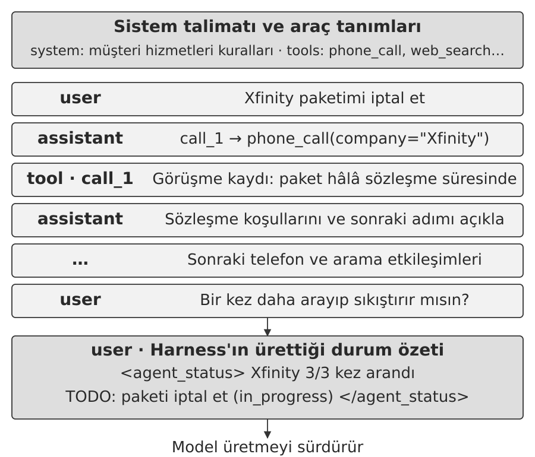

Şekildeki sırayı mesaj listesi olarak yazarsak aşağıdaki gibi olur. Karşılaştırma kolay olsun diye yinelenen turlar ve bazı çağrı alanları atlanmıştır.

```text
messages: [
  { role: "system", content: "You are a customer service assistant..." }
  { role: "user", content: "Help me cancel my Xfinity plan" }
  { role: "assistant", tool_calls: [{ id: "call_1", ... }] }
  { role: "tool", tool_call_id: "call_1", content: "Call log..." }
  { role: "assistant", tool_calls: [{ id: "call_2", ... }] }
  { role: "tool", tool_call_id: "call_2", content: "Call log..." }
  ...diğer turlar...
  { role: "user", content: "Can you call them again to follow up?" }
  { role: "user", content: "<agent_status>
      Current State:
      - phone_call invoked 3 times (Xfinity: 3/3 max)
      - Current time: 2025-09-14 10:30:45
      - TODO: [1] Cancel plan (in_progress)
    </agent_status>" }
]
```

Son mesaj çağrı sayısını, sınırı, saati ve görev ilerleyişini bir arada tutar. Model bu alanları doğrudan kullanabilir; önceki çağrı ID'leri üzerinden de somut kayıtlara geri bakabilir.

Bu mesaj eklendikten sonra önceki token dizisi değişmez ve önek yeniden kullanımının temel koşullarını hâlâ sağlar. Bir sonraki turda eski durumun nasıl ele alınacağı ise context tüketimi ile önbellek maliyeti arasında bir tercih gerektirir.

### Durum güncellemesinin iki uygulanışı ve önbellek maliyeti

Bir sonraki turda bir TODO tamamlanabilir ya da bir araç çağrısı eklenebilir. Harness durumu güncellemelidir; yaygın iki yöntem vardır.

**Her turda değiştirme**: Yeni istek kurulurken önceki durum kaldırılır, en güncel durum sona eklenir. Context'te yalnızca bir geçerli durum kalır ve modelin kullanması kolaydır. Örneğin önceki istek "görev tanımı, durum A", bu istek "görev tanımı, araç sonucu, durum B" olsun. Görev tanımı yine önbellekten okunabilir; araç sonucu ilk kez gönderildiği için zaten hesaplanması gerekir. Önceki istekte durum A'nın arkasında başka mesajlar varsa, A'yı kaldırmak bu mesajları önceki önek eşleşmesinden yoksun bırakır. Model bu istekte yalnızca B'yi görür. A'ya geri bakmak gerekirse çalışma günlüğünden o andaki anlık görüntü çıkarılabilir.

**Kalıcı ekleme**: Mevcut durum kayıtları korunur, her seferinde sona yeni bir durum eklenir. Geçmiş öneki sabit kalır ve durum değişimini izlemek kolaylaşır. Eski durumlar zamanla context'i tüketir; bu yüzden zamanı ya da sürümü belirtip modelin geçerli durumu en yeni kayda göre değerlendirmesi sağlanmalıdır. Claude Code'un dosya değişikliği hatırlatmalarını oturuma ekleme biçimi de bu tasarım fikrini yansıtır.

Durum çok kısaysa ve arkasında önbelleğe alınmış çok sayıda araç sonucu varsa, eski durumu korumak uzun son eki yeniden hesaplamaktan daha ucuz olabilir; durum uzunsa ve sık güncelleniyorsa, değiştirme geçmiş durumların birikmesini denetler.

Kaba bir modelle sınır noktası kestirilebilir: her durum $S$ token olsun; değiştirmede eski durumun arkasındaki, yeniden hesaplanması gereken önbellekli son ek ortalama $R$ token olsun (bu turda ilk kez gönderilen içerik hesaba katılmaz); toplam $N$ kez durum eklensin ve önbellekli girdi birim fiyatı normal girdinin $\alpha$ katı olsun. İki yöntemin ortak maliyetleri yok sayılırsa $C_{\text{değiştirme}} \approx (N-1)(1-\alpha)R$, $C_{\text{ekleme}} \approx \alpha S N(N-1)/2$. $N>1$ için $\alpha SN/2 < (1-\alpha)R$ olduğunda kalıcı eklemenin tahmini maliyeti daha düşüktür; tersi durumda her turda değiştirmek daha tasarrufludur. Burada normal girdi birim fiyatı maliyet birimi olarak alınmıştır: değiştirme yönteminde fazladan ödenen, son ekin önbellekten okunmak yerine yeniden işlenmesinin farkıdır; ekleme yönteminde fazladan ödenen ise geçmiş durumların tekrar tekrar okunmasıdır.

Bir örnek: her seferinde 100 token'lık durum ekleniyor, toplam 10 kez; önbellek okuması normal girdi fiyatının onda biri. Ekleme yöntemi sonraki isteklerde sırasıyla 1, 2, …, 9 eski durumu fazladan okur; ek maliyet 450 normal girdi token'ına denk gelir. Durumu değiştirmek arkadaki ortalama 1.000 önbellekli token'ın yeniden işlenmesine yol açıyorsa, dokuz değiştirme 8.100 normal girdi token'ına denk ek maliyet doğurur ve ekleme daha tasarruflu olur. Eski durum zaten önbelleğin sonundaysa ve arkasında önbellekli içerik yoksa formülde $R=0$ olur; doğrudan değiştirmek bu 450 token'ın karşılığı olan maliyeti kurtarır.

> **Deney 2-9 ★★: İşe yarayan birkaç Agent durum çubuğu tekniği**
>
> Bu deney beş durum çubuğu tekniği uyguluyor; her biri ayrı ayrı açılabilir ya da birlikte kullanılabilir. Her teknik bir tür somut bilgi sağlayarak modelin bir sonraki adıma karar vermesine yardım eder.
>
> **Zaman damgası izleme** kullanıcı mesajlarında ve araç yanıtlarında olay saatini kaydeder; örneğin `[2025-09-14 10:30:45]`. Zaman olayla birlikte geçmişe yazılır, sonraki turlarda özgün değerini korur; geçerli saat ise yeni durum mesajıyla güncellenir. Deney ayrıca zaman simülasyonu sunar; modelin "dünün dosyası" ile "bugünün değişikliği"ni ayırt edip edemediğini ve bekleme süresini doğru anlayıp anlamadığını sınamak için.
>
> **Araç çağrısı sayacı** bir sözlükle her aracın toplam çağrı sayısını tutar ve yanıtta `Tool call #3 for 'read_file'` diye işaretler. Hata içeriğiyle birlikte model denemeyi sürdürüp sürdürmeyeceğine karar verebilir. Örneğin ilk okuma başarısız olduktan sonra yolu kontrol edip dizini listeleyebilir; birkaç başarısızlıktan sonra alternatif dosya arayabilir ya da eksikliği kullanıcıya açıklayabilir. Yeniden deneme sayısı sınırlanacaksa çalışma zamanı bu sayaca göre üst sınırı da uygulamalıdır.
>
> **TODO listesi yönetimi** `rewrite_todo_list` ve `update_todo_status` adlı iki araç sunar. Her maddede benzersiz bir tanımlayıcı, içerik, zaman damgası ve `pending`, `in_progress`, `completed`, `cancelled` olmak üzere dört durumdan biri bulunur. Liste "ne yapıldı, ne kaldı" bilgisini bir arada tutar; Manus'un görev planını tekrar tekrar göstererek hedefi görünür kılmasına benzer bir yaklaşımdır.
>
> **Ayrıntılı hata bilgisi** hata türünü ve açıklamasını, çağrı parametrelerinin JSON'unu, çağrı yığınını ve onarım önerilerini sağlar. Örneğin `FileNotFoundError` ile karşılaşıldığında modele dosya adını, geçerli dizini ve mutlak yolu kontrol etmesi önerilebilir. Parametreler hatalı girdiyi bulmayı, çağrı yığını başarısızlığın yerini, onarım önerisi ise bir sonraki kontrol yönünü verir. Bu içerikler modele döndürülmeden önce kimlik bilgileri gibi hassas alanlar temizlenmeli ve uzun yığınların boyu sınırlanmalıdır.
>
> **Sistem durumu farkındalığı** geçerli saati, çalışma dizinini, işletim sistemini, Shell'i ve Python sürümünü sağlar. Deneydeki komut aracı tek başına yapılan dizin değiştirme işlemini tanır, çalışma zamanının tuttuğu çalışma dizinini günceller ve sonraki çağrılarda bunu kullanır; bileşik komutlarda alt süreçlerin dizin değişiklikleri ilgili sürecin yürütme kapsamına uyar. Ortam alanları modelin kullanılabilir araçları seçmesine de yardım eder; örneğin gerçek sisteme ve kurulu yazılıma göre `apt` ya da `brew` seçmesi gibi.
>
> Bu Kimi K3 karşılaştırmasında her görev türünde beşer örnek vardı. Zaman damgası ve birleşik yapılandırma beş görevin hepsini geçti, kontrol grubu üçer görevi geçti; araç sayacı ve sistem durumu yapılandırmalarının açık ve kapalı grupları da beşer görevi geçti. TODO yapılandırması hiçbir görevi geçemedi, kontrol grubu bir görevi geçti; ayrıntılı hata yapılandırması dört görevi, kontrol grubu beş görevi geçti.

**Durum çubuğu mümkün olduğunca kod tarafından tutulmalıdır.** Model içindeki istatistikleri ve sınırları doğrudan kullanır; hatalı bir "üç kez arandı" bile sonraki eylemleri değiştirebilir. Sayaçlar, zaman ve durum geçişleri programa bırakılır; anlamsal anlama gerektiğinde önce model tek tek çıkarır, sonra kod toplar ve doğrular; böylece modelin bütün uzun geçmişi tek seferde sayması önlenir. Ham olaylar, çıkarma sonuçları ve nihai durum arasındaki karşılık korunur; çift sayım, eksik kayıt ve kaynak karışması böylece fark edilebilir.

Durum çubuğunun hangi bilgileri özetleyeceği önceden seçilmelidir. Örneğin "üç kez arandı" bilgisi daha arayıp arayamayacağına karar vermeye yeter, ama "ikinci görüşmede müşteri temsilcisi ne söz verdi" sorusunu yanıtlayamaz. Yalnızca istatistik değeri gereken sonraki görevlerde geçmiş, durum özetiyle değiştirilip ham kayıtlar arşivlenebilir; konuşma içeriği kontrol edilecekse özgün metin dizin üzerinden okunur. Özetin alan tasarımı, hangi soruların doğrudan yanıtlanabileceğini ve ne zaman geriye bakılması gerektiğini belirler.

## Context sıkıştırma stratejileri

Bir araştırma görevi on uzun web sayfası okumuş olsun; pencerenin yalnızca iki belgeyi daha alabildiğini varsayalım. Önce modele bir sonraki turda ne yapacağını sorun: iki teklifi karşılaştıracaksa teklifler, geçerlilik koşulları ve kaynaklar kalsın; alıntıları yeniden kontrol edecekse özgün metne geri götürecek konumlar kalsın. Bakılmış ama ilgisiz web sayfalarının gövdesi arşivlenip yeni girdi ve çıktı için yer açılabilir. Burada hem ne kadar yer açıldığı hem de ikinci bir hesap yapılmalıdır: silinen malzeme sonradan gerekirse geri getirmenin maliyeti ne olur?

### Sıkıştırmanın üç amacı

**Uzunluğu ve maliyeti denetlemek.** 128K token'lık bir pencere örneğinde uzun web sayfaları ve büyük dosyalar pencerenin önemli bir kısmını kaplayabilir. Harness sonraki girdiler, model çıktısı ve araç etkileşimi için bütçe ayırmalıdır.

**Sonraki kararlar için gereken bilgiyi düzenlemek.** Onlarca arama turu aynı olayı tekrar tekrar anabilir ya da birbiriyle çelişen ifadeler bırakabilir. Bunları "A ve B doğrulandı, C için hâlâ kanıt eksik" biçiminde düzenlemek modelin tamamlanmamış sorular üzerinde çalışmayı sürdürmesini sağlar. Özet olgular arasındaki ilişkileri, kaynakları ve çözülmemiş soruları korumalı; böylece sonraki kararın net bir dayanağı olmalıdır.

**Uzun görevlerin sürmesini desteklemek.** Bazı modeller pencerenin tükenmek üzere olduğunu düşündüğünde işi erken toparlar; bu olguya **context kaygısı (Context Anxiety)** denir. Anthropic, Sonnet 4.5 ile yaptığı uzun görev testlerinde bu davranışın sıkıştırmadan sonra da görülebildiğini fark etti ve bu yüzden yapılandırılmış devir kayıtları kullanıp context'i sıfırlayarak yürütmeye devam etti[^ch2-7].

[^ch2-7]: Prithvi Rajasekaran, Harness design for long-running application development, Anthropic Engineering, 2026.

### Tekrar tekrar hesaplanan sonuçları kullanılabilir bilgiye dönüştürmek

Durum çubuğu sayaçları ve ilerlemeyi önceden tutar; özet ise uzun metinlerdeki olguları ve ilişkileri daha ileri düzeyde düzenler. İkisi de dağınık bilgiyi önceden derleyerek sonraki kararların doğrudan kullanmasını sağlar.

Bir evcil hayvan dükkânı denetimi örneğine bakalım:

> Kafes 1: siyah kedi. Kafes 2: beyaz kedi. Kafes 3: siyah kedi. Kafes 4: siyah kedi. Kafes 5: beyaz kedi.
> … (toplam 100 kafes; 90 siyah, 10 beyaz kedi)

"Kafes 37'de hangi kedi var?" sorusunu yanıtlamak için ilgili kaydı bulmak gerekir; "kaç siyah, kaç beyaz kedi var?" sorusunu yanıtlamak için bütün kayıtları toplamak gerekir. Toplam sayı sonradan birkaç kez kullanılacaksa "90 siyah, 10 beyaz" önceden hesaplanıp saklanabilir; her seferinde baştan saymak önlenir. Bu tür deterministik toplamaları program yapmaya uygundur; model ise toplam sonuçlarına dayanarak iş sorularını yanıtlamayı sürdürebilir.

Özetin içeriği göreve göre seçilmelidir. Yalnızca iki tür kedinin toplamını tutmak sayı sorusunu yanıtlamaya yeter; kafes 37'nin durumunu yanıtlamak için kafes kafes kayıt ya da uygun bir dizin gerekir.

Pencerede yer olsa bile aşırı uzun veya karışık bir context bilginin kullanımını etkileyebilir: model kilit olguları kaçırır, çözülmüş sorunları yeniden ele alır ya da eskimiş durumu geçerli kararda kullanır. Context büyüdükçe ortaya çıkan bu tür bir performans gerilemesine genellikle **context çürümesi (Context Rot)** denir. Kendini görev performansının düşmesi olarak gösterir; istek kapasite sınırını aştığında ise pencere taşması tetiklenir.

**Pencerede hâlâ yer olsa da tekrar tekrar kullanılan bilgiyi proaktif olarak derlemek gerekir.** Kilit yargılar özetlenebilecek durumdayken modelin uzun geçmişte onları tekrar tekrar araması sürekli hesaplama tüketir ve atlama olasılığını artırır. Arama görevleri doğrulanmış olguları, kaynakları ve bekleyen soruları saklayabilir; programlama görevleri mimari kararları, değişiklik kapsamını, test sonuçlarını ve başarısızlık nedenlerini saklayabilir.

Context'teki örnekler modelin yeni sorunları ele alma biçimini de etkiler. Dherin ve arkadaşlarının çalışması, Transformer'daki dikkat katmanları ile MLP'nin bileşiminden yola çıkarak belirli bir ileri hesaplamayı context'e bağlı düşük ranklı ağırlık güncellemesi olarak ifade eder ve context içi öğrenmeye kuramsal bir açıklama sunar[^ch2-6]. Gerçek çıkarımda model ağırlıkları değişmez; örnekler çıktıyı geçerli girdi üzerinden etkiler. Bu tür deneyimin sonraki oturumlarda yeniden kullanılması isteniyorsa bellek, örnek ya da Skill olarak düzenlenip göreve göre yüklenebilir; Bölüm 9 deneyimin birikme biçimini daha ayrıntılı ele alacak.

[^ch2-6]: Benoit Dherin et al., Learning without training: The implicit dynamics of in-context learning, 2025.

### Sıkıştırma ile KV Cache arasındaki ödünleşim

Sıkıştırma genellikle iki model çağrısı arasında yapılır. Harness kalan bütçeye ve görev ilerleyişine göre bir sonraki istek için gereken mesajları düzenler ve modele gönderir. Geçmişi değiştirmek öneki de değiştirir; bu yüzden sıkıştırma kazancı ile önbelleği yeniden kurma maliyeti birlikte düşünülmelidir.

Önce hâlâ geçerli olan sistem talimatlarını ve araç tanımlarını sabit tutun. Bunlar başta yer alır; sonraki geçmişin sıkıştırılması bu önek bölümünü yeniden kullanmayı sürdürebilir. Ardından sıkıştırılacak nesneyi seçin: uzun araç sonuçları özetle değiştirilebilir, tamamlanmış çok turlu etkileşimler aşama kaydı olarak birleştirilebilir. Değişiklik noktasından önceki önbellek yine kullanılabilir; değişiklik noktası ve sonrası ise yeni öneğe göre işlenir.

**Geçmiş sıkıştırması mümkünse toplu yapılmalı, her turda aynı önek yeniden yazılmamalıdır.** Sıkıştırmadan sonra her turun girdisi kısalır, ama sıkıştırma çağrısı ve son ekin yeniden hesaplanması da kaynak tüketir. Tetikleme zamanı pencere doluluğuna, beklenen sonraki tur sayısına ve görev aşamasına göre belirlenebilir: uzun araç sonuçları biriktikten sonra toplu düzenlemek ya da bir aşama bittikten sonra devir özeti kaydetmek, geçmişi sık sık değiştirmenin maliyetini azaltır. Son birkaç tur korunurken araç çağrıları ile dönüş değerlerinin eşleşip eşleşmediği kontrol edilmeli, tamamlanmamış işlemlerin durumu özete yazılmalıdır.

Sıkıştırma sırasında akıl yürütme bilgisinin geri verilmesi protokolü de kontrol edilmelidir. Bazı modellerde geçmiş thinking blokları, onları ürettiğimiz andaki öneğe bağlıdır. Bu bloklardan önce geçmiş değiştirilirse korunan thinking yeni önekle uyuşmayabilir. Bu protokol kullanılıyorsa oturum bir özete dönüştürülüp etkilenen eski thinking blokları temizlenerek modelin özetten akıl yürütmeye devam etmesi sağlanabilir; hizmetin desteklediği sıkıştırma ya da context düzenleme mekanizmaları da kullanılabilir.

Önce Şekil 2-16'daki bireysel özete bakın: işlenmiş karakter sayısı özgün metnin yalnızca %10,9'u, ama ana Agent'ın toplam tükettiği token altı grubun en yükseği. Bu iki sayının nasıl aynı anda doğru olabildiğini anlamak için hangi malzemenin sıkıştırıldığını ve bu malzemenin kaç turda modele gönderildiğini izlemek gerekir.

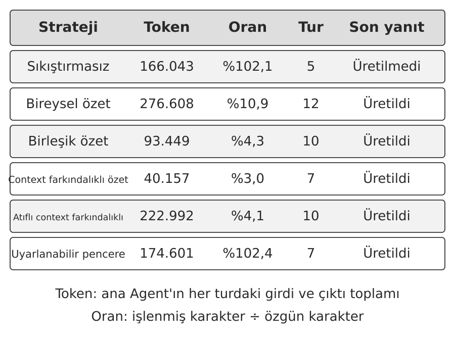

> **Deney 2-10 ★★★: Context sıkıştırma stratejilerinin karşılaştırması**
>
> Bu deney Kimi K3 ile OpenAI'ın kurucu ortaklarının kariyer durumunu araştırıyor. Görev, adım adım bir kişi listesi oluşturmayı, geçmişleri ve görev değişikliklerini bulmayı, sonra ilgili olguları kaynaklarıyla eşleştirmeyi gerektiriyor. Sıkıştırmayı ve taşma işlemesini gözlemlemek için uygulama tarafındaki context bütçesi 128.000 token olarak ayarlandı; sıkıştırmasız temel düzen korunup beş işleme yöntemiyle karşılaştırıldı, her biri en fazla 15 tur çalıştı[^ch2-compression-results].
>
> **Strateji bir: sıkıştırma yok.** Arama ve sayfa okuma sonuçları geçmişe eksiksiz girer. Yedi araç çağrısı toplam 367.246 özgün karakter işledi. Program beşinci turda korumayı tetikleyip durdu; ana Agent'ın toplam tüketimi 166.043 token. Eski sürüm korumayı isteklerin girdi token'larının toplamına göre tetikliyordu; hata mesajındaki 165.227 bu yüzden kümülatif girdidir. Örneğin aynı geçmiş üç istekte birer kez gönderilirse üç kez sayılır.
>
> **Strateji iki: bireysel özet.** Her arama sonucu ayrı ayrı iki üç paragraflık bir özete dönüştürülür ve sayfaların ana içeriği korunur. Bu yöntem paralel işlemeye ve sayfa sınırlarını korumaya elverişlidir; birden çok sayfa aynı olayı anlatıyorsa yinelenen bilgi yine geçmişe girer. Bu yapılandırma nihai yanıtı on iki turda üretti, ana Agent toplam 276.608 token kullandı ve karakter sıkıştırma oranı %10,9 oldu.
>
> **Strateji üç: birleşik özet.** Bir grup arama sonucu birleştirilip kapsamlı bir özet üretilir; yinelenen olguları ve farklı kaynaklar arasındaki ilişkileri düzenlemek kolaylaşır. Bu yapılandırma nihai yanıtı on turda üretti, ana Agent toplam 93.449 token kullandı ve karakter sıkıştırma oranı %4,3 oldu.
>
> **Strateji dört: context farkındalıklı özet.** Sıkıştırma sırasında geçerli sorgu ve elde edilmiş bilgiler de verilir; örneğin prompt'a `Given the search query: {query}` ve `Current context: {context}` eklenir. Model buna göre geçerli soruyla ilgili olguları korur ve mevcut özetteki boşlukları öncelikli olarak tamamlar. Bu yapılandırma nihai yanıtı yedi turda üretti, ana Agent toplam 40.157 token kullandı ve karakter sıkıştırma oranı %3,0 oldu. Sıkıştırmalardan biri yaklaşık yüz elli bin karakteri yaklaşık iki bin karaktere indirdi; kişi adları ve görev değişiklikleri korundu.
>
> **Strateji beş: atıflı context farkındalıklı özet.** Göreve ilişkin özette olguların karşılık geldiği kaynak bağlantıları korunur. Bu yapılandırma nihai yanıtı on turda üretti ve ana Agent toplam 222.992 token kullandı. Araç kayıtlarına göre işlenmiş malzeme 52.891 karakter, özgün metin 1.295.044 karakterdi; oranları yaklaşık %4,1.
>
> **Strateji altı: uyarlanabilir pencerelere ayırma.** Başlangıçta ham malzeme korunur, girdi eşiğe ulaştıktan sonra toplu düzenleme yapılır. Deney üç mekanizma kullandı: bütçenin %80'ini aşınca sıkıştırmayı tetiklemek; henüz sıkıştırılmamış araç sonuçlarını toplu işlemek; işlenmiş sonuçlara `[COMPRESSED]` işareti koyarak tekrar özetlenmesini önlemek. Deneyin 128.000 token'lık bütçesinde tetikleme eşiği 102.400 token'dır. Bu yapılandırma nihai yanıtı yedi turda üretti ve ana Agent toplam 174.601 token kullandı. Kayıtlar eşiği kümülatif girdiye göre tetikliyordu; program sonradan en son isteğin girdi boyutunu kontrol edecek şekilde değiştirildi.
>
> Şekil 2-17 altı stratejinin girdi ve çıktısını karşılaştırıyor.
>
> 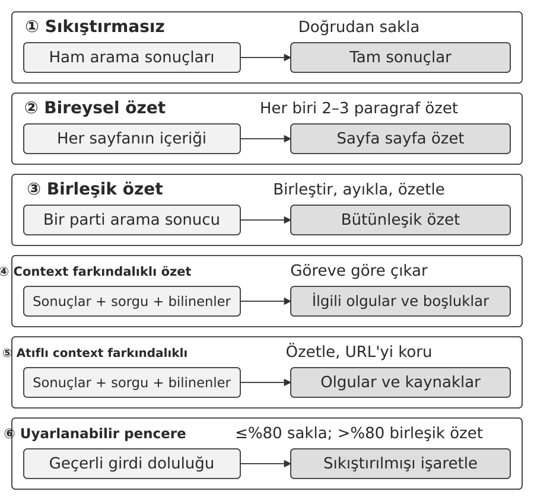
>
> Şekil 2-16'daki sayıları karşılaştırırken üç büyüklüğü ayırt etmek gerekir: tek bir isteğin girdisi pencere bütçesine ulaşılıp ulaşılmadığını belirler, kümülatif token çok turlu kullanımı yansıtır, karakter sıkıştırma oranı ise sayılan malzemenin işlendikten sonraki uzunluğunun özgün uzunluğa oranını anlatır. Buradaki kümülatif kullanım ana Agent'ın turlardaki girdi ve çıktılarından gelir; özeti üreten bağımsız model istekleri bu alana katılmamıştır.
>
> Deneyi yeniden üretmek için eşlik eden açıklamaya göre modeli ve gerçek arama hizmetini yapılandırın, deney dizininde `python experiment.py -m kimi-k3 -n 15 -o results/reproduction.json` komutunu çalıştırın. Stratejilerin `metrics` değerlerini okuyun: `total_compressed_size / total_original_size` ile karakter oranını yeniden hesaplayın, sonra `total_tokens` ile `iterations` değerlerini karşılaştırın. Sıkıştırmasız temel düzen de arama metinlerine başlık, URL gibi biçimler eklediği için işlenmiş karakter sayısı özgün metinden biraz yüksek olabilir. Deney programı nihai yanıtı alır almaz grubu tamamlanmış sayıyor. İki üründe aynı kişiyi aramayı deneyin: atıflı grup Pamela Vagata'nın çalıştığı kurumu Pebblebed olarak yazarken pencerelere ayırma grubunun özet tablosu Stripe yazıyor. İlk yanıt kurumun web sitesinden söz ediyor ama açılabilir bir bağlantı vermiyor. İki grup da özet tabloyu teslim etti, ama verdikleri kişi bilgileri birbiriyle çelişiyor.

[^ch2-compression-results]: Deney 2-10'un sonuç dosyası `kimi_k3_real_20260718.json` her stratejinin istatistik alanlarını, nihai yanıtını ve zaman damgalarını saklar; karakter oranı doğrudan yeniden hesaplanabilir. 18 Temmuz 2026'daki çalıştırma eski koruma koşulunu kullanıyordu; 22 Temmuz'daki kod revizyonu (`aea4d72` commit'i) kümülatif girdiyi en son turun istek girdisiyle değiştirdi.

### Üretim düzeyinde katmanlı sıkıştırma mekanizması

Araç çıktılarının tam metni geçici olarak saklanabilir, tamamlanmış adımlar arşivlenebilir, geçerli kısıtlar görünür kalmalıdır; aşağıdaki beş mekanizma farklı kullanım sıklıklarına ve saklama sürelerine uygundur.

1. **Araç sonucu bütçesi denetimi**. Büyük çıktılar harici depolamaya yazılır, context'te özet önizlemesi ve okuma giriş noktası tutulur. Önizleme geçmişe girdikten sonra içeriği sabit kalır; daha fazla ayrıntı gerektiğinde ilgili kesit okunup sonuç eklenir.
2. **İlgisiz içeriğin temizlenmesi**. Web sayfası gezinme çubukları, yinelenen altbilgiler gibi içerikler sonuç context'e girmeden önce filtrelenebilir. Geçmişe girmiş içeriğin silinmesi gerekiyorsa önce sonraki görevlerin ve atıfların hâlâ ona bağlı olup olmadığı kontrol edilir, sonra geçmişi değiştirmenin önbellek maliyeti hesaplanır.
3. **API katmanında context düzenleme**. Bu yeteneği destekleyen hizmetler eski araç sonuçlarını kurallara göre temizleyebilir. İstemci tetikleme koşullarını yapılandırmalı ve hizmetin döndürdüğü düzenleme bilgilerini işlemelidir. Temizleme kapsamı ve önbellek davranışı arayüz anlaşmasına göre belirlenir; girdi bütçesi izlemeyle birlikte kullanılmaya uygundur.
4. **Arşivleyici özet**. Turlara ya da görev aşamalarına göre hedefi, işlemleri, sonuçları ve tamamlanmamış işleri kaydeder, yürütme sırasını korur. Bunu görevin değişiklik günlüğü gibi düşünebilirsiniz: sonradan bir kararın hangi adımda ve neye dayanarak alındığı bulunabilir.
5. **Oturumun bütününün sıkıştırılması**. Yerel temizlik bütçeye yetmediğinde geçerli hedef, kısıtlar, doğrulanmış olgular, kilit kararlar ve sonraki işler bir devir özeti olarak düzenlenir. Önce mevcut oturum notları düzenlenebilir, sonra geçmişin tamamı özetlenir. Sıkıştırma art arda başarısız olursa yeniden deneme üst sınırı ya da devre kesici mekanizması tekrarlanan çağrıları durdurur, kurtarılabilir durum kaydedilir, ardından girdiyi küçültme ya da insan eliyle işleme seçilir.

Bu mekanizmalar katmanlı biçimde birlikte çalışabilir: giriş denetimi tek seferlik büyük çıktıları azaltır, yerel düzenleme günlük büyümeyi denetler, aşama özetleri ve bütün özet uzun görevler için devir bilgisini saklar.

Yazar dsh-superagent'ı okurken bir ayrıntıya dikkat etti: olaylar ve araç sonuçları önce bir özetle ve nesne ID'siyle gönderilebilir, ayrıntı gerektiğinde ID ile okunur. Arka planda bir test grubunun bittiğini varsayalım; ön yüze yalnızca "iki test başarısız" dendiğinde ön yüz ilerlemeyi bildirebilir, ama kullanıcının ardından sorduğu "dünkü iki test mi?" sorusunu yanıtlayamaz. Özete bu test kaydının kimliği eklenmişse ön yüz başarısız testlerin adlarını getirip dünkü kayıtla karşılaştırabilir.

### Sıkıştırma stratejisinin tasarım ilkeleri

Sıkıştırmadan sonra neyin korunacağına karar verirken aşağıdaki dört açıdan kontrol edebilirsiniz. Deneyimin görevler arası birikmesi süreci Bölüm 9'da ele alınacak.

- **Uzunluğu görev değerine göre dağıtın**. Kişi listeleri, kimlik ilişkileri ve geçerli bekleyen sorular genellikle doğrudan korunmalıdır; sonucu destekleyen kilit kanıtlar kaynağı ve gerekli ayrıntısıyla tutulur; gezinme çubukları, reklamlar ve yinelenen içerik temizlenebilir. Olgular tartışmalıysa kanıtlar arasındaki fark da önemli bilgidir.
- **Anlamsal bütünlüğü koruyun**. Örneğin "Sutskever 2024 Mayıs'ta OpenAI'dan ayrıldı" ifadesinde kişi, zaman, eylem ve kurum birlikte bir olgu oluşturur. Sıkıştırırken bu öğeler korunmalı, "Sutskever ayrıldı" gibi açıklaması zor bir kesite düşmemelidir.
- **İçeriği sonraki sorular etrafında düzenleyin**. "Kurucu listesini bul" tam bir kişi kapsamı ister, "kişisel geçmişi anla" ise deneyim, zaman çizelgesi ve kaynak ister. Aynı malzeme farklı görevlere göre farklı özetler üretebilir: arama kapsama, analiz ilişkilere ve dayanaklara, yaratıcı çalışma ise işe yarar ayrıntılara ve örneklere ağırlık verir.
- **Özetin yürütmeyi destekleyip desteklemediğini doğrulayın**. Anlamsal özet görevi anlamalı, yinelemeleri gidermeli, koşulları ve istisnaları saklamalıdır. **Karmaşık malzemenin anlamsal sıkıştırmasında, anlama yeteneği ana modele yakın bir model tercih edilmelidir.** Sıkıştıran taraf hangi koşulların, istisnaların ve kanıtların sonraki işi etkileyeceğine karar vermelidir; bunlar atılırsa ana model ne kadar güçlü olursa olsun geri getiremez.

Erken mimari kararlar, kısıtların arkasındaki gerekçeler ve başarısız yollar uzun geçmişte kolayca atlanır. **Uzun görevler ilerleme belgesini düzenli olarak güncellemelidir**: "neye karar verildi, neden böyle karar verildi, ne doğrulandı, sırada ne var". Prompt ya da Skill güncelleme zamanını belirleyebilir; Harness ise görev devredilirken ilgili kayıtları yükler. Böyle bir belge yürütücünün, denetleyicinin ve sonraki Agent'ların mevcut işi anlamasını da kolaylaştırır.

### Alt Agent'larda context yalıtımı

**Teslim sınırı net olan ve çok miktarda ara ara malzeme üreten görevlerde yazar öncelikle alt Agent yalıtımını kullanır.** Geniş kapsamlı bir arama yalnızca keşif aşamasında işe yarayan pek çok malzemeyi okutur; önce yalıtmak bu içeriğin ana görevi sürekli rahatsız etmesini azaltır. Ana Agent görevi bağımsız context'e sahip bir alt Agent'a verir; alt Agent ara sonuçları okur, sonra sonucu, kanıtların yerini ve çözülmemiş sorunları döndürür. Böylece ana Agent'ın context'inde yalnızca sonraki kararlar için gereken bilgi kalır.

Örneğin "ödeme geri çağrısını işleyen fonksiyonu bul" görevinde ana Agent doğrudan ararsa belki on küsur dosya okuması gerekebilir. Bunu bir arama alt Agent'ına verdiğinizde ondan fonksiyon adını, bulunduğu modülü, çağrı noktalarını ve yargısının dayanağını istemek yeterlidir. Yanıtı "ödemeler modülündeki `handle_callback` geri çağrıları işliyor, iki çağrı noktası daha var" biçiminde olabilir ve konumu belirlenebilir atıflar eşlik edebilir. Ana Agent bu sonuçlara göre ilgili kodu okuyup okumayacağına karar verir.

Görev tanımı yeterince eksiksiz olmalıdır: hedef nedir, arama kapsamı ne kadardır, hangi kısıtlara uyulmalıdır, hangi biçimde dönülecektir ve belirsizlik durumunda nasıl davranılacaktır. Hem devir talebi hem de dönen sonuç geçmişe eklenirse ana Agent'ın mevcut öneki yine yeniden kullanılabilir.

Bölüm 4 alt Agent'ların araç olarak arayüz tasarımını, Bölüm 10 ise çoklu Agent sistemlerinde context iş bölümünü daha ayrıntılı tartışacak.

## Bölüm özeti

Müşteri hizmetleri asistanı üçüncü aramayı da yaptıktan sonra nasıl devam etmeli? Bir sonraki istek bu görüşmenin araç makbuzunu taşır, çağrı ID'si arama işlemine karşılık gelir. Durum çubuğu kullanılan sayıyı üçe günceller ve henüz anlaşmaya varılmamış koşulları listeler. Sistem kuralları ve araç tanımları kararlı önekte kalır; belirli bir iş türünü yürütmek gerektiğinde ilgili Skill yüklenir. Böylece her alanın bir kaynağı olur ve hangi içeriğin bir sonraki çağrıyla değişeceği de görülebilir.

Görüşme uzadıkça ve araç dönüşleri arttıkça sonuçlara uzunluk sınırı konabilir, bitmiş kısımlar kaynaklı özetlere dönüştürülebilir ya da bağımsız yürütülebilecek işler alt Agent'lara verilip yalnızca sonuç ve kanıt geri alınabilir.

Bu görev bittiğinde "üç kez arandı" sayacı görevle birlikte arşivlenebilir. Ama kullanıcı özellikle "bundan sonra beni hafta içi öğleden sonraları ara" dediyse ve bu cümle yalnızca görüşme özetinde kalırsa, bir sonraki talebi üstlenen asistan onu hiç göremeyebilir. Uzun vadede işe yarayan bilgi nasıl saklanır ve doğru görevde nasıl bulunup çıkarılır? Bölüm 3 görevler arası kullanıcı belleğini ve paylaşılan bilgi tabanını tartışıyor.

## Düşünce Soruları

1. ★★★ Deney 2-3'ün kayan pencere çalıştırma kaydını okuyun: beş araç çağrısı sırasıyla ne yaptı? Yinelenen çağrıların geçmiş kırpmasından kaynaklanıp kaynaklanmadığını anlamak için başka neler kaydedilmeli ve hangi karşılaştırma yapılmalı? Kilit durumu koruyan bir kırpma planı tasarlayın ve önek önbelleğine etkisini açıklayın. Kayıt: `chapter2/kv-cache/result_sliding_window_20260718_kimi_k2_6.json`.
2. ★★ Qwen3'ün Chat Template'i geçmiş düşünceleri son gerçek kullanıcı sorgusunun konumuna göre işler. Bir ReAct döngüsü yüz turdan fazla sürerse giderek büyüyen akıl yürütme içeriğini nasıl yönetirdiniz? Geçmiş düşüncelerin kırpılmasını, geri verilmesini ve önek bağlama protokolünü karşılaştırın; Harness'ın buna nasıl uyarlanması gerektiğini açıklayın.
3. ★★ Yaklaşık yüz elli bin karakterlik arama malzemesini iki bin karaktere sıkıştırmanız gerektiğini varsayalım. Hangi olguları, ilişkileri ve kaynakları korurdunuz? Özetin sonraki sorulara yetip yetmediğini nasıl kontrol eder, çıkarılan ayrıntıları nasıl geri getirirdiniz?
4. ★★ Araç sayacı bir çağrıyı kaydetmeyi atladı ve durum çubuğu bu yüzden yanlış kalan hak sayısı verdi. Olay kaydını, toplam doğrulamasını ve yürütme katmanı denetimini tasarlayın; bu tutarsızlığın nasıl bulunup onarılacağını açıklayın.
5. ★★ Deney 2-4 tonu, bilgi düzenini ve araç açıklamalarını karşılaştırdı. Sistem prompt'u uzun süre birden çok kişi tarafından bakımlı tutuluyorsa sürümleri nasıl yönetir, kural çakışmalarını nasıl denetler ve her değişikliği regresyon görevleriyle nasıl değerlendirirdiniz?
6. ★★★ Evcil hayvan dükkânı örneği hem tek kayıt aramasını hem de genel istatistiği içeriyor. Ham kayıtları, istatistik özetini ve sorgu yönlendirmesini tasarlayarak sistemin bu iki tür soruyu verimli biçimde yanıtlamasını sağlayın; özetin ne zaman güncellenmesi gerektiğini de açıklayın.
7. ★★★ Bir Skill dizinde mevcut, ama model onun geçerli göreve uygun olduğunu fark etmedi. Sorunu açıklama, dizin düzeni, açık tetikleme ve değerlendirme örnekleri olmak üzere dört açıdan nasıl araştırırdınız?
8. ★★ Skill başarıyla yüklendi, ama model içindeki doğrulama adımını atladı. Tetikleme, anlama, araç kullanımı ve tamamlanma yargısındaki sorunları ayırt edebilecek bir karşılaştırma deneyi tasarlayın ve farklı modellerin performansını karşılaştırın.
9. ★★★ Sistem çok sayıda araç içeriyor ve araç kümesi sık değişiyor. Sabit tanımları, araç dizinini, ihtiyaç anında yüklenen sonuçları ve çalışma zamanı durumunu nasıl yerleştirirsiniz? Keşif doğruluğunu, context bütçesini ve önbellek isabetini birlikte göz önünde tutun.
