# Kullanıcı Belleği ve Bilgi Tabanı

Kullanıcı geçen hafta asistana pencere kenarı koltukları tercih ettiğini söylediyse ve bugün yalnızca "Tokyo'ya bir bilet daha al" diyorsa, bu istek önceki tercihi nereden geri getirecek? Havayolu dün bagaj kurallarını değiştirdiyse yeni maddeler nereden öğrenilecek? Önceki bölüm tek bir görevin context'inin nasıl düzenleneceğini tartıştı; bu bölüm kullanıcının söylediklerini nereden geri getireceğimizi, havayolunun yeni kurallarını nereden bulacağımızı ve bu iki tür bilginin sırasıyla ne zaman güncellenmesi gerektiğini tartışıyor.

**Kullanıcı belleği** bilgiyi belirli bir kullanıcı etrafında düzenler; onun tercihlerini, alışkanlıklarını, ihtiyaçlarını ve deneyimlerini kaydeder, böylece Agent sonraki oturumlarda da kullanıcının durumuna göre hizmet vermeyi sürdürür. **Bilgi tabanı** ise belirli bir yetki kapsamında birden çok kullanıcının paylaştığı bilgileri içerir; örneğin sektör mevzuatı, kurum işletme süreçleri ve teknik belgeler. Birincisi Agent'ın hizmet verdiği kişiyi tanımasına, ikincisi görevi tamamlamak için gereken alan bilgisini sağlamaya yardım eder.

İkisi de bilginin nasıl saklanacağı ve gerektiğinde nasıl bulunacağı sorununu çözmek zorundadır; olgu çelişkileri, eskiyen içerik ve kaçırılan aramalarla da karşılaşırlar. Vektör arama, yapılandırılmış indeksler ve bilgi sıkıştırma gibi teknikler her iki sistemde de kullanılabilir. Şekil 3-1 bu bölümün düzenini gösteriyor: önce kullanıcı belleğinin temsili ve yönetimi tartışılıyor, sonra getirme destekli üretim (RAG) tanıtılıyor, en sonunda getirme yöntemleri oturumlar arası belleğe ve daha karmaşık bilgi düzenlemesine uygulanıyor.

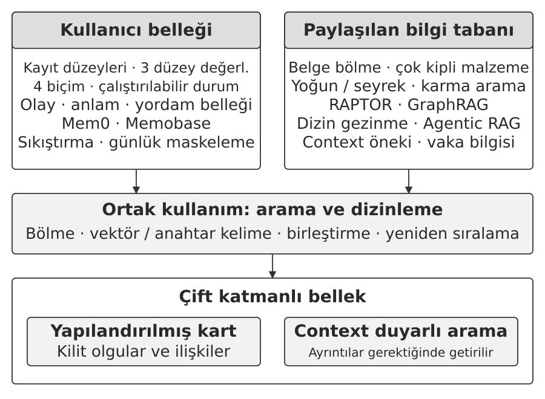

## Kullanıcı bellek sistemi

"Gelecek hafta yurt dışındayım, banka belgelerini e-postayla gönderin" cümlesini parçalarına ayıralım. Kullanıcı süresi belli bir seyahatten söz ediyor ve bu seyahat süresince bir teslim biçimi belirliyor. Banka belgeleri postayla göndermeyi önerdiğinde asistan buna dayanarak elektronik teslim isteyebilir; seyahat bittikten sonra posta konusu yeniden açıldığında ise mevcut koşullara yeniden bakmak gerekir. Yalnızca "kullanıcı basılı mektup sevmiyor" diye saklanırsa ileride bu bellek getirilse bile yanlış kapsamda kullanılır.

Uçak biletine bakalım. Kullanıcı "geçen seferki 1250'lik bilet beklediğimden pahalıydı" derse sistem en azından o teklifi, o zamanki bütçeyi, seyahat senaryosunu ve bu geri bildirimi saklayabilir. Benzer bir durumla bir dahaki sefere karşılaşıldığında model bütçeyi aşan tekliflere buna dayanarak daha temkinli yaklaşır. Kullanıcı ayrıca "bundan sonra aile seyahatlerinde önce bana sor" derse, bu, gelecekteki aile seyahatleri için açık bir sorma koşulu koyar. Buradan üç tür bilgi ayırt edilebilir: kullanıcının gerçekte ne söylediği, o sırada hangi koşulların geçerli olduğu ve modelin bu deneyimden ne çıkardığı.

Oturum sonunda bir LLM'den bu kayıtları düzenlemesi ve sonradan değer taşıyacak olguları kalıcı depolamaya yazması istenebilir. Yeni bir görev başladığında yalnızca ilgili ve hâlâ geçerli kayıtlar context'e getirilir.

Örneğin kullanıcı uçak bileti alırken şu bilgileri vermiş olsun:

```text
User: Help me book a flight to Tokyo next Friday. I prefer window seats
      and I'm vegetarian, so I'll need a special meal.
Agent: I'll search for flights to Tokyo for next Friday...
       [calls flight_search tool, returns 3 options]
Agent: Here are your options. Based on your preference, I've filtered for
       window seat availability. Shall I book the ANA direct flight?
User: Yes, and use my United MileagePlus number 12345678.
```

Oturumdan sonra bellek çıkarıcı dört kayıt düzenleyebilir:

```text
Extracted memories:
- User prefers window seats (preference)
- User is vegetarian, needs special meals on flights (dietary restriction)
- User's United MileagePlus number: 12345678 (loyalty program)
- User has travel plans to Tokyo (recent activity)
```

Bu örnek üç işlem içeriyor. **Seçici çıkarma** koltuk tercihini, beslenme gereksinimini ve üyelik numarasını tutar; "arama üç seçenek döndürdü" gibi geçici ayrıntıları filtreler. **Soyutlama** kullanıcının açıkça belirttiği pencere kenarı tercihini ileride bilet alırken kullanılabilecek bir kurala dönüştürür. **Yapılandırma** olguları kategorilerle etiketler; arama ve güncelleme kolaylaşır. Tokyo seyahati için kalkış tarihi ve mevcut durum da kaydedilmelidir; "gelecek cuma" oturum tarihine göre dönüştürülmeli, seyahat bittiğinde ya da iptal edildiğinde durum güncellenmelidir. Böylece uzun vadeli tercihler ile yakın tarihli etkinlikler kendi geçerlilik sürelerine göre tutulabilir.

Kişisel asistan Today'in ürün tanıtımı bir örnek veriyor. Kullanıcı her salı ve perşembe antrenman yaptığını, yarı maratona hazırlandığını söylüyor. Altı hafta sonra kullanıcının yetkisiyle bağlanan uyku kayıtları dün gece çok az uyuduğunu gösteriyor. Asistan bu iki bilgiyi bir araya getirerek o günkü yüksek yoğunluklu interval antrenmanını kaydırmayı öneriyor. Bu bilgiler ne kadar süre tutulmalı? Antrenman planı hazırlık dönemi boyunca işe yarar; dün geceki uyku kaydı ise tarihiyle birlikte saklanmalıdır. Kullanıcı bu ertelemeyi kabul etse bile, kullanıcı bundan sonra hep değiştirilmesini istediğini söylemedikçe gelecek perşembenin antrenmanı özgün plana göre düzenlenir. Today ayrıca öneride bulunmayı ve takvimi değiştirmeyi iki ayrı adım olarak ele alıyor; ikinci adım kullanıcı onayı gerektiriyor.[^ch3-today]

[^ch3-today]: Today ekibi *What Is Today* yazısında bellek ile o günün bilgilerinin nasıl birlikte çalıştığını yarı maraton antrenmanı üzerinden anlatıyor. Kurucu *Meet Today* yazısında takvim değiştirilmeden önceki teyit mekanizmasını açıklıyor.

### Bellek yeteneğinin değerlendirilmesi: üç düzeyli çerçeve

Açık kıyaslama **LoCoMo** (Long-term Conversational Memory, uzun süreli konuşma belleği), ortalama yaklaşık 300 tur ve en fazla 35 oturumdan oluşan uzun konuşmalar içerir; bellek yeteneğini soru-cevap, olay özeti ve çok kipli konuşma üretimiyle ölçer. Soru-cevap beş türe ayrılır. Tek atlamalı soruların yanıtı tek bir oturumda bulunabilir; çok atlamalı sorular birkaç oturumdaki ipuçlarının birleştirilmesini ister; zamansal akıl yürütme soruları olayların sırasının da anlaşılmasını gerektirir. Açık alan bilgisi soruları kullanıcının söylediklerini dış bilgiyle birleştirmeyi ister. Bilet örneğini sürdürelim: kullanıcı yalnızca "gelecek hafta Tokyo'ya gidiyorum" dediyse, "varış yerinde hangi para birimi kullanılıyor?" sorusunu yanıtlamak için hem Tokyo ipucunu hatırlamak hem de orada yen kullanıldığını bilmek gerekir. Soru, kullanıcının hiç söylemediği bir uçuş numarasıysa asistan bilginin yetersiz olduğunu belirtmelidir. Bu tür yanıtlanamaz soruları tanıyabilmek, karşıt (adversarial) soruların ölçtüğü yetenektir.[^ch3-locomo]

[^ch3-locomo]: Maharana ve arkadaşlarının LoCoMo makalesi (arXiv:2402.17753) Kısım 4.1'de beş soru-cevap türünün tanımlarını verir. Yazarların proje sayfası veriyi ve konuşma örneklerini sunar.

Bu tür kıyaslamaları ve bellek ürünlerindeki pratiği birlikte değerlendirerek dikkat edilmesi gereken yetenekleri sekiz maddede topluyorum:

- **Kişisel bilginin korunması**: Kullanıcının kimliği gibi uzun süreli bilgileri doğru saklamak ve geri getirmek.
- **Tercih takibi**: Kullanıcı tercihlerini kaydetmek ve yeni açık ifadelerle güncellemek.
- **Context geçişi**: Konu değiştikten sonra da ilgili arka planı sürdürebilmek.
- **Bellek güncelleme**: Kullanıcının mevcut olgulara yaptığı eklemeleri ve düzeltmeleri işlemek.
- **Çok oturumlu süreklilik**: Daha önce saklanan bilgiyi yeni oturumda kullanmak.
- **Karmaşık düşünme**: Birden çok bellek parçasını ilişkilendirmek. Örneğin kullanıcı yer fıstığı alerjisinden söz ettiyse, Tay yemeği konuşulurken bu bilgiyi de hesaba katıp malzemelerin kontrol edilmesini hatırlatmak.
- **Zaman farkındalığı**: Tarihleri saklamak, göreli zamanları çözümlemek ve olaylar arasındaki süreyi hesaplamak.
- **Çelişki çözme**: Tutarsız bilgileri fark etmek ve kaynağa, zamana ve ilgili kişiye bakarak karar vermek.

Agent'ın gerçek görevleri etrafında bu kitap ayrıca üç düzeyli bir değerlendirme çerçevesi benimsiyor. Deney 3-1 ve 3-2 bunu önce bellek temsillerini karşılaştırmak için kullanıyor; Deney 3-9 ve 3-11 ise aynı çerçeveyle getirme yöntemlerini değerlendiriyor.

**Birinci düzey: temel hatırlama.** Kullanıcının doğrudan verdiği, anlamı açık bilgileri doğru saklamak ve geri getirmek. Örneğin kullanıcı "üyelik numaram 12345" derse, sonraki bilet alımında tam numara döndürülebilmelidir. Bu düzey ağırlıklı olarak olguların kaybolup kaybolmadığını, karışıp karışmadığını ya da değiştirilip değiştirilmediğini kontrol eder.

**İkinci düzey: çok oturumlu getirme.** Farklı dönemlerden ve farklı kişilerle ilgili oturumlardan ilgili bilgilerin hepsini bulmak, sonra geçerli isteğin kimi kapsadığına ve hangi kayıtlara ihtiyaç duyduğuna karar vermek. Kullanıcının iki arabası var ama yalnızca "arabam için bakım randevusu al" diyorsa, sistem önce iki arabanın bilgisini getirip hangisi olduğunu netleştirmelidir. Kredi durumu sorgulanırken yürürlükteki sözleşmeyi geçmişte sorulmuş tekliflerden ayırmak gerekir. "Los Angeles seyahati" iptal edilirken uçak bileti, otel gibi rezervasyonların aynı seyahate bağlanması gerekir.

**Üçüncü düzey: proaktif hizmet.** Geçerli göreve göre kullanıcının tek tek belirtmediği ilgili konuları fark etmek. Örneğin uluslararası bir uçuş rezerve edilirken aylar önce saklanmış pasaport bilgisini ilişkilendirip geçerlilik süresinin seyahat koşullarını karşılayıp karşılamadığını kontrol etmek; telefon bozulduğunda cihaz garantisini, kredi kartının ek garantisini ve operatör sigortasını toplayıp kullanılabilir çözümleri listelemek; vergi belgeleri hazırlanırken bütün yılın kayıtlarından hisse işlemlerini, serbest çalışma gelirini ve emlak vergisi belgelerini eksiksiz bulmak.

> **Deney 3-1 ★: Bellek sistemini üç düzeyli çerçeveyle değerlendirmek**
>
> Değerlendirme kümesinde her düzey 20 örnek, toplam 60 örnek içeriyor. Birinci düzey ağırlıklı olarak tek oturumludur; ikinci ve üçüncü düzeyler farklı zamanlara ve kişilere yayılan çok parçalı oturumlar içerir ve varlık ilişkilendirmesini, bilgi güncellemeyi ve proaktif hatırlatmayı kontrol eder.
>
> Her örnek iki adımda yürütülür. Önce oturumlar parça parça verilir: model ilk parçaya göre bellek üretir, sonraki her seferde yalnızca mevcut belleği ve yeni oturumu alır ve güncellenmiş belleği üretir. Bundan sonra model önceki oturumların özgün metnini artık okuyamaz; o zaman konuşulan bir soruyu yanıtlamak için yalnızca belleğe yazılan bilgilere dayanabilir. Tüm oturumlar işlendikten sonra yeni bir soru verilir ve Agent'tan belleğe dayanarak yanıtlaması istenir.
>
> Değerlendirmede LLM-as-a-judge kullanılır: bağımsız bir değerlendirici model, yanıtın kapsadığı olguları ve hataları başvuru yanıtı ve puanlama ölçütleriyle karşılaştırır. Bu çalıştırmada bellek ve yanıt üretimi için Doubao Seed 1.6, puanlama için Moonshot modeli kullanıldı. Değerlendirici özgün konuşmaları görebiliyor; yanıt veren model ise yalnızca en sonunda kalan belleği görebiliyor.
>
> Not çizelgesini nasıl okumalı? Örneğin kullanıcı yalnızca geniş bant hizmetinin hesap numarasını öğrenmek istiyor. Geliştirilmiş notlar grubunda asistan doğru numarayı verdi. Değerlendirici doğruluk, hatırlama ve akıl yürütme için 4'er puan, proaktiflik için yalnızca 1 puan verdi; bu soru yine de geçti. Programın geçme koşulu ilk üç ölçütün her birinden en az 3 puan almak (en yüksek 4) ve değerlendiricinin dayanaksız ya da özgün sözlerle çelişen önemli bir olgu bulmamasıdır. Proaktiflik bileşik puana katılır; yalnızca geçen sayıya bakarak asistanın ne ölçüde proaktif yardım sunduğunu bilemeyiz.

### Belleğin katmanlı yapısı

"Geçen sefer hangi uçuşu ayırttım?" sorusunu yanıtlamak için tek bir olayı bulmak gerekir; "bilet alırken hangi koltuğu tercih ediyorum?" sorusunu yanıtlamak içinse birçok etkileşimden süzülmüş bir tercihi getirmek gerekir. İki soru da aynı kişiyle ilgilidir ama farklı kayıt ayrıntı düzeyleri ve getirme yöntemleri ister.

**İz (trajectory)**, Agent'ın tek bir çalışmasındaki olayları zamana göre kaydeder: kullanıcı mesajları, model yanıtları, araç çağrıları ve yürütme sonuçları. Yalnızca ekleme (append-only) yapan bir olay günlüğü kullanıldığında yeni olaylar sona eklenir, özgün kayıtlar geriye dönük izleme için korunur. Harness izden geçmişi seçebilir, durum çıkarabilir ya da özet üretebilir ve her turda modele gerçekte gönderilecek context'i kurar.

**Kullanıcının uzun süreli belleği** oturumlar arasında işe yarayan bilgileri saklar; örneğin tercihler, kişi ilişkileri, geçmiş etkinliklerin özetleri ve doğrulanmış olgular. Sahipliği kullanıcı ID'si gibi tanımlayıcılarla belirlenir. Yeni ifadeler eski kayıtları tamamlayabilir, düzeltebilir ya da yerlerine geçebilir; bu yüzden uzun süreli bellek birleştirme ve güncelleme gerektirir. Okuma ve bakım, Agent'ın açıkça araç çağırmasıyla da, Harness'ın oturum yüklenirken, bittiğinde ya da arka plandaki düzenleme sırasında tetiklemesiyle de yapılabilir.

**İş durumu** görevin içinde bulunduğu mantıksal aşamayı betimler; örneğin "netleştirme gerekiyor", "işleniyor", "ödeme bekleniyor", "tamamlandı". Program bu durumları kontrol ederek bir sonraki adımda hangi olayı bekleyeceğine ve hangi işlemi yürüteceğine karar verebilir. Bölüm 6 olay güdümlü mimaride durum yönetimini daha ayrıntılı tartışacak.

Bu üç tür kayıt birlikte çalışabilir: iz yürütme dayanağını, uzun süreli bellek oturumlar arası arka planı sağlar, iş durumu ise geçerli görevin nereye kadar ilerlediğini söyler. Aşağıda uzun süreli belleğin temsiline, yönetimine ve getirilmesine odaklanıyoruz.

### Kullanıcı belleğinin dört saklama biçimi

Yalnızca bir e-posta adresini değiştirmek gerekiyorsa en iyisi o maddeyi doğrudan bulabilmektir; adresin başta neden değiştirildiğini anlamak gerekiyorsa olayın akışını da okumak gerekir. Şekil 3-2'nin sol üstü e-postayı, şirketi ve unvanı ayrı maddeler olarak saklıyor; sağ üstü ise unvanı, ekibi ve projeyi bir arada yazıyor. Alttaki iki karta bakın: ileride unvanı güncellemek ya da kardiyoloğa kimin gittiğini ayırt etmek için hangi alanlara bakmak gerekir?

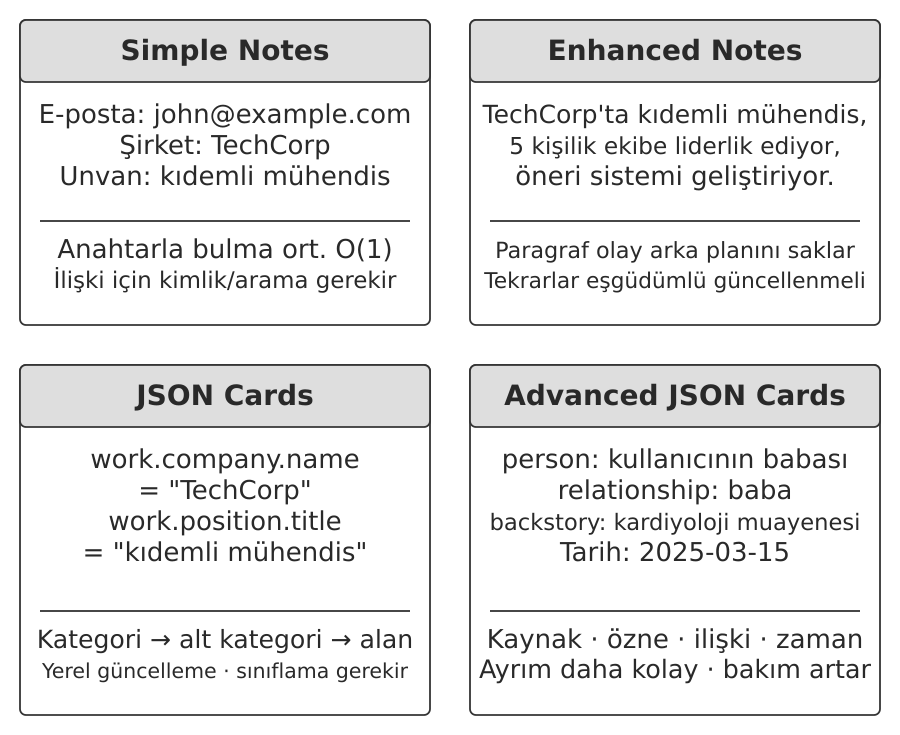

**Simple Notes** her belleği kısa bir olgu olarak yazar; örneğin "Kullanıcı e-postası: john@example.com". Tek tek kayıtları okumak ve yazmak kolaydır; sabit anahtarlarla bir hash tablosunda konumlandırıldığında arama ve güncellemenin ortalama zaman karmaşıklığı genellikle O(1)'dir. Çok sayıda not anlamsal olarak aranacaksa bir arama indeksi de kurulmalıdır. Aşırı ince bölme ise ilişkileri kaybettirir: "TechCorp'ta kıdemli mühendis, öneri sistemi geliştirmekten sorumlu" bilgisi şirket, unvan ve proje olarak birbirine bağlı olmayan üç kayda bölünürse, sonradan bunların aynı işe ait olup olmadığına yeniden karar vermek gerekir.

**Enhanced Notes** olguları ve arka planlarını eksiksiz paragraflar olarak saklar. Örneğin: "Kullanıcı TechCorp'ta kıdemli yazılım mühendisi; üç yıldır makine öğrenmesi alanında çalışıyor ve şu anda 5 kişilik bir öneri sistemi projesine liderlik ediyor." Şirket, unvan, deneyim ve ekip arasındaki ilişkiler aynı paragrafta korunur. Bedeli, bazı olguların birden çok paragrafta yinelenebilmesidir; unvan değiştiğinde ilgili tüm paragrafların bulunup güncellenmesi, eski ve yeni kayıtların bir arada kalmaması gerekir.

**JSON Cards** bilgiyi "kategori — alt kategori — anahtar-değer çifti" yapısında düzenler; örneğin `personal.contact.email` ve `work.position.title`. Unvan alanı değiştirilirken `work.company.name` gibi diğer alanlar korunabilir; yerel güncellemeler için uygundur. Kategoriler tasarlanırken kesişen bilgiler de düşünülmelidir: "hafta sonları Python ile kişisel proje geliştiriyor" bilgisi aynı anda zamanı, teknoloji tercihini ve etkinliği ilgilendirir. Tek bir etkinlik kaydı saklanıp birden çok etiket eklenebilir ya da ilgili kategoriler başvurularla bağlanarak bu ilişkiler korunabilir.

**Advanced JSON Cards** olgulara ek olarak kaynak arka planını `backstory`, kişiyi `person`, kullanıcıyla ilişkiyi `relationship` ve zaman damgasını ekler. Bu alanlar sistemin bilginin kime ait olduğunu, ne zaman öğrenildiğini ve hangi senaryoda geçerli olduğunu tanımasına yardım eder. Örneğin "Dr. Zhang" kullanıcının diş hekimi de olabilir, kullanıcının babasının kardiyoloğu da; adı hastayla, akrabalık ilişkisiyle ve uzmanlık alanıyla birlikte saklamak karışıklığı azaltır.

Kullanıcı "ailem için yıllık sağlık kontrolü ayarla" dediğinde sistem `person` ve `relationship` üzerinden aile üyelerini bulabilir, ardından ilgili deneyimleri `backstory` içinden okuyabilir. Alanlar zenginleştikçe çıkarma ve güncelleme sırasında ele alınması gereken ilişkiler de artar. Yazarın önerisi, bilginin önemine ve ilişkilendirme ihtiyacına göre karışık saklamaktır: kilit kişiler, sözleşmeler ve uzun süreli tercihler kaynağı ve ilişkileri koruyan Advanced JSON Cards ile; sayıca çok, ilişkisi az basit olgular ise çıkarma ve bakım maliyetini düşüren Simple Notes ile saklanır. İki tür kayıt tanımlayıcılarla ya da başvurularla birbirine bağlanır ve gerektiğinde birlikte getirilir.

> **Deney 3-2 ★★: Dört bellek biçiminin karşılaştırılması**
>
> Eşlik eden uygulama dört biçim için birleşik bir bellek üretme, güncelleme ve getirme arayüzü sağlıyor ve Deney 3-1'deki aynı 60 örnekte nihai yanıtları karşılaştırıyor.
>
> Bu çalıştırmada Simple Notes, Enhanced Notes, JSON Cards ve Advanced JSON Cards sırasıyla 48, 52, 51 ve 49 örneği geçti. Enhanced Notes ikinci düzeyde 16 örneği, Advanced JSON Cards 12 örneği geçti; ikisi de üçüncü düzeyde 19 örneği geçti. Bellek bakımı, yanıtlama ve değerlendirme dahil Enhanced Notes yaklaşık 990 bin, Advanced JSON Cards yaklaşık 1,55 milyon token kullandı; ikincisinin model çağrıları ortalama olarak daha uzun da sürdü.
>
> İkinci düzeydeki yayın aboneliği sorusunu ele alalım. Kullanıcı tasarruf etmek istiyor ve hangi hizmetlere abone olduğunu, her birinin ne kadar tuttuğunu soruyor. Geliştirilmiş notlar grubu Netflix, Disney+ ve Max'in aylık ücretlerini sırasıyla 22,99, 19,99 ve 19,99 dolar olarak listeledi. Gelişmiş JSON kartları grubu yalnızca Max'in fiyatını verdi, ayrıca Max'in iki düşük fiyatlı paketini listeledi. Öneri ne kadar ayrıntılı olursa olsun diğer iki faturayı tamamlayamaz.
>
> Sorun hangi güncellemede başladı? Gelişmiş kartlar grubunun her adımda kaydettiği belleğe bakıldığında, ilk oturumdan sonra Netflix vardı; ikinci oturumdan sonra yalnızca Disney+ ile ilgili kayıt kaldı; üçüncü oturumdan sonra ise yalnızca Max kaldı. Soru sorulduğunda ilk iki abonelik bellekten çoktan silinmişti.

### İleri bilgi temsili biçimi: yürütülebilir kod

Olgular saklandıktan sonra istatistik toplamak, çelişkileri kontrol etmek ve iş kurallarına göre bir sonraki adıma karar vermek de gerekir. **User as Code** (UaC) çalışmasında kullanıcı bilgilerini türlendirilmiş Python nesneleri olarak düzenlemeyi ve bu işlemleri fonksiyon olarak yazmayı denedim[^uac]. Model olguları konuşmadan çıkarır, program ise iyi tanımlanmış hesaplamaları yürütür.

Tarih karşılaştırması, tutar toplama ve açık iş kısıtları için hesaplamayı fonksiyon olarak yazmayı tercih ederim; böylece aynı olgu kümesi yeniden üretilebilir ve test edilebilir sonuçlar verir. Model anlamsal anlamaya odaklanabilir; uzun konuşmalarda tekrar tekrar zihinden hesap yapma ve kuralları kontrol etme yükü azalır. Belleğin temsili ve kullanımı da aynı kod içinde denetlenebilir.

UaC iki aşamalı bir akış kullanır: önce çıkarılan olgular bir günlüğe eklenir, sonra düzenli aralıklarla kontrol noktası üretilip türlendirilmiş durum günlükten yeniden kurulur. Günlük olguların kaynağını ve değişim sürecini korur; durum nesnesi ise o an sorgulanabilecek alanları sağlar.

Pasaport ve seyahat örneğinde durum şöyle tanımlanabilir:

```python
from dataclasses import dataclass
from datetime import date

@dataclass
class PassportInfo:
    number: str
    country: str
    expiry_date: date

@dataclass
class Trip:
    destination: str
    departure_date: date
    is_international: bool

@dataclass
class UserState:
    passport: PassportInfo
    trips: list[Trip]

state = UserState(
    passport=PassportInfo("AB1234567", "US", date(2025, 2, 18)),
    trips=[
        Trip("Tokyo", date(2025, 1, 15), True),
        Trip("Paris", date(2025, 6, 10), True),
    ],
)
```

**Toplu istatistik** kayıtları doğrudan dolaşır. Örneğin 2025'te kaydedilmiş uluslararası seyahat sayısını hesaplamak:

```python
count = sum(
    1 for trip in state.trips
    if trip.is_international and trip.departure_date.year == 2025
)
# count == 2
```

**Çelişki denetimi** iki alan kümesini önceden belirlenmiş kurallarla karşılaştırır. Aşağıda ilaç sınıfı eşleşmesini örnek alarak daha fazla kontrol gerektiren maddelerin işleme kuyruğuna nasıl gönderileceği gösteriliyor:

```python
def find_allergy_matches(profile):
    matches = []
    for medication in profile.current_medications:
        for allergy in profile.allergies:
            if medication.drug_class == allergy.drug_class:
                matches.append((medication, allergy))
    return matches
```

Her eşleşme ilgili ilaç kaydını ve alerji kaydını korur; sonraki akış bunlara dayanarak kontrol yapabilir, ardından alan kurallarına göre hatırlatma yapmaya, incelemeye göndermeye ya da bilgi tamamlamaya karar verebilir.

**Kısıt denetimi** durum güncellemeleriyle birlikte otomatik çalışabilir. Örneğin bir seyahat kuralı kalkış anında pasaportun en az 180 gün daha geçerli olmasını şart koşuyorsa, gün sayısı parametre olarak verilebilir:

```python
def passport_alerts(state, required_days):
    alerts = []
    for trip in state.trips:
        if trip.is_international:
            days = (state.passport.expiry_date - trip.departure_date).days
            if days < required_days:
                alerts.append((trip.destination, days))
    return alerts

alerts = passport_alerts(state, required_days=180)
```

Örnekteki 180 güne göre hesaplandığında Tokyo'ya gidilirken pasaportun yalnızca 34 gün geçerliliği kalıyor, Paris'e kalkış günü ise süresi dolmuş oluyor. Kullanıcı pasaportunu yeniledikten sonra program bu iki seyahati yeni tarihle yeniden hesaplayabilir.

[^uac]: Li, Bojie, User as Code: Executable Memory for Personalized Agents, 2026.

### Kullanıcı belleğinin bilişsel bilim temeli

Bilişsel bilim belleği içeriğe ve kullanım biçimine göre farklı türlere ayırır. Bu kavramlar Agent'ın uzun süreli bilgisini düzenlememize de yardım edebilir:

- **Epizodik bellek (episodic memory)** belirli olayı, zamanını, katılanları ve gelişimini saklar. İnsandaki örneği "geçen çarşamba meslektaşlarımla İtalyan restoranında akşam yemeği yedim"dir; Agent'ta "kullanıcı gelecek cuma ANA uçuşuyla Tokyo'ya gitmeyi planlıyor" buna karşılık gelebilir ve sonradan rezervasyonun başarılı olup olmadığı, biletin değiştirilip değiştirilmediği kaydedilir.
- **Semantik bellek (semantic memory)** olguları ve kavramları saklar. İnsandaki örneği "İtalya'nın başkenti Roma'dır"dır; Agent'ta "kullanıcı vejetaryen", "kullanıcı pencere kenarını tercih ediyor" karşılık gelebilir. Bu bilgiler kullanıcının açık ifadelerinden de birçok deneyimden genellenerek de gelebilir; kaynağı kaydetmek ikisini ayırmaya yardım eder.
- **Prosedürel bellek (procedural memory)** beceriler ve davranış akışlarıyla ilgilidir. İnsandaki örneği bisiklet sürmektir; Agent mühendisliğinde yeniden kullanılabilir akışlar benzetme olarak kullanılabilir, örneğin "direkt uçuşları ara → koltuk tercihini teyit et → sık uçuş numarasını kullan → yemek rezervasyonu yap".

Bölüm 1'deki alışveriş kaydına dönelim: "on ürünü görüp birini aldı" bilgisi bir satın alma olayını kaydetmeye yeter, ama kullanıcının bundan sonra neyi seveceğine karar vermek için çok zayıftır. O modeli beğenmiş olabilir, ya da yalnızca o gün teslim alınabildiği için seçmiş olabilir. Ardından "bundan sonra bu tür alımlarda önce aynı gün teslim edilip edilmediğine bakalım" derse, kapsamı belli uzun süreli bir tercih daha eklenir. Bir sonraki benzer öneride teslim süresi öne alınabilir ve bu filtrenin hangi geri bildirimden geldiği kullanıcıya açıklanabilir.

Tablo 3-1 bu sınıflandırmayı önceki bellek katmanları ve saklama biçimleriyle birlikte gösteriyor; üçünün hangi soruyu yanıtladığını açıklıyor.

Tablo 3-1 Bellek tasarımının üç boyutu

| Tasarım boyutu | Yanıtladığı soru | Somut kategoriler |
| --- | --- | --- |
| Kayıt katmanı | Bilgi hangi görevi üstlenir? | İz, kullanıcının uzun süreli belleği, iş durumu |
| Saklama biçimi | Hangi yapıyla temsil edilir? | Simple Notes, Enhanced Notes, JSON Cards, Advanced JSON Cards |
| Bellek içeriği | Hangi tür bilgi saklanır? | Epizodik bellek, semantik bellek, prosedürel bellek |

Örneğin "kullanıcı pencere kenarını tercih ediyor" semantik bellektir ve uzun süreli bellekte Simple Notes ile saklanabilir; bir bilet alma akışı prosedürel bellektir ve kaynağı ve geçerlilik koşullarıyla birlikte kart olarak saklanabilir.

### Bellek çerçevelerinden örnekler

Kullanıcı "son zamanlarda koridorda oturmaya başladım" diyor, ama eski kayıtta "pencere kenarını sever" yazıyor. Sistem ya yazma sırasında koltuk tercihini güncelleyebilir ya da iki ifadeyi birlikte saklayıp bir sonraki bilet alımında hangisinin geçerli olduğuna karar verebilir. Aşağıda önce Mem0'ın bu tür çelişkileri hangi halkada ele aldığına, sonra Memobase'in kullanıcı profilini ve somut olayları nasıl ayrı ayrı kaydettiğine bakıyoruz.

**Mem0: çelişki işlemenin yerini değiştirmek.** 2025 makalesi ve v2'deki akış yazma sırasında yeni ve eski olguları karşılaştırıyor; sonraki v3 ise olgu ekleme ve karma getirme yaklaşımını kullanıyor. Şekil 3-3 bu iki düzeni karşılaştırıyor.

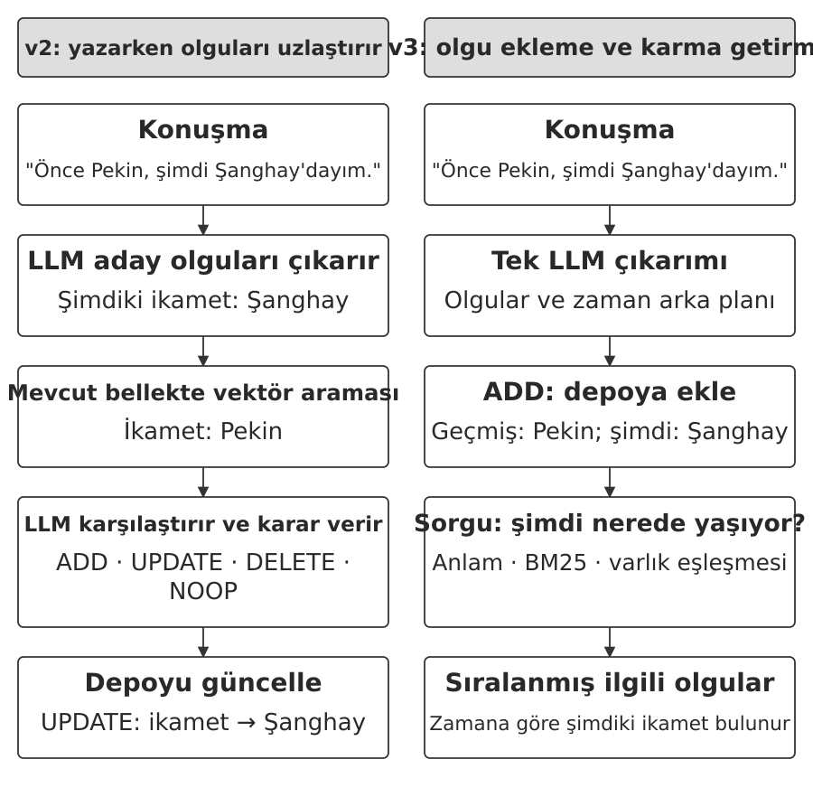

Erken akışta LLM önce konuşmadan aday olguları çıkarır, sonra benzer mevcut bellekleri getirip **ADD**, **UPDATE**, **DELETE** ya da **NOOP** işlemlerinden hangisinin uygulanacağına karar verir. Kullanıcı önce "Pekin'de yaşıyorum", sonra "Şanghay'a taşındım" derse sistem mevcut ikametgâhı Şanghay olarak güncelleyebilir. Böylece sorguda düzenlenmiş olgulara ulaşmak kolaylaşır; bakım sırasında ise düzeltmeleri, zaman değişimlerini ve farklı kişileri doğru tanımak, güncellemenin dayanağını saklamak gerekir ki hata sonradan geriye doğru bulunabilsin. Makale ayrıca varlık ve ilişkilerle ilişkili bilgiyi ifade eden grafik bellek varyantı **Mem0-g**'yi öneriyor[^ch3-mem0-paper].

v3 otomatik çıkarmayı tek bir LLM çağrısına indiriyor ve yalnızca **ADD** kaydı ekliyor. Pekin ve Şanghay bilgileri zaman bağlamıyla birlikte korunabilir; geçerli ikametgâha sorgu sırasında context'e bakılarak karar verilir. Getirme anlamsal benzerliği, BM25 anahtar sözcükleri ve varlık eşleşmesini birlikte kullanır; tamamlandığı doğrulanmış eylemler de olgu olarak çıkarılabilir. Geçiş kılavuzu LoCoMo puanının 71,4'ten 91,6'ya, LongMemEval'in 67,8'den 93,4'e çıktığını bildiriyor. Açık kaynak sürüm varlık ilişkilendirmesini iç getirmede kullanıyor; harici grafik depolama arayüzünü ve `relations` dönüş değerini kaldırmış durumda, grafik belleği yönetilen platformda sunuluyor[^ch3-mem0-migration].

Bu gelişim, bellek sistemlerinin çelişki yargısını yazma aşamasından okuma aşamasına taşıyabileceğini gösteriyor. Yazma sırasında iki kişinin deneyimi yanlışlıkla birleştirilir ya da tamamlayıcı bilgi düzeltme sanılırsa, sonraki yanıtlar hatalı bir "geçerli durum"u sürdürebilir. Ekleme yoluyla saklama hem yeni hem eski kanıtı yargıya katar, yazma sırasında madde madde karar vermek için gereken model çağrılarını da azaltır. Sık değişen ve çelişkisi o anda güç belirlenen kullanıcı belleğinde yazar önce olguları zamanları ve kaynaklarıyla saklamayı, somut soru yanıtlanırken geçerli durumu düzenlemeyi tercih ediyor.

[^ch3-mem0-paper]: Chhikara ve arkadaşları, Mem0: Building Production-Ready AI Agents with Scalable Long-Term Memory, 2025.

[^ch3-mem0-migration]: Mem0, Open Source: Migrating to the New Memory Algorithm.

**Memobase: kullanıcı profili ve olay belleği.** Memobase uzun süreli bilgiyi iki parçada düzenler. **Kullanıcı profili (profile)** konu ve alt konulara göre görece kararlı özellikleri saklar; örneğin `basic_info` altında ad, `interest` altında ilgi alanları, `work` altında unvan. Geliştirici çıkarılacak alanları yapılandırabilir ve profilin kapsamını ve ayrıntı düzeyini denetleyebilir. **Olay belleği (event memory)** kullanıcının deneyimlerini ve zamanlarını kaydeder; sistem "bütçeyi en son ne zaman konuşmuştuk" gibi soruları yanıtlayabilir.

Memobase yeni konuşmayı önce bir tampona alır; tampon belirli bir boyuta ulaştığında, oturum belirlenen süre boyunca boş kaldığında ya da oturum bittiğinde açıkça tetiklendiğinde toplu işler. Böylece birden çok mesaj tek bir düzenleme akışını paylaşır; sorgu sırasında ise önceden üretilmiş profil ve olaylar okunur. Asenkron güncelleme, geçerli etkileşimin bellek çıkarımını beklemesini azaltır; en güncel olgunun hemen kullanılması gerekiyorsa bu işlemin tamamlanması beklenebilir[^ch3-memobase].

[^ch3-memobase]: Memobase, resmî proje açıklaması; profil alanlarını, olay belleğini, tamponu ve eşzamanlı güncelleme arayüzünü içerir.

Asistanın hem son bilet alımının akışını hatırlaması hem kullanıcının koltuk tercihine ve bilet iadesi sürecine hâkim olması gerekiyorsa, Şekil 3-4'teki gibi olaylar, olgular ve akışlar ayrı ayrı saklanabilir. Her görev geldiğinde de işe yarayan kısımlar çalışma belleğine konur.

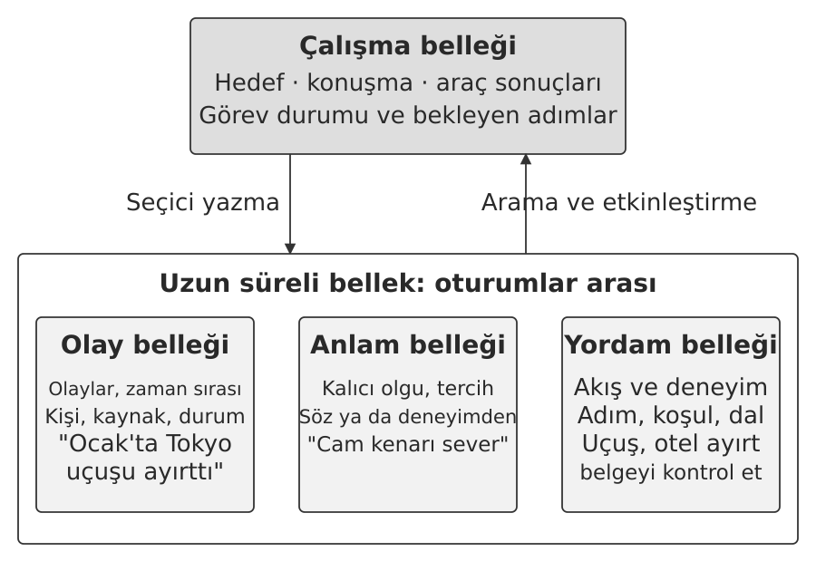

Epizodik bellek olay dizisini ve zaman damgası, duygu etiketi, görev tanımlayıcısı gibi meta verileri saklar; zaman ve konuya göre birleşik arama yapılabilir. Örneğin "bütçeyi en son konuştuğumuzda" konu eşleşmesinin yanı sıra zamana göre sıralamayı da gerektirir. Semantik bellek olaylardan çıkarılan olguları ve tercihleri, prosedürel bellek ise tekrar tekrar kullanılan akışları saklar.

**Çalışma belleği (working memory)** geçerli hedefi, görev durumunu ve getirilmiş ilgili bilgileri düzenler. Harness izden ve uzun süreli depodan içerik seçip geçerli context'e yükler; görevin ürettiği yeni olgular düzenlendikten sonra uzun süreli belleğe yazılır. İz olayların nasıl geliştiğini kaydeder, çalışma belleği bir sonraki karar için gereken bilgiyi bir arada tutar; ikisi olay tanımlayıcıları ve kaynaklar üzerinden bağlanır.

RAG'ı kullanıcı belleğini okumak için kullanırken önce geçerli isteğe göre olası ilgili bir bellek kümesi bulunur, sonra hangilerinin çalışma belleğine gireceğine karar verilir. Diyelim asistan bugün kullanıcıya koltuk seçmesine yardım edecek ve arama iki cümleyi birlikte buluyor: "iş seyahatlerinde pencere kenarını severim" ve "geçen sefer dizim ağrıyordu, dönüşte koridorda ayarla". İkisi de koltuk seçimiyle çok ilgilidir, ama ikincisi yalnızca o zamanki dönüş uçuşu için bir talepti. İlgiye göre yeniden sıralandığında bile ilk sıraya konsa, "bugün geçerli mi" sorusunu yanıtlamaz.

Bu durumda yazar aday bellekleri Jev gibi bir karar modeliyle süzmeyi daha umut verici buluyor. Bu seyahat, kullanıcının geçerli talebi ve her belleğin özgün ifadesi, tarihi ve geçerlilik koşulu birlikte verilir; her bir kayıt için "bu kez geçerli", "yalnızca fikir verir" ya da "dayanak yetersiz" diye karar verdirilir. Bugün de bir iş seyahatiyse ilk kayıt koltuk seçimine dayanak olabilir; kullanıcı diz ağrısının geçmediğini az önce söylediyse ikincisini geri getirip sormaya değer.

### Bellek sıkıştırma ve düzenleme mekanizması

Sık uçan bir kullanıcı "pencere kenarı"nı on kez anmış olabilir. Bunların dokuzu aynı siparişi tekrarlıyor olabilir; anılma sayısını doğrudan tercih gücü saymak tek bir olayın ağırlığını şişirir. Düzenleme sırasında önce kaynak ve olaylar ayırt edilir, sonra yinelenen kayıtlar birleştirilir, daha sonraki bir düzeltmenin bulunup bulunmadığı kontrol edilir, en sonunda hangi örüntülerin gelecekteki görevlerde kullanılmaya uygun olduğuna karar verilir. "Geçen seferki pencere kenarı iyiydi" gibi bir ifadeyle karşılaşıldığında Jev benzeri bir karar modeline bu cümleyi ve ilgili siparişi okutup yalnızca "geçen uçuşu değerlendirme", "bu sefer bir talep" ya da "uzun süreli tercih ifadesi" olduğuna karar verdirmek yeterlidir. Sipariş eşleşmiyorsa ya da birkaç yorum makul görünüyorsa özgün ifade saklanır ve bilet alımında yeniden teyit edilir. Böyle yerel bir yargı, aynı deneyimin tekrar tekrar yeni kanıt sayılmasını önler.

1. **Düzenlenecek nesneleri süzmek.** Erişim sıklığı, kayıt zamanı, duygu etiketi ve bilginin özgünlüğü sıralama sinyali olabilir. Örneğin üç gün önce oluşturulmuş, beş kez erişilmiş, duygu etiketi güçlü ve yinelenmeyen bir kayıt ayrıca saklanmaya daha değerdir; doksan gün önce oluşturulmuş, yalnızca bir kez erişilmiş ve başka üç kayıtla büyük ölçüde örtüşen bir kayıt ise ilgili kayıtlarla birleştirilmek üzere öne alınabilir. Sistem önce puanla düzenlenmesi gereken kayıtları süzebilir, sonra iş kurallarına göre sıkıştırmaya, birleştirmeye ya da silmeye karar verebilir. Uzun süreli kısıtlar ve yürürlükteki sözleşmeler az erişilse bile geçerlilik süreleri bitene kadar tutulmalıdır.
2. **Kümelenme ve özet üretme.** Benzer kayıtlar gruplanır, ortak içerik tek bir özetle korunur. Örneğin birçok hava durumu konuşması "kullanıcı sık sık hava durumunu soruyor, özellikle yağışla ilgileniyor" biçiminde düzenlenebilir. Somut tarihler ve özgün sorular arşivlenir; özet özgün kayıtlara bağlanır, böylece sonradan geriye bakılabilir.
3. **Örüntü ve akış çıkarmak.** Birçok alışveriş kaydından "fiyat-performansı yüksek ürünleri tercih ediyor, kullanıcı yorumlarına önem veriyor" sonucu çıkarılabilir ya da ürün seçme adımları derlenebilir.

### Gizliliğin korunması: günlüklerde maskeleme

Kullanıcı belleği çoğu zaman kimlik, iletişim ve hesap bilgilerini içerir. Sistem göreve göre hangi alanların model girdisine gireceğine, operasyon ihtiyacına göre hangi içeriğin günlüğe yazılacağına karar vermelidir. Maskeleme günlüğe yazmadan önce yapılabilir; hassas kesitler tür etiketi ya da kararlı bir yer tutucuyla değiştirilir ve sorun gidermek için gereken yapı korunur.

> **Deney 3-3 ★★: Yerel modelle günlük maskeleme**
>
> Bu deney Ollama üzerinden yerel Qwen3-0.6B'yi çağırarak günlüklerdeki hassas kesitleri bu makinede tanır. Küçük modeller tüketici cihazlarında çalıştırılmaya uygundur; 1.7B, 4B gibi boyutlara geçilerek tanıma kalitesi ile işlem süresi de karşılaştırılabilir. Özgün günlüklerin yerelde kalması gerekiyorsa tanıma ve değiştirme de bu makinede yapılmalı, maskelenmiş sonuç sonraki hizmetlere verilmelidir.
>
> Test malzemeleri kimlik numarası, banka kartı numarası gibi yapılandırılmış numaraları, adres gibi yarı yapılandırılmış içerikleri ve doğal dilde açığa çıkan şifre gibi hassas bilgileri içerir. Model JSON Schema'ya göre bilgi türünü, metindeki konumu ve güveni döndürür, program da buna göre özgün metni değiştirir. Kontrol grubu düzenli ifadeleri kullanır; karma grup ise önce düzenli ifadeyle eşleştirir, sonra kalan metni modele işletir.
>
> Önce iki günlüğe bakalım. Birincisinde kimlik numarası ve cep telefonu var; düzenli ifade yalnızca telefonu maskeledi, hatırlama oranı $1/2$. İkincisinde düzenli ifade Amerikan sosyal güvenlik numarasını ve banka kartı numarasını buldu, ama biçimi benzeyen iş emri numarasını da maskeledi. İşaretlediği üç yerden yalnızca ikisinin maskelenmesi gerekiyordu; kesinlik oranı $2/3$. Yalnızca hassas değerlerin günlükte kalıp kalmadığına bakılırsa ikinci günlük geçer; ama müşteri hizmetleri bu günlükle iş emrini sorgulamaya kalktığında izin kaybolduğu anlaşılır.
>
> On iki örneğin hepsi için hatırlama oranı tek tek hesaplanıp ortalandığında düzenli ifade, model ve karma çözüm sırasıyla yaklaşık %50, %69 ve %78 çıktı. Değiştirme sonrası tek tek sayıldığında üç çözüm sırasıyla 9, 3 ve 2 hassas değer bıraktı. Tercih ayrıca işlem süresine bağlı: bu makinede düzenli ifade örnek başına ortalama 0,1 milisaniye sürerken model ve karma çözüm yaklaşık 3 saniye sürdü. Günlük hacmi büyüdükçe önce biçimi kararlı alanlar düzenli ifadeyle işlenebilir, modele yalnızca context gerektiren kesitler bırakılabilir.

Kayıtlar çoğaldıkça sıradaki iş, binlerce bilgi arasından geçerli görevin ihtiyaç duyduğunu bulmaktır. Aşağıda tanıtılan RAG teknikleri hem paylaşılan bilgi tabanında hem kullanıcı belleği getirmesinde kullanılabilir.

## RAG temelleri: Agent'ın bilgi edinme hattını kurmak

Bir mağaza iade politikasını değiştirmiş olsun; kullanıcı "geçen ay aldığım ürün için şimdi nasıl iade başvurusu yaparım?" diye soruyor. Doğru yanıtlamak için önce bu siparişe uygulanan maddeleri bulmak, sonra koşulları ve adımları net anlatmak gerekir. **Getirme destekli üretim** (Retrieval-Augmented Generation, RAG) bu iki adımı birleştirir; model mağazanın iç belgelerini de, eğitim bittikten sonra yayımlanmış politikaları da kullanabilir.

Önce tek sürüm politikası olan durumla başlayalım. Aşağıda basitleştirilmiş bir arayüzle aynı mağazanın iade akışı sorgulanıyor ve getirme sonuçlarının modelin yanıtına nasıl girdiği gözleniyor:

```python
query = "iade süreci"
results = retriever.search(query, top_k=2)
# results = [
#   "İade politikası: sipariş teslim alındıktan sonra 7 gün içinde tam iade talep edilebilir; sipariş numarası gereklidir. İade 3–5 iş günü içinde hesaba geçer.",
#   "İade işlemi: 'Siparişlerim' bölümüne gir, siparişi seç, 'İade talep et' düğmesine tıkla."
# ]
answer = llm.generate(system="Sen bir müşteri hizmetleri asistanısın.", context=results, question=query)
# Yanıt başvuru süresini, gereken bilgileri, işlem adımlarını ve hesaba geçiş süresini içeriyor.
```

Şekil 3-5 ile koddaki iki getirme sonucunu karşılaştırın: iade başvurusunun adımları "iade işlemi"nden, paranın 3–5 iş günü içinde hesaba geçmesi ise "iade politikası"ndan geliyor. Getirme sonuçlarında yalnızca işlem adımları kalsaydı modelin kullanıcıya paranın ne zaman hesaba geçeceğini söylemek için dayanağı kalır mıydı? Bu soru el kitabının nasıl parçalara bölüneceğini ilgilendirir.

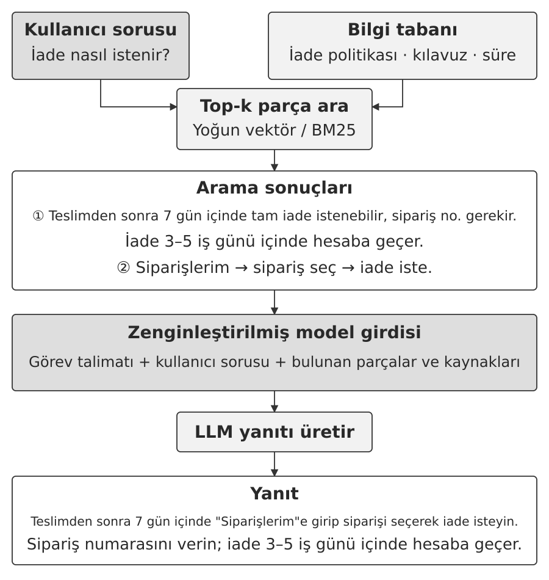

### Belge parçalama (Chunking)

Bir satış sonrası el kitabı önce "yedi gün içinde iade edilebilir" diyor, sonraki paragrafta istisna ürünleri açıklıyor. Yalnızca ilk cümle getirilirse istisna ürünler için de iade sözü verilmiş olur; el kitabının tamamı tek bir getirme birimi olursa kurulum, yapılandırma ve arıza giderme de aynı pakete girer ve vektörün iade temasını öne çıkarması zorlaşır. **Parçalama (chunking)** bu iki uç arasında bir boyut seçmelidir: bir metin parçasının kendi koşullarını açıklamaya yetecek, ama somut bir soruyla da kolayca bulunacak kadar. Parçanın uzunluğu ayrıca gömme modelinin girdi bütçesini karşılamalı ve sonraki üretim için context yeri bırakmalıdır.

Yaygın üç yöntem var.

**Sabit boyutlu bölme** token sayısına göre böler; örneğin her parça 512 token ve komşu parçalar 50–100 token örtüşür. Örtüşme, sınır yakınındaki içeriğin başka bir parçada eksiksiz görünme şansını yaratır. Bu yöntem parça uzunluğunu denetlemeyi kolaylaştırır; ama kesim noktası paragrafın, kodun ya da tablonun içine düşebilir.

**Özyinelemeli ya da yapı farkındalıklı bölme** önce bölüm ve paragraf gibi doğal sınırlar boyunca böler; aşırı uzun kalan kısımları cümle gibi daha küçük birimlere ayırır. Markdown başlıkları ve HTML öğeleri yapı ipucu sağlar. Kod blokları, tablolar ve başlıkla ilişkili gövde metni için özel işleme kuralları da kullanılabilir. Yapısı net teknik belgelerde yazar bu yöntemle başlamayı öneriyor: önce mevcut bölümleri ve paragrafları kullanmak, sonra aşırı uzun kısımları alt bölümlere ayırmak, doğrudan kesmekten genellikle bütün anlamı korumayı kolaylaştırır.

**Anlamsal bölme** komşu cümlelerin ya da cümle gruplarının gömme benzerliğini hesaplar ve konunun belirgin biçimde değiştiği yerde böler. Gömme hesaplaması ekler, ama aynı konuyu tek parçada tutma şansı verir.

Getirici yalnızca tek bir cümle döndürsün: "Şirketin geliri %3 arttı." Hangi şirket? Hangi çeyrek? Sayı doğru, ama yanıtın dayanağı önceki paragrafta kaldı. Bütün finansal raporu tek parçaya koyarsanız çeyrek ve şirket adı korunur, ama geliri sorguladığınızda işe alım ve donanım alımı paragrafları da birlikte gelir. Bu içerikler aynı vektörü paylaşmak zorunda kalır; gelir teması vektörde o kadar belirgin olmayabilir. Gerçekte parça boyutu seçerken her parça 256–1024 token ve komşu parçalarda %10–20 örtüşme değerleriyle denemeye başlanabilir.

Başlık, kaynak ve zaman gibi meta veriler parçayla birlikte saklanabilir. İlerideki context farkındalıklı getirme, her parçaya özgün metindeki arka planını daha ileri düzeyde ekleyerek bağımsız getirme sırasında gönderimlerin ve kapsamın çözümlenmesine yardım edecek.

### Yoğun gömmeler: metni vektörle temsil etmek

**Gömme (embedding)** sözcükleri, cümleleri ya da metin parçalarını sayısal vektörlere eşler; örneğin `[0.2, -0.5, 0.8, ...]`. Getirme modeli eğitim yoluyla ilgili sorgu ile belgenin vektör uzayında yüksek benzerliğe sahip olmasını sağlar. "Yoğun" olması, vektörün boyutlarının çoğunun sıfırdan farklı değerler taşıdığını ve metnin bilgisini birlikte temsil ettiğini gösterir; ilerideki seyrek temsilde ise yalnızca az sayıda boyut sıfırdan farklıdır.

Vektör uzayını yüksek boyutlu bir harita gibi düşünebilirsiniz: her metin bir konuma karşılık gelir, getirme de sorguya yakın içeriği arar. Yaygın ölçütlerden biri **kosinüs benzerliğidir**:

$$
\operatorname{cos}(A,B)=\frac{A\cdot B}{\|A\|\,\|B\|}
$$

İç çarpım $A\cdot B$ karşılık gelen boyutları çarpıp toplar; büyüklük $\|A\|$ ise boyutların kareleri toplamının kareköküdür. İki büyüklüğe bölündüğünde sonuç yalnızca yön ilişkisini yansıtır. Sıfırdan farklı vektörlerde kosinüs değeri $[-1,1]$ aralığındadır; 1'e yaklaştıkça yönler daha çok örtüşür. Farklı getirme modelleri iç çarpım ya da Öklid uzaklığı da kullanabilir. İki vektör de birim uzunluğa normalize edildiğinde iç çarpım kosinüs benzerliğine eşit olur.

> **Elle hesap: üç cümlenin kosinüs benzerliği**
>
> "Kedi nasıl beslenir" $A=(0.9,0.5,0.1)$, "Kedi besleme rehberi" $B=(0.8,0.6,0.1)$ ve "Hisse yatırım stratejisi" $C=(0.1,0.1,0.9)$ cümleleri için üç örnek vektör kullanalım.
>
> $A\cdot B=0.9\times0.8+0.5\times0.6+0.1\times0.1=1.03$. İkisinin büyüklüğü sırasıyla $\sqrt{1.07}$ ve $\sqrt{1.01}$; benzerlik yaklaşık **0.991**.
>
> $A\cdot C=0.9\times0.1+0.5\times0.1+0.1\times0.9=0.23$, $C$'nin büyüklüğü $\sqrt{0.83}$; benzerlik yaklaşık **0.244**. Bu vektörlerde kediyle ilgili sorgu besleme rehberine daha yakındır.

Gerçek modeller genellikle yüzlerden binlerceye uzanan boyutlar kullanır.

#### Word2Vec'ten context farkındalığına

Şekil 3-6 sabit sözcük vektörlerinden başlıyor. **Word2Vec** her sözcük için sabit bir vektörü, sözcüklerin birlikte bulunmasından öğrenir. Bazı ilişkiler vektör işlemlerinde ortaya çıkar; klasik örnek "kral − erkek + kadın ≈ kraliçe"dir. Sabit temsilin sınırı da açıktır: `bank` sözcüğü `river bank` (nehir kıyısı) ile `investment bank` (yatırım bankası) ifadelerinde aynı vektörle temsil edilir.

**GloVe** sözcüklerin birlikte bulunma sayılarını tüm derlemden sayar, sonra ağırlıklı en küçük kareler hedefiyle sözcük vektörlerini öğrenir. Word2Vec yerel pencere içindeki tahmin görevine ağırlık verirken GloVe küresel birlikte bulunma istatistiğini doğrudan eğitime katar; ikisi de sözcüklere sabit temsil öğretir[^ch3-glove].

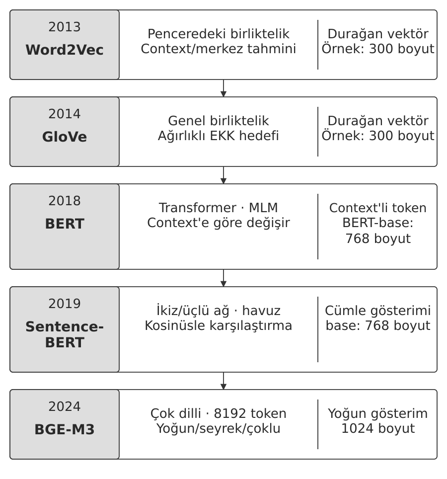

**BERT** gibi context modellerinde ise aynı sözcük biriminin temsili cümleye göre değişir. Öz dikkat sayesinde model "yeni ürün çıkardı" ve "iki kilo aldım" gibi ipuçlarına bakarak iki cümledeki "elma"ya farklı temsiller hesaplayabilir. Getirmede kullanılacak gömme modelleri ayrıca sözcük birimi temsillerini sorgu ya da belge vektöründe toplamalı ve ilgili eğitimle ikisini karşılaştırılabilir kılmalıdır.

**Sentence-BERT** BERT'i havuzlama, ikiz (siamese) ya da üçlü ağ yapılarıyla birleştirerek doğrudan karşılaştırılabilir cümle vektörleri eğitir. Belgeler önceden kodlanıp indekse yazılabilir; sorgu geldiğinde yalnızca sorgu kodlanır ve vektör benzerliği hesaplanır. Önceden kodlama, her sorguda tüm belge temsillerini yeniden hesaplama maliyetini ortadan kaldırır[^ch3-sbert].

**BGE-M3** yoğun, seyrek ve çok vektörlü getirme temsillerini birlikte sunar; çok dilli ve görece uzun girdileri destekler. Bu kısımda tek vektörlü getirmeyi açıklamak için onun yoğun temsilini kullanıyoruz[^ch3-bge-m3]. Modelin kabul ettiği uzunluk parçalama planını etkiler: özgün BERT'in tipik sınırı 512 token iken BGE-M3 8192 token'a kadar destekler.

[^ch3-bge-m3]: Chen ve arkadaşlarının M3-Embedding makalesi (arXiv:2402.03216) üç getirme temsilinin birlikte nasıl eğitildiğini anlatır. BAAI'nin BGE-M3 model açıklamasına da bakılabilir; temsil biçimlerini, boyutları, girdi uzunluğunu ve kullanımı içerir.

> **Deney 3-4 ★★: İki yaklaşık en yakın komşu indeksinin karşılaştırılması**
>
> Belge vektörleri kurulduktan sonra sorguya yakın vektörleri hızlıca bulmak gerekir. Tek tek hesaplamak kesin komşuları verir; veri ölçeği büyüdükçe **yaklaşık en yakın komşu** (Approximate Nearest Neighbor, ANN) indeksleri denetlenebilir bir hatırlama kaybı karşılığında sorgu hızı kazandırır. Bu deney aynı gerçek gömmeler ve aynı sorgular üzerinde ANNOY ile HNSW'yi karşılaştırıyor ve kesin arama sonuçlarını referans alıyor. Örneğin bir sorgunun kesin araması on en yakın komşu listelediyse ve yaklaşık indeksin döndürdüğü on sonuçtan sekizi bunların içindeyse, bu sorgunun Recall@10 değeri 0,8'dir. Bu sayı indeksin kesin komşuların ne kadarını koruduğunu ölçer.
>
> ANNOY aday kapsamını daraltmak için birden çok rastgele izdüşüm ağacı kullanır; HNSW ise katmanlı bir komşuluk grafiği kullanır, önce seyrek üst katmanlarda hedef bölgeye hızla yaklaşır, sonra daha yoğun alt katmanlarda arar. Şekil 3-7 HNSW'nin katmanlı yapısını gösteriyor.
>
> 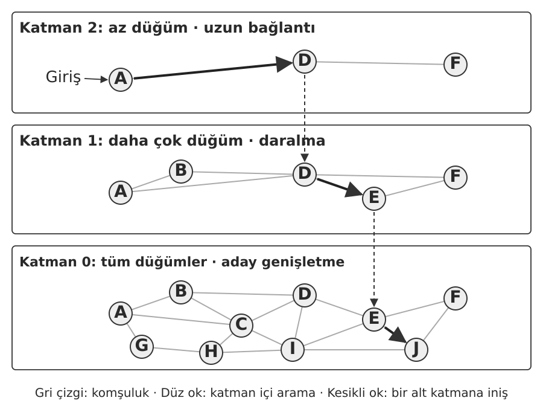
>
> Tablo 3-2 ANNOY ile HNSW'nin uygulama ödünleşimleri
>
> | Karşılaştırma boyutu | ANNOY | HNSW (hnswlib örneğiyle) |
> | --- | --- | --- |
> | İndeks yapısı | Birden çok rastgele izdüşüm ağacı | Katmanlı komşuluk grafiği |
> | Kurma maliyeti | Ağaç sayısına, vektör sayısına ve boyuta göre değişir | Komşuluk ölçeğine, kurma sırasındaki arama kapsamına ve veri miktarına göre değişir |
> | Bellek ve dosya | Statik indeks bellek eşlemeyi ve çoklu süreç paylaşımını destekler | Vektörleri ve grafik komşuluklarını saklar; komşuluk ölçeği maliyeti etkiler |
> | Artımlı güncelleme | İndeks kurulduktan sonra yeni kayıt eklemek yeniden kurmayı gerektirir | Ekleme, güncelleme ve silme işaretini destekler; kapasite yönetilmelidir |
> | Hatırlama ve hız | Ağaç sayısı ve sorgu arama bütçesiyle ayarlanır | Kurma parametreleri ve sorgu arama kapsamıyla ayarlanır |
> | Kullanım senaryosu | Dağıtılması ve paylaşılması kolay statik indeks | Sürekli yazılan ve sorgulanan dinamik indeks |
>
> Bu çalıştırmada önce 240 metin parçasıyla bir kütüphane kuruldu. Aynı 20 sorgu için iki indeks de kesin aramanın bulduğu ilk 10 komşunun hepsini buldu. İlk kurulumda ANNOY bir Linux konteynerinde yaklaşık 13 milisaniyede, HNSW yerel ortamda yaklaşık 78 milisaniyede kuruldu; kaydedilen indeksler sırasıyla yaklaşık 1,40 MB ve 1,02 MB'tı. Kalan 60 parça eklendiğinde ANNOY indeksi yeniden kurdu, HNSW ise yeni vektörleri doğrudan ekledi. Bu noktada kütüphanede 300 parça vardı ve önceki komşular da değişmiş olabilirdi. Yeni kütüphanede kesin arama yeniden yapıldığında iki indeksin ortalama hatırlama oranı yine %100'dü.

[^ch3-ann]: Spotify'ın Annoy proje açıklaması salt okunur indeksin nasıl kurulacağını, bellek eşlemeyle nasıl yükleneceğini ve sorguda incelenen düğüm sayısının `search_k` ile nasıl ayarlanacağını anlatır. hnswlib proje açıklamasının Python arayüzü bölümü vektör eklemek için `add_items` yöntemini ve sorgu kapsamını ayarlamak için `set_ef` yöntemini verir.

**İndeks, bilginin güncellenme biçimine göre seçilmelidir.** Derlem düzenli aralıklarla toplu yayımlanıyor ve birden çok süreç aynı salt okunur indeksi paylaşıyorsa yazar önce ANNOY'u düşünür; sürekli yeni belge alınıyor ve çevrimiçi ekleme gerekiyorsa HNSW'yi tercih eder. Gömme modeli anlamsal temsili belirler; indeks ise bu temsillerin uygun gecikme ve güncelleme maliyetiyle kullanılıp kullanılamayacağını belirler. İkisi birlikte getirme hizmetinin etkisini belirler.

ANNOY'un ağaç sayısını ve arama bütçesini ya da HNSW'nin komşuluk ölçeğini ve arama kapsamını ayarlayarak hatırlama ile gecikmedeki değişimi gözlemleyebilirsiniz[^ch3-ann]. İndeks hatırlaması hedef komşuların bulunup bulunmadığını ölçer; bu komşuların kullanıcının sorusunu yanıtlayıp yanıtlayamayacağı ise gömme temsiline ve malzemenin içeriğine bağlıdır.

### Seyrek temsil: anahtar sözcüklerden ilgililik puanına

**Seyrek temsil**, yalnızca az sayıda boyutu sıfırdan farklı olan yüksek boyutlu vektörler kullanır. Geleneksel anahtar sözcük araması terimleri boyut olarak alır ve belgede geçen sözcüklere ağırlık verir. Temeli **sözcük torbası modelidir** (Bag of Words, BoW): sözcükleri ve geçiş sayılarını saklar, sırayı yok sayar. Bu yüzden "kedi köpeği kovaladı" ile "köpek kediyi kovaladı" aynı sözcük torbası temsiline sahiptir (sözcük biçimleri aynı sayılırsa).

Bu temsil adları, numaraları ve teknik terimleri eşleştirmeye uygundur. Aşağıda TF-IDF'ten başlayarak terim sıklığı ile belge sıklığının bir sıralama puanına nasıl dönüştüğünü açıklıyoruz.

#### TF-IDF'ten BM25'e

**TF-IDF** (Term Frequency–Inverse Document Frequency, terim sıklığı – ters belge sıklığı) iki sinyali birleştirir: bir sözcüğün geçerli belgede kaç kez geçtiği ve tüm derlemde ne kadar yaygın olduğu. 100 makaleden 60'ında "model", yalnızca 3'ünde "damıtma" geçiyorsa, "model damıtma" sorgusunda "damıtma" daha ayırt edicidir.

Temel bir yazımı şöyledir:

$$\operatorname{TF\!\text{-}\!IDF}(t,d)=\operatorname{TF}(t,d)\times\operatorname{IDF}(t),\qquad \operatorname{IDF}(t)=\ln\frac{N}{\operatorname{DF}(t)}$$

$\operatorname{TF}(t,d)$ sözcük $t$'nin belge $d$'de geçiş sayısını, $\operatorname{DF}(t)$ bu sözcüğü içeren belge sayısını, $N$ ise toplam belge sayısını gösterir. Bu formüle göre on kez geçen bir sözcüğün puana katkısı, beş kez geçtiği durumdakinin iki katıdır; uzun belgeler de yalnızca daha çok sözcük içerdiği için yüksek puan alabilir. TF-IDF'in birçok normalize edilmiş varyantı vardır; aşağıdaki BM25 ise bu iki etkiyi terim sıklığı doygunluğu ve uzunluk normalizasyonuyla ele alır.

**BM25** her sorgu sözcüğünün katkısını toplar:

$$\operatorname{Score}(Q,D)=\sum_i\operatorname{IDF}_{\mathrm{BM25}}(q_i)\cdot\frac{\operatorname{TF}(q_i,D)(k_1+1)}{\operatorname{TF}(q_i,D)+k_1\left(1-b+b\frac{|D|}{\operatorname{avgdl}}\right)}$$

Burada $q_i$ sorgu sözcüğü, $|D|$ belge uzunluğu, $\operatorname{avgdl}$ ortalama belge uzunluğudur. $k_1$ terim sıklığının doygunluk derecesini denetler; $b$ ise uzunluk normalizasyonunun gücünü denetler, 0 olduğunda bu düzeltme kapanır. Şekil 3-8 bu terimleri ayrı ayrı hesaplıyor. Önce belge uzunluğunu sabit tutup sorgu sözcüğünün bir kez geçmesinden üç kez geçmesine kadar her ek geçişin ne kadar puan getirdiğine bakın; sonra terim sıklığını sabit tutup yalnızca belge uzunluğunu iki katına çıkarın. En alt satır iki sözcüğün belge kümesinde ne kadar yaygın olduğunu karşılaştırıyor.

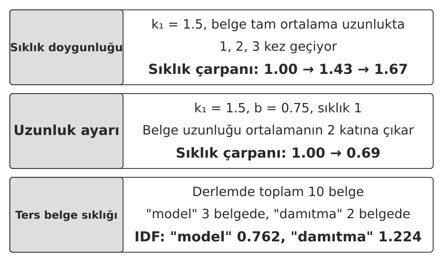

Şeklin ilk satırında ikinci geçiş terim sıklığı çarpanını yaklaşık 0,43 artırıyor, üçüncü geçiş ise yalnızca yaklaşık 0,24 artırıyor; terim sıklığı doygunluğu budur. İkinci satırda aynı sözcük her iki durumda da bir kez geçiyor; daha uzun belgede daha az öne çıktığı için uzunluk düzeltmesi terim sıklığı çarpanını düşürüyor. Bu sözcüğün toplam puana katkısı ancak IDF ile çarpıldıktan sonra elde edilir.

Formülde belirlenmesi gereken bir terim daha var: ikisi de üç kez geçtiğinde nadir sözcük neden yaygın sözcükten genellikle daha yararlıdır? Bu kısımda sözcükleri aşağıdaki ters belge sıklığıyla ağırlıklandırıyoruz:

$$\operatorname{IDF}_{\mathrm{BM25}}(t)=\ln\frac{N-\operatorname{DF}(t)+0.5}{\operatorname{DF}(t)+0.5}$$

Pay sözcüğü içermeyen belgelerin sayısını, payda ise içeren belgelerin sayısını gösterir; ikisine 0,5 eklenerek yumuşatma yapılır ve belge sıklığı 0 ya da $N$ olduğunda da hesap yapılabilir. Nadir sözcükler daha yüksek ağırlık alır; belgelerin yarısından fazlası sözcüğü içerdiğinde formül negatif değer verir. Eşlik eden uygulama gerçek puanlama ağırlığının alt sınırını $10^{-6}$ olarak belirler ve özgün değeri de kontrol için saklar.

> **Deney 3-5 ★★: BM25 arama motorunu sıfırdan yazmak**
>
> Bu deney sırasıyla sözcüklere ayırmayı, durak sözcük işlemeyi, ters indeksi ve puanlamayı tamamlıyor. Durak sözcük işleme "ve", "bir" gibi çok sık geçen sözcükleri filtreleyebilir. **Ters indeks** her sözcüğün hangi belgelerde ve kaç kez geçtiğini kaydeder; bir kitabın sonundaki terim dizinine benzer: "TCP" arandığında 45., 112. ve 203. sayfalar bulunur, sonra o konumlardaki içerik okunur.
>
> "Model damıtma" sorgusunu elle hesaplayalım. Derlemde ortalama uzunluğu 250 sözcük olan 10 belge olsun; $k_1=1.5$, $b=0.75$. "Model" 3 belgede geçiyor, IDF'i yaklaşık 0,762; "damıtma" 2 belgede geçiyor, IDF'i yaklaşık 1,224. Aşağıdaki tablo sözcüklere göre isabet eden belgeleri, terim sıklıklarını ve belge uzunluklarını listeliyor. Bu değerler formüle konduğunda her sözcüğün belge puanına katkısı hesaplanabilir.
>
> | Sorgu sözcüğü | Belge | Terim sıklığı TF | Belge uzunluğu | BM25 katkısı |
> | --- | --- | ---: | ---: | ---: |
> | model | doc_1 | 5 | 200 | 1.52 |
> | model | doc_3 | 2 | 500 | 0.82 |
> | model | doc_7 | 8 | 150 | 1.68 |
> | damıtma | doc_1 | 3 | 200 | 2.15 |
> | damıtma | doc_5 | 1 | 250 | 1.22 |
>
> İki sözcüğün doc_1'deki katkılarının toplamı yaklaşık 3,67'dir; sıralama **doc_1 (3.67) > doc_7 (1.68) > doc_5 (1.22) > doc_3 (0.82)** olur. doc_1'de "damıtma"nın terim sıklığı "model"inkinden düşüktür, ama daha nadir olduğu için nihai katkısı daha büyüktür; iki sözcüğün birlikte eşleşmesi de toplam puanı ayrıca yükseltir.
>
> Şimdi eşlik eden deneyin İngilizce derleminde `cat` sorgusunu yapın. İlgili olarak işaretlenmiş iki kısa metin sırasıyla `kitten` ve `feline` kullanıyor; ters indekste `cat` bulunamıyor ve aday listesi boş kalıyor. Yukarıdaki terim sıklığı ağırlıkları ne kadar yükseltilirse yükseltilsin puanlanacak tek bir belge yok. Bu iki kısa metindeki sözcüklerle yeniden sorgularsanız her birinin aday listesine girdiğini görürsünüz.

### Karma getirme: iki yolun sonuçlarını birleştirip yeniden sıralamak

Bazı sorular için eşanlamlıları önceden eksiksiz listelemek zordur. Deney 3-6'daki bir soru "kullanılmayan yığın belleği otomatik olarak nasıl geri kazanılır" diye soruyor, hedef kısa metin ise "otomatik bellek yönetimi geliştiriciyi nesneleri elle serbest bırakma işinden kurtarır" diye yazılmış. İngilizce sorgu ile kısa metnin ortak terimi yok; anahtar sözcük araması hiçbir şey bulamadı, vektör araması ise hedefi birinci sıraya koydu. Model numarası XR-7003 sorgusunda ise anahtar sözcük araması ilgili modeli doğrudan buldu, vektör araması ise birkaç benzer modeli de listeledi.

**Karma getirme** önce anahtar sözcüklerle ve vektörlerle ayrı ayrı ilgili paragrafları arar, sonra hangi paragrafların modele verilmeye değer olduğuna karar verir. Bilgi tabanı hem kesin tanımlayıcılar hem de doğal dil betimlemeleri içeriyorsa yazar buradan başlamayı öneriyor. Şekil 3-9 boyunca XR-7003'ü izleyin: iki yol da onu birinci sıraya koyuyor, birleştirmede iki sıralama katkısı alıyor. Yeniden sıralama ikinci sırayı değiştiriyor, ama kullanıcının ilk gördüğü model yine doğru.

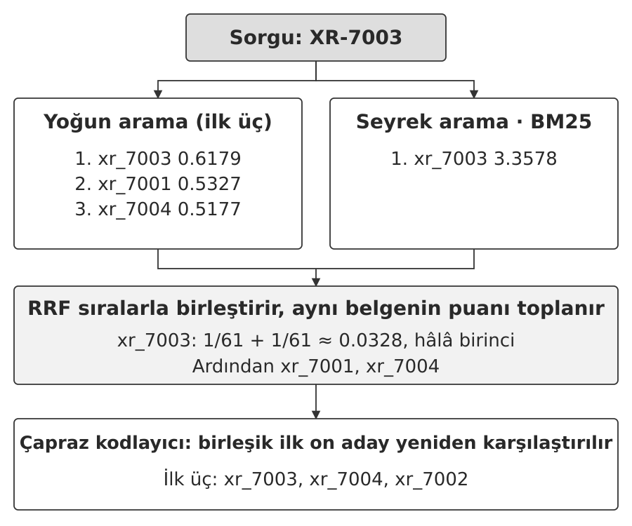

Birinci aşama **paralel getirmedir**: sorgu yoğun ve seyrek motorlara gönderilir, her biri olası ilgili bir belge kümesi getirir. İki yol aynı özgün metni kullanabileceği gibi kendi modellerinin gereksinimlerine göre ön işleme de yapabilir.

İkinci aşama **sonuç birleştirmedir**: iki yolun sonuçlarındaki aynı belge birleştirilir, sonra ortak bir sıralama yapılır. Kosinüs benzerliği ile BM25'in sayısal ölçekleri farklıdır; doğrudan toplamak sayısal değeri büyük olan yolun sonuca hâkim olmasına yol açabilir. Bir yöntem önce puanları kalibre etmek ya da normalize etmek, sonra ağırlıklı birleştirmektir; bir diğeri ise sıralamalara göre hesaplanan **ters sıra birleştirmedir** (Reciprocal Rank Fusion, RRF):

$$\operatorname{RRF}(d)=\sum_{j:\,d\in R_j}\frac{1}{k+\operatorname{rank}_j(d)}$$

$R_j$ $j$. yolun sonucudur ve sıralama 1'den başlar; belge bir yolda görünmüyorsa o yolun katkısı sıfırdır. Yumuşatma sabiti $k$ genellikle 60 alınır; büyüdükçe ilk birkaç sıra arasındaki puan farkı küçülür. RRF farklı puanlama yöntemlerini birleştirmeyi kolaylaştırır, ama yalnızca sırayı korur; özgün puanlardaki güç farklarından yararlanmak için başka yöntemler gerekir.

İki yollu bir getirme örneğini hesaplamayı deneyin. Kullanıcı "iade ne zaman hesaba geçer?" diye soruyor; A belgesi anahtar sözcük aramasında birinci, vektör aramasının üst sıralarında ise yok; B belgesi iki yolda da ikinci. $k=60$ alınırsa A $1/61$, yani yaklaşık 0,0164; B ise $1/62+1/62$, yani yaklaşık 0,0323 alır. Birleştirmeden sonra B, A'nın önüne geçer. Bu sonuç yalnızca iki getirme yolunun da B'yi bulduğunu söyler. B'nin hesaba geçiş süresini gerçekten yanıtlayıp yanıtlamadığına karar vermek için onun "iade nasıl talep edilir" mi yoksa "iade ne zaman hesaba geçer" mi yazdığına bakmak gerekir.

Üçüncü aşamada **sinirsel yeniden sıralama** eklenebilir. Sistem birleştirme sonrası üst sıralardaki belgeleri, örneğin ilk 50'yi alır ve yeniden sıralama modelinden her belgenin sorguyla ilgililiğini puanlamasını ister. Yeniden sıralama bu 50 belgenin sırasını değiştirebilir. Gerçekten yararlı belge hiç seçilmemişse, yukarı akışa dönüp getirmeyi iyileştirmek gerekir.

Burada sık kullanılan model **çapraz kodlayıcıdır (cross-encoder)**: sorgu ile aday belge birlikte girilir, iki kısım model içinde etkileşir ve bir ilgililik puanı çıkar. Getirme aşamasındaki **çift kodlayıcı (bi-encoder)** ise sorguyu ve belgeyi ayrı ayrı kodlar; belge vektörleri önceden hesaplanabilir, sorgu sırasında yalnızca vektör araması yapılır. Birincisi az sayıda belgenin ince sıralamasına, ikincisi çok sayıda belgenin ilk elemesine uygundur. Bunu özgeçmiş elemesine ve mülakata benzetebiliriz: önce mevcut özelliklere göre kapsam daraltılır, sonra somut gereksinimler etrafında derinlemesine karşılaştırma yapılır. BGE Reranker v2 M3 bu halkada kullanılabilecek modellerden biridir[^ch3-reranker].

[^ch3-reranker]: BAAI, BGE Reranker v2 M3 model açıklaması; sorgu–belge girdisini ve ilgililik puanlamasını tanıtır.

İlgili malzeme aday havuzuna zaten girdiği hâlde sık sık ilgisiz malzemenin arkasında kalıyorsa yazar önce çapraz kodlayıcıyla yeniden sıralamayı değerlendirir. Soru ile belgeyi birlikte okuduğu için belgedeki koşulların, sınırlayıcı ifadelerin ve ayrıntıların sorunun gereksinimlerine uyup uymadığını doğrudan karşılaştırabilir. Tablo 3-3 sık kullanılan üç ölçütü listeliyor.

Tablo 3-3 Getirme kalitesinin üç ölçütü

| Ölçüt | Hesaplama ve anlamı |
| --- | --- |
| recall@k (hatırlama) | İlk k sonuçtaki ilgili belge sayısının o sorgunun tüm ilgili belgelerine bölümü; ilgili içeriğin ne kadarının bulunduğunu ölçer; test kümesinde genellikle sorgular üzerinden ortalaması alınır |
| MRR (ortalama ters sıra) | Her sorguda ilk ilgili belgenin sırasının tersi alınıp ortalanır; ilk sırada 1, onuncu sırada 0,1, bulunamazsa 0 |
| nDCG@k (normalize edilmiş indirgenmiş kümülatif kazanç) | Sonuçlara ilgililik derecesine göre puan verilir, alt sıralar indirgenir, sonra ideal sıralamanın puanına bölünür; ilk k sonucun genel sıralama kalitesini ölçer |

Ayrıca **isabet oranı** da kaydedilebilir: kaç sorgu ilk k sonuçta en az bir ilgili belge buldu? Örneğin bir soru üç belge gerektiriyor ve ilk yirmi sonuç bunların yalnızca ikisini getiriyor. Bu sorgu isabet etmiş sayılır ve "hiç isabet etmeyen" başarısızlıklara girmez, ama recall@20 değeri yalnızca $2/3$'tür; belgelerin $1/3$'ü bulunamamıştır. Her sorunun yalnızca bir hedef belgesi varsa, onu bulan soru 1, kaçıran soru 0 puan alır. Aynı getirme sonucunun ortalaması alındığında isabet oranı ortalama hatırlama oranına eşit olur.

> **Deney 3-6 ★★: Seyrek, yoğun, birleştirilmiş ve yeniden sıralanmış getirmenin karşılaştırılması**
>
> Bu deney aynı 12 etiketli sorgu üzerinde beş yapılandırmayı karşılaştırıyor: seyrek getirme, yoğun getirme, RRF birleştirmesi, ağırlıklı birleştirme ve birleştirme sonrası yeniden sıralama. Sorgular anlamsal benzerliği, kesin adları, çok dilliliği ve teknik kodları kapsıyor; ikisi bitkilerin güneş ışığını besine nasıl dönüştürdüğünü sırasıyla İngilizce ve Çince soruyor. Yoğun model olarak Qwen3-Embedding-0.6B, yeniden sıralayıcı olarak MS MARCO MiniLM çapraz kodlayıcısı kullanılıyor; her getirme yolu en fazla 10 belge alıyor, yeniden sıralayıcı RRF'in üst sıralarındaki en fazla 10 belgeyi işliyor. Hatırlama oranı ve nDCG yalnızca nihai sıralamanın ilk 3 belgesine bakıyor; MRR ise dönen liste boyunca ilk ilgili belgeyi arıyor.
>
> Önce Deney 3-6 çalıştırma kaydındaki soru başına sıralamaları açın ve iki fotosentez sorusunun getirme sonuçlarını karşılaştırın. İngilizce soruda hedef belge yine birinci sırada. Çince soru önce programlama dillerini ve volkanları döndürüyor, fotosentezi anlatan belge ancak üçüncü sırada. Her sorunun yalnızca bir ilgili belgesi var ve iki soru da onu ilk üç içinde buldu; recall@3 ikisinde de 1. Ama Çince soruda ilk ilgili belge üçüncü sırada; ters sırası yalnızca $1/3$. Bu deneyin puanlamasına göre üçüncü sıranın kazancı $1/\log_2(3+1)=0.5$, birinci sıranınki 1'dir; bu yüzden Çince sorunun nDCG@3 değeri 0,5'tir.
>
> Şimdi 12 sorunun tamamına bakın. Yeniden sıralamadan sonra Çince fotosentez sorusunun yanı sıra yığın belleğin geri kazanılmasıyla ilgili bir soruda da hedef belge birinciden ikinciye geriledi. Diğer on soru birinciliği korudu; bu yüzden yeniden sıralama sonrası MRR $(10+1/2+1/3)/12\approx0.903$'tür. Karşılaştırma için yoğun getirme ve RRF'in MRR'ı 1'dir. İkisinin nDCG@3 değeri de 1'dir; yeniden sıralamadan sonra yaklaşık 0,928'e düşer. Yalnızca ortalama hatırlama oranına bakarak bu sıra değişikliklerini göremezsiniz: seyrek getirmenin recall@3 değeri 0,833, diğer dört grubunki ise 1'dir.
>
> Bu soru kümesi için bir yapılandırma seçecek olsaydınız, yeniden sıralamaya harcanan zaman neyi getirdi? Bu CPU'da RRF getirmeye başlamaktan sıralamayı vermeye kadar soru başına ortalama yaklaşık 194 milisaniye harcadı; yeniden sıralama eklenince yaklaşık 237 milisaniye. Fazladan harcanan yaklaşık 43 milisaniye fazladan bir hedef belge getirmedi, üstelik iki sorunun doğru yanıtını geriye itti.

## Bilginin düzenlenmesi ve getirilmesi

Bilginin düzenlenme biçimi her kaydın ne içerdiğini, getirici ise bu kayıtlardan neyin geri getirileceğini belirler. Teknik el kitapları, hukuki belgeler ve makalelerdeki paragraflar bölüm hiyerarşisi, kavram bağımlılıkları ve belgeler arası atıflarla birbirine bağlıdır. Bu yapıları korumak sorgunun hem somut kanıtlara hem de üst düzey özetlere erişmesini sağlar.

Bu kısımda sırasıyla birkaç düzenleme biçimini tartışıyoruz: RAPTOR ve GraphRAG hiyerarşik ya da ilişkisel indeksler kurar; OpenViking context kaynaklarını dizinlerle düzenler; artımlı güncelleme ve düzenli derleme bilginin güncelliğini korur; Agent'a dayalı RAG, Agent'ın mevcut sonuçlara göre getirmeyi sürdürmesini sağlar; context farkındalıklı getirme parçaların arka planını tamamlar; en sonunda veri kümelerinden yeniden kullanılabilir bilgi çıkarılır. Bunlar sırasıyla temsil, indeks, güncelleme ve sorgu süreçlerine etki eder ve kullanıcı belleği için birlikte de kullanılabilir.

Önce sorgunun ihtiyaç duyduğu bilgi ile ham kayıtlar arasındaki açığı anlamak için iki örneğe bakalım.

**Örnek bir: siyah ve beyaz kedileri saymak.** Önceki bölümde program 100 kafesi sayıp 90 siyah ve 10 beyaz kedi buldu. Bu kez getiriciden yalnızca üst sıradaki 20 kaydı döndürmesini istiyoruz. Bunların 18'inin geçerli renk bilgisi verdiğini, 15'inin siyah, 3'ünün beyaz kedi olduğunu varsayalım. Hesaplanan %83,3 (15/18) bu geçerli kayıtlar arasındaki siyah kedi oranıdır; dükkânın tamamında siyah kedi oranı ise %90'dır (90/100). Getirici kayıtları ilgililiğe göre seçer; dükkânın tamamı için temsilî bir örneklem çekmez.

Dükkânın genel oranı sık soruluyorsa bütün kafesler önceden sayılabilir, siyah ve beyaz kedilerin sayısı saklanabilir, istatistiğin kapsamı ve güncellenme zamanı da belirtilebilir. Kafesteki kedi değişirse ilgili ayrıntı güncellenip toplam yeniden hesaplanır. 37 numaralı kafeste ne olduğu sorulursa yine o ayrıntı kaydına bakmak gerekir.

**Örnek iki: hemşireler doktorlara verilen indirimden yararlanabilir mi?** Xfinity indirim danışmanlığı etrafında kurgulanmış bir öğretim senaryosunu ele alalım: iş kayıtlarında gazi John onaylanmış, doktor Sarah indirim almış, öğretmen Mike'a ise koşulları karşılamadığı söylenmiş. Her iş kaydı bir işlem sonucunu kaydediyor. Bir hemşire indirimden yararlanıp yararlanamayacağını sorduğunda yalnızca benzer iş kayıtlarını getirmek üç sorunla karşılaşır.

- **Meslekler benzer diye aynı indirim geçerli olmayabilir.** "Hemşire" ile "doktor" anlamca yakındır ve Sarah'ın kaydı üst sıralarda çıkabilir; ama indirimin geçerli olup olmadığı kampanya koşullarının kimlerin başvurabileceğini ve hangi belgenin gösterilmesi gerektiğini nasıl belirlediğine bağlıdır.
- **Tek tek iş kayıtları geçerlilik koşullarının tamamını listelemez.** Birinin onaylanması, yalnızca o kişinin o koşullardaki sonucunu doğrudan açıklar; getirme sayısını artırmak da hiç görülmemiş kategorileri ya da istisnaları bulmayı garanti etmez.
- **Malzemenin kapsamı belirsizdir.** İş kayıtları farklı kampanyalardan ya da farklı zamanlardan gelebilir. Önce hangi kayıtların geçerli olduğunu ve hangi politika dayanaklarının eksik olduğunu doğrulamak gerekir.

İndeksleme sırasında aynı kampanyanın iş kayıtları birbirine bağlanabilir, ardından ilgili resmî koşullara bakılıp geçerli kişiler, istisnalar, yürürlük tarihi ve madde kaynağı bir kural kartı olarak derlenebilir. Örneğin bu öğretim senaryosundaki koşullar muvazzaf ve emekli askerleri ile lisanslı sağlık personelini açıkça kapsıyor, öğretmen kategorisini dışlıyorsa bu koşullar madde madde saklanır; hemşirenin sağlık personeli kapsamına girip girmediği de koşullarla teyit edilir. İş kayıtları gerçek işlem sürecini açıklamak ve uygulama farklarını bulmak için saklanmaya devam eder.

Bu iki örnek farklı bilgi ihtiyaçlarını gösteriyor: kedi saymak dükkânın tüm kafeslerini toplamayı, kimin indirimden yararlanabileceğine karar vermek ise eksiksiz koşulları ve istisnaları bulmayı gerektirir. Bu tür sorgularda yazar istatistiklerin ve kuralların kütüphane kurma aşamasına öne alınmasını savunuyor. Yalnızca dönen parçaları çoğaltmakla model eksiksiz istatistik kapsamını ya da bu başvurunun kabul edilmesini belirleyen koşulları göremeyebilir. Görev etrafında istatistik özetleri, kural kartları ve kaynak ilişkileri kurulduğunda getirme, kararı desteklemeye yetecek bilgiyi tek seferde getirebilir ve özgün malzemeye geri bakmayı sürdürebilir.

### Yapılandırılmış indeks: hiyerarşi ve ilişki kurmak

Uzun bir rapor okurken "onarım başvurusunda hangi alan doldurulacak" sorusunun yanıtı çoğu zaman tek bir paragrafta bulunur; "birkaç arıza türü neden tekrar tekrar ortaya çıkıyor" sorusu ise birkaç bölüme yayılır. Bu tür sorguları birlikte ele almak istiyorsanız kütüphane kurulurken özetler üretilebilir, hiyerarşi kurulabilir ya da varlıklar ve ilişkiler çıkarılabilir. Aşağıdaki RAPTOR özyinelemeli özetlerle hiyerarşi kurar; GraphRAG ise malzemeyi varlık ilişkileri ve topluluk özetleriyle düzenler.

**RAPTOR** (Recursive Abstractive Processing for Tree-Organized Retrieval) metin parçalarından başlar, önce her parçayı vektöre kodlar, benzerliğe göre gruplara ayırır, sonra her grup için özet üretir. Özetleri yeni bir metin parçası kümesi sayıp bu adımları yinelediğinizde Şekil 3-10'daki ağaç oluşur. Okları 3, 4 ve 5 numaralı parçalardan yukarı izlerseniz bunların birlikte B özetini ürettiğini, bir üstte A, B ve C gruplarının özetlerinin de genel özete dönüştüğünü görürsünüz.[^ch3-raptor]

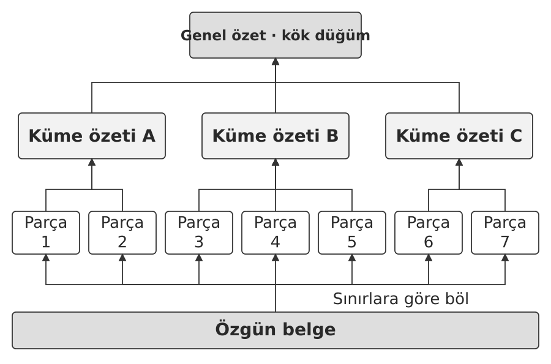

Örneğin "SSE2, 128 bit XMM yazmaçlarında tamsayı SIMD işlemlerini destekler" ile "SSE4.2 yeni dize karşılaştırma komutları ekler" bilgileri "x86 SIMD komut kümesinin evrimi" özetinde bir araya gelebilir. Ayrıntı soruları alt düzey parçalarla, genel bakış soruları üst düzey özetlerle eşleşebilir. Sorgu ya hiyerarşi boyunca adım adım derinleşebilir ya da tüm katmanların düğümleri birlikte aranıp en ilgili küme seçilebilir.

[^ch3-raptor]: Sarthi ve arkadaşları, RAPTOR: Recursive Abstractive Processing for Tree-Organized Retrieval, 2024.

**GraphRAG** bilgiyi varlıklar, ilişkiler ve topluluk özetleriyle düzenler. Bir ilişkiyi "özne—ilişki—nesne" üçlüsüyle kaydeder; örneğin (Çin, başkenti, Pekin) ya da (Zhang San, çalışıyor, Tencent). İki kayıt aynı varlıktan söz ediyorsa grafikte birbirine bağlanabilir. Şekil 3-11'deki iki doktorun soyadı da Zhang. Kullanıcı "diş hekimimin çalıştığı hastanenin adresi" diye sorduğunda sistem hangi ilişkiyi izleyerek aramalı?

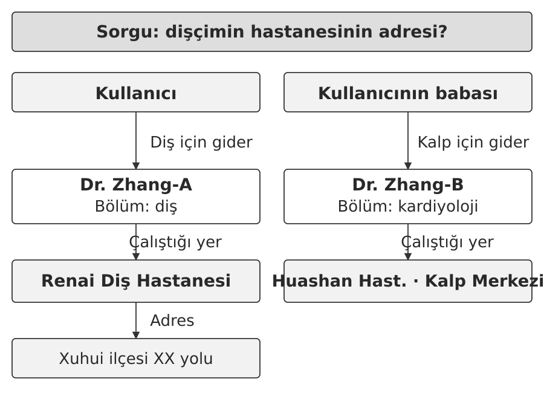

1. **Grafik kurarken aynı adlı varlıkları ayırt etmek.** Bir Dr. Zhang kullanıcının dişlerini Ren'ai Ağız ve Diş Hastanesi'nde tedavi ediyor, bir diğeri kullanıcının babasının kalbini Huashan Hastanesi'nde tedavi ediyor. Sistem varlıkları çıkarıp kayıtları birleştirirken bu ipuçlarına dayanarak iki doktora farklı tanımlayıcılar verebilir. Önceki `person` ve `relationship` alanları da benzer işlev görür. `bank` sözcüğünün cümlede nehir kıyısı mı banka mı olduğuna karar vermek sözcük anlamı belirsizliği gidermedir; bir kaydın hangi Dr. Zhang'dan söz ettiğine karar vermek ise varlık belirsizliği gidermedir.
2. **Sorguda ilişki zincirini izlemek.** Kullanıcıdan başlayıp "kullanıcı→doktor→hastane→adres" boyunca adım adım arayarak birkaç kayda dağılmış bilgiyi tek bir yanıtta birleştirebilirsiniz.

Microsoft GraphRAG'in indeksleme akışı önce metin birimlerinden varlıkları ve ilişkileri çıkarır, sonra topluluk keşfiyle sıkı bağlantılı varlık gruplarını belirleyip topluluk hiyerarşisini ve özetlerini üretir. Belirli bir varlık sorgulandığında yerel arama onun ilişkili bilgilerini ve özgün metni birleştirir; derlemin tamamının teması sorgulandığında küresel arama topluluk özetlerinden yararlanarak yanıtı düzenler[^ch3-graphrag].

[^ch3-graphrag]: Microsoft GraphRAG, indeksleme ve sorgulamaya genel bakış, yerel arama ve küresel arama.

İlişki temsili koşulları ve zamanı da taşımalıdır. Örneğin "gelecek hafta hâlâ yağmur yağarsa deniz kenarı planını iptal edip müzeye giderim" cümlesi bir koşul, geçerlilik zamanı ve yedek eylem içerir. Yalnızca (kullanıcı, planı var, sahil gezisi) ve (kullanıcı, yedek planı var, müze gezisi) çıkarılırsa geçiş koşulu kaybolur. Özgün cümle korunabilir ve "gelecek hafta yağmur yağdığında" kısıtı koşul düğümü, olay düğümü ya da yapılandırılmış alanla ifade edilip ilişki özgün metne geri bağlanabilir.

Kullanıcı belleği için yazar **doğal dil ile yapılandırılmış indeksin katmanlı birlikteliğini** daha çok öneriyor: eksiksiz ifadeler doğal dille saklanır, meta verilerle nesne, zaman ve kaynak kaydedilir, sık ilişkilendirilmesi gereken içerik için ayrıca grafik indeks kurulur.

> **Deney 3-7 ★★★: Hiyerarşik özet ile ilişki indeksinin karşılaştırılması**
>
> Bu deney Intel mimari el kitabının SSE, AVX ve durum yönetimiyle ilgili 14 sayfasını seçip iki öğretim amaçlı uygulama kuruyor. Hiyerarşik özet dalı önce sayfa sayfa özet üretir, sonra üç grupta toplayıp grup ve kök özetleri oluşturur; ilişki indeksi dalı varlıkları ve ilişkileri çıkarıp topluluk özetleri üretir. İki grup aynı malzemeyi ve sekiz soruyu kullanarak kavram ayrıntısını ve ilişki akıl yürütmesini karşılaştırıyor.
>
> "SSE programlama ortamını açıkla" sorgusunda hiyerarşik özet aynı anda SSE genel bakışıyla yazmaç ayrıntısını eşleştirebiliyor. Bu uygulama tüm katmanların düğümlerini birlikte arayıp en ilgili beşini seçiyor. İlişki dalı ise ilgili varlıktan komşularına yayılıyor ve topluluk özetleriyle context'i düzenliyor. "SSE→XMM yazmaçları→kayan nokta işlemleri→ADDPS" gibi bir ilişki boyunca kavram somut komutlara bağlanabiliyor.
>
> Daha karmaşık soru şu: "İşlemci AVX'i desteklediğini bildiriyorsa program AVX'i kullanabilir mi?" Burada işlemci yeteneğini işletim sisteminin durum yönetimiyle ilişkilendirmek gerekir: CPUID'in AVX ve OSXSAVE bayrakları kontrol edilmeli, sonra XCR0 okunarak XMM ve YMM durumlarının ikisinin de etkin olduğu doğrulanmalı. Bu soru grafik araması programına CPUID ve YMM uç noktası ipucunu veriyor. Program ikisini bağlayan en kısa yolu XSAVE, CR4.OSXSAVE ve XCR0 üzerinden bulup yolu modele yanıt için veriyor.
>
> İki grup sekiz soruda ortalama kaynak sayfa kapsama oranı olarak yaklaşık %95,8 elde etti.

Yazar önce parçalama ve karma getirmenin iyi kurulmasını, yapılandırılmış indeksin ancak tekrar tekrar ortaya çıkan belgeler arası sentez ve ilişki sorguları gerektiğinde kurulmasını öneriyor. Belirli bir iade politikası paragrafını bulmak genellikle parçalama ve karma getirmeyle çözülür; SSE ile AVX'i karşılaştırmak ya da genel mimariden somut komuta inmek ise parçalar arası özetlere ve ilişki indeksine daha çok ihtiyaç duyar.

### Dosya sistemi yaklaşımı: bilgiyi dizin yapısıyla düzenlemek

**OpenViking** belleği, kaynakları ve becerileri sanal bir dosya sistemiyle düzenler. Her kayıt `viking://` URI'siyle başvurulur; Agent dizinleri gezebilir, genel bakışları okuyabilir ve ihtiyaç duyduğu içeriğe erişebilir[^ch3-openviking-uri]. Bilginin kullanımına göre dizinleri üç grupta düşünebilirsiniz: dış kaynaklar, kullanıcı bilgileri ve Agent'ın kullandığı beceriler ile deneyim. Kullanıcı ve Agent tanımlayıcıları ilgili ad alanlarını daha da sınırlar.

| İçerik | Tipik kullanım |
| --- | --- |
| Resources | Teknik belgeler, kod depoları, web sayfaları gibi dış kaynaklar |
| User memories | Belirli bir kullanıcının tercihleri, alışkanlıkları ve deneyimleri |
| Skills ve Agent memories | Yeniden kullanılabilir akışlar, görev kayıtları ve doğrulanmayı bekleyen deneyimler |

URI birleşik bir konumlandırma biçimi sunar; fiziksel depolama ve indeksleme hizmet tarafından yönetilir. Dizin arayüzü Agent'ın konulara göre katman katman gezinmesini sağlar ve anlamsal aramayı ilgili alt ağaçla sınırlayabilir. Dosya sistemi tarzı erişim, içerik depolama ve vektör indeksi birlikte bir hizmet oluşturabilir.

[^ch3-openviking-uri]: OpenViking, Viking URI ve sistem mimarisi.

OpenViking içeriği **L0, L1 ve L2** olmak üzere üç katmana ayırır: L0 kısa bir özettir ve bir dizinin ilgili olup olmadığını hızla anlamaya yarar; L1 dizin genel bakışıdır ve ana içeriği ve gezinme girişlerini açıklar; L2 ise ayrıntılı okunması gereken gövdedir. Dizin düzeyindeki özet ve genel bakış sırasıyla `.abstract.md` ve `.overview.md` dosyalarında saklanır. İkisinin gövde üretme bütçesi sırasıyla 256 ve 4000 karakterdir[^ch3-openviking-layers].

Sorgu önce özeti okuyup konumu belirleyebilir, sonra genel bakışı okuyup dosyayı seçebilir, en sonunda özgün metni yükleyebilir. Bu, Bölüm 2'deki Skills'in kademeli açıklamasıyla aynı fikirdir: hafif dizin keşfi destekler, tam içerik göreve göre yüklenir. Kesin sayılar, koşullar ya da özgün ifadeler gerektiğinde ilgili gövde yine geri getirilmelidir.

[^ch3-openviking-layers]: OpenViking, Context Layers (L0/L1/L2). L0 ve L1 dizin düzeyinde üretilmiş temsillerdir; L2 özgün dosya ya da ayrıştırılmış gövde olabilir.

İnsanların ve Agent'ların birlikte bakımını yaptığı bilgi için yazar **Markdown düz metin ve sürüm denetimi** yönetimini tercih ediyor. İnsan bilgiyi doğrudan okuyabilir, düzenleyebilir ve düzeltebilir; Agent da aynı dosya arayüzünü kullanabilir, çalışma dalında güncelleme önerebilir ve incelemeden sonra yayımlayabilir. Sürüm denetimi her değişikliğin farkını saklar ve hatalı güncellemelerin geri alınmasını sağlar. Oturum sonunda kullanıcı tercihleri ilgili kullanıcının belleğine, işlem deneyimi ise görev kaydına girer. Görev kaydı, sonuç değerlendirmesi, izler arası genelleme ve sonraki doğrulamadan geçtikten sonra Bölüm 9'da tartışılan deneyime dönüşebilir.

Bilgiyi dosya sistemiyle düzenlemek, **ilgili kayıtlar için bağlantı ve indeks kurmayı** da zorunlu kılar. Birbirine atıf yapmayan bir dosya yığınında ilişkiler yalnızca tam metin taramasıyla ya da anlamsal aramayla yeniden bulunabilir; dosya sayısı arttıkça Agent'ın bulduğu içerikten devam ederek izlemesi de zorlaşır. Bağlantılar net arama yolları sağlar; örneğin iade politikası istisna maddelerine, sözleşme özeti imza kaydına, kişi kaydı ilgili olaylara işaret edebilir. Giriş sayfası ana konuları açıklar, dizin sayfası gezinmeyi sağlar, kayıtlar arası çapraz atıflar yatay aramayı destekler. Bu, ansiklopedi maddelerinin düzenlenmesine benzer ve ilişkilerin bir kısmını daha hafif bir yolla saklar.

Kütüphane kurulurken hangi kayıtların birlikte kullanılabileceği, hangi planların aynı işlemde yalnızca birinin seçilebileceği de belirtilebilir. Örneğin müşteri hizmetleri sipariş iptali talebini işlerken yanıt hem üslup kurallarına hem gizlilik kurallarına uymalıdır; iki kural birlikte context'e konabilir. Depo sevkiyat iptali için iki ayrı plan hazırlamışsa indekste ikisinin geçerlilik koşulları açıkça yazılmalıdır. Aynı koli için henüz depodan çıkmamışsa çıkış belgesi iptal edilir, kuryeye teslim edilmişse durdurma talebi yapılır. İş kaydında yalnızca "siparişi iptal et" yazıyorsa Agent önce koli durumunu kontrol edip sonra uygun planı yüklemelidir.

Bağlantı bakımı güncelleme akışına yazılmalıdır: yeni kayıt eklemeden önce mevcut kayıtlar aranır, birleştirilecek mi yeni mi oluşturulacak karar verilir; yazdıktan sonra ilgili atıflar eklenir ve ait olduğu dizinin indeksi güncellenir. Bağlantı okuyucuyu maddeye götürür; maddenin eldeki siparişe uygulanıp uygulanmadığı ise maddelerin ne zaman yürürlüğe girdiğine bakmayı gerektirir.

### Bilgi nasıl güncellenmeli

Bir politika bugün değişirse kullanıcı yarın "şimdi ne yapmalıyım" diye de, "geçen ay siparişim neden öyle işlendi" diye de sorabilir. Yalnızca yeni maddeyle eski maddenin üzerine yazılırsa ikinci soru o zamanki dayanağını kaybeder. **Artımlı güncelleme** yeni kanıtı zamanında yazar; **düzenli derleme** ise daha geniş kapsamda yinelemeleri, çelişkileri ve yapısal değişiklikleri bulur. İki yol da sürümü ve kanıt atıflarını korumalı ve yayımdan önce denetim yapmalıdır; ancak o zaman soruya göre geçerli dönem seçilebilir.

#### Kullanıcı belleği ve bilgi tabanında artımlı güncelleme

Yazarın önerisi şudur: **bilgi tabanını bir kod deposu gibi, her bilgi değişikliğini de bir Pull Request (PR) gibi ele alın.** Bir güncellemenin net bir değişiklik kapsamı olmalı ve değişikliği destekleyen kanıtlar inceleyicinin denetimine sunulmalıdır. Markdown belgeleri, kural dosyaları ve User as Code'un yürütülebilir durumu bu akışa dahil edilebilir. Sürüm geçmişi bakımcının değişiklikleri görmesine, nedenini izlemesine ve hatalı yayımdan sonra geri dönmesine yardım eder.

Bölüm 1'deki **öneren–denetleyen** kalıbını izleyerek bir güncelleme şöyle yürütülebilir:

1. **Öneren değişikliği üretir.** Proposer Agent yeni kanıtı okur, mevcut bilgiyi tarar, eklenecek, düzeltilecek ya da süresi geçmiş kayıtları bulur ve çalışma dalında kapsamı net bir değişiklik önerir. Aynı zamanda ilgili bağlantıları, dizin indeksini, zaman bilgisini ve kanıt atıflarını günceller.
2. **Denetleyici bağımsız kontrol yapar.** Reviewer Agent değişiklikten önceki ve sonraki içeriği özgün kanıtlarla karşılaştırır; yeni ifadelerin kaynağı olup olmadığını, geçerlilik koşullarının eksiksiz yazılıp yazılmadığını, farklı dosyalardaki ifadelerin tutarlı olup olmadığını ve silinen paragraflarda hâlâ işe yarayan bilgi kalıp kalmadığını kontrol eder. Sorun bulduğunda somut kaydı ve dayanağı belirtir, neyin eklenmesi, geri getirilmesi ya da düzeltilmesi gerektiğini açıklar.
3. **Yineleme ve karar.** Öneren görüşlere göre değişikliği düzenler, denetleyici yeniden kontrol eder. Denetim geçtikten sonra birleştirme akışına girilir; tur ya da maliyet sınırına ulaşıldığı hâlde tartışma sürüyorsa değişiklik çalışma dalında bırakılıp insan incelemesi istenir.
4. **Kontrol ve yayım.** Biçim, bağlantı, meta veri ve yetki etiketleri otomatik olarak denetlenir; yürütülebilir bilgi ayrıca tip denetiminden ve ilgili testlerden geçmelidir. Birleştirmeden sonra etkilenen parçalar, özetler ve vektör indeksleri belirli bilgi sürümünden yeniden kurulur, ardından hizmet sürümü yayımlanır.

Bu akış üç veri katmanına karşılık gelir. **Özgün kanıt katmanı** konuşmaları, yürütme izlerini, iş belgelerini ve araç sonuçlarını saklar; **bilgi katmanı** damıtılmış, düzeltilebilir metni ya da kodu saklar; **hizmet katmanı** belirli bir bilgi sürümünden üretilmiş indeksleri saklar. Değişiklik kaydı kanıt tanımlayıcısını, bilgi sürümünü, inceleme görüşlerini ve nihai kararı birbirine bağlar; bakımcı bir bilginin neden yazıldığını ve ne zaman yürürlüğe girdiğini izleyebilir. Özgün kanıtlar saklama politikasına göre arşivlenir, indeksler bilgi sürümünden yeniden üretilebilir. Önceki eklemeli bellek yeni ve eski olguları kaynaklarıyla saklamaya uygundur; buradaki inceleme akışı ise bu kanıtları kullanılabilir bilgi sürümlerine dönüştürmekle görevlidir. Sorgu sırasında henüz çözülmemiş bir çelişkiyle karşılaşılırsa kanıtlara geri bakılıp görev koşullarıyla birlikte karar verilebilir.

Bu tasarımda **öneren de denetleyici de araç çağırabilen, sürekli sorgulama yapabilen Agent'lar olmalıdır.** Öneren etkilenen kayıtları bulmak için birkaç kaydı aramak zorunda kalabilir; denetleyici de atıfları izleyerek sorgulamayı sürdürebilir, sürümleri karşılaştırabilir ya da denetimleri çalıştırabilir. Dosya arama, kanıt getirme, fark görüntüleme ve test araçları bu sonraki adımları yürütmelerini sağlar; gerekli yeteneklere sahip bir Coding Agent bu işi üstlenebilir.

İkisinin arama kapsamı geçerli değişikliğin ilgilendirdiği bilgiyi ve özgün kanıtları kapsamalı, kullanıcı, kiracı ve görev yetkileriyle sınırlanmalıdır. Denetim izi, başvurulan araç sonuçları ve geri bildirim birlikte arşivlenir; sonradan denetleyicinin gerçekte neyi doğruladığı kontrol edilebilir.

Model seçiminde yazar yakın yetenekte, farklı ailelerden gelen bir bileşimi tercih ediyor; örneğin Claude ile GPT, DeepSeek ile Kimi. Farklı eğitim verileri ve akıl yürütme alışkanlıkları farklı yargılar getirebilir. Denetleyici kanıtları bağımsız olarak getirmeli, değişiklikteki iddiaları ve koşulları kontrol etmelidir. Yetkiler çalışma sistemi tarafından uygulanmalıdır: öneren çalışma dalına yazar, denetleyici kanıtları okur ve sonucu bildirir, birleştirme ve yayım hizmeti ise ana kütüphaneyi ve çevrimiçi indeksi güncelleme yetkisini elinde tutar.

#### Kullanıcı belleği ve bilgi tabanında düzenli derleme

Birçok yerel güncellemeden sonra aynı olgu birden çok dosyaya dağılmış, eski ve yeni ifadeler bir arada kalmış olabilir. Düzenli derleme dizin, zaman ya da konudan yola çıkarak bu birikmiş sorunları kontrol eder. Bölüm 9'da tartışılan dönemsel gözden geçirmeyle çalışma biçimi ortaktır: ön yüz yeni kanıt biriktirir, arka plan toplu düzenleme yapar ve sonraki görevlerde kullanılabilecek kayıtları oluşturur.

Derleme üç iş içerir.

1. **Yinelemeyi giderme, birleştirme ve yapı düzenleme.** Yinelenen, süresi geçmiş ya da aşırı parçalanmış kayıtları bulup ilgili içeriği birleştirmek, aşırı büyük dosyaları bölmek, bağlantıları, giriş ve dizin sayfalarını güncellemek. Hizmetteki eski ifadeler silinirken yerlerine geçen kayıt ve özgün dayanak kaydedilir.
2. **Özgün malzemeye geri bakmak.** Her derleme turu yalnızca önceki turun özetini yeniden yazarsa erken dönemdeki eksiklikler ve yanlış anlamalar tur tur aktarılır. Bu yüzden konuşmalara, yürütme izlerine, iş belgelerine ve araç çıktılarına bakıp özetin kilit olguları kaçırıp kaçırmadığı, olumsuzlamayı, zamanı ya da koşulu kaybedip kaybetmediği, tahmini kesin sonuç gibi yazıp yazmadığı kontrol edilmelidir. Büyük bilgi tabanları dizin, zaman ya da konuya göre partiler hâlinde işlenebilir; kapsam listesi denetlenen, denetlenecek ve tartışmalı kısımları kaydederek tüm kütüphanenin kontrolü tamamlanana kadar ilerlenir.
3. **Çelişkileri ve geçerlilik kapsamını ele almak.** Çelişkili kayıtların kaynağını, zamanını, nesnesini, bölgesini, görevini ve ön koşullarını karşılaştırmak. İki bilgi farklı senaryolara uyuyorsa kapsamları tamamlanır; yeni kanıt eski kuralın yerine açıkça geçiyorsa sürüm ilişkisi saklanır; dayanak yetersizse teyit bekleyen maddeler ve tamamlanması gereken kanıtlar kaydedilir.

Derleme sonucu da değişiklik olarak incelemeye gönderilir. Büyük yeniden düzenlemeler dizin ya da konuya göre birkaç PR'a bölünebilir ve ortak bir derleme planı ile kapsam listesi paylaşılabilir; ilgili değişiklikler geçtikten sonra türetilmiş indeksler yeniden kurulur ve tipik getirme ve soru-cevap örnekleri yeniden oynatılarak önceden bulunabilen bilginin hâlâ erişilebilir olduğu kontrol edilir. Tetikleme haftalık, aylık gibi dönemlerle ya da yeni kayıt sayısı, çelişki sayısı veya getirme kalitesindeki değişime göre eşiklerle yapılabilir.

**Süresi geçen içeriği devreden çıkarmak.** Parçalar ve özetler sürümü, yürürlük zamanını ve sona erme zamanını korumalıdır. Eski politika değiştirildikten sonra güncel iş sorguları süresi geçmiş sürümü filtreler; geçmiş sorgular ise hedef zamana göre ilgili kuralı okur. Böylece hem en güncel bilgi kullanılır hem de geçmişteki işlem sonuçları açıklanabilir.

**Yetki ve kiracı yalıtımı.** Yetki filtresi getirme katmanında tamamlanmalıdır: getirme hizmeti önce çağıranın kimliğine göre sorgulanabilecek belge kapsamını belirler, sonra bu kapsam içinde ilgili malzemeyi arar. Başka kullanıcıların özel bilgileri context'e girdiği anda model bunu yanıt verirken ya da araç çağırırken açığa çıkarabilir. Özgün metin, özet, ilişki kenarı ve önbellek sonuçlarının hepsi uygun erişim kapsamını devralmalıdır; türetilmiş içerik üzerinden başka kullanıcı ya da kiracı bilgilerinin dışarı sızmaması gerekir. Hizmet ayrı indeksler ya da zorunlu filtreleme yeteneğine sahip paylaşılan indeksler kullanabilir; kilit nokta her sorgunun yetki kısıtını uygulamasıdır.

### Agent'a dayalı RAG: getirme sürecini Agent'ın yönetmesi

Önce tek bir getirmenin yeterli olup olmadığını soralım. Örneğin "satış sonrası telefon numarası nedir" sorusunun yanıtı genellikle yürürlükteki bir hizmet el kitabından çıkar; yazar tek getirme ve ardından üretim yolunu sürdürmeyi öneriyor. Kullanıcı "aldığım bu modeli geçen ayın garanti koşullarına göre değiştirebilir miyim" diye sorarsa ilk aramada yalnızca ürün ailesi bulunur ve geçen ayın değişim koşullarına henüz karar verilemez. Getirmeyi bir araca dönüştürmek, Agent'ın bir önceki dönüşün ipuçlarıyla sonraki sorguyu kurmasını sağlar. Agent'ın ek arama gerekip gerekmediğine ve sırada neyi arayacağına karar verdiği bu yaklaşıma **Agent'a dayalı RAG (Agentic RAG)** denir. Şekil 3-12'de ilk dönüşte verilen ürün bilgisi iki tarafta da aynıdır. Sağdaki yol hangi ek ipuçlarını kullanarak o dönemde geçerli koşulları buluyor?

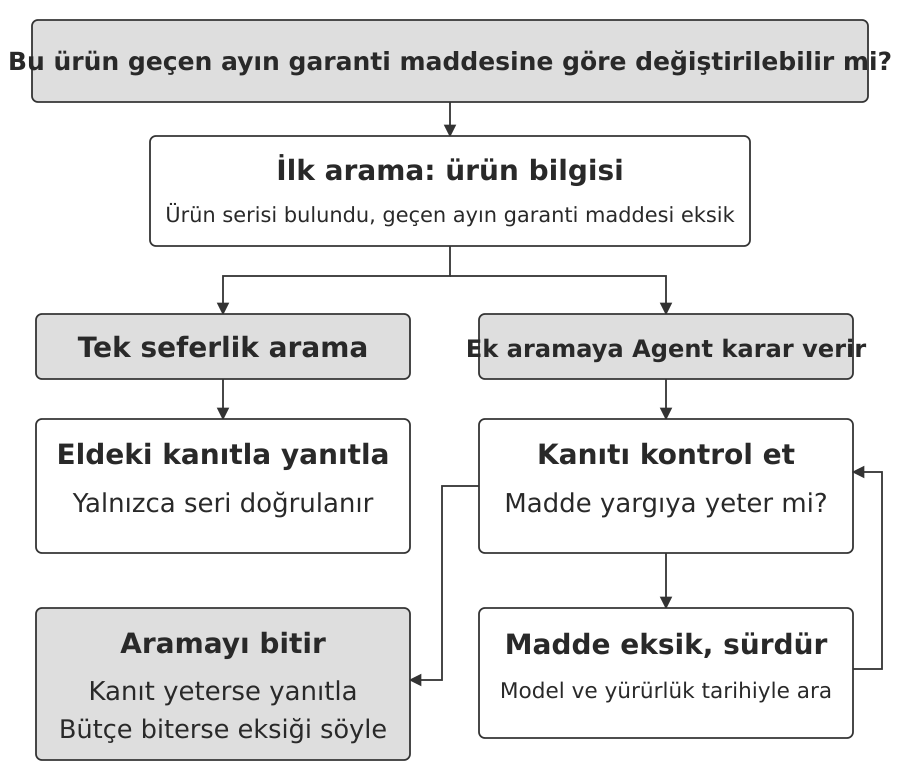

Örneğin ReAct'ta model önce soruyu çözümler ve sorguyu seçer, `knowledge_base_search` aracını çağırır; araç gözlem döndürdükten sonra model kanıtın yeterli olup olmadığına karar verir. Koşullar ya da ilgili nesneler eksikse sorguyu yeniden yazıp getirmeyi sürdürür; malzeme yeterliyse kaynaklarıyla birlikte yanıt üretir. Harness geçmişi, araç çağrılarını ve bütçeyi yönetir; sınıra ulaşıldığında aramayı bitirir ya da netleştirmeye geçer.

Şekil 3-13'e bakalım. Bilgi tabanı arka ucu vektör indeksinden ilişki grafiğine çevrilse bile model aynı araç arayüzü üzerinden arama isteyebilir. Dönen belgelerde bir talimat parçası varsa model onu olduğu gibi uygulayabilir mi?

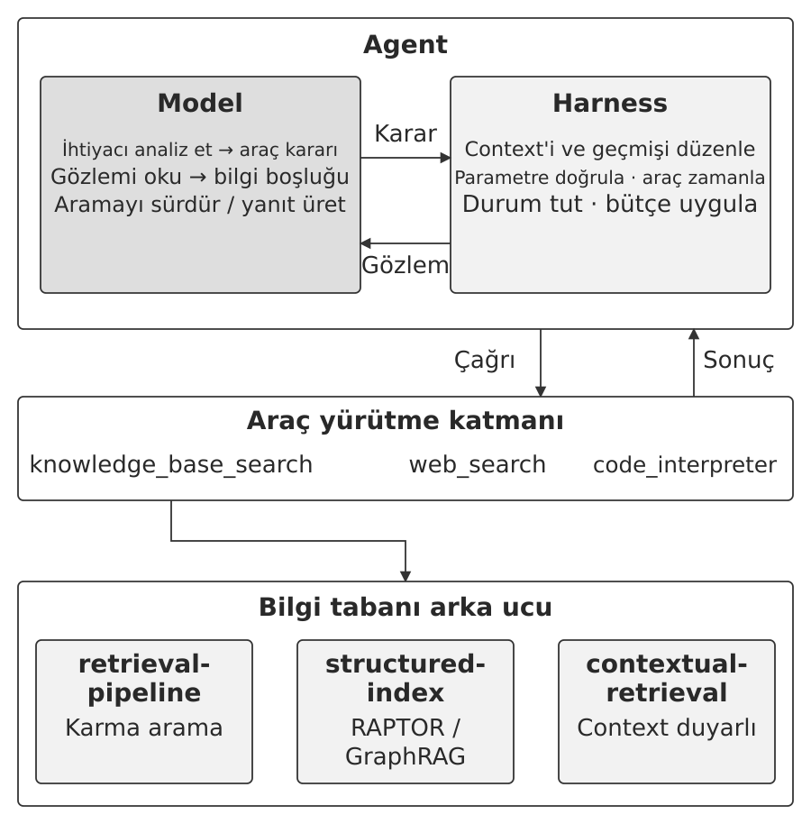

**Getirilen içeriğin güven sınırı.** Dış belgeler modelin davranışını değiştirmeye çalışan metinler içerebilir ya da kütüphaneye girmeden önce yanlış olgularla doldurulmuş olabilir. Birincisi dolaylı prompt enjeksiyonu, ikincisi bilgi tabanı zehirlenmesidir. Ele alırken içeriğin kaynağını ve yürütme yetkilerini birlikte yönetmek gerekir: getirme sonucu kaynak, sürüm ve atıf konumuyla birlikte yanıt kanıtı olarak gelir; para transferi, silme ve dışarıya e-posta gönderme gibi eylemler ise Harness ve yürütme ortamı tarafından kullanıcı yetkisine göre doğrulanır. Kütüphaneye alım incelemesi, kaynak izleme ve olgu doğrulaması yanlış bilginin yayılmasını daha ileri düzeyde denetler. Bölüm 2'de tanıtılan kaynak etiketleme ile Bölüm 4'teki araç kısıtları burada birlikte devreye girer.

> **Deney 3-8 ★★: Tek getirme ile çok turlu getirmenin karşılaştırılması**
>
> Bu deney aynı Çince hukuki malzemeyi, aynı BM25 getiricisini ve aynı modeli kullanarak yedi soruda iki modu karşılaştırıyor: temel düzen özgün soruyla bir kez arar, Agent modu modelin sorguyu ayarlamasına izin verir ve en fazla dört arama yapar.
>
> "Meşru müdafaa nasıl düzenlenmiştir" gibi bir sorguda doğrudan getirme ana maddeleri verir. Daha karmaşık bir örnek: "Sarhoşken dikkatsizlikle ağır yaralanmaya yol açan ve hırsızlık sabıkası bulunan kişi nasıl cezalandırılır?" Soru aynı anda mevcut eylemi, sarhoşluk durumunu ve önceki kaydı ilgilendirir; getirme sırasında ilgili malzemelerin ayrı ayrı bulunması ve geçerlilik koşullarının kontrol edilmesi gerekir.
>
> Gerçek çalıştırmada sırasıyla "sarhoş dikkatsizlik ağır yaralanma hırsızlık sabıkası ceza", "sarhoşluk suç ceza", "hırsızlık sabıkası cezaya etkisi ceza hukuku" ve "sabıka cezaya etkisi ceza hukuku" sorguları yapıldı. Ardından model "tekerrür tespiti ceza hukuku" sorgusunu da önerdi; bu sırada arama bütçesi tükenmişti ve Harness bütçenin bittiğini bildirdi.
>
> Deneyin karmaşık olarak ayırdığı dört soruda hedef madde kapsama oranı yaklaşık %8'den %92'ye çıktı, ortalama arama sayısı birden 3,5'e yükseldi, yanıt aşamasının ortalama süresi yaklaşık 8 saniyeden 66 saniyeye çıktı. Üç basit sorunun kanıt kapsaması %100'dü ve iki grup da yalnızca bir kez aradı.

Aynı getirme döngüsü kullanıcı geçmişi için de kullanılabilir. Aşağıda Deney 3-1'in üç düzeyli değerlendirme kümesini sürdürerek Agent'ın oturumlar arası kayıtlardan olguları nasıl geri getirdiğini, nesneleri nasıl ayırdığını ve güncellemeleri nasıl ele aldığını gözlemliyoruz.

> **Deney 3-9 ★★: Kullanıcı belleğini Agent'a dayalı getirmeyle okumak**
>
> Bu deney konuşma geçmişinin tamamını bilgi tabanı olarak kullanır, pencerelere bölüp indeksler, ardından Agent'a `search_user_memory` aracını sağlar. Pencere boyutu ayarlanabilir; bu çalıştırmada her parça sekiz tur konuşma içeriyor, komşu parçalar iki tur örtüşüyor ve oturum tanımlayıcısı, zaman ile iş meta verileri saklanıyor. Sorgu en fazla üç kez yapılıyor, her seferinde dört parça getiriliyor.
>
> Temel hatırlama açık alanlar etrafında arayabilir; örneğin "vadesiz hesap numaram nedir". Çok oturumlu sorular ayrıca nesnelerin eksiksiz olup olmadığını kontrol etmeyi gerektirir: kullanıcının hem bir Honda Accord'u hem de bir Tesla Model 3'ü var; araç servis planlaması sorulduğunda sistem iki aracı ve her birinin randevu durumunu ayırt etmelidir.
>
> Buna göre bir getirme rotası tasarlanabilir: önce araç ve servis kayıtları aranır; diğer araca dair ipucu bulununca Tesla'nın planı sorgulanır; en sonunda Honda'nın mevcut randevusu açıklanır ve kullanıcının Tesla için de randevu isteyip istemediği teyit edilir. Bu çalıştırmanın gerçek kaydında yalnızca `scheduled car services` sorgusu yapıldı; sıradan getirme grubunun yanıtı Honda'ya odaklandı ve Tesla'yı atladı.
>
> Bir başka zorluk art arda değişikliklerden kaynaklanıyor. Para transferi örneğinde eş bir düzenleme kuruyor, kocası ardından tutarı ve tarihi değiştiriyor, eş yeniden ayarlıyor. Kayıtlar getirildikten sonra değişikliğin zamana, kişiye ve teyit durumuna göre yeniden kurulması ve en son geçerli talimatın bulunması gerekir. Mevcut parçalar zaman bilgisini zaten saklıyor, ama getirme yine kilit bir değişikliği kaçırabilir; bu yüzden parçalara olay arka planı da eklenebilir.
>
> Bu 60 örneğin 18'inde yalnızca bir kez, 6'sında iki kez arama yapıldı, 36'sında üç hakkın tamamı kullanıldı. Sıradan parça getirme grubu 47'sini geçti: temel hatırlamada 19, çok oturumlu getirmede 15, proaktif hizmette 13. Sonraki kısım aynı örneklerde context önekini ve yapılandırılmış belleği karşılaştırarak bunların sırasıyla hangi bilgileri tamamladığını çözümlüyor.

### Context farkındalıklı getirme: parçalara arka plan eklemek

Finansal rapora dönelim. ACME şirketinin 2025 ikinci çeyrek performansını aramak istiyorsunuz; sorguda şirket adı ve yıl var, ama "şirketin geliri %3 arttı" yazan parçada tam da bu iki sözcük yok. Parçayı büyütmenin yanı sıra bu kısa metin korunabilir ve eksik arka plan önüne eklenebilir. **Context farkındalıklı getirme (Contextual Retrieval)** indeks kurulurken parçalar için kısa bir arka plan öneki üretir, sonra önek ile özgün metni birlikte getirmede kullanır[^ch3-1]. Şekil 3-14 bu işlemi gösteriyor.

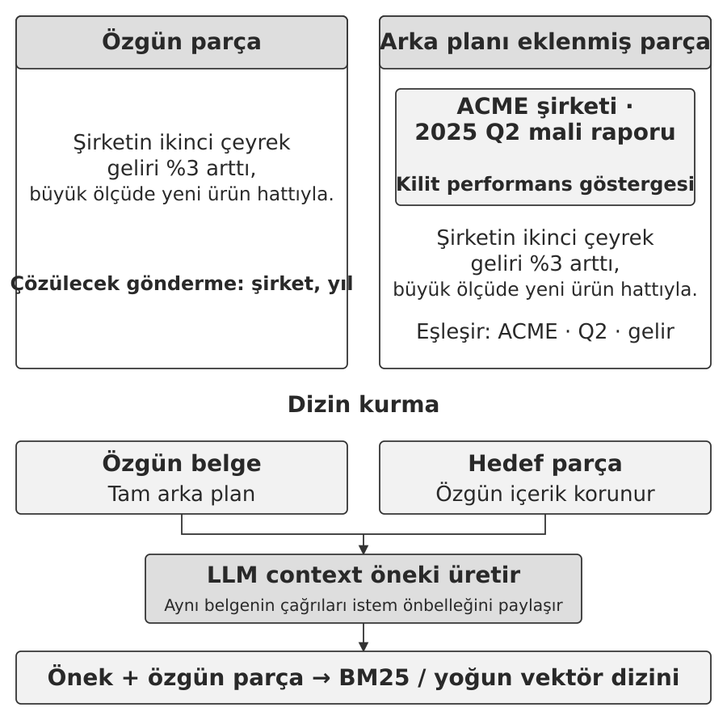

Örneğin önek "Bu paragraf ACME şirketinin 2025 ikinci çeyrek raporunun kilit performans göstergeleri bölümünden alınmıştır" diyebilir. Üretim sırasında hem özgün metin hem hedef parça verilir; model gerçekten dayanağı olan gönderim, zaman ve bölüm bilgilerini tamamlar. BM25 böylece şirket adı, çeyrek gibi eşleştirilebilir terimler kazanır; yoğun gömmeler de parçayı bu arka planla birlikte temsil edebilir.

Bu yöntem Bölüm 2'deki context farkındalıklı sıkıştırmayla birlikte kullanılabilir: indeksleme sırasında bilgi parçalarına arka plan eklenerek ilgili bilgiyi bulma şansı artar; çalışma sırasında ise geçerli göreve göre getirilmiş geçmiş düzenlenerek girdi uzunluğu denetlenir. Birincisi parçanın bulunabilirliğine, ikincisi geçerli kararın gerektirdiği bilgiye ve bütçeye odaklanır.

[^ch3-1]: Anthropic, Introducing Contextual Retrieval, Eylül 2024.

> **Deney 3-10 ★★: Ham parçalar ile context ile zenginleştirilmiş parçaların karşılaştırılması**
>
> Bu deney aynı malzeme kümesi için iki indeks kuruyor: biri ham parçaları, diğeri modelin ürettiği önekleri ekleyerek. Sorgular ve hedef etiketleri aynı tutularak BM25, yoğun getirme ve karma getirme ayrı ayrı karşılaştırılıyor.
>
> Önceki finansal rapor örneğini sürdürürsek "ACME şirketinin son gelir artışı" sorgusunda isabet eden parçanın hedef şirketi, dönemi ve artış verisini birlikte içerip içermediği kontrol edilebilir. Yalnızca "gelir artışı" başka şirketlerle eşleşebilir; önek eklendikten sonra şirket adı ve zaman sıralamaya katılabilir.
>
> Bu çalıştırmadaki 15 sorguda önek eklendikten sonra BM25'in recall@1 değeri 0,60'tan 0,80'e, yoğun getirmeninki yaklaşık 0,867'den 0,933'e çıktı; recall@3 sırasıyla 0,867 ve 1,0 olarak kaldı. Karma getirmenin recall@5 değeri 14/15'ten 15/15'e çıktı. Fazladan bulunan hangi soruydu? Ulusal Halk Kongresi Daimi Komitesi'nin yetkileri sorgulanırken hedef parça yetkileri listeliyor ama öznesi eksikti. Önek eklendikten sonra BM25 onu 16. sıradan 12. sıraya çıkardı, yine de ilk beşin dışındaydı; karma getirme onu 6. sıradan 5. sıraya çıkardı ve ancak o zaman ilk beşe girdi. Özgün metne bakıldığında ilk parça (1) ile (4) arasındaki yetkileri, beşinci parça ise (4)'ten (22)'ye kadar olanları listeliyor. Puanlama yalnızca etiketlenmiş beşinci parçanın seçilip seçilmediğine bakıyor; oysa yetkileri eksiksiz listelemek için iki parçanın birleştirilmesi gerekiyor.
>
> Önek üretimi indeksleme sırasında ek çağrılar getiriyor. Aynı belgenin birden çok parçası için arka plan üretilirken belge önek önbelleği yeniden kullanılabilir. Anthropic 2024 raporunda 800 token'lık parçalar, 8000 token'lık belgeler ve belirli bir prompt uzunluğuyla yaptığı hesapta milyon belge token'ı başına tek seferlik işlem maliyetini yaklaşık 1,02 dolar olarak tahmin etti.
>
> Aynı raporda context'li gömmeler BM25 ile birleştirildiğinde top-20 getirme başarısızlık oranı %5,7'den %2,9'a, yani göreli olarak yaklaşık %49 düştü; yeniden sıralama eklendiğinde %1,9'a, yani göreli olarak yaklaşık %67 düştü. Raporun kullandığı başarısızlık oranı $1-\mathrm{recall@20}$'dir.

Tekrar tekrar sorgulanan ve içeriği görece kararlı malzeme kütüphanelerinde yazar parça arka planını indeks kurulurken tamamlamayı öneriyor; tek seferlik işlem sonraki pek çok sorguya hizmet eder. Şirket adı, olayın öznesi ve zaman bölme sırasında kaybolduysa yalnızca getirme sayısını artırmak yine gönderimi belirsiz bir parça yığını getirebilir. Önek üretilirken bu ipuçlarının tamamlanması, sonraki getirmenin malzemeyi bunlarla bulmasını sağlar.

> **Deney 3-11 ★★★: Belleği context önekleri ve yapılandırılmış kartlarla güçlendirmek**
>
> Konuşmadaki "tamam, bunu ayırt" ifadesi önceki ürüne ya da seyahate bağlanmalıdır. Özgün metin Şanghay'dan Seattle'a 500 dolarlık tek yön bir uçak biletini konuşuyorsa önek bu arka planı tamamlayabilir ve teyidin hangi oturumda ve ne zaman olduğunu koruyabilir.
>
> Bu deney sıradan parçalara iki yapılandırma ekliyor: context öneki grubu ve buna ek olarak Advanced JSON Cards yükleyen çift katmanlı bellek grubu. Model önce sıradan indekse göre arama dizisi üretiyor, sonra aynı sorgular iki indekse uygulanıyor; çift katmanlı grup aynı zenginleştirilmiş getirme sonuçlarını kullanıp yapılandırılmış kartlar ekliyor.
>
> Para transferi örneğinde önekler sırasıyla Patricia'nın transferi başlattığını, James'in düzenlemeyi değiştirdiğini ve Patricia'nın yeniden ayarladığını açıklayarak olay sırasının bulunmasına yardım ediyor. Özgün kayıtların verdiği nihai durum 95.000 dolar ve 1 Ekim'dir; önceki düzenlemelerin yerine geçmiştir. Bu çalıştırmada üç grup da bu durumu doğru buldu.
>
> Çift katmanlı yapı proaktif ilişkilendirmeyi de destekleyebilir. Kartlar "Tokyo seyahati" ve "pasaport geçerlilik süresi" gibi kilit olguları saklar, ayrıntılı konuşmalar ihtiyaç anında getirilir. 15–22 Ocak seyahati ve 18 Şubat'ta süresi dolan pasaport örneğinde sistem önce tarihlerin yakın olduğunu fark edebilir, sonra yenileme kayıtlarını ve seyahat gereksinimlerini sorgulayıp kullanıcıya tamamlanmamış hazırlıkları teyit etmesini hatırlatabilir. Bu seyahat örneğinde üç grubun yanıtı da incelemeden geçti; kartlar ile getirme arasındaki fark ağırlıklı olarak aşağıdaki araç ve oturumlar arası örneklerde görülüyor.
>
> 60 örneğin tamamında sıradan getirme, context öneki ve çift katmanlı bellek sırasıyla 47, 52 ve 57 örneği geçti. Önek grubunda proaktif hizmet örnekleri 13'ten 18'e çıktı; çift katmanlı grup çok oturumlu getirme düzeyindeki 20 örneğin hepsini geçti, proaktif hizmet düzeyinde de 18 örneği geçti. Araç örneğinde kartlar ikinci aracın bilgisini tamamlayarak yanıtın daha önce atlanan nesneyi de kapsamasına yardım etti. Bir gerilemeye de bakalım: kullanıcı konuttaki su hasarının teminat kapsamını soruyor; sıradan grup oturulan evden de kiraya verilen evden de söz etti, önek grubu ise kiralık evi atladı. Soru soru karşılaştırıldığında önek grubu sıradan gruptan 8 soruyu fazladan doğru yanıtladı, ama daha önce doğru yanıtlanan 3 soruyu da kaybetti.

**Proaktif hizmet gerektiğinde yazar kilit olguların sürekli context'te tutulduğu, ayrıntılı kayıtların ise ihtiyaç anında getirildiği çift katmanlı mimariyi tercih ediyor.** Yalnızca getirmeye dayanıldığında model ilgili kayıtları bulabilmek için çoğu zaman önce neyi soracağını bilmek zorundadır; henüz görüş alanına girmemiş pasaport, araç ya da aile ilişkileri bu yüzden kolayca atlanır. Az sayıda kilit olguyu önceden context'e koymak, modelin ilişkileri fark etmesine, sorgu önermesine ve sonra özgün ayrıntıları getirmesine yardım eder. Sürekli tutulacak bilgi seçilirken kişi ilişkileri, geçerli kısıtlar ve tamamlanmamış işler göz önünde tutulmalıdır; getirme sonuçları ise kaynağı, zamanı ve değişiklik dayanağını korur.

### Veri kümelerinden bilgi çıkarmak: örneklerden yapılandırılmış temsile

Bilgi çok sayıda örneğin derlenmesinden de gelebilir. Mahkeme kararlarında, müşteri hizmetleri iş kayıtlarında ve onarım kayıtlarında işe yarar bilgilerin çoğu somut anlatımlara dağılmıştır. Görev çok sayıda örnekten örüntü çıkarmayı, sonuçları karşılaştırmayı ya da neyin sorulacağına karar vermeyi gerektirdiğinde yazar önce birleşik alanların çıkarılmasını, sonra istatistik ve prototip derlemesi yapılmasını öneriyor. Yalnızca birkaç benzer örnek getirmek, veri kümesinin tamamındaki dağılımı görmeyi zorlaştırır; alanlar birleştirildikten sonra tüm kayıt kümesi üzerinde istatistik yapılabilir ve sonraki tekil sorgular için bir genel bakış sağlanabilir.

Bu süreç iki adıma ayrılabilir. **Bilgi çıkarma** ham betimlemeleri yapılandırılmış kayıtlara dönüştürür; alanların anlamını, değerlerini ve kaynağını netleştirir. **Örüntü analizi** ise istatistik ve kümeleme kullanarak benzer örnekleri ve ortak özelliklerini arar. Şekil 3-15 örnek çıkarmadan özellik kodlamaya ve prototip getirmeye uzanan akışı gösteriyor.

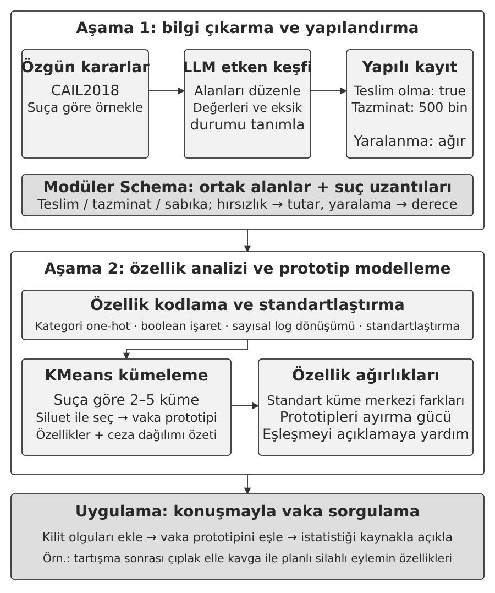

> **Deney 3-12 ★★★: Yargı kararlarından faktör ve prototip çıkarmak**
>
> Bu deney CAIL2018'in ceza davası malzemesini kullanıyor; hırsızlık, kasten yaralama ve dolandırıcılık olmak üzere üç tür örnek seçip "faktör keşfi — alan çıkarma — kümeleme — prototip açıklaması" öğretim akışını kuruyor[^ch3-cail]. Her türden 120 örnek modelleme için alınıyor, 20 örnek de ayrılıyor; toplam 360 modelleme örneği ve 60 ayrılmış örnek oluşuyor.
>
> **Alanları keşfetmek ve düzenlemek.** Model önce modelleme örneklerini partiler hâlinde okuyup yararlı olabilecek faktörleri öneriyor, sonra bunları modüler bir Schema'da birleştiriyor. Genel kısım birden çok suçta dikkat edilmesi gereken alanları, örneğin teslim olma ve tazminatı saklıyor; genişletme kısmı belirli bir suçla ilgili bilgileri, örneğin suç tutarını ya da yaralanma durumunu saklıyor. Bu çalıştırmada 16 genel alan ve sırasıyla 12, 12 ve 11 alan içeren üç genişletme grubu elde edildi. Tutarlı çıkarım için her alanın değerleri ve eksiklik durumu da tanımlanmalı.
>
> **Alanları vektöre kodlamak.** Kategori alanları one-hot kodlama kullanabilir: hırsızlık, yağma ve dolandırıcılık örneğinde sırasıyla `[1,0,0]`, `[0,1,0]`, `[0,0,1]` olarak kodlanır; her konum yalnızca o kategoriye ait olup olmadığını gösterir. 1, 2, 3 kullanmak bazı algoritmalara kategoriler arasında sıra ve uzaklık getirir. "Teslim oldu mu", "tazminat ödedi mi" gibi alanlar doğrulanmış iki durum için 1 ve 0 ile gösterilebilir; özgün metinde hiç anılmayan durum ayrıca ele alınmalı, eksiklik otomatik olarak olumsuz sayılmamalıdır.
>
> Tutar gibi geniş aralıklı negatif olmayan değerler için bu uygulama önce $\ln(1+x)$ ile ölçeği sıkıştırıyor, sonra standartlaştırmaya katıyor. Bir alan birden çok kategoriyi aynı anda içerebiliyorsa, örneğin bir kayıt birden çok önlem içeriyorsa, her kategori için ayrı bir gösterge biti ayarlanıp çoklu kodlama (multi-hot) oluşturulabilir.
>
> **Dava prototipleri kurmak.** Kodlanmış özellikler standartlaştırılıp suç türüne göre ayrı ayrı kümeleniyor. Bu uygulama iki ile beş küme arasını karşılaştırıyor, gruplamayı siluet katsayısıyla seçiyor ve sonunda 11 prototip oluşturuyor. Her prototip örnek sayısını, başlıca özellikleri ve örneklerin ceza süresinin medyanını, çeyrekliklerini ve aralığını saklıyor. Örneğin çatışmanın nedeni, işleniş biçimi ve yaralanma sonucu etrafında tartışma sonrası çıplak elle kavga ile önceden planlanmış silahlı eylem gibi farklı özellik bileşimleri karşılaştırılabilir; somut gruplamayı çıkarma sonuçları ve kümeleme birlikte belirler.
>
> **Özellikleri ve eşleşme sonuçlarını açıklamak.** Program kümelerin standartlaştırılmış merkezleri arasındaki farklara göre özelliklerin prototipleri ayırt etmedeki ağırlığını hesaplıyor. Prototip eşleştirme ise yeni davayı aynı özellik uzayına eşleyip yakın grubun istatistik özetini ve dayanaklarını getiriyor; model açıklamayı bunlarla düzenliyor.
>
> Bu kez 60 ayrılmış örnekten 12'si seçilip açıklama üretildi, ardından bağımsız bir model incelemesine verildi. Önce bir hırsızlık örneğine bakın: eşleştiği prototipte yalnızca bir modelleme kaydı var, ceza süresi 4 ay; bu yüzden en küçük değer, medyan ve en büyük değer hepsi 4. Üretici bu sayıyı dürüstçe bildirdi ve başvurulabilecek yalnızca bir kayıt olduğunu belirtti. Değerlendirici "sayılar prototipe sadık mı" ölçütüne 4 (tam) puan verdi; ayrılmış örneğin gerçek etiketi ise 8 aydı.
>
> Prototip getirme konuşmada kullanılacaksa önce eşleşmeyi etkileyebilecek eksik olgular sorulabilir, sonra yanıta göre yeniden getirme yapılabilir.

[^ch3-cail]: CAIL2018, resmî veri kümesi projesi. Eşlik eden deney açık malzemeden örnekleme yapar ve modelleme ile değerlendirmeyi örnek içi bölmeyle yürütür.

Örneklerden prototiplere geçerken bilgi tabanına getirilebilir bir istatistik temsil katmanı eklenir. Özgün metin kanıt sağlar, alanlar hesaplamayı destekler, prototip benzer örneklerin ortak özelliklerini özetler; üçü arasındaki karşılık korunursa çıkarma hataları ya da örneklem yanlılığı bulunduğunda geri bakılıp düzeltme yapılabilir.

### Sınırdaki araştırmalar: çok kipli ve parametrik bellek

Kullanıcının daha önce yüklediği bir fotoğrafı göstererek "işte bu renk" dediğini düşünün. Sistem o zaman yalnızca "mavi mont" sözcüklerini saklamışsa bir sonraki seferde iki mavi tonunu ayırt edemeyebilir. Sesteki tını ve grafikteki uzamsal ilişkiler de yazıya dökülürken ayrıntı kaybeder. Gelecekteki sorguların bu bilgileri bulma şansı olması için özgün malzeme saklanabilir, modelin kullanabileceği bir temsil saklanabilir ya da modelin içindeki kalıcı bellek daha ileri düzeyde araştırılabilir.

**Birinci yol: özgün malzeme ile metin indeksinin birlikte kullanılması.** Örneğin kullanıcının yetki verdiği bir albüm düzenleme görevinde kişilerin yüzleri gibi yerel bölgeler kırpılıp saklanabilir, Markdown kayıtlarında görüntülere atıf yapılabilir, çekim zamanı, sahne ve kullanıcının verdiği kişi etiketleri kaydedilebilir. Getirme sırasında önce betimlemeye göre olası birkaç fotoğraf bulunur, sonra özgün görüntü ya da kırpılmış bölge okunarak görünüş ayrıntıları karşılaştırılır. Ses parçaları da zaman, kaynak ve yazıya dökülmüş metinle ilişkilendirilip gerektiğinde özgün ses yeniden çalınabilir. Metin giriş noktası sağlar, özgün malzeme ise sözcüklerle özetlenmesi zor ayrıntıları korur.

**İkinci yol: gömmeleri saklayıp ihtiyaç anında yüklemek.** Görsel ya da ses kodlayıcıları malzemeyi vektörlere çevirip benzerlik araması için indekse yazabilir. Örneğin görüntünün yerel bölgeleri ya da ses parçaları kodlandıktan sonra ilgili bellek kayıtlarına bağlanır. Model eğitilmiş bir izdüşüm katmanını ve bellek arayüzünü destekliyorsa context'te bir grup yuva ayrılıp bu sürekli vektörler yüklenebilir ve model onlara dikkat mekanizmasıyla erişebilir. Burada kodlayıcı temsili ile dil modelinin iç temsilinin hizalanması sorununun çözülmesi gerekir.

Yazarın Noah Shi ile yaptığı bir ön çalışma bu sorunu iki adıma ayırıyor. Grup fotoğrafında iki kişi var; kullanıcı "pencerenin yanında duran, geçen sefer gördüğümüz kişi mi?" diye soruyor. Önce "pencerenin yanı" ifadesine göre kullanıcının kastettiği kişiyi bulmak, sonra bu kişinin görüntüsünü daha önce saklanmış örnekle karşılaştırmak gerekir. İlk adımda yanlış kişi seçilirse ikinci adım ne kadar iyi tanırsa tanısın başka bir soruyu yanıtlamış olur. Makale ayrıca ad gibi doğru kopyalanabilen olguları metin belleğinde tutarak iki tür bilginin her birine uygun bir kullanım yolu ayırıyor.[^ch3-perceptmem]

[^ch3-perceptmem]: Li Bojie ve Noah Shi, Parametric Multimodal User Memory; eşlik eden proje `19PINE-AI/multimodal-user-memory` uygulamayı ve PerceptMem deneyini içerir. Grup fotoğrafı sorusu öğretim amaçlı bir örnektir.

**Üçüncü yol: modelin içindeki kalıcı bellek.** Her kullanıcı için bir LoRA eğitmek, kişiye özgü olguları modele yazmanın bir yoludur. "Kullanıcı nerede yaşıyor" diye doğrudan sormak ile adrese göre seyahat planlamak, belleğin kullanımından farklı şeyler bekler: birincisi olguyu okur, ikincisi olguyu sonraki akıl yürütmede de kullanmalıdır. Yalnızca olguların tekrarlanması etrafında eğitim yapılırsa model yanıtı hatırlayabilir ama karmaşık görevlerde onu kendiliğinden kullanmayabilir. Bu yüzden eğitim örnekleri hem doğrudan soruları hem de bu olgulara dayanan görevleri içermelidir.

Yazarın **User as Engram** çalışması metin olgularını Engram modelinin yerel bellek tablosuna yazıyor; paylaşılan bir adaptör bu olgulardan akıl yürütmede nasıl yararlanılacağını öğreniyor[^engram]. Hash anahtarlı N-gram araması tablo kayıtlarını buluyor, kapı mekanizması getirilen içeriği modele veriyor; her kullanıcı kendi yerel tablo kayıtlarını saklıyor, akıl yürütme kısmı paylaşılabiliyor. Makale metin olgusu deneylerinde doğrudan hatırlama ile dolaylı akıl yürütmeyi karşılaştırarak her kullanıcının bellek içeriğinin ve paylaşılan akıl yürütme yeteneğinin ayrı ayrı nasıl yönetilebileceğini gösteriyor.

[^engram]: Li, Bojie, User as Engram: Internalizing Per-User Memory as Local Parametric Edits, 2026.

Bu yolu çok kipliliğe genişletmek için görüntü ya da ses temsillerinin adreslenmesi, yazılması ve okunması mekanizmalarının da tasarlanması gerekir.

## Bölüm özeti

Bölümün başındaki bilet talebine dönelim. "Pencere kenarını tercih ederim" bu kullanıcıdan gelir; "kaç parça bagaj hakkı var" ise havayolunun seyahat tarihinde geçerli olan koşullarına bakmayı gerektirir. İki bilgiyi de tek bir cümle olarak saklamak en önemli farkı kolayca kaybettirir: ilk cümle kimin için geçerlidir, ikincisi ne zamandan itibaren yürürlüktedir? Saklarken kaynak, zaman ve geçerlilik koşulları bırakılırsa geri getirildiğinde bu sefer kullanılıp kullanılamayacağına karar vermenin dayanağı olur. Tek tek olgular kısa notlar olarak yazılmaya uygundur; kişi ilişkilerini açıklamak ya da olayın gelişimini korumak gerekiyorsa kartlar ya da özgün paragraflar kullanılabilir; tarihler ve miktarlar türlendirilmiş alanlar olarak saklanıp hesaplamaya programa bırakılabilir.

Asistan bagaj hakkını yanlış bildirdiyse önce yürürlükteki koşulların kütüphaneye girip girmediğine, sonra koşulun hangi parçaya bölündüğüne, getiricinin onu bulup bulmadığına, yeniden sıralamadan sonra kaçıncı sırada olduğuna, en son da modelin hangi malzemeleri aldığına bakın. Özgün metin çoksa yapılandırılmış bir genel bakış context'te tutulup ayrıntılar ihtiyaç anında getirilebilir. Bölüm özetleri konu bulmaya, ilişki indeksi bağlantıları aramaya yardım eder; bir parça gönderimini kaybettiyse kaynak arka planı eklenebilir; tek bir getirme yine kanıt eksik bırakıyorsa Agent sorgusunu değiştirip aramayı sürdürebilir.

Havayolu yeni kurallar yayımladıktan sonra önce küçük kapsamlı bir güncelleme yapılabilir; yeni ve eski maddelerin yürürlük tarihleri ve kaynakları korunur. Biriken yinelenen kayıtlar, çelişkiler ve yapısal değişiklikler ise düzenli olarak derlenir. Öneren değişikliği gönderir, denetleyici kanıtları kontrol eder, onaylandıktan sonra hizmet indeksi yeniden kurulur. Sürüm kayıtları sayesinde daha önce yanlış yanıtlanan soru yeniden oynatılabilir ve eski yanıtın o zaman hangi belgeye dayandığı bulunabilir. Yürütme sonuçlarından nasıl daha fazla deneyim biriktirileceğini Bölüm 9 özel olarak tartışacak.

İki parça bagaj hakkı olduğunu bulmak yalnızca "kurallar izin veriyor mu" sorusunu yanıtlar. Bagajı kullanıcı adına siparişe eklemek için asistanın hangi aracı çağırabileceğini, hangi parametrelere ihtiyaç olduğunu ve hangi makbuz geldiğinde işin tamamlanmış sayılacağını da bilmesi gerekir. Bu, bir sonraki bölümün başlangıç noktasıdır.

## Düşünce Soruları

1. ★★ Kullanıcı şunu söylüyor: "1 Mayıs'ta A'dan B'ye taşınıyorum, 10–20 Mayıs arasında C otelinde kalacağım, bu sürede faturaları e-postayla gönderin." 15 Mayıs'ta asistan ev adresi, geçici konaklama yeri ve fatura gönderim biçimi sorularını nasıl yanıtlamalı? Kayıt ve sorgu kurallarını tasarlayın; yazım hatası düzeltmelerini ya da birbiriyle çelişen adresleri nasıl ele alacağınızı açıklayın.
2. ★★ Özgün belge çelişkili bilgiler içeriyorsa context öneki hatayı da indekse yazabilir. Kaynağı, sürümü ve belirsiz maddeleri nasıl saklar, getirme ve üretim aşamalarında bu bilgileri nasıl kullanırdınız?
3. ★★ Bir grafik metne dönüştürüldüğünde hangi uzamsal ilişkiler kolayca kaybolur? Tablo, mimari şema ya da çizgi grafik örnekleriyle özgün görüntünün, yapılandırılmış temsilin ve metin indeksinin birlikte getirildiği bir çözüm tasarlayın.
4. ★★★ Modeller ve uzun context yetenekleri geliştikçe parçalama, indeksleme ve getirme akışındaki hangi işler modele bırakılabilir? Rich Sutton'ın "Acı Ders"teki arama ve öğrenme tartışmasıyla birlikte çözümleyin; tam girdi ile ihtiyaç anında getirmeyi karşılaştıran bir deney tasarlayın ve görev kalitesini, hesaplama maliyetini ve yetki kısıtlarını birlikte kontrol edin.
5. ★★★ Model çok miktarda alan bilgisine zaten sahipse dış bilgi tabanı neyi saklamalı? Kamusal genel bilgiyi, sürekli güncellenen kuralları, özel belgeleri ve kesin izlenmesi gereken kanıtları ayrı ayrı tartışın.
6. ★ RAPTOR'un çok katmanlı özetleri ile GraphRAG'in varlık ilişkileri ve topluluk özetleri sırasıyla hangi sorguları destekler? Genel bakış, yerel ayrıntı ve çok atlamalı ilişki için birer örnek verin ve hangi kanıtların kontrol edilmesi gerektiğini açıklayın.
7. ★★ Dizinler, bağlantılar ve vektör indeksleri bilgiyi düzenlemede nasıl birlikte çalışır? İnsanların ve Agent'ların birlikte bakımını yaptığı bir bilgi tabanı tasarlayın; gezinme, anlamsal arama, sürüm güncelleme ve yetki filtresinin her birinin yerini açıklayın.
8. ★★★ Örneklerden alan çıkarılıp kümeleme yapıldıktan sonra prototipin işe yarayıp yaramadığına nasıl karar verilir? Kümeleme özelliklerinin önemini, sonuç tahmin yeteneğini ve nedensel açıklamayı birbirinden ayırın; ayrılmış örneklerle değerlendirme ve uzman incelemesi akışı tasarlayın.
9. ★★★ Markdown tabanlı bir kullanıcı bellek kütüphanesi için artımlı güncelleme ve düzenli derleme akışı tasarlayın. Denetleyici ile öneren aynı modeli kullanıyorsa ve denetleyici yalnızca önerenin seçtiği parçaları görebiliyorsa hangi hatalar kolayca kaçar? Kanıt kapsamı, araç yetkileri ve denetim değerlendirmesi açısından iyileştirmeler önerin.

[^ch3-glove]: Pennington ve arkadaşları, GloVe: Global Vectors for Word Representation, 2014.

[^ch3-sbert]: Reimers ve Gurevych, Sentence-BERT: Sentence Embeddings using Siamese BERT-Networks, 2019.
