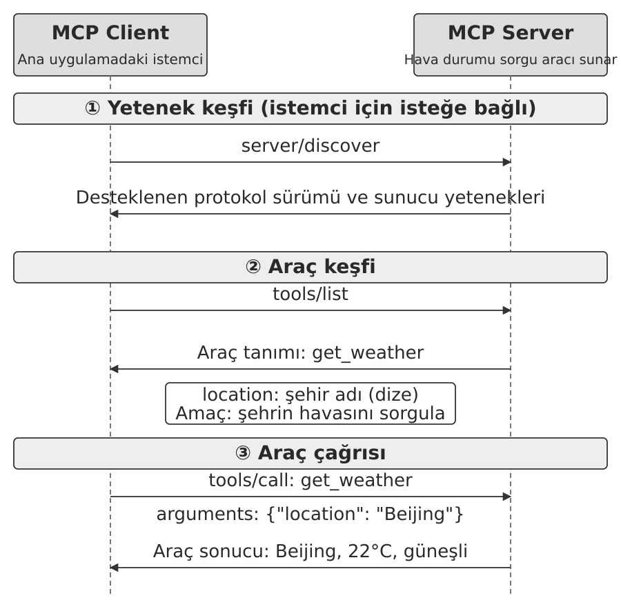
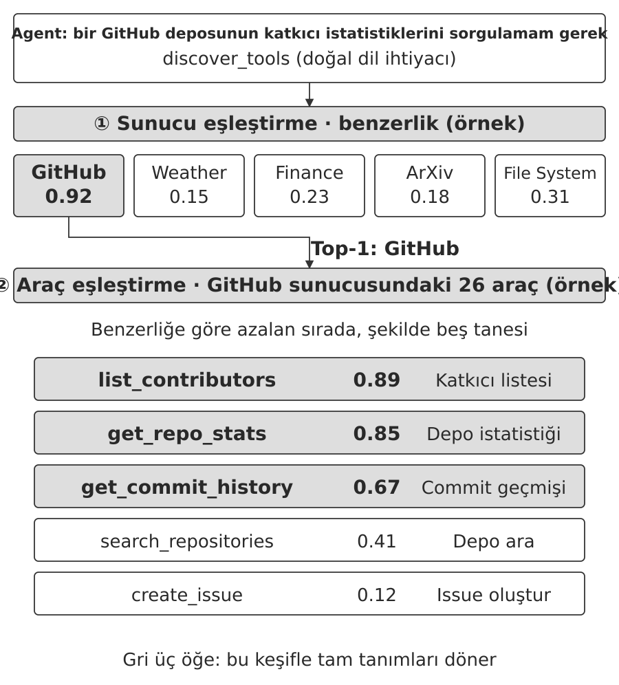
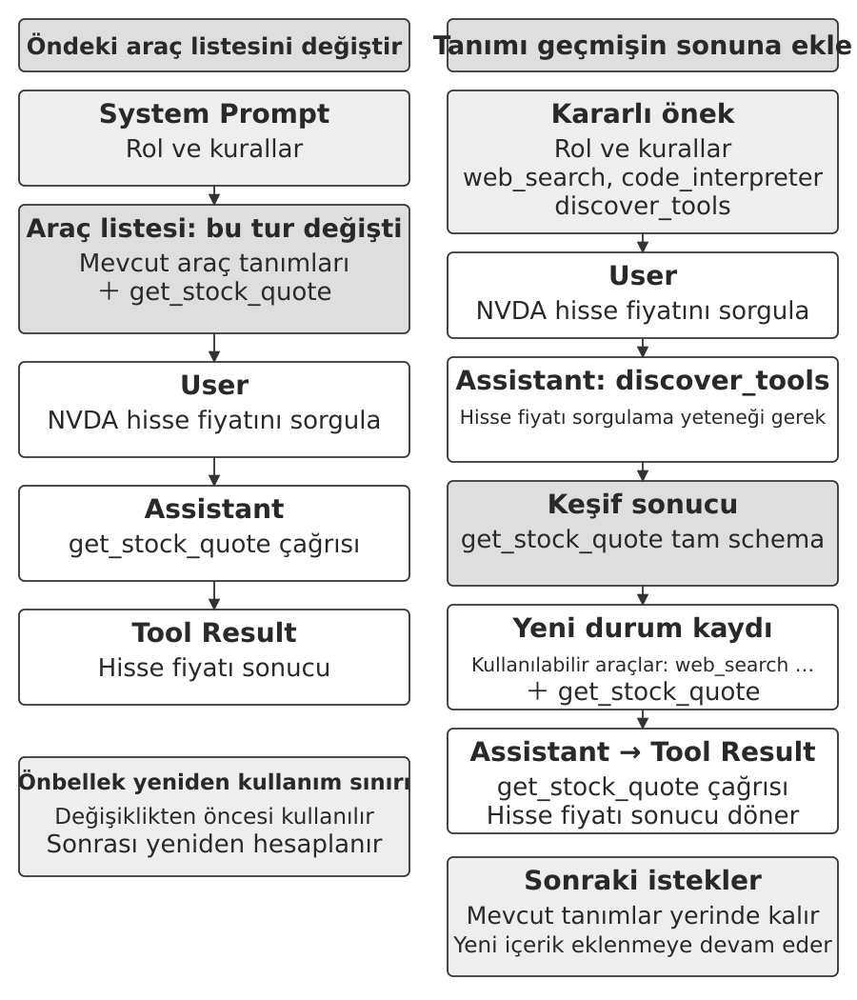
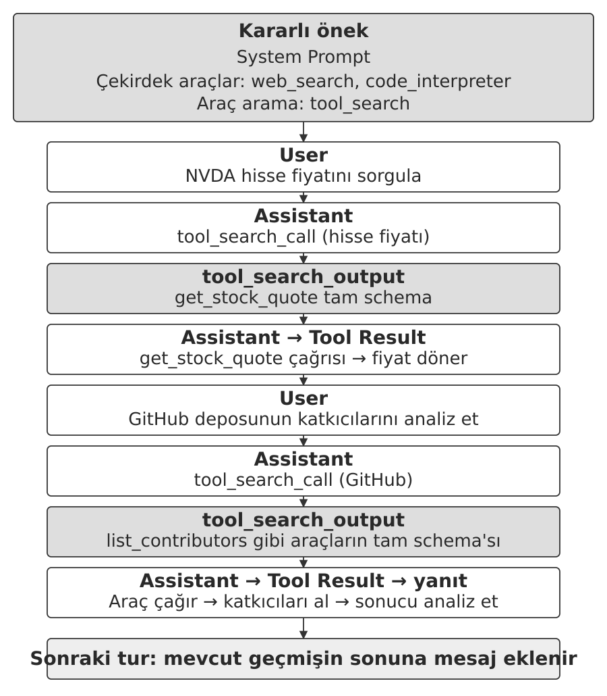

# Araçlar

Bilimkurgu filmi *Her*'de AI asistanı Samantha e-postaları düzenler, yanıt yazmaya yardım eder, yayın işlerini halleder ve farklı iletişim kanalları arasında geçiş yapar. Böyle bir asistanın dil anlayışını dış sistemler üzerinde işlemlere dönüştürmesi gerekir. Agent bu etkileşimleri **araçlar** aracılığıyla yürütür. Araçlar onun "duyuları, elleri ve ayakları"dır; hem gözlem sağlar hem eylem yürütür. Bu kitapta ele alınan Manus, OpenClaw gibi genel amaçlı Agent'lar da dijital dünyaya araçlarla erişir.

Kullanıcının şöyle dediğini varsayalım: "Müşteri e-postalarında geçen teslim tarihlerini bulup tabloya dök ve bana gönder." Model hangi e-postaya bakacağına karar verebilir; ama özgün metni okumak için posta kutusuna erişmek, tabloyu göndermek için de gönderme arayüzünü çağırmak gerekir. Bu araçlar nasıl tasarlanmalı ve model ihtiyaç duyduğunda onları nasıl bulmalı? Bu bölüm önce beş araç türünü ayırıyor, sonra araçların betimlenmesini, bağlanmasını ve keşfini tartışıyor, en sonunda algılama, yürütme ve iş birliği arayüzlerini ayrı ayrı tasarlıyor. Olay tetikleme ve kullanıcı iletişimi ayrıca Agent'ın ne zaman uyandırılacağını ve mesajların kanallar arasında nasıl taşınacağını da ilgilendirdiği için Bölüm 6'ya bırakılıyor.

## Araçların sınıflandırılması

E-posta sorgulamayı örnek alalım: model bir sonraki adımda ne yapacağını seçer, Harness parametreleri ve yetkileri kontrol edip isteği gönderir, posta hizmeti de veriyi gerçekten okur ya da yazar. Bölüm 1 araçları kullanım amacına göre algılama, yürütme, iş birliği, kullanıcı iletişimi ve olay tetikleme araçları olarak ayırmıştı. İlk dördünü Agent kendisi çağırır; olay tetikleme araçları ise dış olayların da Agent'ı uyandırabilmesini sağlar (Tablo 4-1).

Tablo 4-1 Beş araç türünün çağrı yönü ve başlıca kullanımı

| Araç türü | Çağrı yönü | Başlıca kullanım |
| --- | --- | --- |
| Algılama araçları | Agent kendisi çağırır | Dış bilgi edinmek |
| Yürütme araçları | Agent kendisi çağırır | Hesaplama yürütmek ya da dış durumu değiştirmek |
| İş birliği araçları | Agent kendisi çağırır | Görev devretmek, mesaj alışverişi yapmak, diğer Agent'ları ya da insanları koordine etmek |
| Kullanıcı iletişim araçları | Agent kendisi çağırır | Kullanıcıya yanıt vermek, sonuç göstermek ya da hatırlatma göndermek |
| Olay tetikleme araçları | Geliştirici yapılandırır ya da Agent kaydeder, dışarıdan tetiklenir | Belirlenen olay gerçekleştiğinde Agent'ı uyandırmak |

**Algılama araçları** Agent'ın dış bilgi edinmesini sağlar; örneğin web araması `web_search`, bilgi tabanı araması `knowledge_base_search`, web sayfası okuma `fetch_url`, dosya adı arama `find_file`, dosya içeriği arama `grep_file` ve dosya okuma `read_file`.

**Yürütme araçları** Agent'ın hesaplama yürütmesini ya da dış durumu değiştirmesini sağlar; örneğin komut satırı `shell_exec`, kod yorumlayıcı `code_interpreter`, dosya yazma `write_file`, dosya düzenleme `edit_file` ve e-posta gönderme `send_email`. Aynı genel yürütücü salt okunur hesaplama da yapabilir, veriyi de değiştirebilir.

**İş birliği araçları** görev devretmeyi ve mesaj alışverişini destekler; örneğin alt Agent oluşturma `spawn_subagent`, mesaj gönderme `send_message_to_subagent`, alt Agent iptali `cancel_subagent` ve kullanılabilir Agent'ları keşfetme `list_agents`. Bağımsız görevler paralel işlenebilir; örneğin OpenAI'ın birkaç kurucu ortağının geçmişi ayrı ayrı araştırılabilir. Farklı görevler farklı modeller, araçlar, prompt'lar ve context ile yapılandırılmış Agent'lara da verilebilir. Bölüm 10 iş bölümü ve iş birliği mimarisini daha ayrıntılı tartışacak.

**Kullanıcı iletişim araçları** kullanıcıya bilgi iletir; örneğin mesaj yanıtlama `reply_to_user`, yapılandırılmış kart gönderme `send_card_to_user` ve hatırlatma gönderme `send_user_notification`. Etkileşim birden çok kanala yayıldığında ya da arka plan bildirimi gerektiğinde sistem mesaj gönderimini açık bir araç çağrısı olarak sarmalayıp alıcıyı, içeriği ve teslim durumunu tek yerden yönetebilir.

**Olay tetikleme araçları** dış olayları Agent'ın çalışmasına bağlar; örneğin zamanlayıcı `set_timer`, arka plan görev izleme `monitor_shell` ve olay kaynağı bağlantısı `connect_channel`. Süreç iki adımdan oluşur: kayıt sırasında ilgilenilen olay geliştirici tarafından önceden yapılandırılır ya da Agent tarafından izin verilmiş bir çağrıyla bildirilir; olay gerçekleştiğinde zamanlama sistemi geri çağrıyı ya da olay mesajını alıp Agent'ı işlemeye uyandırır. Yeni e-postalar, sistem uyarıları, zamanlanmış hatırlatmalar ve tamamlanan arka plan görevleri yeni birer çalışma girişi olabilir.

Baştaki e-posta görevine dönelim: özgün mektubu açıp teslim tarihini almak algılamadır; özet tabloyu üretip kaydetmek çalışma alanını değiştirdiği için yürütmedir; tabloyu talep sahibine iletmek ise kullanıcı iletişimidir. Sistem bir sonraki müşteri e-postası geldiğinde kendiliğinden devam ederse ancak o zaman olay tetikleme devreye girer. Aynı posta hizmeti bu rollerin birkaçını üstlenebilir. Sıradaki karar, modele verilen araçların ne kadar ince olacağıdır: modele e-postayı sorgulamayı, gövdeyi okumayı ve eki bulmayı ayrı ayrı mı yaptıracağız, yoksa sık sık art arda yapılan birkaç adımı onun yerine birleştirecek miyiz?

## Araç tasarımının genel ilkeleri

Araç entegrasyonunun ilk döneminde yaygın yöntem her API uç noktasını doğrudan sarmalamaktı. Bu yöntem hızlı bağlanır, ama kolayca çok ince taneli bir arayüz kümesi üretir. Agent tek bir görevi tamamlamak için nesneleri tekrar tekrar bulmak, özellikleri okumak, koşulları kontrol etmek ve sonra yürütme arayüzünü çağırmak zorunda kalabilir. Araç tasarlarken bu işlemler sık görülen görevler etrafında birleştirilebilir; örneğin kişi bulmayı mesaj göndermeyle birleştirmek ya da günlük aramasının ilgili satırları context'leriyle birlikte doğrudan döndürmesini sağlamak[^ch4-tool-design].

**Araçlar Agent'ın tamamlaması gereken görev etrafında tasarlanmalıdır.** Arayüzü Agent'ın kullanım biçiminden yola çıkarak tasarlama fikrine **ACI** (Agent-Computer Interface, Agent–bilgisayar arayüzü) denir. HCI insanın bilgisayarla nasıl etkileştiğine odaklanır; ACI ise modelin işlemleri nasıl seçtiğine, parametreleri nasıl kurduğuna, geri bildirimi nasıl anladığına ve hataları nasıl düzelttiğine odaklanır.

[^ch4-tool-design]: Anthropic, *Writing effective tools for AI agents—using AI agents*, 2025.

### Yeteneğin ifade biçimi: özel araç, genel yürütücü ve Skill

"Uygulamayı dağıt" işini modele verirken üç tür işlem arayüzü tasarlanabilir. Birincisi yalnızca bir `deploy_app` sunar ve adımları sunucu tamamlar; ikincisi derleme, paketleme ve dağıtımı ayrı ayrı sunar, bir sonraki adımın ne zaman çağrılacağına model karar verir; üçüncüsü adımları bir Skill'e yazar ve modelin terminalde yürütmesini sağlar. Derleme başarısız olursa birincisinde hangi adımda hata olduğunu modele araç sonucu söylemelidir; diğer ikisinde bu derlemenin hatası doğrudan modele verilebilir.

- **Özel araçlar** belirli işlemler için yapılandırılmış arayüz sağlar. Geliştirici parametre Schema'sını, doğrulama kurallarını, yürütme mantığını ve dönüş biçimini tanımlar; ayrı ayrı test edilmesi ve yetkilendirilmesi kolaydır. Araç tanımı context'e girdikten sonra kapladığı yer alanların, açıklamaların ve örneklerin uzunluğuna bağlıdır.
- **Genel yürütücü ve Skill** birlikte kullanılır: terminal ya da kod yorumlayıcı yürütme yeteneğini sağlar, Skill ise akışı, geçerlilik koşullarını ve işlem yöntemini açıklar. Ana sistem önce ad ve kısa tanımları yükleyebilir, seçildikten sonra tam açıklamayı ve ilgili kaynakları okuyabilir.

Örneğin bir dağıtım Skill'i sırasıyla şunları açıklayabilir: projeyi `npm run build` ile derle, imajı `docker build -t app:latest .` ile paketle, ardından manifestte tanımlanan kaynakları `kubectl apply -f deploy.yaml` ile mevcut kümeye uygula. Agent bu adımları terminal aracıyla yürütür ve aynı yürütme girişini yeniden kullanır.

Aracın nasıl uygulandığı ile modelin onun açıklamasını ne zaman okuduğu iki ayrı sorudur. Yüzlerce özel araç yalnızca bir dizin olarak gösterilip Schema'ları ihtiyaç anında yüklenebilir; az sayıda Skill'in dizini context'te sürekli tutulup ölçek büyüdükçe arama eklenebilir. Özel arayüz ile genel yürütücü arasındaki seçim parametrelerin nasıl aktarıldığını ve kodun nasıl bakımının yapıldığını etkiler; her şeyi tek seferde vermek ile ihtiyaç anında yüklemek arasındaki seçim ise modelin bu adımda hangi araçları görebildiğini etkiler. İlerideki "Araç çok fazlaysa ne yapmalı" kısmı açıklama stratejisini tartışacak.

**Yazar önce genel araçları kullanmayı, sonra yetki, parametre ve performans ihtiyaçlarına göre özel arayüzler eklemeyi öneriyor.** Örneğin sandbox'ta `code_interpreter` için SymPy, NumPy ve pandas yapılandırıldığında Agent dört işlem, sembolik hesaplama, dizi işleme ve veri analizi için Python yazabilir. Bu, modelin kod üretme yeteneğinden tam olarak yararlanmasını sağlar: tek bir yorumlayıcı birçok algoritmayı taşıyabilir, mevcut kütüphaneleri birleştirerek önceden düşünülmemiş yeni sorunları da çözebilir. Model kodu üretir, çalışma ortamı yürütür ve dosya, ağ ve kaynak erişimini sınırlar.

Özel araç kullanılsa bile yazar işlevi benzer ve sık birlikte kullanılan işlemleri önce birleştirmeyi öneriyor. Arayüzler fazla ince olursa model daha fazla ad ve görev dağılımı hatırlamak zorunda kalır, aynı görevi tamamlamak da daha çok çağrı gerektirir. Birleştirirken başlıca **işlev benzerliğine** ve **kullanım senaryolarının örtüşme derecesine** bakılır. Örneğin `extract_pdf_text`, `extract_docx_content` ve `extract_pptx_content` hepsi bir belge alıp metin çıkarır; `read_document` olarak birleştirilip biçimler `file_type` ile ayırt edilebilir. Model yalnızca birleşik girişi seçer; yeni biçimler eklendiğinde de aynı parametre ve dönüş yapısı kullanılabilir.

Aşağıdaki dört durum özellikle özel arayüze uygundur.

1. **İnce yetkilendirme ve denetim gerektiğinde.** Üretim veritabanına yazma, kapsamı net bir işlem olarak sarmalanabilir; sunucu kullanıcı yetkisini, hedef tabloyu ve değiştirilmesine izin verilen alanları kontrol eder, işlemin dayanağını kaydeder.
2. **Platform farklarını gizlemek gerektiğinde.** grep, find gibi işlemler shell üzerinden yapılabilir; özel bir dosya arama aracı ise macOS, Windows ve Linux'un parametrelerini ve geri bildirimini birleştirebilir; örneğin her zaman dosya adını, satır numarasını ve eşleşen parçayı döndürür.
3. **İşlem çok sık yapıldığında.** Sık işlemler için kısa ve kararlı bir giriş sağlamak, betik ve açıklama akışını tekrar tekrar üretmenin maliyetini azaltır.
4. **Parametre ilişkileri karmaşık olduğunda.** İç içe nesneler, alanlar arası bağımlılıklar ve karmaşık değer kısıtları Schema ile iş doğrulamasının birlikte ifade etmesine uygundur.

**Parametreler karmaşıklaştıkça aktarım biçimi önem kazanır.** Yapılandırılmış araç çağrısı girdiyi genellikle JSON Schema ile betimler; bazı model hizmetleri kısıtlı üretimi destekleyerek parametrelerin desteklenen Schema kurallarına uymasını sağlar. Dönüş değerinin yapısı araç arayüzünde kararlaştırılır, ana sistem sonucu modele iletir. Tür ve biçim doğrulamasının ötesinde yetkiler, nesnenin var olup olmadığı ve birden çok alanın iş koşullarını karşılayıp karşılamadığı yine Harness ve araç hizmeti tarafından kontrol edilir.

Skill, özel araçların nasıl çağrılacağını açıklayabileceği gibi Agent'a CLI kullanmayı da öğretebilir. İkinci yol modelin komut satırı söz dizimini, tırnakları ve kaçış karakterlerini aynı anda ele almasını gerektirir; farklı shell'lerin kuralları da birbirinden farklıdır. Parametreler karmaşıklaştıkça modelin doğru işlemesi gereken ayrıntılar artar. Karmaşık iç içe parametrelerde bunlar önce bir JSON dosyasına yazılıp komutun o dosyayı okuması sağlanabilir; böylece çok katmanlı kaçış azalır ve içerik yürütmeden önce doğrulanabilir.

**Skill'i iş birimindeki kişiler doğrudan yazıp değiştirebilir.** İşi bilen biri adımları kendisi yazabilir ya da Agent'ın taslağını düzelterek başlayabilir. Akışın sırası değiştiğinde, bir adım yalnızca bazı müşteriler için geçerli olduğunda ya da örneğin değiştirilmesi gerektiğinde açıklama metnini doğrudan değiştirmek yeterlidir; araç kodunu değiştirip arayüzü yeniden dağıtmaya gerek kalmaz. Agent Skills belirtimine göre `SKILL.md` dosyasında meta veriler belirlenmiş bir biçimde yazılır, gövde ise Markdown kullanır; betikler, başvuru belgeleri ve kaynaklar da eklenebilir[^ch4-skill-format].

[^ch4-skill-format]: Agent Skills, biçim belirtimi; meta verileri, gövdeyi, eklenen kaynakları ve kademeli yüklemeyi içerir.

Yetenek biçimini seçerken dört boyut birlikte değerlendirilebilir.

- **Güvenlik ve yetki**: Özel arayüzler işlem kapsamını sınırlamayı kolaylaştırır; genel yürütücüler yürütme yeteneğini sandbox, kimlik bilgileri ve kaynak yetkileriyle denetler.
- **Parametre karmaşıklığı**: Karmaşık yapılar Schema ve iş doğrulamasına uygundur; basit işlemlere parametreler doğrudan CLI ile verilebilir.
- **Değişim sıklığı**: Sık değişen akışlar önce Skill'e yazılır; iş birimindeki kişiler açıklamaları ve örnekleri doğrudan değiştirebilir. Kararlı ve tekrar tekrar kullanılan alt düzey işlemler ise araç ya da betik olarak sarmalanır.
- **Model yeteneği**: Kodu ve komut satırını güvenilir biçimde işleyebilen modellerde yetenekleri Skill ile genel yürütücüyü birleştirerek sunmak ve özel araç sayısını azaltmak tercih edilir; model zayıfsa ve karmaşık parametrelerde sık hata yapıyorsa yapılandırılmış arayüzler daha fazla kısıt üstlenir.

**Kod birden çok araç çağrısını da düzenleyebilir.** Birçok web sayfası çekip alan çıkarırken model döngüyü, filtrelemeyi ve özetlemeyi tamamlayan bir betik üretebilir. Web sayfalarının tam metni yürütme ortamındaki değişkenlerde kalır; context'e yalnızca seçilmiş alanlar ve istatistik sonuçları döner. Programdaki koşullar, döngüler ve istisna işleme adımları birbirine bağlar; model doğrudan özet sonuçları çözümler. Toplu çekme, filtreleme ve istatistik gibi adımları zaten belli olan görevlerde yazar adımları kodla bağlamayı tercih ediyor; böylece modelin araçları tek tek çağırıp ara sonuçları okuması için yapılan gidiş gelişler azalır. Ara sonuçlar ne kadar çok ve dönen alanlar ne kadar sade olursa bu düzenin kazandırdığı context o kadar fazladır. Bölüm 5 bu tür kod orkestrasyonunu daha ayrıntılı tartışacak.

Bu tür arayüzlere genellikle **Code Mode** denir. Cloudflare'in MCP sunucusunu örnek alırsak, model önce `search()` ile bir sorgu programı yazıp OpenAPI betimlemesinden gereken uç noktaları ve parametreleri bulur; ardından bu uç noktaları çağıran JavaScript'i `execute()` ile gönderir. Örneğin koşulu sağlayan DNS kayıtlarını listelemek gerektiğinde program sayfa sayfa sorgulayıp filtreler ve yalnızca eşleşen kayıtları döndürür. İlk adım bütün arayüz kılavuzunu context'e koyma maliyetini, ikinci adım ise her sayfa sonucunu modele geri gönderme gidiş gelişini ortadan kaldırır. Yürütme kimliğinin hangi bölgeleri okuyabileceğine, kayıtları değiştirip değiştiremeyeceğine ise yine sunucu yetkisi karar verir.[^ch4-code-mode]

[^ch4-code-mode]: Cloudflare, Code Mode'un MCP uygulaması; Armin Ronacher, Pi 1.0 örneği üzerinden Harness'ın sağladığı araçlar ile yürütme ortamı arasındaki iş bölümünü tartışır.

### Araç açıklaması: amaç, parametreler ve geri bildirim

Bir araç için açıklama yazarken önce onu en kolay yanlış kullandıracak isteği hayal edebilirsiniz. Kullanıcı "sözleşmede cezai şarttan söz eden maddeleri bul" diyor; dosya adı araması yalnızca adı eşleşen dosyaları döndürür, bir yol elde edilse bile model gövdeyi okumak zorundadır. Araç açıklaması modelin buna dayanarak hangi arayüzü seçeceğine, çağırırken neyi sağlayacağına ve sonucun hangi soruyu yanıtlamaya yeteceğine karar vermesini sağlamalıdır.

**Ne zaman kullanılacağını açıklayın.** Web aramasının açıklaması "gerçek zamanlı bilgi edinmek ya da bilinmeyen olguları bulmak gerektiğinde kullan" olarak yazılabilir; böylece model kullanıcının ihtiyacını aracın amacıyla eşleştirir. Yalnızca "ilgili içeriği ara" yazılırsa model arama kapsamını ve geçerlilik koşullarını kendisi tahmin etmek zorunda kalır.

**Girdiyi ve arama kapsamını netleştirin.** Örneğin dosya adı arama aracı "dosya adına ve yola göre eşleştirir; dosyadaki metni aramak için `grep_file` kullan" diye açıklayabilir. Komşu araçların görev ayrımını net yazmak, modelin tek çağrıda doğru girişi seçmesine yardım eder. **Yazara göre sınır koşullarını netleştirmek çoğu zaman işlevleri sıralamaktan daha önemlidir.** Aracın hangi girdiyi kabul ettiği, hangi kapsamda aradığı, boş sonuç ya da hata durumunda ne yapılacağı modelin bir sonraki kararını doğrudan etkiler.

**Parametreleri belirtim artı örnekle açıklayın.** `timestamp` "RFC3339 biçiminde, örneğin `2024-03-15T14:30:00Z`" diye yazılabilir. Karmaşık bir görevi işlerken model aynı anda araç seçmeli, geçmiş izden bilgi çıkarmalı ve sonraki adımları tartmalıdır; parametre biçimi bunların yalnızca bir ayrıntısıdır. Tam bir dize doğrudan başvurulabilecek bir biçim sunar; model ona bakarak parametreyi kurabilir ve terimi yeniden yorumlarken hata yapma olasılığı azalır.

Aynı şekilde `phone` şöyle yazılabilir: "Telefon numarası; E.164 uluslararası numara gösterimiyle, `+` ile başlar, ardından ülke kodu ve numara gelir, kalan kısım yalnızca rakam içerir, boşluk ya da ayırıcı yoktur. Örneğin `+8613888888888` (Çin) ya da `+12025551234` (ABD)."

**Dönüş yapısını ve yürütme maliyetini açıklayın.** Örneğin "her öğesi `title`, `url` ve `snippet` alanlarını içeren bir JSON dizisi döndürür" açıklaması modelin başlığı, kaynağı ve özeti çıkarmasını kolaylaştırır. Uzun süren araçlar ölçüm ortamındaki tahmini gecikmeyi ve alternatif girişi belirtebilir; örneğin "tam web sayfasını okumak 5–10 saniye sürebilir; yalnızca meta bilgi gerekiyorsa `get_page_metadata` çağrılabilir".

Ayrıca en küçük parametre kümesini, yaygın bileşimleri ve karmaşık koşulları kapsayan 1–5 doğrulanmış çağrı örneği eklenebilir. JSON Schema türleri, zorunlu alanları, değer aralıklarını ve bazı alan bağımlılıklarını ifade edebilir[^ch4-json-schema]; örnekler ise bu kuralların somut görevlerde nasıl kullanıldığını gösterir; örneğin zaman damgasının saniye mi milisaniye mi olduğu, filtre koşullarının nasıl iç içe konduğu, hangi isteğe bağlı alanların genellikle birlikte göründüğü. Anthropic'in 2025'te bildirdiği, karmaşık parametreli iç testlerde araç çağrısı örnekleri eklendikten sonra doğruluk %72'den %90'a çıktı[^ch4-tool-examples].

[^ch4-json-schema]: JSON Schema, nesne türü ve özellik kısıtları. Model arayüzünün desteklediği Schema anahtar sözcüklerinin kapsamını ilgili hizmet belirler.

[^ch4-tool-examples]: Anthropic, *Introducing advanced tool use on the Claude Developer Platform*, 24 Kasım 2025, Tool Use Examples bölümü.

Agent sık sık yanlış araç seçiyorsa yazar **önce araç açıklamalarını kontrol etmeyi** öneriyor: birkaç araç benzer adlar mı kullanıyor, arama kapsamı net mi, parametrelerde örnek eksik mi? Aynı yöntem Skill'lerin adlarına, kısa tanımlarına ve işlem açıklamalarına da uygulanabilir.

### Parametre aktarımının sadakati

Model bir özgün metin parçasının değiştirilmesini istiyor, yürütme tarafı ise "bulunamadı" diyor. Modele yeniden ifade ettirmeden önce iki tarafın aynı karakter dizisini alıp almadığını sorun. Çağrı ayrıştırma, serileştirme, vekil sunucu ve çalışma zamanı sarmalamasından geçer; her katman içeriği değiştirebilir. **Parametre sadakati**, yürütme tarafının gördüğü değerin modelin gönderdiği değerle aynı anlamı taşımasını gerektirir; protokol kaçışı aktarım biçimini değiştirebilir, ama çözümlendikten sonra tırnaklar ve satır sonları korunmalıdır.

2026 başında Cursor'ın bir sürümündeki kıvrık tırnak dönüşümü sorununu örnek alalım. Değiştirme aracı `old_string` ve `new_string` alır ve dosyayı birebir eşleştirmeyle değiştirir. Okuma aracı Çince kıvrık tırnakları `“`, `”` (yani `\u201c`, `\u201d`) döndürüyor; model özgün metni `old_string`'e koyuyor, ama parametre aktarılırken düz İngilizce tırnağa `"` dönüştürülüyor. Dosyadaki özgün metin değişmediği için değiştirme aracı "eşleşme bulunamadı" döndürüyor. Yeniden okuyup özgün metni yeniden kopyalamak da aynı başarısızlıkla sonuçlanıyor.

Yazma yönü de etkilenir. Model kıvrık tırnak yazılmasını istiyor, dosya ise sonunda düz tırnak saklıyor. Dosya sonradan okunduğunda model beklediği yazımdan farklı bir içerik görüyor ve düzeltmeye çalışabiliyor; dönüşüm sürdükçe yeniden denemeler aynı hatayı tekrarlar.

Başka bir sorun türü **sessiz parametre enjeksiyonudur**. Bir IDE'nin bash aracı `git commit` komutuna otomatik olarak bir AI commit işareti parametresi ekliyor. Eski Git sürümü bu parametreyi tanımadığı için commit hata veriyor. Model yalnızca kendi ürettiği komutu gördüğünden commit mesajını ya da başka parametreleri tekrar tekrar değiştirebiliyor, ama asıl arıza kaynağına hiç dokunamıyor.

Bu tür sorunları ararken modelin ürettiği parametreleri, aktarımdan sonraki parametreleri, gerçekten yürütülen isteği ve dönen sonucu yan yana karşılaştırın. Arayüz ortak kodlama yapıyor ya da yürütme parametresi ekliyorsa dönüşüm kuralları yazılmalı ve gerçekten kullanılan değer döndürülmelidir. Birebir eşleştiren araçlarda bir fazla boşluk, bir eksik satır sonu ya da değişmiş bir tırnak bile eşleşmeyi başarısız kılabilir. Model bir sonraki çağrıyı doğru düzeltebilmek için yürütme tarafının gerçekte ne aldığını bilmelidir.

## Araç ekosistemi: MCP ve Skill Hub

Farklı model arayüzleri ve Agent çerçeveleri araçları kendilerine özgü biçimlerde tanımlar; örneğin function calling, tool use ve LangChain'in Tool soyutlaması. Aynı dış hizmet bu arayüzlere ve çerçevelere tek tek uyarlanacaksa açıklamalar, parametreler ve sonuç biçimleri tekrar tekrar ele alınmalıdır. Anthropic'in Kasım 2024'te yayımladığı **Model Context Protocol (MCP)**, model uygulamalarının araçlara ve verilere erişmesi için birleşik bir protokol sağladı[^ch4-mcp-origin].

MCP'yi anlamak için önce ana sistem, istemci ve sunucu olmak üzere üç role bakmak yararlıdır. **Ana sistem (host)** Agent uygulaması ya da IDE'dir; model etkileşiminden, context düzenlemesinden ve yetki yönetiminden sorumludur. Ana sistemin içindeki **MCP istemcisi** protokol mesajlarını yönetir; **MCP sunucusu** ise araçları, kaynakları ve prompt şablonlarını sağlar; yerel bir süreç olarak da uzak bir hizmet olarak da çalışabilir[^ch4-mcp-architecture].

**Araç tanımı ve çağrısı.** İstemci kullanılabilir araçları `tools/list` ile alır; liste sayfalı dönebilir. Her araç bir ad, açıklama ve `inputSchema` içerir; yapılandırılmış sonuçların biçimi `outputSchema` ile de kararlaştırılabilir. Model aracı seçip parametreleri ürettikten sonra ana sistem doğrulamayı tamamlar, istemci `tools/call` gönderir, sunucu yürütüp sonucu döndürür. Hangi tanımların ve sonuçların model context'ine konacağına ana sistem karar verir[^ch4-mcp-tools].

Şekil 4-1'de istemci hava durumu aracının adını ve parametrelerini aldıktan sonra Pekin'in havasını öğrenmek için bir çağrı daha yapmak zorunda. Eşlik eden uygulama MCP 2026-07-28'i kullanıyor; her istek protokol sürümünü, istemci bilgisini ve yeteneklerini taşıyor; istemci önce `server/discover` çağırarak sunucunun desteklediği sürümleri ve yetenekleri de öğrenebiliyor. Erken sürümler oturumu `initialize` el sıkışmasıyla kuruyordu; bağlanırken iki tarafın desteklediği sürüme göre etkileşim biçimi seçilmelidir[^ch4-mcp-versioning].

Aynı "hava durumu bulunamadı" sorununda Şekil 4-1 iki farklı sorun giderme başlangıç noktası sunuyor. Ana sistem sunucuya bağlandı ama `tools/list` çağrısında hava durumu aracı yoksa, sunucunun hangi araçları yayımladığı ve istemcinin sayfalı listeyi sonuna kadar okuyup okumadığı kontrol edilmelidir. Model doğru aracı seçti ama sunucu şehir adının eksik olduğunu bildiriyorsa, çağrı kaydından `arguments` alınıp alan adının araç tanımının istediği `location` olup olmadığı kontrol edilir.

**Aktarım biçimleri.** stdio, JSON-RPC mesajlarını yerel bir alt sürecin standart girdi ve çıktısı üzerinden taşır. Streamable HTTP ise istekleri HTTP ile gönderir; yanıt JSON olabileceği gibi SSE akışıyla adım adım da dönebilir. Streamable HTTP erken dönemdeki HTTP+SSE aktarım çözümünün yerini aldı ve akışlı yanıt için SSE kullanmayı sürdürüyor[^ch4-mcp-transports].

**Kaynaklar ve prompt şablonları.** Kaynaklar (resources) okunabilir veri sağlar; örneğin dosya içerikleri ve veritabanı kayıtları; ana sistem bunları URI'ye göre listeleyebilir, okuyabilir ve ilgili olanları seçebilir. Prompt şablonları (prompts) kullanıcıların ve istemcilerin seçebileceği yeniden kullanılabilir mesaj ya da görev şablonları sunar. Araçlar da arama ve okuma üstlenebildiği için bu üç ilkel etkileşim arayüzüne göre ayrılır: araçlar çağrı girişi, kaynaklar veri girişi, prompt şablonları görev girişi sağlar[^ch4-mcp-primitives].

MCP'nin temel değeri, bir araç uygulamasının birden çok Agent ürününe hizmet etmesini sağlamasıdır. Birleşik protokol aynı sunucunun Cursor, Claude Desktop ve OpenClaw gibi uyumlu ana sistemlerce yeniden kullanılmasını sağlar; geliştiriciler de enerjilerini yeteneğin kendisine ve geri bildirim kalitesine daha çok ayırabilir. Ana sistem protokoldeki araç tanımlarını modelin kullanabileceği arayüze dönüştürür.

**Skill Hub yetenek paketlerinin keşfini ve dağıtımını sağlar.** Bir Skill genellikle bir `SKILL.md` içerir; betikler ve başvuru malzemeleri de eklenebilir. Dağıtım platformları kullanıcıların bu dosyaları aramasına, kurmasına ve güncellemesine yardım eder. Vercel Ocak 2026'da beceri dizini ve kurulum aracı sunan skills.sh'yi çıkardı; OpenClaw ekosistemindeki ClawHub da beceri arama ve sürüm yönetimi sağlıyor[^ch4-skills-sh][^ch4-clawhub]. Kurulumdan sonra ana sistem adı, kısa tanımı ve tam açıklamayı kendi yükleme stratejisine göre okur. MCP de bir uzantı aracılığıyla Skills'in keşfini ve okunmasını sağlayabilir; yetenek paketleri ile iletişim protokolü birlikte kullanılabilir[^ch4-skills-over-mcp].

**Bağlantı ve context yükleme ayrı ayrı yönetilir.** MCP istemcisi araç listesini aldıktan sonra hepsini modele sunabilir ya da önce yalnızca bir dizin tutup tanımları ihtiyaç anında yükleyebilir. Skill de önce `name` ve `description` gösterip seçildikten sonra gövdeyi okuyabilir. Araç izin listesi hangi yeteneklerin kullanılabileceğini, gecikmeli yükleme ise hangi tanımların şu anda görünür olduğunu belirler.

**Üçüncü taraf yetenekleri bağlarken sağladıkları içeriği ve gerçekte yürüttükleri işlemleri ayrı ayrı kontrol edin.** Açıklamalar, dönen içerik ve eşlik eden kod farklı taraflardan gelir; yetki kapsamları da farklı olabilir. MCP örneğinde üç tür sorun ayrı ayrı kontrol edilebilir.

1. **Araç açıklaması zehirlenmesi.** Açıklama, aracın amacıyla ilgisiz işlem talepleri içerebilir ve modeli geçerli görevin dışına çıkmaya yöneltebilir. Bu bir prompt enjeksiyonudur: dışarıdan sağlanan içerik modelin davranışını değiştirmeye çalışır.
2. **Sunucunun ve bağımlılıklarının değiştirilmesi.** Sunucu yükseltmesi araç davranışını değiştirebilir; bağımlılık güncellemeleri ya da uzak hizmetin ele geçirilmesi de dönen sonuçları kirletebilir.
3. **Aynı adlı araç karışıklığı.** Farklı sunucular aynı adlı ya da benzer araçlar sunabilir; model ya da yönlendirme katmanı bu yüzden yanlış hedefi seçebilir. Ana sistem sunucu kimliği ile araç adı arasındaki bağı korumalı, kaynağı göstermeli ve çağrıyı yönlendirirken hedefi doğrulamalıdır.

Bağlamadan önce açıklama ve uygulama incelenmeli, kendi denetiminizdeki dağıtımların sürümü sabitlenmeli ve yükseltmeler yeniden kontrol edilmelidir; her sunucu göreve uygun en az yetkili kimlik bilgisini kullanmalıdır. Uzak hizmet başkaları tarafından yönetiliyorsa araç tanımlarındaki ve davranışlardaki değişiklikler de izlenmelidir.

Çalışma sırasında ilerideki Sidecar ile yapılandırılmış çağrılar ve gerekli görev dayanakları bağımsız olarak denetlenebilir. Çağrı parametrelerindeki yollar, metinler ve hedef adresler de denetlenecek veri olarak ele alınmalıdır. İnceleme sonucu deterministik yetki kurallarıyla birlikte yürütülüp yürütülmeyeceğine karar verir. Bölüm 5, özel veri, dış girdi ve dışarıya iletişimin birleştiğinde ortaya çıkan riski çözümlemek için Simon Willison'ın "ölümcül üçlü"sünü tanıtacak.

Skill'e eşlik eden betikler, yerel MCP sunucuları ve uzak hizmetlerin her birinin kendi yürütme konumu ve yetki kapsamı vardır. İnceleme sırasında kodun kaynağı, çalışma ortamı, dosya ve ağ yetkileri ve kimlik bilgilerinin akışı kontrol edilir; dışarıdan sağlanan adımlar başka programlar indirmeye ya da çalıştırmaya yönlendiriyorsa bunlar da bu kontrol zincirine dahil edilmelidir. Platform taramaları yardımcı ipuçları sunabilir; çalışma yalıtımı, en az yetki ve değişiklik incelemesi ise gerçek yürütmeyi doğrudan denetler.

[^ch4-mcp-origin]: Anthropic, *Introducing the Model Context Protocol*, 25 Kasım 2024.
[^ch4-mcp-architecture]: MCP 2026-07-28 sürüm belirtimi, mimari ve protokole genel bakış bölümleri.
[^ch4-mcp-tools]: MCP, Tools; araç listesini, girdi ve çıktı Schema'larını ve çağrı sonuçlarını içerir.
[^ch4-mcp-versioning]: MCP, *Versioning and Compatibility*; istek başına meta verileri, yetenek keşfini ve eski sürüm el sıkışmasıyla uyumluluğu açıklar.
[^ch4-mcp-transports]: MCP, aktarıma genel bakış ve 2025-11-25 aktarım belirtimi; ikincisi Streamable HTTP'nin erken HTTP+SSE çözümünün yerini almasını açıklar.
[^ch4-mcp-primitives]: MCP, Resources ve Prompts bölümleri.
[^ch4-skills-sh]: Vercel, *Introducing skills, the open agent skills ecosystem*, 20 Ocak 2026.
[^ch4-clawhub]: OpenClaw, ClawHub kullanım açıklaması.

## Araç çok fazlaysa ne yapmalı: hiyerarşik düzen ve proaktif araç keşfi

Araç sayısı onlarcadan yüzlere ve binlere çıktığında modelin hem uygun yeteneği bulması hem de benzer arayüzler arasındaki farkları anlaması gerekir. Tam tanımlar context'i kaplar; tanımlar prompt önekindeyse araç eklemek, çıkarmak ya da yeniden sıralamak yeniden kullanılabilir önbellek önekini de kısaltabilir. Adı ve amacı benzer araçlar arttıkça model yanlış girişi seçmeye ya da gerekli yeteneği gözden kaçırmaya daha yatkın olur. Bu yüzden büyük araç kütüphaneleri varsayılan olarak ihtiyaç anında yükleme kullanmalı, kategori dizini ve keşif arayüzü de iyi tasarlanmalıdır; model önce geçerli görevle ilgili araçları bulmalı, sonra her birinin amacına bakarak birini seçmelidir.

Araç keşfini görevlere göre düzenlenmiş bir el kitabını karıştırmak gibi düşünebilirsiniz. Dizin önce modele hangi bölüme bakacağını söyler; yürütme sırasında yeni bir ihtiyaç doğduğunda geri dönüp aramayı sürdürebilir; bir yeteneği seçtikten sonra parametreleri, işlem sırasını ve örnekleri okur. Aşağıdaki kategori dizini, proaktif arama ve Skill bu üç sorunu sırasıyla çözer; özel araçlar da genel yürütücüler de bu girişler üzerinden modele sunulabilir.

### Hiyerarşik düzen ve ihtiyaç anında yükleme

**Önce dizin sağlayın, kullanılacağı zaman tanımı yükleyin.** Araç dizinleri context'in büyük bir kısmını kaplayabilir. Anthropic bir örnek vermiştir: GitHub, Slack gibi beş MCP sunucusu toplam 58 araç sunuyor ve tam tanımlar yaklaşık 55 bin token tutuyor[^ch4-tool-search-eval]. Cursor bu açıklamaları bir dosya dizininde yönetir; başlangıç context'i yalnızca araç adları gibi kısa bilgiler sunar, Agent tam tanımları göreve göre okur. Cursor'ın Ocak 2026'da yayımladığı A/B testinde gerçekten MCP aracı çağıran görevlerde bu yöntem Agent'ın toplam token tüketimini %46,9 azalttı; tasarruf miktarı bağlanan MCP sayısına göre değişiyor[^ch4-cursor-discovery].

Pi'nin erken tasarımı ise README içeren CLI araçlarını tercih ediyordu; Agent kullanım biçimini ihtiyaç anında okuyup yeteneği komut satırı üzerinden çağırıyordu[^ch4-pi-no-mcp]. Topluluk eklentisi `pi-mcp-adapter` benzer fikri MCP'ye uyguluyor: modele varsayılan olarak yaklaşık 200 token'lık bir vekil araç sunuluyor; model sırasıyla araç arıyor, tanıma bakıyor ve çağrı yapıyor; sunucu ilk çağrıya kadar başlatılmıyor. Pi'nin sonraki 0.99 sürümü de ihtiyaç anında keşif mekanizmasını kullanan yerleşik MCP desteği ekledi[^ch4-pi-mcp-adapter]. Bu uygulamalar protokol bağlantısı ile context yüklemesini ayrı ayrı ele alır: arka uç MCP hizmetlerine bağlanır, ön uç ise kısa bir dizin ya da vekil arayüzle modelin gereken yeteneği bulmasına yardım eder.

[^ch4-cursor-discovery]: Cursor, *Dynamic context discovery*, 6 Ocak 2026.
[^ch4-pi-no-mcp]: Mario Zechner, *What if you don’t need MCP at all?*, 2 Kasım 2025; CLI ve belgeleri ihtiyaç anında okuma tasarım fikrini tanıtır.
[^ch4-pi-mcp-adapter]: pi-mcp-adapter, proje README'sindeki vekil araç, gecikmeli başlatma ve Pi'nin yerleşik MCP'siyle karşılaştırma.

**Araç dizinini görevlere göre düzenleyin.** Araçlar arttığında bilgi edinme biçimine göre gruplanabilir; model önce kategoriyi bulur, sonra somut arayüzü seçer:

- **Arama araçları**: İpuçlarına göre bilginin yerini arar; örneğin web araması, bilgi tabanı araması ve dosya araması.
- **Okuma araçları**: Bilinen bir konumdan içerik alır; örneğin bir web sayfasını, belgeyi ya da belirli bir kaydı okumak.
- **Ayrıştırma araçları**: Yapılandırılmamış içerikten bilgi çıkarır; örneğin görüntü OCR'ı, video analizi ve ses yazıya dökme.
- **Sorgu araçları**: Yapılandırılmış veriye alanlara ve koşullara göre erişir; örneğin hava durumu API'si, borsa API'si ve veritabanı sorgusu.

"Bir makalenin hangi verileri kullandığını bul" örneğinde arama önce aday makaleleri ve adreslerini döndürür, okuma aracı adrese göre özgün metni getirir, ayrıştırma aracı da tabloyu bulmaya yardım eder. İlk adım aynı adlı başka bir makaleyi ilk sıraya koyarsa sonradan tablo ne kadar doğru okunursa okunsun yanıt yanlış olur.

**Önce aramayla araç kapsamını daraltın.** Ana sistem görev betimlemesine göre araç adları, kısa tanımları ve parametre açıklamaları üzerinde anahtar sözcük ya da anlamsal arama yapıp yalnızca eşleşen araçların tanımlarını modele verebilir. Dönen araçlar çok azsa bir sonraki adımda kullanılacak arayüz kaçabilir; çok fazlaysa hem context'i kaplar hem de seçimi zorlaştırır. İlk arama kullanıcının isteğine göre yapılabilir, sonrakiler görevin ilerleyişine göre tamamlanır.

### Modelin yerleşik proaktif araç keşfi

Karmaşık görevlerin araç ihtiyacı çoğu zaman yürütme sırasında adım adım ortaya çıkar. Örneğin "Debug the file" önce dosya okumayı, sonra bağımlılıkları aramayı, testleri çalıştırmayı ve hataları çözümlemeyi gerektirebilir. Yalnızca görev başında bir kez arama yapmak, sonradan gereken yetenekleri kaçırmaya yatkındır.

**Agent'ın ihtiyaç duyduğunda talepte bulunmasını sağlayın.** MCP-Zero, modelin yürütme sırasında yapılandırılmış yetenek talepleri üretmesini sağlar; örneğin `server` ile GitHub'ı belirtip `tool` ile "depoları ara ve meta verileri döndür" diye betimlemek. Sistem önce sunucuyu, sonra sunucu içindeki aracı eşleştirir ve seçilen tanımları context'e ekler; dönen araçlar görevi karşılamazsa model talebini ayarlayıp aramayı sürdürebilir. Makalenin kurduğu MCP-tools veri kümesi 308 sunucu ve 2797 araç içeriyor; APIBank tam araç kümesi testinde hem tek turlu hem çok turlu ayarlarda araç prompt maliyeti yaklaşık %98 azaldı[^mcp-zero-2025].

Mühendislikte `web_search`, `code_interpreter` gibi temel araçlar korunup bir araç arama arayüzü de eklenebilir. Model eksik yeteneği betimler, arama arayüzü birkaç eşleşen aracın tanımını döndürür, model de bunlardan birini seçip çağırır. Anthropic'in Tool Search Tool'u bu ihtiyaç anında keşif yöntemini kullanır: sık kullanılan araçlar doğrudan yüklenir, diğerleri `defer_loading` ile gecikmeli yüklenir. Anthropic'in yayımladığı iç MCP değerlendirmesinde araç araması etkinleştirildiğinde Opus 4'ün doğruluğu %49'dan %74'e çıktı[^ch4-tool-search-eval].

[^mcp-zero-2025]: Xiang Fei, Xiawu Zheng, Hao Feng, *MCP-Zero: Proactive Toolchain Construction for LLM Agents from Scratch*, 2025. Yaklaşık %98'lik maliyet düşüşü APIBank tam araç kümesi ayarından gelir; makalenin Tablo 1'ine bakın.
[^ch4-tool-search-eval]: Anthropic, *Introducing advanced tool use on the Claude Developer Platform*, 24 Kasım 2025, Tool Search Tool bölümü.

**Önce sunucuyu, sonra aracı bulun.** MCP sunucuları genellikle bir platform ya da iş alanı etrafında bir grup araç sunar. Şekil 4-2'deki örnek önce yetenek betimlemesine göre GitHub sunucusunu seçiyor, sonra onun araçlarından üç aday ayıklıyor. Aynı adlı işlemler farklı platformlara ait olabilir; ilk adım bir grup ilgisiz adayı baştan eler. Ama bu adım doğru sunucuyu kaçırırsa sonraki adımda araçlar ne kadar dikkatle karşılaştırılırsa karşılaştırılsın doğru araç bulunamaz.

Vektör araması kullanılırken sunucu ve araç açıklamalarının gömmeleri önceden hesaplanıp dizin değiştikçe artımlı olarak güncellenebilir. Her katmanda eşleşme kalitesi kontrol edilmelidir: sunucu ya da araç adaylarının benzerliği belirlenen eşiğin altındaysa "uygun araç bulunamadı" döndürülür; Agent koşulları tamamlayıp ihtiyacı yeniden yazarak tekrar dener. Genel yürütücüyle yapılabilecek görevlerde temel araçların birleşimi de kullanılabilir; yeni araç oluşturma ve saklama yöntemleri Bölüm 9'da tartışılacak.

**Dinamik yüklemeyi KV Cache ile uyumlu hâle getirin.** Araç tanımlarının konumu önek yeniden kullanımını etkiler. Her yeni araç keşfedildiğinde isteğin başındaki araç listesi değiştirilirse serileştirilmiş önek değişir ve önbellek yalnızca ilk değişiklik konumuna kadar yeniden kullanılabilir. Şekil 4-3'ün sol ve sağ sütunlarını karşılaştırın; fark, yeni aracın ilk kez nerede göründüğündedir. Sağda sistem prompt'u, temel araçlar ve arama arayüzü sabit kalır; yeni araç tanımları keşif sonuçlarıyla birlikte geçmişe eklenir; sonraki istekler mevcut tanımların yerini korur ve mesaj eklemeyi sürdürür.

Bölüm 2'de tanıtılan OpenAI `tool_search`, `defer_loading` ve `tool_search_output` ile Anthropic'in `tool_reference`'ı, araç tanımlarının ihtiyaç anında yüklenmesini destekler. Durum çubuğu ayrıca kısa bir kullanılabilir araç adları listesi tutarak modelin geçerli yeteneklerini takip etmesine yardım edebilir.

Şekil 4-4 iki araç keşfini kaydediyor. Model GitHub katkıcılarını çözümlemeye başladığında daha önce hisse fiyatı sorgusunda kullanılan araç tanımları hâlâ eski yerlerinde duruyor.

Bu tasarım, modelin oturum sırasında yeni yüklenen araç tanımlarını anlayıp parametreleri buna göre doldurmasını ve çağrı yapmasını gerektirir. Deney 4-1 aynı görev kümesini iki araç yükleme yöntemine verip her birinin context'e gönderdiği tanım miktarını karşılaştırıyor.

> **Deney 4-1 ★★★: Proaktif araç keşfi**
>
> Araç keşfi modelin her seferinde karşılaştığı tanım metnini nasıl azaltır? Bu deney Qwen3-4B ile 127 araç içeren aynı MCP sunucu kümesinde tam yüklemeyi ve proaktif keşfi karşılaştırıyor. İki grup üç görevi ayrı ayrı işliyor: Apple'ın hisse fiyatını ve ilgili haberleri sorgulamak; transformer ile ilgili makaleleri arayıp ilk üçünü indirmek; bir GitHub deposunun katkıcı istatistiklerini alıp grafik üretmek. Bu görevler sırasıyla finans ve arama, makale arama ve indirme, veri sorgulama ve kod yürütme yetenekleri gerektiriyor.
>
> **Tam yükleme**: Sistem prompt'una tüm araçların eksiksiz schema'sı konur. 25 Ağustos 2026 tarihli eşlik eden çalıştırma kaydı 127 araç içeriyor; dizinin tamamı aynı tokenizer (o200k) ile 50.597 token tutuyor.
>
> **Proaktif keşif**: Sistem prompt'unda yalnızca `web_search`, `code_interpreter` ve `discover_tools` kalır. Model bir yetenek açığıyla karşılaştığında ihtiyacını doğal dille betimler; örneğin "hisse fiyatı sorgulayabilecek bir yeteneğe ihtiyacım var". `discover_tools` vektör benzerliğiyle beş aday aracı getirir, eksiksiz tanımlarını konuşma geçmişine ekler ve durum çubuğundaki kullanılabilir araç adlarını günceller. Model ardından aracı seçip görevi sürdürür.
>
> **Çalıştırma sonuçları**: Görev sırasına göre proaktif keşif grubu sırasıyla 3.939, 1.853 ve 2.632 token'lık araç tanımı ekledi. İki grup da her görev için gereken yetenekleri seçti; yürütme uyarlama katmanı görev parametrelerini doldurmaktan, toplu indirmeden ve çizim kodu üretmekten sorumluydu; sonunda araç çağrıları ve çıktı kontrolleri geçti.
>
> Araç tanımlarının kısaldığını görünce şunu da sormak gerekir: model daha az okuduğu için mi doğru seçti, yoksa karıştırılabilecek araçlar azaldığı için mi? Önceki iki grupta eleme yöntemi, mesaj konumu, durum çubuğu, keşif uyarısı ve çağrı tur sayısı da birlikte değişmişti. Eşlik eden tek adımlı seçim deneyi (`selection_ablation.py`) soruyu "ilk adımda hangi araç seçilir" düzeyine daraltıyor. Önce aynı aday kümesi korunup sistem mesajına dolgu metni eklenir; böylece girdinin uzaması seçimi değiştiriyor mu görülebilir. Sonra aynı adaylar korunup aynı miktarda çeldirici araç eklenir ve dolgu metni azaltılır; iki grubun girdisi de 6.144 token olur. Böylece doğru araç hâlâ özgün aday kümesinde kalır ve birkaç ek çeldiricinin etkisi ayrıca incelenebilir.
>
> Araçlar rastgele çekildiğinde ilk adımda gereken arayüz listede hiç olmayabilir. Ancak araç listede olduğu hâlde model başka bir şey seçerse model yanlış seçmiş sayılır.
>
> Hisse fiyatı görevinin adım adım kaydında kullanıcı aslında iki şey soruyor: hisse fiyatı ne kadar değişti ve bu değişimi açıklayan hangi haber var? İlk arama turunda beş araç bulundu, model üçüncü sıradaki `yfinance_quote`'u seçti. Bu fiyat sorgusu 310,34 dolar döndürdü; önceki kapanış fiyatı 309,35 dolara göre yaklaşık %0,32 artış var; ilk soru doğrudan doğrulanabilir. İkinci soru başlangıç dizininde zaten bulunan `web_search`'ü kullandı. Beş arama sonucu döndü; özetler ağırlıklı olarak piyasa verilerini sıralıyordu ve o günkü artışı açıklayan somut bir olay vermiyordu. Gereken iki aracın ikisi de seçildiği için yetenek kapsaması tam puan aldı; kullanıcı yükselişin nedenini öğrenmek istiyorsa tarihli haberleri aramayı sürdürmek gerekiyor.

### Skills: araç keşfini "ihtiyaç anında başvuru"ya dönüştürmek

Bölüm 2, Skills'in kademeli açıklamasını (Progressive Disclosure) tanıtmıştı. Araç tasarımı açısından bu, bir yeteneğin kullanım yöntemini ihtiyaç anında başvurulabilecek bir malzeme kümesi olarak düzenler: model önce kısa tanıma göre Skill'i seçer, sonra işlem adımlarını okur, en sonunda göreve göre araçları çağırır ya da betikleri yürütür.

**Kademeli açıklama üç adımdan oluşur.** Başlangıçta her Skill'in `name` ve `description` alanları yüklenir; model hangi yeteneklerin bulunduğunu ve her birinin hangi görevlere uygun olduğunu öğrenir. Seçildikten sonra eksiksiz `SKILL.md` okunur; yürütme sırasında içinde atıf yapılan belgelere, şablonlara ya da betiklere başvurulur[^ch4-skill-format]. Örneğin PDF işlerken önce metin çıkarma mı form doldurma mı gerektiğine karar verilir, sonra ilgili açıklama okunur. Böylece somut işlemler için gereken ayrıntılar yetenek paketinde kalır ve görevle birlikte adım adım context'e girer. Dizinin toplam maliyeti Skill sayısına ve kısa tanımların uzunluğuna bağlıdır.

Bu, başvuru kitabı karıştırmaya benzer: önce içindekilere bakılır, sonra ilgili maddeye geçilir, somut bir sorunla karşılaşıldığında örneklere bakılmaya devam edilir. Küçük ölçekli, ağırlıklı olarak işlem akışlarından ve başvuru malzemelerinden oluşan yetenek kütüphaneleri için yazar Skill dizini ile dosya okumayı tercih ediyor. Bu yöntem modelin belge okuma ve genel araç çağırma yeteneğini yeniden kullanır; başlangıçta yalnızca kısa tanımların, atıfların ve işlem açıklamalarının bakımı gerekir, ayrı bir araç arama hizmetine gerek kalmaz. Yetenek kütüphanesi büyüyüp dizini gezinmek zorlaştığında anahtar sözcük ya da anlamsal arama eklenir.

Özel araçlar da ihtiyaç anında yüklenebilir. Ana sistem sunucu ad alanlarını, izin listelerini ve arama araçlarını birleştirerek geçerli görevin hangi tanımları görebileceğine karar verir, sonra bunları araç arama arayüzüyle context'e ekler. Skills ise adımları, örnekleri ve başvuru malzemelerini aynı dosya yapısına koyar; Skill'i yazanların bunları yazması ve bakımını yapması kolaylaşır.

Aynı PDF form doldurma açıklaması birçok oturumda tekrar tekrar kullanılıyorsa, açıklama okunurken yapılan model hesaplaması da yeniden kullanılabilir mi? Önce iki durumu ayıralım. Aynı oturumda yeni açıklamayı sona eklemek, önceki aynı önekin önbellekten okunma şansını korur. Başka bir oturumda ise açıklama metni tıpatıp aynı olsa bile önündeki kullanıcı isteği, malzeme ve konum genellikle değişmiştir; sıradan önek önbelleği o hesaplamayı doğrudan yeniden kullanamaz. Bölüm 2'de tanıtılan birleştirilebilir KV Cache araştırması bu içeriği ayrıca önceden hesaplamayı, sonra döner konum kodlamasını (RoPE) ayarlayıp yeni context'e eklemeyi deniyor. Yeniden konumlandırma ve birleştirmenin hesaplama miktarı parça uzunluğuyla doğrusal artar.

MCP ve Skill Hub dağıtım işini birlikte de üstlenebilir. Skill Hub yetenek paketlerinin aranmasından, kurulmasından ve güncellenmesinden sorumludur; MCP'nin Skills uzantısı istemcilerin sunucunun sağladığı Skill'leri keşfetmesini ve okumasını destekler[^ch4-skills-over-mcp]. Aynı işlem bilgisi yerel yetenek paketiyle de, bu uzantıyı destekleyen bir MCP hizmetiyle de sunulabilir.

[^ch4-skills-over-mcp]: Model Context Protocol, *Skills Over MCP Charter*; Skills uzantısının keşif, dağıtım ve okuma sorumluluklarını açıklar.

Araç bulundu; modele ne döndürülürse işe yarar? Müşteri e-postası örneğinde yalnızca dosya adını döndürmek özgün mektubu bulmaya yeter, ama teslim tarihini kontrol etmek için özgün cümleyi de okumak gerekir. Algılama araçlarının tasarımı bu farkla başlar.

## Algılama araçları

Kullanıcının bir rapordaki toplam tutarı hesaplamak istediğini varsayalım. Arama aracı bir isabet özeti döndürüyor; raporu bulmaya yeter, ama tutarın hangi birimle yazıldığı anlaşılmayabilir. Model özeti izleyerek özgün tabloyu okuduğunda, sütun adlarını, birimleri ve toplam satırını gördüğünde ancak hesabı yapabilir. Algılama araçlarını tasarlarken burada birbirine bağlı iki soru vardır: bu sefer hangi malzeme döndürülecek ve malzeme yetmezse model okumaya nereden devam edebilir?

Tek bir arama on binlerce karakter döndürebilir, bir PDF yüzlerce sayfa olabilir. Bölüm 2'deki **context farkındalıklı sıkıştırma** ile çıktı belirlenen eşiği aştığında geçerli soruya göre ilgili içerik çıkarılabilir. Örneğin 10.000 karakter tetikleme noktası alınıp bir özet döndürülebilir ve özgün sonucun okuma girişi korunabilir; böylece model atıfları, tabloları ya da ayrıntıları kontrol etmeyi sürdürebilir.

**Önce arama sonuçlarını listeleyin; model hangisini seçerse onun tam metnini okutun.** Dönen liste başlık, konum ve özet parçası içermelidir; Agent'ın hangi sonuçların okunmaya değer olduğuna karar vermesine yardım eder. Sonuç çoksa sayfalama ya da imleç (`cursor`) kullanılır: varsayılan olarak ilk birkaç sonuç döner ve sonraki sayfanın nasıl alınacağı belirtilir; toplam sayı biliniyorsa o da döndürülür. Model eldeki kanıtlara göre sayfalamaya devam etmeye ya da sonuçlardan birini açıp özgün metni okumaya karar verebilir.

**Büyük dosyaları parça parça okuyun, kesme yapıldığında kapsamı belirtin.** Okuma arayüzü `offset`, `limit` gibi parametreleri desteklemeli ve bunların satır, bayt ya da kayıt birimini kullandığını açıklamalıdır. Örneğin "toplam 5000 satırdan 1–200. satırlar gösterildi" döndürülür ve okumayı sürdürmek için parametreler verilir. Kapsam bilgisi Agent'ın geçerli içeriğin eksiksiz olup olmadığına karar vermesine yardım eder, konuma göre geri bakmayı da kolaylaştırır. Sessiz kesme modelin her şeyi okuduğunu sanmasına ve "bu kısımda yok" yargısını "malzemenin tamamında yok" diye genellemesine yol açabilir. Ortadaki içerik atlandıysa atlanan konum ve kalan içeriğin nasıl okunacağı belirtilmelidir.

**Salt okunur işlemlerden önbellek ve eşzamanlılık için yararlanın.** İş verisine salt okunur erişimin sonuçları genellikle yeniden kullanılabilir ve paralel yürütülmesi kolaydır; örneğin beş dosyayı aynı anda okumak ya da üç bağımsız arama başlatmak. Önbellek anahtarı sorgu parametrelerini, kullanıcı kimliğini ve yetki kapsamını içermelidir; hava durumu, hisse fiyatı ve arama sonuçları için uygun bir geçerlilik süresi (TTL) de belirlenmelidir. Eşzamanlı okumalarda hız denetlenmeli ve dış veri güncellemelerinin etkisi düşünülmelidir: tutarlı bir görünüm gerektiren görevlerde birden çok okuma anlık görüntü, sürüm numarası ya da toplama zamanı ile eşgüdümlenebilir.

**Çok kipli çıktıyı göreve göre seçin.** Ekran görüntüleri, grafikler ve taranmış belgeler görsel girdi destekleyen bir modele doğrudan verilebilir ya da önce OCR, belge ayrıştırma gibi araçlarla metne dönüştürülebilir. Metin çıkarmak arama, alıntılama ve sıkıştırmayı kolaylaştırır; görüntüyü korumak ise sayfa düzenini, tablo satır-sütun ilişkilerini ve arayüz konumlarını anlamaya yardım eder. Ağırlıklı olarak metinden oluşan içerikte önce çıkarma sonucu döndürülebilir; UI, karmaşık tablolar ya da tasarım taslakları söz konusu olduğunda model ilgili görüntüyü görebilmelidir. İki biçim birlikte de kullanılabilir.

Algılama araçları, okurun gözle tanıyabildiği şeyleri doğrulanabilir gözlemlere de dönüştürebilir. Coscientist araştırmacıları kırmızı, sarı ve mavi renk örneklerini bir kuyucuk plakasının bilinen üç konumuna koyup asistandan her rengin hangi kuyucukta olduğunu belirlemesini istedi. Plaka okuyucu her dalga boyundaki soğurma verilerini döndürdü, asistan Python ile soğurma tepelerini buldu. Bu noktada elde edilen, dalga boyu ile kuyucuk konumu arasındaki karşılıktır; her kuyucuğa renk yazmak için ise bu tepeleri yorumlamak gerekir. Makale bir ayrıntıyı kaydetmiştir: asistan ancak araştırmacılar ona farklı renklerin ışığı nasıl soğurduğunu düşünmesini hatırlattıktan sonra üç renk örneğini doğru tanıdı.[^ch4-coscientist-colours]

[^ch4-coscientist-colours]: Boiko ve arkadaşları, *Autonomous chemical research with large language models*, Nature, 2023. Deney düzeni için Şekil 4'e ve yazarların yayımladığı basitleştirilmiş uygulamaya bakın.

> **Deney 4-2 ★★: Algılama araçları MCP sunucusu**
>
> Bu deney sık kullanılan bilgi edinme yeteneklerini aynı MCP sunucusuna bağlıyor ve arayüzleri beş senaryoya göre düzenliyor:
>
> - **Arama ve edinme**: Web araması, yerel bilgi tabanı araması ve dosya indirme.
> - **Çok kipli anlama**: Web sayfası okuma; PDF, Word, PPT belgelerinden çıkarma; görüntü OCR'ı ve görsel analiz; ses ve video yazıya dökme ve analizi.
> - **Dosya sistemi**: Dosya okuma, içerik arama ve dizin gezinme; sunucu ayrıca kopyalama, taşıma ve silme işlemleri sağlar, bunların yetkileri yürütme araçları gibi yönetilir.
> - **Açık veri kaynakları**: Hava durumu, hisse fiyatı, döviz kuru, Wikipedia ve arXiv makaleleri.
> - **Özel veri kaynakları**: Kullanıcı yetkisiyle takvim ve Notion içeriğini okumak.
>
> Bu çalıştırma ilk dört senaryoyu kapsadı. Önce belge okumaya bakalım: araç tek sayfalık bir PDF açıp sayfa sayısını ve çıkarılan metni döndürdü; özgün sayfayla karşılaştırılabilir. Sonra takvim sorgusuna bakalım: bu da bir MCP yanıtı döndürdü; dıştaki hata işareti false, ama içeride `success: false` ve `missing_credentials` yazıyor. Asistan buna dayanarak kullanıcıya "takvimi okuma yetkisi henüz alınmadı" diyebilir; "o gün bir planınız yok" derse yapılamamış bir isteği sorgu sonucu saymış olur. Notion sorgusu da kimlik bilgisi yapılandırma adımında kaldı.

### Çok kipli algılama

Grafik içeren aynı PDF için iki soru sorun: "Yazar sonuç bölümünde hangi çözümü öneriyor?" ve "Hangi eğri eşiği önce aşıyor?" İlk soru çoğu zaman çıkarılan metinde aranarak yanıtlanabilir; ikincisi ise lejantı, eksenleri ve eğrilerin uzamsal ilişkisini de gerektirir. Görüntü, ses, video ve PDF ile karşılaşıldığında bunlar ilgili kipi destekleyen ana modele doğrudan verilebilir, önce metne dönüştürülebilir ya da model gerektiğinde çok kipli analiz araçlarını çağırabilir.

#### Yerleşik çok kipli işleme

**Yerleşik çok kipli işleme**, ana modelin soruyu yanıtlarken görsel ya da işitsel girdileri doğrudan kullanmasını sağlar. Qwen-VL, LLaVA gibi görsel dil modellerinde tipik yapı bir görsel kodlayıcı, bir bağlantı modülü ve bir dil modelinden oluşur: görsel kodlayıcı görüntüden özellik çıkarır, bağlantı modülü bu özellikleri dil modelinin alabileceği temsile dönüştürür, ardından metin talimatıyla birlikte akıl yürütmeye katılır[^ch4-vlm-architecture].

**Vision Transformer (ViT)** kullanıldığında görüntü yamalara (patch) bölünür, her yama kodlanıp görsel özellik oluşturur. Model bu özellikleri izdüşüm, yeniden örnekleme gibi bağlantı yöntemleriyle alır ve görüntü içeriği ile metin sorusu arasındaki ilişkiyi dikkat mekanizmasıyla işler. Örneğin "tablonun sağ alt köşesindeki sayı nedir" sorusunu yanıtlarken model metni, konumu ve tablo yapısını birlikte kullanmalıdır.

Görev, sayfa düzeni, grafikler ve metin arasındaki ilişkiyi tekrar tekrar kontrol etmeyi gerektirdiğinde yazar uygun yeteneğe sahip ana modelin özgün malzemeye doğrudan bakmasını tercih ediyor. Görsel bilginin sonraki akıl yürütmeye sürekli katılması, ayrıntıların birden çok aktarımda kaybolma olasılığını azaltır.

PDF'ler genellikle önce girdi işleme katmanında ayrıştırılır ya da sayfalar görüntü olarak render edilip modele verilir. Sayfa görüntülerini korumak sayfa düzenini, grafikleri ve metin-görsel ilişkisini çözümlemeye yardım eder; uzun belgelerde ise sayfa sayısı, çözünürlük ve parçalama biçimi denetlenmeli, görevin gerektirdiği ayrıntılar modelin işleyebileceği kapsama girmelidir.

[^ch4-vlm-architecture]: Bai ve arkadaşları, *Qwen-VL: A Versatile Vision-Language Model for Understanding, Localization, Text Reading, and Beyond*, 2023; Liu ve arkadaşları, *Improved Baselines with Visual Instruction Tuning*, 2023; görsel kodlayıcıyı ve dil modeliyle bağlantı yapısını sırasıyla tanıtır.

#### Metne çıkarma

**Metne çıkarma (Extract to Text)** işlemi iki adıma böler: önce belge ayrıştırma, OCR ya da ses yazıya dökme araçlarıyla metin elde edilir, sonra dil modeli arama, özetleme ve soru-cevabı tamamlar. GLM 5.2, DeepSeek V4 Flash gibi metin modelleri belgelerdeki ve ses-videodaki metin bilgisini bu yoldan işleyebilir[^ch4-text-models].

Ağırlıklı olarak metinden oluşan PDF'lerde metni doğrudan çıkarmak genellikle sayfa sayfa ekran görüntüsü vermekten daha derli topludur; arama ve alıntılamayı da kolaylaştırır. Görüntü girdisinin token sayısı çözünürlüğe, parçalamaya ve modelin kodlama biçimine bağlıdır; metin girdisinin miktarı ise çıkarılan içeriğe ve sözcüklere ayırma biçimine bağlıdır.

Çıkarma sonucu görevin dayandığı ilişkileri korumalıdır. Sıradan OCR görüntüdeki sayıları tanıyabilir ama sayılarla eksen etiketleri arasındaki karşılığı kaybedebilir; yalnızca PDF'in metin katmanını okumak da gömülü görüntülerdeki grafikleri atlayabilir. Sayfa düzeni analizi ve tablo ayrıştırma paragraf sırasını, satır-sütun yapısını ya da konum işaretlerini daha iyi koruyabilir.

[^ch4-text-models]: Z.AI, GLM-5.2 model belgeleri, girdi kipi metin; DeepSeek, DeepSeek-V4-Flash model kartı; metin üretim modelini ve kullanım biçimini sunar.

#### Araç olarak çok kipli analiz

**Araç olarak çok kipli analiz**, ana modelin geçerli soruya göre görsel, işitsel ya da belge analizi yeteneklerini çağırmasını sağlar. Örneğin `analyze_image`, `analyze_pdf`, `analyze_audio` bir dosya başvurusu ve doğal dilde bir soru alıp analiz sonucunu döndürür. Ana model ne zaman çağıracağına, ne soracağına ve sonucu nasıl kullanacağına karar verir; aracın içindeki model ilgili kipi işlemeye odaklanır.

Ana model yalnızca metni destekliyor ve görev görsel ayrıntılara dayanıyorsa yazar önce bu tür analiz araçları eklemeyi tercih ediyor.

Örneğin Agent önce raporun gövdesini okuyor, kullanıcının sorduğu çeyreklik gelirin yalnızca grafikte bulunduğunu fark ediyor ve görüntü analiz aracını çağırarak "her çeyreğin geliri ne kadar?" diye soruyor. Araç sayıları ve karşılık gelen çeyrekleri döndürdükten sonra ana model büyümeyi ya da farkı hesaplamaya devam ediyor. Ana modelin context'inde yalnızca soru ve analiz sonucu kalıyor; özgün görüntüyü araç işliyor.

> **Deney 4-3 ★★: Çok kipli bilgi çıkarma: üç teknik yaklaşımın karşılaştırmalı analizi**
>
> Bu deney çeyreklik gelir çubuk grafiğini ve bu grafiği içeren bir PDF raporunu kullanarak üç bilgi aktarım yöntemini karşılaştırıyor. Grafikteki dört çeyreğin geliri sırasıyla 120 milyon, 150 milyon, 95 milyon ve 180 milyon dolar; rapor gövdesi yalnızca değişim eğilimini betimliyor. Görüntü ve PDF için ayrı ayrı iki soru soruluyor: "Hangi çeyrekte gelir en yüksekti ve tam olarak ne kadardı?" ve "Hangi çeyrekte gelir en düşüktü, ne kadardı ve dördüncü çeyrek ondan ne kadar fazla?"
>
> **Doğrudan grafiğe bakma** yolunda özgün görüntü ya da PDF sayfa görüntüsü soruyla birlikte modele verilir. **Metne çıkarma** yolunda sırasıyla OCR ve PDF metin çıkarma sonuçlarıyla yanıt verilir. **İhtiyaç anında araç çağırma** yolunda model önce çıkarılan metni okur, sayıların ya da karşılıkların yetersiz olduğunu fark edince `inspect_visual` ile özgün görüntüye bakar, sonra yanıtı düzenler. Üç yol aynı Doubao modelini kullanıyor ve bilgi aktarım biçiminin yanıta etkisini karşılaştırıyor.
>
> Bu çalıştırmadaki dört "malzeme–soru" bileşiminde doğrudan bakma ve ihtiyaç anında araç çağırma hep doğru yanıtladı; metin çıkarma grubu hiçbirini tam olarak doğru yanıtlayamadı. İçlerinden biri kolayca doğru sanılabilecek bir yanıttı: yalnızca görüntü OCR sonucunu okuyan model "en düşük birinci çeyrek, 95 milyon dolar; dördüncü çeyrek ondan 85 milyon dolar fazla" dedi. Tutar da fark da doğru, ama çeyrek yanlış. Modelin aldığı metne geri bakıldığında çubukların üstündeki tutarlar dikey eksen ölçekleriyle karışmış, çeyrek etiketleri ise son satırda ayrıca duruyor; bu metinden iki sayıyı bulmak, hangi çeyreğin hangi çubuğa karşılık geldiğini yine söylemiyor. 95 milyon doları üçüncü çeyreğe ancak görsel araç özgün görüntüye bakarak bağlayabildi.
>
> Aynı grafiği içeren PDF'e geçildiğinde hatanın nedeni yine değişiyor. PDF'in gövdesi yıl ortasında bir düşüşten ve son çeyrekteki toparlanmadan söz ediyor; kesin tutarların hepsi gömülü görüntüde. En yüksek gelir sorulduğunda yalnızca gövdeyi okuyan model dördüncü çeyreği gösterdi ve kesin değeri veremeyeceğini de belirtti. Bu durumda en yararlı sonraki adım, grafiğin bulunduğu sayfayı görsel araca vermektir.
>
> İhtiyaç anında görsel araç çağırmak fazladan bir soru-yanıt turu ekledi; bu çalıştırmada gecikme de buna bağlı olarak arttı.

## Yürütme araçları

Yürütme araçları Agent'ın dosya yazmasını, program çalıştırmasını ve dış sistemleri değiştirmesini sağlar. Algılama araçları işe yarar bilgi edinmeye ağırlık verir; yürütme araçları ise işlemlerin getirdiği değişiklikleri de yönetmelidir. Tasarlarken üç soru birlikte yanıtlanmalıdır: bu işlem görevin yetkisine uygun mu, yürütme kapsamı nasıl sınırlanıyor ve bittikten sonra sonuç nasıl teyit ediliyor? Dosyanın yanlışlıkla silinmesi, hizmet kesintisi ya da tekrarlanan gönderim gibi hataların hepsi bu sınırlarla ilgilidir.

"Mevcut bir siparişin teslimat adresini değiştir" örneğinde kullanıcının verdiği yeni adresi bulmak, değişikliği göndermek ve siparişteki yeni adresi yeniden okumak gözlemlenebilir üç andır. Gönderimden sonra bağlantı koparsa istemci yalnızca henüz yanıt almadığını bilir; buradan sunucunun yazmadığı sonucunu çıkaramaz. Kurtarırken önce siparişin mevcut durumu sorgulanıp sonra yeniden denenip denenmeyeceğine karar verilebilir. Yeniden okunan hâlâ eski adresse hizmetin güncellemeyi gecikmeli yapıp yapmadığı da kontrol edilmelidir; istek tanımlayıcısı varsa o değişikliğin durumu öncelikle tanımlayıcıyla kontrol edilir. Yalnızca bir okumaya dayanarak yeniden göndermek aynı işlemi iki kez yapma olasılığını sürdürür.

Bazen yapılmaya değer bir işi fark etmek ile onu yürütmek iki farklı yetki gerektirir. OpenAI **dots**'u duyururken erken bir kullanıcının deneyimini anlatmıştı: dot'u, bir yayına fatura kesmeyi unuttuğunu fark etmiş, faturayı hazırlamış ve ancak kullanıcı onay verdikten sonra göndermişti. Ürün açıklamasına göre kullanıcı yeni bir iş vermediğinde dot bağlı uygulamalarda kendiliğinden ipucu arayabiliyor; bu aşamadaki araçlar yalnızca okuyabiliyor, mesaj gönderemiyor, uygulama içeriğini değiştiremiyor ve tarayıcı kullanamıyor.[^ch4-dots]

[^ch4-dots]: OpenAI, 29 Eylül 2026'da yayımlanan *Introducing dots*; fatura örneği ve arka plandaki proaktif aramanın salt okunur kısıtı yayım açıklamasındadır.

**Parametreleri ve yetkileri katman katman kontrol edin.**

Önce girdi kontrol edilir. Dosya araçları hedef yolu çözümlemeli, gerçek erişim konumunun izin verilen kapsamda olduğunu doğrulamalı ve sembolik bağlantılar gibi hedef konumu değiştirebilecek durumları ele almalıdır; komut araçları programı, parametreleri ve yorumlanması gereken betikleri ayırt etmelidir; dış API'ler alan türlerini, biçimlerini ve değer aralıklarını doğrulamalıdır. Parametre geçersizse somut alan ve hata nedeni döndürülür; model düzeltip yeniden gönderir.

Sonra yetkiler kontrol edilir. Dosya erişimi okuma/yazma kapsamıyla sınırlanmalı, süreçler kısıtlı kimlikle çalışmalı, dış API'ler göreve karşılık gelen yetki ve kimlik bilgilerini kullanmalıdır. Kota ve hız sınırları kaynak kullanımını kısıtlar. Komut kara listeleri bilinen tehlikeli kalıpları engelleyebilir; komut ayrıştırma ve model incelemesi işlemin anlamını belirlemeye yardım eder; alttaki dosya sistemi, ağ ve süreç yetkileri ise gerçek etki alanını sınırlar. Bölüm 5 bu mekanizmaların nasıl birleştirildiğini daha ayrıntılı tartışacak.

**Öneren–denetleyen: eylem planını ve yürütme sonucunu bağımsız olarak kontrol etmek.**

Bölüm 1'de tanıtılan **öneren–denetleyen (Proposer–Reviewer) yaklaşımı** yürütme araçlarında da kullanılabilir: öneren bir eylem planı üretir, denetleyici görev hedefine, yetkiye ve kabul ölçütlerine göre kontrol eder. Kontrolün zamanına göre ön onay ve sonradan doğrulama olarak ikiye ayrılır.

**Ön onay** işlem gönderilmeden önce yapılır. Örneğin e-posta gönderilmeden önce denetleyici alıcıların, gövdenin, eklerin ve gönderim kapsamının kullanıcının isteğine uyup uymadığını kontrol eder; kritik bir yapılandırma değiştirilmeden önce hedef ortamı, değişiklik içeriğini ve kurtarma planını kontrol eder. Harness inceleme sonucuna göre yürütmeye, değişiklik istemeye ya da insana devretmeye karar verir.

Yazar karmaşık incelemelerde yakın yetenekte ama farklı eğitim geçmişine sahip modelleri seçmeyi tercih ediyor; örneğin GPT ve Claude serilerini çapraz kontrol ettirmek ya da Kimi ve DeepSeek serilerini birbirini denetletmek. Yakın yetenek denetleyicinin karmaşık planı anlamasını sağlar, farklı eğitim geçmişi ise ortak kör noktaları azaltma şansı verir. Aynı aileden modeller benzer varsayımları sürdürebilir ve iki inceleme de aynı sorunu atlayabilir; yetenek farkı çok büyükse denetleyici plandaki kilit hatayı göremeyebilir. Yetenek ihtiyacını inceleme görevi belirler: karmaşık bir planı anlamak güçlü akıl yürütme gerektirir; basit alanları açık kurallara göre kontrol etmek ise daha küçük bir modelle yapılabilir.

İki taraf aynı görev hedefini, yetki sınırlarını ve kabul ölçütlerini kullanmalı ve karar için gereken kanıtları almalıdır. Prompt'lar farklı sorumluluklar dağıtabilir: öneren eylemi düzenler, denetleyici ağırlıklı olarak riskleri, eksikleri ve kurallara uyumu kontrol eder.

Ret durumunda somut gerekçe araç sonucu olarak ize eklenir; örneğin "alıcılar teyit edilmiş kapsamı aşıyor, lütfen gönderim listesini kontrol edin". Model buna göre planı değiştirebilir; art arda retlerde ya da yetki belirsiz olduğunda karar kullanıcıya bırakılır. Ücret tahsili, e-posta gönderimi, kritik yapılandırma değişikliği ve dış kaynak oluşturma gibi işlemler için etki alanına göre onay düzeyleri belirlenebilir; kapsamı net ve geri alınabilir rutin işlemler ise önceden yapılandırılmış kurallarla ele alınabilir.

**Sonradan doğrulama** yürütmeden sonra çıktıları ve sistem durumunu kontrol eder. Yazar kontrol biçimini değiştirmeyi, yani denetleyicinin çalışma sonucunu ya da nihai görünümü doğrudan kontrol etmesini öneriyor. Aynı kodu tekrar tekrar okumak, üretim sırasındaki varsayımları sürdürmeye yatkındır; görülebilir ve çalıştırılabilir bir ürüne geçildiğinde koddan anlaşılmayan hatalar bulunabilir. Örneğin kodla belge üretildikten sonra sayfa render edilip düzen kontrol edilir; yapılandırma değiştirildikten sonra program yalıtılmış bir ortamda çalıştırılıp yapılandırmanın etkili olup olmadığına bakılır; veri yazıldıktan sonra hedef kayıt yeniden okunup içerik kontrol edilir. Bölüm 5 bu döngüyü sunum örneğiyle gösterecek: öneren kodu üretir, denetleyici render edilmiş ekran görüntüsünü kontrol eder ve değiştirilmesi gereken yerleri geri bildirir.

**Sidecar: ana döngüyle birlikte çalışan kontrol modülü.**

Sidecar, mikro hizmet mimarisindeki "yan sepet" benzetmesini ödünç alır; ana Agent'la birlikte çalışan ve özel bir görev üstlenen yardımcı modülü ifade eder. Güvenlik denetiminde kullanıldığında çağrı yürütülmeden önce somut eylemi inceler; context işlemede kullanıldığında belleği paralel olarak süzebilir ya da araç sonuçlarını sıkıştırabilir.

Claude Code'un Auto Mode'u bir araç çağrısının geçirilip geçirilemeyeceğine otomatik olarak karar verir. Anthropic'in Mart 2026'da yayımladığı uygulamada rutin izin kuralları önce çağrıların bir kısmını işler, geri kalanlar bir model sınıflandırıcısına verilir; sınıflandırıcı önce hızlı bir karar verir, sonra durdurulan çağrıları daha ayrıntılı çözümler. Kullanıcı mesajlarını ve araç çağrılarını okur; ana modelin açıklama metnini ve araç dönüş içeriğini dışarıda bırakır; böylece kararı kullanıcının niyeti ve gerçek eylem etrafında verir[^ch4-auto-mode].

Kendi kontrol modülünüzü tasarlarken araç adını, hedef kaynağı, parametreleri, işlem türünü ve ilgili yetkiyi girdi olarak alabilirsiniz. Örneğin bir dosyayı silmeden önce hedefin izin verilen kapsamda olup olmadığını, temizlenecek bir çıktı olup olmadığını ve ek teyit gerekip gerekmediğini kontrol etmek.

Kontrol, ana modelin sonraki içerik ya da arayüz güncellemesi üretmesiyle paralel yürütülerek ek bekleme kısaltılabilir; kontrol edilen çağrı ise onay alana kadar beklemelidir. Örneğin kullanıcı "yapılandırmaya bir bak" dedi, ana model ise dosyaya geri yazmaya hazırlanıyor. Yol tamamen geçerli olabilir, ama işlemin anlamı bakmaktan değiştirmeye dönüşmüştür. Bu tür kontrolleri tasarlarken Jev gibi bir karar modelinin kullanıcının özgün sözlerini ve araç parametrelerini karşılaştırıp "isteğe uygun", "isteği aşıyor" ve "daha fazla teyit gerekiyor" ayrımını yapması sağlanabilir. Sınıflandırma sonucu onay akışında kullanılır; dosya erişim yetkisini ise yürütme katmanı her seferinde kontrol eder.

[^ch4-auto-mode]: Anthropic, *How we built Claude Code auto mode: a safer way to skip permissions*, 25 Mart 2026; yetki katmanlamasını, çağrı sınıflandırıcısını ve girdi yalıtım yöntemini tanıtır.

Öneren–denetleyen sorumluluk dağılımını, Sidecar ise yardımcı modül ile ana döngü arasındaki çalışma ilişkisini betimler. Denetleyiciyi bir Sidecar üstlenebilir; Sidecar başka görevler de yapabilir. Tablo 4-2 ikisini bu kısımda tartışılan tipik kullanımlar üzerinden karşılaştırıyor.

Tablo 4-2 Öneren–denetleyen mekanizması ile Sidecar mekanizmasının karşılaştırılması

| Boyut | Öneren–denetleyen | Sidecar |
| --- | --- | --- |
| Başlıca işlev | Öneriyi ya da sonucu bağımsız olarak kontrol etmek | Ana döngüyle birlikte özel görevler üstlenmek |
| Çalışma zamanı | Eylemden önce onay ya da eylemden sonra doğrulama | İhtiyaç anında tetiklenir, ana döngüyle paralel çalışabilir |
| Kontrol nesnesi | Plan, işlem ve sonuçları | Araç çağrıları, bellek, araç çıktıları vb. |
| Girdi düzeni | Ortak görev ölçütleri; bağımsız karar için gereken kanıtlar | Sorumluluğa göre gerekli alanlar ve context seçilir |
| Tipik uygulama | Kritik işlem onayı, belge kalite kontrolü, yapılandırma doğrulaması | Çağrı kapısı, bellek süzme, çıktı özeti |

Context tamamlamak için kullanıldığında Sidecar, ana model geçerli adımı işlerken ilgili kullanıcı belleklerini süzebilir, uzun araç çıktılarını özetleyebilir ya da sonraki adımların ihtiyaç duyduğu verileri sorgulayabilir. Ana döngü sonuçları uygun bir noktada alır; seri bekleme azalır.

**Otomatik doğrulama ve geri bildirim döngüsü.**

**Yazarın önerisi şudur: otomatik doğrulanabilen işlem sonuçlarında doğrulamayı araç akışına dahil edin.** Örneğin `write_file` kod yazdıktan sonra dile göre bir söz dizimi denetleyicisi ya da linter çağırabilir; tanıları dosya konumu, satır numarası, hata türü ve açıklama olarak düzenleyip yazma durumuyla birlikte döndürebilir. Agent "10. satır: `result` değişkeni tanımsız" uyarısını gördüğünde sorunu bulup düzeltebilir.

Araç işlem durumunu ve doğrulama durumunu ayrı ayrı bildirmelidir: dosya yazılmış ama kontrol başarısız olmuş olabilir. Söz dizimi denetimi ayrıştırılamayan kodu bulur; statik denetim bazı ad, tür ya da kural sorunlarını da bulabilir; işlevin doğruluğu ise ilgili testler ya da çalıştırma sonuçlarıyla belirlenir.

**Uzun çıktıların kesilmesi ve kalıcı saklanması.**

Terminal günlükleri ve program çıktıları çok uzun olabilir. Bir eşik konabilir; örneğin 200 satırı ya da 10.000 karakteri aştığında tam sonuç geri bakılabilecek bir artifact olarak saklanır, context'e yalnızca baştan ve sondan kesitler döndürülür:

- İlk 50 satır korunur; başlangıç bilgisini ve ilk context'i sağlar.
- Son 50 satır korunur; bitiş durumunu ya da sondaki hatayı sağlar.
- Atlanan kapsam belirtilir; örneğin "ortadaki 8523 satır atlandı, tam çıktı kaydedildi".
- Artifact referansı ve okuma biçimi döndürülür; Agent `read_file` ile bakmayı ya da aramayı sürdürebilir.

Her çağrı ayrı bir artifact tanımlayıcısı kullanır; sonraki çıktılar önceki kaydın üzerine yazmaz. Aracın dönüş değeri çıkış durumunu, kesme işaretini ve artifact konumunu birlikte tutar; böylece mevcut özet tam kayıtla eşleştirilebilir.

**Yürütme ortamının yalıtımı ve sandbox.**

Python yorumlayıcısı ve Shell gibi genel araçlar modelin ürettiği programları yürütebilir. Erişim kapsamı çalıştıran kimlik, dosya sistemi ve ağ politikalarıyla birlikte belirlenir. Python sanal ortamı (venv) paket bağımlılıklarını yalıtır; kod yine içinde çalıştığı sürecin dosya, ağ ve sistem yetkilerini kullanır. Bu yetenekleri kısıtlamak için işletim sistemi ya da sanallaştırma mekanizmaları gerekir.

Yaygın dağıtım biçimleri şunlardır:

- **Kısıtlı yerel süreç**: Makinede çalışır; kısıtlı kullanıcı, çalışma alanı okuma/yazma kuralları ve ağ politikaları erişim kapsamını denetler. Coding Agent'ların yerel yürütmesi genellikle bu dağıtım biçimindedir; somut yetkileri ana sistemin yapılandırması belirler.
- **Konteyner**: Ad alanlarıyla süreç, dosya sistemi ve ağ görünümünü yalıtır, kaynak denetimiyle kullanımı sınırlar. Konteyner çekirdeği ana sistemle paylaşır; gerçek sınır bağlanan dizinlerden, süreç yetkilerinden ve konteyner yapılandırmasından da etkilenir[^ch4-docker-isolation].
- **microVM ya da sanal makine**: Sanallaştırma yoluyla göreve bağımsız bir çekirdek sağlar. Firecracker gibi microVM'ler güçlü yalıtım gerektiren ama başlatma ve kaynak maliyetini de gözeten senaryolara uygundur[^ch4-firecracker].

Yerel geliştirmede, girdi güvenilir ve görev kapsamı netse kısıtlı süreç ve çalışma alanı kurallarıyla başlanabilir; kaynağı belirsiz kod yürütmek ya da hassas kimlik bilgileri işlemek gerekiyorsa yalıtım düzeyi yükseltilmeli, öncelikle konteyner ya da bağımsız çekirdeğe sahip microVM kullanılmalı ve kimlik bilgilerinin açığa çıkması sınırlanmalıdır. Görev yalnızca malzeme okumayı gerektiriyorsa ilgili dizinler salt okunur bağlanabilir; çıktı yazmak gerekiyorsa ayrı bir çıktı alanı verilebilir. Yürütme ortamı ayrıca CPU, bellek, disk, süreç sayısı ve ağ erişimini sınırlamalı, çalışma süresi için bir üst sınır koymalıdır; böylece denetimden çıkan görevler durdurulabilir ve kaynaklar geri alınabilir.

Yalıtım biçimi seçildikten sonra bir maliyet sorunu daha kalır: bu ortam kimin için ve ne kadar süre tutulacak? Yazar ilk Agent'ını geliştirirken tek bir Go servisi birden çok kullanıcının eşzamanlı isteklerini karşılıyordu. Web sayfalarına erişirken başsız tarayıcı çağrılıyor, yüklenen dosyalar GCS ya da Google Drive'da tutuluyor ve görev gerektirdiğinde alınıyordu. Yazarın o zamanki tahminine göre her kullanıcıya sürekli bir bulut sanal makinesi ayrılsaydı bir sandbox ayda kolayca onlarca dolar tutabilirdi. Kullanıcı o ay yalnızca bir kez iş için gelse bile ortam onu beklemeye devam ederdi.

Bir talebi parçalara ayırıp bu hesabı yapabilirsiniz. Kullanıcı bugün faturayı yüklüyor, asistandan kontrolü gelecek hafta istiyor. Bir hafta saklanması gereken şey fatura ve görev kaydıdır; kontrol sırasında yeni üretilen betiği çalıştırmak gerekiyorsa yalıtılmış ortam o zaman ayrılabilir, bu kez yetki verilen dosyalar sağlanır ve sonuç kaydedildikten sonra ortam geri alınır. Ücretlendirmenin sanal makine (instance) çalışma süresine göre yapıldığını, makine özelliklerinin aynı olduğunu ve kontrolün kendisinin 10 dakika sürdüğünü varsayalım. Aynı makineyi yedi gün boş bekletip sonra kontrol etmek 168 saat 10 dakika hesaplama ücreti demektir. İhtiyaç anında başlatmak ortamı hazırlamak için 2 dakika gerektiriyorsa bu kez toplam 12 dakika ücretlendirilir.

Kullanıcı gelecek hafta açık kalmış bir masaüstünde işleme devam edecekse yalnızca dosyaları geri bulmak yetmeyebilir. Uygulamayı eski sayfasına döndürmek ne kadar sürer? Kaydedilmemiş işler geri getirilebilir mi? Bu iki soru yanıtlanmadan ortamı tutmaya değip değmeyeceği bilinemez. Bölüm 5 komut satırı oturumlarını tartışırken bu ayrımı yine kullanacak.

[^ch4-docker-isolation]: Docker, *Docker Engine security*; ad alanlarının, kaynak denetiminin ve çekirdek ile süreç yetkilerinin konteyner yalıtımına etkisini açıklar.
[^ch4-firecracker]: Firecracker, Design; KVM tabanlı microVM mimarisini tanıtır.

**Araç yürütmesinin gözlemlenebilirliği.**

Çalışma kayıtları "kim neyi başlattı, hangi kaynakları etkiledi, sonuç ne oldu" sorusunu yanıtlayabilmelidir. Her çağrıda çağrı ID'si, zaman, araç adı, gerekli parametreler, hedef kaynak, yürütme durumu ve süre kaydedilir; görev ve onay kayıtlarıyla ilişkilendirilir. Kimlik bilgileri ve hassas içerik maskelenmeli ya da erişimi sınırlanmalıdır. Çağrı sıklığı, başarı oranı, zaman aşımı oranı ve süre toplandıktan sonra yavaş araçlar, tekrarlanan başarısızlıklar ve kaynak darboğazları bulunabilir; anormallik eşiği aştığında uyarı tetiklenir ya da ilgili yürütme duraklatılır.

**İdempotentlik ve iptal semantiği.**

Asistanın bir sipariş gönderdiğini, satıcının siparişi oluşturduğunu ama yanıtın yolda kaybolduğunu varsayalım. Asistanın gördüğü şey istek zaman aşımıdır. Aynı siparişi yeniden gönderirse satıcı, kullanıcının yalnızca bir tane almak istediğini nereden bilecek?

Bir yöntem, asistanın ilk gönderimden önce bir **idempotentlik anahtarı** saklamasıdır. Aynı kullanıcı bu siparişi yeniden denerken özgün anahtarı ve parametreleri kullanır. Sunucu anahtarı işlem türü, parametreler ve işlem durumuyla ilişkilendirip atomik olarak kaydeder ve yinelenenleri ayıklar. Böylece iki istek gelse bile yalnızca bir sipariş oluşur; buna **idempotentlik** denir. Her ağ isteğinin yine kendi çağrı ID'si olabilir; hangi isteğin zaman aşımına uğradığını, hangisinin yanıt aldığını izlemek kolaylaşır.

Dış araçları bağlarken iki anlaşmayı da dikkatle okumak gerekir: aynı anahtar farklı parametrelerle gelirse ne olur? Sunucu bu anahtarı ne kadar süre hatırlar? Örneğin Stripe API v1 parametreleri değişen yeniden denemeleri reddeder. Anahtar en az 24 saat saklandıktan sonra silinebilir; eski anahtar silindikten sonra yeniden kullanılırsa yeni istek sayılır. Görevi günler sonra sürdüren asistan önce iş numarasıyla önceki işlemi kontrol etmelidir.[^ch4-idempotency]

Yeniden denemeden önce hedef durum da sorgulanabilir; örneğin iş numarasıyla siparişi aramak ya da dosyayı okuyup beklenen içeriğin yazılıp yazılmadığını kontrol etmek. Eşzamanlı istekler sorgudan sonra aynı anda değişiklik başlatabilir; bu yüzden yinelenen işlemleri önlemek için benzersiz kısıt, koşullu güncelleme ya da sunucu tarafı idempotentlik desteği de gerekir.

E-posta göndermek, telefon etmek ve para transferi gibi işlemler dış etki yaratır; bunlarda "ön kontrol—teyit—gönderim" akışı kullanılabilir: önce hedef, içerik, tutar ya da diğer iş koşulları kontrol edilir, sonra yetki gereksinimine göre teyit alınır, en sonunda gönderilir. Onay, eylemin gereksinimlere uyup uymadığını kontrol eder; idempotentlik ve durum sorgusu ise gönderim sonrası yeniden denemeleri ele alır. Sunucu sonucu geçici olarak teyit edemiyorsa görev "sonuç teyit bekliyor" olarak işaretlenir, istek tanımlayıcısı saklanır ve sorgulamaya devam edilir ya da iş insana bırakılır.

İptal için de net bir anlaşma gerekir. Görev henüz başlamadıysa kuyruktan çıkarılabilir; yerel süreç çalışıyorsa süreç sonlandırılıp kaynaklar geri alınabilir; dış sistem isteği zaten aldıysa iptali, geri almayı ya da telafiyi destekleyip desteklemediği sorgulanmalıdır. Araç mevcut durumu döndürmeli; Agent "beklemeyi bırak", "sonlandırıldı" ve "dış işlem tamamlandı" durumlarını ayırt edebilmelidir.

[^ch4-idempotency]: Stripe, *Idempotent requests*; idempotentlik anahtarını, yinelenen isteklerde sonucun yeniden kullanılmasını, parametre tutarlılığını ve saklama süresini açıklar.

> **Deney 4-4 ★★: Yürütme araçları MCP sunucusu**
>
> Bu deney dosya, program, dış sistem ve grafik arayüz işlemlerini MCP'ye bağlıyor ve her çağrı türü için kontrol ve geri bildirim düzenliyor:
>
> - **Dosya yazma ve düzenleme**: Python ve JavaScript söz dizimini kontrol eder, yapılandırılmış tanı döndürür, düzenleme sonucunu ve çalışma alanı sınırlarını doğrular.
> - **Terminal yürütme**: Komutu ve sonucu kaydeder, zaman aşımı koyar, incelenmesi gereken işlemler için bağımsız bir model çağırır.
> - **Kod yorumlayıcı**: Ağ, dosya sistemi ve kaynak kullanımının sınırlandığı bir konteynerde Python çalıştırır.
> - **Uzun çıktı işleme**: Kesilmiş kesitler döndürür, tam çıktıyı kalıcı olarak saklar ve sonradan okuma girişi sunar.
> - **Veri işlemleri**: Excel okur/yazar, formül uygular ve görüntüyü render ederek sonucu kontrol eder.
> - **Dış sistemler**: Webhook çağırır, GitHub PR oluşturur, takvim olayı ve e-posta gönderme arayüzleri sunar.
> - **Grafik arayüz**: Tarayıcıda gezinme ve ekran görüntüsü, sanal masaüstünde klavye işlemleri ve Android emülatöründe arayüz denetimi.
>
> Masaüstü örneğinde klavyeyle bir web sayfası açılıp ekran görüntüsü alınıyor; telefon örneğinde Wi-Fi ayarları açılıyor, mevcut arayüz kontrol edilip ana ekrana dönülüyor.
>
> Tablo işlemine bakalım. Araç miktarı birim fiyatla çarpıyor; iki kalemin tutarları 25 ve 21, toplam 46. Dışa aktarılan PDF açıldığında ilk sayfa kalemleri, miktarları ve birim fiyatları listeliyor; tutarlar ancak ikinci sayfada görünüyor. Araç yalnızca ilk sayfanın görüntüsünü aldığı için ekran görüntüsünde "Grand total" yazmasına karşın yanında sayı yok. Görev, toplamı bir bakışta kontrol ettiren bir fatura teslim etmeyi gerektiriyorsa formül doğru hesaplandıktan sonra baskı düzeni de ayarlanmalı ve önizlemeye bir kez daha bakılmalı.

## İş birliği araçları

Başka bir Agent'ın bir malzemeyi kontrol etmesi gerektiğinde ya da bir insanın karar vermesi gereken bir iş sorunu çıktığında mevcut Agent işi nasıl devreder? İş birliği araçları hem karşı taraftan neyin istendiğini hem de hangi sonucun geri verileceğini belirtmelidir. Örneğin arama görevi verilirken hangi malzeme kümesinin aranacağı, inceleme görevi verilirken incelenecek planın eklenmesi, insandan karar istenirken karar bekleyen konuların listelenmesi gerekir.

Birden çok Agent aynı anda çalıştığında görev dağılımı makine kaynaklarının dağılımına da dönüşür. Yazar kendi makinesinde iki tür arızayla karşılaştı: paralel görevler kodun tamamını ayrı ayrı kopyalayıp bir günde 3 TB'lık diski doldurdu; bir başka görev kümesi yüz çekirdekli sunucuyu tümüyle kapladı ve insanın oturum açması bile zorlaştı. Her göreve yalnızca farkları tutan ayrı bir çalışma alanı verilebilir, bitince geçici dosyalar geri alınabilir, teslim edilecek dosyalar ayrıca saklanabilir. Ayrı çalışma alanları disk tasarrufu sağlar, ama onlarca görevin CPU'yu aynı anda doldurmasını engellemez. Arka plan görevlerine kota konması ve etkileşimli isteklerin önceliğinin yükseltilmesi, insana da arızayı işlemek üzere makineye girme şansı verir.

Yine müşteri e-postalarını düzenleme örneğine dönelim. Eklerdeki teslim tarihlerini çıkarmak başka bir Agent'a verilebilir, ama ona özgün mektubun kimliği de verilmeli ve "tarih, karşılık gelen özgün cümle, bulunduğu ek" döndürmesi istenmelidir. Ana Agent iki çelişkili tarih aldığında birinin sipariş tarihi, diğerinin taahhüt edilen teslim tarihi olduğunu ancak o zaman ayırt edebilir; yalnızca "düzenleme tamamlandı" cümlesiyle bu çelişkiyi çözemez.

**Alt Agent'ları sorumluluklarına göre yapılandırın.**

Uzmanlık bilgisi ve iş akışları önce Skill'lerle ihtiyaç anında yüklenebilir. Görev bağımsız context, farklı araç yetkileri ya da paralel işleme gerektirdiğinde iş ayrı yapılandırılmış alt Agent'lara verilir. Her alt Agent prompt'u, araç kümesi ve bilgi kaynakları sorumluluğuna göre yapılandırılır; tüm kuralların ve ara malzemelerin aynı context'te toplanmasının yarattığı karışıklık azalır. Örneğin malzeme arama Agent'ı kaynak ve kanıt sağlar, kod inceleme Agent'ı sorunun yerini bulur, ana Agent görevleri dağıtır ve sonuçları birleştirir. İş bölümü yapılırken paylaşılan kaynaklara erişim biçimi de kararlaştırılmalıdır; birden çok Agent aynı dosyayı aynı anda değiştirmemeli ya da aynı dış işlemi tekrarlamamalıdır.

Alt Agent'ın prompt'u şunları açıklamalıdır:

- **Rol ve hedef**: Sorumluluğu doğrudan söyler, örneğin "rapordaki sayıları ve kaynakları kontrol etmekle görevlisin", ve bu görevin tamamlanma ölçütünü verir.
- **Bilgi kaynakları**: Ana Agent'ın görev açıklamasını, kullanıcının eklemelerini ve araç sonuçlarını birbirinden ayırır. Okumayı kolaylaştırmak için `[FROM_MAIN_AGENT]`, `[FROM_USER]`, `[TOOL_RESULT]` gibi etiketler kullanılabilir; gerçek kaynak ve mesaj rolleri ise Harness tarafından saklanır. Dış metinlerdeki aynı adlı etiketler veri olarak işlenir.
- **Görev sınırları**: İşlenebilecek kapsamı, kullanılabilir araçları, kaynak yetkilerini ve bilgi eksikliğinde ya da çelişki durumunda nasıl bildirim yapılacağını netleştirir.
- **Çıktı anlaşması**: Sonucu, kanıtları, çözülmemiş konuları ve mevcut durumu kararlaştırılmış JSON ya da Markdown yapısıyla döndürür; ana Agent'ın işlemeyi sürdürmesi kolaylaşır.

**Alt Agent'ın yaşam döngüsünü yönetin.**

İş birliği arayüzleri başlatma, mesaj, durum ve keşif ilkelleri olarak düzenlenebilir. `spawn_subagent` bir alt Agent oluşturup görev verir; `cancel_subagent` görev anlamını yitirdiğinde durdurmayı ister; `send_message_to_subagent` ek gereksinimleri iletir, alt Agent da ilerlemeyi bildirebilir ya da açıklama isteyebilir; `get_subagent_status` durumu ve sonucu sorgular. Sistem ayrıca `list_agents` ile Agent'ların sorumluluklarını, kullanılabilir durumlarını ve görev sahipliğini listeleyerek ana Agent'ın iş arkadaşlarını bulmasına yardım edebilir.

Bu arayüzler birkaç çağrı biçimini destekleyebilir. **Senkron çağrı** sonucu bekleyip devam eder; kısa süren ya da bir sonraki adımın sonucuna bağlı olduğu görevlere uygundur. **Asenkron çağrı** önce bir görev ID'si döndürür; ana Agent başka işleri işleyebilir, sonra durum sorgusuyla ya da tamamlanma olayıyla sonucu alır. **Akışlı iş birliği** artımlı mesajlar döndürerek aşama sonuçlarından erken yararlanmayı sağlar. **Çok turlu etkileşim** ise iki tarafın ek soru sormasına ve koşulları tamamlamasına izin verir.

Görev ID'si oluşturmayı, mesajları, sonuçları ve iptali birbirine bağlar. Harness kuyrukta, çalışıyor, tamamlandı, başarısız ve iptal edildi gibi durumları yönetmeli, hangi durumların hâlâ mesaj kabul ettiğini ve iptalden sonra gerçekleşmiş dış işlemlerin nasıl ele alınacağını netleştirmelidir. Context aktarımı, iş birliği topolojisi ve çoklu Agent iş bölümü Bölüm 10'da ele alınacak.

**İnsan kararı gerektiğinde müdahale isteyin.**

HITL (Human-in-the-Loop, insan döngüde) kullanıcının seçim, yetki ya da uzman yargısı eklemesi gereken aşamalara uygundur. Talep, karar bekleyen soruları, seçilebilir eylemleri ve sonuçlarını bir arada sunmalıdır; insan buna bakarak karar verebilmelidir. Örneğin plan hazırlanmış ve yürütmek açık yetki gerektiriyorsa onay istenir; görev gerekli koşuldan yoksunsa bilgi tamamlanması istenir.

İnsan yanıtı gecikebilir; talepler için geçerlilik süresi ve zaman aşımı davranışı tanımlanmalıdır. Örneğin beş dakika bekledikten sonra yapılacaklar durumu kaydedilir, bu yanıta bağlı işlemler duraklatılır ya da önceden yetkilendirilmiş temkinli bir çözüm uygulanır. Talep süresi geçtikten, iptal edildikten ya da işlendikten sonra yinelenen yanıt mevcut durumu döndürür; yeniden karar gerekiyorsa yeni bir talep oluşturulur. Bildirim önceliğe göre gönderilebilir: acil talepler yapılandırılmış anlık kanallardan, sıradan talepler e-posta ya da yapılacaklar kuyruğundan.

İnsanın onayı, reddi ve değişiklik gerekçesi geri bildirim verisi de oluşturabilir. Önce o zamanki görev, kanıtlar ve karar saklanır, sonra hangi deneyimin yeniden kullanılabileceği değerlendirilir: açık iş kuralları bilgi tabanına ya da Skill'e girebilir, tercih yargıları değerlendirme ya da sonradan eğitim örneği olarak düzenlenebilir. Bölüm 9 bu izlerin nasıl süzüleceğini ve güncelleme biçiminin nasıl seçileceğini tartışacak.

> **Deney 4-5 ★★: İş birliği araçları MCP sunucusu**
>
> Bu deney alt Agent yönetimi, insan yardımı ve bildirim arayüzlerini uygulayarak iki context aktarım biçimini ve senkron/asenkron çağrıları uygulamalı olarak pekiştiriyor.
>
> Önce bir iade danışmasıyla başlayalım. Ürün üç gün önce alınmış, tutar 80 Singapur doları. Mağaza kuralı, satın almadan sonraki yedi gün içinde ve 100 Singapur dolarının altındaki iadelerin onaylanabileceğini söylüyor. Ana Agent "bu iadenin mağaza kuralına uyup uymadığına karar ver" işini alt Agent'a verirken hangi olguları görevle birlikte göndermelidir?
>
> `mcp_spawn_subagent` ile senkron devrederken yalnızca gerekli context'i geçen grup satın alma kaydını atladı ve yalnızca mağaza kuralını gönderdi. Yanıtın dıştaki durumu `completed`, çünkü alt Agent yanıt vermiş; ama yanıtın içindeki durum `need_info` ve tutar ile satın alma zamanı eksik. Ana Agent `mcp_send_message_to_subagent` ile "ürün kullanılmadı" bilgisini eklediğinde de bu iki soru yanıtlanamıyor. Modelin özet ürettiği grup üç gün, 80 Singapur doları ve mağaza kuralını birlikte geçirdiğinde ancak "iade koşullarına uygun" yargısı elde edildi.
>
> Asenkron devretmeye geçildiğinde başlatma yanıtı `task_id` ve `subagent_id` değerlerini birlikte veriyor. Bu deneyin arayüzünde durum sorgulamak, mesaj eklemek ya da iptal istemek için parametre olarak `subagent_id` kullanılıyor. Bu tanımlayıcıyla aynı alt Agent'ın `running` durumundan `completed` durumuna geçiş kayıtları bulunabiliyor. İnsandan karar istemek için ayrı bir `request_id` var: `mcp_request_admin_approval` onay ister, `mcp_request_admin_input` ek bilgi ister. Gerçek çalıştırmada yönetici bu deney kaydının yayımlanmasını onayladı. Başka bir talep bir saniye sonra zaman aşımına uğradı; yanıtta aynı anda `approved: false` ve `timeout: true` yazıyordu; buna dayanarak ana Agent'a yalnızca onayın henüz alınmadığı bildirilebilir.
>
> Eşlik eden sunucu ayrıca e-posta, Telegram ve Slack mesajı gönderme arayüzleri sağlıyor.

## Bölüm özeti

Modele bir yetenek bağlarken iki şeye ayrı ayrı karar vermek gerekir. Birincisi, bu yeteneği nasıl kullandıracağız? **Yazar genellikle önce genel yürütücüyü seçer** ve modelin işlemleri kodla birleştirmesini sağlar. Ayrı yetki gerektiren işlemler, kolayca yanlış doldurulan karmaşık parametreler, sık tekrarlanan çağrılar ya da platform farkları ortaya çıktığında özel arayüzler sarmalanır. İkincisi, modelin bu yeteneği ne zaman görmesi gerekiyor? Bir araç MCP üzerinden bağlanmış olsa bile model önce dizine bakabilir ve tanımı ancak kullanacağı zaman okuyabilir. Skill Hub'ın dağıttığı işlem açıklamaları, betikler ve başvuru malzemeleri de ihtiyaç anında yüklenebilir.

Baştaki teslim tarihi tablosuyla arayüzlerin yeterli olup olmadığını kontrol edelim. Asistan e-posta ve eklerden **kanıt toplarken** uzun sonuçlar sayfalanabilir ya da kapsama göre okunabilir; ama kesme yerleri işaretlenmeli, tablo ya da görüntü sıkıştırılırken tarih ile sipariş arasındaki karşılık korunmalıdır. Asistan **gönderme işlemini yürütmeden** önce alıcıları ve ekleri kontrol etmelidir; gönderim sırasında bağlantı koparsa önce mesaj tanımlayıcısıyla sunucunun isteği alıp almadığı kontrol edilmeli, sonra yeniden denenip denenmeyeceğine karar verilmelidir. Yürütülen betik sandbox'a konabilir, dış yazma işlemleri ise idempotentlik kontrolü gerektirir. İptali istenmiş görevlerde dönen yanıt yeniden okunmalı ve hangi işlemlerin gerçekten durduğu doğrulanmalıdır. Ekleri inceleme işi **başka bir Agent'a devredilirken** görev tanımlayıcısıyla ilerleme sorgulanabilmeli, ek mesaj gönderilebilmeli, görev iptal edilebilmeli ve iki çelişkili kayıt çıktığında insandan karar istenebilmelidir.

Artık araçlar asistanın bir siparişin teslim tarihini bulmasını sağlıyor. Posta kutusunda ve tablo sisteminde hazır bir özet arayüzü yoksa asistan bunu kendisi yazıp bir dahaki sefere kullanabilir mi? Bölüm 5 buradan başlıyor. Yeni bir e-posta geldiğinde asistanı nasıl uyandıracağımız ve kullanıcı çevrimdışıyken sonucu nasıl ileteceğimiz Bölüm 6'ya kalıyor.

## Düşünce Soruları

1. ★★ MCP araç bağlantısını Agent çerçevesinden ayırır. Akışlı sonuç, iki yönlü etkileşim ya da uzun görevlerde durum yönetimi ihtiyaçlarından birini seçin; hangi protokol yeteneklerini ve hangi ana sistem yeteneklerini gerektirdiğini açıklayın, mevcut MCP'ye bağlanırken eklenmesi gereken tasarımları tartışın.
2. ★★ Birden çok MCP sunucusu benzer araçlar sunduğunda nasıl seçim yapılmalı? "Biri özet, diğeri tam metin döndürüyor" örneğinde araç açıklamalarını, kaynak işaretlerini ve seçim dayanağını tasarlayarak Agent'ın bu farktan yararlanmasını sağlayın.
3. ★★ "Yürütme—doğrulama—geri bildirim" kod yazıldıktan sonra kontrol çalıştırmanın dışında hangi senaryolarda kullanılabilir? İki örnek seçip doğrulama yöntemini, başarısızlık geri bildirimini ve maliyeti açıklayın; ne zaman hemen, ne zaman örneklemeli, ne zaman asenkron doğrulamanın uygun olduğunu tartışın.
4. ★★ Binlerce araçla karşılaşıldığında proaktif keşfin dışında yetenekler nasıl düzenlenebilir? Kategori dizinini, workflow şablonlarını ya da genel yürütücüyü birleştirerek bir çözümün uygulanma koşullarını ve ödünleşimlerini açıklayın.
