# Coding Agent ve Genel Amaçlı Agent

Kullanıcının size sipariş ve iade kayıtlarını içeren üç satış tablosu verip iade oranı en yüksek ürünü bulmanızı ve dayanağı bir rapora yazmanızı istediğini varsayalım. Agent'ın bu açık uçlu görevi üstlenebilmesi için önce tablo başlıklarını ve birimleri anlaması, veriyi birleştiren programı yazması, sonra anormal değerleri özgün kayıtlarla kontrol etmesi gerekir. Kontrol sırasında iki tabloda ürün adlarının farklı yazıldığını fark ederse programa dönüp düzeltmelidir. Önceki bölümlerde ayrı ayrı tanıtılan context, bellek, bilgi tabanı ve araçlar bu tür gidiş gelişlerde birer işlev görür. Bu bölüm programlama görevinden başlayıp aynı çalışma yöntemini araştırma, içerik üretimi ve veri analizine doğru genişletiyor.

Yazarın açık uçlu görevler üstlenen genel amaçlı Agent mimarisine ilişkin yargısı şudur: **yürütme çekirdeği olarak Coding Agent, çalışma alanı olarak dosya sistemi.** Coding Agent kod yazabilir, değiştirebilir ve çalıştırabilir; dosya sistemi kodu, veriyi, belleği ve ara sonuçları saklar. İkisi birlikte çalıştığında Agent görevin gerektirdiği programı yazabilir ve sonucu dosya olarak saklayıp sonraki adımlara aktarabilir.

Kod üretimi bir **üst yetenektir**: Agent mevcut araçları kodla düzenleyebileceği gibi yeni gereksinimler için yeni araçlar da gerçekleştirebilir. Kod ayrıca kuralları ve akıl yürütme adımlarını açık biçimde ifade edebilir. Örneğin "yaş 18'den büyük ve kimlik doğrulaması yapılmış" kuralını `age > 18 and verified` olarak yazdığınızda birkaç girdiyle bu kuralı sınayabilirsiniz. Kimliğini doğrulamış iki kişiden biri 18, diğeri 19 yaşındaysa yalnızca ikincisi geçmelidir. 19 yaşındaki başvuru sahibi henüz kimliğini doğrulamamışsa başvuru yine reddedilmelidir.

Bu bölüm önce Coding Agent'ın temel araçlarını tanıtıyor, OpenClaw üzerinden kodun ve dosya sisteminin genel görevleri nasıl taşıdığını açıklıyor, sonra iş akışını, Harness'ı ve somut uygulamayı ele alıyor. Ardından kod üretiminin kullanım alanlarını altı yönde tartışıyor: düşünme, iş kuralları, çoklu ortam, sistem uyarlaması, üretken UI ve Agent'ın kendini başlatması.

## Coding Agent

### Coding, Agent'ın temel yeteneğidir

**Yazar, kod üretimini genel amaçlı Agent'ın temel yeteneği saymayı savunuyor.** Matematiksel hesaplama çözücüye bırakılabilir, veri işleme bir program kitaplığıyla yapılabilir, tekrarlanan işlemler betik olarak yazılabilir; yeni bir biçim ya da arayüzle karşılaşıldığında Agent ayrıştırma ve uyarlama mantığını da üretebilir. Temel araçlar yürütme girişini sağlar, kod ise bu yetenekleri görevin gerektirdiği adımlarda birleştirir.

Bir görev düşünün: "Depodaki tüm eski TODO yorumlarını derle, önceliğe göre sınıflandır ve issue oluştur." Önce TODO'lar aranır, yorumun önündeki ve arkasındaki kod okunur, hangilerinin yalnızca kişisel hatırlatma, hangilerinin ayrı bir görev gerektirdiği ayırt edilir. Dosya adları, satır numaraları ve yargı dayanakları derlendikten sonra yetki alınıp issue oluşturulabilir. Sınıflandırma sonucu depoya da yazılacaksa ancak o zaman dosya yazmak gerekir. Benzer görevlerde komut çalıştırma ve kodu düzenleme de kullanılır. Öğretimde aşağıdaki yedi temel aracı kullanıyoruz:

1. **Code Interpreter (kod yorumlayıcı)**: Python gibi dillerde kodu çalıştırır; hesaplama, veri işleme ve çizim yapar; dosya, ağ ve kaynak erişimini sandbox ile sınırlar.
2. **Bash Shell (komut satırı terminali)**: Derleme, test ve dosya işleme komutlarını yürütür; çıktıyı ve çıkış durumunu döndürür.
3. **Dosya okuma aracı**: Kodu, yapılandırmayı, belgeleri ve günlükleri okur; içeriği kapsama göre getirmeyi destekler.
4. **Dosya yazma aracı**: Dosya oluşturur ya da içeriğin tamamını değiştirir.
5. **Dosya düzenleme aracı**: Var olan dosyayı yerel olarak değiştirir; bakım ve yineleme için uygundur.
6. **Dosya adı arama aracı (Glob)**: Dosyaları kalıba göre bulur; örneğin `**/*.py` ile Python dosyaları.
7. **Dosya içeriği arama aracı (Grep)**: Metni ya da kalıbı arar ve dosya adını, satır numarasını ve eşleşen içeriği döndürür; örneğin bir fonksiyonun çağrıldığı yerleri bulmak.

Bu yedi araç ağırlıklı olarak Bölüm 4'teki algılama ve yürütme yeteneklerini kapsar. İş birliği, olay tetikleme ve kullanıcı iletişimi uygulama gereksinimlerine göre eklenebilir. Araç sayısı ve arayüz inceliği uygulamaya bağlıdır: Shell dizin gezinmeyi, aramayı ve okumayı da yapabilir; ayrı dosya araçları ise birleşik parametreler ve yapılandırılmış geri bildirim sağlar. Örneğin Codex okuma ve aramayı komut yürütme aracıyla yapabilir, dosya değişikliklerini ise `apply_patch` ile ifade eder; yama hedef dosyayı, değişiklik konumunu ve eklenen/çıkarılan içeriği bir arada düzenlediği için kontrolü ve yeniden oynatmayı kolaylaştırır.

Önce görevi "Python dosyalarındaki TODO listesini derlemek" düzeyine indirip araçların nasıl birlikte çalıştığına bakalım:

| Adım | İşlem | Dönen değer ya da ürün |
| --- | --- | --- |
| Yorumları ara | Grep ile `TODO` ara, kapsamı `**/*.py` ile sınırla | `api.py` 42. satır: add rate limiting; `db.py` 15. satır: migrate to PostgreSQL; `test_api.py` 8. satır: add edge case tests |
| Listeyi düzenle | Write ile `TODO_LIST.md` yaz | Üç yapılacak iş ve her birinin dosyası, satır numarası ve açıklaması |
| Sonucu bildir | Kullanıcıya listenin yerini ve kapsamını söyle | Python dosyalarında toplam üç TODO bulundu |

Kullanıcı ayrıca modüle göre istatistik ve çubuk grafik isterse Agent bir Python programı üretip hesaplama ve çizim için Code Interpreter'a verebilir; öncelik belirlemesi gerekiyorsa ilgili uygulamayı, testleri ya da mevcut issue'ları okumayı sürdürerek yargı dayanağını bulur.

### Örnek olay: Manus'tan OpenClaw'a — genel amaçlı Agent'ın Coding çekirdeği

Manus, OpenClaw gibi genel amaçlı Agent'lar tek bir görevde kaynak araştırabilir, bilgisayarı kullanabilir ve kod çalıştırabilir. Bu işler çoğu zaman tek bir programla birbirine bağlanır: arayüzden veri alınır, arama sonuçları düzenlenir, grafik ve belge hâline getirilir. Aynı tür görev bir daha yapılacağında bu program yeniden kullanılabilir.

Örneğin program kitaplıkları OOXML (Office Open XML) biçimindeki Word belgelerini ve PowerPoint sunumlarını doğrudan oluşturup değiştirebilir; PDF raporları Markdown, HTML ya da LaTeX'ten render edilebilir; veri analizi ve görselleştirme Python ile yapılabilir. Kararlı web işlemleri de yeniden kullanılabilir betiklere dönüştürülebilir; Bölüm 9 başarılı bir işlemden yeniden kullanılabilir adımların nasıl çıkarılacağını daha ayrıntılı tartışacak.

**Bir işlem için zaten kullanılabilir bir API ya da komut satırı arayüzü varsa yazar kodla çağırmayı tercih eder.** Yapılandırılmış parametreler tekrar tekrar ekran görüntüsü alma, görsel konumlandırma ve tıklama maliyetini ortadan kaldırır; betikler ayrıca saklanabilir, test edilebilir ve yeniden kullanılabilir. Computer Use işlem yapılabilecek yazılım kapsamını genişletir; içinde çalışmış ve tekrar edecek adımların koda sabitlenmesi ise maliyeti ve gecikmeyi daha da azaltır. Şekil 5-1'deki dosya sistemi birkaç çağrıyı birbirine bağlar. Bir çağrının kaydettiği veri dosyası, sonraki analiz betiğinin girdisi olabilir.

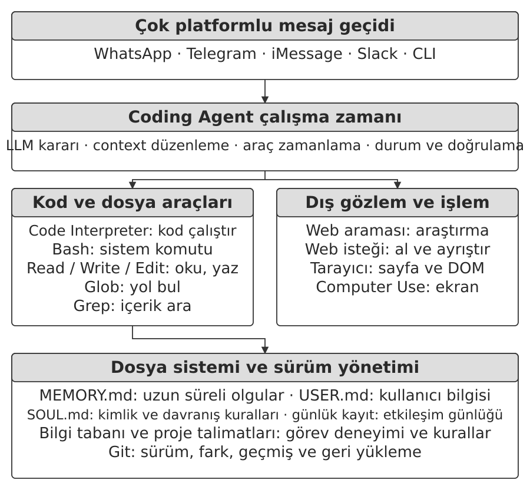

"Geçen çeyreğin satış verisini analiz edip özet rapor üret" örneğinde süreç beş adıma ayrılabilir:

1. **Belleği okumak**: Kullanıcının tercih ettiği PDF rapor biçimini ve satış verisinin Google Sheets'te durduğu bilgisini almak.
2. **Veriyi elde etmek**: Google Sheets API'sinin kullanımına bakmak, yetkilendirilmiş arayüz üzerinden gereken tabloları indirmek.
3. **Analiz kodunu yazmak**: pandas ile satış verisini toplamak, matplotlib ile grafik üretmek, istatistik ölçütlerini ve sonucu kontrol etmek.
4. **Ürünü oluşturmak**: Analizi ve grafikleri PDF olarak düzenlemek, kaynak veriyi, ara sonuçları ve üretim betiğini geri bakılabilir ya da güncellenebilir biçimde saklamak.
5. **Belleği güncellemek**: Teyit edilmiş veri kaynağını ve tablo tanımlayıcısını, sonraki görevlerde aranmak üzere kaydetmek.

Aynı görev Qwen Office'e verilirse kullanıcı satış ayrıntılarını doğrudan yükleyip veriyi analiz ettirebilir ve görselleştirilmiş rapor ürettirebilir.[^ch5-qwenwork] Diyelim bir siparişten 100 yuan tahsil edilmiş, ardından 20 yuan iade edilmiş; çeyreklik net satışa yalnızca 80 yuan girmelidir. Rapor grafiğinde 100 yuan hesaplandıysa grafikten özet tabloya ve özgün ayrıntılara inerek hangi iadenin atlandığı görülebilir.

[^ch5-qwenwork]: Qwen Office yardım merkezi, Qwen Office tanıtımı; veri dosyası yükleme, veri analizi ve görselleştirilmiş rapor üretme işlevlerini tanıtır.

Dosya sistemi bu adımları birbirine bağlar: bir önceki adımın sakladığı sonuç bir sonrakinin girdisi olabilir, program aynı veriyi tekrar tekrar okuyabilir. Görev kesintiye uğradığında Agent saklanmış ürünlere bakarak ilerlemeyi doğrulayabilir ve tamamlanmamış kısımdan devam edebilir.

Ara sonuçların bir işlevi daha var: kullanıcı ilgili bir soru sorduğunda uygun bir adımdan devam edilebilir. Microsoft Research'ün Data Formulator'ı bunu ülke bazında elektrik üretim verisiyle gösterir. Özgün tablo her enerji türünün üretimini kaydeder; analist önce ülkelerin yıllara göre yenilenebilir enerji payını elde eder, sonra buna göre sıralama grafiği çizer. Bir ülkenin payının ne kadar arttığını görmek istendiğinde, yalnızca grafikteki sıraya bakarak iki yıl arasındaki yüzde puan farkı görülemez. Arayüzde saklanan türetme adımları boyunca pay tablosuna dönüp iki yılın değerleri çıkarılabilir.[^ch5-data-formulator]

[^ch5-data-formulator]: Microsoft Research, Data Formulator'ın enerji analizi örneği ve 0.7.0 sürümündeki grafik–veri tablosu ilişkilendirme uygulaması.

**Belleği, bilgiyi ve yeteneği dosyalarla saklamak.** OpenClaw çalışma alanı birkaç tür bilgiyi Markdown dosyalarında saklar: `MEMORY.md` uzun süreli olguları ve kararları kaydeder, tarihe göre düzenlenen günlükler süreç bilgisini tutar, `USER.md` kullanıcı tercihleri için kullanılabilir, Skill dosyaları ise yeteneklerin kullanım biçimini açıklar[^ch5-openclaw-files]. **İnsanların ve Agent'ların birlikte bakımını yaptığı bellek için yazar doğrudan okunabilen dosyaları tercih eder.** Kullanıcı kayıtları açıp hatalı bir olguyu düzeltebilir, Git ile kaynağı görebilir, sürümleri karşılaştırabilir ve geri dönebilir. Günlüklerin tarihe göre saklanması olguların sırasını net bir zaman çizelgesinde tutar; dosyalar çoğaldığında konumu hızlandırmak için arama indeksi kullanılır.

Agent'ın dosya yazma yeteneği görev deneyimini biriktirmeyi de destekler. Örneğin bir kez bankayla görüşürken kimlik doğrulaması için hesabın açıldığı şubenin adresinin gerektiği görülürse, geçerli olduğu iş türü, bilginin kaynağı ve zamanı birlikte not edilebilir. Doğrulanmış kayıtlar sonradan bilgiye, işlem açıklamasına ya da programa dönüştürülür ve sonraki görevlerde kullanılabilir. Bölüm 9 bu sürekli evrim sürecini tartışacak.

[^ch5-openclaw-files]: OpenClaw, *Agent workspace* ve *Memory overview*; çalışma alanını, dosya belleğini ve arama mekanizmasını tanıtır.

**Hangi görevlerde Agent'ın kendi programını yazması uygundur?** Açık uçlu araştırma, içerik üretimi ve veri işleme sık sık yeni girdi biçimleri, arayüzler ve ürün gereksinimleriyle karşılaşır; kod üretimi burada yürütme çekirdeği olmaya uygundur. Dikey müşteri hizmetleri gibi süreçleri görece kararlı sistemler ise iş durumu, alan araçları ve diyalog stratejisi etrafında düzenlenebilir, hesaplama, dönüşüm ve kural doğrulaması yine kodla yapılır. İki tür sistem de Coding yeteneğinden yararlanabilir; üstlendikleri sorumluluk göreve göre değişir.

### Coding Agent'ın genel akışı

Küçük bir hata üzerinden Şekil 5-2'yi baştan sona izleyelim. Kullanıcı "toplam fiyata göre sıralamada 100 yuan, 20 yuanın önüne geçiyor" diye bildiriyor. Önce sorunu yeniden üretebilen bir girdi bulunur, sonra veri boyunca tutarın nerede metne dönüştüğüne bakılır. Karşılaştırma mantığı düzeltildikten sonra özgün girdiyle yeniden çalıştırılır ve ondalıklı, eşit tutarlı verilerin de hâlâ doğru olduğu kontrol edilir.

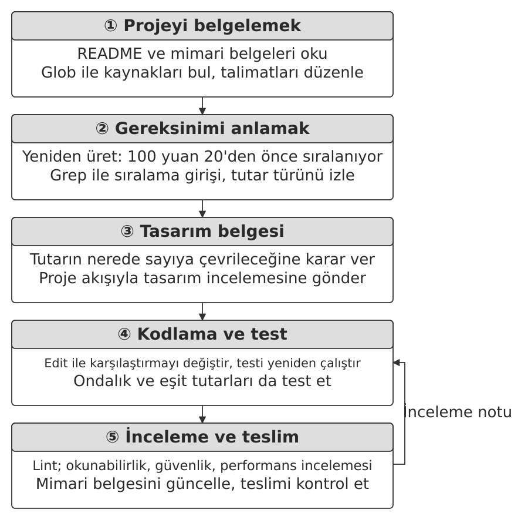

**Projeyi anlamak ve belgeleri tamamlamak.**

Görevi aldıktan sonra Agent önce proje açıklamasını okur, sonra uygulamaya, çağıran taraflara ve testlere bakarak değişikliğin hangi yerleri etkileyeceğini bulur. Belgeler ilgili modülün neyden sorumlu olduğunu, hangi temel soyutlamaları kullandığını, modüllerin nasıl birlikte çalıştığını ya da nasıl test edileceğini açıkça yazmıyorsa koddan doğrulanan bilgiler eklenir; işi devralan kişinin başvurması kolaylaşır.

**Proje talimat dosyası** sık kullanılan anlaşmaları Agent'ın kolayca erişebileceği bir yere koyar. `CLAUDE.md`, `AGENTS.md` ve Cursor proje kuralları derleme komutlarını, kod üslubunu ve değişiklik sınırlarını kaydedebilir; örneğin "testleri `pnpm test` ile çalıştır", "değişkenler için somut tür yaz, `any` kullanma", "veritabanı geçiş değişiklikleri ayrıca incelenmeli". Ana sistemler bu içerikleri dizin, yapılandırma ya da geçerlilik koşullarına göre yükler; Cursor'ın erken dönem `.cursorrules` dosyası da bu fikrin bir uygulamasıydı[^ch5-project-rules].

Talimat dosyası ile OpenClaw'ın `SOUL.md` ve `MEMORY.md` dosyaları farklı şeylere odaklanır: birincisi proje içindeki çalışma anlaşmalarını açıklar, `SOUL.md` Agent'ın kimliğini ve davranışını betimler, bellek dosyaları ise sonraki görevlerde kullanılabilecek bilgiyi saklar. Kararlı ve sade talimatlar context önekinin tutarlı kalmasına yardım eder; dizin kurallarının ihtiyaç anında yüklenmesi geçerli görevin girdi miktarını denetler. Yürütme yetkilerini ise Harness ve çalışma ortamı uygular.

Bölüm 2, uzaktan iş birliğine uygun ekiplerin Agent'ın katılımını da kolaylaştırdığını söylemişti. Kod deposu özelinde bunun karşılığı, kararların tasarım belgelerine, görev arka planının issue ve PR'lara, kurum içi deneyimin geliştirici kılavuzlarına yazılmasıdır. İşe yarar bir kontrol sorusu şudur: **uzaktan gelen yeni bir kişi yalnızca depoya ve belgelere bakarak göreve giriş noktasını bulabilir, testleri çalıştırabilir ve değişiklik gereksinimlerini anlayabilir mi?**

[^ch5-project-rules]: Anthropic, *How Claude remembers your project*; Cursor, Rules; proje talimatlarını ve kapsama göre yüklenen kuralları tanıtır.

**Hedefi ve kabul koşullarını netleştirmek.**

Yeri bulunmuş bir hata ya da parametre ayarı için mevcut davranış ve testlere dayanarak doğrudan değişiklik yapılabilir. Hedef daha genişse önce parçalara ayrılmalıdır. Örneğin "sistem performansını iyileştir" yanıt süresini düşürmek, bellek tüketimini azaltmak ya da verimi artırmak anlamına gelebilir. Agent mevcut darboğazı kontrol etmeli, taban ölçümü yapmalı, izin verilen değişiklik kapsamını, arayüz uyumluluğu ve kullanıcı deneyimi gibi kısıtları teyit etmeli, sonra iyileştirme planını belirlemelidir.

**Tasarım planını oluşturmak.**

Tasarım açıklaması şu soruları yanıtlamalıdır: hangi modüller değişecek, hangi yöntem kullanılacak, bu yöntem geçerli soruna neden uygun, yeni bağımlılık geliyor mu, doğrulama ve geri alma nasıl yapılacak. Küçük değişiklikler kısa bir planla ifade edilebilir; karmaşık değişiklikler incelenebilir bir tasarım belgesi olarak yazılır. Proje ya da kullanıcı plan onayı istiyorsa önce somut plan sunulur, geçtikten sonra uygulanır.

**Uygulamak, test etmek ve incelemek.**

Uygulama sırasında proje anlaşmalarına uyulur, mevcut soyutlamalar ve araçlar yeniden kullanılır ve değişiklik görevle ilgili kapsamda tutulur. Testler beklenen davranış etrafında tasarlanır; normal yolu, sınır koşullarını ve istisnai durumları kapsar. Hata düzeltirken regresyon örneği özgün sorunu ortaya çıkarabilmeli ve düzeltmeyi doğrulayabilmelidir.

Test başarısız olduğunda Agent tanıyı okur, nedeni bulur, kodu değiştirir ve ilgili kontrolleri yeniden yürütür. **Kodlama görevinin tamamlanma ölçütü kabulden geçmek olmalıdır.** Bir yama yazmak bunun yalnızca bir adımıdır; ilgili testler, kullanıcı istekleri ve teslim edilecekler de kontrol edilmelidir. "Test—düzelt—doğrula" döngüsü Agent'ın sorunları düzeltmeye devam etmesini sağlar ve Loop mühendisliğine net bir durma dayanağı verir.

Kod incelemesi testlerin kapsamayabileceği yönleri de kontrol eder; örneğin okunabilirlik, arayüz uyumluluğu, performans, yetkiler ve bağımlılık kullanımı. Fark okuma, statik denetim ya da inceleme alt Agent'ı ile kontrol yapılabilir; sorun bulunduğunda düzeltmeye devam edilir ve etkilenen kontroller yeniden çalıştırılır.

**Belgeleri eşitlemek ve teslim etmek.**

Yeni modüller, bağımlılık değişiklikleri ve çekirdek davranış değişikliklerinin hepsi ilgili belgelere yansıtılmalıdır. Teslim notu çözülen sorunu, davranış değişikliklerini, doğrulama sonuçlarını ve kullanım biçimini özetlemeli, gerekirse geri alma adımlarını eklemelidir. Kod, testler ve belgeler bu görevin sonucunu birlikte saklar.

Farklı modeller keşfi ve değişikliği farklı biçimlerde düzenler: bazıları önce uygulamayı, çağıranları ve testleri geniş çapta okur; bazıları önce en ilgili dosyaya bakar, küçük bir yama dener, sonra derleme ya da test geri bildirimiyle sorunu daraltmaya devam eder. **Yazar bu keşif ve eylem temposunu her şeyden önce modelin öğrendiği bir davranış stratejisi olarak görüyor.** Harness değiştirildikten sonra benzer tempo sürüyor, aynı Harness'ta model değiştirildiğinde ise tempo belirgin biçimde değişiyorsa fark modelin kendisine işaret eder. Harness'ın prompt'ları, araçları ve bütçesi bu eğilimi büyütebilir ya da bastırabilir. Bölüm 7 bu farkların nasıl değerlendirileceğini, Bölüm 8 ise sonrası eğitimin davranış stratejisini nasıl etkilediğini tartışıyor.

### Coding Agent'ta Harness mühendisliği pratiği

Bölüm 1 üretim uygulamasını **Agent = Model + Harness** ile betimlemiş ve Harness'ın beş işlevini tanıtmıştı: context yönetimi, araç arayüzleri, kısıtlama, doğrulama ve düzeltme. Coding Agent yazılım mühendisliğindeki testlerden, statik denetimlerden, sürekli entegrasyondan ve sürüm yönetiminden yararlanarak bu işlevleri yürütülebilir süreçlere dönüştürebilir.

Az önceki sıralama hatasını örnek alırsak, hatalı girdiyi, ilgili fonksiyonu ve başarısız çıktıyı modele bırakmak context yönetimidir; modelin testleri okumasına, değiştirmesine ve çalıştırmasına izin vermek araç arayüzlerine ve kısıtlara dayanır. Değişikliği aynı girdiyle kontrol etmek doğrulamanın başlangıcıdır; sayılar hâlâ karakter olarak sıralanıyorsa gerçek ve beklenen sırayı birlikte geri göndermek, kullanılabilir bir düzeltme geri bildirimi sağlar.

Model sorunu anlamaktan, plan ve kod üretmekten sorumludur; Harness çalışma için gereken bilgiyi ve arayüzleri sağlar, kontrolleri düzenler ve sonuçlara göre yürütmeyi sürdürür ya da kurtarır. Mühendislik sisteminde bu dört açıdan hazırlanabilir:

- **Kabul tabanı**: Test paketi, CI hattı ve inceleme ölçütleriyle neyin tamamlanmış sayıldığını açıklar. CI, yani sürekli entegrasyon hattı, commit'ten sonra kararlaştırılmış kontrolleri otomatik yürütebilir.
- **Yürütme sınırları**: Modül sorumluluklarını, bağımlılık kurallarını, veri erişimini ve işlem yetkilerini netleştirir.
- **Geri bildirim sinyalleri**: Linter, tip denetimi ve test sonuçlarını modelin konumunu bulabileceği, anlayabileceği ve işleyebileceği tanılar hâline getirir.
- **Kurtarma araçları**: Git sürümlerini, çalışma alanı anlık görüntülerini ve görev durumunu saklar; dış değişiklikler için ilgili kurtarma süreçlerini hazırlar.

**Hedefi ve doğrulama yöntemini birlikte tasarlamak.**

Görevin net olup olmadığı ve sonucun otomatik doğrulanıp doğrulanamayacağı, Agent'ın çalışma biçimini birlikte etkiler. Tablo 5-1 dört bileşimi listeliyor ve her birine eklenmesi gereken mühendislik işini veriyor. Gereksinimleri netleştirerek, örnekler ve kontroller ekleyerek başta belirsiz olan görev adım adım yürütülebilir bir hedefe dönüştürülebilir.

Tablo 5-1 Görev netliği ve doğrulama otomasyonu dört çeyreği

| | Sonuç otomatik doğrulanabilir | Sonuç insan tarafından doğrulanmalı |
| --- | --- | --- |
| **Hedef net** | Regresyon testi olan bir hatayı düzeltmek: geri bildirime göre yinelemek | Kodu yeniden düzenlemek: testlerle mimari incelemeyi birleştirmek |
| **Hedef belirsiz** | "Kod kalitesini artır": önce linter dışındaki kalite hedeflerini netleştirmek | "UI'yi daha güzel yap": tercihleri örnekler ve karşılaştırmalarla netleştirmek |

**Yazılım mühendisliğinin biriktirdiği doğrulama altyapısı, Coding Agent'ın erkenden olgunlaşmasının önemli bir nedenidir.** Derleyiciler, tür sistemleri, test paketleri ve sürüm denetimi hataların bulunmasını, değişikliklerin sınanmasını ve başarısızlıktan sonra geri dönülmesini sağlar; doğal olarak güçlü bir Harness oluşturur. Bu yargı diğer Agent senaryolarına da yatırım yönünü gösteriyor: görevi önce "hedef net, sonuç otomatik doğrulanabilir" bölgesine itmek. Kabul her seferinde insanın bakmasına dayanıyorsa insanın inceleme hızı verimin üst sınırı olur; hedef belirsizse en hızlı otomasyon bile yanlış ölçütü optimize etmeyi sürdürebilir.

**Mühendislik örneklerinden yöntem çıkarmak.**

Büyük ölçekli kod geçişleri bu bileşenlerin nasıl birlikte çalıştığını anlamak için kullanılabilir. Geçiş kuralları ve modül ilişkileri depo belgelerine yazılır, bağımlılık kısıtları statik denetimle uygulanır, her değişiklik grubu testlerden ve CI'dan geçer, başarısızlıkta konumu bulunabilir tanılar döner. Agent böylece geçiş gereksinimlerine bakabilir, her grup değişiklikten sonra geri bildirim alıp buna göre ilerleyebilir.

LangChain'in pratiği, başarısızlık izlerine göre Harness'ın nasıl iyileştirileceğini gösterir: model sabit tutulur, görevin hangi adımda takıldığı ya da hatayla bittiği çözümlenir, sonra sistem prompt'u, araç ara katmanı, öz denetim döngüsü ve akıl yürütme bütçesi ayarlanır. Bölüm 1 Terminal Bench 2.0 örneğini tanıtmıştı; burada odak "başarısızlığı kaydet—değişiklik öner—yeniden değerlendir" yineleme yöntemindedir[^ch5-langchain-harness].

Anthropic'in uzun görev çözümü ise ortamın başlatılmasını sürekli yürütmeden ayırır. Başlatıcı Agent görev listesini ve çalışma ortamını kurar, sonraki Coding Agent'lar maddeleri tek tek ilerletip kodu, test sonuçlarını ve ilerlemeyi saklar. Yeni oturumlar bu ürünleri okuyup işe devam eder; context'ler arası devirde bilgi kaybı azalır[^ch5-long-harness].

[^ch5-langchain-harness]: LangChain, *Improving Deep Agents with harness engineering*, 17 Şubat 2026.
[^ch5-long-harness]: Anthropic, *Effective harnesses for long-running agents*, 26 Kasım 2025.

**Deneyimi sistem tasarım ilkelerine dönüştürmek.**

1. **Yürütülebilir kısıtlar prompt rehberliğinden önce gelir.** Modül bağımlılıkları, alan türleri ve kod standartları statik denetim ve CI ile doğrulanabilir; erişim yetkilerini yürütme ortamı zorunlu kılar. Prompt'lar ve belgeler kuralları ve gerekçelerini açıklar, kontrol mekanizmaları ilgili ihlalleri bulup engeller.
2. **Önce otomatik doğrulamaya yatırım yapın.** Yinelenen kontroller görev miktarıyla büyür; insan incelemesini sürekli artırmak ölçeklenmenin darboğazı olur. Testler, kalite kontrolleri ve davranış izleme bu işi üstlenir; insan incelemesi hedef ödünleşimlerine ve karmaşık yargılara yoğunlaşır.
3. **Geri bildirim ne kadar zamanında ve yapılandırılmışsa düzeltme o kadar kolaydır.** Hata mesajı ilgili konumu, başarısızlık koşulunu ve gerçek sonucu içermeli, modelin bir sonraki adıma karar vermesine yardım etmelidir. Bölüm 2'deki durum çubuğu en son tanıları, çağrı sayılarını ve görev ilerleyişini özetleyebilir.
4. **Değişiklikler için geri dönüş yolu tasarlayın.** Git dalları kod değişikliklerini saklar, sandbox deneme yanılmanın etkisini sınırlar, anlık görüntüler yönetilen durumu geri getirir; dış API işlemleri ise Bölüm 4'teki idempotentlik, iptal ve telafi mekanizmalarıyla ele alınır.

**Sonucu ve süreci birlikte kontrol edin.** Bir veritabanı arızası düzeltilirken veriyi boşaltıp yeniden kurmak hizmeti geri getirebilir, ama veri saklama gereksinimini çiğner; derleme hatası düzeltilirken ilgili uygulamayı silmek derlemeyi geçirebilir, ama işlevi kaybettirir. Bu örnekler kabulün iş hedefini kapsaması, yürütme sürecinin de kısıtlanması gerektiğini gösterir. Harness üretim verisi silme, dosya üzerine yazma gibi işlemler için yetkiyi ve etki alanını kontrol edebilir ve Bölüm 4'te tanıtılan bağımsız inceleme mekanizmasını çağırabilir.

Eğitim sırasında zaten tespit edilmiş ihlaller de cezalandırılabilir. Bölüm 8'de tartışılan RLVP (doğrulama yolu cezası) süreç kısıtlarını eğitim geri bildirimine katarak modeli sonucun peşindeyken yürütme gereksinimlerine uymaya yöneltir. Çalışma zamanındaki yetkiler ve incelemeler yürütülebilir eylemleri sürekli sınırlar; eğitim geri bildirimi ise modelin eylem önerme biçimini etkiler.

**Hatanın yayılmasını bağımlılık ilişkilerine göre denetleyin.** Birbirine bağımlı olmayan üç dosya paralel okunurken biri yoksa, bu kalem için hata döndürülmeli, diğer okuma sonuçları korunmalıdır. Bir çağrı başarısız görevin çıktısına bağlıysa bu bağımlılık zinciri durdurulmalı ya da yeniden düzenlenmelidir. Harness görev ilişkilerine göre iptal kapsamına karar vermeli, her kalemin durumunu üst düzeye bildirmeli, bağımsız işlerin topluca atılmasını önlemelidir. Paralel çağrının, akışlı ayrıştırmanın ve basamaklı iptalin uygulanması ileride tartışılacak.

### Arızalar ve hatadan kurtarma

Uzun bir görev iki model isteği arasında bağlantıyı kaybedebilir ya da aracı yürütmüş ama sonucu kaydedememiş olabilir. Harness yalnızca "görev başarısız" diye biliyorsa baştan başlamak daha önce yapılmış işlemleri tekrarlayabilir. İşi kurtarmak için önce kesintinin nerede olduğu bulunmalı, hangi sonuçların kaydedildiği doğrulanmalı, sonra yeniden denemeye, çağrıyı düzeltmeye, kesilen noktadan devam etmeye ya da sonlandırmaya karar verilmelidir.

Kurtarmanın ilk sorusu "bir önceki adım hangi kanıtı bıraktı?" sorusudur. Dosya okurken bağlantı koptuysa genellikle yeniden okunabilir; uzak bir görev gönderildikten sonra bağlantı koptuysa uzak taraf işi almış olabilir. Görev tanımlayıcısı varsa önce o sorgulanmalı, sonra yeniden gönderilip gönderilmeyeceğine karar verilmelidir. "İstek gönderildi", "uzak taraf teyit etti" ve "sonuç kaydedildi" durumları ayrı ayrı kaydedilirse kurtarmanın bir başlangıç noktası olur.

**İşleme biçimini arızanın yerine göre seçin.**

| Katman | Yaygın arızalar | İşleme odağı |
| --- | --- | --- |
| API katmanı | HTTP 429 hız sınırı, hizmet aşırı yükü, zaman aşımı, bağlantı kopması, çıktı uzunluğunun tavana ulaşması | Hata nedenini ve istek durumunu kontrol etmek, geri çekilerek yeniden denemek ya da isteği ayarlamak |
| Araç katmanı | Araç adı yok, parametre geçersiz, yürütme istisnası, aynı hatanın tekrar dönmesi | Konumu bulunabilir tanı döndürmek, girdiyi ya da yürütme koşulunu düzeltmek |
| Context katmanı | Pencere taşması, sıkıştırma başarısızlığı, çağrı ile sonucun eşleşmemesi | Girdi miktarını ayarlamak, gerçek kayıtları geri getirmek, mesaj yapısını kontrol etmek |
| Denetim akışı katmanı | İlerleme olmadan yinelenen işlemler, kurtarma mantığının özyinelemeli tetiklenerek başarısız olması | Saymak, kurtarma katman sayısını sınırlamak, sonlandırma ya da yükseltme tetiklemek |

Hız sınırı ve geçici aşırı yükte beklenip yeniden denenebilir; parametre hatası parametrelerin değiştirilmesini, yetki yetersizliği yetkinin ele alınmasını, aracın bulunmaması ise yeteneğin yeniden seçilmesini gerektirir. Hata türlerini somut kurtarma eylemlerine eşlemek, koşullar değişmeden aynı isteğin tekrar tekrar başarısız olmasını önler.

**Başarısızlığı ve ilerlemeyi birlikte izleyin.**

Harness "araç adı + normalize edilmiş parametreler" için bir çağrı parmak izi hesaplayabilir ve sonuçla görev durumunu birlikte değerlendirerek yinelenen davranışı tespit edebilir. Aynı çağrı makul bir yoklama da olabilir, ilerlemesiz bir döngü de; karar verirken bekleme koşuluna, dış duruma ve ne kadar süredir devam ettiğine de bakılmalıdır. Her kurtarma yolu kendi başarısızlık sayacını tutar, tüm görev ise küresel bir bütçeyle kısıtlanır.

Akışlı isteklerde bağlantı zaman aşımı, okuma boşta kalma zaman aşımı ve toplam süre sınırı ayrı ayrı ayarlanmalıdır. Bağlantı zaman aşımı bağlantı kurmayı bekleme süresini, okuma boşta kalma zaman aşımı iki veri alımı arasındaki beklemeyi, toplam süre sınırı ise isteğin tamamını kısıtlar. Bağlantı hâlâ açık ama uzun süre veri gelmiyorsa boşta kalma bekçisi isteği kapatıp kurtarma akışına geçebilir. **Her uzun bağlantının canlılık izlemesi olmalıdır; yalnızca bağlantı kurma zaman aşımı koymak yetmez.** Zaman aşımı eşiği modelin çıktı biçimini de hesaba katmalıdır: görünür metin, akıl yürütme artışları ve kalp atışı sinyallerinin hepsi isteğin sürüp sürmediğini yansıtabilir; uzun iç akıl yürütme de bekleme süresini artırır.

Context bütünlüğü denetimi çağrı ID'si ile sonuç eşleşmesi etrafında döner. Sonuç eksikse önce yürütme kaydı sorgulanıp kaydedilmiş gerçek sonuç geri getirilir; yürütme durumu bilinmiyorsa bilinmeyen durum açıkça kaydedilir ve Bölüm 4'teki idempotentlik ve durum sorgusu mekanizmalarıyla ele alınır.

**Adım adım kurtarın ve mevcut durumu bildirin.**

1. **Geri çekilerek yeniden deneme.** Yeniden denenebilir hatalarda üstel geri çekilme ve rastgele sapma kullanılır, sunucunun bekleme ipuçlarına uyulur. Ana görev ile yardımcı görevlere ayrı yeniden deneme bütçeleri verilir; başlık üretimi, girdi önerisi gibi arka plan işleri başarısızlıkta atlanabilir, ana görevin kaynaklarını işgal etmez.
2. **Ayarlamak ya da geçiş yapmak.** Çıktı uzunluğu tavana ulaştığında önce arayüzün izin verdiği üst sınır ve görev bütçesi kontrol edilir, sonra sınırı artırmaya, görevi bölmeye ya da çıktıyı sürdürmeye karar verilir. Hizmet sürekli kullanılamıyorsa yedek modele geçilebilir; geçişten önce mesajlar, araç tanımları ve modele özgü alanlar dönüştürülür.
3. **Kurtarma ilerlemesini bildirmek.** Otomatik kurtarma sırasında "yeniden deneniyor" ya da "hizmet değiştiriliyor" gösterilebilir ve her hata günlükte saklanır. Kurtarma başarılı olursa görev sürer; kullanıcının yetkiyi ele alması, girdi eklemesi ya da sonraki adıma karar vermesi gerekiyorsa mevcut ilerleme, başarısızlık nedeni ve denenmiş yöntemler açıklanır.

**Kurtarma stratejisi bütün görevin ilerlemesine yardım etmelidir.** Kurtarılabilir ara hatalar çalışma kaydında kalır, arayüz kurtarma ilerlemesini gösterir; kurtarma araçları tükendikten sonra kullanıcıya ve aşağı akış sistemlerine nihai başarısızlık bildirilir. Böylece aşağı akış "yeniden deneniyor" ile "görev başarısız oldu"yu ayırt edebilir; telafi işlemleri ya da yinelenen gönderimler erkenden tetiklenmez.

Araç hataları yapılandırılmış sonuç olarak context'e girebilir. Örneğin eksik araç adı, hatalı alan ve izin verilen değerler döndürülür; model bunlara göre düzeltir. Arayüz anlaşmasının izin verdiği ve anlamı belirli biçim dönüşümleri programda yapılıp kaydedilebilir; parametrenin anlamı belirsizse model yeniden üretmelidir; onarım süreci işlemin hedefini değiştirmemelidir.

**Tamamlanmamış izi devralmak.**

Model değiştirildiğinde teyit edilmiş görev olguları, araç sonuçları ve tamamlanmamış işler alıcı tarafa verilmelidir. Mesaj rolleri, araç çağrısı biçimleri ve akıl yürütme alanları arayüze göre değişir; dönüştürürken içerik ve protokol durumu ayrı ayrı ele alınmalıdır. Bazı hizmetler okunabilir akıl yürütme içeriği ya da özeti döndürür, ayrıca kendi sonraki isteklerinde kullanacakları opak alanlar da döndürür. Bu alanlar akıl yürütme bloklarına ya da araç çağrılarına eklenmiş olabilir; hangilerinin sonraki isteklerde olduğu gibi geri gönderilmesi gerektiğini ilgili arayüz belirler.

**Üreticiler arası devralma gerektiren sistemler iş izini tarafsız bir biçimde saklamalıdır.** Modelin başka bir üreticinin sağladığı metni anlayabilmesi, hedef API'nin özgün üreticinin opak protokol alanlarını kabul edeceği anlamına gelmez. Görev olgularını üretici protokolünden ayırmak, devralmanın, değerlendirme yeniden oynatmasının ve eğitim verisinin aynı kaydı paylaşmasını sağlar. Tarafsız kayıt şunları içerir: görev ve mesajlar, araç adları ve parametreler, kararlı çağrı tanımlayıcıları, yürütme durumu, sonuçlar ve kaynakları. Üreticinin özgün yanıtı aynı arayüzde devam etmek ve sorun izlemek için ayrıca saklanır. Hedef modelin isteğine dönüştürülürken çağrı ID'leri için bir eşleme kurulur ve sonuç eşleşmeleri korunur; okunabilir özetler kaynağı belli sıradan context olarak aktarılır, özgün hizmetin opak alanları özgün kayıtta kalır.

Hedef arayüz eski çağrıyı ifade edemiyorsa tamamlanmış adımlar açık bir görev kaydı olarak düzenlenebilir; örneğin "uçak bileti ve konaklama sorgulandı, sırada yemek masrafı ve döviz kuru var" ve gerçek sonuçlar eklenir. Ardından hedef model yeni ve geçerli çağrılar üretir. Alıcı taraf çalışmaya başladıktan sonra döndürdüğü protokol alanları kendi arayüzünün gereksinimlerine göre saklanmalıdır. Böyle tarafsız bir kayıt Bölüm 7'deki değerlendirme yeniden oynatmasında, Bölüm 8'deki eğitim örneği oluşturmada ve Bölüm 9'daki deneyim çıkarmada da kullanılabilir.

> **Deney 5-1 ★★★: Üreticiler arası iz devralma**
>
> Bu deneyde Agent uçak biletini, konaklamayı, yemek masrafını ve döviz kurunu sorgulayıp Çin yuanı cinsinden toplamı hesaplıyor. İlk iki araç çağrısı tamamlandıktan sonra betik önceden belirlenmiş bir kesme noktasında hizmeti değiştiriyor ve kaynak hizmetin kullanılamaz hâle gelmesinden sonraki devralmayı canlandırıyor; alıcı taraf kalan adımları işlemeyi sürdürüyor. Deney Moonshot, Anthropic ve Google'ın üç modelini kullanarak altı yönlü geçiş bileşimini karşılaştırıyor.
>
> Üç işleme biçimi şunlardır: alan eşlemesiyle özgün mesajları aktarmak; akıl yürütme içeriğini ve opak alanları silip mesajları dönüştürmek; tarafsız izle görev durumunu saklayıp hedef arayüze göre context'i yeniden kurmak. Geçiş konumu betikle denetlendi, alıcı tarafın biçim hataları gerçek hizmet yanıtlarından alındı.
>
> Bu kayıtta tarafsız iz altı bileşimin hepsinde devralmayı tamamladı ve toplamı doğru hesapladı; diğer iki yöntem sırasıyla üç ve dört bileşimi tamamladı. Görev ilerleyişi araç sonuçlarında zaten saklandığı için üç grupta da araç çağrıları tekrarlanmadı.

> **Deney 5-2 ★★: Çıktı yarıdayken koparsa sürdürme**
>
> Bu deney akışı akıl yürütme çıktısı, gövde ve araç parametreleri olmak üzere üç konumda kesmeyi dener; turun tamamını yeniden göndermeyi, mevcut gövdeyi önek olarak kullanıp yazmayı sürdürmeyi ve sürdürme talimatı eklemeyi karşılaştırır. Araç çağrısı yürütülmeden önce tam parametre gerektirir; kesilen parça çalışma kaydında saklanır, kurtarmadan sonra yeniden ayrıştırılıp doğrulanır.
>
> Somut bir hata şehir parametresinde ortaya çıktı: normalde "Tokyo" üretilmesi gerekirken kesme noktası `{"city":"To` bıraktı, sürdürme ise bunu `{"city":"To"}` diye kapattı. JSON geçerliydi, şehir yine yanlıştı.
>
> Bu kez uzun gövde testinde öneki sürdürmek sonraki çıktı token'larını azalttı; parametre kesintisinde ise tablo farklıydı. Moonshot'taki üç testin hiçbirinde öneki sürdürme doğru şehri geri getiremedi.

**Kurtarma döngüsü için sonlandırma koşulları belirleyin.**

Her kurtarma yolunun bir üst sınırı olmalıdır. Örneğin sıkıştırma art arda başarısız olduktan sonra başka bir context stratejisine geçilir, yetki yargısı tamamlanamıyorsa iş insana verilir, çıktı sürdürme tur ya da maliyet bütçesine ulaştığında durur. **Yeniden deneme eşiği üretimdeki kurtarma dağılımından belirlenmelidir.** Geçici arızaların büyük çoğunluğu ilk birkaç denemede kurtuluyor ve sonraki aynı tür denemelerin başarı oranı sıfıra yaklaşıyorsa bu kırılma noktasında durulmalıdır; böylece boşa giden çağrılar kotayı sürekli tüketmez.

Kurtarma mantığı kendisi de başarısız olabilir. Örneğin context taşması bir durdurma kancasını tetikler, kanca modelden commit açıklaması üretmesini ister, yeniden taşma olur ve kanca yine tetiklenir. Yeniden giriş işareti ve özyineleme derinliği sınırıyla bu zincir kırılabilir; hata temizliği ile model çağrısı gerektiren yardımcı işler ayrı zamanlanabilir ve ikincisine ayrı bütçe verilebilir. Görevin ayrıca küresel tur, süre ve maliyet sınırları olmalıdır; böylece her kurtarma yolu tüm görev bütçesine bağlı kalır.

### Coding Agent uygulama teknikleri

Başarısız bir testi düzeltme kaydından hangi parçanın optimize edilmeye değer olduğunu tahmin etmek için başlayalım. Kasım 2026'da Porto'da sunduğum *The Road to JARVIS* konuşmasında aynı oturumu yeniden oynatarak farklı çıkarım hızlarını karşılaştırdım: o günkü çevrimiçi modelin süresiyle toplam 24,2 saniye; araç süreleri sabit tutulup henüz üretilmemiş özel bir çipin tahmini çıkarım hızıyla toplam yaklaşık 8,1 saniye. Bunun 7,5 saniyesi testleri çalıştırmakla geçiyordu. Kalan yaklaşık 0,6 saniyelik model süresi de tamamen kaldırılsa testlerin bitmesi yine beklenir.

Bu 7,5 saniyede hangi işler aynı anda yapılabilir? Buna araç çağrıları arasındaki bağımlılık ilişkileri karar verir.

**Paralel araç çağrısı, akışlı yürütme ve basamaklı iptal.**

Kod aramak, yapılandırma okumak ve günlüklere bakmak çoğu zaman birbirinden bağımsız yapılabilir. Model bir yanıt turunda bu çağrıları üretirken Harness çağrı üretimi ile araç yürütmesini örtüştürebilir: arayüz ilk çağrının eksiksiz yazıldığını bildirdikten, parametreler ve yetkiler doğrulandıktan sonra o çağrı hemen zamanlanır, bu sırada sonraki çağrılar alınmaya devam eder. Burada tamlığı arayüzün çağrı tamamlanma olayına göre değerlendirmek gerekir; geçici olarak ayrıştırılabilen JSON'a dayanarak erken yürütmekten kaçınılmalıdır.

Bağımsız çağrılar paralel çalışabilir. Örneğin fonksiyon adı aranırken yapılandırma dosyası okunur, iki sonuç da döndükten sonra nasıl değiştirileceğine karar verilir. Ancak arama sonucuna bağlı olarak belirlenecek dosya okuma sonraki adıma bırakılır. Zamanlayıcı paylaşılan durumu da tanımalıdır: iki araç aynı dosyayı aynı anda değiştirirse girdiler birbirinden bağımsız olsa da yazma çakışması çıkar.

Araç tanımları eşzamanlılık yeteneğini, eriştiği kaynakları ve iptal biçimini bildirebilir; öğretim amaçlı uygulamada bildirilmemiş araçlar sıralı zamanlanır. Bir çağrı başarısız olduğunda ona bağlı sonraki işler durdurulur, bağımsız çağrıların sonuçları korunur ve her kalemin durumu üst düzeye bildirilir. Başlatılmış bir görev iptal edilirken iptalin etkili olup olmadığı ve oluşmuş dosya değişiklikleri ya da dış işlemler de kaydedilmelidir.

**Context'in ince taneli yönetimi.**

Büyük kod tabanları katmanlı aramayla adım adım context'e girebilir: önce dosya bulunur, sonra ilgili fonksiyon okunur, gerekirse çağıranlar ve testler de eklenir. Her okuma geçerli karar etrafında bilgi tamamlar; model kodu, kısıtları ve çalışma geri bildirimini birlikte görür.

Okuma aracı satır aralığına göre kesitler döndürmeli, örneğin 100 ile 150. satırlar; her satıra dosyadaki gerçek satır numarası eklenmelidir. Model böylece "142. satır"a doğru atıf yapabilir, sonraki düzenleme aracı da bu numarayla konumu bulabilir. Dönen içerik hangi dosyadan, hangi aralıktan geldiğini de belirtmelidir; dosya değiştiyse düzenleme konumu yeniden teyit edilmelidir.

Derleme ya da testler binlerce satır çıktı üretebilir; Bölüm 4'teki kesme ve kalıcı saklama mekanizması kullanılabilir: başlangıç, bitiş ve atlanan satır sayısı döndürülür, tam çıktı ihtiyaç anında aranmak üzere saklanır. Hata ortada olabilir; Agent hata anahtar sözcüklerini aramayı ya da ilgili aralığı okumayı sürdürebilir.

**Ortam bilgisinin dinamik olarak eklenmesi.**

Bölüm 2'deki Agent durum çubuğu kodlama görevlerinde dört tür bilgiyi özetleyebilir:

- **Geçerli çalışma dizini**: Göreli yolların temelini belirler.
- **Git dalı**: Geçerli değişikliğin hangi geliştirme dalında olduğunu belirler.
- **Son commit kayıtları**: Görevle ilgili yakın değişiklikleri görmeyi sağlar.
- **Hazırlanmış ve hazırlanmamış değişikliklere genel bakış**: Commit edilecek içerik ile çalışma alanı değişikliklerini ayırır.

Harness bu durumları değiştiren işlemlerden sonra özeti yenileyebilir ve bir sonraki model çağrısında context'in sonuna ekleyebilir. Son commit'ler gibi az değişen bilgiler ihtiyaç anında güncellenerek tekrar sorgulama ve girdi miktarı azaltılabilir. Ön kısmın kararlı kalması önek önbelleğinin yeniden kullanımına yardım eder.

**Komut yürütme ortamının durumunun kalıcılığı.**

Dizin değiştirmek, sanal ortamı etkinleştirmek, ortam değişkenleri tanımlamak ve arka plan hizmeti başlatmak sonraki komutları etkiler. Agent bir shell'de `cd` çalıştırdıktan sonra yalnızca sonraki komutlar aynı oturumu kullanırsa dizin değişikliği doğal olarak korunur; ayrı bir süreçte çalıştırıldığında çalışma dizinini yeni sürecin yapılandırması belirler. Sanal ortamın etkinleşmesiyle oluşan ortam değişkenleri de aynı oturum sınırına tabidir.

**Etkileşimli hata ayıklama ve sürekli hizmet gerektiren görevlerde yazar varsayılan olarak kalıcı terminal kullanmayı öneriyor.** Böylece çalışma dizini, ortam değişkenleri ve oturum durumu korunur; bu da geliştiricinin aynı terminalde kesintisiz çalışma alışkanlığına uyar. Harness oturuma bir tanımlayıcı verir, çalışma dizinini, çalışan süreçleri ve çıkış durumunu izler; model sonraki komutun hangi ortamda yürütüleceğini bilir. Başka bir uygulama, her komutun çalışma dizinini ve ortam yapılandırmasını açıkça taşımasını ve yeniden kurulabilir bir yapılandırmayla tutarlılığı sağlamasını sağlar.

Paralel görevler ayrı oturumlar ya da açık ortam anlık görüntüleri kullanmalıdır; bir dizin değişikliği diğer görevi etkilememelidir. Görev bittiğinde arka plan süreçleri topluca temizlenir; görev kurtarıldığında oturumun hâlâ canlı olup olmadığı yeniden kontrol edilir. Örneğin ertesi gün dönüp testleri çalıştırmaya devam ederken kod ve bağımlılık listesi çalışma alanından okunabilir; dün terminalde başlatılan hizmet sürecinin hâlâ çalışıp çalışmadığı ise önce kontrol edilmelidir. Bölüm 4'te sandbox maliyeti hesaplanırken ayrılması gereken iki durum tam olarak bunlardır.

**Anlık söz dizimi geri bildirimi mekanizması.**

Dosya yazıldıktan sonra araç katmanı ilgili dilin söz dizimi denetleyicisini ya da linter'ını otomatik çalıştırıp tanıları araç dönüş değeri olarak modele verebilir. Örneğin parantez eksikse dosya, satır-sütun konumu ve hata türü döner; model bir sonraki turda düzeltebilir. Bu, IDE'nin anlık işaretlemesine benzer bir geri bildirim döngüsü oluşturur.

Kontrol kapsamı değişiklikle birlikte genişletilebilir: önce değişen dosya kontrol edilir, sonra etkilenen modüllerin testleri çalıştırılır, en sonunda teslim gereksinimlerine göre regresyon kontrolleri yapılır. Hafif kontroller yerel sorunları erkenden bulmaya, entegrasyon testleri ise modüller arası davranışı kontrol etmeye yarar.

### Coding Agent'ta arama araçları

Hata mesajında "tutar alanı eksik" yazıyorsa önce özgün metin aranabilir, sonra hata fırlatılan yerden çağıranlara inilebilir. Kullanıcı yalnızca "sıralamada sorun var" diyor, kod ise İngilizce adlar kullanıyorsa bu cümleyi harfi harfine aramak çok işe yaramaz. Önce sonucu gösteren arayüz bulunur, sonra alan, çağrı ilişkileri ve test verileri boyunca sıralama mantığına inilir. Şekil 5-3'teki dört arama aracı farklı ipuçlarından yararlanır; ilk aramanın ne döndürdüğü çoğu zaman bir sonraki adımda hangi araca geçileceğini belirler.

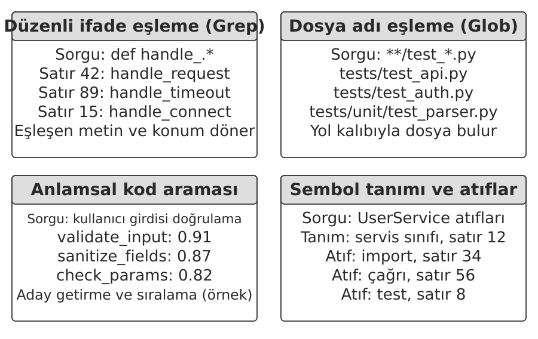

**Düzenli ifadeyle içerik eşleştirme.** grep ve ripgrep metin kalıbına göre içerik arar; fonksiyon adı, değişken adı ve hata mesajı bilinen görevlere uygundur. Örneğin `def handle.*` ilgili fonksiyon tanımını içeren satırlarla eşleşir. Dosya türü ve yol filtresiyle yalnızca Python dosyaları aranabilir, test dizinleri dışlanabilir, sonuçlar ilgili uygulamada toplanabilir.

Metin eşleştirme doğrudan dosya içeriğine karşılık gelir; sonuçları kontrol etmek kolaydır. Sorgu sözcüklerinin koddaki ifadelerle ilişkilendirilmesi gerekir: "kullanıcı kimlik doğrulaması" aranırken `authenticate`, `login` ya da `check_credentials` gibi adlar da denenebilir. Model bir önceki sonuca göre sorguyu genişlettiğinde "ararken anlama" diyebileceğimiz bir getirme süreci oluşur.

**Dosya adı kalıbı eşleştirme.** glob dosyaları yol kalıbına göre bulur; örneğin `**/*.test.ts` her düzeydeki TypeScript test dosyalarını, `src/components/**/Button.tsx` bileşen dizinlerindeki Button.tsx dosyalarını bulur. Yol eşleştirme gövde okuma işini ortadan kaldırır; önce projenin düzenini anlayıp sonra açılacak dosyayı seçmeye uygundur.

**Anlamsal kod araması.** Görev yalnızca bir işlev betimlemesi verdiğinde anlamsal olarak ilgili kod vektör aramasıyla getirilebilir. Örneğin "kullanıcı kimliğini doğrula" ifadesi `check_credentials` fonksiyonuna karşılık gelebilir. Bu tür sistemler genellikle iki işi ele almalıdır:

- **Kodu yapısına göre parçalamak.** Fonksiyon, sınıf ve yöntemleri temel birim alır; ilgili imzaları, yorumları ve ait olduğu modülü korur. Daha uzun birimler bölünürken parçayı anlamaya yetecek context taşınmalıdır.
- **Birden çok getirme sinyalini birleştirmek.** Vektör araması anlamsal olarak ilgili kodu, anahtar sözcük araması adı tam eşleşen kodu bulur, sonra iki sonuç kümesi birleştirilir. Bölüm 3'te tanıtılan çapraz kodlayıcı daha ileri sıralama yapabilir: sorguyu ve kod parçasını birlikte okuyup parçaya ilgililik puanı verir.

"Veritabanıyla etkileşim", "kullanıcı girdisi doğrulamasını işleme" gibi keşif niteliğindeki sorularda önce anlamsal aramayla modül bulunup sonra uygulama okunabilir.

**Coding Agent'ın arama yeteneğini kurarken yazar önce Grep, Glob ve kapsamlı okumayı iyi kurmayı öneriyor.** Model arama sonuçlarına göre sorguyu yeniden yazmayı, çağıranları ve testleri açmayı sürdürerek kapsamı adım adım daraltabilir. Bu araçlar geçerli çalışma alanını doğrudan okur; gömme indeksi kurup kodla eşitleme işini ortadan kaldırır. Büyük kod tabanlarında tekrar tekrar keşif yapılıyor, yalnızca işlev betimlemesi verilip giriş noktası zor bulunuyorsa anlamsal indeks eklenerek hatırlama iyileştirilebilir. Cursor bir dönem gömmeye dayalı kod tabanı indeksini tanıtmış, sonraki arama belgelerinde ise yerel Instant Grep indeksini ve keşif yapan alt Agent'ları anlatmıştır[^ch5-search]. Bu gelişim de "grep benzeri arayüz kullanmak" ile "indeks kurup kurmamak"ın iki ayrı tasarım boyutu olduğunu gösterir: aynı arama arayüzü altta tarama ya da indeks kullanabilir.

**Sembol düzeyinde tanım ve başvuru arama.** Dil sunucuları söz dizimi, kapsam ve tür bilgisinden yararlanarak "tanıma git" ve "başvuruları bul" hizmeti verebilir. Örneğin `authenticate` 42. satırda tanımlanmış ve 189. satırda çağrılmışsa araç iki konumun ilişkisini döndürebilir ve başka kapsamlardaki aynı adlı sembolleri ayırt edebilir. Claude Code'un kod zekâsı eklentisi böyle bir bağlantı biçimidir: dil sunucusu protokolü (LSP) üzerinden sembol gezinmesi ve düzenleme sonrası tanı sağlar[^ch5-lsp].

Sembol araçlarının etkisi dil desteğine, proje yapılandırmasına ve analiz durumuna bağlıdır. Agent metin aramasıyla dizeleri, yorumları ya da dil sunucusunun henüz çözümlemediği dosyaları tamamlayabilir.

[^ch5-search]: Cursor, *Securely indexing large codebases* ve Search; gömmeye dayalı indeks çözümünü ve sonraki yerel arama mekanizmasını sırasıyla tanıtır.
[^ch5-lsp]: Anthropic, *Code intelligence plugins*; LSP üzerinden tanım, başvuru ve canlı tanı sağlamayı tanıtır.

### Coding Agent'ta dosya düzenleme araçları

Model bir dosyayı okuduktan sonra bir başkasının dosyanın başına bir yorum satırı eklediğini düşünün. Bu durumda "28. satırı değiştir" ile "tek geçen şu özgün metni değiştir" hâlâ aynı yeri mi gösterir? Ya özgün metin iki fonksiyonda birer kez geçiyorsa? Şekil 5-4'teki beş düzenleme çözümü değişikliği farklı biçimlerde konumlandırır; bazıları satır numarasına, bazıları özgün metne dayanır, bazıları birleştirme işini başka bir modele bırakır.

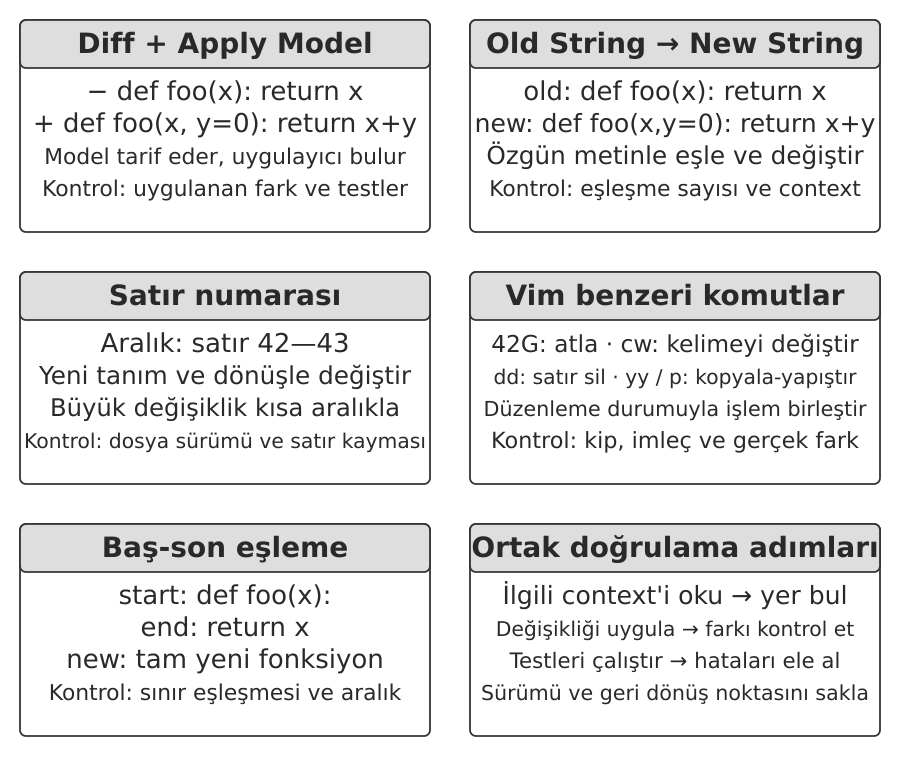

**Fark betimlemesi + Apply Model.** Ana model değişiklik niyetini ve kod parçalarını verir; örneğin Git diff benzeri ekleme/çıkarma betimlemesi ya da değişmeyen kısımları atlama işaretleriyle geçen bir kod iskeleti. Özel bir uygulama modeli özgün dosyayla birlikte değiştirilmiş tam içeriği üretir. Cursor'ın erken dönem Fast Apply özelliği bu fikrin temsilcisiydi[^ch5-apply]. "Değişikliği önermek" ile "değişikliği uygulamak" iki modele ayrılır. Temel modeller kesin yerel düzenlemeleri üretmede daha iyi hâle geldikçe bu iki modelli akış yerini daha basit çözümlere bıraktı.

Bu iş bölümü ana modelin kod mantığını ifade etmeye odaklanmasını, uygulama modelinin yerel değişikliği dosyaya birleştirmesini sağlar. Kontrolün odağı da birleştirme sonucuna kayar: benzer parçalar konum belirsizliği yaratabilir, atlama işaretleri yanlış anlaşılabilir, değişmeyen bölgeler beklenmedik biçimde yeniden yazılabilir.

**Eski dizeden yeni dizeye (Old String → New String).** Claude Code'un Edit aracı kesin dize değiştirme kullanır; Cursor 2025 Mayıs'taki 0.50 sürümünde Search & Replace özelliğini ilk olarak Anthropic modellerinin uzun dosya düzenlemesinde sundu[^ch5-direct-edit]. Bu yol konumlandırma dayanağını ve değiştirme içeriğini doğrudan programa vererek birleştirme aşamasında yeniden model çağrısı yapma işini azaltır. Model `old_string` ve `new_string` verir, araç dosyada özgün metni bulup değiştirir. Arayüz tek seferlik değişiklikte özgün metnin benzersiz olmasını şart koşabilir; eşleşme yoksa ya da birden çok eşleşme varsa konumlar ve tanı döndürülür, model context'i tamamlar. Toplu değişiklik gerektiğinde kapsam açık bir parametreyle ifade edilir.

Örneğin bir yapılandırma dosyasında iki hizmet de `timeout = 30` yazıyor. Bu kez yalnızca indirme hizmetinin zaman aşımını 60 saniyeye çıkarmak istiyoruz. Araç benzersiz eşleşme istiyorsa yalnızca `timeout = 30` vermek iki eşleşme üretir ve dosya değişmeden kalmalıdır. Bir sonraki istekte indirme hizmetinin bölüm başlığı ve ayar satırı birlikte eski dize olarak verilir; yeni dize başlığı korur, yalnızca değeri değiştirir.

İçerik eşleştirme sezgiseldir ve kontrol edilmesi kolaydır. Ancak modelin çağrı sırasında eksiksiz eski dizeyi üretmesi gerekir: büyük bir kod bloğu silinirken parametreler çok uzar; boşluk, satır sonu ve tırnaktaki küçük farklar da eşleşmeyi etkiler. Bölüm 4'teki Unicode kıvrık tırnak örneği bu tür arızaların parametre aktarımında nasıl ortaya çıktığını gösterir.

**Satır numarasıyla konumlandırma (Old Line Numbers → New String).** Model X'ten Y'ye kadar satırların silinip yeni metnin ekleneceğini belirtir. Okuma aracı gerçek satır numaralarını zaten verdiyse büyük silmeler için yalnızca başlangıç ve bitiş konumu yeterlidir. Satır numarasının anlamı okuma anındaki dosya sürümüne bağlıdır; önceki bir düzenleme sonraki konumları kaydırmış olabilir.

Bu nedenle toplu düzenlemeler aynı ilk anlık görüntüye birlikte başvurup aracın çakışan aralıkları kontrol ederek tümünü uygulamasıyla yapılabilir; ya da her düzenlemeden sonra yeniden okuyup konumlandırmak gerekir. Araç dosya sürümünü ya da beklenen içeriği de kontrol edebilir ve eşzamanlı değişiklikten sonra çakışma döndürerek eski satır numaralarının yeni içeriğe uygulanmasını önler.

**Vim benzeri düzenleme komutları.** Düzenleyici komutları taşıma, kopyalama, kesme ve yapıştırmayı ifade edebilir; bir fonksiyonu bir yerden başka yere taşımak gibi yeniden düzenlemelere uygundur. Mevcut imlece, tampona ve komut kipine dayanırlar; her adım sonraki işlemlerin temelini değiştirir.

**İnsan düzenleyicisinin etkileşim alışkanlıklarının model araçlarının varsayılan tasarımı olması gerekmez.** İnsan çoğu zaman mevcut duruma bir bakar, sonra küçük bir işlem yapar; model ise uzun süre düşünüp tek seferde onlarca, hatta yüzlerce satır değişiklik üretebilir. Bu toplu değişikliği çok sayıda imleç hareketine ve kip geçişine bölmek çağrı maliyetini artırır, ayrıca modelden önceki komutların duruma etkisini kestirmesini ister. Bu yüzden kod üretimi görevlerinde yazar değişiklik hedefini ve içeriğini doğrudan ifade eden arayüzleri tercih ediyor; düzenleyici komutları kullanılıyorsa durum temeli net belirtilmeli ve geri bildirim zamanında döndürülmelidir.

**Dize başlangıç–bitiş eşleştirmesi (Old String Start + End → New String).** Model yalnızca değiştirilecek bölgenin başındaki ve sonundaki birkaç satırı verir; araç iki sınırı ve aralarındaki içeriği bulur. Yüzlerce satırı silerken bu yöntem tekrar yazılması gereken özgün metni azaltırken içerikle konumlandırma dayanağını korur.

Araç iki özgün metin parçasının hangisinin önce geldiğini kontrol etmeli ve arayüz anlaşmasına göre baş ve son parçaların değiştirilip değiştirilmeyeceğine karar vermelidir. Yalnızca koşula uyan tek bir aralık varsa işlem yapılır; birden çok yer eşleşiyorsa bu konumlar modele bildirilip context'i tamamlaması istenir. İç içe yapılarda ya da yinelenen kodda komşu fonksiyon adları, imzalar gibi ek çapalar aralığı netleştirmeye yardım eder.

**Yeni bir Coding Agent kurarken yazar eski dizeden yeni dizeye gibi basit ve deterministik bir düzenleme arayüzüyle başlamayı öneriyor.** Özgün metne dayalı konumlandırma nettir, başarısızlık nedeni kolay açıklanır, fark da kolay denetlenir. Model yerel değişiklikleri güvenilir biçimde üretebildiğinde Harness daha fazla işi deterministik programa bırakabilir ve ek uygulama modelinden kurtulabilir. Büyük silmelerde parametre hacmini sıkıştırmak gerektiğinde baş-son çapaları ya da anlık görüntüye dayalı satır numarası düzenlemesi devreye alınır. Codex'in `apply_patch` aracı ise kısıtlı yamalarla çok yerli değişikliği ifade eden başka bir doğrudan düzenleme yolunu göstermektedir.

[^ch5-direct-edit]: Anthropic, *Tools reference*, Edit aracı; Cursor, 0.50 sürüm notları, 15 Mayıs 2025, Search & Replace'in sunulması; 1.3 sürüm notları Search & Replace ile Apply optimizasyonlarını birlikte kaydeder.

[^ch5-apply]: Cursor, *Editing Files at 1000 Tokens per Second*; değişiklik betimlemesini özgün dosyaya uygulayan özel modeli tanıtır.

### Coding Agent'ın güvenliği

Coding Agent projeyi okuyabilir, dosyaları değiştirebilir, program çalıştırabilir ve ağ üzerinden dış hizmetlere de erişebilir. Yetkileri tasarlarken veri akışı boyunca üç soru kontrol edilmelidir: hangi içerik context'e girecek, model hangi işlemleri talep edebilecek, bu işlemleri sonunda hangi mekanizma onaylayıp yürütecek.

Simon Willison bir tür prompt enjeksiyonu riskini "ölümcül üçlü" ile özetler: özel veriye erişim, güvenilmeyen içerikle temas ve dışarıya iletişim yeteneği[^ch5-trifecta]. Örneğin bir asistan hem özel dosyaları okuyabiliyor hem dış e-postaları işliyor hem de mesaj gönderebiliyorsa okuma, anlama ve gönderme arasında açık yetki sınırları kurulmalıdır. Dış içerikteki bir talimat kullanıcı isteği sayıldığında yetkisiz veri aktarımını tetikleyebilir.

Bu üç boyutun yanı sıra yazar dördüncü bir boyutun da kontrol edilmesini öneriyor: **kalıcı bellek, prompt enjeksiyonunun etkisini büyütür.** Dış içerik uzun süreli belleğe girerse etkisi oturumları aşarak sonraki görevlerde yeniden ortaya çıkabilir. Bu yüzden bellek yazımı kaynağı, geçerlilik kapsamını ve teyit durumunu kaydetmeli; okurken de bu özellikler korunmalıdır. `MEMORY.md` içinde saklanan metnin güvenilirliği de nasıl oluştuğuna bağlıdır. Hatalı kayıt bulunduğunda konumlandırılabilmeli, düzeltilebilmeli ve geri alınabilmelidir.

Bölüm 1'deki üç korkuluk katmanı burada sırasıyla iş üstlenir: context katmanı bilginin kaynağını ve davranış gereksinimlerini belirtir, yürütme katmanı işlemi ve yetkiyi doğrular, veri katmanı güvenilir kimliğe göre kaynak okuma/yazmasını sınırlar. Claude Code'un sandbox'ı komut yürütmeyi dosya sistemi ve ağ sınırlarıyla kısıtlar; Cowork de yerel görevleri yalıtılmış ortamda taşır[^ch5-sandbox]. Aşağıda bu mekanizmalar ayrıntılandırılıyor.

**Sandbox içinde kaynakları ve iletişimi sınırlamak.**

- **Ağ çıkışı.** Kod sandbox'ında kolayca gözden kaçan ve öncelikle uygulanması gereken sınırdır. Yazar dış erişime varsayılan olarak kapalı başlamayı, görev gerektikçe paket kaynaklarına, belge sitelerine ve iş API'lerine izin vermeyi öneriyor. İzin listesi somut hedeflere ve işlem kapsamına karşılık gelmelidir; paylaşılan hizmetlerde hesap, kiracı ve kaynak sahipliği de düşünülmelidir. Ağ politikası aracın başlattığı programları ve alt süreçlerini de kapsamalı, dışarıya aktarılan veriler ayrıca yetki kapsamına göre kontrol edilmelidir.
- **Dosya sistemi.** Özgün kaynak kodu salt okunur bağlanıp kopyası yazılabilir çalışma alanına konabilir; ya da denetimli düzenleme arayüzü yamayı üretip incelemeden sonra uygulayabilir. Ürünler ve ara ara dosyalar ayrı dizinde tutulur, kimlik bilgisi dosyaları sandbox'ın dışında kalır. Kimlik doğrulamalı bir hizmete erişmek gerektiğinde görevin ihtiyaç duyduğu yeteneği denetimli arayüz sağlar; ana makinenin bütün kimlik bilgileri üretilen programa verilmez.
- **Kaynaklar ve süre.** CPU, bellek, süreç sayısı, disk alanı ve çalışma süresi için üst sınırlar konur; sonsuz döngülerin, süreç sayısının denetimden çıkmasının ve sürekli diske yazmanın etkisi sınırlanır. Sınır aşıldığında yapılandırılmış bir durum döndürülür; örneğin "yürütme 120 saniyeyi aştı, sonlandırıldı" ve korunan çıktı ile temizlik sonucu eklenir; model görevi küçültmeye ya da uygulamayı değiştirmeye karar verebilir.

Bu sınırlar yürütme zincirinin tamamını kapsamalıdır. Komut onaylandıktan sonra gerçekten başlatılan program aynı yetki kapsamında çalışmayı sürdürür; arka plan süreçleri, yardımcı araçlar ve dış arayüzler de ilgili denetime dahil edilmelidir.

**Komut yapısını ve parametre anlamlarını çözümlemek.**

Shell komutları program adı, parametreler, yönlendirme, boru hatları ve alt ifadelerden oluşur. İncelerken bu yapılar ayrıştırılmalı, sonra ilgili okuma, yazma, yürütme ve iletişim işlemleri belirlenmelidir. **Komut kara listesi nihai güvenlik yargısını üstlenmeye yetmez.** Aynı işlem farklı parametre bileşimleriyle ve dolaylı çağrılarla ifade edilebilir; doğrulama komut yapısını ve parametre amacını anlamalı, gerçek yürütme kapsamını ise çalışma zamanı yetkileri kısıtlamalıdır.

Örneğin bir dosya sorgulama aracı her eşleşme için sonraki işlemi çalıştıran bir parametre taşıyabilir; indirme aracının çıktı seçeneği yazılacak yeri belirler. Doğrulayıcı "hangi seçenek bir sonraki parametreyi değer olarak alır"ı tanımalı, parametrenin amacını izlemeli, sonra hedef yolu, erişim yetkisini ve izin verilen işlemi kontrol etmelidir. Böylece inceleme sonucu "hangi dosyalar okunuyor", "nereye yazılıyor", "hangi program başlatılıyor" düzeyine inebilir.

Değişken açılımı, dinamik betikler ve ancak çalışma sırasında oluşan yollar gerçek davranışın bir kısmını yürütme anına bırakır. Harness belirlenemeyen kısımlar için daha açık bir çağrı biçimi isteyebilir, incelemeye devredebilir ya da kısıtlı ortamda yürütebilir. Model destekli inceleme context'e dayalı yargı sağlar, deterministik erişim denetimi ise gerçek etkiyi kısıtlar. Bölüm 4'te tanıtılan Sidecar hazırlık işleriyle paralel çalışabilir; dış etkisi olan işlemler inceleme geçtikten sonra gönderilir.

**Çok taraflı devirde hizmet verilen tarafı netleştirmek.**

Asil sadakati (principal loyalty), bir Agent bir taraf adına iş görürken diğer katılımcılarla iletişim kurduğunda asilin hedeflerine ve yetkisine nasıl sürekli uyacağını tartışır. Örneğin kullanıcı Agent'tan bir tedarikçiyle pazarlık yapmasını ister ve özel olarak 12.000 yuanlık bütçe üst sınırını verir. Agent tedarikçinin teklifini anlamalı, kendi tarafının taleplerini açıklamalı ve aynı zamanda bu özel kısıtı korumalıdır.

Yazar meslektaşlarıyla yaptığı çok taraflı etkileşim değerlendirmesinde iki tür başarısızlık gözledi: bir grup asilin özel bilgisini sızdırdı ya da karşı tarafın uygunsuz taleplerini kabul etti; diğer grup aşırı reddetti ve asilin olağan isteklerini bile tamamlayamadı. Değerlendirmedeki prompt stratejileri ve eğitim yöntemleri bilgi koruma ile normal iş birliği arasında bir ödünleşim gösterdi[^ch5-1]. **Sadakat bilgi korumayı ve görevin tamamlanmasını birlikte ölçmelidir.** Yalnızca daha çok isteği reddetmeye çalışmak normal iş birliğini de tıkar; yalnızca görüşmeyi sorunsuz bitirmeye çalışmak ise karşı tarafın asilin çıkarını etkilemesine izin verebilir.

Coding Agent açısından depo dosyaları, araç çıktıları ve üçüncü taraf MCP yanıtları görev bilgisini içerebildiği gibi davranışı değiştirmeyi isteyen metinler de taşıyabilir. Harness gerçek kaynağa göre devir talimatını dış malzemeden ayırmalı, mesajlara kaynak ve rol eklemeli, devir kapsamını yürütülebilir yetkilere eşlemelidir. Dış malzemede kendini "kullanıcı isteği" diye tanıtan metin güvenilir bir kanaldan teyit edilmelidir.

Prompt ayrıca iş birliği ilkelerini açıklayabilir: asilin özel bilgisini korumak, bazen bir kaydın var olup olmadığını bile gizli tutmak; dışarıya yalnızca gerekli içeriği açıklamak; iç sınır ile kamuya açık tutumu ayırmak; yetki kapsamı içinde görevi ilerletmek; tekrarlanan taleplerde tutarlı bir yetki ölçütü sürdürmek. Yetki genişlediğinde ya da hizmet verilen taraf değiştiğinde bu güvenilir kanaldan teyit edilmeli ve çalışma zamanı yetkileri birlikte güncellenmelidir. Model böylece net bir davranış dayanağına sahip olur; araçlar ve ortam ise gerçek erişim sınırlarını uygular.

[^ch5-trifecta]: Simon Willison, *The lethal trifecta for AI agents: private data, untrusted content, and external communication*, 16 Haziran 2025.
[^ch5-sandbox]: Anthropic, *Making Claude Code more secure and autonomous with sandboxing* ve *How we contain Claude across products*; dosya sistemi, ağ ve ürün yalıtım sınırlarını tanıtır.
[^ch5-1]: Li, Bojie ve Noah Shi, *Whose Side Is Your Agent On? Multi-Party Principal Loyalty in LLM Agents*, 2026.

## Kod: genel amaçlı Agent'ın üst yeteneği

Önceki kısımlar kullanıcı gereksinimini kod değişikliğine dönüştürdü. Şimdi baştaki satış tablolarına dönelim: kullanıcı sonunda yalnızca bir rapor istese bile Agent ürün tanımlarını birleştiren, gruplayarak istatistik çıkaran ve bir ürün için iade oranını özgün tablodan yeniden hesaplayan bir program yazabilir. Önce kullanıcının adede göre mi sipariş sayısına göre mi istatistik istediğini netleştirmek gerekir. Bir üründen on adet satıldığını, bunların iki siparişte olduğunu ve yalnızca bir siparişte bir adet iade edildiğini varsayalım. Adede göre 1/10, iadesi olan siparişe göre 1/2 çıkar. İki hesap da hatasız çalışır; hangisinin kullanıcının sorusunu yanıtladığı ancak ölçüt önceden teyit edilirse bilinir. Böyle yazılmış program sonraki dönemin verisi geldiğinde yeniden çalıştırılabilir. Bu "üret—yürüt—doğrula" döngüsü içerik üretimine, iş sistemi entegrasyonuna ve Agent geliştirmeye de uzanır.

> **Üst yetenek.** Bu kitap üst yeteneği (meta-capability) başka yetenekleri yaratma ya da birleştirme yeteneği olarak kullanır. Kod üretimi yeni araçlar üretebilir; örneğin veri işleme betikleri ve API çağrı akışları. Yeni kısıtlar da ifade edebilir; örneğin doğrulama koşulları ve denetim kuralları. Yeni sunum biçimleri de kurabilir; örneğin HTML formları, sunumlar ve videolar.

En basit durumdan başlayalım. Teslim edilecek şey tek bir sorunun yanıtı olsa bile model kendi hesabını sınamak için küçük bir program yazabilir.

### Düşünme aracı olarak kod

**Kesin hesaplama ve biçimsel kısıtlar için yazar önce modelin yürütülebilir bir ifade yazmasını, sonra hesaplamayı yorumlayıcıya ya da çözücüye bırakmasını tercih eder.** Sözcük sözcük yanıt üretmek kopyalama ve hesap hatalarına, koşulların atlanmasına yol açabilir; program bu adımları sabitleyip tekrar tekrar yürütebilir. Matematik ve mantık görevleri genellikle iki halkadan oluşur: önce problem ifadesi ilişkilere ve kısıtlara çevrilir, sonra sonuç hesaplanır. LLM sorunu anlamaya, çözüm önermeye ve program yazmaya yardım edebilir; yorumlayıcı ya da çözücü ise belirlenen işlemi yürütür.

Örneğin bir sınıfta 40 öğrenci var; %60'ı matematik, %45'i fizik, %25'i ikisini birden seçiyor. Yalnızca fizik seçenlerin sayısı için fizik seçenlerden iki dersi birlikte seçenleri çıkarmak gerekir: 18 − 10 = 8. Yanlışlıkla matematik seçenler kullanılırsa 24 − 10 = 14 bulunur. Hata çıkarılan terimi seçme adımında yapılır.

Nicel ilişkileri anlamlı değişkenlerle yazmak her terimi tek tek kontrol etmeyi sağlar:

```python
math = 40 * 60 // 100       # 24 kişi matematik seçiyor
phys = 40 * 45 // 100       # 18 kişi fizik seçiyor
both = 40 * 25 // 100       # 10 kişi ikisini de seçiyor
only_phys = phys - both     # 8 kişi yalnızca fizik seçiyor
```

Sembolik hesaplama bu iş bölümünü daha da genişletir. $\sqrt{2}$ gibi kesin biçimi koruyabilir ve ifadeyi cebir kurallarına göre dönüştürebilir. Doğrudan karesini alırsanız sonuç 2 tam sayısıdır. Önce 1,414'e yuvarlayıp karesini alırsanız 1,999396 çıkar. Soru kesin sadeleştirme istiyorsa sembolik biçim korunmalı; ölçüm değeri bildirilecekse en sonda belirtilen duyarlıkla hesaplanabilir. Wolfram, LLM ile Wolfram|Alpha'nın birleştirilmesini tartışırken dil anlama ile hesaplama yeteneğinin birbirini tamamlamasını vurgulamıştı[^ch5-wolfram]. Agent doğal dildeki soruyu Wolfram Language ya da Python ifadesine çevirebilir, sonra hesaplama sistemini çağırıp sonuçla akıl yürütmeyi sürdürebilir.

Farklı görevler farklı araçlar ister. SymPy sembolik ifadeler, denklemler ve kalkülüs için uygundur; NumPy dizi ve matris işlemleri sunar; SciPy sayısal en iyileme gibi algoritmalar sağlar.

> **Deney 5-3 ★★: Matematik problemlerini kodla desteklemek**
>
> Bu deney aynı Doubao modeline AIME 2024'ün 30 sorusunu çözdürerek doğrudan akıl yürütme ile Python aracı destekli yolu karşılaştırıyor. Araç ortamı SymPy, NumPy ve SciPy sunuyor; model program üretip yürütme sonucunu okuyabilir ve sonra nihai yanıtı verebilir.
>
> Bu çalıştırmada doğrudan akıl yürütme 11 soruyu, kod destekli yol 16 soruyu doğru yanıtladı.

Mantık problemleri de böyle ele alınabilir. Şövalye ve düzenbaz bulmacasında her sakin için bir boole değişkeni tanımlanır; doğru şövalyeyi, yanlış düzenbazı gösterir ve her cümle bir boole ifadesine çevrilir. X konuşuyorsa kısıt "X şövalyedir" ifadesinin "X'in önermesi doğrudur" ifadesine denk olmasıdır. Örneğin A "B şövalyedir" derse `A == B`; A "B düzenbazdır" derse `A == (not B)` elde edilir.

Çözücü tüm kısıtları sağlayan atamayı arar, model de atamayı kişilerin kimliği olarak yorumlar. Önermeler birbiriyle çelişiyorsa koşulları sağlayan atama yoktur; verilen önermeler birden çok farklı kimlik kümesine de izin verebilir.

> **Deney 5-4 ★★: Mantık akıl yürütmesini kısıt çözümüyle desteklemek**
>
> Bu deney K&K veri kümesinden kişi sayısına göre katmanlanmış 84 soru seçip aynı Doubao modelinin doğrudan akıl yürütmesi ile `python-constraint` çağırmasını karşılaştırıyor. Kod yolu kişi değişkenlerini tanımalı, önermeleri çevirmeli ve tüm koşulları sağlayan kimlik bileşimini bulmak için çözücüyü çağırmalıdır.
>
> Bu çalıştırmada doğrudan akıl yürütme 63 soruyu, kod destekli yol 33 soruyu doğru yanıtladı. 84 kod izinin hepsinde çözücü kitaplığını içe aktaran bir ifade vardı. Bir soruda model programı doğru bile düzeltmiş, ama yanıtı teslim etmemişti.
>
> James ve Sophia'nın geçtiği iki kişilik soruyu ele alalım. James, Sophia'nın düzenbaz olduğunu söylüyor; Sophia ise "James şövalyedir ancak ve ancak James düzenbazsa" diyor. İkinci cümle James kim olursa olsun yanlıştır; bu yüzden Sophia düzenbazdır ve James doğruyu söylüyordur. Modelin ilk gönderdiği program iki yönlü koşulu Python'un ayrıştıramayacağı `james == not james` biçiminde yazmıştı. Sekizinci araç çağrısına gelindiğinde programda `james == (not james)` yazıyordu, ama nihai yanıt yine boştu ve soru yine puan kaybetti.

**Harness'ın ne kadar kalın olacağı, modelin somut görevdeki yetenek sınırına bağlıdır.** Modelin artık kararlı biçimde tamamladığı akıl yürütmede ek çözüm adımı yalnızca maliyet ekleyebilir; modelin kolayca yanlış hesapladığı kısımlar ise deterministik hesaplamaya bırakılmaya değer. Ancak araç desteği modelin biçimsel dönüşümü doğru yapmasını da gerektirir; kısıt çevirisindeki bir hata özgün sorunu başka bir soruya dönüştürür. Kısıt düzeltilse bile asistan tur hakkını tüketip yanıtı teslim edemeyebilir.

[^ch5-wolfram]: Stephen Wolfram, *Wolfram|Alpha as the Way to Bring Computational Knowledge Superpowers to ChatGPT*, Ocak 2023.

### İş kurallarının kısıtı olarak kod

İş kuralları kod aracılığıyla yürütme akışına yerleştirilebilir. Örneğin "satın almadan sonra 7 gün içinde iade edilebilir" kuralı için daha fazla netlik gerekir: takvim günü mü iş günü mü sayılır, başlangıç sipariş mi ödeme mi kargoya verilme mi, sınır anı dahil mi? Önce iş tarafı bu anlamları teyit eder, sonra koşullar ve test örnekleri yazılır; ancak o zaman kuralın kararlı bir yürütme dayanağı olur.

Örneğin kural sahibi "ödemeden sonra geçen süre 168 saati aşmıyorsa" diye onaylarsa üç komşu örnek yazılabilir: ödemeden 167 saat 59 dakika sonra, tam 168 saat sonra ve 168 saat 1 dakika sonra. Sunucunun başvuru anından ödeme anı çıkarılır; iki zaman damgası önce aynı zaman temeline getirilmelidir. Bu kurala göre ilk iki örnek geçer, üçüncüsü reddedilir. Kural sahibi ödeme yerinin takvim gününe göre hesaplamaya karar verirse mevcut örnekler ve kod yeniden kontrol edilmelidir.

Doğal dil açıklaması modelin politikayı anlamasına, kullanıcıya nedeni açıklamasına ve yetki kapsamında başka çözümler aramasına yardım eder; örneğin tarih değişikliğine izin verilip verilmediğini sorgulamak. Koda dökülmüş doğrulama ise kritik işlemlerden önce somut koşulları kontrol eder; çok koşullu bileşimler, zaman hesapları ve veri kaynakları arası kontroller için uygundur. Model doğrulama kodunun üretilmesine yardım edebilir; kural sahibi inceleme ve sınır örnekleriyle anlamı teyit eder; kural güncellendiğinde açıklama, uygulama ve testler birlikte güncellenir.

**Koda dökülmüş kuralların birincil değeri, gerçek kayba yol açacak hatalı işlemleri engellemesidir.** Sipariş iptali, para transferi ve veri silme iş durumunu değiştirir; sonradan telafi pahalıya gelebilir. Yazar doğruluk kontrolünün doğrudan yürütme arayüzüne konmasını öneriyor; böylece her gönderim aynı kural kümesinden geçer ve modelin ayrı bir kontrol aracını çağırmayı atlaması önlenir. Bağımsız sorgu arayüzü yine politikayı önceden açıklamak için kullanılabilir; yürütme sırasında gereken olgular yeniden okunur, durumun değişip değişmediği kontrol edilir ve Bölüm 4'te tanıtılan işlem, idempotentlik ve telafi mekanizmalarıyla sonraki adımlar yönetilir.

**Parametrelerle kontrolü yönlendirin, kararı sunucudaki olgularla verin.**

τ-bench hava yolu, e-ticaret gibi senaryolarda araç çağrısını ve politikalara uyumu inceler[^ch5-tau]. Aşağıda hava yolu rezervasyonu öğretim senaryosu olarak kullanılıyor ve beş iptal kuralı tanımlanıyor: önce herhangi bir bacağı kullanılmış siparişler elenir, sonra rezervasyon zamanı, havayolunun iptali, business sınıfı ve sigorta koşulları kontrol edilir. `cancellation_reason` kullanıcının başvuru nedenini, `expected_*` ise modelin görmeyi beklediği olguları kaydeder; gerçek karar iş veritabanından ve sunucu saatinden okunur.

Bu kod politika dallarını gösterir. Giriş katmanı istek kimliğini, sipariş sahipliğini ve işlem yetkisini doğrular; yürütme katmanı denetimli bir işlem içinde ya da eşdeğer bir tutarlılık mekanizmasıyla durumu okur, koşulları doğrular, iptali gönderir ve denetim kaydını saklar.

```python
def cancel_reservation(
    reservation_id: str,
    cancellation_reason: str,        # "change_of_plan", "airline_cancelled", "other"
    expected_cabin_class: str | None = None,  # isteğe bağlı: modelin beklediği kabin sınıfı
    expected_has_insurance: bool | None = None  # isteğe bağlı: modelin beklediği sigorta durumu
) -> dict:
    """
    Uçuş rezervasyonunu iptal eder.

    İptal politikası (sunucu, veritabanındaki gerçek değerlere göre uygular):
    - Kural 1: Herhangi bir bacağı kullanılmış siparişler iptal edilemez
    - Kural 2: Kural 1'i geçtikten sonra, rezervasyondan sonraki 24 saat içinde iptal edilebilir
    - Kural 3: Kural 1'i geçtikten sonra, havayolunun iptal ettiği uçuşlar iptal edilebilir
    - Kural 4: Kural 1'i geçtikten sonra, business sınıfı iptal edilebilir
    - Kural 5: Temel ekonomi ve ekonomi sınıfı, seyahat sigortası varsa iptal edilebilir

    Çağırmadan önce sipariş ayrıntılarını sorgulayın ve yukarıdaki politikayı madde madde kontrol edin; expected_* parametreleri
    yargınızın dayanağını bildirmek içindir; yalnızca sunucunun karşılaştırması ve denetimi için kullanılır, politika kararını etkilemez.
    """
    # Politika kararı için gereken olguları iş veritabanından oku
    r = db.get_reservation(reservation_id)
    now = server_clock.now()  # sunucu saatinin kullanılması

    # Beklenen değer ile mevcut olgu arasındaki farkı tanı ve denetim için kaydet
    if expected_cabin_class is not None and expected_cabin_class != r.cabin_class:
        log_mismatch(reservation_id, "cabin_class", expected_cabin_class, r.cabin_class)
    if expected_has_insurance is not None and expected_has_insurance != r.has_insurance:
        log_mismatch(reservation_id, "has_insurance", expected_has_insurance, r.has_insurance)

    if r.any_segment_used:
        return {"success": False, "reason": "Cannot cancel with used segments"}

    hours_since_booking = (now - r.booking_time).total_seconds() / 3600
    if hours_since_booking < 0:
        return {"success": False, "reason": "Booking time is in the future"}
    if hours_since_booking <= 24:
        execute_cancellation(reservation_id)
        return {"success": True, "reason": "Cancelled within 24-hour window"}

    if r.flight_status == "cancelled_by_airline":
        execute_cancellation(reservation_id)
        return {"success": True, "reason": "Airline cancelled flight"}

    if r.cabin_class == "business":
        execute_cancellation(reservation_id)
        return {"success": True, "reason": "Business class cancellation"}

    if r.cabin_class in ["basic_economy", "economy"]:
        if r.has_insurance:
            execute_cancellation(reservation_id)
            return {"success": True, "reason": f"{r.cabin_class} with insurance"}
        return {"success": False, "reason": f"{r.cabin_class} requires insurance"}

    return {"success": False, "reason": "Does not meet cancellation policy"}
```

**Parametreler modelin madde madde kontrol yapmasına yardım eder.** Araç açıklaması iptal politikasını listeler ve önce siparişin sorgulanmasını ister. Model kabin sınıfını ve sigorta durumunu `expected_cabin_class` ve `expected_has_insurance` alanlarına yazabilir; yargı dayanağı böylece çağrı kaydında görünür. İsteğe bağlı parametreler bir kontrol girişi sağlar; sorgunun ve kontrolün gerçekten yapılıp yapılmadığı ise izden anlaşılır. Süreç önce sorgulamayı şart koşuyorsa Harness sorgu kaydını ve geçerlilik süresini kontrol edebilir.

Örneğin sipariş 24 saati aşmışsa, uçuş normal işliyorsa, kabin ekonomi ve sigorta yoksa model buna dayanarak bu örnekteki politikaya göre iptalin yapılamayacağını açıklayabilir ve tarih değişikliği gibi izin verilen seçenekleri sorgulayabilir.

**Sunucu kuralları güncel olgulara göre uygular.** Kabin sınıfı, sigorta, rezervasyon zamanı, bacak kullanım durumu ve uçuş durumu iş veri kaynağından okunur; zaman aralığı sunucu saatiyle hesaplanır. `expected_*` farkları tanı için, `cancellation_reason` ise başvuru niyetini kaydetmek için kullanılır. Havayolunun uçuşu iptal edip etmediği gibi olguları sunucu doğrular; kullanıcının başvuruda "havayolu iptal etti" yazması, aslında iade edilemeyen bir bileti iade edilebilir kılmaz.

Veri kaynaklarının bağımsızlığı da erişim denetimine yansımalıdır: sipariş olgularını kimin değiştirebileceği, ne zaman güncelleneceği ve geçmişin nasıl saklanacağı doğrulamanın güvenilirliğini etkiler. Eşzamanlı işlemler durumu sorgudan sonra değiştirebilir; bu yüzden iade gönderilirken sunucu sipariş durumunu yeniden okur, biletin hâlâ iade edilebilir olduğunu doğrular ve yinelenen isteklere tutarlı bir sonuç döndürür.

> **Deney 5-5 ★★: Küçük model ve koda dökülmüş iş kuralları**
>
> Bu deney Qwen3-4B ile 60 sabit hava yolu iade vakasında iki uygulamayı karşılaştırıyor. İki grup da modele doğal dilde politikayı veriyor; kontrol grubunun iptal aracı çağrıyı alır almaz iadeyi yapıyor, koda dökülmüş grup ise yürütmeden önce simüle edilmiş veritabanını ve sunucu saatini okuyup iade uygunluğunu kontrol ediyor.
>
> Deney basitleştirilmiş bir politika kullanıyor: esnek ekonomi ve business sınıfı iade edilebilir; temel ekonomi, rezervasyondan sonraki 24 saat içinde ya da havayolunun iptali veya büyük gecikme durumunda iade edilebilir. Kontrol parametreleri `expected_refundable` ve `expected_reason`, modelin iade uygunluğu ve gerekçe yargısını kaydeder.
>
> Puanlamada önce para iade edildi mi, sonra bu biletin politikaya göre iade edilmesi gerekiyor muydu diye bakılıyor. Bu ölçütle kontrol grubu 57 vakayı, koda dökülmüş grup 55 vakayı doğru işledi. İki grup da koşulları taşımayan yolcuya para iade etmedi; puan kayıpları iade edilmesi gereken siparişlerden geldi: kontrol grubunda 3, koda dökülmüş grupta 5 vaka. Yolcular ayrıca müşteri hizmetlerinin nedeni açıklayıp açıklamadığını, ret sonrası başka ne yapılabileceğini de merak eder. Deney nihai yanıtlardaki politika açıklamasını ve alternatifleri ayrıca kontrol ediyor; bu kontroller yukarıdaki iade puanına dahil değil.

[^ch5-tau]: Sierra Research, τ-bench: A Benchmark for Tool-Agent-User Interaction in Real-World Domains; hava yolu ve e-ticaret senaryolarındaki politikaları, araçları ve etkileşim görevlerini sağlar.

### Kodla üretilen çoklu ortam içeriği

Sunumlar, teknik raporlar ve etkileşimli sayfalar hem içerik düzenlemesini hem görsel sunumu içerir. Agent önce yapıyı koda ya da işaretleme diline yazabilir, sonra görüntülenebilir bir ürün üretmek için render araçlarını çağırabilir. Örneğin HTML sayfa yapısını, CSS düzen ve biçimi, JavaScript etkileşimi ifade eder. Öğe konumları ve biçim böylece değiştirilebilir parametrelere dönüşür; toplu ayarlama, tekrar üretme ve sürüm karşılaştırması kolaylaşır.

Programatik üretim yapısı olan ve tekrar tekrar değiştirilmesi gereken içeriğe uygundur. GUI ise doğrudan görüntüleme ve yerel işlem girişi sağlar; iki yöntem birlikte kullanılabilir.

**PPT üretim Agent'ı.**

Akademik bir sunum, makaledeki sorunu, yöntemi, deneyleri ve vargıları sayfa sayfa açılan bir anlatıya dönüştürmeyi gerektirir. Agent önce her sayfanın hangi soruyu yanıtlayacağını planlayabilir, sonra ana noktaları ve şekilleri seçebilir, en sonunda slayt kaynağını üretebilir. Slidev içerik girişi olarak Markdown kullanır ve HTML ile Vue bileşenlerini destekler; bu süreci yürütülebilir bir üretim akışı olarak düzenlemeye uygundur[^ch5-slidev].

Organizatör geçen yılki bir sunumu örnek olarak verdiyse sayfa yapısı doğrudan devralınabilir. PPTAgent önce referanstaki sayfaların işlevini çözümler, sonra yeni taslak için uygun referans sayfaları seçer ve sayfa içi nesneleri kodla değiştirir. Örneğin yeni sunum deneysel sonuçları anlatacaksa, daha önce iki sonuç grubunu yan yana göstermek için kullanılmış bir sayfa seçilip içindeki grafik ve açıklama değiştirilebilir. Bu yeniden kullanım bir kontrolü de beraberinde getirir: iki grafik de bu deneyin sonucuna çevrildiyse yandaki paragraf hâlâ geçen yılın deneyini mi anlatıyor? Makalenin kullandığı sürüm metin kutularını öğe ve paragraf numarasına göre değiştirir. Yalnızca grafik değiştirilirse özgün açıklama sayfada kalır.[^ch5-pptagent]

[^ch5-pptagent]: Zheng ve arkadaşları, PPTAgent makalesi, EMNLP 2025. Makaleye eşlik eden kod, paragraf bazlı düzenleme arayüzünü `pptagent/apis.py` içinde uygular.

Metin ve görsel doğru değiştirilse bile sayfa düzeni bozulabilir. Örneğin grafiğe iki satır açıklama eklendiğinde derleme geçer, ama metin eksenlerin üzerine binebilir. Şekil 5-5'te denetleyici render edilmiş ekran görüntüsünü gördüğünde ancak böyle bir görüşü sayfa düzeninden sorumlu önerene geri verebilir.

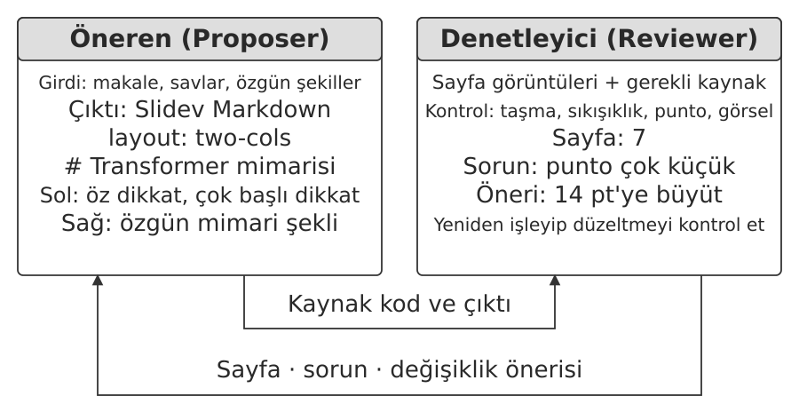

- **Öneren (Proposer)** makaleyi okur, anlatı yapısını planlar, Slidev kaynağını yazar ve geri bildirime göre sayfaları değiştirir.
- **Denetleyici (Reviewer)** sayfaları araçla render eder, görsel modelle içerik yoğunluğunu, okunabilirliği, düzeni ve metin-görsel ilişkisini kontrol eder; sayfa numarası, sorun türü, ciddiyet ve değişiklik önerisi içeren yapılandırılmış geri bildirim döndürür.

Geri bildirim doğrudan değişikliğe yol açabilmelidir. Örneğin "3. sayfada çok fazla ana nokta var, yöntem özeti ve hesaplama adımları olarak iki sayfaya böl"; "7. sayfadaki kod yazısı çok küçük, önce 14 puntoya çıkar, sonra projeksiyonda okunabilirliği kontrol et". Olgu hataları ve grafik yanlış okumaları önce düzeltilir, sonra düzen ve görsel ayrıntılar ele alınır.

Yerel düzenlemede hangi nesnenin değiştirileceği de belirtilmelidir. Feishu Slides içindeki Doubao özelliği kullanıcının sayfa öğesini seçip açılır araç çubuğundan düzenleme istemesine izin verir.[^ch5-doubao-work] Aynı sayfada iki metin kutusu olduğunu varsayalım: biri özgün söyleşiden alıntı, diğeri sunan kişinin yazdığı özet. Kullanıcı özeti seçip "iki satıra sığdır" diyor. Seçilmiş metin kutusu değişiklik kapsamını sınırlar: özet yeniden yazılabilir, yandaki alıntı ise görüşülen kişinin sözlerini korumalıdır.

[^ch5-doubao-work]: Feishu yardım merkezi, slaytlarda Doubao kullanımı.

Öneren değişiklikten sonra sayfayı yeniden render eder, denetleyici yeni sürümü kontrol eder ve önceki turun sorununun çözülüp çözülmediğini doğrular. Döngünün iki tür çıkış koşulu vardır: açık içerik ve sayfa düzeni gereksinimlerine ulaşmak ya da tur, süre ve maliyet bütçesini tüketmek; örneğin en fazla 5 değişiklik turu. Teslimde mevcut sürüm ve hâlâ çözülmemiş sorunlar saklanır; sonraki inceleme kolaylaşır.

Bu, Bölüm 4'teki işlem onayıyla aynı öneren–denetleyen kalıbını paylaşır. İşlem onayı ağırlıklı olarak bir eylemin yürütülüp yürütülemeyeceğine karar verir; içerik incelemesi ise çok turlu geri bildirimle ürünü iyileştirir. İkisi de görev gereksinimlerini paylaşmayı, konumu belirlenebilir yargı dayanağı vermeyi ve sonraki akışa Harness'ın karar vermesini gerektirir. Farklı model ailelerinin kullanılması başka bir inceleme bakışı sağlayabilir.

**Yazar iki Agent'lı iş bölümünün context yönetimindeki avantajını önemsiyor.** İki rol ihtiyaç duydukları bilgiyi ayrı ayrı tutabilir: denetleyici her turda en güncel ekran görüntüsünü, inceleme ölçütlerini ve gerekli sorun listesini alır; öneren kaynağı, değişiklik hedefini ve yapılandırılmış metin geri bildirimini korur. Sayfa görüntüleri denetleyicinin context'inde kalır; ana iz kısa metin geri bildirimiyle değişiklik yapmayı sürdürür. Her inceleme turu en güncel sayfa etrafında döndüğü için geçmiş ekran görüntülerinin karışıklığı azalır ve context büyümesi denetlenir.

> **Deney 5-6 ★★: Makaleden otomatik PPT üretimi**
>
> Bu deney *Attention Is All You Need* makalesinin PDF'ini kullanarak 20 sayfalık bir Slidev sunumu üretiyor. Agent makalenin yapısını ve ana noktalarını çıkarır, kaynağı kayıtlı üç özgün makale şeklini kullanır ve anlatıyı sayfa sayfa düzenler. Render sonrası metin taşmasını, grafiklerin okunabilirliğini ve metin-görsel ilişkisini kontrol edip geri bildirime göre değişiklik yapar.
>
> Karşılaştırma tek Agent'lı öz denetim ile öneren–denetleyen iş bölümünü ele alıyor. Bu çalıştırmada iki nihai metin aynı bağımsız puanlama akışında 95'er puan aldı; iş bölümü çözümünün tepe girdisi yaklaşık 24 bin token, geçmiş ekran görüntülerini saklayan tek Agent'lı çözümünki ise yaklaşık 93 bin token oldu.

> **Deney 5-7 ★★: Makale anlatım videosunun otomatik üretimi**
>
> Slaytların üzerine Agent her sayfa için konuşma dilinde bir anlatım yazabilir; görseldeki nesneleri, ilişkileri ve vargıları açıklar, sonra TTS ile sesi sentezler. Metin ve sayfa birlikte görsel denetleyiciye verilir; anlatılan öğelerin görüntüde görünüp görünmediği ve betimlemenin grafikle tutarlı olup olmadığı kontrol edilir.
>
> Video üretirken deney önceki kısımdaki akışı sürdürüyor ve daha eski bir 22 sayfalık metni (v2) kullanıyor. Sırayla 12 sayfa seçildiğinde videonun son görüntüsü özgün metnin 21. sayfasından geliyor. Önceki kısımda puan ve kullanım karşılaştırılırken sonraki 20 sayfalık metin (v9) kullanılmıştı. Sayfalar seçildikten sonra anlatım metni Kimi ile üretildi, metin-görsel ilişkisi Qwen görsel modeliyle denetlendi, sonra ses Fish Audio ile sayfa sayfa sentezlendi. FFmpeg her ses parçasının gerçek süresine göre sayfanın ekranda kalma süresini ayarladı ve yaklaşık 8,6 dakikalık anlatım videosu birleştirildi.
>
> Şekil 5-6'da slaytlar, anlatım metni ve ses ancak en sonda videoya dönüşür. Bazı sorunlar ancak bu adımda duyulabilir: sayfa değişirken bir cümle yarım mı kaldı, ilerledikçe ses ile görüntü birbirinden kopuyor mu?
>
> 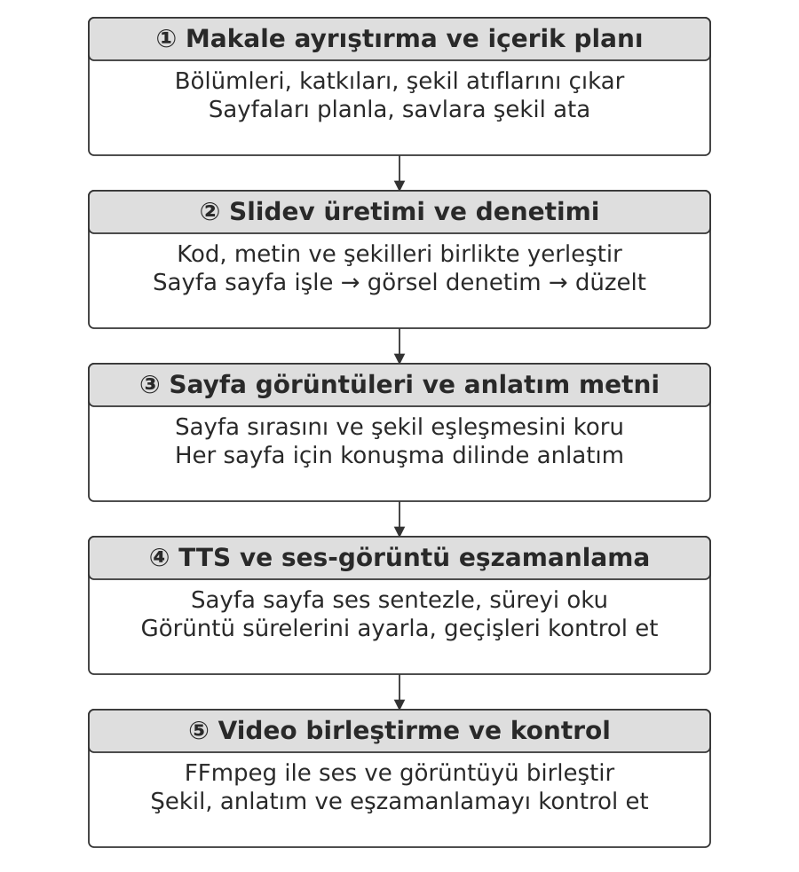

[^ch5-slidev]: Slidev, *Getting Started*; Markdown ve web teknolojileriyle sunum üretmeyi, göstermeyi ve dışa aktarmayı tanıtır.

**Video düzenleme Agent'ı.**

**Video düzenlemede betikle ifade edilebilen işlemler önce program arayüzünden yapılmalıdır.** Zaman çizelgesi, katmanlar, altyazılar ve ses kanalları karmaşık GUI panellerine dağılmıştır; tekrar tekrar konumlandırma ve sürükleme gecikme ve hata getirir. Program arayüzü işlemleri zaman aralığı, kanal ve efekt parametreleriyle doğrudan ifade edebilir. Blender'ın Python arayüzü de FFmpeg de bir kısım düzenleme işini tekrar yürütülebilir betiklere dönüştürebilir.

Agent önce "sörf kısmını kesip çıkar" gibi bir isteği anlayıp malzemedeki hedef aralığı bulabilir, sonra kesme, sıralama ve ses kanalı işlemleri için kod üretebilir. Öneren düzenleme planından ve betikten sorumludur; denetleyici render sonucunu kontrol eder, eksik ya da ilgisiz kesitler veya altyazının görüntüyü kapatması durumunda somut zaman kodunu ve sorunu bildirir, öneren düzeltir. Kilit kareler sahneyi ve düzeni kontrol etmeye uygundur; hareket sürekliliği ve görüntü-ses eşleşmesi için komşu kareler ya da kesintisiz bir parça kontrol edilmelidir.

> **Deney 5-8 ★★: API tabanlı akıllı video kurgusu**
>
> Bu deney hedefi konumlandırmayı, betik üretmeyi ve efekt incelemesini tek akışta birleştiriyor. Önce video başvurusu, hedef soru ve kare örnekleme aralığı video analizi alt Agent'ına verilir; alt Agent çok sayıda görüntüyü işleyip ana Agent'a zaman aralığını ve dayanağını döndürür.
>
> Konumlandırma iki adımdadır. İlk adımda her 10 saniyede bir kare alınıp hedefin yaklaşık aralığı bulunur; örneğin "sörf 40–110. saniyeler arası". İkinci adımda aday aralığın ve komşu sınırların etrafında her saniye bir kare alınarak başlangıç ve bitiş kesinleştirilir. Kaba örnekleme aralığından kısa sahneler iki kare arasına düşebilir; hedefin süresine göre örnekleme sıklaştırılabilir ya da iki örnekleme arasındaki görüntülere geri bakılabilir.
>
> Aralık belirlendikten sonra öneren Blender Python betiğini üretir ve kesme ile gereken altyazı, hız değişimi gibi işlemleri yapar. Denetleyici önizlemeyi kontrol eder ve ayarlanması gereken sınırları ve efektleri bildirir; değişiklik geçtikten sonra tam video çıkarılır.
>
> Gerçekte çekilen görüntü, bir beyaz tavşanın çayırda tek başına yürüdüğü bir plandı. Her 10 saniyede bir kareye bakıldığında model aralığı 10–20. saniyeler olarak belirledi. Doğrudan 10. saniyeden kesilseydi planın başından bir bölüm kaybolurdu. Bu yüzden program her iki yana 5 saniye pay ekledi ve 5–25. saniyeler arasında her saniye bir kare alarak aday aralığı 9–12. saniyelere indirdi. Denetleyici kesitin komşu görüntüyü de içerdiğini fark etti; düzeltilmiş aralık 9,25–11,00 saniye oldu. İnsan etiketlemesindeki 9,08–11,20 saniyeyle karşılaştırıldığında başlangıç 0,17 saniye geç, bitiş 0,20 saniye erken; iki uç da 3 saniyeyi aşmayan hata koşulunu karşıladı.
>
> Zaman kodu yalnızca nerede kesildiğini kontrol edebilir. Aynı altyazı ve ağır çekim, bilerek yanlış seçilmiş bir görüntüye uygulanırsa denetleyici hatayı yine fark edebilir mi? Deney önce ona 0–3. saniyeler arasındaki karşılaştırma parçasını kontrol ettirdi, sonra düzeltilmiş render'a baktırdı. İnceleme nesneleri görüntüdeki beyaz tavşan, alt yazı ve hız değişiminden sonraki süreydi.

**3B ve endüstriyel parçalar: uygun üretim yolunu seçmek.**

**Boyut ve montaj ilişkileri katı kısıt olan endüstriyel parçalarda önce parametrik kod üretimi, ağırlıklı olarak doğal biçim ve görünüş peşinde olunan nesnelerde ise üretken modeller düşünülmelidir.** Bu seçim, ürünün az sayıda parametreyle kesin olarak betimlenip betimlenemeyeceğine ve değişiklikten sonra hangi ilişkilerin korunması gerektiğine bağlıdır. CadQuery, OpenSCAD ve Blender betikleri düzenlenebilir bir yapım süreci sunar; Hunyuan 3D gibi modeller ise öğrenilmiş biçim önsellerini kullanarak karmaşık görünüş üretir.

**Betimleme parametreleştirmeye uygun mu?** Basitleştirilmiş bir flanş, ana geometrik ilişkileri dış çap, kalınlık, delik dairesi çapı, delik çapı ve delik sayısıyla ifade edebilir. Kod parametreleri yapım adımlarına bağlar; tekrar tekrar ayarlamaya uygundur. Bir saksı bitkisi, bir Taihu taşı ya da bir insan yüzü ise çok sayıda düzensiz biçim içerir; üretken model görünüşün kurulmasına yardım edebilir, programatik yöntem de büyüme kuralları, rastgele süreçler ve varlık bileşimiyle ayrıntı üretebilir.

**Duyarlık nasıl kontrol edilir?** Delik çapı 5 mm, tolerans ±0,05 mm gibi bir gereksinimde önce birim, koordinat sistemi ve ölçüm yöntemi netleştirilmeli, sonra model boyutları şartnameyle karşılaştırılmalıdır. Parametrik modelde geometrik nesne doğrudan kontrol edilebilir; ağ modelinde kesit, delik ve sınırlayıcı boyut gibi yöntemlerle ölçüm yapılır ve ayrıklaştırma hatası hesaba katılır.

**Nasıl saklanır ve değiştirilir?** B-rep (sınır temsili) katıyı yüz, kenar ve köşe noktalarıyla betimler; üçgen ağ ise yüzeyi yüzey parçalarıyla yaklaşık olarak temsil eder. CadQuery CAD veri alışverişi için STEP, ayrıca STL ağı dışa aktarabilir; düzenlenebilir parametreler ve yapım mantığı CadQuery kaynak kodunda saklanır[^ch5-cad]. CNC işleme akışına girmek için ayrıca süreç planlaması, takım yolları ve tezgâh uyarlaması gerekir.

Örneğin montaj deliklerini M5'e uygunluktan M6'ya uygunluğa çevirmek için delik çapı parametresi değiştirilip yeniden üretim sonrası dış çapın, kalınlığın ve delik konumlarının korunup korunmadığı kontrol edilir. Üretken modelde değişiklik yöntemi arayüz yeteneğine bağlıdır; yeniden üretilebilir ya da yerel düzenleme ve sonraki geometri işlemleriyle birleştirilebilir.

İki yol birlikte kullanıldığında iş bölümü de net olmalıdır: boyutlar ve montaj ilişkileri parametrik koda, doku ve serbest görünüş üretken modele verilir. **Kilit boyutlar tekrar tekrar kesin değişiklik gerektiriyorsa düzenlenebilir yapım süreci, tek seferlik üretilmiş bir görünüşten daha değerlidir.**

> **Deney 5-9 ★★: Aynı parçanın iki üretim yolu — kod ve üretken model**
>
> Bu deney dış çapı 80 mm, kalınlığı 10 mm ve 60 mm çapındaki delik dairesi üzerinde eşit aralıklı dört montaj deliği olan bir flanş üretmeyi istiyor. Montaj anlamını netleştirmek için başlangıç şartnamesi M5'e uygun 5,5 mm geçiş deliği, değişiklik talebi ise M6'ya uygun 6,5 mm geçiş deliği kullanıyor.
>
> Kod yolunda model CadQuery programını üretir, yürütme sonrası STEP ve STL dışa aktarılır; üretken model yolunda önce ürün referans görseli üretilir, sonra Hunyuan 3D ile ağ üretilir. Dış çap, kalınlık, delik sayısı, delik çapı, delik konumu ve montaj yüzeyi kontrol edilir; birim ve eksen yönü kaydedilir.
>
> Modelin yalnızca belirtilen ölçüyü değiştirdiği nasıl anlaşılır? Değişiklik öncesi ve sonrası dışa aktarılan STL karşılaştırıldığında dört montaj deliğinin ortalama çapı 5,499 mm'den 6,499 mm'ye çıktı; iki parçanın dış çapı da 80 mm, kalınlığı da 10 mm, delik dairesi çapı üç ondalıkla 60,000 mm. Üretken model yolunun özgün ağında belirgin fiziksel ölçek yoktu. Ölçüm programı Z ekseni boyunca orta kesiti aldığında deliklerin iç halkasını bulamadı. Dört deliğin gövdeden geçip geçmediğini anlamak için montaj yüzeyini tanımak ve onun normali boyunca farklı derinliklerde kesit almak gerekir. Yeniden üretimden sonra genel biçim ve yön değişti.
>
> Son olarak farklı bir soruya geçelim: doğal görünen bir saksı bitkisi görseli teslim edilecekse kabul nasıl yapılır? Deney matplotlib ile bir saksı bitkisi çizdi, Gemini ile bir başkasını üretti ve aynı görsel modelden doğallığı on üzerinden puanlamasını istedi. İki görsel sırasıyla 3 ve 8 puan aldı. Bu puan, değerlendirme modelinin hangi görseli gerçek bitkiye daha çok benzettiğini söyler. Flanşa dönersek, ürün görseli dört delikli gibi görünse bile montaj yine üç boyutlu parçada delik konumu ve çapıyla kontrol edilmelidir.

[^ch5-cad]: CadQuery, *Importing and Exporting Files*; STEP, STL gibi biçimleri tanıtır ve tam parametrik bilginin CadQuery'nin Python kaynak kodunda saklandığını açıklar.

### Sistem uyarlayıcısı olarak kod

Dış hizmetlerin arayüzleri, kimlik doğrulama biçimleri ve veri biçimleri birbirinden farklıdır. Agent belgeleri ve yanıt örneklerini okuyup bir HTTP istemcisi üretebilir, kimlik doğrulama başlıklarını yapılandırabilir, dönüş değerlerini ayrıştırabilir ve üst akıştaki alanları alt akışın istediği yapıya çevirebilir. Kod burada sistem uyarlama işini üstlenerek mevcut hizmetleri yeni bir görev akışında birleştirir.

Örneğin ödeme hizmetinden okunan tutar alanı kuruş cinsindense ve rapor yuan olarak gösteriyorsa, JSON'u ayrıştırabilmek yalnızca biçimlerin uyumlu olduğunu söyler. 25 yuanlık bir işlem üst akışta 2500 tam sayısıdır. Bu sayı doğrudan rapora yazılırsa 25 yuan 2500 yuan olur.

Uyarlayıcı girdi ile çıktıyı, hata işlemeyi ve sürüm kapsamını netleştirmelidir. Örnekler modelin alanları anlamasına yardım eder; arayüz anlaşması ve testler eksik değerleri, sayfalamayı, anormal yanıtları ve sürüm değişikliklerini kontrol eder. Kimlik bilgilerini yürütme ortamı yönetir, üretilen kod yetkili yeteneği denetimli arayüz üzerinden kullanır. Doğrulama geçtikten sonra uyarlayıcı saklanıp yeniden kullanılabilir; biçim değişikliklerinde tekrar değişiklik akışına girilir.

Yalnızca grafik arayüzü olan sistemlerde de benzer yöntem kullanılabilir. Agent önce Bölüm 6'da tanıtılan Computer Use ile görevi tamamlar, sonra kararlı adımları RPA aracı olarak sabitler. Arayüz denetimleri, oturum durumu ve sayfa akışı değiştiğinde aracın sapmayı tespit edip yeniden konumlanması gerekir. Bölüm 9 başarılı izlerden iş akışlarının nasıl çıkarılacağını, doğrulanacağını ve yeniden kullanılacağını daha ayrıntılı tartışacak.

**Agent günlüklerini ayrıştırma ve görselleştirme.**

Karmaşık bir görev birden çok model isteğini, araç yürütmesini ve alt Agent etkileşimini içerebilir. Günlük özeti adımların ilişkisini, durumunu ve süresini gösterir; açıldığında somut girdi ve çıktılar görünür, böylece okur bir adımda ne olduğunu izleyebilir. Yeni alanlar, iç içe yapılar ve biçim sürümleri ayrıştırmayı ve gösterimi de etkiler.

Uyarlanabilir ayrıştırma bu değişiklikleri "değişimi fark et—ayrıştırıcı üret—sonucu doğrula" döngüsüyle ele alır. Ayrıştırma başarısız olduğunda sistem özgün örneği, hata konumunu ve beklenen alanları saklar, sonra arayüz anlaşması ve üretici sürümüne bakarak değişikliğin beklenen bir değişiklik olup olmadığına karar verir. Biçim yükseltmesi olduğu doğrulandıktan sonra Agent'a yeni ayrıştırıcı yazdırılır. Günlüğü yazan program hatalıysa özgün günlük saklanır ve arıza bildirilir; böylece yeni ayrıştırıcı hatayı normal biçim sanmaz. Yeni yazılan kod önce kısıtlı ortamda çalışır; önce alanlar ve anlamları kontrol edilir, sonra normal örnekler, alanı eksik örnekler ve eski biçim regresyon örnekleriyle doğrulanır. Geçtikten sonra yeni ayrıştırıcı kaydedilir, sürümü ve geçerli olduğu biçim saklanır; başarısız örnekler izleme ve yeniden deneme için tutulur.

Ayrıştırma ve gösterimin ayrı kontrol yöntemleri vardır. Program zaman damgalarını, durumları, sayısal türleri ve çağrı ilişkilerini kontrol eder; tarayıcı render'ı sayfanın çalışıp çalışmadığını, görsel model ise tabloların, zaman çizelgelerinin ve etiketlerin anlaşılır olup olmadığını kontrol eder. Sıcak güncellemede önceki sürüm ve geri dönüş girişi korunur; yeni biçim desteği çalışma sistemine adım adım girebilir.

> **Deney 5-10 ★★★: Uyarlanabilir günlük ayrıştırma sistemi**
>
> Bu deney önce iki günlük üretici süreç çalıştırıyor; biri dikey çizgiyle ayrılmış biçimde, diğeri iç içe parantez biçiminde çıktı veriyor. Başlangıçtaki ayrıştırıcı bu örnekleri işleyemiyor; sistem ardından modelden iki ayrıştırma fonksiyonu üretmesini istiyor, testler geçtikten sonra sıcak yükleme yapılıyor ve başta başarısız olan günlükler ayrıştırılıyor.
>
> İlk biçim `timestamp`, `level`, `module`, `step` ve `message` alanlarını çıkarıyor; ikincisinde araç adı, süre ve durum da var. Çalıştırma kaydında her iki türden üçer günlük ayrıştırıldı; yeni motor da kaydedilmiş ayrıştırıcıyı yükleyip karışık günlük akışını işlemeyi sürdürebildi.
>
> Ayrıştırma sonucu Chromium ile tabloya dönüştürüldü; görsel inceleme sütun adlarını, satır içeriğini ve okunabilirliği kontrol etti.

**Agent yürütme günlüklerini otomatik çözümleme ve sorun tanısı.**

Yapılandırılmış iz ayrıştırıldıktan sonra Agent mimari belgelerle ve PRD (ürün gereksinim belgesi) ile beklenen akışı gerçek eylemlerle karşılaştırabilir. Örneğin iade yapılmadan önce bu siparişin iade edilip edilemeyeceği sorgulandı mı? Stok hizmeti zaman aşımına uğradıktan sonra program anlaşmaya uygun olarak önbelleğe mi yöneldi?

Sorun raporu öncelik, modül, belirti, kanıt ve iyileştirme önerisi içerebilir. Agent buna dayanarak regresyon testleri de üretebilir ve sorunun girdisini ve kabul koşullarını sabitleyebilir. Test çerçevesi denetimli ortamda istekleri yeniden oynatır ya da saklanmış araç yanıtlarını okur, kusurlu sürüm ile düzeltilmiş sürümün davranışını karşılaştırır. Dış yazma içeren işlemlerde yalıtılmış ortam ya da vekil arayüz kullanılır; yeniden oynatmanın etki alanı denetim altında tutulur.

Doğrulama koşulları kontrol edilmesi gereken özelliğe karşılık gelmelidir. Örneğin günlükte bir iade kontrolünün görünmesi yalnızca programın sorguladığını gösterir. Paranın doğru iade edilip edilmediğini anlamak için programın önce sorgulayıp sonra iade ettiğine, sorgu sonucunun iadeye izin verdiğine ve siparişin son durumunun ne olduğuna da bakmak gerekir.

Tanı incelendikten sonra Agent, ilgili yetkiyi aldığında MCP üzerinden GitHub Issue açabilir ve modüle göre sorumlu önerebilir. Aynı kusur için zaten bir iş kaydı varsa yeni kanıt ona eklenir.

> **Deney 5-11 ★★★: Üretim günlükleri için akıllı tanı sistemi**
>
> Bu deney yerel bir HTTP hizmetiyle iki iş izi üretiyor: bir kayıt sistemin siparişin iade edilip edilemeyeceğini sorgulamadan iade yaptığını, diğeri stok sorgusu zaman aşımına uğradıktan sonra önbellekten veri almadığını gösteriyor. Model mimari belgelerle ve gereksinim açıklamasıyla birlikte izlere ve turlara atıf yapan sorun raporları üretiyor, sonra üç yürütülebilir regresyon testi oluşturuyor.
>
> Şekil 5-7 bir tanı raporunu iz ile regresyon testleri arasına koyuyor. Rapor "sistem kontrolü atlayıp doğrudan iade yaptı" diyor. İzde kanıt arayın: çağrı kayıtlarında hangi adım eksik? Sonra testlere bakın: bu adım bir daha atlanırsa test bunu yakalayabilir mi?
>
> 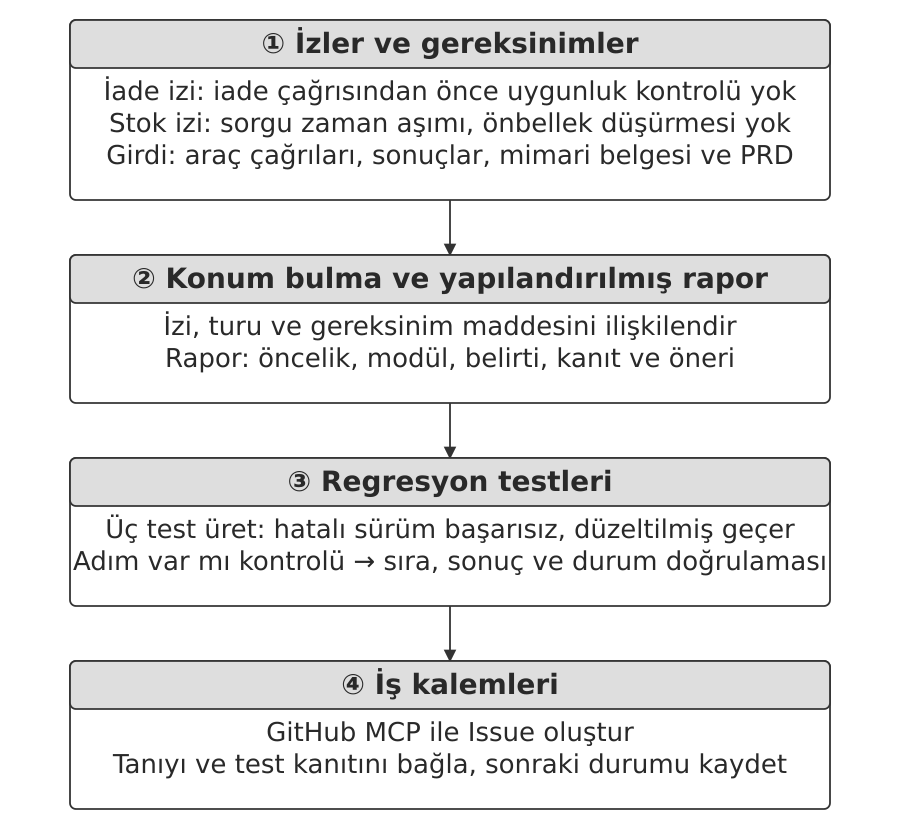
>
> Üç test kusurlu sürümde başarısız oldu, düzeltilmiş sürümde geçti. Testlerden biri yalnızca programın iade kontrol aracını çağırıp çağırmadığına bakıyor. Program önce parayı iade edip bu siparişin iade edilip edilemeyeceğini sonradan sorgulasa bile bu test geçer. Çalıştırma kaydında GitHub MCP'nin iş kaydı oluşturma makbuzu da saklanıyor; tanı raporu geliştiriciye verildikten sonra hangi iş kaydına karşılık geldiği böylece bulunabilir.

### Üretken UI olarak kod

Kullanıcı Agent'ın işlediği malzemeyi kendisi de değiştirecekse arayüz iki tarafın ortak çalışma tezgâhına dönüşebilir. Yolculuk tablosu örneğinde kullanıcı asistanın hangi aşamayı değiştirdiğini görsün, değişikliği devralsın, bir değişikliği onaylasın ya da geri alsın. Kullanıcı kalkış tarihini cumaya çevirdiyse asistan bundan sonra bu yeni yolculuk üzerinde çalışmalıdır. İki tarafın aynı görünür durumu paylaşması ve düzenlenen alanı hangi tarafın denetlediğinin kararlaştırılması, "bakarak değiştirmeyi" mümkün kılar.

Kullanıcının üç seyahat seçeneğini karşılaştırmak istediğini düşünün. Varış noktası henüz belirsizken diyalog soru sormaya uygundur; varış noktası netleştikten sonra kullanıcının tarihi doğrudan seçmesi ve kişi sayısını yazması, birkaç paragraf metni tekrar tekrar karşılaştırmaktan kolaydır; en sonda toplam fiyatın tarihe göre nasıl değiştiğini karşılaştırmada bir grafik farkı göz önüne serer. Agent göreve göre ilgili formu, grafiği ya da uygulama arayüzünü üretir; kullanıcı doğrudan doldurur, seçer ve işler. Buna **üretken UI (Generative UI)** denir.

**Arayüzü ve etkileşimi protokolle betimlemek.**

Arayüz üretmenin iki uygulama yolu vardır: HTML, JavaScript gibi kodlar üretip denetimli ortamda yürütmek; ya da bildirimsel bir yapı üretip istemci bileşenlerinin bu yapıyı render etmesini sağlamak. Birincisi özel düzen ve etkileşim uygulamayı kolaylaştırır, ikincisi kullanılabilir yetenekleri istemcinin sunduğu bileşenler ve eylemlerle sınırlar.

A2UI (Agent-to-User Interface) bildirimsel betimleme kullanır. Agent bileşenleri, veri bağlamayı ve güncellemeleri ifade eden yapılandırılmış bir mesaj üretir; istemci arayüzü kendi bileşenleriyle sunar[^ch5-ui-protocols]. Örneğin uygulama kart, düğme, metin kutusu ve tablo bileşenleri sunabilir; Agent buna göre başlığı "satış verisi" olan, üç satır iki sütunlu bir tablo betimler. Bileşen dizini grafik, harita gibi yeteneklerle genişletilebilir.

AG-UI (Agent–User Interaction) Agent ile ön uç arasındaki olay etkileşiminden sorumludur; mesajları, araç çağrılarını ve durum güncellemelerini taşır, A2UI'nin arayüz mesajlarını da iletebilir. İkisi birleştiğinde A2UI neyin gösterileceğini betimler, AG-UI ise arka uçtaki yürütme ile ön uçtaki etkileşimi bağlar.

İstemci arayüz güncellemelerini adım adım alabilir ve uyarlanmış render'lar aracılığıyla web, mobil ya da masaüstünde gösterebilir. İstemci bileşen özniteliklerini, veri bağlamayı ve eylem taleplerini doğrular; sunucu iş yetkilerini kontrol etmeyi sürdürür. Bileşenlerdeki bağlantılar, zengin metin ve veri erişimi de kendi kurallarına göre ele alınmalıdır.

Kod doğrudan üretildiğinde ise bağımlılıklar, kaynak erişimi ve yürütme yetkileri kontrol edilmeli, üretilen arayüz ile ana uygulamanın hassas durumu yalıtılmalıdır. Dış malzemedeki prompt enjeksiyonu üretim sürecini etkileyebilir; tarayıcıdaki betik yürütme riski de sayfanın yüklenme ve yalıtım biçimine bağlıdır.

**Etkileşimli çıktıları HTML ile teslim etmek.**

**Veri, gösterim ve sürekli güncellenen sonuç içeren araştırma teslimlerinde yazar önce HTML web sitesini kullanır.** Uzun ve doğrusal bir Markdown sunumu okurun sürekli bağlam aramasını gerektirir; etkileşimli bir sayfa açıklamayı, veriyi ve gösterimi aynı girişte buluşturur: okur grafiğe bakar, ilgilendiği örnekleri süzer, bir sonucun ayrıntısını açar ve gösterimi işleterek sistem davranışını anlar. Agent sayfayı görev ilerledikçe de güncelleyebilir; sayfa mevcut sonuçları ve kanıtları sürekli kaydeder.

Yazarın araştırma pratiğini örnek alırsak her araştırma projesinin, araştırma sürecinde yaşayan bir belge ve aynı zamanda nihai teslim olarak kullanılan etkileşimli bir web sitesi vardır; Agent deneyler ilerledikçe içeriği sürekli tamamlar. Bu siteler ağırlıklı olarak üç işi üstlenir.

Birincisi **deney verisinin izlenebilirliği**. Sayfa örnekleri, prompt'ları, model yanıtlarını ve puanları birbirine bağlar ve tek tek kontrol etmeyi destekler. Örneğin aynı tür yanıtlar hep düşük puan alıyorsa puan kaydından özgün yanıta ve prompt'a geri gidilebilir.

İkincisi **eğitim göstergelerinin izlenmesi**. Yazar eğitimin iç durumunu yansıtan sinyallere "dahiliye göstergeleri" diyor: eğitim ve doğrulama kaybı, gradyan normu, öğrenme oranı, pekiştirmeli öğrenmede ise ödül, KL ıraksaması ve politika entropisi. Dil modellerinde ayrıca modelin verilen metin dizisini tahmin etme başarısını ölçen şaşkınlık kullanılabilir. Tıbbi kontroldeki fizyolojik göstergeler gibi bu eğriler kimi zaman sorunları nihai görev puanından daha erken ortaya koyar. Bunları görev doğruluğuyla birlikte izlemek, yakınsamama, gradyan anormalliği ve eğitim bozulmasının hangi aşamada başladığını bulmayı kolaylaştırır.

Üçüncüsü **çalışma ilkesinin gösterimi**. Birkaç modülün nasıl birlikte çalıştığını anlatırken sayfa okurun bir girdiyi değiştirmesine, ara durumu görmesine ve çıktıdaki değişimi deney kaydıyla karşılaştırmasına izin verebilir.

İş saatlerce sürerken kullanıcı nasıl araya girip devralır? Yazar Coding Agent'ı kullanırken sözlü bir talimatın işi yürüten Agent'a doğru ulaşmasını, sonuçları istediği anda açabilmesini, yeni sürüm çıktığında ya da karar vermesi gereken bir sorun doğduğunda uyarılmasını istiyor. Örneğin iki rapor aynı anda üretiliyor. Kullanıcı satış raporunu açıp ikinci grafiği göstererek "bunu net gelire göre yeniden çiz" diyor. Arayüz mevcut rapor ve grafik tanımlayıcısını talimatla birlikte göndermelidir. Grafik düzeltildiğinde bildirim doğrudan yeni sürümü açabilir; "net gelir"in iki kullanılabilir ölçütü varsa asistan seçilecek iki ölçütü kullanıcıya listelemelidir.

**Kullanıcı niyetini netleştirmek.**

Kullanıcı "Pekin'e bir uçak bileti almak istiyorum" dediğinde varış noktası bellidir; kalkış şehri, tarih ve gidiş-dönüş bilgisi hâlâ eksiktir. Agent bir turda toplu soru sorabilir ya da bir form üretip ilgili koşulları aynı sayfada gösterebilir.

Formdaki denetimler farklı bilgi türlerine karşılık gelir: metin kutusu serbest girdi toplar, açılır menü ve radyo düğmeleri seçenekleri listeler, onay kutuları çoklu seçime izin verir, tarih seçici zaman doldurmayı kolaylaştırır. JavaScript basamaklı ilişkileri ifade edebilir; örneğin "gidiş-dönüş" seçildiğinde dönüş tarihi gösterilir ve dönüşün kalkıştan önce olmaması kontrol edilir. Seçim değiştiğinde geçersiz alanların temizlenmesi ya da yok sayılması da gerekir.

Şekil 5-8 aşağıdaki deneyin bir çalıştırmasından alınmıştır. Bu başvuruyu aşağıya doğru izleyin: tarayıcının döndürdüğü dört alanın içinde varış noktası yok; model yolcunun Pekin'e gideceğini nereden biliyor?

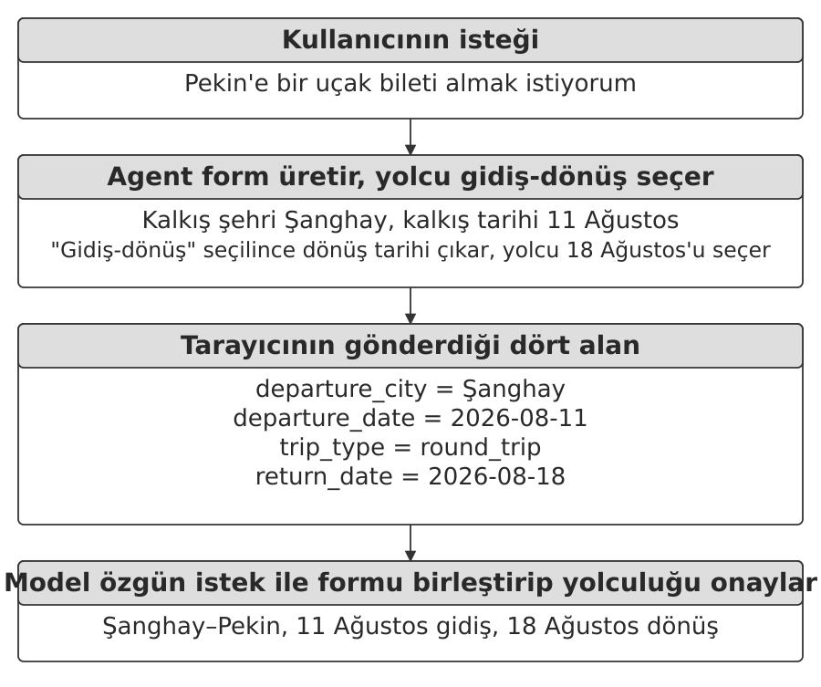

> **Deney 5-12 ★★: Dinamik form üretimiyle niyet netleştirme sistemi**
>
> Bu deney "Pekin'e bir uçak bileti almak istiyorum" isteğinden yola çıkıp modele bir HTML formu ürettiriyor: kalkış şehri metin kutusu, kalkış tarihi tarih seçici, seyahat türü gidiş ve gidiş-dönüş seçenekleri, dönüş tarihi ise gidiş-dönüş seçildiğinde görünür.
>
> Program ilk talebi ve form verisini birlikte modele geri verir. Yalnızca gönderilen alanlar korunursa, her denetim doğru doldurulmuş olsa bile varış noktası yine eksik kalır.
>
> Aynı formla bir adım daha deneyin: dönüş tarihini doldurduktan sonra gidiş seçeneğine geçin. Sayfa dönüş girdisini gizler, ama gönderilen JSON hem gidiş seçeneğini hem de 18 Ağustos dönüş tarihini korur. Gidiş seçildiğinde istemci geçersiz dönüş tarihini de temizlemelidir.

[^ch5-ui-protocols]: A2UI resmî belgeleri ve *AG-UI Overview*; bildirimsel arayüz betimlemesini ve Agent–ön uç olay etkileşimini sırasıyla tanıtır.

**SQL sorgusu üretmek.**

Kullanıcı veritabanı sorgularını doğal dille sorabilir; Agent tablo yapısına ve iş ölçütlerine göre SQL üretir. **Tam sorgu tablosunu gösterirken yazar Artifact modunu kullanır; böylece sonuç doğrudan veritabanından arayüze geçer.** Modelin büyük tabloyu okuyup satır satır tekrarlaması token kullanımını ve bekleme süresini artırır, ayrıca kopyalama hatası getirir. SQL denetlenebilir bir sorgu ürünü olarak saklanır; nedeni çözümlemek ya da eğilim özetlemek gerektiğinde gerekli toplam sonuçlar modele verilir.

Şekil 5-9'da kullanıcı her departmandaki çalışan sayısını görmek istiyor; sayfa veritabanının döndürdüğü istatistik tablosunu doğrudan gösterebilir. Kullanıcı ardından "pazarlama departmanı Ar-Ge'den kaç kişi fazla" diye sorarsa model tablodaki 9 ve 5'i alıp farkı 4 olarak hesaplar. "Geçen ay da bu kadar fark var mıydı" diye sorulursa eldeki tablo yetmez; geçen ayın istatistik tarihine göre yeniden sorgulamak gerekir.

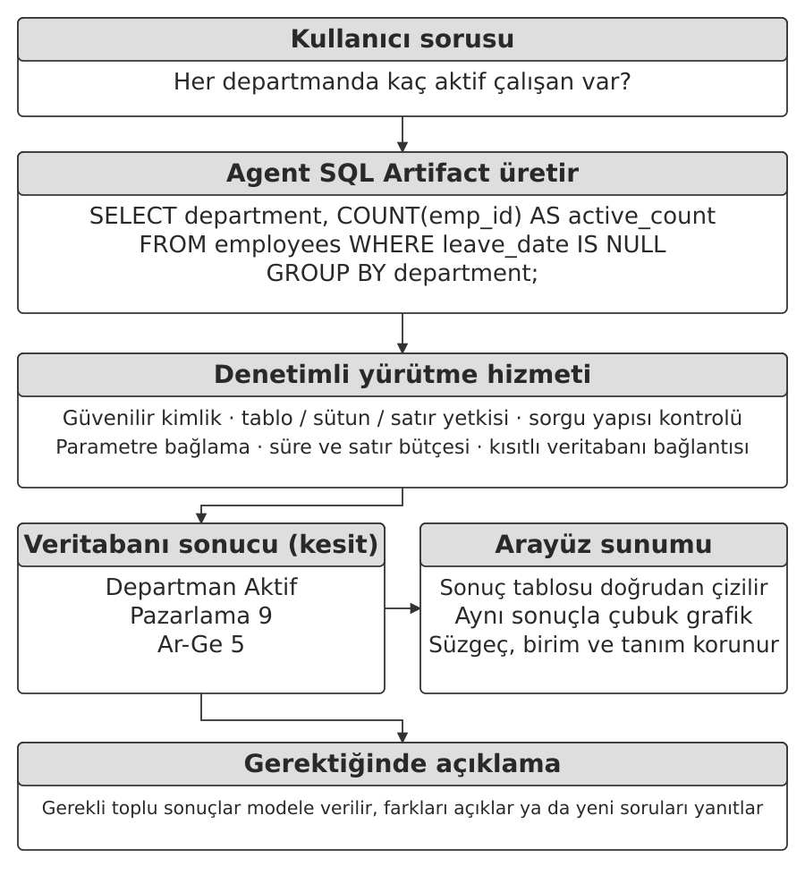

Yürütme hizmeti güvenilir kimliğe göre erişilebilecek tabloları, sütunları ve satırları belirler, kısıtlı veritabanı hesabı kullanır ve SQL yapısını ve işlem türünü doğrular. Sorgu senaryosu onaylanmış salt okunur sorgularla sınırlandırılabilir; fonksiyon çağrıları, süre bütçesi, dönen satır sayısı ve veri kapsamı denetlenir; kullanıcı girdisi değerleri parametreli bağlama ile geçirilir.

Agent görselleştirme ürünleri de üretebilir; örneğin departman özetini çubuk grafik olarak göstermek. Yürütme hizmeti sorgu sonucunu denetimli görselleştirme ortamına verir; arayüz yalnızca izin verilen veriyi ve etkileşimi gösterir.

> **Deney 5-13 ★★: Doğal dille etkileşen ERP Agent'ı**
>
> Bu deney bir ERP (kurumsal kaynak planlama) sistemindeki çalışan ve maaş sorgularını örnek alarak iş sorularından SQL üretmeyi ve veritabanı sonucunun doğrudan sayfaya girmesini öğretiyor. PostgreSQL'de iki tablo kuruluyor: çalışan tablosu çalışan ID'si, ad, departman, kademe, işe giriş tarihi ve ayrılış tarihi içerir; ayrılış tarihinin boş olması çalışanın hâlâ görevde olduğunu gösterir. Maaş tablosu çalışan ID'si, ödeme tarihi ve maaş içerir; her çalışan için ayda bir kayıt vardır.
>
> Agent bu iki tabloyu kullanarak aşağıdaki on soruyu işliyor:
>
> 1. Bir çalışan ortalama ne kadar süre görevde kalıyor?
> 2. Her departmanda kaç çalışan görevde?
> 3. Hangi departmanın ortalama kademesi en yüksek?
> 4. Her departmana bu yıl ve geçen yıl kaçar kişi yeni girdi?
> 5. Evvelsi yılın martından geçen yılın mayısına kadar A departmanının ortalama maaşı?
> 6. Geçen yıl A ve B departmanlarından hangisinin ortalama maaşı daha yüksekti?
> 7. Bu yıl her kademenin ortalama maaşı?
> 8. İşe girişten sonraki ilk yıl, bir–iki yıl ve iki–üç yıl aralığındaki çalışanların son ay ortalama maaşı?
> 9. Geçen yıldan bu yıla maaşı en çok artan 10 çalışan?
> 10. Ödenmemiş maaş var mı (bir ayda görevde olup maaş almamış)?
>
> Sorgudan önce istatistik ölçütleri netleştirilmelidir. Örneğin görevdeki çalışanın kıdemi sorgu tarihine kadar, ayrılmış çalışanınki ayrılış tarihine kadar hesaplanır; "ortalama maaş"ın ödeme kayıtlarına göre mi çalışan ortalamasına göre mi alınacağı belirlenmelidir; artış sıralamasında geçen yıl kaydı olmayan çalışanların nasıl ele alınacağı da çözülmelidir.
>
> Bu çalıştırmada on SQL üretilip yürütüldü; sonuçların hepsi bağımsız başvuru hesaplarıyla uyuştu, ardından tablolar doğrudan tarayıcıda render edildi. Model tablo yapısını, görevi ve gerekli yürütme geri bildirimini aldı; veritabanı satır verileri uygulama üzerinden arayüze aktarıldı.

**Dinamik olarak üretilen yazılım.**

Agent gereksinimden başlayarak arayüzü ve etkileşim mantığını üretebilir, sonra kullanıcının işlemlerine göre değiştirmeyi sürdürebilir. Anthropic'in 2025'te sunduğu geçici araştırma önizlemesi "Imagine with Claude" bu etkileşimi gösterdi: kullanıcı arayüzü keşfederken model ilgili yazılım deneyimini sürekli üretiyordu[^ch5-imagine].

**Gerçek ürünler için yazar mevcut bir çerçeve üzerinde özelleştirmeyi daha umut verici buluyor.** Bütün uygulamayı sıfırdan sürekli üretmek üretme, render ve doğrulama maliyetini tekrar tekrar ödemek demektir; kararlı bir çerçeveyi koruyup kullanıcının önemsediği arayüz ve akışları açmak güvenilir kişiselleştirilmiş deneyimi daha hızlı sunar. Kullanıcı "düğmeyi maviye çevir", "yan menüye bir kısayol ekle", "daha okunaklı bir yazı tipi kullan" dediğinde Agent ilgili bileşeni bulur, kodu değiştirir ve sonucu önizlemeyle kontrol eder. Temel çerçeve kararlı sayfa yapısını ve iş arayüzlerini sağlar; özelleştirme kapsamı renk ve yazı tipinden adım adım düzen ve bileşenlere genişleyebilir.

Geliştirme ortamındaki HMR (Hot Module Replacement, sıcak modül değiştirme) kod değiştiğinde etkilenen ön uç modüllerini güncelleyebilir. Durumun korunup korunmayacağı çerçeve entegrasyonuna, güncelleme sınırına ve değişiklik türüne bağlıdır; tam yenileme gerektiğinde uygulama gerekli durumu da saklamalıdır. FastAPI geliştirme modundaki reload ise sunucu programını yeniden yükler; ikisi sırasıyla ön uç modüllerine ve arka uç sürecine etki eder[^ch5-hmr].

> **Deney 5-14 ★★: Sohbet tabanlı arayüz özelleştirme sistemi**
>
> Bu deney React ön uç ve FastAPI arka uçtan oluşan bir sohbet uygulaması kuruyor; geliştirme ortamında ön uç HMR'ı ve arka uç reload'u etkin. Model art arda gelen üç tur isteğe göre rengi, yazı tipini ve başlığı değiştiriyor; tarayıcı her değişiklikten sonra gerçek arayüzü kontrol ediyor.
>
> Bu çalıştırmada Vite'ın HMR olayları kaydedildi; üç turdaki değişikliklerin hiçbirinde tam sayfa geçişi olmadı, mevcut sohbet durumu korundu ve nihai derleme geçti.

[^ch5-imagine]: Anthropic, *Introducing Claude Sonnet 4.5*; modelle birlikte yayımlanan geçici araştırma önizlemesi Imagine with Claude'u tanıtır.
[^ch5-hmr]: *Vite HMR API* ve *FastAPI CLI*; ön uç sıcak güncellemesini ve geliştirme sunucusunun otomatik yeniden yüklenmesini sırasıyla tanıtır.

**Yetki sınırlarını dinamik iş kodundan bağımsız tutmak.**

**İş kodu Agent tarafından ne kadar kolay yeniden yazılabiliyorsa, nihai yetki sınırı o kadar kararlı veri erişim katmanına indirilmelidir.** Geleneksel uygulamalar yetki kararlarını incelenmiş iş koduna yazar; üretilen kod sürekli değiştiğinde yeni bir yol aynı kontrolü atlayabilir. Her okuma/yazmanın bağımsız bir veri erişim hizmetinden geçmesi, yetki kısıtlarının korunmasını sağlar. Örneğin bir işe alım uygulaması aday listelerini ve işlem formlarını dinamik olarak üretebilir; adayın hangi kuruma ait olduğunu ve işe alım uzmanının hangi alanları güncelleyebileceğini ise güvenilir veri erişim hizmeti sürekli kontrol eder.

Buradaki tasarım hedefi şudur: **üretilen kod hata yapsa bile güvenilir veri erişim katmanı yetki kısıtlarını zorla uygulamaya devam edebilmelidir.** Bu, Bölüm 1'deki veri katmanı korkuluğunun devamıdır: zorunlu kurallar ilgili tüm işlemlerin geçmek zorunda olduğu yere konur. Veritabanı satır düzeyi güvenlik politikaları kayıt erişimini sınırlayabilir, kısıtlar ve doğrulayıcılar geçerli durumu kontrol eder, denetimli görünümler, saklı yordamlar ya da veri hizmetleri izin verilen işlemleri sunar. Uygulama katmanı önceden kontrol edip kullanıcıya açıklayabilir; nihai okuma/yazma ise yine güvenilir veri hizmeti ve veritabanı yetkileriyle denetlenir.

Her işlem ayrıca güvenilir bir **erişim context'i** (access context) gerektirir; kullanıcı, kiracı, rol ya da Agent kimliğini içerir. Kimlik doğrulama hizmeti ve güvenilir çalışma zamanı kimliği kurar ve bağlar, veri hizmeti buna göre yetkilendirir. Dinamik kod görevi tamamlamak için gereken kısıtlı arayüzleri alır; kimlik bilgilerini ve politika yönetim yetkisini bağımsız bileşenler saklar. Tüm veritabanı bağlantıları, yardımcı sorgular ve arka plan işlemleri aynı erişim kapsamına uymalıdır.

Örneğin PostgreSQL'in satır düzeyi güvenliği veritabanı rol yapılandırmasıyla birlikte kullanılmalıdır. Uygulama bağlantısı politikayla kısıtlanmış bir rol kullanır ve uygulama hesabının erişim politikalarını değiştirme yetkisi yoktur[^ch5-rls]. Kurallar ve kimlik bağlama mekanizması bağımsız olarak incelenir; iş arayüzü ise bu kapsam içinde sürekli değişebilir.

Yetki ile veri bütünlüğü farklı sorumluluklar üstlenir. İşe alım uzmanı aday kaydını değiştirme yetkisine sahip olduktan sonra durum makinesi "elendi" durumundan "mülakat yapıldı" durumuna geçişe izin verilip verilmediğini kontrol etmeyi sürdürür; maaş doğrulayıcısı ilgili pozisyonu okuyup beklenen maaşın pozisyon aralığında olup olmadığını kontrol eder; başvuru denetimi pozisyon ile aday ilişkisinin geçerli olduğunu doğrular.

> **Deney 5-15 ★★★: Dinamik üretilen yazılım için yetkiyi içeren veri nesneleri**
>
> Bu deney PostgreSQL üzerinde çalışan bir Python nesne deposu prototipi sunuyor; yetki kurallarını, doğrulayıcıları, nesne ilişkilerini ve sonraki tepki bildirimlerini veri türüne yerleştiriyor. Okumada erişim yetkisi kontrol ediliyor; oluşturma ve güncellemede önce yetki ve iş doğrulaması yapılıyor, başvuru ilişkileri kontrol ediliyor, sonra kalıcı hâle getiriliyor; ardından bildirilmiş sonraki tepkiler kuyruğa ekleniyor ve tepki zincirinin derinliği sınırlanıyor.
>
> İşe alım örneği pozisyon, aday, mülakat ve değerlendirme nesnelerini içeriyor. Aday sırasıyla başvuru, eleme, mülakat, teklif gönderimi ve işe alım aşamalarından geçiyor; ilgili aşamalardan ret durumuna da geçilebiliyor; maaş aralığı ilişkili pozisyondan geliyor. Örnek normal durum güncellemesi, geçersiz durum atlaması, pozisyon maaş aralığının aşılması ve farklı kiracıdan erişim gibi kontroller içeriyor; okurun yetkilendirme ile iş doğrulamasının hangi sorunları ayrı ayrı ele aldığını anlamasına yardım ediyor.
>
> Prototip kullanıcıyı, rolü ve kurum özniteliklerini `AccessContext` ile ifade ediyor; öğretim betiği farklı kimlikleri canlandırmak için bu context'leri doğrudan kuruyor. Dağıtımda context kimlik doğrulama girişinde kurulur ve nesne deposu ile üretilen kod net bir hizmet ya da yetki sınırının iki yanına ayrılır.

[^ch5-rls]: PostgreSQL, *Row Security Policies*; rol ve işleme göre satır düzeyi güvenlik politikalarının yapılandırılmasını ve kapsamını tanıtır.

### Kod yaratan kod: Agent'ın kendini başlatması

Kod üretim yeteneği Agent'ın kendisini geliştirmek için de kullanılabilir. Yaratıcı görev gereksinimini alır, yeni Agent'ın prompt'larını, araçlarını ve çalışma döngüsünü üretir ya da değiştirir, sonra ürünü testler ve gerçek etkileşimlerle kontrol eder. Şekil 5-10 bu kendini başlatma döngüsünü gösteriyor: mevcut uygulama başlangıç noktası sağlar, görev geri bildirimi değişikliği yönlendirir, doğrulama sonuçları hangi değişikliklerin korunacağına karar verir.

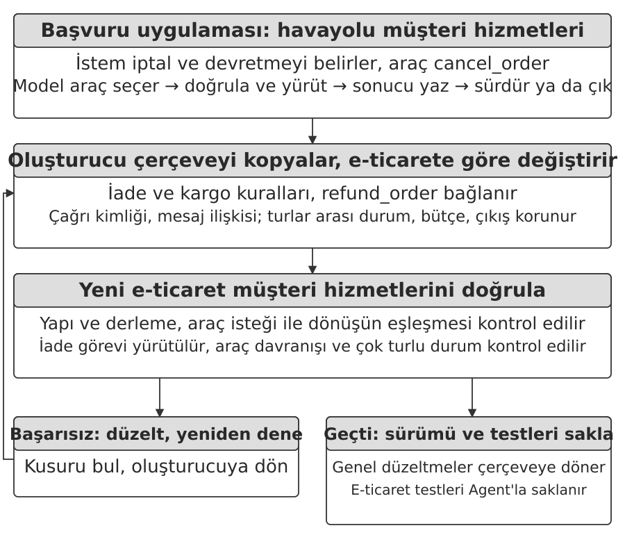

Bir değişikliğin genel yeteneği mi iyileştirdiği, yoksa yeni görülen soruya mı tesadüfen uyduğu nasıl ayırt edilir? Yaratıcıya verilmemiş bir görev saklanır. Örneğin bir mağazanın verisiyle fiyat izleme Agent'ı geliştirilir, sonra ona başka bir mağazanın örnekleri verilir ve özgün görevler de yeniden çalıştırılır.

**Agent'ın çalışma ortamını bakımda tutmak.**

Yeni Agent'ın çalışması yapılandırmaya, kimlik bilgilerine, oturum durumuna, hizmetlere ve sandbox'a dayanır. OpenClaw'ın `doctor` komutu bir bakım aracı örneği sunar: eski yapılandırma geçişini, OAuth kimlik bilgisi durumunu, oturum kilitlerini, eklenti kurulumunu, ağ geçidi sağlığını ve sandbox imajını kontrol eder; onarım önerileri verir ya da ilgili onarımları yürütür[^ch5-doctor].

Bu deterministik kontroller öz bakım akışının temeli olabilir. Tespit kuralları bilinen arızaları kapsar, onarım eylemlerinin net girdileri ve beklenen sonuçları vardır. Agent tanı akışını daha ileri tasarlarken henüz çözülmemiş sorunlar günlüklerle, yapılandırmayla ve kontrol sonuçlarıyla birlikte modele verilip hangi yapılandırmayı nasıl değiştireceğini açıklaması istenebilir; yürütme katmanı yetkiyi ve değişiklik kapsamını kontrol eder, sonra sağlık kontrolleri ve regresyon testleri çalıştırılır. Yapılandırma anlık görüntüleri, değişiklik kayıtları ve geri dönüş girişi, onarım başarısız olduğunda sistemin işe dönmesine yardım eder.

**Mühendislik deneyimini başvuru uygulamasıyla taşımak.**

Özel bir Agent oluşturmak hem alan mantığını hem genel altyapıyı ilgilendirir. Üretilen sonucu kontrol ederken dört tür sorudan başlanabilir:

1. **Context ve çalışma döngüsü.** Roller, araç çağrısı tanımlayıcıları ve araç sonuçları arasındaki ilişki korunur; çok turlu durum, sonlandırma koşulları, bütçe ve istisna kurtarma kontrol edilir. Yapılandırılmış mesajlar protokol ilişkilerinin bakımını kolaylaştırır; kararlı önek ise prompt önbelleği için koşul yaratır.
2. **Araç arayüzleri.** Araç açıklaması amacı, geçerlilik koşullarını ve kullanım sınırlarını anlatır; parametreler tür, anlam ve somut örnek içerir. Yürütme katmanı parametreleri, kimliği ve iş durumunu doğrulamayı sürdürür.
3. **Model ve API seçimi.** Modeller eğitim verisinde sık görülen eski modelleri ve eski arayüzleri sürdürmeye yatkındır; akıcı yazılmış kod bile güncel olmayan seçimler yapabilir. Yaratıcıya bakımlı seçim malzemeleri verilmeli ya da resmî belgeleri araması sağlanmalı, model yetenekleri, arayüz sürümleri ve çağrı biçimleri kontrol edilmelidir. Üretimden sonraki gerçek çağrılar yapılandırmanın çalışıp çalışmadığını sınar.
4. **Bağımlılıklar ve ekosistem uyumluluğu.** Kitaplıkların bakım durumu, sürümleri ve arayüz değişiklikleri kontrol edilir; birleşik program bağımlılık kurulumu, derleme kontrolü ve testlerle doğrulanır.

**Özel Agent oluştururken yazar yaratıcının önce doğrulanmış bir başvuru uygulamasını kopyalamasını, sonra alan değişiklikleri yapmasını tercih ediyor.** Prompt'lar mesaj protokolündeki, durum yönetimindeki ve kurtarma mekanizmalarındaki bütün ayrıntıları tüketemez; başvuru kodu ise bu mühendislik deneyimini doğrudan yeni sisteme taşır. Model programlamada iyi olsa bile görev açıklamasında açıkça söylenmeyen çalışma koşullarını atlayabilir; çerçeveyi yeniden kullanmak bu tür tekrarlanan hataları azaltır. Yaratıcı uygun temel çerçeveyi kopyalar, sistem prompt'unu yeni role uyacak şekilde ayarlar, alan araçlarını ekler ya da çıkarır, iş mantığını değiştirir ve ilgili testleri tamamlar. Mesaj işleme, çağrı ilişkilendirme, durum yönetimi ve çıkış yolları çerçeve tarafından sağlanır; alan değişiklikleri yeni örneklerle doğrulanır.

Şablon çok daha hızlıysa "birkaç işlevi eksik yaptı" açıklaması nasıl elenir? Aşağıda iki yaratıcı grubu aynı türde bir Agent'ı teslim ediyor ve aynı kontrol kümesinden geçiyor.

> **Deney 5-16 ★★★: Agent yaratabilen bir Agent geliştirmek**
>
> Aynı yaratıcı modelden bir yayın inceleme Agent'ı kurmasını isteyin: bir grup dağıtım kontrol kaydını okusun, zorunlu kontrol maddelerinden biri geçmemişse yayını reddetsin ve dayanağı göstersin. Sıfırdan oluşturmada model çalışma döngüsünü, araç protokolünü, alan araçlarını, komut satırı girişini ve testleri yazmak zorundadır. Şablon yolunda önce yapılandırılmış kayıtları kontrol edebilen bir Agent kopyalanır, model yalnızca alan şartnamesini doldurur. Örneğin durum hangi alanda tutuluyor, hangi değerler geçtiği anlamına geliyor? Oluşturma betiği şartnameye göre sistem prompt'unu, araç tanımlarını ve açıklama belgelerini üretir. Var olan Python aracı şartnameyi okuyup kontrolü yürütür. İki yol da üst programlamayı yansıtır: programla başka programlar üretmek ya da değiştirmek.
>
> Şekil 5-11'de iki yol aynı kabul koşullarında birleşiyor.
>
> 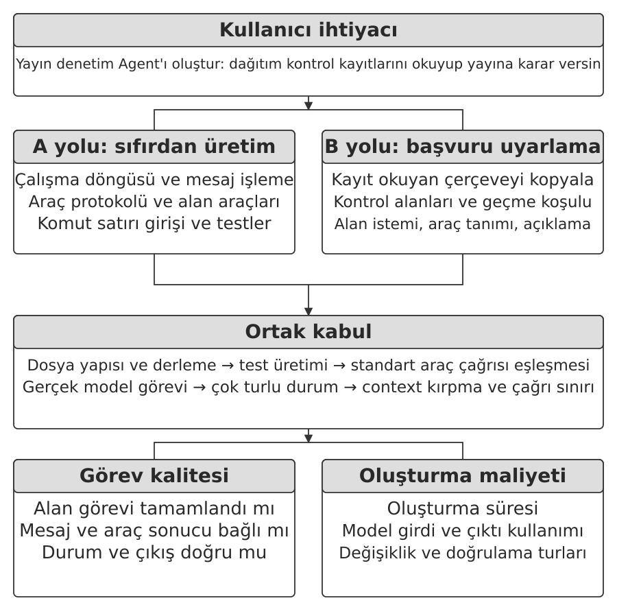
>
> İki yol aynı görev gereksinimlerini ve kabul koşullarını kullanıyor. Önce ürün yapısı, derleme ve testler kontrol ediliyor, sonra standart mesajlardaki araç çağrısı ile sonuç ilişkisi kontrol ediliyor, en sonunda gerçek model görevleri ve çok turlu etkileşimler çalıştırılarak context kırpma, durum yönetimi ve çağrı sayısı sınırı doğrulanıyor.
>
> Saklanan Kimi K3 karşılaştırmasında iki grup da 39/39 deterministik kontrolü geçti, gerçek model görevlerini ve çok turlu durum kontrollerini de geçti. Şablon yolu oluşturma sırasında 1.181 token ve yaklaşık 25 saniye, sıfırdan yol ise 381.814 token ve yaklaşık 90 dakika kullandı.
>

[^ch5-doctor]: OpenClaw, Doctor; yapılandırma ve durum kontrolü, geçiş ve onarım işlevlerini tanıtır.

## Bölüm özeti

**Coding Agent'ın erkenden olgunlaşmasının kolayca gözden kaçan bir nedeni var: yazılım mühendisliğinin zaten tür sistemleri, test paketleri, sürüm denetimi ve hata ayıklama araçları vardı.** Kod yanlış değiştirildiğinde testler çoğu zaman hangi girdinin beklenmedik sonuç verdiğini gösterir; başka bir değişiklik denenip özgün girdiyle yeniden sınanabilir. Bu deneyimi başka görevlere uygularken önce üç somut soru sorulmalıdır: hata nasıl fark edilir, bilinen bir duruma nasıl dönülür, ne zaman durup bir insandan devralmasını istemek gerekir? Örneğin iade çağrısı yarıda koparsa Harness önce hesabı kontrol edip sonra yeniden denemeye karar vermelidir; aksi hâlde bir arızadan kurtarma ikinci bir iadeye dönüşebilir.

Kod tek bir yargıyı tekrar tekrar kullanılabilecek bir şeye de dönüştürebilir. Matematik sorusundaki sayım ve mantık sorusundaki kısıtlar programa madde madde sınatılabilir; iade kuralları yürütme girişindeki doğrulamaya yazılıp sunucunun siparişteki gerçek durumu okuyarak geçişe karar vermesi sağlanabilir. Günlük biçimi değişirse ayrıştırıcı değiştirilip bu kez hata veren örnek regresyon testi olarak saklanabilir. Üç durumda da kod çalıştırılabilir, ama ölçütler farklıdır: çözüm problemin koşullarını sağlıyor mu, iade politikaya uygun mu, yeni ayrıştırıcı daha önce kaçırılan alanları okuyabiliyor mu?

Teslim edilen şey belge, video ya da geometrik modelse render sonucunun, ses-görüntü eşleşmesinin ya da boyut doğruluğunun da kontrol edilmesi ve bir denetleyicinin gerçek ürüne bakması gerekir. Teslim edilen şey form, sorgu ya da görselleştirmeyse kullanıcının anlayıp kullanıp kullanamadığının yanı sıra arkadaki yürütme hizmetinin veriyi yetkilere göre alıp almadığı da kontrol edilmelidir. Kodun ürettiği şey başka bir Agent'sa yazar önce doğrulanmış bir çerçeveyi yeniden kullanmayı, alan araçlarını ve iş mantığını üretmeyi, sonra çağrı protokolünü, turlar arası durumu ve gerçek görev sonuçlarını kontrol etmeyi tercih ediyor. Böyle biriken araçlar, doğrulayıcılar ve testler bir sonraki görevde de kullanılabilir.

Kod görevlerin tekrar tekrar yürütülmesini sağlar, ama ortam yürütmenin bitmesini beklemeyebilir. Bir sorgu hâlâ çalışırken kullanıcı fikrini değiştirmiş olabilir. Bölüm 6 bu tür değişikliklerin süren bir etkileşime nasıl girdiğini tartışıyor.

## Düşünce Soruları

1. ★★ Proje dosyalarını okuması, bağımlılık kurması ve testleri çalıştırması gereken bir Coding Agent için sandbox tasarlayın. Dosya, ağ, süreç ve kaynak yetkilerini nasıl yapılandırırdınız? Görev yetkinin genişletilmesini gerektirdiğinde talep nasıl ifade edilir, kapsam nasıl kontrol edilir ve kayıt nasıl tutulur?
2. ★★★ Yaratıcı art arda birçok kuşak Agent üretip değiştirdiğinde çerçeve kusurları ve alan hataları adım adım birikebilir. Bu değişimi başvuru sürümleri, regresyon testleri, davranış değerlendirmesi ve geri dönüş mekanizmalarıyla nasıl izlersiniz?
3. ★★ Günlük biçimindeki bir değişiklik normal bir yükseltmeden de üretici kusurundan da gelebilir. Uyarlanabilir ayrıştırma sistemi hangi kanıtları saklamalı, yeni ayrıştırıcı eklemeye, anormallik bildirmeye ya da işlemeyi durdurmaya hangi koşullara göre karar vermelidir?
4. ★★ Öneren–denetleyen döngüsünde denetleyici sayfadaki bilgi yoğunluğunu makul buluyor, kullanıcı ise kalabalık buluyor. Kullanıcı tercihini örneklere, puanlama koşullarına ve etkileşim geri bildirimine nasıl dönüştürür, sonraki değişikliklerin gereksinime uyup uymadığını nasıl kontrol edersiniz?
5. ★★ Coding Agent bilgi tabanını, mimari belgeleri ve proje talimatlarını güncelleyebilir, işlem dizilerini koda da sabitleyebilir. Gereksiz ya da eskimiş kuralları nasıl tespit eder, kurallar için geçerlilik kapsamı, doğrulama yöntemi ve çıkış koşulu nasıl tasarlarsınız? Tek bir başarılı değişiklikten Bölüm 9'da tartışılan sürekli evrime geçmek için başka hangi birikim ve değerlendirme mekanizmaları gerekir?
6. ★ Uzaktan iş birliğine uygun ekipler genellikle Agent'ın çalışma bilgisi edinmesini de kolaylaştırır. Tanıdığınız bir projenin gereksinimlerini, mimarisini, karar kayıtlarını ve kabul ölçütlerini inceleyin; en çok eklenmesi gereken belgeleri listeleyin ve bunların Agent'ın hangi somut görevleri tamamlamasına yardım edeceğini açıklayın.
7. ★★★ Aynı anda özel veriye erişen, güvenilmeyen içeriği işleyen, dışarıyla iletişim kuran ve kalıcı bellek kullanan bir Agent için kimlik yetkilendirmesini, kaynak etiketlemesini, veri akışı denetimini ve bellek yazma incelemesini nasıl düzenlersiniz? Bu kontrollerin yerini olağan bir iş akışı üzerinden açıklayın.
8. ★★ SQL ve HTML'in Artifact modunda model ürünü üretir, yürütme hizmeti sorguyu ya da render'ı işler, arayüz sonucu doğrudan gösterir. Hangi bilgilerin açıklama için yeniden modele verilmesi uygundur? Sorgu yetkisini, kaynak bütçesini, sayfa yalıtımını ve gösterilen sonucun tutarlılığını nasıl kontrol edersiniz?
9. ★★ Araç kuralları veritabanındaki iş durumuna göre doğrular, parametre açıklamaları ise modelin çağrıyı hazırlamasına yardım eder. Rezervasyon iptalini örnek alarak doğal dildeki politikanın, parametre örneklerinin, yürütme katmanı doğrulamasının ve sınır testlerinin sırasıyla hangi sorumluluğu üstlendiğini açıklayın; politika değiştiğinde hangi içeriklerin birlikte güncellenmesi gerekir?
