# Etkileşim: Gözlem ve Eylem Uzayının Genişletilmesi

**Temel model sabitken gözlem ve eylem arayüzlerini yeniden düzenlemek ya da genişletmek, Agent'ın görev performansını artırmanın en etkili mühendislik yollarından biridir.** Önceki bölümlerde Agent genellikle kullanıcının sözünü bitirmesini bekliyor, sonra kaynak araştırıyor, araçları çağırıyor ve yanıt veriyordu. O araç sonucunu beklerken kullanıcı ve dış ortam değişmeyi sürdürür.

Kullanıcı asistandan uçak biletini değiştirmesini istemiş olsun. Asistan uçuşları müşteri temsilcisine sorarken kullanıcı "bir de check-in bagajım var" diye yazıyor; temsilci hâlâ konuşurken ekrandaki bilet fiyatı da değişebilir. Asistanın fiyatın bagajı kapsayıp kapsamadığını zamanında sorması ve az önceki teklifin hâlâ geçerli olup olmadığına dikkat etmesi gerekir. Burada iki tasarım sorusu var: asistan değişiklikleri hangi kanallardan öğrenebilir ve ne zaman tepki verebilir? Bu bölüm önce asenkron gelen e-postaları ve araç sonuçlarını, sonra sürekli sesi, ekran değişimlerini ve robotların hareket geri bildirimini ele alıyor.

## Kip ve tetikleme zamanının genişletilmesi

**Kip**, bilginin ve eylemin biçimini betimler. Agent metin okuyabilir, sesi dinleyebilir, ekranı görebilir ve moment sinyalleri alabilir; ayrıca metin, sentezlenmiş ses, arayüz tıklaması ya da eklem hareketi üretebilir.

**Tetikleme zamanı**, bilginin ne zaman ulaştığına, eylemin ne zaman başladığına ve sistemin ne zaman tepki verdiğine odaklanır. Bilgi Agent tarafından sorgulanabileceği gibi dış hizmetler tarafından da itilebilir; araçlar sonucu hemen döndürebileceği gibi önce bir görev başlatıp tamamlandığını sonra bildirebilir. Yeni bir olay geldiğinde sistem mevcut işi kesintiye uğratıp uğratmayacağına ve yarıda kalan görevi nasıl sürdüreceğine de karar vermelidir.

| Boyut | Bilgi edinme ve gözlem arayüzleri | Eylem ve yürütme arayüzleri |
|---|---|---|
| İçerik düzenlemesi (Bölüm 2–5) | Context, bellek ve bilgi tabanı karar bilgisini düzenler | Araçlar ve kod yürütülebilir işlemleri ifade eder |
| Kip (bu bölüm) | Ses, ekran, fiziksel algılayıcılar | Konuşma, tıklama, eklem hareketi |
| Zamanlama (bu bölüm) | Proaktif sorgu, olay itmesi, sürekli girdi | Turlar arası yürütme, iptal, önceliklendirme ve kurtarma |

Context belirli bir karar için gereken bilgiyi taşır, gözlem uzayı sistemin alabileceği bilginin kapsamını betimler; araçlar somut arayüzler sağlar, eylem uzayı sistemin yürütmesine izin verilen eylemlerin kapsamını betimler. Arayüzler genişletilirken bu kapsamlar yine cihaz yetenekleri, parametreler, yetkiler ve çalışma ortamıyla sınırlıdır.

Pek çok araç çağrısı arayüzü mesajları turlara göre düzenler: model çağrıyı önerir, sistem araç sonucunu ekler, sonra bir sonraki akıl yürütme turu başlar. Olay güdümlü sistemler bu protokol üzerinde dış değişiklikleri yönetmek zorundadır. Arayüz yerleşik asenkronu destekliyorsa araç askıdayken yeni talepler alınabilir ve sonuç döndükten sonra işleme devam edilir; senkron arayüzlerde ise Harness kuyruklar, görev tutamaçları ve zamanlama mekanizmalarıyla etkileşimi düzenler. İki uygulama yolu aşağıda ayrı ayrı tartışılıyor.

Farklı senaryolarda geri bildirimin ritmi çok değişir. Aşağıdaki tablo yaygın zaman ölçeklerini listeliyor.

| Yaygın ölçek | Senaryo | Gözlem tarafındaki değişim | Eylem tarafındaki işleme |
|---|---|---|---|
| Saniyeden güne | Asenkron ve olay güdümlü | Dış olay Agent'ı uyandırır | Önce görev başlatılır, sonraki olaylar ilerlemeyi ve tamamlanmayı bildirir |
| Onlarca milisaniyeden saniyeye | Ses | Sürekli ses alımı | Akışlı çıktı, söz kesmeyi ve oynatmayı durdurmayı işleme |
| Saniye altından saniyeye | Computer Use | Ekran sürekli değişir | İşlemden sonra arayüz durumu yeniden alınır |
| Milisaniye düzeyi denetim çevrimi | Robot alt düzey denetimi | Algılayıcılar sürekli geri bildirim verir | Kısa hareket parçaları yürütülür, denetim ve durdurma sinyallerine tepki verilir |

## Asenkron ve olay güdümlü: dünya kendiliğinden kapıyı çaldığında

Bölüm 4 algılama, yürütme ve iş birliği araçlarını tanıtmıştı; bu kısım olay tetikleme ve kullanıcı iletişimi araçlarını ele alıyor. Olay tetikleme araçları ortam değişikliklerini Agent'a iletir, iletişim araçları ise Agent'ın görev ilerlerken kullanıcıyla bağlantı kurmasını sağlar. Harness bu girdi ve çıktıları sürmekte olan görevlerle ilişkilendirerek sürekli çalışan bir olay döngüsü oluşturur.

### Asenkron neden gerekli

Senkron çağrı sonucun dönmesini bekler; çağıran ancak ondan sonra mevcut akışa devam eder. Asenkron çağrı ise önce bir görev tutamacı döndürür (görevi sorgulamak ve yönetmek için kullanılan tanımlayıcı) ya da tamamlanmanın sonra bildirileceğini kararlaştırır; çağıran bekleme sırasında başka işleri işleyebilir. Sistem buna dayanarak birden çok süren görevi düzenleyebilir, sonra kaynaklara ve bağımlılıklara göre hangi işlemlerin paralel yürütülebileceğine karar verebilir.

Agent'ı e-postaları, telefonları ve gelen ziyaretçileri yöneten bir sekreter gibi düşünebilirsiniz: karşı tarafın yanıtını beklerken belgeleri düzenlemeyi sürdürür, acil bir telefon geldiğinde mevcut ilerlemeyi bir kenara koyar, görüşme bittikten sonra özgün göreve döner. Mühendislik uygulamasında üç şeyin ele alınması gerekir:

- **Uzun görev ile etkileşimin ayrılması.** Dosya analizi, telefon görüşmesi ya da derleme arka planda ilerlerken kullanıcı ilerlemeyi sorgulayabilir ve gereksinim ekleyebilir.
- **Olay önceliği.** Acil durdurma denetim akışına hemen girer, olağan güncellemeler kuyruğa alınır, bağımsız sorgular paralel oturumlara bırakılabilir.
- **Kesme ve kurtarma.** Görev durumu saklanır, gerçekleşmiş işlemler kaydedilir, kurtarma sırasında hâlâ geçerli koşullar yeniden kontrol edilir.

Claude Duet'in araştırma önizlemesi bir örnek sunar: kullanıcının saat ikide toplantısı vardır ve karşı şirketin brifingini önceden almak ister. Bir sesli mesaj bırakıp uygulamayı kapatabilir. Hazırlık bulutta sürer, kullanıcı istediği anda görev sayfasını açıp ilerlemeyi görebilir; asistan ondan bilgi tamamlaması gerektiğinde ya da brifing hazır olduğunda ana konuşmaya dönüp haber verir. Burada kullanıcı ayrıldıktan sonra görevin ilerlemeyi sürdürmesi asenkron yürütmedir. İleride anlatılacak tam çift yönlü görüşmenin bir gereksinimi daha vardır: bir taraf konuşmaya başladığında bile karşı tarafın sözünü kesmesini duyabilmek.[^ch6-duet]

Model API'leri mesajların sırası konusunda da anlaşma getirir. Bazı arayüzler araç çağrısı ile sonucun eksiksiz eşleşmesini şart koşar ve ancak ondan sonra bir sonraki isteği kabul eder; bazıları aracı askıda tutup sonraki güncellemeleri almaya izin verir. Uygulamadaki asenkron fonksiyonlar bekleme ve yürütmeyi düzenler; model protokolü ise mesajın ne zaman gönderilebileceğini belirler.

Şekil 6-1'de yeni mesajlar ve araç sonuçları kuyruğa girebilir, ama kuyruğa nasıl ulaştıkları kaynağa bağlıdır. Hizmet itmeyi destekliyorsa durum değiştiği anda bildirim gönderebilir; hizmet yalnızca sorgu arayüzü sunuyorsa uyarlayıcı düzenli aralıklarla sorgulamalı, değişikliği fark ettiğinde olay üretmelidir. Zamanlayıcının dolması da olay üretebilir. Olay döngüsü bu girdileri Agent'a verir.

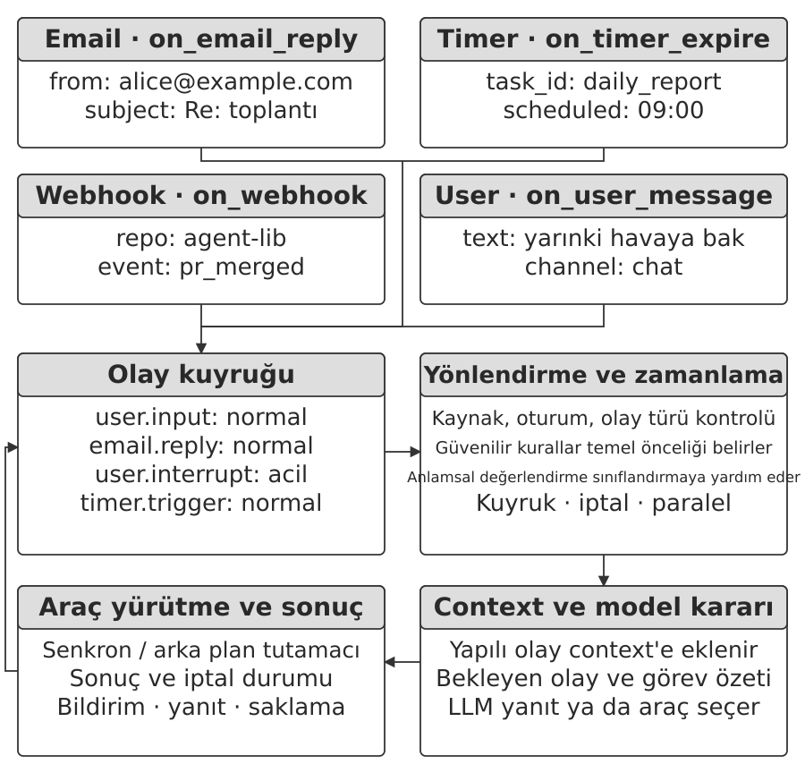

### OpenClaw'ın olay güdümlü mekanizmasının uygulanışı

OpenClaw mesajlaşma kanallarını bir Gateway üzerinden bağlar ve olayları Agent çalışma zamanına yönlendirir. Otomasyon mekanizmaları iç Hooks, zamanlanmış Cron, Heartbeat ve dış Webhook gibi girişleri içerir[^ch6-automation]. Bu mekanizmalar tetikleme koşullarına göre anlaşılabilir:

- **Hooks (olay kancaları)** çerçevenin iç olaylarına tepki verir; örneğin oturum oluşturulması, sıfırlanması ya da çalışma yaşam döngüsündeki değişiklikler.
- **Cron (zamanlanmış görev)** işi belirtilen anda ya da dönemde yürütür. Örneğin `0 9 * * 5`, yapılandırılmış saat diliminde her cuma sabah 9'da tetiklenir.
- **Heartbeat (kalp atışı)** Agent'ı dönemsel olarak uyandırıp ilgilenilmesi gereken konuları kontrol ettirir.
- **Webhook (dış geri çağrı)** dış hizmetlerin gönderdiği olayları alır, kimlik doğrulama ve yönlendirmeden sonra işlemeyi tetikler.

Haftalık rapor zamanında çalışmaya, sürekli izlenen yapılacak işler dönemsel kontrole, yeni e-postalar ve hizmet geri çağrıları ise itme yoluyla keşif gecikmesini kısaltmaya uygundur.

**PineClaw'ın görüşme olayları.** Pine AI kullanıcı adına telefon ederek fatura pazarlığı, abonelik iptali ve sigorta hasar başvurusu gibi işleri yürütür. PineClaw bu telefon görevlerini OpenClaw'a bağlar. Görüşme genellikle bir süre sürer ve bu sırada kullanıcının devreye girmesi gerekebilir:

- **Kimlik doğrulama.** Müşteri temsilcisi hesap sahibinin doğrulama yapmasını ister; örneğin güvenlik kodu ya da tek kullanımlık şifre girmesini.
- **Üçlü görüşme.** Temsilci doğrudan hesap sahibiyle konuşmak ister; kullanıcının katılması zamanında bildirilmelidir.
- **Karar teyidi.** Temsilci alternatif bir çözüm önerdiğinde asistan bu talebi ve kullanıcının geçmiş tercihlerini birlikte değerlendirip kabul edilip edilemeyeceğine karar verir. Kullanıcının karar vermesi gerektiğinde somut seçenekler kullanıcıya gönderilir, bu sırada diğer koşullar temsilciyle kontrol edilmeye devam edilir.

Örneğin temsilci hesap sahibinin üçlü görüşmeye katılmasını istiyor. Bildirim ne kadar erken ulaşırsa iki tarafın telefonda boş bekleme süresi o kadar kısalır. PineClaw örneği, Gateway ile Pine API arasında görüşme olaylarını bağlayan bir Channel mekanizması kullanır: telefonun bağlanması, kullanıcı girdisinin gerekmesi ve görüşmenin bitmesi ayrı ayrı olay akışına girer; Agent buna göre görevi günceller ve kullanıcıyı bilgilendirir.

**Bence proaktif hizmetin zamanında olması için en iyisi, durum değiştiğinde olay kaynağının Agent'a haber vermesidir.** Bildirim kanaldan ulaştıktan sonra Harness ilgili görevi bulur, yinelenip yinelenmediğini ve süresinin geçip geçmediğini kontrol eder, model bir sonraki adıma karar verir. Kullanıcının kimliğini doğrulaması gerekiyorsa arayüz güvenilir kimlik doğrulama girişini açmalı, doğrulama sonucu yeni bir olay olarak özgün göreve geri gönderilmelidir.

### Olay tetikleme araçları

"Müşteri yanıt verdiğinde beni uyar" işini asistana verirsek yarın tam zamanında nasıl uyanacak? Önce posta kutusunun mektup geldiğinde olay itip itemediğine bakılır; yalnızca proaktif sorguya izin veren sistemlerde ise bir sonraki kontrol zamanının hatırlanması gerekir. Aşağıdaki üç örnek arayüz bu bekleme koşullarını çalışma zamanına saklatır; model mevcut turdaki işini bitirebilir.

**Zamanlayıcı (`set_timer`)** bir görevi kararlaştırılan anda uyandırmaya yarar. Tek seferlik zamanlayıcı "gelecek pazartesi sabah 10'da bankayı arayıp konut kredisinin durumunu sor" işine uygundur; döngülü zamanlayıcı hizmet sağlığını saatte bir kontrol etmeye. E-posta gönderdikten sonra yanıt beklemek, çalışma saati dışında kalınca yeniden aramak da zamanlayıcıyla düzenlenebilir. Arayüz saat dilimini, tetikleme koşulunu ve görev tanımlayıcısını saklamalı, iptal ya da değişiklik girişi sunmalıdır. Dış hizmet yalnızca sorguyu destekliyorsa zamanlanmış görev ilerleme yoklamasını da üstlenebilir.

**Arka plan görev izleme (`monitor_shell`)** uzun süren bir komutu ilerleme olaylarına dönüştürür. Başlatmada görev tanımlayıcısı döner; çalışma sırasında yeni çıktı, anahtar sözcük ya da durum değişikliğine göre bildirim yapılır, bitişte çıkış durumu ve sonuç bildirilir.

Modelin ilerlemeyi tekrar tekrar sorgulamasını sağlamak, durum değişmese bile model çağrısı tüketir; yalnızca bitiş bildirimini beklemek ise aradaki arızaları kaçırabilir. Bu yüzden yazar izlemeyi çalışma zamanına bırakmayı, modeli yalnızca işe yarar ilerleme, hata ya da durgunluk ortaya çıktığında uyandırmayı öneriyor. Böylece derleme sırasında iletişim sürebilir ve anormalliklere zamanında müdahale edilebilir. İzleme kuralları filtreleme, birleştirme ve hız sınırı koyabilir; her günlük satırının bir model çağrısı doğurması önlenir.

Örneğin model bekleyen bir iş kaydına durum güncellemesi abone olduktan sonra bu turdaki akıl yürütmeyi bitirebilir ve iş kaydı numarasıyla gelen bildirimi bekler. Karşı taraf yalnızca sorgu girişi sunuyorsa model bir sonraki kontrol için kendine zamanlanmış görev kurabilir. Kontrolde "hâlâ işleniyor" görürse yeniden randevu verir; iş kaydının kapandığını görürse sonraki kontrolleri iptal eder. İki yöntemde de beklemeyi çalışma zamanı üstlenir; model yalnızca bildirim geldiğinde ya da zamanlayıcı dolduğunda yeniden karar verir.

**Dış olay kanalı (`connect_channel`)** e-posta, anlık mesaj ya da API geri çağrısına abone olmaya yarar. Kanal uyarlayıcısı kaynağı doğrular, hizmetin kendi tanımlayıcısını iş parçacığı ve ilgili nesneye eşler, sonra birleşik biçimde olay gönderir; bu, ilerideki "bağlantı katmanı" kısmında açılıyor. PineClaw'ın telefon durumu bildirimleri bu türe girer.

Üç araç türü de tetikleme koşulunu, filtreleme kurallarını ve olay yükünü netleştirmelidir. Yük olay tanımlayıcısını, gerçekleşme zamanını, kaynağı, ilgili görevi ve gerekli içeriği taşımalı; Agent olayın hâlâ geçerli olup olmadığına ve bir sonraki adımda hangi bilgiye ihtiyaç duyduğuna karar verebilmelidir.

### Kullanıcı iletişimi araçları

Bilet değişikliği görevine dönelim. Müşteri temsilcisine soru sormak, kullanıcıya doğrudan yanıtlanabilecek bir teyit mesajı göndermek ve görev kaydına "yanıt bekleniyor" yazmak üç ayrı yere yazılır. Kullanıcı geçici olarak uzaklaşabilir, koşul tamamlaması, karar teyidi vermesi ya da sonucu alması gerektiğinde geri dönebilir.

Sohbet arayüzü nihai yanıtı, araç ilerlemesini ve yürütme sonuçlarını gösterebilir; iletişim araçları ise alıcıyı, kanalı, mesaj içeriğini ve ekleri açıkça belirtir. Model neyin ifade edilmesi gerektiğine karar verir, Harness hedefi ve yetkiyi kontrol eder, mesaj hizmeti teslimi tamamlar. Çalışma zamanı nihai yanıtı özgün oturuma da otomatik yönlendirebilir. İki yöntem birlikte kullanılabilir.

OpenClaw'ın çok kanallı etkileşimi kullanıcının bir sekretere yazar gibi mesaj göndermesini, ilerlemeyi beklemesini ve hatırlatma almasını sağlar. Bu "canlı biri varmış" hissi sürekli görev durumundan ve zamanında iletişimden gelir. Kullanıcı alışkın olduğu kanalda görevi sürdürebilir; Agent ise kimliğin, oturumun ve mesaj ilişkisinin tutarlı kalmasını sağlamalıdır.

İletişim içeriği de göreve göre değişebilir: kısa ilerleme metinle, karmaşık sonuç görsel ya da dosyayla, doldurulacak bilgi yapılandırılmış kartla, etkileşimli çıktı ise Bölüm 5'te tanıtılan üretken UI ile iletilir. Kanal teslim ya da okundu makbuzu destekliyorsa sistem ilgili durumu saklar; başarısız yeniden deneme, yinelenen mesaj ve kanallar arası eşitleme de teslim kaydına girer.

**Çok kanallı bildirim ve kullanıcıyı geri çağırma.**

Anlık mesajlaşma, SMS, e-posta, telefon ve uygulama bildirimleri farklı aciliyet düzeylerine ve içerik biçimlerine uygundur. Agent aciliyeti, kullanıcı tercihini, mevcut durumu ve mesaj uzunluğunu birlikte değerlendirerek kanal seçebilir. Hemen teyit gerektiren görüşme olaylarında zamanında hatırlatma, tam raporlarda e-posta ya da uygulama bağlantısı kullanılır.

Bir kez asistana ATC konferansındaki otel fiyatlarını izlemesini söylemiştim. Asistan her gün aynı saatte fiyatın hedefe inmediğini bildiren bir mesaj gönderiyordu. Bir kez fiyat kısa süreliğine düştü, ama bu pencereyi kendi yazdığım betik yakaladı. Kısa süreli düşük fiyat iki sorgu arasında ortaya çıkabilir. Asistan zamanında fark etse bile mesaj geç ulaşırsa kullanıcı rezervasyonu kaçırabilir. Fiyatın düşmediği günlerde zamanlanmış sorgu normal çalışabilir; kullanıcının her gün aynı içerikli mesajı okuması gerekmez. Bölüm 7 bu tür bir hatırlatmayı beş dakikalık bir indirim penceresiyle sınamak için kullanılacak.

Uzun bir görev bittiğinde bildirim kullanıcıyı sonuç sayfasına geri getirir; günlük özetler ve haftalık raporlar kararlaştırılan ritimde gönderilir. Çok kanallı strateji yineleme giderme, sessiz saatler ve yükseltme koşulları da tanımlamalıdır; örneğin ilk hatırlatmaya yanıt gelmezse başka bir kanala geçilip geçilmeyeceği. Bildirim kayıtları görev durumuna bağlanır; kullanıcı aldığı mesajdan işe devam edebilir.

### Sanal kimlik ve yalıtılmış yürütme ortamı

Bölüm 4, *Her* filmindeki Samantha üzerinden genel amaçlı bir asistanın araçlarla dijital dünyaya nasıl girdiğini anlatmıştı. Böyle bir asistanı gerçekleştirmek için hangi kimlikle çalışacağını ve hangi kaynaklara erişebileceğini netleştirmek gerekir. **Yazar genel amaçlı asistanlar için ayrı bir sanal kimlik yapılandırmayı tercih ediyor.** Kendine ait bir iş e-postası, telefon numarası, depolama alanı ve hesaplama ortamı, asistanın kendi iş hesabı olan bir sekreter gibi açık bir vekil kimlikle kullanıcı adına iş görmesini sağlar. Ayrı kimlik asistanın günlük işini kullanıcının kişisel hesaplarından ayırır; ayrı yetkilendirme, denetim ve yetki iptali kolaylaşır, hatalı işlem çıktığında etki alanını sınırlamak da kolaylaşır. Kullanıcı hesabına erişmesi zorunlu görevlerde ise sınırlı kapsamlı yetkilendirmeyle gereken izinler alınır.

Telefon numarasının kime ait olduğu, karşı taraf geri aradığında işi kimin sürdüreceğini belirler. Manus'un Cue özelliği asistana ayrı bir numara verir; gelen çağrıları yanıtlayabilir ve görüşme özetini kullanıcıya bırakır. Satıcı asistanın bıraktığı geri arama numarasını kabul ederse, müşteri temsilcisi aradığında işi önceden yürüten asistana doğrudan ulaşır.[^ch6-cue]

Ücret indirimi örneğinde asistan yetkili temsilci kimliğiyle satıcıyla iletişim kurabilir. Temsilci kişinin kendisinin sözlü doğrulama yapmasını isterse kullanıcı üçlü görüşmeye çağrılabilir; doğrulama bittikten sonra asistan görüşmeyi sürdürür. Satıcı kullanıcıyı geri arayacaksa dosya numarası, üzerinde anlaşılmış konular ve doğrulanması gereken sorular önceden kullanıcıya verilir. Kullanıcıya rapor verirken eldeki kanıt da net söylenmelidir: temsilci indirimi sözlü olarak kabul ettiyse bu söz kaydedilir; faturanın güncellendiği sonradan görülürse ücretin gerçekten düştüğü bildirilir.

Pekin'de bir ABD bankasının kredi kartını yeniletirken Pine bankayla iletişime geçti, acil kart yenileme ayarladı ve 15 dolarlık acil işlem ücretinin alınmamasını sağladı. Görüşme bittiğinde asistan bankanın neyi kabul ettiğini ve hangi ücretten vazgeçmeyi onayladığını bildirebiliyordu. Kullanıcı birkaç gün sonra "yeni kart nerede" diye sorarsa kargo sorgulanmalı ya da alıcıdan teyit istenmelidir.

Sanal bilgisayarlar ve sanal telefonlar sürekli çalışan işlem ortamı sağlar. Sanal makineler masaüstü sistemini çalıştırabilir, konteynerler süreçleri ve bağımlılıkları yalıtabilir, Android emülatörleri mobil uygulamaları taşır. Arka planda çalışmayı destekler ve otomatik işlemlerin kullanıcının mevcut işini rahatsız etmesini azaltır. Yalıtım kapsamını ağ, bağlanan dizinler, kimlik bilgileri ve çalışma yetkileri birlikte belirler; bu yapılandırma Agent'ın erişebildiği verileri ve dış sistemleri de etkiler.

Siz işten çıkıp bilgisayarı kapattıktan sonra Tencent WorkBuddy kurumsal sürümünün haftalık rapor üretmesini istediğinizi, ama haftanın satış tablosunun yalnızca iş bilgisayarında durduğunu varsayalım. Yerel görev seçilirse asistan tabloyu okuyabilir, ama bilgisayarın açık ve istemcinin çevrimiçi olması gerekir. Bulut görevi seçilirse asistan siz kapattıktan sonra çalışmayı sürdürebilir; yeter ki haftalık rapor için izin verilen veriler önceden göreve yüklensin ya da bulut görevinin erişebildiği bir kitaplığa konulsun. Satış tablosu mutlaka makinede kalacaksa iş bilgisayar açıkken planlanmalıdır.

Web sayfaları ve mobil uygulamalar kimlik doğrulama, doğrulama kodu ya da insan teyidi isteyebilir. Bağlanırken önce hizmetin sunduğu API ve yetkilendirme yöntemleri kullanılmalıdır; grafik arayüz doğrulaması gerektiğinde VNC/RDP uzak masaüstüyle kullanıcı kendisi oturum açabilir ve doğrulama sırasında otomatik işlemler duraklatılır. Kullanıcı bitirdikten sonra sistem oturum durumunu kontrol eder ve görevi sürdürür. Jetonlar ve oturumlar geçerlilik süresine göre saklanır; yetki iptal edildiğinde ya da görev bittiğinde politikaya göre temizlenir.

Agent ile sanal ortam arasında **paylaşılan dosya sistemi** üzerinden veri alışverişi yapılabilir. Örneğin kullanıcı bir CSV yükler, sanal bilgisayar dosyayı okur, analizi yürütür ve grafiği paylaşılan depoya geri yazar; çalışma zamanı grafiğin dosya konumunu Agent'a verir, sonra kullanıcıya erişilebilir bir indirme girişi sunar. Büyük dosya içeriği depoda kalır, model ihtiyaç anında özeti ya da bir kesiti okur.

[^ch6-dsh-threads]: DeepSeek, dsh-superagent prototipinin alan modeli ve yetkilendirme ile abonelik kuralları.
[^ch6-dsh-sessions]: DeepSeek, dsh-superagent prototipi, `8c32a9d` sürümü. İki oturum türünün sorumlulukları `docs/004-prompts.md`, yürütme oturumu ile çalışma dizini `docs/003-execution.md`, ana oturuma gönderilen mesaj biçimi `docs/007-architecture.md` dosyasında.
[^ch6-duet]: Anthropic, *Get started with Claude Duet*; toplantı öncesi brifingi, görev sayfasını ve ana konuşma bildirimlerini tanıtır.
[^ch6-cue]: Manus, *Introducing Manus 2.0*; Cue'nun ayrı telefon numarasını, gelen çağrıları yanıtlamasını ve görüşme özetini tanıtır.
[^ch6-automation]: OpenClaw, Automation; iç Hooks, zamanlanmış görev, Heartbeat ve dış Webhook gibi otomasyon girişlerini tanıtır.

### Bağlantı katmanı: çok kaynak, tek olay

Bir e-ticaret sitesinin müşteri hizmetleri Agent'ı bir iadeyi işliyor: müşteri uygulamanın destek sohbetinde başvuruyu yapıyor; tutar Agent'ın yetkisini aştığı için WeCom destek grubunda yöneticiden onay istiyor; ödeme hizmeti iade başarılı olduğunda bir Webhook gönderiyor; sipariş sistemi ardından Kafka'da durum değişikliği yayımlıyor. Dört mesaj da aynı siparişten söz ediyor, ama varış biçimleri farklı. Kaynak çoğaldıkça her hat yeniden denemeyi, yinelenenleri ayıklamayı ve sıralamayı kendisi ele alır; çalışma zamanı bu farklılıklarla parçalanır. **Bağlantı katmanı, olayların sisteme girdikten sonraki biçimini birleştirir, kaynakların ulaşmadan önceki yetenek farklarını korur.** Şekil 6-2 bu katmanlamayı gösteriyor.

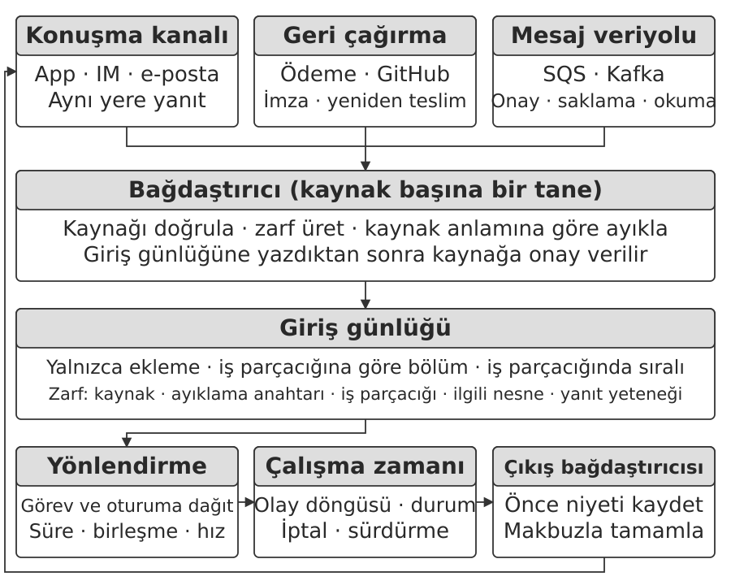

Yaygın dört kaynak türü vardır. **Sohbet kanalları** ürünün kendi konuşma arayüzünü, WeCom, Feishu, Slack gibi anlık mesajlaşmayı ve e-postayı kapsar; Agent aynı yere yanıt verebilir. **Geri çağrılar** dış hizmetlerin durum değiştiğinde çağırdığı HTTP arayüzleridir; genellikle imza taşır ve yalnızca bildirim gönderir; teslimat başarısız olduğunda bazı hizmetler otomatik yeniden dener, GitHub ise elle ya da API üzerinden yeniden gönderir. **Mesaj yolları** SQS, Kafka gibi iç hizmetlerin iş olaylarını taşır ve net onay ile saklama semantiği sunar. **Zamanlayıcılar, yoklamalar ve iç olaylar** sistemin kendi ürettiği olaylardır; aynı günlüğe yazılır. Aşağıdaki tablo ilk üç türü karşılaştırıyor.[^ch6-ingress-mq][^ch6-ingress-callback]

| | Uygulama sohbeti | WeCom / Feishu | E-posta | Webhook | SQS | Kafka |
|---|---|---|---|---|---|---|
| Varış biçimi | Uzun bağlantı | Geri çağrı ya da uzun bağlantı | İtme ya da yoklama | Geri çağrı | Tüketici çeker | Tüketici çeker |
| Sıra kapsamı | Sohbet içinde | Çoğu olayda garanti yok | Garanti yok | Garanti yok | Standart kuyrukta garanti yok, FIFO'da mesaj grubu içinde | Bölüm içinde |
| Yerleşik yinelenen ayıklama dayanağı | İstemci mesaj ID'si | Mesaj ID'si, olay ID'si | Message-ID | Teslim ID'si | Mesaj ID'si; FIFO'da ayrıca `MessageDeduplicationId` | Konu, bölüm ve ofset |
| Yeniden oynatılabilir mi | Kendi kaydına bağlı | Geri çağrı yeniden oynatılamaz, Feishu geçmiş mesaj arayüzüyle tamamlayabilir | Posta kutusu yeniden okunabilir | Hizmete göre değişir | Silindikten sonra hayır | Saklama süresi içinde evet |
| Onay biçimi | İstemci makbuzu | Süre içinde başarı döndürme | Okuma konumu kendi kaydı | Süre içinde 2xx döndürme | Mesajı silme | Ofset commit'i |
| Yanıt yolu | Özgün sohbet | Özgün sohbet | Yanıt e-postası | Yok | Yok | Yok |

**Birleşik zarf.**

Uyarlayıcı ham mesajı birleşik biçimdeki bir **zarf** (envelope) dönüştürür. Zarf yalnızca varış anında belirlenebilen olguları kaydeder; öncelik ve işlem süresi yönlendirme kurallarıyla, müşteri kademesi ve sipariş durumu iş sistemiyle tamamlanır, işlem durumu ayrı saklanır. Müşterinin iade başvurusu şöyle yazılabilir:

```json
{
  "id": "evt_7f3a",
  "source": {"type": "app_chat", "sender": "user:u_5521", "verified": true},
  "dedupe_key": "app:msg:msg_1029",
  "thread": "app:conv:conv_88",
  "kind": "message",
  "correlation": ["order:12345"],
  "content": {"type": "text", "text": "Bu sipariş için iade istiyorum"},
  "raw_ref": "raw/2026-11-23/app/msg_1029.json",
  "reply": {"via": "app_chat", "target": "app:conv:conv_88"},
  "occurred_at": "2026-11-23T14:02:09+08:00",
  "expires_at": null
}
```

- `source`: Kaynak türü ve doğrulanmış gönderici. "Doğrulanmış" bilgisini uyarlayıcı imzaya, jetona ya da kanal hesabına göre belirler; gövdedeki kendini tanıtma sayılmaz. Çalışma zamanı yetki kararını bu alana göre verir.
- `dedupe_key`: Yinelenen ayıklama anahtarı; neyin tekrar sayılacağını kaynağın semantiği belirler. Teslim ID'si, mesaj ID'si, bölüm ve ofset aynı teslimatı işaret eder ve aktarım katmanındaki yeniden gönderimi engeller; iş mesajı bir idempotentlik anahtarı (idempotency key) taşıyorsa, örneğin iade numarası artı durum, uyarlayıcı bunu çıkarır ve iş düzeyindeki tekrarı da engeller. Kullanıcı sohbetinde durum tersidir: müşteri iki kez "iade" derse bunlar iki mesajdır, yalnızca istemci mesaj ID'sine göre ayıklanır.
- `raw_ref`: Olduğu gibi saklanan ham yük; uyarlayıcı hatalarını araştırırken tek dayanak budur.
- `reply`: Hangi giden uyarlayıcı üzerinden hangi hedefe. Ödeme geri çağrısının yanıt yolu yoktur, bu alan boş kalır.
- `occurred_at` kaynağın verdiği gerçekleşme zamanıdır; `expires_at` ise geçerlilik süresidir ve yalnızca teklif, doğrulama kodu gibi olaylarda doldurulur.

**İş parçacığı ve ilişkilendirme.**

Müşteri önce "iade" diyor, hemen ardından "yok, değişim olsun" diye ekliyor; iki mesajın sırası bozulmamalıdır. Başka bir müşterinin mesajı onlarla ilgisizdir ve paralel işlenebilir. **Bağlantı katmanı sıra garantisini yalnızca iş parçacığı içinde verir.** Uyarlayıcı kaynağın kendi sıra birimini `thread` alanına eşler: uygulamanın bir konuşması, SQS FIFO'nun mesaj grubu (`MessageGroupId`), Kafka'nın bölüm anahtarı, GitHub geri çağrısındaki Issue ya da PR numarası. Kaynak sıra garantisi vermiyorsa çalışma zamanı `occurred_at` ya da kaynağın verdiği sürüm numarasıyla geç gelen eski durumu tanır; örneğin "iade başarılı"dan sonra gelen "iade işleniyor".

Bu iadenin dört mesajı dört ayrı iş parçacığına aittir. Hepsini tek parçacıkta birleştirmenin bedeli küçük değildir: destek grubundaki ilgisiz bir tartışma da müşterinin mesajının arkasına düşer, ayrıca iş parçacığı tanımlayıcısı çoğu zaman bölüm anahtarı olarak da kullanılır ve sonradan değiştirmek veri taşımayı gerektirir. **İlişki ayrı bir alanla ifade edilir, iş parçacığı yeniden yazılmaz.** `correlation` olayın ilgilendirdiği iş nesnelerini listeler; görevler ilgili nesnelere abone olarak ilgili iş parçacıklarını izler.

**Onay zamanı ile ilerlemenin ayrılması.**

**Uyarlayıcı kaynağı, olay bağlantı günlüğüne yazıldıktan sonra onaylamalı, Agent işlemeyi bitirdikten sonra onaylamamalıdır.** Feishu'nun olay geri çağrısı 3 saniye içinde yanıt ister, WeCom'da bu 5 saniyedir; süre aşılırsa yeniden gönderilir. SQS mesajı görünürlük zaman aşımı içinde silinmezse yeniden alınır. İşlemeyi bekleyip sonra onaylamak, biraz uzun bir model çağrısının yinelenen teslimata yol açması demektir. Önce günlüğe yazıp sonra onaylamak, kaynakların teslim garantilerini tek bir cümleye indirger: **her olay bağlantı günlüğüne en az bir kez girer (at-least-once)**; yeniden gönderilen kez yinelenen ayıklama anahtarıyla durdurulur.

Bağlantı günlüğü bir gelen kutusu (inbox) gibidir; Bölüm 1'deki yalnızca ekleme ilkesini izler ve iş parçacığına göre bölümlenir. Bağlantı günlüğü olarak Kafka kullanıldığında yinelenen ayıklama için ayrıca benzersiz kısıtlı bir depo kurmak ya da tüketici tarafında anahtara göre filtrelemek gerekir: Kafka uygulamanın verdiği anahtara göre yazmayı reddedemez; idempotent üreticisi yalnızca üreticinin kendi yeniden denemelerini kapsar.

Sistem üç ilerleme türünü ayrı ayrı saklamalıdır:

| İlerleme | Kaydedilen içerik | Kim tutar |
|---|---|---|
| Kaynak ilerlemesi | Kafka ofseti, SQS alma tutamacı, posta kutusu okuma konumu | Uyarlayıcı |
| Dağıtım ilerlemesi | Günlükteki olayların hangi görevlere verildiği | Yönlendirme |
| Görev durumu | Hangi adımda işlendiği, yanıtın gönderilip gönderilmediği | Çalışma zamanı |

Ofseti görev ilerlemesi saymak, günlük yeniden oynatıldığında gönderilmiş yanıtların yeniden gönderilmesine yol açar; ayrıldığında yeniden oynatma yalnızca dağıtım ilerlemesini etkiler. Giden yön giden kutusu (outbox) karşılığıdır: göndermeden önce gönderim niyeti ve idempotentlik anahtarı kaydedilir, kanal makbuzu gelince tamamlandı olarak işaretlenir; yeniden başlatmadan sonra nasıl doğrulanacağı ilerideki "posta olaylarından temel bir döngü kurmak" kısmında.

**Geçerlilik, birleştirme ve geri basınç.**

Aynı iş parçacığında saniyede yüzlerce olay akıyorsa hepsi tek tek modele verilmemelidir. Yönlendirme dağıtımdan önce birikmişliği işler:

- **Geçerlilik.** Teklif, doğrulama kodu ve düzelmiş uyarı zamanı geçtiğinde anlamını yitirir. `expires_at`'i geçen olaylar yalnızca ize kaydedilir, modeli artık uyandırmaz.
- **Birleştirme.** `kind` iki olay türünü ayırır. Durum tipi olaylar bir nesnenin mevcut değerini betimler; örneğin ödeme geri çağrısındaki iade durumu, Kafka'daki sipariş durumu; aynı iş parçacığında birkaç olay biriktiğinde modele yalnızca en yenisi verilir, ara değerler günlükte kalır. Mesaj tipi olaylar birinin söylediği cümle ya da verdiği komuttur; örneğin müşteri mesajı, yöneticinin tıklaması; bunlar toplu olarak verilebilir ama atılamaz.
- **Geri basınç.** Çekme temelli kaynaklarda çekim yavaşlatılabilir, birikmişlik kaynakta kalır. İtme temelli kaynaklarda karşı taraf duraklatılamaz; uyarlayıcı günlüğe yazmayı ve onaylamayı sürdürür, birikmişlik bağlantı günlüğüne kayar ve önceki iki kural onu çözer.

**Bir iade dört kaynaktan geçiyor.**

1. Müşteri uygulama sohbetinde iade talebinde bulunuyor. Uyarlayıcı istemci mesaj ID'sine göre yinelenenleri ayıklıyor, günlüğe yazıyor, sonra istemciye makbuz dönüyor; yönlendirme `order:12345` üzerinden iade görevini oluşturuyor, görev bu sohbet iş parçacığına abone oluyor.
2. Tutar yetkiyi aştığı için Agent WeCom destek grubunda bir teyit kartı gönderiyor; kart tanımlayıcısı göreve yazılıyor. Yönetici "onayla"ya tıklıyor; uyarlayıcı günlüğe yazdıktan sonra başarı döndürüyor ve kart tanımlayıcısına göre ilgili nesneyi ekliyor.
3. Agent iade arayüzünü çağırdıktan sonra ödeme hizmeti iki kez "iade başarılı" geri çağrısı yapıyor; teslim ID'si aynı olduğu için ikincisi ayıklanıyor.
4. Sipariş sistemi Kafka'da "sipariş iade edildi" yayımlıyor; bu, geri çağrının anlattığı aynı şey. İki uyarlayıcı da yükten iade numarası artı durumu yinelenen ayıklama anahtarı olarak çıkarıyorsa bu olay bağlantı anında durdurulur; ayrı ayrı teslim ID'si ile bölüm/ofsete göre ayıklıyorlarsa iki olay da günlüğe girer ve çalışma zamanı görevde iadenin zaten teyit edildiğini görüp olayı yalnızca ize yazar.
5. Geri çağrının ve Kafka olayının yanıt yolu yoktur. Çalışma zamanı 1. adımdaki sohbet iş parçacığının `reply` bilgisini kullanarak uygulama giden uyarlayıcısı üzerinden müşteriyi bilgilendirir.

4. adım bağlantı katmanı yinelenen ayıklamasının sınırıdır: hangi tekrarların durdurulabileceği uyarlayıcının hangi anahtarı bildirdiğine bağlıdır; durdurulamayanlar görev durumuna bakılarak yakalanır. Olaylar görevlere dağıtıldıktan sonra mevcut oturumun arkasına eklenmesi ya da yeni oturum açılması context yönetimine girer: oturumlar arası bilgi Bölüm 3'teki bellekle aktarılır, context'in paylaşılıp paylaşılamayacağı Bölüm 10'da ele alınır.

[^ch6-ingress-mq]: Amazon Web Services, "Amazon SQS standard queues"; "Amazon SQS visibility timeout"; "Using the message deduplication ID in Amazon SQS"; "Using the message group ID with Amazon SQS FIFO Queues". Apache Kafka 4.4 belgeleri, "Design" içindeki "Consumer Position" ve "Message Delivery Semantics". Doğrulama tarihi: 2026-11-24.
[^ch6-ingress-callback]: Feishu açık platformu, "Olaylara genel bakış"; "Oturum geçmişi mesajlarını alma". WeCom geliştirici merkezi, "Mesaj ve olay alma" altındaki "Genel bakış". GitHub Docs, "Best practices for using webhooks"; "Handling failed webhook deliveries". Doğrulama tarihi: 2026-11-24.

### Olay işleme mekanizması

Kullanıcı mesajları, araç sonuçları, zamanlayıcılar ve iş birliği talepleri aynı Agent'a aynı anda girebilir. Çalışma zamanı bu olayları saklamalı, işleme sırasını belirlemeli ve ilgili bilgiyi modele vermelidir. **Olay döngüsü** (event loop) bu süreci sürekli yürütür: kuyruktan olay alır, görev durumunu günceller, model isteğini düzenler, araçları zamanlar, sonra yeni bir girdiyi ya da tamamlanma bildirimini bekler. Go programları goroutine, channel ve `select` ile çok yollu mesajları düzenler; burada da benzer bir yaklaşım kullanılır.

dsh-superagent prototipini örnek alırsak, aynı GitHub projesinde bir Issue altındaki tartışma ile bir pull request (PR) altındaki tartışma iki ayrı iş parçacığına (Thread) aittir. Sistem yeni bir işi devralıp almayacağına karar verirken iş parçacığı durumunu okur ve modele değerlendirtir (Eval). Aynı iş parçacığında aynı anda en fazla bir değerlendirme yapılır, ama birden çok iş kaydı (Ticket) ona abone olabilir. Hatanın düzeltilmesi ve belgenin tamamlanması iş kayıtlarının ikisi de aynı PR'a abone olduğunu varsayalım; inceleyici PR altına yorum yazdığında iki iş kaydı da bu mesajı context olarak alır. Ardından biri Issue altına yeniden üretme koşullarını eklerse bu mesaj yalnızca o Issue'ya abone iş kayıtlarına ulaşır. Mesajın kime ulaştığı iş parçacığına ve abonelik ilişkisine bağlıdır. Mesaj alındıktan sonra nelerin yapılabileceğini ise her iş kaydının kendi yetkisi belirler.[^ch6-dsh-threads]

dsh-superagent ayrıca "insanla görüşmeyi" ve "işi yapmayı" farklı oturumlara ayırır. Ana oturum (Main Session) yalnızca iş alır, yanıt verir ve yetki yazar; kod okumaz, sonucu beklemek için de durmaz. Her iş kaydının kendi yürütme oturumu (Executor Session) vardır; ayrı bir çalışma dizininde kodu değiştirir ve testleri çalıştırır. Yürütme oturumu işi bitirdiğinde, tıkandığında ya da insana sorması gerektiğinde ana oturuma bir özet ve okuma adresi içeren tek bir mesaj gönderir; Bölüm 2'deki "özet artı nesne ID'si" yaklaşımı budur. Böylece ana oturum her zaman bir sonraki talebi alacak kadar boş kalır; insana soru sormak, bildirim göndermek ve durdurmak da ondan geçer, taahhüt tek bir kapıdan çıkar. İlerideki ses kısmında anlatılan hızlı–yavaş model ayrımı bu iş bölümünün gerçek zamanlı görüşmedeki biçimidir.[^ch6-dsh-sessions]

Senkron model arayüzleri genellikle bir üretim bittiğinde ya da araç sonuçları tamamlandığında bir sonraki mesaj kümesini kabul eder. Burada bir **güvenli nokta** konabilir: çalışma zamanı önce tamamlanmış mesajları, hâlâ çalışan çağrıları ve mevcut görev ilerlemesini kaydeder, sonra yeni işleme adımına geçer. Yerleşik asenkron arayüzler ise çalışma sırasında güncelleme alma protokolü sunar; sürdürme zamanı arayüz ile çalışma zamanı birlikte belirler.

İptal için de yürütücünün iş birliği gerekir. Model üretimi durdurduktan sonra arka plandaki araç hâlâ çalışıyor olabilir; yürütücü iptal sinyalini almalı ve gerçek durumu bildirmelidir; Go görevlerinin `ctx.Done()` kontrolünden sonra temizlik yapmasına benzer. Tamamlanmış yazmalar, gönderimler ya da ödemeler ise ilgili iş süreçleriyle geri alınmalı ya da telafi edilmelidir.

**Üç işleme stratejisi.**

Şekil 6-3 yeni bir olay geldiğinde üç seçeneği karşılaştırıyor. Kuyruğa alındığında yanıt süresi bir sonraki güvenli noktanın ne zaman geleceğine bağlıdır; mevcut görevi iptal etmek hangi işlemlerin tamamlandığının ve nereden devam edilebileceğinin doğrulanmasını gerektirir; yeni bir döngü açmak iki görevin aynı kaynağı çekişip çekişmeyeceğinin kontrolünü gerektirir.

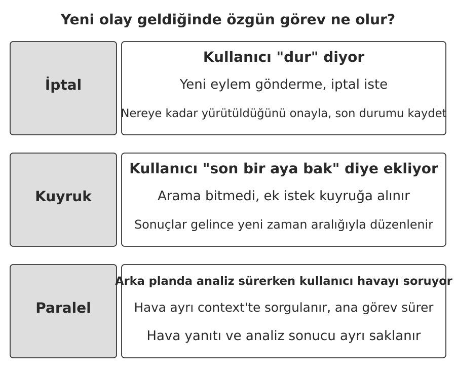

**İptal temelli işleme (Cancellation-Based)** kullanıcının durdurma komutlarına ya da hemen işlenmesi gereken denetim olaylarına uygundur. Çalışma zamanı önce ilgili işlemlerin dağıtımını durdurur, üretilmekte olan istek ile iptal edilebilir araçlara durdurma sinyali gönderir, ardından tamamlanmış mesajları, araç durumunu ve iptal makbuzunu saklar. Yeni olay bundan sonra karar context'ine girer. Örneğin kullanıcı "Dur! Yanlış söyledim" dediğinde sistem önce sonraki yürütmeyi sınırlar, sonra mevcut gerçek durumla görevi yeniden teyit eder. Henüz işlenmemiş kuyruk kalemleri tanımlayıcılarını ve durumlarını korur, ilgili kapsama göre yeniden sıralanır.

**Kuyruk temelli işleme (Queued)** olağan ek bilgi ve ilerleme güncellemelerine uygundur. Olay kuyruğa girer, bir sonraki güvenli noktada araç sonuçlarıyla birlikte modele verilir. Örneğin arama sürerken kullanıcı "yalnızca son bir aylık sonuçlara bak" diye ekler; arama döndüğünde model sonuçları ve yeni koşulu birlikte okuyup filtrelemeye ya da yeniden aramaya karar verir.

**Paralel işleme (Parallel)** ana görevden bağımsız ve hızlı yanıt gerektiren taleplere uygundur. Örneğin büyük bir veri analizi sürerken kullanıcı hava durumunu soruyorsa sistem bağımsız bir oturum açıp sorguyu tamamlayabilir.

**Aciliyet ve yönlendirme.**

Olay türü ilk ipucunu verir: `user.interrupt`, güvenilir gözetim talimatları ve sistem uyarıları yüksek öncelikli kanala girebilir; `user.input`, `agent.input`, `tool.result` ve `timer.trigger` ise içerik ve görev durumuyla birlikte değerlendirilir. Gönderen metinde kendini "acil" diye tanıtsa bile sistem yetkiyi doğrulanmış kimliğe ve kurallara göre belirler.

Mesajın anlamını anlamayı gerektiren yönlendirme kararlarında yazar hafif bir sınıflandırma modeli kullanmayı öneriyor: "hemen dur" iptale karşılık gelir, "bugün hava nasıl" paralel işlemeye uygun olabilir, "raporu Çince yaz" genellikle mevcut görevin ek bilgi kuyruğuna girer. Açık durdurma girişini çalışma zamanı doğrudan işler; anlamsal sınıflandırma kalan, anlaşılması gereken mesajlar için kullanılır.

Genel bir model de mesajları etiketleyebilir, ama yalnızca "işlenmesi gerekiyor" yazsa bile görev açıklamasını ve mesaj içeriğini okumak zorundadır. Her yeni mesaj için bu yargı verildiğinde çağrı maliyeti mesaj hacmiyle artar, gerçekten acil mesajlar da modelin etiket vermesini beklemek zorunda kalır. TypeSafe'in Jev'i bu tür, seçeneklerin önceden verildiği yargı görevlerine özelleşmiştir. Ona bir mesaj ve mevcut görev durumu verildiğinde seçeneklerin olasılıklarını daha düşük maliyet ve gecikmeyle paralel olarak verebilir.[^ch6-jev]

Bölüm 1'de tartışılan gözlem uzayı seyreltmesi, burada hangi mesajların yeni bir akıl yürütme turu tetikleyeceğini belirler. Feishu mesajlarını ve GitHub Issue yorumlarını örnek alırsak program önce olay numarasına göre yinelenen bildirimleri filtreler, sonra Jev'e yeni mesajın mevcut görevi tamamlayan bir ek mi yoksa ana modelin işlemesi gereken yeni bir talep mi olduğunu sordurur. "Dün söylediğim yeniden üretme adımlarını ekliyorum" metni okunduğunda model yalnızca bunun bir ek açıklama olduğunu değerlendirir. Hangi Issue'ya eklendiğini ise program doğrudan yorumun taşıdığı numaradan okur.

Model çok yüksek olasılık verse bile kendi güvenini abartabilir. Örneğin 100 mesajın hepsi yaklaşık %90 olasılıkla "mevcut görevi tamamlıyor" diye değerlendirilse de gerçekte yalnızca 60'ı öyledir. Bu grubu kendiliğinden mevcut görevlere katmak, diğer 40 mesajın asıl amacını kaçırır.

[^ch6-jev]: TypeSafe, Jev duyurusunda önceden belirlenmiş çıktıları, olasılıkların paralel dönüşünü ve karar kalibrasyonunu hedefleyen RLCD eğitim yöntemini tanıtır.

### Posta olaylarından temel bir döngü kurmak

Yeni e-postaları işleyen sürecin aniden yeniden başladığını varsayalım. E-posta tanımlayıcısı özgün metni bulmaya yardım eder, ama önceki yanıtın gönderilip gönderilmediğini söyleyemez. Kuyruğa alma, e-postayı okuma, araç çağırma, posta kutusunu güncelleme ya da kullanıcıyı bilgilendirme adımlarında her yazma işlemini ve dönen makbuzu aynı e-posta adı altında kaydetmek en iyisidir. Yeniden başlatmadan sonra istek gönderilmiş ama makbuz alınmamışsa önce posta kutusundaki gerçek durum doğrulanır, sonra yeniden gönderilip gönderilmeyeceğine karar verilir.

> **Deney 6-1 ★★★: Olay güdümlü e-posta işleme Agent'ı**
>
> Bu deney test posta kutusunu giriş noktası alarak olay kaydı, kuyruk ve görev işlemeyi alıştırıyor. Önce yeni e-postalar yapılandırılmış olaylara dönüştürülüp varış sırasına göre işleniyor; sonra e-posta geçmişi, ek okuma, bilgi sorgulama ve bildirim araçları bağlanıyor. Şekil 6-4 boyunca bir toplantı davetini izleyin: olay döngüsünde takvim çakışması kontrolü ve taslak yazma adımlarını, sonra kalıcı katmanda bu e-postanın işlem kaydını bulun.
>
> 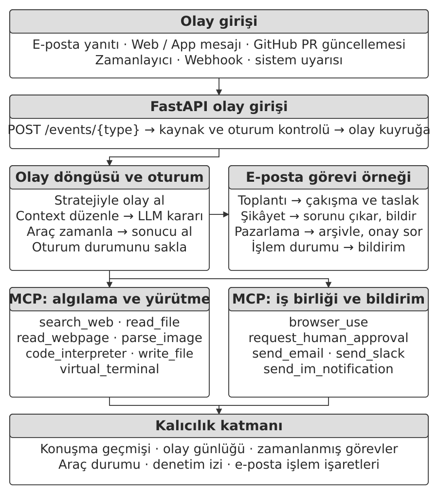
>
> Aynı kuyruk birçok kaynakla genişletilebilir: e-posta varışı, IM ya da SMS mesajları, GitHub PR ve Issue güncellemeleri, zamanlayıcılar, dış Webhook'lar ve kullanıcı çevrimdışılığı, süreç zaman aşımı, kaynak uyarıları gibi iç olaylar. Her uyarlayıcı kaynağı doğrular ve ilgili bilgiyi tamamlar; işlem sonuçları olay tanımlayıcısına göre geri yazılır.
>
> Kabulde üç test e-postası kullanılır: toplantı daveti takvim çakışması kontrolünü tetikler ve kabul ya da ret taslağı üretir; müşteri şikâyeti kilit bilgi çıkarımını, yüksek öncelik işaretlemesini ve kullanıcı bildirimini tetikler; pazarlama e-postası kurallara göre arşivlenir.
>
> Mevcut eşlik eden kayıt arayüz belgelerinin kontrolünü ve kimlik doğrulama yoklamasını tamamladı; test posta kutusu bağlantısı hâlâ geçerli kimlik bilgisi bekliyor.
>
> **Genişletme (isteğe bağlı): çok kaynaklı bağlantı ve arıza enjeksiyonu.** Test posta kutusunun yanına bir yerel Webhook uç noktası ve bir SQS kuyruğu (yerel taklit kullanılabilir) ekleyin. Her uyarlayıcı kaynağı doğrular, zarf üretir, bağlantı günlüğüne yazdıktan sonra kaynağı onaylar; çalışma zamanı olayları günlükten okur ve iş parçacığı sırasına göre işler. Ardından üç tür arıza enjekte edin:
>
> 1. **Yinelenen teslimat.** Webhook uç noktası aynı teslim ID'siyle iki istek alır; günlükte tek bir olay görünür.
> 2. **Onaydan önce çökme.** Uyarlayıcı günlüğe yazdıktan sonra, SQS mesajını silmeden sonlandırılır; mesaj yeniden görünür olup tekrar okunduğunda günlükte yine tek olay vardır.
> 3. **Makbuzdan önce çökme.** Çalışma zamanı yanıtı gönderdikten sonra, makbuzu kaydetmeden sonlandırılır; yeniden başlatmadan sonra günlük yeniden oynatılır. Kanal idempotentlik anahtarını destekliyorsa ya da gönderilmiş mesajları sorgulayabiliyorsa (örneğin posta kutusunun gönderilmiş öğeleri) aynı yanıt ikinci kez gönderilmez; ikisi de yoksa yanıt insan teyidi bekliyor olarak işaretlenir.
>
> Üç arıza türü de günlükte kayıt bırakmalıdır: hangi teslimatın yinelenen sayıldığı, hangi mesajın yeniden okunduğu, hangi yanıtın doğrulandıktan sonra yeniden gönderilmediği.
>
> Bu genişletmenin eşlik eden kodu çevrimdışı çalışabilir, API anahtarı gerekmez. Test posta kutusu ve SQS kuyruğu yerel dosyalarla taklit edilir ve yukarıda kimlik bilgisi bekleyen gerçek posta kutusundan ayrıdır; taklit kuyruk görünürlük zaman aşımını, alma tutamacını ve mesaj grubu içindeki sırayı korur. Çökme, ana süreç tarafından alt süreç belirli bir noktada doğrudan sonlandırılarak canlandırılır. Yanıt kanalları birer örnek gösterir: e-posta gönderilmiş öğeleri sorgular, uygulama sohbeti idempotentlik anahtarı kullanır, SMS'te ikisi de yoktur. Yeniden üretmek için `chapter6/agent-with-event-trigger` dizinine girip `python multisource_demo.py` komutunu çalıştırın; terminal üç arıza türünün bıraktığı günlük kayıtlarını tek tek yazdırır. Eşlik eden çalıştırma kaydında üç arıza türünün kontrolleri de geçti.
>

Posta kuyruğu sıralı işlemenin temelini kurdu. Şimdi uzun süren araçları ekleyip bekleme sırasında yeni taleplerin nasıl alınacağını, görevin nasıl iptal edileceğini ve işin nasıl kurtarılacağını tartışalım.

### Yerleşik asenkron desteği olmadığında uyum çözümü

Agent'ın e-posta taslağı yazdığını ve kişileri aramak için `search_contacts` aracını çağırdığını varsayalım. Sonuç henüz dönmemişken kullanıcı "bir dakika, önce yarınki hava durumuna bak" diyor. Mevcut model arayüzü her araç çağrısının önce sonucunun tamamlanmasını istiyorsa Harness arka plan durumunu arayüzün kabul ettiği mesaj dizisine dönüştürmelidir.

**Arka plan durumunu senkron mesaj biçiminde ifade etmek.**

**Senkron arayüzlere uyum sağlarken normal çağrı ile gerçek sonucun eşleşmesini mümkün olduğunca korumalı, yalnızca görev ortasında geçiş yapılırken durum yanıtı eklenmelidir.** Her çağrı için erken "hâlâ çalışıyor" yazmak izi tamamlanmamış durumlarla doldurur ve modelin gerçek sonuçları izleme yükünü artırır. Somut olarak beş kural izlenebilir:

1. **Eksiksiz çağrıyı kaydetmek.** API'nin tamamladığı assistant mesajı ve araç çağrısı kalemleri çağrı tanımlayıcısıyla ize yazılır. Sunucu tarafı akıl yürütme durumu, sağlayıcının öngördüğü sürdürme yöntemine göre saklanır.
2. **Gerçek tamamlanmayı kaydetmek.** Araç bittiğinde gerçek sonuç, görev tanımlayıcısı ve yürütme durumu yazılır; yürütme sırasında görev yöneticisi tamamlanmamış durumu saklamayı sürdürür.
3. **Geçiş sırasında mevcut durumu bildirmek.** Bu tür sonuç yüküne izin veren arayüzlerde tamamlanmayı bekleyen çağrı için açık bir durum bilgisi döndürülebilir; örneğin "görev arka planda hâlâ çalışıyor, sonuç henüz oluşmadı"; ardından kullanıcı olayı eklenir. Durum yanıtındaki görev tanımlayıcısı sonraki tamamlanma bildirimiyle bağlantı kurar.
4. **Kesintiden sonraki mesajları düzenlemek.** Görev ortasında sürdürme yeteneği yoksa tamamlanmamış üretim iptal edilir, teyit edilmiş mesajlar ve araç durumları korunur, sonra yeni istek gönderilir. Tamamlanmamış çıktı arayüz kurallarına göre işlenir; yarım kalan parametrelerin yürütülebilir çağrı sayılması önlenir.
5. **Olağan olayları toplu almak.** Ek bilgi kuyruğa girer, mevcut dönem bittiğinde ya da belirlenen güvenli noktada topluca gönderilir ve hangi olayların işlendiği kaydedilir.

Kişi arama örneğinde önce eksiksiz çağrı ize yazılır; kullanıcı görevi değiştirdiğinde Harness sorgunun hâlâ çalıştığı bilgisini içeren durum yanıtını ekler, sonra hava durumu isteğini gönderir. Kişi sonucu biraz sonra kaynağı ve görev tanımlayıcısıyla yeni bir olay olarak context'e girer, Agent e-posta taslağını sürdürür. Özgün çağrı bir durum yanıtı aldığı için sonraki sonuç uyarlayıcının kararlaştırdığı olay biçimini kullanır; çağrı–sonuç eşleşmesi korunur.

Durum yanıtı yalnızca mevcut yürütme ilerlemesini anlatır. Kişi verisine bağlı adımlar gerçek sonuç gelene kadar beklemelidir. Görev yöneticisi `running`, `completed`, `cancelled`, `failed` gibi durumları saklayabilir ve yanıt göndermeden ya da sonraki araçları çalıştırmadan önce bağımlılıkların karşılanıp karşılanmadığını kontrol edebilir.

**Görev tutamacıyla asenkron araç tasarlamak.**

Yeni tasarlanan uzun görev araçlarında yazar "başlatma"yı eksiksiz bir işlem olarak tanımlamayı, hemen gerçek bir görev tutamacı döndürmeyi tercih ediyor. Model buna dayanarak "başlatıldı" ile "tamamlandı"yı ayırır; sonraki sorgular, iptaller ve sonuç olayları da birleşik bir bağlantı dayanağına kavuşur. Örneğin `initiate_phone_call` telefon görevini başlatıp görev tanımlayıcısını ve "aranıyor" durumunu döndürür; `phone_call_connected` ve `phone_call_ended` sırasıyla bağlantıyı ve bitişi bildirir.

Araç açıklaması şöyle yazılmalıdır: "Bu araç telefon görevini başlatır ve başarılı olursa görev ID'si döndürür. Başka işlerle devam edebilirsin; görüşmenin ilerleyişi ve bitiş sonucu ayrı olaylarla döner." Araç adı bunun bir başlatma işlemi olduğunu, dönüş yapısı ve sonraki olaylar ise görevin nasıl ilerleyip biteceğini gösterir. Sistem ayrıca görev ID'sine göre sorgulama, iptal ve kurtarma arayüzleri sunar; model o anda daha neler yapabileceğini bilir.

**Toplu olayları tek tek işlemek.**

Birçok olay tek seferde context'e girdiğinde model yalnızca sonuncusuna yanıt verip önceki talepleri atlayabilir. Çalışma zamanı her birinin işlem durumunu saklamalı ve yanıtlanmamış koşulları görünür tutmalıdır. Prompt modelden her birini tek tek kontrol etmesini isteyebilir; durum çubuğu ise henüz işlenmemiş bilgileri listeler:

```text
[İşlenmemiş olay 1/4] database_query sonucu: ...
[İşlenmemiş olay 2/4] Kullanıcı ekledi: yalnızca Pekin bölgesinin verilerine bak
[İşlenmemiş olay 3/4] Sistem hatırlatması: rapor teslimine 30 dakika kaldı
[İşlenmemiş olay 4/4] Kullanıcı soruyor: ne durumda?
```

Parti özeti "1 araç sonucu, 2 kullanıcı mesajı, 1 sistem hatırlatması" diye ipucu verebilir. Çalışma zamanı olayları görev kısıtlarıyla da ilişkilendirir: bölge koşulu sorgu kapsamını günceller, teslim zamanı zamanlamayı etkiler, ilerleme sorusu yanıt gerektirir. İşlendikten sonra tamamlandı, beklemede ya da açıklama gerekiyor durumu kaydedilir, sonraki turda çözülmemiş kalemler korunur.

Aynı görev numarası başlatmayı, ilerleme bildirimlerini ve nihai yürütme sonucunu birbirine bağlar. Arada biri durdurmayı isterse bu numara altında bir iptal makbuzu olup olmadığına yeniden bakılır.

> **Deney 6-2 ★★★: Paralel yürütme ve kesme yeteneği olan asenkron Agent**
>
> Bu deney önce asenkron çalışma zamanını doğruluyor, sonra kararları kontrol etmek için modeli bağlıyor. Eşlik eden çalıştırma kaydı dört senaryoyu gerçek işletim sistemi alt süreçleriyle tamamlıyor; olay zamanlaması ve raporlama deterministik betiklerle yürütülüyor.
>
> 1. **Arka plan yürütme ve anlık yanıt.** Birkaç saniye süren bir analiz süreci başlatılır ve görev tanımlayıcısı hemen döner; bekleme sırasında mevcut saat yanıtlanır, bitişte analiz sonucu alınır.
> 2. **Kuyruk ve toplu işleme.** Uzun görev sırasında sırayla "Japonca yanıtla" ve "web sayfası olarak düzenle" eklenir; görev bittiğinde sonuç ve iki gereksinim tek parti olarak işlenir. Betik Japonca HTML üretir.
> 3. **İptal ve kurtarma.** "Analizi durdur" alındığında üretilmekte olan model turu kesilir ve çalışan tüm arka plan görevlerinin durması istenir. Bu kez kesmeyi betik gönderdi ve o anda yalnızca bir analiz süreci (T1) vardı. 0,803. saniyede kesme olayı T1'in ilerlemesini %18 olarak kaydeder; 0,806. saniyede sistem onun çıkış kodunu (−15) kaydedebilir. Hemen ardından başlatılan T2 yeni bir görevdir. 4,436. saniyede alınan T2'nin sonucudur; T1 tamamlanma geri çağrısını tetiklemez.
> 4. **Paralel görevler ve ilerleme kararı.** Üç analiz süreci aynı anda başlatılır; her mantıksal zaman adımında sırasıyla %3, %2, %1 ilerler. Bu deneyin paralel ilerleme kaydında en hızlı T1 bittiğinde sorgu makbuzu T2'nin %68'e, T3'ün %34'e geldiğini gösterir. Şekil 6-5 boyunca izlendiğinde ilerlemesi %50'yi geçmeyen görevler iptal edilir. Betik yalnızca T3'ü iptal etti ve sonunda T1 ile T2'nin sonuçları alındı. Bu, aynı çalışma zamanının hem toplu durdurmaya tepki verebildiğini hem de hâlâ yararlı olan paralel işi koruyabildiğini gösterir.
>
> 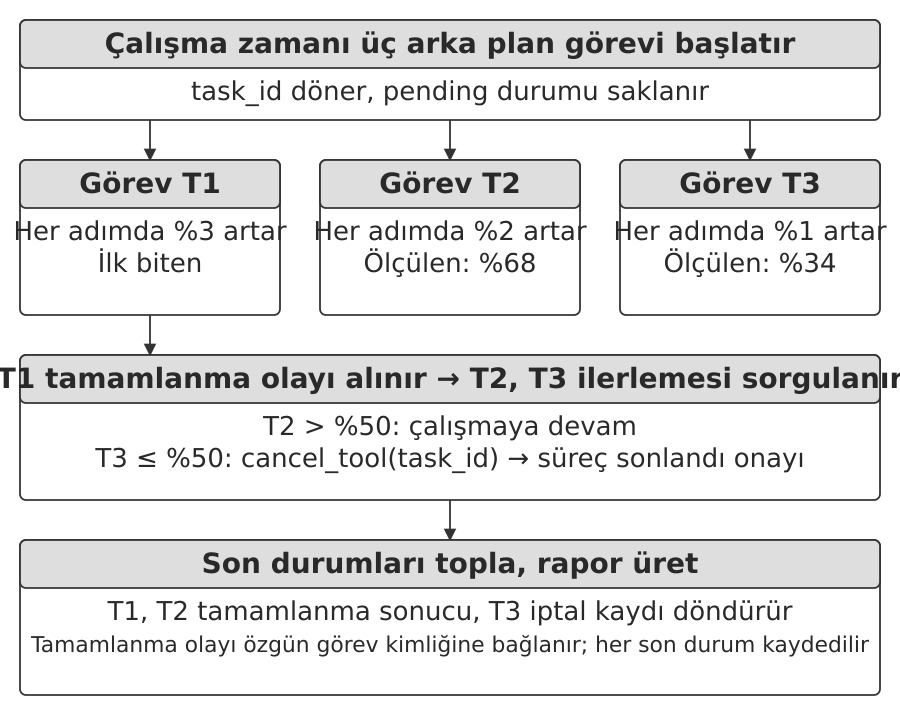

### Modelin yerleşik asenkronu: GPT-6 Astra

Önceki çözümlerde Harness senkron mesaj biçimine uyum sağlıyordu. Yerleşik asenkron arayüzler ise modelin araç henüz dönmeden bağımsız işlere devam etmesine ve sonucu sonradan almasına doğrudan izin verir. Eylül 2026 itibarıyla GPT-6 Astra asenkron araç çağrısını (Async tool calling) ve tur ortası yönlendirmeyi (Mid-turn steering) sunuyor; bunlar sırasıyla araç beklemesini ve kullanıcı güncellemelerini ele alır. Şekil 6-6 senkron arayüz uyumu ile yerleşik asenkronun mesaj akışını karşılaştırıyor.[^ch6-22][^ch6-23]

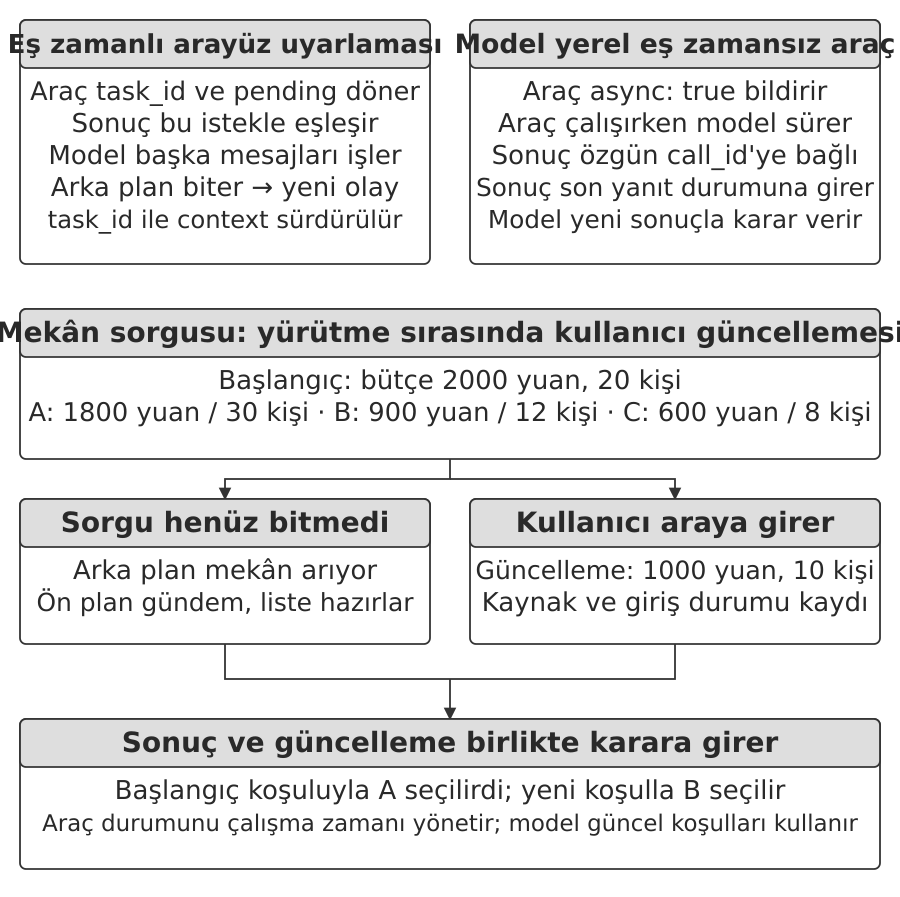

**Aracı beklerken bağımsız işe devam etmek.** Örneğin Agent toplantı mekânı sorgusunu başlattıktan sonra gündemi ve hazırlık listesini düzenleyebilir; sorgu döndüğünde fiyatları ve kapasiteleri karşılaştırır. Araç tanımındaki `async: true` asenkron yeteneği bildirir; uygulama eksiksiz çağrı kalemini aldıktan sonra yürütmeyi başlatır ve `call_id` çağrı tanımlayıcısını saklar. Sonuç geldiğinde uygulama onu özgün tanımlayıcıyla geri verir ve en güncel yanıt durumunu sürdürür. Sonraki işi model düzenler, Harness çağrı ilişkisini ve görev yaşam döngüsünü yönetir.[^ch6-22]

**Görev sürerken yeni gereksinim almak.** Kullanıcı model düşünürken ya da yanıtı hazırlarken "bütçeyi 1000'e düşür", "katılımcı sayısı 10 olsun" diye ekleyebilir. Uygulama aynı bağlantı üzerinden bir yönlendirme olayı gönderir; sunucu alımı teyit ettikten sonra mevcut yanıt durumuna göre işlemeyi sürdürür. Bağlantı koptuktan sonra uygulama saklanan olaylar ve yanıt durumundan görevi kurtarabilir.[^ch6-23]

Bu iki yetenek birlikte kullanılabilir: mekân sorgusu çalışmayı sürdürürken kullanıcının yeni gereksinimleri sonraki karara girer, sorgu sonucu döndükten sonra seçim tamamlanır. Yürütücü arka plan görevlerinin gerçek durumunu aynı zamanda tutar. Sorguyu durdurmak ya da rezervasyonu iptal etmek gerektiğinde Harness ilgili arayüzü çağırır ve makbuzu kontrol eder; tamamlanmış iş işlemleri geri alma ya da telafi akışına girer.

Model ve arayüz yerleşik asenkronu destekliyorsa yazar önce yerleşik protokolü kullanır; böylece araç askıda kalması, kullanıcı güncellemeleri ve yanıtın sürdürülmesi arayüz anlaşmasına göre akar. Senkron uyum katmanı esas olarak mevcut modellere ve eski arayüzlere hizmet eder; model yükseltildikten sonra yalnızca mesaj eşleşmesini tamamlamak için kullanılan uyum mantığı adım adım kaldırılıp mühendislik yatırımı görev durumuna, iptale ve kurtarmaya yoğunlaştırılabilir.

### Asenkron görevleri güvenilir biçimde işlemek

Güvenilir asenkron etkileşim mesajı, görevi ve yürütme durumunu birlikte kontrol etmelidir.

1. **Sonucun aidiyeti.** Gecikmeli sonuç özgün çağrı tanımlayıcısını taşır; uygulama bunu ilgili göreve eşler; o sonuca bağlı kararlar veri geldikten sonra sürer.
2. **Kurtarma ve iptal.** Kullanıcı gereksinimi değiştirdiğinde sistem hâlâ geçerli işi korur, sonraki adımları günceller ve hangi arka plan görevlerinin süreceğini, hangilerinin durduğunu açıkça belirtir.
3. **Birden çok gereksinim.** Bütçe, kişi sayısı, bölge ve teslim zamanı ayrı ayrı görev durumuna girer; nihai sonuç bu koşulları tek tek kontrol eder.

> **Deney 6-3 ★★★: Modelin yerleşik asenkronu ve tur ortası yönlendirme**
>
> Bu deney Agent'ın bütçe ve kişi sayısı gereksinimlerini karşılayan en ucuz toplantı mekânını seçmesini istiyor. Başlangıç bütçesi 2000, kişi sayısı 20'dir; sorgu aracı 8 saniye sonra üç mekânın fiyatını ve kapasitesini döndürür.
>
> | Mekân | Fiyat | Kapasite |
> |---|---:|---:|
> | A | 1800 | 30 |
> | B | 900 | 12 |
> | C | 600 | 8 |
>
> Başlangıç koşullarında A seçilmelidir. Yönlendirme grubu görev sürerken iki güncelleme alır: bütçe 1000, kişi sayısı 10; bu durumda B seçilmelidir. Araç ayrıca yeni üretilmiş bir makbuz döndürür; nihai yanıtın ondan söz etmesi modelin gerçekten ulaşan sonucu kullanıp kullanmadığını kontrol etmeyi sağlar.
>
> Deney beş grup ve her grupta üç çalıştırma içeriyor: senkron araç, yerleşik asenkron araç, akıl yürütme sırasında yönlendirme, asenkron araç beklerken yönlendirme ve yönlendirmeyi desteklemeyen model kontrolü. İlk iki grup bekleme sırasında bağımsız hazırlık listesi üretilip üretilmediğini karşılaştırıyor; iki yönlendirme grubu bütçe ve kişi sayısının birlikte etkili olup olmadığını kontrol ediyor; yetenek kontrolü arayüzün desteklemediğini açıkça bildirip bildirmediğini sınıyor.
>
> Saklanan çalıştırma kayıtlarında asenkron araç grubu bekleme sırasında bağımsız listeyi tamamladı, iki yönlendirme grubu da yeni koşullara göre B'yi seçti. Araç kullanan çalıştırmaların hepsi sorguyu yalnızca bir kez yürüttü ve gerçek sonucu özgün çağrıya geri verdi; kontrol modelinin arayüzü ise bir üretim turunun ortasında yeni gereksinim kabul etmediğini açıkça bildirdi. Senkron ve asenkron grupların toplam süresi birbirine yakındı; temel fark bekleme sırasında başka işlerin ilerleyip ilerleyemediğinde ortaya çıktı.
>
> Model yalnızca kişi sayısının 10'a çıktığını hatırlayıp eski bütçeye (2000) göre seçim yapsaydı hangi mekânı seçerdi? A ve B de sığar, en ucuzu yine B'dir. Dolayısıyla mekânın doğru seçilmesi bütçenin güncellenip güncellenmediğini göstermez.
>
> Kişi sayısı değiştiğinde gönderilmiş sorgu yeniden yapılmalı mı? Bu deneyin aracının filtre parametresi yoktur, üç mekânın hepsini döndürür. Asistan yoldaki sonucu yeniden kullanıp döndüğünde 10 kişi ve 1000 bütçeye göre filtreleyebilir. Araç yalnızca 20 kişiden fazlasını alan mekânları döndürseydi eski sonuçta yalnızca A olurdu ve 12 kişi alan B listede hiç bulunmazdı. O zaman eski listede kişi sayısını 10 yapmak yine B'yi kaçırırdı; özgün sorgu B'yi baştan elediyse yeniden sorgulamak gerekir.

Asenkron mekanizma dış değişikliklerin görev ilerlerken sisteme girmesini sağlar. Ses, ekran ve robot etkileşimi geri bildirim döngüsünü daha da kısaltır: sistem girdiyi sürekli almalı, çıktıyı ve eylemi uygun anda ayarlamalıdır.

## Ses: en doğal insan–makine arayüzü

Ses, kullanıcının elleri ya da gözü başka işle meşgulken Agent'a gereksinimini anlatmasına, koşul eklemesine ve sonucu teyit etmesine izin verir. Sesli klavye dikteyi metne dönüştürür; sesli Agent ise konuşmayı, araç çağrılarını ve yanıtın oynatılmasını ayrıca yönetir. İkisi de önsözde tanıtılan whisper coding'i destekleyebilir.

Bu kısım iki kullanımı tartışıyor: kullanıcının Agent'la doğrudan konuşması ve Agent'ın kullanıcı adına dış kişilerle görüşmesi. Birincisi tanıma, yanıtlama ve söz kesmeye odaklanır; ikincisi görüşme sırasında kimlik doğrulamayı, iş sorgusunu ve kararı da tamamlamalıdır.

### Etkileşim zamanlaması: kademeli yapıdan tam çift yönlüye

OpenAI, GPT-Live tanıtımında kademeli, tur tabanlı ses modeli ve tam çift yönlü olmak üzere üç ses etkileşimi türünü gözden geçirdi[^ch6-12]. Bu gelişim çizgisi "ne zaman konuşmaya başlanacağı, ne zaman dinlemeyi sürdüreceği" kararını adım adım modele bırakır. Kademeli sistemlerde geçişi ağırlıklı olarak uç nokta mantığı düzenler; tam çift yönlü modeller ise sürekli sesi ve konuşma durumunu birleştirerek örtüşmeyi, duraklamayı ve söz kesmeyi ele alabilir.

| Yaklaşım | Temel yapı | Kolay uygulanan yetenekler | Başlıca tasarım sorunu |
|---|---|---|---|
| Kademeli | VAD, ASR, LLM ve TTS iş bölümü | Modülleri ayrı ayrı değiştirmek, girdi ve çıktıyı parça parça kontrol etmek | Modüller arası gecikme, transkripsiyonda kaybolan akustik bilgi |
| Tur tabanlı uçtan uca ses modeli | Model sesi doğrudan alır ve üretir | Tonlama, duygu gibi bilgilerle yanıtı düzenlemek | Sözün bittiğine karar verme, tur geçişi ve yanıt zamanı |
| Tam çift yönlü | Sesi sürekli alır ve çıktı üretir | Örtüşen konuşma, onaylama sesleri, söz kesme ve sürekli etkileşim | Sürekli durum, çıktı denetimi ve etkileşim değerlendirmesi |

Modelin sesi doğrudan işleyip işlemediği, girdinin ve çıktının akışlı olup olmadığı ve aynı anda dinleyip konuşup konuşamadığı ayrı ayrı kontrol edilebilen yeteneklerdir. Kademeli sistemlere de akışlı modüller ve kesme denetimi eklenebilir; uçtan uca modelin etkileşim ritmi ise somut tasarıma bağlıdır.

[^ch6-12]: OpenAI, *Introducing GPT-Live*, 2026-07-08; kademeli, tur tabanlı ses modeli ve tam çift yönlü etkileşimi tanıtır.

### Yaklaşım bir · Kademeli hat (Cascading)

Kademeli sistem sesli konuşmayı birkaç modüle böler. Ses etkinliği algılama (VAD) sesteki konuşma aralıklarını bulur, uç nokta mantığı bu parçanın ne zaman gönderileceğine karar verir; otomatik konuşma tanıma (ASR) sesi metne çevirir; LLM isteği anlayıp yanıt üretir; konuşma sentezi (TTS) yanıtı oynatılabilir sese dönüştürür. Şekil 6-7 sırayla yürüyen temel yapıyı gösteriyor.

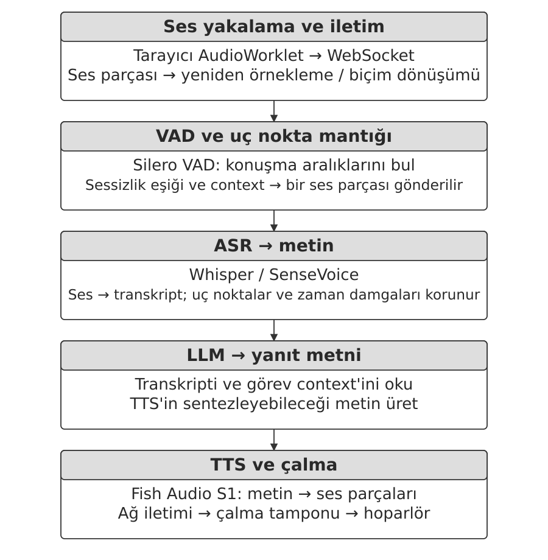

Akustik VAD kimin konuştuğu aralıkları bulur; sonraki tanıma uzun sessizlikleri atlayabilir. Ama aynı duraklama "Rezervasyon yapmak isti..." arkasında da "Perşembe sabahı bilet var mı?" arkasında da farklı anlam taşır. Anlamsal VAD (anlamsal uç nokta algılama) ilk durumda ses almaya devam edebilir, sözü ancak ikinci durumda diyalog modeline verir. Bu, ses gözleminin zaman içinde seyreltilmesidir: kesintisiz bir ses yalnızca birkaç anda çıkarım tetikler. Konuşmaya başlanıp başlanmayacağına ise cümleyi duyan model karar verir; dinlemeyi sürdürebilir ya da önce uçuşları sorgulayabilir.

| Modül | İşlevi | Yaygın bekleme ya da hata kaynakları |
|---|---|---|
| VAD ve uç nokta mantığı | Konuşmayı algılar, gönderim zamanına karar verir | Sessizlik eşiği, gürültü ve konuşma ortası duraklamalar |
| ASR | Sesi metne dönüştürür | Çözümleme süresi, kişi adları ve özel terimlerin tanınması |
| LLM | Anlar, akıl yürütür ve yanıt üretir | İstek kuyruğu, ilk yanıt parçasının üretimi |
| TTS ve oynatma | Sesi sentezler ve hoparlöre ulaştırır | İlk paket sentezi, ağ aktarımı ve oynatma tamponu |

Tamamen sıralı bir uygulamada kullanıcı sözünü bitirdikten sonra uç nokta teyidi, transkripsiyon, yanıt üretimi ve ilk ses parçası sırayla beklenir. Şekil 6-8'deki örnekte kullanıcı ilk yanıtı duyduğunda 1,4 saniye geçmiştir; en uzun parça sistemin kullanıcının sözünü bitirdiğini teyit etmesini beklemektir (500 milisaniye). Transkripsiyon 100 milisaniyeden 50'ye inse bile kullanıcı yalnızca 50 milisaniye daha az bekler.

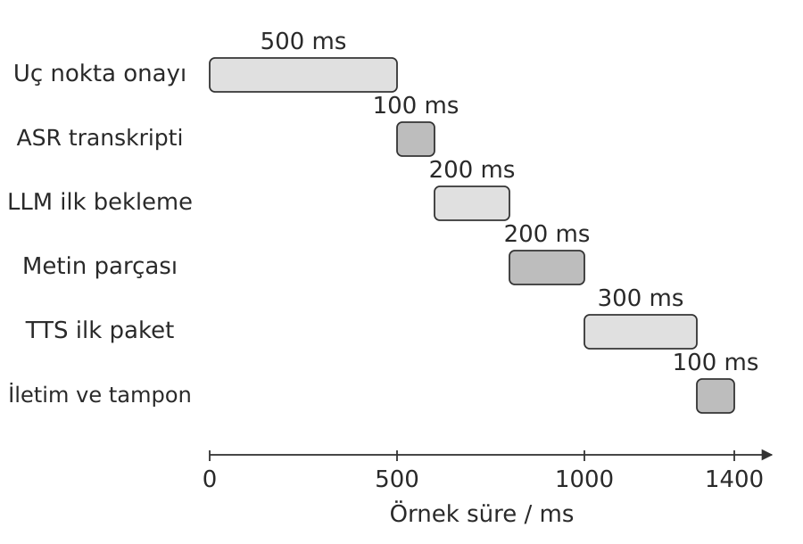

Hizmet yükü kuyruk beklemesi de getirir. Şekil 6-9 bu ilişkiyi M/M/1 tek sunucu modeliyle açıklıyor: varışlar Poisson sürecine, hizmet süresi üstel dağılıma uyar; ortalama hizmet süresi $S$, kullanım oranı $\rho<1$ iken hizmet ve kuyruk dahil ortalama toplam süre $W=S/(1-\rho)$'dir. $S=1$ saniye alınıp kullanım oranı 0,5'ten 0,8'e çıkarıldığında ortalama toplam süre 2 saniyeden 5'e çıkar. Hizmetin kendi ortalaması yine 1 saniyedir; fazladan 3 saniyenin tamamı kuyrukta geçer. İstekler işleme kapasitesine yaklaştığında kısa süreli trafik dalgalanmaları birikmişliğe dönüşür.

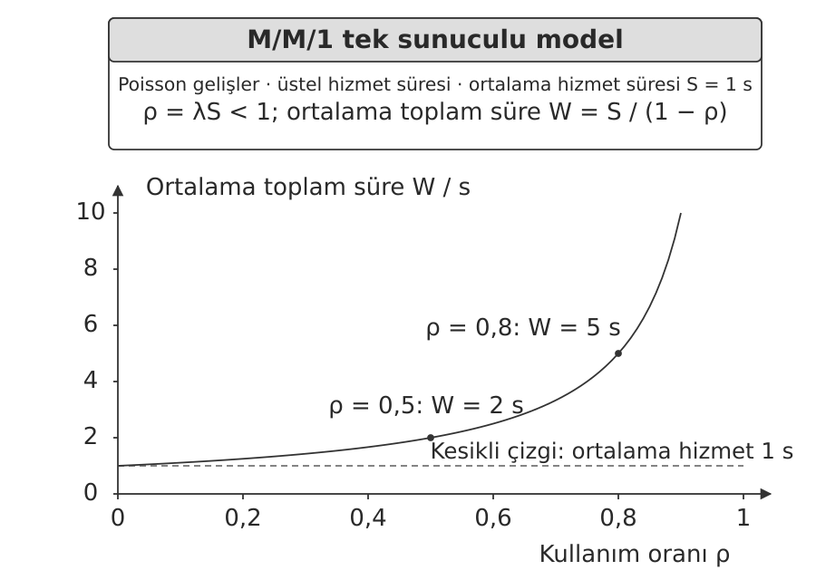

> **Deney 6-4 ★: Geleneksel bir sesli Agent kurmak**
>
> Asistanın perşembe uçuşlarını anlattığını ve sizin araya girip "bir dakika, cuma için almak istiyorum" dediğinizi varsayalım. Tarayıcı mikrofon sesini WebSocket üzerinden arka uca gönderir. Silero VAD konuşmaya başladığınızı algıladığında arka uç `speech_start` gönderir, tarayıcı hemen oynatmayı durdurur ve kuyruktaki eski sesi temizler. O anda asistan hangi günü değiştirdiğinizi henüz bilmez. Siz sözünüzü bitirip sessizlik 500 milisaniyelik varsayılan eşiği geçtiğinde arka uç `speech_end` gönderir ve bu ses parçasını yerel Whisper tiny'ye verir.
>
> Doubao metin döndürmeye başladığında kullanıcının yanıtı duymasına ne kadar var? Bir ses kaydının yeniden oynatıldığı kayıtta transkripsiyon 2,710 saniye sürdü. Doubao istek gönderildikten 0,749 saniye sonra ilk token'ı, 0,792 saniye sonra tam yanıtı döndürdü. Oynatma programı metin tamamlanmasını bekleyip Fish S1'e verdi; 2,819 saniye sonra arka uç ilk ses paketini aldı. Uç nokta kararından itibaren bu üç sıralı süre toplandığında yaklaşık **6,321 saniye** çıkar. Arşiv raporunda 6,279 saniye yazıyordu; o hesap yanıtın tamamını üretme süresi yerine ilk token süresini kullanmıştı.
>
> Bu 6,321 saniye yalnızca arka uç işlemesini kapsar. Kullanıcı önce sessizlik algılamasının cümlenin bittiğine karar vermesini, en sonda da sesin tarayıcıya ulaşıp oynatılmaya başlamasını bekler.

#### Sıralı yapıdan akışlı algılamaya

Sıralı çözüm parça parça kontrolü kolaylaştırır ve üç sorunu da ortaya koyar. Sessizliği beklemek uç nokta gecikmesini artırır; transkripsiyon metni tonlamayı, duyguyu ve ortam sesini kaçırabilir; ses duraklamaya göre bölünürken e-posta adresi, kişi adı ya da özel terim tam context'ini kaybedebilir. Kademeli mimariyi zaten kullanan sistemler için yazar önce akışlı dönüşümü öneriyor: her aşama artımlı sonucu olabildiğince erken versin, tanıma, akıl yürütme ve oynatma örtüşsün, teyit edilmiş kısımlar ile hâlâ değişebilecek kısımlar ayrı tutulsun. Böylece mevcut modüller yeniden kullanılabilir ve beklemenin nereden geldiği adım adım bulunabilir.

- **ASR dinlerken çevirir.** Ses sürekli alınır, geçici transkripsiyon üretilir; sonraki ses geldiğinde kararsız kısımlar düzeltilir, uç nokta teyit edildiğinde nihai metin verilir.
- **LLM tahmini yürütme.** Geçici transkripsiyonla yanıt önceden hazırlanır. Nihai metin teyit edildikten sonra girdinin aynı olup olmadığı ve mevcut işin hâlâ uygun olup olmadığı kontrol edilir, sonra korumaya, ayarlamaya ya da yeniden üretmeye karar verilir. Dışarıya gönderme ve iş verisine yazma gibi işlemler gereken koşullar teyit edildikten sonra yürütülür.
- **LLM parçalı çıktı.** Okumaya uygun bir metin parçası tamamlandığında TTS'e verilir; parçalama sırasında cümle anlamı, noktalama ve tonlama ipuçları korunur.
- **TTS artımlı sentez.** Ses blokları adım adım döner; sonraki metin üretimi, sentez ve oynatma örtüşebilir. Söz kesildiğinde üretim görevi ve oynatma tamponundaki henüz çalınmamış içerik birlikte ele alınır.

Whisper'ın olağan transkripsiyon uygulaması sesi pencerelere göre kodlar ve çözer[^ch6-whisper]. Dışarıdan parçalara ayırmak ya da biriken öneki tekrar tekrar göndermek artımlı bir transkripsiyon akışı kurulmasını sağlar; sürekli durumun yeniden kullanımı, tekrarlanan kodlama maliyeti ve geçmiş metnin düzeltilmesi somut uygulamanın yönetmesi gereken şeylerdir. Yerleşik akışlı tanıma modelleri ise sürekli girdiyi doğrudan mimaride ve eğitimde işler.

Ses dil modellerine dayanan algılama sistemleri metni ve akustik olayları birlikte üretebilir. Geçmiş ses, transkripsiyon ve sözcük ipuçları kişi adlarını, markaları ve özel terimleri tanımaya yardım eder; geçmişin ne kadarının tutulacağı context'e ve önbellek tasarımına bağlıdır. "Kullanıcı sözünü bitirdi mi" sorusunda model anlamsal bütünlüğü sessizlikle birlikte değerlendirebilir. "Rezervasyon yapmak isti..." duraklamasında gerçek zamanlı sistem yalnızca bu üç sözcüğü duymuştur; arkasından tarih geleceğini henüz bilemez.

Transkripsiyonun yanı sıra arayüz şu olayları da kararlaştırabilir: `speak_start` ve `speak_end` konuşmanın başını ve sonunu, `interrupt` söz kesmeyi gösterir; `emotion` duygu durumunu betimler; `laugh`, `sigh` ve `noise` gülüşü, iç çekmeyi ve ortam sesini kaydeder. Bu olaylar metin ve zaman damgalarıyla birlikte Agent'a gönderilebilir.

> **Deney 6-5 ★: Qwen2-Audio ile akışlı ses algılamayı taklit etmek**
>
> Bu deney ses önekini adım adım genişletiyor; her seferinde baştan o ana kadarki sesi Qwen2-Audio'ya yeniden vererek transkripsiyonun ve akustik olayların girdiyle birlikte nasıl değiştiğini gözlemliyor. Kontrol yolu 600 milisaniyelik sessizlik uç noktası ve Whisper kullanıyor. Testler normal konuşmayı, 900 milisaniyelik duraklama eklenmiş uzun bir cümleyi ve pembe gürültü karıştırılmış konuşmayı içeriyor.
>
> Bu yerel nicemlenmiş model çalıştırmasında 13 önek çıkarımı kaydedildi; her biri yaklaşık 8–11 saniye sürdü. Orta duraklama kontrol yolunda bölünmeyi tetikledi; ses modeli gürültüyü de yakaladı, ama öksürük ve gülüş için yanlış alarm verdi.

[^ch6-whisper]: OpenAI, Whisper; ses pencerelerine göre transkripsiyonu ve model uygulamasını tanıtır.

### Yaklaşım iki · Uçtan uca tam kipli model (Omni)

Uçtan uca ses modelleri sesi doğrudan alır, dilsel ve akustik bilgiyi birleştirerek yanıt üretir ve ses çıkış dalı üzerinden konuşmayı sentezler. Sesi doğrudan işlemek konuşma hızından, ses perdesinden, duraklamalardan ve ortam sesinden yararlanmayı sağlar; önce yazıya döküp sonra yanıtlamak ise ara metni kontrol etmeyi ve modülleri bağımsız değiştirmeyi kolaylaştırır.

Bu akustik özellikler anlamayı etkiler. Örneğin aynı "raporu öğle yemeğinden önce gönderin" cümlesi aceleci ya da yavaş söylendiğinde dinleyicide farklı izlenimler bırakır. Çıktıda da model duraklama, vurgu ve tonlamayla anlamı düzenleyebilir.

Sesi doğrudan işleyen sistemler de kullanıcının sözünü bitirmesini bekleyip sonra yanıt verebilir. Örneğin kullanıcı telefon numarasını söylerken bir an durursa sistemin bu rakam dizisinin bitip bitmediğine yine karar vermesi gerekir. Uç nokta algılama ne zaman yanıt verileceğini belirler; karşı taraf anlatımın ortasında söze girerse sistem model üretimini ve hoparlör oynatmasını da eşgüdümlemelidir.[^ch6-audio-architectures]

> **Deney 6-6 ★★: MiniCPM-o 4.5'i yerelde çalıştırmak, uçtan uca ile öz-kademeli yolu karşılaştırmak**
>
> Bu deney aynı MiniCPM-o 4.5 modelini sabitliyor ve düşünme modunu kapatarak iki yolu karşılaştırıyor: sorunun doğrudan sesten yanıtlanması ve önce modelin yazıya dökmesi, sonra yalnızca bu metne göre yanıtlaması. Girdi, sesle söylenmiş iki aritmetik problem ile metni aynı ama hızı farklı iki konuşma içeriyor.
>
> İki yol da üç soruyu doğru yanıtladı; hatalar farklı yerlerde çıktı. Doğrudan ses yolu bir sorudaki twelve boxes ifadesini 8 olarak duydu ve hesap hatası yaptı; transkripsiyon yolu 12'yi doğru korudu. Hız sorusunda iki kayıt da "Please send the report before lunch." diyor; yazıya döküldükten sonra metinler tıpatıp aynı ve hız bilgisi kayboluyor; doğrudan ses yolu ise iki konuşma hızını doğru ayırt etti.
>
> Deney ayrıca girdi anlamayı ses çıktısına bağlayan 24 kHz'lik bir konuşma üretti.

### Yaklaşım üç · Tam çift yönlü etkileşim modeli

Tam çift yönlü sistemler konuşurken dinler; insanın en kolay fark ettiği iyileşme sohbetteki "canlı biri varmış" hissidir. "Çarşamba için almak isti... hayır, perşembe" cümlesini okumayı deneyin: ortadaki duraklama bu kendi kendini düzeltmeye yer açar; asistan çarşamba uçuşlarını anlatmaya başlamışsa "hayır, perşembe"yi duyduğunda durmalıdır. Başka bir zamanlama ise şudur: karşı taraf hâlâ güzergâhı anlatıyorken kısa ve hafif bir onaylama sesi ona asistanın dinlediğini gösterir. Sesi sürekli almak, konuşma, dinleme, duraklama ve araç çağırma arasında bu seçimleri yapmanın koşuludur. Eşzamanlı çeviri de girdi ile çıktının örtüşmesini gerektirir.

Kyutai'nin 2024'te yayımladığı **Moshi** kullanıcının ve modelin ses akışlarını ayrı ayrı modeller, örtüşen konuşmayı ve söz kesmeyi paralel akışlarla temsil eder[^ch6-moshi]. Bu zaman ilişkileri girdide korunduğunda model ne zaman yanıt vereceğini, ne zaman dinlemeyi sürdüreceğini öğrenebilir.

Thinking Machines Lab'in etkileşim modeli sürekli girdi ve çıktıyı her biri 200 milisaniyelik eşit uzunlukta kısa bloklara böler; her bloğa mikro tur (micro-turn) denir[^ch6-14]. Şekil 6-10'daki zaman ekseninde ikinci kutuya bakın: asistan hâlâ "perşembe" diyor, kulağına kullanıcının tarihi düzelten "hayır"ı geliyor. Üçüncü kutuda asistan duruyor ve kullanıcının "cuma"yı bitirmesini dinlemeyi sürdürüyor.

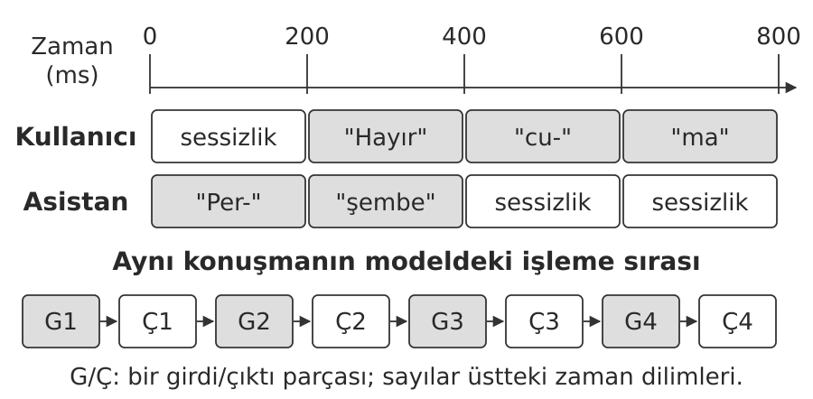

Şeklin alt yarısını da okuyun. Görüşmenin iki tarafı örtüşebilen iki ses duyar; model ise tek bir dizi boyunca girdi bloklarını işleyip çıktı bloklarını üretmeyi dönüşümlü yapabilir. Sessizlik de bir kutu kaplar; bu yüzden asistan önce biraz dinleyip sonra konuşabilir. Şekildeki 200 milisaniye bu uygulamanın blok uzunluğudur; kullanıcının söze girmesinden hoparlörün gerçekten durmasına kadar geçen sürede işlem ve oynatma tamponunun süresi de hesaba katılmalıdır.

[^ch6-moshi]: Kyutai, *Moshi: a speech-text foundation model for real-time dialogue*, 2024; kullanıcı ve modelin paralel ses akışlarını tanıtır.
[^ch6-14]: Thinking Machines Lab, *Interaction Models: A Scalable Approach to Human-AI Collaboration*; mikro turları, çok akışlı etkileşimi ve arka plan görev devrini tanıtır.

### Bilişsel zamanlama: gerçek zamanlı etkileşim ve derin düşünme

Pine'ın müşteri hizmetleri görüşmelerinde temsilci cümlenin yarısındayken asistan bazen beklemeli, bazen hafifçe onaylamalıdır; kendisi konuşurken karşı tarafın araya giren düzeltmesini de duyabilmelidir. Yazarın Moshi çizgisini umut verici bulmasının nedeni budur: zamanlama iyi ayarlanırsa karşı taraf telefonun bu ucunda gerçekten dinleyen biri olduğunu hisseder. Kaynak araştırması gerektiren bir istekle karşılaşıldığında başka bir zaman hesabı da yapmak gerekir: soruyu anlamaktan bulunan yanıtı söylemeye kadar iş kaç el değiştiriyor?

Ön plandaki ses modelinin doğrudan çağırabileceği araçları ön plan çağırır. Uçuş sorgusu yalnızca iki model çağrısı gerektirir: ön plan kullanıcının verdiği koşullarla sorgular, sonra sonucu bildirir. Devir ise dört çağrı gerektirir: ön plan görevi tarif eder, arka plan sorguyu başlatır, arka plan sonucu düzenler, ön plan aktarır. Başka bir görüş, gerçek zamanlı modelin parametreleri yanlış doldurabileceğini, bu yüzden araçların arka planda çağrılması ve ön planın yalnızca ne zaman dinleyip ne zaman konuşacağına odaklanması gerektiğini savunur.

GPT-Live-1'in ön planında iş fonksiyonlarını doğrudan çağırma arayüzü yoktur; yalnızca arka plan Agent'ına devredebilir. OpenAI Realtime'ın GPT-Realtime modeli ön planın fonksiyonları doğrudan çağırmasını destekler. Doubao gerçek zamanlı ses modeli 3.0 (Seeduplex) saf uçtan uca modda ön planda doğrudan çağrıyı destekler; karma orkestrasyonda ise çağrıyı dışarıya bağlı dil modeli yapar.[^ch6-voice-tools]

Ön plan ve arka plan modellerinin her çağrısının sırasıyla $L_f$ ve $L_b$ sürdüğünü, aracın $T$ sürdüğünü varsayalım. Kullanıcının sözünü bitirmesinden sonucu duymasına kadar doğrudan çağrı yaklaşık $2L_f+T$, devir yaklaşık $2L_f+2L_b+T$ sürer. Devrin fazladan getirdiği $2L_b$, araç süresi $T$'den bağımsızdır. Kullanıcı belleği gibi her turda kullanılabilecek bilgiler çalışma zamanınca önceden sorgulanıp context'e konabilir; ön plan modeli yalnızca bir kez çağırır, yaklaşık $L_f+T$ sürer; kullanıcı konuşmaya başlamadan önce sorgulanmışsa $T$ de ortadan kalkar.

Birkaç değişiklik seçeneğini karşılaştırmak gibi çok adımlı akıl yürütme gerektiren görevler arka plana uygundur. Bilet almak ödeme ve bilet kesmeyi içerir; aracı kim çağırırsa çağırsın sipariş kullanıcı teyit ettikten sonra verilmelidir. Uçuş sonuçları sözlü olarak özetlenebilir, tam tablo ise ekranda gösterilebilir; bu, aracı kimin çağırdığından bağımsızdır.

> **Deney 6-7 ★★: Sesli Agent'ın araçlarını ön plan mı arka plan mı çağırmalı**
>
> Ön planı Doubao gerçek zamanlı ses modeli 3.0 ile, arka planı Volcano Ark'ın sunduğu DeepSeek V4 Pro ile kurun. Hava durumu, kullanıcı belleği, web araması, uçuş sorgusu ve bilet alma olmak üzere beş taklit araç hazırlayın; sonuçlarını belirlenen sürelerde döndürsünler; uçuş sorgusu ve bilet alma 2–5 saniye beklesin. Kullanıcı kayıtlarını önceden sentezleyin ve her seferinde aynı senaryonun kaydını yeniden oynatın.
>
> Dört iş bölümü kurun. Birincisinde ön plan tüm araçları çağırır. İkincisinde arka plan tüm araçları çağırır, ön plan yalnızca devredebilir. Kalan ikisinde ön plan hava durumunu sorgular, çalışma zamanı oturum başında kullanıcı belleğini context'e koyar, arka plan web aramasından ve bilet almadan sorumludur. İkisi arasındaki fark uçuş sorgusunun ön planda mı arka planda mı yapıldığıdır. Ön plan kullanıcının sesini doğrudan duyar; arka plan sesi duyamaz, yalnızca metin okuyabilir. Doubao'nun arayüzü kullanıcının her cümlesini dinledikten sonra konuşma tanımadan elde edilen metni ayrıca döndürür; buna transkripsiyon denir. Devirde transkripsiyon ve asistanın söyledikleri sırayla görüşme kaydı olarak düzenlenir; bu görüşmede yürütülmüş araç çağrıları ve ön planın yazdığı görev açıklamasıyla birlikte arka plana verilir. Her iş bölümünde aşağıdaki senaryolar 10'ar kez test edilir.
>
> 1. Hava durumunu ve uçuşları ayrı ayrı sorgulayın. Kullanıcının sözünü bitirdiği andan sorgu sonucunun duyulduğu ana kadar süre tutulur; "bir bakayım" gibi geçiş cümleleri yanıt sayılmaz. Doğrudan çağrı ile devrin bekleme sürelerinin medyanını karşılaştırın. Yazarın deneyinde hava durumu sorgusunda bunlar sırasıyla 2,81 ve 6,96 saniyeydi.
> 2. Önce uçuş sorgulayın, sonra bilet seçip teyit edin. Önceki sorgu sonucunu, kullanıcının az önce söylediklerini ve kullanıcı bilgilerini karşılaştırarak bilet siparişinin 13 alanını tek tek kontrol edin; siparişin kullanıcı teyidinden sonra verilip verilmediğine bakın. Yazarın deneyinde dört iş bölümünün hepsi tüm alanları doğru doldurdu ve hepsi kullanıcı teyidinden sonra sipariş verdi.
> 3. Bileti bir meslektaş için almaya geçin ve adın sözlü olarak tarif edildiği kaydı çalın: "Chen Jiayi; kulak ve doğu işaretli Chen, ödüllendirmenin Jia'sı, huzurun Yi'si." Kaydı, konuşma transkripsiyonunu ve siparişteki adı karşılaştırarak ön planın doğrudan aldığı biletle devredilen bilette adın doğru yazılıp yazılmadığını kontrol edin. Yazarın deneyinde ön plan doğrudan bilet aldığında 10 seferin hepsinde doğruydu; transkripsiyon ise adı yanlış karakterlerle yazdı ve devirde bazı siparişlerde ad bu yüzden yanlış dolduruldu.
> 4. Uçuş sorgu sonucu dönmeden hava durumunu soran kaydı çalın; ön planın hava durumu sorusunu yanıtlayıp yanıtlamadığını, ardından uçuş sonucunu bildirip bildirmediğini dinleyin. Yazarın deneyinde hava durumu soruları hep yanıtlandı, ama özgün uçuş sonucu neredeyse hiç dile getirilmedi.

Devir gerektiğinde ön plan emin olduğu adları, sayıları ve kullanıcının az önce yaptığı düzeltmeleri görev açıklamasına yazmalıdır; böylece arka plan transkripsiyon hatası yüzünden parametreleri yanlış doldurmaz. Çalışma zamanı henüz söylenmemiş sonuçları kaydetmeli, ön plan araya giren soruyu yanıtladıktan sonra rapora devam edebilmelidir.

Hızlı modelin "bir bakayım" demesi müşteri temsilcisine asistanın talebi anladığını bildirir. Fiyatın ne zaman söylenebileceği ise sorgunun ve akıl yürütmenin görüşmeyle nasıl birlikte yürüdüğüne bağlıdır. Şekil 6-11 üç düzeni gösteriyor: önce yanıt verip sonra derinlemesine cevaplamak, ön planın sürekli etkileşip arka plandan öneri alması ve kurgulama ile ifadenin parça parça paralel ilerlemesi.

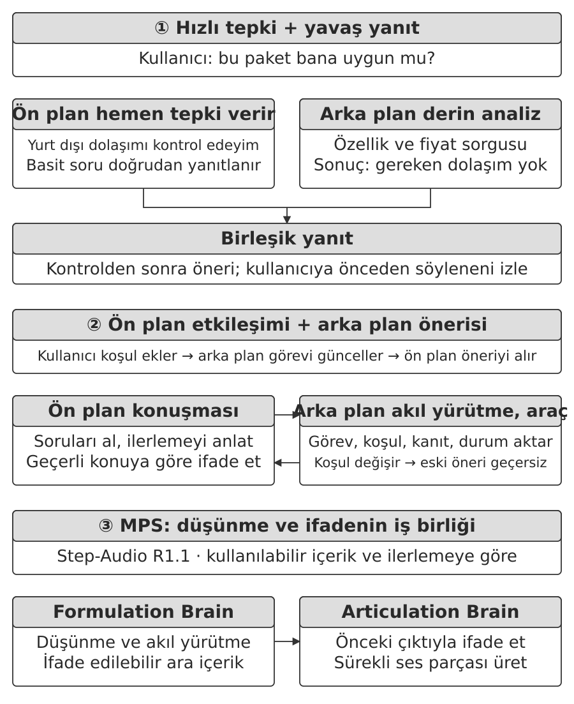

#### Çözüm bir: hızlı düşünme yanıt verir, yavaş düşünme cevaplar

Hızlı model önce kısa bir karşılık verir, yavaş model analizi arka planda tamamlayıp ayrıntılı yanıtı sonra ekler. Bu tasarım isteğin alındığını erkenden teyit edebilir, ama iki yanıtın tutarlılığının yönetilmesi gerekir. Örneğin hızlı model önce bir paketin alınmasını önerir, yavaş model ardından paketin kilit bir özellikten yoksun olduğunu fark ederse öneriler çelişir. Çelişkinin kökü iki tarafın bağımsız yanıt vermesindedir; karar dayanakları ve akıl yürütme ilerlemeleri farklı olabilir. Hızlı modelin söylediği öneri kullanıcının kararına girmiştir; kullanıcı buna göre harekete bile geçmiş olabilir. Yavaş model sonradan düzeltirse değişikliği açıklamak ve oluşmuş etkiyi ele almak gerekir.

Bu yüzden ön plan görev teyidi ile iş vargısını ayırmalıdır. "Paketin bu özelliği içerip içermediğini kontrol ediyorum" hemen söylenebilir; satın alma önerisi ise gerekli sorgu ve analizi beklemelidir. Arka plan sonucu döndüğünde sistem onu söylenmiş içerikle karşılaştırır, sonra sonraki yanıtı düzenler. Basit sorular doğrudan hızlı modelle tamamlanabilir; tekrarlanan işlem azalır.

#### Çözüm iki: hızlı düşünme etkileşir, yavaş düşünme hatırlatır

Ses ile ekran da iş bölümü yapabilir. Sözlü olarak "bu ayki faturada 15 avroluk fazladan dolaşım ücreti var" demek, kullanıcının ana noktayı hemen kavramasını sağlar; özgün tutar, güncel fiyat ve tartışmalı ayrıntılar ekranda kalırsa kullanıcı kendi hızında kontrol edebilir. Belirli bir işlem tıklamayla teyit edilebilir, hassas bilgiyi ise kullanıcı satıcının kabul ettiği giriş arayüzünde kendisi doldurur. Ön planın yalnızca "doğrulama tamamlandı" gibi bir durumu alması, sohbete doğal biçimde dönmesine yeter.

Yolcunun Pine'dan perşembe sabahı Şanghay'a bir uçak bileti almasını istediğini varsayalım; bütçe 1200 yuan ve öğlene kadar etkinlik yerine yetişmesi gerekiyor. Pine bir yandan havayolu temsilcisiyle konuşurken bir yandan arka plana "not uzatıyor": "Saat onda Hongqiao'ya inersek havalimanından etkinlik yerine yetişebilir miyiz?" Temsilci boş koltuklara bakıp Pine'a şöyle diyor: "Saat onda Hongqiao'ya inen uçuş doldu. Saat on buçukta Pudong'a inen bir uçuş var, bilet 1250 yuan." Arka plan yalnızca ön planın uzattığı notu görebiliyorsa hâlâ Hongqiao'dan çıkan yolu hesaplıyordur. Ön planın bir cümle daha söylemesi gerekir: "Pudong için yeniden hesapla, on buçukta iniş, etkinlik yeri ve varış saati aynı."

Başka bir yöntem, görüşme kaydını da sırasıyla arka plana eşitlemektir. Arka plan temsilcinin söylediği havalimanını ve iniş saatini görüşme kaydından okumuşsa ön planın yalnızca "bu uçuşun yetişip yetişmediğini hesapla" demesi aynı işi devretmeye yeter. Kayıt eşitlenirken kimin ne söylediği belirtilmeli; ön planın sözü kesildiği için henüz söylenmemiş yarım cümlesi de söylenmiş içerikten ayrılmalıdır. Konuşma transkripsiyonu kilit bilgileri atlayabilir ya da yanlış yazabilir. Ön plan doğru duyduğu adları, sayıları ve kullanıcının düzeltmelerini görev açıklamasına yazmalıdır. İki kayıt arasında fark varsa arka plan görev açıklamasını esas alır. Arka plan işini bitirdiğinde ön plana yalnızca etkinlik yerine saat kaçta varılacağını ve zamanın ne kadar sıkışık olduğunu söyler. Hangi yolların denendiği, harita arayüzünün hangi alanları döndürdüğü arka planda başvuru için kalabilir. Sonucu alan ön plan temsilciyle görüşmeyi sürdürür.

Bölüm 1'deki iş seyahatindeki yolcu bileti 1200 yuan içinde tutmak istiyordu. Eskiden iş seyahatlerinde uygun bir uçuş için biraz fazla ödemeye razıydı; bu sefer de ayrıca bir üst sınır koymadı. En düşük fiyatın 1250 yuan olduğunu duyunca asistan bileti onun adına alabilir. Her zaman hesabını kitabını bilen bir kullanıcı ailesiyle tatile çıkıyorsa bu 50 yuan önce sorulmalıdır. Ön plan böylece iki konuşmayı birden gözetmek zorundadır:

- Kullanıcıya: "Bu uçuşun en düşük fiyatı 1250 yuan, bütçeden 50 yuan fazla. Almak ister misin?"
- Ardından temsilciye: "Bu fiyatı bir süre tutabilir misiniz? Aynı gün biraz daha geç kalkan, 1200 yuanın altında bir uçuş var mı?" Temsilci bakarken ön plan bagaj hakkını ve iade/değişiklik koşullarını da sorabilir.

Böylece kullanıcı döndüğünde birkaç seçenek görür, temsilci de sırada neye bakacağını bilir. Kullanıcı sonradan "geçen sefer toplantıya yetişmem gerekiyordu, bundan sonra iş seyahatinde bütçeyi aşarsa da önce bana sor" diye açıklarsa bir dahaki sefere bu yeni talebe göre davranılmalıdır.

Kişinin kendisinin doğrulama yapması beklenirken görüşmenin ritmi yine değişir. Temsilci doğrulama kodunun gönderildiğini söylediğinde ön plan şöyle diyebilir: "Tamam, bir saniye, yolcudan telefonuna bakmasını istiyorum." Yolcu henüz almadığını yazarsa temsilciye mesajın hangi numaraya gittiği ve ne zaman yeniden gönderilebileceği sorulur. Yolcu satıcının belirlediği kanalda doğrulamayı tamamladıktan sonra ön plan işe devam edebilir. Böyle bir görüşmede biraz daha beklemek ya da bileti biraz geç kesmek, kullanıcıyı hemen karar vermeye sıkıştırmaktan daha uygundur.

Bu sırada arka plan "özgün fiyat güncellendi" diye haber veriyor. Ön plan önce yeni fiyatı temsilciyle doğrular, sonra kullanıcıya söyler. Kullanıcı tam bu anda "alabilirsin" diye yanıt verirse bu yanıt daha önce kendisine gönderilen 1250 yuanlık teklife aittir. Ön plan yeni fiyata ve mevcut yetkiye bakarak yeniden teyit gerekip gerekmediğine karar vermelidir. Arka plan yalnızca bilgi sağlar; temsilciyle konuşan ve söz veren her zaman ön plandır. Mesajlara uçuş, fiyatın geçerlilik koşulları ve zaman eklenirse ön plan hangi teklifin süresinin geçtiğini tanıyabilir.

Aynı "fiyat değişti, lütfen doğrula" arka plan mesajının ne zaman geldiği de ön planın nasıl karşılık vereceğini etkiler. Temsilci tam "en düşük fiyat..." diyorsa ön plan önce tutarı dinleyebilir. Temsilci fiyatı söyleyip yanıt bekliyorsa yeni fiyatı sormak uygundur. Yolcu telefonda "dur, tarihi değiştiriyorum" diye söze girdiyse önce yeni tarih dinlenir, sonra özgün uçuşun doğrulanmasına gerek kalıp kalmadığına karar verilir. Aynı "tamam", temsilci koşulları anlatırken söylendiğinde yalnızca dinlendiği anlamına gelebilir; "şimdi biletinizi keseyim mi?" sorusundan sonra söylendiğinde ise satın alma onayı olarak anlaşılabilir. Yalnızca transkripsiyon metnine bakmak bu tür farkları kaçırır.

#### Çözüm üç: kurgulama ile ifadenin birlikte ilerlemesi

Step-Audio serisi iki ilgili örnek sunar. **Kipe çapalı akıl yürütme damıtması (MGRD)** akıl yürütmenin dayandığı bilgiye odaklanır: ses perdesi, ritim, tonlama gibi akustik özellikler etrafında akıl yürütme verisi kurar ve süzer, yinelemeli damıtmayla ses anlamayı iyileştirir. Step-Audio R1 pekiştirmeli öğrenme aşamasında ses sorularını iki kalemde puanlar: doğru yanıt 0,8 puan, akıl yürütme süreci vermek ayrıca 0,2 puan. İkincisi modeli dayanağını yazmaya teşvik eder; akıl yürütmenin kayıttaki akustik ipuçlarını kullanıp kullanmadığı ise önceki örnek süzme aşamasında kontrol edilmelidir.[^ch6-mgrd]

**Mind-Paced Speaking (MPS)** akıl yürütme ile ifadenin zamanlamasına odaklanır; kurgulama modülü (Formulation Brain) ve ifade modülü (Articulation Brain) kullanarak kurgulama sürecinin ses üretimine yön vermesini sağlar. Step-Audio R1.1'in gerçek zamanlı çözümü bu yöntemi benimsemiştir.[^ch6-mps]

İki modül ilerlemeye göre bilgi alışverişi yapar: kurgulama sürekli ilerler, ifade ise kullanılabilir hâle gelen içeriğe ve önceki çıktıya göre sesi düzenler. Böylece ifadenin bir kısmı sonraki akıl yürütmeyle örtüşebilir; söylenmiş içerik de izlenmeye devam eder.

[^ch6-mgrd]: StepFun, *Step-Audio-R1 Technical Report*; kipe çapalı akıl yürütme damıtmasını tanıtır.
[^ch6-mps]: StepFun, *Mind-Paced Speaking: A Dual-Brain Approach to Real-Time Reasoning in Spoken Language Models* ve Step-Audio-R1.1 model kartı; kurgulama ve ifade modüllerini ve gerçek zamanlı sistemlerdeki uygulamalarını tanıtır.

#### Modül iş bölümü ve yükseltme biçimi

**Yazar hızlı–yavaş iş bölümünün bir mühendislik avantajını önemsiyor: etkileşim yeteneği ile akıl yürütme yeteneği ayrı ayrı gelişebilir.** Daha güçlü bir akıl yürütme modeli çıktığında sistem arka planı değiştirebilir. Böylece arka plan akıl yürütme modellerindeki ilerlemeye yetişebilir, ön plan da dinleme, yanıtlama ve söz kesme deneyimini sürekli iyileştirebilir. Ön plan görevi ve kullanıcının eklemelerini anlamalı; arka plan ise uzun akıl yürütmeye, planlamaya ve yürütmeye odaklanır.

**Akıl yürütme modelleri hızla yinelenirken ve ekip iş yeteneklerini sürekli yükseltmek zorundayken yazar değiştirilebilir hızlı–yavaş iş bölümünü tercih ediyor.** Bu iş bölümü, akıl yürütme modeli her yükseltildiğinde bütün ses sistemini yeniden eğitme yükünü ortadan kaldırır. Ara akıl yürütmenin ifadeyi daha doğrudan denetlemesi gerektiğinde ve buna uygun eğitim kaynakları varsa daha sıkı bir birlikte çalışma çözümü benimsenir.

Pine AI'ın sesli Agent'ı ön planda hızlı düşünme ile arka planda yavaş düşünmenin birlikte çalıştığı bir mimari kullanır. Yayımlanan yazısı τ²-bench ses kategorisinde ilk sıraya çıktığını bildiriyor ve sürekli görüşmenin, iş akıl yürütmesinin ve araç işlemlerinin nasıl birleştirildiğini anlatıyor[^ch6-17].

Bu bileşimleri anlarken üç tasarım boyutu ayırt edilebilir: **ses yolu** modelin sesi doğrudan mı işlediğini yoksa transkripsiyonla mı devrettiğini belirler; **dinleme–konuşma zamanlaması** girdi ve çıktının tur tur mu paralel mi ilerlediğini belirler; **bilişsel iş bölümü** gerçek zamanlı etkileşim ile derin akıl yürütmenin durumu nasıl paylaştığını ve sonuçları nasıl değiştirdiğini belirler. Bir sistem sesi doğrudan işleyip tam çift yönlülüğü koruyabilir, aynı zamanda karmaşık görevleri bağımsız bir arka plan modeline verebilir. Thinking Machines Lab'in etkileşim modeli de GPT-Live de bu tür bileşimleri göstermektedir.

[^ch6-17]: Pine AI, *The Most Natural Human-Computer Interface Is Your Voice*; hızlı–yavaş düşünme mimarisini ve bildirdiği ses görevi değerlendirme sonuçlarını tanıtır. Rapor sıralamayı τ²-bench voice olarak anar.

### İnsana daha çok benzeyen konuşma sentezi

Duraklamalar, konuşma hızı ve vurgu dinleyicinin cümle yapısını ve konuşanın niyetini anlamasına yardım eder. Örneğin telefon numarası söylenirken uygun gruplama gerekir, karmaşık koşullar anlatılırken yavaşlanabilir, sorgu sonucu beklenirken önce neyin işlendiği açıklanabilir. Bence uygun duraklama ve ritim değişimi sesi daha doğal kılar, kullanıcının görevin nasıl ilerlediğini duymasını da sağlar. Ses denetimi bu somut kullanımlar etrafında tasarlanabilir.

Ana LLM metne `[THINKING]`, `[EMO:happy]` ve `[SPEED:0.8x]` gibi denetim işaretleri ekleyebilir. Yürütme katmanı işaretleri ayrıştırır, metni ses ve duraklama parçalarına böler, sonra sentez arayüzünün desteklediği duygu, üslup ya da referans sesle eşler. İşaretlerin anlamını uygulama tanımlar: `0.8x` yavaş kademeye eşlenebilir; duraklamayı oynatıcı ekleyebilir; gülüş ve iç çekme desteklenen ses işaretleriyle ya da üretim yeteneğiyle ifade edilir.

Referans ses çözümü aynı konuşmacının farklı ifade biçimlerini bir kitaplık olarak düzenler. Her metin parçası uygun duygu, hız ve üslubu seçer, sentezlenip sırayla birleştirilir. Denetim durumunun etki kapsamı belirlenmelidir; örneğin duygu bir sonraki değişikliğe kadar sürer, duraklama yalnızca o konumda geçerlidir.

> **Deney 6-8 ★★: Fish Audio ile denetim işaretlerine dayalı TTS**
>
> Bu deneyde Fish Audio S1 ile 24 referans sesten oluşan bir ses kitaplığı kuruluyor: dört duygu, üç hız kademesi ve iki üslubun bileşimi. Ayrıştırıcı işaretli yanıtı ses parçalarına ve sessizlik parçalarına dönüştürür, yürütme katmanı her parça için referans ses seçer ve sentezi tamamlar.
>
> Üç yapılandırma karşılaştırılıyor: denetim işareti yok, tek referans ses, çok referanslı ses. Yanıt içeriği aynı tutulur; işaretlerin beklenen yapılandırmaya yönlendirilip yönlendirilmediği kontrol edilir, sonra duraklamalar, duygu ve ses tınısı dinlenir.
>
> Saklanan dinleme testinde bir ses anlama modeli kullanıldı; üç yapılandırma dönüşümlü sırayla sunulup doğallık, duygu uyumu, düşünme duraklaması, tını tutarlılığı ve müşteri hizmetleri hissi değerlendirildi. En yüksek bileşik puanı çok referanslı grup aldı; tek referanslı grup işaretsiz grubun altında kaldı.

## Computer Use: GUI otomasyonu yapan Agent

Agent'tan web sayfasındaki teslimat adresini değiştirmesini istediğinizi varsayalım. Önce adres alanını bulması, yeni adresi yazması, sonra yankıya bakarak kaydın sonucunu doğrulaması gerekir. Tıklamadan önce bir oturum açma penceresi çıkarsa, önceki ekran görüntüsündeki düğmenin koordinatı değişmemiş olsa bile bu tıklamanın nesnesi değişmiştir. Computer Use tarayıcıyı, tabloları ya da sistem ayarlarını ekran, fare ve klavye üzerinden kullanır; temel işi her eylemin gözünün önündeki arayüzle uyumlu kalmasını sağlamaktır.

Şekil 6-12'deki **algıla—düşün—eyle** döngüsünü izleyerek modelin yeni adresi yazmadan önce neyi teyit etmesi gerektiğine bakın. Model ekran görüntüsüne ve görev ilerleyişine göre tıklanacak yeri seçer, Harness parametreleri ve yetkileri kontrol eder, sonra yürütme katmanına verir. Tıklamanın başarılı olması yalnızca bu tıklamanın gönderildiğini gösterir. Bir sonraki ekran görüntüsünde girdi odağının nereye düştüğü, adresin güvenle yazılıp yazılamayacağını belirler.

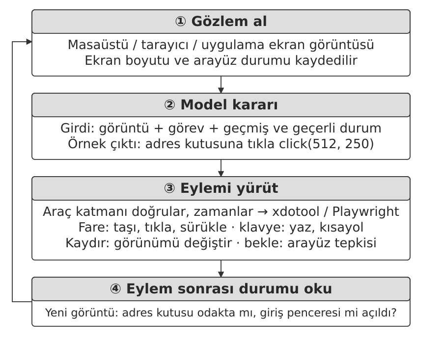

Asistan adresi doldurduktan sonra yürütücüye hangi "Kaydet" düğmesine tıklayacağını nasıl söylemeli? Ekran koordinatları da öğe numaraları da hedefi gösterebilir, ama modelden ve araçtan bekledikleri farklıdır.

### Eylem uzayı tasarımı

Şekil 6-13'te Anthropic'in Computer Use başvuru uygulaması grafik arayüz, komut yürütme ve dosya düzenleme olmak üzere üç araç türü sunar. Yalnızca grafik arayüze bakıldığında verinin iki gittiği yer vardır: tıklama eylemi yürütme tarafına gider, tıklamadan sonraki ekran görüntüsü bir sonraki kararın gözlemi olarak modele döner. Yerleşik API araç biçimini belirler; başka bir model kullanılırsa uyarlama katmanı ekran görüntüsünü, eylem talebini ve yürütme sonucunu ilgili arayüzün kabul ettiği mesajlara çevirmelidir.[^ch6-computer-tools]

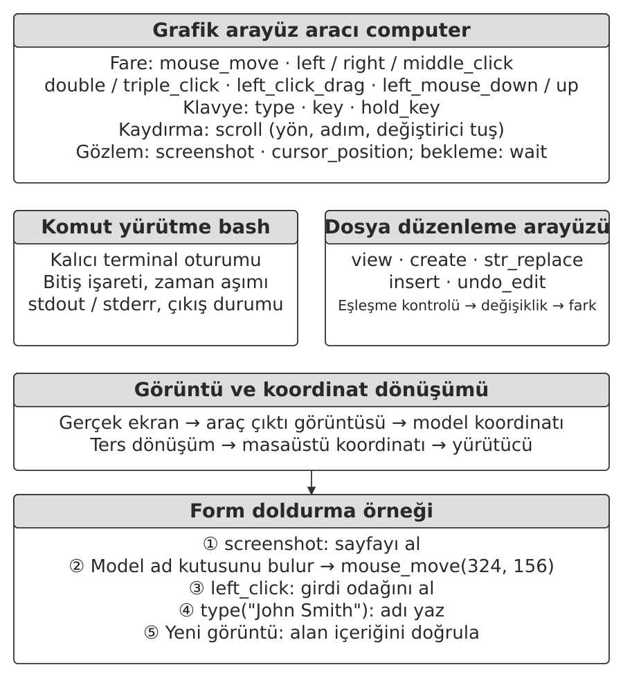

**GUI işlem araçları.** Fare eylemleri arasında konumlandırma, sol/sağ/orta tıklama, çift ve üç tıklama ile sürükleme vardır; daha ince arayüzler basmayı ve bırakmayı ayrı ayrı ifade edebilir. Kaydırma yön ve miktar ister; bazı uygulamalar değiştirici tuşları da destekler. Klavye arayüzü metin girişi, bileşik tuşlar ve tuş basılı tutmayı sunar. Ekran görüntüsü ve imleç konumu durumu almak, bekleme arayüzü ise sayfa yüklemesine ya da animasyona zaman tanımak içindir. Araç sürümü somut eylem kümesini belirler; Harness parametreleri kullanılan arayüze göre doğrular.

**Komut yürütme araçları.** Kalıcı terminal çalışma dizinini ve ortam durumunu çağrılar arasında koruyabilir. Örneğin bir çağrıda dizin değiştirildiyse sonraki çağrı o dizinde çalışır. Başvuru uygulaması komutun bittiğini bir işaret dizesiyle tanıyabilir ve zaman aşımı koyabilir; zaman aşımından sonraki süreç durumunu yine yürütücü kontrol etmelidir.

**Dosya düzenleme araçları.** Dize değiştirme arayüzü değişiklik kapsamını özgün metne göre bulur; görüntüleme, oluşturma, ekleme ve geri alma da sunulabilir. Yürütmeden önce eşleşen konum ve sayı, yürütmeden sonra fark kontrol edilir; dosya iki çağrı arasında değiştiyse ilgili içerik önce yeniden okunur. Bölüm 5'te tanıtılan düzenleme stratejileri burada yeniden kullanılabilir.

> **Deney 6-9 ★: Anthropic Computer Use başvuru uygulamasını çalıştırmak**
>
> Bu deney resmî konteyner örneğinin sağladığı Ubuntu masaüstünü, tarayıcıyı ve araç yürütme katmanını kullanıyor. Kullanıcı görevi girdikten sonra model ekran görüntüsünü okuyup eylem döndürür, yürütme katmanı masaüstünü kullanır ve yeni ekran görüntüsü modele geri verilir.
>
> Eşlik eden görev San Francisco'nun hava durumunu sorguluyor. Saklanan iz önce Google'a gidiyor, doğrulama koduyla karşılaştıktan sonra çalışma sırasındaki kurtarma talimatıyla herkese açık okunabilen Open-Meteo verisine yöneliyor ve sonunda sıcaklığı ve hava durumunu bildiriyor. Kayıt 15 masaüstü eylemi ve bunlara karşılık gelen ekran görüntülerini içeriyor; tıklamanın, tuş basımının, metin girişinin ve beklemenin sayfayı nasıl değiştirdiği tur tur kontrol edilebilir.
>
> Açık modellerle tarayıcı kullanma yolu için Deney 6-10'a bakın.

### Görsel konumlandırma (Grounding)

Modele arama kutusuna tıklatmak için soruyu iki biçimde sorabilirsiniz. Birinde ekran görüntüsünü gösterip tıklama koordinatını vermesini istersiniz. Diğerinde aday hedefleri numaralandırıp arama kutusunu seçmesini istersiniz; numara ekran görüntüsündeki aday bölgelere de yazılabilir, tarayıcının verdiği öğe listesinden de gelebilir. Aşağıda bu üç yol ayrı ayrı tanıtılıyor. Numara seçildiğinde yürütme katmanı numarayı gerçek hedefe geri çevirir; doğrudan koordinat verildiğinde model hedefin konumunu da kestirmek zorundadır; bu da konumlandırma eğitimi ve ekran çözünürlüğüne uyum açısından daha yüksek beklenti getirir.

**Set-of-Mark: görsel işaretleme.**

Set-of-Mark (SoM) görüntüye atıf yapılabilir numaralar bindirir ve görsel bölgeleri model çıktısıyla birleştirir. İlk çalışma aday bölgeleri bölütleme gibi yöntemlerle üretir; örneğin SAM, SEEM ile bölgeler elde edilir, sonra işaretler yerleştirilir. Model numarayı seçtikten sonra yürütme katmanı ilgili bölgeye göre işlem konumunu belirler. Bu yöntem DOM'un bulunmadığı masaüstü yazılımlarında ya da oyun arayüzlerinde kullanılabilir; tıklanacak denetimin numaralı bir bölgeye düşmesi ve modelin hangi numaraya karşılık geldiğini görmesi gerekir.[^ch6-som]

**Yapılandırılmış öğe indeksi.**

Tarayıcı başka bir tür ipucu da sağlayabilir. Belge nesne modeli (DOM) sayfada hangi öğelerin hangi hiyerarşide olduğunu betimler, düzen bilgisi öğelerin ekrandaki konumunu verir, erişilebilirlik ağacı (accessibility tree) ise yardımcı teknolojiler için gereken rolleri ve erişilebilir adları korur. Örneğin yalnızca büyüteç simgesi olan bir düğme, sayfa "arama" erişilebilir adını sağlıyorsa Agent tarafından rol ve ad üzerinden bulunabilir. browser-use gibi bir çözümde sistem Chrome DevTools Protocol (CDP) gibi tarayıcı hata ayıklama arayüzleriyle öğe bilgisini alabilir, giriş kutusu, düğme ve bağlantıları tanıyabilir, sonra sayfadaki bu işlem yapılabilir öğeleri numaralandırabilir. Şekil 6-14'te model sayfanın sağ üstündeki [2]'yi seçiyor. Bu numara Submit düğmesine yapılan bir tıklamaya nasıl dönüşür?

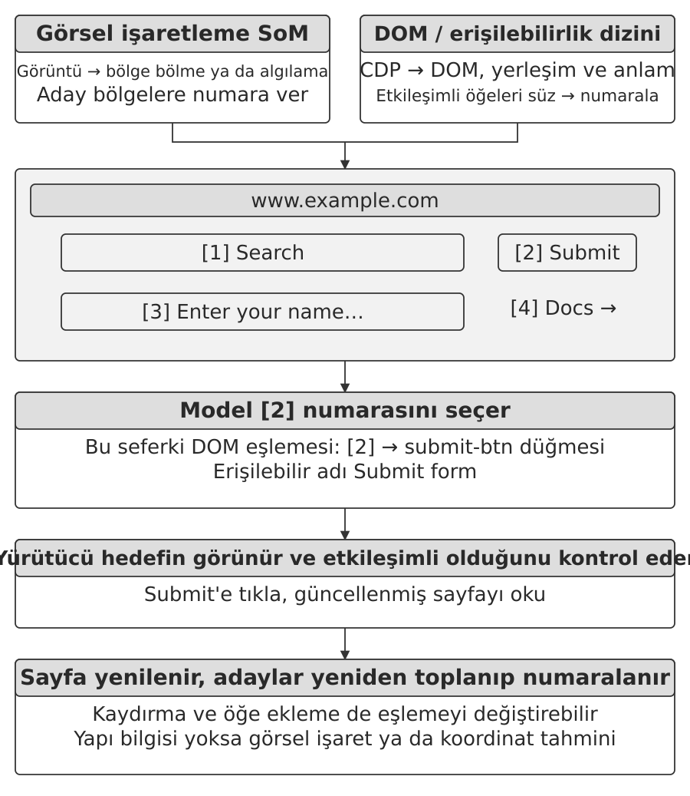

İşlem dört adıma ayrılabilir: DOM, düzen ve kullanılabilir erişilebilirlik bilgisini okumak; etkileşebilir öğeleri süzmek; geçerli sayfanın numara eşlemesini kurmak; öğe açıklamasını ve gerektiğinde işaretlenmiş ekran görüntüsünü modele vermek. Örneğin model aşağıdaki dört numaralı öğeyi görebilir:

```text
Ekran görüntüsünde [1], [2], [3], [4] işaretli

[1] <input type="text" placeholder="Search" aria-label="Search" />
[2] <button id="submit-btn" aria-label="Submit form" />
[3] <input type="text" placeholder="Enter your name" value="" />
[4] <a href="/docs" aria-label="Documentation" />
```

Model numarayı seçtikten sonra yürütme katmanı bunu öğe başvurusuna ya da koordinata çözer, hedefin hâlâ görünür ve etkileşebilir olup olmadığını kontrol eder, sonra işlemi tamamlar. Sayfa yenilendiğinde, kaydırıldığında ya da öğeler dinamik olarak eklendiğinde eşleme güncellenmelidir; böylece süresi geçmiş numaralar kullanılmaz. Yapılandırılmış indeks etiketlerden, rollerden ve metinden yararlanabilir; Canvas, örtüşme ya da eksik anlamsal işaretleme durumlarında ekran görüntüsüyle birlikte değerlendirme gerekir. Listelenen öğe sayısı ve ekran görüntüsü büyüdükçe context'e giren bilgi de artar.

**Doğrudan koordinat kestirme.**

Koordinat yolu modelden ekran görüntüsü ve hedef betimlemesinden konumu doğrudan üretmesini ister; örneğin "gönder düğmesine tıkla"yı belirli bir noktaya eşlemek. SeeClick gibi GUI konumlandırma çalışmaları ve Claude'un Computer Use özelliği koordinat çıktısı kullanır. Görüntü koordinatlarını gerçek masaüstü koordinatlarına çevirmek yürütme katmanının işidir.

Ekran görüntüsü ölçeklendiğinde iki koordinat kümesi aynı dönüşümü kullanmalıdır. 2560×1440'lık bir masaüstünde modele gönderilen görüntü 1366×768 ise modelin verdiği (683, 384) şuna karşılık gelir:

$$
x = 683 \times \frac{2560}{1366} = 1280,\qquad
y = 384 \times \frac{1440}{768} = 720
$$

Şekil 6-15'te iki boyutun en-boy oranları birbirine yakın. Ekran görüntüsü oranı korumak için siyah çerçeveyle doldurulduysa modelin verdiği koordinatlar boşluğu da içerir; özgün ekran koordinatlarına dönmeden önce ilgili dolgu kaydırması çıkarılmalı, sonra ölçek katsayısı uygulanmalıdır. Kırpma, görüntü ölçekleme ve çoklu ekran başlangıç noktası da eşlemeyi değiştirir; araç katmanı gerçek dönüşüm parametrelerini saklamalıdır.

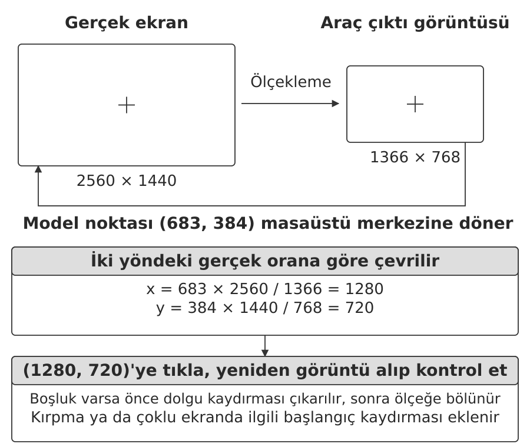

Başvuru uygulaması bir dönem XGA (1024×768), WXGA (1280×800) ve FWXGA (1366×768) gibi hedef boyutlar kullandı. En-boy oranını zorla değiştirmek denetimlerin biçimini bozar; yanlış geri eşleme ise doğru kestirimi yanlış konuma düşürür.[^ch6-computer-tools]

**Yapılandırılmış bilgi eksiksiz olduğunda yazar önce DOM ya da erişilebilirlik ağacı indeksini kullanır.** Öğenin adı, rolü ve başvurusu doğrudan konumlandırmaya katılır; modelin piksel konumunu anlık kestirme işi azalır. Yapı yoksa genel görsel model önce SoM ile birlikte kullanılıp modelin işaretli bölgelerden birini seçmesi sağlanabilir; GUI konumlandırma eğitimi almış modeller ise koordinatı doğrudan kestirip ayrı işaretlemeyi ortadan kaldırabilir.

> **Deney 6-10 ★: browser-use ile otomatik tarayıcı işlemi**
>
> Bu deney Qwen3-VL 32B Instruct ile browser-use'ü sürüp tarayıcı durumu, öğe bilgisi ve ekran görüntüsünden eylem üretiyor. Görev San Francisco'nun hava durumunu sorgulamak: arama kutusunu bulmak, "San Francisco weather today" yazmak, sorguyu göndermek, sonra sıcaklığı ve hava durumunu çıkarmak.
>
> Deney 6-10'un kodu ve çalıştırma açıklaması iki giriş sunar. OpenRouter anahtarı varsa yönetilen görsel model kullanılabilir; vLLM, SGLang gibi uyumlu bir hizmet varsa `OPEN_MODEL_BASE_URL` ve `OPEN_MODEL_MODEL` kendi uç noktanıza ve modelinize yönlendirilebilir, anahtar hizmetin gerektirdiği biçimde ayarlanır. İki yolda da önce deney dizininde `python main.py --dry-run` çalıştırılıp yapılandırma görülür, sonra açıklamaya göre gerçek sorgu başlatılır.
>
> Saklanan çalıştırma 16 etkileşim adımını tamamladı ve 15 ekran görüntüsünü korudu. Google'da doğrulama kodu çıktıktan sonra görev weather.com'dan sonuç alacak şekilde değiştirildi.

[^ch6-computer-tools]: Anthropic, Computer Use araç belgeleri ve başvuru uygulaması; sürümlenmiş eylem arayüzünü, yürütme katmanını ve ekran görüntüsü işlemeyi tanıtır.
[^ch6-som]: Microsoft, *Set-of-Mark Prompting*, 2023; browser-use'un DOM hizmeti uygulaması yapılandırılmış öğe işleme örneğini sunar.

### Animasyon görebilen, ses duyabilen Computer Use Agent

Sayfa yalnızca kaydettikten sonra kısa süreliğine "eşitleme başarısız" gösteriyor, ama birkaç saniye arayla alınan iki ekran görüntüsü de aynı formu gösteriyor. Bu iki görüntüye yeniden bakan model arada ne olduğunu büyük olasılıkla geri kuramaz. Video, animasyon, kısa süreli bildirim ve toplantı sesi de aynı sorunu taşır. **Sürekli değişen arayüzlerde yazar gözlem arayüzünü öncelikli iyileştirme nesnesi sayıyor.** Değişime göre sonraki adıma karar vermek için eylemler arasında ortaya çıkan olayların ya da görüntülerin de saklanması gerekir.

Yazarın meslektaşlarıyla önerdiği **Agent–Computer Observation Interface (AOI, Agent–bilgisayar gözlem arayüzü)** sürekli ekranı ve sesi modelin alabileceği görüntülere ve metne dönüştürür[^ch6-9]. Arayüz üç bileşen içerir:

- **Eylemler arası kilit kare toplama.** Ana döngü çalışırken görüntü değişimini izler; piksel farkı ya da hafif bir görsel modelle aday kareleri süzer, sonra işe yarar görüntüleri bir sonraki karara verir.
- **Ses düzeyi kapılı transkripsiyon.** Ses algılandığında konuşma tanımayı çağırır, transkripsiyonu ve zaman bilgisini gözlem kaydına ekler; Agent'ın toplantı içeriğini ya da sözlü talimatları kullanmasına yardım eder.
- **Kalıcı görüntü betimlemesi.** Kilit görüntüleri metne özetler; özgün görüntü context'ten çıktıktan sonra metin yaşanan değişikliği korur ve sonraki adımlar ona başvurabilir.

Örneğin videoda bir menü işlemi gösteriliyor; model ara görüntüyü ve ilgili betimlemeyi aldığında oynatma bittikten sonra da bu adıma başvurabilir. Makalenin ablasyon sonuçları kalıcı metin betimlemesinin kazanç için özellikle kilit olduğunu, kilit kare seçiminin inceliğinin ise daha az katkı sağladığını gösterdi; bazı modeller fazla görüntü eklendiğinde geriledi bile.

Az önceki form kaydetme örneğine dönelim. Kilit kare "eşitleme başarısız"ı yakalamış olsa bile özgün görüntü context'ten çıktığında model yalnızca kalan betimlemeye dayanabilir. "Sayfada bir bildirim çıktı" hem kaydetmenin başarılı olduğu hem de başarısız olduğu anlamına gelebilir; "eşitleme başarısız, adres kaydedilmedi" ise sonraki adıma karar vermek için gereken ipucunu korur.

[^ch6-9]: Bojie Li ve Noah Shi, *Agent-Computer Observation Interfaces Enable Dynamic Computer Use*, 2026; AOI'yi ve bileşen ablasyonlarını tanıtır.

### Computer Use'ın dünya modeli

Gözlemi zamanında aldıktan sonra Agent'ın eylemi seçmesi ve yürütmeyi beklemesi gerekir. OSWorld-Human çalışması Agent'ın işlem verimliliğini insan izleriyle karşılaştırdı ve gereksiz adımlarla model çağrıları gibi süre kaynaklarını çözümledi[^ch6-osworld-human].

Dünya modeli planlamaya eylem sonuçlarına dair tahmin sağlar. Masaüstü durumu pencereleri, odağı, kaydırma konumunu, girilen içeriği ve yükleme ilerlemesini içerebilir; yetki, ağ sonucu gibi bilgiler ise ilgili arayüzlerden tamamlanmalıdır. Model mevcut kullanılabilir duruma ve aday eylemlere göre bir sonraki durumu tahmin eder:

```text
Mevcut durum + click / type / scroll / wait → tahmin edilen sonraki durum
```

İnsan bilgisayar kullanırken çoğu zaman tıklamadan önce bir sonraki adımı zihninde canlandırır; arayüz beklendiği gibi giderse devam eder, beklenmedik bir şey çıkarsa durup kontrol eder. Dünya modeli Agent'a benzer bir tahmini yürütme dayanağı sağlayabilir: planlayıcı aday eylemleri önceden karşılaştırır, sayfa yüklenirken sonraki adımları hazırlar, gerçek durum teyit edildikten sonra yürütmeye devam eder ve her tıklamadan sonra sıfırdan planlama beklemesini azaltır. Örneğin VS Code'da yeni bir Python dosyası oluşturup hello world yazarken beklenen değişiklikler dosya ağacında yeni dosyanın görünmesi, düzenleyicide kodun bulunması ve kayıt durumunun güncellenmesidir. Yürütmeden sonra bu değişiklikler kontrol edilir; beklendiği gibiyse devam edilir, sapma varsa yeniden konumlandırma ve planlama yapılır.

Dosya silme gibi işlemler ayrıca kendi yürütme koşullarını gerektirir: hedef doğru mu, silmeye izin var mı, geri alınabilir mi ve kullanıcı onayı gerekiyor mu? Tahmin olası sonuçları anlamaya yardım eder; gerçek yetkileri ve iş koşullarını yürütme katmanı kontrol eder.

**Photon-1'in gizli durum tahmini.** Induction Labs Temmuz 2026'da Photon-1'i tanıttı: video karelerini ayrık gizli token'lara kodlayıp sonraki token'ları tahmin ederek durum değişimini öğreniyor. Şirket ön eğitimin yaklaşık 30 bin H200 GPU saati kullandığını açıkladı. Durum tahmini gizli token'larda yapılır; yardımcı bir görüntü üreticisi bunları insanın kontrol edebileceği görüntülere dönüştürür. Planlama ve eylem üretimi iç temsili doğrudan kullanarak her adımda tam ekran görüntüsü üretme maliyetini ortadan kaldırabilir.[^ch6-20]

Çözüm ayrıca ince ayarla talimat ve eylem biçimlerini öğreniyor: önce ulaşılmak istenen durumu tahmin ediyor, sonra o duruma götüren işlemleri üretiyor ve sanal makinede çevrimiçi eğitimle görev performansını iyileştiriyor. Eylem koşullu ince ayar ise belirli bir işlemden sonra masaüstünün nasıl değişeceğini tahmin etmek için kullanılıyor. Bu iki kullanım planlamayı ve simülasyonu sırasıyla birbirine bağlıyor ve durum temsilinin Computer Use'a nasıl katıldığını gösteriyor.

[^ch6-osworld-human]: Reyna Abhyankar ve arkadaşları, *OSWorld-Human: Benchmarking the Efficiency of Computer-Use Agents*; görev izlerini ve zaman maliyetini çözümler.
[^ch6-20]: David Li, Jonathan Li, *Scaling Video Pretraining with Imagination Models*, Induction Labs, 2026-07-23; Photon-1'in ön eğitimini, eylem öğrenmesini ve durum simülasyonunu tanıtır.
[^ch6-21]: Google DeepMind, *Genie 3: A new frontier for world models*, 2025-08-05; Zachary Lin ve arkadaşları, *Cosmos World Foundation Model Platform for Physical AI*, 2025.

### Mobil: teknik arayüzler ve ekosistem iş birliği

Mobil de algıla—karar ver—eyle döngüsünü sürdürür; eylemler daha çok dokunma hareketleriyle ifade edilir. Aynı koordinat tek tıklamanın konumunu, uzun basmanın konumunu ya da kaydırmanın başlangıcını gösterebilir; bu yüzden arayüz hareket türünü, süresini ve yolu da ister. Ekran döndürme, yazılım klavyesinin açılması ve sistem pencereleri de işlem yapılabilir alanı değiştirir.

Android'in `AccessibilityService` arayüzü izin verilen kapsamda arayüz bilgisini okuyabilir ve ilgili eylemleri yürütebilir; hareket arayüzü için ilgili yeteneğin bildirilmesi de gerekir[^ch6-android]. Ekran görüntüsü, erişilebilirlik ağacı ve sistem otomasyon arayüzleri birlikte kullanılabilir; somut kullanılabilir kapsamı işletim sistemi, uygulama uygulaması ve yetkilendirme belirler. Bölüm 7'de tanıtılan AndroidWorld gibi kıyaslamalar bu eylemlerin gerçek uygulama görevlerinde beklenen sonucu verip vermediğini kontrol eder.

**Bence mobilde yaygınlaşmanın ekosistem engelleri teknik sorunlardan çoğu zaman daha zordur.** Platform hangi işlemlerin vekile bırakılabileceğini, hesaba, ödemeye ve veriye nasıl yetki verileceğini, hata çıktığında sorumluluğun nasıl izleneceğini belirlemelidir. Bu anlaşmalar Agent'ın tamamlayabileceği görev kapsamını doğrudan etkiler.

Yapısal bir çıkar çatışması trafikten ve dikkatten kaynaklanır. Pek çok uygulama reklam gösterimi, içerik önerisi ve işlem girişi üzerinden gelir elde eder; kullanıcı Agent'a sorguyu ya da satın almayı doğrudan yaptırdığında sayfa gezme yolu kısalabilir ve önerilerle reklamların aldığı dikkat değişebilir. Bu halkalardan gelir elde eden platformlar için vekil işlemler mevcut gelir kaynağına dokunur. Platformun arayüz açılımını, ticari gelir paylaşımını ve vekil kimlik yönetimini yeniden düşünmesi gerekir.

[^ch6-android]: Android Developers, AccessibilityService; arayüz erişimini, eylemleri ve hareket yeteneklerini tanıtır.

## Robot işlemleri: XLeRobot ile masayı toplamak örneği

Kırmızı bardağı tepsiye koymak, sarı kâğıdı çöp kutusuna atmak ve sonunda masanın toplandığını teyit etmek — bu görev algılamayı, planlamayı ve denetimi birbirine bağlar. Tutucu bardağa yaklaşırken kameradaki konum değişir; bardak tutulduktan sonra kol masadaki diğer nesnelerden kaçınmalıdır; kâğıdı ilk seferde tutamazsa sistem başarısızlığı fark edip yeniden denemelidir. Her eylem bir sonraki kararın koşullarını değiştirir.

Bu kısım bu görev etrafında beş deney düzenliyor. Deney 6-11 ve 6-13 gerçek robotta uzaktan kumanda ve otonom işlem pratiğinin tasarımını veriyor; Deney 6-12, 6-14 ve 6-15 yerel simülasyon kullanarak sırasıyla denetim temelini, hata kurtarmayı ve görsel koşul değişikliklerini inceliyor.

Aynı robot hem kamerayı sürekli izleyen bir insan tarafından kumanda edilebilir hem de model görüntüyü okuyup becerileri seçerek denetim sistemine yürüttürebilir. Görev ve donanım sabit tutulduğunda iki yaklaşımın farkı dört soruyla çözümlenebilir: insan neyi başarmak istiyor, sırada hangi alt görev var, mevcut beceri hangi eylemleri üretiyor ve eylemden sonra ortam plana uyuyor mu? Uzun vadeli planlama bardak ile kâğıdın işlem sırasını düzenler; VLA politikası ya da önceden tanımlanmış eylem ilkelleri tutmayı ve bırakmayı üstlenir; dünya modeli eylem sonuçlarını tahmin etmeye yardım eder; simülasyondan gerçeğe geçiş ise görüntüdeki, temastaki ve eyleyici özelliklerindeki farkları ele alır.

### Donanım ve algoritma iş bölümü

Otonom masa toplama başarısız olduğunda önce uzaktan kumandayla donanımın görevi tamamlayıp tamamlayamadığı kontrol edilebilir. Kamera, robot kol, tutucu, masa düzeni ve kabul koşulları sabit tutulup operatör algı–denetim döngüsünü devralır. İnsan birkaç turda istikrarlı biçimde tamamlıyor, otonom sistem ise tekrar tekrar başarısız oluyorsa bu donanımın görevi yapabildiğini, darboğazın ağırlıklı olarak otonom denetimin algoritmasında ve geri bildiriminde olduğunu gösterir. Bu durumda öncelikle nesne konumlandırma, beceri seçimi, eylem zamanlaması ve hata kurtarma incelenmeli, otonom sistemin uzaktan kumandadaki etkili düzeltmeleri öğrenmesi sağlanmalıdır.

XLeRobot klavye, Xbox kolu ve Switch Joy-Con ile uzaktan kumandayı destekler; VR kullanımı önce simülasyon ortamında denenebilir.[^ch6-1] Tutucu bardağa yaklaşırken operatör yavaşlar; bardak kayarsa tutma noktasını düzeltir. Tutucu kâğıdı tutamazsa bir daha bakar; nesne yerine oturduğunda da bir bakışla teyit eder. Gözleme dayalı bu düzeltmelerin hepsi gösterim verisine kaydedilmeye değer. Robot sonradan otonom çalıştığında da kaymayı ve kaçırmayı fark edebilmelidir.

> **Deney 6-11 ★: Gerçek robotta XLeRobot'u uzaktan kumandayla masayı toplamaya yönlendirmek**
>
> Kalibrasyon, sınır ve acil durdurma kontrolleri tamamlanmış XLeRobot çalışma alanına kırmızı bardak, tepsi, sarı kâğıt ve çöp kutusu yerleştirin. Kalibre edilmiş bir uzaktan kumanda yöntemiyle sabit görevi yürütün: "Kırmızı bardağı tepsiye koy, sarı kâğıdı çöp kutusuna at, sonunda masanın durumunu teyit et." Birkaç tur tekrarlayın; kamera görüntüsünü, operatör girdilerini, robot kolun durumunu, eylem zamanlarını, tutma başarısızlıklarını ve yeniden deneme sayılarını kaydedin.
>
> Her turun sonunda bardağın tepside, kâğıdın çöp kutusunda olduğunu ve kolun güvenli duruşa döndüğünü teyit edin; süreç boyunca çarpışma, sınır ihlali ve insan müdahalesi kayıtlarını kontrol edin. Başarısızlığın hangi adımda olduğunu, operatörün nasıl toparladığını ve nihai sonucu birlikte çözümlemek otonom denetim için karşılaştırma temeli oluşturur.

Simülasyon deneyleri nesne sayısını ve başlangıç konumlarını tekrar tekrar değiştirmeyi, bilinen durumdaki denetim sürecini ayrıca incelemeyi kolaylaştırır. İki boyutlu masa modeli nesneye yaklaşmayı, hedefe taşımayı ve sonraki nesneye geçmeyi üç aşama olarak gösterebilir; tamamlanan adım sayısı ve yol uzunluğu denetim maliyetini betimler.

> **Deney 6-12 ★: Simülatörde aynı görev için ideal denetim temeli kurmak**
>
> İki boyutlu masada nesne konumlarını ve hedef konumları rastgele üretin; denetleyici koordinatları doğrudan okusun, sırayla nesneye yaklaşsın, ilgili hedefe taşısın ve sonraki nesneye geçsin. Başlangıç konumlarını ve nesne sayısını değiştirerek başarı oranı, tamamlanan adım sayısı ve yol uzunluğunu karşılaştırın.
>
> Önce tek bir nesnenin tüm izini izleyin: denetleyici nesneye vardığında taşıma aşamasına girer, hedefe vardığında tamamlanan sayı artar. Ardından nesne sayısını artırın, her nesnenin bu iki varış koşulundan geçtiğini kontrol edin. Eşlik eden iki boyutlu simülasyon beş rastgele tohumla sırasıyla 1, 2, 3 ve 4 nesne yerleştirdi; her bileşim 512 tur çalıştı ve toplam 10.240 turun hepsi tamamlandı. Denetleyici koordinatları doğrudan okuyabilir ve nesneyi taşımak gerçek tutucuya bağlı değildir.

### Robot denetiminin temel yapısı

Bir masayı toplamak birkaç dakika sürebilir, eklem denetimi ise sürekli ve zamanında güncellenmelidir. Sistem zaman ölçeğine göre iş bölümü yapabilir: üst düzey planlama görev sırasını düzenler, beceri politikası hareketi üretir, alt düzey denetleyici de yürütmeyi izler:

| Katman | Temel soru | Çıktı | Zaman ölçeği ve yapılandırma örneği |
| --- | --- | --- | --- |
| Görev hedefi | İnsan neyi başarmak istiyor | "Bardağı ve kâğıdı yerine koy" | Dakika düzeyinde görev |
| Uzun vadeli planlama | Önce ne, sonra ne | Önce bardak, sonra kâğıt, en sonda kontrol | Saniyeden dakikaya |
| Temel beceriler | Bu anda hangi durum değişikliği tamamlanacak | `pick(red_cup)`, `place(red_cup, tray)` | Bir beceri birkaç saniye sürer, örneğin 1–3 saniye |
| VLA / beceri politikası | Mevcut beceri tam olarak nasıl hareket edecek | Tutucu eylemi, uç efektör pozu ya da bir eklem yörüngesi | 1–10 Hz çıkarım yapılandırması |
| Alt düzey denetim ve güvenlik katmanı | Nasıl istikrarlı ve zamanında yürütülecek | Eklem ya da uç efektör denetim değerleri, hız sınırı ve acil durdurma | Denetleyici onlarca ile binlerce Hz arasında yapılandırılabilir |

Planlayıcı kural programı, VLM ya da en iyileyici kullanabilir; VLA da beceri seçiminin bir kısmını üstlenebilir. **Yazarın önerisi görev sırası ile o anki hareketi ayrı ele almaktır.** Üst düzey akıl yürütmenin planı düzenlemek için zamana, alt düzey denetimin konum ve kuvvet değişimlerine zamanında tepki vermek için zamana ihtiyacı vardır; ikisi kendi uygun ritminde çalıştığında planlama ile denetim birlikte yürütülebilir.

Bu kısım üst düzey modele `observe_scene`, `pick`, `place`, `verify_state` ve `stop` olmak üzere beş araç türü sunuyor; bunlar sırasıyla gözlem, tutma, bırakma, kontrol ve durdurma içindir. Harness parametreleri, çalışma alanını ve mevcut durumu kontrol eder; yürütücü kontrolden geçen beceriyi robot kol hareketine dönüştürür ve hız sınırı ile zaman aşımını işler. Eklem açıları ve sürekli yörüngeler beceri politikası ile denetleyici tarafından üretilir; modelin beceri seçimi ile gerçek hareket arasında böylece net bir arayüz oluşur.

### Uzun vadeli planlama ve görev ayrıştırma

Kullanıcı "masayı topla" dediğinde planlayıcı önce nesneleri ve hedef bölgelerini tanır, işlem sırasını belirler ve her adım için başlangıç koşulunu, tamamlanma koşulunu ve eylem kısıtlarını açıkça yazar. Örneğin toplama sırası şöyle olabilir:

```text
Kırmızı bardağı işle → sarı kâğıdı temizle → masayı kontrol et
```

"Kırmızı bardağı işle" iki eyleme ve bir kontrole ayrılır:

```text
pick(red_cup) → place(red_cup, tray) → verify_state()
```

"Bardağı al ve tepsiye koy" örneğinde robot kol tutma programını bitirdiğinde bu yalnızca program parçasının bittiğini gösterir. Kolu kaldırmadan önce tutucu geri bildirimiyle ya da yeni görüntüyle bardağın gerçekten tutulduğuna karar vermek gerekir. Boşa tuttuysa bardak yeniden konumlandırılır; biri tepsini taşıdıysa başarılı tutma hâlâ geçerlidir, yalnızca bırakma eylemi yeniden planlanır. Her beceriyi kontrol edilebilir bir durum değişikliğine karşılık getirip eylemi ve süreyi sınırlayarak yürütme durumunu ve yeni gözlemi geri döndürmek, planlayıcının gerçekte hata veren adımdan toparlanmasını sağlar.

> **Deney 6-13 ★★: Gemini Robotics-ER 1.5 ile XLeRobot'u masayı otonom toplamaya yönlendirmek**
>
> Deney 6-11'in donanımını, masa düzenini, görevini ve kabul koşullarını sürdürün; gözlemden ve planlamadan gömülü akıl yürütme modeli sorumlu olsun. RoboCrew'un orkestrasyon biçimini örnek alarak bu görev için beş araç tasarlayın: `observe_scene`, `pick`, `place`, `verify_state` ve `stop`.[^ch6-2]
>
> Model önce masa gözlemini okur ve işlem sırasına karar verir, sonra kalibre edilmiş tutma ve bırakma becerilerini çağırır. Her beceri bittiğinde yeni gözlem alınır ve sonraki koşullar kontrol edilir; başarısızlıkta mevcut duruma göre yeniden deneme ya da durma seçilir. Çalışma sistemi acil durdurma sinyali aldığında, sınır ihlali ya da kritik durum teyit edilemediğinde yürütmeyi doğrudan durdurur; model de `stop` ile görevi kendiliğinden bitirebilir.
>
> Sonunda yeni ortam gözlemi bardağın tepside, kâğıdın çöp kutusunda olduğunu ve kolun güvenli duruşa döndüğünü teyit eder; çarpışma ve sınır ihlali kayıtları kontrol edilir. Operatör başlatmadan, acil durdurmadan ve yerinde gözetimden sorumludur; arada devralmalar ayrıca kaydedilir.

Deney 6-13 gerçek robot eylemlerinin nasıl bağlanacağını ve toplama sonucunun nasıl kabul edileceğini açıklıyor; eşlik eden kayıtlarda bu görevin gerçek robot denemesi henüz yok. Aşağıda önce simülasyon ortamında üç yöntem karşılaştırılıyor: plana göre açık döngü yürütmek, her adımda sonucu kontrol etmek ve önce eylemin sonucunu tahmin etmek. Görev hedefi ve beş araç türü aynı tutuluyor; arızalar da tekrarlanabilir biçimde tetiklenebiliyor, böylece üç yöntemin aynı hatayla karşılaştığında nasıl davrandığı görülebiliyor.

### VLA denetimi

VLA, Vision-Language-Action yani görsel–dil–eylem modelinin kısaltmasıdır. Mevcut görüntüye, görev talimatına ve kullanılabilir robot durumuna göre yürütülecek sonraki eylemi üretir:

```text
Mevcut gözlem + beceri talimatı → eylem ya da eylem dizisi
```

Masa toplama örneğinde üst düzey planlayıcı `pick(red_cup)` görevini verir; beceri politikası görüntüye göre bardağa hangi yönden yaklaşacağına, tutucuyu ne zaman kapatacağına ve kolu hangi yörüngeyle kaldıracağına karar verir. Bu hareket parçası yürütüldükten sonra sistem masa gözlemini yeniden alır, bardağın tutulduğunu teyit eder ve `place(red_cup, tray)` aşamasına geçer. Araç arayüzü beklenen durum değişikliğini kararlaştırır; VLA ise bu değişikliği sürekli eylemlerle gerçekleştirmeyi öğrenir.

Eylemler farklı biçimlerde temsil edilebilir. RT-2 ve ilk OpenVLA eylem boyutlarının değerlerini ayrık token'lara nicemleyip dil modelinin üretim biçimini kullanır; π₀ sürekli eylem bloklarını akış eşlemesiyle üretir. Birincisi özbağlanımlı üretim çerçevesini yeniden kullanmayı kolaylaştırır, ikincisi sürekli bir eylem dağılımını doğrudan modeller.[^ch6-15]

Model çıkarımı ile yürütücü denetimi genellikle farklı güncelleme hızlarında çalışır. Eylem parçalama (action chunking) modelin bir seferde küçük bir gelecek eylem parçası üretmesini, denetim iş parçacığının ise daha yüksek hızda yürütmesini sağlar. Çıkarım ile yürütme daha da örtüştürüldüğünde sistem mevcut eylem parçasını yürütürken sonrakini hazırlayabilir ve bekleme kısalır. Eylem parçalarının birleşiminde yörünge sürekliliği ve gözlemin güncelliği de ele alınmalıdır: kol bardağa uzanırken bardak itilirse kalan eylemler eski konumu göstermeyi sürdürebilir. Her seferinde yürütülen parçayı kısaltmak, yeni gözlemle yuvarlanan güncelleme yapmak ya da anormallik algılandığında eylemi kesmek tepki hızını artırabilir; bu tercihler çıkarım ve zamanlama maliyetini de artırır.

### VLA'nın veri ve dağıtım koşulları

"Bardağı tut" işini istikrarlı bir eyleme dönüştürmek için birkaç tür farkı birlikte ele almak gerekir:

- **Eğitim verisinin kapsamı**: Kullanılabilir robot eylemi gösterimleri internetteki metin ve görüntüden çok daha azdır; "bardak"ın ne olduğunu bilmek, nasıl kuvvet uygulanacağına karar vermek için gerçek tutma deneyimi gerektirir. Gösterimler bardağın malzemesini, biçimini, duruş açısını ve sürtünme koşullarını kapsamalıdır. Aynı tutma yönü seramik bir bardakta ve yumuşak kâğıt bardakta farklı sonuç verebilir.
- **Eylem ve sonucun öğrenme hedefi**: Davranış klonlama ağırlıklı olarak gösterenin mevcut koşulda hangi eylemi yapacağını öğrenir. Birden çok eylemin sonucunu karşılaştırmak için durum tahmini ya da eylem sonucu değerlendirmesi eklenebilir.
- **Robot gövdesi ve arayüzü**: Serbestlik derecesi, koordinat sistemi, tutucu yapısı ve eyleyici gecikmesi eylemin donanıma nasıl yansıyacağını belirler. Politika aktarılırken eylem temsili, kalibrasyon parametreleri ve denetim döngüsü eşleştirilmelidir.
- **Gözlemin güncelliği**: Eylem parçası yürütülürken nesne hareket edebilir, örtülebilir ya da devrilebilir. Sistemin yeni gözlemi ne zaman alacağı ve kalan eylemleri ne zaman güncelleyeceği belirlenmelidir.

Bu koşullar görsel tanımayı, beceri denetimini ve ortam değişimini birbirine bağlar. Bardağın içindeki sıvı taşıma hızını etkiler, masanın kenarındaki kablo izlenecek yolu değiştirir, kâğıdın masayla teması kavrama biçimini etkiler. Planlayıcı bu sonuçları önceden karşılaştırabilirse beceri seçimine daha çok dayanak sağlar.

### Dünya modeli

Robot planlamasında eylem koşullu dünya modeli "eylem sonucu tahmin edicisi" olarak anlaşılabilir: mevcut durum ve aday eylem verildiğinde bundan sonra ne olacağını kestirir.

```text
Mevcut durum + aday eylem
    → sonraki durumu ya da gelecek kesiti tahmin et
    → aday sonuçları karşılaştır
    → eylemi seç, yeniden planla ya da dur
```

Bu süreç üç iş içerir: mevcut durumu temsil etmek, eylemin yol açtığı durum değişimini tahmin etmek, sonra planlayıcının ya da denetleyicinin buna göre eylem seçmesini sağlamak. Durum, nesne konumu ve tutulup tutulmadığı gibi yapılandırılmış değişkenler de olabilir, görüntüden çıkarılan iç temsil de. V-JEPA 2 önce videodan durum temsilini ve tahmini öğrenir; daha ileri eğitilen V-JEPA 2-AC eylem koşulunu ekleyerek robot planlamasında kullanılır. Eylemi gelecek gözleme bağlamak, dünya–eylem modeli (World-Action Model) sınıfındaki bir modelleme yaklaşımıdır da.[^ch6-16]

Dünya modeli robota üç aşamada yardım edebilir: harekete geçmeden önce tutmanın, itmenin ya da beklemenin ne sonuç vereceğini ayrı ayrı tahmin etmek; yürütme sırasında tahminle gerçek gözlemi karşılaştırıp sapma gördüğünde eylemi ayarlamak ya da yeniden planlamak; eğitimde video, simülasyon verisi ve başarısız izlerden durum değişimini öğrenerek gerçek robotta deneme yanılma ihtiyacını azaltmak.

Sarı kâğıdın kırmızı bardak tarafından kısmen örtüldüğünü varsayalım; planlayıcı "önce kâğıdı tut", "önce bardağı kaldır" ve "başka bir yönden tut" seçeneklerini karşılaştırabilir. Yazar dünya modelinin önce bu tür, görevle doğrudan ilgili ve kontrol edilebilir durum değişikliklerini tahmin etmesini tercih eder. Kâğıdın daha kolay tutulup tutulmayacağı, bardağın kolayca devrilip devrilmeyeceği değerlendirilebiliyorsa aday eylemler sıralanabilir. Modelin kullandığı durum temsili ve eğitim hedefi bu yargılar etrafında tasarlanmalıdır. Model gelecek görüntüleri üretiyorsa yazar önce görüntünün bu eylem sonuçlarını doğru yansıtıp yansıtmadığını kontrol eder, görsel ayrıntı eklemeyi sonra düşünür; görüntü gerçekçiliğinin değeri sonunda planlama ve denetimdeki iyileşmede kendini göstermelidir. Yürütmeden sonra sistem kamera ve robot durumuna bakarak gerçek sonucu kontrol eder ve devam etmeye, yeniden denemeye ya da planı değiştirmeye karar verir.

Tahmin ufku uzadıkça hata birikmeye daha yatkındır. Pratikte önce kısa vadeli sonuçlar tahmin edilip küçük bir parça yürütülebilir, sonra yeni gözlemle yeniden planlanır ve tahmin belirsizliği seçime katılır. Üretken dünya modelleri etkileşimli simülasyon ve görselleştirilmiş sahneler de sağlayabilir; denetim için kullanıldığında eylem koşullarının, temas kurallarının ve tahmin hatasının ayrıca sınanması gerekir. Donanım sınırları, acil durdurma ve gerçek zamanlı denetim yürütme sisteminin sorumluluğunda kalır.[^ch6-21]

> **Deney 6-14 ★★: Simülatörde otonom masa toplamanın üç kapalı döngüsünü karşılaştırmak**
>
> Kırmızı bardak ve sarı kâğıt yapılandırılmış bir durumla temsil edilir: her nesne "masada", "alındı" ya da "yerleştirildi" olmak üzere üç aşamadan birindedir; hedef bölgenin kullanılabilir olup olmadığı kaydedilir. Simülatör gözlem, tutma, bırakma, kontrol ve durdurma olmak üzere beş araç sunar ve kâğıt tutulurken en fazla bir kez geçici başarısızlık enjekte eder.
>
> Üç denetim biçimi karşılaştırılır. **Açık döngü yürütme** dört eylemi sabit sırayla tamamlar. **Adım adım kontrol** her eylemden sonra durumu okur, başarısızlıktan sonra gözlemi yeniden alır ve o an yürütülebilir adımı seçer. **Tahmine dayalı yürütme** "durum ve eylemden sonraki duruma" eşlemesini küçük bir sinir ağıyla öğrenir ve tahmin edilen yerine koyma ilerlemesine göre yürütülebilir eylemleri sıralar.
>
> Görev tamamlanması, araç çağrısı sayısı ve başarısızlıktan kurtarma süreci karşılaştırılır. Örneğin kâğıt tutulamadıktan sonra hâlâ masada durur; doğrudan bırakma yürütülürse nesne alınmadığı için başarısız olur; durumu okuyup tutmayı yeniden denemek bırakmaya devam etmeyi sağlar. İki geri bildirimli strateji bitişte yerine koyma durumunu `verify_state` ile kontrol eder.
>
> Önce arıza enjekte edilmemiş turlara bakın; üç strateji de tamamlıyor. Arıza enjeksiyon olasılığı %50'ye çıkarıldığında her strateji üç tohumla 384 tur (tohum başına 128 tur) çalıştı. Açık döngü her turda yine 4 araç çağrısı yaptı ve yalnızca 205 turu tamamladı. Adım adım kontrol ve tahmine dayalı yürütmenin ikisi de 384 turun hepsini tamamladı; ikisi de ortalama yaklaşık 6,93 çağrı yaptı. Fazladan harcanan çağrılar denetleyicinin boş tutmayı fark edip toparlanmasını sağladı. Yalnızca bir kez kurtarılabilir arıza enjekte edilen bu görevde sonraki durumu tahmin etmek, doğrudan kontrol etmekten fazladan tek bir tur kurtarmadı.

### Simülasyon ortamından gerçek robota

Simüle edilmiş masadan gerçek robota geçmek ortam farklarının tek tek ele alınmasını gerektirir. Görüntü tarafında aynı bardak ve tepsi farklı arka planlarda, ışıkta, kamera konumunda ve örtüşme ilişkilerinde görünür; hareket tarafında sürtünme, algılayıcı gürültüsü ve eyleyici gecikmesi yörüngeyi ve tutmayı etkiler.

Alan rastgeleleştirmesi (domain randomization), eğitim sırasında arka planı, nesne görünüşünü, ışığı ya da gürültüyü değiştirerek modelin çeşitli koşullarda aynı yargıyı vermesini sağlar. Deney 6-15 bunun yalnızca bir halkasını inceliyor: nesneyi ve hedef bölgeyi gördükten sonra hangi yöne hareket etmeli?

> **Deney 6-15 ★★★: Aynı masa görevinin RGB ortamlar arası testi**
>
> Nesneyi daireyle, hedef bölgeyi kareyle gösteren RGB masa görüntüleri üretin. Model ikisinin göreli konumuna bakarak sol, sağ, yukarı ve aşağı olmak üzere dört hareket yönünden birini üretir; iki konum yeterince yaklaştığında deneyin tanımladığı `grasp` etiketini verir. Bu etiket iki boyutlu konumun yaklaşma koşulunu sağladığını gösterir.
>
> Yapısı aynı dört görsel politika eğitin: sabit görsel koşullar, ağırlıklı olarak arka planı değiştiren, ağırlıklı olarak nesne görünüşünü değiştiren ve birden çok değişikliği birleştiren. Her grubun politikasını özgün koşullarda ve yeni renkler, dokular, parlaklık ve gürültü içeren test görüntülerinde ayrı ayrı kullanın, yön kararı doğruluğunu karşılaştırın ve hatalı karar verilen görüntülere bakın.
>
> Her test alanında ve her tohumda 1.024 sentetik görüntü var. Önce üç tohumun ortalama doğruluğunu karşılaştırın: sabit görsel koşullarla eğitilen politika özgün alanda %93,03'ten yeni doku ve gürültü içeren hedef alanda (`target_realistic`) %54,82'ye düştü; birden çok değişikliği birleştirerek eğitilen politika özgün alanda %87,50, aynı hedef alanda ise %76,11'e ulaştı. Yalnızca arka planı rastgeleleştiren grup bu hedef alanda %36,88'de kaldı.[^ch6-6]

## Bölüm özeti

Baştaki bilet değişikliği görüşmesine dönelim. Arka plan uçuşları sorgularken kullanıcı bagaj gereksinimini ekledi. Sorgu sonucu kullanıcının mesajından sonra gelse bile eski bir soruyu yanıtlıyor olabilir. Olay kuyruğu mesajların kaynağını, görev tanımlayıcısını ve sırasını korumalıdır; ancak o zaman ön plan yeni gereksinimi önceliğine göre yakalayabilir ve özgün sorgunun sürmesine, iptal edilmesine ya da yeni koşullarla yeniden yapılmasına karar verebilir. Bu bir **zamanlama** sorunudur; isteği yalnızca sese çevirmek bunu çözmez.

Ses bir gereksinim katmanı daha ekler. Bir yandan fiyat okunurken bir yandan kullanıcının söze girmesi duyulabilmelidir; tarih değiştiğinde eskimiş anlatım durdurulmalıdır. Kademeli ve uçtan uca yapılar sesin tanıma, akıl yürütme ve üretimden nasıl geçtiğini; tam çift yönlülük ise kullanıcı ile asistanın aynı anda dinleyip konuşup konuşamayacağını betimler.

Ekrana ya da robot kola geçildiğinde aynı sorun sürer; yalnızca **gözlem ve eylemin biçimi** değişir. Düğme koordinatı bir önceki ekran görüntüsünden alınmışsa sayfa yenilendikten sonra yeniden konumlandırma gerekir; robot kol tek seferde küçük bir sürekli eylem parçası tahmin ederek eklem hareketini yumuşatabilir, ama eylem parçası uzadıkça yürütme ortasındaki değişikliklere tepki vermek zorlaşır. Üst düzey planlama, beceriler ve alt düzey denetim farklı zaman ölçeklerinde çalışır; bardağın sonunda tepsiye konup konmadığı için masaya bir kez daha bakmak gerekir. Bu etkileşimler birlikte yazıldığında ortak sıraları görülür:

```text
Gözlemi al
  → mevcut durumu ve yürütme zamanını değerlendir
  → yanıtı ya da eylemi seç
  → yürüt ve ortam geri bildirimini al
  → sürdür, düzelt, yeniden dene, dur ya da yeniden planla
```

Bu akış arızaların yerini bulmaya yardım eder. Kullanıcı söze girdiği hâlde eski fiyat okunmaya devam ediyorsa ön planı kimin uyandırdığına, oynatmanın kesilip kesilemediğine ve iptal sinyalinin hangi güvenli noktaya ulaştığına bakılır; durma zamanında olduğu hâlde eski tarih yine söyleniyorsa ön plan ile arka plan arasındaki devir boyunca sorgu sonucu izlenmelidir. Düzelttikten sonra daha çok görüşmede de doğru davrandığını nasıl kanıtlarız? Kitap buradan itibaren yetenek iyileştirmeye geçiyor. Bölüm 7 önce görevlerin nasıl tasarlanacağını, başarısızlıkların nasıl kaydedileceğini ve değişikliklerin nasıl karşılaştırılacağını anlatıyor; sonrası eğitim, sürekli evrim ve çoklu Agent iş birliğinin hepsi bu değerlendirme yöntemini kullanacak.

[^ch6-1]: XLeRobot, Teleop belgeleri.
[^ch6-2]: Google DeepMind, *Gemini Robotics-ER 1.5*. XLeRobot, LLM Agent denetimi. XLeRobot'un yukarı akış örneği model ile araç çağrısı orkestrasyonunu gösterir; bu kısım aynı orkestrasyon ilkesini korur, ancak eylem araçlarını kalibre edilmiş masa tutma, bırakma, kontrol ve durdurma ilkelleriyle sınırlar.
[^ch6-6]: LeRobot, Sim2Real eğitimi.
[^ch6-15]: Moo Jin Kim ve arkadaşları, *OpenVLA: An Open-Source Vision-Language-Action Model*, arXiv:2406.09246, 2024. Ayrıca RT-2 proje açıklamasına ve Physical Intelligence'ın *Our First Generalist Policy* yazısına bakın.
[^ch6-16]: Meta AI, *Introducing the V-JEPA 2 world model and new benchmarks for physical reasoning*, 11 Haziran 2025. Teknik rapor numarası arXiv:2506.09985.
[^ch6-22]: OpenAI, "Async tool calling"; "Using GPT-6 Astra", doğrulama tarihi: 2026-09-05.
[^ch6-23]: OpenAI, "Mid-turn steering", doğrulama tarihi: 2026-09-05.

[^ch6-audio-architectures]: OpenAI, *Voice activity detection*; tur sınırlarını ses etkinliğine ve anlamsal yargıya göre belirlemenin iki yöntemini tanıtır.
[^ch6-voice-tools]: OpenAI'ın GPT-Live-1 ve GPT-Realtime model açıklamaları sırasıyla arka plan devrini ve fonksiyon çağrısını tanıtır. Doubao gerçek zamanlı ses modeli 3.0'ın bağlantı yöntemi için Volcano Engine'in *Function Calling* belgesine bakın.

## Düşünce Soruları

1. ★★ Asenkron bir Agent yeni bir olay aldığında bunun mevcut görevle öncelik ilişkisine karar vermelidir. Bu karar anlamsal anlama gerektiriyorsa, örneğin kullanıcının koşul mu eklediğini yoksa hemen durmayı mı istediğini tanımak gerekiyorsa kural motoru ile LLM'in sorumlulukları nasıl dağıtılmalı? Yanıt süresini, maliyeti ve yanlış kararın sonuçlarını karşılaştırın.
2. ★★ Olay kuyruğunda 20 olay birikmiş: 10 araç sonucu, 5 kullanıcı mesajı ve 5 sistem hatırlatması. Modelin görev bağımlılıklarını izleyip önemli değişikliklere yanıt verebilmesi için bunların sırasını, biçimini ve işlem durumunu nasıl düzenlersiniz?
3. ★★★ Agent kendine ait bir e-posta ve telefon numarası kullanabilir ya da yetki aldıktan sonra kullanıcının kişisel hesaplarını kullanabilir. Arka planda çalışmayı, karşı tarafın kimlik doğrulama gereksinimlerini, yetki kapsamını ve denetimi göz önünde tutarak iki kimlik biçiminin hangi senaryolara uygun olduğunu tartışın.
4. ★★ Uçtan uca ses modelleri sesi doğrudan işler; ara halkalardaki hataların dışarıdan bulunması zordur. Algılama hatasını, akıl yürütme hatasını ve ifade hatasını ayırt etmek için gözlemleri ve karşılaştırma deneylerini nasıl tasarlarsınız?
5. ★ Step-Audio R1.1'in MPS'i kurgulama ile ifadenin birlikte ilerlemesini sağlıyor. Sistem duraklamaları, ilerleme açıklamalarını ve parçalı ifadeyi nasıl kullanmalı? Sonraki akıl yürütme söylenmiş bir sonucu değiştirdiğinde nasıl davranılmalı?
6. ★★ SoM'un görsel bölge işaretlemesi de DOM öğe indeksi de modelin tek bir numarayla nerede işlem yapacağını göstermesini sağlar. Standart dışı denetimler, örtüşme ya da dinamik değişikliklerle karşılaşıldığında yeniden işaretleme, koordinat tahmini ve işlem sonrası kontrol nasıl birleştirilir?
7. ★★ Uzaktan kumanda verisinin kalitesi operatörün becerisinden etkilenir. Titreme, dolambaçlı yollar, duraklamalar ve tutma başarısızlıkları VLA eğitimini nasıl etkiler? Değerli başarısızlıktan kurtarma süreçlerini koruyarak veriyi nasıl süzersiniz?
8. ★★★ Ses, Computer Use ve robotların hepsi birleşik model, modüler kademeli yapı ya da ön plan etkileşimi ile arka plan akıl yürütmesi iş bölümünü kullanabilir. Önümüzdeki beş yıl için bu yolları nasıl birleştirmeyi tercih edersiniz? Gecikme, gözlemlenebilirlik, yükseltme maliyeti ve görev riskiyle birlikte gerekçelendirin.
9. ★★ Standart web sayfaları DOM ya da erişilebilirlik bilgisi sağlayabilir; Canvas, WebGL ve kendi çizilen denetimler ise çoğu zaman görsel konumlandırmaya dayanır. Yapılandırılmış ve görsel iki yolu birlikte sürdürmek hangi maliyetleri artırır, hangi kazançları getirir?
10. ★★ Eylem parçalama VLA'nın tek seferde bir gelecek eylem parçası üretmesini sağlar. Yürütme sırasında nesne yerinden oynatılırsa parça uzunluğu, yeniden gözlem, arka plan akıl yürütmesi ve eylem kesme nasıl eşgüdümlenerek yürütme verimi ile tepki hızı birlikte gözetilir?
11. ★★★ Hızlı etkileşim zamanında eylem gerektirir. Sesli yanıt, web formu gönderme ve robotun tutması örneklerinin her biri için eylem kademelendirmesi, durum teyidi ve durdurma mekanizması tasarlayın; tepki hızını görevin sonuçlarıyla uyumlu hâle getirin.
12. ★★★ Uyandırma, güvenli nokta, iptal, önceliklendirme ya da hızlı–yavaş iş bölümü ilkellerinden birini seçin; olay güdümlü görevlerdeki ve robot eylem parçalamasındaki uygulamalarını karşılaştırın. Ortam değişim hızı, eylemin geri alınabilirliği ve gözlem maliyeti tasarımı nasıl etkiler?
13. ★★ Aynı siparişe ait müşteri sohbeti, onay tartışması ve ödeme geri çağrısı aynı iş parçacığına mı konmalı? İşlem sırası, paralellik, bölüm anahtarı taşıma ve yetki yalıtımı açısından iş parçacıklarını birleştirmek ile ilgili nesneye göre abone olmak arasındaki farkları karşılaştırın.
14. ★★ Sesli seyahat asistanı hava durumunu sorgulamak, kullanıcı belleğini okumak, web'de aramak, uçuş sorgulamak ve bilet almak zorunda. Ön plan, arka plan ve çalışma zamanı işi nasıl bölüşmeli? Kullanıcı birlikte seyahat edecek kişinin adını sözlü olarak tarif ediyor, uçuş sonucunu beklerken de araya hava durumu sorusu sokuyorsa yanlış bilet almak ya da sonucu bildirmeyi unutmak nasıl önlenir?
