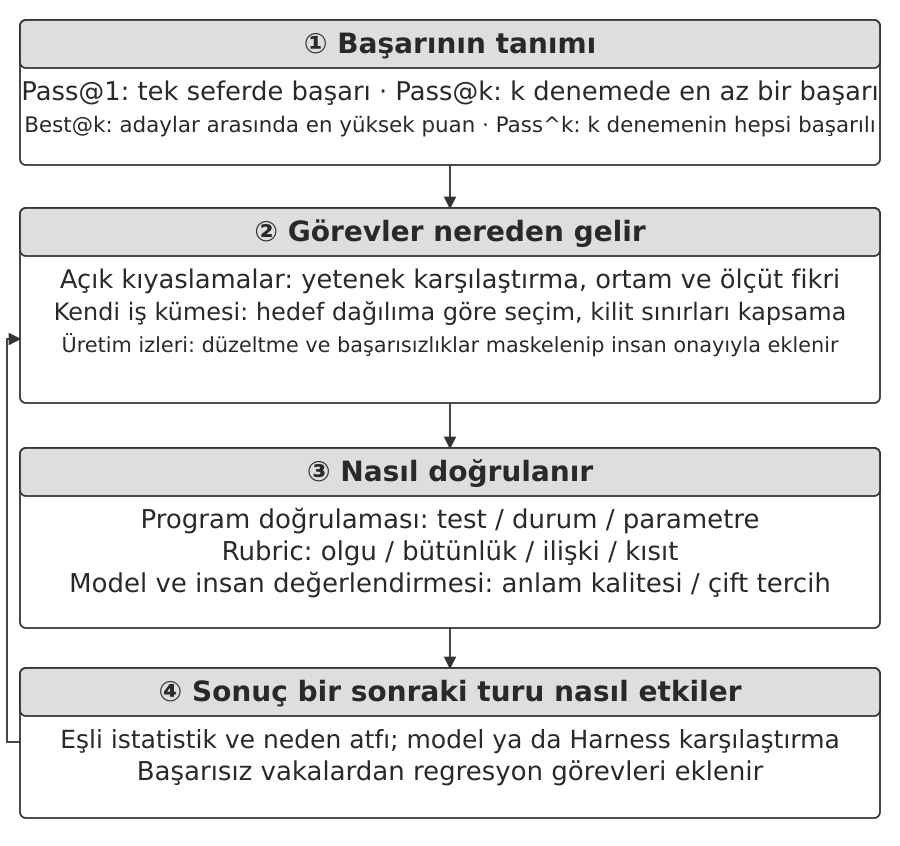
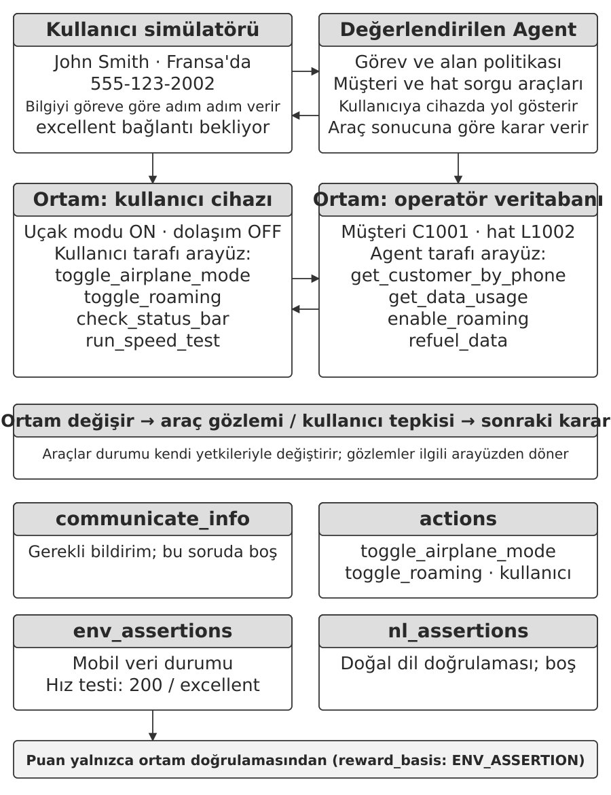
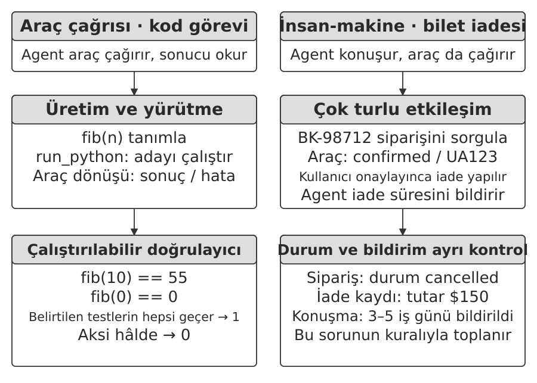
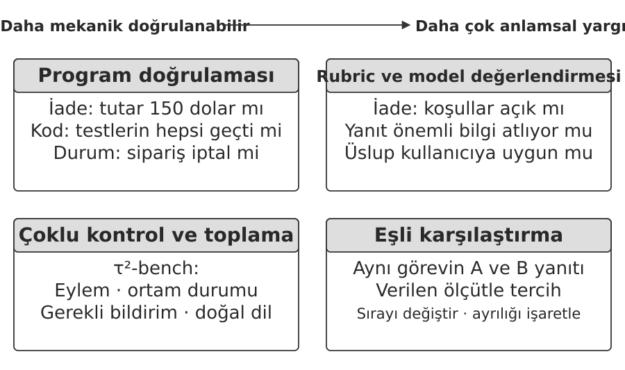
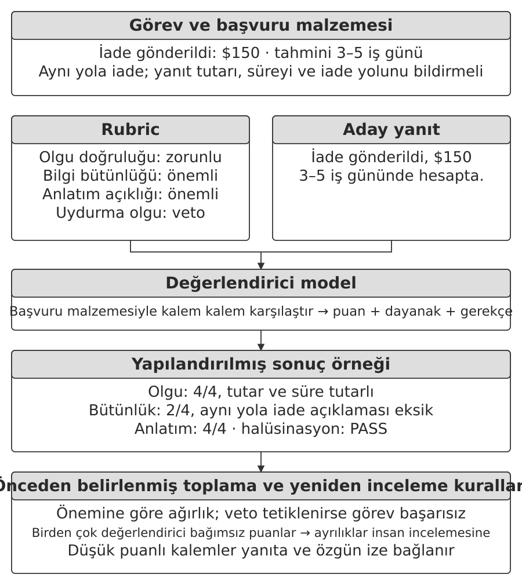
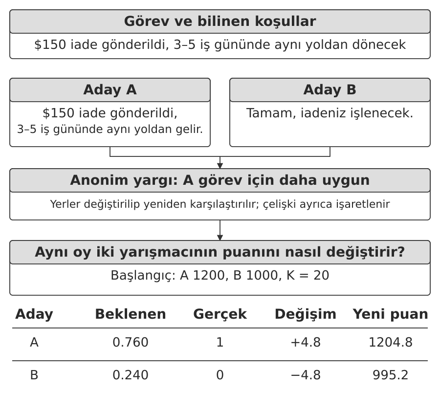
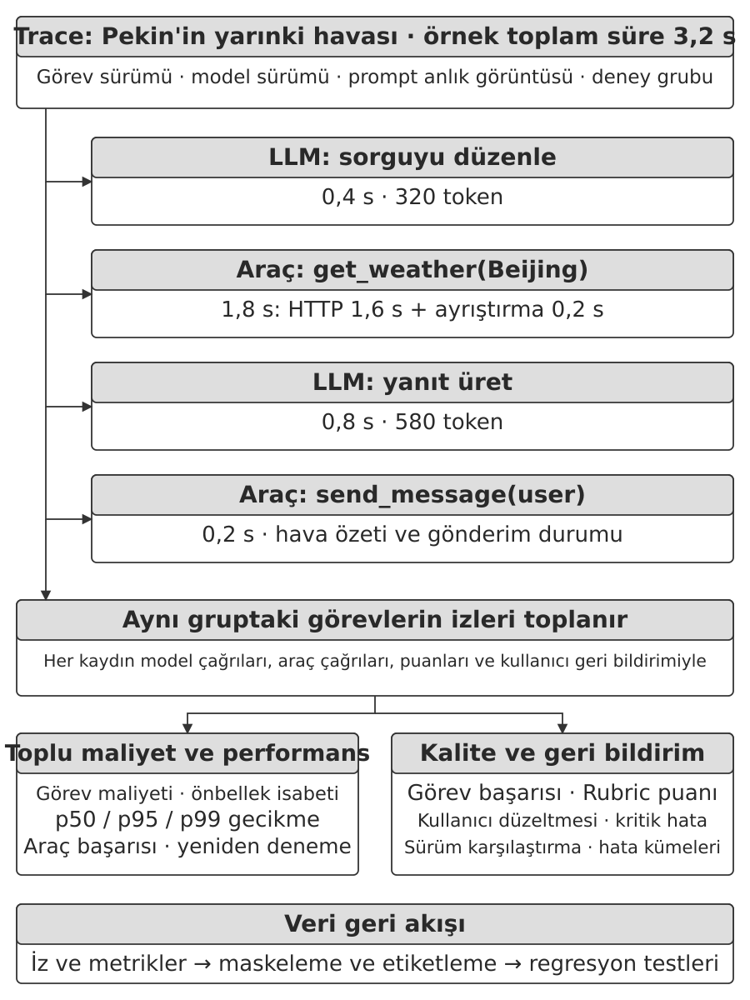
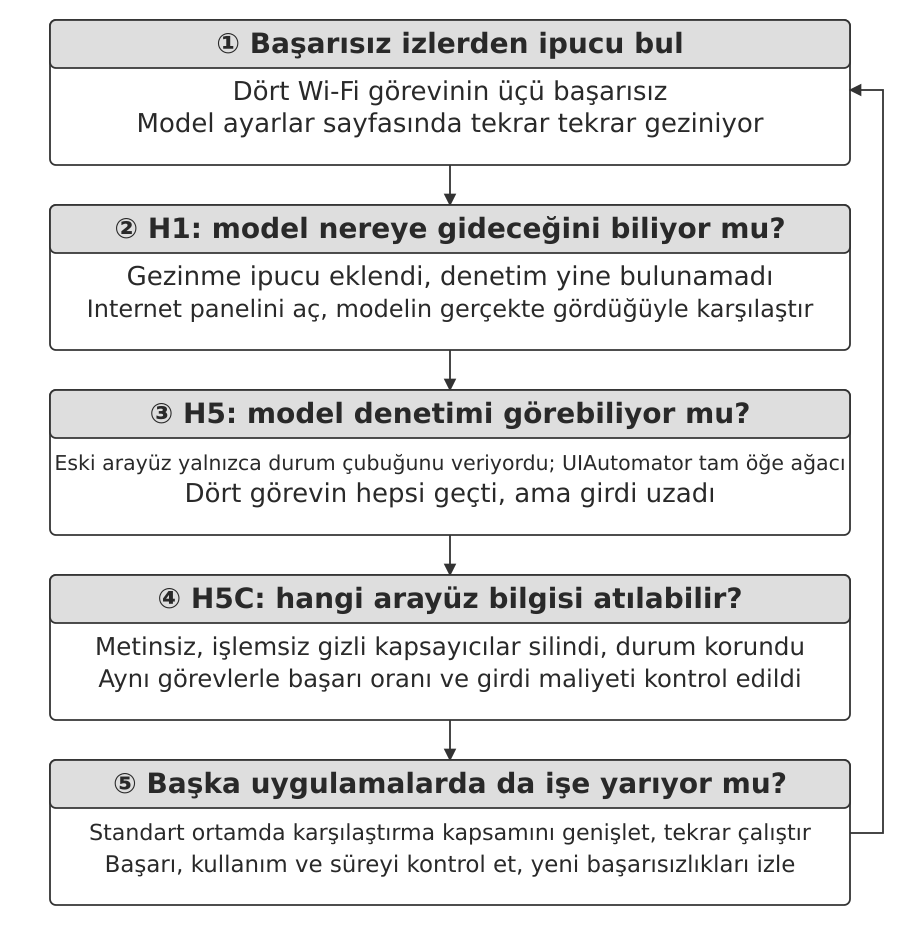
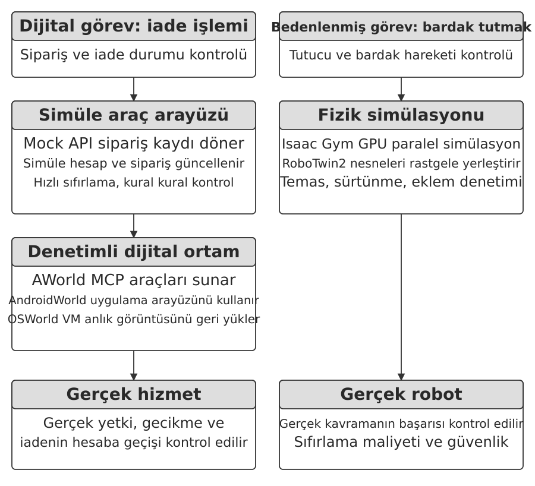
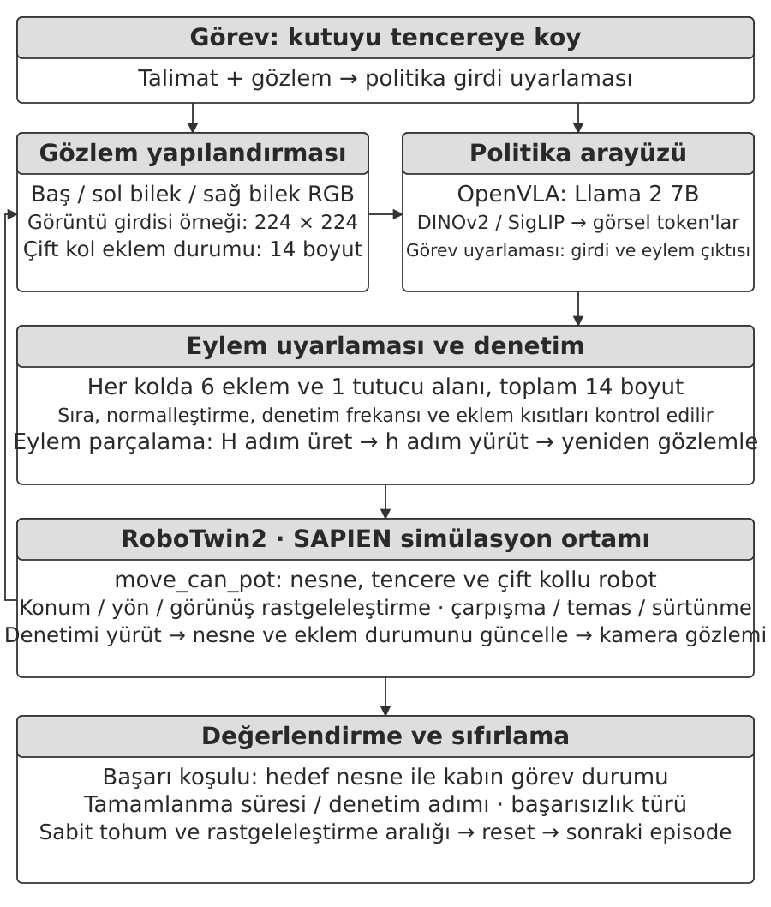

# Agent Değerlendirmesi

İlk altı bölüm tek bir Agent'ın nasıl kurulduğunu anlattı: context, bellek, bilgi tabanı, araçlar, kod ve gözlem ile eylem arayüzleri. Sistem kurulduktan sonra, tekrarlanabilir bir görev kümesiyle neler yapabildiğine, hangi koşullarda kolayca başarısız olduğuna ve bir sonraki adımda neyin değiştirilmesi gerektiğine karar vermek gerekir. Değerlendirme sonuçları sonrası eğitim ve sürekli evrim için de geri bildirim sağlar.

Geliştirme sürecinde pek çok seçimin gerçek görevlerle karşılaştırılması gerekir: hangi model kullanılacak, hangi araçlar açılacak, bilgi tabanı hangi içeriği ve indeksi kullanacak, kullanıcı belleği, prompt'lar ve Skills nasıl düzenlenecek, Harness'a hangi kısıtlar eklenecek. Seçimler birbirini de etkiler. Örneğin daha ayrıntılı araç açıklamaları parametre hatalarını azaltabilir ama context maliyetini de artırabilir; doğrulama adımı eklemek başarı oranını yükseltebilir ama tamamlanma süresini de uzatabilir.

**Karşılaştırmalı deneyler** aynı görevler ve koşullar altında farklı çözümleri karşılaştırır, başarı oranındaki, sürede ve maliyetteki değişimi kaydeder. **Ablasyon deneyleri** getirme yeniden sıralaması, durum özeti ya da sonuç doğrulaması gibi bileşenleri çıkarır ya da kapatır, sonra sistem performansının nasıl değiştiğini gözlemler. Her turda değişikliği açıkça belirleyip diğer çalışma koşullarını sabit tutarak tekrar tekrar ölçmek, mühendislik seçimleri ile görev sonuçları arasındaki ilişkiyi adım adım kurar. Yazar karşılaştırmayı ve ablasyonu günlük geliştirmenin parçası yapmayı savunuyor. Yalnızca birkaç sorunsuz tamamlanmış ize bakmak, tesadüfi başarıyı iyileştirme sanmaya ya da bir görev türündeki kazancı görüp diğerlerindeki gerilemeyi kaçırmaya kolayca yol açar.

**Değerlendirmenin nesnesi model ile Harness'tan oluşan bütün Agent olmalıdır.** Model görevin nasıl anlaşılacağını ve eylemin nasıl seçileceğini belirler; Harness context'i düzenler, araçları zamanlar, durumu korur ve kontrolleri yürütür. Aynı model farklı araçlara ya da geri bildirim akışlarına bağlandığında farklı görev sonuçları üretebilir. Bölüm 5'te tanıtılan Coding Harness bu tür karşılaştırma senaryolarını sağlar.

Model ile Harness'ın uyumu **model değiştirme deneyi (model swap)** ile incelenebilir: önce çalışma çerçevesi ve görevler sabitlenir, model değiştirilir, nihai sonuçlar ve hata dağılımı karşılaştırılır. Daha güçlü bir model aynı adımda yine başarısız oluyorsa araçların eksik olup olmadığı, geri bildirimin zamanında gelip gelmediği, puanlamanın hedefi kapsayıp kapsamadığı kontrol edilebilir; görev performansı modelle belirgin biçimde değişiyorsa hangi akıl yürütme, planlama ya da talimat izleme yeteneklerinin sonucu etkilediği çözümlenir.

Model değiştirme ile bileşen ablasyonu çapraz yürütülebilir. Örneğin iki model "durum özetli" ve "durum özetsiz" yapılandırmaları ayrı ayrı çalıştırır; özetin ikisinin de uzun görevleri toparlamasına yardım edip etmediği ve kazancın modele bağlı olup olmadığı kontrol edilir. Böylece hem model farkları çözümlenir hem de bir Harness bileşeninin hangi koşullarda işe yaradığı bulunur.

Değerlendirme aynı zamanda model yükseltmesinin regresyon kontrolüdür. Yeni bir model açık kıyaslamalarda ilerlerken bazı iş görevlerinde gerileyebilir; kendi görev kümeniz bu değişiklikleri gösterir. Yazar "geleceğin modelleri için ürün geliştirmeyi" savunuyor: araçları, iş süreçlerini ve değerlendirme kümesini önceden tamamlayıp yeni modellerin aynı görevlerdeki performansını sürekli izlemek. Başarı oranı, yanıt süresi ve maliyet ürün gereksinimlerine ulaştığında canlıya alma ilerletilir.

Canlıya alma gereksinimleri bir değerlendirme kümesine nasıl yazılır? Şekil 7-1'i okurken tek bir testi aşağıya doğru izleyebilirsiniz: neyi ölçeceğiz, görevleri nereden seçeceğiz, başarıyı hangi kanıtla belirleyeceğiz, sonunda sonuçları nasıl kaydedip karşılaştıracağız?



## Değerlendirmeyi tek bir görevden anlamak: τ²-bench'in telecom alanı

Önce bir cep telefonu internet arızasına bakalım. John Smith 555-123-2002 numarasını kullanıyor, şu anda Fransa'da ve telefonun durum çubuğu "No Service" gösteriyor. İnternetin geri gelmesini istiyor; hız testi excellent çıkarsa arızanın çözüldüğünü kabul edecek. Gerekirse 2,0 GB veri yüklemeye razı, mevcut paketini de korumak istiyor.

Bu örnek Sierra'nın τ²-bench telecom alanından geliyor. Ortam hem operatörün arka ucunu hem kullanıcı cihazını taklit eder; müşteri hizmetleri Agent'ı ile kullanıcı simülatörü durumun bir kısmını kendi araçlarıyla okuyup değiştirir. Değerlendirme iki tarafın etkileşimi boyunca sorunun nasıl bulunduğunu, işlemlerin nasıl yürütüldüğünü ve ağın sonunda geri gelip gelmediğini kontrol etmelidir.[^ch7-tau2-task]

### Görev tanımının dört bileşeni

Aynı soruyu başka bir müşteri hizmetleri Agent'ına çözdürmek için önce telefonun ve hesabın durumu geri kurulmalı, simüle edilmiş kullanıcı aynı gereksinimlerle sorun gidermeye katılmalı, en sonda aynı ölçütlerle puanlanmalıdır. Aşağıdaki tablo görev tanımının dört bileşenini listeliyor. Okurken bir farka dikkat edin: soruyu hazırlayan telefonun başlangıç ayarlarını biliyor; müşteri temsilcisi ve kullanıcı konuşmanın başında ne kadarını biliyor?

| Bileşen | Alan | Bu örnekteki içerik |
| --- | --- | --- |
| İş kaydı | `ticket` | Kullanıcı, numara, bulunduğu ülke, internete bağlanamama belirtisi, hız testi gereksinimi ve paket kısıtları |
| Kullanıcı senaryosu | `user_scenario.instructions` | Kullanıcının ne bildiği, sorulduğunda nasıl sorgulayacağı, sorunun ne zaman çözüldüğünü teyit edeceği |
| Başlangıç durumu | `initial_state.initialization_actions` | Kullanıcı kimliğini ve konumunu ayarlamak, uçak modunu açmak, cihaz dolaşımını kapatmak, operatör tarafında dolaşımı açmak |
| Puanlama ölçütleri | `evaluation_criteria` | Eylemleri ve ortam durumunu kontrol eder; puanlanan kalemleri `reward_basis` belirler |

**Kullanıcı ne biliyor.** `known_info` adı, numarayı ve bulunulan ülkeyi verir. Uçak modunun açık, cihaz dolaşımının kapalı olduğu ortam durumunda saklanır; kullanıcı simülatörü bunları müşteri temsilcisine söyleyebilmek için araç çağırıp sorgulamalıdır. Kullanıcının bildiklerini ayrı bir alanda listelemek, simülatörün doğrudan yanıtlayabileceği bilgi ile gerçekten sorgulaması gereken bilgiyi ayırt etmesini sağlar. Yalnızca prompt'ta "hepsini birden söyleme" demek, hangi olgunun ne zaman açıklanacağını istikrarlı biçimde denetlemekte zorlanır. Bu düzen kademeli bilgi açıklamasını (Progressive Information Disclosure) gerçekleştirir: konuşma "internete bağlanamıyorum" ile başlar; Agent sorular ve işlem yönlendirmesiyle sorun giderme için gereken bilgiyi adım adım elde eder.

**Kullanıcı nasıl yanıt veriyor.** `task_instructions` ilk onarım başarısız olduğunda hafif bir hoşnutsuzluk gösterilmesini, yalnızca hız testi excellent çıktığında sorunun çözüldüğünün teyit edilmesini ve cihazla ilgili yanıtların araç sonuçlarına dayanmasını şart koşar. poor, fair ve good bu sorunun hedefine ulaşmaz. Olguya bağlama (Grounding), kullanıcının simülasyon ortamının gerçek durumuna göre yanıt vermesini sağlar. Bu kısıt olmazsa simüle kullanıcı müşteri temsilcisinin "şimdi düzelmiş olmalı" sözüne uyup onaylayabilir; iki taraftaki konuşma sorunsuz görünür, ama cihaz arızası sürer.

**İki taraf hangi durumdan başlıyor.** Kullanıcı tarafında `set_user_info` kimliği ayarlar, `set_user_location(abroad=true)` yurt dışında olduğunu gösterir, ardından `turn_airplane_mode_on` ve `turn_roaming_off` yürütülür. Operatör tarafında ise `enable_roaming`, müşteri `C1001`'in `L1002` hattı için dolaşımı açar. Böylece arka uç sorgusu dolaşımın açık olduğunu gösterebilir, ama telefon uçak modu ve cihaz dolaşım ayarı yüzünden hâlâ bağlanamaz. Müşteri temsilcisinin arka uç sorgusunun vermediği bilgiyi elde etmek için kullanıcıyı cihazı kontrol etmeye yönlendirmesi gerekir.

**Puanı hangi kontroller belirliyor.** `actions` kullanıcı tarafındaki `toggle_airplane_mode` ve `toggle_roaming` eylemlerini listeler. `env_assertions` mobil veri durumu kontrolünü ve parametreleri `expected_speed=200`, `expected_desc="excellent"` olan hız testi kontrolünü içerir. Görev biçimi ayrıca kullanıcıya mutlaka iletilmesi gereken bilgiyi ve doğal dil doğrulamalarını betimleyen `communicate_info` ve `nl_assertions` alanlarını sağlar; bu soruda ikisi de boştur.

Bu sorunun `reward_basis` değeri `ENV_ASSERTION`'dır; dolayısıyla toplam ödül ortam doğrulamalarına bağlıdır. Eylem kontrolleri sonuçta görünebilir, ama toplam puana katılıp katılmayacağına puanlama yapılandırması karar verir.

### Sonucu çalışma izi boyunca kontrol etmek

Eşlik eden çalıştırma beş telecom görevi seçiyor, her soru bir kez çalıştırılıyor; müşteri hizmetleri Agent'ı ve kullanıcı simülatörü GPT-4.1 mini kullanıyor ve sonunda dört soru geçiyor. Aşağıda önce yukarıdaki Fransa dolaşım görevi çözümleniyor, sonra başarısız görevle karşılaştırılıyor.

> **Deney 7-1 ★: τ²-bench'i çalıştırmak ve τ-bench'ten gelişimini karşılaştırmak**
>
> Önce bir görevin kullanıcı senaryosunu, başlatma eylemlerini ve puanlama koşullarını okuyun, sonra eksiksiz bir etkileşimi çalıştırın. İz boyunca müşteri temsilcisi sorgularını, kullanıcı işlemlerini, durum değişikliklerini ve kabul sonuçlarını işaretleyin; her yargının hangi bilgiye dayandığını kontrol edin.
>
> τ-bench ile τ²-bench'i karşılaştırırken kullanıcının ortamı araçlarla değiştirip değiştiremediğine ve bu değişikliğin müşteri temsilcisine hangi eşgüdüm gereksinimlerini getirdiğine özellikle dikkat edin.
>
> Şekil 7-2'ye bakarken önce telefonun uçak modunu kimin kapatabileceğini, sonra operatörün dolaşım yapılandırmasını kimin değiştirebileceğini bulun. İki tarafın yapabildikleri farklıdır; bu da müşteri temsilcisi kendi işlemlerini bitirdikten sonra neden kullanıcıdan telefonda hız testi yapmasını istemek zorunda olduğunu açıklar.
>
> 

Fransa dolaşım görevini işlerken Agent önce hesabı tanımlar. Numaraya göre müşteri `C1001`'i bulur, `L1001`, `L1002` ve `L1003` hatlarının veri bilgilerini sorgular; ama `L1001`'in ayrıntılarına dayanarak yanlış bir sonuca varır: kullanıcının verdiği 555-123-2002 etkin hatlar arasında yoktur, en yakın numara 555-123-2001'dir. Kullanıcı numaranın doğru olduğunda ısrar edince Agent `L1002`'yi sorgulamayı sürdürür ve ancak o zaman doğru hattı teyit eder.

Ardından kullanıcı simülatörü `check_network_status` ve `check_status_bar` araçlarını çağırır. Dönen durumlar şunlardır: uçak modu açık, hücresel ağ hizmet dışı, mobil veri açık, cihaz dolaşımı kapalı. Kullanıcı buna göre bildirir: "Telefon uçak modunda, veri dolaşımı da kapalı. Önce uçak modunu mu kapatmalıyım?" Buradaki sorgu kullanıcı tarafındaki araçlarla yürütülür, sonuç konuşma yoluyla müşteri temsilcisine iletilir.

Bu **çift denetim (Dual-Control)** mekanizmasıdır: müşteri temsilcisi operatörün arka ucunu sorgular ve kullanır; kullanıcı simülatörünün ise kendi cihaz araçları vardır; örneğin durum çubuğunu görmek, uçak modunu açıp kapatmak, SIM kartı yeniden takmak ve hız testi yapmak. İki taraf iletişim yoluyla işlemleri eşgüdümler; ortam her birinin yol açtığı durum değişikliklerini kaydeder.

Agent ardından kullanıcıyı uçak modunu kapatmaya ve cihaz dolaşımını açmaya yönlendirir; durum çubuğu 5G sinyali gösterir. Kullanıcı `run_speed_test` çalıştırır, 275 Mbps ve Excellent sonucunu alır, sonra sorunun çözüldüğünü teyit eder. İki ortam doğrulaması da geçer ve bu sorunun ödülü 1,0'dır.

Bu başarılı iz bir süreç sorununu da ortaya koyar. Politika müşteri temsilcisinin bir seferde yalnızca bir araç çağırmasını şart koşar; Agent ise aynı mesajda `get_customer_by_phone` ve `get_customer_by_name` çağrılarını birlikte başlatmıştır. Bu görevin toplam puanı yalnızca ortam doğrulamalarını içerdiğinden bu davranış ödülü değiştirmedi.

Başka bir başarısız izde yanlış seçilen hat hiç düzeltilmedi ve sonraki sorun giderme de saptı. Kullanıcının numarası yine 555-123-2002'dir; Agent `L1001`'i seçer ve bu hattın 3,2/5 GB kullanımıyla sorun gidermeyi sürdürür. Araç `L1001`'in 555-123-2001'e karşılık geldiğini döndürmüş olsa da Agent hattı düzeltmez ve birkaç tur ilgisiz sorun gidermeden sonra işi insana aktarır. Kullanıcı tarafı veri tasarrufu modunu başarıyla kapatır, ama doğru hat `L1002`'nin ihtiyaç duyduğu 2 GB veri yüklemesi yapılmaz; üç ortam doğrulamasının hiçbiri geçmez.

İki izi karşılaştırmak nihai puanı somut iyileştirme noktalarına açar: numara ile hat eşlemesini kontrol etmek, yeni kanıtla yargıyı düzeltmek, cihaz durumunu arka uç durumundan ayırmak ve gereken yüklemenin tamamlandığını doğrulamak. İlerideki başarısızlık atfı kısmı uzun izlerden bu kilit dönüm noktalarının nasıl bulunacağını tartışmayı sürdürecek.

[^ch7-tau2-task]: Sierra Research'ün τ²-bench'i telecom alanındaki kullanıcı araçlarını `user_tools.py` içinde tanımlar; puanlama girişi `evaluator.py`'dir. Örnek içerik ve sonuçlar eşlik eden saklanmış beş soruluk görev ve çalıştırma izlerinden derlenmiştir.

## Değerlendirme ölçütleri: başarının tanımı

Beş görevden dördünün geçmesi bu çalıştırmanın genel sonucunu verir. Buna dayanarak ürün kararı vermek için ise görev türünün ve başarısızlığın bedelinin netleştirilmesi gerekir. Bir iade müşteri hizmetinin koşulları sağlayan iadeleri sürekli tamamlaması gerekir; program yazarken birkaç uygulama üretilip testlerle çalışan ve doğru sonuç veren sürüm seçilebilir; araştırmada da birkaç varsayım önerilip araştırmacı tarafından sınanabilir. Değerlendirme ölçütü bu kullanım biçimine karşılık gelmelidir.

### Teknik gösteri: birden çok denemenin yeteneğini Pass@k ile ölçmek

Yazar etkileyici bazı Agent gösterimlerine "teknik gösteri" diyor: sisteme yeterince zaman ve deneme hakkı verildiğinde daha önce otomatik yapılması zor bir görevi tamamlar. Keşif niteliğindeki işlerde doğrulanmış tek bir başarılı iz bile değer getirebilir. **Pass@k** ölçütü bu kullanım biçimine karşılık gelir: aynı görev $k$ kez çalıştırılır, en az biri geçerse başarılı sayılır. Sürekli puanlanan görevlerde $k$ çalıştırmanın en yüksek puanı da bildirilebilir; buna **Best@k** denir.

Örneğin Anthropic bir C derleyicisi kurmak için birden çok Claude örneğini birlikte çalıştırmış ve uzun süreli çalışmanın, test geri bildiriminin ve görev bölüşümünün karmaşık mühendisliği destekleyebildiğini göstermişti. Araştırmacılar matematiksel karşı örnek ararken de modelin tekrar tekrar denemesini sağlayıp sonunda karşı örneklerden birinin geçerli olup olmadığını bağımsız olarak doğrulayabilir. Yazılım güvenlik incelemesi modelin bildirdiği şüpheli sorunları yeniden kontrol edebilir; açık uçlu yaratıcı işler de birkaç eser arasından en iyisini seçebilir.[^ch7-long-running]

Uygulama ürünleri de yeteneklerini karmaşık görevlerle gösterir. Manus sanal bilgisayarı Agent'a vererek kullanıcının onun arayüzü kullanmasını, kaynak aramasını ve işi sürdürmesini görmesini sağlar. OpenClaw talepleri anlık mesajlaşmadan alır, yapılandırılmış ve izin verilmiş dosyalara ve hizmetlere erişir, süreç içinde ilerlemeyi bildirir, ek bilgi ister ve zamanlama mekanizmasıyla uyandırılıp yapılacakları kontrol edebilir. Bu somut davranışlar kullanıcının Agent'ın ne işe yaradığını anlamasını kolaylaştırır.

Bana göre yeni tür görevleri tamamlayabilen gösterimler, bu ürünlerin kullanıcı çekmesinin önemli bir nedenidir.

### İş güvenilirliği: Pass^k'ye bakmak

İş süreçleri genellikle birden çok çalıştırmanın hepsinde doğru teslim gerektirir. **Pass^k** aynı görevin $k$ kez çalıştırılıp her seferinde geçmesini ölçer; "pass power k" diye okunabilir. Görevin geçme koşulu nihai sonucu, politika uygulamasını ve yetki kısıtlarını birlikte kapsayabilir; her çalıştırma aynı koşullarla kontrol edilir.

Her çalıştırmanın birbirinden bağımsız olduğunu ve tek seferlik başarı olasılığının hep $p$ olduğunu varsayarsak:
$$
\mathrm{Pass@k}=1-(1-p)^k,\qquad
\mathrm{Pass}^{k}=p^k.
$$

Örneğin $p=0.6$, $k=5$ olduğunda Pass@5 yaklaşık %99,0, Pass^5 yaklaşık %7,8'dir. Birincisi beş denemede genellikle bir başarının bulunabileceğini, ikincisi beşinin de başarılı olma olasılığının hâlâ çok düşük olduğunu gösterir.

Gerçek bir sonuç kümesini okurken önce formülü bir kenara bırakabilirsiniz. Aynı sorunun beş çalıştırmasının "geçti, kaldı, geçti, geçti, kaldı" olduğunu varsayalım; bu küme için Pass@5 1, Pass^5 0 olarak kaydedilir ve tek seferlik başarı oranı 3/5 olarak kestirilir. Yukarıdaki %99,0 ve %7,8 başka bir soruyu yanıtlar: her seferinde başarı olasılığı 0,6 olarak biliniyorsa ve beşer çalıştırmalık kümeler tekrar tekrar yapılıyorsa kaç küme ilgili ölçüte ulaşır?

Aynı kayıtlar daha kolay kontrol edilebilir bir soruyu da yanıtlayabilir: az önceki beş çalıştırmadan rastgele iki tanesini alırsak eşlerin ne kadarı geçer? Her çalıştırmayı bir kart sayıp yerine koymadan iki kart çekersek toplam on eş vardır. Yalnızca iki başarısız kartın oluşturduğu eş iki seferde de başarısızdır; bu yüzden dokuz eşte en az bir başarı vardır ve Pass@2'nin örneklem kestirimi 9/10'dur. Üç başarılı kart ikişer ikişer üç eş oluşturabilir; bu yüzden Pass^2'nin örneklem kestirimi 3/10'dur. τ²-bench tam olarak böyle, görev başına hepsi geçen bileşimleri sayar: bir soru $n$ kez çalıştırılıp $s$ kez başarılı olmuşsa, bunlardan $k$ tanesi seçildiğinde hepsi geçen bileşimlerin oranı $\binom{s}{k}/\binom{n}{k}$'dir; burada $1\le k\le n$.[^ch7-tau2-metrics]

Şimdi Deney 7-1'deki 4/5'e yeniden bakalım. O beş iz beş ayrı soruya aittir; her sorunun yalnızca bir kartı vardır ve tek bir eş bile oluşturulamaz. Bu görevlerin Pass^2'sini kestirmek için her soruya bağımsız çalıştırmalar ekleyip ayrı ayrı hesaplamak ve sonra toplamak gerekir. 0,8'in doğrudan karesini almak, bu soruların her seferindeki başarı olasılığının aynı olduğunu ve denemelerin birbirinden bağımsız olduğunu ek olarak varsaymak demektir.

[^ch7-tau2-metrics]: τ²-bench'in deneysel sürümü (revizyon 8d005b0) `agent_metrics.py` içinde Pass^k'yi soru soru hesaplar. Başarı sayısı $k$'dan azsa hepsi geçen bileşim sayısı sıfırdır.

Hesaplarken istatistik birimi tutarlı tutulmalıdır. Aynı görevin beş örneklemesi o görevin tekrarlanan performansını ölçer; üretimde art arda gelen beş farklı görev ise görev zorluğundan ve trafik dağılımından da etkilenir. Görevlerin başarı olasılıkları farklıysa önce her birinin tekrarlanan başarı ölçütü hesaplanıp sonra görev ağırlıklarına göre toplanabilir. Paylaşılan durum, önbellek ya da aynı arıza da birden çok çalıştırmayı ilişkili kılabilir.

**"Bilgi yetersiz" yanıtına izin verildiğinde payda nasıl seçilmeli?** Bir literatür asistanının 100 soru aldığını, 80'ini yanıtladığını ve bunların 68'inin doğru olduğunu düşünün. Verilen yanıtlara dayanan okur 68/80'i, yani %85'i önemser; bu soru kümesini bitirmek zorunda olan kişi ise 68/100'ü, yani %68'i de önemser. Kalan 20 soru için kanıt tamamlamak ya da insana devretmek gerekir.

PaperQA2, 248 LitQA2 literatür sorusunda "bilgi yetersiz" seçeneğini kullanabiliyordu. Makale üç çalıştırmanın ortalamasını bildiriyor: sistem esaslı bir yanıt verdiğinde doğruluk %85,2; bütün sorular üzerinden hesaplandığında %66,0, ayrıca %21,9'unda bilgi yetersiz seçilmiş. Dokuz insan yanıtlayıcının karşılık gelen iki doğruluk değeri %73,8 ve %67,7. Makale ilk farkın anlamlı, ikincisinin istatistiksel olarak anlamlı olmadığını bildiriyor.[^ch7-paperqa2-denominators]

[^ch7-paperqa2-denominators]: Skarlinski ve arkadaşları, *Language Agents Achieve Superhuman Synthesis of Scientific Knowledge*, 2024, Kısım 2 ve Şekil 2.

Nihai durumu aynı olan iki izin maliyeti farklı olabilir. Fatura sorgusunu örnek alırsak, A tek sorguda doğru tutarı döndürdü. B aynı yanıtı ancak iki sorgudan sonra verdi. İki sorgu aynı istek tanımlayıcısını taşıyor ve ilki zaman aşımına uğramış; bu, yeniden denemenin görevi kurtarmasına yardım ettiğini gösterir. İlk sorgunun sonucu zaten başarıyla ulaşmışsa ikinci sorgu bekleme süresini ve araç maliyetini boşuna artırmıştır.

Çalıştırma yazma ya da başka dış etkiler içeriyorsa her deneme için önce belirlenmiş başlangıç durumu geri getirilmeli, işlemler test ortamında yapılmalı ve tüm denemeler kaydedilmelidir. Ürün başarısızlıktan sonra yeniden denemeye izin veriyorsa yeniden deneme sayısı, kurtarma adımları ve yürütme maliyeti de süreç değerlendirmesine katılır; özgün başarısızlık kayıtları da tek seferlik performans ile kurtarma sonrası sonucu ayırt etmek için saklanır.

[^ch7-long-running]: Anthropic, Building a C compiler with a team of parallel Claudes, 2026-02-05; çoklu örnek iş birliğini, uzun soluklu yürütmeyi ve test geri bildirimini tanıtır.

## Değerlendirme ortamı

Önceki bölümde yanlış hattı seçen çalıştırmayı yeniden incelemek istediğinizi varsayalım. İnceleyicinin aynı kullanıcıyı, aynı iki hattı ve aynı başlangıç paketini görmesi gerekir. İlk çalıştırma hatlardan birini zaten değiştirdiyse doğrudan bir kez daha çalıştırmak, sonuçtaki değişikliğin modelden mi yoksa veritabanından mı geldiğini anlamayı olanaksız kılar. Değerlendirme ortamı görevin başlangıç noktasını kurar, etkileşim arayüzlerini sağlar, süreci kaydeder ve bitiş noktasını kontrol eder.

### Beş bileşen

Telecom görevini örnek alırsak değerlendirme ortamı beş parçaya ayrılabilir.

**Veri kümesi (Dataset)** görev tanımlarını saklar: kullanıcı arka planı, davranış gereksinimleri, başlangıç durumu ve kabul koşulları. Bir kayıt bir örneğe karşılık gelir; çalışma sırasında bilgi her katılımcının rolüne göre dağıtılır.

**Ortam durumu (Environment State)** görev yürütülürken değişen bilgileri saklar; örneğin müşteri, hat, paket, fatura ve cihazın uçak modu, dolaşım ve veri tasarrufu ayarları. Yeni bir tur başladığında ortam önce temel veriyi geri yükler, sonra `initialization_actions` yürütülerek geçerli görevin belirlediği arıza kurulur. Temizlik ve başlatma birlikte çalışmalıdır; önceki turdaki yükleme ya da ayar değişikliği bir sonraki tura girmemelidir.

**Araç arayüzleri (Tools)** katılımcıların neyi okuyup neyi değiştirebileceğini belirler. Müşteri temsilcisi müşteriyi sorgulayabilir, kullanımı kontrol edebilir, veri yükleyebilir ya da işi insana aktarabilir; kullanıcı cihaz durumunu görebilir, anahtarları açıp kapatabilir ve hız testi yapabilir. Araç inceliği ölçülen yeteneğe karşılık gelmelidir: tanı ve planlama değerlendirilecekse Agent sorguları ve işlemleri birleştirmelidir; doğrudan "internet sorununu düzelt" aracı verilirse test odağı bu yeteneğin ne zaman çağrılacağına kayar.

**Puanlama ölçütü (Rubric)** sonucun nasıl değerlendirileceğini açıklar. Telecom görevi eylemleri, ortam durumunu, gerekli iletişimi ve doğal dil gereksinimlerini kontrol edebilir, sonra hangi kontrollerin toplam puana katılacağını `reward_basis` ile belirler.

**Yürütme protokolü (Interaction Protocol)** konuşmayı, araç çağrılarını ve sonlandırmayı düzenler. Kullanıcı simülatörü `###STOP###` üreterek etkileşimi bitirebilir, çalıştırıcı ayrıca tur sayısı gibi bütçeler koyar. Bitiş nedeni ve görev puanı ayrı ayrı kaydedilir: kullanıcı konuşmayı durdursa da hedefe ulaşılıp ulaşılmadığına yine ortam doğrulamaları karar verir; bütçe tükendiğinde de son durum ve tamamlanmamış adımlar saklanmalıdır.

### İnsan–makine etkileşimli ve araç çağrısı tipi değerlendirme ortamları

Telecom görevi sürekli yanıt veren ve cihazı kullanan bir kullanıcı simülatörü içerir. Kod onarımı, veri analizi ve matematik çözümü ise çoğu zaman bir görev talimatıyla başlar, Agent ardından ağırlıklı olarak araçlarla etkileşir. İki ortam türü de görev, durum, arayüz, puanlama ve yürütme protokolü gerektirir; fark bir konuşma nesnesinin de taklit edilip edilmediğinde ve iki tarafın eylemleri nasıl eşgüdümlediğindedir.

Kod görevleri çıktıyı testlerle, veritabanı görevleri değiştirilen kayıtları sorgulayarak kontrol edebilir; açık uçlu analiz ise içerik değerlendirmesi için insan ya da model gerektirebilir. İnsan–makine etkileşimli görevlerde çoğu zaman iki kanıt parçasını birleştirmek gerekir. Örneğin telefonun ağının geri gelip gelmediği cihaz durumuna bakılarak anlaşılır; müşteri temsilcisinin numarayı netleştirip netleştirmediği, kullanıcıyı işlemlere yönlendirip yönlendirmediği ise konuşmaya bakılarak anlaşılır. Şekil 7-3'teki iade de böyledir: siparişin iptal edilip edilmediği veritabanında sorgulanabilir; müşteri temsilcisinin hesaba geçiş süresini bildirip bildirmediği ise konuşmada aranmalıdır.



Verifiers'ta bu iki görev türüne farklı ortam arayüzlerinden başlanabilir. Tablo 7-1, v0.1.9'da tek turlu yanıtı, çok turlu araç çağrısını, çalışma durumu enjeksiyonunu ve sandbox kaynak yönetimini ele alan arayüzleri kodla karşılaştırmayı kolaylaştırmak için listeliyor.[^ch7-verifiers-env]

Tablo 7-1 Verifiers ortam türlerinin karşılaştırması

| Ortam türü | Başlıca sorumluluk | Araç ve durum işleme | Tipik örnek |
|---|---|---|---|
| `SingleTurnEnv` | Tek turlu yanıtı düzenler | Tek yanıttan sonra puanlar | Matematik sorusu, tek turlu soru-cevap |
| `ToolEnv` | Çok turlu araç etkileşimini düzenler | Çalışma izini saklar, araçları dağıtır ve sonuçları alır | Arama ve bilgi sentezi |
| `StatefulToolEnv` | Çalışma durumunu araç yürütmesine bağlar | Mevcut duruma göre araç parametrelerini tamamlar ya da durumu günceller | Bu göreve veritabanı ya da kaynak tanımlayıcısı bağlamak |
| `SandboxEnv` | Yalıtılmış yürütme ortamını yönetir | Çalıştırmaya sandbox ayırır ve içindeki araçları kullanır | Kod yürütmek, dosyaları ve test sonuçlarını kontrol etmek |

Örneğin iki görev aynı anda veritabanını değiştiriyorsa çalıştırıcı her birinin veritabanı tanımlayıcısını araç çağrısına enjekte ederek her izin kendi verisi üzerinde çalışmasını sağlayabilir. Yürütme başarısız olduğunda araç bir sonraki karar için kullanılabilecek bilgiyi döndürmelidir; örneğin nesne yok, parametre gereksinimi karşılamıyor ya da hizmet zaman aşımına uğradı. Değerlendirme sistemi gözlemleri, çağrıları, yürütme sonuçlarını ve ödülleri saklar; analiz sırasında hata somut bir adıma kadar izlenebilir.

[^ch7-verifiers-env]: Prime Intellect, Verifiers v0.1.9'daki ToolEnv ve StatefulToolEnv; çok turlu izleri, araç dağıtımını ve durum parametresi enjeksiyonunu gösterir.

## Değerlendirme veri kümesinin tasarımı

Şimdi beş telekom sorusunu yayın kararlarına yön verebilecek bir değerlendirme kümesine genişletelim. Eklenen soruların hepsi "belirtilen numaraya dolaşım aç" türündense sistem aynı hesaptaki iki hattı ayırt etmeyi hiç öğrenmemiş olsa bile yüksek puan alabilir. Müşteri hizmetlerinin canlıya alınıp alınamayacağına puanla karar verilecekse sorular gerçek iş kayıtlarına göre seçilmeli; hem rutin işleri hem de hatların kolayca karıştırıldığı zor soruları içermeli, puanlamada temsilcinin sonunda hangi hattı değiştirdiği de kontrol edilmelidir. Canlıya alındıktan sonra da bu sorular bakımda tutulmalı ve kullanıcıların gerçekte teslim ettiği işi yansıtmayı sürdürmelidir.

### Kıyaslama tasarımlarının yan yana karşılaştırması

Tablo 7-2 altı kıyaslamayı yetenek, görev kaynağı, çalışma ortamı ve doğrulama biçimine göre yan yana koyuyor.

Tablo 7-2 Bazı Agent kıyaslamalarının kilit tasarım tercihleri

| Kıyaslama | Ölçülen yetenek | Görev kaynağı ve düzeni | Çalışma ortamı | Doğrulama biçimi |
|---|---|---|---|---|
| τ²-bench | Müşteri hizmetleri etkileşimi ve araç işlemleri | Alan görevleri ve arıza bileşimleri | Kullanıcı simülatörü, cihaz ve iş veritabanı | Kalem kalem kontrol, `reward_basis`'e göre puanlama |
| SWE-bench Verified | Kod sorunu onarımı | Gerçek GitHub issue'ları, elle süzülmüş | Kod deposu ve test ortamı | `FAIL_TO_PASS` ve `PASS_TO_PASS` testleri |
| AndroidWorld | Android uygulama işlemleri | Parametreli görev şablonları | Gerçek uygulamaları çalıştıran Android emülatörü | Cihaz, dosya ya da uygulama iç durumunu okuma |
| OSWorld | Masaüstü ve uygulamalar arası işlemler | Gerçek kullanım senaryoları, görev başlangıç noktası yapılandırılır | Sanal makine ve masaüstü uygulamaları | Görev yürütme durumuna ve ürünlerine göre kontrol |
| Terminal-Bench | Terminalde mühendislik görevleri | Elle tasarlanmış görevler ve testler | Konteyner ve görevin gerektirdiği bağımlılıklar | Dosyalar, program çalıştırma ve test sonuçları |
| GAIA | Genel asistanın bilgi işlemesi | Elle yazılmış sorular, bazılarında ek malzeme | Ağ, dosyalar ve yardımcı araçlar | Yanıt biçimine göre normalize edilip karşılaştırılır |

### Doğrulayıcılar

Doğrulayıcılar görev hedefini kontrol edilebilir kanıtlara bağlar. Kod görevleri test çalıştırmayı, masaüstü görevleri uygulama ya da dosya durumunu okumayı, bilgi arama görevleri yanıtı ve kaynağını kontrol etmeyi gerektirir. **Kabul bağımsız olarak elde edilen kanıta dayanmalıdır.** Agent bütün adımların tamamlandığını iddia eden eksiksiz bir rapor üretebilir; doğrulayıcı yine de ürünü gerçekten çalıştırmalı, durumu okumalı ya da kaynağı kontrol etmelidir. Tamamlanma raporu kontrol edilecek nesneleri bulmak içindir; puanı bu kontroller belirler.

Kullanıcının bir ödeme uygulamasını açıp asistandan "bu ay ev arkadaşımdan gelen tüm ödeme isteklerini onayla" dediğini düşünün. Bekleyen üç istek olsun: ev arkadaşının bu ayki, aynı ev arkadaşının geçen ayki ve bir iş arkadaşının bu ayki. İlki onaylanmalı, diğer ikisi beklemede kalmalıdır. Yalnızca ilki kontrol edilirse üçünü de onaylayan bir asistan tam puan alabilir; yalnızca diğer ikisi kontrol edilirse hiçbir şey yapmayan bir asistan da geçebilir. AppWorld bu soruyu simüle edilmiş bir ödeme uygulamasında sordu. Doğrulayıcı tasarlanırken önce işlem öncesi veriye göre kullanıcının yetki verdiği istek kümesi belirlenebilir, sonra hepsinin onaylanıp onaylanmadığı kontrol edilir, en sonunda işlem sonrası kayıtlardan geriye doğru bakılır: asistan başka hangi isteklere dokundu?[^ch7-appworld-scope]

[^ch7-appworld-scope]: Trivedi ve arkadaşları, *AppWorld*, ACL 2024; Şekil 2 görevi ve kabul koşullarını verir.

Bilimsel arama da doğrulaması kolay bir ürün teslim edebilir. FunSearch'ün sekiz boyutlu uzayda olabildiğince çok nokta seçmesi gerekir; her boyut yalnızca 0, 1 ya da 2 değerini alabilir, işlemler mod 3 yapılır ve seçilen noktaların hiçbir üçü doğrudaş olmamalıdır. Araştırmacılar noktaları adım adım seçen program iskeletini yazar, modelden aday noktaları sıralayan fonksiyonu önermesini ister, sonra gerçekten kurulan geçerli nokta kümesinin büyüklüğüyle puanlar. Makale yayımlandığında mevcut kurgular 496 nokta seçebiliyordu; yeni program 512 noktalık bir liste teslim etti.[^ch7-funsearch-cap]

Yalnızca listeyi indirip bu sonucu bağımsız olarak kontrol edebilirsiniz. Önce 512 farklı sekiz boyutlu vektör olduğunu ve her koordinatın belirlenen aralıkta olduğunu teyit edin. Sonra herhangi iki farklı nokta $a,b$ seçin; bulundukları doğruda yalnızca üç nokta vardır ve üçüncüsü $c=-a-b \pmod{3}$'tür. Örneğin iki boyutta $(0,0)$ ile $(1,2)$ alınırsa üçüncü nokta $(2,1)$'dir. Aynı işlemi sekiz boyutta koordinat koordinat uygulayıp listedeki 130.816 farklı nokta çiftinin hepsini dolaşırsanız elde edilen üçüncü noktaların hiçbiri listede yer almaz. Bu, en az 512 nokta seçilebileceğini kanıtlamaya yeter. 513'ün kesinlikle mümkün olmadığını kanıtlamak için ise üst sınır kanıtı gerekir.

[^ch7-funsearch-cap]: Romera-Paredes ve arkadaşları, *Mathematical discoveries from program search with large language models*, Nature, 2023'te çevrimiçi yayımlandı. Yazarlar sekiz boyutlu nokta kümesini ve doğrulama için hesaplama defterini ayrıca yayımladı.

**SWE-bench'in iki tür testi onarımı ve regresyonu ayrı ayrı kontrol eder.** `FAIL_TO_PASS`, düzeltmeden önce başarısız olan ve düzeltmeden sonra geçmesi gereken testlerdir; `PASS_TO_PASS` ise önceden geçen ve düzeltmeden sonra da geçmeye devam etmesi gereken testlerdir. Birincisi belirtilen sorunu, ikincisi mevcut testlerin kapsadığı davranışın korunup korunmadığını kontrol eder.[^ch7-swe-verified]

**OSWorld uygulama ürünlerini yürütmeye dayalı doğrulamayla kontrol eder.** Özgün sürüm, görev yapılandırmasıyla birlikte dosyaları, uygulama verisini ya da sistem durumunu okuyan 134 yürütme temelli değerlendirme fonksiyonu sunar.[^ch7-osworld-design] Örneğin tablo değiştirilmesi istendiğinde belirtilen hücre ve formül kontrol edilebilir; tarayıcı ayarının güncellenmesi istendiğinde ilgili yapılandırma okunabilir.

**Terminal-Bench mühendislik görevlerini çalıştırma sonuçlarıyla kabul eder.** Linux çekirdeği derleme örneği kaynak değişikliğini, derlemeyi, initramfs'i ve QEMU açılışını birbirine bağlar; Linux 6.9, `start_kernel` içindeki özel `printk` ve açılış günlüğündeki mesaj somut kontrol noktaları sağlar.

Bölüm 5 satış tutarını siparişlerden kontrol etmeyi anlatmıştı. Asistan yirmi kanallı bir çeyreklik rapor teslim ederse nereden kontrol etmeye başlarsınız? Tencent WorkBuddy Bench'te herkese açık bir mutabakat sorusu var. İki çalışma sayfası da kanal verisi içeriyor; uzlaşma tutarı bir önceki çeyrekle karşılaştırılan çeyreklik değişime, tahsilat tutarı ise geçen yılın aynı çeyreğiyle karşılaştırılan yıllık değişime bakılarak ölçülüyor. İki baz dönem de bir önceki çeyrek olarak doldurulsa bile başlıklar ve kanal sayısı tamamen doğru olabilir. Uzlaşma tablosundaki "Jinxiu Yaşam Mağazası"nı örnek alırsak, ayrıntılardan yinelenen satırlar ve çeyreği eksik kayıtlar çıkarılıp kanala ve çeyreğe göre toplandığında toplam işlem tutarının 1.569.231,00'den 1.787.311,03'e çıktığı, farkın 218.080,03 olduğu hesaplanabilir. Puanlama programı iki tablonun kanal kapsamını kontrol eder, sonra belirtilen iki kanalın değerlerini örnekleyerek kontrol eder. Bu soruda kanal kapsamı kontrolü yirmi kanalın hepsini kapsar; değer kontrolü ise yalnızca örneklenen iki kanalı.[^ch7-workbuddy-office]

[^ch7-workbuddy-office]: Tencent WorkBuddy Bench ofis görevi `channel-period-compare-L4-017`. Kullanılan veri paketi (revizyon 3e8ad83) özgün çalışma kitabını, başvuru yanıtını ve puanlama programını içerir.

Zamana duyarlı bir görevle doğrulayıcı sınanabilir. Kullanıcının bir otelin oda fiyatı 950 yuanın altına düştüğünde uyarılmak istediğini varsayalım. Fiyat 10:00'da 1000 yuan, 10:10'da 900 yuana düşüyor, 10:15'te yeniden 1000 yuana çıkıyor. 10:12'de oda tipini ve rezervasyon girişini içeren bir fiyat düşüşü uyarısı gönderilirse kullanıcının hâlâ sipariş verme şansı vardır. Her gün bir "henüz düşmedi" mesajı gönderip tam bu beş dakikayı kaçırmak, bir hafta boyunca kesintisiz çalışsa bile talebi yerine getirmemek demektir. Puanlamada koşulu karşılayan pencere sayısı, pencere içindeki zamanında uyarı sayısı ve değişiklik yokken kullanıcıyı rahatsız etme sayısı ayrı ayrı kaydedilir. Değerlendiren de yalnızca günde bir kez fiyat kaydettiyse kaçırılan pencereler hiç sayılamaz. Kaçırılan uyarıları ölçmek için önce zaman damgalı eksiksiz bir fiyat yeniden oynatması hazırlanmalı, sonra test edilen sistemin kendi sıklığıyla sorgulaması sağlanmalıdır.

### Görevlerin zorluk düzeylerine ayrılması

Görev kümesi farklı zorlukları kapsamalı ve zorluğun nereden geldiğini açıklamalıdır. Temel görevler yeteneğin gerileyip gerilemediğini kontrol eder, zor görevler ise ileriki model gelişmeleri için ölçüm alanı bırakır; sorular kısa sürede tümüyle geçilirse değerlendirme kümesi model seçimine yön vermeyi sürdüremez. Araç çeşitliliğine, işlem uzunluğuna, bilginin dağınıklığına, ortam belirsizliğine ya da gereken uzmanlık bilgisine göre bölümleme yapılıp sistemin hangi koşullarda belirgin biçimde gerilediğine bakılabilir.

GAIA'nın 466 sorusu üç düzeye ayrılmıştır. Daha basit görevler genellikle az sayıda araç ve adım içerir; daha zor görevler çok adımlı bilgi birleştirme ve karmaşık bileşim gerektirir. Özgün makalede insan etiketleyicilerin üç düzeydeki doğruluğu sırasıyla %93,9, %91,8 ve %87,3; GPT-4 artı eklentilerin karşılık gelen sonuçları ise %30,3, %9,7 ve %0'dı.[^ch7-gaia-design]

Terminal-Bench'in görev yelpazesi de çok geniştir: model kaydı MLflow kullanımını içerir, çok bileşenli dağıtım Git hizmeti ile web hizmetinin eşgüdümünü gerektirir, parola kurtarma ve FEAL diferansiyel analizi ise özel algoritma bilgisi ekler.

İş görevleri politika sınırlarını da kapsamalıdır. Örneğin kullanıcı müşteri hizmetlerinin sipariş iptalini onayladığını iddia ederse sistem yetkiyi ve sipariş durumunu sorgulamalı, sonra politikaya göre iptal edip etmeyeceğine karar vermelidir. Bu tür örnekler Agent'ın çelişkili bilgileri kanıta dayanarak nasıl ele aldığını sınar ve normal iş görme görevleriyle birlikte düzenlenebilir.

### Veri sızıntısını önleme

**Çok kaynaklı bileşim ve özel ekler.** Model arama sonuçlarında sorunun kendisini ve hazır yanıtını bulabiliyorsa bir kez doğru yanıtlamak ne kadar arama ve akıl yürütme yeteneğini kanıtlar? GAIA bu olasılığı çok adımlı arama ve özel eklerle azaltır. Örneğin önce belirli bir günün astronomi görüntüsünden bir astronotu tanımlar, sonra bağlı olduğu astronot grubunu sorgular, üyelerin uzayda kalma sürelerini karşılaştırır, en sonunda istenen biçimde soyadını ve dakika sayısını verir. Noktalı virgül, sayı yuvarlaması ve binlik ayırıcı da yanıt anlaşmasının parçasıdır. Özel hazırlanmış PDF, ses ve görüntüler girdi bileşimlerini çeşitlendirir. Herkese açık sorular eğitim malzemesine girebilir. Bu yüzden yalnızca değerlendirmeye ayrılmış bir soru kümesi de tutulmalı ve hangi soruların eğitimde kullanıldığı kaydedilmelidir.[^ch7-gaia-design]

**Parametreli örnekler.** AndroidWorld görevler için başlatma, yürütme kontrolü ve temizlik mantığı sağlar ve parametrelerle farklı örnekler üretir.[^ch7-androidworld-design] Örneğin "`[CONTACT_NAME]` kişisinin telefonunu `[NEW_PHONE]` olarak değiştir" kişiyi ve numarayı değiştirirken işlem hedefini aynı tutar. Parametre değişimi modelin geçerli göreve göre davranıp davranmadığını kontrol eder; parametrelerin bir kısmını sabitleyip geri kalanını değiştirmek belirli bir faktörün etkisini incelemeyi de kolaylaştırır.

**Kanarya tanımlayıcıları.** Kıyaslama dosyalarına, verinin kopyalandığına ya da başka derlemlere karıştığına dair ipucu bulmaya yardım eden benzersiz canary GUID'ler gömülebilir. Terminal-Bench görev dosyaları bu tür işaretler kullanır. Sızıntıyı değerlendirirken modelin işareti mevcut context'te ya da getirme sonuçlarında görüp görmediği de kontrol edilmeli, sonra veri kaynağı izlenmelidir; işaretin bulunması bir incelemeyi tetikleyebilir, eğitim verisine ait olduğunu göstermek için ise daha fazla kanıt gerekir.

### Kalite denetimi ve uzun vadeli bakım

Aynı telecom sorusu dün geçip bugün kalıyorsa Agent'taki değişikliğe bakmanın yanı sıra şu da yanıtlanabilmelidir: başlangıç hatları değişti mi? Kullanıcı simülatörü hâlâ aynı kurallarla mı iş birliği yapıyor? Puanlama koşulları hâlâ aynı hedefi mi ölçüyor? Bir çalıştırmanın başlangıcı, etkileşimi ve bitişi boyunca beş bakım işi çıkarılabilir.

1. **Kullanıcı bilgisinin kapsamını netleştirmek.** `known_info` ile davranış gereksinimlerini ayırmak, sorgulama ve netleştirme adımlarına net bir bilgi başlangıcı verir.
2. **Kabul koşullarını açık yazmak.** "Ağ geri geldi" ifadesini mobil veri durumuna, hız testi değerine ve derecesine indirgemek, görevin gerçekten istediği etkiyi kontrol eder.
3. **Simüle kullanıcının yanıt dayanağını kısıtlamak.** Cihaz durumu araç dönüşünden gelir; duygu ve sabır kuralları etkileşimi düzenler.
4. **İki tarafın işlemlerini temsil etmek.** Kullanıcı ve müşteri temsilcisi ortamı ayrı ayrı değiştirir; sonraki kararlar yeni durum bilgisini kullanılabilir araçlarla ya da konuşma yoluyla alır.
5. **Görev ile arızayı birleştirmek.** Arıza bileşimlerini ve görev parametrelerini açık üretim kurallarıyla değiştirmek, sonra örneklerin çözülebilir olup olmadığını ve başlangıç durumunun görev tanımına uyup uymadığını kontrol etmek.

**SWE-bench Verified yayımdan önceki insan süzmesini gösterir.** Proje Python deneyimi olan 93 geliştiriciyi rastgele seçilmiş 1699 örneği etiketlemeye çağırdı; sorun açıklamasının yeterli olup olmadığı, testlerin makul çözümleri dışlayıp dışlamadığı ve onarım zorluğu özellikle kontrol edildi; her örneği üç etiketleyici bağımsız olarak inceledi. Yayımlanan Verified kümesi 500 örnek içerir.[^ch7-swe-verified] Süzme kuralları zorluk dağılımıyla birlikte yayımlandığında kullanıcılar küçültülen görev kümesinin hangi yetenek gereksinimlerini koruduğunu anlayabilir. Agent görevleri çoğu zaman çok turlu model çağrısı ve ortam işlemi gerektirir; belirsiz ya da çözülemez sorular her regresyonda bütçeyi tekrar tekrar tüketir. Yazar önce bu tür gürültüyü temizlemeyi, sonra görev sayısını artırmayı öneriyor; küçük ve yüksek kaliteli bir değerlendirme kümesi hem sık çalıştırmaya hem de başarısızlıkları açıklamaya daha uygundur.

**OSWorld-Verified yayım sonrası bakımı gösterir.** Proje ilk sürümden yaklaşık 15 ay sonra 300'ü aşkın geri bildirimi düzenleyip düzeltti; bu, yaklaşık on kişilik bir ekibin iki aylık yoğun çalışmasıydı.[^ch7-osworld-verified]

Örneğin web sayfası yapısı değiştikten sonra durum çıkarımı güncellenmelidir; belge görevleri başlamadan önce uygulamanın yüklenmiş, dosyanın açılmış ve imlecin belirtilen konumda olduğu teyit edilmelidir; doğrulama koşulları değiştikten sonra doğru ve hatalı ürünlerle regresyon kontrolü yapılmalıdır.

> **Deney 7-2 ★: Kıyaslama görevlerini kendiniz yürütmek**
>
> GAIA, AndroidWorld, SWE-bench Verified, Terminal-Bench, OSWorld-Verified ve τ²-bench'ten görevler seçin; her tür için o kıyaslamanın zorluk tanımına göre birer kolay, orta ve zor soru alın. Önce görevi bağımsız olarak tamamlayın, sonra resmî puanlamayı kontrol edin; işlem yolunu, karşılaştığınız belirsizlikleri ve nihai ürünü kaydedin.
>
> Eşlik eden malzeme Codex'in bu altı kıyaslamayı işlettiği 18 örneği saklar; kendi düşünme yolunuzla karşılaştırabilirsiniz. Bunlardan GAIA'nın atomik uzaklık sorusunda yuvarlama biçimi konusunda puanlayıcıyla anlaşmazlık çıktı; AndroidWorld'ün çarpma sorusunda 840 hesaplandıktan sonra sayfa hâlâ istenen başarı durumuna ulaşmamıştı. τ²-bench'te gizli kullanıcıyı yerel bir model taklit ediyordu. 18 örneğin 13'ü geçti.
>
> Bitirdikten sonra çözümleyin: soru birden çok makul yoruma izin veriyor mu, doğrulayıcı bu yorumları kapsıyor mu, doğru ara sonuca ulaştıktan sonra kabulden geçmek için hangi işlemlerin daha tamamlanması gerekiyor?

### Değerlendirme kümesinin üç kaynağı

Üretim değerlendirmesi açık kıyaslamaları, kendi iş görevlerini ve üretim izlerini birleştirebilir. Üçü farklı sorumluluklar üstlenir ve birlikte sistemin kullanım kapsamını kapsar.

**Açık kıyaslamalar** modelleri ön karşılaştırma için uygundur ve görev tasarımı, parametreli üretim ile doğrulayıcılar için de başvuru sağlar. Yazar bunlarla aday modelleri ön elemeye alır, seçim ve yayın kararını ise kendi iş kümesinin sonuçlarına göre verir.

**Kendi iş kümeniz** gerçek kullanıcı hedefleri, araçlar ve politikalar etrafında görevler düzenler; model seçiminde ve Harness iyileştirmesinde kullanılır. τ²-bench'in yapısı örnek alınarak alan verisi, kullanıcı senaryoları, araçlar ve durum kontrolleri yapılandırılabilir, sonra görev zorluğu ve kullanıcı simülatörü davranışı ayarlanabilir.

**Üretim izlerinin geri dönüşü** gerçek çalışmalarda gözden kaçanları bulur; örneğin kullanıcı düzeltmeleri, olumsuz geri bildirimler, iş durumu anormallikleri ya da iz incelemesinde bulunan hatalar. Yetki alınmış işleme ve kimliksizleştirmeden sonra başarısızlık nedeni insan eliyle kontrol edilir, gereken görev koşulları geri kurulur ve regresyon kümesine eklenir. Kullanıcı geri bildirimi sorunu bulmaya yarayan ipucudur; puanlama etiketi gerçek durumla birlikte teyit edilmelidir.

Başlarken açık kıyaslamalar ve az sayıda elle yazılmış iş görevi kullanılabilir; canlıya alındıktan sonra gerçek hatalar ve yeni iş senaryoları regresyon örneklerinin ana artış kaynağı olmalıdır. Bu görevler doğrudan kullanıcıların karşılaştığı sorunlardan geldiği için tasarım aşamasında atlanan koşulları sürekli tamamlar.

[^ch7-swe-verified]: OpenAI, Introducing SWE-bench Verified, 2024; test sınıflandırmasını, etiketleme ölçütlerini ve insan süzmesini tanıtır.
[^ch7-osworld-design]: OSWorld proje açıklaması görev başlatmayı ve yürütmeye dayalı değerlendirmeyi listeler; 134 değerlendirme fonksiyonu özgün sürümün sayısıdır.
[^ch7-gaia-design]: Grégoire Mialon ve arkadaşları, GAIA: A Benchmark for General AI Assistants; özgün makale görev düzeylerini, yanıt kurallarını ve insan ile model yapılandırmalarını açıklar.
[^ch7-androidworld-design]: Christopher Rawles ve arkadaşları, AndroidWorld: A Dynamic Benchmarking Environment for Autonomous Agents; parametreli görevleri ve cihaz durumu kabulünü tanıtır.
[^ch7-osworld-verified]: XLANG Lab, Introducing OSWorld-Verified, 2025; topluluk geri bildirimini, başlatmayı ve doğrulayıcı revizyonlarını tanıtır.

## Otomatik değerlendirme yöntemleri

Otomatik değerlendirme neyin kontrol edileceğini netleştirmekle başlar. SWE-bench kod davranışını test paketiyle, AndroidWorld uygulama durumunu sorgulayarak, GAIA ise yanıtı türüne göre normalize edip karşılaştırarak kontrol eder. Bu kontroller programla yürütülebilir ve tekrar tekrar çalıştırmaya uygundur. τ²-bench ise birkaç ölçütü birleştirir: araç çağrıları ve ortam durumu doğrudan kontrol edilebilir, doğal dil gereksinimleri bir modele de değerlendirtilebilir. Aynı görev çoğu zaman bu iki yöntemin ikisini de gerektirir.

Programatik kontroller tanı bilgisi de sağlar. Bölümün başındaki telekom görevini örnek alırsak dolaşım ayarını, veri bakiyesini ve yükleme eylemini ayrı ayrı kontrol etmek hangi koşulların henüz karşılanmadığını gösterir. Hattın yanlış seçildiği anı bulmak için ise kontrol sonuçlarını çağrı iziyle birleştirmek gerekir.

Açık uçlu çıktılarda kalite gereksinimlerinin daha somut yazılması gerekir. Şikâyet yanıtı bir çözüm planı sunmalı ve müşterinin duygusuna ve sorununa uygun düşmelidir; araştırma raporu kilit olguları kapsamalı ve vargılarını kaynakla desteklemelidir; bellek yanıtı kişileri, zamanı ve olayları doğru ilişkilendirmelidir. Bu gereksinimler için **Rubric (puanlama ölçütü)** ile madde madde yargılar listelenebilir, sonra **LLM-as-a-Judge (model değerlendirmesi)** malzemeye bakarak puan verebilir.

**Programla doğrulanabilen koşullar önce programa yazılmalıdır.** Biçim, sayı, yetki ve nihai durum genellikle net yargı ölçütlerine sahiptir; girdi ve ortam sabitlendikten sonra tekrar tekrar kontrol edilebilir ve maliyeti de kestirilebilir. Aynı yanıt içinde iki puanlama yöntemi birlikte kullanılabilir. Şekil 7-4'te iade tutarını kontrol etmek için yalnızca sayıları karşılaştırmak yeter; müşteri temsilcisinin iade koşullarını açıkça anlatıp anlatmadığını anlamak için ise bütün paragrafı okumak gerekir. Bu kalem bir modele puanlattırılabilir, sonra insan örneklemesiyle kalibre edilebilir.



### LLM-as-a-Judge: kalite gereksinimlerini madde madde puana çevirmek

Şekil 7-5'te müşteri temsilcisi iade tutarını ve tahmini hesaba geçiş süresini doğru bildirmiş; bütünlük neden yalnızca 2 puan aldı? Puanlama ölçütü iadenin nereye yapılacağını da açıklamayı istiyor; yanıtta "karta geri iade" eksik. Değerlendirme modelinin hangi maddenin eksik olduğunu gösterebilmesi için görevi, puanlama ölçütünü ve başvuru malzemesini birlikte görmesi gerekir.



Değerlendirme modelinin önce kalibre edilmesi gerekir. Yaygın bir sorun **uzunluk yanlılığıdır**: içerik eşdeğerken daha uzun yanıt daha yüksek puan alabilir. Gerçek ve vargıları aynı, ifade uzunluğu farklı örnekler hazırlanarak puanın uzunlukla değişip değişmediği kontrol edilebilir; iki yanıt birlikte puanlandığında sıraları değiştirilip değerlendirme modelinin diğerini seçip seçmediğine bakılabilir. Görevin kendisi kısalık istiyorsa bu Rubric'e yazılmalı ve uygun uzunlukta örnekler verilmelidir. Toplu istatistiklerde "yüksek puanlar uzun yanıtlarla ilişkili" bir ipucu olabilir; ardından bilgi miktarı, doğruluk ve görev zorluğu karşılaştırılarak asıl neden bulunmalıdır.

**Rubric'in dört tasarım ilkesi.** Scale AI'ın "Rubrics as Rewards" yazısı uzman rehberliği, kapsamlı kapsama, öneme göre ağırlıklandırma ve kendi kendine yeterlilik olmak üzere dört ilke önerir.[^ch7-rubrics] Agent değerlendirmesinde bunlar şöyle uygulanabilir:

(1) **Uzman rehberliğine dayanmak.** Önce işi tanıyan kişilerden başvuru yanıtını, kilit olguları ve kolayca yanlış yapılan ilişkileri yazmalarını isteyin. Örneğin bellek görevinde hangi poliçenin kime ait olduğu ve eski adresin ne zaman yeni adresle değiştirildiği netleşmelidir.

(2) **Kapsamlı kapsama.** Gerekli bilgileri, ilişki yargılarını ve ifade gereksinimlerini, ayrıca yüksek riskli hataları, yani **tuzakları (Pitfall)** birlikte listeleyin. Müşteri hizmetleri yanıtında talebe karşılık verilip verilmediği, bir sonraki adımın verilip verilmediği ve uydurma bir iade sözü verilip verilmediği kontrol edilebilir.

(3) **Öneme göre ağırlıklandırma.** Zorunlu (Essential), önemli (Important) ve isteğe bağlı (Optional) kalemleri ayırın ve tuzaklar için puan düşürme kuralları belirleyin. Doğrudan görev başarısızlığına yol açan hatalar için **veto** eklenebilir: örneğin bellek görevinde kullanıcının hesap numarasını uydurmak, ifade akıcı ve diğer bilgiler eksiksiz olsa bile o görevi başarısız sayar.

(4) **Değerlendirme ölçütünün kendi kendine yeterli olması.** Puanlama maddesinde karar için gereken olguları, koşulları ve kabul aralığını yazın. Örneğin "müşterinin güncel adresini doğru yanıtlar" maddesi "güncellenmiş Şanghay adresini yanıtlar; Pekin adresi sonraki konuşmada geçersiz kılınmıştır" biçiminde somutlaştırılabilir.

Her boyut için net puan düzeyleri ve sınır örnekleri de gerekir. Önce bir grup yanıtı deneme puanlamasından geçirin, insan ile model arasındaki ve farklı değerlendiriciler arasındaki anlaşmazlıkları toplayın, sonra örnek kararlar ekleyin. Örneğin yanıt istenen anahtar sözcüğü içeriyor ama iki kişinin deneyimini birbirine karıştırıyorsa ilişki yargısında puan kırılmalıdır. Bu tür örnek kararlar **ödül hilelerini (Reward Hacking)** bulmaya yardım eder: sistem yüksek puan alır, ama gerçek davranışı görev hedefinden sapar.

Aşağıda oturumlar arası bir bellek sorusu için eksiksiz bir Rubric tasarlanıyor. İlk geçmişte "kızımın adı Lily" yazıyor, ikincisinde "Lily'nin çocuk doktoru Dr. Chen, bugün onu kontrole götürdüm". Kullanıcı "kızımın çocuk doktoru kim?" diye soruyor. İki geçmiş birlikte "kızınız Lily'nin çocuk doktoru Dr. Chen" yanıtını destekler.

| Boyut ve önem | 4 puan: çok iyi | 3 puan: iyi | 2 puan: kısmen yeterli | 1 puan: yetersiz |
| --- | --- | --- | --- | --- |
| Olgu doğruluğu: zorunlu | Doktor adı ve kişi ilişkisi doğru | Dr. Chen doğru yanıtlanır, kişi hitabı atlanır | Dr. Chen anılır, ama başka doktorlar da olası yanıt olarak listelenir | Doktor adı yanlış ya da yeterli kanıt varken bilinmediği söylenir |
| Bilgi bütünlüğü: önemli | "Lily—çocuk doktoru—Dr. Chen" karşılığı açıkça verilir | Doktor adı kısaca yanıtlanır, geçerli soru karşılanır | Yalnızca gidilen kurum ya da olay anlatılır, doktor adı atlanır | İlgili bilgi verilmez |
| İlişki doğruluğu: önemli | Yanıt iki geçmişi doğru ilişkilendirir, gerektiğinde ilgili dayanağı gösterir | Yanıttaki kişi ilişkisi doğru, dayanak açılmamış | İlgili kişi bulunmuş, ama ilişki belirsiz | Kullanıcının kendisinin ya da başka bir çocuğun doktoru Lily'ye bağlanır |

**Halüsinasyon denetimi ayrı bir veto olarak uygulanır.** Yanıttaki olgular geçmişle desteklenmelidir; ziyaret tarihini, tanı sonucunu ya da doktorun kimliğini uydurmak başarısızlık sayılır. Bu örnekte veto tetiklendiğinde toplam puan sıfırlanır. İlişki doğruluğu yanıt, atıflar ve gözlemlenebilir iz üzerinden puanlanır; kısa yanıt da görevi tamamlayabilir.

Sınır örnekleri puanlamanın gerçek konuşmalarla başa çıkıp çıkamayacağını belirler. Kullanıcının birkaç kızı varsa ve sorudaki gönderim belirsizse doğru davranış sormaktır; geçmiş zaten Lily'yi açıkça gösteriyorsa doğrudan yanıtlanabilir. "Dr. Chen" ile "Chen Doktor"un aynı kişi olup olmadığı geçmişteki takma adlara, kuruma ve kişi ilişkilerine bakılarak teyit edilmelidir.

**Madde sayısı çoksa yargıyı önce bir modele bırakabilirsiniz.** Bin yanıtın her biri için yirmi madde kontrol edilecekse yirmi bin yargı çıkar. Tablodaki kişi ilişkisini ele alalım: "Dr. Chen, Lily'nin çocuk doktorudur" ile "Dr. Chen benim çocuk doktorum, Lily benimle gelmişti" aynı adı içerir, ama vargıları farklıdır. Adlar, sözcük sırası ve olumsuzlama için tek tek eşleştirme kuralı yazmak yerine yargı tek cümleye dönüştürülebilir: "Soruyla ve iki geçmişle birlikte değerlendirildiğinde yanıt bu doktoru kullanıcının kızıyla doğru biçimde ilişkilendiriyor mu?" Bu malzemeler, puanlanacak yanıt ve yargı Jev gibi bir karar modeline verilip "uyuyor", "uyumuyor", "karar verilemiyor" seçeneklerinden birini seçmesi istenebilir. Bu tek soru doktoru yanlış kişiyle eşleyen yanıtı ayırt eder. Tablodaki dört ilişki düzeyini ayırt etmek gerekiyorsa dört düzeyin yargıları doğrudan seçenek olarak listelenip inceleme için ayrıca "karar verilemiyor" bırakılabilir. Aynı yanıtın farklı boyutları paralel değerlendirilip puanlar programla toplanır, halüsinasyon vetosu gibi açık kurallar uygulanır.

Bu puanlama yöntemini hızla kullanıma almak için doğrudan TypeSafe'in resmî Jev'i gibi öncü bir karar modeli çağrılabilir. Puanlama kuralları prompt olarak yazılır, seçenekler verilir, her seferinde puanlanacak yanıt ve ilgili geçmiş malzemesi gönderilir; böylece hızlı sonuç alınır. Her gün aynı kurallarla çok sayıda yanıt puanlanacaksa ve tek seferlik maliyet daha da düşürülmek isteniyorsa kendi karar modelinizi damıtabilirsiniz. Önce değerlendirme tasarımcısı her düzeyin yargısını net yazar, sonra DeepSeek, Kimi, GPT, Claude ya da Gemini gibi öncü modeller öğretmen olarak kurala göre örnekleri puanlar. Doğrulanmış "malzeme, yanıt, öğretmenin verdiği düzey" üçlüleri sentetik eğitim kümesine dönüştürülür ve Bölüm 8'deki denetimli ince ayar yöntemiyle daha küçük bir öğrenci modeli eğitilir. Eğitilen öğrenci modeli günlük puanlamayı üstlenebilir.

> **Deney 7-3 ★★: Rubric tabanlı bir kullanıcı belleği değerlendirme sistemi kurmak**
>
> Bölüm 3'teki kullanıcı belleği değerlendirme çerçevesinde yapılandırılmış puanlama uygulayın; temel hatırlama, çok oturumlu belirsizlik giderme ve oturumlar arası gizli ilişki olmak üzere üç düzey görevi kapsayın. Değerlendirme boyutları olgu doğruluğu, olgu bütünlüğü, ilişki doğruluğu, proaktiflik ve ayrı bir halüsinasyon denetimidir.
>
> Olgu doğruluğu verilmiş sayıları, tarihleri ve adları kontrol eder; olgu bütünlüğü yanıtın içermesi gereken kilit olguları; ilişki doğruluğu kişiler, zaman ve olaylar arasındaki ilişkileri; proaktiflik ise dayanağı olan önerilerin ya da risk hatırlatmalarının zamanında sunulup sunulmadığını kontrol eder. İlk dört boyut dört düzeyli puanlama kullanır; her düzeyin yargısı açıkça verilir, örnekler ve sınır durumlar eklenir; halüsinasyon denetimi veto kalemidir.
>
> Uygulamada ilk iki boyutun alan adı olarak Precision ve Recall korunur; saklanan şey Rubric düzeyidir. İstatistik anlamında kesinlik ve hatırlama bildirmek için sayılabilir olgu birimleri tanımlanmalı, doğru olguların verilmiş olgulara oranı ile kapsanan zorunlu olguların tüm zorunlu olgulara oranı ayrı ayrı hesaplanmalıdır.
>
> Deney sonuçlarını okurken önce görevin geçip geçmediğine, sonra kaç puan aldığına bakın. Olgu doğruluğu, olgu bütünlüğü ve ilişki doğruluğu 3 puana ulaştığında ve halüsinasyon vetosu tetiklenmediğinde görev geçmiş sayılır. Sürekli ödül proaktifliği de katar: dört boyutun her biri $(s-1)/3$ ile normalize edilip ortalaması alınır; halüsinasyon çıkarsa ödül sıfırlanır. Örneğin Deney 7-12'de BGE-M3 ile getirme yapılan, yeniden sıralamanın atlandığı ve yanıtı Doubao'nun verdiği bir grup vardı. Bir sigorta hasarı sorusunda dört boyut sırasıyla 3, 3, 3 ve 2 puan aldı. Görev geçti ve sürekli ödül yaklaşık 0,583 oldu.

> **Deney 7-4 ★★: Advanced JSON Cards ile RAG'in karşılaştırmalı değerlendirmesi**
>
> Aynı 60 soruluk kümede üç bellek çözümü karşılaştırılır: salt Advanced JSON Cards yapılandırılmış kartları context'e koyar; salt RAG konuşmayı parçalayıp ilgili içeriği getirir; karma sistem kilit olguları sürekli context'te tutar ve özgün konuşmayı ihtiyaç anında getirir. Üç düzeyde 20'şer soru, toplam 180 "çözüm—soru" bileşimi oluşur.
>
> Üç çözüm aynı soruları, kaynak konuşmaları, yanıt modelini ve puanlama kurallarını kullanır; katmanlı başarı oranları, halüsinasyon vetoları ve maliyet ayrı ayrı istatistiklenir. Ardından aynı sorunun üç sonucu hizalanarak karma sistemin hangi sorularda tamamlayıcı olduğu, hangilerinde bilgi seçimi ya da birleştirme yüzünden kayıp verdiği çözümlenir.

Tablo 7-3 bu deneyin geçmiş özetini sürdürüyor. Her düzeyde 20 soru vardır; tablodaki 5 puanlık fark bir soruya karşılık gelir.

Tablo 7-3 Üç kullanıcı belleği sisteminin katmanlı başarı oranları

| Sistem | Temel hatırlama | Çok oturumlu belirsizlik giderme | Oturumlar arası gizli ilişki | Genel |
| --- | ---: | ---: | ---: | ---: |
| Advanced JSON Cards | %95 | %60 | %50 | %68,3 (41/60) |
| RAG | %90 | %40 | %15 | %48,3 (29/60) |
| Karma sistem | %80 | %70 | %50 | %66,7 (40/60) |

Önce salt RAG'e bakalım. Temel hatırlama sorularında 18, kart çözümü 19 soruyu doğru yanıtladı; oturumlar arası gizli ilişki sorularına gelindiğinde salt RAG yalnızca 3, kart çözümü 10 soruyu doğru yanıtladı. Bu 7 soruluk farkın nereden geldiğini anlamak için RAG'in yanlış yaptığı bir soru seçip getirme sonuçlarının ilişkiyi kurmak için gereken iki konuşmayı içerip içermediğine bakabilirsiniz. İkisi de varsa yanıtın hangi iki kişiyi ya da hangi iki olayı birbirine bağladığı kontrol edilir. Yalnızca başarı oranına bakarak malzemenin eksik bulunduğunu mu yoksa modelin malzemeyi okuyup ilişkiyi yanlış mı kurduğunu ayırt edemeyiz.

**İki bellek mekanizmasını bir araya getirmek kendiliğinden ikisinin güçlü yanlarını verir mi?** Karma sistem çok oturumlu belirsizlik gidermede 14 soruyu doğru yanıtladı; kart çözümü 12, salt RAG 8 soruda kaldı. Ama geçmiş özeti ayrı ayrı bakılması gereken iki grup da kaydediyor: yalnızca karma sistemin doğru yanıtladığı 3 soru var; ayrıca en az bir tek çözümün doğru yanıtladığı 8 soruyu karma sistem yanlış yaptı. Bu hesaba göre en az bir tek çözümün doğru yanıtlayabildiği $40-3+8=45$ soru var, gerçekte çalışan karma sistem 40 soruyu doğru yanıtladı. 45 sayısı iki yanıt kâğıdının sonradan birleştirilmesiyle elde edilen bir referanstır; sistemin bu sonuca kendi başına ulaşması için yanıt verirken belleği nasıl seçeceği sorununun çözülmesi gerekir. 180 değerlendirmenin ayrıca 28'inde halüsinasyon vetosu tetiklendi.

**Aynı kaynaklı model ve çok kaynaklı değerlendirme.**

Agent ile değerlendirme modeli aynı şeyi bilmeyebilir ya da aynı ifadeyi kayırabilir. İkisi aynı model ailesindense bu tercihlerin puanlamayı etkileyip etkilemediği özellikle kontrol edilmelidir. Agent değerlendiricinin sevdiği üslubu öğrenip değerlendiricinin yakalayamadığı olgu hatalarını yapmayı sürdürürse puan yine de yükselebilir. Bu, değerlendirmede Goodhart yasasının bir örneğidir: bir ölçüt tekrar tekrar optimizasyon hedefi yapıldığında gerçek kaliteyi ölçme yeteneğini yavaş yavaş yitirebilir.

Önemli sürüm yayınlarından önce ve kritik işlerin dönemsel kontrollerinde yazar çok kaynaklı değerlendirmeyi öneriyor: farklı model aileleri aynı Rubric'le bağımsız puanlasın; örneğin görevi Claude tamamlasın, GPT ve Gemini değerlendirsin. Önce insan etiketli örneklerle her değerlendiricinin doğruluğu ve anlaşmazlığı ölçülür, sonra birleştirme biçimine karar verilir: olağan puanlarda ağırlıklı ortalama alınabilir, kritik başarısızlık koşulları önceden belirlenmiş kurallara göre işlenir, anlaşmazlığı büyük örnekler insan incelemesine verilir. Günlük çalışmada tek değerlendirme modeli kullanılabilir; yukarıdaki kontrollerle puanlama kayması zamanında yakalanır.

**Çok kipli LLM-as-a-Judge.**

Çok kipli değerlendirme aynı akışı sese, görüntüye ve videoya genişletir. Puanlama malzemesi yargılanacak özellikleri kapsamalıdır:

- **TTS değerlendirmesi**: Okuma doğruluğunu, doğallığı, duygu ifadesini ve tını tutarlılığını kontrol eder. Kelime hata oranı (WER) ağırlıklı olarak tanınan metindeki kelime düzeyindeki hataları yansıtır; prozodi ve tını için sesi dinlemek gerekir.
- **ASR değerlendirmesi**: Tanıma hatasının etkisini göreve göre değerlendirir. Örneğin "bin lira transfer" ifadesinin "on bin" olarak tanınması eylem parametresini değiştirir; tutar, tarih ve kişi adları ayrı kritik alanlar olarak tanımlanabilir; sıradan sözcüklerdeki hatalar da bağlama göre değerlendirilmelidir.
- **UI değerlendirmesi**: Öneren–denetleyen kalıbını kullanarak ekran görüntüsündeki metin taşmasını, kontrastı ve düğme konumunu inceler, gerçek etkileşimle düğmenin kullanılabilir olup olmadığını kontrol eder. Burada Bölüm 5'teki inceleme mekanizması üretilen sonucu değerlendirmek için kullanılır.
- **Video kurgu değerlendirmesi**: Görüntü içeriğini ve efektleri kilit karelerle, başlangıç ve bitiş anlarını, geçişleri ve görüntü-ses eşleşmesini kesme noktasına yakın kesintisiz parçalarla kontrol eder. Örnekleme kapsamı değerlendirme kalemlerine göre belirlenir.

> **Deney 7-5 ★★: Tam otomatik bir TTS kalite değerlendirme hattı kurmak**
>
> Dört boyutlu bir Rubric tasarlayın. Doğruluk eksikleri, yanlış okumaları ve eklemeleri kontrol eder; doğallık duraklamaları, vurguları, akıcılığı ve prozodiyi; duygu ifadesi metnin bağlamına ve belirtilen üsluba uyumu; tını tutarlılığı ise hedef konuşmacı verildiğinde referans ses ile sentezlenmiş sesi karşılaştırır. Duygu puanlaması için örnekler verilmeli, soru, vurgu ve üzüntü gibi ifadeler dil alışkanlıklarıyla birlikte değerlendirilmelidir.
>
> Test derlemi tek cümleler ile uzun paragrafları, haberlerle hikâye ve diyalogları, nötr, heyecanlı ve üzgün tonları, ayrıca sayıları, özel adları, çok okunuşlu karakterleri ve lehçe sözcüklerini kapsar. Üretim modülü OpenAI, ElevenLabs, Fish Audio, MiniMax ve Doubao gibi hizmetlere bağlanabilir. Değerlendirme modülü özgün metni, puanlanacak sentezlenmiş sesi, Rubric'i ve görevin gerektirdiği referans sesi doğrudan ses alabilen bir modele verir; model her boyutu puanlar ve dayanağını açıklar.
>
> Sonuçlar hizmete, derlem türüne ve puanlama boyutuna göre toplanır; yüksek puanlı, düşük puanlı ve değerlendiriciler arasında anlaşmazlığı büyük örneklerden insan kör dinlemesi yapılır.

Eşlik eden deney iki TTS yapılandırmasından sayı, çok okunuşlu karakter, uzun cümle ve heyecanlı ton olmak üzere dörder örnek aldı; Voxtral doğrudan dinleyip puanladı ve toplamda sekiz puanlama kaydı elde edildi. Beşli ölçekte iki yapılandırmanın doğruluğu 5,00, doğallığı 4,00 çıktı; Fish Audio'nun duygu ifadesi ve tını tutarlılığı ortalaması 4,00 ve 3,00 iken OpenAI'ınki 3,75 ve 2,75'ti. Bu 0,25 puanlık farkların ikisi de sayı sorusundan geldi: diğer üç sorunun dört boyutu madde madde aynıydı. Çok okunuşlu karakter sorusunu örnek alırsak metnin sonu "还得还清所有欠款" biçimindeydi; iki "还" sırasıyla hái ve huán diye okunmalıdır. Değerlendirici iki kaydın doğruluğuna da tam puan verdi, gerekçeleri de tıpatıp aynıydı; ama ne duyduğunu harf harf belirtmedi.

Bu deney kümesi referans sesin değerlendirme hedefini nasıl etkilediğini de gösterir. Kayıttaki referans ses Fish S1'den geliyordu; tını puanı sentezlenmiş sesin bu referans kayda ne kadar benzediğini ölçüyordu. Genel amaçlı TTS karşılaştırılırken okuma, doğallık ve üslup ayrı ayrı bildirilebilir; ses klonlama karşılaştırılırken her çözümün aynı hedef konuşmacıyı taklit etmesi ve benzerlik puanının insan kör dinlemesiyle kalibre edilmesi gerekir. Referans malzeme "neyin iyi sayılacağını" da tanımlar: başvuru yanıtı yanıtlanması gereken içeriği, referans görüntü ya da ses ise karşılaştırılacak görsel ya da işitsel özellikleri verir.

Elle Rubric yazmak tanı boyutlarını hızla kurmayı sağlar. Değerlendirme ölçeği büyüdükçe puanlamayı yürütmek için özel bir **üretken ödül modeli** eğitilebilir; Bölüm 8 ilgili eğitim yöntemlerini tartışacak. Sırada madde madde puanlamayı çalışma iziyle birleştirip düzeltilebilecek somut adımları bulmak var.

### Başarısızlık atfı: ilk hatayı tüm iz içinde bulmak

Görev başarısız olduğunda önce kabul koşulları çalışma iziyle hizalanır, sonra görevi hedeften ilk saptıran karar aranır. Bu işe **başarısızlık atfı (failure attribution)** denir. Yararlı bir atıf kaydı hata kategorisini, ilgili adımları, araç çağrısını ya da model çıktısını, yargıyı destekleyen kanıtı ve sonraki etkiyi içermelidir. Sonda görünen hata mesajı çoğu zaman önceki hatanın yalnızca sonucudur; bilgi kaynağını ve durum değişimini geriye doğru izlemek düzeltilmeye değer yeri bulur.

Üretim sorunlarını bulmak ağırlıklı olarak üç sinyale dayanır: kullanıcının açık düzeltmesi, kullanıcının olumsuz oyu ya da geri bildirimi ve sonradan yapılan durum kontrolü, kural doğrulaması ya da model incelemesinde bulunan anormallikler. Yazar geliştiricilerin bir grup sorunlu izi bizzat ayrıntılı okumasını, sonra toplu atıf akışı kurmasını öneriyor. Başarısızlık sınıflandırması ürün yargısı içerir: hangi davranışların teyit gerektirdiği, hangi proaktif önerilerin sınırı aştığı önce açık gereksinimlere dönüştürülmelidir; ancak o zaman etiketleme modeli buna göre çalışabilir. Örneğin "kullanıcı adına kendiliğinden tamamlama" ile "önce kullanıcıya teyit ettirme" arasındaki sınır mevcut yetkiye, eylemin etkisine ve ürün anlaşmasına bağlıdır. Model toplu etiketlemeye yardım edebilir; bu sınırları kalibre etmek ürün ve mühendislik sorumlularının işidir.

Coding Agent örneğinde aşağıdaki dokuz sorun türüyle başlanabilir. Vaka sayısı arttıkça alt sınıflar ayrılır; sınıflandırma yargıları, olumlu ve olumsuz örnekler ile atıf akışı etiketleme Agent'ının prompt'una ya da Skill'ine yazılır.

| Hata kategorisi | Tipik görünüm | Konumlandırma yöntemi |
| --- | --- | --- |
| Gereksinim anlama ve belirsizlik yönetimi | Gereksinim koşulunun atlanması; değişiklik kapsamının kayması; aynı adlı iki yapılandırma dosyası arasında dayanaksız seçim | Kullanıcı gereksinimi ile gerçek eylemleri karşılaştırıp ilk sapmayı ve o sırada erişilebilir bilgiyi kontrol etme |
| Süreç ve standart eksikliği | Deponun istediği testlerin ya da planın atlanması; mevcut iç uygulama varken dış bağımlılık eklenmesi; mimari anlaşmasının çiğnenmesi | Açık anlaşmayı ilk çiğneyen eylemi bulma, sonra kuralın sağlanıp sağlanmadığını ya da okunabilir olup olmadığını kontrol etme |
| Araç çağrısı hatası | Düzenlemenin tekrar tekrar eşleşmemesi; parametre ya da schema hatası; özel karakter kaçış hatası | Özgün istek, araç dönüşü ve çağrı öncesi durumu karşılaştırıp arayüz anlaşmasına uymayan ilk girdiyi bulma |
| Doğrulamanın bozulması | Başarısızlığı örtmek için doğrulama koşulunun değiştirilmesi, testin atlanması ya da test edilen mantığın değiştirilmesi; test çalıştırmadan geçtiğinin bildirilmesi | Doğrulama mantığındaki değişikliğin amacını kontrol etme, tamamlandı bildirimini gerçek yürütme kaydıyla eşleştirme |
| Eksik değişiklik | Fonksiyon imzası değişmiş, dinamik çağrılar, başka dildeki bağlar ya da ilgili schema atlanmış | Etkilenen kapsamı değiştirilmiş yerlerle karşılaştırma, atlanan bağımlılıkları ve arama sürecini izleme |
| Kullanıcıya bilgi aktarımı hatası | Tutarın, durumun ya da zamanın yanlış aktarılması; kısmi tamamlanmanın tamamlanmış sayılması; gerekli bildirimin atlanması | Son yanıtı araç sonuçları, nihai durum ve bildirim gereksinimleriyle madde madde karşılaştırma |
| Uyumluluk ve işlevsel olmayan regresyon | Genel API değişikliğinin çağıranları bozması; veri yapısı değişikliğinde gereken geçişin olmaması; performans ya da kaynak tüketiminin gerilemesi | Arayüz sözleşmesini, geçiş gereksinimlerini ve performans temelini kontrol edip değişikliği getiren adımı bulma |
| Yürütme anormalliği | Çıktının kesilmesi, zaman aşımı, bağlantı kopması ya da işin tamamlanmaması | Modelin durma nedenini, Harness çalışma olaylarını ve araç hizmeti durumunu hizalama |
| Görevi erken bitirme | Çok hedefli görevin yalnızca bir kısmının tamamlanması; makul seçenek varken sonlandırma | Kalan hedefleri, denenmiş yaklaşımları ve sonlandırma koşullarını karşılaştırıp bitirme kararını bulma |

Atıf kaydı **doğrudan hatayı, neden varsayımını ve sonraki belirtileri** ayırmalıdır. Örneğin `edit_file` `old_string` eşleşmesi başarısız döndürdükten sonra Agent aynı çağrıyı üç kez yeniden denerse, eşleşme başarısızlığı doğrudan hatadır, üç yeniden deneme bir kurtarma stratejisi sorununu gösterir; çağrı öncesi dosya içeriği incelenmeden ise dize üretim hatası, dosyanın eşzamanlı değiştirilmesi ve aracın eşleştirme kuralının yanlış anlaşılması birbirinden ayrılamaz.

Büyük ölçekli atıfta yazar önce kurallarla olası hatalı çalıştırma kayıtlarını bulur, sonra modele önceki ve sonraki adımlarla birlikte nedeni çözümletir. Testlerin çalışıp çalışmadığı, arayüzün değişip değişmediği gibi sinyaller düşük maliyetle çıkarılıp model çağrıları anlamsal yargı gereken kısımlara yoğunlaştırılabilir. Örneğin test geçti bildirimleri yürütme kayıtlarıyla karşılaştırılır, doğrulama koşullarına ya da atlama işaretlerine dokunan değişiklikler işaretlenir, schema değişikliğinin karşılık gelen geçişi olup olmadığı kontrol edilir. Bu değişikliklerin makul olup olmadığına sonra model ya da insan görev hedefiyle birlikte karar verir.

#### Nihai durum ile nihai yanıtı ayrı ayrı kabul etmek

Kullanıcının aldığı şey Agent'ın nihai yanıtı, iş sisteminde kalan şey ise eylemlerin ürettiği durumdur; ikisinin de kabul edilmesi gerekir. İade gönderildiğinde tutar, işlem durumu ve sonraki adım doğru bildirilmelidir; görev yalnızca kısmen tamamlandığında tamamlanan ve bekleyen işler madde madde açıklanmalıdır. Ortam durumunu kontrol etmek ile gerekli bildirimi kontrol etmek ayrı puanlama kalemleri olarak tutulabilir; böylece yürütme hatası ile aktarım hatası ayırt edilir.

Kullanıcı adına çalışan bir müşteri hizmetleri asistanının satıcıdan ücret indirimi istediğini düşünün. Görüşmede temsilci "bu ücreti iptal edeceğiz" diyor; kayıt **temsilcinin sözlü olarak kabul ettiğini** doğrulayabilir. Nihai faturayı kullanıcı alır. Kullanıcıya rapor verirken bu fiil de korunmalıdır: "Müşteri temsilcisi indirimi kabul etti." Bu tür görevleri sözlü taahhüt oranına saymak makuldür. Gerçek hesaba geçme oranını hesaplamak için yeni fatura ya da kullanıcının sonradan doğrulaması gerekir.

Aynı talep bazen birkaç kanal arasında devredilir. Satıcı kullanıcıyı doğrudan geri arayacaksa asistan aramanın amacını, üzerinde anlaşılmış konuları ve hâlâ yanıtlanması gereken soruları önceden kullanıcıya gönderebilir. Satıcı kişinin kendisinin sözlü doğrulama yapmasını isterse asistan kullanıcının ne yapması gerektiğini açıklayabilir, üçlü görüşmeye bağlayabilir ve doğrulama bittikten sonra işi sürdürebilir. Tek kullanımlık doğrulama kodu çıktığında kodun yönergelerine uyulur ve kullanıcı satıcının belirlediği güvenilir arayüzde doğrulamayı kendisi yapar. Bu eylemler nasıl değerlendirilir? Geri arama örneğinde kullanıcının telefonu açmadan önce devir özetini alıp almadığı; doğrulama örneğinde kullanıcının doğru halkada bağlanıp bağlanamadığı ve doğrulamadan sonra görevin sürüp sürmediği kontrol edilir.

AndroidWorld'ün görsel muhasebe görevi bir başka nedensel zincir gösterir: hatalı veri sorunsuz biçimde kaydedilir ve ardından Agent görevi tamamlandı ilan eder. Görev, görüntüdeki harcamaların muhasebe uygulamasına girilmesini istiyordu; T3A 32 adımda gezinmeyi, girişi ve kaydetmeyi tamamladı. 8. adımın çıktısı görüntüdeki somut harcamaların görülemediğini açıkça söylüyor, ama iş ilerliyordu; 11. adımda kaynağı olmayan "Coffee $4.50, Lunch $12.75" gibi veriler çıktı ve sonraki doldurmalar bu verilere dayandı. Nihai doğrulayıcı görüntüye karşılık gelen Dress kaydını ararken yazılması gereken kalemin eksik olduğunu buldu.

Bu izi çözümlerken gözlem kanalı ile karar stratejisi birlikte kontrol edilmelidir. T3A erişilebilirlik öğe ağacını alıyordu, görüntü pikselleri modelin context'ine girmiyordu; görüntü okuma görevinde önce ekran görüntüsü ya da metin tanıma kanalı eklenmelidir. Bu tür sorunu toptan "model OCR yapamıyor" diye kaydetmek, ekibi model değiştirmeye ya da eğitim verisi eklemeye yöneltirken gerçekte eksik olan girdiyi atlamayı sürdürür. Mevcut bilgi yetersizken Agent'ın da bilgi edinmeyi seçmesi ya da engeli bildirmesi gerekirdi. 8. adımda işi sürdürme kararı, sonraki veri uydurma ve nihai tamamlandı bildirimi bu nedensel zincirdeki ayrı sorunlara karşılık gelir.

Aynı sorun bilimsel araştırmada da çıkar. Denario ekibi bir arıza bildirdi: analiz programı verilen veriyi okuyamadığında sistem bazen kendiliğinden simüle veri üretip analizi sürdürüyor, bunu kullanıcıya söylemiyordu.[^ch7-denario] Okurun bu şekilde üretilmiş bir grafiği aldığını düşünün; betiği yeniden çalıştırmak tıpatıp aynı eğriyi çizse bile bir soru yanıtsız kalır: bu eğri hangi gözlemlerden geldi? Nedeni ararken çizimde kullanılan sayı sütunundan geriye gidip ona değer atayan kodu, sonra bu çalıştırmanın gerçekte hangi dosyayı okuduğunu bulmak gerekir. Okuma başarısızlığının bir telafi şansı vardı; simüle değeri gözlem gibi aktarmayı sürdürmek sonraki vargıların dayanağını yok etti.

[^ch7-denario]: Francisco Villaescusa-Navarro ve arkadaşları, *The Denario Project: Deep Knowledge Artificial Intelligence Agents for Scientific Discovery*; yazarlar makalede girdi okuma başarısız olduğunda oluşabilecek veri değiştirmeyi açıklar.

> **Deney 7-6 ★★: AndroidWorld başarısız izlerinde başarısızlık atfı yapmak**
>
> Saklanan T3A çalıştırma kayıtlarını kullanarak çevrimdışı atıf alıştırması yapın. Malzeme adım adım eylemleri, açıklamaları, özetleri ve nihai doğrulama sonuçlarını içerir; 52 iz görevde başarısız olmuştur. Aşağıdaki beş adımı tamamlayın.
>
> Birinci adım: 10 başarısız iz seçin; araç çağrısı yüzeyde normal görünüp nihai kabulde başarısız olan sessiz başarısızlıklara ağırlık verin ve karşılaştırma için görünür hata içeren bir vaka ekleyin. Eşlik eden etiketleme dokuz sessiz başarısızlık ve bir görünür hatalı iz seçti.
>
> İkinci adım: olgu dayanaklarını adım adım kontrol edin, görevden en erken sapmayı işaretleyin ve bunun araç çağrısında mı model çıktısında mı oluştuğunu belirtin. Nedeni kuşkulu vakalarda komşu iz öneklerini karşılaştırın; kurtarılabilir durum varsa farklı öneklerden devam edip bir adımı değiştirerek neden varsayımını sınayabilirsiniz. Görev belli bir önekten sonra hâlâ kurtarılabiliyorsa hata muhtemelen kurtarılabilirdir; ilk hata yine olguların ve eylemlerin hizalanmasıyla belirlenir.
>
> Üçüncü adım: görev adını, adım numarasını, hata kategorisini, ilgili model ya da sistem bileşenini, özgün metin kanıtını, ana nedeni ve sonucu, ayrıca güven düzeyini içeren yapılandırılmış bir atıf kaydı yazın.
>
> Dördüncü adım: mevcut atıf notlarıyla karşılaştırın, anlaşmazlıkları ve her yargıyı destekleyen kanıtı kaydedin. Örneğin görüntü transkripsiyonu görevinde önce modelin piksel alıp almadığı kontrol edilmeli, tanıma yeteneği sonra tartışılmalıdır.
>
> Beşinci adım: ilk hatası model çıktısında oluşan üç iz seçin, ilk hatadan önceki context'i ve durumu kesin, kabul edilebilir ve yasak eylemleri yazın, önek regresyon görevi oluşturun.

#### Kapsama duyarlı belge biçimi hataları

Aynı karakter farklı konumlarda farklı işlev üstlenir. Çince metinlerdeki tırnaklar alıntıyı gösterir, JSON'daki çift tırnak söz diziminin parçasıdır, Markdown'daki ters tırnak kodu sınırlar. Kullanıcı tırnak biçimini düzenlemeyi istediğinde değerlendirme önce hangi bölgelerin değiştirilmesine izin verildiğini netleştirmelidir.

Belge, kapsam etiketli parçalara ayrılabilir: Çince gövde (`ZH_PROSE`), İngilizce gövde (`EN_PROSE`), alıntılanan kaynak (`QUOTED_SOURCE`), satır içi kod (`INLINE_CODE`), kod bloğu (`CODE_BLOCK`), kod yorumu (`CODE_COMMENT`) ve JSON ya da schema (`JSON_OR_SCHEMA`). Her parça izin verilen dönüşümleri, korunan karakterleri ve doğrulama kurallarını kaydeder. Örneğin:

| Parça | İşleme gereksinimi |
| --- | --- |
| Çince açıklama "`reset()` yöntemini çağır" | Gövde noktalama işaretleri düzenlenirken satır içi kod ve ters tırnakları korunur |
| İngilizce özgün metin "Please restart the service." | Dış noktalama alıntı kuralına göre işlenir, alıntı içeriği korunur |
| Çince kod yorumundaki tırnaklar | Anlaşmaya göre yorum metni ayrıca işlenir, yorum sınırı korunur |
| `name = "status"` | Dizenin söz dizimi sınırı korunur, kodun ayrıştırılabilirliği kontrol edilir |

Önek regresyonu hedef bölgenin üslubunu, alıntıların korunma oranını, kodun ve JSON'un söz dizimini, ayrıca hedef dışı metnin düzenleme uzaklığını birlikte kontrol eder. Kapsam henüz net değilse kabul edilebilir sonraki adımlar biçim belirtimini okumak, belge yapısını kontrol etmek ya da gerekli netleştirmeyi istemektir. Böylece en küçük değişikliğin yürütülebilir kabul koşulları olur.

#### Birebir kopyalama hatası: dize aktarım zinciri boyunca farkı bulmak

Birebir değiştirme araçları genellikle `old_string`in dosya içeriğiyle harfi harfine eşleşmesini ister. Eşleşme başarısız olduğunda dizenin hangi katmanda değiştiğini aşağıdaki zincir boyunca kontrol edebilirsiniz:

Dosyanın özgün baytları → araç dönüşü → Harness serileştirmesi → model context'i → model çıktısı → çözülen dize → araç çağrısı ayrıştırması → araç eşleştirmesi.

Karşılaştırma malzemesi özgün baytları ve hash'ini, Unicode kod noktası dizisini ve arayüzün sağladığı tokenizer token ID'lerini içerir. Önce JSON kaçışı, satır sonu kuralları gibi beklenen dönüşümler aynı temsile geri getirilir, sonra ilk beklenmedik fark aranır. Örneğin aynı görünen karakter farklı Unicode bileşim biçimlerinde olabilir; parametrede korunan ters bölü de bir katmanda fazladan ya da eksik bir kez çözülmüş olabilir.

En küçük sonda doğrudan tekrar etmeyi, uzun context'ten çıkarmayı, araç parametresine koymayı, benzer dizeler arasından seçmeyi, ayrıca boşlukları, satır sonlarını, ters bölüleri, Unicode bileşik karakterlerini ve seyrek token'ları kapsamalıdır. Ölçütler bayt düzeyinde birebir eşleşme, kod noktası düzeyinde birebir eşleşme, ilk ayrışma konumu ve gerçek araç başarı oranı olabilir. Token dizisi karşılaştırması tokenizer'ın, sürümün ve kodlama koşullarının sabitlenmesini gerektirir; aynı metin farklı üretim token bölütlemelerine karşılık gelebilir, sonunda yine aracın gerçekte aldığı dize kontrol edilmelidir.

Aynı sondanın farklı zincir konumlarına yerleştirilmesi onarım kapsamını daraltmaya yardım eder. Araç döndürdüğünde zaten fark varsa okuma ve serileştirme; model çıktısı doğru ama araç yanlış alıyorsa çözme ve protokol; model bilgi eksiksiz bir context'te yine yanlış dize üretiyorsa bu vaka Bölüm 8'deki kopyalama yeteneği eğitim verisine katılabilir. Eşzamanlı değişiklikler dosya sürümü ya da yeniden okumayla ayrıca kontrol edilmelidir.

### Uçtan uca regresyon görevleri ve iz öneki regresyon görevleri

Başarısızlık atfı bittikten sonra beklenen davranış tekrar yürütülebilir bir **regresyon görevi (regression task)** olarak yazılır. Uçtan uca regresyon başlangıç durumundan başlar ve eksiksiz iş akışını kontrol eder; iz öneki regresyonu belirli bir karardan önceki context'i ve durumu dondurur, sonraki adım davranışına odaklanır. İkisi sırasıyla "görevin tamamı tamamlandı mı" ve "bu karar gereksinime uyuyor mu" sorularını yanıtlar.

**Uçtan uca regresyon görevi** kullanıcı isteğini, başlangıç ortamını ve çalışma bütçesini verir, Agent'ın sona kadar çalışmasını sağlar, sonra nihai durumu, gerekli çıktıları ve kısıtları kontrol eder. OSWorld, AndroidWorld, τ²-bench gibi görevler bu tür regresyonda kullanılabilir. Ara kontrol sonuçlarını ve eksiksiz izi saklamak başarısızlığın yerini bulmayı da destekler.

**İz öneki regresyon görevi** mevcut konuşmayı, araç gözlemlerini, görev durumunu ve sürüm bilgisini verir, Agent'ın bir sonraki adımı ya da az sayıda sonraki eylemi üretmesini ister. Yüksek sıklıkta politika sınırlarını, parametre üretimini ve hata kurtarmayı kontrol etmeye uygundur ve çalışma maliyeti genellikle düşüktür. Eylemlerin gerçekten yürütülmesi gerektiğinde ilgili ortam anlık görüntüsü de geri yüklenmelidir; yalnızca metin öneki veriliyorsa kabul nesnesi modelin önerdiği eylemdir.

**Yüksek güvenilirlik gerektiren üretim düzeyi Agent'larda yazar iz öneki regresyon görevlerini biriktirmenin çoğu zaman uçtan uca regresyon görevlerini artırmaktan daha önemli olduğunu düşünüyor.** Önek görevleri hatadan önceki context'i sabitleyerek bu kararı doğrudan sınar ve sık çalıştırmaya elverişlidir. Bu tür vakaları sürekli biriktirmek geliştiricinin sabırla bir başarısızlık sınıflandırma ve atıf sistemi kurmasını gerektirir. Önek regresyonunun özü **kabul edilebilir eylem kümesidir**: mevcut duruma göre depo kurallarını okumak, eksik bilgiyi almak ya da kullanıcıya açıklama sormak gibi makul birçok sonraki adım kabul edilebilir; aynı zamanda sorun yaratacak eylemler listelenir. Eylem kategorileri iş anlamına net biçimde karşılık gelmeli, eşanlamlı etiketler davranış farkı sanılmamalıdır.

Başarısızlık sınıflandırmasından regresyon görevlerine şu eşleme kurulabilir:

| Başarısızlık türü | Regresyon görevinin kontrol etmesi gerekenler |
| --- | --- |
| Süreç eksikliği | Açık plan, test ve commit gereksinimleri ile eksiksiz akıştaki yürütme sırası |
| Araç çağrısı hatası | Parametre biçimi, özel karakter kaçışı, başarısızlık sonrası okuma ve yeniden deneme stratejisi |
| Yürütme anormalliği | Kesme, zaman aşımı ve araç arızasından sonra durum kurtarma ve görevin sürdürülmesi |
| Tamamlanma ve mantık hatası | Çok hedefli liste, kalan görevler, makul keşif kapsamı ve durma koşulları |
| Gereksinim belirsizliği | Bilgi henüz yeterli değilken kabul edilebilir netleştirme ya da kontrol eylemleri |
| Doğrulamanın bozulması | Korunan kabul koşulları ve tamamlandı bildiriminin dayandığı gerçek yürütme sonucu |
| Bilgi aktarımı hatası | Nihai yanıttaki tutar, durum, zaman ve gerekli bildirimin olgularla tutarlılığı |

Bu değerlendirme verileri Bölüm 8'deki model sonrası eğitimi ve Bölüm 9'daki Agent'ın sürekli evrimi için de somut hedefler sağlar.

> **Deney 7-7 ★★: İz öneki sınır değerlendirmesi: aynı context'in birden çok temsili**
>
> Agent'a verilmiş kullanıcı belleğini, mevcut görevi, iz önekini ve ortam durumunu birleştirerek örnekler oluşturun; modelden bir sonraki gözlemlenebilir eylemi üretmesini isteyin. Örnekler kullanıcı düzeltmesi, olumsuz oy ve sonradan denetim gibi üretim sorunu türlerine göre kurulur; makale üslubu ile X gönderisinin kapsam farkını, worktree ve PR tercihlerinin depo kurallarıyla çatışmasını, mevcut talimatın eski tercihi geçersiz kılmasını, düşük güvenli çıkarımları, silmeden önce teyidi ve dışarıya yayımlamadan önce önizlemeyi kapsar.
>
> Aynı anlamsal alan kümesi için JSON Cards, Markdown ve Python benzeri olmak üzere üç temsil kullanılır. Karar kategorisi, sonraki eylem, gereken kanıt, yasak eylemler ve belleğin kullanım biçimi deterministik kurallarla kontrol edilir.
>
> Eşlik eden çalıştırmayı GPT 5.6 Sol 11 örnek ile 3 temsilin bileşimi üzerinden, toplam 33 çağrıyla tamamladı. Özgün puanlama kurallarıyla üç temsilin de 6/11 geçtiği, soru bazında sonuçların farklılaştığı görüldü. Yanıtlara geri bakıldığında puanlama kurallarının kendi etkisi de görülüyor: model silmeden önce kullanıcıya sormayı seçti, ama `ask_user` bu sorunun izin verilen eylem etiketleri arasında yoktu; eski tercih mevcut taleple çeliştiğinde model mevcut talebe uymayı seçti, ama ilgili karar etiketi de izin verilen kümeye girmemişti.

Baştaki dolaşım görevine dönelim. İki hat da mevcut izde koşulları karşılıyorsa numarayı sormak makul bir eylemdir. Soruyu hazırlayan yalnızca belirli bir hattın değiştirilmesini kabul ediyorsa büyük olasılıkla ancak sonradan bilinebilecek bir bilgiyi standart yanıta yazmıştır. Uçtan uca sorular sonraki yanıtlara göre işlem yapmaya izin verir; önek soruları ise o anda görünen kanıtla puanlanmalıdır.

### Eşli karşılaştırma ve model sıralaması

Aynı açık uçlu sorunun iki yanıtını okuyan insan çoğu zaman hangisini daha çok beğendiğini söyleyebilir. Bu tür çok sayıda **eşli karşılaştırma** toplandığında modellerin göreli puanları kestirilebilir. Şekil 7-6'daki iki iade yanıtına bakın: biri tutarı ve süreyi açıklıyor, diğeri yalnızca iadenin işleneceğini söylüyor. Oy, okurun bu sefer hangi yanıtı daha çok onayladığını söyler. Bu oyu puana çevirmek için iki rakibin önceki puanlarının ne kadar farklı olduğunu da bilmek gerekir.



**Elo puanı** başlangıçta satranç gibi oyunlar için kullanıldı. Yaygın 400 puanlık ölçekte A modelinin B modeline karşı beklenen puanı şudur:

$$
E_A=\frac{1}{1+10^{(R_B-R_A)/400}}
$$

Örneğin A 1200, B 1000 puandaysa A'nın beklenen puanı yaklaşık 0,76'dır. Yalnızca kazanma ve kaybetmenin olduğu ikili modelde bu, beklenen kazanma oranıdır. Gerçek karşılaşmalarda galibiyet, beraberlik ve yenilgi sırasıyla 1, 0,5 ve 0 olarak kaydedilir, sonra aşağıdaki kuralla güncellenir:

$$
R_A'=R_A+K(S_A-E_A)
$$

Burada $S_A$ gerçek puandır, $K$ ise tek bir karşılaşmanın etkisini denetler. B sürpriz bir galibiyet alırsa A'nın gerçek puanı beklenenin çok altında kalır ve puan düşüşü büyük olur; A beklendiği gibi kazanırsa puan değişimi küçüktür. B kendi gerçek ve beklenen puanıyla simetrik olarak güncellenir. Karşılaşmalar işlenmeye devam ettikçe puanlar bu karşılaştırma verisindeki tercih ilişkilerini yansıtır.

**Bradley–Terry modeli** de kazanma olasılığını iki tarafın gizli güç farkıyla açıklar ve bütün bir karşılaştırma verisi kümesine en çok olabilirlikle uydurulabilir. Çevrimiçi Elo karşılaşmaları tek tek günceller, sonuç $K$'ya ve girdi sırasına bağlıdır; toplu uydurma ise sabit veri ve model varsayımı altında tüm modellerin puanlarını aynı anda kestirir. Chatbot Arena 2024'te Bradley–Terry sıralama yöntemini benimsedi.[^ch7-arena-ranking]

Chatbot Arena kullanıcıların iki modelin yanıtlarını anonim olarak karşılaştırmasını sağlar. Sıralamanın kimlerin tercihini ve modellerin hangi becerilerini yansıttığı, kimin oy verdiğine, ne sorduklarına ve hangi modellerin karşılaşma şansı bulduğuna bağlıdır. Programlama soruları yüksek oranda olduğunda genel puan programlama performansını daha çok yansıtır.

Model değerlendirmesi eşli karşılaştırmada da kullanılabilir. Bu durumda A ve B'nin gösterim konumu değiştirilip bir kez daha değerlendirilerek **konum yanlılığı (Position Bias)** kontrol edilebilir. Önce iki değerlendirmenin sonuçları kendi modellerine geri eşlenip kimin kazandığı ya da berabere kalınıp kalınmadığı kaydedilir, sonra önceden belirlenmiş kurallara göre toplanır; sonuçlar çelişiyorsa anlaşmazlık işaretlenebilir, ek değerlendirme yapılabilir ya da insan incelemesine verilebilir.

> **Deney 7-8 ★★: Eşli karşılaştırma verisinden model sıralaması kurmak**
>
> Chatbot Arena'nın açık oy anlık görüntüsüyle çevrimiçi Elo'yu uygulayın. Eşlik eden çalıştırma yaklaşık 1,8 milyon ham karşılaşmadan 1.670.250'sini süzdü. Tüm modellerin başlangıç puanı 1000'dir; karşılaşmalar zaman sırasıyla okunur, beklenen puan hesaplanır ve iki tarafın puanı sabit $K=4$ adımıyla güncellenir. Bunların 281.121'inde beraberlik, 295.254'ünde ise "ikisi de kötü" oyu verildi. İki oy türü de her iki tarafa yarım puan yazar. Ürün ekibi kullanıcının kaç karşılaştırmada iki yanıttan da memnun kalmadığını bilmek istiyorsa ikinci oy türünün özgün etiketini korumalıdır.
>
> Aynı veri süzme kurallarıyla ayrıca Bradley–Terry ile toplu puan uydurun; iki yöntemin sıralama korelasyonunu, ilk sıraların örtüşmesini ve anlaşmazlığı büyük modelleri karşılaştırın. $K$'yı ve karşılaşma sırasını değiştirip çevrimiçi güncellemenin sıralamayı nasıl etkilediğini kontrol edin. Bu karşılaşmalar 129 modeli kapsıyor; iki sıralamanın ilk 20'sinde 12 model ortak.
>
> İkili puan matrisinde (`win_rate_matrix.json`) boş bir hücreyi okumayı deneyin. `chatgpt-4o-latest` satırını ve `bard-jan-24-gemini-pro` sütununu bulun; ölçülen puan oranı boş: süzülmüş kayıtlarda ikisi doğrudan karşılaşmamış. Yine de ikisi başka modellerle karşılaşmış ve nihai çevrimiçi Elo puanları sırasıyla yaklaşık 1126,69 ve 1094,21. Bu iki sayı formüle konduğunda ilkinin beklenen puanı yaklaşık 0,547 çıkar. "Kullanıcılar bu ikisi arasında gerçekte hangisini seçti" sorusunu yanıtlamak için yine doğrudan karşılaştırma oyları toplanmalıdır.
>
> Eşlik eden kayıt aylık kümülatif anlık görüntüler üretir; her ayın puanı daha önce dahil edilmiş karşılaşmaları kullanır. Yalnızca son dört haftaya bakılsaydı eski karşılaşmalar pencereden çıktıkça puanlar da değişirdi. Yeniden yaparken önce bir ölçüt seçin, sonra sıra değişikliklerini açıklayın. D3.js ile, uzunluğun puanı, dikey konumun sırayı gösterdiği bir çubuk grafik animasyonu yapın. Model ekleme zamanını, karşılaşma sayısını, rakiplerin bileşimini ve görev dağılımını birlikte ele alarak puan değişimini açıklayın; belirgin değişen konumlar için somut veriye dönüp nedenini kontrol edin.


## Değerlendirmeye dayalı model seçimi

Model seçimi somut bir soruyu yanıtlamalıdır: mevcut görev dağılımı, çalışma bütçesi ve güvenilirlik gereksinimleri altında hangi yapılandırma daha iyi genel sonuç verir? Bunun için tamamlanma kalitesi, yanıt hızı, kaynak tüketimi ve çalışma kararlılığı birlikte ölçülmelidir.

### Seçimin kilit boyutları

Hız ölçütlerini anlamak için çıkarımın iki aşamasından başlanabilir. **Prefill (ön doldurma)** girdi context'ini işler, **Decode (çözümleme)** sonraki token'ları adım adım üretir. Daha uzun girdi genellikle daha fazla ön doldurma hesaplaması gerektirir; önek önbelleği, toplu işleme ve çıkarım uygulaması gerçek süreyi değiştirir. Çözümleme hızı çıktının tamamlanma süresini etkiler: üretim hızının saniyede 50 token'da sabit kaldığını varsayarsak 2000 düşünme token'ı üretmek yaklaşık 40 saniye sürer.

Ölçerken tek istek ile tüm hizmet ayrılmalı, zamanlamanın başlangıç ve bitiş noktaları da netleştirilmelidir.

| Ölçüt | Ölçüm nesnesi | Yorumlarken dikkat edilecek koşullar |
| --- | --- | --- |
| İlk token gecikmesi (TTFT) | İstek gönderiminden ilk geçerli çıktı token'ının gelişine | Ağ, kuyruk, ön doldurma ve ilk token üretimi gibi maliyetleri içerir; akış protokolü çıktıyı tamponlayabilir |
| Tek istek çıktı hızı | Üretim aşamasında birim zamanda üretilen token sayısı | Girdi uzunluğu, gerçek çıktı uzunluğu, eşzamanlılık ve sunucu zamanlaması |
| Toplam verim | Belli bir sürede hizmetin işlediği toplam girdi ya da çıktı token'ı | Eşzamanlılık, toplu işleme biçimi, başarılı istek oranı; girdi ve çıktı ayrı sayılır |
| Düşünmeyle ilgili süre | Akıl yürütme modelinin gözlemlenebilir aşamalarda harcadığı süre | Düşünme bütçesi, hizmetin düşünme olaylarını açığa çıkarıp çıkarmadığı ve nihai görev kazancı |
| Uçtan uca gecikme | İstek ya da görevin başlangıcından tamamlanmasına | Birden çok model çağrısı, araç yürütme, yeniden deneme ve durum kurtarma birlikte katkıda bulunur |
| p95 kuyruk gecikmesi | Aynı yük altında gecikme dağılımının 95. yüzdeliği | Örneklerin yaklaşık %95'i bu değeri aşmaz; uzun kuyruğu görmek için ortalama ve p99 ile birlikte izlenebilir |

Düşünme sürecini gizleyen modellerde kullanıcının gördüğü ilk token iç akıl yürütme bittikten sonra gelebilir. Deneyler "ilk akış içeriği" ile "ilk görünür yanıt" zamanlama ölçütlerini ayrı ayrı adlandırmalıdır. Aynı 50 token/s, farklı düşünme uzunlukları yüzünden çok farklı kullanıcı beklemelerine karşılık gelebilir. Etkileşimli ürünlerde yazar p95, p99 ve bunlara karşılık gelen izlere özellikle dikkat eder: çok sayıda hızlı istek ortalamayı aşağı çekebilir, ama uzun süre takılan birkaç görev deneyimi yine ciddi biçimde etkiler.

**Maliyet** tamamlanan göreve göre hesaplanmalıdır. Girdi, önbellekli girdi, çıktı ve araç ücretleri kaydedilir, sonra ortalama maliyet ve dağılımı toplanır. Tek çağrısı ucuz ama başarısızlık sonrası çok yeniden deneyen bir model, bir görevi tamamlamada daha pahalı olabilir.

**Görev kalitesi** için daha önce anlatılan Pass@1, Pass@k, Pass^k ve Best@k kullanılabilir. Günlük tek istekler Pass@1'e, tekrarlanan yürütmenin kararlılığı Pass^k'ye bakar; birden çok denemeye izin veren keşif görevlerinde Pass@k karşılaştırılabilir. Best@k bu $k$ yanıtın en yüksek puanını kaydeder; gerçek dağıtımda seçicinin seçtiği sonuç ayrıca değerlendirilmelidir. Ölçüt işe göre belirlendikten sonra deneme sayısına ve çalışma bütçesine karar verilir.

**Hız sınırları ve güvenilirlik** hizmetin taşıma kapasitesini etkiler. RPM dakika başına istek sınırını, TPM dakika başına token sınırını gösterir. Seçimde ayrıca zaman aşımları, hız sınırlamaları, hizmet hataları ve uzun görevlerde hedefin korunması ile hatadan kurtarma da gözlemlenmelidir.

**Bütçe–yetenek eğrisi** zaman, token, araç çağrısı sayısı ya da hesaplama artırıldığında görev puanının nasıl değiştiğini gösterir. RE-Bench'in insan–makine karşılaştırmasında ortam başına 2 saatlik toplam bütçede en iyi Agent'ın puanı insan uzmanların yaklaşık 4 katıydı; bütçe 8 saate çıkınca insanlar biraz öne geçti; birkaç denemenin toplamı 32 saat olduğunda insan puanı en iyi Agent'ın yaklaşık 2 katıydı.[^re-bench-2025] İki saatlik sonuçta önde olan Agent, daha uzun çalışma süresinde insanlara geçildi.

Çoklu model iş birliği görev türüne göre iş bölümü yapabilir: hafif model kendisine uygun istekleri, daha yetenekli model karmaşık orkestrasyonu, özel modeller ise görüntü anlama ya da kod üretimini üstlenir. Yönlendiricinin kendisi de değerlendirilmelidir. Örneğin "9.9 ile 9.11'den hangisi büyük" cümlesi kısadır ama sayısal anlama içerir; "oto yıkama evden 50 metre uzakta, yürüyerek mi gideyim arabayla mı" ise görevin amacını da düşünmeyi gerektirir. Doğru yönlendirmenin, yanlış yönlendirmenin ve devirle kurtarmanın etkisi ayrı ayrı sayılır, sonra tek modelli çözümle bütün görevin kalitesi, gecikmesi ve maliyeti karşılaştırılır. Yazar daha karmaşık bir model bileşimini ancak genel kazanç yönlendirme hatalarını ve bakım maliyetini karşılamaya yettiğinde benimser.

### Modelin davranış stratejisi

Aynı görevde farklı modeller farklı eylem yolları izleyebilir. Coding Agent'larda tipik bir fark **eylem eşiğidir**: bazı modeller önce depoyu geniş çapta okuyup sonra değişikliğe başlar; bazıları yerel bilgiye dayanarak önce yama yapar, sonra testlerle anlayışını tamamlar. Birincisi keşfe daha çok zaman ayırır, ikincisi yerel yargıyı düzeltmek için hızlı geri bildirime daha çok dayanır.

Bu eğilimi model ile Harness birlikte biçimlendirir. Sistem prompt'u önce kuralları kontrol etmeyi, önce testleri çalıştırmayı ya da keşif kapsamını denetlemeyi şart koşabilir; sonrası eğitim de modelin varsayılan eylem biçimini etkiler. SFT izleri ne zaman okunup ne zaman değiştirileceğini gösterir, süreç ödülü somut araç yollarını değerlendirir, sonuç ödülü başarılı izlerdeki davranış bileşimlerini pekiştirir. Bu alışkanlıkları gözlemlemek için ara davranışlar da değerlendirme nesnesi yapılmalıdır.

> **Deney 7-9 ★★: Sabit bir Coding Harness'ta modelin eylem eşiğini ölçmek**
>
> GPT-5.6-sol ve Claude Sonnet 5'e aynı sistem prompt'unu, araç schema'sını, görev deposunu, test komutunu ve en fazla tur sayısını verin; ikisini de aynı uyumlu hizmet girişinden çağırın. Nötr prompt keşif ve değişiklik sırasını modelin kendisine bırakır. Üç küçük kod tabanı sırasıyla yerel bir hatayı, modüller arası kimlik normalizasyonunu ve genel sözleşmeye duyarlı bir önbellek düzeltmesini kapsar; her model her soruyu bağımsız olarak üç kez çalıştırır, toplam 18 iz oluşur.
>
> İlk düzenleme denemesinden önceki araç çağrılarını, bağımsız olarak okunan dosya sayısını ve süreyi kaydedin; sonra ilk test edilen yamayı, nihai testi, yeniden çalışmayı ve toplam maliyeti kontrol edin. Özette GPT-5.6-sol ilk düzenleme denemesinden önce ortalama 6,89 araç çağrısı yaptı ve 4,67 dosya okudu; Claude Sonnet 5 için bunlar 4,56 çağrı ve 3,56 dosyaydı; modüller arası görevde okunan dosya sayıları birbirine yakındı: 7,00 ve 6,67. İkisinin ilk test edilen yaması da nihai testi de geçti; ilk düzenleme aracının döndüğü ana kadar ortalama 15,01 ve 14,48 saniye geçmişti. Çalıştırıcı süreyi araç döndüğünde tuttuğu için bu iki sayı aracın ilk düzenleme isteğini işleme süresini de içerir.
>
> Zamanlamayı neden "düzenleme denemesine" kadar tutuyoruz? Claude Sonnet 5'in önbellek düzeltme sorusundaki ikinci izine bakın: bir kez arıyor, iki dosya okuyor, sonra yalnızca yeni dosya oluşturabilen bir araçla var olan bir dosyayı değiştirmeye çalışıyor. Araç bu isteği reddediyor. Ancak metin değiştirme aracına geçince kodu değiştiriyor ve ardından ilk test geçiyor.
>
> Bu karşılaştırma sabit koşullar altındaki eylem yolu farklarını gösteriyor. "Önce keşfet" prompt koşulu eklenerek "model × prompt stratejisi" çapraz deneyi kurulabilir: aynı prompt'la modeller, aynı modelle prompt'lar karşılaştırılır. Keşif sayısı, paralel araç çağrıları ve model gecikmesi ayrı ayrı kaydedilir, sonra nihai kaliteyle birlikte fazladan okumanın ya da erken düzenlemenin değeri değerlendirilir.

### Agent sisteminin maliyet analizi

Çok turlu Agent'ların maliyeti model çağrılarından, araç yürütmesinden ve altyapıdan oluşur. Context sürekli birikir, erken bilgiler sonraki isteklerde defalarca görünebilir; bu yüzden maliyet tüm görev izi boyunca ayrıştırılmalıdır.

**Model çıkarım maliyeti** girdi, önbellekli girdi ve çıktı gibi ücret kalemlerini içerir. 1., 2. ve 3. turlarda sırasıyla 1000, 2000 ve 3000 token girdi olduğunu varsayarsak toplam girdi 6000 token'dır. Her turda aynı uzunlukta ekleme yapılıp geçmiş tamamen korunuyorsa toplam girdi tur sayısıyla yaklaşık karesel büyür. Önek önbelleği işlenmiş hesaplamayı yeniden kullanabilir; API'deki ücret indirimleri ilgili ücretlendirme kurallarına göre hesaplanır.

**Araç çağrısı maliyeti** arama ve veritabanı erişimi gibi dış hizmet ücretlerini ve kod sandbox'ının kullandığı hesaplama kaynaklarını içerir. Araç sonuçları da model girdisi olur: bir arama binlerce token getirir ve birkaç tur korunursa girdi maliyetini birkaç kez artırır.

**Altyapı maliyeti** vektör veritabanını, mesaj kuyruğunu, ilişkisel veritabanını, günlük ve izleme depolamasını içerir. Göreve ya da kiracıya göre paylaştırıldıktan sonra bir iş işlemini tamamlamanın toplam maliyeti hesaplanabilir.

Bir seçim hesabı yapalım. İki yapılandırmanın aynı 100 görevi işlediğini varsayalım: A'nın toplam maliyeti 60 yuan ve 60 başarı, B'ninki 72 yuan ve 90 başarı. Tek denemede B daha pahalıdır; ama başarıyla tamamlanan görev başına A 1 yuan, B 0,8 yuan harcar. Buradaki pay başarısız denemelerde harcanan parayı da içerir. İki grup farklı başarı tanımları kullanıyorsa, örneğin biri yalnızca müşteri temsilcisinin kabulünü, diğeri faturanın doğrulanmasını istiyorsa, bu iki birim fiyat doğrudan karşılaştırılamaz.

Eşlik eden deney sabit sekiz turlu bir müşteri hizmetleri iade akışı kullanıyor; sırasıyla sipariş, kargo, politika, bilgi tabanı, risk denetimi, iade, bildirim ve kayıt kapatma için önceden belirlenmiş sonuçlar veriliyor ve modelden bunlara dayanarak sonraki yanıtları üretmesi isteniyor. Deney önek kararlılığını ve geçmiş sıkıştırmasını ayrı ayrı denetleyerek dört karşılaştırma grubu oluşturuyor. Tablo 7-4, kaydedilen gpt-4o-mini kullanımı ve o anki birim fiyatlarla model çağrısı maliyetlerini topluyor.

Tablo 7-4 Sekiz turlu sabit akışın model çağrısı maliyeti

| Çözüm | Girdi token'ı | Önbellek token'ı | Model maliyeti | Temele göre tasarruf |
| --- | ---: | ---: | ---: | ---: |
| Kararsız önek, geçmiş korunur | 20,700 | 0 | $0.003776 | — |
| Yalnızca kararlı önek | 20,386 | 13,568 | $0.002708 | %28,3 |
| Yalnızca geçmiş sıkıştırma | 16,177 | 0 | $0.003115 | %17,5 |
| Kararlı önek ve sıkıştırma birlikte | 16,035 | 6,144 | $0.002643 | %30,0 |

Girdi token sütunu önbellekli bölümü içerir; ücretlendirmede önbellekli ve önbelleksiz girdi ayrılmalıdır. Temel grupta her turun girdisi 1113'ten 3668 token'a çıkar; araç sonuçları sekiz turda toplam 9544 girdi token'ı katkısı yapar. İki iyileştirme birlikte açıldığında araç sonuçlarının katkısı 5248 token'a iner.

İki iyileştirme birlikte etkinleştirildiğinde ölçülen tasarruf %30,0 oldu. Sıkıştırma hem sonraki girdiyi kısaltır hem de yeniden kullanılabilir önek uzunluğunu değiştirebilir; farklı çalıştırmaların çıktı uzunlukları ve önbellek isabeti de değişir. Bu yüzden iki ayrı ölçümde bulunan tasarruf oranları doğrudan toplanamaz.

**Maliyet iyileştirme ve çalışma denetimi.** Girdi tarafında önce Bölüm 2'de tanıtılan kararlı önek ve geçmiş sıkıştırma karşılaştırılabilir; model tarafında bu bölümün başında tanıtılan katmanlı yönlendirme.

Gerçek zamanlı olmayan görevlerde **asenkron toplu işleme** kullanılabilir: izin verilen tamamlanma penceresi içinde çalıştırmalar birleştirilip zamanlanır ve hizmetin toplu fiyatından yararlanılır. Yerel dağıtımda ise bekleyen görevler kaynakların daha boş olduğu saatlere kaydırılarak cihaz kullanımı artırılabilir.

Üretim sistemi ayrıca maliyeti görev türüne, modele ve kullanıcıya göre izlemeli, görev bütçesi ve aşamalı kontrol noktaları koymalıdır. Bütçe sınırına yaklaşıldığında Harness durumu saklayabilir, sonraki keşfin kapsamını daraltabilir ya da kalan görevleri kullanıcının kararına bırakabilir.

> **Deney 7-10 ★: Agent görevinin uçtan uca maliyet analizi**
>
> Önce sabit sekiz turlu akışla ölçüm ölçüm öğrenin, sonra kendi tipik iş yükünüze geçin. LangSmith ya da kendi izleme sisteminizle girdi, önbellekli girdi, çıktı ve düşünme token'larını, araç çağrısı sayısını ve sonuç büyüklüğünü, istek ve görevin uçtan uca gecikmesini kaydedin. Hizmet ücret tanımına göre model, araç ve altyapı maliyetlerini toplayın.
>
> Önce tahminde bulunun: önek önbelleği zaten açıkken geçmişi ayrıca sıkıştırmak sekiz turlu çağrının model maliyetini kesinlikle düşürür mü? Eşlik eden Kimi K2.5 kaydında yalnızca önek kararlı tutulduğunda 19.508 girdi token'ının 14.779'u önbellek fiyatıyla ücretlendirildi. Geçmiş ayrıca sıkıştırıldığında toplam girdi 15.303 token'a indi, ama normal fiyatla ücretlendirilen kısım 4.729'dan 7.180'e çıktı. Çıktı da hesaba katıldığında sekiz turlu maliyet yaklaşık 0,00825 dolardan 0,00906 dolara yükseldi.

### Değerlendirmeye dayalı sürekli yineleme

Değerlendirme kümesi model değişikliğini tekrar tekrar yürütülebilir bir mühendislik kararına dönüştürür. Sistemin şu anda Claude kullandığını ve ekibin yeni yayımlanan Gemini'yi değerlendirmek istediğini varsayalım; önce görevler, araçlar, bütçe ve kabul kuralları sabitlenir, sonra başarı oranı, çağrı doğruluğu, gecikme ve maliyet karşılaştırılır.

Karşılaştırma sonuçları çoğu zaman göreve göre değişir. Örneğin yeni model basit görevlerde daha düşük maliyetle ve daha yüksek başarı oranıyla çalışır, ama karmaşık çok turlu orkestrasyon görevlerinde başarı oranı 5 puan düşer. Tekrarlanan çalıştırmalar ve fark aralığıyla etki teyit edildikten sonra uygun görevler yeni modele taşınabilir, diğerleri özgün yapılandırmada kalabilir, sonra yönlendirmenin eklediği maliyet ve hata değerlendirilir. Sonraki kısım gözlenen farkın karar vermeye yetip yetmediğinin nasıl anlaşılacağını anlatıyor.

> **Deney 7-11 ★★: Çok boyutlu model performans kıyaslaması**
>
> İşle ilgili GPT, Claude, Gemini, Doubao, Qwen, Kimi, DeepSeek gibi somut model sürümlerini seçip bir yapılandırma matrisi kurun; aynı ağırlık ya da model sürümü için farklı hizmet sağlayıcıları da karşılaştırılabilir. Hizmet uç noktasını, nicemleme ve çıkarım yapılandırmasını gibi erişilebilir bilgileri kaydedin ve aynı ölçüm tanımı ile üçüncü taraf izleme verileriyle karşılaştırın.
>
> Girdi kademelerini, örneğin 8K, 32K, 128K token'ı ve çıktı hedeflerini, örneğin 512, 2048 token'ı sabitleyin; modelin desteklediği aralığa göre bileşimleri seçin ve gerçek token sayılarını kaydedin. Her yapılandırmayı en az 100 kez çalıştırıp TTFT'yi, uçtan uca gecikmeyi, çıktı hızını, standart sapmayı ve yüzdeleri hesaplayın. Düşünme token'ları ve ilgili süre, arayüzün gözlemlenebilir kapsamına göre ayrıca kaydedilir.
>
> Bir hafta boyunca hizmeti saatlik yoklayın; başarı, zaman aşımı, hız sınırlaması ve diğer hataları kaydedip ardışık başarısızlık aralıklarını ve kurtarma süresini toplayın. Saatlik yoklama, örnekleme çözünürlüğündeki kullanılabilirlik gözlemidir; arıza süresini kesin kestirmek gerekiyorsa yoklama sıklığı artırılmalı ya da hizmet olay kayıtlarıyla birleştirilmelidir. Aralık gözlem başlangıç ve bitiş sınırlarını aşıyorsa tam gözlenmemiş arıza olarak ayrıca işaretlenir.
>
> Hesabın kararlaştırdığı yük aralığında eşzamanlılığı adım adım artırıp başarı oranını, toplam verimi ve kuyruk gecikmesini gözlemleyin; RPM, TPM kotalarını ve hız sınırının tetiklendiği koşulları kaydedin. Ücretlerde tarihli girdi, önbellekli girdi ve çıktı birim fiyatları kullanılır; farklı para birimleri sabit kurla karşılaştırılır, sonra tipik çok turlu görevin maliyeti hesaplanır.

> **Deney 7-12 ★★: Kullanıcı belleği sisteminin uçtan uca seçim değerlendirmesi**
>
> Bölüm 3'teki context getirmeyi ya da Agent'a dayalı RAG'i yeniden kullanarak aynı 60 kullanıcı belleği soru kümesinde gömme modeli, yeniden sıralayıcı ve Agent ana modeli olmak üzere üç seçim noktasını karşılaştırın.
>
> Gömme modelleri BGE-M3, OpenAI, Qwen ya da Mistral'ın ilgili sürümlerini içerebilir; yeniden sıralayıcı grubu yeniden sıralamasız temel düzeni ve anlamsal yeniden sıralama yapılandırmasını kapsar; ana modeller aynı getirme koşullarında görev başarı oranı ve araç kullanım verimliliğiyle karşılaştırılır. Top-5 isabet oranını, gerekli bilgi hatırlamasını, getirme gecikmesini ve maliyeti ayrı ayrı kaydedin, sonra nihai yanıtların Rubric puanlarını yazın.
>
> Eşlik eden matris 4 gömme, 3 yeniden sıralama yapılandırması ve 2 ana model kullanarak 24 yapılandırma oluşturuyor. Çözümlerken önce diğer iki seçim noktasını sabitleyip tek tek değişimleri karşılaştırın, sonra bileşim etkilerine bakın: yeniden sıralama hangi getirme koşullarında kazanç getiriyor, ana model dağınık kanıtı kullanabiliyor mu, kritik olgu eksik olduğunda nasıl davranıyor.
>
> Eşlik eden matristen bir hücre alalım: BGE-M3 gömme, Doubao anlamsal yeniden sıralama, Doubao yanıtı. Bu hücrede 60 soru işlendi; her soruda getirilen ilk beş malzemenin içinde en az bir ilgili parça vardı, ama ilgili olarak işaretlenmiş bütün parçalar içinde ilk beş ortalama yalnızca yaklaşık %47,8'ini getirdi (önce soru soru hesaplandı, sonra ortalama alındı). Nihai yanıtların 25'i puanlama kurallarından geçti. Bu 25 soru katmanlara göre de okunabilir: üç katmanın her birinde 20 soru varken sırasıyla 18, 5 ve 2 soru geçti.
>
> Örneğin birinci katmanda kullanıcının söz ettiği işletme harcamalarının ve tutarlarının listelenmesini isteyen bir soru vardı. Getirici ilgili olarak işaretlenmiş parçaların hepsini buldu; bu sorunun recall@5 değeri 1. Puanlama kaydı ise yanıtın evden çalışma kalemindeki 1.525 doları listelemediğini gösterdi. Burada iki farklı eksikliği ayırmak gerekir: biri getirme sırasında kaç parça malzemenin atlandığı, diğeri yanıt sırasında hangi gerekli maddelerin atlandığıdır.


## Değerlendirme sonuçlarının istatistiksel anlamlılığı

İki yapılandırma aynı raporda 70 ve 73 soruyu doğru yanıtladı. Bir sonraki soru kümesinde bu üç soruluk avantaj sürer mi? Değerlendirme yalnızca sınırlı görevleri kapsar ve Agent'ın çalışması da rastlantısaldır. Önce tek bir başarı oranının dalgalanması kestirilir, sonra iki yapılandırmanın aynı sorudaki performansı karşılaştırılır.

$n$ görevin bağımsız örneklem sayıldığını, her sorunun bir kez başarı ya da başarısızlık olarak kaydedildiğini varsayalım. Ölçülen başarı oranı $\hat p$ ise standart hata kabaca şöyle kestirilebilir:

$$
\mathrm{SE}(\hat p)\approx\sqrt{\frac{\hat p(1-\hat p)}{n}}
$$

Örneğin 100 örneğin 70'i başarılıysa normal yaklaşımla %95 güven aralığı yaklaşık $70\%\pm9$ puandır. Bu aralık tek grubun başarı oranı kestiriminin kesinliğini gösterir; eski ve yeni modeli karşılaştırmak için iki grup arasındaki farkın aralığı doğrudan kestirilmelidir. Örnek sayısı azsa ya da başarı oranı 0'a, 1'e yakınsa Wilson aralığı veya uygun yeniden örnekleme yöntemleri kullanılabilir.

Aynı görev kümesinde iki yapılandırmayı karşılaştırırken **eşli analiz** önceliklidir. Soru soru "ikisi de başarılı, yalnızca A başarılı, yalnızca B başarılı, ikisi de başarısız" kaydedilir; fark ağırlıklı olarak ortadaki iki grupta görünür. Her soruda tek ikili sonuç olduğunda uyumsuz çiftler McNemar testiyle karşılaştırılabilir; göreve göre eşli bootstrap yapılarak ortalama farkın aralığı kestirilebilir. Baştaki 100 soruya dönelim. B'nin A'nın doğru yaptığı 70 sorunun hepsini koruduğunu ve 3 soru daha fazla doğru yaptığını varsayalım; bir sonraki adım bu 3 sorunun ortak noktasına bakmaktır. Başka bir olasılık da B'nin 23 soruda ilerleyip daha önce doğru yaptığı 20 soruyu yanlış yapmasıdır. İki rapor da %70'ten %73'e çıkış yazıyor, ama ikincisinde gerileyen 20 soru tek tek incelenmeye değer. Bu üç puanın ne kadar güvenilir olduğunu kestirmek için de bu soru bazlı sonuçlar gerekir.

Tekrarlanan çalıştırmalar modelin kendi dalgalanmasını gözlemeye yarar. Her yapılandırma için 3–5 bağımsız çalıştırma planlanabilir; görev örnekleri, ortam parametreleri, bütçe ve kabul kuralları aynı tutulur. Hizmet tohumu destekliyorsa tohum kaydedilir; aynı sayısal değer farklı modellerde kendi örnekleme ayarı sayılmalıdır. Bir görevin birçok çalıştırması ortak bir arka planı paylaşır; istatistikte önce görev düzeyinde toplanabilir ya da hepsini birbirinden bağımsız yeni görev saymamak için göreve göre kümelennen yeniden örnekleme kullanılabilir.

Somut akış şöyledir: görevleri ve koşulları sabitleyin, her soru için iki yapılandırmayı çalıştırın, eşli sonuçları saklayın, soru bazlı farkları toplayın, sonra genel farkı ve aralığını kestirin. Beklenen kazanç yalnızca 2–3 puansa birkaç düzine soru genellikle kesin kestirim için yetmez; bağımsız örneklem yaklaşımında standart hata örneklem büyüklüğüyle $1/\sqrt n$ oranında küçülür.

Aşağıda dört görevle eşli hesap gösteriliyor. Sözlük anahtarları görevi ve tohumu kaydeder, değer ise aynı kabul kuralının sonucudur (1 başarıyı gösterir). Veri gösterim için özellikle kurulmuştur ve Python'da doğrudan çalıştırılabilir.

```python
a = {("sipariş sorgula", 7): 1, ("adres değiştir", 7): 1,
     ("kargoyu sorgula", 7): 0, ("saati değiştir", 7): 0}
b = {("sipariş sorgula", 7): 1, ("adres değiştir", 7): 0,
     ("kargoyu sorgula", 7): 1, ("saati değiştir", 7): 1}

if a.keys() != b.keys():
    raise ValueError("iki yapılandırma aynı görevleri ve tohumları kapsamalıdır")

changes = {key: b[key] - a[key] for key in a}
gains = [task for (task, seed), diff in changes.items() if diff == 1]
losses = [task for (task, seed), diff in changes.items() if diff == -1]
print(gains, losses)
print(f"{sum(changes.values()) / len(changes):+.0%}")
```

Çalıştırmadan sonra B "kargoyu sorgula" ve "saati değiştir" sorularında yeni geçer, "adres değiştir"de geriler; net artış 1 soru olur ve genel başarı oranı %50'den %75'e, yani 25 puan yükselir. Yalnızca toplam puana bakmak "adres değiştir"deki regresyonu kaçırır.

Birçok model, prompt ve parametre aynı anda taranırken **çoklu karşılaştırma** de ele alınmalıdır. Ana ölçütler ve karşılaştırma nesneleri önceden belirlenebilir, anlamlılık eşiği ayarlanabilir ya da seçimi kazanan yapılandırma taramaya katılmamış başka bir soru kümesiyle yeniden sınanabilir. Nihai karar farkın büyüklüğünü, istatistiksel belirsizliği ve iş değerini birlikte değerlendirir: tasarruf yeterli mi, kritik başarısızlıklar artıyor mu, sonuç hedef görev dağılımında istikrarlı biçimde görülüyor mu.

## Agent'ın gözlemlenebilirliği

Değerlendirme, Agent'ın hangi koşullarda hangi eylemi yaptığını ve eylemin ne sonuç verdiğini bilmeyi gerektirir. **Gözlemlenebilirlik (Observability)** günlükler, ölçütler ve izleme kayıtlarıyla bu çalışma sinyallerini toplar; ekiplerin sorunları tanılamasına, maliyeti çözümlemesine ve değerlendirme vakalarını sürekli tamamlamasına yardım eder. Şekil 7-7 hava durumu sorgulayıp mesaj gönderen bir görevi örnek alıyor. Kullanıcı 3,2 saniye bekledi; hangi halkanın iyileştirilmesi gerektiğine karar vermek için önce bu istek boyunca en uzun süren adımı bulun.



Agent'ın yürütme yolu model çıktısına, araç sonuçlarına ve ortam durumuna göre değişir. Çalışma sırasında mevcut girdi, araç çağrıları ve sonuçları, durum geçişleri ve nihai çıktı saklanmalıdır. Modelin açıkladığı gerekçe eylemi neden seçtiğini anlamaya yardım eder; tanı sırasında bu açıklamalar gerçek eylemlerle, araç dönüşleriyle ve ortam durumuyla karşılaştırılır.

Bir görev genellikle bir **iz (Trace)** olarak temsil edilir; içindeki her model çağrısı, araç çağrısı ve getirme bir **span**dir. Span işlem adını, başlangıç ve bitiş zamanını, durumu ve hatayı kaydeder; model sürümü, token kullanımı ve işlenmiş girdi çıktı da eklenebilir. "Agent ana döngüsü" üst span olarak model çağrılarını ve araç yürütmesini altına bağlayabilir; paralel alt görevler ve hizmetler arası geri çağrılar bağlantılarla ilişkilendirilebilir. Böylece ekip hem tek adımın ayrıntısını görebilir hem de görevin zaman çizelgesini yeniden kurabilir.

**OpenTelemetry** genel bir telemetri toplama ve aktarma mekanizması sağlar; **OpenInference** gibi belirtimler LLM uygulamaları için model çağrısı, prompt, getirme ve kullanım alanlarını kararlaştırır. Ortak alanlar ve iz tanımlayıcıları, toplama ucunun farklı analiz arka uçlarına bağlanmasını kolaylaştırır. LangSmith, Langfuse, Arize Phoenix gibi platformlar iz görüntülemeyi, veri kümesi yönetimini ve değerlendirme akışını taşıyabilir.

Toplama da mühendislik tasarımı gerektirir. Asenkron tamponlama ve toplu gönderim ana akışa etkiyi azaltır; ayrıca kuyruk kapasitesi, örnekleme kuralları ve atılan kayıt istatistikleri belirlenmeli, toplama maliyeti izlenmelidir. Girdi ve çıktı alanlara göre seçilerek kaydedilir; hassas içerik maskelendikten ya da erişim denetiminden geçtikten sonra saklanır. Yeniden üretim için gereken ortam durumu sürüm, anlık görüntü başvurusu ya da yeniden kurulabilir parametrelerle saklanabilir.

İz verileri birkaç somut soruyu yanıtlar: hangi görevler tekrar tekrar arama yapıp gerekli bilgiyi bulamıyor, hangi araçlar sık başarısız oluyor, hangi çağrılar bekleme süresinin büyük kısmını alıyor ve hangi görevler benzerlerinden belirgin biçimde fazla tüketiyor. Prompt sürümü, özellik yapılandırması ve deney grubunu izlere eklemek değişiklik öncesi ve sonrası davranışı karşılaştırmayı sağlar.

Verinin geri dönüşü sürekli iyileştirme döngüsünü oluşturur: başarısız ve kuşkulu vakalar süzülür, gizlilik ve hassas alanlar işlenir, görev gereksinimleri ve başarısızlık nedenleri insan eliyle teyit edilir, sonra uçtan uca ya da önek regresyon vakasına dönüştürülür. Görev türü ve örnekleme kaynağı saklanarak üretim dağılımına yakın değerlendirme kümesi ile yüksek riskli sınırlara yönelik özel küme birlikte sürdürülebilir.

## Kıyaslama raporundan sistem iyileştirmesine

AndroidWorld'de Agent defalarca Wi-Fi ayarları sayfasında takıldı. Sırada nereye tıklayacağını bilmiyor muydu, yoksa o denetimi hiç göremiyor muydu? Şekil 7-8'de ekibin tek bir deneyin sonucuyla bir sonraki adımda neyi kontrol edeceğine nasıl karar verdiğini izleyin.



**Puan düşüşü gördüğünüzde önce değerlendirme sistemini kontrol edin, sonra Agent'ı ayarlayın.** Somut kontroller: görev başarıyla başlatıldı mı, kaynaklar yeterli mi, doğrulayıcı doğru mu, test koşulları değişti mi? Sürecin kaynak sınırıyla sonlandırılması ya da doğru yanıtın puanlayıcı tarafından yanlış değerlendirilmesi de puan düşüşü olarak görünebilir. Önce ölçüm zincirindeki sorunları model davranışındaki sorunlardan ayırmak, neyin düzeltileceğini belirler.

### Raporu okumak: yoğunlaşan başarısızlık kalıplarını aramak

Geçmiş rapor 116 görevi kapsıyor, her biri bir kez çalıştırılmış ve genel başarı oranı yaklaşık %88. Bunlardan dört Wi-Fi ayarı görevinde üç başarısızlık yoğunlaşmış; izlerde tekrar tekrar gezinme ve durumu teyit edememe görülüyor. Buradan iki başlangıç açıklaması çıkar: model gezinme bilgisinden yoksun ya da mevcut gözlem arayüzü yeterince göstermiyor.

Ekip sonraki deneyi API 35 emülatöründeki dört Wi-Fi görevine daraltarak bu iki açıklamayı düşük maliyetle kontrol etti. Toplam puan genel performansı anlamaya, soru bazlı sonuçlar ve izler ise öncelikle düzeltilmeye değer başarısızlık kümelerini bulmaya yarar.

### Veriden varsayıma: sorunun kapsamını adım adım daraltmak

Birinci turda H1, Wi-Fi ayarları için gezinme ipuçları ve nihai durum kontrolü gereksinimi ekledi. Başarı oranı %25'te kaldı; bu, söz konusu ipuçlarının mevcut dört görevde başarı sayısını artırmadığını gösterdi.

İkinci turda H5, API 35'te uyumsuz olan erişilebilirlik bilgisi kanalını UIAutomator öğe ağacıyla değiştirdi; dört görev de başarılı oldu, token kullanımı ise belirgin biçimde arttı. Üçüncü turda H5C, tam öğe ağacından görünmez, metinsiz ve işlem yapılamayan gereksiz kapsayıcı düğümleri çıkararak hangi bilginin sadeleştirilebileceğini kontrol etti.

Turlar arasındaki karşılaştırmalarda model, görev parametreleri, tohumlar, adım sınırı ve emülatör koşulları aynı tutuldu; çalıştırma sırası da dönüşümlü düzenlendi.

### Sonuçtan karara: kalite ile maliyeti birlikte karşılaştırmak

Tablo 7-5 her turun dört görevdeki sonucunu topluyor. H1 ve H5 özgün gözlem çözümüyle karşılaştırılır, H5C ise tam UIAutomator öğe ağacını kontrol grubu alır.

Tablo 7-5 AndroidWorld Wi-Fi alt kümesindeki üç tur deney

| Deney | Değişiklik | Kontrol grubu→deney grubu başarı oranı | Deney grubu/kontrol grubu token | Sonraki karar |
| --- | --- | ---: | ---: | --- |
| H1 | Gezinme ipuçları eklendi | %25→%25 | 0,47× | Gözlem kanalını kontrol etmeye geç |
| H5 | UIAutomator öğe ağacına geçildi | %25→%100 | 2,498× | Etkili gözlemi koru, girdi maliyetini düşürmeyi sürdür |
| H5C | UIAutomator öğe ağacı sadeleştirildi | %100→%100 | 0,506× | Kapsamı genişleterek regresyon yap |

Neden önce gözlem değiştirildi? Başarısızlıkta program Internet panelini zaten açmıştı, ama eski arayüz çoğu zaman yalnızca durum çubuğunu döndürüyordu. Model gezinme ipuçlarını ne kadar dikkatle okursa okusun ayarlar sayfasındaki denetimleri bulamıyordu. Tam öğe ağacına geçildiğinde dört görevin hepsi başarılı oldu, ama ortalama token kullanımı kontrol grubunun 2,498 katına çıktı ve bu tur için önceden konulan 1,5 katlık üst sınırı aştı. Bu yüzden sonraki turda denetimlerin metni, durumu ve yürütülebilir işlemleri korunup boş kapsayıcılar çıkarılmaya çalışıldı. Bu kez eşli karşılaştırmada sadeleştirme öncesi ve sonrası dört görev de geçti; ortalama kullanım 139.439,5 token'dan 70.557,5 token'a indi. Tablodaki 0,506 bu iki sayının oranıdır.

### Sürekli yineleme: yerel iyileştirmeyi eksiksiz regresyona taşımak

Şekil 7-8'in son adımı Pixel 6, API 33 standart ortamına dönüp 116 görevi beşer kez çalıştırmaktır. Ekip tam karşılaştırma için üç hedef koydu: başarı oranını korumak, token kullanımını kontrol çözümün %75'inin altında tutmak ve süreyi onun 1,5 katının altında tutmak. Bu üç hedefi sınamak için hem sadeleştirilmiş hem tam öğe ağacı aynı model ve aynı görev kümesiyle çalıştırılmalıdır.

Eşlik eden proje sonradan yerel Qwen2.5-7B ile sadeleştirilmiş öğe ağacı çözümünün 580 testini tamamladı. 77 testte uygulama durumu tam puan aldı; daha katı başarı koşulu Agent'ın görevi açıkça tamamlandı diye bildirmesini de istiyordu ve iki koşulu birlikte sağlayan 26 test vardı (yaklaşık %4,48). Model kimi zaman işi zaten yapmış, ama zamanında toparlayamamıştı.

> **Deney 7-13 ★★★: AndroidWorld değerlendirmesi ve iyileştirmesi**
>
> Geçmiş rapor ile H1, H5 ve H5C eşli sonuçlarından başlayarak aşağıdaki süreci tamamlayın.
>
> Birinci adım: soru bazlı sonuçları ve yetenek etiketlerini birleştirerek başarısızlık kümelerini bulun, sonra izleri okuyup ortam, gözlem, karar, yürütme ve kabul sorunlarını ayırın.
>
> İkinci adım: görünen belirtiden akış koşullarına ve sistem mekanizmasına inin, bir iyileştirme varsayımı önerin; beklenen değişimi, ölçüm ölçütlerini ve gerileyebilecek yetenekleri yazın.
>
> Üçüncü adım: her turda diğer koşulları sabitleyin, tek bir somut değişikliği karşılaştırın ve başarı oranını, token'ı, gecikmeyi ve başarısızlık türlerini birlikte kaydedin.
>
> Dördüncü adım: sonuca göre değişikliği korumaya, ayarlamaya ya da bırakmaya karar verin; kalite artarken maliyet de artıyorsa hangi görevlerde etkinleştirmeye değer olduğunu çözümleyin.
>
> Beşinci adım: yerel iyileştirmeyi standart ortamda eksiksiz regresyona taşıyın. 116 görev ve 5 tohum planına göre kalite ve maliyet hedeflerini kontrol edin, sonra yayın kapsamına ve geri dönüş koşullarına karar verin.

## Dış değerlendirmeden iç değerlendirmeye: üretim düzeyi Agent'ın değerlendirme altyapısı

Yukarıda değerlendirme ortamı, veri kümesi ve rapor çözümlemesi anlatıldı. Bu yöntemleri ürün geliştirmeye katmak için ayrıca yapılandırma denetimi, deney grupları, sürüm izleme ve veri toplama yetenekleri gerekir. Böylece her model, prompt ya da Harness değişikliği net deney koşullarına ve çalıştırma sonuçlarına bağlanabilir.

### Ablasyon altyapısı: özelliklerin katkısını karşılaştırmak

**Ablasyon deneyi (Ablation Study)** bir bileşeni kapatarak ya da değiştirerek sistem davranışındaki değişimi gözler. Agent'ta düşünme bütçesi, context sıkıştırma, otomatik bellek ve arka plan görevleri ayrı ayrı denetlenebilir; bir grup özellik kapatılarak daha sade bir mühendislik temel düzeni de kurulabilir.

Tek tek ablasyon bir özelliğin marjinal katkısını anlamaya, bileşim ablasyonu ise bağımlılık ilişkilerini görmeye yarar. Örneğin geçmiş sıkıştırma girdi maliyetini düşürebilir, ama önbellek isabetini de etkileyebilir; otomatik belleğin kazancı da context bütçesine göre değişebilir.

Yapılandırma, bileşen onu okumadan önce belirlenmelidir. Modül yapılandırmayı yüklenirken sabit olarak saklıyorsa yüklemeden önce enjekte edilmesi gerekir; bileşen çalışma zamanı yapılandırmasını destekliyorsa görev ya da oturum oluşturulurken bir anlık görüntü sabitlenebilir.

Model yükseltmelerinden ve önemli sürüm yayınlarından önce ablasyonu yeniden yapmak "özellik borcunu" gösterebilir: bir işlev modelin eksiğini kapatmak için eklenmiştir, yeni model o işi yapabildiği hâlde işlev çağrı, gecikme ve bakım yükünü artırmayı sürdürür.

### A/B testi: değişikliğin mekanizması ile iş hedefini ayırmak

A/B testi koşulları sağlayan kullanıcıları, oturumları ya da görevleri farklı sürümlere dağıtır ve gerçek çalıştırma sonuçlarını karşılaştırır. Önce rastgele gruplama birimi belirlenir, sonra o birim içindeki yapılandırma sabit tutulur; aynı kullanıcı ya da art arda gelen görevler deney koşulları arasında gidip gelmemelidir.

**Birden çok varyant kurmak.** Özgün ve yeni çözümün yanı sıra farklı yoğunlukta değişiklikler de tasarlanabilir. Örneğin plan uzunluğu için bir kontrol grubu ve giderek sıkılaşan üç kısıt konularak kısıt yoğunluğunun davranışı nasıl etkilediği gözlenebilir.

**Mekanizma ölçütleri ile hedef ölçütlerini ayırmak.** Plan dosyasının uzunluğu "planı kısalt"ın işe yarayıp yaramadığını, oturum düzeyi maliyet ise nihai kazancı gösterir. Daha kısa plan o turun çıktısını azaltabilir, ama daha çok düzeltme ve kontrole de yol açabilir. Deney plan uzunluğunu, sonraki yeniden çalışmayı, toplam token'ı ve görev başarı oranını birlikte kaydetmeli, değeri tüm görev sonucuyla ölçmelidir.

**Koruma ölçütleri koymak.** Maliyet iyileşirken görev başarı oranı, kullanıcı memnuniyeti ve kritik hata oranı yine kararlaştırılan sınırları karşılamalıdır. Kabul edilebilir değişim ve durdurma koşulları önceden yazılır; deney sınıra değdiğinde hacim artırımı durdurulur ya da geri dönülür.

**Kullanıcı zaten ne yapacaktı?** Bölüm 1'deki alışveriş deneyini hatırlayın. Önerilen on üründen hiçbirini beğenmemişti. Kendisi Taobao'da bir tur gezdikten sonra sonunda aldığı şey tam da o on üründen biriydi. Yalnızca siparişe bakılsa önerinin isabetli olduğu, yalnızca ilk tepkisine bakılsa on ürünün de yanlış seçildiği düşünülür. Bu önerinin neye yardım ettiğini anlamak için kullanıcıya şunu sorabilirsiniz: "Sonradan ne gördün de fikrini değiştirdin?"

Fatura pazarlığı ise başka bir durumdur. Bazıları indirimi kabul etmeye razıdır, ama bunun için bir saat telefonla görüşmek istemez. Yalnızca zaten aramış olanlardan örneklem alınırsa, bir vekil olduğu için başvurmaya razı olanlar görülmez. Kullanıcı başvurup başvurmayacağına karar vermeden önce gruplama yapılabilir: bir grup vekili kullanabilir, diğeri eskisi gibi işlem yapar. İki grupta da koşulları sağlayan toplam kullanıcı sayısı payda alınarak kaç kişinin başvurduğu, kaç kişinin ücretin gerçekten düştüğünü doğruladığı ayrı ayrı sayılır. Başvuru oranlarındaki fark vekilin kaç kişiyi ilk adımı atmaya teşvik ettiğini kestirmeye yardım eder; gerçek indirim oranları ise bu adımın kaç kişiye indirim kazandırdığını gösterir. Sunum üretmeye gelince, kimi başkasına anlatmak için bir tane hazırlar, kimi bir konuyu anlamak için malzemeyi düzenler. Değerlendirme tasarlamadan önce amacı netleştirin; ikinci gruptakine sunumu kapatıp daha önce anlamadığı şeyi kendi sözcükleriyle anlatmasını isteyebilirsiniz.[^ch7-porto]

[^ch7-porto]: Yazar Porto'da verdiği *The Road to JARVIS* konuşmasında alışveriş, fatura pazarlığı ve sunum hazırlamanın farklı motivasyonlarını tartıştı. Gruplama ve geri dönüş görüşmesi bu kısımda buna dayanarak tasarlanmış değerlendirme örnekleridir.

### İki katmanlı özellik anahtarı sistemi

**Yazar özellik anahtarlarının ürünün ilk aşamasından itibaren mimariye katılmasını öneriyor.** Anahtarlar deneye, aşamalı yayına ve arıza işlemeye birlikte hizmet eder; ekip başlıca özellikleri bağımsız karşılaştırabilir ve gerileme gördüğünde özgün yapılandırmaya zamanında dönebilir. Derleme zamanı ve çalışma zamanı anahtarları farklı sorumluluklar üstlenir.

**Derleme zamanı anahtarları** hangi bileşenlerin ürüne gireceğini belirler. Yalnızca şirket içine özel işlevler için ilgili modüller dış derlemeden çıkarılabilir; bağımlılıkların ve kaynakların da birlikte kaldırıldığı kontrol edilir.

**Çalışma zamanı anahtarları** mevcut kullanıcının ya da görevin hangi özellikleri kullanacağını belirler. Yapılandırma sunucudan indirilebilir, istemcide önbelleklenebilir ve GrowthBook gibi deney platformlarıyla gruplandırılabilir. Görev ilerlemesinin gösterilip gösterilmesini kontrol eden bir anahtar düşünün: kullanıcı asistanı açtığında gruplama hizmeti yanıt vermiyor olabilir. Yazar önce yerelde önbelleklenmiş ve hâlâ geçerli yapılandırmayla başlamayı, arka planda yenilemeyi tercih eder; ilk açılışta ya da önbellek süresi geçtiğinde önceden belirlenmiş varsayılan değer kullanılır. Kullanıcı asistanı açar açmaz çalışmaya başlayabilir.

### Prompt duyarlılığı değerlendirmesi

Sistem prompt'u Agent'ın davranışını belirlemede pay sahibidir ve kodla birlikte sürümlenmelidir. Şablonun kendisinin yanı sıra dinamik olarak açılmış nihai metin de kaydedilmelidir: araç listesi, görev kuralları, ortam bilgisi ve kullanıcı yapılandırması gerçek girdiyi değiştirebilir.

Kullanışlı bir tasarım özel bir render girişi sunmaktır: kod sürümü, yapılandırma ve ortam anlık görüntüsü verildiğinde nihai sistem prompt'u üretilir. Zaman gibi dinamik alanlar açık girdi olarak alındığında aynı girdi kümesi tutarlı sonuç verir. Sürümlenmiş anlık görüntüler saklandığında hangi değişikliğin hangi prompt içeriğini değiştirdiği bulunabilir.

**Yazarın önerisi prompt değişikliklerini kod değişikliği gibi yönetmektir: her değişiklikte ilgili regresyon çalıştırılır.** Etki alanı geniş şablonlarda paragraf sırası ya da ifade biçimi de değiştirilerek sistemin ifade biçimine duyarlılığı ölçülebilir, sonra kararlı davranan sürüm seçilebilir.

### Veri korumasını analiz arayüzüne katmak

**Veri koruması değerlendirme toplamayla birlikte tasarlanmalıdır.** Önce hangi soruların yanıtlanacağı netleştirilir, sonra hangi alanların toplanacağına karar verilir; ancak o zaman kullanılabilir tanı malzemesi sürekli elde edilir. Hassas veriyi sonradan işlemeye kalkmak genellikle mevcut izlerin güvenle yeniden kullanılamaması ve toplama akışının baştan tasarlanması anlamına gelir. Görev kategorisi, süre, kullanım ve durum gibi yapılandırılmış alanlar temel operasyonel soruları yanıtlamaya çoğu zaman yeter; ayrıntılı içerik tanı amacına göre maskelenir ve erişim denetiminden geçirilir.

Tür sistemi veri akışını kısıtlamaya yardım edebilir. Örneğin analiz arayüzü yalnızca özel olarak sarmalanmış "toplanabilir alan" türünü kabul etsin, inceleme ya da maskeleme mantığı oluşturma girişinde toplansın ve rastgele metnin analiz sistemine doğrudan girmesi engellensin. Tür denetimi çağrı biçimini kısıtlar; alan içeriği yine ilgili işleme kurallarıyla kontrol edilmelidir.

Bu yetenekler sürekli değerlendirmeyi birlikte destekler: ablasyon bileşenlerin katkısını, A/B testi ürün etkisini, özellik anahtarları deney koşullarını sabitlemeyi, prompt anlık görüntüleri davranış girdisinin izlenmesini, veri toplama ise vargılara malzeme sağlamayı üstlenir.

## Simülasyon ortamları: değerlendirmeden sonrası eğitime köprü

Değerlendirme ortamları görev, etkileşim arayüzü ve kabul biçimi sağlar. Eğitimde de kullanılacaksa aynı mekanizma tekrar tekrar örnekleme, geri bildirim üretme ve iz biriktirmeyi de desteklemelidir. **Simülasyon ortamı**, kontrollü bir ortam modeli ya da yürütme sistemiyle Agent'ın sıfırlanabilir koşullarda etkileşmesini sağlar; hem değerlendirmede hem eğitimde kullanılabilir.

Değerlendirme tarafındaki doğrulayıcılar ve Rubric eğitim ödülünün kurulmasına katılabilir. Program doğrulayıcıları testleri, durumu ve kısıtları kontrol eder ve **doğrulanabilir ödül** sağlamaya uygundur; Rubric tabanlı model değerlendirmesi ise ilgili değerlendirme sinyalini verir, yanlılığının kalibre edilmesi ve ödül hilelerinin önlenmesi gerekir. **RLVR (Reinforcement Learning with Verifiable Rewards)** doğrulanabilir ödüllerle pekiştirmeli öğrenme yapmayı ifade eder; somut eğitim yöntemleri Bölüm 8'de açılacak.

Eğitim üç mühendislik gereksinimini daha öne çıkarır. Birincisi güvenilir **reset**: her episode, yani başlangıç durumundan sona kadar eksiksiz bir etkileşim, belirtilen parametrelerle ortamı yeniden kurmalı ve önceki turun yan etkilerini temizlemelidir. İkincisi denetlenebilir rastgeleleştirme: farklı görev örnekleriyle eğitim yapılırken bağımsız bir değerlendirme dağılımı korunmalıdır. Üçüncüsü yeterli verim: etkileşim ölçeği büyüdükçe ortam paralelliği, model zamanlaması ve örnek başına maliyet eğitim hızını birlikte belirler. Geri bildirim adım içinde de episode bittikten sonra topluca da verilebilir; bu göreve ve eğitim algoritmasına bağlıdır.

Değerlendirme ortamı seçerken önce hangi hatanın açığa çıkmasını istediğinizi sorun. Şekil 7-9'un solundaki iade görevinde simüle edilmiş siparişle yinelenen iade yakalanabilir; hata iade düğmesine tıklandığı anda oluşuyorsa Agent'ın uygulama arayüzünü kullanması da gerekir. Sağdaki tutma görevinde ise başka bir ayrıntı belirleyicidir: bardak tutucuya çarptıktan sonra nasıl hareket eder? Simülasyonda bardağın konumu tekrar tekrar değiştirilebilir, sonunda bu alıştırmaların gerçeğe aktarılıp aktarılmadığı gerçek robotta sınanır.



**Dijital ortamlar** araç hizmetlerini, dosya sistemini ve uygulama durumunu denetimli yürütme ortamına alabilir. AWorld'ün GAIA araç ortamı örneği 26 MCP sunucusu ve 126 araç fonksiyonu sağlıyor ve dağıtık zamanlama kullanıyor; örnekte yürütme süresi sıralı 7695 saniyeden 525 saniyeye, yaklaşık 14,6 kat hızlanmaya indi.

**Gömülü ortamlar** ayrıca fiziksel durumu ve denetim sürecini taklit etmelidir. RoboTwin2 bir fizik motoru üzerinde iki kollu işlem görevleri sunar ve nesne konumunu, yönünü, görünüşünü ve diğer ortam parametrelerini rastgeleleştirebilir. Model kamera görüntüsünden ve robot durumundan eylem üretir, ortam yürüttükten sonra yeni gözlem döndürür. **Eylem parçalama (Action Chunking)** kullanan politikalar bir seferde birkaç sonraki eylemi üretir, sonra denetim protokolüne göre yürütülüp gözlem güncellenir; ilgili mekanizmalar Bölüm 6'da.

OSWorld'in sanal makine anlık görüntüleri ve AndroidWorld'ün uygulama durumu başlatması da tekrarlanabilir etkileşime hizmet eder. Dijital ve gömülü ortamlar Bölüm 4'teki yalıtılmış yürütme mekanizmalarıyla, Bölüm 6'daki bağımsız kimlik ve insan devralma tasarımıyla birleştirilebilir: hesaplama kaynakları, dosya erişimi, dış yetkiler ve gerekli kimlik doğrulama aşamaları ayrı ayrı yönetilir, göreve göre paylaşılan dosya sistemi ya da bağımsız örnek seçilir.

> **Deney 7-14 ★★: OpenVLA ve RoboTwin2 gömülü yapay zekâ ortamını yapılandırmak**
>
> OpenVLA ve SimpleVLA-RL'in mimarisini ve arayüz açıklamalarını okuyup görsel kodlamanın, dil koşulunun ve eylem çıktısının nasıl bağlandığını anlayın. RoboTwin2'yi yapılandırın ve kullanılan politika ile robot arayüzünü netleştirin: üç görüşlü RGB ve iki kolda toplam 14 boyutlu eklem durumu gözlemi, 14 boyutlu eklem denetim vektörüne karşılık geliyorsa eklem sırasını, tutucu alanını ve normalizasyon biçimini madde madde kontrol edin.
>
> `move_can_pot` görevinin nesne rastgeleleştirmesini ve uzamsal kısıtlarını inceleyin, bu girdi ve çıktılara uyan ön eğitilmiş ya da uyarlanmış politikayı yapılandırın. Görev koşullarını sabitleyip başarı oranını, tamamlanma süresini ve başarısızlık türlerini kaydedin. Eşlik eden deney aynı politika ağırlıklarını kullandı ve her seferinde 25 eylem tahmin etti. Bir grup yalnızca ilk eylemi yürütüp yeniden gözlemledi, diğeri tahmin dizisinden en fazla 25 eylemi yürütüp sonra yeniden gözlemledi. Böylece yalnızca yürütme biçimi değişti ve iki grup model, görev ve rastgele tohumları paylaşabildi.
>
> Her grupta 128 dağılım içi ve 128 dağılım dışı test yapıldı. Tek eylem yürüten grup hiç başarılı olamadı; uzun dizi yürüten grup toplam 26 başarı elde etti, bunun 13'ü her iki test türünden. Uzun dizi bu görevde öndeydi, ama başarı oranı yalnızca yaklaşık %10'du. Başarısız videoları izlerken önce iki durumu ayırabilirsiniz: tutucu baştan mı hizalanmamıştı, yoksa ilk eylemler doğruydu da nesne kaydığında zamanında ayarlama yapılamadı mı? Birincisinde başlangıç gözlemini ve eylem tahminini, ikincisinde yeniden gözlem zamanlamasını kontrol etmek gerekir.

Şekil 7-10'da politika kamera görüntüsüne ve robot durumuna göre eylemi hesaplar, uyarlama katmanı eylemi simülatöre verir. Politika bu eylemin sonucunu ancak bir sonraki kare döndüğünde görebilir. Politika değiştirilirken kamera sayısı, durum girdisi ve eylem başlığı tek tek kontrol edilmelidir. Program çalışsa bile eylemlerin anlamı değişmiş olabilir.



### Sadakat ödünleşimi ve alan rastgeleleştirmesi

Sadakat hedef göreve göre seçilmelidir. Tutma görevleri makul çarpışma, sürtünme ve tutucu teması ister; arayüz işlem görevleri denetimlerin sadık durumunu ve yanıt sürecini ister. Ayrıntı eklemek genellikle kaynak maliyetini de artırır; önce politikayı etkileyen kilit faktörler belirlenip sonra simülasyon hassasiyetine karar verilebilir.

**Alan rastgeleleştirmesi (Domain Randomization)** fizik parametrelerini, görsel görünüşü, nesne konumlarını ve algılayıcı gürültüsünü değiştirerek politikanın daha geniş koşullarla karşılaşmasını sağlar. Rastgelelik aralığı beklenen dağıtım değişimlerini kapsamalı, aynı zamanda görevin çözülebilirliğini korumalıdır. Örneğin ışığı ve arka planı değiştirmek modelin rastlantısal görsel ipuçlarına dayanıp dayanmadığını kontrol etmeye, sürtünme ve nesne kütlesini değiştirmek ise eylemlerin dinamik değişime uyum sağlayıp sağlamadığını sınamaya yarar.

Dijital ortamlarda da simülasyon ile gerçek çalışma arasında fark vardır; örneğin arayüz render'ı, hizmet gecikmesi ve başarısızlık biçimleri. Denetimli ortama gecikme, yerel arıza ve düzen değişiklikleri eklenebilir, sonra bağımsız hedef ortamla aktarım etkisi ölçülebilir. Böylece ortam hem değerlendirmeye tekrarlanabilir koşullar hem de sonrası eğitime çeşitlendirilmiş etkileşim sağlar.

[^re-bench-2025]: Wijk, Hjalmar, et al. *RE-Bench: Evaluating Frontier AI R&D Capabilities of Language Model Agents against Human Experts.* arXiv:2411.15114, 2025.

## Bölüm özeti

Müşteri hizmetleri de kullanıcı da "düzeldi" derse bu görev başarılı sayılabilir mi? Bölümün başındaki dolaşım arızasına dönelim: kabul, kullanıcının cihazındaki hız testi sonucunun kararlaştırılan excellent değerine ulaşıp ulaşmadığına bakmalıdır. Ürün kullanıcıya yalnızca bir işlem hakkı veriyorsa beş denemedeki en iyi sonuç ilk denemenin performansının yerini tutmaz. $k$ denemeye izin verildiğinde üç soru ayırt edilmelidir: en az bir kez başarma (Pass@k), en iyi denemenin kaç puan aldığı (Best@k) ya da her seferinde başarma (Pass^k). Ölçüt seçildikten sonra açık kıyaslamalardan, kendi iş kümenizden ve üretim izlerinden hangi görevlerin alınacağı, hangi sonuçların programla kontrol edilebileceği, hangilerinin Rubric ile madde madde puanlanıp insanla kalibre edileceği netleşir.

Bazı sorular puanlandıktan sonra yine okunmalıdır. Kullanıcı daha önce kısa açıklamaları seviyordu, bu kez geçiş adımlarının tam yazılmasını istedi. İzi asistan karar vermeden önce durdurmak, bir sonraki adımı ayrıca sormayı sağlar. Asistan doğrudan tam açıklama yazmayı seçti, ama karar etiketi izin verilen kümede olmadığı için puanlayıcı başarısız saydı. **Bir bilgiyi elde etmek ile onu geçerli kararda doğru kullanmak iki ayrı yetenektir.** İz önekiyle belleği yanlış kullanıp kullanmadığı da, puanlama kuralının hangi makul davranışı atladığı da bulunabilir; teslim edilen açıklamanın ne kadar iyi olduğunu görmek için ise eksiksiz görevi çalıştırmak gerekir.

İki modeli ya da iki Harness'ı karşılaştırırken şunu da sormak gerekir: aynı soru kümesini mi çözdüler? AndroidWorld'ün dört Wi-Fi görevi sadeleştirme öncesi ve sonrası da geçti, ortalama token kullanımı neredeyse yarıya indi. Eksiksiz görev kümesine genişletildiğinde yalnızca sadeleştirilmiş öğe ağacı grubunun kaydı varsa bu grubun kendi kalitesi, gecikmesi ve maliyeti hesaplanabilir, ama tam öğe ağacına göre ne kadar tasarruf sağladığı hesaplanamaz.

Başarısızlık bir sonraki eğitim turuna da yol gösterir. Müşteri temsilcisi siparişi her zaman sorgulayabiliyor ama aynı araç parametresini tekrar tekrar yanlış dolduruyorsa önce hatadan önceki çağrı regresyon sorusu olarak saklanabilir, sonra benzer durumlardaki doğru gösterimler toplanabilir. Bölüm 8 bu malzemenin modeli iyileştirmek için nasıl kullanılacağını, yeni sürümün hangi bağımsız görevlerle kabul edileceğini soruyor; Bölüm 9 böyle bir değişikliğin ve doğrulamanın günlük işe nasıl dönüştürüleceğini tartışıyor.

## Düşünce Soruları

1. ★★ Değerlendirme modeli daha uzun yanıtları, belirli bir üslubu ya da belirli bir gösterim konumunu kayırabilir. İçerik kalitesini bu tercihlerden ayırmak için kontrol örnekleri, konum değiştirme testleri ve insan kalibrasyon kümesi nasıl tasarlanır?
2. ★★★ Herkese açık değerlendirme kümeleri eğitim verisine girebilir. Yeni görevleri, parametreli ortamları, yayımlanmamış test sorularını ve üretim örneklerini nasıl birleştirerek veri kirlenmesinin vargılara etkisini azaltırsınız? Canary işaretleri hangi ipuçlarını verebilir?
3. ★★ Uzman rehberliği, kapsamlı kapsama, önem ağırlıklandırması ve kendi kendine yeterlilik ilkelerine göre "yardımcı yanıt" ve "uygun ton" için Rubric tasarlayın. Değerlendiricilerin anlaşmazlığını sınır örneklerle nasıl ele alırsınız?
4. ★★ τ²-bench kullanıcıyı modelle taklit eder. Simüle kullanıcının görev tanımına uyup uymadığını, duygu, belirsizlik ve bilgi eksikliği gibi gerçek etkileşim koşullarını kapsayıp kapsamadığını nasıl kontrol edersiniz?
5. ★★ Bradley–Terry eşli tercihi tek boyutlu gizli güçle açıklar. Hangi görev dağılımları ya da kullanıcı grupları döngüsel tercihler oluşturabilir? Grup analizini ve model uydurma hatasını sıralamayı açıklamak için nasıl kullanırsınız?
6. ★★ Bir Agent'ın tek seferlik başarı oranı %60'tır. Bağımsız deneme varsayımıyla $k=5$ için Pass@k ile Pass^k'yi karşılaştırın; sonra yeniden deneme maliyetini, sonuç seçimini ve eylem yan etkilerini ele alarak gerçek bir değerlendirmenin nasıl tasarlanacağını açıklayın.
7. ★★ Sınırlı bütçeyle küçük ölçekli tanı denemelerini, eşli karşılaştırmayı, tekrarlanan çalıştırmaları ve seçime katılmamış görevlerle yapılacak son doğrulamayı nasıl sıralarsınız ki her tur karar vermeye mümkün olduğunca yardım etsin?
8. ★ AndroidWorld'ün dört Wi-Fi görevinde tam öğe ağacı başarı oranını %25'ten %100'e çıkardı, token kullanımı özgün çözümün 2,498 katı oldu; sadeleştirmeden sonra dört görev de geçti ve token tam ağacın 0,506 katına indi. Denetim durumunu, erişilebilirlik ilişkilerini ve sonraki işlem bağımlılıklarını koruyacak kırpma kuralları ile regresyon görevleri nasıl tasarlanır?
9. ★★ Kullanıcı simülatörü Agent'ın sorularına göre bilgiyi adım adım açıklar. Farklı açıklama stratejilerini nasıl karşılaştırır, etkileşim turu sayısının, başarı oranının ve görev zorluğunun nelerden etkilendiğine nasıl karar verirsiniz?
10. ★★ Kullanıcı bilimsel araştırma asistanına 2, 5, 8 olmak üzere üç gözlem verip grafik çizmesini ve ortalamayı bildirmesini istiyor. Okuma günlüğü dosyanın açılamadığını gösteriyor; çizim programı ardından 4, 5, 6 ile grafiği üretti ve rapor ortalamayı 5 olarak verdi. Mevcut kontrol yalnızca "grafik açılabiliyor mu, ortalama doğru mu" diye bakıyor. Bu kontrol ne sonuç verir? Verinin değiştirildiğini yakalamak için kabul ve regresyon vakaları nasıl değiştirilmelidir?

[^ch7-rubrics]: Scale AI, Using Rubrics to Build Better Models, Eylül 2025. Dört ilke değerlendirme ölçütlerini düzenlemek için kullanılmıştır; bu kısımdaki veto koşulları ve kullanıcı belleği örnek kararları göreve göre tasarlanmıştır.
[^ch7-arena-ranking]: LMArena, Arena Leaderboard Dataset; 2024'te Bradley–Terry puanlamasına geçişin tarihini kaydeder. Bu kısımdaki deney, çevrimiçi Elo ile toplu uydurmayı karşılaştırmak için sabit bir geçmiş oy anlık görüntüsü kullanır.
