# Modelin Sonradan Eğitimi

İlk yedi bölüm Agent'ı ağırlıklı olarak context, araçlar ve çalışma mekanizması üzerinden iyileştirdi. Bu bölüm model parametrelerine dönüyor: modelin görevi daha kararlı anlaması, araçları kullanması, geri bildirimi işlemesi ve yeni durumlarda uygun eylemi seçmesi nasıl sağlanır? Bu yetenekler eğitimle adım adım kurulabilir. Bölüm 7'nin görev kümesi, doğrulayıcıları ve simülasyon ortamları da böylece eğitimin ihtiyaç duyduğu veri ve geri bildirim kaynağına dönüşür.

Bir eğitim planı yapmak için önce modelin sorununu teşhis etmek gerekir. Model hedef alandaki malzemeyi anlamıyorsa dil yeteneği ve alan bilgisi tamamlanmalıdır; görevi anlayıp sürekli yanlış araç parametresi üretiyorsa arayüz kullanımı ve işlem adımları gösterimle öğretilmelidir; ara sıra başarılı olup sık sık verimsiz yola sapıyorsa ödülle etkili stratejinin olasılığı artırılabilir. Farklı sorunlar farklı verilere, hedef fonksiyonlara ve eğitim akışlarına karşılık gelir.

Modern modellerde yetenek geliştirme genellikle dört halkadan geçer: **ön eğitim** genel dil ve bilgi temelini kurar, **Mid-training** hedef dağılımda öğrenmeyi sürdürür, **denetimli ince ayar (SFT)** gösterim yoluyla yanıtları ve eylemleri öğretir, **pekiştirmeli öğrenme (RL)** görev geri bildirimiyle politikayı iyileştirir. Bu bölüm önce dördünün nasıl çalıştığını açıklıyor, sonra matematik, navigasyon, araç çağrısı ve robot örnekleriyle nasıl birleştirileceğini tartışıyor.

Yazar özellikle iki soruya odaklanıyor. Birincisi, gösterimden öğrenme ile ödülden öğrenmenin genellemeyi nasıl etkilediği. GeneralPoints ve V-IRL karşılaştırma deneylerinde sınırlı SFT gösterimleri modeli eğitim kalıbını ezberlemeye daha yatkın bırakırken RL değişen görev koşullarında daha iyi genelleme gösterdi. Aşağıda bu farklar eğitim verisi, optimizasyon hedefi ve test dağılımıyla birlikte açıklanıyor. İkincisi, eğitim etkisinin veriye ve ortama nasıl bağlı olduğu. Yazarın mühendislik yargısı şudur: **veri ve ortam, algoritmadan daha önemlidir.** PPO, GRPO gibi algoritmaların temel mekanizması kavrandıktan sonra asıl emek derlem kapsamına, gösterim kalitesine, ortam geri bildirimine ve ödül tasarımına harcanmalıdır. Pek çok görev, temel yetenek ve gösterim verisi yerine oturduktan sonra SFT ile uygulama gereksinimlerini karşılar.

> **Okuma kılavuzu**
>
> Eğitimle ilk kez karşılaşıyorsanız bir soruyla okuyun: müşteri hizmetleri Agent'ı siparişi her zaman bulabiliyor ama sık sık yanlış araç parametresi kullanıyorsa ekip hangi eğitim malzemesine ihtiyaç duyar? Önce "dört aşamalı genel görünüm" ve "Mid-training, SFT ve RL ne zaman seçilir" kısımlarını okuyun, toplayacağınız bir gösterimi yazın, sonra bölüm sonundaki üç soru vakasıyla yargınızı sınayın. Eğitim deneyimi olan okurlar başka bir hattı izleyebilir: veri sentezinden başlayıp bir GRPO grup içi avantajını elle hesaplayın, sonra çok turlu görevlerde ödülün hangi eylemleri teşvik ettiğini kontrol edin. Klasik RL ve ön eğitim temelleri bölümlerine eylem, politika ya da kayıp gibi kavramlarda geri dönülebilir.

## Ön eğitimden RL'ye: dört aşamalı genel görünüm

Bir müşteri hizmetleri konuşmasını malzeme alıp modelden bir sonraki token'ı tahmin etmesini, taklit edilmeye değer araç çağrılarını işaretlemesini ya da modelin siparişi kendi başına işleyip sonuca göre puanlanmasını isteyebilirsiniz. Parametrelerin ayarlanması aynıdır, ama öğrenilen içerik yanıtı kimin ürettiğine, hangi konumların kayba girdiğine ve çıktının nasıl değerlendirildiğine bağlıdır. Tablo 8-1 dört eğitim türünün malzemesini ve hedefini yan yana koyuyor.

Tablo 8-1 Model yeteneği geliştirmenin dört halkası

| Aşama | Eğitim malzemesi | Başlıca optimizasyon hedefi | Başlıca işlevi | Kaynak maliyetini belirleyenler |
| --- | --- | --- | --- | --- |
| Ön eğitim | Büyük ölçekli metin, kod ve diğer kip verileri | Otoregresif dil modeliyle sonraki token'ı tahmin etmek | Dil, bilgi ve akıl yürütme temelini kurmak | Model ölçeği, eğitim token sayısı ve sistem verimi |
| Mid-training | Hedef dil, alan, kod ya da uzun context derlemleri; mevcut yetenekleri korumak için karıştırılmış genel derlem | Dil modellemesini sürdürmek, genellikle çok sayıda metin token'ını denetlemek | Hedef dağılımdaki bilgiyi ve temel yetenekleri tamamlamak | Veri ölçeği, dizi uzunluğu, parametre güncelleme biçimi |
| SFT | Girdi ile beklenen yanıt, araç çağrısı ya da eksiksiz iz | Gösterim çıktısının koşullu olasılığını artırmak | Görev içeriğini, talimat izlemeyi, biçimi ve eylem akışını öğrenmek | Gösterim sayısı, çıktı uzunluğu, eğitim turu |
| RL | Görev, politikanın ürettiği yanıt ya da iz, ödül | Beklenen birikimli ödülü artırmak | Kararı, keşfi ve geri bildirim kullanımını iyileştirmek | rollout sayısı, üretim uzunluğu, ortam ve puanlama maliyeti |

### Ön eğitim: sonraki token'dan metin kalıplarını öğrenmek

Otoregresif dil modeli verilen önceki bağlamdan sonra sözlükteki her token için olasılık atar. Girdi "Çin'in başkenti" olduğunda eğitim metinlerinde sonra gelen karakter ya da sözcük parçası denetim hedefidir. Token bölütlemesini tokenizer belirler; "Pekin" bir ya da birkaç token'a karşılık gelebilir.

Eğitim **kayıp fonksiyonuyla (Loss)** modelin gerçek sonraki token'a atadığı olasılığı ölçer: olasılık düştükçe ilgili negatif logaritmik kayıp büyür. Ardından kaybın parametrelere göre gradyanı hesaplanır, optimize edici (optimizer) ağırlıkları günceller. Gradyan hangi parametre değişikliklerinin kaybı etkilediğini betimler; öğrenme oranı ve optimize edici birlikte bu adımın nasıl yapılacağına karar verir. Büyük metinlerdeki sözcük yapısı, dilbilgisi, olgular ve akıl yürütme ilişkileri bu tekrarlanan tahminle model parametrelerine girer.

Sonraki eğitimleri anlamak için modelin **koşullu olasılık dağılımı** ürettiğini akılda tutmak kilit noktadır. Eğitim bu dağılımı değiştirir; bazı devamlar ya da eylemler ilgili bağlamda daha olası hâle gelir. Üretim sırasında çözümleme kuralları token'ları seçer ve yanıt adım adım oluşur.

Ön eğitim metinleri soru-cevapları, makaleleri, kodu ve çeşitli parçaları içerir; devam hedefi de bağlama göre değişir. Bir temel model soru aldığında yanıt da üretebilir, başka bir soruya devam edebilir. Kullanıcı talimatlarına kararlı biçimde uyması için ilgili eğitim malzemesinin ayrıca verilmesi gerekir.

"Tahmin etmeyi öğrenmenin" anlamını somut görmek için tek bir konuma bakmak yeter. Eğitim cümlesi "Bu trenin son durağı Şanghay" olsun; tokenizer "Şanghay"ı tek token olarak kodluyor. "son durağı" ifadesinden sonra modelin "Şanghay"a verdiği olasılık 0,25'ten 0,5'e çıktığında bu konumun negatif log-olabilirliği yaklaşık 1,39'dan 0,69'a iner (doğal logaritma). Bu güncelleme yalnızca metinde gerçekten sonra gelen sözcükten yararlanır. Kullanıcının bileti alınıp alınmadığına karar vermek için sipariş durumu sorgulanmalıdır; eğitim metnindeki sonraki sözcük bu geri bildirimi veremez.

### Mid-training: hedef dağılımda öğrenmeyi sürdürmek

Genel modelin Korece teknik belgelere ya da şirket içi sözleşmelere az maruz kaldığını varsayalım; ilgili derlemde dil modellemesi sürdürülerek modelin hedef dili, terimleri, kod kalıplarını ve uzun metin ilişkilerini öğrenme şansı artırılır. Alan derlemine genel derlem karıştırmak modelin önceden iyi yaptığı işleri yapmayı sürdürmesine yardım eder. Bu eğitim türüne genellikle **Mid-training** ya da sürekli ön eğitim (Continued Pre-training, CPT) denir; alan uyarlamalı ön eğitim (DAPT) ve görev uyarlamalı ön eğitim (TAPT) derlem seçiminin kapsamını daha ileri düzeyde açıklar.

Mid-training genellikle belgelerdeki, koddaki ve türetmelerdeki çok sayıda token'ı kayıp hesabına katar. Bir kavram tanımda, örnekte, türetmede ve farklı belgelerde tekrar tekrar görünür; model böylece çeşitli ilişkileri ve kullanım biçimlerini öğrenir. SFT ise bu içeriği genellikle girdi ve beklenen çıktı olarak düzenleyip görevin istediği yanıtı ya da eylemi odaklı biçimde denetler. Az sayıda soru-cevap yalnızca birkaç sorma ve yanıtlama biçimini kapsar; model içindeki olguları ezberlese bile başka bir soru kalıbında ya da birkaç kavramı birleştirmesi gerektiğinde bu bilgiyi kullanamayabilir. Büyük ölçekli alan bilgisinin daha zengin derlem kapsamına ihtiyaç duymasının nedeni budur.

Seçim yaparken önce bilginin ölçeğine ve güncellenme biçimine bakılabilir: büyük ölçekli alan derlemleri eğitimi sürdürmeye uygundur; kaynağa göre aranması ve sık güncellenmesi gereken malzeme RAG'e uygundur; net görevler ve yüksek kaliteli yanıtlar varsa bu bilginin nasıl kullanılacağı SFT ile öğrenilebilir. Yöntemler birleştirilerek temel yetenek, dış bilgi ve davranış gereksinimleri ayrı ayrı ele alınabilir.

### SFT: yanıtları ve eylemleri gösterimden öğrenmek

**Denetimli ince ayar (Supervised Fine-Tuning, SFT)** kullanıcı girdisi ile beklenen çıktıyı örnek olarak düzenler ve modelin gösterim çıktısındaki her token'ın koşullu olasılığını artırır. Otoregresif dil modelinde negatif log-olabilirlik hedefi sürer; eğitim malzemesi ise görev gereksinimlerini daha odaklı yansıtır.

Örneğin bir araç çağrısı gösterimi kullanıcı sorgusunu, araç tanımlarını ve beklenen çağrıyı içerir. Model önceki context'i okuyup hangi aracın seçileceğini, hangi parametrelerin doldurulacağını ve sonuç döndükten sonra nasıl yanıt verileceğini öğrenir. Çok turlu gösterimler ayrıca netleştirme, kontrol, kurtarma ve görevi bitirme adımlarını içerebilir.

Sipariş sorgulama gösterimini okurken dağıtımda asistanın üretmesi gereken iki içerik parçası işaretlenebilir: sorguyu başlatırken araç adı ve parametreleri, sipariş geldikten sonraki yanıt. Kayıp hesabında yalnızca bu iki parçanın token'ları puanlanır; buna **kayıp maskeleme (loss masking)** denir. Sistem talimatı, kullanıcı sorusu ve aracın döndürdüğü sipariş yine context'tir ve modelin nasıl yanıt vereceğini belirler. Sipariş içeriği de asistan çıktısı sayılırsa modele sipariş sisteminin sağlaması gereken bilgiyi kendi üretmesi öğretilir.

SFT'nin verimi token token yoğun gösterimden gelir. Biçimi kararlı ve görev kapsamı net sorunlarda birkaç bin yüksek kaliteli örnek modelin gereken davranışı öğrenmesi için yetebilir; karmaşık görevler daha zengin kapsam ister. Model gösterimlerdeki bilgiyi de üslubu, biçimi ve çalışma alışkanlıklarını da öğrenir. Veri fazla tekdüzeyse bazı yüzeysel ilişkiler de birlikte pekiştirilebilir.

> **Parametre verimli eğitim: LoRA**
>
> Tam parametre ince ayarı çok sayıda ağırlık için gradyan ve optimize edici durumu saklamayı gerektirir. LoRA (Low-Rank Adaptation, düşük ranklı uyarlama) özgün $W$ matrisini dondurup güncellemeyi iki küçük matrisin çarpımıyla ifade eder: $W'=W+\gamma BA$. Rank güncellemenin kapasitesini, $\gamma$ ölçeklemeyi denetler; eğitilebilir parametre sayısı ranka, hedef katmanlara ve model yapısına bağlıdır. LoRA hem SFT'de hem RL'de kullanılabilir ve aynı temel modele birkaç adaptör yüklenebilir. Yazar genellikle önce LoRA ile bir sonradan eğitim temel çizgisi kurar, veri ve eğitim planlarını daha düşük bellek ve depolama maliyetiyle karşılaştırır; adaptör kapasitesi yetmediğinde rankı artırır ya da tam parametre eğitimini karşılaştırır.
>
> "LoRA Without Regret" çalışması birkaç yararlı yapılandırma ipucu veriyor: MLP gibi ana ağırlıkları uyarlamaya katın, rankı kademeli artırarak kapasitenin yeterli olup olmadığını kontrol edin ve LoRA için ayrıca öğrenme oranı arayın. Testlerinde LoRA'ya uygun öğrenme oranı tam parametre ince ayarının yaklaşık on katıydı; RL daha düşük rankla da iyi sonuç verdi.[^ch8-1] Pratikte SFT için 64–256, RL için 8–32 rank aralıkları daha düşük ranklarla birlikte aday olarak karşılaştırılabilir.

### SFT ve RL'yi modelin başlangıç noktasına göre planlamak

RL, modelin kendi ürettiği yanıtı ya da izi ödülle değerlendirir. Politikanın verilen başlangıçtan sona kadar çalışıp bir iz toplamasına bir **rollout** denir. Eğitimin geçerli geri bildirim üretip üretemeyeceği çıktı protokolüne ve mevcut yetenek dağılımına bağlıdır.

Önce **çıktı protokolünü** kontrol edin. Model sık sık ayrıştırılamayan JSON üretiyorsa doğrulayıcı bunu biçim başarısızlığı olarak kaydedebilir, ama bu geri bildirim görev yeteneğini inceltmeye yetmez. Alanları, araç çağrılarını ve temel akışı SFT gösterimleriyle kararlı hâle getirdikten sonra ödül içeriği ya da eylem kalitesini daha iyi yansıtır. "Önce SFT, sonra RL" yaklaşımının yaygın bir kullanımı budur.

Sonra **başarılı davranışın örneklenme olasılığını** kontrol edin. Eğitime yakın koşullarda ayrılmış görevlerde Pass@1 ve Pass@k ölçülür. Aynı sorunun her seferindeki başarı olasılığı $p$ ve örneklemeler yaklaşık bağımsızsa $k$ denemede en az bir başarı olasılığı:

$$
\operatorname{Pass@}k=1-(1-p)^k
$$

Pass@1 düşükken $k$ artırıldığında başarı oranı belirgin biçimde yükseliyorsa mevcut politika başarı yolları üretebiliyor demektir. RL, reddetme yoluyla örnekleme ya da damıtma bu yollardan yararlanıp ortaya çıkma olasılıklarını artırabilir. Makul bütçe ve görev kapsamıyla yine çok az başarı sağlanıyorsa önce modelin hangi adımlarda bilgi, biçim ya da yerel yetenekten yoksun olduğu çözümlenmelidir.

İkili uç ödülü örnek alırsak, bir rollout grubu tamamen 0 puan aldığında GRPO'nun grup içi göreli avantajı da 0 olur; yalnızca bu grubun ödülüne bakarak hangi denemenin daha iyi olduğu ayırt edilemez. PPO'daki değer tahmini, keşif ve diğer kısıtlar güncelleme üretmeyi sürdürebilir, ama başarılı örneklerin sürekli yokluğu görev öğrenmesini yine zorlaştırır. Başarı olasılığının sabit ve bağımsız olduğu yaklaşımında ilk başarıya kadar ortalama $1/p$ deneme gerekir; başarı olasılığı çok küçükse örnekleme maliyeti hızla artar. Bu yüzden yazar önce gösterim, temel bilgi ya da erişilebilir ara geri bildirim ekleyerek örneklemenin geçerli sinyal üretme şansını yükseltmeyi, sonra rollout sayısını artırmayı öneriyor.

Eğitim sorunun kaynağına göre tamamlanabilir: dil, olgu ve kod kalıbı kapsamı yetersizse ilgili derlem eklenir; arayüz ve temel akış kararsızsa SFT gösterimi verilir; yerel adımlar tamamlanabiliyorsa doğrulanabilir kısmi ödül ya da aşamalı öğretim tasarlanır. Güçlü bir başlangıç noktasına sahip modeller doğrudan RL alabilir. DeepSeek-R1-Zero bu yolu gösterdi, DeepSeek-R1 ise soğuk başlangıç verisini ve diğer eğitim aşamalarını ekleyerek akıl yürütme ifadesini, okunabilirliği ve dil tutarlılığını iyileştirdi. İlerideki GeneralPoints deneyi önce biçimin kararlı hâle getirilmesi gereken başka bir başlangıç noktası gösterecek.

### SFT ve RL: iki eğitim sinyali davranışı nasıl etkiler

SFT gösterim çıktısıyla karşılaştırır, RL ise üretilen davranışı ödüle göre değerlendirir. GeneralPoints somut bir karşılaştırma sunuyor: sınırlı gösterim J, Q ve K kartlarını 10 olarak işliyordu; model bu sabit eşlemeyi öğrenebiliyordu. Testte kart değerleri değiştirilerek modelin gerçekten mevcut kurala göre hesaplayıp hesaplamadığı kontrol edilebilir.

Tablo 8-2 SFT ile RL'in eğitim mekanizmalarının karşılaştırması

| Boyut | SFT | RL |
| --- | --- | --- |
| Doğrudan optimizasyon hedefi | Gösterim çıktısının koşullu olasılığını artırmak | Politikanın beklenen ödülünü artırmak |
| Denetim kaynağı | Belirtilen yanıt ya da eylemdeki token'lar | Mevcut ya da önceki politika izleri ve geri bildirimleri |
| Veri biçimi | Girdi–çıktı örnekleri, çok turlu gösterimler | Görev, durum, eylem, ödül ve sonlandırma koşulu |
| Başlıca mühendislik işi | Gösterimleri kurmak ve süzmek, kayıp konumlarını yapılandırmak | Rollout üretmek, ortamı yürütmek, puanlama ve politika güncellemesi |
| Genellemenin bağlı olduğu koşullar | Gösterim kapsamı, temel yetenek, eğitim yoğunluğu | Görev dağılımı, ödül tasarımı, keşif ve optimizasyon kararlılığı |
| Kaynak özellikleri | Çevrimdışı gösterimler doğrudan yeniden kullanılabilir | Çevrimiçi üretim ve ortam yürütmesi maliyetin büyük kısmını alabilir |
| Uygun başlangıç noktası | Yüksek kaliteli gösterim var ve görev davranışı kurulacak | Model yararlı yanıt ya da eylem üretebiliyor ve sonuca göre ödül hesaplanabiliyor |

Bu iki hedef olasılık dağılımı açısından da anlaşılabilir. Gösterimlerde birden çok doğru yazım varsa en çok olabilirlik eğitimi modeli bunların hepsini kapsamaya iter; buna sık sık **kapsayıcı (mass-covering)** eğilim denir. RL ise olasılığı ödüle göre yeniden dağıtır; ödül farkları ve ilgili düzenlileştirme koşullarında olasılık az sayıda yüksek ödüllü kalıba toplanabilir; bu da **tepe arayan (mode-seeking)** davranıştır. Sonunda ne kadar çeşitliliğin korunacağı veriye, KL kısıtına, entropi düzenlileştirmesine ve örnekleme ayarlarına bağlıdır.

**Sonradan eğitim ne zaman harekete geçileceğini de etkiler.** Gösterimler tekrar tekrar "önce depoyu genişçe oku, sonra düzenle" sırasını sunarsa model bu keşif sırasını öğrenir; geri bildirim hızlı konumlandırma, değişiklik ve test bileşimini sürekli onaylarsa ilgili davranış pekişir. Modelin okumadan düzenlemeye ne zaman geçtiği iki kazanç arasındaki ödünleşimi yansıtır: bir dosya daha okumak ne kadar güven artırır, kodu önce değiştirip test çalıştırmak ne kadar geçerli geri bildirim getirir? Bölüm 7 aynı Coding Harness'ta bu farkı gözlemledi: bazı modeller birçok dosya okuduktan sonra harekete geçti, bazıları çok erken değişikliğe başladı.

Çevrimiçi etkileşim üç tür öğrenme fırsatı da sunar.

- **Gösterimlerde olmayan yaklaşımları denemek.** Model mevcut bilgiyi birleştirerek yeni bir yol önerebilir, ortam da sonucu kontrol eder. SimpleVLA-RL'in robot örneği gösterim dışı eylem stratejileri içerir; keşfin nasıl geçerli davranış ürettiği ileride görevle birlikte açıklanacak.
- **Doğrulaması üretmekten kolay görevlerden yararlanmak.** Matematik yanıtları, kod testleri ve biçimsel kanıtlar ilgili doğrulayıcılarla kontrol edilebilir. Model soruyu kendi çözer, kod yazar ya da kanıt verir, sonra doğrulama sonucuna göre ödül alır. Doğrulayıcının hangi koşulları kapsadığı modelin hangi davranışa doğru optimize edileceğini de belirler.
- **Politikanın gerçekte ulaştığı durumlarda öğrenmek.** Model gösterimden saptığında yeni durumlara girer ve sonraki eylemleri de değişir; buna **eşdeğişken kayması (covariate shift)** denir. Klasik dizi taklit öğrenmesinin ilgili varsayımında hata üst sınırı iz uzunluğu $T$ ile $T^2$ oranında büyüyebilir; çevrimiçi veri toplayarak politikanın ziyaret ettiği durumları kapsamak hata üst sınırını $T$ ile doğrusal büyümeye iyileştirebilir. İlerideki politika içi damıtma (On-Policy Distillation) mevcut politikanın ürettiği context'ten yararlanıp öğretmenin yoğun denetimini ekleyecek.

Eğitim akışı böylece adım adım açılabilir: önce kullanılabilir yetenek ve davranış protokolü kurulur, sonra üretim, doğrulama ve güncelleme döngüsüyle performans yükseltilir. İlerideki klasik RL ve ön eğitim temelleri kısımları arka planı tamamlar; doğrudan Mid-training kısmına geçip somut veri seçimini tartışmayı da seçebilirsiniz.

## Klasik RL Agent'tan modern Agent'a `[isteğe bağlı okuma]`

### Agent ile ortamın etkileşimi

Pekiştirmeli öğrenme, mevcut bilgiye göre eylem seçerek uzun vadeli birikimli ödülü artırmayı inceler. Satrancı örnek alırsak politika bir hamle seçer, ortam tahtayı günceller; karşılaşma bitince sonuca göre ödül verilir. İlk hamleler hemen puan getirmese de nihai sonucu etkileyebilir.

Şekil 8-1 basitleştirilmiş bir hazine avı oyunuyla eylem, gözlem ve ödül arasındaki ilişkiyi gösteriyor. Oyuncu salondan doğuya yürür, oyun ona depoya vardığını söyler; bu adımın ödülü 0'dır. Ardından kırmızı anahtarı alır ve 5 puan kazanır. Oyun programı dünyanın bütün durumunu bilir; oyuncunun ne kadarını göreceği oyun kurallarına bağlıdır. Gözlem tam durumu veriyorsa buna tam gözlemlenebilir denir; yalnızca bir kısmını görüyorsa oyuncu çoğu zaman daha önce ne gördüğünü ve ne yaptığını hatırlamak zorundadır.

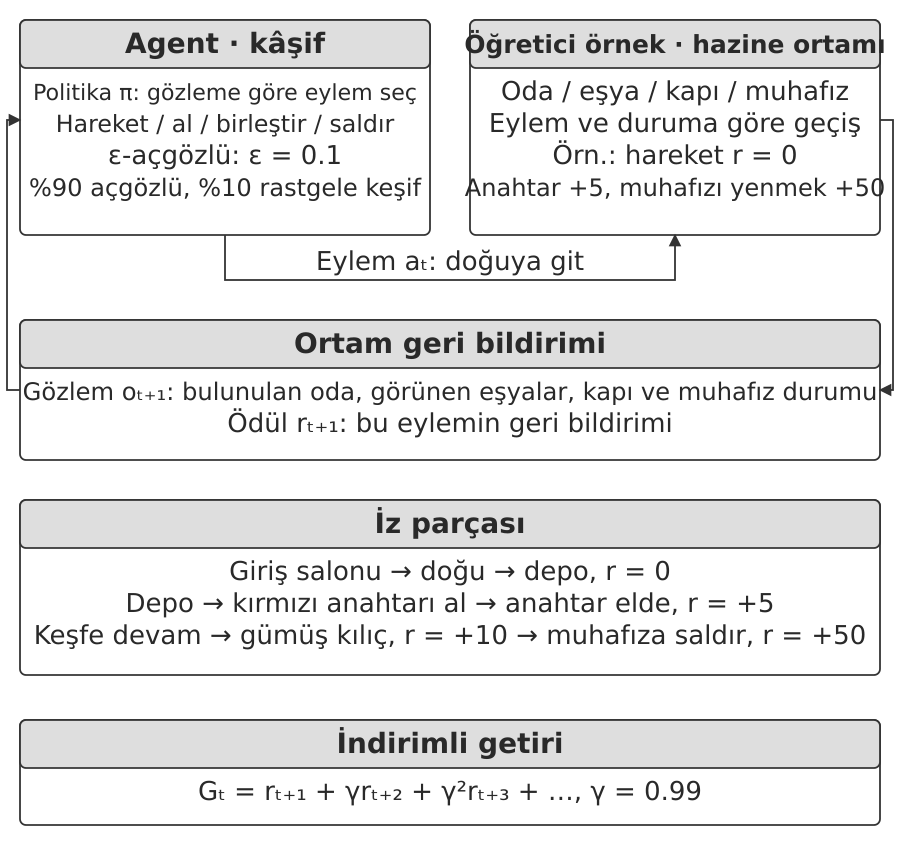

Sürekli etkileşim bir **iz** oluşturur; iz adım adım gözlemleri, eylemleri, ödülleri ve sonlandırma bilgisini içerir; eğitim sistemi ortam durumuna erişebiliyorsa onu da kaydedebilir. Politika nasıl davranılacağına karar verir, **değer fonksiyonu (Value Function)** ise şunu kestirir: mevcut durumdan başlayıp bir politikaya göre devam edildiğinde gelecekte ne kadar getiri elde edilir?

Agent ile ortam arasındaki sınır, modellenirken seçilen sistem kapsamına bağlıdır. Bu kitapta model ve Harness Agent'ın içindedir; araç arayüzleri onu dış uygulamalara, cihazlara ve hizmetlere bağlar. Örneğin dosya değiştirme isteğini Agent önerir, dosya sistemi yazmayı yürütür, araç da yürütme sonucunu Agent'a geri verir.

Öğrenme sırasında fırsatlar **keşif ve kullanım (Exploration–Exploitation)** arasında dağıtılmalıdır. Keşif politikayı henüz tanımadığı eylemlere açık tutar, kullanım o an en iyi görünen eylemi seçer. Gecikmeli ödüllü görevlerde ayrıca erken adımlardan hangilerinin nihai sonucu doğurduğuna karar vermek gerekir; bu, ileride tartışılacak kredi atama sorunudur.

Bir RL yöntemini anlamak için önce beş şey kontrol edilebilir:

- **Eylem uzayı**: Neyin üretilmesine izin verilir? Satrançta ayrık hamleler, robot denetiminde sürekli eklem hedefleri kullanılabilir; eylemler ayrıca durum, fiziksel aralık ve yetkiyle kısıtlanabilir.
- **Politika**: Duruma, gözleme ya da geçmişe göre eylem seçme kuralı. Bir tablo da olabilir, bir sinir ağı da.
- **Ödül sinyali**: Eğitim hedefinin hangi geri bildirimlerle ifade edildiği. Her adımın ödülü uzun vadeli getiriyi oluşturur; politika gelecekteki kazanç için bugünkü bedeli kabul edebilir.
- **Değer fonksiyonu**: Sonraki getiriyi kestirir, eylemleri karşılaştırmaya ya da politika güncelleme sinyali kurmaya yarar. Somut algoritma bunu açıkça öğrenip öğrenmeyeceğine karar verir.
- **Ortam modeli**: Eylemden sonraki durumu, gözlemi ya da ödülü tahmin eder. Modele dayalı yöntemler bilinen ya da öğrenilmiş ortam modeliyle planlar; model kullanmayan yöntemler politika ya da değeri doğrudan etkileşim verisinden öğrenir.

Tablo 8-3 bu kavramlardan ortamı, eylemi ve hedefi seçip tanıdık birkaç sistemi karşılaştırıyor. İlk iki satırı okurken "dengeyi korumak" ve "temizlenen alan"ı görevi modellerken seçebileceğimiz hedefler olarak düşünebilirsiniz.

Tablo 8-3 Farklı Agent sistemlerinin kilit öğelerinin karşılaştırması

| Agent türü | Dış ortam | Eylem temsili | Ödül ya da hedef örneği |
| --- | --- | --- | --- |
| Yeni doğmuş ceylan yavrusu | Arazi, yerçekimi ve beden dinamiği | Sürekli kas denetimi | Dengeyi korumak, düşmemek |
| Robot süpürge | Oda, zemin ve şarj altyapısı | Hareket, süpürme, şarja dönüş ve denetim parametreleri | Temizlenen alan, batarya ve çarpışma bedeli |
| Satranç Agent'ı | Tahta, rakip ve süre kuralları | Mevcut durumdaki yasal hamleler | Galibiyet +1, yenilgi −1, beraberlik 0 |
| Müşteri hizmetleri Agent'ı | Kullanıcı, iş veritabanı ve hizmet arayüzleri | Yanıt metni, sorgular ve iş çağrıları | Sorunun çözülmesi, süreç uyumu, işlem süresi |
| Kod asistanı Agent'ı | Gereksinim kaynağı, kod deposu ve yürütme ortamı | Arama, düzenleme, çalıştırma ve yanıt | Test sonucu, görev tamamlanması, regresyon ve maliyet |

Bu sistemlerin eylem temsilleri farklıdır. Satrançta genellikle adım adım tek bir ayrık eylem seçilir, robot belirtilen boyutlarda sürekli denetim değerleri üretir, LLM ise önce token dizisi üretir, arayüz bunu yanıta ya da araç çağrısına çevirir. İç hesaplama da politika modellemesine katılabilir; dış durumu gerçekten değiştiren araç yürütmesi ayrıca kaydedilir.

### İki eylem temsili: klasik RL düzeni ve LLM'in değişken uzunluklu politikası

**Markov karar süreci (Markov Decision Process, MDP)** karar problemini durum, eylem, geçiş ve ödülle betimler. Markov özelliği şunu şart koşar: mevcut durum ve eylem verildiğinde sonraki durumu ve ödülü tahmin etmek için geçmişe ayrıca bakmak gerekmez; tahminle ilgili tarihsel bilgi mevcut durumda zaten vardır. Şekil 8-2'de yalnızca oyuncunun bulunduğu odayı kaydetmek sorun çıkarır: aynı kapıya iki kez gelse bile kapıyı açıp açamayacağı anahtarı alıp almadığına bağlıdır.

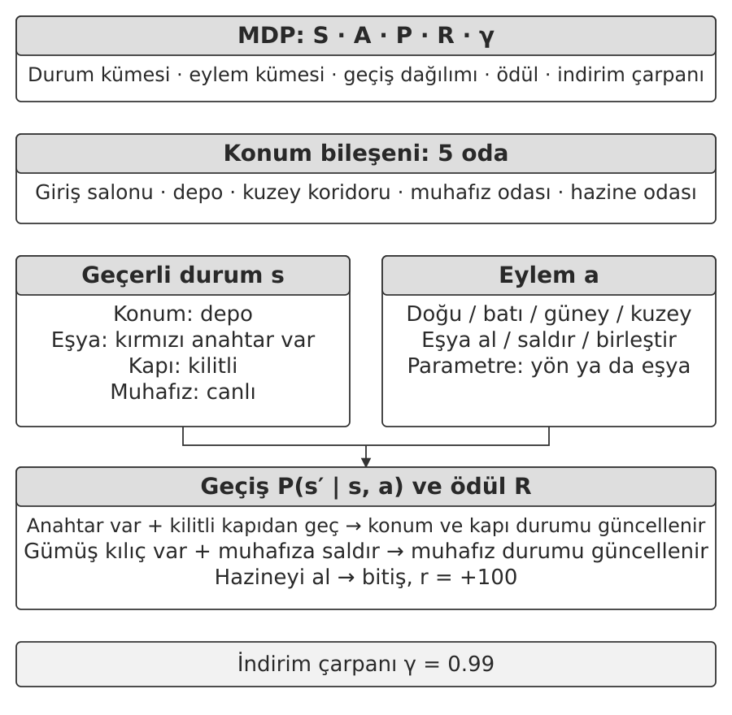

Satranç durum tasarımına bir örnek sunar. Taş konumlarının yanı sıra sıranın kimde olduğu, rok hakkı, geçerken taş alma hakkı ve elli hamle kuralı ile tekrar eden konumları belirlemek için gereken bilgiler de kaydedilmelidir. Bu içerik duruma katıldıktan sonra kurallar mevcut duruma göre yargılanabilir. Agent bunların yalnızca bir kısmını görebiliyorsa geçmişten bilgi tamamlamalı ya da kısmi gözlemlenebilir bir modelleme kullanmalıdır.

MDP ayrık, sürekli ve bileşik eylemleri barındırabilir. Go'da 361 kesişim noktası vardır ve pas ile yasallık da düşünülmelidir; Atari oyunları genellikle az sayıda ayrık işlem sunar; robot denetim değerleri eklemler, tutucu ve fizik kısıtlarıyla tanımlanır. Durum ve eylem sayısı azken değerler doğrudan tabloyla saklanabilir. Ölçek büyüdüğünde fonksiyon yaklaşımı, politika optimizasyonu ve arama ayrı çözümler sunar.

**Tablolu Q-learning: eylem değerini tek adım geri bildirimle güncellemek.** $Q(s,a)$, $s$ durumunda $a$ eylemi alındıktan sonraki getiriyi kestirir. En iyi eylem değeri Bellman en iyilik denklemini sağlar:

$$
Q^*(s,a)=\mathbb E\left[r+\gamma\max_{a'}Q^*(s',a')\mid s,a\right]
$$

Burada $r$ bu adımın ödülü, $s'$ sonraki durum, $\gamma$ ise indirim faktörüdür. Sürekli görevlerde genellikle $0\leq\gamma<1$ alınır; bitişi net ve getirisi sınırlı görevlerde 1 de olabilir. Büyük indirim faktörü uzak ödüllere daha çok ağırlık verir. Mevcut andan hesaplanan getiri $G_t=\sum_{k\geq0}\gamma^k r_{t+k+1}$'dir.

Bir etkileşimden $r$ ve $s'$ elde edildikten sonra Q-learning şu güncellemeyi yapar:

$$
Q(s,a)\leftarrow Q(s,a)+\alpha\left[r+\gamma\max_{a'}Q(s',a')-Q(s,a)\right]
$$

$\alpha$ öğrenme oranıdır; köşeli parantez içi "bir adım ödül artı indirimli sonraki değer" ile mevcut kestirim arasındaki farktır. Görev son duruma ulaştığında sonraki değer 0 alınır. Eşlik eden oyunda bir kez deneyin: rastgele bozulmayı kapatın, girişten doğuya yürüyün, sonra depoda kırmızı anahtarı alın. Anahtarı almak 5 puan verir, her adım 0,5 puan düşer; bu eylemin döndürdüğü $r$ 4,5'tir. Tabloda "depoda anahtar al" için eski kestirimin 0,25 olduğunu, anahtar alındıktan sonra seçilebilir eylemlerin en yüksek Q değerinin 0,63 olduğunu varsayalım. $\gamma=0.99$, $\alpha=0.2$ alınırsa tek adım hedefi $4.5+0.99\times0.63=5.1237$'dir. Eski kestirim bu hedefe beşte bir oranında yaklaşır ve 1,22474 olarak güncellenir. Kestirimi gerçek tek adım geri bildirimiyle düzelten bu yönteme **zamansal fark öğrenmesi (Temporal-Difference Learning, TD)** denir.

Bir durumdaki eylemlerin Q değerleri yan yana konduğunda o an en iyi görünen eylem seçilebilir. Şekil 8-3 basitleştirilmiş bir ızgara dünyasında bu politikayı çiziyor. Her karenin sayısı normalize edilmiş durum değerini gösterir. Sayıları elinizle kapatıp yalnızca oklara bakarsanız sol üstten hazineye yürüyebilir misiniz?

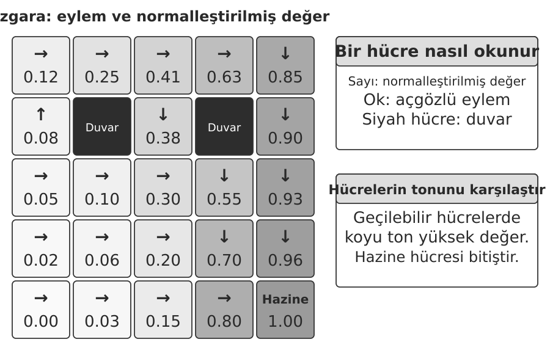

Bir sonraki keşif okların yönünü değiştirebilir. Şekil 8-4 az önceki kırmızı anahtar hesabını parçalara ayırıyor: bu adımda alınan ödül "depoda anahtar al" kestirimini değiştirir, tablodaki diğer durumların Q değerleri kendi güncellemelerini bekler.

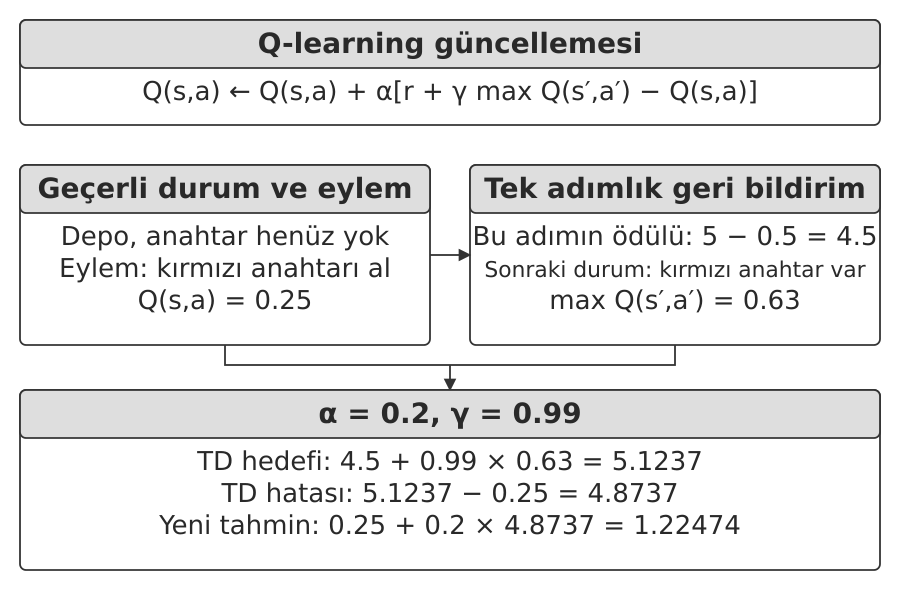

Q-learning'in davranış politikası rastgele keşif içerebilir, ama güncelleme hedefi sonraki durumun en yüksek eylem değerini kullanır; bu yüzden **politika dışı (Off-Policy)** öğrenmedir.

> **Deney 8-1 ★: Hazine avı oyununda Q-learning'in performansı**
>
> Hazine avı oyununda anahtar ve kapı, silah etkileri ve eşya birleştirme gibi gizli kurallar vardır. Oyunu bitirmek birkaç adımın sırayla tamamlanmasını gerektirir; en iyi yol 11 adımdır. Kilit eylemler ve zafer ödül verir, diğer adımların geri bildirimi azdır.
>
> Bu eğitimde öğrenme oranı 0,2, indirim faktörü 0,99, keşif oranı ε 1,0'dan 0,1'e kademeli düşürüldü. Tablolu Q-learning ε-açgözlü keşif kullanır: her adımda ε olasılıkla kullanılabilir eylemlerden biri rastgele seçilir, diğer durumlarda o an en yüksek Q değerine sahip eylemlerden biri. Her aşamada kazanma oranı, ziyaret edilen durum sayısı ve bitirme adım sayısı kaydedildi.
>
> Deneyin eğitim ve değerlendirme kayıtlarını okurken iki soruyu ayırın: eğitim sırasında rastgele keşif içeren politika hazineyi ilk kez ne zaman buldu? Eğitimden sonra Q tablosu sabitlenip açgözlü politikayla davranıldığında oyun kararlı biçimde bitirilebiliyor mu? Birincisi modelin yolu nasıl bulduğunu, ikincisi öğrenilen değere göre eylemi seçip seçemediğini sınar.
>
> Daha önceki bir eğitimde ilk 1000 oyunda oyun bitirilemedi; Q tablosu 124 durum içeriyordu. 5000. oyunda hâlâ kararlı kazanç yoktu, durum sayısı 133'tü; 7000–8000. oyunlar arasında kazanma oranı %34'ten %96'ya çıktı; 10000. oyunda %100'e ulaştı, Q tablosu 145 durum içeriyordu ve 11 adımlık yol bulunmuştu.
>
> İlk dönemde neden ilerleme yokken sonradan kazanma oranı hızla yükseldi? Keşif önce kilit eylemleri ve yolu bulur; sonraki ziyaretler sonuç getirisini adım adım önceki durumlara yayar. Küçük simülasyonun tamamı yaklaşık 10 saniye sürdüğü için çok sayıda tekrar etkileşimi kaldırabiliyor.
>
> Çözümlerken hesaplama süresini ve etkileşim sayısını birlikte kaydedin. Oyunda bir eylem çok ucuzdur; tarayıcı, telefon ya da fiziksel cihaz olsaydı bir etkileşim bekleme, ücret ve durum değişimi de içerirdi. Tablo ayrıca somut durum kodlamasına bağlıdır; kurallar ya da harita değiştiğinde mevcut değerlerin hâlâ geçerli olup olmadığı yeniden kontrol edilmelidir. Sonraki deney ön eğitim bilgisinin keşif başlangıcını nasıl değiştirebildiğini karşılaştıracak.

**Ön eğitilmiş LLM: hesaplamayı ve eylemi dille ifade etmek.**

LLM bir aracı çağırmadan önce ara hesaplama üretebilir, çağrıyı doğrudan da verebilir. İkisi de token dizisiyle temsil edilir, ama işlevleri farklıdır: ara hesaplama modelin sonraki context'ini değiştirir, araç çağrısı yürütüldükten sonra dış ortamı değiştirir ya da okur. Eğitimde bu çıktılar protokole göre kaydedilip görev sonucu ve hesaplama maliyetiyle değerlendirilebilir. "Ne kadar düşünmek, neyi düşünmek, aracı ne zaman çağırmak" böylece aynı politikanın öğrenebileceği seçimler hâline gelir; ilerideki AdaptThink tam da akıl yürütme bütçesi etrafında döner.

Değişken uzunluklu diziler çok daha geniş bir bileşim alanı yaratır. Model sorgu, program, JSON parametreleri ve çok adımlı türetmeler yazabilir; dizi uzunluğu bütçe ve context ile sınırlıdır. Ön eğitim aramaya bir başlangıç noktası sağlar: matematik malzemeleri sık sık koşul analizi ve hesap içerir, kod ve tartışmalar ise konumlandırma, değişiklik ve doğrulama içerir. Model bu yapıları ödünç alarak aday yollar üretebilir, sonra ortam geri bildirimine göre ayarlar. Mevcut bilgi yararlı eylem bileşimlerinin baştan itibaren daha kolay örneklenmesini sağlar ve çok sayıda ilgisiz yolda kör deneme yanılma ihtiyacını azaltır.

Örneğin "yabancı para tutarını dolara çevir" işi döviz kurunu almayı ve hesap yapmayı gerektirir. Ön eğitim modelin böyle ilişkili adımları daha kolay üretmesini sağlar; sonradan eğitim ise kurun kaynağına, hesap sonucuna ve görev kısıtlarına göre yolun olasılığını daha ileri düzeyde ayarlayabilir. Dil bilgisi burada başlangıç politikasını, ödül ise görev geri bildirimini sağlar.

Şekil 8-5 bu kısımdaki iki düzeni karşılaştırıyor: tablolu Q-learning belirtilen durum kodlamasından ve keşif kurallarından başlar, LLM Agent ise ön eğitilmiş dil politikasından başlar ve araç gözlemleriyle geçmiş deneyimi context aracılığıyla düzenler.

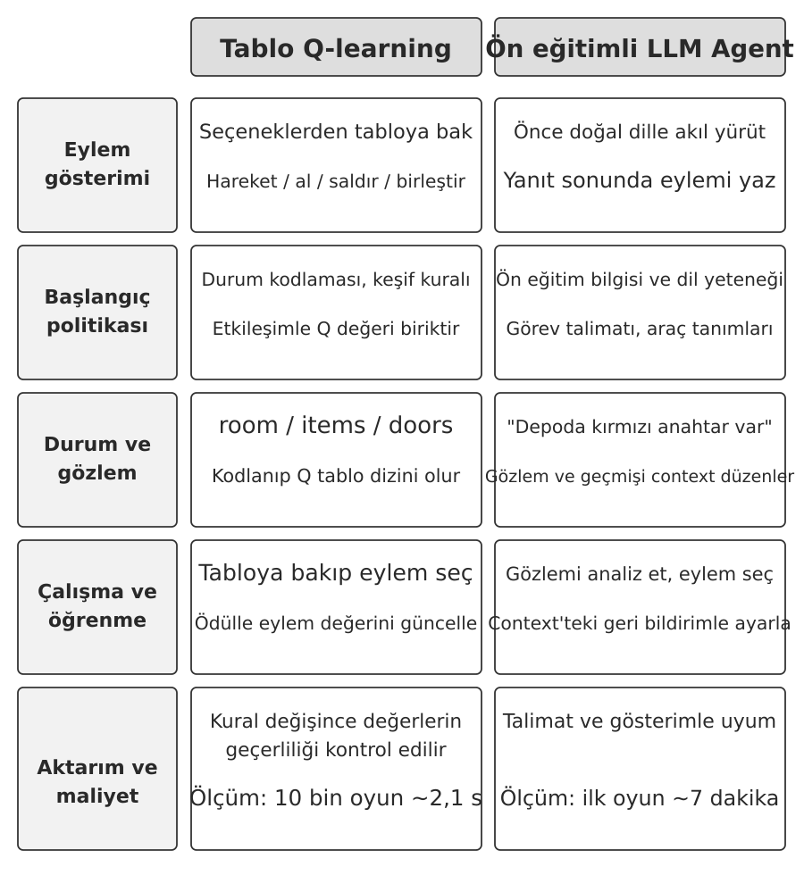

Ön eğitim ayrıca modelin yeni talimatları yorumlamasını ve az sayıda gösterimle görev davranışını ayarlamasını sağlar. Araçlar dil çıktısını aramaya, kod yürütmeye ve iş işlemlerine bağlar. Bu tür Agent tasarlanırken hem araç arayüzleri ve yürütme yetkileri belirlenmeli hem de görev sonucu, çalışma maliyeti ve kilit süreçler için geri bildirim kurulmalıdır.

Model bir robot kolunu denetleyecekse "sonraki token'ı tahmin et" nasıl eyleme dönüşür? OpenVLA yaklaşık 970 bin gerçek robot gösterimi kullandı. Gösterimlerden bir adım alalım: girdi o andaki kamera görüntüsü ve görev talimatı, eğitim hedefi gösterenin ardından yaptığı eylemdir. Örneğin kolun yatay yönde ne kadar hareket edeceği aslında sürekli bir sayıdır. OpenVLA her eylem boyutunu 256 kademeye bölüp hangi kademeye düştüğünü tek token'la gösterir. Böylece model eylem token'larını tek tek tahmin edebilir ve kaybı yalnızca bu konumlarda hesaplar.[^ch8-21]

Bu örnek davranış klonlama ile pekiştirmeli öğrenmeyi ayırmanın yolunu da verir: modeli hangi sinyal günceller? OpenVLA gösterim kayıtlarından öğrenir; modelin gösterilen eylem token'ına verdiği olasılık yükseldikçe kayıp düşer, bu denetimli ince ayardır. Deney 8-13'teki SimpleVLA-RL'de ise politika ortamda eylemleri gerçekten dener, sonra görev ödülüne göre sonraki seçimlerini ayarlar.

> **Algoritmadan ortama, ortamdan önsele**
>
> Yao Shunyu *The Second Half* yazısında RL'in gelişimini algoritma, ortam ve önsel üzerinden gözden geçirir.[^ch8-2] Yazar buna dayanarak ilgi odağının değişimini üç aşamada özetliyor: 2015–2016 algoritmayı iyileştirmeye, 2016–2018 ortam inşasına daha çok ağırlık verildi; 2018'den itibaren ön eğitim önsellerinin değeri adım adım anlaşıldı. Gym birleşik ortam arayüzü sağladı; Universe ve World of Bits bilgisayar ve web görevlerini araştırdı; Dota 2 gibi projeler karmaşık ortamlarda eğitim yeteneğini gösterdi. Ardından GPT-2 ve GPT-3 dil ön eğitiminin biriktirdiği bilgiyi ve ifade yeteneğini sergiledi; WebGPT, ChatGPT gibi sistemler bu başlangıç noktasından daha ileri düzeyde yararlandı. Görevin gerektirdiği önsel önce dil modellemesiyle elde edilebilir, sonra RL somut davranışı iyileştirir.
>
> Yazar buradaki mühendislik önceliğine katılıyor: **önsel, ortam, algoritma.** Önce modelin hangi bilgi ve yeteneklere sahip olduğu kontrol edilir, sonra uygun ortam ve geri bildirim kurulur, en sonunda buna uyan optimizasyon yöntemi seçilir. Şekil 8-6 araştırma ilgisinin ortaya çıkış sırasına göre dizilmiştir; proje yaparken sıra tersine çevrilip mevcut yetenekten başlanabilir.
>
> 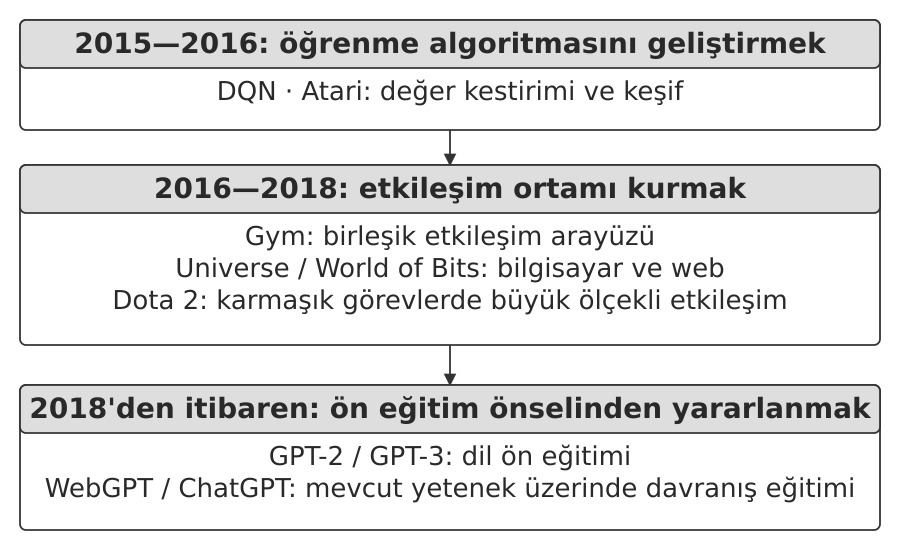

> **Deney 8-2 ★★: Geleneksel RL ile LLM Agent'ın karşılaştırmalı incelenmesi**
>
> Aynı hazine avı oyununda tablolu Q-learning ile LLM Agent'ı karşılaştırın. LLM yapılandırması Kimi K3 kullanır ve context'te en fazla 50 deneyim tutar. İkisi de her adımda ortamın verdiği seçilebilir eylemlerden birini seçer. Şekil 8-7'deki iki yolu izleyerek Q tablosunun ve dil modelinin bu seçimi nasıl yaptığını görebilirsiniz.
>
> 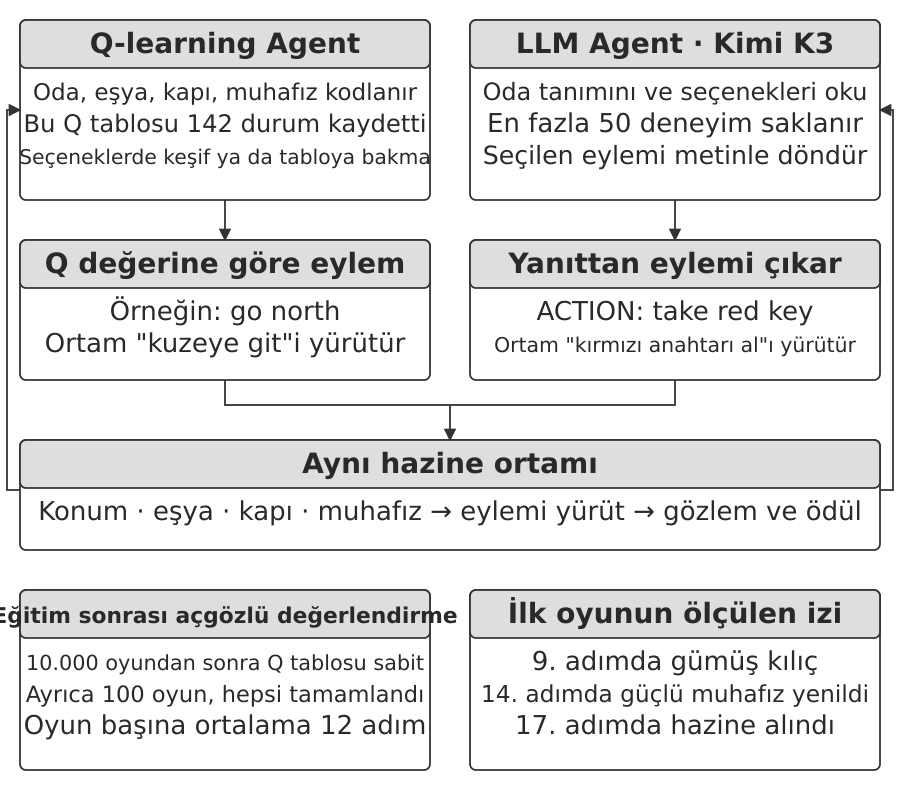
>
> Eşlik eden Kimi K3 çalıştırma kaydında Agent ilk oyunu 17 adımda bitirdi. Önce paslı kılıcı aldı, kuzey kapısının kilitli olduğunu gördü, depoya geçip kırmızı anahtarı ve sihirli kristali aldı, 9. adımda kılıçla kristali gümüş kılıca birleştirdi. 12. adımda anahtarı kullanmayı denediğinde ortam "gerektiğinde otomatik kullanılır" dedi; 13. adımda kuzeye yürüdüğünde kapı gerçekten açıldı. 14. adımda muhafızı gümüş kılıçla yendikten sonra kılıcı bir daha kullanmayı denedi, ortam bu anda kullanılamayacağını bildirdi. 17. adımda hazineyi aldı. Bu kaydı okurken bir sonraki satırı kapatıp mevcut geri bildirime göre hangi adımın hâlâ gerekli olduğunu tahmin edebilirsiniz.
>
> Her eylemi o andaki gözlemle hizalayarak modelin "anahtarla kapı açılır", "silah muhafıza karşı kullanılır" gibi mevcut bilgisini nasıl kullandığını ve araç geri bildiriminin sonraki planı nasıl değiştirdiğini çözümleyebilirsiniz. Tablolu çözüm bu ilişkileri durum–eylem ziyaretleriyle biriktirir.
>
> Bu karşılaştırmada Q-learning 10000 oyunu 2,12 saniyede eğitti, sonra açgözlü politikayla ayrıca 100 oyun değerlendirildi; hepsi tamamlandı, ortalama 12 adım. Kimi bir oyunda modeli 17 kez çağırdı ve 6 dakika 56 saniye sürdü. Yazar bundan şu seçim ilkesini çıkarıyor: simülasyon ucuz ve çok tekrarlanabilir olduğunda geleneksel RL'in keşfinden tam olarak yararlanılabilir; her etkileşim bekleme, ücret ya da gerçek işlem bedeli getiriyorsa mevcut bilgiden yararlanabilen politika tercih edilerek her etkileşimin değeri yükseltilir.

Bu iki deney bölümü önceki mühendislik yöntemlerine bağlar: context bir çalıştırma içinde deneyimi düzenleyebilir, dış bellek deneyimi görevler arasında saklayabilir, sonradan eğitim ise parametre güncellemesiyle politikayı değiştirir. Aşağıda önce dil ve görsel ön eğitimin temel süreci tamamlanıyor, sonra somut eğitim verisi ve optimizasyon yöntemleri tartışılıyor.

## Model ön eğitimi temelleri `[isteğe bağlı okuma]`

Ön eğitim modelin başlangıç temsilini ve üretim dağılımını kurar; sonraki eğitimler bu başlangıç noktasından parametreleri ayarlamayı sürdürür. Bu başlangıç noktasını anlamak için önce küçük bir dil modelinin metinden nasıl öğrendiğine, sonra görsel girdiye nasıl bağlandığına bakılabilir.

Metin önce **token'lara ayırmayla (Tokenization)** ayrık token'lara dönüşür. Örneğin "programlamayı seviyorum" cümlesi "programlamayı", "seviyorum" gibi birimlere ayrılabilir; gerçek bölütlemeyi tokenizer belirler. Eğitim önceki token'ları context alıp sonraki token'ı tahmin eder, kaybı hesaplar ve parametreleri günceller. Şekil 8-8'de önce eğitim cümlesini "gerçek" sözcüğünden sonrasını görmeyecek biçimde kapatın, bir sonraki parçayı ("ortamda") tahmin edin, sonra özgün metni açın. Bu konum bir ileri kaydırıldığında bir sonraki tahmin sorusu elde edilir.

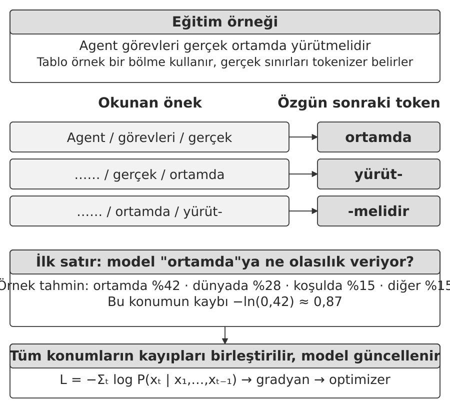

Temel dil modellemesinin ardından talimat gösterimleri eklenerek yanıt biçimi ve görev davranışı öğretilebilir; tercih verisi de kullanılarak DPO gibi yöntemlerle daha çok onaylanan yanıtların olasılığı artırılabilir.

> **Deney 8-3 ★★: Sıfırdan LLM eğitmek — algoritma iyileştirmesinin gücü**
>
> Yaklaşık yüz milyon parametreli MiniMind 2 ile tüketici düzeyi bir GPU'da ön eğitimi, SFT'yi ve tercih optimizasyonunu tamamlayın. Temel çizgi ile QK Norm ve Muon optimize edicisinin eklendiği yapılandırmayı karşılaştırarak kayıp düşüşünü, hedef kaliteye ulaşma süresini ve üretim sonuçlarını gözlemleyin. Eşlik eden özet yaklaşık 3 kat yakınsama hızı artışı kaydetti; tam eğitim yaklaşık 14 saat ve yaklaşık 34 dolar tuttu.
>
> QK Norm dikkat mekanizmasındaki sorgu ve anahtarların sayısal ölçeğini ayarlar, Muon ise ilgili parametrelerin optimizasyon güncelleme biçimini değiştirir.
>
> Aynı soru kümesini aşamalı olarak gözlemleyin: ön eğitilmiş model "dünyanın en yüksek dağı" gibi soruları yanıtlayabiliyordu; SFT'den sonra talimat izleme ve çıktı düzeni iyileşti; tercih optimizasyonu olgusal yanıtları ve ifadeyi etkilemeyi sürdürdü.

> **Deney 8-4 ★★: Kendi VLM'inizi eğitmek**
>
> Şekil 8-9 "görsel kodlayıcı—izdüşüm katmanı—dil modeli" bağlantısını gösteriyor. CLIP gibi bir görsel kodlayıcı görüntü özelliklerini çıkarır, izdüşüm katmanı özellikleri dil modeli girdisinin gerektirdiği boyuta ve temsile dönüştürür, dil modeli bu girdilerle betimleme ya da yanıt üretir.
>
> 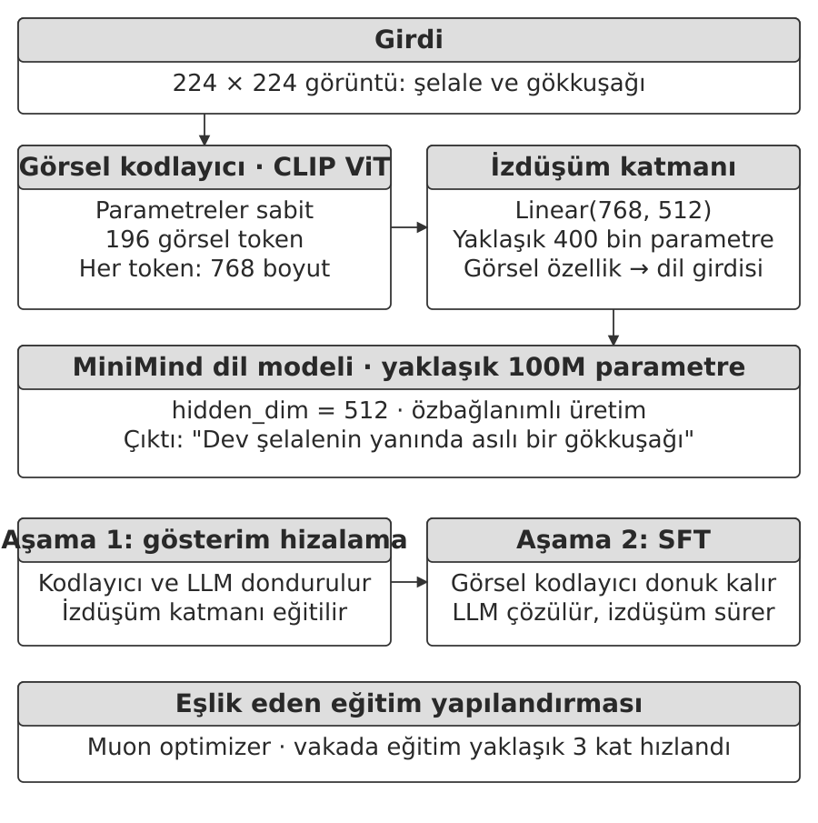
>
> Birinci aşamada görsel kodlayıcı ve LLM dondurulur, yeni eklenen izdüşüm katmanı eğitilir ve görüntü özelliklerinin dil tahminine katılması sağlanır; ikinci aşamada yapılandırmaya göre LLM çözülür ve yüksek kaliteli görüntü–betimleme ya da soru-cevap verisiyle SFT yapılır. Nesne tanıma, ayrıntı betimleme, ilişki yargısı ve dil yeteneğindeki değişim ayrı ayrı gözlenir.
>
> Bu mimari mevcut görsel ve dil modellerini yeniden kullanır; önce kipler arası bağlantı modülünü eğitmeye odaklanmak, bütçe sınırlıyken öncelikle denenmeye değer bir çözümdür. Dondurulmuş ağırlıklar eğitilebilir durumu azaltır; sonraki aşamada göreve göre ilgili modüller çözülür. Betimleme yanlışsa önce nesne bilgisinin görsel temsile girip girmediği kontrol edilir; bilgi varsa ama model kullanamıyorsa izdüşüm katmanının ifade kapasitesi, hizalama verisi ve dil üretimi denetimi incelenmelidir. Çıktı ayrıca eylem temsiline çevrilip denetim arayüzüne hizalanırsa Bölüm 6'daki VLA mimarisine bağlanır.

İki deney optimizasyon yapılandırmasının ve kipler arası bağlantının eğitimi nasıl etkilediğini gösteriyor. Bütçe kısıtlıyken yazar önce algoritma ve mimari iyileştirmelerinin kazancını karşılaştırmayı, sonra model ölçeğini büyütmeye karar vermeyi öneriyor. Mevcut bir model yeni bir dile ya da alana girerken ön eğitim ağırlıklarından öğrenmeyi sürdürebilir; sonraki kısım bu eğitim için verinin nasıl seçileceğini tartışıyor.

## Mid-training: bilgi ve temel yetenekleri tamamlamak

Bu bölümdeki **Mid-training**, mevcut bir model üzerinde hedef dağılım etrafında bir aşama daha dil modeli eğitimi yapmayı ifade eder. Belgelerdeki, koddaki ya da türetmelerdeki çok sayıda token denetime girer; eğitimde hedef alanın derlemi genel derlemle karıştırılabilir. DAPT/TAPT çalışmaları alana ya da göreve ilişkin derlemle sürekli ön eğitimin alt görevlere katkısını göstermiştir.[^ch8-30]

Veri seçimi iki tür açıktan başlar. Biri bilgi ve dil kapsamıdır; örneğin model şirket sözleşmelerine, hedef dilin terimlerine ya da belirli bir kod deposuna az maruz kalmıştır. Diğeri görevin gerektirdiği temel yeteneklerdir; örneğin uzun context'te durumu izlemek, belgeler arası ilişkileri birleştirmek ya da uzun kod türetmelerini tamamlamak. Önce hata türüne göre anlama, bilgi, biçim ve eylem sorunları ayrılır, sonra tamamlanacak malzemeye karar verilir.

Alan metinlerindeki kayıp düştükten sonra modelin öğrendiği bilgiyi gerçek görevlerde kullanıp kullanamadığı da kontrol edilmelidir. Sürekli eğitim ile talimat eğitiminin sırası, soru-cevap düzeni ve malzemenin biçimi bilginin kullanımını etkiler.[^ch8-31] Temel yeteneğin belirgin biçimde eksik olduğu alan görevlerinde yazar önce alan derlemiyle kapsamı artırmayı, sonra SFT gösterimleriyle modelin bu bilgiyi görevde nasıl kullanacağını öğretmeyi öneriyor; model kimi zaman doğru yapabiliyor ve yalnızca başarı oranı düşükse RL devreye alınır.

### Mid-training verisi nasıl kurulur

**Birinci adım: gereken malzemeyi başarısızlık dağılımından belirlemek.** Konu, dil, belge türü, kod kalıbı ve context uzunluğu eksenlerinde ayrı ayrı değerlendirme yapın; Pass@1, Pass@k ve hata örnekleriyle modelin hangi koşullarda kullanılabilir çözümden yoksun olduğuna karar verin. Parametre biçimi sorunları arayüz gösterimleriyle ele alınabilir; alan kavramları ve ilişki açıkları ise ilgili derlem gerektirir.

**İkinci adım: yüksek yoğunluklu derlem düzenlemek.** Özgün belgeler terimleri ve olgu ilişkilerini, kod depoları modül yapısını ve bağımlılıkları sağlar; ders kitabı tarzındaki türetmeler ve sentetik açıklamalar örtük adımları açar, belgeler arası örnekler dağınık bilgiyi birleştirir. Kalite süzmesi, yinelenenlerin ayıklanması ve değerlendirme kümesinin ayrılmasından sonra eğitim dizileri kurulur.

**Üçüncü adım: veriyi hedef yeteneğe göre karıştırmak.** Doğal uzun metin kitaplardan, belgelerden ve kod depolarından gelebilir; getirme, çok atlamalı akıl yürütme, talimat izleme, toplama ve istatistik için türetmeli görev verisi eklenebilir; Agent için plan, araç seçimi, parametre kurma, durum izleme ve hata kurtarma izleri eklenebilir. Bu malzeme mevcut veri kümelerinden ya da öğretmen modellerden gelebilir; eğitime girmeden önce içerik ve davranış gereksinimlerine göre süzülür.

**Dördüncü adım: modelin önceden yapabildiği görevleri de çalıştırmasını sağlamak.** Bir örnek grubu kısa metin, genel derlem ve özgün soruları sürdürür; diğeri aynı görevleri daha uzun context'e yerleştirir, kilit bilginin konumunu değiştirir ve çeldiriciler ekler. Bu iki grubu harmanlarken mevcut eğitim verisinin dağılımına bakılabilir; FineWeb-2 gibi açık derlemlerle birkaç oran denenip sonuç değerlendirmeye göre ayarlanabilir.

**Beşinci adım: birden çok ölçütle sürdürmeye ya da durmaya karar vermek.** Eğitim kaybını, ayrılmış alan görevlerini, genel yeteneği, mevcut talimat izlemeyi ve hedef görev başarı oranını birlikte kaydedin. Alan puanı artarken genel yetenek düşüyorsa karışım oranı, öğrenme oranı ve eğitim miktarı karşılaştırılır; kayıp düşerken hedef görev duraklıyorsa eğitim malzemesinin bu görevi öğretip öğretemeyeceği ve gerçek görevde bilgi kullanımı gösterimlerinin gerekip gerekmediği kontrol edilir.

Modelin çok uzun sipariş günlüklerinden belirtilen sipariş numarasını bulabildiğini varsayalım. Soru "hangi müşteri birkaç kez sipariş verip hepsini iptal etti" olarak değişirse aynı müşterinin siparişlerini eksiksiz bulmak, siparişleri iptal kayıtlarıyla tek tek eşlemek gerekir. İki soru aynı günlüğü kullanabilir, ama ölçtüğü yetenek farklıdır. RULER sentetik görevlerle girdi uzunluğunu ve görev zorluğunu ayrı ayrı denetleyerek tek kayıt getirme, çok atlamalı izleme ve toplamayı ölçer. Yazarlar 17 modeli değerlendirdi; birçok model basit getirmede neredeyse tam puana yaklaştı, ama girdi uzadıkça genel performans belirgin biçimde düştü.[^ch8-ruler]

Bu farkın gerçek malzemede de görülüp görülmediğini anlamak için LongBench v2'nin çok belgeli, uzun konuşmalı ya da kod depolarına dayalı soruları kullanılabilir. Modelin çıktı biçimi gibi gereksinimleri hatırlayıp hatırlamadığını ayrıca kontrol etmek için IFEval'deki doğrulanabilir talimatlar uzun malzemenin farklı konumlarına yerleştirilebilir. İki model karşılaştırılırken ikisinin de gördüğü talimat konumları ve çeldirici içerik aynı olmalı ve bunun kendi kurduğunuz bir test olduğu belirtilmelidir. En sonda uçtan uca Agent görevleriyle bu yeteneklerin birlikte çalışıp çalışmadığı kontrol edilir. Değerlendirme kümesi tasarlanırken aşağıdaki boyutlar tek tek kontrol edilebilir.[^ch8-longbench]

[^ch8-ruler]: Hsieh ve arkadaşları, RULER, 2024.
[^ch8-longbench]: Bai ve arkadaşları, LongBench v2, ACL 2025. Makale altı görev türünde toplam 503 çoktan seçmeli soru verir.

- **Konum ve getirme**: Tek ya da birkaç kilit bilgi başlangıçta, ortada ve sonda dururken bulunabiliyor mu?
- **İlişki ve akıl yürütme**: Paragraf ve belgeler arası ilişki izleme, çelişki giderme ve kanıt birleştirme.
- **Toplama ve istatistik**: Uzun tablo ve günlüklerde sayma, gruplama, sıralama, karşılaştırma ve eğilim çıkarma.
- **Talimat izleme**: Birden çok gereksinim, çakışma yönetimi, akış koşulları ve çıktı biçimi.
- **Uzun zincirli akıl yürütme**: Matematik, mantık ve kod görevlerinde daha uzun bağımlılık zincirleri.
- **Agent temel davranışları**: Görev ayrıştırma, araç seçimi, parametre üretimi, durum koruma ve hatadan kurtulma.

Uzun akıl yürütme ve çok turlu araç çağrıları context'i sürekli uzatır; önceki talimatlar, olgular ve görev durumu sonraki kararlara katılmayı sürdürmelidir. Model uzun metinde bilgiyi bulamıyor ya da kısıtları koruyamıyorsa uzun soluklu Agent güvenilir çalışamaz. Eğitim bütçesi büyütülmeden önce küçük ölçekli yapılandırmalarla veri oranları ve eğitim miktarı karşılaştırılmalıdır. Sık güncellenen ve kaynak gerektiren olgularda yazar önce RAG'i kullanır; kararlı ve büyük ölçekli alan bilgisi ile temel yetenekler için parametrelere yazmayı düşünür.

> **Deney 8-5 ★★: Sürekli ön eğitimle yeni bir dil öğrenmek**
>
> Mistral 7B v0.3'ten başlayıp Korece Wikipedia ve benzeri malzemeyle Korece yeteneğini artırın. Eğitimde önce yaklaşık %80 Korece, %20 İngilizce karışım kullanın, sonra Korece talimat verisiyle SFT yapın; dil modellemesi ve diyalog davranışındaki değişimi ayrı ayrı gözlemleyin.
>
> Korece veri hedef dilin kapsamını artırır, İngilizce veri mevcut yetenekleri korumaya yarar. Her aşamada eğitime katılmamış aynı Korece ve İngilizce soru kümesi kullanılır. Eşlik eden sonuçlarda Korece son aşamasının kör puanı iyileşti, İngilizce yetenek bir miktar düştü; bu, sonraki turda daha çok İngilizce malzeme karıştırmak ya da güncelleme yoğunluğunu düşürmek için somut bir yön verir.
>
> Hedef dili, mevcut dili ve olgu kalitesini ayrı ayrı kaydetmek kazancı ve bedeli görünür kılar; SFT aşamasında modelin Korece talimatlarla yanıt düzenleyip düzenleyemediği de kontrol edilir. Böylece sürekli ön eğitim ile talimat ince ayarının etkisi ayrı ayrı gözlenebilir.

## SFT (denetimli ince ayar)

Alan derlemi modelin bir arayüzü birkaç kez daha görmesini sağlar; ama çağrı başarısız olduktan sonra parametreyi nasıl düzelteceğini öğretmek için bunu doğrudan bir kez göstermek de mümkündür. SFT görev girdisi verip modeli gösterimdeki yanıtı ya da eylemi token token üretmeye eğitir. Şekil 8-10'a bakarken önce hangi davranışın öğretileceğini netleştirin, sonra gösterimin nasıl toplanacağına karar verin. Gösterimdeki olgular, üslup ve çıktı biçimi de eğitime birlikte girer.

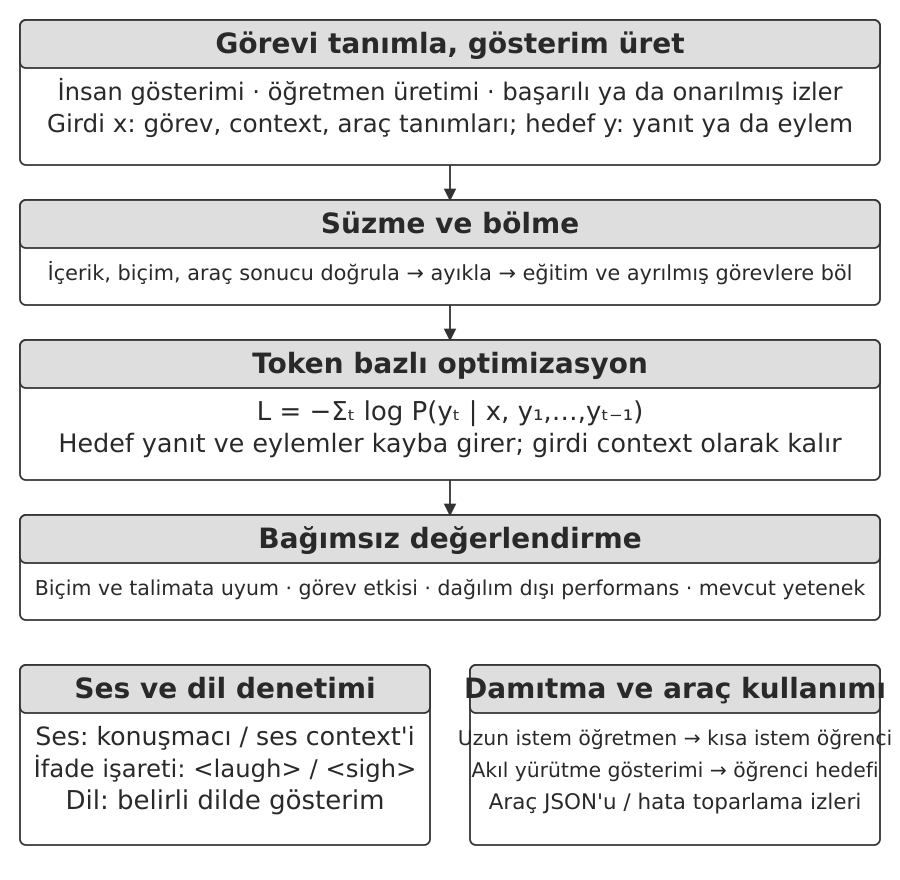

Veri genellikle üç yoldan gelir: insan uzmanlar kilit davranışları ve sınırları tanımlar, öğretmen modeller gösterimleri toplu yazar, doğrulayıcılar model örneklerinden geçerli çıktıları süzer. Üçü birleştirilebilir. Örneğin önce uzmanlar az sayıda araç çağrısı gösterimi yazar, sonra öğretmen görev koşullarını değiştirerek daha çok örnek üretir, en sonda parametreler, yürütme sonuçları ve iş kısıtları kontrol edilir.

**SFT'nin bir kullanımı, prompt'lara ve Skill'lere tekrar tekrar yazılan davranışı modele öğretmektir.** Bölüm 7'deki bellek puanlamasını örnek alalım: puanlama el kitabı ve örnek kararlar toplam on bin token tutuyor olsun. Öğretmen tam el kitabına dayanarak bir grup yanıtı puanlar ve aynı adlı kişiler, ters kurulmuş ilişkiler ya da yetersiz kanıt durumlarında nasıl davranılacağını gösterir. Öğrenci eğitilirken girdide yalnızca kısa puanlama kalemi adları, o anki geçmiş malzemesi ve puanlanacak yanıt tutulur, hedef çıktı öğretmenin seçtiği düzeydir. Dağıtımda kısa bir prompt ve o anki malzeme yeterli olur; her çıkarımda o on bin token'lık sabit açıklamadan tasarruf edilir. Tekrar tekrar çağrılan Skill'ler için de aynı yöntemle ne zaman kaynak aranacağı ve aracın nasıl seçileceği gösterilip bu kararlı adımlar modele damıtılabilir.

Veri hazırlığında önce görev dağılımı, çıktı schema'sı ve kabul biçimi belirlenmelidir. Gösterimler kontrolden geçtikten sonra yinelenenler ayıklanır, örnek türlerinin oranı ayarlanır ve veri kümeleri bölünür. Örnek sayısı ile kapsam birlikte tasarlanmalıdır: aynı soru kalıbını binlerce kez tekrarlamak aynı kalıbı pekiştirir; kilit koşullar etrafında çeşitleme yapmak modelin farklı girdilerde uygun davranışı seçmesine yardım eder. Yazar önce kilit durumları kapsayan bir gösterim grubunu ince ince düzeltir, sonra ölçeği büyütür. SFT hedef çıktıyı token token öğrendiği için hatalı olgular, gereksiz adımlar ve uygunsuz çalışma alışkanlıkları da parametrelere girer.

> **Deney 8-6 ★★★: Ses SFT'si — ses klonlamadan paralinguistik modellemeye `[genişletme deneyi]`**
>
> Orpheus ve Sesame CSM örneklerinde konuşmacı koşulunun, diyalog context'inin ve ifade işaretlerinin ses üretimine nasıl katıldığını karşılaştırın. Orpheus sesi token olarak temsil eder, referans metin–ses parçasıyla ilgili tınıyı üretebilir ve `<laugh>`, `<sigh>` gibi ifade işaretleri sunar. Sesame CSM ise metni, konuşmacı tanımlayıcısını ve mevcut ses parçasını alıp sonraki sesi üretir.[^ch8-speech-conditioning]
>
> Eğitim örnekleri kurulurken metin, konuşmacı, ses ve ifade koşulları ayrı ayrı kaydedilir; aynı konuşmacının cümleler arası malzemesi tutarlılık öğrenmek, farklı bağlamlardaki gülüş, iç çekme ve duraklamalar ifade öğrenmek için kullanılır. Referanssız, referanslı ve belirtilen ifade koşullarındaki çıktılar karşılaştırılır, sonra doğruluk, doğallık, duygu ve tını puanlanır.
>
> Veri yeterli sayıda konuşmacıyı, cümle yapısını ve duygu bileşimini kapsamalıdır. Konuşmacı sayısı azsa çıktı tek tınıya kayabilir; bir işaret hep aynı ses parçasına bağlanırsa tekrarlanan ve mekanik ifadeler ortaya çıkabilir.

> **Deney 8-7 ★★★: Çok dilli düşünme — akıl yürütmeyi belirtilen dilde üretmek `[genişletme deneyi]`**
>
> gpt-oss-20b'ye SFT yaparak akıl yürütme sürecinin dilini talimatla belirtin. Örneğin `reasoning language: German` Almanca akıl yürütme metni üretilmesini ister. Eğitim örnekleri İngilizce, İspanyolca ve Fransızca dillerini kapsar, Çince test aşamasına bırakılır.
>
> Eşlik eden vakada eğitimden sonra Chinese belirtildiğinde model Çince akıl yürütme üretebildi. Üç sonuç daha ileri düzeyde karşılaştırılabilir: dil gereksinimine uyuluyor mu, nihai yanıt doğru mu ve üretim uzunluğu ile süre nasıl değişiyor? Bu diller arası performansa ön eğitimin çok dilli temeli ile SFT'de öğrenilen denetim biçimi birlikte katılır; farklı diller ve temel modellerle karşılaştırma yapılarak etkileri ayrıştırılabilir.

> **Deney 8-8 ★★: Prompt damıtma — kullanılabilir yeteneği daha düşük maliyetle yeniden üretmek**
>
> Kararlı bir iş süreci binlerce token'lık bir sistem prompt'una dayanıyor ve öğretmen ayrıca uzun akıl yürütme üretiyor olabilir. Prompt damıtmada önce öğretmen tam koşullarla yüksek kaliteli çıktı üretir, sonra "kullanıcı girdisi—nihai yanıt" çiftleri öğrenci için SFT verisi olur. Öğrenci daha kısa prompt kullanır ve hedef yapılandırmaya göre doğrudan yanıt verir.
>
> İlk eğitim örneğini açtığınızda görülüyor: Kimi K3 öğretmen, içine Latin harfleri karışmış Arapça bir metni okuyup yargısının dayanağını açıkladı ve sonunda dil kodunu `ar` olarak verdi. SmolLM2-135M-Instruct öğrencisine verilen gösterim yalnızca özgün metin ve `ar` içeriyordu. Aynı 80 test kaydında öğretmen tarafındaki istek ortalama yaklaşık 386 token, öğrenci tarafındaki yaklaşık 97 token okudu. Bu iki sayı kendi tokenizer'larıyla sayıldı.
>
> Eşlik eden dil tanıma karşılaştırma kaydı "doğru yanıtlama" ile "biçime uygun çıktı"yı ayrıştırmaya yarar. Öğretmen 160 eğitim örneğinde gösterim üretti, ayrıca 80 test kaydının hepsini doğru yanıtladı. İnce ayar görmemiş öğrencinin testte tek bir çıktısı bile puanlayıcı tarafından ayrıştırılamadı ve puanı sıfır oldu; ince ayardan sonra 80 kaydın hepsi ayrıştırılabildi, 76'sının etiketi doğruydu. Temel çizginin sıfır puanı tek başına "dili tanımadı" ile "tanıdı ama biçime uymadı"yı ayırt edemez. Bu test kümesi 75 farklı metin içeriyordu; eğitim ile test arasında tıpatıp aynı metin yoktu.
>
> Veri kurulumu öğrencinin görevi tamamlaması için gereken koşulları da korumalıdır. Öğretmen en güncel araç sonucuna dayanıyorsa ilgili sonuç öğrenci girdisine konabilir ya da araç arayüzü korunur; öğretmende sistematik hata varsa bağımsız doğrulamayla süzülür.
>
> Ürün kuralları kararlı, girdi dağılımı net ve çağrı maliyeti yüksekken yazar önce Prompt damıtmayı değerlendirmeyi, tekrar tekrar işlenen prompt'u ve akıl yürütmeyi parametrelere sıkıştırmayı öneriyor. Ürün hâlâ keşif aşamasındaysa ve görev gereksinimleri sık değişiyorsa düzenlenebilir prompt ve açık akıl yürütme korunmalıdır; hızlı deneme ve hatayı bulmak kolaylaşır.

> **Deney 8-9 ★★★: Düşünce zinciri (Chain of Thought, CoT) damıtma**
>
> CoT damıtma, öğretmenin verdiği akıl yürütme metnini nihai yanıtla birlikte denetim sinyali yapar; öğrenci ayrıştırma, hesaplama, kontrol ve düzeltme sürecini öğrenir. DeepSeek-R1'in Qwen ve Llama serilerini damıtması bu yöntemin temsilcisidir. Kendi denetleyebileceği bir modeli olmasını isteyen ama eğitim yatırımını sınırlamak isteyen ekipler için yazar önce bu yolu öneriyor. Öğretmen hedef görevlerde öğrenciden belirgin biçimde güçlüyse değerli gösterim sağlayabilir; önce tam akıl yürütme çıktısı verebilen açık ağırlıklı modeller arasından seçim yapılabilir, sonra öğretmenle öğrenci arasındaki yetenek farkı ve veri kalitesi karşılaştırılır. Arayüz yalnızca akıl yürütme özeti veriyorsa süreç damıtması için kullanılabilir bilgi de azalır.
>
> Birinci adım: öğretmen aynı soruya birkaç çözüm versin. Matematik sorusunda önce yanıt doğrulanır, kod sorusunda testler çalıştırılır ve yalnızca kontrolden geçen çözümler tutulur; bu süzmeye **reddetme yoluyla örnekleme (Rejection Sampling)** denir. Süzülen çözümlerle denetimli ince ayar yapılması **reddetme yoluyla örnekleme ince ayarı (Rejection Sampling Fine-Tuning, RFT)** olarak adlandırılır. Öğrenci akıl yürütme sürecini de öğrenecekse ara adımlar da kontrol edilmeli, türetmesi hatalı olup tesadüfen doğru yanıta ulaşan gösterimler ayıklanmalıdır.
>
> Güvenilir doğrulayıcısı olan görevlerde yazar önce bir RFT temel çizgisi kurmayı öneriyor: üretim, süzme ve SFT ile eğitim akışı kurulur, çevrimiçi politika optimizasyonu ve değer kestirimi uygulama işi ortadan kalkar, sonra RL'in ek yatırımının değip değmeyeceğine karar verilir.
>
> İkinci adım: öğrenciyi eğitmek. Seçilen modelin diyalog biçimine göre "soru→akıl yürütme metni + nihai yanıt" düzenlenir; `<think>` ve `</think>` gibi sınırlar kullanılıyorsa hangi token'ların kayba gireceği netleştirilir. 7B ölçeğindeki bir öğrenciyle başlanıp tam iz, sadeleştirilmiş iz ve yalnızca nihai yanıtı denetleyen yapılandırmalar karşılaştırılabilir.
>
> Üçüncü adım: öğrencinin ne öğrendiğine bakmak. Eşlik eden deney Kimi K3'e 24 AIME matematik sorusu çözdürdü ve doğru yanıtlanan 23 akıl yürütme izini Qwen2.5-1.5B-Instruct'ın ince ayarında kullandı. Aynı soru kümesinde öğrenci 1 doğrudan 2 doğruya çıktı, öğretmen 23 doğru yaptı. Eğitilmiş öğrenci ara sıra geri dönüp sağlamasını yaptı, ama soru bazlı eşli test doğrulukta güvenilir bir artış göstermedi ($p=1.0$).

> **Kitap çalışması: damıtma deneyinin geliştirme süreci**
>
> Yazar damıtma deneyini önce GPT-5.6-Sol ile çalışan Codex ile gerçekleştirmeye çalıştı; ret yanıtı alınca Claude Opus 5 ile çalışan Claude Code'a geçti, o da işi sürdüremedi. Kodu yazıp çalıştırmayı sonunda Kimi K3 ile tamamladı.

Bu dört örnek de denetimli öğrenme kullanıyor ve farklı şeyler öğreniyor: sesteki tını ve ifade koşulları, çok dilli akıl yürütmede dil denetimi, Prompt damıtmada doğrudan yanıtlama ve CoT damıtmada problem çözme süreci.

## SFT verisi sentezi: gösterimden eğitilebilir ize

Gerçek bir şikâyetten bir grup eğitim sorusu üretmek için hangi bilgi değiştirilebilir, hangi ilişki korunmalıdır? Üretim izinden kullanıcı niyeti, başlangıç durumu, kullanılabilir araçlar, iş kısıtları ve yaygın başarısızlıklar çıkarılıp görev şablonuna dönüştürülür. Kimlik, sipariş, dosya ve kimlik bilgileri değiştirilmelidir; özgün sorun iki benzer siparişi ilgilendiriyorsa üretilen örnekte de bu ayrımı gerektiren ilişki korunmalıdır. Örnek ancak sıfırlanabilir bir ortamda çalıştırılırsa yeni sorunun asıl güçlüğü koruyup korumadığı anlaşılır.

Tam akış şöyledir: **üretim vakası→görev şablonu→sentetik örnek→birden çok aday iz→görev ve iz doğrulaması→eğitim verisi**. İki doğrulama türü farklı sorunlardan sorumludur: görev doğrulaması koşulların yeterli olup olmadığını, hedefin tamamlanabilirliğini ve referans sonucunun doğruluğunu; iz doğrulaması ise görev sonundaki durumu, araç çağrılarının sırasını ve yürütme sürecinin iş kısıtlarına uygunluğunu tek tek kontrol eder.

Yürütülebilir koşullarda testler, veritabanı doğrulamaları ya da durum farkı kontrolleri kullanılır; açık uçlu iletişim kalitesi Rubric ve model değerlendirmesiyle ölçülüp insan örneklemesiyle kalibre edilir. Yetenek grafiği, yürütülebilir ortam ve bağımsız doğrulayıcılar birleştirilerek görev kapsamı planlı biçimde genişletilebilir.[^ch8-12][^ch8-17][^ch8-18][^ch8-19][^ch8-20]

Geçerli gösterim hem sorunsuz tamamlanmış bir iz hem de tanı ve onarım içeren eksiksiz bir süreç olabilir. İçindeki hatalı eylemlerin örnekteki rolü açıkça belirtilmeli ve kayıp konumları eğitim hedefine göre seçilmelidir. Başarısızlık kayıtları tercih çiftleri kurmak, kapsam açıklarını bulmak ve kurtarma görevleri üretmek için de kullanılabilir. Ardından RL'e geçildiğinde mevcut politika izleri yeniden örnekler ve ortam geri bildirimiyle günceller.

Eğitim ve değerlendirme kümelerinin ayrılması hedefe göre seçilir: aynı dağılımdaki değerlendirme somut örnekleri ayırır, aktarım değerlendirmesi ayrıca görev şablonunu, müşteri grubunu ya da zaman aralığını ayırır. Yinelenenleri ayıklarken girdi ve çözümün yaklaşık tekrarları kontrol edilir; başvuru yanıtları, gizli testler ve yalnızca puanlama için kullanılan bilgiler görev protokolüne göre doğrulama tarafında kalır.

İnce ayar bittikten sonra eğitim malzemesi ağırlıklardan yeniden kontrol edilebilir mi? Açık kaynaklı akıl yürütme modeli s1'i örnek alalım. Eğitimdeki token'lara ayırma ve metin işleme biçimine göre açık örnekler token numaralarına çevrilip yinelenenler ayıklandığında bir liste elde edilir. Sonra ince ayar öncesi ve sonrası giriş gömme matrisi satır satır karşılaştırılır, hangi token'ların vektörünün değiştiği kaydedilir. Yazarın kontrolünde iki listedeki 16.573 numara tek tek örtüştü. Bu kontrol için doğru temel modeli ve tokenizer'ı bulmak, sistem prompt'unu ve uzun örnek kırpmasını eğitim yapılandırmasına göre kurmak gerekir; ayrıca eğitimin gerçekten giriş gömmesini güncellediği ve giriş gömmesinin çıktı katmanı ağırlıklarından ayrı olduğu doğrulanmalıdır. Örneğin yalnızca dikkat katmanlarında LoRA eğitildiğinde giriş gömmesi olduğu gibi korunur ve kullanılan token'lar bu yolla listelenemez.[^ch8-token-provenance]

Kanıtın sınırı üç token'la görülebilir. İki açık örneğin token'lara ayrıldığında `[10, 20]` ve `[20, 30]` olduğunu, yinelenenler ayıklandığında `{10, 20, 30}` elde edildiğini varsayalım. Şimdi bir `[30, 10]` örneği daha eklenip yeniden hesaplanırsa küme tıpatıp aynı kalır. Kontrolde her numara örtüşse bile üçüncü örneğin kullanılıp kullanılmadığı yine anlaşılamaz, bir değerlendirme sorusunun eğitim kümesine karışmış olma ihtimali de dışlanamaz.

[^ch8-token-provenance]: Li Bojie'nin training-forensics projesi s1 gibi modellerin token kümelerini ve ön işleme koşullarını kaydeder; gömme ağırlığı paylaşımının ve LoRA'nın karşılaştırma yöntemine etkisini tartışır.

Bölüm 7'deki "erken bitirme" vakasını örnek alalım: görevin tamamlandığını ilan etmeye hazırlanılan anda önek kesilir, doğrulanmamış tamamlandı bildirimi `rejected`, kalan hedefleri kontrol edip ilgili testleri çalıştırdıktan sonra yanıt verme davranışı `chosen` olarak kaydedilir. Tercih çifti DPO'da kullanılabilir; doğrulamadan geçen sürdürme davranışı tek başına SFT gösterimi de olabilir.

İlerideki Çince kıvrık tırnak ve özel dize deneyleri denetim hedefinin nasıl belirleneceğini daha ileri düzeyde gösteriyor. Çince kıvrık tırnak görevi belge kapsamından yola çıkarak hedef gövdenin değiştirilmesini, kodun, alıntıların ve JSON'un korunmasını ister; özel dize görevi ise `old_string`in araç parametrelerinde bayt düzeyinde aynı kalmasını şart koşar. Birincisi düzenleme kapsamını ve belge sözdizimini, ikincisi birebir kopyalamayı ve gerçek araç eşleşmesini kontrol eder. Ortak başarısızlık atfı akışından farklı eğitim hedefleri çıkarılabilir.

## Mid-training, SFT ve RL ne zaman seçilir

Model aracın girdi biçimini bile doğru yazamıyorsa şimdi ona tekrar tekrar deneme yaptırmak kaç çağrının gerçekten çalışmasını sağlar? Şekil 8-11 boyunca önce takıldığı adımı bulun, sonra Tablo 8-4'e göre eğitim malzemesi ve geri bildirim biçimini seçin.

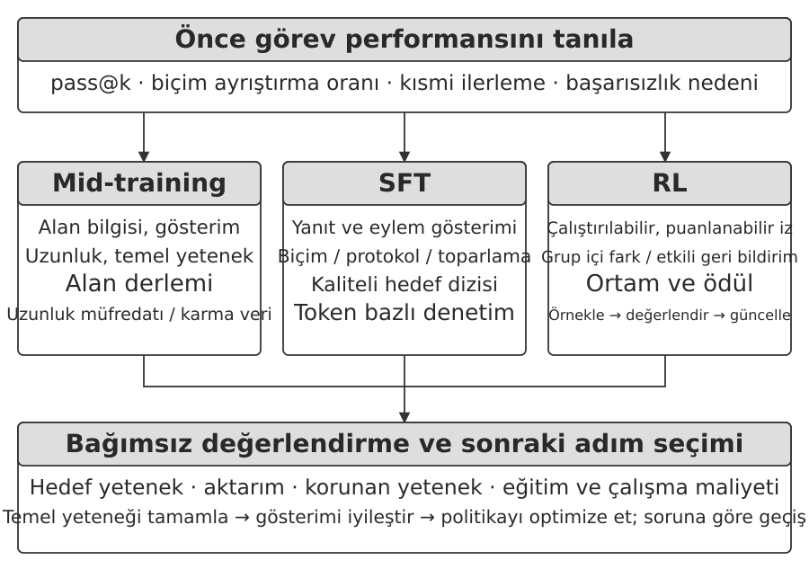

Tablo 8-4 Mid-training, SFT ve RL seçim ölçütleri

| Gözlenen durum | Önce kontrol edilecek | Aday yöntem | Sonraki değerlendirmenin odağı |
| --- | --- | --- | --- |
| Alan dili, kavramlar ya da temel işlemler zayıf; çok örneklemede ilerleme az | Derlem kapsamı ve temel yetenek | Mid-training; aranabilir olgularla RAG | Alan görevleri, genel yeteneği sınayan küme ve kısmen doğru izler |
| İçerik kullanılabilir, ama biçim, parametre ya da sabit akış kararsız | Gösterimler, arayüzler ve kısıtlar | SFT, kısıtlı çözümleme ya da araç doğrulaması | Ayrıştırma başarısı, görev sonucu ve kurtarma davranışı |
| Ara sıra görev tamamlanıyor, ama başarı oranı düşük ya da sık sık yanlış yol | Ödül kalitesi, keşif ve görev dağılımı | RL | Görev kazancı, ödül farkı, bağımsız genelleme ve maliyet |
| Gösterim ya da tercih verisi var, etkileşim ortamı henüz kurulmamış | Çevrimdışı veri kapsamı ve doğrulama biçimi | SFT, RFT, çevrimdışı tercih optimizasyonu | Temel çizgi kalitesi, veri yanlılığı ve ortam kurmanın kazancı |

Dört adımda ilerlenebilir. Önce prompt, context, araçlar ve kısıtlar çözümünün temel çizgisi kurulur. Bu yöntemler görev gereksinimlerini zaten karşılıyorsa yazar dışarıdan düzenlenebilir çözümü korumayı, eğitim, dağıtım ve regresyon bakım maliyetini azaltmayı tercih eder. Dinamik olgular getirme ve sürüm yönetimiyle sağlanır; tekrar tekrar öğrenilmesi gereken örtük yargılar, algı kalıpları ve kararlı davranışlar için parametre eğitimi düşünülür.

İkinci adımda ayrılmış görevlerde başarı, kısmi ilerleme, ayrıştırma sonucu ve hata türleri gözlenir. Örnekleme yapılandırması sabitlendikten sonra Pass@1 ve Pass@k mevcut politikanın kullanılabilir yolu olup olmadığını gösterir; başarısız izler bilgi eksikliğini, geri bildirim eksikliğini ve akış hatasını ayırmaya yardım eder.

Üçüncü adımda öğrenilmesi gereken davranış için gösterim sağlanır. JSON schema'sı, araç çağrıları, terim kullanımı, netleştirme ve kurtarma SFT örneği olarak yazılabilir; gereken bilgi ilgili derlem ve görev context'iyle verilir.

Dördüncü adımda RL'in geri bildirim koşulları değerlendirilir. Puanlanabilir aday üretilebiliyor, ödül ayırt edici ve ortam yeterli etkileşime izin veriyorsa politika optimizasyonunun kazancı karşılaştırılabilir; ödül fazla seyrekse önce aşamalı öğretim, kısmi ödül ya da daha uygun bir başlangıç politikası düşünülür.

Her adımda sonraki yatırıma değerlendirme sonucu karar verir: biçimi net görevler SFT'den sonra dağıtılabilir, güçlü başlangıç noktası olan modeller doğrudan RL alabilir, alanda sürekli eğitimden sonra mevcut talimat yeteneği de yeniden kullanılabilir. Aşağıda tek turlu görevlerle gösterimden öğrenme ile ödülden öğrenmenin davranış farkı somut olarak gözleniyor.

Okuma kılavuzundaki sipariş sorununa dönelim. Aynı gerçek araç açıklamasını modele doğrudan verip parametreyi doğru yazıp yazamadığına bakın. Açıklamadaki alanlar değiştiyse önce çalışma anında sorgulanabilen açıklama güncellenir. Alanların anlamı net olduğu hâlde model kullanıcı metnini tekrar tekrar sipariş numarası alanına yazıyorsa sorgulama, netleştirme ve doğru parametre doldurmayı içeren SFT gösterimleri verilebilir. Model zaten ara sıra işi tümüyle tamamlayabiliyor ve farklı sorgu sıraları farklı başarı ve maliyet üretiyorsa birden çok politika izini karşılaştırma koşulu oluşmuş demektir.

## Tek turlu pekiştirmeli öğrenme: ezberleme ve genelleme karşılaştırması

Tek turlu görev bir girdiyle başlar, modelin yanıtı teslim edip ödül almasıyla biter. Model yanıt üretirken yine çok adımlı akıl yürütebilir; eğitim sistemi modelin aynı soruyu tekrar tekrar denemesini de sağlayabilir. Etkileşimi tek yanıtla sınırlamak, eğitim yönteminin davranışı nasıl değiştirdiğini gözlemeyi kolaylaştırır. Aşağıda önce AdaptThink ile modelin akıl yürütme bütçesini nasıl dağıtmayı öğrendiği, sonra GeneralPoints ile SFT ve RL'in kural ve görsel görünüş değiştiğinde nasıl davrandığı gösteriliyor.

Önce RL algoritmalarının ödülle modeli nasıl güncellediğini anlamak sonraki deneylerdeki eğitim sürecini okumayı sağlar. Bu bölümdeki RL eğitimleri ağırlıklı olarak **politika gradyanına** dayanır. Aynı sorudan birkaç örneklemeyle başlayalım: model birkaç yanıt üretir, her yanıtın ödülü bir temel çizgiyle karşılaştırılır. Temel çizgiyi aşan yanıt olumlu sinyal alır ve üretim olasılığı artar; altında kalan yanıt olumsuz sinyal alır ve olasılığı düşer.

Tek bir güncellemenin modeli saptırmasını sınırlamak için yaygın **PPO** algoritması olasılık oranı belirtilen aralığı aştığında vekil hedefteki ek kazancı kırpar; gerçek güncelleme miktarı öğrenme oranına ve güncelleme turuna da bağlıdır. İlerideki "değer ağlı PPO" bir değer kestirimi öğrenip karşılaştırma temeli kurar ve her adımın eylem avantajını hesaplar. **GRPO** aynı sorunun birden çok yanıtını doğrudan karşılaştırıp temel çizgiyi grup içi ödüllerden kurar; böylece ayrıca değer ağı eğitmeye gerek kalmaz.

Aşağıdaki Python tarzı sözde kod örneklemeyi, ödülü, avantajı ve parametre güncellemesini birbirine bağlayarak her adımın bilgiyi nasıl aktardığını gösteriyor. Gerçek eğitimde örnekleme paralelliği, KL düzenlileştirmesi ve optimizasyon ayarları da yapılandırılır.

```python
for prompt in batch:
    group = [rollout(policy, env.reset(prompt)) for _ in range(G)]
    rewards = [verify(trajectory) for trajectory in group]
    advantages = normalize_within_group(rewards)       # GRPO baseline
    update(policy, group, advantages)
```

PPO bir grup farklı uzunlukta izi nasıl kullanıp politikayı günceller? Önce her izin içinde sondan başa doğru adımların indirimli getirisi hesaplanır. İz bitince toplama durur; bir sonraki sorunun ödülü hesaba katılmaz. Sonra tüm izlerde modelin gerçekten seçtiği eylemler bir araya getirilir ve bu eylem grubunun ortalama kaybı hesaplanır. Aşağıda çok turlu küçük parti optimizasyonu atlanmış tek bir güncelleme yazılıyor.[^ch8-ppo-method]

```python
states, actions, returns = [], [], []
for trajectory in rollouts:
    states.extend(trajectory.states)       # her eylem seçiminden önceki durum
    actions.extend(trajectory.actions)     # durumlarla tek tek eşleşir
    returns.extend(discounted_returns(trajectory.rewards))

returns = tensor(returns)
values = value_model(states)
advantages = returns - stop_gradient(values)
ratio = exp(policy.log_prob(actions, given=states)
            - old_policy.log_prob(actions, given=states))
policy_loss = -mean(min(
    ratio * advantages,
    clip(ratio, 1 - epsilon, 1 + epsilon) * advantages
))
value_loss = mean((values - returns) ** 2)
update(policy, value_model, policy_loss + value_coef * value_loss)
```

GRPO'daki "göreli" aynı sorunun birden çok yanıtından gelir; buradaki PPO ise her durumun beklenen getirisini değer ağıyla kestirir. `old_policy` bu iz grubu üretilirken dondurulmuş politikadır. Bir adımın avantajının 1, mevcut politikanın o eyleme verdiği olasılığın örnekleme anındakinin 1,4 katı olduğunu varsayalım; `epsilon = 0.2` alındığında vekil hedefte bu terimin katkısı `min(1.4, 1.2) = 1.2` olur. Bu eylemin olasılığını daha da artırmak bu terimden ek kazanç getirmez.

Avantaj −1 ise yön tersine döner. Olasılık oranı 0,6'ya düştüğünde aynı satır `min(-0.6, -0.8) = -0.8` verir; olasılığı daha da düşürmek ek kazanç getirmez. Tersine, bu düşük performanslı eylem daha sık hâle gelirse ve oran 1,4'e çıkarsa küçük değer `min(-1.4, -1.2) = -1.4` olur; olasılığı artırmanın bedeli ödenmeye devam eder.

> **Deney 8-10 ★★: AdaptThink — "ne zaman düşünmemeyi" öğrenmek**
>
> Akıl yürütme modelleri sorunları çözmek için genellikle uzun akıl yürütme kullanır. Basit sorularda doğrudan yanıt vermek üretim maliyetini düşürebilir. AdaptThink modele Thinking ve NoThinking olmak üzere iki mod sunar: bu protokolü destekleyen modellerde NoThinking akıl yürütme bölümünü `<think></think>` ile bitirip doğrudan yanıt üretir. Eğitimin hedefi, modelin göreve göre uygun akıl yürütme bütçesini seçmesidir.
>
> Yöntem iki temel bileşen içerir. **Kısıtlı optimizasyon hedefi** modeli NoThinking kullanım oranını artırmaya teşvik ederken genel yanıt performansını korur; **önem örneklemesi** iki modun örnekleme oranını ayarlar, sonra ağırlıklarla örnekleme dağılımı ile optimizasyon hedefi arasındaki farkı düzeltir. Başlangıç modeli genellikle Thinking'e eğilimlidir; eğitimin iki modu karşılaştıracak sinyal alabilmesi için NoThinking örnekleri bilinçli olarak artırılmalıdır. Buradaki soğuk başlangıç sorunu, eğitimin ilk döneminde NoThinking örneklerinin az olmasıdır.
>
> Kitaptaki deney 8 adet H100 80GB GPU kullandı. 300. adımda MATH500 doğruluğu %81,00'den %81,80'e çıktı, ortalama yanıt uzunluğu yaklaşık 4.911 token'dan 1.577'ye indi; GSM8K doğruluğu %79,68'den %81,88'e çıktı, yanıt uzunluğu yaklaşık 1.025 token'dan 477'ye indi; AIME mean@16 %31,46'dan %31,04'e indi, yanıt uzunluğu yaklaşık 12.120 token'dan 6.402'ye düştü. Üç kümenin yanıt uzunluğu sırasıyla yaklaşık %68, %53 ve %47 azaldı.
>
> Üç veri kümesinin NoThinking oranı sırasıyla %83,80, %84,15 ve %56,25 oldu. Model AIME'de daha fazla akıl yürütme hesaplaması korudu, MATH500 ve GSM8K'de ise daha sık doğrudan yanıtladı. AIME2024 her soruda 16 örnekleme yapılarak değerlendirildi; mean@16 bu 16 yanıtın ortalama doğruluğudur. 300. adımda ortalama yanıt neredeyse yarıya indi, doğruluk da yaklaşık 0,42 yüzde puan düştü.
>
> 300. adım eğitim yolundaki bir doğrulamadır. Ekip aslında 3.140 adım planlamıştı; çalıştırma sonradan anormal biçimde kesildi ve son doğrulama kaydı 410. adımda durdu. O anda AIME2024 ortalama doğruluğu %31,88, ortalama yanıt yaklaşık 5.874 token'dı.
>
> AdaptThink, Prompt damıtmayla birleştirilebilir: damıtma tekrar kullanılan talimatları ve çözüm kalıplarını parametrelere yazar, AdaptThink ise her göreve ne kadar akıl yürütme hesaplaması ayrılacağını öğrenir. İkisi yanıt kalitesini, gecikmeyi ve maliyeti birlikte etkiler.

> **Deney 8-11 ★★: GeneralPoints — tek turlu RL'de "ezberleme ve genelleme" karşılaştırması**
>
> Chu ve arkadaşları "24 oyunu"na benzeyen GeneralPoints kart oyunuyla modelin genelleme yeteneğini sınadılar[^ch8-3]. Dört karttaki sayılar birer kez kullanılarak toplama, çıkarma, çarpma ve bölmeyle 24 elde edilmelidir. Model problemi öğrendiyse kart kuralı ya da renkler değiştiğinde yine doğru hesaplayabilir mi? Şekil 8-12 iki soru biçimini gösteriyor: GP-L metni doğrudan verir, GP-VL ise modelin kartı okumasını ister.
>
> 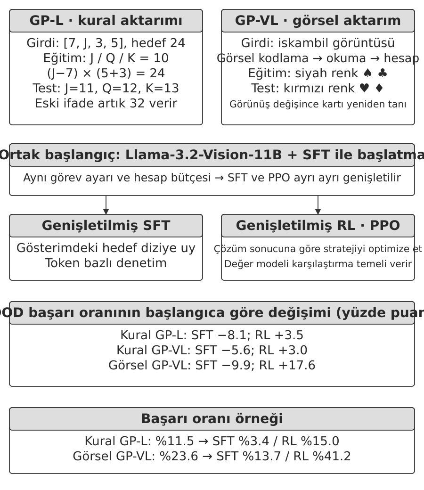
>
> **Kural varyantı**: Eğitimde J/Q/K 10 sayılır, testte sırasıyla 11/12/13. Test kümesi böylece eğitimde görülmemiş sayı bileşimleri içerir ve modelin 11, 12, 13 ile yeni kurala göre hesap yapıp yapamadığı kontrol edilir. **Görsel varyant**: Eğitimde siyah renkler (♠♣), testte kırmızı renkler (♥♦) kullanılır; modelin kart görünüşü değişimine uyum sağlayıp sağlamadığı sınanır.
>
> Deney Llama-3.2-Vision-11B'den başladı, önce SFT ile temel talimat izleme kuruldu, sonra SFT'yi sürdürme ve RL olmak üzere iki eğitim dalına ayrıldı ve aynı hesaplama bütçesiyle karşılaştırıldı. RL dalı değer ağlı PPO kullandı. İki dal da J/Q/K=10 kuralıyla eğitildi, sonra dağılım içi (ID) ve dağılım dışı (OOD) test kümelerinde değerlendirildi.
>
> `[7, J, 3, 5]` örneğinde J=10 iken `(J−7)×(5+3)=24` yazılabilir; J 11 olduğunda bu ifade 32 verir ve `(11−5)×(7−3)=24` gerekir. Aynı kart kümesi böylece modelden mevcut kuralı okumasını ve hesabı yeniden düzenlemesini ister.
>
> İki eğitim yöntemi dağılım dışı testte belirgin farklılaştı. **Kural OOD**: GP-L'de RL başarı oranı %11,5'ten %15,0'a, yani 3,5 yüzde puan arttı; SFT %11,5'ten %3,4'e, yani 8,1 yüzde puan düştü. GP-VL'de RL 3,0 yüzde puan artırdı, SFT 5,6 yüzde puan kaybetti. **Görsel OOD**: GP-VL'de RL %23,6'dan %41,2'ye, yani 17,6 yüzde puan yükseldi; SFT %23,6'dan %13,7'ye, yani 9,9 yüzde puan düştü.
>
> Kart tanıma sonuçlarını ayrıca incelemek nihai yanıt performansı ile görsel algıyı birbirine bağlar: RL dalında tanıma doğruluğu görev başarısıyla birlikte arttı, SFT dalında düştü. Araştırma bu farkı eğitim hedefine bağladı: token token uydurma eğilimi gösterimdeki metin kalıplarını pekiştirebilir, sonuç ödülü ise modelden sürekli kartı doğru okumasını ve hesabı tamamlamasını ister. Algı doğruluğu bu mekanizmayı çözümlemek için ara ölçüt sağladı.
>
> Önce SFT yapılmasının nedeni çıktı biçiminden de anlaşılabilir. Deneydeki Llama-3.2-Vision-11B temel modeli istenen yapılandırılmış çıktıyı kararlı biçimde üretemiyordu, doğrulayıcı da görev ödülünü hesaplayamıyordu; doğrudan uçtan uca RL denemesi bu yüzden başarısız oldu. SFT önce ayrıştırılabilir ve puanlanabilir çıktıyı kurdu, sonraki RL ancak o zaman görev geri bildiriminden yararlanabildi. Daha önceki DeepSeek-R1-Zero ise puanlanabilir yanıt üretebilen bir temel modelden başlayıp doğrudan RL'e girdi.
>
> Model doğrulayıcının geri bildiriminden ne kadar öğrenebilir? Makalenin Şekil 10'u salt metin kart görevini (GP-L) ayrıca karşılaştırıyor. Araştırmacılar 1, 3, 5 ve 10 doğrulama yinelemesi kurup RL modellerini ayrı ayrı eğitti ve değerlendirdi. Aynı eğitim hesaplama bütçesinde 10 doğrulamaya izin verilen grubun yeni kuraldaki başarı oranı kendi eğitim başlangıcına göre 5,99 yüzde puan, yalnızca 1 doğrulama yapan grubunki 0,48 yüzde puan arttı.
>
> Bu deneydeki dağılım kayması altında SFT performansı neden düştü, RL neden daha iyi davrandı? Gözlemlerle uyumlu bir açıklama şudur: sınırlı SFT verisi "J/Q/K görünce 10 say" sabit kalıbını pekiştirdi; testte J=11 olduğunda model yine 10 ile hesapladı. Sonuç odaklı RL dalı ise "doğru yanıtı bulana kadar yeniden hesapla" stratejisini pekiştirmeye daha yatkındı ve J 11 olduğunda da bunu uygulayabildi.
>
> GeneralPoints'in kural değişikliği ve renk değişikliği, modelin yeni koşula göre hesaplamayı öğrenip öğrenmediğini ve yeni görsel girdiyi doğru okuyup okumadığını ayrı ayrı gözlemlemeyi sağlar. Buradaki model, eğitim verisi ve test bütçesi altında SFT'yi sürdüren dal dağılım dışı testte geriledi, RL'e bağlanan dal ise ilerledi. Bu sonucu kendi görevinize uygulamak isterseniz önce şunu sorun: öğrenci çıktı biçimini zaten öğrendi mi? Yeni test kuralı mı değiştirdi, girdinin görünüşünü mü, yoksa ikisini birden mi? Ayrı karşılaştırmalar yapıldığında gösterim mi eklenmeli, algı mı iyileştirilmeli, yoksa sonuç geri bildirimli keşif mi artırılmalı, ancak o zaman anlaşılır.

## RL algoritmaları: 16 rollout'tan tek parametre güncellemesine

**GRPO (Group Relative Policy Optimization)** DeepSeek tarafından önerildi; öğrenme sinyalini aynı soruya yapılan birden çok denemenin göreli performansından kurar. SWE-bench tarzı bir kod onarım görevini örnek alalım: bir Python projesindeki `parser.py` boş girdide `IndexError` tetikliyor; Agent'ın uygulamayı düzeltmesi ve test dosyalarını değiştirmemesi gerekiyor. Bir eğitim yinelemesi dört adıma ayrılabilir.

**Birinci adım: politika modelinin görevi tekrar tekrar denemesini sağlamak.** Politika modeli eğitilmekte olan dil modelidir. Sistem aynı başlangıç kodunu ve sorun açıklamasını 16 yalıtılmış sandbox'a koyar ve modelin görevi 16 kez bağımsız tamamlamasını sağlar. Her deneme kod okumayla başlar, değişiklik ve testten geçip sonucu teslim etmeye kadar sürer; bu eksiksiz etkileşim izine bir **rollout** denir. Rastgele örnekleme aynı başlangıçtan farklı yollar üretir: bazıları sınır kontrolünü tamamlar, bazıları yalnızca istisnayı yakalar, bazıları yanlış dosyayı değiştirir, bazıları da testleri değiştirmeye çalışır.

**İkinci adım: ödülü hesaplamak.** Her rollout bittikten sonra doğrulayıcı yamayı temiz bir ortamda uygular ve testleri çalıştırır. 16 denemenin 4'ünün tüm testleri geçip test dosyalarını değiştirmediğini, 12'sinin başarısız olduğunu varsayalım; geçen 4'ü 1, kalan 12'si 0 ödül alır. Şekil 8-13 bu 16 izin puanlamasını tek tabloda gösteriyor. Bu tür kod görevlerinde ödül doğrudan testlerle ve kurallarla hesaplanabilir. Okunabilirlik, açıklama kalitesi gibi teste dökülmesi zor hedeflerde insan değerlendirmesi ya da ödül modeli de kullanılabilir.

**Üçüncü adım: göreli avantajı hesaplamak.** Ödül yalnızca tek bir izin başarılı mı başarısız mı olduğunu söyler; **göreli avantaj** ise aynı gruptaki diğer denemelere göre ne kadar iyi olduğunu gösterir. Bu grubun ortalama başarı oranı 4/16'dır: testi geçen 4 iz grup ortalamasının üstündedir ve olumlu avantaj alır; başarısız 12 iz ortalamanın altındadır ve olumsuz avantaj alır. Grup içi standart sapmayla normalize edilirse ödül ortalaması 0,25, standart sapma yaklaşık 0,433 olur; başarılı izlerin avantajı yaklaşık 1,73, başarısızlarınki yaklaşık −0,58'dir. GRPO öğrenme sinyalini bu tür grup içi karşılaştırmayla kurar. 16 ödülün hepsi aynıysa her birinden grup ortalaması çıkarılınca sıfır elde edilir. Paydaya çok küçük bir kararlılık terimi eklemek sıfıra bölmeyi önler; normalize edildikten sonra da bu grubun sonuç ödülü eğitimin hangi ize yönelmesi gerektiğini gösteremez. Bu durumda yol kısıtlarının, süreç ödülünün ya da kısmi ilerlemenin aynı gruptaki izleri ayırt edip edemediği kontrol edilebilir. Örneğin kodu düzeltemeyen iki denemeden yalnızca biri önceden başarısız olan sınır testini geçmiştir. Bu ara sonuç bağımsız olarak doğrulanabiliyorsa öğrenmede kullanılabilecek bir ipucu daha eklenmiş olur.

**Dördüncü adım: politikayı gradyan inişiyle güncellemek.** Eğitim programı göreli avantajı eğitim kaybına çevirir, gradyanı hesaplar, sonra optimize edici (AdamW, Muon gibi) gradyan inişini uygular; olumlu avantajlı izlerdeki seçimlerin olasılığını artırır, olumsuz avantajlı izlerdekilerin olasılığını düşürür. Eğitim pek çok görev ve rollout üzerinde bu seçimlerin olasılıklarını tekrar tekrar ayarlar. Optimizasyon etkisini gösterdikçe benzer hatalarla karşılaşıldığında "önce sorunu yeniden üret, sınır koşullarını kontrol et, uygulamayı değiştir ve testleri çalıştır" daha sık, "istisnayı örtbas et, testi değiştir, doğrulamadan teslim et" daha seyrek görülür.

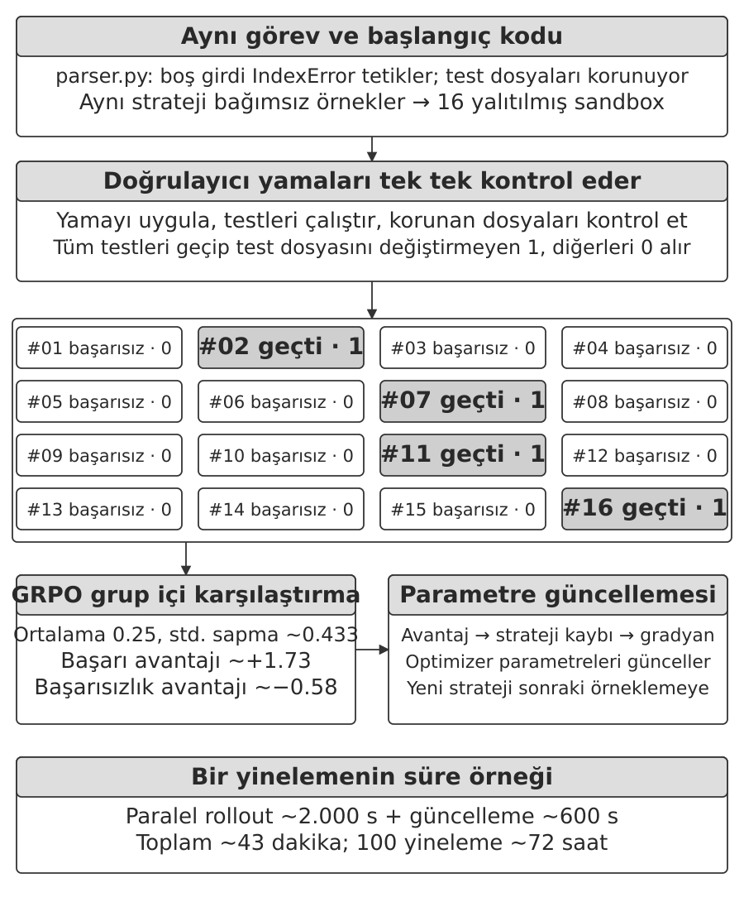

Şekil 8-13'te aynı soru 16 kez örnekleniyor; bu kaç **eğitim yinelemesi (step)** eder? Bu kısımdaki sayıma göre bu 16 rollout aynı partiye aittir. $k$. turda mevcut politikayla örnekleme yapılır, ödüller, avantajlar ve gradyan hesaplanır, politika bir kez güncellenir; $k+1$. turda yeni parametrelerle yeniden örnekleme yapılır. 100 step eğitmek, bu tür yinelemenin yaklaşık 100 tur yapılması demektir.

Eğitim süresi buna göre kestirilebilir. Karmaşık bir görev onlarca tur araç çağrısı içerebilir; senkron eğitim bütün partinin sonucunu beklediğinde örnekleme aşamasının ne zaman biteceğini 16 paralel izin en yavaşı belirler. Bunun yaklaşık 2.000 saniye sürdüğünü, gradyan hesabının ve optimizasyon güncellemesinin de 600 saniye aldığını varsayarsak bir step yaklaşık $2{,}000+600=2{,}600$ saniye, yani 43 dakika sürer. Aynı süreyle kesintisiz 100 step eğitmek yaklaşık 72 saat alır.

PPO da GRPO da bu kapalı döngüyü izler; fark esas olarak "neyle karşılaştırıldığında"dır. GRPO aynı sorunun birden çok rollout'unu doğrudan karşılaştırır ve ek bir değer modeli gerektirmez; PPO ise izin her adımında "genellikle ne kadar iyi yapılabileceğini" kestiren bir değer modeli eğitir, sonra mevcut eylemin bu beklentiden daha iyi olup olmadığına karar verir ve adım adım kredi atama için gereken temel çizgiyi sağlar. İkisi de kırpılmış vekil hedef gibi mekanizmalarla aşırı büyük güncellemeleri bastırır. DPO ise farklıdır: önceden toplanmış "daha iyi yanıt—daha kötü yanıt" tercih çiftlerinden doğrudan öğrenir, mevcut politikaya bu rollout grubunu çevrimiçi ürettirmez.

Bu bölümdeki örnekler farklı eğitim reçeteleri kullanır: AdaptThink özel bir kısıtlı hedef kullanır; GeneralPoints, V-IRL ve ReTool PPO kullanır ve ilk ikisinde değer modeli avantaj kestirimine katılır; SimpleVLA-RL ve RLVP GRPO kullanır.

A ve B sorularının dörder kez denendiğini, A'nın hepsinin doğru, B'nin hepsinin yanlış olduğunu varsayalım. A'nın dört ödülü de 1, B'ninki de 0'dır. Grup ortalaması ayrı ayrı çıkarıldığında iki grubun avantajı da 0 olur. Birkaç deneme daha yapacak hesaplama gücü varsa hangi soruya harcanırsa yararlı eğitim örneği elde etme şansı daha yüksektir?

Never Give Up bu seçimi örnekleme sürecine koyar. A'nın hepsi doğruysa bu grup atlanır; B'nin hepsi yanlışsa belli bir olasılıkla bir grup daha eklenir. İkinci grupta nihayet bir kez doğru yanıt çıktığını varsayalım; eğitimde iki grubun toplam sekiz yanıtı birlikte kullanılır: bir doğru çözüm ve yedi yanlış çözüm; aynı soruda yüksek ve düşük ödüller oluşur. Asenkron örnekleme diğer soruların olağan biçimde ilerlemesini sağlar; B'nin sonucunu beklemek gerekmez.[^ch8-ngu]

[^ch8-ngu]: Michael Noukhovitch ve arkadaşları, *Learning to Solve Hard Problems in RL for LLMs by Never Giving Up*, 2026. Yazıdaki ek örnekleme eğitim için kullanılır; doğru yapılmış sorular sonraki eğitimde yine çekilebilir.

### LLM RL'de neden genellikle On-Policy tercih edilir

**Online (çevrimiçi)** ve **On-policy (politika içi)** iki farklı yönü betimler. Çevrimiçi eğitim çalışma sırasında ortamla sürekli etkileşip veri üretir; politika içi eğitim ise verinin kaynağına odaklanır ve izleri üreten davranış politikası $\mu$'nün optimize edilecek politika $\pi_\theta$ ile aynı ya da yeterince yakın olmasını ister. Asenkron bir küme sürekli çevrimiçi örnekleme yapabilir, ama worker birkaç kontrol noktası geride kalırsa döndürdüğü veri politika eskimesi taşır ve politika dışı (off-policy) bir bileşen oluşur.

Yazar önce politika içine yakın eğitimle kararlı bir temel çizgi kurmayı, sonra verimi artırmak için asenkron örnekleme ya da eski veri yeniden kullanımı eklemeyi öneriyor. Bu bölümdeki PPO/GRPO reçeteleri genellikle her step başında en son politikayla örnekleme yapar. PPO ardından aynı parti üzerinde birkaç tur küçük parti güncellemesi yapar; mevcut politika veriyi üreten `old_policy`'den giderek uzaklaşır. Olasılık oranı bu değişimi ölçer, kırpma hedefi ise aşırı büyük güncellemeleri bastırır.

Politika gradyanının hedefi mevcut politika $\pi_\theta$ altındaki beklenen ödülle ilgilidir. Davranış politikası $\mu$ ile örneklenmiş veri kullanılırken önce aynı durumdaki eylem olasılık oranı hesaplanabilir, sonra buna göre önem düzeltmesi kurulabilir:

$$
\rho_t=\frac{\pi_\theta(a_t\mid s_t)}{\mu(a_t\mid s_t)}
=\exp\left(\log\pi_\theta(a_t\mid s_t)-\log\mu(a_t\mid s_t)\right).
$$

Aynı önekten sonra örnekleme politikasının bir token'ı seçme olasılığının 0,2, mevcut politikanın ise 0,3 olduğunu varsayalım; bu adımın olasılık oranı 1,5'tir. Bu token eski örneklerde olması gerekenden az görünmüştür; mevcut politikaya göre kestirim yaparken bu tür örneklerin ağırlığı buna göre artırılır. Örnekleme ve eğitim aynı politikayı kullanıyorsa parametre güncellemesinden önce her adımın olasılık oranı 1'dir.

Eski izleri yeniden kullanmak örnekleme ile eğitimin asenkron yürümesini sağlar ve verimi artırır. Ama iki politika birbirinden ne kadar uzaksa az sayıda örneğin çok büyük ağırlık alma olasılığı o kadar artar. Bütün bir iz yeniden ağırlıklandırıldığında adım adım olasılık oranlarının çarpımı da alınmalıdır. PPO her eylemin vekil hedefinde ek kazancın bir kısmını kırparak uç olasılık oranlarının etkisini zayıflatır; eski örneklerin hiç ulaşmadığı durumlar ise ancak yeni örneklemeyle görülebilir. Yazarın taze izleri tercih etmesinin nedeni de budur.[^ch8-32]

#### Eğitim ile çıkarım arasındaki sayısal farklar

Büyük ölçekli LLM pekiştirmeli öğrenmesinde örnekleme genellikle vLLM, SGLang gibi çıkarım motorlarıyla yapılır, logaritmik olasılıklar ve gradyanlar ise FSDP, Megatron gibi eğitim sistemleriyle hesaplanır. İki taraf aynı ağırlıkları yüklese bile kayan nokta hassasiyeti, indirgeme sırası, tensör paralelliği, parti boyutu, KV Cache ve birleşik çekirdekler nedeniyle aynı token için biraz farklı logaritmik olasılıklar hesaplayabilir. Bu durumda parametreler henüz güncellenmeden $\rho_t$ 1'den sapar ve eğitim ile örnekleme arasında sayısal düzeyde bir politika farkı oluşur. Denetimli deneyler küçük token düzeyi farkların bile eğitimi çökertebildiğini gösterdi.[^ch8-33]

Örnekleme dağılımı değiştiğinde iki eylemin ödülü tamamen aynı olsa bile saf politika gradyanı bunlardan birine yönelebilir. Örnekleme sırasında A ile B'nin yarı yarıya şansı olduğunu, eğitim sırasında modelin A'yı seçme olasılığının ise 0,8'e çıktığını varsayalım. A'yı denetleyen logit için A seçildiğinde logaritmik olasılığın gradyanı $1-0.8=0.2$, B seçildiğinde $0-0.8=-0.8$'dir. İki eylem de 1 puan alırsa örnekleme olasılıklarına göre ortalama alındığında gradyan $-0.3$ olur. İki seçim aynı puanı aldığı hâlde güncelleme A'nın olasılığını düşürür.

Score centering, aynı önek altındaki logaritmik olasılık gradyanından örnekleme dağılımındaki ortalamasını çıkarır. Yukarıdaki örnekte $-0.3$ çıkarıldığında iki terim sırasıyla $0.5$ ve $-0.5$ olur; aynı ödül tam olarak sıfır ortalama güncelleme üretir. Önceki GRPO bir grup yanıtın ödülünden ortalamayı çıkarıyordu; burada ortalanan şey gradyandır.[^ch8-sc]

[^ch8-sc]: Martin Marek ve Max Ryabinin, *Score Centering Stabilizes Off-policy Reinforcement Learning*, 2026. Örnekleme politikası çok geride kaldığında eğitim politikası ile davranış politikası arasındaki uzaklık KL düzenlileştirmesiyle de kısıtlanabilir (arXiv:2611.21791).

Eğitim ve örnekleme tarafları arasındaki sayısal hata uzun dizilerde de büyür: **logaritmik olasılık hatası → olasılık oranı sapması → uzun önekte birikim → kırpma ve avantaj ağırlığı değişimi → gradyan ve etkili örnek sayısı değişimi**. Örneğin 4.000 token'ın logaritmik olasılık oranlarının hepsi aynı yönde $10^{-3}$ sapma taşıyorsa hesaplanan iz düzeyi olasılık oranı gerçek değerin $e^{4000\times0.001}=e^4\approx54.6$ katı olur.

Erken olasılık değişiklikleri örnekleme sonucunu da değiştirip sonraki durumların başka bir yoldan gelişmesine yol açabilir. Eğitimde gözlemlenebilen sinyaller arasında önem oranı sıçramaları, kırpma oranının yükselmesi, gradyanda ya da yanıt uzunluğunda ani değişimler, ödül ve entropi düşüşü vardır. Parti boyutu indirgeme sürecini değiştirdiğinde aynı girdinin sayısal sonucu da değişebilir; parti değişmezliği (batch invariance) bozulur. İlgili çalışmalar bundan doğan örtük politika dışı etkiyi gözlemledi ve örnekleme ile eğitim hesaplarını hizalayarak ya da politika farkını açıkça düzelterek kararlılığı iyileştirdi.[^ch8-34]

Bu yüzden yazar örnekleme ile eğitim arasındaki sayısal tutarlılığı eğitim başlamadan önceki temel kontrollerden biri sayıyor ve ödül eğrisiyle birlikte sürekli izliyor. "Farkı ölç—yapılandırmayı hizala—sapmayı düzelt—eskimeyi denetle" olmak üzere dört adımda ele alınabilir:

- **Herhangi bir parametre güncellemesinden önce** aynı iz grubuyla örnekleme tarafının (sampler) ve eğitim tarafının (trainer) verdiği token logaritmik olasılıklarını karşılaştırın; $\rho_t$'nin ortalamasını, yüzdeliklerini, en büyük değerini, yaklaşık KL'yi ve kırpılan oranı izleyin. Bu en doğrudan on-policy birim testidir.
- Ağırlıkları eşitlerken LoRA adaptörlerini, tokenizer'ı, sohbet şablonunu, model sürümünü ve konum kodlaması yapılandırmasını da hizalayın. Rollout, örnekleme politikasının üretim anında verdiği logaritmik olasılıkları saklamalıdır; olasılık oranı sonradan buna göre hesaplanır.
- Örnekleme ile eğitimin hassasiyetini, paralel düzenini ve kilit hesaplama çekirdeklerini mümkün olduğunca hizalayın; olmuyorsa farkı açıkça off-policy sayın, önem düzeltmesi kullanın, etkili örnek sayısını izleyin ve düzeltmenin etkisini kırpma oranıyla birlikte değerlendirin.
- Güncellenmiş politikayla zamanında yeniden örnekleme yapın; her parti üzerindeki güncelleme turu sayısını ve asenkron örneklemenin eğitimin gerisinde kaldığı kontrol noktası sayısını sınırlayın.

## RL ortamları: değerlendirmeden simülasyona

Agent'ın RL eğitimi görevlerin tekrar tekrar yürütülmesini gerektirir. Bir kod onarımı yalıtılmış kopyada yeniden denenebilir, bir ödeme ise gerçek hesabın durumunu değiştirir. Eğitim ortamı sıfırlanabilir başlangıç durumu, paralelleştirilebilir görev kopyaları ve doğrulanabilir sonuçlar sağlamalı; modelin denetimli koşullarda farklı yolları keşfetmesine izin vermelidir. Bölüm 7 değerlendirme ortamlarını tanıtmıştı; eğitimde kullanıldığında uzun süreli çalışma, eylem yan etkileri ve çok sayıda etkileşimin maliyeti de düşünülmelidir. Yazar büyük ölçekli eğitimi planlamadan önce ortam inşasına insan gücü ve bütçe ayırır. Gerçek geri bildirimi, durum sıfırlamayı ve paralel yalıtımı gerçekleştirmek çoğu zaman PPO ya da GRPO bağlamaktan daha fazla mühendislik kaynağı tüketir; ortam inşa maliyeti eğitimin kendisini de aşabilir.

### Ortam: modelin alıştırma sahası

Ortam eyleme göre durumu günceller ve yeni gözlemi modele geri verir. Ortam kurarken üç sorudan başlanabilir.

- **Etkileşim dağıtım senaryosuna yakın mı?** Müşteri hizmetleri simülatörü kullanıcının bilgi eklemesini, talebini değiştirmesini ve belirsiz ifadelerini kapsamalıdır; araç simülatörü üretimde sık görülen hataları ve gecikmeleri döndürmelidir. Model gerçek sorunlara nasıl karşılık vereceğini bu geri bildirimlerle öğrenir. Fazla tekdüze geri bildirim politikanın simülasyondaki sabit kalıplara dayanmasına yol açar.
- **Görev kararlı biçimde yeniden denenip paralelleştirilebiliyor mu?** Her rollout bağımsız sipariş, dosya ya da hesap durumu gerektirir; bittikten sonra temizlenip geri yüklenebilmelidir. ReTool'un kod yorumlayıcı sandbox'ı ve AWorld'ün MCP sandbox'ı bu sorumluluğu üstlenir. Hız sınırı, ücret ya da yazma yan etkisi olan gerçek API'lerde göreve göre sandbox hesapları, yeniden oynatma verisi ya da simüle arayüzler kullanılabilir.
- **Sonuç nasıl belirlenir?** Ortam durumu ödül hesabının önemli bir dayanağıdır. Örneğin iade görevi tutarı, sipariş durumunu ve yetki koşullarını kontrol edebilir; kod görevi testleri çalıştırabilir. İlerideki kısım ödül tasarımını ayrıca tartışacak.

**Algoritmayı ayarlamaya girişmeden önce yazar şunu kontrol etmeyi öneriyor: simülasyon ortamı gerçek göreve yeterince yakın mı? Bu, PPO mu GRPO mu seçileceğinden daha önemlidir.** Sadakat, sıfırlanabilirlik ve doğrulama yeteneği modelin etkileşimden ne öğrenebileceğini birlikte belirler. Önce az sayıda görevle bu üç halkayı çalıştırıp sonra eğitim ölçeğini büyütmek genellikle sorunların yerini bulmayı kolaylaştırır.

### Araçları ve ortamı modelle taklit etmek

Arama sonuçları, kullanıcı konuşmaları ve karmaşık iş durumları modelle sentezlenebilir. Model simülatörü Agent'ın eylemini alıp bir sonraki geri bildirimi üretir; gerçek zamanlı dış hizmetlere bağımlılığı azaltır. Bu yaklaşım tek bir araçtan bütün görev ortamına genişletilebilir.

**Birinci düzey: araç dönüş değerlerini sentezlemek.** ZeroSearch[^ch8-13] LLM'i arama motoru gibi oynatır: öğrenci sorgu gönderir, simülatör arama sonuçlarını üretir. Böylece eğitimin gerçek arama API'sinin ücretine, hız sınırına ve sonuç dalgalanmasına bağımlılığı azalır. Ayrıca aşamalı bir düzen kullanır: başta yüksek kaliteli ve ilgili belgeler döndürür, sonra gürültüyü adım adım artırarak öğrencinin kusurlu malzemeden yararlı bilgi çıkarmayı alıştırmasını sağlar. Çalışmadaki modeller simüle edilmiş arama ortamında eğitildikten sonra gerçek arama motoruna bağlandığında da iyi performans gösterdi.

**İkinci düzey: ortamın durum geçişlerini taklit etmek.** DreamGym[^ch8-14] ortam dinamiğini akıl yürüten bir deneyim modeline damıtır. Model mevcut durumu ve Agent'ın eylemini okuyup sonraki durumu ve geri bildirimi türetir, çevrimiçi RL için etkileşim izlerini toplu üretir ve gerçek ortama erişimi azaltır. Müşteri hizmetleri ve satış görevlerinde LLM kullanıcıyı da oynayarak ek soruları, bilgi tamamlamayı ve talep değişikliklerini taklit edebilir. τ-bench serisi kullanıcı simülatörü kullanır; benzer etkileşim çerçeveleri eğitimde de kullanılabilir ve sırasıyla alıştırma ile değerlendirme görevlerini üstlenebilir.

Model simülatörleri de kalibre edilmelidir. Müşteri hizmetleri simülatörü belirsiz soruları her zaman doğru anlıyorsa politika netleştirme alıştırması yapma fırsatı bulamaz; arama simülatörü hep doğru belgeleri döndürüyorsa politika gürültüyü tanıma deneyimi kazanamaz. Eğitim, simülatörün puanlama açıklarından yararlanan davranışları da pekiştirebilir. Yazar karma bir yaklaşım öneriyor: çok sayıda etkileşimi model simülasyonu üstlensin, düzenli aralıklarla gerçek ortamdaki görevlerle politika performansı kontrol edilsin ve bulunan farklar simülatöre geri beslensin. Böylece "sentetik etkileşim—gerçek görev değerlendirmesi—simülatörü düzeltme" yineleme süreci oluşur.

Simülatörün araç kullanımını gerçekten öğretip öğretemediği nasıl anlaşılır? Küçük bir test yapılabilir: aynı başlangıç siparişinde önce sorgulayın, sonra değişiklik gönderin, sonra yeniden sorgulayın; dönen sipariş alanlarının eyleme göre beklendiği gibi değişip değişmediğini kontrol edin. Ardından ortamı sıfırlayıp yine özgün değerlerin okunabildiğini doğrulayın. Yalnızca kulağa makul gelen bir "değiştirildi" metni üreten ama sonraki turda değişikliği sorgulatamayan bir ortam, siparişi hiç değiştirmese bile konuşmada iyi olan politikayı ödüllendirir.

### Ortam, görev dağılımı ve değerlendirme yalıtımı

Eğitim ortamı modelin neler yaşayabileceğini belirler. Sıfırlanabilir durum yeniden denemeyi, yalıtılmış kopyalar paralelliği, net durum ve doğrulama kuralları yeniden üretimi ve puanlamayı destekler. Görevler önceki veri sentezi yöntemini izleyebilir: gerçek iş günlüklerinden görev planı çıkarılır, kimlik bilgileri silinir, sonra kurgusal kişiler, siparişler, dosyalar ve başlangıç durumları üretilir.

Eğitim ve değerlendirme görev üreticisini ve doğrulama kodunu paylaşabilir; somut görevler ise bağımsız kümelere bölünmelidir. SWE-Gym, τ²-bench ve AndroidWorld'ün ortam tasarımı örnek alınarak[^ch8-28] kabul testleri, puanlama için gereken gizli durum ve başvuru çözümleri doğrulayıcı tarafında saklanır; Agent gözlemleri görevin kararlaştırdığı arayüzden alır. Örnekleme büyütülmeden önce az sayıda rollout ile görevlerin tamamlanabilir olup olmadığı ve doğrulayıcının geçerli ile geçersiz sonuçları ayırt edip etmediği kontrol edilmelidir. Puanlama sapmalarını erken bulmak, politikanın doğrulama açıklarından yararlanma şansını azaltır.

Bu yüzden ortam mühendisliğinin sırası şudur: **görev planı → sıfırlanabilir ortam → sonuç doğrulaması → eğitim/değerlendirme yalıtımı → gerçek etkileşimle kalibrasyon**. Önceki veri sentezi bu ortamlardan geçerli izleri süzerek SFT gösterimleri oluşturur. RL'e geçildiğinde mevcut politika ortamda deneme yanılmayı sürdürür ve gösterim dışı yolları keşfeder.

Doğrulama da verim bütçesine katılmalıdır. Lean kernel, test çalıştırıcıları ve konteyner yürütmesi CPU ve bellek tüketir. GPU üretim hızı doğrulama hızını aştığında görevler doğrulama kuyruğunda birikir. Bu durumda doğrulayıcı worker sayısı artırılmalı, doğrulama gecikmesi kısaltılmalı ya da üretim ile doğrulama arasındaki kaynak oranı ayarlanmalıdır[^ch8-9].

## Tek turdan çok tura: görev senaryoları ve kredi atama

### Çok turlu görevlerin temel zorluğu

Şekil 8-14'ün solunda 24 oyunu var. Model yanıtında birkaç adım hesap yapabilir, ama hepsi sorunun verdiği dört kartla yapılır; arada yeni bir ortam gözlemi gelmez. Sağda ise sokak görüntüsüyle navigasyon var. Bir kavşakta sola dönmeyi seçtikten sonra ancak dönülen sokak görülebilir. Sonraki adıma göz önündeki sokak tabelasına bakılarak yeniden karar verilmelidir. Bölüm 1 ve 4'te anlatılan ReAct bu etkileşimi düzenleyebilir: model eylemi seçer, araç ya da ortam yürütür, yeni gözlem sonraki karara girer.

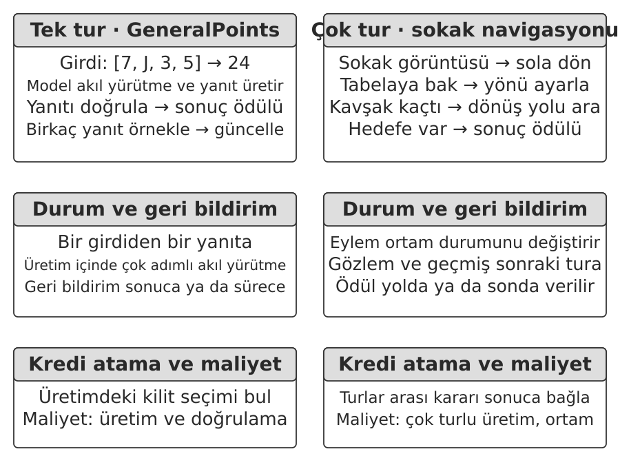

Şekil 8-15'te Agent 3. adımda kavşağı kaçırıyor, 4. adımda yoldan çıktığını fark edip geri dönüyor, 5. adımda hedefe varıyor. Uç ödülü bütün navigasyonu onaylar, ama yanlış yola sapmak ile zamanında geri dönmeyi ayırt etmez. Bir dahaki sefere bu kavşakta doğrudan doğru yola gitmesini isteriz; yine yanlış giderse geri dönmesini de teşvik etmek gerekir. Eğitimde önceki adımların nihai kazanca katkısını kestirme sorununa **kredi atama (Credit Assignment)** denir. Değer ve avantaj kestirimi sonraki getiriyi kullanabilir; ara eylemler güvenilir biçimde kontrol edilebiliyorsa süreç ödülü de eklenebilir. 4. adımdaki geri dönüş süreç ödülünde 0 puan alsa da hedefe varmaya yardım eder. Bu adımın değeri kestirilirken sonraki getiri de hesaba katılmalıdır.

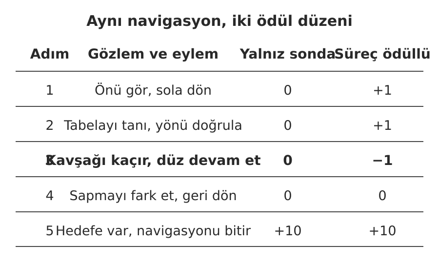

Aynı sorun müşteri hizmetleri görüşmelerinde de ortaya çıkar. Örneğin kullanıcı 10. turda olumlu değerlendirme verdi. 2. turda hangi ücretin tartışmalı olduğunu netleştirmek de 7. turda ücreti açıklamak da yardımcı olmuş olabilir. Yalnızca son olumlu değerlendirmeye bakarak her birinin ne kadar katkı yaptığı ayırt edilemez. Aşağıdaki iki deney sırasıyla eğitimi yürütenin navigasyon eylemlerini adım adım kontrol edebildiği ve robotun başarısını yalnızca görev sonucundan yargılayabildiği durumları tartışıyor.

> **Deney 8-12 ★★★: V-IRL-VL — çok turlu görsel navigasyon**
>
> V-IRL'de[^ch8-24] Agent önündeki sokak görüntüsüne bakarak adım adım hedefe ulaşmalıdır. Eğitimde New York rotaları kullanılır, testte başka şehirlere geçilir; hem yol tarifinin dili hem de görüntüdeki sokaklar değişir. Kural ve görsel değişiklik olmak üzere iki dağılım dışı testte RL, SFT'den belirgin biçimde iyi performans gösterdi. Deney değer ağlı PPO kullandı. Her adımda geri bildirim vermek, uzun bir rotada hangi kararların korunmaya değer olduğunu ayırt etmeye yardım eder.

> **Deney 8-13 ★★★: SimpleVLA-RL — sonuç ödülüyle açık uçlu keşif `[genişletme deneyi]`**
>
> SimpleVLA-RL, LIBERO robot görevlerinde başarı/başarısızlık sonuç ödülü kullanır. Her görev için tek bir gösterim iziyle SFT soğuk başlangıcı yapılır, ardından RL başarı oranını %17,3'ten %91,7'ye çıkarır ve gösterimde görülmemiş bir "itip kesme" hareketi ortaya çıkar. Bu sonucu sokak görüntüsü navigasyonuyla karşılaştırın: yol ortasındaki hangi adımın yanlış olduğu güvenilir biçimde belirlenebiliyorsa anında geri bildirim vermek öğrenmeyi hızlandırır. Görevi tamamlamanın hangi yolları olduğu henüz bilinmiyorsa önce sonuca göre ödül vermek modele başka yollar deneme alanı bırakır. İnsan gösterimindeki hareket sırasını erkenden ödül gereksinimine yazmak "itip kesme" gibi yeni stratejilerin puanını düşürebilir.

### Araç çağrısı: dış yetenekleri etkileşim içinde kullanmayı öğrenmek

Dış araçlar bağlandığında model arama yapabilir, kod çalıştırabilir, dosya değiştirebilir, veritabanı sorgulayabilir ya da göreve göre birkaç API'yi birleştirebilir. Harness çağrıları doğrular ve zamanlar, araçlar ortamda yürütülüp gözlem döndürür. Şekil 8-16 bir görevdeki kararları görev bittikten sonraki eğitimden ayırıyor. Sağdaki ok izlendiğinde araç sonucu geçerli göreve döner ve model bir sonraki adıma onunla karar verir. Aşağıya doğru okunduğunda eğitim programı görev bittikten sonra bütün izle ödülü hesaplar, parametreleri günceller ve bir sonraki tur örnekleme yeni politikayla yapılır. Bir görevde art arda birkaç araç çağrılacaksa önceki dönüşün sonucu sonraki çağrının parametrelerini etkiler.

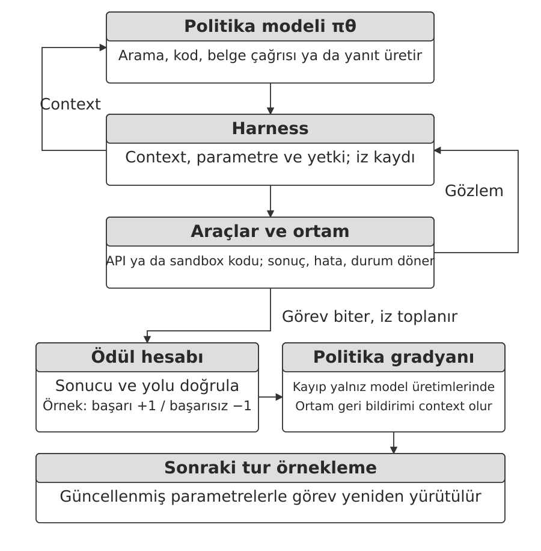

Search-R1[^ch8-25] modele ne zaman arama yapacağına, hangi sorguyu göndereceğine karar vermeyi ve sonuçla akıl yürütmeyi sürdürmeyi öğretir. ReTool kod yorumlayıcıyı aynı tür döngüye bağlar; model kod yürütmeyi düzenlemeyi, dönüş değerini anlamayı ve hata mesajına göre düzeltmeyi öğrenir. AWorld-train MCP çok araçlı sandbox'a genişler; model araç seçmeli, çağrılar arası bağımlılıkları yönetmeli, eğitim sistemi de ortamı sıfırlayabilmeli ve izleri yeniden oynatabilmelidir.

Araç izlerinde modelin ürettiği token'lar ile ortamın döndürdüğü token'lar ayrılmalıdır. Politika kaybı hesaplanırken yalnızca modelin ürettiği akıl yürütme, çağrı parametreleri ve yanıt gibi eylemler kayba girer; ortam geri bildirimine karşılık gelen konumlar maskelenir. Geri bildirim yine context olarak sonraki hesaba katılır ve modelin bir sonraki adıma karar vermesine yardım eder. Örneğin yorumlayıcı bir hata döndürdüğünde eğitimin pekiştirdiği şey modelin ardından kodu nasıl düzelttiğidir. Hata metni de politika kaybına katılırsa güncellemeye "ortam çıktısı üretme" hedefi karışır ve modelin gerçekte sorumlu olduğu karardan uzaklaşılır.

> **Deney 8-14 ★★★: ReTool — kod yorumlayıcıyla güçlendirilmiş matematik çözümü**
>
> Şekil 8-17 ikinci dereceden bir denklem üzerinden metinle akıl yürütme, kod üretimi ve yorumlayıcı geri bildiriminin nasıl dönüşümlü ilerlediğini gösteriyor.
>
> 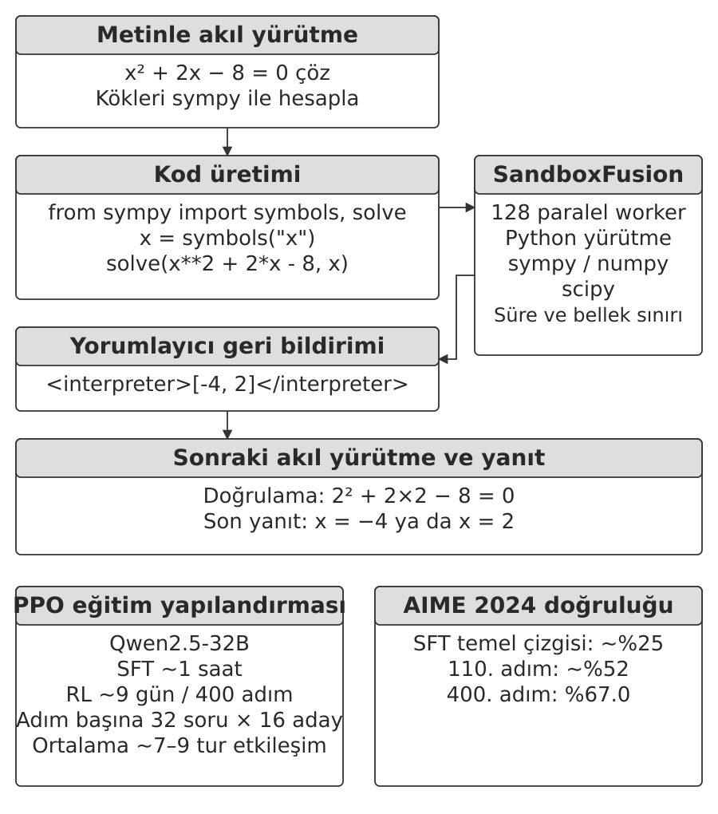
>
> ReTool, SFT ısınmasından sonra birbirine geçmiş metin düşünmesi, kod yürütmesi ve yorumlayıcı geri bildirimiyle PPO eğitimi yapar. Model zamanla kod çalıştırmaya ne zaman değeceğini ve hata mesajından sonra nasıl düzeltileceğini öğrenir. Burada DAPO-Math-17k eğitim verisi kullanılır; politika güncellemesi yine standart PPO'dur[^ch8-26][^ch8-27].
>
> Eğitimden sonra modelin AIME 2024 doğruluğu yaklaşık %25'ten %67,0'a çıktı. Salt metin RL ile karşılaştırıldığında kod geri bildirimi modelin kesin hesaplamayı ve hatayı düzeltmeyi daha hızlı öğrenmesini sağladı.

> **Deney 8-15 ★★★: AWorld-train — sandbox'ta araç kullanmayı öğrenmek**
>
> Şekil 8-18'in üst yarısında bir turu izleyin: model bir araç çağrısının sonucunu alır ve denemeyi sürdürebilir. Alt yarısında bir tur daha izleyin: bu görev grubu bitmiştir, eğitim programı ödüllü izleri alır, parametreleri günceller ve bir sonraki görev grubu ancak o zaman yeni politikayı kullanır.
>
> 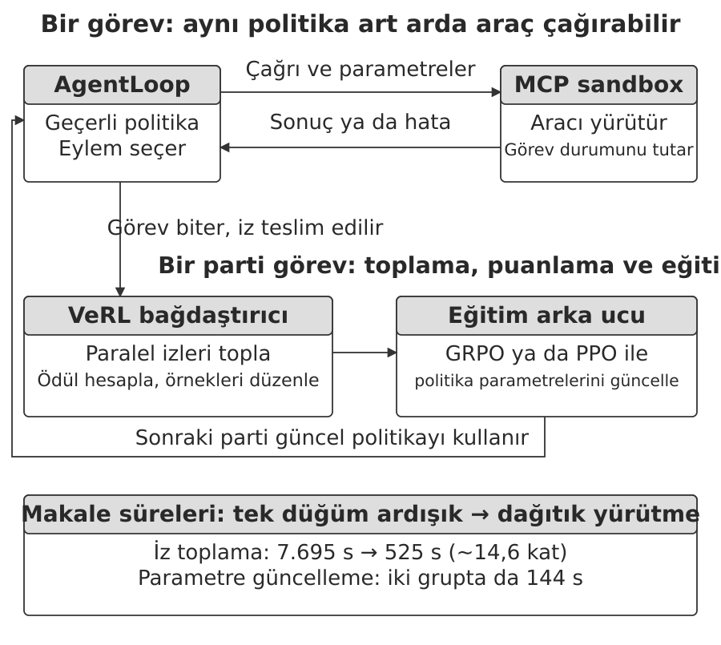
>
> GAIA ortamında 26 MCP sunucusu ve 126 araç fonksiyonu vardır; Playwright ile web sayfaları kullanılabilir, PDF, Word ve sunumlardan içerik çıkarılabilir, ses yazıya dökülebilir, metin tanınabilir ya da E2B sandbox'ında kod çalıştırılabilir. Excel aracı formüller, grafikler ve pivot tablolar dahil 29 işlem sunar; bilgi araması Wikipedia, arXiv ve Wayback'e erişebilir. Sandbox sıfırlandıktan sonra aynı durumdan yeniden denenebilir ya da önceki izler yeniden oynatılabilir.
>
> Şekildeki süreler makalenin toplama karşılaştırmasından alınmıştır. Eşlik eden deney ayrıca 4B model için bir eğitim yapılandırması veriyor: Qwen3-4B-Thinking-2507, 8 adet A100, 131K context sınırı, en fazla 32 tur etkileşim, parti boyutu 32, her soruda 16 iz örneklemesi, GRPO güncellemesi ve 1e−6 öğrenme oranı.

Araç bir sonuç döndürdüğünde eğitim programı hangi adımı ödüllendirmelidir? Tek bir başarılı çağrı yalnızca aracın başarıyla yürüdüğünü gösterir. Bu adımın görevi ilerletip ilerletmediğine karar vermek için doğrulayıcıyla yol açtığı değişim kontrol edilmeli, sonra modele hangi ödülün verileceğine karar verilmelidir.

## Ödül tasarımı: görev hedefini öğrenme sinyaline dönüştürmek

Aynı tutarı iade eden iki iade izi düşünün; biri zorunlu kimlik doğrulamasını atlamıştır. Yalnızca nihai bakiyeye bakılırsa ikisi aynı puanı alır. Kullanıcının devrettiği görevin bütün gereksinimlerini öğrenme sinyaline dönüştürmek için önce sonucu kimin doğrulayabileceği, hangi adımın kanıt üreteceği ve modele hangi bilgilerin geri verilmesi gerektiği belirlenir, sonra yoldaki yetki ve süreç kısıtlarının ayrı ayrı doğrulanıp doğrulanamayacağı kontrol edilir.

### Ödül nereden gelir: kurallar, insan tercihi ve model değerlendirmesi

Otomatik yargılanabilen görevlerde yazar önce **doğrulanabilir ödüllerle pekiştirmeli öğrenmeyi (RLVR)** kullanır ve kabul gereksinimlerini doğrudan programa yazar. Matematik sorusunda yanıt kontrol edilebilir, kod görevinde testler çalıştırılabilir, iade görevinde veritabanındaki tutar ve sipariş durumu kontrol edilebilir. Geçmek 1, başarısız olmak 0 yazıldığında en basit sonuç ödülü elde edilir. Kurallar nettir ve çalıştırma yeniden üretilebilir, puan farklarının yerini bulmak kolaydır; doğrulayıcının kapsamı ise eğitimin hangi gereksinimleri optimize ettiğini belirler.

**İnsan geri bildirimiyle pekiştirmeli öğrenme (RLHF)** insan tercihini eğitim sinyaline çevirir. InstructGPT[^ch8-4] önce yanıtlar arasında insan karşılaştırmaları toplayıp bir ödül modeli eğitti, sonra PPO ile politikayı optimize etti. Ödül modeli sınırlı örnekteki tercihi öğrenir ve sürekli daha yüksek model puanı peşinde koşmak onun yanlılığını büyütebilir[^ch8-5]. Eğitime sık sık SFT referans modeline göre KL düzenlileştirmesi eklenerek politika kayması denetlenir. DPO[^ch8-6] ise doğrudan "daha iyi yanıt—daha kötü yanıt" tercih çiftleriyle politikayı optimize eder ve ayrı ödül modeli eğitme adımını ortadan kaldırır.

Açık uçlu görevlerde model değerlendirme gerekçesi ve puanı verebilir. **Üretken ödül modelinin (GRM)** ürettiği tanı gösterim süzmek, tercih çifti kurmak ya da sonraki değişikliklere yön vermek için de kullanılabilir. DeepSeek-GRM[^ch8-23] göreve göre değerlendirme ilkeleri üretir, sonra bunlara göre eleştiri ve puan verir; değerlendirme davranışını çevrimiçi RL ile iyileştirir ve çok sayıda örneklemi yardımcı ödül modeliyle birleştirerek yargıyı toplar.

Değerlendirme ölçütü ile görev hedefi arasındaki açık model davranışını da etkiler. **Ödül hilesi (Reward hacking)**, politikanın puanlama kuralındaki ya da uygulamasındaki açıklardan yararlanarak yüksek puan almasıdır. Uzun soluklu Agent'larda **ödül arama (reward seeking)** denen bir olgu da vardır: model kendi kestirdiği puanlama biçimine göre davranır; örneğin geçmesi kolay bir kontrolü kendisi seçer ve kontrol geçince görevi bitirir[^ch8-29]. Bu örnek, kabul koşullarının kullanıcı hedefinden yola çıkması ve gerçek teslimatı kapsaması gerektiğini gösterir; yalnızca modelin kendi seçtiği ölçüt kontrol edilirse tamamlanmamış gereksinimler kolayca atlanır.

İade görevinin ödülünü tasarlarken önce iki insan yazımı izi doğrulayıcıdan geçirin. A siparişi bulur, iade arayüzünü çağırır ve makbuzu kullanıcıya aktarır; B yalnızca "iade tamamlandı" der. İkisi aynı puanı alıyorsa önce puanlayıcının nihai yanıtı, arayüz makbuzunu yoksa sipariş durumunu okuduğuna bakın. Bu küçük karşı örnek, vekil ölçüt sorununu açığa çıkarmaya ve modelin erken müjde vermeyi öğrendiğini bütün bir eğitimden sonra fark etme maliyetinden kurtulmaya yeter.

### Ödül ne zaman verilir: sonuç ve süreç

**Sonuç ödülü** bir episode bittikten sonra görev performansını değerlendirir; sonucu bir model değerlendiriyorsa bu modele **ORM (Outcome Reward Model)** denir. SimpleVLA-RL'in başarı/başarısızlık ödülü politikaya nihai hedef etrafında farklı eylem dizileri keşfettirir. Bu tür sinyali tanımlamak kolaydır, ama uzun bir iz başarısız olduğunda modelin hangi eylemlerin başarısızlığa yol açtığını ayırt etmesi için daha çok deneme gerekir. Seyrek geri bildirimin örnek verimini etkilemesinin bir nedeni budur[^ch8-8].

Coding Agent'ın erken bitirmesini örnek alalım: model tamamlandı bildirimini gönderdikten sonra Harness yalıtılmış çalışma alanında korunan kabul testlerini çalıştırır. Testler gerçek dosyaları ve ortam durumunu okur; geçerse olumlu, başarısız olursa olumsuz ödül verilir. Böylece tamamlandı bildirimi dış doğrulamayı tetikler ve görev sonucu teslimata göre belirlenir. Değerlendirmede iki görev grubu hazırlanır: biri hâlâ tamamlanmayı bekleyen işler içerir ve erken bitirme oranını ölçer; diğeri zaten tamamlanmıştır ve modelin zamanında toparlayıp toparlayamadığını kontrol eder.

**Süreç ödülü** ara adımlarda geri bildirim verir; örneğin kimlik doğrulamayı, parametre seçimini, navigasyon eylemlerini ya da akıl yürütme adımlarını değerlendirir. Süreci değerlendiren modele **PRM (Process Reward Model)** denir. OpenAI'ın *Let's Verify Step by Step*[^ch8-7] çalışması matematiksel akıl yürütmede adım adım doğrulamayı inceledi. Süreç sinyali modelin hatayı bulmasına yardım eder, ama etiketleme ve doğrulama maliyetini artırır. Belirli bir çözüm sırası tek doğru yol sayılırsa diğer geçerli stratejilerin ödülü de düşer. Bu yüzden yazar süreç sinyalini yalnızca gerçekten doğrulanabilen ara olaylar için ekler ve modelin çeşitli geçerli çözümleri keşfetmesini sürdürmesini sağlar. V-IRL-VL (Deney 8-12) adım adım navigasyon geri bildirimi, SimpleVLA-RL (Deney 8-13) ise uç ödülü kullandı; iki görev geri bildirim inceliği için farklı seçimleri gösteriyor.

Pratikte önce sonuç ödülü temel çizgisi kurulabilir, sonra kimlik doğrulamanın tamamlanması ve testlerin geçmesi gibi ara olaylar için süreç sinyali eklenebilir. Sonlu uzunluktaki çok turlu görevlerde indirim faktörü $\gamma=1$ alınabilir; böylece uç ödülü geriye yayılırken aynı ağırlığı korur. PPO değer kestirimi ve avantaj hesabıyla geri bildirimi her adımın eylemine bağlar; iz düzeyinde avantaj kullanan GRPO ise genellikle aynı avantaj ağırlığıyla o izdeki üretilmiş token'ların politika kaybını hesaplar.

### Ödül ne kadar bilgi taşımalı: skaler, vektör ve üretken tanı

Ödülün ne zaman geldiği geri bildirimin yoğunluğunu, ne içerdiği ise temsil biçimini belirler. Tek bir skaler genel performansı özetler; "kısa gerekçe + puan" biçimindeki yarı skaler temsil puanlama dayanağını ekler; vektör doğruluk, bütünlük, maliyet gibi boyutları ayrı ayrı ifade eder; üretken tanı ise sorunu ve değişiklik yönünü somut söyler, çok sayıda örneklemin toplanmasıyla da elde edilebilir.

- Kesin yanıt ya da kabul testi varsa ikili skalerle başlanabilir.
- Birden çok kalite hedefi varsa ayrı ayrı puanlanıp iş gereksinimlerine göre ağırlıklandırılabilir ya da kısıt olarak konabilir.
- Değerlendirme bağlamla açıklama gerektiriyorsa tanı üretilebilir, olgu doğrulaması ve insan örneklemesiyle kalibre edilebilir.

Örneğin bir müşteri hizmetleri görevinde çözüm durumu, konuşma turu sayısı ve kimlik doğrulamasının tamamlanıp tamamlanmadığı birlikte kaydedilebilir. Üç boyut sırasıyla etkiye, maliyete ve süreç gereksinimlerine karşılık gelir. Eğitimde kullanılmadan önce puanlamanın kararlı olup olmadığı ve aynı gruptaki izlerin davranışını ayırt edip etmediği kontrol edilmelidir. Yazar birkaç güvenilir ölçütle başlayıp her kalemi doğruladıktan sonra boyut ekler. Doğrulanmamış her puanlama kalemi modelin gerçek görevi iyileştirmeden yeni bir vekil ölçüt boyunca optimize olmasına yol açabilir.

### Yol kısıtları ve RLVP

Görevi tamamlama sürecinde ayrıca bağımsız davranış gereksinimleri olabilir: kullanıcıyla çalışma saatlerinde iletişim kurmak, kimlik doğrulamasını tamamlamak, korunan dosyaları değiştirmemek. RLVP (Reinforcement Learning with Verified Penalty)[^ch8-9] sonuç ödülünü doğrulanabilir yol cezalarıyla birleştirir; ilkesi **sonucu ödüllendir, yolu cezalandır**dır. Yol kuralları ortamdaki gözlemlenebilir eylemlerle tetiklenir, teslimat bütünlüğü ise görev kabulüyle kontrol edilmeye devam eder.

İki onarım da kabulden geçti, ama biri önce okunması gereken dosyanın üzerine doğrudan yazdı. Araç kayıtlarını kontrol etmek bu ihlal edici eylemi bulmaya yeter; önceki her adımın nihai başarıya ne kadar katkı yaptığını belirlemek ise çok daha zordur. En basit yöntem bütün ize tek bir puan vermektir: $R=O+\beta\Phi$; burada $O$ görev puanı, $\Phi$ ihlal cezalarını ya da doğrulanabilir ilerlemeyi toplar, $\beta$ ikisinin göreli ağırlığını belirler. Böylece iki onarım ayırt edilir, ama aynı izdeki her eylem aynı sinyali alır.

Hangi turda ihlal olduğu biliniyorsa ceza o tura bırakılabilir. Eşlik eden uygulamadaki iki test izine bakalım: A görevi tamamladı ama ikinci turda ihlal etti; B görevi tamamlamadı, iki turu da kurala uygundu. İki izin sonuç puanı 1 ve 0'dır; grup ortalaması çıkarıldığında +0,5 ve −0,5 elde edilir. Her izde iki tur ve her turda 10 eylem token'ı vardır. Uygulamadaki `c2` yapılandırmasına göre iki sinyal ayrı ayrı sayılır:

```python
outcome_weight = (1 - 0.5) / 40  # sonuç sinyali bu partideki 40 eylem token'ına dağıtılır
penalty_weight = -0.3 / 10       # ihlal cezası yalnızca A'nın ikinci turundaki 10 eylem token'ına dağıtılır
first_turn = outcome_weight
second_turn = outcome_weight + penalty_weight
```

A'nın ilk turunda her eylem token'ı +0,0125, ikinci turunda −0,0175 ağırlık alır. Böylece aynı başarılı onarımdaki iki eylem zıt yönlü eğitim sinyali alabilir. Bu ağırlıklar politika kaybına girdiğinde optimize edici parametreleri buna göre günceller. Müşteri hizmetleri görevinde de araç kayıtları hangi turda yetki kontrolünün atlandığını gösterebiliyorsa ceza aynı biçimde dağıtılabilir.

Yol sinyalinin etkisi grup içi farktan anlaşılabilir. Bir GRPO iz grubunun sonuç ödülleri aynıysa bu ödülden hesaplanan avantaj sıfırdır; ihlal sayıları farklıysa yol cezası yeni bir karşılaştırma dayanağı sağlar. Kısmi ilerleme ödülü de aynı koşula uyar: modelin en azından farklı düzeylerde ilerleme örneklemesi gerekir ki ayrım oluşsun.

Yol ödülü tasarlanırken dört kural izlenebilir: açık ihlal eylemlerini cezalandır; görev sonucu ödülünü koru; kısıtlanan davranış için erişilebilir kurala uygun bir yol sağla; tekrar yürütülebilir doğrulama kuralları kullan. Örneğin her işlemi tek tek cezalandırmak modeli yerinde durmaya teşvik eder; görev başarı ödülünü korumak işi tamamlamayı da birlikte zorlar. Temel model kurala uygun yol üretmekte zorlanıyorsa önce az sayıda gösterimle başlangıç noktası kurulabilir, sonra eğitimle yol şekillendirmeye bağımlılık adım adım azaltılabilir.

> **Deney 8-16 ★★★: RLVP — sonucu ödüllendirmek, yolu cezalandırmak**
>
> Deney GRPO'ya sonuç ödülü $O$ ile yol sinyali $\Phi$ ekler ve salt sonuç ödülüyle karşılaştırır. TerminalBench vekil görevlerinde ihlal sayısı 3,71'den 0,66'ya inerken başarı oranı aynı kaldı; miniF2F vekil görevlerinde erişilebilir kısmi ilerleme ödülü eklendiğinde 0,9 başarı oranına ulaşmak için gereken yineleme sayısı 7,0'dan 4,4'e düştü.
>
> Yazılım onarımı görevi sinyalin erişilebilirliğinin etkisini de gösterdi: tüm rollout'lar hiçbir testi geçemediğinde geçen test sayısına göre hesaplanan ilerleme ödülü hep aynı kaldı ve grup içi farkı artıramadı.

Ortalama ihlal sayısı 0,66'ya indi; model kurala uygun yolu daha sık seçiyor, yine de ara sıra ihlal ediyor. Zorunlu kısıtlar için araç yürütülürken yetki de kontrol edilmelidir.

## Damıtma: örnek verimini artırmak

Bir Agent rollout'u çoğu zaman birkaç tur model üretimi ve araç yürütmesi içerir. **Örnek verimini** artırmak, hedef performansa daha az ortam etkileşimiyle ulaşmaktır. Eğitim adımı, GPU süresi ve ortam çağrısı sayısı farklı maliyetleri yansıtır; görevle birlikte değerlendirilmelidir. Örneğin bu bölümdeki ReTool vakasında SFT eğitimi yaklaşık 1 saat, RL ise yaklaşık 9 gün sürer; bunun büyük kısmını tekrarlanan örnekleme ve araç yürütmesi alır.

Uç ödül kullanıldığında bütün bir iz tek bir başarı puanı alabilir. İş aracı "kredi kartının son dört hanesi gerekiyor" diye uyarmış, Agent bu bilgiyi atlamış ve sonunda ödül 0 almış olsun. Eğitimin birkaç denemeden başarısızlığın eksik alandan mı, araç parametresinden mi yoksa sonraki işlem hatasından mı geldiğini ayırt etmesi gerekir. Öğretmen bu iz üzerinde adım adım denetim verebiliyorsa tek bir ortam etkileşimi daha ince öğrenme sinyali üretebilir.

### Politika içi damıtma: bir rollout'tan yoğun denetim üretmek

**Politika içi damıtma (On-Policy Distillation)** izi öğrenci üretir, öğretmen öğrencinin gerçekte ürettiği önekler üzerinde denetim sağlar. Thinking Machines Lab 2025'teki çalışmasında bu eğitim biçimini sistematik olarak gösterdi[^ch8-10]. Üç yöntem türünü anlamak için "eğitim durumunu kim üretir" ile "öğrenme sinyalini kim sağlar" ayrılabilir:

| Yöntem | İzi ya da durumu kim üretir | Başlıca öğrenme sinyali |
| --- | --- | --- |
| SFT / politika dışı damıtma | İnsan ya da öğretmen gösterimi | Hedef yanıtın token bazlı denetimi |
| On-policy RL | Mevcut öğrenci | Sonuç ya da süreç ödülü |
| On-policy Distillation | Mevcut öğrenci | Öğretmenin öğrenci öneki için token bazlı olasılık değerlendirmesi |

Örneğin öğretmenin gösterimi hep önce siparişi sorgular, sonra iade başvurusu yapar; öğrenci ise doğrudan iadeyi başlatabilir ve "sipariş numarası eksik" hatası alır. Politika içi damıtma öğretmene öğrencinin ulaştığı bu durumu değerlendirtir ve bilgiyi nasıl tamamlayacağını gösterir. Böylece eğitim öğrencinin kendi hatalarını ve kurtarma yollarını kapsar.

Bir uygulama biçimi, öğrencinin ürettiği önek üzerinde öğrenci ile öğretmen arasındaki ters KL'yi en küçüklemektir:

$$
D_{\mathrm{KL}}(\pi_\theta\Vert\pi_T)
=\mathbb{E}_{a\sim\pi_\theta(\cdot\mid h)}
\left[\log\pi_\theta(a\mid h)-\log\pi_T(a\mid h)\right],
$$

Burada $h$ mevcut önek, $a$ sonraki token, $\pi_\theta$ ve $\pi_T$ öğrenci ile öğretmenin dağılımlarıdır. Öğretmenin daha uygun gördüğü token daha olumlu eğitim sinyali alır. Uygulamada tam dağılım karşılaştırılabilir ya da öğretmene öğrencinin örneklediği token'ların logaritmik olasılıkları sorulup token bazlı optimizasyon sinyali kurulabilir.

"Önce API'yi sorgula, sonra dönüş değerini ayrıştır" örneğinde bir konumdaki adayların "sorgula" ve "çağır" olarak birer token'a karşılık geldiğini, öğretmenin bunlara sırasıyla %80 ve %15 olasılık verdiğini, diğer adayların toplamının %5 olduğunu varsayalım. Bu, nihai başarıdan daha ince bir seçim dayanağı sağlar. Bir iz $T$ model üretimi token'ı içeriyorsa yaklaşık $T$ konumda denetim elde edilir; araç dönüş içeriği yine context olarak kullanılır ve politika kaybında maskelenir.

Aşağıda bu süreç tam dağılım hizalaması biçiminde gösteriliyor:

```python
trajectory = rollout(student, task)
loss = 0
for prefix in model_generated_positions(trajectory):
    target = stop_gradient(teacher.distribution(prefix))
    loss += KL(student.distribution(prefix), target)
update_student(loss)
```

Öğrenci keşiften sorumludur, öğretmen birçok konumda denetim sağlar; ek maliyet ağırlıklı olarak öğretmen çıkarımından gelir. Ortam etkileşimi pahalı ve öğretmen öğrenciye güvenilir biçimde rehberlik edebiliyorsa yazar önce politika içi damıtmayı karşılaştırır; böylece her ortam çağrısı daha çok geçerli öğrenme sinyali üretir. Hedef dil, alan bilgisi ya da temel eylemlerde yetersiz öğrenciler için önce Mid-training ve gösterim eğitimiyle geçerli bir başlangıç noktası kurulup sonra politika içi damıtmaya geçilebilir.

Örnekleme ile eğitimin tutarlılığı da aynı ölçüde önemlidir: örnekleme motoru izleri $\mu$ politikasıyla üretir, eğitim motoru kaybı $\pi_\theta$ ile hesaplar; ikisi arasındaki fark eğitim durumlarının dağılımını değiştirir.

Thinking Machines Lab'in matematik görevlerindeki karşılaştırması yaklaşık bir büyüklük mertebesi eğitim verimi kazancı gösterdi. Çok turlu Agent'larda aynı karşılaştırma biçimi sürdürülebilir; görev başarı oranı, ortam çağrısı sayısı ve öğretmen hesaplama maliyeti birlikte kaydedilir. Kazancı, öğrencinin ortamda karşılaştığı durumlar ile öğretmenin güvenilir geri bildirim verip veremediği birlikte belirler.

Yazar ve çalışma arkadaşları "zaman algısı" görevinde DPO'yu, dört RL reçetesini ve politika içi damıtmayı da karşılaştırdı[^ch8-11]. İlk reçeteler sırasıyla seyrek ödül, hedef kayması, rollout biçimi uyuşmazlığı ve politika çöküşü gibi sorunlarla karşılaştı. Dondurulmuş bir Qwen3-32B öğretmenine geçilip öğrencinin kendi çok turlu izleri üzerinde token bazlı hizalama yapıldığında eğitim düzgün biçimde yakınsadı; dört koşulda geçme oranı aynı kaynaklı SFT temel çizgisinden 23–47 yüzde puanı yüksek çıktı. Bu deneyim yazara her etkileşimin sağladığı sinyal yoğunluğunun önemini daha çok gösterdi. Aynı etkileşimdeki ara kararların hepsi öğrenmeye katılabildiğinde mevcut izlerin değeri daha tam olarak kullanılır.

Matematik öğretmeni akıl yürütmede, kod öğretmeni program onarmada iyiyse bir öğrenci ikisinin güçlü yanlarını nasıl öğrenir? Çok öğretmenli politika içi damıtma (MOPD) yukarıdaki eğitim sürecini korur, yalnızca sabit öğretmeni sorunun alanına göre seçilen öğretmenle değiştirir. Öğrenci bir kod sorusu çözerken yarı yolda yanlış bir yola girse bile o ana kadar yazdığı öneki kod öğretmenine verir ve sonraki adımın olasılık dağılımını alır; sıra matematik sorusuna geldiğinde öğrencinin çözüm sürecinde rehberliği matematik öğretmeni yapar. Her alanın öğretmeni önce bağımsız olarak eğitilebilir, damıtma aşamasında öğretmenlerin parametreleri sabitlenir. Dağıtımda yalnızca tek bir öğrenci çalıştırılır.[^ch8-mopd]

Burada iki pratik koşul vardır. Birincisi, token bazlı KL'yi yukarıdaki formülle hesaplamak için öğrencinin verdiği önek üzerinde hizalanabilir öğretmen olasılıkları elde edilebilmelidir. Elinizde yalnızca öğretmenin yazdığı birkaç tam yanıt varsa bunlar SFT için kullanılabilir, ama bu kaybı hesaplamaya yetmez. İkincisi, kabulde her alanın sonucu ayrı ayrı incelenmelidir. Öğrencinin matematik puanı yükselip kod puanı düştüğünde yükselen genel ortalama bu gerilemeyi kolayca gizler.

[^ch8-mopd]: Wenhan Ma ve arkadaşları, *MOPD: Multi-Teacher On-Policy Distillation for Capability Integration in LLM Post-Training*, 2026. Makale alanlara göre eğitilmiş öğretmenler kullanır ve öğrencinin kendi izleri üzerinde damıtma yapar.

### Politika içi öz-damıtma: ek context ile öğretmen kurmak

Ekibin elinde bu alanda iyi olan tek bir model varsa öğretmen kim olacak? Aynı soru ona iki kez verilebilir. İlkinde dağıtım koşullarındaki gibi yalnızca kullanıcı sorusu verilir; ikincisinde ayrıca standart yanıt, uzman gösterimi ya da alan belgeleri eklenir. İkinci yanıttaki fazladan bilgi, ilk koşuldaki öğrenciye rehberlik etmek için kullanılabilir.

**Politika içi öz-damıtma (On-Policy Self-Distillation, OPSD)**[^ch8-15] aynı modele iki rol verir: öğrenci yalnızca görev girdisini görür, öğretmen ayrıca standart yanıtı ya da doğrulanmış çözümü görür. Öğrenci izi ürettikten sonra öğretmen bu ayrıcalıklı bilgiyle her öneki değerlendirir ve denetimi öğrenciye geri aktarır.

Örneğin öğrenci bir matematik sorusu çözerken öğretmen doğru yanıtı zaten bilir. Öğretmen buna dayanarak öğrencinin mevcut akıl yürütme yönünü değerlendirebilir; öğrenci de yalnızca soruyu gördüğü koşulda kendi üretimini iyileştirmeyi öğrenir. Aşağıdaki sözde kod ek context'in ve gradyan yalıtımının yerini gösteriyor:

```python
trajectory = rollout(model, task_without_answer)
loss = 0
for prefix in model_generated_positions(trajectory):
    privileged_prefix = add_verified_answer(prefix)
    target = stop_gradient(model.distribution(privileged_prefix))
    loss += KL(model.distribution(prefix), target)
update(model, loss)
```

Ayrıcalıklı bilgi yalnızca eğitim sırasındaki öğretmen koluna girer; öğrenci girdisi ve değerlendirme girdisi dağıtımdakiyle aynı kalır. Sözde kod boyunca iki bilgi yolu kontrol edilebilir: standart yanıt yalnızca öğretmen önekini kuran satıra girer, dağıtımda öğrenci onu görmez; öğretmen çıktısına gradyan durdurma (stop_gradient) uygulanır; bu yüzden bu adımda iki dağılım arasındaki farka göre yalnızca öğrenci kolu parametreleri günceller. Sonraki turda güncellenmiş model kullanıldığında öğretmenin yargısı da değişebilir. Böylece aynı model, eğitim tarafındaki daha zengin bilgiyi kullanarak kendi gerçek üretimine denetim sağlar.

Ayrıcalıklı bilgi insan gösterimlerinden ya da süzülmüş alan belgelerinden de gelebilir. Seçerken bu bilginin öğretmenin yargısını iyileştirip iyileştirmediği kontrol edilmelidir: bilgiyi alan öğretmen öğrencinin hatalarını ne kadar iyi tanırsa damıtma sinyali o kadar yararlı olur. Eğitim sırasında önceden test için ayrılmış örneklerle mevcut yetenekler ve üretim üslubu da kontrol edilmelidir; Purified OPSD gibi çalışmalar düzenlileştirme kısıtlarıyla modelin özgün akıl yürütme üslubunu korumasına ayrıca yardım eder[^ch8-16].

## Sorun vakalarından sonradan eğitime

Bölüm 7 üretimdeki sorunları yeniden üretilebilir görevlere, başarısızlık nedenlerine ve değerlendirme ölçütlerine dönüştürdü. Bu malzemeler sonradan eğitimde de kullanılabilir: tam görev etkileşim ortamını, hatadan önceki iz öneki karar context'ini sağlar, doğrulayıcı da yeni üretilen davranışı kontrol eder. Tablo 8-5 bunların eğitim yöntemleriyle karşılıklarını listeliyor.

Tablo 8-5 Bölüm 7'nin değerlendirme malzemeleri ve sonradan eğitimdeki kullanımları

| Bölüm 7'deki malzeme | Bölüm 8'deki eğitim kullanımı |
| --- | --- |
| Uçtan uca görev ve doğrulayıcı | RL örnekleme görevleri, doğrulanabilir ödül, ret örneklemesi için görev havuzu |
| İz öneki ve sonraki davranış | DPO tercih çiftleri, SFT karar gösterimleri, politika içi damıtmada öğretmen girdisi |
| Başarısızlık konumu ve hata türü | Süreç değerlendirme etiketleri, doğrulanabilir yol cezası kuralları |
| Rubric kalemlerinin puanları ve insan etiketli standart yanıtlar | Çok boyutlu ödül, üretken ödül modelinin eğitimi ve kalibrasyonu |

Geçmiş önekler devam görevlerinin başlangıç noktası olabilir. Politika içi damıtmada önce mevcut öğrenci bu noktadan üretmeyi sürdürür, sonra öğretmen öğrencinin gerçekte ürettiği öneki değerlendirir; araç çalıştırmak gerekiyorsa karşılık gelen ortam durumu da geri yüklenir. Böylece Bölüm 7'deki yerel karar değerlendirmesi bu bölümün örnekleme ve eğitim akışına bağlanır.

Eğitimde kullanılan görevler, değerlendirme için ayrılan görevlerden ayrılmalıdır. İki taraf arayüzü ve doğrulama mantığını paylaşabilir, ama ayrı görev örnekleri kullanır; görevler arası genellemeyi incelemek gerekiyorsa görev şablonuna ya da iş türüne göre de bölünebilir. Aşağıda bu dönüşümün nasıl yapılacağı üç örnekle gösteriliyor.

### Vaka 1: Coding Agent'ın erken bitirmesi

Agent'ın testleri çalıştırmadan tamamlandığını söylemesi, üç gereksinimden yalnızca ikisini bitirip teslim etmesi ya da birkaç başarısızlıktan sonra vazgeçmesi erken bitirmedir. Üretimde bu vakalar kullanıcı düzeltmelerinden, olumsuz oylardan ve iz incelemelerinden toplanabilir. Örneğin kullanıcı "testleri henüz çalıştırmadın" dediğinde iz boyunca o andaki görev durumu, eldeki doğrulama kanıtları ve modelin tamamlandı bildirimi incelenebilir.

Nedeni analiz ederken önce izi modelin "bitti" demek üzere olduğu anda durdurun, sonra geriye bakıp bir gereksinimi okumayı atlayıp atlamadığını ya da kodu yanlış değiştirip değiştirmediğini görün. Bundan iki tür eğitim malzemesi çıkar: tam görev modeli işi tamamlamak için eğitmekte, karar öneki ise kanıta göre sürdürmeyi ya da bitirmeyi seçmesini eğitmekte kullanılır.

**Tam görev sonuç ödülüne bağlanabilir.** Model sonucu teslim ettiğinde korunan kabul testleri çalıştırılır; geçerse +1, başarısız olursa −1 verilir. Testler gerçek teslimatı kapsar; model normal geliştirme testleriyle geri bildirim alabilir, nihai kabulü ise eğitim ortamı yürütür.

**Karar öneki tercih çiftine dönüştürülebilir.** Aynı context'te tercih edilmeyen örnek (`rejected`) kanıtsız bir tamamlandı bildirimidir; tercih edilen örnek (`chosen`) ise gerekli testleri çalıştırmayı sürdürür, eksik gereksinimleri kontrol eder ve kalan işi bitirir. Öğretmene birkaç devam yolu yazdırılabilir, sonra doğrulayıcıyla gösterime uygun olanlar süzülür. Örnek yetersizse görev türü, eksik doğrulama kalemleri ve tamamlandı ifadeleri değiştirilerek yüzlerce tercih çiftine genişletilir. Ardından LoRA ile DPO yapılır ve davranış kapsamını korumak için makul ölçüde genel görev karıştırılır.

**Değerlendirme hem tamamlanmamış hem tamamlanmış görevleri kontrol eder.** Bir görev grubu yalnızca kısmen bitirilmiştir ve modelin devam edip etmediğini gözlemlemeye yarar; diğer grup zaten bitmiştir ve zamanında toparlayıp toparlayamadığına bakılır. Aynı anda genel araç çağrıları ve diğer görevler de örneklenerek hedefli eğitimin mevcut yetenekleri etkileyip etkilemediği gözlemlenir. Yalnızca erken bitirme oranı düşürülürse model her seferinde doğrulamayı sürdürmeyi seçebilir ve zaten tamamlanmış işi de bir türlü toparlamaz. Bu durumda tamamlanmış görev grubunda gereksiz araç çağrıları ve beklemeler görülür.

> **Deney 8-17 ★★: "Erken bitirme" vakasından DPO düzeltmesine**
>
> Deney "başarısızlık nedeni—karar öneki—tercih çifti—LoRA eğitimi—ayrılmış değerlendirme" adımlarını tek bir akışa bağlar ve eğitimde 7B bir model kullanır.
>
> Veri 24 gerçekçi sorun vakası içerir; testleri çalıştırmadan tamamlandı demek, çok hedefli işin yalnızca bir kısmını bitirmek, kabul koşullarının karşılanmaması ve hatada vazgeçmek olmak üzere dört durumu kapsar; başarısız testi silen bir ödül hilesi varyantı da içerir. Ayrıca hâlâ yapılacak işi olan 12 soru ve zaten bitmiş 8 soru yalnızca değerlendirme için ayrılmıştır.
>
> Önce ayrılmış bir soruya bakalım. Mesaj kuyruğunun tüketicisi bağlantı kopup yeniden bağlandıktan sonra mesaj kaybediyor; asistan yeniden bağlanma kodunu değiştirdi, araç yalnızca "dosya değiştirildi" bildirdi. Bu anda düzeldiğini mi ilan etmeli, yoksa doğrulamayı mı sürdürmeli? Deney iki aday yanıt verir ve modelin hangisine daha yüksek puan verdiğini karşılaştırır. Eğitimden önce model 12 tamamlanmamış görevin 3'ünde doğruyu seçti (%25,0); eğitimden sonra 11'inde (%91,7). Gerçekten tamamlanmış 8 görevde ise eğitimden önce de sonra da 8'inde doğruyu seçti.
>
> Aday yanıtları kaldırıp modelin bir sonraki adımı kendisinin yazmasını istediğimizde sonuç değişti. Deneyin metin sınıflandırma kurallarına göre tamamlanmamış görevlerde erken tamamlandı ilanı 1/12'den 0/12'ye indi; tamamlanmış görevlerde açıkça toparlama da 6/8'den 0/8'e düştü. Yalnızca ilk gruba bakılırsa sorunun çözüldüğü sanılabilir. İkinci grup ise bize, modelin hazır iki yanıt arasında ne zaman durması gerektiğini tanısa da kendi yanıtını yazarken hâlâ ısrarla yeniden kontrol isteyebildiğini hatırlatıyor. Mesaj kaybı örneğine dönersek, asistanın gerçekten bir kopma-yeniden bağlanma testi yürütmesi ve yeniden bağlandıktan sonra mesajların alınıp alınmadığını kontrol etmesi de gerekir. "Doğrulamayı sürdür" demek ile doğrulama sonucunu elde etmek iki ayrı adımdır.

### Vaka 2: Çince tırnak işaretleri

"Çince bir yazıdaki düz tırnakları kıvrık tırnaklara çevir" görevi önce düzenleme kapsamının belirlenmesini gerektirir. Çince doğal dildeki alıntılar `“”` kullanabilir, iç içe alıntılar Çince noktalama kurallarına göre işlenir; İngilizce özgün metin, dize sabitleri, JSON, yollar ve tanımlayıcılardaki tırnaklar ise kendi sözdizimsel işlevlerini taşır. Eğitim hedefi modelin bu kapsamları tanıması ve en küçük düzenlemeyi yapmasıdır.

Önce kurallar bir Skill olarak yazılabilir, sonra buna göre girdi ve hedef metinler üretilir. Olumlu örnekler Çince paragrafları, iç içe alıntıları ve Çince yorumları içerir; koruma örnekleri İngilizce alıntıları, dize ve karakter sabitlerini, JSON'u, satır içi kodu ve kod bloklarını içerir. Koddaki Çince yorumlar için yorum sınırı ile alıntı kapsamı birlikte tanınmalıdır; kapsamı belirlenemeyen parçalar olduğu gibi bırakılır. Bu durumlar aynı belgede birleştirildiğinde ancak gerçek düzenlemedeki kapsam yargısı alıştırılabilir.

> **Deney 8-18 ★★: Kapsama duyarlı Çince kıvrık tırnak SFT'si**
>
> Deney Qwen3-8B kullanır, bf16 ile LoRA SFT yapar, 2 epoch boyunca toplam 256 güncellemeyle eğitir. Eğitim hedefi Çince doğal dildeki alıntıları dönüştürürken kod ve yapılandırılmış verideki sözdizimsel tırnakları korumaktır.
>
> Veri 16 parça türü, 10 yazı türü ve 9 programlama dili birleştirilerek üretilir: 1.024 eğitim örneği, 256 ayrılmış örnek ve 256 sınır örneği. Her örnek özgün metni ve hedef metni saklar; dönüştürülmesi gereken alıntıları, korunması gereken dizeleri ve ikisinin iç içe geçtiği durumları kapsar.
>
> Eğitimden sonra ayrılmış kümede tam eşleşme oranı %96,9, sınır kümesinde %97,7, korunan bölgelerin korunma oranı %100 oldu.
>
> Aynı kapsam kuralları hem etiket üretmek hem çıktıyı kontrol etmek için kullanılır. Model düzenleme kapsamına karar vermeyi öğrenir, ayrıştırıcı ve sözdizimi denetimi de değiştirilmiş belgenin yapısını doğrular. Böylece metin düzenleme kalitesi ile biçim doğruluğu ayrı ayrı kontrol edilebilir.

### Vaka 3: Dosya düzenlemenin sık sık başarısız olması

Bölüm 5 `edit_file(path, old_string, new_string)` gibi araçları tanıttı. Model özgün metni `old_string` içine kopyalamalı, araç da tam eşleştirme yapar. Boşluk, satır sonu, ters eğik çizgi ya da Unicode karakterlerindeki bir fark eşleştirmenin başarısız olmasına yol açabilir.

Önce bilgi aktarım zinciri boyunca adım adım karşılaştırın: **dosyanın ham baytları → araç dönüşü → Harness serileştirmesi → model context'i → modelin token çıktısı → çözülmüş dize → çağrı parametresi ayrıştırması → araç eşleştirmesi**. Okuma aşaması baytları değiştirdiyse araç onarılır; kaçış ya da context birleştirme içeriği değiştirdiyse Harness onarılır; kodlayıp yeniden çözmede değişiklik oluyorsa tokenizer kontrol edilir. Model girdisi bozulmadan kalmışken fark ilk olarak model üretiminde ortaya çıkıyorsa bu vaka tam kopyalama yeteneği için sonradan eğitimde kullanılabilir.

Eğitim verisi üç tür görev içerebilir: belirtilen içeriği harfi harfine yinelemek; birbirine benzeyen ve aynı uzunluktaki birkaç dize arasından tam olarak aynı olanı seçmek; özgün metni araç çağrısının `old_string` alanına yazmak. Örneklere boşluklar, gerçek satır sonları, ters eğik çizgiler ve farklı Unicode gösterimleri eklenerek gerçek düzenlemede hataya açık yerler kapsanır.

> **Deney 8-19 ★★: Özel dizelerin tam kopyalanması için SFT**
>
> Deney Qwen3-8B'yi temel alır, bf16 LoRA ile 2 epoch eğitir ve prompt'u kayıp hesabının dışında tutar. Doğrudan yineleme sorularında hedef dize gösterim olarak kullanılır; araç parametresi sorularında yalnızca `old_string` içeren tam JSON gösterim olur; alan adları, tırnaklar ve parantezler bile token bazlı denetime dahildir. Deney ayrıca tokenizer'ın kodlama—çözme tutarlılığını ayrı olarak test eder.
>
> Modelin ayrılmış kümedeki bayt bazlı tam eşleşme oranı %37,5'ten %78,9'a çıktı, bağımsız sınır kümesinde %80,1 oldu; iki grupta ilk bayt ayrışmasının ortalama konumu sırasıyla 54,0 ve 54,2 idi. Ayrıca ayrılmış ve sınır kümelerinden toplam 512 yoklama ile üç tokenizer karşılaştırıldı; Qwen3 ile Qwen2.5'in kayıpsız gidiş-dönüş oranı her ikisinde de %80,1'di.
>
> İnce ayardan sonra 106 soru daha doğru yanıtlandı; peki önceden doğru olan sorular hâlâ doğru mu? Aynı sorunun iki yanıtı yan yana konduğunda 107 soru yanlıştan doğruya, bir soru da doğrudan yanlışa döndü. Ayrılmış kümenin ilk sorusu tek bir JSON nesnesi döndürmeyi istiyor. Temel model `old_string`'i doğru kopyaladı ama dosya yolu gibi fazladan alanlar da gönderdi; ince ayardan sonra yalnızca sorunun istediği alanı döndürdü ve ancak böyle puanı aldı. Geriye giden soru (`eval-095`) iki satırlık metnin olduğu gibi yinelenmesini istiyordu; ince ayarlı modelin yanıtı iki satırı birleştirdi ve aradaki satır sonu karakterini atladı.

Bu üç vakanın her biri için bir tanı kartı yazın: başarısızlıktan önce modelin gerçekten görebildiği girdiyi saklayın, en az bir kabul edilebilir eylem yazın, sonra "yüzeyde benzer ama izlenmemesi gereken" bir karşıt örnek yazın. Örneğin düzenlemede çakışma varsa dosya yeniden okunmalıdır; dosya değişmemiş ve değişiklik doğrulanmışsa bitirmeye izin verilir. İlkiyle eğitip ardından eğitime hiç katılmamış benzer ve karşıt görevlerle kabul yapıldığında ancak modelin koşullu yargıyı mı yoksa her durumda bir adım fazlasını yapmayı mı öğrendiği kontrol edilebilir.

## Sonradan eğitim uygulamasında önemli noktalar

Sonradan eğitim planı çözülecek sorundan yola çıkmalıdır. Alan bilgisi eksikliği, kararsız çıktı protokolü ve zayıf eylem seçimi farklı veri ve geri bildirim gerektirir. Yazar veri ve ortam kalitesine daha çok önem verir: bunlar modelin hangi sorunlarla karşılaşacağını ve hangi sinyali alacağını belirler, eğitim algoritması da sinyali parametre güncellemesine dönüştürür.

Projede uygularken aşağıdaki sırayla kontrol edilebilir.

1. **Bilginin ve yeteneğin nerede tutulacağına karar verin.** Kararlı alan derlemi Mid-training için kullanılabilir, gösterimler modele nasıl yanıt verip davranacağını öğretebilir; zamanında güncellenmesi, alıntılanması, yetki denetimi ya da silinmesi gereken olgular RAG ile yönetilmeye uygundur.
2. **Çıktının puanlanıp puanlanamadığını kontrol edin.** Az sayıda görevde JSON ayrıştırma oranını, parametre bütünlüğünü ve araç çağrısı başarı oranını ölçün. Biçim hataları sıksa önce SFT ya da kısıtlı çözümlemeyle iyileştirin, sonra RL örneklemesini büyütün.
3. **Etkin context uzunluğunu kontrol edin.** Model 128K token alabildikten sonra bu uzunlukta arama, akıl yürütme ve planlama yapıp yapamadığını da kontrol edin. Yazar pencereyi büyütmeden önce "yetenek × uzunluk" matrisiyle kademe kademe kabul yapar, kısa örnekleri ve önceki aşama verilerini karıştırarak kısa menzilli yeteneği korur.
4. **Geçerli izlerin örneklenme olasılığını kontrol edin.** `pass@k`, kısmi ilerleme ve grup içi ödül farkı birlikte gözlemlenir. Başarılı örnekler çok azsa Mid-training, SFT, damıtma ya da müfredat görevleriyle daha iyi bir başlangıç noktası kurulabilir; kısmi ödüller mevcut politikanın ulaşabileceği ilerlemeye karşılık gelmelidir.
5. **Ödülün görev hedefini kapsamasını sağlayın.** Yalnızca yanıt uzunluğuna göre puan verilirse model gereksiz uzun içerik ekleyebilir. Kabul gereksinimlerini testlere, durum kontrollerine ve kalibre edilmiş değerlendirme ölçütlerine dönüştürün, sonra yüksek puanlı izlerin gerçek kalitesini kontrol edin.
6. **Ortam geri bildirimini kalibre edin.** Simülasyon ile dağıtımdaki kullanıcı ifadelerini, araç hatalarını ve durum değişimlerini karşılaştırın, farkları eğitim görevlerine ekleyin. Kararlı bir ortam kurmanın maliyeti de eğitim bütçesine dahil edilmelidir.
7. **Genellemeyi ve unutmayı ayrılmış görevlerle izleyin.** Hedef yetenek ile mevcut genel yetenekler birlikte gözlemlenir. Eğitim metrikleri iyileşmeyi sürdürürken ayrılmış görevlerdeki performans düşüyorsa veri oranları, epoch sayısı ya da düzenlileştirme ayarlanır ve kontrol noktası doğrulama sonuçlarına göre seçilir.
8. **Değer kestirimini ve keşfi gözlemleyin.** PPO'nun değer hatası avantaj hesabını etkiler; örnekleme sıcaklığı ve rastlantısallık aday yolların çeşitliliğini etkiler. Ödül dalgalanması, değer hatası, çıktı entropisi ve iz farkları birlikte incelendiğinde eğitimin neden durduğunu yargılamak kolaylaşır.
9. **Örnekleme ile eğitimin sayısal tutarlılığını ölçün.** Güncellemeden önce iki taraftaki log probability değerlerini karşılaştırın; olasılık oranını, yaklaşık KL'yi, kırpma oranını ve politika eskimesini izleyin; ağırlıkları, şablonları ve hesaplama yapılandırmasını hizalayın.
10. **Maliyeti bütün zincir boyunca kestirin.** RL maliyeti model üretimini, araç yürütmesini, doğrulamayı, parametre güncellemesini ve beklemeyi içerir. ReTool'un süre karşılaştırması örneklemenin eğitim süresini büyük ölçüde uzatabileceğini gösteriyor. SFT hedef performansa zaten ulaştıysa kaynaklar öncelikle veri tamamlamaya ve dağıtım değerlendirmesine ayrılabilir.
11. **Her veri türünün denetim kalitesini kontrol edin.** Mid-training derlemindeki yanlış ilişkiler, SFT gösterimlerindeki gürültü, RL doğrulayıcısının yanlılığı eğitim sinyaline girer. Önce küçük veri partilerinden ve izlerden örnek kontrol edin, sonra ölçeği büyütün.

Bu kontroller düşük maliyetli bir deneme eğitimi oluşturabilir: az miktarda alan derlemi bilgi kazancını ve unutmayı, az sayıda gösterim davranışın öğrenilebilirliğini, küçük bir rollout partisi de ödül farkını ve çalışma maliyetini sınar. Deneme eğitimi bir sonraki yatırım için dayanak sağlar.

**Sonradan eğitim RAG ve context içi öğrenmeyle de birlikte çalışabilir.** Bir para transferi asistanı geliştirdiğinizi varsayın. Önce modele birkaç örnek konuşma gösterip kullanıcıya onay sürecini açıkça anlatmayı denemesini sağlayabilirsiniz; örnek arttıkça her okumanın süresi ve maliyeti de artabilir. Politika değiştiğinde bilgi tabanından güncel madde alınır ve yanıta kaynağı eklenir. Transferi gönderme adımına gelindiğinde onay limiti yıllardır değişmemiş olsa bile tutar ve yetki program tarafından doğrulanmalıdır. Hangi yöntemin kullanılacağına karar verirken bilginin ne sıklıkla değiştiğinin yanı sıra karar dayanağının kurala dönüştürülüp dönüştürülemeyeceğine de bakılır. Doğal bir üslup ya da tıbbi görüntülerdeki biçimler kurallarla eksiksiz sıralanamaz; bu tür kalıpları öğrenmek çoğu zaman parametre eğitimi gerektirir.

Bir sistem önce context ile stratejiyi doğrulayabilir, RAG ile kanıt sağlayabilir, programla katı kısıtları uygulayabilir, sonra Mid-training, SFT ve RL ile model yeteneğini iyileştirebilir. Model hedefe ulaştıktan sonra damıtmayla davranış daha küçük bir modele aktarılarak dağıtım maliyeti de düşürülebilir.

"Model geri bildirimden yargıda bulunmayı öğrendi" nasıl kabul edilir? Yazar Porto'daki konuşmasında modelin yargıyı ağırlıklarında sürekli öğrenmesini ve aynı anda eski yetenekleri korumasını açık sorunlar arasında saydı. Kullanıcının düzelttiği bakiyeyi hatırlamak olgusal belleği sınar. Modelin nasıl yargıda bulunmayı öğrendiğini görmek için senaryoyu değiştirip yeniden sormak gerekir.

Örneğin eğitim malzemesi, kullanıcının iş seyahatinde bütçeyi biraz aşan bir uçak biletini kabul etmesini içersin. Testte bunun yerine yabancı bir otel ve yeni bir tutar verilir; bir soru toplantıya yetişme zaman kısıtını korur, diğeri açıkça aile tatili ve sıkı bütçe koşulunu verir. İki soru da o anda erişilebilen alternatifleri sunar ve hangi eylem ve açıklamaların kabul edilebilir olduğu önceden yazılır. Model iki soruda da hep fazla öder ya da hep soru sorarsa yalnızca yüzeydeki eylemi ezberlemiş olabilir. Ardından eski sürümün zaten iyi yaptığı görevler, örneğin kullanıcının açıkça belirlediği masraf limitine sıkı sıkıya uymak, yeniden oynatılır.

## Bölüm özeti

Modelin doğru yapamadığı bir soruyla karşılaştığınızda önce birkaç kez daha denemesini sağlayın ve nerede başarısız olduğuna bakın. Makul örneklemeden sonra `pass@k` hâlâ sıfıra yakınsa önce alan bilgisinin ya da temel yeteneğin eksik olup olmadığını kontrol edin, sonra Mid-training ile derlem eklemeye karar verin. Uzun belgeleri tam okuyamıyorsa eğitim uzunluğunu kademe kademe artırın ve kısa görevlerle mevcut yetenekleri kontrol edin. Model ara sıra doğru yanıtlıyor ama araç parametrelerini sık sık ayrıştırılamayan biçimde yazıyorsa önce SFT gösterimi yapmaya değer. Ancak çeşitli yürütülebilir izler üretebildiğinde ve ödül bunları birbirinden ayırabildiğinde RL'in iyi stratejilerin seçilme olasılığını artırma şansı olur.

**Yazar önce veriye ve ortama yatırım yapar.** GeneralPoints'in kural ve görsel aktarım deneylerinde sınırlı gösterimle eğitilen SFT modeli kolayca aşırı uyum gösterdi, RL kolu dağılım dışı görevlerde daha iyi performans verdi. Gösterim kümesi ya da doğrulama yöntemi değişirse bu karşılaştırma yeniden yapılmalıdır. ReTool, V-IRL ve SimpleVLA-RL gibi çok turlu görevlerde ayrıca araç yürütmesi, navigasyon ya da eylem denetimindeki hangi olayların geri bildirime değer olduğuna karar vermek gerekir. Gerçek ortam karşılanamayacak kadar pahalıysa araç dönüşleri ve durum geçişleri simüle edilebilir, ama modelin simülatörün yanlılıklarından yararlanmayı öğrenip öğrenmediği gerçek görevde kontrol edilmelidir. Bazı görevler yalnızca temel bilgi ve gösterimler tamamlandığında teslim gereksinimlerini karşılar.

**Yazara göre bugün Agent RL'in başlıca darboğazları örnek verimi ve dağılım tutarlılığıdır.** Tek bir araç etkileşimi bu kadar pahalıysa ondan daha fazla şey öğrenilebilir mi? Politika içi damıtma öğretmenin öğrencinin gerçekten ulaştığı konumda token bazlı rehberlik vermesini sağlar; RLVP de doğrulanabilir ara olaylarla uç ödülünü tamamlar. Öte yandan örneklemede kullanılan politika eğitim sürümünün gerisinde kalmışsa ya da örnekleme ve eğitim tarafları aynı çıktı için belirgin biçimde farklı olasılıklar hesaplıyorsa ödül eğrisini yorumlamadan önce bu farkı incelemek gerekir.

Erken toparlama, düzenleme kapsamını yanlış belirleme ve dizeleri tam kopyalayamama, tek bir başarısızlıktan somut eğitim örneklerine kadar izlenebilir. Bu soru düzeltildikten sonra bağımsız örneklerle ve önceden doğru yapılan görevlerle regresyon doğrulaması da yapılmalıdır. Bir sonraki başarısızlık grubu geldiğinde hangileri için modeli yeniden eğitmeye değer, hangileri için yalnızca bilgiyi, talimatları ya da programı güncellemek yeter? Bir sonraki bölümün ele aldığı seçim tam olarak budur.

[^ch8-ppo-method]: Schulman ve arkadaşları, *Proximal Policy Optimization Algorithms*, 2017, arXiv:1707.06347.

[^ch8-1]: Schulman, John and Thinking Machines Lab, “LoRA Without Regret”, 2025.
[^ch8-2]: Shunyu Yao, “The Second Half”, 10 Nisan 2025.
[^ch8-3]: Chu, Tianzhe et al., “SFT Memorizes, RL Generalizes: A Comparative Study of Foundation Model Post-training”, 2025. arXiv:2501.17161.
[^ch8-4]: Ouyang, Long et al., “Training Language Models to Follow Instructions with Human Feedback”, OpenAI, 2022.
[^ch8-5]: Gao, Leo, John Schulman, and Jacob Hilton, “Scaling Laws for Reward Model Overoptimization”, OpenAI, 2023.
[^ch8-6]: Rafailov, Rafael et al., “Direct Preference Optimization: Your Language Model is Secretly a Reward Model”, 2023.
[^ch8-7]: Lightman, Hunter et al., “Let's Verify Step by Step”, OpenAI, 2023.
[^ch8-8]: Silver, David and Richard S. Sutton, “Welcome to the Era of Experience”, 2025.
[^ch8-9]: Li, Bojie, and Noah Shi, “RLVP: Penalize the Path, Reward the Outcome”, 2026. arXiv:2607.07435.
[^ch8-10]: Thinking Machines Lab, “On-Policy Distillation”, 2025.
[^ch8-11]: Li, Bojie, and Noah Shi, “Agents That Sense Physical Time: Urgency, Persistence, and Vigilance as Missing Controls for LLM Agents”, 2026.
[^ch8-12]: Kulikov, Ilia, et al. *Autodata: An Agentic Data Scientist to Create High Quality Synthetic Data.* arXiv:2606.25996, 2026.
[^ch8-13]: Sun, Hao, et al. “ZeroSearch: Incentivize the Search Capability of LLMs without Searching”, 2025. arXiv:2505.04588.
[^ch8-14]: “DreamGym: Scaling Agent Learning via Experience Synthesis”, 2025. arXiv:2511.03773.
[^ch8-15]: Zhao, Siyan, et al. “Self-Distilled Reasoner: On-Policy Self-Distillation for Large Language Models”, 2026. arXiv:2601.18734.
[^ch8-16]: Shen, Ziqi, et al. “Purified OPSD: On-Policy Self-Distillation Without Losing How to Think”, 2026. arXiv:2607.02234.
[^ch8-17]: Tan, Zelin, et al. “SKT: Skill-Use Training at Scale via Verified Synthetic Data Generation”, 2026. arXiv:2608.02287.
[^ch8-18]: Wei, Yifan, et al. “Towards Compositional Generalization of LLMs via Skill Taxonomy Guided Data Synthesis”, 2026. arXiv:2601.03676.
[^ch8-19]: Zhu, Kaijie, et al. “TermiGen: High-Fidelity Environment and Robust Trajectory Synthesis for Terminal Agents”, 2026. arXiv:2602.07274.
[^ch8-20]: Hua, Zhanbo, et al. “CLI-Universe: Towards Verifiable Task Synthesis Engine for Terminal Agents”, 2026. arXiv:2606.22883.
[^ch8-21]: Kim, Moo Jin et al., “OpenVLA: An Open-Source Vision-Language-Action Model”, 2024. arXiv:2406.09246.
[^ch8-23]: Liu, Zijun et al., “Inference-Time Scaling for Generalist Reward Modeling”, 2025. arXiv:2504.02495.
[^ch8-24]: Yang, Jihan et al., “V-IRL: Grounding Virtual Intelligence in Real Life”, 2024. arXiv:2402.03310.
[^ch8-25]: Jin, Bowen et al., “Search-R1: Training LLMs to Reason and Leverage Search Engines with Reinforcement Learning”, 2025. arXiv:2503.09516.
[^ch8-26]: Feng, Jiazhan et al., “ReTool: Reinforcement Learning for Strategic Tool Use in LLMs”, 2025. arXiv:2504.11536.
[^ch8-27]: Yu, Qiying et al., “DAPO: An Open-Source LLM Reinforcement Learning System at Scale”, 2025. arXiv:2503.14476.
[^ch8-28]: Pan, Jiayi et al., “Training Software Engineering Agents and Verifiers with SWE-Gym”, 2024. arXiv:2412.21139; Barres, Victor et al., “$\tau^2$-Bench: Evaluating Conversational Agents in a Dual-Control Environment”, 2025. arXiv:2506.07982; Rawles, Christopher et al., “AndroidWorld: A Dynamic Benchmarking Environment for Autonomous Agents”, 2024. arXiv:2405.14573.
[^ch8-29]: storm, “Uzun soluklu Agent'larda öz denetim ve erken durma: Reward Seeking olgusu ve azaltma önlemleri” (Çince), Qingke Topluluğu, 6 Ağustos 2026.
[^ch8-30]: Gururangan, Suchin et al., “Don't Stop Pretraining: Adapt Language Models to Domains and Tasks”, ACL, 2020.
[^ch8-31]: Jiang, Zhengbao et al., “Instruction-tuned Language Models are Better Knowledge Learners”, ACL, 2024.
[^ch8-32]: Zheng, Chujie et al., “Stabilizing Reinforcement Learning with LLMs: Formulation and Practices”, 2025. arXiv:2512.01374.
[^ch8-33]: Zhong, Tianle et al., “Diagnosing Training Inference Mismatch in LLM Reinforcement Learning”, 2026. arXiv:2605.14220.
[^ch8-34]: He, Horace and Thinking Machines Lab, “Defeating Nondeterminism in LLM Inference”, 2025.

[^ch8-speech-conditioning]: Orpheus-TTS açıklaması ifade işaretlerini ve metin—konuşma context koşullarını içerir; Sesame CSM arayüzü sonraki konuşmayı metin, konuşmacı ve ses parçalarıyla üretir.

## Düşünce Soruları

1. ★★ Hedefli bir ince ayar hedef görevi iyileştirdi ama genel araç çağrısı yeteneğini düşürdü. Mevcut yetenekleri kontrol eden test kümesini nasıl tasarlar, veri oranlarını ve eğitim miktarını nasıl ayarlar, tam parametreli ince ayar ile LoRA'nın etkisini nasıl karşılaştırırsınız?
2. ★★ Bir alan yeteneği hem parametre eğitimiyle öğrenilebilir hem de context örnekleri ve bilgi aramasıyla desteklenebilir. Hangi etkenlere göre bir çözüm seçersiniz?
3. ★★ Doğrudan yanıt veren Chat modelini, akıl yürütme süreci üreten Reasoning modelini ve araçları çok turlu kullanan Agentic modeli ayrı ayrı damıtmak için hangi eğitim malzemeleri ve doğrulama yöntemleri gerekir?
4. ★★★ Bir müşteri hizmetleri Agent'ı görevi 10 turluk etkileşimle tamamlıyor ve sonunda başarı ödülü alıyor. Bu sinyali ara kararlarla nasıl ilişkilendirirsiniz? Hangi adımlara süreç ödülü eklemek uygundur?
5. ★★★ Müşteri hizmetleri Agent'ının performansını artırmak için 10.000 dolarlık bütçeniz var. Değerlendirmeye, context ve bilgiye, Prompt / Skills'e, program kısıtlarına ve parametre eğitimine yatırımı nasıl düzenlersiniz?
6. ★★★ Görevin açık bir ödülü yok ve ortam etkileşimi pahalı. Öğrenme sinyali hangi kaynaklardan elde edilebilir? Bu sinyallerin görev performansını gerçekten iyileştirdiğini nasıl doğrularsınız?
7. ★★ Her kullanıcı ya da her şirket için ayrı LoRA eğitmek hangi kişiselleştirilmiş yetenekleri taşımaya uygundur? Hangi bilgiler dış bilgi tabanında tutulmaya daha uygundur?
8. ★★★ Weak-to-Strong Generalization araştırmasının yaklaşımını düşünerek küçük bir model daha güçlü bir Agent'a yararlı denetim sağlayabilir mi? Yerel doğrulamayı, tercih etiketlerini ve ek context'i ayrı ayrı ele alın ve denetim yanlılığını kontrol eden bir yöntem tasarlayın.
9. ★★ Bir izin ara adımlarının çoğu doğru ama sonunda başarısız oluyor; başka bir iz doğru sonuca ulaşıyor ama süreç kısıtını ihlal ediyor. Bu iki izi değerlendirmek için süreç ve sonuç nasıl birleştirilir?
10. ★★★ SWE-bench, τ²-bench ve AndroidWorld'ün ortamları ve doğrulayıcıları eğitimde kullanılabilir. Eğitim malzemesinden yararlanırken bağımsız değerlendirmeyi de korumak için görev örneklerini ve şablonları nasıl bölersiniz?
11. ★★★ Hedef görevin pass@1 değeri çok düşük. Mid-training, SFT ya da RL arasında karar vermek için pass@k'yı, biçim ayrıştırma oranını, kısmi ilerleme oranını ve başarısızlık nedenlerini nasıl birleştirirsiniz?
12. ★★★ Bir rollout partisinde yalnızca birkaç aşırı uzun yanıt henüz bitmemiş, diğer görevler tamamlanmış. Asenkron örneklemenin getirdiği politika eskimesini denetim altında tutarken eğitim kümesinin kullanım oranını nasıl artırırsınız?
13. ★★★ Arama motorunu ya da kullanıcıyı bir modelle simüle ederken hangi simülasyon yanlılıkları Agent'ı yanıltabilir? Eğitimi görev durumu ve gerçek etkileşimlerle nasıl kalibre edersiniz?
