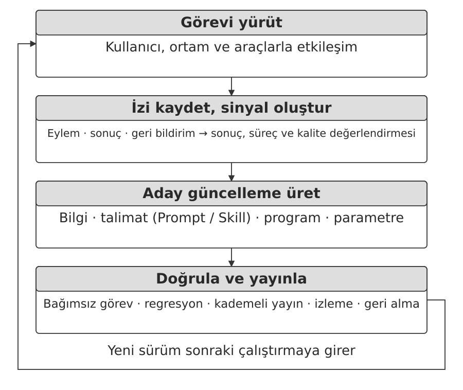
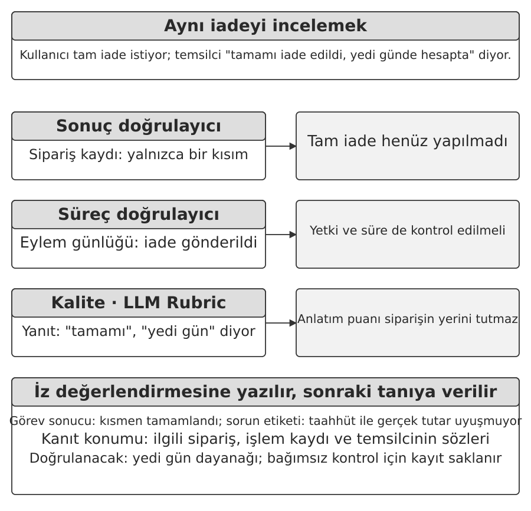
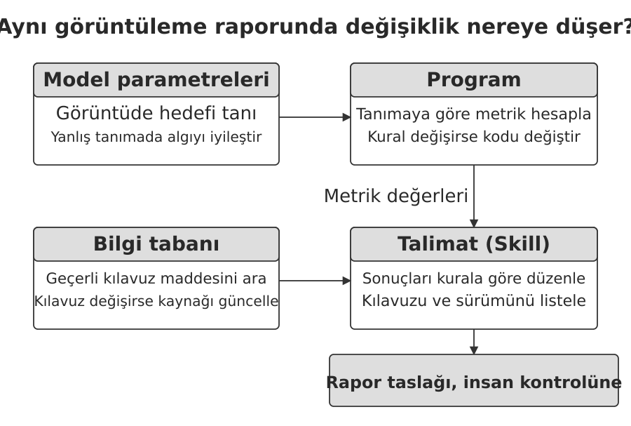
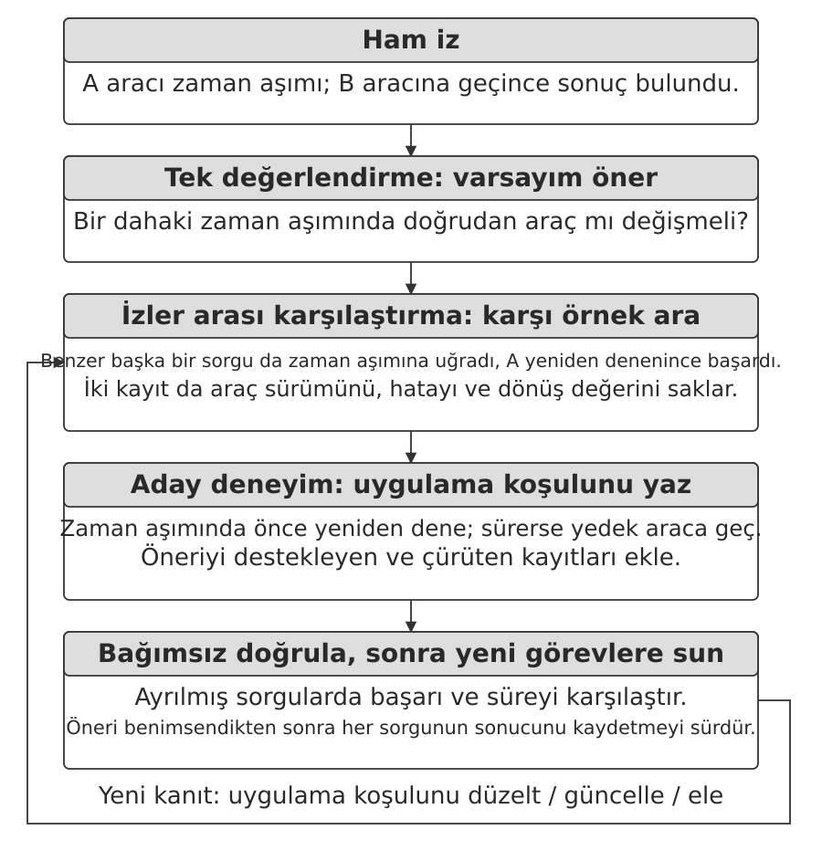
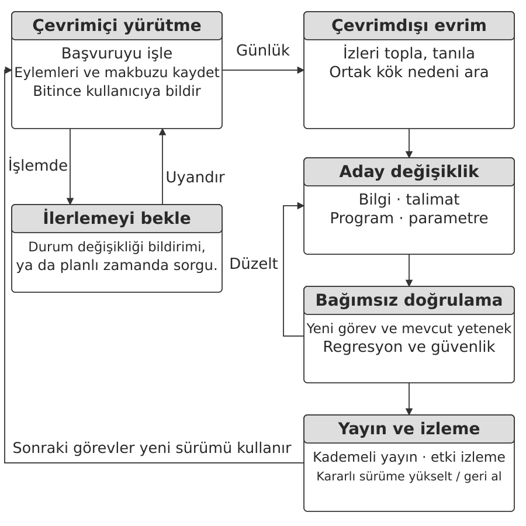

# Agent'ın Sürekli Evrimi

Bir Agent alışık olmadığı karmaşık bir görevi ilk denemede tamamlayabilir, ama birbirine benzeyen pek çok görevi işledikten sonra bile aynı hatayı yinelemeyi sürdürebilir. Onun da yeni bir çalışan gibi günlük işten sürekli gelişmesi için sistemin çalışma deneyimini daha sonra kullanılabilecek yeteneğe dönüştürmesi gerekir: sonuçları kaydetmek, sorunun nedenini bulmak, bir iyileştirme yolu oluşturmak ve bu yolun yeni görevlerde işe yarayıp yaramadığını doğrulamak. **Yazara göre deneyimden öğrenmek ve sürekli evrilmek, Agent'ın en önemli yeteneklerinden biri hâline geliyor.** Bu yetenek hem uygulama sistemlerinde mühendislik çalışması gerektirir hem de yeni nesil modeller için bir araştırma önceliği olmayı hak eder.

Dağıtımdaki bir model genellikle bir çıkarım bittikten sonra parametrelerini olduğu gibi korur. Bölüm 2'deki context içi öğrenme, durum yönetimi ve sıkıştırma onun geçerli görev içinde uyum sağlamasına yardım eder; Bölüm 3'teki bellek ve bilgi tabanı ise bilginin görevler arasında saklanmasını sağlar. Deneyimden bir adım daha öteye giderek öğrenmek için birden çok çalışmayı karşılaştırmak gerekir: başarılı izlerin ortak adımları nelerdir, başarısız izlerde ne eksiktir, belirli bir yöntem hangi araç sürümlerinde ve görev koşullarında geçerlidir.

Örneğin yüz bilet rezervasyonu izi saklandıktan sonra sistem gerektiğinde belirli bir deneyimi bulup getirebilir. "Bilet almadan önce özel yemek siparişinin son tarihini kontrol et" gibi bir deneyim oluşturmak için ise başarılı ve başarısız rezervasyonların nedenlerini karşılaştırmak, havayolunu ve zaman koşullarını kontrol etmek, sonra bu yöntemi yeni görevlerle doğrulamak gerekir. Kayıt ve arama Agent'ın deneyimleri yeniden bulmasını sağlar; karşılaştırma, genelleme ve doğrulama ise yeniden kullanılabilir yöntemler oluşturmasına yardım eder. Ancak böyle bir birikimle Agent zeki olmaktan usta olmaya doğru ilerleyebilir.

**Sürekli öğrenme (continual learning)**, bir sistemin yeni görevler ve yeni verilerle öğrenmeyi sürdürürken mevcut yeteneklerini nasıl koruyacağını inceler. Agent bu sorunu günlük etkileşime taşır: geri bildirim kullanıcılardan, araçlardan ve ortamdan gelir; kullanıcı memnuniyeti, görevin tamamlanması ve sürece uygunluk farklı sonuçlar verebilir. Yazara göre Agent'ın sürekli öğrenmesindeki büyük zorluklardan biri, günlük işte doğruyu ve yanlışı adım adım işaretleyen kimsenin pek olmaması ve sistemin hangi geri bildirimin güvenilir olduğuna kendisinin karar vermek zorunda kalmasıdır. Doğrulanmamış bir geri bildirim kural olarak yazılır ya da eğitimde kullanılırsa yanlış neden atfı sonraki görevleri etkiler. Bu tür hatalar sürüp gider: yanlış kaydedilmiş bir tercih bir sonraki rezervasyonu etkiler, yanlış geri bildirimle model eğitmek ise önceden doğru yapılan görevlerin de yanlış yapılmasına yol açabilir.

Bu kitap, Agent sisteminin bütünüyle deneyimden güncellenme sürecini **sürekli evrim** olarak adlandırır; bu süreç bilgi, talimat, program ve model parametreleri olmak üzere dört taşıyıcıyı kapsar. Temel modelin dönemsel eğitimi genel yetenekleri sağlar; Agent'ın deneyime dayalı güncellemesi ise somut iş kurallarını, araç değişikliklerini ve yerel stratejileri ele alır. Bu yerel değişiklikler sürekli olur; bir sonraki temel model eğitimini beklemek çoğu zaman işin ihtiyacına yetişemez.

Bugünkü aşamada yazar önce modelin çevresinde doğrulanabilir bir öğrenme sistemi kurmayı savunur: açıkça ifade edilebilen deneyim bilgi, talimat ve program yoluyla sonraki davranışı etkiler, parametre öğrenmesine uygun malzeme ise sonradan eğitime gönderilir. Her güncellemede önce yeni sürüm üzerinde regresyon değerlendirmesi yapılır; sürüm yayın kontrollerinden geçtikten sonra sonraki görevler bu sürümü kullanır.

Önceki bölümler bu sistemin başlıca parçalarını tanıttı: Bölüm 2 görev durumunu düzenler, Bölüm 3 bilgiyi saklar ve arar, Bölüm 5 kodla araç yaratır ve sistemi değiştirir, Bölüm 7 sonuçları değerlendirir, Bölüm 8 model parametrelerini günceller. Şekil 9-1 bu parçaları birbirine bağlıyor. Geçen sefer özel yemeğin unutulduğu deneyim değerlendirilir ve bir sonraki rezervasyonda kullanılacak bir kurala dönüşür.

## Çalışma izlerinden öğrenme sinyali elde etmek

Hangi izlerden öğrenmeye değer? Müşteri temsilcisi kullanıcıya "iade tamamlandı" dediyse önce gerçekten ne kadar para iade edildiğine, işlemin kurallara uygun olup olmadığına, sonra kullanıcının bu yanıttan paranın ne zaman hesabına geçeceğini anlayıp anlayamadığına bakmak gerekir. Şekil 9-2 bu üç kontrolü bir araya getiriyor. Üç yargı sırasıyla sipariş kayıtlarını, eylem günlüklerini ve temsilcinin kendi sözlerini kullanır.

**Sonuç doğrulaması ortamda neyin değiştiğini kontrol eder.** Coding Agent testleri, tür denetimini ve performans kıyaslamalarını çalıştırabilir; iade Agent'ı sipariş durumunu ve gerçekte iade edilen tutarı sorgulayabilir. Yazar genellikle önce bu katmanı kontrol eder. Model tam iade yaptığını söylüyor ama hesaba yalnızca bir kısmı iade edilmişse, sipariş kaydı olduğunda hangi işleme geri dönüp bakılacağı bilinir.

**Süreç doğrulaması eylemlerin görev kurallarına uyup uymadığını kontrol eder.** Testler geçtikten sonra korunan test dosyalarının değiştirilip değiştirilmediği de kontrol edilmelidir; Agent kullanıcıya "iade yedi gün içinde hesabınıza geçecek" dediğinde iadenin gerçekten gönderildiği ve sürenin bir dayanağı olup olmadığı da doğrulanmalıdır. Yetki tabloları, yapılandırılmış politikalar ve eylem kayıtları programlara kontrol ettirilebilir; bağlamın yorumlanmasını gerektiren maddeler ise ilgili kanıtlarla birlikte değerlendirilir.

**Kalite doğrulaması teslimatın kullanım gereksinimlerini karşılayıp karşılamadığını kontrol eder.** Temsilcinin anlatımının açık olup olmadığı, alternatif çözümün kullanıcının hedefine uyup uymadığı, araştırma raporunun temel kanıtları yakalayıp yakalamadığı nihai etkiyi belirler. Bölüm 7'de tanıtılan LLM-as-a-Judge kullanılabilir: Rubric önceden tanımlanır, değerlendirici model her kalem için puan, gerekçe ve kanıt verir.

Tablo 9-1 müşteri hizmetlerini örnek alarak üç katmanlı değerlendirmeyi yedi boyuta açıyor. Görev sonucu sonuç katmanına; kurallar, gizlilik ve taahhüt süreç katmanına; anlatım ve uyarlama kalite katmanına karşılık gelir; olgusal güvenilirlik ise içeriğe göre ayrı ayrı doğrulanır. Örneğin iade tutarı doğrudan araç dönüşüyle karşılaştırılabilir, politika açıklaması ise özgün metin ve uygulama koşullarıyla birlikte değerlendirilmelidir.

Tablo 9-1 Müşteri hizmetleri Agent'ı için iz değerlendirme boyutları

| Boyut | Doğrulama sorusu | Başlıca kanıt |
| --- | --- | --- |
| Görev sonucu | Kullanıcının temel talebi çözüldü mü | Son ortam durumu, araç sonuçları |
| Kurallara uyum | Politika, yetki ve gerekli süreçler karşılandı mı | Politika kütüphanesi, eylem izi |
| Gizlilik sınırı | Verilen bilgi izin verilen kapsamda mı | Yanıt metni, erişim kayıtları |
| Olgusal güvenilirlik | İfadeler bilgi ya da araç sonuçlarıyla destekleniyor mu | Alıntılanan kaynak, araç dönüşü |
| Taahhüt—eylem tutarlılığı | Tamamlandığı söylenen işlem gerçekten yapıldı mı | Yanıt ile yürütme kayıtlarının karşılaştırması |
| Anlatım kalitesi | Doğal, öz ve açık mı | Konuşmanın tamamı, dil Rubric'i |
| Kurala uygun uyarlama | Asıl çözüm engellendiğinde izin verilen bir alternatif bulundu mu | Kullanıcı hedefi, politika ve sonraki eylemler |

Sonraki güncellemeleri desteklemek için değerlendirme çıktısı dört öğe içermelidir: genel görev durumu, her boyutun sonucu, sonuca karşılık gelen kanıtın konumu ve hata türü. Kanıt konumu belirli bir konuşma turunu ya da belirli bir araç çağrısını gösterebilir. Kanıtı yetersiz olan boyutlar onay bekliyor olarak işaretlenir ve ek doğrulamaya ya da insan incelemesine verilir.

Örneğin "iade başarısız, anlatım açık" demek iyileştirme yolunu belirlemeye yetmez. "4. turda sipariş numarası eksikken iade arayüzü çağrıldı, arayüz işlemi reddetti; 5. turda yine iade yapıldığı söylendi" bilgisi eklendiğinde parametre doğrulaması ve tamamlandı bildiriminin doğrulanması için ayrı ayrı değişiklik önerilebilir.

> **Deney 9-1 ★★: Müşteri hizmetleri Agent'ı için iz doğrulayıcısı kurmak**
>
> Aynı müşteri hizmetleri izleri için iki tür çıktıyı karşılaştırın: biri yalnızca toplam puan verir, diğeri her boyut için sonuç, kanıt ve güven düzeyi verir. İkincisinin görev başarısızlığını, kural ihlalini, sahte taahhüdü ve anlatım sorunlarını ayrı ayrı bulup bulamadığını ve buna dayanarak karşılık gelen güncellemeleri önerip öneremediğini kontrol edin.
>
> Bilginin eskimesi kaynakların güncellenmesini gerektirir, eksik parametre için çağrı öncesi kontrol eklenebilir, tekrarlanan ifadeler ise talimat ya da eğitimle düzeltilebilir.

Deney 9-1 kurgusal hesap bilgileriyle sekiz iz oluşturdu: normal iade, sahte taahhüt, gizlilik ihlali ve aşırı reddetme için ikişer iz. `real-normal-refund-01` izinde temsilci iadenin yapıldığını söylüyor, sipariş durumu da `refunded` oluyor, iade tutarı 480.

Sekiz izin her biri yedi kalemde değerlendirildi; 56 yargının 52'si test senaryosunda önceden belirlenen uzman etiketleriyle aynıydı, uyum oranı yaklaşık %92,9. Kalan dört ayrılığın üçü aynı bilet değişikliğinde toplanıyor. Kullanıcı iade edilemeyen bir uçak biletini 3 Ekim'e değiştirmek istiyor. Temsilci kimliği doğruluyor, siparişi üç kez sorguluyor ve 10. turda kullanıcıya işlemin yapıldığını söylüyor. Oysa sipariş durumu hâlâ `confirmed` ve çağrı kayıtlarında hiçbir değişiklik işlemi yok.

Burada kimi yeniden incelemek gerekir? "Kurala uygun uyarlama"yı değerlendiren model 10. turdaki yanıtı alıntılayıp geçer not verdi; yapılabilecek ama yapılmamış bu alternatif çözümü gözden kaçırdı. "Taahhüt ile eylem tutarlılığı"nı değerlendiren program ise hata bildirdi, ama gerekçesi başarılı bir iade çağrısı bulamamasıydı. Kullanıcı bilet değişikliği istiyor; kontrol edilmesi gereken şey değişiklik kaydı ve yeni tarihtir. Bu boyutun önceden belirlenmiş etiketi de "geçti"ydi ve gerçekte üretilen yanıtla örtüşmüyordu.

Bu bilet değişikliğinde onarılacak iki yer var: temsilci bir adımı eksik yaptı, puanlama programı ise yanlış aracı kontrol etti. Bilet rezervasyonuna geçildiğinde yüzeyde aynı görünen bir hata farklı yerlerden kaynaklanabilir. Kullanıcı bütçeyi genişletmiş ama asistan hâlâ eski bütçeye göre süzüyor olsun; iz boyunca geriye gidildiğinde yeni tercihin kaydedilmemiş olduğu, bu sefer eski tercihin getirildiği ya da modelin yeni bütçeyi okuduğu ama bilet seçerken kullanmadığı ortaya çıkabilir.

## Agent'ın sürekli evrimi için dört yöntem

Sorun bulunduktan sonra neyin değiştirileceğine de karar verilmelidir. Şekil 9-3'teki tıbbi görüntüleme Agent'ını örnek alalım: rapor kılavuzun eski sürümünü alıntılıyorsa önce bilgi tabanında hangi sürümün saklandığı kontrol edilebilir. Kılavuz doğruysa ama rapor alıntının kaynağını belirtmiyorsa raporu yazan talimata geri dönüp bakılmalıdır. Bu iki rapor geri çevrilmiş olsa bile düzeltmede bakılacak yerler farklıdır.

Müşteri hizmetleri sistemi de bu dört yöntemi aynı anda kullanır. Eğitilmiş model dili düzenler, bilgi tabanı şirket politikalarını saklar, Skill istisnalarla nasıl başa çıkılacağını açıklar, sunucu tarafı kod da yetkiyi ve tutarı doğrular. Tablo 9-2 güncelleme yöntemi seçilirken tartılması gereken maliyetleri ve sınırlamaları listeliyor.

Tablo 9-2 Dört sürekli evrim yönteminin uygulama sınırları

| Güncelleme yöntemi | Taşımaya uygun olduğu şey | Mühendislik avantajı | Ele alınması gereken sorunlar |
| --- | --- | --- | --- |
| Deneyim bilgi tabanı | Olgular, deneyimler, istisnalar ve kaynaklar | Hızlı güncelleme, izlenebilirlik, ihtiyaca göre arama | Arama kalitesi, uygulama koşulları ve modelin doğru kullanıp kullanamadığı |
| Prompt ve Skill | Bağlamı, istisnaları ve öncelikleri birlikte gerektiren yargı ilkeleri | Açıklanabilir, yerel olarak değiştirilmesi kolay | Uzunluk artışı, talimat çakışması ve uyum etkisi |
| Program ve Harness | Ayrıştırılabilir süreçler, yürütülebilir doğrulama, yetki ve katı kısıtlar | Test edilebilir, kararlı yürütme | Geliştirme bakımı, arayüz uyumluluğu ve istisna yönetimi |
| Model parametreleri | Algılama, üretim üslubu ve örtük karar kalıpları | Öğrenilmiş kalıpları yeniden kullanır, tekrarlanan context'i azaltır | Veri hazırlığı, eğitim maliyeti, genelleme ve unutma |

Bir iyileştirme birden çok güncellemeye bölünebilir. Yazar politika olgularını öncelikle bilgi tabanına, yetki kontrolü gibi kesin yürütülebilen kısıtları programa koyar; bağlam ve istisnaları anlamayı gerektiren ilkeleri Skill ile ifade eder, yüksek boyutlu algılamayı ve örtük stratejileri eğitimle iyileştirir.

### Deneyimi bilgi olarak biriktirmek

Aynı bilet rezervasyonu kaydından iki düzeyde bilgi çıkarılabilir. Biri "Bu havayolu özel yemeğin yirmi dört saat önceden sipariş edilmesini istiyor"dur; diğeri "Ödemeden sonra ihtiyacın karşılanamayacağını fark etmemek için bilet almadan önce özel yemek son tarihini kontrol et"tir. İlki havayolu, geçerli hatlar ve politika kaynağıyla birlikte saklanmalıdır. Başka bir havayolunun son tarihi farklı olabilir, ama "önce bu uçuşun son tarihini kontrol et" yine aktarılabilir. Böylece olgu eskidiğinde değiştirilmesi gereken yalnızca somut süredir; bir sonraki rezervasyonda bu kontrol deneyimi hâlâ kullanılabilir. İkisi de Bölüm 3'teki saklama, dizinleme ve arama yöntemleriyle saklanabilir.

Tek bir rezervasyondan böyle bir deneyim çıkarmanın maliyeti çok düşük olabilir, ama rezervasyon kaydının tamamı olduğu gibi kopyalanamaz. Kayıtta araçların döndürdüğü politika metni de vardır, Agent'ın birçok denemede yaptığı dolambaçlar da. Bir sorgu zaman aşımına uğramış, sonra başka bir araçla sonuç alınmışsa bunu olduğu gibi izlemek, rastlantısal bir arızayı araç değiştirmenin gerekçesi saymak anlamına gelebilir.

Malzeme üç katmanda saklanabilir: **ham izler** çalışmanın tam kanıtını korur, **tek çalışma analizi** başarının ve başarısızlığın nedenlerini ve deneyim taslaklarını kaydeder, **resmî deneyim belgeleri** görevler arasında doğrulanmış yöntemleri toplar. Ham izler sürümlerine göre saklanır; analiz ve bilgi ise yeni kanıtlar geldikçe düzeltilir. Resmî belgeler uygulama senaryosunu, önerilen stratejiyi, yasaklanan uygulamaları, istisnaları, kaynakları ve son doğrulama zamanını açıkça yazar; bu da sonraki arama ve kontrolü kolaylaştırır.

Bölüm 3'teki User as Code önce olgu günlüğüne ekleme yapar, sonra kullanıcı modelini düzenli olarak yeniden kurar. Burada da kayıt ile düzenleme ayrılır. Az önceki sorguya dönelim. Başka bir sorgu da zaman aşımına uğramış, ama aynı araçla yeniden denendiğinde başarılı olmuşsa "zaman aşımında aracı değiştir" önerisi hâlâ geçerli midir? Şekil 9-4 bu iki kayıttan daha hedefli bir öneri taslağının nasıl çıkarılacağını ve sonra başka sorgularla nasıl sınanacağını gösteriyor.

Bölüm 3'teki çıkarma, kümeleme ve arama yöntemleri kullanılırken aynı deneyimin olumlu ve olumsuz örnekleri bir arada tutulabilir. İki rezervasyon aracın aynı sürümünü mü kullandı? Biri başarılı biri başarısız olduysa bunun nedeni bir adımın atlanması mı, yoksa rezervasyon koşullarının zaten farklı olması mı? Ham kayıtlardan kullanılabilir deneyim çıkarmak somut olarak beş adıma ayrılabilir:

1. Ham izleri ve ortam sonuçlarını saklayın, görev ve araç sürümlerini sabitleyin.
2. Her çalışma için görev türünü, gereken yetenekleri, gerçek stratejiyi, hataları ve istisnaları kaydeden bir analiz üretin.
3. Görev ailelerine göre toplayın ve her deneyim için onu destekleyen ve çürüten izleri listeleyin.
4. Kanıtı yeterli olan deneyimleri seçip bilgi maddesi taslağı olarak yazın.
5. Çıkarıma katılmamış yeni görevlerde test edin, önerilen stratejinin sonraki performansı iyileştirip iyileştirmediğini kontrol edin.

GAIA[^gaia-2023] arama, web sayfası okuma, dosya işleme ve hesaplama gibi çok adımlı sorular sunar; AWorld[^aworld-2025] ise Agent yürütmesi, araç çağrısı ve iz kaydı için bir ortam sağlar. İkisi birleştirildiğinde önce yanıtlar ya da ortam durumuyla başarı, kısmi başarı ve başarısızlık işaretlenebilir, sonra görev ailelerine göre yollar karşılaştırılabilir. Başarılı kayıtlardan yeniden denemeye değer yöntemler, başarısız kayıtlardan da hangi durumlarda bunların izlenmemesi gerektiği çıkarılabilir. Görev yalnızca kısmen tamamlandıysa hangi adımların etkili olduğu ve sorunun nerede başladığı adım adım kontrol edilebilir.

Reflexion[^reflexion-2023] sonraki denemelere yardım etmek için doğal dilde yansıtma kullanır. Bu yaklaşım bilgi çıkarımına bağlandığında yansıtma neden varsayımları ve deneyim taslakları önermek için, ortam sonuçları doğrulama için, izler arası karşılaştırma uygulama koşullarını belirlemek için, yeni görevler ise aktarımı kontrol etmek için kullanılır. Bir deneyimin resmî bilgi tabanına girip girmeyeceğini dört tür malzeme birlikte belirler.

[^reflexion-2023]: Shinn, N., et al. *Reflexion: Language Agents with Verbal Reinforcement Learning.* arXiv:2303.11366, 2023.

[^gaia-2023]: Mialon, G., et al. *GAIA: a benchmark for General AI Assistants.* arXiv:2311.12983, 2023.

[^aworld-2025]: Yu, C., et al. *AWorld: Orchestrating the Training Recipe for Agentic AI.* arXiv:2508.20404, 2025.

Bölüm 6'daki bilet rezervasyonu senaryosuna dönelim. Kullanıcı bilet fiyatının 1200 yuanı aşmamasını istiyor, aynı gün bir toplantıya yetişmesi gerekiyor ve sonunda 1250 yuanlık teklifi kabul ediyor. Asistan özgün bütçeyi, ödenen fiyatı, yolculuğun amacını ve kullanıcının kendi sözlerini kaydedebilir. Sonraki üç rezervasyonda en düşük teklif tam da 1250 yuan. Bu bellek nasıl kullanılmalı?

- Gelecek hafta yine aynı iş toplantısına yetişilmesi gerekiyor. Kullanıcı önceki birkaç seferde toplantıya yetişmek için birkaç on yuan fazla ödemeye razı olmuştu ve bu sefer de asistana her zamanki gibi bilet almasını söylüyor. Asistan bu uçuşu ayırtabilir ve gerçek fiyatı bildirir.
- Kullanıcı çocuğuyla tatile gidiyor ve özellikle "Bütün aile gidiyor, biraz tasarruf edelim; 1200 yuanı aşarsa önce bana sor" diyor. Asistan 1250 yuanlık seçeneği kullanıcıya gönderebilir ve bir gün önce ya da sonra bütçe içinde uçuş olup olmadığına da bakar.
- Kullanıcı sonradan şöyle açıklıyor: "Geçen sefer acelem olduğu için kabul etmiştim, aslında 1250 yuan bile pahalı. Bundan sonra iş seyahatlerinde bütçe aşılırsa da önce bana sor." Bir sonraki sefer aynı kişi aynı şehre toplantıya gidiyor olsa bile asistan önce sormalıdır. O seferki satın alma kaydı korunur, bu daha yeni ve daha açık istek de iş seyahati tercihlerine yazılır; böylece iki bellek de kendi işine yarar.

Bu üç sipariş güncellemenin katmanlarını gösteriyor. Kullanıcının tek bir düzeltmesi geçerli görevi hemen değiştirebilir ve kendi tercihini güncellemeye de yeter. Paylaşılan bilet rezervasyonu Skill'ini değiştirmeyi önermeye ancak birçok bağımsız vaka asistanın yolculuk amacını göz ardı ettiğini gösterdiğinde değer; böylece Skill teklifleri karşılaştırırken ilgili tercihleri çağırır. Açıkça verilen bütçe ve tercihler zaten yüklenmişken model farklı bir ifade karşısında yine yanlış yargıya varıyorsa ancak o zaman bu tür vakaları toplayıp modelin yargı yeteneğini eğitmeye değer.

### Deneyimi talimat olarak yazmak

Asistana her seferinde doğru malzeme verildiği hâlde aynı aşamada hata yapıyor ve deneyimli bir kişi nasıl karar verileceğini tek cümleyle anlatabiliyorsa bir talimat yazmayı deneyebilirsiniz. Deneyim belgeleri asistana başvuru için bırakılır, sistem prompt'u görevler arası davranış gereksinimlerini ifade eder, Skill alana ya da araca göre yerel süreçleri yükler, yetki gibi katı kısıtları ise Harness uygular. Değişikliği doğru yere koymak, gelecekte hangi görevlerin etkileneceğini belirler.

Andrej Karpathy, bir deneyim güncelleme biçimini **sistem prompt'u öğrenmesi (System Prompt Learning)** olarak adlandırır: model bir sorunla karşılaştıktan sonra gelecekteki görevlerde kullanılmak üzere bir hatırlatma yazar.[^karpathy-system-prompt-learning] DSPy[^dspy-2023] geliştirme kümesinde talimatları ve örnekleri optimize eder, OPRO[^opro-2023] denenmiş prompt'lara ve puanlarına bakarak yeni prompt'lar önerir, GEPA[^gepa-2025] ise iz geri bildirimini kullanarak prompt değişiklikleri önerir ve süzer. Bu yöntemlerin hepsi talimatları çalışma sonuçlarına göre yeniden yazar, sonra yeni ve eski sürümü geliştirme görevleriyle karşılaştırır; çevrimdışı toplu optimizasyona uygundurlar.

Üretim güncellemelerinde yazar kaynağı belirtilmiş en küçük diff'i tercih eder; tetikleyen vakayı, değişiklik gerekçesini ve eski sürümü saklar. Yerel yamalar mevcut kurallar üzerindeki etkiyi azaltır ve gerileme olduğunda tek bir değişikliği geri almayı kolaylaştırır.

Yeni talimatın geçen seferki hatayı gerçekten düzeltip düzeltmediği nasıl anlaşılır? Kullanıcının yanlış arşivlenmiş bir müşteri mektubunu gösterip "Bu müşterinin bana yanıtı, nasıl olur da bülten sayılır?" dediğini varsayalım. Açık kaynak e-posta asistanı Inbox Zero bir deneme çalıştırma aracı sunar. Kural düzeltildikten sonra asistan e-posta kimliğiyle özgün mektubu getirebilir, hesabın o anda etkin kurallarına göre yeniden karar verebilir ve hangi kuralların eşleşeceğini, nedenini, hangi etiketi koymaya ya da hangi klasöre taşımaya hazırlandığını görebilir. Bu adım yalnızca yürütülmesi planlanan eylemlere bakar; posta kutusu olduğu gibi kalır ve yanıt taslağı da oluşturulmaz.[^ch9-inboxzero] Şimdi gerçek bir bülteni seçip bir kez daha deneyin: müşteri mektubu gelen kutusunda kalır, bülten de her zamanki gibi arşivlenir; iki mektup birlikte bu değişikliğin mevcut sınıflandırma sınırını koruyup korumadığını gösterir.

[^ch9-inboxzero]: Inbox Zero projesindeki `test-rules-on-email-tool.ts`, kuralları belirli bir e-postayla deneme amaçlı çalıştıran aracı uygular.

#### Örnek 1: Devretme ile araç kullanımı arasındaki sınırı netleştirmek

τ²-bench'in telecom politikası şunu ister: istek Agent'ın eylem kapsamını aşıyorsa insana devredilir, devretmeden önce sorunu çözmek için elden gelen yapılır. Kural çıkarmak için kullanılan 20 sorudan daha zayıf bir model yalnızca 1'ini geçti. Geri kalan 19 soru nasıl başarısız oldu? 17'sinde insana devretme aracı çağrıldı, diğer 2'si adım sınırına kadar çalışmayı sürdürdü.

Bu 19 başarısız iz modele verildi, modelden kurallar çıkarması ve bunları özgün politikanın sonuna eklemesi istendi. Aynı 114 yeni soruda yalnızca özgün politikayla 14 soru (%12,3) geçti; birinci sürüm kurallar eklendiğinde 20, ikinci sürüm kurallar eklendiğinde 22 soru (%19,3) geçti. Soru soru karşılaştırıldığında ikinci sürüm önceden geçen 14 soruyu korudu ve ayrıca 8 soruyu daha doğru yanıtladı. İki kural sürümü temsilciye tam olarak ne kazandırdı?

**Girdi malzemesi kuralların içeriğini belirler.** Yalnızca hata metni ve başarısızlık özeti verildiğinde model "aynı araç art arda hata verirse çağırmayı bırak" kuralını çıkardı. İkinci çıkarımda model, temsilcinin ve kullanıcının araç listelerini ayrı ayrı da gördü ve prompt'ta ondan "bu adımı kimin yapması gerektiğini" düşünmesi istendi. Bu kez üretilen kurallar iş bölümünü netleştirdi: ağ durumu, SIM kart ve APN gibi cihaz işlemlerinin kullanıcıya yol gösterilerek yaptırılması gerekir. Böylece deneyim genel bir yeniden deneme hatırlatmasından somut işlemler için bir iş bölümü kuralına inceldi.

**Çıkarımın politika ve sonuçlarla da doğrulanması gerekir.** Birinci sürümün eklediği kurallar arasında "art arda üç çağrı başarısız olursa devret" ve "kullanıcı iki kez numara vermezse devret" vardı. Bu sürüme göre çalıştırıldığında 114 aktarım sorusunun hepsinde devretme oldu ve yalnızca 20'si geçti. Bu iki kural erken devretmeyi de öğrenmeye katmıştı.

Bir iz, düzeltmeden önceki ve sonraki farkı açıkça gösteriyor. Kullanıcı telefonunun çekmediğini söylüyor. Temel temsilci "Lütfen doğru telefon numaranızı verin" gibi bir cümleyi numara alanına dolduruyor, beş kez sorguluyor, hepsinde hata alıyor ve ardından insana devrediyor. İkinci sürüm kurallarla temsilci ilk sorguda yine numarayı doldurmayı unutuyor, ama bu sefer konuşmada kullanıcıya soruyor ve numarayı aldıktan sonra hesabı buluyor. Ardından SIM kartı kontrol etmeyi deniyor; araç bu işlemi bulamadığını bildirince temsilci kullanıcıdan SIM kartı çıkarıp yeniden takmasını istiyor. Kullanıcı bunu yapıyor, telefonda uçak modunu da kapatıyor ve soru ancak o zaman geçiyor. İkinci sürümün temele göre fazladan doğru yanıtladığı diğer yedi soruya bakalım: yalnızca birinde insana devredilmedi, diğer altısında insana devretme aracı çağrıldı. Yani "insana devredilmedi" geçme ölçütü olarak alınsaydı bu altı soru tam da gözden kaçacaktı. Devredip devretmemeye karar vermek için temsilcinin daha neler yapabildiğine ve görevin ondan nereye kadar gitmesini istediğine bakmak gerekir.

> **Deney 9-2 ★★: τ²-bench başarısız izlerinden devretme ve araç kullanımı kuralları çıkarmak**
>
> Bölüm 7'deki telecom ortamı kullanılır; çıkarım kümesi ile aktarım kümesi ayrılır. Önce başarısız izleri toplamak için daha zayıf bir model çalıştırılır, sonra modele kurallar ürettirilir ve özgün politikaya eklenir. Aktarım kümesinde özgün sürüm iki evrilmiş sürümle karşılaştırılır; üç grupta yalnızca politika dosyası değiştirilir, kullanıcı simülatörü aynı tutulur.
>
> Temelde 104 soruda, ikinci sürümde 111 soruda devretme oldu; bir soruda bir kez devredilmişse sayılır. Kullanıcı tarafı araçların yanlış çağrılması çağrı sayısına göre sayıldı ve 1049'dan 163'e düştü. Başka bir metrik, çağrı parametrelerinde en az bir değerin boş dize olduğu çağrıları sayar ve 904'ten 174'e düştü; hiç parametre verilmeyen çağrılar bu metriğe girmez. Her strateji her soruda yalnızca bir kez çalıştırıldı.

Havayolu müşteri hizmetlerinde de erken devretme görülür. Kullanıcı iade ücretine, değişiklik ücretine ya da bagaj politikasına itiraz ettiğinde Agent geçerli politikaya göre sorgulamalı, açıklamalı ve izin verilen alternatifleri aramalıdır. Aşağıdaki deneyde kullanılan kurallarda sıradan politika anlaşmazlıkları Agent'ta kalır; kullanıcı açıkça insan istediğinde ya da belirlenmiş güvenlik durumları ortaya çıktığında `transfer_to_human` çağrılarak devredilir.

> **Deney 9-3 ★★: Başarısız izlere dayanarak havayolu müşteri hizmetlerinin sistem prompt'unu optimize etmek**
>
> Erken devretme izleri kurallara uyum, görevin çözülmesi ve kurala uygun uyarlama boyutlarında analiz edilir ve kaynağı belirtilmiş Prompt yamaları üretilir. Otomatik çıkarılan sürüm, başlangıç sürümü ve elle ayarlanmış sürümle aynı koşullarda karşılaştırılır.
>
> Mevcut yetenekleri kontrol etmek için ayrıca beş soru kullanıldı: üçü temsilcinin kendisinin halletmesini, ikisi insana devretmesini gerektiriyor; üç talimat sürümü de 5/5 aldı. Yamayı çıkarmak için kullanılan beş erken devretme sorusunda aynı model değerlendirici başlangıç, otomatik ve elle ayarlanmış sürümlere sırasıyla 0, 2 ve 4 geçer not verdi. Otomatik sürüm indirimli bilet iadesi ile fazla bagaj sorularını düzeltti. Program buna dayanarak küçük kapsamlı bir denemeye izin verdi.
>
> Tartışmaya açık bir puan var. Yolcu 200 yuanlık değişiklik ücretinin kaldırılmasını istiyor, elle ayarlanmış sürüm ise indirimli biletin iade edilip edilemeyeceğini anlatmaya başlıyor. Değerlendirici "vergilerin iadesi" önerisini kabul edip geçer not verdi; yolcunun sorduğu değişiklik ücretini ise temsilci hiç açıklamadı.

#### Örnek 2: Kullanıcı geri bildirimine göre gereksinim netleştirme Skill'ini geliştirmek

Mevcut bir gereksinim netleştirme Skill'i ne zaman soru sorulacağını, hangi soruların sorulacağını ve yürütmeye ne zaman başlanacağını belirleyebilir. Kullanıcı geri bildirimi biriktikçe sistemin bu karar koşullarını ayarlaması gerekir; böylece netleştirmenin yararı ile rahatsız etme maliyeti dengelenir.

Örneğin kullanıcı "Giriş sayfasını kurumsal girişi destekleyecek şekilde değiştir" dediğinde uygulamadan önce kimlik sağlayıcısını, geri dönüş yolunu, eski kullanıcılarla uyumluluğu ve yayın kapsamını belirlemek gerekebilir. Buna karşılık bir yazım hatasını düzeltmek genellikle doğrudan yapılabilir. Çok az sorulursa önemli seçimler teslimattan sonraki yeniden işe kalır; çok fazla sorulursa basit bir değişiklik bile uzun bir görüşmeye dönüşür. Skill süreci belirsizliğe, riske ve yeniden işin maliyetine göre seçmelidir.

Başlangıç süreci şöyle düzenlenebilir: düşük riskli ve kolay geri alınabilen küçük değişikliklerde gerekli varsayımlar belirtilip yürütülür; mimariyi, veriyi, yetkileri, açık arayüzleri ya da geniş kapsamlı değişiklikleri ilgilendiren durumlarda çözümü değiştirecek birkaç soru bir arada sorulur. Ardından hedefleri, hedef olmayanları, ödünleşimleri, varsayımları ve kabul ölçütlerini listeleyen kısa bir Spec ya da Plan oluşturulur. Onaylanması gereken konular yanıtlandıktan sonra yürütme sürer; yürütme sırasında öncüller değişirse etkilenen kararlar bulunur ve ek onay alınır.

Bu süreci geliştirmek için görevi, netleştirme sorularını, Spec sürümlerini, kullanıcı değişikliklerini, teslimat sonuçlarını ve yeniden işi kaydetmek gerekir. Kullanıcı "Bu benim düşündüğüm gibi değil" derse hangi koşulların atlandığı kontrol edilir; "Çok fazla soru soruyorsun" derse bu soruların yanıtlarının çözümü etkileyip etkilemediği kontrol edilir.

Birçok kimlik doğrulama görevinde eski girişle uyumluluk gereksinimi tekrar tekrar atlanıyorsa Skill'e "kimlik sağlayıcısını, geri dönüş yolunu ve uyumluluk kapsamını onayla" koşulu eklenebilir. Çok sayıda yazım düzeltmesi sorular yüzünden gecikiyorsa netleştirme sürecinin tetiklenme kapsamı daraltılmalıdır.

Bu, Skill ile Harness arasındaki iş bölümünü de gösterir. Skill modelin bağlamı anlamasına, soru sormasına ve çözümü düzenlemesine rehberlik eder; Harness ise proje kurallarına göre yüksek riskli yazmalarda gerekli yetki eksik olduğunda, korunan dallar doğrudan değiştirildiğinde ya da yayın süreci atlandığında işlemi engeller. Gereksinim içeriğine ilişkin yargıyı yine model, kullanıcı girdisiyle birlikte verir. Doğrulanmış konuşma izleri Bölüm 8'de tanıtılan eğitim verisine de dönüşebilir.

> **Deney 9-4 ★★: Kullanıcı geri bildiriminden gereksinim netleştirme ve Spec onayı Skill'ini evriltmek**
>
> Bu, karşılaştırmayı sizin tasarladığınız bir alıştırmadır. Önce iki görev eşleştirilebilir: giriş düğmesindeki bir yazım hatasını düzeltmek ve aynı sayfaya kurumsal giriş eklemek. İlkinin kabul koşulu doğrudan yazılabilir; ikincisinde önce kimlik sağlayıcısını netleştirmek gerekebilir. Buna mimariyi, yetkileri, veriyi ya da açık arayüzleri ilgilendiren görevler de eklenir ve doğrudan yürütme, netleştirdikten sonra yürütme ve Spec onaylandıktan sonra yürütme olmak üzere üç süreç ayrı ayrı denenir. Kullanıcı yanıtları, Spec değişiklikleri, teslimat sonuçları ve yeniden iş geri bildirimi kaydedilir ve buna göre Skill için yerel bir güncelleme üretilir.

[^dspy-2023]: Khattab, O., et al. *DSPy: Compiling Declarative Language Model Calls into Self-Improving Pipelines.* arXiv:2310.03714, 2023.

[^opro-2023]: Yang, C., et al. *Large Language Models as Optimizers.* arXiv:2309.03409, 2023.

[^gepa-2025]: Agrawal, L., et al. *GEPA: Reflective Prompt Evolution Can Outperform Reinforcement Learning.* arXiv:2507.19457, 2025.

[^karpathy-system-prompt-learning]: Karpathy, A. “We’re missing (at least one) major paradigm for LLM learning … system prompt learning?” X, May 11, 2025.

### Deneyimi program olarak yazmak

Kararlı, tekrarlanan ve doğrulanabilir işlemler çalışma deneyimine göre iş akışı, araç ya da Harness kodu olarak yazılabilir. Yazar bu tür işlemleri öncelikle programa dönüştürmeyi önerir: model uygulanabilir bir yol keşfettikten sonra sonraki görevler bu yolu yeniden kullanabilir; açıklamaları tekrar tekrar okuma, sayfayı anlama ve bir sonraki adıma karar verme maliyeti ortadan kalkar. Bölüm 5 dosya okuma ve yazma, test çalıştırma ve araç üretme yeteneklerini tanıttı; bu bölüm bu yetenekleri "başarısızlık tanısı—kod değişikliği—regresyon doğrulaması" güncelleme akışında kullanıyor.

Değişiklik farklı katmanlara düşebilir. İşlem katmanında parametreli iş akışları ya da API bağdaştırıcıları üretilir; denetim katmanında araç yönlendirmesi, yeniden deneme, devre kesme ve context sıkıştırması ayarlanır; doğrulama katmanında parametre kontrolleri, durum doğrulamaları ve regresyon senaryoları eklenir; mimari katmanında ise planlama, yürütme ve Reviewer arasındaki bilgi akışı ayarlanır.

E-posta göndermeyi örnek alalım: çok kipli bir Agent ilk seferde gözlem ve eylemle "oluştur, alıcı, konu, gövde, gönder" gibi denetimleri bulur. Bir sonraki görevde genellikle yalnızca alıcı ve içerik değişir, işlem akışı bir hesap tablosu makrosu gibi yeniden kullanılabilir. Sistem keşif izini programa dönüştürür ve parametreleri, durum kontrollerini ve geçerli sürümleri kaydeder.

Bir tarayıcı iş akışının yaşam döngüsü altı adıma ayrılabilir:

1. **İzi yakalamak.** Gezinme, tıklama, girdi ve açılır menü seçimleri kaydedilir; eylem parametreleri, sayfa URL'si ve XPath, CSS gibi konum bilgileri saklanır. Bu bilgiler daha sonra öğeleri yeniden bulmak için kullanılır.
2. **Parametreleri çıkarmak.** Somut alıcı, konu ve gövde `{recipient}`, `{subject}`, `{content}` gibi değişkenlere dönüştürülür, kararlı eylemler korunur. Örneğin ilk seferde girilen `test@example.com`, alıcı parametresinin bir değeri olur.
3. **Durum kontrolleri eklemek.** Yürütmeden önce düğmenin göründüğü ve gerekli alanların eksiksiz olduğu onaylanır, yürütmeden sonra sayfadaki değişiklik kontrol edilir; görev bittiğinde gerçek sayfa ya da arka uç durumu okunarak e-postanın gönderildiği doğrulanır.
4. **Bağımsız yeniden oynatma.** Sandbox hesabı ya da test sitesi yeni bir başlangıç durumuna döndürülür, program baştan sona yürütülür, her adımın koşulları ve nihai sonuç kontrol edilir.
5. **Yeni göreve eşleştirmek.** Niyete ve anahtar kelimelere göre yetenek kütüphanesinden iş akışı bulunur, bu seferin parametreleri çıkarılır ve yürütme Playwright'a verilir. Öğeleri bekleme ve durumu kontrol etme işini program üstlenir; normal yeniden oynatmada LLM'yi adım adım çağırmaya gerek kalmaz.
6. **Bozulmayı ele almak.** Öğe konumu bozulduğunda, durum kontrolü başarısız olduğunda, API şeması değiştiğinde ya da nihai sonuç anormal olduğunda geçerli yeniden oynatma durdurulur; önce hangi işlemlerin tamamlandığı kontrol edilir, sonra tam Agent süreci geçerli durumdan yeniden keşfeder ve işe yarayan yeni adımlar betiğe yazılır. E-posta gönderilmiş ama sayfa sonucu zamanında göstermemişse, baştan yeniden oynatıp e-postayı iki kez göndermemek için önce gönderim durumu sorgulanmalıdır.

Bunun ne kadar zaman kazandıracağı, önceden ne kadar zamanın model yargısına harcandığına bağlıdır. PreAct'in tekrarlanan görev deneyi uçtan uca 8,5–13 kat hızlanma bildirdi; aşağıdaki yerel e-posta örneği bütün model çağrılarını ortadan kaldırıyor, ama tarayıcının kendisi yine sayfanın yanıt vermesini beklemek zorunda.[^preact]

> **Deney 9-5 ★★★: Tarayıcı izlerinden doğrulanabilir iş akışı üretmek**
>
> Başarılı izlerden parametreli ve durum kontrollü bir iş akışı üretilir ve her seferinde yeniden keşfeden temel çizgiyle tamamlama oranı, model çağrıları ve süre açısından karşılaştırılır. Ardından sayfa yapısı değiştirilir ya da tıklamanın başarılı olduğu ama görevin gönderilmediği bir durum kurulur ve programın bozulmayı algılayıp geri dönüp dönemediği kontrol edilir.
>
> Yerel e-posta sitesindeki bu deneyde ilk keşif modeli 4 kez çağırdı, parametreli yeniden oynatma 0 kez; süreler sırasıyla yaklaşık 5,31 saniye ve 4,45 saniye. Yeniden oynatma iki tür arızayla da karşılaştı: gövde boş olduğunda sunucu göndermeyi reddetti; başka bir örnekte istek kabul edildi ama mesaj kaydedilmedi. Yalnızca "tıklama eylemi yürütüldü" kontrolü yapan sürüm iki seferde de yanlışlıkla başarı bildirdi; gönderimden sonraki durumu kontrol eden sürüm ise iki seferde de başarısızlığı tanıdı.

**Kodu önce bağımsız bir dalda değiştirin.** Geçerli kararlı sürümden yalıtılmış bir dal oluşturulur, Coding Agent yerel bir yama üretir; değişiklikle ilgili statik kontroller, birim testleri, güvenlik kontrolleri, başarısız izlerin yeniden oynatılması ve eski görevlerin regresyonu sırayla çalıştırılır, sonra kademeli yayına geçilir. Çalışan sistem kararlı sürümü kullanmayı sürdürür, yama kontrollerden geçtikten sonra geçiş yapılır.

Git worktree ve Pull Request bu akışı taşıyabilir. Skill modelin bağımsız bir çalışma alanı oluşturmasına, gereksinimleri netleştirmesine, uygulamayı ve testleri tamamlamasına rehberlik eder; PR'da sorunu, değişikliği, doğrulanmış senaryoları ve devralacak kişinin kontrol etmesi gereken kalan riskleri açıklatır. Harness ise proje kısıtlarını uygular; örneğin `main`'i korur, gerekli inceleme durumunu kontrol eder ve teslimattan önce yayın çıktılarının eksiksiz olduğunu onaylar.

Somut bir değişikliğin sonucu nasıl etkilediğine karar verebilmek için her değişikliğe kontrol edilebilir bir açıklama eklenmelidir: başarısızlık kanıtı, çıkarılan kök neden, ilgili bileşenler, gönderilmek istenen yama, düzeltilecek hata, zaten doğru olan davranış ve ikisini ayrı ayrı doğrulayan senaryolar. Agentic Harness Engineering ilgili bilgiyi bileşen, deneyim ve karar olmak üzere üç katmanlı gözlemlenebilirlik olarak düzenler: bileşenler dosya olarak saklanır ve düzenlenebilir, izler katman katman incelenebilen kanıtlara dönüştürülür, düzenlemeden önce beklenen etki bildirilir ve sonraki sonuçlarla doğrulanır.[^ahe-2026]

Modelden değişiklik planı hazırlamasını isterken yazar başarılı izleri ve daha önce reddedilmiş planları da birlikte verir. Self-Harness arama yönünü bu bilgilerle sınırlar: başarılı kayıtlar modele hangi uygulamaların zaten doğru olduğunu, geçmiş denemeler ise hangi değişikliklerin başarısız olduğunu söyler.[^self-harness-2026] Yalnızca başarısız vakalar verilirse model değişiklik kapsamını genişletip mevcut doğru davranışı bozabilir; reddedilmiş planların kaydı yoksa aynı işe yaramaz fikri tekrar tekrar önerebilir.

Yeni araçlar da bu tür ihtiyaç güdümlü güncellemelerden doğabilir. Alita'nın[^alita-2025] bir görevi şunu istiyor: *Yüzüklerin Efendisi*'nde Gollum'u seslendiren oyuncunun anlattığı YouTube 360 VR videosunda dinozor ilk kez göründükten hemen sonra söylenen sayıyı bulmak. Agent altyazı okuma yeteneğinin eksik olduğunu fark eder, `youtube-transcript-api`'yi arayıp test eder, bir altyazı aracı paketler ve sonunda `100000000` sonucunu bulur.

> **Deney 9-6 ★★★: Başarısız izlerle tetiklenen Agent öz değişikliği**
>
> Bir araç yeniden denenemez bir hata döndürdükten sonra yine tekrar tekrar çağrılması sorunu için iki düzeltme karşılaştırılır: Prompt hatırlatması ve program içi yeniden deneme stratejisi. Değiştirilmiş program hata türüne göre yeniden denemeye, durmaya ya da devreyi kesmeye karar verir; ardından başarısız izlerin yeniden oynatılmasıyla hedef sorun, geçici arıza görevleriyle de toparlanma yeteneği kontrol edilir. Hata türleri ve yeniden deneme koşulları kesin olarak belirlenebiliyorsa yazar bu kısıtı programa yazmayı tercih eder; böylece her çağrı aynı kurala uyar ve model de prompt'u tekrar tekrar anlama yükünden kurtulur.
>
> Güncellemeden sorumlu Agent yamayı yalıtılmış bir sürümde gönderir; benimsenip benimsenmeyeceğine dış testler ve yayın süreci karar verir. Doğrulayıcılar, kabul senaryoları ve kararlı sürüm bağımsız yetkilerle korunur; geri alma kayıtları değişiklikten önceki ve sonraki davranışın dayanaklarını saklar.

Doğrulama mantığının kendisi de geliştirilebilir. Örneğin birçok kullanıcı düzeltmesi ve inceleme yüksek riskli çağrılarda onayın eksik olduğunu ortaya koyuyorsa çağrı öncesi bir kontrol eklenebilir. Burada iş doğrulama bileşenlerini, güncellemenin yayınlanıp yayınlanamayacağına karar veren bağımsız mekanizmadan ayırmak gerekir: ilki iş koduyla birlikte değiştirilebilir, ikincisini bağımsız test, inceleme ve yayın yetkileri yönetir. Yeni kontrol hem hedef riski kapsamalı hem de yetkilendirilmiş normal görevlerin yürümesine izin vermelidir.

> **Deney 9-7 ★★: Kullanıcı geri bildirimiyle tetiklenen yüksek riskli işlem onay kapısı**
>
> Kullanıcı düzeltmelerinden ve sonradan yapılan incelemelerden onayın eksik olduğu vakalar çıkarılır ve araç çağrısından önce yetkiyi kontrol eden bir kural hazırlanır. Birinci test grubu henüz onaylanmamış yüksek riskli işlemlerdir, ikinci grup ise zaten yetkilendirilmiş ya da onay gerektirmeyen normal işlemlerdir.
>
> Birinci grup yeni kuralın kaç işlemi kaçırdığını, ikinci grup kaç işlemi yanlışlıkla engellediğini ölçer. Değişikliğin yayınlanıp yayınlanamayacağı bağımsız test sonuçlarına ve yayın kurallarına bağlıdır. Kontrol kuralını yazan Agent yalnızca kararlaştırılmış bileşenleri değiştirebilir; kabul senaryoları, onay kuralları ve kararlı sürüm yedekleri dış mekanizmalarla korunur.

[^preact]: Li, Bojie. *PreAct: Computer-Using Agents that Get Faster on Repeated Tasks.* arXiv:2606.17929, 2026.

[^alita-2025]: Qiu, J., et al. *Alita: Generalist Agent Enabling Scalable Agentic Reasoning with Minimal Predefinition and Maximal Self-Evolution.* arXiv:2505.20286, 2025.

#### Vaka: DeepSeek Harness'ın eklenti tabanlı güncellenmesi

DeepSeek Harness (`dsh`) "her şey bir eklentidir" mimarisini kullanır; altta birleştirme mekanizmasını Cordis sağlar.[^dsh-2026] Model bağdaştırıcıları, araç kayıt defteri, oturum günlüğü ve Agent ana döngüsü eklenti olarak yapılandırılabilir ve değiştirilebilir. Sürekli evrim buradan somut bir yazılım sorunu doğurur: bir bileşen çalışırken değiştiğinde eski kaynaklar nasıl temizlenir ve ona bağımlı diğer bileşenler doğru çalışmayı nasıl sürdürür?

Cordis bu sorunu iki boyuta ayırır. **Zamansal birleştirilebilirlik (temporal composability)** bileşen kaldırıldıktan sonraki toparlanmayla ilgilenir: kaynak tahsisi, olay kaydı ve context değişikliklerinin karşılık gelen geri alma işlemleri olmalıdır. **Uzamsal birleştirilebilirlik (spatial composability)** bağımlılık ilişkileriyle ilgilenir: bileşen hangi hizmetlere ihtiyaç duyduğunu bildirir, çalışma zamanı da bağımlılıklar ortaya çıktığında, kaybolduğunda ya da değiştiğinde etkinleştirmeyi ve devre dışı bırakmayı düzenler.[^cordis-2026]

Örneğin bir araç eklentisi bir olay dinleyicisi kaydetmiş ve bir model hizmetine bağlıdır. Eklenti değiştirilirken eski dinleyicinin geri alınması gerekir ki bir olay iki kez işlenmesin; model hizmeti geçici olarak kullanılamadığında bağımlı bileşenin ilgili işi durdurması, hizmet geri geldiğinde yeniden etkinleşmesi gerekir. İlk sorun kaynakların ve yan etkilerin yaşam döngüsüne, ikincisi bağımlılıkların yaşam döngüsüne aittir.

Birleşik bir mekanizma olmadığında her bileşen kendi yüklenip kaldırılmasını ve bağımlılık değişikliklerini kendisi ele almak zorunda kalır; yerel bir değişiklik bile çağıranları bozabilir. Her güncellemede bütün süreç yeniden başlatılırsa süren görevler kesilir ve durum toparlama işi artar.

Cordis, ters işlemi olan context dönüşümlerini **geri alınabilir etkiler (revertible effects)** olarak tanımlar; çalışma zamanı temizliği saklar ve yürütür. Bileşenin ortama ilişkin gereksinimlerini ise **tepkisel eş etkiler (reactive coeffects)** olarak tanımlar ve context değiştikçe bileşen durumunu düzenler. Birleşik context mekanizması ayrıca birden çok bileşenin iç içe çalışırken birbirini etkilemesini de düzenler.[^cordis-2026]

Bu tasarım yerel güncellemenin bütün süreci yeniden başlatmaya bağımlılığını azaltır. Yazara göre birleştirilebilirlik, sistemin kendini değiştirmeyi sürekli kabul edip edemeyeceğini doğrudan etkiler: model doğru yamayı yazdıktan sonra çalışma zamanının yükleyip kaldırması, bağımlılıkları düzenlemesi ve görevleri toparlaması da gerekir.

Eklenti mimarisi yetki ve yayın süreciyle de birlikte çalışmalıdır. `dsh`'nin dinamik çalıştırıcısı süreç içi eklentileri ve bunların sürümlerini, başlatılmasını, durdurulmasını ve yetkilendirilmesini yönetir; kalıcı eklentilerin bakımı ise özel bir kurulum yönetimi akışıyla yapılır.[^dsh-2026]

Eklenti güncellemeleri context maliyetini de etkiler. Araç tanımları ya da prompt parçaları değiştiğinde sonraki isteklerin mevcut önbellek önekiyle ortak kısmı kısalabilir.

[^dsh-2026]: DeepSeek AI, *DeepSeek Harness*, 2026. Eklenti yapısı için mimari açıklamaya; dinamik çalıştırıcı ile kalıcı eklentiler arasındaki iş bölümü için genişletme açıklamasına bakın. Proje 2026 Ağustos'unda yayımlandı; bu bölüm geliştirici önizlemesi aşamasındaki eklenti tasarımını ele alıyor.

[^cordis-2026]: Shi, Yifan, Wei Zhang, and Tianyi Cui. *A Programming Paradigm for Spatiotemporal Composability*, 2026, arXiv:2608.25512.

### Deneyimi parametrelere yazmak

Bilgi, talimat ve program açıkça ifade edilebilen bilgiyi ve kuralları taşımakta iyidir. Tıbbi görüntülemedeki görsel kalıplar, doğal konuşma ezgisi, dil üslubu ve uzun menzilli karar alışkanlıkları ise hâlâ modelin büyük örnek kümelerinden öğrendiği gösterimlere dayanır. Yazara göre bu tür kurallara tam olarak sığdırılamayan yetenekler için ilgili deneyim eğitim malzemesine dönüştürülür ve parametre güncellemesiyle yeniden kullanılabilir tanıma ve karar kalıpları oluşturulur. Birkaç metin hatırlatması daha eklemek çoğu zaman bunların çeşitlenmesini karşılayamaz.

Bir görev aynı anda birden çok taşıyıcıya da ihtiyaç duyabilir. Çince tırnak düzenlemede ayrıştırıcı belgenin sözdizimsel sınırlarını tanır, Skill düzenleme ilkelerini ve istisnaları açıklar, parametre eğitimi ise görevler arası kapsam yargısını iyileştirir. Cihaz değişikliğinden kaynaklanan görüntü dağılımı kayması LoRA ya da başka ince ayar yöntemleriyle uyarlanabilir, dil üslubu da dönemsel tercih eğitimiyle güncellenebilir. Görevin kararlılığı güncelleme sıklığını ve maliyetini belirler, yeteneğin kendisinin nasıl temsil edildiği ise hangi yöntemin önce deneneceğine karar verir.

Bölüm 8'de tanıtılan eğitim yöntemleri bu bölümün döngüsüne doğrudan bağlanabilir: doğrulanmış gösterimler SFT'ye girer, açık tercihler çift veri oluşturur, tekrarlanabilir etkileşim ve güvenilir ödül RL'i destekler.

Bir deneyimin talimattan parametrelere taşınması gerektiği nasıl anlaşılır? Önceden test için ayrılmış bir görev kümesi alınır ve iki kez yeniden oynatılır: ilkinde sistem her zamanki gibi arama yapıp talimatları yükler, ikincisinde ilgili talimatlar doğrudan modele verilir. İkincisinde belirgin biçimde daha iyi yanıt alınıyorsa önce sistemin yanlış talimatı seçip seçmediği ya da yüklenmesi gerekeni atlayıp atlamadığı kontrol edilir. Talimat zaten verilmişken model farklı ifadelerde aynı yargıda tekrar tekrar yanılıyorsa ancak o zaman çeşitli gösterimler toplayıp parametre eğitiminin aktarımı iyileştirip iyileştirmediğini sınamaya değer. İki yeniden oynatma "deneyimi bulamamak" ile "deneyimi kullanmayı bilmemek" arasını ayırır.

### Güncelleme çıktısından güncelleme yöntemini iyileştirmeye

İade politikasının bir maddesi değiştiyse bilgi tabanındaki ilgili maddeyi güncellemek yeter. Ama bilgi tabanı her düzenlendiğinde aynı istisna siliniyorsa değiştirilmesi gereken şey maddeleri düzenleme yöntemidir. Bilgi, talimat, program ve parametreler deneyimin nerede durduğunu açıklar; hangi katmanın düzeltileceğini ise hatanın hangi aşamada ortaya çıktığı belirler. Bazen tek bir bellek kaydının değiştirilmesi yeter, bazen context'i kuran adımın, bütün iş akışının, Harness'ın, hatta değişiklik planını hazırlayan optimize edicinin değiştirilmesi gerekir.[^weng-harness-2026]

Yazar yerel güncellemeyi varsayılan seçim sayar: prompt'a bir kural eklemek ya da deneyim belgesine bir istisna koymak, etkiyi kontrol etmeyi ve geri almayı kolaylaştırır. Madde sayısı arttıkça yönetim yönteminin de geliştirilmesi ve mevcut deneyimdeki ayrıntıların korunması gerekir. Örneğin belge bütünüyle tekrar tekrar yeniden yazılırsa seyrek ama önemli bir istisna yavaş yavaş kaybolabilir, birden çok koşul da aşırı geniş bir ilkeye sıkıştırılabilir. Agentic Context Engineering (ACE) context'i kararlı tanımlayıcıları olan maddeler hâlinde düzenler; üretme, yansıtma ve düzenleme modülleri artımlı değişiklikler önerir, belirlenimci mantık da bunları birleştirip yinelenenleri ayıklar.[^ace-2026] Böylece her deneyimin ve kaynağının bakımı tek tek yapılabilir.

Meta Context Engineering (MCE) içerik güncellemesi ile yönetim yöntemi güncellemesini bir adım daha ileriye taşıyıp iki döngüye ayırır. İç döngü mevcut yöntemle görev context'ini kurar; dış döngü yürütme ve doğrulama sonuçlarına göre arama, seçme, süzme ve biçimlendirme işlemlerini ayarlar.[^mce-2026] Örneğin iç döngü geçerli görev için malzeme seçer, dış döngü farklı malzeme süzme stratejilerini karşılaştırır ve sonraki görevlerde daha iyi performans veren sürümü korur.

İş akışları ve Harness da optimizasyon nesnesi olabilir. AFlow birden çok LLM çağrısını ve kontrol akışını bir kod grafiği olarak gösterir ve yürütme geri bildirimiyle birleşimleri arar.[^aflow-2025] Meta-Harness, Coding Agent'ın kaynak kod, puan ve izleri bir araya getirerek bilgi saklama, arama ve sunma uygulamasını değiştirmesini sağlar.[^meta-harness-2026] Bölüm 5'teki kod üretme yeteneği böylece tekrar tekrar değerlendirilen bir arama sürecine girer: her sürümün neyi değiştirdiğini ve puanının ne olduğunu karşılaştırmadan bir sonraki turda hangi sürümden devam edileceğine karar verilemez.

Bir iyileştirmenin tam olarak nereden geldiğini sormanız için araştırma ortamının önce yalnızca bir katmanı değiştirmenize izin vermesi gerekir. Yazar Agent'a kendi eğitim ortamını kurdurduğunda Agent çoğu zaman zamanını CUDA ve PyTorch sürümlerini eşleştirmeye harcıyor, birden çok görev de aynı GPU için yarışıyordu. RSIGym eğitimi, çıkarımı, iz örneklemesini, değerlendirmeyi ve sandbox'ı yeniden kullanılabilir hizmetlere dönüştürerek araştırma Agent'ının dikkatini yeniden deney tasarımına vermesini sağlar. Üç karşılaştırma koşulu sunar: yalnızca eğitim verisi değiştirildiğinde eğitim ayarları ve Harness sabit kalır; yalnızca Harness değiştirildiğinde model ağırlıkları sabit kalır; birlikte iyileştirmede ise ikisi aynı başlangıç modeli ve değerlendirme protokolü altında ayarlanabilir.[^ch9-rsigym]

Örneğin asistan terminalde önce dizin değiştiriyor, ikinci komut ise dizindeki dosyayı bulamıyor. İki çağrı ayrı ayrı birer shell başlatmışsa, Harness'ı değiştirip tek bir oturumu paylaşmalarını sağlamak çalışma dizinini korumaya yeter; model ağırlıklarını değiştirmeye gerek kalmaz.

[^ch9-rsigym]: Evolvent AI, RSIGym proje açıklamasında hizmetlerin değerlendirme yöntemini ve üç iyileştirme yönünü listeliyor.

Aramanın kendi stratejisi de vardır: hangi mevcut sonuçtan keşfe devam edilecek, ne zaman ayrı bir dal açılacak, kaç paralel Worker'a yatırım yapılacak, ne zaman durulacak. Bu kararları değerlendirmek genellikle çok turlu üretim ve yürütme gerektirir. Her arama stratejisi karşılaştırıldığında bütün görevler yeniden çalıştırılırsa geri bildirim maliyeti hızla artar.

**Keşif ağacı yeniden oynatma** mevcut keşif sonuçlarını yeniden kullanmanın bir yolunu sunar. Dream-RSI bir keşif sürecini ağaç olarak saklar: kök düğüm başlangıç çalışma alanıdır, her çocuk düğüm ise ebeveynden devam ederek elde edilen çalışma alanı anlık görüntüsünü, bu denemenin çıktısını, tanı bilgisini ve puanı kaydeder.[^dream-rsi-2026] Test edilecek strateji yine çevrimiçi keşifte kullandığı arayüzle dal seçer, yeniden oynatıcı ise geçmiş ağaçtaki karşılık gelen kayıtlı sonucu döndürür; böylece alttaki Agent'ı ve değerlendiriciyi yeniden çağırma maliyeti ortadan kalkar.

Yeniden oynatmada strateji yalnızca o anda açılmış alt ağacı görür. Bir yaprak düğümden keşfe devam etmeyi ya da kökten yeni bir dal açmayı seçtikten sonra ancak ilgili ardıl düğümleri elde eder. Böylece keşif sırası, paralel partiler ve durma zamanı karşılaştırılabilirken her kararda elde edilebilen bilgi çevrimiçi süreçtekiyle aynı kalır.

Bu yöntem üç aşama oluşturur:

1. **Çevrimiçi keşif.** Geçerli strateji gerçek görevleri çalıştırır ve yeni keşif ağaçları üretir.
2. **Yeniden oynatma ortamını kurmak.** Keşif ağacı geçmiş havuzuna eklenir; düğümlerin durumu, sonuçları ve görünürlük ilişkileri korunur.
3. **Çevrimdışı optimizasyon.** Strateji geliştirme Agent'ı keşif kodunu değiştirir, geçmiş havuzunda stratejilerin bulduğu sonuç kalitesini, yürütme maliyetini ve paralel verimi karşılaştırır, sonra en iyi performans veren stratejiyle yeni görevleri keşfeder.

Geçerli strateji de aynı tur yeniden oynatmaya katılır. Yeni stratejilerin puanı onu geçmezse geçerli strateji kullanılmayı sürdürür. Yeni çevrimiçi tur yeni keşif ağaçları ekler ve bir sonraki turda karşılaştırma için kullanılabilecek deneyim alanı adım adım genişler.

Bu üç yöntem geçmiş kayıtlardan ne alıyor? İzleri özetlemek bir sonraki göreve bilgi ya da talimat bırakmak içindir; tarayıcı işlemlerini yeniden oynatmak zaten doğrulanmış yolu bir kez daha yürümek içindir. Dream-RSI keşif ağacını yeniden oynatarak başka bir soruyu yanıtlar: keşif sırası değişseydi ya da birkaç dal paralel çalışsaydı aynı hesaplama bütçesiyle daha iyi bir çözüm bulunabilir miydi? Geçmiş ağaç, geliştiricinin seçenekleri çevrimdışı ve düşük maliyetle tekrar tekrar karşılaştırmasını sağlar; sonunda değişen şey programdaki keşif stratejisidir.

> **Deney 9-8 ★★★: Bu kitabı Hermes'e vermek: kendini geliştirebilir mi?**
>
> Okuyucu Grace bir soru sordu: Hermes'e bir iyileştirme listesi vermeden yalnızca bu kitabın on bölümünü ve kendi kaynak kodunu versek neyi değiştirmeyi seçer? Bu çalıştırmada Hermes iz kaydını seçti. Araçların gerçekte döndürdüğü sonuçları, bir sonraki çevrimdışı değerlendirmede kullanılabilecek doğrulanabilir kanıtlara dönüştürmek istedi. Yama önerebilir; kararlı sürüm ve kabul kuralları bağımsız yetkilerle korunur.
>
> İlk sürüm neden geri çevrildi? Testte kullanılan araç sonucu gerçekte saklanan biçimden farklıydı. Gerçek sonuç XML etiketleri içine sarılıyordu; test geçmesine rağmen ayrıştırıcı bu kanıtı okuyamıyordu. Hermes aynı oturumda geri bildirimi aldı ve düzeltti; sonraki inceleme de atlanan bir kayıt yolunu ve bir başarısızlığın iki kez sayılabilmesi sorununu buldu. Üç kez geri çevrildikten sonra dördüncü bağımsız inceleyici yamayı onayladı; yama o sırada Hermes'e henüz birleştirilmemişti.

## Uzun süre çalışabilen bir sürekli evrim döngüsü kurmak

Bir iş henüz bitmemişken arka planda eski vakalardan yeni bir kural çıkarıldıysa bu kural ne zaman kullanılmaya başlanmalı? Şekil 9-5 görevleri yürüten çevrimiçi döngüyü bir sonraki sürümü hazırlayan çevrimdışı döngüden ayırıyor. Yeni kural ancak doğrulanıp yayınlandıktan sonra sonraki görevlerin kullanımına açılır. Sürümlenmiş deneyim kütüphanesi ve değerlendirme kümesi iki tarafı birbirine bağlar; böylece her güncellemenin bir kaynağı ve bir sonucu olur, eski sürüme de dönülebilir.

Kullanıcının Agent'tan bir başvuruyu takip etmesini istediğini varsayalım. İlk sorguda yanıt "işlemde". Şekil 9-5'in solundaki iki ok, işe devam etmek için hangi ana kadar beklenmesi gerektiğini gösteriyor. Hizmet durum değişikliği aboneliği sunuyorsa Agent abone olabilir ve makbuz geldiğinde görevi sürdürür. Abonelik yoksa ve yalnızca etkin sorgulama yapılabiliyorsa model, işlem süresine göre kendine zamanlanmış bir görev kurabilir; zamanı gelince başvuru numarası ve son durumla yeniden sorgular. Hâlâ işlemdeyse bir sonraki sorguyu ayarlar, sonuç çıkmışsa kullanıcıya bildirir ve takibi bırakır.

Bu bekleme süresi çevrimdışı öğrenme için nasıl kullanılır? İzde o sırada kararlaştırılan uyanma koşulu kaydedilir ve gerçekte olanlarla karşılaştırılır. Abonelik geçerli kalmış ve başvuru değişmemişse sessizce beklemek plana uygundur. Ancak zamanlanmış görevin vakti gelmiş ama sorgu yapılmamışsa ya da sonuç ulaşmışken sürekli yeniden sorgulanıyorsa neden atfı yapılabilecek somut bir sapma vardır. Hatırlatma ile abonelik aynı anda gelse bile aynı sonucu kullanıcıya iki kez bildirmemek için önce görevin kapanıp kapanmadığı kontrol edilmelidir.

Voyager[^voyager-2023] Minecraft'ta hedef seçme, beceri biriktirme ve ortam geri bildiriminin birlikte nasıl çalıştığını gösterdi. **Otomatik müfredat üreticisi** eşyalara, ortama ve mevcut yeteneklere göre bir sonraki hedefi önerir; **beceri kütüphanesi** başarıyla doğrulanmış programları arama ve birleştirme için saklar, örneğin toplama görevi hareket ve üretim becerilerini çağırır; **yinelemeli prompt mekanizması** ortam gözlemlerini, yürütme hatalarını ve öz doğrulama sonuçlarını bir sonraki kod üretimine taşır. Yeni hedefler keşfi ilerletir, doğrulama hangi programların korunacağını belirler, becerilerin yeniden kullanımı da daha zor sonraki görevlere bir başlangıç noktası sağlar.

Yeni hedef olmadan Agent hep aynı malzemeyi toplamayı sürdürebilir. Eşya üretemeyen programlar da beceri olarak saklanırsa bir sonraki üretim aynı hatadan başlar.

Bu süreç **varsayım—deney—değerlendirme—geri bildirim** keşif döngüsü olarak özetlenebilir. Agent için her yama sınanabilir bir varsayımı temsil eder: hangi davranışı iyileştirmeli, hangi görevleri etkileyecek, çalışma sonuçları beklentiyi destekliyor mu? Jeff Dean ve arkadaşlarının kurduğu Discovery Loop da deneyi önermeyi, yürütmeyi ve değerlendirmeyi otomatikleştirerek bir sonraki keşif turunu ilerletmeyi, yani tam deney döngüsünü otomatikleştirmeyi hedefliyor.[^ch1-discovery-loop] Yazara göre Agent'ın sürekli evrimi de bu bilimsel yönteme uymalıdır: açık bir varsayım ortaya koymak, gerçek çalıştırmayla sınamak, sonra sonuçlara göre hangi değişikliklerin korunacağına ya da düzeltileceğine karar vermek.

[^ch1-discovery-loop]: Discovery Loop'un kurucu ekibinde Jeff Dean, Sanjay Ghemawat, Quoc Le ve Oriol Vinyals bulunuyor; resmî açıklamaları tam deney döngüsünün otomatikleştirilmesini öneriyor. 5 Ağustos 2026 tarihli yatırımcı duyurusu şirketin kamu yararı şirketi konumunu ve paralel deney yönelimini tanıttı.

Sürekli evrimin etkisi değerlendirilirken **güncelleme yeteneği (harness-updating)** ile **yararlanma yeteneği (harness-benefit)** de ayrı ayrı kontrol edilmelidir. İlki sistemin değerli kalıcı değişiklikler üretip üretemediğini, ikincisi görev Agent'ının bu değişiklikleri uygun zamanda bulup doğru kullanıp kullanamadığını ifade eder. Lin ve arkadaşlarının model değiştirme deneyi ikisinin temel model yeteneğiyle ilişkisini analiz etti.[^harness-benefit-2026]

Örneğin bir iade Skill'i politikayı doğru açıklıyor olsa da sonraki görevler onu bulamayabilir ya da yükledikten sonra gerekli adımları atlayabilir. Bu iki durumda sırasıyla yönlendirmenin ve yürütmenin ayarlanması gerekir. Yalnızca uçtan uca puanın artmadığı görülüp Skill yeniden yazılırsa aslında doğru olan bir kural kaybedilebilir, gerçekten bozuk olan yükleme ya da yürütme aşaması ise onarılmadan kalır. Tablo 9-3 dört adımda soruyor: doğru mu değiştirildi? Gerektiğinde yüklenebiliyor mu? Yüklendikten sonra izlenebiliyor mu? Yapıldıktan sonra görev performansı arttı mı?

Tablo 9-3 Sürekli evrim için katmanlı değerlendirme metrikleri

| Metrik | Yanıtladığı soru | Başlıca kanıt |
| --- | --- | --- |
| Güncelleme önerilerinin geçerlilik oranı | Önerilen değişiklik performansı iyileştirebiliyor mu | Bağımsız doğrulamadaki kabul oranı ve kazanç |
| Çıktı etkinleşme oranı | Yeni Skill, bellek ya da araç doğru senaryoda yükleniyor mu | Arama, yönlendirme ve çağrı kayıtları |
| Uyma başarı oranı | Etkinleştikten sonra kurala ya da sürece göre yürütülüyor mu | Eylem dizisi ve süreç kontrolleri |
| Bağımsız görev kümesi kazancı | Güncelleme yeni örnekleri iyileştirip mevcut yetenekleri koruyor mu | Ayarlamaya katılmamış yeni görevlerle önceden tamamlanabilen görevlerin ayrı ayrı başarı oranı, kalitesi ve maliyeti |

Uzun vadeli değerlendirme ayrıca beş tür değişikliği birlikte izlemelidir:

- **Yetenek gerilemesi.** Önceden geçen vakalar başarısız oluyor mu, yeni ve eski deneyimler çakışıyor mu.
- **Genelleme.** Bağımsız yeni örneklerde, şablonlarda ya da alanlarda güncelleme ne kadar kazanç getiriyor.
- **Token ve çalışma maliyeti.** Görevi tamamlamak için gereken girdi, üretim, araç çağrıları ve süre nasıl değişiyor.
- **Güvenlik ve uyum.** Yetki, gizlilik ve reddetme sınırları beklenen davranışı koruyor mu.
- **Mühendislik kalitesi.** Bakım karmaşıklığı, mimari tutarlılık, bileşen sahipliği, uyumluluk ile geçiş ve hata ayıklama maliyeti nasıl değişiyor.

> **Deney 9-9 ★★★: Agent'ın sürekli evrilip evrilmediğini değerlendirmek**
>
> Durağan bellek, yalnızca ekleme yapılan bellek ve değiştirmeyi ve elemeyi destekleyen sürümlenmiş bellek karşılaştırılır. Önce Agent bir görev grubunda geri bildirim alır, sonra sırasıyla görev ifadesi değiştirilir, kurallar güncellenir ve mevcut yetenekler test edilir.
>
> Hatırlama, aktarma, güncelleme ve koruma olmak üzere dört tür performans ayrı ayrı kaydedilir: yeni görevler ilgili deneyimi kullanabiliyor mu, kurallar değiştikten sonra yeni sürüm benimsenebiliyor mu, eski görevler hâlâ tamamlanabiliyor mu.
>
> Bu deney grubunda üç bellek tasarımının her biri üç tohumla çalıştırıldı; her çalıştırmada sırayla 14 görev yapıldı, toplam 126 model çağrısı oldu. Yalnızca ekleme ve değiştirmeye izin veren gruplar aktarım görevlerinde ortalama %100 doğruluk elde etti. Yalnızca bu sütuna bakılırsa iki yaklaşım arasında fark yokmuş gibi görünür. Bagaj hakkı 20 kilogramdan 23 kilograma değiştiğinde yeni hak ilk kez sorulduğunda iki grup da yanlış yanıtladı. Değiştirmeye izin veren grup bu geri bildirimi aldıktan sonra kuralı yeniden yazdı ve ikinci seferde 23 kilogram dedi; yalnızca ekleme yapan grup yine 20 kilogram dedi. Bu yüzden ilk grup iki değişiklik sorusunun yalnızca yarısını doğru yanıtladı, ardından yeni kuralın eskisinin yerini alıp almadığı kontrol edildiğinde ise %100'e ulaştı; yalnızca ekleme yapan grubun değiştirme doğruluğu 0'dı. İade ve kimlik doğrulama eski kurallarla sürdü; iki grubun eski yetenek koruma oranı da %100'dü.

### Açık uçlu görevlerde kanıt ve değerlendirme

Kod testleri, araç sonuçları ve iş durumları görece hızlı geri bildirim sağlar. Bilimsel araştırma, stratejik planlama ve ürün tasarımında etkinin görülmesi çoğu zaman daha uzun sürer; ayrıca sorunun değeri, çözümün kalitesi ve sürdürülebilirlik de yargılanmalıdır. Bir iş hattı aramayı, kodlamayı ve yazmayı sorunsuz tamamlasa da nihai ürün araştırılmaya değer bir soruyu yanıtlamıyor ya da geçerli bir temel çizgi ve yeni kanıt içermiyor olabilir. Evrim döngüsünü tasarlarken yazar öncelikle kanıt ve denetim yapısını iyileştirir; sürecin tamamlanmasını bu uzun vadeli hedeflerden ayrı değerlendirir.

Trehan ve Chopra, araştırma fikrinden makaleye uzanan dört otomatik araştırma girişimini kaydetti; bunlardan üçü uygulama ya da değerlendirme aşamasında başarısız oldu, biri iş hattının tamamını bitirdi.[^llm-scientists-2026] Bu vakalar üç somut sorunu açığa çıkardı: **uygulama kayması** kodun özgün varsayımdan yavaş yavaş uzaklaşmasına yol açar; **sonuçları erken yorumlamak** gürültünün keşif sanılmasına, başarısızlıklara ve olumsuz sonuçlara ise aynı ölçüde dikkat edilmemesine yol açar; **araştırma yargısının yetersizliği** de temel çizgi seçiminde, anomalilerin izlenmesinde ve durma zamanında dayanak eksikliği olarak görülür.

Bu tür görevlerin kanıt ve denetim yapısı dört açıdan iyileştirilebilir.

- **Sonuçları kaynaklarına bağlamak.** Alıntıların, sayıların, yöntemlerin ve çıkarımların kanıtları ayrı ayrı kaydedilir. ScientistOne'ın Chain-of-Evidence tasarımı iddiaları incelenebilir kaynaklara bağlar ve metinden deneye ya da malzemeye kadar izlemeyi kolaylaştırır.[^scientistone-2026]
- **Olumsuz sonuçları saklamak.** Başarısız deneyler, reddedilen planlar ve durma nedenleri birlikte arşivlenir. Yalnızca sonunda başarılı olan plan saklanırsa sonraki aramalar hangi yolların zaten reddedildiğini göremez ve aynı deneme yanılma maliyeti kolayca tekrar ödenir.
- **Farklı fikirleri aynı anda keşfetmek.** Geçerli yüksek puanlı planın yanı sıra şimdilik düşük puanlı ama farklı fikirdeki birkaç dal korunur ve farklı değerlendirme koşullarındaki performansları karşılaştırılır. Böylece bir yanıt kalıbı kolayca yüksek puan alsa bile ekip diğer fikirleri sınama fırsatına sahip olur.
- **İnsanın araştırmadaki sorumluluğunu netleştirmek.** İnsan sorunun tanımlanmasına, değerlendirme ölçütlerinin incelenmesine, beklenmedik sonuçların yorumlanmasına ve durma kararına katılır; Agent'ın uygulama, yürütme ve malzeme düzenleme işiyle bir iş bölümü oluşturur.

Yazar *深入理解 AI Infra* (AI altyapısını derinlemesine anlamak) kitabını yazarken iş bitmiş olduğu hâlde metnin hâlâ açık olmadığı durumlarla karşılaştı. Önceleri asistana doğrudan bir taslak verdiğinde bir bölümü doldurabiliyor, ama açıklanmaya değer ayrıntılardan yoksun kalıyordu. Sonra önce ona makaleleri ve yongaların resmî özelliklerini araştırttı, model mimarisinden matris boyutlarını okuttu, bu girdilere göre performans hesaplama araçları yazdırdı ve taslağı birlikte ayarladı. Böylece incelemenin iki tutamağı oldu: bir performans sayısıyla karşılaşınca yapılandırma üzerinden girdilere ulaşıp hesabı yeniden çalıştırmak mümkündü; bir mimari açıklamayla karşılaşınca ise şu sorulmalıydı: bu sayı okurun yazarın bu tasarımı neden seçtiğini anlamasına yardım ediyor mu? Hesap tamamen doğru olsa bile yanlış karşılaştırma nesnesi seçen bir paragraf yeniden yazılmalıydı. İlk tür geri bildirim otomatik kontrole dönüştürülebilir; ikinci türde yazarın notları saklanmalıdır ki bir sonraki taslağın somut bir yargı dayanağı olsun.[^ch9-infra-writing]

[^ch9-infra-writing]: *深入理解 AI Infra* kitabının eşlik eden projesi ai-infra-book, hesaplama araçlarını, yapılandırmaları ve testleri `calculations/` dizininde saklıyor.

Örneğin bir yazma asistanı okur görüşlerine göre girişi kısaltmış olsun. Değerlendirici aynı metin ve aynı uzunluk koşuluyla yeni ve eski sürümü anonim olarak hedef okurlara verebilir, onlardan temel soruyu kendi sözleriyle anlatmalarını ve anlamalarını destekleyen paragrafları işaretlemelerini isteyebilir. Yeni sürümü okuyan grup yazarın bu soruyu neden ortaya attığını açıklayamıyorsa iki grubun işaretlediği paragraflar silinen önemli öncülü bulmaya yardım eder.

### Sürekli evrimin güvenlik sınırları

Uzun vadeli yetenekler sonraki görevlerde tekrar tekrar kullanılır; bu yüzden her güncellemede üç soru açıkça yanıtlanmalıdır: değişikliğin dayanağı nereden geliyor, yeni sürüm nasıl test ediliyor, yayını onaylama yetkisi kimde? Bir web sayfasındaki yanlış talimat deneyim kütüphanesine girerse birden çok oturumu etkiler; bir dış bağımlılık sık kullanılan araçlara girerse etki alanını genişletir; doğrulayıcıdaki bir kusur ise bir dizi güncellemenin değerlendirmesini etkiler. Bilgi, sürüm ve yetki boyunca üç sınır kurulabilir.

Birinci sınır **kanıt ile talimatın yalıtılmasıdır**. Web sayfaları, e-postalar, araç çıktıları ve bunların özetleri doğrulanmayı bekleyen malzeme olarak ele alınır. Sistem iddiaları, özgün metindeki konumları ve toplanma zamanını sabit bir yapıyla çıkarır; kaynağı ve özgün metni saklar ki inceleyiciler her deneyimin izini sürebilsin. Özetler ve model güven düzeyi malzemenin düzenlenmesine yardım eder, ama yeniden yazılmış metin özgün malzemedeki yanlış iddiaları ya da kötü niyetli talimatları hâlâ taşıyabilir. Bu yüzden yayın dayanağı yapı doğrulamasından, izin listelerinden, kaynak kontrolünden ve bağımsız incelemeden gelmelidir. Agent yeni yazdığı ya da değiştirdiği Skill'i sürüm kaydı olan bir değişiklik isteğiyle gönderir; inceleyici içeriği ve davranışı kanıtlarla karşılaştırarak kontrol eder, yüksek riskli güncellemeler ayrıca insan onayından geçer.

İkinci sınır **test ortamını üretim ortamından ayırmaktır**. Yeni yazılan bilgi maddeleri, değiştirilen prompt'lar ve Skill'ler, yeni programlar ve model parametreleri önce test ortamına konur. Kod ve dış bağımlılıklar kısıtlı bir sandbox'ta yetki kontrolünden, tedarik zinciri taramasından ve davranış testinden geçer, sonra kararlı sürümle regresyon karşılaştırması yapılır. Yayın eşiğini geçen sürümler gerçek görevlere ancak adım adım bağlanır; kararlı sürüm, anormallik durumunda geri dönmek için korunmayı sürdürür.

Üçüncü sınır **güncelleme yetkisi ile onay yetkisinin ayrılmasıdır**. İş Agent'ı bilgide, araçlarda, Skill'lerde ve iş doğrulama bileşenlerinde değişiklik önerebilir. Bu değişiklikleri onaylayan test kümeleri, yayın eşikleri, yetki yapılandırmaları, denetim günlükleri ve kararlı sürüm yedeklerinin bakımını ise bağımsız bir denetim düzlemi yapar. İş Agent'ı kendi doğrulama programını değiştirmiş olsa bile yayın standardını gevşetme ya da bu yayını onaylama yetkisi yoktur. İş Agent'ı testleri de değiştirebilseydi eşikleri gevşeterek ya da başarısız senaryoları silerek gerçek yeteneği iyileştirmeden daha yüksek puan alabilirdi.

### Uyku öğrenmesi: bütünleştirme, unutma ve yeteneğin tazeliğini korumak

"Uyku öğrenmesi", uykuda deneyimlerin düzenlenmesi benzetmesini ödünç alarak Agent'ın çevrimdışı bütünleştirme sürecini anlatır. Çevrimiçi çalışırken Agent geçerli görevi tamamlar ve ham kanıtları ekler; arka plandaki öğrenme süreci boşta kalınan dönemde ya da tetikleme koşulları sağlandığında yeni deneyimleri topluca okur, yeni ve eski sonuçları karşılaştırır, yinelenenleri birleştirir, çakışmaları ele alır, sonra değiştirilmesi gerekenleri yama olarak yazar ve regresyon testlerini çalıştırır. Yazar toplama ile düzenlemeyi ayırmayı önerir: tek seferlik rastlantısal bir başarı, ağ arızası ya da doğrulanmamış girdi önce analiz bekleyen kanıt olarak saklanır; benzer izler biriktikten sonra güncellenip güncellenmeyeceğine karar verilir. Toplu işleme hem kararlı kalıpları tanımayı kolaylaştırır hem de boştaki hesaplama gücünden ve düzenleme görevine uygun düşük maliyetli modellerden yararlanmayı sağlar.

Tipik bir döngü beş adım içerir:

1. **Tetikleme.** Belirlenen zaman geldiğinde ya da yeni iz sayısı, depolama kullanımı veya hata sıklığı eşiğe ulaştığında düzenleme görevi önce kuyruğa alınır. Başlamadan önce aynı kaynakları bekleyen daha acil çevrimiçi görevler olup olmadığına bir kez daha bakılır; varsa düzenleme sonraya bırakılır.
2. **Mevcut yetenekleri kontrol etmek.** Resmî bilgi, Prompt, Skill dizini ve sürümleri okunur; mevcut yetenekler ve her bileşenin değiştirme yetkileri doğrulanır.
3. **Toplama ve bütünleştirme.** Yakın zamanda değerlendirilmiş izlerden yeni sinyaller çıkarılır, yinelenen içerik birleştirilir, çakışmalar ve uygulama koşulları işaretlenir, yerel yamalar üretilir.
4. **Doğrulama ve onay.** Yeni ve eski sürüme üç tür görev ayrı ayrı verilir: özgün vakaya benzeyen yeni görevler, eski sürümün zaten doğru yaptığı görevler ve güvenlik kısıtlarını ilgilendiren görevler. Yüksek riskli değişiklikler insan onayından geçer.
5. **Budama ve dizinleme.** Arama dizini güncellenir, eskimiş içeriğe durum atanır, düşük değerli içerik arşivlenir ya da silinir; kaynak ve geri yüklenebilir sürümler saklanır.

Claude Code her proje için kısa bir bellek dizini olan `MEMORY.md`'yi ve konulara göre ayrılmış ayrıntılı dosyaları tutar. Oturum başında dizinin başındaki içerik uzunluk sınırına göre yüklenir, ayrıntı gerektiğinde konu dosyaları okunur. Dizin kapasite sınırına yaklaştığında ayrıntıları ilgili konulara taşımak ve yinelenen maddeleri birleştirmek, sınırlı context'in en yararlı bilgiyi sürekli taşımasını sağlar. Otomatik belleği ağırlıklı olarak oturum çalışmasıyla birikir; katmanlı yükleme ile etkin düzenlemenin birlikte nasıl çalıştığını gösterir.[^claude-code-memory]

Hermes uzun vadeli bilgiyi birkaç taşıyıcıya ayırır: ortamı ve kuralları kaydeden `MEMORY.md`, kullanıcı tercihlerini saklayan `USER.md` (iki dosyanın da kapasite sınırı var), SQLite/FTS5 tabanlı geçmiş oturum araması, ihtiyaca göre yüklenen Skill'ler ve isteğe bağlı dış bellek hizmetleri. Geçmiş araması ham mesajları döndürür; böylece sonraki analizler izlenebilir dayanakları korur. Karmaşık araç işlemleri, hata toparlama ya da kullanıcı düzeltmeleri içeren görevler Skill değerlendirmesine malzeme sağlayabilir; yazmanın onay gerektirip gerektirmediği çalışma yapılandırmasıyla belirlenir. Bağımsız Curator, Skill'lerin kullanım, eskime ve arşiv durumunu yönetir: sabit kurallar işe yaramayan içeriği budar, isteğe bağlı model birleştirmesi ise yeniden yazma ve yinelenenleri ayıklamadan sorumludur. İçerik birleştirilmeden önce anlık görüntü alınır, arşivlenen içerik de geri yüklenebilir; böylece uygunsuz bir düzenleme geri alınabilir.[^hermes-memory]

Deneyim biriktikçe bakım işi "içerik eklemek"ten "içeriği geçerli tutmaya" doğru genişler. Yinelenen belgeler aramayı bozar, birbiriyle çelişen kurallar karar yükünü artırır, birden çok parametre güncellemesi de mevcut yetenekleri zayıflatabilir. Bu nedenle yazar birleştirmeyi, elemeyi ve yeniden doğrulamayı sürekli evrimin olağan işleri sayar. Yalnızca deneyim eklemek arama ve talimata uyma yükünü birlikte büyütür ve öğrenme kazancını yavaş yavaş yok eder. Çevrimdışı düzenleme somut olarak altı işe dönüştürülebilir:

- Yinelenen deneyimleri birleştirmek, her birinin kaynağını ve sürüm ilişkisini korumak.
- Alana özgü yerel kuralları ilgili Skill'e taşımak, böylece genel Prompt ortak gereksinimleri ifade etmeye odaklansın.
- Prompt ve Skill yapısını düzenlemek, böylece tetikleme koşulları, adımlar ve tamamlanma ölçütleri kolay bulunsun.
- Uzun süredir kullanılmayan araçları yeniden doğrulamak, arayüz ve bağımlılık bilgilerini güncellemek.
- Yeni kanıtlarla çürütülmüş bilgiyi varsayılan arama kapsamından çıkarmak ve gerekli geçmiş kayıtlarını saklamak.
- Parametre sürümlerini regresyon sonuçlarına göre yönetmek; birikmiş etkilerin temizlenmesi gerektiğinde LoRA'yı özgün temel modelden yeniden eğitmek ve mevcut sürümle karşılaştırmak.

[^claude-code-memory]: Anthropic, “How Claude remembers your project”, 2026.

[^hermes-memory]: Nous Research, *Hermes Agent Documentation: Persistent Memory, Skills System, and Curator*, 2026.

[^voyager-2023]: Wang, G., et al. *Voyager: An Open-Ended Embodied Agent with Large Language Models.* arXiv:2305.16291, 2023.

[^weng-harness-2026]: Weng, Lilian. “Harness Engineering for Self-Improvement.” *Lil’Log*, 2026.

[^ace-2026]: Zhang, Qizheng, et al. *Agentic Context Engineering: Evolving Contexts for Self-Improving Language Models.* ICLR 2026. arXiv:2510.04618.

[^mce-2026]: Ye, Haoran, et al. *Meta Context Engineering via Agentic Skill Evolution.* arXiv:2601.21557, 2026.

[^aflow-2025]: Zhang, Jiayi, et al. *AFlow: Automating Agentic Workflow Generation.* ICLR 2025. arXiv:2410.10762.

[^meta-harness-2026]: Lee, Yoonho, et al. *Meta-Harness: End-to-End Optimization of Model Harnesses.* arXiv:2603.28052, 2026.

[^dream-rsi-2026]: Zheng, T., et al. *Dream-RSI: Recursive Self-Improvement through Evolving Worlds.* arXiv:2609.14858, 2026.

[^ahe-2026]: Lin, Jiahang, et al. *Agentic Harness Engineering: Observability-Driven Automatic Evolution of Coding-Agent Harnesses.* arXiv:2604.25850, 2026.

[^self-harness-2026]: Zhang, Hangfan, et al. *Self-Harness: Harnesses That Improve Themselves.* arXiv:2606.09498, 2026.

[^harness-benefit-2026]: Lin, Minhua, et al. *Harness Updating Is Not Harness Benefit: Disentangling Evolution Capabilities in Self-Evolving LLM Agents.* arXiv:2605.30621, 2026.

[^llm-scientists-2026]: Trehan, Dhruv and Paras Chopra. *Why LLMs Aren't Scientists Yet: Lessons from Four Autonomous Research Attempts.* arXiv:2601.03315, 2026.

[^scientistone-2026]: Meng, et al. *ScientistOne: Towards Human-Level Autonomous Research via Chain-of-Evidence.* arXiv:2605.26340, 2026.

## Bölüm özeti

Başarısız bir iz bize nereyi araştıracağımızı söyler. Neyin değiştirileceğine karar vermek için ise asistanın o sırada hangi olgulara sahip olduğunu ve kuralların hangi sürümünü kullandığını bilmek gerekir. Olgular eksikse bilgi eklenebilir; olgular biliniyor ama hep aynı adım atlanıyorsa adım Prompt'a ya da Skill'e yazılabilir; koşullar ve sonuçlar kesin olarak tanımlanabiliyorsa yürütme programa bırakılabilir. Ancak bu yollarla tanımlanması zor olan yargılar için parametre eğitimini düşünmeye değer. Yazar önce etki alanı belirlenebilen ve kolay geri alınabilen değişiklikleri denemeyi tercih eder.

Bir konuşmadaki düzeltme Agent'ın bir sonraki sürümünde nasıl yeteneğe dönüşür? Çevrimiçi çalışma önce ham kayıtları saklar, çevrimdışı analiz sonra değişiklik önerir. Bağımsız sınır vakalarıyla aynı türden hataların azalıp azalmadığı, daha önce doğru yapılan sorularla da eski yeteneklerin korunup korunmadığı kontrol edilir. Bölüm 1'deki keşif döngüsünde **deney ve geri bildirim** tam olarak buna yarar. Doğrulamadan geçen değişiklikler yayınlanır, geri dönüş için önceki sürüm saklanır; yeni ve eski kuralların aynı anda aranıp bulunmaması için eskimiş deneyimler düzenli olarak temizlenir.

"Nasıl keşfedileceği" bile değiştirilebilir. Geçmiş keşif ağaçları o sırada denenen dalları ve sonuçlarını kaydeder; derine inmeyi sürdürme, başka bir dala geçme ve bütçeyi yeniden dağıtma stratejilerini karşılaştırmak için kullanılabilir. Test edilen strateji geçmişte kimsenin denemediği bir dala yöneldiğinde yeniden oynatmanın değerlendirme için sunabileceği bir sonuç yoktur; ayrı bir çevrimiçi deney yapmak gerekir. Görev sonuçları ne kadar kolay doğrulanabiliyorsa bu tür değişiklikler o kadar sık yapılmaya uygundur. Bilimsel araştırmada ve stratejik planlamada sorunun yapılmaya değip değmediğine ve hangi sonucun ilerleme sayılacağına ise hâlâ insan karar vermelidir.

Sorunu bulmak, değişiklik önermek ve sonucu incelemek ayrı Agent'lara verilirse yeni bir sorun çıkar: inceleyici gördüğü malzemenin önerenin değişikliğe dayanak yaptığı sürüm olduğunu nasıl bilecek? Bir sonraki bölüm, teknik bir kitabın birden çok kişi tarafından çevrilmesi göreviyle başlıyor.

## Düşünce Soruları

1. ★★ Bir deneyim belgesinin üç başarılı ve bir başarısız izi var; başarısızlık daha yeni bir API sürümünde gerçekleşmiş. Deneyimin geçersizleşmesini uygulama koşullarının değişmesinden nasıl ayırırsınız?
2. ★★ Müşteri hizmetleri Agent'ının memnuniyet oranı ile kural ihlali oranı aynı anda yükseliyor. Öğrenme sinyallerini nasıl birleştirmeli ve yayın sırasında hangi koruma metriklerini belirlemelisiniz?
3. ★★★ Bir Agent sık sık işlemin tamamlandığını söylüyor, ama araç kayıtları henüz yürütülmediğini gösteriyor. Kök nedene göre Prompt, Harness kontrolü ya da parametre eğitimi arasında nasıl seçim yaparsınız?
4. ★★★ Agent'ın araçları ve iş doğrulama bileşenlerini değiştirmesi gerekiyor; kendi güncellemelerini onaylayan denetim düzlemi bağımsız bir modül tarafından yönetiliyor. İki taraf arasında yetkileri, kodu ve testleri nasıl bölersiniz?
5. ★★ Deneyim bilgi tabanı büyüdükten sonra arama hataları ve kural çakışmaları ortaya çıkıyor. Sürüm, geçerlilik süresi, birleştirme ve eleme mekanizmalarını nasıl tasarlarsınız?
6. ★★★ Tıbbi müşteri hizmetleri için bir sürekli evrim planı tasarlayın; model parametreleri, bilgi, Skill ve kod kısıtları arasındaki iş bölümünü ve her tür güncellemenin doğrulama ve yayın sürecini açıklayın.
7. ★★★ Bir keşif stratejisi bütün eski keşif ağaçlarında en yüksek puanı alıyor, ama bir sonraki çevrimiçi keşifte geriliyor. Destek alanı yanlılığını, rastlantısallığı ve değerlendirmeye aşırı uyumu nasıl analiz eder, buna göre yeniden oynatma dünyalarını nasıl böler ve yayın eşiğini nasıl belirlersiniz?
