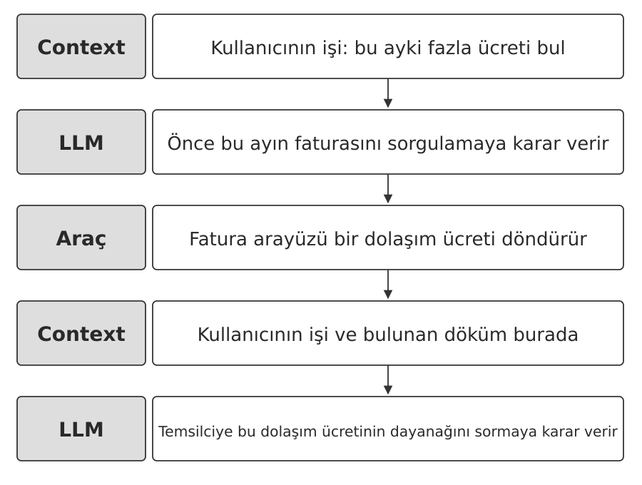
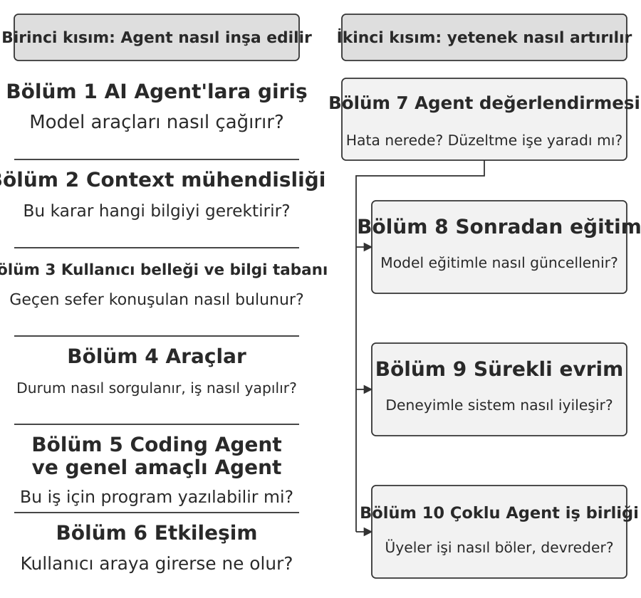

# Önsöz {.unnumbered}

2025 yılının Ağustos ayından 2026'nın başlarına kadar Turing'de "Agent Uygulama Kampı" (AI Agent Bootcamp) adlı çevrimiçi video dersini verdim; derslerde anlaşılabilir, doğrulanabilir ve yeniden kullanılabilir mühendislik yöntemleriyle AI Agent (akıllı varlık) geliştirmeyi ele aldık. Ders, bir Agent'ı çalıştırmakla başlıyor, ardından bu Agent'ın mimarisini neden böyle seçtiğimizi çözümlüyordu: her tasarım hangi sorunu çözüyor, karşılığında neye mal oluyoruz ve hangi görevlere uygun düşüyor. Bu kitap, ders notları ve eşlik eden deneylerin üzerine kurularak derlendi.

> **Bu kitabın oluşumu: bir insan–makine iş birliği pratiği**
>
> Derse hazırlanırken önce taslağı Pine'ın sesli Agent'ına anlatıyor, kaynak taraması yapmasını ve bir ilk metin çıkarmasını istiyordum. Bu sözlü iş birliğine **whisper coding** diyorum. Dersten sonra öğrencilerin hangi adımda tıkandığına, hangi deneyin sonucunun beklenmedik çıktığına bakıp ilgili örnekleri ve gerekçeleri yeniden gözden geçiriyordum.

2025'ten bu yana önemli bir değişimin tanığı oldum: AI araştırmasının ve sektör pratiğinin ağırlık merkezi, temel model yeteneklerini yükseltmekten Agent'ların gerçek görevleri tamamlamasına kayıyor. Model eğitimi ile uygulama da bu yüzden birbirine daha sıkı bağlanıyor. DeepSeek-R1 gibi akıl yürütme modelleri, pekiştirmeli öğrenmenin matematik, programlama ve akıl yürütme yeteneklerine katkısını gösterdi.[^preface-r1] Agentic Reinforcement Learning (Agent odaklı pekiştirmeli öğrenme), araç çağrısını ve ortamla etkileşimi eğitime katarak modelin programlamayı, grafik arayüz kullanmayı da öğrenmesini sağlıyor. İkinci tür görevler çoğunlukla Computer Use olarak anılır: model ekran görüntüsüne bakarak sayfanın durumunu değerlendirir, ardından tıklama, yazma ya da kaydırma ile işlemi tamamlar. Manus, Claude Code, OpenClaw gibi ürünler ise kullanıcının görevi doğrudan devretmesine imkân tanıdı ve "kod üretimi + dosya sistemi" yaklaşımının genel amaçlı Agent'ları nasıl taşıyabildiğini gösterdi.

2026 Eylül'ünde Meta Muse'u duyurdu. O dönemde yurt içinde ve yurt dışında kişisel Agent ürünleri mantar gibi çoğaldı. Bu kitapta tartışılan sorunların çoğuyla ben ve ekibim, Pine'ı çok daha önce geliştirirken karşılaşmıştık. Pine AI'da baş bilim insanı olarak meslektaşlarımla birlikte, tüketiciler adına iş gören bu kişisel Agent'ı geliştirdim. 2025 Ocak'ının başında Pine ABD'de hizmete girdi; kullanıcılar ondan işletmeleri arayıp faturada indirim pazarlığı yapmasını, iade talebinde bulunmasını ya da abonelik iptal etmesini isteyebiliyordu.

İşletme telefonda bir tutarı düşmeyi kabul ettiğinde, Pine'ın kullanıcıya o anda söyleyebildiği şey "müşteri temsilcisi kabul etti" olur; "para iade edildi" diyebilmek için faturanın üzerinde o iadenin görünmesi gerekir. Bu tür işleri yürütürken modelin kullanıcının neye yetki verdiğini hatırlaması, bir sonraki adımda neyi kontrol edeceğini bilmesi ve işin hangi aşamaya geldiğini ayırt edebilmesi gerekiyordu. Sektör sonradan Skill, Harness ve Loop mühendisliğinden söz etmeye başladığında, bu yaklaşımların birçoğunu biz tam da bu telefon görüşmelerinde bulmuştuk.

- **Skill.** Prompt'ları yalnızca görev gerektirdiğinde yüklüyorduk. Araç sayısı arttığında modelin araçları komut satırı üzerinden çağırmasını sağladık; böylece her istekte tüm araç tanımlarını listelemek gerekmiyordu.
- **Harness.** Yürütme ortamını, geçerli saati ve kullanıcının çalışma durumunu bir durum çubuğuna yazıp modelin karar verirken bunlara bakmasını sağladık. Model bazen sonuç uyduruyor, yanlış aracı çağırıyor ya da talimatı atlıyordu; tehlikeli işlemler kullanıcının verdiği yetkinin dışına çıkabiliyordu. Bu yüzden yürütme sürecine kısıtlar ekledik; benzer yaklaşımları sonradan Claude Code'da da gördük.
- **Loop mühendisliği.** Model bazen işin yalnızca yarısını yapıp tamamlandığını bildiriyordu. Bir Agent işi yürütürken bir diğeri faturayı ya da siparişi kontrol ediyor, eksik kalan işi geri gönderiyordu. Buna bugün proposer-reviewer (öneren–denetleyen) iş bölümü diyoruz.

Diğer model ve Agent ekipleri de benzer sorunları çözerken bağımsız olarak birbirine yakın yöntemler geliştirdi. Bu da beni şuna daha çok inandırdı: ekiplerin karşılaştığı güçlüklerin çoğu, Agent sistemleri gerçek kullanıma yöneldiğinde ortaklaşa karşılaşılan sorunlardır. AI Agent Bootcamp dışında 2024–2026 yılları arasında Çin Bilimler Akademisi Üniversitesi'nde Agent uygulama dersi vermeyi de sürdürdüm. İki dersteki öğrencilerin soruları, hangi deneyimin daha açık anlatılması gerektiğini görmeme yardımcı oldu. Kitabı açık kaynak olarak yayımlamamın nedeni de bu: daha çok araştırmacı ve mühendis bu yöntemleri kullanabilsin, sınayabilsin ve geliştirebilsin.

**Önce pratik, sonra adlandırma.** Bir geliştirme ekibi için bunun bir anlamı daha var: bir terim sektörde ortak kabul hâline geldiğinde, önde gelen ekipler o konuyu çoğunlukla epeydir araştırmış olur. Kendi mühendislik avantajınızı biriktirmek için gerçek işten doğan sorunları önceden görüp çözmeye çalışmanız gerekir. Bunun için bence iki temel koşul var.

**Birincisi, Agent'ın yeteneklerinden beklentisi yüksek gerçek bir iş alanı seçin ve sürekli geri bildirim alın.** Pine'da tek bir görev saatler, hatta haftalar sürebiliyor; birden fazla tarafla iletişim kurmayı, uzun telefon görüşmelerini, karmaşık formları doldurmayı, defalarca e-posta yazışmasını gerektiriyor ve bütün bu süre boyunca rakamların doğru kalması, işlemlerin denetlenebilir olması, kullanıcının çıkarının korunması gerekiyor. Böyle senaryolar modelin yetenekleri ile işin gereklilikleri arasındaki açığı sürekli görünür kılar ve ekibi Harness'ı geliştirmeye iter. Bir ürünün ana değeri yalnızca belirli bir model kuşağının eksiğini kapamaksa, modelin bir sonraki sürümü bu değeri kolayca örtebilir; ekip kalıcı bir avantaj biriktiremez.

**İkincisi, sistematik bir değerlendirme (Evaluation) mekanizması kurun.** Sistemi değiştirdikten sonra tek bir fatura pazarlığının olumlu sonuçlanması, asistanın doğru soruları sormasından da kaynaklanabilir, o gün denk gelen müşteri temsilcisinin indirim yetkisi olmasından da. Aynı örnek kümesiyle eski ve yeni sürümü tekrar tekrar karşılaştırmak, farkın kalıcı olup olmadığını gösterir. Bölüm 7, başarı ölçütlerinin nasıl kurulacağını, değerlendirme ortamının nasıl hazırlanacağını, başarısızlıkların nasıl çözümleneceğini ve bir değişikliğin nasıl sınanacağını ayrıntılı olarak anlatıyor.

Pine'da fatura indiriminden bir yöntem öğrendik: denetleyiciye, faturadaki şu paraya baksın, dedirtmek. Aynı yöntemi bilet değişikliğine uygularsak, yeni biletin kesilip kesilmediğine bakmak gerekir. Somut kanıt işe göre değişir, ama arkasında ortak bir ilke var: bir görevin tamamlanıp tamamlanmadığını anlamak için o eylemin dış dünyada ne bıraktığına bakmak gerekir. **İyi ilkeler, modelin yineleme dönemlerini aşar.**

## Bu kitabın misyonu {.unnumbered}

Birinin bir cep telefonu faturasını asistana verip operatörle görüşerek indirim istemesini söylediğini düşünün. Asistan başlamadan önce hangi kalemin tartışmalı olduğunu netleştirmek, görüşme sırasında açıklamaları dinleyip koşulları sorgulamak, sonunda da kullanıcıya müşteri temsilcisinin tam olarak neyi kabul ettiğini söylemek zorundadır. Asistan her adımda üç soruyu yanıtlar: bu anda ne biliyor? Hangi eylemleri yapabilir? Bir sonraki adımı neye dayanarak seçiyor? Bu kitap bu üç sorudan yola çıkarak Agent'ın yapısını, onu kurma yöntemlerini ve yeteneklerinin sınırlarını anlatıyor. Temel formül **Agent = LLM + Context + Tools**'tur: LLM anlamayı, planlamayı ve kararı üstlenir; context geçerli karar için gereken bilgiyi taşır; araçlar dış ortama bağlanır, gözlem almak ya da eylem yürütmek için kullanılır.

Sezgisel bir benzetmeyle LLM "beyin", context "geçerli karar ufku", araçlar ise "duyular, eller ve ayaklar"dır. Ufukta ortam bilgisi, konuşma geçmişi, bellek ve bilgi birikimi; ayrıca sistem talimatları, araç tanımları ve görev durumu bulunur. Arama, okuma ve ekran görüntüsü bilgi getirir; tıklama, yazma ve iş arayüzü çağrıları dışarıdaki durumu değiştirir. Şekil 0-1 tek bir fatura sorgusunu parçalara ayırıp gösteriyor. İlk kararda model yalnızca kullanıcının bir ücretten kuşkulandığını bilir; ikincisinde hangi kalemin sorulacağını gösterebilir.



Pekiştirmeli öğrenmeye (Reinforcement Learning, RL) aşina okurlar bu iş bölümünü politika, gözlem ve eylem üzerinden de okuyabilir. LLM context'e bakarak sonraki adımı seçer; bu karar işlevi kabaca politikaya (Policy) karşılık gelir. Context, bu kararda kullanılan somut gözlemleri ve geçmişi taşır. Araçlar ise gözlem ve eylem arayüzlerini sağlar. Gözlem uzayı (Observation Space) hangi gözlemlerin elde edilebileceğini, eylem uzayı (Action Space) hangi eylemlere izin verildiğini tanımlar; ikisi birlikte Agent'ın ortamla etkileşiminin kapsamını çizer.[^preface-spaces] Bölüm 1 bu kavramları araç çağrısı örnekleri üzerinden açacak ve üretim ortamında Model ile Harness arasındaki iş bölümünü anlatacak.

> **Düşünmeye devam: yaşamdan tasarlanmış varlıklara**
>
> Mühendislik pratiğinin yanı sıra Agent, zeki sistemlerin evrimine dair soruları da gündeme getiriyor. Turing Ödülü sahibi ve pekiştirmeli öğrenmenin öncüsü Richard Sutton, evrenin evrimini dört aşamada özetlemişti: toz, yıldızlar, yaşam ve "tasarlanmış varlıklar" (designed entities).[^preface-sutton] Canlılar rastgele değişim ve doğal seçilimle evrilir; tasarlanmış varlıklar ise var olan zeki sistemler tarafından amaçlı olarak inşa edilip geliştirilebilir.
>
> Agent kod üretip yeni bir Agent kurabilir, sonra çalışma davranışını inceleyip değişiklik önerir ve sonucu doğrular; böylece adım adım kendini başlatmaya (bootstrap) ve sürekli evrime ulaşır. Bu, bir programcının başka bir programcıyı yazması, onun da yeni sistemlerin kurulmasına katılması gibidir. Kendini anlama ve kendini geliştirme olasılığı, kod üretimi ve sürekli evrim bölümlerini yazarken beni en çok ilgilendiren sorulardan biriydi.

## Kitabın yapısı {.unnumbered}

Şekil 0-2 bölümler arasındaki bağlantıları gösteriyor. Kullanıcı telefon görüşmesi sırasında fikrini değiştirir de asistan hâlâ eski talebe göre iş görürse, sol sütundaki Bölüm 6'dan okumaya başlayabilirsiniz: asistan kullanıcının araya girmesini nasıl ele alıyor? Düzelttikten sonra, başka görüşmelerde de yeni talebi dikkate aldığını nereden bileceğiz? Bunun için sağ sütundaki Bölüm 7'nin değerlendirme yöntemlerine başvurmak gerekir. Şekilde Bölüm 7'den çıkan üç ok, değerlendirme sonuçları elimizde olduğunda başarısızlığın nedenine göre farklı iyileştirme yolları seçebileceğimizi gösteriyor.



- **Bölüm 1 (AI Agent'a Giriş)**, ürün ve araç çağrısı örnekleri üzerinden temel bileşenleri, çalışma döngüsünü, Harness'ı ve orkestrasyon biçimlerini tanıtır; kitabın tamamını anlamak için kavramsal çerçeveyi kurar.
- **Bölüm 2 (Context Engineering)**, kitabın en kritik bölümüdür; modelin o anda ihtiyaç duyduğu bilginin nasıl düzenleneceğini tartışır. Prompt tasarımından ihtiyaç anında yüklemeye ve geçmiş yönetimine kadar uzanır; KV Cache üzerinden bu yöntemlerin yanıt kalitesini ve çalışma maliyetini nasıl etkilediğini açıklar.
- **Bölüm 3 (Kullanıcı Belleği ve Bilgi Tabanı)**, oturumlar arası bilginin nasıl saklanıp kullanılacağını tartışır. Kullanıcı belleğinden RAG'e, yapılandırılmış indekslerden bilgi güncellemeye kadar ilerleyerek kalıcı bilginin erişim ve bakım yöntemlerini öğretir.
- **Bölüm 4 (Araçlar)**, Agent'ın nasıl gözlem edindiğini, eylem yürüttüğünü ve iş birliği istediğini tartışır. Araç sınıflandırması, arayüz tasarımı, MCP ve yürütme yönetimi üzerinden dış yeteneklerin sisteme nasıl bağlanacağını açıklar.
- **Bölüm 5 (Coding Agent ve Genel Amaçlı Agent)**, genel amaçlı Agent için temel bir mimari fikir ortaya koyar: yürütme çekirdeği olarak Coding Agent, çalışma alanı olarak dosya sistemi. Önce geliştirme sürecini anlatır, sonra çoklu ortam ve iş sistemleri gibi örneklerle Agent'ın sorunları program yazarak nasıl çözdüğünü, hatta araç yaratıp yeni Agent'lar kurduğunu gösterir.
- **Bölüm 6 (Etkileşim: Gözlem ve Eylem Uzayının Genişletilmesi)**, Agent'ın etkileşim biçimlerini kip (modalite) ve zamanlama olmak üzere iki boyutta ele alır. Asenkron olaylar, ses, Computer Use ve robotlar üzerinden sürekli gözlemi, hızlı ve yavaş yolları ve yürütme denetimini açıklar.
- **Bölüm 7 (Agent Değerlendirmesi)**, sistemin performansını ve tek bir değişikliğin etkisini nasıl ölçeceğimizi yanıtlar. Önce başarı ölçütünü, ortamı ve veri kümesini belirler; sonra doğrulayıcıları, puanlamayı ve istatistiksel analizi anlatır; son olarak başarısızlık nedenlerini çözümleyerek iyileştirme yönünü bulmayı gösterir.
- **Bölüm 8 (Model Sonrası Eğitim)**, veri ve ortam aracılığıyla model yeteneğinin nasıl güncelleneceğini tartışır; öncelikle veri kalitesine ve eğitim ortamına yatırım yapılmasını savunur. Denetimli ince ayar, pekiştirmeli öğrenme ve ödül tasarımı üzerinden gösterimden öğrenme ile keşfin neden farklı genelleme davranışları ürettiğini ve yalnızca algoritmayı değiştirmenin neden çoğu zaman sınırlı fayda sağladığını açıklar.
- **Bölüm 9 (Agent'ın Sürekli Evrimi)**, çalışma deneyiminden yararlanarak Agent'ın sonraki sürümlerinin nasıl iyileştirileceğini tartışır. Bilgi, talimat, program ve parametre olmak üzere dört tür güncellemeyi karşılaştırır, ardından uzun vadeli değişimi doğrulama, yayımlama ve geri alma süreçleriyle yönetir.
- **Bölüm 10 (Çoklu Agent İş Birliği)**, birden çok üyenin ne zaman ek değer kattığını ve iş bölümünün, iletişimin ve koordinasyonun nasıl kurulacağını tartışır. Önce context'in ve denetimin nasıl paylaştırıldığını açıklar, sonra örneklerle iş birliği mekanizmalarını anlatır, başarısızlık nedenlerini çözümler ve Agent toplumu ile ekonomisinin olası biçimlerini ele alır.

## Bu kitap nasıl okunmalı {.unnumbered}

- **Sıfırdan bir Agent ürünü kuruyorsanız**: Kitabın tamamını okumanızı öneririm. Önce Bölüm 1–6 ile iş görebilen bir asistan kurun, sonra Bölüm 7 ile hangi görevlerde hata yapmaya yatkın olduğunu sınayın. Son üç bölüm bu başarısızlıklardan yola çıkarak modelin, sistemin ya da üyeler arasındaki iş bölümünün nasıl iyileştirileceğini tartışır.
- **Önce genel bir kavrayış edinmek istiyorsanız**: Bölüm 1, 2, 4 ve 7'yi sırayla okuyun. Tek bir araç çağrısını izleyin: önce Agent'ın çalışma döngüsünü tanıyın, sonra modelin hangi bilgileri aldığına ve aracın gerçekte ne yaptığına bakın, en sonunda da değerlendirme ile sonucun kullanıcının isteğine uyup uymadığına karar verin. Bölüm 2 KV Cache'e geldiğinde, ilk okumada baştaki üç sonucu kavramanız yeterlidir; deneyleri yaptıktan sonra alttaki ilkelere geri dönebilirsiniz.
- **Ağırlıklı olarak model eğitimini öğrenmek istiyorsanız**: Önce Bölüm 1 ve 2 ile Agent'ın nasıl çalıştığını anlayın, ardından Bölüm 7'deki değerlendirme yöntemleriyle birlikte Bölüm 8'i okuyun. Böylece eğitim hedeflerini gerçek görev performansıyla ilişkilendirebilirsiniz.
- **Yayındaki bir Agent'ın bakımını yapıyorsanız**: Bölüm 7'den yola çıkıp bir grup gerçek görevle değerlendirme yapın. Diyelim asistan kullanıcıya eski fiyatı söyledi: önce eline hangi fiyat sürümünün ulaştığına bakın. Bilgi ya da süreç eskimişse bu başarısızlığı yanınıza alıp Bölüm 9'u okuyun; fiyat da araçlar da eksiksiz verildiği hâlde süreci düzelttikten sonra model yine yanlış seçimde ısrar ediyorsa Bölüm 8'i okuyun ve eğitim verisi hazırlamaya değip değmeyeceğine karar verin.

Her bölümde deneyler ve düşünce soruları var. Deneyler "Deney X-Y" biçiminde numaralanır; X bölüm numarasını, Y bölüm içindeki sırayı gösterir. Yıldızlar zorluğu belirtir: ★ başlangıç için uygundur, ★★ belirli bir mühendislik deneyimi ister, ★★★ açık uçlu sorular ya da karmaşık sistem tasarımı içerir. Deneylerin çoğunun çalıştırılabilir kodu vardır ve hepsi açık kaynak depoda toplanmıştır:

> **Eşlik eden kod deposu**: `bojieli/ai-agent-book`

İlk kez deney yapıyorsanız "Deney 1-1: Context'in kilit rolü" ile başlayabilirsiniz. Git kullanıyorsanız terminalde şunu çalıştırın:

```bash
git clone https://github.com/bojieli/ai-agent-book.git
cd ai-agent-book
```

Depo sayfasında **Code → Download ZIP** seçeneğini kullanıp arşivi açarak da aynı dizini elde edebilirsiniz. Bölüm 1'in deney dizininden (`chapter1/README.md`) 1-1 numarasını bulun ve `chapter1/context/README.md` dosyasını açın. Bundan sonra karşılaştığınız her "Deney X-Y" için projeyi ve çalıştırma yöntemini depodaki `chapterX/README.md` dosyasında bulabilirsiniz. "Yeniden üretim kılavuzu" dış projeleri ve bunların nasıl edinileceğini verir; kurulum komutları ve dizin açıklamaları README dosyalarında toplanmıştır.

## Ön bilgiler {.unnumbered}

Bu kitap, temel programlama becerisine sahip olan ve Agent'ları anlamak ve kurmak isteyen okurlar için yazıldı. Deneyleri uygulamalı yapmak için aşağıdaki temellere ihtiyacınız olacak.

**Gerekli: kitabın tamamını okumak için temel**

- **Python programlama**: Söz dizimine, yaygın veri yapılarına ve pip gibi paket yönetim araçlarına aşina olmak; deney kodunu okuyup değiştirebilmek. Kitaptaki deneylerin çoğu Python tabanlıdır.
- **LLM kullanma deneyimi**: ChatGPT, Claude ya da benzeri ürünleri kullanmış olmak; istek yazma, yanıtı okuma ve ardından soru sorma sürecine aşina olmak.
- **Yazılım mühendisliği genel kültürü**: Komut satırını, Git'i, JSON'u ve REST API'leri bilmek; bunlarla proje çalıştırabilmek, değişiklikleri kontrol edebilmek ve arayüz verilerini okuyabilmek.

Deneyleri yaparken Claude Code, Codex, Cursor ya da TRAE'den birini seçmenizi şiddetle öneririm. Ondan bir kod parçasında hata ayıklamanıza yardım etmesini isteyin ve hangi dosyaları okuduğuna, hangi araçları çağırdığına bakın. İleride çalışma döngüsü ve context yönetimi bölümlerini okurken karşılaştırabileceğiniz bir kişisel deneyiminiz olur.

**Önerilen: bölümlere göre tamamlayıcı bilgiler**

- **Makine öğrenmesi temelleri (Bölüm 8)**: Eğitim ve çıkarım, kayıp fonksiyonu, gradyan inişi ve aşırı uyum; modelin güncellenme sürecini anlamanıza yardımcı olur.
- **Temel matematik (Bölüm 2, 3, 7 ve 8)**: Vektörler ve matrisler embedding'leri ve dikkat mekanizmasını, olasılık ve istatistik ise değerlendirme ölçütlerini ve beklenen ödülü anlamanıza yardımcı olur. Kitap sezgisel açıklamaya ve pratik kullanıma ağırlık verir.
- **Web geliştirme temelleri (Bölüm 6)**: HTTP, WebSocket ve ön uç ile arka uç arasındaki iş bölümü; asenkron olay mimarisini ve gerçek zamanlı sesli iletişimi anlamanıza yardımcı olur.
- **Transformer temelleri (Bölüm 2 ve 8)**: Dikkat mekanizmasını ve model yapısını bilmek, context hesaplamasını ve sonrası eğitimi anlamanıza yardımcı olur. Konuyu sistemli öğrenmek isteyen okurlar *Hands-On Large Language Models* (Jay Alammar ve Maarten Grootendorst; Çince çevirisi Li Bojie, Turing Education) kitabını okuyabilir. Bu kitap Transformer'ı, ön eğitimi ve ince ayarı görsellerle anlatır ve elinizdeki kitabın mühendislik bakışını tamamlar.

Bölüm 8'deki sonrası eğitim dışında kalan bölümler çok az matematik ve makine öğrenmesi bilgisi gerektirir; temel programlama deneyimiyle okumaya başlayabilirsiniz.

## Teşekkür {.unnumbered}

Turing'den Meng Ge ve Liu Meiying hocalarıma bu kitabın editörlüğü ve "Agent Uygulama Kampı"nın düzenlenmesi için gösterdikleri emek için; Liu Junming hocama da Çin Bilimler Akademisi Üniversitesi'nde Agent uygulama dersini açtığı için teşekkür ederim. İki dersin katılımcılarına ve öğrencilerine de teşekkür ederim: sorularınız, deney geri bildirimleriniz ve önerileriniz anlatımımı sürekli iyileştirmeme yardımcı oldu ve bu kavramları daha derinden kavramamı sağladı.

Pine AI'daki tüm çalışma arkadaşlarıma teşekkür ederim. Gerçek işte karşılaştığımız zorluklar ve ekip içi tartışmalar, bu kitaptaki pek çok yöntemin ve örneğin kaynağıdır. Pratiğiniz ve görüşleriniz bu kavrayışın olgunlaşmasını sağladı.

AI sektöründeki dostlarıma teşekkür ederim. Tekrar tekrar yaptığımız sohbetlerde görüşlerinizi açıkça dile getirdiniz, farklı deneyimlerinizi ve yargılarınızı paylaştınız; modelleri ve Agent'ları daha derinden anlamama yardımcı oldunuz.

En çok da aileme, özellikle eşim Meng Jiaying'e teşekkür ederim. Bu kitabın yazımını her zaman destekledi ve metin için pek çok değerli görüş sundu.

[^preface-r1]: DeepSeek-AI, *DeepSeek-R1: Incentivizing Reasoning Capability in LLMs via Reinforcement Learning*, 2025.
[^preface-spaces]: Gymnasium belgelerinin "Spaces" bölümü.
[^preface-sutton]: Richard Sutton ile Dwarkesh Patel'in söyleşisi, 2025-09-26, "Succession to AI" kısmı.
