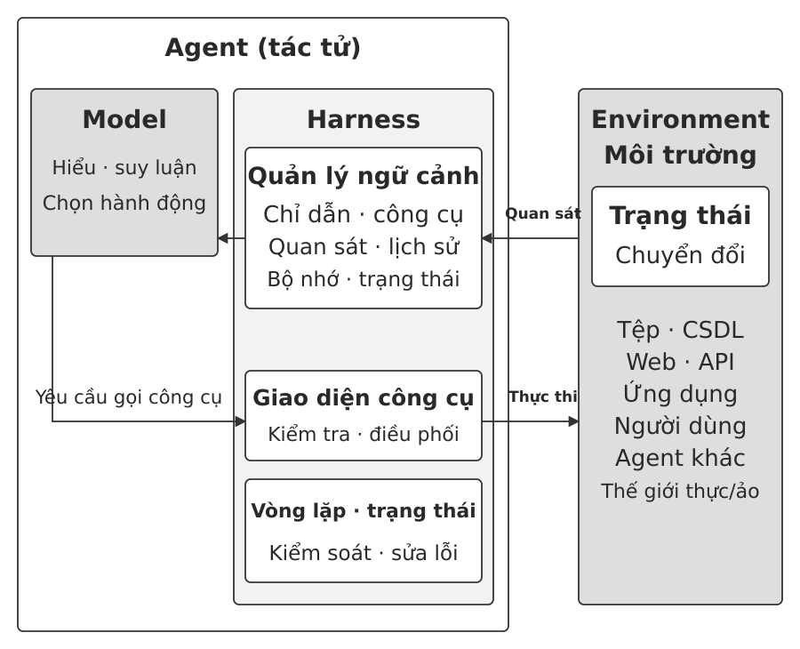
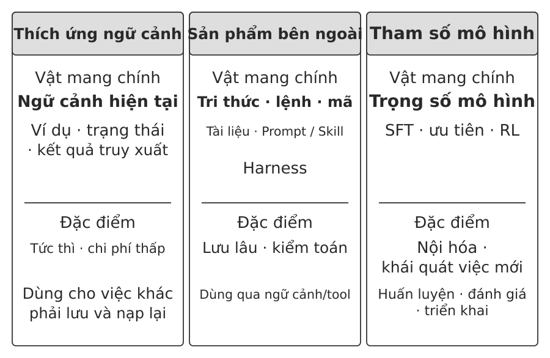
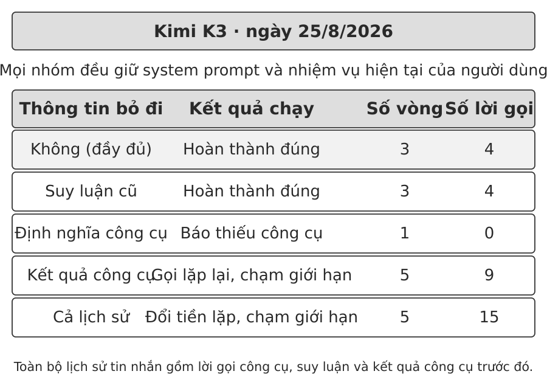
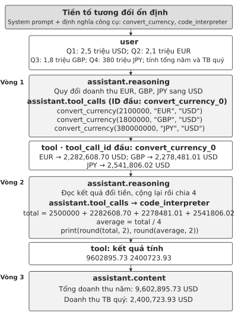
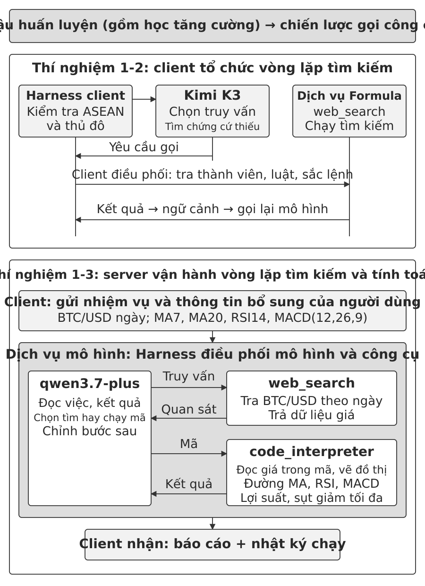
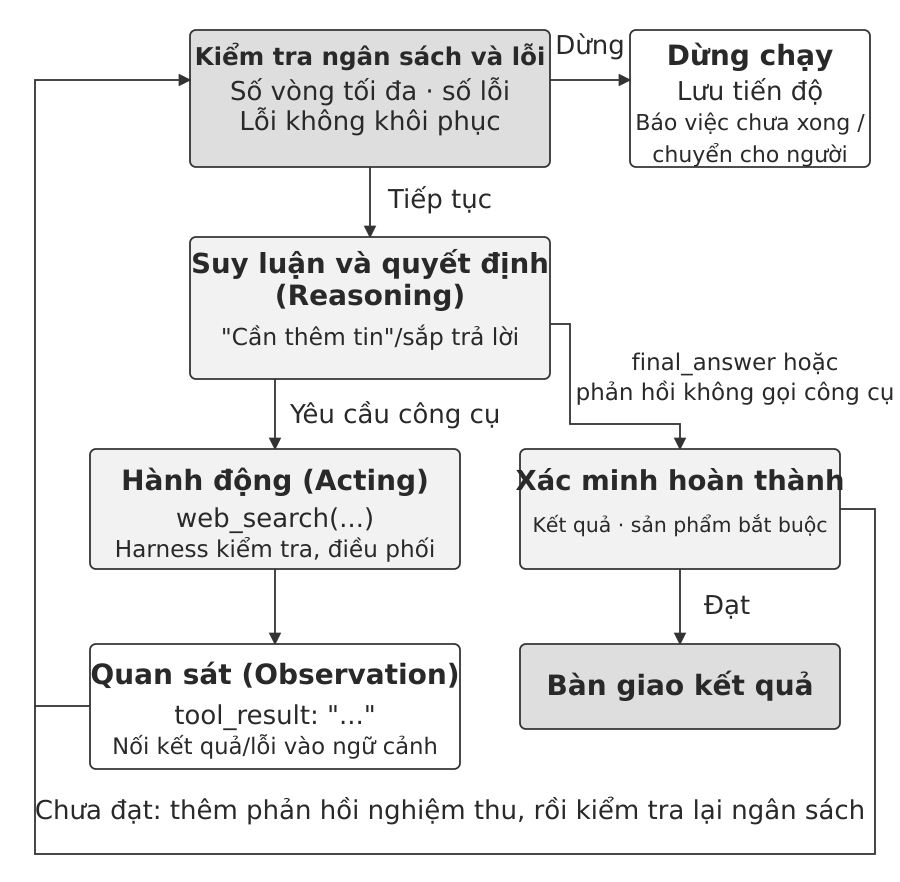
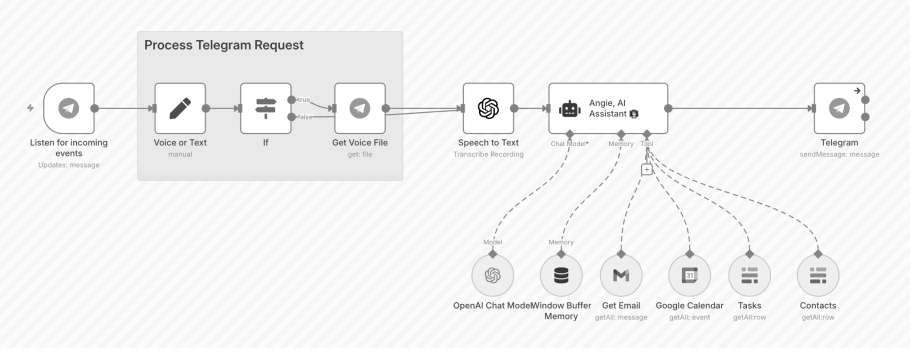

# Nhập môn AI Agent

Khi bạn dùng Deep Research để tìm hiểu một đề tài, nó tìm kiếm và đọc đi đọc lại nhiều lần rồi tổng hợp thành một bản báo cáo. Manus có thể điều khiển trình duyệt để hoàn thành các việc trên mạng, Trợ lý điện thoại Doubao có thể đặt vé và gửi tin nhắn ngay trên điện thoại, còn Pine AI có thể thay người dùng gọi điện, thương lượng với nhà mạng để giảm hóa đơn. Tất cả đều là ứng dụng của AI Agent.

Khi bạn nhờ Cursor sửa một hàm, nó tìm đến hàm đó, chỉnh sửa tệp rồi chạy kiểm thử. Nếu kiểm thử vẫn thất bại, thông báo lỗi trở thành căn cứ cho lần sửa tiếp theo; chỉ khi kiểm thử đạt, nó mới có bằng chứng để báo kết quả cho bạn. Thứ tự ba bước tìm kiếm, chỉnh sửa và kiểm thử có thể viết sẵn vào chương trình, nhưng sửa dòng nào và quay lại đâu sau khi thất bại thì phải dựa vào thông tin thu được trong lúc chạy. Quá trình chọn hành động theo mục tiêu rồi điều chỉnh kế hoạch theo kết quả như vậy cũng diễn ra trong những nhiệm vụ như nghiên cứu hay thương lượng qua điện thoại.

## Agent hiện đại = LLM + ngữ cảnh + công cụ

Cuốn sách này dùng một công thức để tóm lược ba nhóm yếu tố chức năng của Agent hiện đại: **Agent = LLM (mô hình ngôn ngữ lớn, Large Language Model) + ngữ cảnh + công cụ**.

- **LLM là bộ não của Agent**, đảm nhận việc hiểu nhiệm vụ, lập kế hoạch các bước và chọn hành động. Tiền huấn luyện (pretraining) mang lại cho mô hình năng lực ngôn ngữ và tri thức về thế giới; post-training tiếp tục định hình các hành vi như tuân theo chỉ dẫn, suy luận và gọi công cụ. Chương 8 sẽ giới thiệu các phương pháp post-training như fine-tuning có giám sát và học tăng cường.
- **Ngữ cảnh (context) là tầm nhìn ra quyết định hiện tại của Agent**, chứa những thông tin cần cho lần quyết định này: chỉ dẫn, định nghĩa công cụ, quan sát từ môi trường, bộ nhớ về người dùng, tri thức chuyên ngành, lịch sử tin nhắn, trạng thái của chính Agent và tiến độ nhiệm vụ.
- **Công cụ là giác quan và tay chân của Agent**, dùng giao diện để lấy thông tin hoặc thực hiện thao tác. Hệ thống công cụ gồm định nghĩa, giao thức gọi và bộ chuyển đổi (adapter); nó hỗ trợ các thao tác quan sát như tìm kiếm, đọc, chụp màn hình, lẫn các thao tác ghi, chạy mã, ủy thác cho Agent con và trao đổi với người dùng.

Một công cụ có thể đảm nhận nhiều vai trò cùng lúc. Chẳng hạn, khi mô hình đọc tệp qua dòng lệnh, nội dung tệp trả về trở thành căn cứ cho quyết định tiếp theo; khi chạy chương trình qua dòng lệnh, nó còn có thể làm thay đổi trạng thái của tệp hoặc tiến trình.

Giả sử bạn vừa mở một gói hàng và muốn hỏi bộ phận chăm sóc khách hàng: "Đã bóc hộp rồi thì còn trả hàng được không?" Hệ thống có thể dùng **sinh có tăng cường truy xuất** (Retrieval-Augmented Generation, RAG) để tìm chính sách đổi trả hiện hành của cửa hàng, rồi yêu cầu mô hình trả lời dựa trên các điều khoản đó.[^ch1-rag] Đi theo một lần truy vấn này, ta thấy rõ trách nhiệm của từng bộ phận. Văn bản chính sách và chỉ mục được lưu trong kho tri thức bên ngoài; công cụ truy xuất tìm ra các đoạn liên quan đến câu hỏi, rồi chương trình gọi mô hình đưa các đoạn đó kèm nguồn vào yêu cầu lần này. Đọc đến mục "đã bóc hộp", mô hình có thể giải thích điều khoản; nếu điều khoản còn phân biệt theo loại hàng, nó phải hỏi rõ bạn đã mua gì.

[^ch1-rag]: Patrick Lewis và cộng sự, Retrieval-Augmented Generation for Knowledge-Intensive NLP Tasks, NeurIPS, 2020.

Trong lần hỏi về trả hàng này, việc khởi động truy xuất là hành động của Agent, còn các điều khoản trả về là quan sát (observation) mà nó nhận được từ môi trường (Environment). Bước tiếp theo là trả lời hay hỏi lại tùy thuộc vào nội dung điều khoản. Đó chính là vòng kín mà học tăng cường và lý thuyết điều khiển mô tả, như Hình 1-1.



Lớp ngoài của hình vạch ranh giới giữa Agent và môi trường. Tệp, cơ sở dữ liệu, trang web, người dùng, các Agent khác, cùng thế giới vật lý hoặc mô phỏng, đều có thể là môi trường mà nó tương tác. Lớp trong thể hiện cách phân công khi triển khai thực tế: **Model chịu trách nhiệm hiểu, suy luận và ra quyết định; Harness nằm trong ranh giới Agent nhưng ngoài Model, chịu trách nhiệm tổ chức ngữ cảnh, giao diện công cụ, vòng lặp chạy và trạng thái, đồng thời thực thi ràng buộc, xác minh và sửa lỗi.** Harness có thể tạo, cô lập hoặc làm trung gian cho môi trường; còn nội dung tệp, trạng thái tiến trình và những thứ tương tự thì thay đổi trong môi trường theo các hành động.[^ch1-harness]

[^ch1-harness]: Có thể tham khảo bài "The Anatomy of an Agent Harness" của LangChain và "Effective harnesses for long-running agents" của Anthropic. Một số cách triển khai tính cả sandbox vào Harness; Hình 1-1 vẽ môi trường riêng để dễ theo dõi hành động thực sự đã thay đổi những gì.

Vì vậy, cuốn sách dùng hai cách phân tách bổ sung cho nhau: **"LLM + ngữ cảnh + công cụ" mô tả thành phần chức năng, "Model + Harness" mô tả cách triển khai thực tế.** Ngữ cảnh do Harness tổ chức rồi cung cấp cho Model; lời gọi công cụ do Model quyết định, Harness kiểm tra và điều phối, rồi giao cho công cụ hoặc môi trường thực hiện. Một hệ thống đơn giản có thể bắt đầu từ việc lắp ráp ngữ cảnh và điều phối công cụ, rồi dần bổ sung các cơ chế ràng buộc, xác minh và sửa lỗi mà vận hành thực tế đòi hỏi.

Nếu bạn quen với học tăng cường, hãy đọc bảng dưới đây qua ba câu hỏi: "ai quyết định bước tiếp theo, dựa vào đâu để quyết định, và hành động bằng cách nào". Đây là một phép so sánh sơ lược theo chức năng.

| Hiểu theo trực giác | Yếu tố kỹ thuật | Khái niệm liên quan trong học tăng cường | Ý nghĩa |
|-----------|-----------|----------------------------|----------------------------------------------|
| **Bộ não** | LLM | **Policy** (chính sách) | Dựa vào thông tin hiện có để quyết định bước tiếp theo |
| **Tầm nhìn ra quyết định hiện tại** | Ngữ cảnh | **Quan sát và lịch sử** | Tổ chức thông tin môi trường trả về cùng lịch sử sẵn có thành căn cứ ra quyết định |
| **Giác quan và tay chân** | Công cụ và adapter | **Giao diện quan sát và hành động** | Quy định cách đọc thông tin môi trường, cách phát ra hành động, cùng định dạng gọi và trả về |

### Không gian quan sát và không gian hành động: giao diện giữa mô hình và thế giới

**Không gian quan sát (Observation Space) mô tả những quan sát mà Agent có thể nhận được, không gian hành động (Action Space) mô tả những hành động mà nó có thể phát ra.** Ngữ cảnh trong một lần gọi mang thông tin cụ thể, còn các công cụ khả dụng cung cấp giao diện để tương tác với môi trường. Ngoài công cụ, đầu vào của người dùng, thông báo sự kiện và những thứ tương tự cũng có thể mang lại quan sát; tham số, quyền hạn và môi trường chạy của lời gọi công cụ cùng nhau giới hạn phạm vi hành động.

Hãy hình dung riêng hai kiểu trục trặc. Kiểu thứ nhất: mô hình giải thích được từng khoản phí trên hóa đơn, nhưng lại không lấy được hóa đơn tháng này. Sau khi người dùng cho phép đọc, hệ thống vẫn phải truy xuất hóa đơn rồi đưa cho mô hình, nó mới xác định được khoản phí nào đang có tranh chấp. Kiểu thứ hai: người dùng nhờ trợ lý đổi gói cước, trợ lý đã tìm ra phương án phù hợp, nhưng giao diện tài khoản chỉ cho phép tra cứu. Có đọc lại hóa đơn bao nhiêu lần, nó vẫn không thực hiện được thay đổi; nó cần quyền thao tác tương ứng. Việc của Harness là đưa tài liệu đã đọc được vào ngữ cảnh, nhận hành động mà mô hình chọn, kiểm tra tham số và quyền hạn, rồi điều phối thực thi.

Do đó, **khi mô hình nền đã cố định, điều chỉnh không gian quan sát và không gian hành động là một biện pháp kỹ thuật quan trọng để cải thiện kết quả nhiệm vụ.** Nếu mô hình bỏ sót sự thật then chốt, có thể đưa dữ liệu liên quan vào ngữ cảnh; nếu mô hình thường chọn nhầm giữa các công cụ na ná nhau, có thể gộp các giao diện trùng lặp hoặc chỉ nạp những công cụ mà nhiệm vụ hiện tại cần.

Khi xem video lại gặp vấn đề ngược lại: hình ảnh lúc nào cũng có, nhưng thay đổi đáng để phán đoán lại thì không nhiều. Giả sử trợ lý đang chờ tải tệp lên; nếu thanh tiến trình nhích một chút lại gọi mô hình chính một lần, sẽ tốn thêm rất nhiều tính toán; nếu mười giây mới nhìn một lần, lại có thể bỏ lỡ một thông báo lỗi chỉ hiện lên trong chớp mắt. **Theo tác giả, làm thưa không gian quan sát là một vấn đề cơ bản trong thiết kế Agent.** Hệ thống có thể liên tục quan sát môi trường, nhưng chỉ chuyển cho mô hình chính những thay đổi có thể làm đổi hành động tiếp theo, kèm theo ngữ cảnh cần thiết.

**Manus: kết hợp nghiên cứu, lập trình và điều khiển máy tính trong cùng một nhiệm vụ.** Deep Research giỏi tìm kiếm và đọc, Coding Agent có thể viết và chạy mã, Computer Use Agent có thể thao tác giao diện. Manus tích hợp trình duyệt, hệ thống tệp, thực thi mã và dòng lệnh vào một sandbox trên đám mây, nhờ đó cùng một Agent có thể tra cứu tài liệu trước, sau đó xử lý tệp và chạy mã, cuối cùng hoàn tất thao tác qua trình duyệt. Trình duyệt và khả năng đọc tệp mở rộng lượng thông tin có thể lấy được; thực thi mã và lệnh mở rộng các thao tác có thể kết hợp. **Theo tác giả, sự kết hợp này là một bước đột phá quan trọng của Agent đa dụng: cùng một Agent có thể vượt qua ranh giới giữa các sản phẩm vốn tách biệt, nối việc thu thập tài liệu, xử lý dữ liệu và thực hiện thao tác thành một nhiệm vụ trọn vẹn.**

**OpenClaw: kéo dài giao diện vào đời sống số của người dùng.** OpenClaw nhận nhiệm vụ và trả kết quả qua các kênh nhắn tin như WhatsApp, Telegram, Slack, Discord, iMessage, đồng thời dùng một Gateway chạy trên thiết bị của người dùng để nối các kênh nhắn tin với mô hình và công cụ. Khi đã cấu hình công cụ tương ứng và được cấp quyền, Agent có thể xử lý tệp cục bộ, cũng có thể kết nối với các dịch vụ đám mây như Google Drive hay Notion. Nhờ đó, tài liệu của người dùng nằm rải rác ở nhiều tài khoản và thiết bị có thể đi vào cùng một quá trình xử lý nhiệm vụ. Thời kỳ đầu, Manus chủ yếu làm việc trong sandbox đám mây và người dùng phải tải tệp lên; về sau, connector Google Drive và tính năng máy tính để bàn My Computer được bổ sung, mở rộng thêm phạm vi truy cập tệp trên đám mây và tài nguyên cục bộ. Những bước tiến hóa này cho thấy năng lực của sản phẩm thường tăng lên nhờ mở rộng giao diện quan sát và hành động[^ch1-agent-products].

[^ch1-agent-products]: Về cấu trúc sản phẩm, xem các bài giới thiệu chính thức của Manus về Sandbox, Google Drive Connector và My Computer, cùng kho mã chính thức và tài liệu công cụ của OpenClaw. Connector, cấu hình công cụ và quyền người dùng cấp quyết định những tài nguyên cụ thể có thể truy cập.

Nhiệm vụ của mỗi sản phẩm một khác, nhưng đều có thể hiểu qua ba mặt: căn cứ ra quyết định, thao tác khả dụng và chiến lược thực thi:

| Sản phẩm Agent | Thông tin chính trong ngữ cảnh | Công cụ và thao tác khả dụng | Chiến lược thực thi |
|----------------|----------------------|----------------------------|------------------------------|
| **Coding Agent như Cursor** | Yêu cầu, đoạn mã, danh sách thư mục, đầu ra terminal | Tìm kiếm mã, đọc ghi tệp, chạy lệnh | Hiểu yêu cầu→tìm mã liên quan→sửa mã→kiểm thử xác minh→gỡ lỗi và sửa |
| **Agent tìm kiếm như Deep Research** | Kết quả tìm kiếm, nội dung trang web, tóm tắt và trích dẫn bài báo | Truy vấn tìm kiếm, đọc trang web, viết báo cáo | Điều chỉnh hướng tìm kiếm theo thông tin đã có, dần tổng hợp thành báo cáo hoàn chỉnh |
| **Agent điều khiển máy tính như Browser Use** | Ảnh chụp màn hình, DOM hoặc cây trợ năng (accessibility tree), kết quả thao tác | Nhấp, gõ, cuộn, chụp màn hình, chạy mã | Đọc giao diện→nhận diện phần tử đích→thực hiện thao tác→xác minh kết quả |
| **Agent trợ lý điện thoại như Doubao** | Ảnh chụp màn hình điện thoại, trạng thái giao diện App, phản hồi hệ thống | Chạm, vuốt, nhập liệu, mở App | Hiểu yêu cầu→tìm App đích→thực hiện thao tác→xác nhận hoàn tất |
| **Agent làm việc vặt cá nhân như Pine AI, Meta Muse** | Hồ sơ tài khoản, hóa đơn, thông tin nhà cung cấp dịch vụ được phép đọc | Gọi điện, gửi email, điền biểu mẫu, xác nhận với người dùng | Thu thập thông tin→lập chiến lược thương lượng→liên hệ nhà cung cấp→đàm phán→báo cáo kết quả |

**Một lời ủy thác trở thành nhiệm vụ thực thi được như thế nào?** Khi làm trợ lý việc vặt cá nhân ở Pine, tác giả nhận ra người dùng thường chỉ nói một mục tiêu, chẳng hạn "đặt giúp tôi vé máy bay đi công tác, không quá 1200 tệ". Trợ lý phải làm rõ ngày đi, điểm đến và điều mà chuyến đi này coi trọng nhất, rồi thu thập những thông tin còn thiếu, thống nhất với người dùng định làm thế nào và điều kiện nào có thể thương lượng, sau đó mới liên hệ nhà cung cấp dịch vụ. Tình huống mới phát sinh trong lúc làm việc còn có thể đưa nhiệm vụ quay lại bước trước.

Giả sử giá vé thấp nhất mà nhân viên hãng tra được là 1250 tệ. Mô hình sẽ cân nhắc dựa trên lẽ thường, chuyến đi cụ thể và thói quen của người dùng mà nó nhớ được. Với một người đang đi công tác và thường sẵn lòng chi thêm chút ít cho lịch trình phù hợp, Pine có thể đặt luôn; còn nếu là một gia đình đi du lịch, trước đây từng nói rõ họ để ý đến tổng chi phí, nó có thể báo khoản chênh lệch cho người dùng trước và tiếp tục nhờ nhân viên tra các chuyến bay khác. Nếu sau đó người dùng dặn thêm "lần sau gặp vé vượt ngân sách thì hỏi tôi trước", phản hồi này sẽ cho lần phán đoán sau một căn cứ cụ thể hơn kinh nghiệm chung.

Đổi sang tình huống khác: nhân viên ngân hàng đề nghị gửi giấy tờ về nhà, nhưng trợ lý nhớ rằng người dùng đang du lịch nước ngoài. Lần này, thứ cần thay đổi là cách giao nhận: ngay trong cuộc gọi, trợ lý có thể giải thích việc nhận thư đang khó khăn và đề nghị gửi qua email. Lại xét chuyện giảm phí hóa đơn: nhân viên hứa miệng qua điện thoại, trợ lý có thể báo lại chính xác cam kết của doanh nghiệp; nhưng muốn xác nhận khoản tiền thực sự đã được trừ thì cần hóa đơn kỳ sau làm quan sát mới. Không gian hành động của một trợ lý có thể mở rộng đến cả những cuộc gọi điện thật, nhưng kết luận của nó vẫn bị không gian quan sát giới hạn.

Xét theo việc được ủy thác, cuốn sách sẽ gặp ba loại ứng dụng: lo việc đời sống, cộng tác văn phòng và khám phá khoa học. Cùng một trợ lý có thể đảm nhận nhiều loại nhiệm vụ; khác biệt nằm ở chỗ ai cấp quyền cho nó, nó được thay đổi những gì, và cuối cùng ai là người nghiệm thu. Ở văn phòng, một đồng nghiệp đã gửi lại kết quả kiểm tra, vậy ticket có đóng được chưa? Giả sử trưởng dự án gọi tên trợ lý trong một ticket trên Multica, nhờ đối chiếu một khoản chênh lệch trong bảng ngân sách. Bình luận này kích hoạt việc kiểm tra, nhưng ticket vẫn thuộc về người phụ trách cũ và trạng thái giữ nguyên. Trợ lý gửi lại hai con số cùng nguồn của chúng, trả lời được câu hỏi của đồng nghiệp; còn cả bảng ngân sách đã nộp được hay chưa thì người phụ trách phải cân nhắc cùng các việc còn tồn đọng khác.[^ch1-multica]

Với nhiệm vụ khoa học, ta cũng có thể hỏi cùng một câu: dựa vào đâu để khẳng định đã có tiến bộ? Khi AlphaEvolve của Google DeepMind tìm kiếm thuật toán nhân ma trận, mô hình đề xuất các chương trình ứng viên, bộ đánh giá chạy các chương trình này, kiểm tra tích có đúng không và dùng bao nhiêu phép nhân. Các vòng tìm kiếm sau có thể tiếp tục cải tiến những chương trình cho kết quả tốt. Nhóm nghiên cứu báo cáo rằng một trong các thuật toán chỉ cần 48 phép nhân vô hướng để nhân hai ma trận số phức $4\times 4$. "Bớt được mấy phép nhân" có đối tượng đếm rõ ràng, và thuật toán vẫn phải tính ra đúng tích ma trận.[^ch1-alphaevolve]

[^ch1-multica]: Multica, gọi tên Agent trong bình luận của ticket. Chương 10 bàn về cách phân biệt nhờ giúp tạm thời với chuyển giao trách nhiệm trong cộng tác.

[^ch1-alphaevolve]: Google DeepMind, ghi chú nghiên cứu về AlphaEvolve, tháng 5 năm 2025. Số phép nhân ở đây là số phép nhân vô hướng trong thuật toán; thời gian chạy thực tế còn phụ thuộc vào cách cài đặt và phần cứng.

Không gian hành động của các hệ thống này có tính **mở**. Từ khóa tìm kiếm, văn bản nhập vào, mã được sinh ra và các tổ hợp thao tác khó liệt kê hết trước, nhưng mỗi hành động vẫn bị giới hạn bởi công cụ, tham số, quyền hạn và môi trường chạy. Chính vì vậy, một kế hoạch thực thi được cần chừa chỗ cho quan sát mới làm thay đổi bước tiếp theo.

### Công cụ: giác quan và tay chân của Agent

Công cụ biến quyết định của mô hình thành việc đọc hoặc thao tác trên môi trường bên ngoài. Công cụ tìm kiếm và đọc mang về quan sát; các công cụ như ghi tệp, chạy lệnh thì hiện thực hóa hành động. Mô hình biết được hiệu quả của thao tác qua kết quả trả về, rồi quyết định tiếp tục, thử lại hay kết thúc nhiệm vụ.

Theo công dụng chính, cuốn sách chia công cụ thành năm loại. Một giao diện có thể có nhiều công dụng; chẳng hạn cuộc gọi thoại vừa lấy được thông tin, vừa truyền đạt được yêu cầu.

**Công cụ cảm nhận** dùng để lấy thông tin: công cụ tìm kiếm cung cấp tài liệu trên mạng, công cụ đọc tệp truy cập tài liệu cục bộ, giao diện API và cơ sở dữ liệu kết nối với dịch vụ bên ngoài và dữ liệu doanh nghiệp.

**Công cụ thực thi** dùng để thực hiện thao tác: chạy mã, sửa tệp, chạy lệnh hệ thống hoặc gọi API bên ngoài, đưa quyết định vào môi trường.

**Công cụ cộng tác** hỗ trợ phân công và phối hợp: ủy thác nhiệm vụ chuyên biệt cho Agent con, thu thập kết quả, điều phối công việc của nhiều Agent. Khi cần con người tham gia quyết định, hệ thống còn có thể yêu cầu xác nhận qua giao diện trao đổi với người dùng.

**Công cụ kích hoạt bằng sự kiện** đưa sự kiện bên ngoài vào quá trình chạy. Một email mới, một thời điểm định trước hay một callback Webhook đều có thể kích hoạt nhiệm vụ. Adapter sự kiện chuyển những đầu vào này thành quan sát mà Agent xử lý được, cơ chế điều phối khởi động hoặc tiếp tục việc thực thi; quy tắc kích hoạt có thể do nhà phát triển cấu hình, hoặc được đăng ký thông qua một lời gọi công cụ đã được phép.

**Công cụ trao đổi với người dùng** truyền thông tin tới người dùng và thu thập phản hồi, chẳng hạn gửi tin nhắn văn bản, gọi thoại hoặc gửi email. Chúng dùng để báo cáo tiến độ, xin xác nhận, và cũng có thể chủ động nhắc người dùng xử lý việc gì đó.

Chương 4 sẽ đi sâu vào thiết kế năm loại công cụ này. Định nghĩa giao diện ảnh hưởng đến việc mô hình có chọn đúng công cụ và điền đúng tham số hay không, cách xử lý lỗi quyết định thất bại rồi có tiếp tục được không, còn kiểm soát quyền hạn khoanh vùng phạm vi ảnh hưởng của thao tác. MCP (Model Context Protocol, giao thức ngữ cảnh mô hình) cung cấp một cách kết nối thống nhất cho việc khám phá và gọi công cụ, giảm công sức thích ứng giữa các hệ thống khác nhau.

**Gọi công cụ** (Tool Calling) là khả năng của mô hình đưa ra yêu cầu thao tác theo một định dạng đã thỏa thuận. Function Calling (gọi hàm) quen thuộc biểu đạt yêu cầu bằng tên công cụ và tham số có cấu trúc. Cuốn sách thống nhất dùng thuật ngữ "gọi công cụ".

Lấy ví dụ tra thời tiết Bắc Kinh. Mô hình có thể viết ra tên thành phố, nhưng nhiệt độ thực tế chỉ xuất hiện trong ngữ cảnh sau khi Harness thực hiện truy vấn. Dưới đây là bốn bước tin nhắn của lần gọi này:

```text
Bước 1: khai báo công cụ            Bước 2: mô hình quyết định gọi
tools: [{                          assistant: {
  name: "get_weather",               tool_calls: [{
  parameters: {                        id: "call_1",
    city: "string"                     function: "get_weather",
  }                                    arguments: {city: "Bắc Kinh"}
}]                                   }]
                                   }

Bước 3: nối kết quả vào ngữ cảnh    Bước 4: mô hình trả lời theo kết quả
tool: {                            assistant: {
  tool_call_id: "call_1",              content: "Bắc Kinh hôm nay 28°C, trời nắng."
  content: '{"temp":28,"sky":"nắng"}'  }
}
```

Trong đó, `call_1` gắn giá trị trả về của công cụ với yêu cầu gọi tương ứng. Nhà phát triển mô tả cách gọi công cụ, viết hàm tra thời tiết và trả kết quả tra cứu lại cho mô hình; mô hình quyết định có gọi hay không, gọi công cụ nào và truyền tham số gì. Chương 2 sẽ giới thiệu kỹ hơn cấu trúc tin nhắn của API.

Khi thiết kế công cụ, có thể bắt đầu bằng năng lực vừa đủ dùng. Phép tính bốn phép cơ bản chỉ cần một máy tính có tham số rõ ràng; khi nhiệm vụ mở rộng sang đọc bảng tính, làm sạch giá trị thiếu, tính thống kê và vẽ biểu đồ, một trình thông dịch mã Python bị giới hạn sẽ thuận tiện hơn để kết hợp các bước này. Năng lực đa dụng mở rộng thì cô lập và quản lý tài nguyên cũng phải theo kịp: mã chạy trong sandbox, truy cập mạng mặc định bị tắt, truy cập tệp giới hạn trong thư mục làm việc được cấp quyền, đồng thời đặt mức trần cho thời gian chạy, CPU, bộ nhớ và kích thước đầu ra.

Để ghi lại một quá trình thực thi, có thể dùng một công cụ ghi nhật ký duy nhất. Với nhiệm vụ kéo dài hàng giờ, thậm chí nhiều ngày, nên dùng một thư mục làm việc ảo có kiểm soát để lưu kế hoạch, kết quả trung gian, nhật ký chạy và sản phẩm cuối cùng, giúp Agent nối tiếp công việc qua nhiều lần chạy. Thư mục này cần giới hạn đường dẫn được đọc ghi, dung lượng và loại tệp, đồng thời kiểm tra xem đường dẫn có vượt ra ngoài ranh giới được cấp quyền hay không.

Các thao tác như thanh toán, xóa dữ liệu, gửi email và triển khai lên môi trường production có rủi ro cao hoặc gắn với quy tắc nghiệp vụ rõ ràng; chúng nên được đóng gói thành công cụ chuyên dụng có tham số rõ ràng, quyền hạn giới hạn và kiểm toán được toàn bộ quá trình, khi cần thì thêm bước xem trước và xác nhận của con người. **Năng lực nền tảng đa dụng phục vụ kết hợp và khám phá, công cụ chuyên dụng hiện thực hóa ràng buộc và quy tắc nghiệp vụ cho các thao tác rủi ro cao.**

### LLM: bộ não của Agent

LLM là hạt nhân ra quyết định của Agent. Khi nhận yêu cầu, nó nhận diện mục tiêu và ràng buộc từ lời người dùng, rồi chia nhiệm vụ phức tạp thành các bước thực thi được. Trong lúc thực thi, nó còn phải phán đoán bước tiếp theo làm gì, có gọi công cụ không, chọn công cụ nào và điền tham số ra sao. Những năng lực này dựa trên tri thức và năng lực ngôn ngữ tích lũy từ tiền huấn luyện, rồi được post-training định hình thành hành vi ra quyết định phù hợp với nhiệm vụ. Cả workflow lẫn Agent tự chủ đều cần loại phán đoán này, còn thao tác thực tế thì được hoàn thành qua Harness, công cụ và môi trường.

Lập kế hoạch và suy diễn trước khi hành động giúp Agent so sánh phương án, dự đoán kết quả và giảm những lần thử vô ích. Chẳng hạn, mô hình có thể dùng quy luật toán học để kiểm tra các bước tính, dùng quan hệ nhân quả để phân tích sự cố, rồi sắp xếp thứ tự thao tác theo quan hệ phụ thuộc. Mô hình so sánh các phương án trong quá trình suy luận trước, chọn xong hành động mới yêu cầu công cụ thực thi. Hệ thống học tăng cường truyền thống cũng có thể dùng chính sách đã học, hàm giá trị, mô hình môi trường hoặc thuật toán lập kế hoạch để tổ chức việc khám phá; điểm đặc biệt của LLM Agent là trước khi bắt tay vào nhiệm vụ cụ thể, nó đã có được tri thức rộng và các khuôn mẫu giải quyết vấn đề nhờ tiền huấn luyện quy mô lớn, và post-training lại củng cố thêm cách vận dụng những năng lực đó.

#### Gọi công cụ nguyên sinh của mô hình

Giới công nghiệp dùng cụm "mô hình chính là Agent" (Model as Agent) để tóm lược một xu hướng: ngày càng nhiều quyết định về lập kế hoạch và gọi công cụ do mô hình đảm nhận. Thông qua post-training, đặc biệt là học tăng cường, mô hình có thể học được khi nào nên gọi công cụ, gọi công cụ nào, truyền tham số gì, và nhận kết quả rồi thì tiếp tục ra sao. Nhà phát triển cung cấp mục tiêu, giao diện và ràng buộc; mô hình sắp xếp các bước cụ thể theo tiến độ nhiệm vụ.

Quyết định tự chủ của mô hình cần Harness hỗ trợ. Harness vốn là bộ yên cương của ngựa, dùng để truyền sức kéo của ngựa sang xe và điều khiển hướng đi. Trong Agent, Harness tổ chức năng lực của mô hình thành một quá trình nhiệm vụ có thể vận hành bền bỉ, đảm nhận quản lý ngữ cảnh, giao diện công cụ, ràng buộc, xác minh và sửa lỗi. Nửa sau của chương sẽ lần lượt giới thiệu năm chức năng này.

Mô hình tự sắp xếp được càng nhiều thao tác thì sai sót càng có thể lan rộng. Vì vậy mô hình và Harness cần được tối ưu cùng nhau: mô hình nâng chất lượng lập kế hoạch và chọn công cụ, Harness quản lý quyền hạn, kiểm tra kết quả và xử lý thất bại. Nhà cung cấp mô hình có thể cải tiến cả hai phần cùng lúc, và việc lặp cải tiến đồng thời này là một lợi thế kỹ thuật quan trọng.

> **Năng lực mô hình và sự tiến hóa của Harness**
>
> Trong *The Bitter Lesson* (Bài học cay đắng), Rich Sutton nhìn lại một xu hướng dài hạn của nghiên cứu AI: các phương pháp tìm kiếm và học tập có thể tận dụng nhiều tài nguyên tính toán hơn dần vượt qua những phương pháp dựa vào lượng lớn thiết kế chuyên ngành thủ công[^ch1-1]. Theo hướng đó, những quyết định từng do quy trình bên ngoài đảm nhận, như chọn công cụ và sắp xếp các bước, có thể dần được nội hóa vào mô hình qua huấn luyện.
>
> Lập trường của cuốn sách là: **đồng thuận về hướng đi, thực tế về nhịp độ.** Mô hình sẽ tiếp tục tiếp quản một phần trách nhiệm ra quyết định trong Harness, nhưng một vòng huấn luyện và triển khai cần thời gian, trong khi quy tắc nghiệp vụ và sở thích người dùng thì không ngừng thay đổi. Các ràng buộc trong nghiệp vụ thực tế cũng khó đưa hết vào tham số mô hình một lần. Vì vậy, khâu nào mô hình tạm thời làm chưa ổn thì Harness bù vào trước. **Ranh giới năng lực của mô hình lúc này chính là giá trị của Harness lúc này.** Sự phân công này thay đổi theo năng lực mô hình: mỗi khi mô hình nắm vững thêm một loại quyết định, Harness có thể bớt phần điều phối tương ứng và chuyển sang giải quyết những khó khăn mới. Còn việc thực thi quyền hạn, lưu trữ bền vững trạng thái và kiểm chứng kết quả thì vẫn do hệ thống vận hành đảm nhận.

[^ch1-1]: Sutton, Rich. The Bitter Lesson, 2019.

#### Cơ chế học của Agent: từ thích ứng trong ngữ cảnh đến cập nhật bền vững

Sau khi công cụ báo lỗi, lần này Agent đã học được cách đổi đường dẫn để tìm tệp. Ngày mai sang một phiên mới, nó còn nhớ bài học này không? Theo Hình 1-2 xem kinh nghiệm này được lưu ở đâu, ta sẽ phân biệt được ba kiểu cập nhật khác nhau.



**Thích ứng trong ngữ cảnh** diễn ra trong lúc thực thi nhiệm vụ. Đọc được ví dụ, trạng thái nhiệm vụ hay kết quả truy xuất, mô hình có thể điều chỉnh hành vi tiếp theo. Chẳng hạn, công cụ trả về thông báo tệp không tồn tại, mô hình có thể tìm lại đường dẫn rồi tiếp tục thao tác. Con đường này phản hồi nhanh, chi phí thấp; hiệu quả phụ thuộc vào dung lượng cửa sổ ngữ cảnh và cách tổ chức thông tin. Muốn kinh nghiệm dùng được cho các nhiệm vụ sau, còn phải lưu thông tin liên quan lại và cung cấp lại cho mô hình. Chương 2 sẽ giới thiệu các phương pháp tổ chức ngữ cảnh.

**Sản phẩm bên ngoài** (artifact) có thể lưu giữ kinh nghiệm qua nhiều nhiệm vụ. Sự thật và kinh nghiệm được ghi vào tài liệu tri thức, chiến lược diễn đạt được bằng ngôn ngữ được ghi vào prompt hoặc Skill, còn quy trình và ràng buộc tất định được viết thành chương trình hoặc logic Harness. Những sản phẩm này dễ kiểm toán và sửa đổi, khi chạy thì tham gia ra quyết định và thực thi qua ngữ cảnh hoặc giao diện công cụ. Chương 3 đến Chương 5 giới thiệu nền tảng tri thức và chương trình tương ứng, Chương 9 bàn về cách sinh, xác minh và phát hành bản cập nhật từ các trajectory chạy đã qua đánh giá.

**Tham số mô hình** thì được cập nhật qua huấn luyện. Những năng lực như hiểu ảnh y tế, văn phong ngôn ngữ và chiến lược ra quyết định ngầm liên quan đến rất nhiều khuôn mẫu khó viết thành từng quy tắc, có thể học từ dữ liệu và phản hồi qua post-training. Cập nhật tham số đòi hỏi đầu tư cho huấn luyện, đánh giá và triển khai, với mục tiêu để mô hình vận dụng được năng lực đã học ngay cả trong nhiệm vụ mới. Chương 8 sẽ trình bày các phương pháp liên quan.

Cùng một lần thất bại có thể được dùng trước để sửa thao tác trước mắt, sau đó được chỉnh lý thành ghi chú dự án để Agent tiếp theo tra cứu. Nếu cùng loại lỗi lặp lại ở nhiều dự án, còn có thể dùng các trường hợp này để huấn luyện.

### Ngữ cảnh: tầm nhìn ra quyết định hiện tại của Agent

Khi ra quyết định, con người cần đặt mô tả nhiệm vụ, sổ tay tham khảo, lịch sử trao đổi và dữ liệu mới nhất cạnh nhau để xem. Agent cũng cần một tập thông tin như vậy, đó chính là ngữ cảnh. Lượng thông tin mà một lần gọi LLM nhận được bị giới hạn bởi cửa sổ ngữ cảnh, còn Harness chịu trách nhiệm chọn và tổ chức nội dung trong đó. Từ góc độ API, cách triển khai cơ bản trong sách gồm năm loại thông tin:

- **System prompt** (prompt hệ thống): do nhà phát triển hoặc Harness xây dựng, mô tả danh tính, ranh giới nhiệm vụ và nguyên tắc hành xử của Agent. Prompt Engineering (kỹ thuật prompt) định hình cách làm việc bằng cách điều chỉnh các chỉ dẫn này. System prompt có thể giữ tương đối ổn định trong phiên, cũng có thể, tùy cấu hình sản phẩm, thêm bộ nhớ người dùng xuyên phiên như sở thích, hành vi trước đây và thông tin nền, hoặc chèn trạng thái môi trường hiện tại. Quyền hạn thực sự do Harness và kiểm soát truy cập trong môi trường thực thi. Chương 3 sẽ giới thiệu bộ nhớ người dùng.
- **Định nghĩa công cụ** (Tool Definitions): khai báo tên, chức năng và định dạng tham số của các công cụ khả dụng, giúp mô hình chọn thao tác và tạo yêu cầu. Trong cách triển khai cơ bản của sách, định nghĩa công cụ được đặt ở đầu yêu cầu cùng system prompt, tạo thành một tiền tố tương đối ổn định. Khi có nhiều công cụ, cũng có thể nạp schema đầy đủ theo nhu cầu mà vẫn giữ nguyên tiền tố sẵn có; Chương 2 và Chương 4 sẽ trình bày cách làm này.
- **Tin nhắn người dùng** (User Messages): chứa nhiệm vụ và thông tin bổ sung của người dùng, có thể kèm tri thức bên ngoài lấy qua RAG (sinh có tăng cường truy xuất, Retrieval-Augmented Generation), chẳng hạn thông tin sau thời điểm cắt dữ liệu huấn luyện hoặc tài liệu chuyên ngành riêng. Chương 3 sẽ giới thiệu truy xuất và tổ chức tri thức.
- **Phản hồi của mô hình** (Assistant Messages): gồm văn bản `content` hướng tới người dùng, yêu cầu gọi công cụ `tool_calls`, và thông tin suy luận mà dịch vụ cung cấp. Sách dùng `reasoning` để gọi tắt thông tin suy luận; các dịch vụ khác nhau có thể trả về nội dung suy luận, bản tóm tắt, hoặc một trạng thái không trong suốt dùng để nối tiếp. Khi gọi công cụ, phản hồi có thể gồm thông tin suy luận và yêu cầu gọi; khi kết thúc nhiệm vụ, có thể gồm thông tin suy luận và văn bản cuối cùng. Trường cụ thể và mức độ hiển thị do dịch vụ mô hình quyết định.
- **Kết quả thực thi công cụ** (Tool Results): gồm giá trị trả về, lỗi hoặc trạng thái sau khi thực thi; sau khi được nối vào lịch sử tin nhắn, chúng làm căn cứ cho lần quyết định tiếp theo. Mô hình dựa vào đó để phán đoán thao tác có thành công không, có cần điều chỉnh không, và giảm những lần thử lặp lại trong nhiệm vụ lần này.

Mỗi lần gọi mô hình, Harness đều gửi tiền tố tương đối ổn định (system prompt, định nghĩa công cụ) cùng lịch sử tin nhắn không ngừng tăng lên. Nhờ vậy, dù công cụ đổi tiền đã trả kết quả từ vòng trước, mô hình vẫn đọc được nó khi tính tổng ở vòng này.

Mỗi loại thông tin có tác dụng gì với quyết định, có thể kiểm tra bằng **thí nghiệm loại bỏ** (Ablation Study): cố định nhiệm vụ và điều kiện chạy, mỗi lần bỏ đi một loại thông tin rồi so sánh thay đổi trong hành vi. Thí nghiệm 1-1 giữ lại system prompt và nhiệm vụ hiện tại của người dùng để cố định vai trò, ràng buộc và yêu cầu nhiệm vụ, rồi lần lượt loại bỏ định nghĩa công cụ, kết quả công cụ, thông tin suy luận trong lịch sử và lịch sử tin nhắn.

> **Thí nghiệm 1-1 ★★: Vai trò then chốt của ngữ cảnh**
>
> Yêu cầu Agent tổng hợp doanh thu theo quý của một công ty: quý I 2,5 triệu USD, quý II 2,1 triệu euro, quý III 1,8 triệu bảng Anh, quý IV 380 triệu yên. Nhiệm vụ yêu cầu dùng công cụ đổi tiền để quy toàn bộ doanh thu về USD, rồi dùng công cụ tính toán để tìm tổng doanh thu cả năm và doanh thu trung bình mỗi quý, kết quả giữ hai chữ số thập phân. Như vậy, mô hình vừa phải chọn công cụ, vừa phải nhớ những bước đã làm và các giá trị trả về.
>
> Thí nghiệm gồm một mốc cơ sở đầy đủ và bốn nhóm loại bỏ, mỗi nhóm chạy tối đa năm vòng. Khi bỏ thông tin suy luận trong lịch sử, mô hình vẫn được suy luận lại ở mỗi vòng; khi bỏ định nghĩa công cụ, yêu cầu không còn cung cấp công cụ khả dụng; khi bỏ kết quả công cụ, giữ lại bản ghi lời gọi nhưng ẩn nội dung trả về; khi bỏ lịch sử tin nhắn, chỉ giữ system prompt, định nghĩa công cụ và nhiệm vụ hiện tại của người dùng. Hãy thử dự đoán trước: chỉ biết "đã tra tỷ giá yên" và biết "380 triệu yên đổi được bao nhiêu USD" thì mỗi điều hỗ trợ được bước tính nào? Hình 1-3 cho thấy kết quả của năm nhóm.
>
> 
>
> Trong lần chạy Kimi K3 ngày 25 tháng 8 năm 2026, **mốc cơ sở đầy đủ** hoàn thành nhiệm vụ sau ba vòng với bốn lời gọi công cụ, cho tổng doanh thu năm 9,602,895.73 USD và doanh thu trung bình quý 2,400,723.93 USD. **Bỏ thông tin suy luận trong lịch sử** cũng cho kết quả đúng với cùng số vòng và số lời gọi: bản ghi công cụ đã lưu kết quả đổi tiền, mô hình có thể dựa vào đó dựng lại thông tin cần cho bước tính tiếp theo.
>
> **Bỏ định nghĩa công cụ** thì mô hình không phát ra lời gọi công cụ nào và báo rằng thiếu công cụ đổi tiền. **Bỏ kết quả công cụ** thì mô hình phát ra chín lời gọi mà vẫn chưa xong nhiệm vụ trong giới hạn năm vòng; bản ghi lời gọi có sẵn không cho nó biết đã đổi được bao nhiêu USD. **Bỏ lịch sử tin nhắn** thì mô hình phát ra tổng cộng mười lăm lời gọi, đổi tiền đi đổi tiền lại, và cũng dùng hết ngân sách năm vòng; công việc đã làm không đi vào ngữ cảnh của vòng sau, nên tiến độ nhiệm vụ không tích lũy được.
>
> Đổi sang mô hình khác làm cùng bài này. Ngày 1 tháng 9, DeepSeek V4 Flash sau khi bỏ thông tin suy luận trong lịch sử cũng chạy ba vòng, gọi công cụ bốn lần, nhưng lại tính ra 9,600,000.00 USD. 2,895.73 USD bị hụt đã đi đâu? Xem lời gọi đổi tiền đầu tiên là có manh mối: doanh thu quý II là 2,1 triệu euro, mô hình viết số tiền thành `2.1`, định tính theo đơn vị "triệu". Công cụ nhận được 2,1 euro, quy đổi rồi giữ hai chữ số thập phân, được 2,28 USD. Sau đó mô hình tính 2,28 triệu USD vào tổng, nên sai số làm tròn khi đổi tiền cũng bị phóng đại lên một triệu lần. Hai khoản còn lại cũng được viết theo cách đó. Dù cuối cùng có in tổng số đến hai chữ số thập phân, phần đã bị làm tròn trước đó cũng không lấy lại được.[^ch1-context-runs]
>
> Cặp đối chiếu này cho thấy tác dụng của từng loại thông tin: định nghĩa công cụ cung cấp năng lực có thể gọi, kết quả công cụ cung cấp sự thật về môi trường, lịch sử tin nhắn lưu tiến độ nhiệm vụ. Còn giá trị của thông tin suy luận trong lịch sử thì tùy thuộc vào việc quyết định hiện tại có khôi phục được căn cứ từ các bản ghi khác hay không.

[^ch1-context-runs]: Thư mục `chapter1/context/validation/` của kho mã lưu yêu cầu và phản hồi theo từng vòng của hai lần chạy. Bản ghi tháng 8 nằm ở `real_20260825T025409Z/evidence.json`, bản ghi tháng 9 nằm ở `real_20260901T163146Z/evidence.json`.

### Vòng lặp ReAct

**ReAct** (Reasoning + Acting) là một cách triển khai điển hình của vòng lặp này, tổ chức suy luận và hành động xen kẽ nhau[^ch1-react]. Mô hình phân tích thông tin hiện có, chọn hành động, rồi điều chỉnh kế hoạch theo **quan sát** mà công cụ trả về. Trong các ví dụ phía sau, chúng tôi dùng một trường `reasoning` ngắn để thể hiện căn cứ quyết định của mỗi vòng, giúp người đọc thấy mối liên hệ giữa các hành động.

[^ch1-react]: Yao, Shunyu, et al. ReAct: Synergizing Reasoning and Acting in Language Models, ICLR 2023.

Chuỗi quyết định, hành động và quan sát tích lũy trong khi thực thi nhiệm vụ được gọi là **trajectory** (quỹ đạo). Lịch sử tin nhắn là một cách ghi lại trajectory: tin nhắn người dùng lưu nhiệm vụ, phản hồi của mô hình lưu quyết định và yêu cầu gọi, tin nhắn công cụ lưu kết quả thực thi. Bản ghi chạy đầy đủ còn có thể chứa thời gian, trạng thái môi trường và kết quả xác minh, phục vụ gỡ lỗi và đánh giá.

Trong cách triển khai cơ bản ở mục này, **ngữ cảnh mỗi vòng = tiền tố tương đối ổn định + lịch sử tin nhắn tích lũy**. Tiền tố gồm system prompt và định nghĩa công cụ, còn lịch sử tin nhắn tăng dần theo tương tác. Hình 1-4 trích ba vòng tin nhắn của Thí nghiệm 1-1. Hãy nhìn ba yêu cầu đổi tiền ở vòng đầu: kết quả nào ứng với 2,1 triệu euro của quý II?



ID của yêu cầu đổi euro là `convert_currency_0`. Harness kiểm tra tham số và thực thi công cụ, rồi ghi đúng ID đó vào trường `tool_call_id` của tin nhắn công cụ. Nhờ vậy ta tìm được khoản kết quả 2,282,608.70 USD, rồi xem ở vòng hai phép cộng có dùng đúng nó không. Con số này có thể tính lại: trong bảng tỷ giá cố định của thí nghiệm, 1 USD đổi được 0,92 euro; lấy 2,100,000 chia cho 0,92, giữ hai chữ số thập phân là ra con số này. Tỷ giá ngược 1,087 mà công cụ trả về đã được làm tròn; nếu lấy nó nhân thẳng với số euro sẽ lệch 91,30 USD.[^ch1-context-runs]

Vòng lặp chạy có thể biểu diễn bằng mã giả kiểu Python dưới đây. Model quyết định bước tiếp theo, Harness lắp ráp ngữ cảnh, kiểm tra và điều phối lời gọi, công cụ thực thi trong môi trường và trả về quan sát. Ở đây điều kiện kết thúc là mô hình ngừng yêu cầu công cụ; cơ chế xác minh và thoát của hệ thống production sẽ được trình bày ở phần sau.

```python
history = [user_request]

repeat:
    context = stable_prefix + history
    decision = Model(context)
    history.append(decision)

    if decision has no tool call:
        return decision.answer

    for call in decision.tool_calls:  # các lời gọi độc lập có thể chạy song song
        validated_call = Harness.validate(call)
        observation = Harness.dispatch(validated_call)
        history.append(observation)
```

Dưới đây là đoạn trích tin nhắn theo đúng thứ tự của lần chạy cơ sở tháng 8, giữ nguyên ID lời gọi và tên tham số gốc; kết quả đổi tiền chỉ ghi số tiền và loại tiền, mã tính toán cũng được viết gọn. Khi đọc đến vòng hai, hãy truy nguồn từng số hạng trong phép cộng: doanh thu có bốn quý, vì sao công cụ chỉ trả về ba kết quả quy đổi?

```text
lịch sử tin nhắn = [
  {role: "user",
   content: "Q1 2,5 triệu USD, Q2 2,1 triệu EUR, Q3 1,8 triệu GBP, Q4 380 triệu JPY. Dùng công cụ quy đổi sang USD, tính tổng doanh thu năm và doanh thu trung bình quý."},

  # Vòng 1: đưa ra ba yêu cầu đổi tiền
  {role: "assistant",
   reasoning: "Trước hết quy đổi doanh thu EUR, GBP, JPY sang USD.",
   tool_calls: [
     {id: "convert_currency_0", name: "convert_currency",
      args: {amount: 2100000, from_currency: "EUR", to_currency: "USD"}},
     {id: "convert_currency_1", name: "convert_currency",
      args: {amount: 1800000, from_currency: "GBP", to_currency: "USD"}},
     {id: "convert_currency_2", name: "convert_currency",
      args: {amount: 380000000, from_currency: "JPY", to_currency: "USD"}}
   ]},
  {role: "tool", tool_call_id: "convert_currency_0", content: "2282608.70 USD"},
  {role: "tool", tool_call_id: "convert_currency_1", content: "2278481.01 USD"},
  {role: "tool", tool_call_id: "convert_currency_2", content: "2541806.02 USD"},

  # Vòng 2: tính toán theo kết quả đổi tiền
  {role: "assistant",
   reasoning: "Quý I vốn đã là USD, cộng với ba kết quả quy đổi còn lại, lấy tổng chia 4.",
   tool_calls: [
     {id: "code_interpreter_3", name: "code_interpreter",
      args: {code: """
        total = 2500000 + 2282608.70 + 2278481.01 + 2541806.02
        average = total / 4
        print(round(total, 2), round(average, 2))
      """}}
   ]},
  {role: "tool", tool_call_id: "code_interpreter_3",
   content: "9602895.73 2400723.93"},

  # Vòng 3: bàn giao kết quả
  {role: "assistant",
   reasoning: "Đã tính xong, báo kết quả với hai chữ số thập phân.",
   content: "Tổng doanh thu năm là 9,602,895.73 USD, doanh thu trung bình quý là 2,400,723.93 USD."}
]
```

2,5 triệu USD của quý I đã có sẵn trong tin nhắn người dùng, có thể đưa thẳng vào phép cộng. Ba khoản còn lại lấy từ số tiền công cụ trả về; cộng bốn khoản rồi chia cho 4 là đối chiếu được giá trị trung bình quý cuối cùng. Ở đây có tất cả ba lần gọi mô hình và bốn lần gọi công cụ: ở vòng một, mô hình yêu cầu cùng lúc ba thao tác đổi tiền không phụ thuộc nhau; vòng hai yêu cầu chạy mã tổng hợp; vòng ba trả lời thẳng cho người dùng.

Ghi lại quá trình thực thi thành trajectory có cấu trúc còn giúp nhà phát triển cải tiến hệ thống. Nhà phát triển có thể lần theo yêu cầu người dùng, quyết định của mô hình, tham số lời gọi và kết quả công cụ để định vị khâu thất bại; tổng hợp nhiều trajectory, còn có thể nhận ra thao tác lặp lại, cải tiến giao diện công cụ hoặc tối ưu đường đi ra quyết định. Kinh nghiệm đã qua đánh giá và sàng lọc có thể ghi vào kho tri thức, hoặc làm dữ liệu post-training để cải tiến mô hình. Chương 7 đến Chương 9 sẽ lần lượt giới thiệu đánh giá, post-training và tiến hóa liên tục.

Nhiệm vụ đổi tiền chỉ dùng vài lời gọi công cụ. Nhiệm vụ tìm kiếm và phân tích thường cần vòng lặp dài hơn, cũng dễ gặp thiếu thông tin và lỗi công cụ hơn. Hai thí nghiệm dưới đây sẽ cho thấy các nhiệm vụ đó được đẩy tới từng bước như thế nào, và phía client với phía server mỗi bên chịu trách nhiệm gì.

> **Thí nghiệm 1-2 ★: Tìm kiếm nhiều vòng và điều chỉnh truy vấn của Kimi K3**
>
> Một nhiệm vụ nghiên cứu thường cần truy xuất nhiều lần: trước hết xác định sự thật cơ bản, sau đó truy tìm bằng chứng còn thiếu, cuối cùng tổng hợp kết quả. Thí nghiệm này để Kimi K3 kiểm chứng tư cách thành viên ASEAN và tình trạng thủ đô của Indonesia. Đề bài còn yêu cầu sau lần truy xuất đầu tiên, nó phải tiếp tục tìm những sự thật chưa được xác thực.
>
> Kimi K3 dùng kiến trúc hỗn hợp chuyên gia (MoE, Mixture of Experts), có khoảng 2,8 nghìn tỷ tham số, hỗ trợ thị giác nguyên sinh và ngữ cảnh một triệu token. Có thể ví MoE như một đội chuyên gia: khi xử lý mỗi token, cơ chế định tuyến chỉ chọn một phần chuyên gia tham gia tính toán để kiểm soát chi phí. Quá trình post-training của nó có học tăng cường cho nhiệm vụ đa dụng, lập trình và nhiệm vụ Agent, tập trung nâng cao năng lực thực thi dài hơi[^ch1-k3].
>
> Trong trajectory lần này, mô hình trước tiên tìm tài liệu thành viên chính thức của ASEAN, sau đó tìm bổ sung danh sách thành viên và ngày gia nhập, rồi thu hẹp truy vấn về các văn bản pháp luật, sắc lệnh tổng thống và tài liệu của cơ quan tư pháp liên quan đến việc dời đô của Indonesia. Nhiệm vụ kết thúc bằng một câu trả lời có cấu trúc kèm liên kết nguồn.
>
> Theo dõi quá trình này, có thể thấy sự phân công giữa ba bên. **Mô hình** quyết định nội dung truy vấn, tham số lời gọi và lần tìm kiếm tiếp theo; **Harness phía client** lấy định nghĩa công cụ, gọi mô hình, chuyển yêu cầu cho Formula và nối kết quả vào ngữ cảnh; **dịch vụ công cụ Formula** thực hiện tìm kiếm trên mạng và trả kết quả. Nhờ đó, kết quả tìm kiếm của vòng trước đi vào yêu cầu của vòng sau, và mô hình có thể dựa vào đó để sửa truy vấn[^ch1-2].
>
> Huấn luyện có thể nội hóa chiến lược gọi công cụ vào tham số mô hình, còn việc triển khai tìm kiếm và truyền kết quả về do hệ thống vận hành đảm nhận. Sự phân công này cũng áp dụng cho các công cụ như chạy mã: mô hình quyết định chạy gì, dịch vụ công cụ cung cấp môi trường thực thi, Harness tổ chức lời gọi và phản hồi.

[^ch1-k3]: Kimi Team. Kimi K3: Open Frontier Intelligence, 2026. Cấu trúc mô hình, độ dài ngữ cảnh và phương pháp post-training xem trong báo cáo kỹ thuật; cách kết nối dịch vụ xem tài liệu công cụ chính thức của Kimi.

[^ch1-2]: Cảm ơn độc giả asdlem đã chỉ ra trong issue số 30 của kho mã đi kèm rằng quyết định gọi công cụ và cơ chế thực thi công cụ cần được giải thích riêng.

> **Thí nghiệm 1-3 ★: Vòng nghiên cứu khép kín được lưu trữ trên Responses API**
>
> Sau khi tìm kiếm thường vẫn cần tính toán. Chẳng hạn, muốn tìm cặp thủ đô gần nhau nhất trong một nhóm, trước hết phải lấy tọa độ, rồi liệt kê các cặp thành phố và tính khoảng cách. Thí nghiệm này dùng `qwen3.7-plus` trên Bailian (Bách Luyện), thông qua Responses API gọi hai công cụ do server lưu trữ: `web_search` lấy tài liệu và nguồn, `code_interpreter` chạy Python trong sandbox để tính toán và vẽ biểu đồ[^ch1-hosted].
>
> Ở nhiệm vụ thứ nhất, lần chạy này chọn mười thủ đô của Brunei, Campuchia, Indonesia, Lào, Malaysia, Myanmar, Philippines, Singapore, Thái Lan và Việt Nam để tính. Sau khi tìm tọa độ, mô hình viết mã liệt kê $10\times9/2=45$ cặp thành phố, dùng mô hình mặt cầu với bán kính Trái Đất 6.371 km và công thức Haversine để tính khoảng cách vòng lớn. Với bộ tọa độ dùng trong lần chạy này, cặp gần nhất là Kuala Lumpur và Singapore, cách nhau khoảng 316 km. Tìm kiếm cung cấp đầu vào, mã hoàn thành phép tính có thể kiểm tra lại, rồi mô hình tổ chức nguồn, giả định và kết quả thành câu trả lời.
>
> Nhiệm vụ thứ hai là "tìm diễn biến bitcoin trong một tháng gần nhất và phân tích kỹ thuật". System prompt quy định: khi nguồn dữ liệu hoặc chỉ báo chưa rõ ràng, phải hỏi lại người dùng trước. Vì vậy mô hình hỏi nguồn dữ liệu và chỉ báo phân tích trước; sau khi người dùng bổ sung giá đóng cửa ngày BTC/USD của CoinGecko, cùng MA7, MA20, RSI14, MACD(12,26,9), lợi suất trong kỳ và mức sụt giảm tối đa, mô hình mới bắt đầu tìm kiếm và tính toán.
>
> Mở biên nhận thực thi mã của lần chạy này, có thể thấy một chi tiết dễ bỏ qua. Sau khi truy cập trực tiếp giao diện giá liên tục bị quá thời gian, trong đoạn mã Python cuối cùng mô hình đã sinh ra 31 ngày liên tiếp, rồi viết thẳng 31 mức giá thành một danh sách. Mã dùng bộ số này tính ra các chỉ báo và cũng lưu biểu đồ trong sandbox. Trong báo cáo, mô hình nói giá lấy từ tài liệu tìm kiếm. Biên nhận thực thi giải thích được các chỉ báo được tính ra như thế nào, nhưng nguồn gốc của danh sách giá thì vẫn không rõ.
>
> Trong cả hai nhiệm vụ, tìm kiếm và chạy mã đều do server lưu trữ, mô hình quyết định hành động tiếp theo theo kết quả trả về, Harness phía server nối các lần gọi với nhau. Client gửi nhiệm vụ và nhận kết quả; khi gặp câu hỏi làm rõ, client gửi thông tin bổ sung của người dùng để nối tiếp ngữ cảnh sẵn có. Hình 1-5 so sánh cấu trúc này với vòng lặp phía client của Thí nghiệm 1-2, và dùng các bước tìm kiếm, tính toán cụ thể để minh họa hai cách phân công.
>
> 

[^ch1-hosted]: Cách kết nối công cụ được lưu trữ xem tài liệu trình thông dịch mã của Bailian. Mô hình, thứ tự gọi và kết quả của thí nghiệm này lấy theo bản ghi chạy đi kèm.

> **Bổ sung về giao diện: gọi công cụ với định dạng tự do**
>
> Tham số của công cụ còn có thể là văn bản định dạng tự do. Chẳng hạn, sau khi khai báo công cụ tùy chỉnh bằng `type: "custom"` trong OpenAI Responses API, mô hình có thể gửi thẳng mã Python hoặc truy vấn SQL, giảm việc xử lý ký tự thoát khi nhét văn bản nhiều dòng vào chuỗi JSON[^ch1-custom]. Công cụ hàm thông thường thì nhận tham số có cấu trúc theo JSON schema.
>
> Định dạng tham số và nơi thực thi là hai lựa chọn thiết kế độc lập. Công cụ tùy chỉnh định dạng tự do vẫn do phía ứng dụng nhận đầu vào, kiểm tra, thực thi và trả kết quả; còn trình thông dịch mã được lưu trữ thì do server cung cấp sandbox và vòng lặp thực thi.

[^ch1-custom]: OpenAI, Function calling, mục Custom tools giới thiệu đầu vào định dạng tự do và cách trả kết quả gọi về.

## Harness Engineering: năng lực cạnh tranh nằm ngoài mô hình

Hai ứng dụng chăm sóc khách hàng dùng cùng một mô hình, đều trả lời người dùng "đã hoàn tiền". Ứng dụng thứ nhất chỉ lưu câu trả lời đó, ứng dụng thứ hai còn truy được số tiền hoàn và trạng thái giao dịch mà dịch vụ thanh toán trả về. Muốn biết khoản nào đã hoàn thành công, có thể lần ngược từ câu trả lời: dịch vụ thanh toán đã thực hiện gì? Trước khi trả lời, mô hình đã thấy biên nhận nào? Nếu lời gọi bị quá thời gian, ai ghi lại giao dịch cần kiểm tra này, và bước tiếp theo được quyết định ra sao?

Mô hình sinh ra một câu và hệ thống thanh toán thay đổi trạng thái là hai việc cần kiểm chứng riêng. LLM ngày nay đi theo hướng mạng nơ-ron của trường phái kết nối (connectionism): học xác suất có điều kiện của token từ dữ liệu, rồi sinh câu trả lời hoặc yêu cầu công cụ từng bước một.[^ch1-connectionism] Dù lần giải mã nào cũng sinh ra cùng một câu trả lời, ta vẫn không thể từ đó biết tiền đã được hoàn hay chưa. Ứng dụng phải gửi yêu cầu thao tác đi thực thi, ghi lại kết quả công cụ trả về, đưa kết quả cho mô hình, rồi dựa vào đó đối chiếu câu trả lời cuối cùng. Tổ chức các bước này lại chính là bài toán mà Harness Engineering phải giải.

[^ch1-connectionism]: Nhóm nghiên cứu tư vấn về trí tuệ nhân tạo thuộc các Học bộ Viện Khoa học Trung Quốc, 《人工智能赋能科学研究：人工智能学科体系》 (Trí tuệ nhân tạo hỗ trợ nghiên cứu khoa học: hệ thống ngành trí tuệ nhân tạo), Nhà xuất bản Khoa học, 2026, ISBN 978-7-03-084786-7, Chương 1, mục 1.1.

Phần trước đã dùng LLM, ngữ cảnh và công cụ để giải thích thành phần chức năng của Agent. Khi đi vào mã và dịch vụ, Model ra quyết định dựa trên đầu vào, Harness chịu trách nhiệm tổ chức đầu vào, điều phối lời gọi công cụ và xử lý phản hồi, còn công cụ hoặc môi trường hoàn thành thao tác thực tế. Cuốn sách tóm lược sự phân công này bằng các công thức dưới đây, và quy trách nhiệm của Harness về năm chức năng:

> **Agent = Model + Harness**
>
> **Harness = quản lý ngữ cảnh + giao diện công cụ + ràng buộc + xác minh + sửa lỗi**
>
> **Agent $\leftrightarrow$ Environment**

Quản lý ngữ cảnh và giao diện công cụ giúp Agent vận hành, còn ràng buộc, xác minh và sửa lỗi nâng cao độ tin cậy khi thực thi. Lấy một Agent hoàn tiền làm ví dụ: Harness tổ chức chính sách hoàn tiền, đơn hàng và lý do yêu cầu thành ngữ cảnh, dùng giao diện công cụ để tra đơn và khởi tạo hoàn tiền; trước khi thực hiện thì kiểm tra quyền hạn và quy tắc về số tiền, sau khi thực hiện thì tra trạng thái giao dịch. Khi yêu cầu bị quá thời gian, trước hết phải làm rõ việc hoàn tiền đã xảy ra hay chưa, rồi căn cứ vào tính lũy đẳng (idempotency) để quyết định thử lại, bù trừ, quay lui hay chuyển cho người xử lý.

Sự phân công này cũng giúp ta xác định ranh giới hệ thống. Định nghĩa công cụ, adapter gọi công cụ, quyền hạn sandbox và cơ chế đặt lại thuộc về Harness; tệp và tiến trình thay đổi theo thao tác trong sandbox, cơ sở dữ liệu bên ngoài, trang web, người dùng và thế giới vật lý thuộc về môi trường. Ngay cả khi môi trường mô phỏng được triển khai cùng một tiến trình với Agent, hai bên vẫn đảm nhận riêng phần diễn biến của môi trường và phần ra quyết định hành động.

| Chức năng | Trách nhiệm và điểm thiết kế | Ví dụ thực tế | Xem chi tiết |
| --- | --- | --- | --- |
| **Context (quản lý ngữ cảnh)** | Chọn và tổ chức thông tin cần cho quyết định hiện tại, lưu tiến độ nhiệm vụ và các căn cứ then chốt | System prompt, kho tri thức, thanh trạng thái của Agent, truy vấn phụ qua Sidecar | Chương 2, 3 |
| **Tools (giao diện công cụ)** | Cung cấp giao diện quan sát và hành động; tên dễ hiểu, tham số có ví dụ, giá trị trả về và lỗi rõ ràng | Công cụ MCP, trình thông dịch mã, công cụ tìm kiếm | Chương 4 |
| **Constrain (ràng buộc)** | Mở năng lực theo nguyên tắc quyền tối thiểu, kiểm tra thao tác, tham số và phạm vi được phép trước khi thực thi | Phạm vi truy cập tệp, mức trần số tiền hoàn, phê duyệt lời gọi công cụ | Chương 4 |
| **Verify (xác minh)** | Dùng quy tắc kiểm tra được, kết quả công cụ và trạng thái môi trường để kiểm chứng thao tác; đồng thời kiểm tra nguồn và tính hợp lệ của dữ liệu | Linter, kiểm tra kiểu, kiểm thử, đối chiếu trạng thái giao dịch | Chương 5, 6 |
| **Correct (sửa lỗi)** | Theo loại lỗi mà chọn thử lại, nối tiếp, bù trừ, quay lui hoặc để con người tiếp quản, đồng thời giới hạn số lần khôi phục | Thử lại ngầm, sinh tiếp, ngắt mạch rồi chuyển cho người xử lý | Chương 2, 5 |

Ràng buộc có thể bắt đầu bằng việc mặc định tắt các năng lực nhạy cảm: năng lực nào động đến tài nguyên nhạy cảm hoặc gây tác dụng phụ ra bên ngoài thì chỉ mở khi được cấp quyền rõ ràng, giống như ứng dụng điện thoại xin quyền dùng camera hay vị trí. Xác minh thì phải nối lời khẳng định của mô hình với bằng chứng có thể đối chiếu. Chẳng hạn, hoàn tiền thành công phải được xác nhận bằng trạng thái trong hệ thống giao dịch; khi công cụ trả về JSON, còn phải kiểm tra kiểu, giá trị và nguồn của các trường. Cả đầu ra của mô hình lẫn nội dung từ công cụ bên ngoài đều có thể bị thông tin sai hoặc prompt injection tác động, nên logic xác minh đáng tin phải chạy trong một ranh giới thực thi độc lập.

Cơ chế sửa lỗi cần cân bằng giữa khôi phục nhiệm vụ và trải nghiệm người dùng. Gặp sự cố thoáng qua, có thể tự động thử lại trong giới hạn ngân sách, tránh làm phiền người dùng liên tục; nếu thao tác có tác dụng phụ ra bên ngoài, phải xác nhận trạng thái thực thi trước. Nếu thất bại kéo dài, nên dừng thao tác lặp lại, nói rõ tiến độ hiện tại và những việc cần con người xử lý. Đưa năm chức năng này vào vòng lặp phía trước, ta được mã giả dưới đây:

```python
history = [user_request, Environment.observe()]

while Harness.within_budget():
    decision = Model(Harness.build_context(history))
    history.append(decision)

    if decision has no tool call:
        verdict = Harness.verify_completion(decision, Environment)
        if verdict.passed:
            return decision.answer
        history.append(verdict.feedback)
        continue

    for call in decision.tool_calls:
        permission = Harness.constrain(call)
        if permission.denied:
            history.append(permission.feedback)
            continue

        result = Harness.dispatch(call)
        verdict = Harness.verify(result, Environment)
        if not verdict.passed:
            result = Harness.correct(call, result, verdict)
        history.append(result)

return Harness.report_incomplete(history)
```

Vòng lặp này đặt ràng buộc trước khi thực thi, đặt xác minh ở lúc công cụ trả về và lúc kết thúc nhiệm vụ, rồi đưa kết quả sửa lỗi trở lại ngữ cảnh. Chương 2 sẽ trình bày vòng lặp tin nhắn của API, Chương 4 và Chương 5 giới thiệu việc thực thi công cụ và xác minh tự động.

**Từ bản demo đến production, trọng tâm kỹ thuật chuyển từ việc nối được ngữ cảnh và công cụ sang ràng buộc, xác minh và sửa lỗi.** Một bản demo có thể chứng minh năng lực bằng vài nhiệm vụ chạy suôn sẻ; một sản phẩm phải bàn giao liên tục trước đầu vào thay đổi, dịch vụ hỏng hóc và thời gian chạy dài. Vì thế quyền hạn, trạng thái, xác minh và khôi phục trở thành trọng tâm đầu tư kỹ thuật. Claude Code là một ví dụ cụ thể: ngoài đọc ghi tệp, chạy lệnh và tìm kiếm, nó còn có các cơ chế như quy tắc quyền hạn, nén ngữ cảnh và checkpoint tệp. Quy tắc quyền hạn dựa vào loại công cụ, phạm vi thao tác và chế độ đang chọn để quyết định có cần xác nhận hay không; checkpoint cho phép khôi phục những thay đổi tệp mà nó đã ghi lại[^ch1-claude-harness]. Ở chế độ tự động, Claude Code còn nhờ một bộ phân loại độc lập xét duyệt lời gọi công cụ. Có một loại việc thích hợp giao cho các mô hình phán đoán chuyên dụng như Jev: mô hình chính phải nghĩ kỹ cách hoàn thành nhiệm vụ, còn mô hình phụ chỉ cần trả lời một câu hỏi có phạm vi rõ ràng, chẳng hạn "thao tác này có vượt quá phạm vi người dùng vừa giao không?" Chương 4 sẽ dùng việc phê duyệt công cụ để minh họa cách phân công này.

Từ các cơ chế sản phẩm này, có thể rút ra vài việc cần cân nhắc khi xây dựng Harness:

- **Quản lý trạng thái quy trình**: ghi lại đã thực thi đến bước nào, những thao tác nào đã xong, những kết quả nào còn chờ xác nhận.
- **Nén ngữ cảnh**: khi thông tin tăng lên, giữ lại sự thật then chốt, ràng buộc và tiến độ, chừa chỗ cho các quyết định sau.
- **Phân loại quyền hạn**: phân biệt các thao tác đọc, sửa, gọi ra bên ngoài, áp quy tắc theo mức rủi ro và phạm vi được cấp quyền.
- **Ngắt mạch** (Circuit Breaker): khi số lần thất bại liên tiếp chạm ngưỡng thì ngừng thử lại, tránh để cùng một sự cố tiếp tục tiêu tốn tài nguyên hoặc lan rộng ảnh hưởng, giống như cầu dao nhảy khi mạch điện gặp sự cố.
- **Khôi phục lỗi**: bắt ngoại lệ, kết hợp checkpoint với trạng thái môi trường để chọn quay về trạng thái ổn định, thử lại hoặc giao lại cho con người.

[^ch1-claude-harness]: Tài liệu chính thức của Claude Code: cấu hình quyền hạn, checkpoint, lệnh tương tác và nén ngữ cảnh. Phạm vi khôi phục của checkpoint tệp do bản ghi của công cụ quyết định; trạng thái trong các dịch vụ bên ngoài cần cơ chế khôi phục tương ứng.

### Từ Prompt Engineering đến Graph Engineering: phạm vi quan tâm của kỹ thuật mở rộng dần

Trước khi đổi prompt cho một nhiệm vụ thất bại, hãy xem thất bại xảy ra ở đâu. Nếu mô hình hiểu sai một câu ràng buộc, nên kiểm tra chỉ dẫn trước; nếu cả hóa đơn chưa bao giờ được đưa vào mô hình, nên kiểm tra cách tổ chức thông tin trước; nếu nhiệm vụ bị gián đoạn rồi mất những bước đã làm, thì phải kiểm tra cơ chế vận hành. Khi nhiệm vụ kéo dài sang nhiều ngày và có nhiều thành viên cộng tác, khả năng vận hành liên tục và cấu trúc thực thi cũng ảnh hưởng đến kết quả. Năm góc nhìn kỹ thuật dưới đây mỗi góc nhìn cung cấp một điểm xuất phát để rà soát.

**Prompt Engineering** (kỹ thuật prompt) quan tâm đến cách diễn đạt chỉ dẫn. Mục tiêu, ràng buộc và ví dụ của nhiệm vụ được viết thế nào ảnh hưởng trực tiếp đến cách mô hình hiểu yêu cầu và sinh kết quả.

**Context Engineering** (kỹ thuật ngữ cảnh) tiến thêm một bước, tổ chức toàn bộ thông tin mà mô hình thấy được, gồm chỉ dẫn hệ thống, định nghĩa công cụ, lịch sử hội thoại và tri thức bên ngoài. Prompt chỉ là một phần trong đó; truy xuất, nén và tổ chức trạng thái cũng ảnh hưởng đến quyết định.

**Harness Engineering** (kỹ thuật Harness) quan tâm đến việc vận hành mô hình và tương tác với môi trường. Nó tổ chức việc xây dựng ngữ cảnh, điều phối công cụ, quyền hạn, xác minh và khôi phục lỗi thành một hệ thống thực thi được, để mô hình hoàn thành nhiệm vụ liên tục.

**Loop Engineering** (kỹ thuật vòng lặp) quan tâm đến vận hành tự chủ liên tục: sau khi một vòng kết thúc, ai phát hiện việc tiếp theo cần làm, khi nào khởi động lại, khi nào xác minh kết quả, và dùng điều kiện gì để xác định đã thực sự hoàn thành. Chương 10 sẽ trình bày góc nhìn này cùng các hệ thống cộng tác nhiều Agent.

**Graph Engineering** (kỹ thuật đồ thị) quan tâm đến việc kết hợp nhiều đơn vị thực thi. Vòng lặp Agent, chương trình tất định và bước phê duyệt của con người có thể làm nút, các cạnh quy định định tuyến và quan hệ phụ thuộc, trạng thái có cấu trúc được truyền giữa các nút, và checkpoint được lưu tại những ranh giới then chốt. Các cuộc thảo luận xuất hiện năm 2026 đã dùng tên gọi này để tóm lược những vấn đề điều phối như vậy[^ch1-graph-engineering].

Harness đảm nhận quản lý ngữ cảnh và vòng lặp của từng nhiệm vụ, cơ chế điều phối bên ngoài có thể khởi động nhiệm vụ nhiều lần; đồ thị thực thi có thể chứa vòng lặp Agent, và một vòng lặp cũng có thể gọi workflow dạng đồ thị để hoàn thành nhiệm vụ con.

**Khi các mô hình ứng viên đều đã làm được nhiệm vụ, thực hành kỹ thuật bên ngoài mô hình thường quyết định sự khác biệt giữa các sản phẩm.** Cải tiến của LangChain trên Terminal Bench 2.0 là một ví dụ cụ thể: cố định dùng GPT-5.2-Codex, chỉ điều chỉnh Harness, điểm số tăng từ 52,8% lên 66,5%, thứ hạng lúc đó từ ngoài top 30 vào top 5. Các cải tiến gồm tự kiểm tra trước khi hoàn thành, phát hiện thao tác lặp lại, bổ sung thông tin môi trường và phân bổ ngân sách suy luận. Mức cải thiện này đến từ việc phân tích các kiểu thất bại trong trajectory chạy, rồi dựa vào đó sửa và đánh giá Harness nhiều lần[^ch1-langchain-harness].

[^ch1-graph-engineering]: Josh C. Simmons, We Are Entering the Graph Engineering Phase, ngày 4 tháng 7 năm 2026, bàn về nút, kết nối có kiểu và trạng thái có checkpoint. Các thực hành liên quan cũng có trong tài liệu chính thức của LangGraph, workflow của Microsoft Agent Framework và Google ADK.

[^ch1-langchain-harness]: Vivek Trivedy, Improving Deep Agents with harness engineering, ngày 17 tháng 2 năm 2026. Điểm số và thứ hạng ứng với mô hình, benchmark và cấu hình kiểm thử được báo cáo trong bài.

### Nguyên tắc cốt lõi để xây dựng Agent hiệu quả

Trước khi bắt tay thiết kế, hãy xem người dùng thực sự muốn giao đi bước nào. Tác giả từng làm một thí nghiệm mua sắm: trợ lý chọn ra mười món hàng, ban đầu người mua không ưng món nào. Chị ấy vốn muốn hàng đẹp, rẻ, tốt nhất là không có đánh giá xấu. Tự mình dạo Taobao, so sánh một vòng, chị mới dần quyết được sẵn sàng nhượng bộ ở tiêu chí nào, và món cuối cùng chị chọn lại chính là một trong mười món ban đầu. Nếu chỉ nhìn giao dịch sau cùng, có vẻ lần gợi ý đầu tiên là đủ. Nhưng lúc mới thấy danh sách, chị chưa hình thành được sở thích đủ để quyết định. Trợ lý có thể giúp chị đối chiếu thông số, so sánh giá, cũng có thể liệt kê những khác biệt tiêu biểu để chị tự dạo và tự chọn.

Đặt cùng câu hỏi ấy vào việc khiếu nại hóa đơn thì câu trả lời khác hẳn. Người dùng muốn làm rõ một khoản phí, nhưng có thể đã bỏ cuộc vì phải xếp hàng chờ một tiếng; trợ lý thay họ chờ và kiểm chứng, tiết kiệm đúng phần thời gian họ muốn tiết kiệm. Còn có những nhiệm vụ mà một cá nhân vốn không thể tự làm, chẳng hạn người không biết lập trình nhờ trợ lý làm ra một công cụ nhỏ mình cần. Khi chọn phạm vi ủy thác, có thể hỏi người dùng: nếu có người làm thay, bạn muốn bỏ qua bước nào nhất? Và có bước nào bạn muốn tự tham gia mới thấy có ích?

Anthropic tổng kết kinh nghiệm xây dựng Agent hiệu quả thành ba nguyên tắc: giữ đơn giản, giữ minh bạch, và thiết kế kỹ giao diện giữa Agent với công cụ[^ch1-anthropic-building-effective-agents].

**Giữ đơn giản.** Bắt đầu từ phương án đơn giản nhất giải quyết được nhiệm vụ, chỉ thêm cơ chế khi đánh giá phát hiện vấn đề ổn định. Gọi API trực tiếp thường dễ nhìn rõ đầu vào, đầu ra và luồng điều khiển hơn; khi dùng framework, cũng phải lần theo được cách nó tổ chức ngữ cảnh và gọi công cụ.

**Giữ minh bạch.** Nhà phát triển muốn biết vì sao một lần hoàn tiền thất bại có thể lần theo bản ghi thực thi để tìm biên nhận của giao diện thanh toán. Còn người dùng quan tâm tiền đã hoàn chưa, bước tiếp theo ai lo. Kế hoạch nhiệm vụ, nhật ký công cụ và các quyết định then chốt đều có thể ghi lại, rồi báo cho người dùng tiến độ và những việc cần xác nhận.

**Thiết kế tốt giao diện công cụ.** ACI (Agent-Computer Interface, giao diện Agent–máy tính) nhấn mạnh việc thiết kế công cụ từ cách Agent sử dụng: tên phải dễ hiểu, tham số phải đi kèm ví dụ cụ thể, giá trị trả về phải thuận tiện cho quyết định tiếp theo, chỗ nào dễ dùng sai phải có ràng buộc thực thi được. Giao diện càng rõ, mô hình càng dễ chuyển ý định thành thao tác đúng.

Ở đây có thể học theo phương pháp **chống sai sót** (Poka-yoke) trong sản xuất. Góc khuyết của thẻ SIM giúp người dùng nhận ra hướng lắp, khóa liên động cửa lò vi sóng khiến thiết bị ngừng làm nóng khi cửa mở. Áp vào thiết kế công cụ, có thể dùng kiểu liệt kê (enum) để giới hạn loại thao tác, dùng kiểm tra tham số để soát định dạng, dùng kiểm soát quyền hạn để giới hạn phạm vi tác động. Mô hình hiểu giao diện qua định nghĩa công cụ và kết quả trả về; mô tả mơ hồ sẽ gây dùng sai lặp đi lặp lại qua nhiều vòng gọi, còn giao diện rõ ràng cùng ràng buộc thực thi giảm lỗi ngay từ gốc.

[^ch1-anthropic-building-effective-agents]: Anthropic, Building effective agents, tháng 12 năm 2024.

Tiếp theo, ta sẽ bàn các đánh đổi thiết kế qua ba mặt: chọn mô hình, mô thức điều phối, guardrails và an toàn. Mô hình được chọn quyết định năng lực ra quyết định khả dụng, điều phối tổ chức đường đi thực thi, còn guardrails hiện thực hóa ràng buộc, xác minh và sửa lỗi trên từng thao tác cụ thể.

### Chọn mô hình như thế nào

**Chọn đúng mô hình thường hiệu quả hơn mài giũa prompt nhiều lần.** Mô hình quyết định Agent hiểu được nhiệm vụ phức tạp đến đâu, có chọn đúng công cụ không, và điều chỉnh ra sao khi gặp lỗi. Nếu đã chắc chắn thông tin nhiệm vụ đầy đủ, công cụ dùng được mà vẫn liên tục mắc lỗi lập kế hoạch hoặc dùng công cụ, thì nên ưu tiên so sánh năng lực mô hình, rồi mới quyết định đầu tư bao nhiêu vào prompt và điều phối.

**Mô hình đóng phù hợp để kết nối nhanh qua giao diện dịch vụ.** Dòng GPT của OpenAI và dòng Claude của Anthropic đều là những ví dụ được bàn trong sách. Khi đánh giá, vừa phải xem năng lực làm nhiệm vụ, vừa phải kiểm tra cách gọi công cụ mà API cung cấp, dung lượng ngữ cảnh, giới hạn dịch vụ và chi phí.

**Mô hình trọng số mở cho không gian triển khai và tùy biến.** Các mô hình như DeepSeek, Kimi, GLM có thể dùng để tự triển khai hoặc post-training theo điều khoản giấy phép của từng phiên bản cụ thể. Triển khai riêng giúp kiểm soát luồng dữ liệu, fine-tuning giúp thích ứng với nhiệm vụ đặc thù. **Với những nghiệp vụ mà năng lực mô hình đã đủ và lượng gọi ổn định, cũng như những nghiệp vụ cần kiểm soát chặt luồng dữ liệu, tác giả sẽ ưu tiên đánh giá phương án trọng số mở.**

Tại thời điểm viết sách, theo đánh giá dựa trên kinh nghiệm của tác giả, khoảng cách mà mô hình trọng số mở cần đuổi kịp đã rút xuống dưới nửa năm.

**Đánh giá đồng thời năng lực mô hình, giao diện sản phẩm và quy định sử dụng.** Cùng một mô hình khi được cung cấp qua sản phẩm chat, Coding Agent hay API có thể khác nhau về công cụ gọi được, quyền hạn và giới hạn vận hành. Với các nghiệp vụ như an ninh mạng, chưng cất và trích xuất mô hình, dữ liệu riêng tư và thao tác rủi ro cao, còn phải đối chiếu từng mục trong quy định sử dụng của dịch vụ.

**Với nhiệm vụ Agent nhiều bước, tác giả ưu tiên chọn mô hình suy luận làm điểm xuất phát.** Lập kế hoạch, chọn công cụ, kiểm chứng kết quả và khôi phục sau thất bại đều cần phán đoán liên tục; dành thêm tính toán suy luận cho các khâu này thường giúp nâng chất lượng hoàn thành nhiệm vụ. Với phân loại một bước, chuyển đổi định dạng đơn giản, hay những cú nhấp vào vị trí cố định khi mục tiêu đã rõ trong Computer Use, mô hình nhẹ hơn cũng có thể đáp ứng yêu cầu.

**Đo tốc độ trong toàn bộ nhiệm vụ.** Agent thường có nhiều vòng gọi tuần tự, thời gian mô hình sinh ở mỗi vòng cộng dồn vào độ trễ đầu cuối. Một nhiệm vụ cần hai mươi vòng suy luận, mỗi vòng chậm thêm hai giây, tổng thời gian sẽ tăng bốn mươi giây. Thời gian chờ token đầu tiên, thời gian mô hình sinh và thời gian thực thi công cụ đều tính vào đó.

**Kiểm tra năng lực đa phương thức theo dạng đầu vào.** Khi cần hiểu hình ảnh, âm thanh hoặc video, nên đánh giá năng lực liên quan bằng tài liệu thật của nhiệm vụ, chẳng hạn chữ nhỏ trong ảnh chụp giao diện, chỗ ngắt lời trong giọng nói, hay động tác liên tục trong video.

### Mô thức điều phối: workflow và tự chủ

Khi nhận yêu cầu của người dùng, ai quyết định bước tiếp theo? Một lần gọi mô hình phù hợp với nhiệm vụ đã đủ tài liệu và sản phẩm bàn giao rõ ràng; khi các bước cố định lặp lại, chương trình có thể tổ chức chúng thành workflow; khi cần đổi hướng đi theo phản hồi của môi trường, có thể giao quyền lựa chọn cho mô hình. Cách phân công này quyết định ngữ cảnh được truyền giữa các lần gọi ra sao và công cụ được thực thi khi nào.

Lấy ví dụ "chắt lọc ký ức cá nhân từ một triệu bản ghi trò chuyện": một thiết kế sẽ cắt các cuộc hội thoại ra trước, rồi để vài Agent lần lượt trích xuất sự thật, đối chiếu nguyên văn, nhận diện những người được nhắc đến trong hội thoại, sắp xếp ký ức, cuối cùng để một Agent khác rà soát kết quả hợp nhất. Hệ thống còn phải dùng đồ thị ghi lại quan hệ giữa các sự thật, đăng ký những bản ghi trò chuyện đã xử lý, và lưu mỗi phiên bản kết quả thành ảnh chụp chỉ đọc. Từng cơ chế đều giải quyết một vấn đề thực tế, nhưng đưa hết vào ngay từ đầu sẽ tăng gánh nặng truyền thông tin, đồng bộ trạng thái và định vị lỗi. Gặp tình huống mới mà cứ thêm nhánh, những phán đoán ngữ nghĩa vốn có thể để mô hình kết hợp ngữ cảnh mà làm sẽ dần biến thành các quy tắc cố định khó bảo trì.

Điểm xuất phát hợp lý hơn là giao cho một Agent đủ năng lực một mục tiêu rõ ràng, ngữ cảnh cần thiết và các công cụ kết hợp được, để nó tự kiểm chứng tài liệu, so sánh các nguồn và xử lý mâu thuẫn; còn chương trình thực thi những quy tắc lúc nào cũng phải đúng như quyền hạn, bảo vệ tài liệu gốc và phát hành nguyên tử. Nếu đánh giá cho thấy hệ thống luôn sai ở cùng một loại nhiệm vụ, khi đó mới thêm bộ kiểm chứng chuyên dụng, Agent độc lập hoặc quy trình tất định. **Độ phức tạp của cấu trúc nên được dẫn dắt bởi ràng buộc nghiệp vụ và thất bại thực tế.** Manus tóm lược sự đánh đổi này bằng câu "Less structure, more intelligence."

#### Mô thức workflow: điều phối định sẵn

**Workflow** (quy trình làm việc) tổ chức mô hình và công cụ bằng các đường đi mã định sẵn. Nhà phát triển quy định nút, kết nối và điều kiện rẽ nhánh; bên trong nút có thể dùng LLM để hiểu hoặc sinh nội dung. Gặp đầu vào khác nhau, hệ thống đi vào nhánh tương ứng theo điều kiện mà chương trình đã đặt.

Lấy việc đặt vé máy bay làm ví dụ, có thể thiết kế một quy trình nghiệp vụ đơn giản hóa gồm bốn nút:

1. **Xác minh danh tính người dùng**: dùng dịch vụ danh tính để xác nhận tài khoản và quyền thao tác.
2. **Tìm và xác nhận chuyến bay**: tra các chuyến bay còn chỗ, để người dùng xác nhận hành trình, giá vé và quy định đổi trả.
3. **Thanh toán**: sau khi người dùng cho phép, xử lý chi phí đơn hàng qua giao diện thanh toán.
4. **Xác nhận đặt chỗ**: hoàn tất xuất vé hoặc xác nhận theo quy trình của nhà cung cấp, gửi kết quả đặt chỗ cho người dùng.

Trong nút tìm kiếm, mô hình có thể chuyển yêu cầu bằng ngôn ngữ tự nhiên thành ngày, điểm đến và điều kiện lọc; chương trình thì kiểm tra trạng thái danh tính, báo giá và ủy quyền cần có để vào nút thanh toán. Giao diện đặt vé thực tế có thể yêu cầu giữ chỗ trước rồi mới thanh toán hoặc xuất vé; workflow nên sắp xếp thứ tự theo giao thức của nhà cung cấp và đặt đường bù trừ cho các trường hợp thất bại.

Ưu điểm của workflow là **điều khiển luồng rõ ràng**: các bước then chốt, nhánh và điểm kiểm tra đều kiểm tra được, nhà phát triển có thể dùng mã để thực thi những quy tắc như "đã xác nhận số tiền mới được thanh toán". Nó cũng thuận tiện cho việc giới hạn quyền hạn và phạm vi truy cập dữ liệu của từng nút.

Muốn quy trình cố định xử lý tốt các ngoại lệ, nhà phát triển phải thiết kế trước các nhánh tương ứng. Khi người dùng đổi hành trình ở bước thanh toán, hoặc chuyến bay bị hủy và cần so sánh lại các phương án, hệ thống chỉ có thể xử lý theo nhánh đã thiết kế, hoặc giao quyền điều khiển cho con người. Nhiệm vụ càng nhiều ngoại lệ, chi phí bảo trì các nhánh này càng cao.

Một workflow trực quan khác là **sinh ảnh từ văn bản**. Người dùng có thể chỉ nói: "Vẽ giúp tôi cảnh làm việc của lập trình viên sau khi AGI thành hiện thực." Workflow có thể bố trí hai nút:

1. **Viết lại prompt**: LLM mở rộng yêu cầu chung chung thành chủ thể, bối cảnh, bố cục, ánh sáng và phong cách. Chẳng hạn, phác thảo cảnh "lập trình viên nghỉ ngơi bên bờ biển, chỉ huy các nhân viên AI qua giao diện não–máy", rồi chỉnh lý thành prompt phù hợp với mô hình đích.
2. **Sinh ảnh**: đưa prompt đã chỉnh lý cho mô hình sinh ảnh để nhận ảnh.

Trong một số workflow Stable Diffusion, nhà phát triển quen dùng nhãn tiếng Anh ngăn cách bằng dấu phẩy, từ chỉ chất lượng và negative prompt. Nút viết lại có thể thống nhất định dạng này, cũng có thể bổ sung chi tiết bố cục. Stable Diffusion cũng nhận được mô tả bằng ngôn ngữ tự nhiên[^ch1-image-prompt]. Nút LLM ở đây chỉnh lý yêu cầu của người dùng thành đầu vào phù hợp với mô hình ảnh và bổ sung chi tiết sáng tạo, có thể xem là một **lớp thích ứng** trong Harness.

Khi dịch vụ sinh ảnh đã hiểu thẳng được yêu cầu bằng ngôn ngữ tự nhiên, **tác giả ưu tiên gửi nguyên mô tả gốc, bỏ đi lần gọi viết lại chỉ nhằm thích ứng định dạng đầu vào.** Mỗi lần viết lại là thêm một cơ hội để ràng buộc bị bỏ sót hoặc bị thay đổi. Khi yêu cầu chung chung cần khám phá bố cục, hoặc một loạt ảnh cần thống nhất phong cách, lúc đó mới để nút viết lại đảm nhận những nhiệm vụ sáng tạo rõ ràng này.

[^ch1-image-prompt]: Stability AI, tài liệu tham khảo Stable Diffusion API, giới thiệu các đầu vào như prompt văn bản, negative prompt và phong cách; các ví dụ ứng dụng chính thức minh họa cách dùng mô tả bằng ngôn ngữ tự nhiên.

> **Thí nghiệm 1-4 ★: Đối chiếu workflow sinh ảnh từ văn bản với sinh ảnh trực tiếp**
>
> Đưa cùng một câu yêu cầu vào hai con đường. **Con đường workflow** để Kimi K3 viết lại prompt trước, rồi giao cho Tongyi Wanxiang sinh ảnh; **con đường sinh trực tiếp** gửi yêu cầu gốc cho dịch vụ sinh ảnh. Lần ghi chép này dùng hai dịch vụ sinh trực tiếp là mô hình ảnh Gemini và GPT-Image 2.
>
> Phép đối chiếu gồm hai loại yêu cầu. Yêu cầu cụ thể gồm lập trình viên tăng ca cuối tuần, chậu cây xanh trên bậu cửa sổ trong nắng sớm, và poster tai nghe chống ồn có dòng chữ "深夜独处也清净" (một mình giữa đêm khuya vẫn thanh tĩnh); yêu cầu chung chung gồm cảnh làm việc của lập trình viên sau khi AGI thành hiện thực và buổi sáng ở thành phố tương lai.
>
> Lấy poster tai nghe làm ví dụ, nút viết lại thêm vào tai nghe đen nhám, nền xanh nửa đêm, viền sáng ánh trăng và khoảng trống, đồng thời đưa `text` vào negative prompt, đề nghị bổ sung dòng chữ tiếng Trung ở khâu hậu kỳ. Như vậy, workflow đã tách một lần bàn giao poster thành hai việc: sinh ảnh và dàn trang hậu kỳ.

Khi năng lực mô hình tăng lên, một phần công việc thích ứng có thể giao cho mô hình hoặc giao diện dịch vụ. Instruction tuning và mô hình suy luận làm giảm sự phụ thuộc vào một số ví dụ few-shot và gợi ý "suy nghĩ từng bước"; đầu ra có cấu trúc và gọi công cụ nguyên sinh làm giảm công sức sửa định dạng và xử lý lỗi khi phân tích JSON; năng lực hiểu ngôn ngữ của mô hình ảnh thì giúp đơn giản hóa việc viết lại prompt. **Sau khi nâng cấp mô hình, nên chủ động dọn bỏ những đoạn mã thích ứng đã hết tác dụng.** Những bước dịch định dạng và vá lỗi từng cần thiết có thể trở thành lời gọi thừa, độ trễ thừa và điểm phát sinh lỗi thừa.

#### Agent tự chủ: ra quyết định động

**Agent tự chủ** (Autonomous Agent) chọn bước tiếp theo theo tiến độ nhiệm vụ và phản hồi của môi trường, phù hợp với những bài toán khó liệt kê trước đầy đủ đường đi thực thi. Người dùng nói "đặt giúp tôi vé đi Thượng Hải thứ Tư tuần sau", Agent có thể tra chuyến bay trước, gặp yêu cầu đăng nhập thì xác minh danh tính rồi tìm tiếp; phát hiện phương án rẻ nhất phải nối chuyến, nó hỏi người dùng có chấp nhận không, nhận được câu trả lời "chỉ bay thẳng" thì điều chỉnh điều kiện. Nó tự quyết định các bước cụ thể trong phạm vi được cấp quyền, còn các thao tác then chốt như thanh toán vẫn chịu ràng buộc của quy tắc nghiệp vụ.

Khi truy vấn thất bại, mô hình có thể sửa tham số rồi thử lại, đổi cách truy vấn, hoặc nhờ người dùng bổ sung thông tin. Harness ghi lại mỗi lần thử và giới hạn thời gian hoặc tài nguyên mà nhiệm vụ này được dùng.

Hai vòng hồi tiếp trong Hình 1-6 đều đi qua bước kiểm tra ngân sách. Bên trái là trường hợp công cụ đã trả kết quả, bên phải là trường hợp mô hình định kết thúc nhưng khi nghiệm thu lại phát hiện còn thiếu. Khi mô hình gọi một công cụ đầu ra cuối cùng như `final_answer`, hoặc trả về phản hồi không chứa lời gọi công cụ, Harness kiểm tra xem các kết quả cần có đã đủ chưa. Xác minh đạt mới bàn giao; nếu thiếu sản phẩm bắt buộc, Harness báo cho mô hình còn thiếu gì để nó tiếp tục thực thi. Khi gặp lỗi không thể khôi phục, số lỗi vượt giới hạn hoặc đạt số vòng tối đa, Harness lưu tiến độ, báo cáo phần chưa hoàn thành hoặc chuyển cho con người.



Vòng lặp tự chủ phù hợp với những tình huống mà số bước thay đổi theo nhiệm vụ, chẳng hạn Coding Agent sửa lỗi trong mã thật, Computer Use Agent thao tác giao diện, hay các nhiệm vụ nghiên cứu phải tìm kiếm và phân tích nhiều lần. SWE-bench chính là dùng các vấn đề trong kho mã phần mềm thật để đo năng lực sửa mã. Trong những nhiệm vụ như vậy, bước tiếp theo thường phụ thuộc vào đầu ra kiểm thử, trạng thái giao diện hoặc kết quả tìm kiếm vừa nhận được.

#### Chọn và kết hợp hai mô thức

Workflow và Agent tự chủ có thể dùng kết hợp: chương trình quy định các quy trình then chốt, điều kiện xác minh và quyền hạn, còn bên trong những nút cần phán đoán linh hoạt thì chạy Agent tự chủ. Nhìn theo đường liền phía trên Hình 1-7, tin nhắn Telegram trước tiên được phân loại, tin nhắn thoại phải chuyển thành văn bản trước, cuối cùng nút Telegram gửi câu trả lời về. Lại nhìn các đường đứt nét bên dưới AI Agent: các công cụ như Gmail và Google Calendar đều nối vào nút này, còn gọi cụ thể công cụ nào thì do mô hình quyết định theo nội dung tin nhắn[^ch1-n8n].



Một cách khác là **để Agent tự chủ sinh workflow trước, rồi thực thi workflow đã được kiểm tra**. Agent thiết kế cấu trúc liên kết theo nhiệm vụ và sinh mã điều phối; hệ thống vận hành xác minh mã, quyền hạn và đầu vào, rồi mới thực thi theo đường đi đã sinh ra. Với dữ liệu hoặc các bước phải xử lý lặp đi lặp lại, cách này giảm chi phí gọi mô hình cho mỗi lần điều phối, đồng thời vẫn giữ được sự linh hoạt khi thiết kế quy trình động lúc bắt đầu nhiệm vụ. Chương 10 sẽ bàn thêm về hình thái này.

[^ch1-n8n]: n8n, tài liệu về nút AI Agent.

> **Tham khảo công cụ: framework và nền tảng Agent**
>
> Mỗi framework đóng gói vòng lặp chạy, quản lý trạng thái và kết nối công cụ ở mức độ khác nhau.[^ch1-frameworks]
>
> | Framework / nền tảng | Định vị cốt lõi | Cách điều phối | Cách phát triển | Công dụng điển hình |
> | --- | --- | --- | --- | --- |
> | **Codex Harness** | Runtime Agent có thể tích hợp | Vòng lặp tự chủ | Tích hợp qua mã và giao diện | Coding Agent, Agent nhúng trong sản phẩm |
> | **Claude Agent SDK** | Dùng lại công cụ và vòng lặp chạy của Claude Code | Vòng lặp tự chủ | Python, TypeScript | Nhiệm vụ lập trình, nhiệm vụ công cụ phức tạp |
> | **LangChain / LangGraph** | Tích hợp mô hình và công cụ, điều phối bằng đồ thị trạng thái | Workflow và vòng lặp tự chủ | Mã | Nhiệm vụ nhiều bước, trạng thái bền vững và khôi phục |
> | **n8n** | Nền tảng tự động hóa trực quan | Workflow và nút Agent | Trực quan, nút mã | Tự động hóa nghiệp vụ, kết nối dịch vụ |
> | **Dify** | Nền tảng phát triển ứng dụng LLM | Workflow, hội thoại và nút Agent | Trực quan và API | RAG, kho tri thức và ứng dụng nghiệp vụ |
> | **CrewAI** | Đội nhiều Agent và điều phối quy trình | Crews và Flows | Mã | Phân vai, cộng tác và quy trình nghiệp vụ |
> | **OpenClaw** | Trợ lý cá nhân có thể tự lưu trữ | Vòng lặp tự chủ và hướng sự kiện | Cấu hình và mở rộng | Nhắn tin đa nền tảng, việc cá nhân và tích hợp công cụ |
> | **DeepSeek Harness** | Runtime Agent dạng plugin | Vòng lặp và plugin kết hợp được | Mã và cấu hình | Tùy biến cơ chế vận hành, phát triển và nghiên cứu Agent |
> | **Pi** | Bộ công cụ Agent và Coding Agent tinh gọn | Vòng lặp tự chủ và mở rộng | Mã | Tùy biến công cụ, vòng lặp chạy và trợ lý lập trình |
>
> Lấy Codex làm ví dụ, nhà phát triển có thể giao việc trực tiếp trong ứng dụng desktop, dòng lệnh hoặc trình soạn thảo. Nếu muốn nhúng năng lực này vào sản phẩm của mình, phải tính đến cách khởi động runtime, nhận sự kiện và xử lý phê duyệt. Có ba cách kết nối thường gặp: `codex exec` phù hợp với nhiệm vụ không tương tác trong script và CI; Codex SDK thuận tiện cho việc khởi động, tiếp tục và xử lý sự kiện nhiệm vụ trong mã ứng dụng; app-server dùng giao tiếp JSON-RPC hai chiều để hỗ trợ phiên làm việc, luồng sự kiện và tương tác phê duyệt, phù hợp để xây dựng client tùy chỉnh[^ch1-codex-harness]. Claude Agent SDK thì mở công cụ, vòng lặp và quản lý ngữ cảnh của Claude Code cho các ứng dụng; nhà phát triển có thể cấu hình quyền hạn, phiên và hook qua SDK.

[^ch1-codex-harness]: Tài liệu chính thức của OpenAI: Codex SDK, Codex App Server.

[^ch1-frameworks]: Năng lực và giao diện của từng framework xem tài liệu chính thức: Claude Agent SDK, LangGraph, nút Agent của Dify, CrewAI, OpenClaw, DeepSeek Harness, Pi. Nút Agent của n8n xem tài liệu đã dẫn ở phần trước.

Đã xác định nhiệm vụ tiến triển ra sao, còn phải kiểm tra từng bước có thực thi được không và sau khi thực thi có đạt yêu cầu không. Guardrails được giới thiệu dưới đây chính là thứ đưa ràng buộc, xác minh và sửa lỗi vào những vị trí đó.

### Guardrails và an toàn

**Guardrails** (hàng rào bảo vệ) hiện thực hóa ràng buộc, xác minh và sửa lỗi tại ranh giới hệ thống, dùng để kiểm soát việc lộ thông tin nhạy cảm, thao tác vượt quyền và đầu ra không đáp ứng yêu cầu sản phẩm. Khi thiết kế, trước hết hãy nhận diện rủi ro trong nhiệm vụ: mô hình sẽ đọc những dữ liệu nào, gọi được những công cụ nào, hành động nào sẽ gây ảnh hưởng ra bên ngoài, rồi đặt kiểm tra và kiểm soát tương ứng tại các vị trí đó.

Đánh giá guardrails phải bao quát cả bỏ lọt lẫn **từ chối nhầm**. Bỏ lọt là yêu cầu nguy hiểm có bị cho qua hay không; từ chối nhầm là nhiệm vụ được phép rõ ràng có bị chặn sai hay không, chẳng hạn kiểm thử bảo mật đã được ủy quyền, hoặc nghiên cứu chưng cất mô hình tuân thủ quy định dịch vụ.

#### Các loại guardrails

Theo vị trí phát huy tác dụng, cuốn sách chia guardrails thành **tầng ngữ cảnh, tầng thực thi và tầng dữ liệu**. Giá trị kỹ thuật của cách phân tầng này là giảm dần mức độ an toàn phụ thuộc vào phán đoán của mô hình: thông tin đi vào ngữ cảnh dựa vào kiểm tra nguồn và nội dung, hành động thực tế lại chịu ràng buộc của quyền thực thi, việc đọc ghi cuối cùng còn phải qua quy tắc tầng dữ liệu. Ba tầng phối hợp, nên vấn đề mà một lớp kiểm tra bỏ sót vẫn có cơ hội bị phát hiện ở các ranh giới sau.

**Tầng ngữ cảnh** quan tâm mô hình đọc những gì và phân biệt nguồn thông tin ra sao. Các cơ chế thường gặp gồm:

- **Phân loại mức liên quan**: nhận diện yêu cầu lạc khỏi nhiệm vụ sản phẩm; chẳng hạn khi trợ lý lập trình nhận câu "tòa nhà Empire State cao bao nhiêu", nó sẽ trả lời hoặc hướng người dùng quay lại nhiệm vụ tùy theo phạm vi sản phẩm.
- **Phân loại an toàn**: nhận diện các yêu cầu jailbreak dụ mô hình vi phạm quy tắc an toàn, và prompt injection tìm cách biến dữ liệu đầu vào thành chỉ thị điều khiển. Prompt injection có thể xuất hiện trong đầu vào của người dùng, cũng có thể đi vào ngữ cảnh một cách gián tiếp qua trang web, tài liệu hoặc kết quả công cụ.
- **Kiểm duyệt nội dung**: kiểm tra nội dung liên quan đến các chủ đề nhạy cảm như bạo lực, phân biệt đối xử theo mục đích sử dụng và quy tắc, phân biệt giữa thảo luận, phân tích với mục đích không được phép.
- **Kiểm tra quy tắc và gắn nhãn nguồn**: giới hạn độ dài đầu vào, kiểm tra định dạng trường, đánh dấu nguồn không đáng tin, và tách bạch chỉ dẫn với dữ liệu trong ngữ cảnh. Lời gọi cơ sở dữ liệu còn nên dùng các cơ chế phía thực thi như truy vấn tham số hóa để xử lý rủi ro SQL injection.

**Những kiểm tra then chốt về an toàn nên được thực thi bên ngoài ngữ cảnh của mô hình.** Khi nội dung không đáng tin đã ảnh hưởng đến phán đoán của mô hình, việc để chính mô hình đó tự kiểm tra trong cùng ngữ cảnh rất dễ tiếp tục dùng tiền đề đã bị ảnh hưởng. Gắn nhãn nguồn và bộ phân loại giúp giảm loại vấn đề này, còn kiểm tra quyền hạn và thực thi độc lập thì giới hạn hậu quả thực tế của nó. Chương 2 sẽ trình bày việc tổ chức ngữ cảnh và phòng chống prompt injection.

**Constitutional Classifiers** của Anthropic cho thấy một cách tổ chức bộ phân loại khác: dùng quy tắc bằng ngôn ngữ tự nhiên để sinh dữ liệu tổng hợp, huấn luyện năng lực kiểm tra đầu vào và đầu ra. Hệ thống sau đó phán đoán câu hỏi và câu trả lời cùng nhau, để bộ phân loại hiểu được ý nghĩa dựa trên hội thoại; chẳng hạn, cụm "gia vị thực phẩm" xét riêng thì bình thường, nhưng đặt trong ngữ cảnh có thể thực chất ám chỉ hóa chất. Để giảm chi phí tính toán, hệ thống dùng một probe nhẹ đọc activation bên trong để sàng lọc trước, rồi giao các hội thoại khả nghi cho tổ hợp bộ phân loại mạnh hơn rà soát lại. Tầng thứ nhất lo sàng lọc, phán đoán cuối cùng do giai đoạn rà soát đưa ra, giúp cân bằng giữa chi phí và tỷ lệ từ chối nhầm[^ch1-3].

[^ch1-3]: Anthropic, Next-generation Constitutional Classifiers, ngày 9 tháng 1 năm 2026; Cunningham et al., Constitutional Classifiers++.

**Tầng thực thi** quan tâm thao tác mà mô hình đề xuất có được phép có hiệu lực hay không. Có thể dựa vào tính khả hồi, phạm vi quyền hạn, ảnh hưởng tài chính và mức độ nhạy cảm của dữ liệu để chia lời gọi công cụ thành rủi ro thấp, trung bình, cao, rồi kết hợp tham số thực tế để kiểm tra động. Đọc tài liệu công khai và sửa thông tin tài khoản cần mức kiểm soát khác nhau; thao tác rủi ro cao có thể thêm bước rà soát độc lập hoặc xác nhận của con người.

Kiểm tra thực thi nên do các cơ chế có ranh giới quyền hạn độc lập đảm nhận, chẳng hạn tiến trình rà soát đáng tin cậy, thông tin xác thực với quyền tối thiểu, sandbox và phê duyệt của con người. Ngay cả khi mô hình bị nội dung không đáng tin tác động, lời gọi thực tế vẫn phải qua các bước kiểm tra này. Câu trả lời gửi cho người dùng cũng là một loại hành động: bộ lọc PII (thông tin nhận dạng cá nhân) có thể kiểm tra các trường nhạy cảm như số căn cước, số điện thoại; kiểm tra đầu ra có thể soát nội dung có phù hợp với mục đích sản phẩm và yêu cầu thương hiệu không. Chương 4 sẽ giới thiệu rủi ro công cụ và quyền thực thi.

**Tầng dữ liệu** trực tiếp kiểm soát việc truy cập và sửa đổi tài nguyên. Chính sách bảo mật mức hàng (row-level security) của cơ sở dữ liệu quyết định danh tính hiện tại được truy cập những bản ghi nào, ràng buộc và bộ kiểm tra hợp lệ soát xem thao tác ghi có hợp lệ không, view có kiểm soát và stored procedure giới hạn các thao tác được phép, runtime đáng tin cậy chịu trách nhiệm gắn danh tính với ngữ cảnh truy cập. Khi mọi thao tác đọc ghi thực tế đều đi qua các cơ chế này và thông tin xác thực khi chạy cũng bị giới hạn quyền, thì dù mã do tầng trên sinh ra có bỏ sót kiểm tra, tầng dữ liệu vẫn từ chối được việc đọc ghi vượt quyền. Chương 5 sẽ dựa vào phần mềm sinh động để minh họa cách đưa ranh giới tin cậy xuống tầng này.

#### Sự can thiệp của con người

**Human-in-the-loop** (con người trong vòng lặp, HITL) nghĩa là hệ thống mời con người phán đoán hoặc tiếp quản ở một số bước. Chẳng hạn, trợ lý có thể tự đối chiếu hóa đơn, gửi cho người dùng hai gói cước cần chọn cùng mức chênh lệch, nhận được câu trả lời rồi mới làm thủ tục. Mỗi lần xin ý kiến thêm, người dùng lại phải bỏ thêm một phần chú ý; có đặt điểm dừng này hay không tùy vào cái giá của việc chọn sai và người dùng đã cấp quyền đủ rõ hay chưa. Ở giai đoạn đầu triển khai, phản hồi của con người còn giúp nhóm nhận diện các kiểu thất bại, bổ sung trường hợp biên và cải tiến đánh giá. Hệ thống chăm sóc khách hàng có thể chuyển vấn đề cho nhân viên, Coding Agent có thể trả vấn đề chưa giải quyết cùng các thay đổi hiện tại cho nhà phát triển.

Có hai loại tình huống đặc biệt nên kích hoạt sự can thiệp của con người: một là **vượt ngưỡng thất bại**, chẳng hạn số lần thử lại hoặc số thao tác đã chạm giới hạn; hai là **thao tác rủi ro cao**, chẳng hạn hoàn tiền số lớn, thanh toán, hay sửa dữ liệu khó hoàn tác. Điều kiện kích hoạt nên được viết vào quy tắc thực thi, để hệ thống kịp dừng lại, lưu trạng thái và bàn giao.

Khi bàn giao, cần cung cấp mục tiêu ban đầu, các bước đã hoàn thành, kết quả hiện tại, nguyên nhân thất bại và những việc chờ quyết định. Khi người dùng tạm thời không trực tuyến, có thể lưu nhiệm vụ và chờ, hoặc tiếp tục những việc độc lập rủi ro thấp theo quy tắc định sẵn; các thao tác cần ủy quyền thì giữ ở trạng thái chờ xử lý. Như vậy, người tiếp quản có thể phán đoán ngay bước tiếp theo, và nhiệm vụ cũng khôi phục được từ trạng thái đã lưu.

### Năm chức năng của Harness và các chương trong sách

**"LLM + ngữ cảnh + công cụ" mô tả thành phần chức năng, "Model + Harness" mô tả cách triển khai thực tế.** Cách thứ nhất cho biết năng lực đến từ đâu, cách thứ hai cho biết hệ thống vận hành ra sao.

Bảng dưới đây liệt kê các chức năng Harness được bàn trong từng chương cùng những rủi ro tương ứng.

| Chức năng Harness | Chương chính | Nội dung kỹ thuật | Mối quan tâm về an toàn và độ tin cậy |
| --- | --- | --- | --- |
| Quản lý ngữ cảnh | Chương 2 | Prompt Engineering, thanh trạng thái, nén ngữ cảnh, Agent Skills | Prompt injection, ô nhiễm ngữ cảnh, mất tiến độ |
| Quản lý ngữ cảnh (xuyên phiên) | Chương 3 | Bộ nhớ người dùng, RAG, chỉ mục có cấu trúc, Agentic RAG | Lộ thông tin nhạy cảm, nguồn gốc và quyền riêng tư |
| Giao diện công cụ và ràng buộc | Chương 4 | Phân loại công cụ, kiểm soát quyền hạn, MCP, chủ động khám phá công cụ | Thao tác nhầm, truy cập vượt quyền, thao tác không thể đảo ngược |
| Xác minh | Chương 5, 7 | Hướng kiểm thử, quy tắc dưới dạng mã, đánh giá sản phẩm | Ranh giới danh tính và trách nhiệm, phán đoán sai kết quả |
| Sửa lỗi | Chương 2, 5 | Dựng lại ngữ cảnh, thử lại an toàn, kiểm chứng trạng thái, quay lui và con người tiếp quản | Thực thi lặp, khôi phục thất bại, lỗi lan truyền |

Chương 6 mở rộng thêm phương thức và thời điểm tương tác, chẳng hạn hình ảnh, giọng nói, thao tác giao diện và sự kiện bất đồng bộ; những năng lực này cần ngữ cảnh và giao diện công cụ tương ứng để chứa đựng. Chương 7 đo hiệu năng của toàn bộ Agent, Chương 8 và Chương 9 lần lượt cải tiến năng lực bằng cập nhật tham số và cập nhật sản phẩm bên ngoài, Chương 10 nghiên cứu cách nhiều Agent phân công, giao tiếp và phối hợp.

An toàn xuyên suốt các chương này. Kiểm soát ở tầng ngữ cảnh và tầng thực thi chủ yếu do Harness tổ chức, còn kiểm soát truy cập ở tầng dữ liệu có hiệu lực ở phía môi trường. Mỗi chương sẽ dựa vào kỹ thuật cụ thể để giải thích các kiểm soát này nên đặt ở đâu và phối hợp với nhau thế nào.

Trường hợp Agent chạy dài hạn của Anthropic cho thấy năm chức năng phối hợp ra sao: **Agent khởi tạo** dựng môi trường và chia nhỏ danh sách nhiệm vụ, sau đó **Agent thực thi** lần lượt xử lý từng mục, cuối mỗi phiên để lại bản ghi tiến độ và sản phẩm có thể nối tiếp. Phiên mới đọc các bản ghi này rồi làm tiếp, kiểm thử và danh sách nhiệm vụ giúp hệ thống biết còn chức năng nào chưa xong. Cách sắp xếp này giảm bớt khó khăn khi bàn giao giữa các ngữ cảnh và tình trạng tuyên bố hoàn thành quá sớm[^ch1-long-running]. Chương 2 sẽ bắt đầu từ việc tổ chức ngữ cảnh, Chương 5 bàn tiếp về Harness hoàn chỉnh của Coding Agent.

[^ch1-long-running]: Anthropic, Effective harnesses for long-running agents, ngày 26 tháng 11 năm 2025.

## Các mô thức thiết kế xuyên suốt cuốn sách

Hãy hình dung một Agent cần cập nhật chính sách chăm sóc khách hàng. Người duyệt phải tìm được nguyên văn của điều khoản bị sửa; khi thực thi, mô hình chỉ cần thấy mục lục chính sách trước; sau khi cập nhật, còn phải truy lại được phiên bản cũ và kiểm chứng những câu vốn trả lời đúng. Chỉ trong một nhiệm vụ này đã xuất hiện các mô thức thiết kế dưới đây.

**Đề xuất–rà soát (Proposer–Reviewer)** giao việc làm ra sản phẩm và việc đánh giá cho hai vai trò độc lập. Trong ví dụ cập nhật chính sách, một Agent soạn bản sửa, Agent kia cầm điều khoản gốc để đối chiếu các thay đổi. Cách rà soát tùy thuộc vào thứ được nộp lên: duyệt slide có thể xem kết quả kết xuất, duyệt mã có thể xem đầu ra kiểm thử, duyệt lời gọi công cụ thì kiểm tra tham số. Người rà soát cần hiểu bối cảnh nhiệm vụ và phán đoán bằng một ngữ cảnh độc lập, để giảm ảnh hưởng của kết luận sẵn có bên làm ra sản phẩm. Mô hình tự duyệt dễ dùng lại giả định trước đó, rà soát độc lập tăng cơ hội phát hiện điểm mù, còn ranh giới quyền hạn và kiểm tra tất định tiếp tục đảm nhận việc ràng buộc thực thi. Chương 3 dùng mô thức này để cập nhật tri thức, Chương 4 dùng để duyệt lời gọi công cụ và giới thiệu biến thể Sidecar chỉ đọc; các trường hợp PPT, video và nhật ký ở Chương 5, đánh giá UI ở Chương 7, sửa đổi quy tắc ở Chương 9 và cộng tác ngang hàng ở Chương 10 cũng dùng mô thức này.

**Tiết lộ dần (Progressive Disclosure)** cung cấp mục lục hoặc bản tóm tắt có thể tra cứu trước, rồi mới nạp chi tiết khi cần. Cách này vừa kiểm soát được chi phí ngữ cảnh, vừa giúp mô hình thu hẹp phạm vi lựa chọn trước. Agent Skills ở Chương 2 giữ metadata thường trú trong ngữ cảnh và nạp phần nội dung khi cần; truy xuất phân tầng ở Chương 3, chủ động khám phá công cụ và phân trang, cắt bớt ở Chương 4, khám phá Agent ở Chương 10 đều dùng cách làm tương tự.

**Chỉ thêm, không sửa (Append-only)** biểu đạt thay đổi bằng cách ghi thêm bản ghi, giữ lại lịch sử cho bộ nhớ đệm, phát lại và kiểm toán. Ở Chương 2, tiền tố ổn định giúp tái sử dụng KV Cache; thay đổi càng ở phía trước thì phần bộ nhớ đệm phía sau bị ảnh hưởng thường càng nhiều. Bộ nhớ dạng sự kiện ở Chương 3 ghi lại thay đổi trạng thái bằng sự kiện mới, Chương 4 thêm schema công cụ vào ngữ cảnh sau khi cần, cũng dựa trên ý tưởng giữ nguyên tiền tố có sẵn; nhật ký tiếp nhận ở Chương 6 thì ghi thêm sự kiện từ đủ loại nguồn vào cùng một bản ghi, phục vụ phân phối, phát lại và điều tra sự cố. Khi cần nén hoặc cập nhật trạng thái, có thể sinh phiên bản mới, đồng thời giữ lại bản ghi cần cho việc truy vết.

**Tập biên + tập giữ lại (Boundary Set + Retention Set)** xác minh một thay đổi từ hai phía: một tập gồm những vấn đề mong lần này sửa được, tập kia gồm những nhiệm vụ phiên bản cũ đã làm đúng. Chẳng hạn, sau khi sửa một loại lỗi tham số công cụ, vừa phải kiểm thử lại các mẫu lỗi đó, vừa phải kiểm tra những nhiệm vụ vốn đã hoàn thành được. Chỉ kiểm thử các mẫu mục tiêu thì dễ nhầm việc quá khớp với chính các mẫu đó là tiến bộ; chỉ kiểm thử năng lực cũ thì lại có thể chấp nhận một thay đổi chẳng có tác dụng gì. Đánh giá hồi quy ở Chương 7, cách ly huấn luyện với đánh giá ở Chương 8, xác minh cập nhật ở Chương 9 đều dùng kiểu đối chiếu này, kiểm tra cùng lúc cả lợi ích lẫn thoái lui.

**Diff tối thiểu + có thể quay lui** đòi hỏi mỗi thay đổi có phạm vi rõ ràng, có nguồn gốc và có thể khôi phục về phiên bản trước. Sửa từng bước nhỏ giúp quy hiệu quả về thay đổi cụ thể, cũng dễ rút lại khi thất bại. Cập nhật tri thức ở Chương 3, bản vá mã ở Chương 5, cập nhật prompt và chương trình ở Chương 9 đều theo hướng này. Ngữ cảnh, sản phẩm bên ngoài và tham số mô hình đều có cách khôi phục riêng: lưu ảnh chụp đầu vào, phiên bản sản phẩm hoặc checkpoint mô hình là khôi phục được trạng thái tương ứng; còn tác dụng phụ đã xảy ra bên ngoài thì cần cơ chế bù trừ để xử lý.

## Tóm tắt chương

**Năng lực của Agent đến từ sự phối hợp giữa LLM, ngữ cảnh và công cụ.** Nhìn lại ví dụ vé máy bay: mức giá 1250 tệ là quan sát do nhân viên đưa ra, mục đích công tác và phản hồi trước đây của người dùng tạo nên ngữ cảnh hiện tại, mô hình dựa vào đó để chọn nhận giá hoặc hỏi tiếp. Trợ lý tiếp tục thương lượng qua điện thoại; muốn nói với người dùng "vé đã đặt xong", nó còn phải nhận được phản hồi đặt vé thành công.

**Mở rộng ngữ cảnh và công cụ là một trong những biện pháp kỹ thuật chủ yếu nhất để nâng cao năng lực Agent.** Khi mô hình cố định, bổ sung tài liệu then chốt và cung cấp thao tác cần thiết thường giúp những nhiệm vụ trước đây không làm được trở nên khả thi. Các trường hợp Manus và OpenClaw minh họa kiểu mở rộng này; công cụ, tham số, quyền hạn và môi trường chạy đồng thời quy định ranh giới của hành động.

**Cách tổ chức ngữ cảnh ảnh hưởng đến từng vòng quyết định.** Cách triển khai cơ bản cung cấp cho mô hình tiền tố tương đối ổn định cùng lịch sử tin nhắn tích lũy. Trong thí nghiệm loại bỏ, định nghĩa công cụ cho mô hình biết những năng lực nào dùng được, kết quả công cụ cung cấp sự thật cần cho phép tính, lịch sử tin nhắn lưu các bước đã hoàn thành. Khi các bản ghi sẵn có đủ để khôi phục căn cứ quyết định, mô hình vẫn hoàn thành được nhiệm vụ dù đã bỏ thông tin suy luận trong lịch sử. ReAct nối suy luận, hành động và quan sát mới với nhau, giúp nhiệm vụ tiến lên từng bước.

**Harness là chìa khóa để sản phẩm Agent tích lũy năng lực cạnh tranh về kỹ thuật.** Khi các mô hình ứng viên đều đáp ứng yêu cầu năng lực cơ bản, quản lý ngữ cảnh, giao diện công cụ, ràng buộc, xác minh và sửa lỗi quyết định sản phẩm có bàn giao bền bỉ và đáng tin cậy hay không.

**Điều phối nên bắt đầu từ phương án đơn giản, chỉ tăng độ phức tạp khi cần.** Ưu tiên thử một lần gọi; cần nhiều bước cố định thì dùng workflow, cần đổi đường đi theo phản hồi thì mới đưa Agent tự chủ vào. Ba cách này cũng có thể kết hợp với nhau.

Nếu trợ lý bắt đầu xử lý những đơn hàng mà trước đó nó không có quyền, phải làm sao? Trước hết hãy rà theo ba hướng: nguồn dữ liệu, quyền công cụ và thay đổi trạng thái. Mô hình thấy đơn hàng trong những bản ghi nào, vì sao tầng thực thi chấp nhận thao tác này, kiểm soát truy cập trong môi trường có chặn nó lại không. Gặp thao tác rủi ro cao hoặc vượt phạm vi được cấp quyền, trợ lý có thể dừng lại nhờ con người xử lý. Giả sử rà soát cho thấy một quy tắc ủy quyền viết quá rộng, bên đề xuất có thể chỉ sửa đúng quy tắc đó. Bên rà soát dùng các đơn hàng vượt quyền làm tập biên, dùng các đơn hàng bình thường làm tập giữ lại, kiểm tra xem sau khi sửa, cái cần chặn có chặn được không, cái cần làm có còn làm được không. Quy tắc có thể nạp khi cần, thay đổi phải được ghi thêm vào lịch sử để khi cần có thể khôi phục phiên bản cũ. Những cách làm này sẽ được dùng đi dùng lại ở các chương sau.

Trở lại cuộc gọi đặt vé. Khi nhân viên báo giá 1250 tệ, trợ lý phải cùng lúc thấy được báo giá, ngân sách của người dùng và các điều kiện đã thỏa thuận trước đó. Nếu cuộc gọi đã kéo dài nửa tiếng, vòng tiếp theo nên giữ lại những tin nhắn nào, thông tin nào có thể lưu riêng và lấy lại khi cần? Chương 2 sẽ trả lời câu hỏi này, bắt đầu từ đầu vào thực tế của một lần gọi mô hình. Agent trong học tăng cường có liên hệ gì với LLM Agent ở đây, Chương 8 sẽ trình bày thêm.

## Câu hỏi suy ngẫm

1. ★★ Nếu chỉ được ưu tiên cải tiến một trong ba thứ: mô hình, ngữ cảnh hoặc công cụ, bạn sẽ xác định chỗ đáng đầu tư nhất như thế nào? Những kết quả đánh giá nào sẽ khiến bạn đổi lựa chọn?
2. ★★★ Giả sử lượng tin nhắn mới mỗi vòng gần như bằng nhau, và vòng nào cũng cung cấp toàn bộ lịch sử trước đó cho mô hình, vì sao tổng lượng đầu vào tích lũy tăng xấp xỉ theo bình phương số vòng? Bộ nhớ đệm, nén và cắt tỉa lịch sử lần lượt thay đổi những chi phí nào?
3. ★★ Mô hình đảm nhận ngày càng nhiều quyết định gọi công cụ, Harness cũng phải hỗ trợ những nhiệm vụ dài hơn, phức tạp hơn. Trách nhiệm của hai bên sẽ thay đổi ra sao? Cơ chế nào có thể đơn giản hóa, cơ chế nào cần tăng cường?
4. ★★ Trong thí nghiệm, thiếu kết quả công cụ dẫn đến gọi lặp lại. Trong hệ thống production, còn những nguyên nhân nào gây ra vòng lặp tương tự? Làm sao phát hiện, khôi phục và đặt điều kiện dừng?
5. ★ Chọn một sản phẩm AI bạn dùng hằng ngày, liệt kê lần lượt thông tin chính trong ngữ cảnh, các thao tác khả dụng và chiến lược thực thi của nó. Nó dễ thất bại nhất ở khâu nào? Bạn sẽ cải tiến ra sao?
6. ★★ Thiết kế một quy trình cho dịch vụ khách hàng đặt vé máy bay: bước nào hợp với workflow, bước nào hợp với Agent tự chủ? Khi người dùng đột ngột đổi hành trình, hai phần phối hợp với nhau thế nào?
7. ★★★ Cùng một công cụ `delete_file`, xóa tệp tạm và xóa tệp hệ thống quan trọng có rủi ro khác nhau. Bạn sẽ kết hợp tham số, phạm vi tài nguyên và khả năng khôi phục để đánh giá rủi ro động ra sao?
8. ★★ Không gian hành động mở cho phép những tổ hợp nội dung và thao tác khó liệt kê trước. Trong nhiệm vụ nào, giới hạn hành động vào một số ít lựa chọn định sẵn sẽ phù hợp hơn? Giới hạn này mang lại lợi ích và cái giá gì?
9. ★★ Khi Agent cần con người xác nhận, người dùng có thể không trực tuyến, trả lời chậm hoặc chỉ dẫn mơ hồ. Hệ thống nên lưu những trạng thái nào, có thể tiếp tục những việc gì, thao tác nào bắt buộc phải chờ?
10. ★★★ Hãy nêu một phương pháp kỹ thuật sẽ được đơn giản hóa khi mô hình tiến bộ, giải thích ban đầu nó giải quyết vấn đề gì, và nguyên tắc thiết kế hệ thống phía sau nó tiếp tục phát huy tác dụng ra sao.
