# Cộng tác đa Agent

Chín chương trước trình bày cách xây dựng và cải tiến một Agent đơn lẻ: tổ chức ngữ cảnh, kết nối tri thức, công cụ và kênh tương tác, rồi nâng năng lực bằng đánh giá, hậu huấn luyện và tiến hóa liên tục. Muốn dịch cả cuốn sách sang một ngôn ngữ khác, cùng một thuật ngữ phải được dịch nhất quán trong cả mười chương. Mười thành viên, mỗi người dịch một chương, sẽ nhanh chóng nộp đủ mười bản nháp; nhưng nếu giữa chừng chương 4 đổi cách dịch một thuật ngữ, ai biết rằng chương 1 cũng phải sửa theo? Chương này lấy những nhiệm vụ cần bàn giao như vậy làm điểm xuất phát để bàn về cách phân công, trao đổi thông tin và kiểm tra sản phẩm của nhau.

OpenAI từng dùng năm cấp độ để mô tả sự phát triển năng lực AI: người đối thoại, người suy luận (Reasoners), tác tử, người đổi mới và tổ chức (Organizations). Trong đó, “tổ chức” mô tả năng lực AI đảm nhận công việc của cả một tổ chức. Hệ thống đa Agent đưa ra một hướng hiện thực hóa: phân chia trách nhiệm quanh một mục tiêu chung, để nhiều đơn vị thực thi cùng nhau hoàn thành nhiệm vụ.

Theo tác giả, ý nghĩa của đa Agent còn nằm ở việc khám phá **trí tuệ tập thể**. Con người, nhờ phân công, hợp tác, tranh luận và tích lũy tri thức, đã tạo nên xã hội và tổ chức có năng lực vượt xa từng cá nhân. Quần thể Agent cũng có thể phát triển theo hướng tương tự: mỗi thành viên đảm nhận một phần việc, rồi cùng giải những bài toán phức tạp hơn thông qua trao đổi và kiểm tra chéo. Báo cáo *From AGI to ASI* của Google DeepMind xếp các tập thể đa Agent quy mô lớn vào một trong những con đường dẫn tới siêu trí tuệ, và bàn về cách nhiều hệ thống có năng lực tổng quát kết hợp thành một chỉnh thể có năng lực nhận thức mạnh hơn.[^agi-asi] Đi theo hướng này, ngay cả khi mỗi Agent chỉ đạt trình độ chuyên gia con người, một tập thể được tổ chức tốt vẫn có thể phát triển năng lực vượt trên toàn bộ giới chuyên gia. Điều đó đặt ra một câu hỏi mà kỹ thuật đa Agent cần nghiên cứu lâu dài: cơ chế phân công và trao đổi nào giúp tập thể liên tục tạo ra kết quả vượt trội hơn từng cá nhân?

[^agi-asi]: Google DeepMind, *From AGI to ASI.* arXiv:2606.12683, 2026.

## Khung phân loại cộng tác đa Agent

Khi người dịch giao bản thảo cho người hiệu đính, hai bên cần thống nhất hai điều. Thứ nhất, người hiệu đính được thấy gì: chỉ có bản dịch và bảng thuật ngữ, hay thấy cả toàn bộ cuộc hội thoại trong lúc dịch? Thứ hai, khi phát hiện dịch sai, ai có quyền yêu cầu làm lại? Điều thứ nhất quyết định ngữ cảnh được chia sẻ ra sao, điều thứ hai quyết định công việc được chuyển từ ai sang ai. Hai lựa chọn này độc lập với nhau.

### Chiều thứ nhất: ngữ cảnh có dùng chung hay không

**Dùng chung ngữ cảnh** nghĩa là vai trò đi sau tiếp tục dùng nhật ký hội thoại, kết quả gọi công cụ và trạng thái nhiệm vụ do giai đoạn trước chuyển xuống. Hệ thống đổi chỉ dẫn vai trò và cấu hình công cụ để vai trò mới tiếp tục làm việc. Ví dụ, sau khi chuyên viên phân tích yêu cầu viết xong tài liệu yêu cầu, lập trình viên vừa nhận tài liệu, vừa xem lại được cuộc trao đổi giữa chuyên viên và người dùng. Cách làm này giúp truy lại chi tiết dễ dàng; nhưng khi nhiệm vụ tiến triển, cũng cần dùng các phương pháp quản lý ngữ cảnh ở Chương 2 để kiểm soát độ dài lịch sử.

**Không dùng chung ngữ cảnh** nghĩa là mỗi Agent tự duy trì đầu vào mô hình, nhật ký hội thoại và trạng thái nhiệm vụ của riêng mình, rồi trao đổi thông tin qua giao diện rõ ràng. Ví dụ, chuyên viên phân tích giao tài liệu yêu cầu cho lập trình viên; lập trình viên hiện thực chức năng theo tài liệu, gặp chỗ chưa rõ thì gửi tin nhắn hỏi lại. Quá trình làm việc của mỗi bên nằm trong ngữ cảnh độc lập, bên nhận chỉ lấy những tài liệu liên quan đến trách nhiệm của mình khi cần. Giao diện rõ ràng cũng giúp phát triển, kiểm thử và thay thế từng thành viên một cách riêng rẽ.

Ở bên trái Hình 10-1, lập trình viên muốn biết script CSV phải xử lý những tệp nào thì có thể lật lại cuộc trao đổi giữa người dùng và chuyên viên phân tích. Ở bên phải, người hiệu đính muốn biết một từ nên dịch thế nào thì trong tay có bản dịch và bảng thuật ngữ. Nếu còn muốn biết vì sao người dịch xử lý như vậy, họ phải hỏi riêng hoặc xin xem nhật ký.

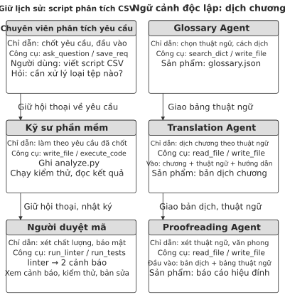

Khi mỗi thành viên có ngữ cảnh riêng, họ trao đổi tài liệu với nhau bằng cách nào? Trong hệ phân tán, hai cách giao tiếp phổ biến là bộ lưu trữ dùng chung và truyền thông điệp. Hệ thống Agent cũng dùng được cả hai hướng này, cụ thể gồm:

- **Tham số gọi công cụ.** Đóng gói Agent hạ nguồn thành một công cụ; phía thượng nguồn truyền nhiệm vụ và tài liệu có cấu trúc qua tham số, rồi nhận kết quả trả về.
- **Hệ thống tệp dùng chung.** Một bên ghi tài liệu, mã hoặc dữ liệu, bên kia đọc theo tham chiếu; phù hợp với sản phẩm trung gian lớn và tài liệu cần lưu bền.
- **Bus tin nhắn (Message Bus).** Agent gửi tin nhắn tới một dịch vụ trung chuyển, dịch vụ này phân phát theo đích đến hoặc quan hệ đăng ký nhận tin; phù hợp với trao đổi bất đồng bộ giữa nhiều thành viên.

Ví dụ, sau khi giao một nhiệm vụ dịch, phía thượng nguồn có thể chờ bản dịch trả về, hoặc nhận trước một mã nhiệm vụ rồi chuyển sang lo chương khác. Ngay cả khi hai người dịch đều mở được cùng một tệp, hệ thống vẫn phải quy định ai ghi và bên kia đọc khi nào. Cộng đồng Go nhấn mạnh việc dùng giao tiếp để tổ chức truy cập dữ liệu dùng chung; tư tưởng này cũng áp dụng cho Agent: phải rõ ai sở hữu trạng thái, ai được sửa, các thành viên khác lấy bản cập nhật bằng cách nào.

### Chiều thứ hai: tô-pô cộng tác

Tô-pô cộng tác mô tả quan hệ phụ thuộc giữa các nhiệm vụ, luồng thông tin và quan hệ điều khiển giữa các Agent. Chương này dùng ba cách tổ chức điển hình:

- **Mô hình cộng tác ngang hàng** (Peer Collaboration Pattern). Một số ít thành viên cộng tác nhiều lượt quanh cùng một sản phẩm. Ví dụ, người soạn viết bản nháp bài báo, người góp ý nêu đề xuất sửa, rồi người soạn chỉnh lại.
- **Mô hình quản lý** (Orchestration Pattern). Một Manager Agent tập trung lo việc chia nhỏ, phân công và tổng hợp nhiệm vụ; các Agent con đảm nhận phần việc chuyên môn của mình.
- **Mô hình phi tập trung** (Decentralized Pattern). Các thành viên nối tiếp công việc dựa trên vai trò, tin nhắn và trạng thái cục bộ; tất cả cùng quyết định công việc tiến triển tiếp ra sao.

> **Giải thích thuật ngữ: Graph Engineering.** Chương 1 đã giới thiệu cuộc thảo luận về Graph Engineering vào tháng 7 năm 2026. Góc nhìn này tập trung vào đồ thị thực thi: nút có thể là Agent, chương trình thông thường hoặc quyết định của con người; cạnh biểu diễn quan hệ phụ thuộc, định tuyến có điều kiện và hướng xử lý khi thất bại; trạng thái được truyền dọc theo quan hệ thực thi. Tô-pô cộng tác đa Agent là một ứng dụng của góc nhìn thiết kế này, trọng tâm là cách nhiều đơn vị ra quyết định bàn giao, chạy song song và phản hồi cho nhau.

Cộng tác ngang hàng, mô hình quản lý và thiết kế phi tập trung có thể kết hợp với nhau. Ví dụ, Manager giao một nhiệm vụ viết cho nhóm người soạn – người duyệt; nhóm lặp nội bộ xong mới nộp kết quả.

## Khi nào đa Agent tốt hơn Agent đơn

Giả sử bản nháp dịch sai một từ kỹ thuật. Đưa cùng một bản dịch cho hai người hiệu đính, có thể nhận về hai lần chấp thuận giống nhau; nếu một trong hai người còn có trong tay nguyên văn, bảng thuật ngữ và đoạn mã dùng từ đó, sẽ có thêm một con đường để phát hiện lỗi. Khi chọn cách cộng tác, hãy hỏi trước: Agent được thêm vào mang lại gì cho nhiệm vụ? Nó có thể thu được bằng chứng mới, phủ một nhánh tìm kiếm khác, đưa ra phán đoán chuyên môn khác, hoặc rút ngắn thời gian chờ nhờ chạy song song.

Tác giả trước hết xem xét **lượng thông tin mới mà phản hồi mang lại**, sau đó mới xét song song hóa và cách ly ngữ cảnh đem lại bao nhiêu lợi ích. Khi đọc được kết quả kiểm thử, ảnh chụp trang hoặc tài liệu bên ngoài, người duyệt có thể đề xuất sửa dựa trên những bằng chứng chưa có lúc tạo sản phẩm. Bảng 10-1 dùng vài tình huống thường gặp để minh họa cách kiểm tra phần thông tin mới này.

Bảng 10-1 Thông tin và phản hồi trong cộng tác đa Agent

| Mô hình cộng tác | Nguồn thông tin chính | Trọng tâm đánh giá |
|---|---|---|
| Cùng một mô hình tự duyệt lại đầu ra của mình | Tài liệu sẵn có và một lượt kiểm tra mới | Có phát hiện được chỗ sót không, sửa xong kết quả có tốt hơn không |
| Nhiều Agent tranh luận cùng một vấn đề | Lời giải, giả định và luận cứ của từng bên | Quan điểm có khác nhau không, kiểm chứng và chọn đáp án bằng cách nào |
| Người duyệt chạy kiểm thử và kiểm tra mã | Phản hồi từ biên dịch, kiểm thử và lúc chạy | Bản sửa có qua kiểm thử và giữ nguyên chức năng cũ không |
| Người duyệt xem kết quả kết xuất của giao diện web hoặc PPT | Ảnh chụp màn hình và phản hồi tương tác | Bố cục, nội dung và thao tác có đúng yêu cầu không |
| Người duyệt dùng công cụ bên ngoài để kiểm chứng sự thật | Kết quả truy xuất và bản ghi của hệ thống nghiệp vụ | Nguồn có đáng tin không, kết luận có khớp bằng chứng không |

RLEF dùng học tăng cường để huấn luyện mô hình tận dụng phản hồi từ việc chạy mã, học cách sửa qua nhiều bước trong các bài lập trình thi đấu. Lỗi biên dịch, kiểm thử thất bại và ngoại lệ lúc chạy cung cấp căn cứ cụ thể cho lần sửa tiếp theo; mô hình trong bài báo đạt kết quả tốt hơn với ít lần lấy mẫu hơn.[^rlef-2025] WebGen-Agent thì đưa ảnh chụp trang web, mô tả và góp ý của mô hình thị giác, cùng đánh giá thao tác GUI vào quy trình sinh trang: hệ thống vừa có thể quay lại bước trước để làm lại, vừa có thể chọn kết quả tốt nhất trong vài phương án đã sinh. Trên WebGen-Bench, độ chính xác của Claude 3.5 Sonnet tăng từ 26,4% lên 51,9%.[^webgen-agent-2025]

[^rlef-2025]: Gehring, J., et al. *RLEF: Grounding Code LLMs in Execution Feedback with Reinforcement Learning.* arXiv:2410.02089, 2025.
[^webgen-agent-2025]: Lu, Z., et al. *WebGen-Agent: Enhancing Interactive Website Generation with Multi-Level Feedback and Step-Level Reinforcement Learning.* arXiv:2509.22644, 2025.

Tác giả thường để hệ thống lấy được bằng chứng cụ thể trước, như kết quả kiểm thử, ảnh chụp hay dữ liệu công cụ trả về, rồi mới quyết định phân chia trách nhiệm sinh, thực thi và duyệt. Vòng phản hồi có thể do một Agent đảm nhận, cũng có thể tách cho nhiều vai trò; thêm vai trò thì phải giúp việc thu thập và sử dụng bằng chứng tốt hơn.

Nghiên cứu an toàn của Anthropic năm 2026 là một ví dụ về tìm kiếm có cộng tác: 45 Agent trao đổi phát hiện qua một diễn đàn chung, duyệt chéo lẫn nhau, rồi một Agent độc lập phân xử kết quả. Theo báo cáo, cụm cộng tác tiêu tốn 27 triệu token và tìm ra 266 lỗ hổng; phương án chạy song song độc lập tiêu tốn 6,5 triệu token và tìm ra 21 lỗ hổng. Diễn đàn giúp các thành viên lần theo phát hiện của người khác để đào tiếp, đồng thời biết hướng nào đã có người làm. Nhóm cộng tác cũng dùng nhiều token hơn khoảng bốn lần, nên khoảng cách giữa 266 và 21 bao gồm cả khác biệt về cách giao tiếp lẫn về lượng tính toán bỏ ra.[^anthropic-multiagent-2026]

[^anthropic-multiagent-2026]: Anthropic Frontier Red Team, “Patterns and Problems in Emerging Multiagent Systems,” 2026-08-13.

Trong nghiên cứu toán học, làm sao để nhiều nhóm thực sự khám phá những hướng khác nhau? Phương trình Navier–Stokes ba chiều mô tả chuyển động của chất lưu nhớt. Với điều kiện ban đầu trơn, nghiệm có luôn giữ được tính trơn không? OpenAI giao hai mục tiêu trái ngược cho các nhóm khác nhau: có nhóm cố chứng minh tính trơn, có nhóm tìm cách dựng phản ví dụ. Các nhóm tự khám phá trước, sau đó đội ngũ dùng Codex tổng hợp kết quả trung gian để nhóm khác cũng có thể đi tiếp theo những đầu mối hứa hẹn. Nhóm tìm ra phản ví dụ có khoảng một vạn Agent chạy đồng thời. Từ lúc lứa Agent đầu tiên khởi động đến khi tìm được chứng minh, đội ngũ báo cáo mất khoảng 88 giờ, thêm 17 giờ để hình thức hóa và kiểm chứng bằng Lean. Phản ví dụ có một điều kiện quan trọng: chất lưu chịu tác dụng của ngoại lực trơn mà vẫn xuất hiện kỳ dị trong thời gian hữu hạn. Dựa vào đó, đội ngũ đưa ra phản ví dụ mà hai phát biểu C và D trong đề bài của Viện Toán học Clay yêu cầu; nếu bỏ ngoại lực đi thì đó là một bài toán khác. Khi thiết kế loại tìm kiếm này, có thể viết rõ trước kết quả nào đủ để trả lời câu hỏi ban đầu, giao các giả thuyết cạnh tranh nhau cho các nhóm khác nhau, và dành riêng thời gian cho khâu kiểm chứng cuối cùng.[^ch10-ns-search]

[^ch10-ns-search]: Bản mô tả nghiên cứu *On the Navier–Stokes Millennium Prize Problem* của OpenAI kèm theo chứng minh và mã Lean. Trong thông báo ngày 11 tháng 9 năm 2026, Viện Toán học Clay đã phản hồi về công trình này và cho biết việc thẩm định kết quả cũng như trao giải sẽ tuân theo quy trình xét giải.

**Ngân sách bước ảnh hưởng thế nào đến hiệu quả?** Giả sử một nhiệm vụ cho phép 30 bước, Agent phải sắp xếp gọn gàng việc lập kế hoạch, phần hiện thực cốt lõi và những kiểm chứng cần thiết; nếu cho phép 300 bước, nó có chỗ để so sánh nhiều phương án hơn, kiểm thử và sửa đổi kỹ hơn. Muốn dùng tốt phần tài nguyên này, Agent còn cần biết tổng ngân sách và ngân sách còn lại, rồi dựa vào đó sắp xếp độ sâu khám phá.

Bài báo *Budget-Aware Tool-Use Enables Effective Agent Scaling* của Google năm 2025 nghiên cứu vấn đề này: Agent thiếu ý thức về ngân sách có thể nhanh chóng dừng lại ở tìm kiếm nông, dù tăng số bước được phép thì hiệu quả cũng khó tăng thêm. BAVT (Budget-Aware Value Tree Search) năm 2026 tiến thêm một bước, kết hợp ước lượng giá trị với ngân sách còn lại trong từng bước tìm kiếm để điều chỉnh trọng số giữa khám phá và khai thác. Khi ngân sách dồi dào, có thể so sánh nhiều hướng hơn; khi gần chạm trần, dồn tài nguyên vào các nhánh hứa hẹn.

Trong mô hình quản lý, điều này nghĩa là Manager phải phân bổ số bước theo độ khó của nhiệm vụ và điều chỉnh theo tiến độ: nhiệm vụ đơn giản thì giao kết quả sớm, nhiệm vụ phức tạp thì chừa chỗ cho kiểm chứng và sửa đổi; gặp tắc nghẽn thì xác định nguyên nhân trước, rồi mới quyết định bổ sung thông tin, tăng ngân sách hay đổi sang hướng khác.

Khám phá song song có thể rút ngắn thời gian chờ thực tế (wall-clock), duyệt nhiều lượt có thể cải thiện sản phẩm, nhưng cả hai đều làm tăng chi phí gọi mô hình và giao tiếp. Tác giả lấy một Agent đơn đã tinh chỉnh tốt làm đường cơ sở, và chỉ mở rộng quy mô cộng tác khi mức tăng chất lượng hoặc thời gian tiết kiệm được nhờ thành viên mới đủ bù chi phí giao tiếp, tính toán trùng lặp và bảo trì.

## Cộng tác đa Agent dùng chung ngữ cảnh

Cộng tác dùng chung ngữ cảnh đổi vai trò theo từng giai đoạn nhưng vẫn giữ nhật ký nhiệm vụ sẵn có. Lấy một báo cáo nghiên cứu làm ví dụ: vai trò truy xuất thu thập tài liệu trước, vai trò phân tích tính toán tiếp, rồi vai trò viết tổ chức cách trình bày. Mỗi vai trò đều xem lại được nguồn và quyết định trước đó; còn hệ thống dùng chỉ dẫn nhiệm vụ hiện tại để hướng vai trò vào mục tiêu của giai đoạn này.

Khi bàn giao giữa các đội, hãy hỏi trước một câu: những ai cần biết vì sao lúc đầu lại quyết định như vậy? Trong ví dụ sản phẩm của Teamily AI, quản lý sản phẩm và Agent cùng viết tài liệu yêu cầu sản phẩm (PRD) trong nhóm chat. Sau khi đội sản phẩm chia sẻ bản chốt cho đội kỹ thuật, kỹ sư vẫn có thể hỏi lại những đánh đổi đằng sau một yêu cầu cụ thể.

Lấy ví dụ vai trò truy xuất chuyển nhiệm vụ cho vai trò viết: sau khi bàn giao, mô hình đọc quy trình viết ở đâu, còn gọi được những công cụ nào? Thí nghiệm 10-1 hiện thực cùng một lần bàn giao theo hai cách.

| Vấn đề cần xử lý khi bàn giao | Chuyển vai trò (`transfer_to_agent`) | Nạp Skill |
|---|---|---|
| Cung cấp quy trình viết bằng cách nào? | Thay bằng system prompt của vai trò viết | Giữ danh mục Skill trong system prompt, nối quy trình viết vào cuối lịch sử tin nhắn |
| Mô hình thấy được những công cụ nào? | Có thể chỉ hiển thị công cụ của vai trò viết | Có thể giữ nguyên bộ công cụ cũ hoặc lối vào tìm kiếm công cụ |
| Đoạn KV Cache nào còn dùng được? | System prompt đã đổi, thường phải tính lại từ chỗ prefix thay đổi | Prefix của yêu cầu cũ tiếp tục tái sử dụng được |
| Ai kiểm tra quyền gọi? | Harness kiểm tra yêu cầu theo vai trò hiện tại rồi mới điều phối công cụ | Harness kiểm tra độc lập quyền của từng lần gọi |

Khi khác biệt giữa các vai trò chủ yếu nằm ở kiến thức, quy trình và văn phong, tác giả ưu tiên dùng Skill: cách này dễ tái sử dụng cùng một khung chạy và giữ được cache của prefix yêu cầu ổn định. Khi khác biệt liên quan đến quyền, cách ly công cụ hoặc trách nhiệm phê duyệt, có thể tổ chức thành Agent độc lập hoặc chuyển vai trò, rồi để Harness và môi trường thực thi đảm bảo kiểm soát truy cập. Việc một công cụ có xuất hiện trong đầu vào mô hình hay không ảnh hưởng đến lựa chọn gọi công cụ; còn quyền thực tế do khâu kiểm tra lúc chạy quyết định.

> **Thí nghiệm 10-1 ★★: Chuyển đổi nhiều vai trò trong ngữ cảnh dùng chung — so sánh system prompt và Skill**
>
> Hai cách làm dùng cùng mô hình, nhiệm vụ người dùng, cách hiện thực công cụ, quy trình vai trò và lịch sử dùng chung. Bản demo nhập môn yêu cầu tìm doanh số xe năng lượng mới của Trung Quốc giai đoạn 2021–2023, tính tốc độ tăng trưởng kép hằng năm (CAGR), rồi viết một đoạn tóm tắt cho nhà đầu tư không quá 120 chữ.
>
> **Cách 1: chuyển system prompt.** Thiết lập năm vai trò: triage (thu thập yêu cầu), research (truy xuất), coding (lập trình), data_analysis (phân tích) và writing (viết). triage là điểm vào; mỗi vai trò thấy bộ công cụ riêng của mình cùng `transfer_to_agent`. Khi chuyển giao, lịch sử được giữ lại, system prompt và bộ công cụ của vai trò đích được nạp vào, rồi việc thực thi tiếp tục.
>
> **Cách 2: nạp Skill.** System prompt và toàn bộ công cụ giữ ổn định suốt phiên. Mô hình gọi `load_skill(name)` để lấy quy trình của vai trò; nội dung này được đưa vào lịch sử dùng chung dưới dạng kết quả công cụ, prefix cũ vẫn được giữ nguyên. Harness kiểm tra từng lần gọi công cụ theo quy tắc phân quyền.
>
> Cả hai cách hiện thực đều đọc cùng một tệp `SKILL.md`. Trước và sau một lần bàn giao vai trò, hãy lấy mỗi bên một yêu cầu gửi tới mô hình, xem quy trình nằm trong tin nhắn nào và đoạn prefix nào còn tái sử dụng được. Rồi đối chiếu hai bản tóm tắt: nguồn số liệu doanh số có đáng tin không? Từ cuối năm 2021 đến cuối năm 2023 có hai kỳ tăng trưởng, tốc độ tăng trưởng kép đã tính đúng chưa?
>
> Trong phép đối chứng chính thức có một đề tóm tắt chặt hơn: giới hạn 160 ký tự và phải giữ hai URL nguồn. Cũng được tám bước, nhóm chuyển vai trò dùng ba lần gọi để đếm ký tự mà bản nháp vẫn dài 206 ký tự, lại bỏ sót công cụ tính toán mà đề bài chỉ định. Nhóm nạp Skill tính được tốc độ tăng trưởng từ doanh số của năm đầu và năm cuối, đến bước thứ tám mới nạp quy trình viết. Lúc đó mọi vai trò cần đi qua đều đã đi qua, nhưng người dùng vẫn chưa nhận được bản tóm tắt. Cả hai trajectory đều kết thúc vì chạm giới hạn số bước.
>
> Chạy cùng 30 nhiệm vụ trên cả hai cách hiện thực và kiểm tra kết quả giao bằng chương trình: nhóm nạp Skill đạt 15 nhiệm vụ, nhóm chuyển system prompt đạt 2. Tuy nhiên, so sánh theo từng đề, nhóm nạp Skill có nhiều hơn 6.855 token đầu vào không trúng cache và mất thêm khoảng 4,4 giây (đều là trung vị của hiệu số theo cặp). Lần này nhà cung cấp báo số token đầu vào lấy từ cache bằng 0 ở cả hai nhóm. Trong 6 bài kiểm tra biên về tuân thủ chỉ dẫn, cả hai nhóm đều đạt hết, nhưng tỷ lệ đạt trên nhiệm vụ hoàn chỉnh chênh nhau rất xa.

## Cộng tác đa Agent không dùng chung ngữ cảnh

Trong kiến trúc ngữ cảnh độc lập, mỗi Agent tự duy trì lịch sử đầu vào, trạng thái nhiệm vụ và vòng lặp chạy của mình, rồi trao đổi thông tin cần thiết qua tham số công cụ, tệp dùng chung và tin nhắn. Ví dụ, tài liệu người dịch nộp lên phải ghi rõ đoạn nguyên văn và phiên bản bảng thuật ngữ. Dù người dịch đã rời đi, người hiệu đính vẫn tìm được nguyên văn; khi cần sửa lại, cũng tìm được người phụ trách theo từng chương.

Bảng 10-2 đối chiếu cách hệ điều hành quản lý tiến trình với cách runtime quản lý Agent.

Bảng 10-2 Phép loại suy thiết kế giữa hệ thống đa Agent và hệ điều hành

| Hệ điều hành | Trách nhiệm tương ứng trong hệ thống đa Agent |
|---|---|
| Chương trình và cấu hình | System prompt, định nghĩa công cụ và cấu hình vai trò |
| Bộ nhớ tiến trình | Ngữ cảnh hiện tại, trạng thái nhiệm vụ và lịch sử |
| CPU thực hiện tính toán | LLM sinh quyết định, runtime và công cụ thực thi thao tác tương ứng |
| Nhân hệ điều hành quản lý việc chạy | Runtime của Agent quản lý trạng thái, điều phối và tài nguyên |
| Lời gọi hệ thống | Yêu cầu thao tác bên ngoài qua giao diện công cụ |
| fork: tạo tiến trình con | `spawn_subagent`: tạo Agent con |
| kill: gửi tín hiệu | `cancel_subagent`: yêu cầu hủy |
| ps: xem tiến trình | `list_agents`: xem thành viên và trạng thái chạy |
| Mã thoát và wait | Thông báo hoàn thành, trạng thái nhiệm vụ và kết quả có cấu trúc |
| Bộ lưu trữ dùng chung và truyền thông điệp | Tệp dùng chung, tham số công cụ và tin nhắn |

Trạng thái riêng, tin nhắn bất đồng bộ và tạo thành viên động cũng xuất hiện trong mô hình Actor được đề xuất vào thập niên 1970.[^actor-model]

[^actor-model]: Hewitt, C., Bishop, P., Steiger, R. *A Universal Modular ACTOR Formalism for Artificial Intelligence.* IJCAI 1973.

Khi có nhiều nhiệm vụ con độc lập, tác giả thiên về việc cho mỗi thành viên một ngữ cảnh riêng, để nó chỉ xử lý những tài liệu liên quan đến trách nhiệm của mình. Cách này giúp kiểm thử từng vai trò riêng rẽ, giảm việc lịch sử dài dòng của giai đoạn trước làm nhiễu phán đoán hiện tại, và cho phép nhiều nhiệm vụ tiến hành đồng thời. Hiệu quả cách ly còn phụ thuộc vào các tài nguyên dùng chung khác: nhiều Agent vẫn có thể cùng lúc sửa một tệp, tiêu cùng một hạn mức API, hoặc cùng nhận một tin nhắn sai.

Giao diện cộng tác còn phải xử lý tin nhắn bị mất, giao trùng và trạng thái bị trễ. Khi điều tra sự cố, có thể dùng mã nhiệm vụ để liên kết yêu cầu, sự kiện công cụ và kết quả của từng thành viên, dựng lại diễn biến của một lần bàn giao.

Giả sử một Agent làm xong phân tích và cần chuyển kết quả cho đồng nghiệp viết báo cáo. Nếu chỉ có vài con số, có thể gửi kèm tin nhắn; nếu sản phẩm là một bảng lớn, thường lưu bảng vào hệ thống tệp dùng chung và đính kèm tham chiếu trong tin nhắn. Từ đó có hai mảng việc. **Lưu trữ sản phẩm** lo lưu và trao đổi tài liệu, mã và dữ liệu; **giao tiếp và điều khiển** lo phân phát tin nhắn, truy vấn trạng thái nhiệm vụ, hủy thực thi và điều phối tài nguyên.

### Hệ thống tệp dưới góc nhìn của Agent

Một thiết kế phổ biến là cung cấp cho Agent một **hệ thống tệp ảo** (virtual filesystem), gắn tài nguyên từ nhiều nguồn vào cùng một cây thư mục. Mô hình truy cập qua các giao diện như `read_file`, `write_file` và `list_dir`; tầng dưới có thể nối tới ổ đĩa tạm cục bộ, bộ lưu trữ đối tượng bền vững, API ổ đĩa đám mây của bên thứ ba hoặc gói tài nguyên của hệ thống.

Tác giả thường phân định rõ các vùng lưu trữ trước, rồi mới nối vào quy trình cộng tác. Nếu bản nháp tạm, sản phẩm giao chính thức và tệp bên ngoài của người dùng nằm lẫn với nhau, rất dễ ghi đè nhầm hoặc đọc vượt quyền. Giao diện thống nhất giúp dùng tiện lợi, còn khả năng hiển thị, vòng đời và quyền của từng vùng do cấu hình gắn kết và kiểm soát truy cập quyết định. Có thể chia cây thư mục này thành bốn loại vùng.

**Một, vùng làm việc riêng của Agent (Scratchpad).** Mỗi phiên bản chạy dùng vùng làm việc của riêng mình để lưu bản nháp, tệp tạm, nhật ký gỡ lỗi và sản phẩm trung gian. Mặc định chỉ Agent sở hữu mới truy cập được, và vùng này được dọn hoặc lưu trữ theo chính sách của nhiệm vụ. Nhờ vậy các tệp tạm không ghi đè lên nhau; Agent con làm xong thì đặt kết quả cần giao vào không gian chung, kèm bản tóm tắt có cấu trúc gửi cho Agent chính. Nhật ký thử sai vẫn ở lại vùng làm việc cũ để chẩn đoán về sau. Đây cũng là cách đưa cách ly ngữ cảnh xuống tầng lưu trữ: Agent chính nhận kết quả giao và bằng chứng cần thiết, không phải tốn công đọc toàn bộ quá trình thử sai trong việc điều phối hằng ngày.

**Hai, không gian dùng chung của nhiều Agent (Shared Workspace).** Các thành viên cộng tác trao đổi sản phẩm ở đây; người dùng cũng có thể tải tài liệu lên hoặc tải sản phẩm về qua lối vào được cấp quyền. Ví dụ, Glossary Agent ghi bảng thuật ngữ, Translation Agent đọc rồi dịch, người duyệt kiểm tra bản dịch. Không gian chung thường được lưu bền theo nhiệm vụ, cần xử lý ghi đồng thời, cập nhật phiên bản và phạm vi truy cập. Ở Chương 6, Agent và máy tính ảo trao đổi tệp CSV và biểu đồ qua bộ lưu trữ dùng chung; đó chính là một ví dụ của kiểu bàn giao sản phẩm này. Phần sau sẽ giới thiệu các phương pháp như khóa lạc quan và cách ly bản sao làm việc.

**Ba, tài nguyên bên ngoài được gắn vào (Mounted External Resources).** Các tài nguyên như Google Drive, Notion, Dropbox và Wiki doanh nghiệp có thể được ánh xạ vào giao diện thống nhất qua bộ chuyển đổi (adapter). Khi Agent đọc tài liệu, bộ chuyển đổi gọi API của hệ thống nguồn. Ở đây cần quản lý ba loại khác biệt: phạm vi truy cập tùy vào quyền cấp từ bên ngoài; truy cập mạng kéo theo độ trễ, hết thời gian chờ và vấn đề cập nhật bộ đệm; thao tác ghi ngược phải tuân theo quy tắc phân quyền và phiên bản của hệ thống nguồn. Ngữ nghĩa nhất quán cụ thể do giao diện dịch vụ quyết định; có thể dùng số phiên bản, ghi có điều kiện hoặc đọc lại để phát hiện sửa đổi đồng thời. Gắn chỉ đọc theo nhu cầu phù hợp cho việc tra cứu tài liệu; khi cần chỉnh sửa mới cấp quyền ghi tương ứng.

**Bốn, tài nguyên có sẵn của hệ thống (Built-in System Resources).** Sổ tay tham khảo, mẫu, định nghĩa công cụ và các Skill dựng sẵn có thể làm gói tài nguyên chỉ đọc cho nhiều Agent cùng dùng. Skill được nạp theo cơ chế tiết lộ dần: trước hết cung cấp danh mục, rồi đọc quy trình và script theo nhiệm vụ. Gói tài nguyên có phiên bản cố định thuận tiện cho đọc đồng thời; khi nâng cấp, việc chuyển phiên bản giúp các nhiệm vụ đang chạy giữ được tính nhất quán.

Trong Hình 10-2, người dịch có thể sửa bản nháp nhiều lần trong thư mục của mình; khi sẵn sàng giao cho khâu hiệu đính mới đặt phiên bản tương ứng vào vùng dùng chung. Bản gốc trong ổ đĩa đám mây của người dùng được đọc qua bộ chuyển đổi bên ngoài, và việc truy cập còn tùy vào quyền người dùng đã cấp.

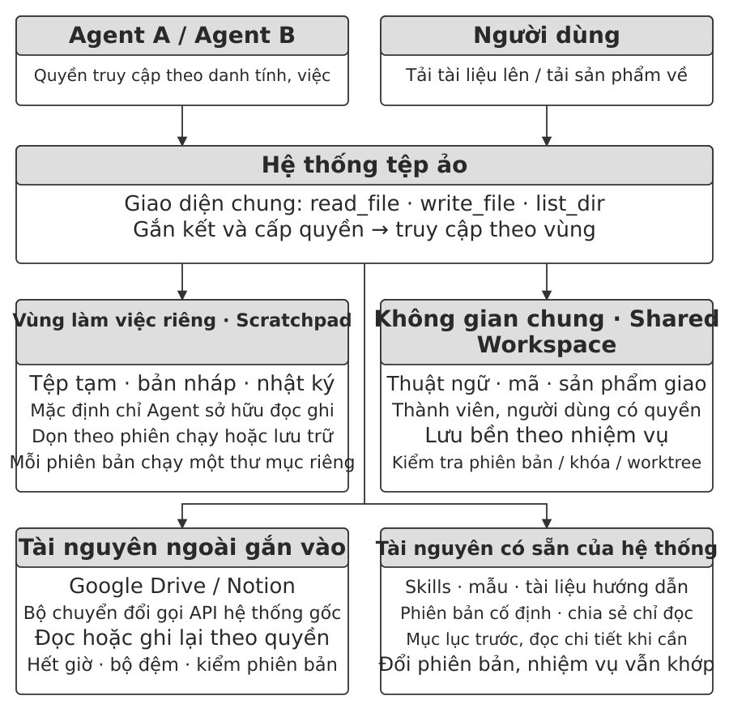

Sau khi người dịch rời đi, các tệp tạm trong vùng làm việc có thể bị giải phóng theo. Bản dịch đã đặt vào vùng dùng chung thì vẫn được giữ lại, người hiệu đính dựa vào quyền đọc để tiếp nhận (Bảng 10-3).

Bảng 10-3 Bốn loại vùng của hệ thống tệp ảo cho Agent

| Vùng | Khả năng hiển thị | Vòng đời | Đọc ghi | Quản lý đồng thời |
|---|---|---|---|---|
| Vùng làm việc riêng của Agent | Mặc định chỉ Agent sở hữu | Dọn theo phiên bản chạy, lưu trữ khi cần | Agent sở hữu đọc và ghi | Ngăn thử lại hoặc thao tác nền ghi trùng |
| Không gian dùng chung của nhiều Agent | Thành viên và người dùng được cấp quyền | Lưu bền theo nhiệm vụ | Cấp quyền theo vai trò | Khóa, kiểm tra phiên bản hoặc worktree |
| Tài nguyên bên ngoài được gắn vào | Bị giới hạn bởi cả quyền bên ngoài lẫn bộ chuyển đổi | Do hệ thống nguồn và chính sách bộ đệm quyết định | Chỉ đọc theo nhu cầu hoặc ghi khi được cấp quyền | Tuân theo giao diện phiên bản và đồng thời của hệ thống nguồn |
| Tài nguyên có sẵn của hệ thống | Agent được cấp quyền | Phiên bản cố định, tái sử dụng qua các phiên | Chỉ đọc | Chuyển phiên bản tài nguyên đồng loạt |

Tham chiếu tệp giúp tin nhắn bàn giao luôn ngắn gọn: thượng nguồn cung cấp vị trí, phiên bản và mục đích của sản phẩm, hạ nguồn đọc nội dung khi cần. Các thành viên trong cùng một môi trường chạy có thể dùng đường dẫn chung; cộng tác xuyên tổ chức thì cần mã định danh sản phẩm, giao diện truy cập và quyền mà cả hai bên đều phân giải được thì mới hoàn tất được kiểu bàn giao tương tự.

### Giao tiếp và điều khiển giữa các Agent

Các công cụ tạo, giao tiếp, hủy và khám phá giới thiệu ở Chương 4 cung cấp giao diện điều khiển cơ bản cho cộng tác đa Agent: `spawn_subagent` tạo thành viên, `send_message_to_subagent` chuyển tin nhắn, `cancel_subagent` yêu cầu hủy, `list_agents` truy vấn danh sách thành viên. Quanh các giao diện này còn phải quy ước hành vi về tin nhắn, trạng thái, kết thúc và điều phối.

**Một, truyền tin nhắn.** Khi ít thành viên và quan hệ cố định, có thể dùng giao diện điểm-điểm, ví dụ Agent điện thoại và Agent máy tính trao đổi tiến độ trực tiếp với nhau. Nếu mọi thành viên đều cần nói chuyện từng đôi một, số quan hệ tiềm năng tăng theo bình phương số thành viên; khi có nhiều quan hệ đăng ký nhận tin, bus tin nhắn giúp quản lý tập trung việc định tuyến, đệm và thử lại. Cả điểm-điểm lẫn bus đều hiện thực được phân phát bất đồng bộ; bên nhận có cần trực tuyến cùng lúc hay không phụ thuộc vào cơ chế hàng đợi và lưu bền.

Tin nhắn thường có một **phong bì** (envelope) có cấu trúc: ID người gửi, Agent đích hoặc phạm vi phát rộng, loại tin nhắn và phần tải (payload). Loại tin nhắn có thể gồm `task_assigned`, `status_update`, `result` và `terminate`. Mã nhiệm vụ, mã tin nhắn và yêu cầu liên quan giúp bên nhận loại trùng, đồng thời cho phép công cụ gỡ lỗi dựng lại chuỗi giao tiếp. Nội dung nghiệp vụ đặt trong payload JSON, hai bên xử lý theo các trường đã quy ước.

Ví dụ, một bản dịch do biên tập viên chịu trách nhiệm giao, và biên tập viên muốn nhờ Agent duyệt thuật ngữ kiểm tra một từ. Trong phần bình luận của một phiếu công việc (Ticket) trên Multica, chỉ cần gọi tên nó (`@`) và viết câu hỏi là kích hoạt được việc duyệt. Ý kiến duyệt có thể trả lời thẳng vào phiếu đó; người phụ trách vẫn là biên tập viên, trạng thái phiếu cũng giữ nguyên. Nếu muốn người duyệt nhận toàn bộ phiếu, phải đổi người phụ trách một cách tường minh.[^ch10-multica]

[^ch10-multica]: Multica, gọi tên Agent trong bình luận; phần hiện thực phân phát bình luận ở phiên bản `d579273`.

**Hai, lấy trạng thái.** Agent chính cần biết nhiệm vụ con còn đang chạy không, có cần đầu vào không, và kết quả đã lấy được chưa. Có thể kết hợp giao diện trạng thái, thông báo sự kiện và tệp tiến độ: giao diện runtime cung cấp trạng thái vòng đời, tin nhắn cho biết tiến triển nghiệp vụ, tệp lưu bền giữ bản ghi có thể khôi phục.

`get_subagent_status(agent_id)` có thể trả về các trạng thái như đang chạy, cần đầu vào, đã xong hoặc thất bại. Trong điều phối hằng ngày, tác giả ưu tiên dùng thông báo hoàn thành và tin nhắn tiến độ theo giai đoạn, để Agent chính tiếp tục việc của mình. Chỉ khi thông báo bị trễ, kết nối vừa khôi phục hoặc cần điều tra sự cố mới chủ động truy vấn, tránh tiêu tốn lượt gọi mô hình vào việc liên tục hỏi “xong chưa”. Giao diện trạng thái do runtime duy trì, có thể báo kịp thời tiến trình còn sống không và nhiệm vụ đã kết thúc chưa.

**Dùng tin nhắn để trao đổi tiến độ.** Agent chính có thể hỏi tiến độ hiện tại, Agent con trả lời ở bước thích hợp; Agent con cũng có thể chủ động phát `status_update` khi có kết quả giai đoạn, gặp tắc nghẽn hoặc cần trợ giúp. Nội dung tin nhắn nên nêu việc đã xong, bước tiếp theo và nguyên nhân tắc nghẽn; các thành viên dùng cùng một bộ tên trạng thái để dễ tổng hợp và phán đoán. Phần giao thức A2A phía sau sẽ giới thiệu cách biểu diễn chuẩn hóa vòng đời nhiệm vụ.

**Dùng tệp để lưu tiến độ.** Hệ thống có thể ghi nối tin nhắn, yêu cầu công cụ, kết quả công cụ và thay đổi trạng thái vào nhật ký theo thứ tự sự kiện, chẳng hạn dùng định dạng JSONL, mỗi dòng một sự kiện. Agent chính có quyền chẩn đoán hoặc công cụ vận hành có thể dựa vào đó để kiểm tra quá trình thử lại, lỗi và chờ đợi. Lịch sử đầu vào của mô hình chỉ là một phần của trajectory chạy; nhật ký còn ghi được các sự kiện điều phối và thực thi bên ngoài.

Một trajectory đầy đủ có thể chứa hàng vạn token, và mỗi lần đọc xong Agent chính lại phải chắt lọc lại trạng thái. Tin nhắn báo cho Agent chính biết có tiến triển mới, còn tệp tiến độ ngắn gọn lưu trạng thái hiện tại để truy vấn và khôi phục về sau. Tác giả ưu tiên phối hợp hai thứ này cho việc điều phối hằng ngày. Mỗi khi xong một việc, Agent con cập nhật danh sách nhiệm vụ, tham chiếu sản phẩm và điểm tắc hiện tại; Agent chính dựa vào các trường này để quyết định bước tiếp. Trajectory chi tiết được giữ lại để điều tra khi cần. Nếu tiến độ lâu không thay đổi, có thể kết hợp nhịp tim (heartbeat), trạng thái gọi công cụ và thiết lập hết thời gian của nhiệm vụ để phán đoán có cần can thiệp không: một công cụ chạy lâu có thể vẫn đang làm việc, xác nhận trạng thái rồi mới quyết định chờ, hủy hay thử lại.

**Ba, kết thúc thực thi.** Khi nhiều thành viên song song tìm cùng một mục tiêu, một thành viên hoàn thành thì các nhánh khác có thể dừng để giải phóng ngân sách và tài nguyên công cụ. Có hai mức độ hủy, gần với vai trò của SIGTERM và SIGKILL trong Unix.

Tác giả ưu tiên **kết thúc nhẹ nhàng**: runtime chuyển yêu cầu hủy, Agent con dừng thao tác mới tại điểm an toàn, lưu tiến độ cần thiết, đóng phiên trình duyệt và nhả khóa, rồi trả về xác nhận (ack). **Kết thúc cưỡng bức** dùng cho những lần thực thi đã quá hạn hủy mà vẫn không phản hồi: runtime kết thúc tiến trình, rồi kiểm tra tài nguyên sót lại và các lần ghi chưa hoàn tất. Những thao tác đã gửi tới hệ thống bên ngoài còn phải truy vấn kết quả, khi cần thì chạy quy trình bù trừ.

Vòng đời cũng cần được quản lý dọc theo quan hệ tạo lập. Mượn ý tưởng context của Go, có thể cho tín hiệu hủy của nhiệm vụ cha lan xuống toàn bộ cây nhiệm vụ con; vòng lặp chạy kiểm tra tín hiệu hủy tại các điểm an toàn, tương ứng với công dụng của `ctx.Done()`. Nhờ vậy, khi nhiệm vụ cha kết thúc, các nhánh nó khởi chạy cũng bước vào quy trình dọn dẹp, tránh để những Agent không ai quản lý tiếp tục gọi công cụ và tiêu ngân sách. Với các nhiệm vụ nền thực sự cần chạy độc lập lâu dài, hãy tạo một ngữ cảnh vòng đời độc lập, tương tự dùng `context.Background()`, đồng thời chỉ định người quản lý chịu trách nhiệm giám sát, ngân sách và dọn dẹp.

**Bốn, tài nguyên và điều phối.** Hệ thống Agent phải phân bổ token, số bước, hạn mức đồng thời, kết nối công cụ và tài nguyên tính toán. Khi khởi chạy nhiệm vụ con, đặt ngân sách và hành vi khi vượt hạn mức; chọn mô hình theo độ khó nhiệm vụ; giới hạn số lần gọi đồng thời để không làm cạn hạn mức dịch vụ cùng một lúc. Khi có nhiệm vụ khẩn hơn đến, có thể tạm dừng hoặc hủy nhiệm vụ ưu tiên thấp tại điểm an toàn, lưu tiến độ rồi điều phối lại.

Giả sử ba nhánh mỗi nhánh tra một phương án khả thi, trong đó một nhánh đã tìm được manh mối then chốt, chỉ còn thiếu một lần kiểm chứng cuối. Manager có thể cho nhánh đó thêm vài bước, đồng thời kết thúc hai nhánh không có tiến triển. Hạn mức do runtime trừ dần; một nhánh dù còn muốn thử nữa thì hết ngân sách cũng phải dừng.

### Mô hình cộng tác ngang hàng: kiểm tra lẫn nhau và cải tiến lặp

Cộng tác ngang hàng thường gồm hai, ba Agent trao đổi ý kiến và sửa sản phẩm quanh cùng một nhiệm vụ. Khi thiết kế, có thể giao cho các thành viên trách nhiệm, tài liệu và công cụ khác nhau, để họ phán đoán độc lập rồi mới tổng hợp kết quả. Ví dụ, người tạo quan tâm đến phần hiện thực, người duyệt quan tâm đến kiểm thử và yêu cầu người dùng; các thành viên chuyên môn khác nhau kiểm tra ràng buộc trong lĩnh vực của mình. Mô hình, đầu vào và quy trình làm việc càng giống nhau, các thành viên càng dễ lặp lại cùng một kiểu phán đoán, nên cần chủ động thiết kế sự khác biệt về góc nhìn và bằng chứng.[^anthropic-multiagent-2026]

Với nhiệm vụ cải tiến nhiều lượt quanh cùng một sản phẩm, tác giả khuyên bắt đầu bằng cộng tác ngang hàng giữa hai, ba thành viên. Khi vai trò, nội dung bàn giao và điều kiện dừng đã rõ ràng, có thể dựng được một vòng lặp kiểm thử được, và khối lượng điều phối ban đầu cũng ít.

#### Loop Engineering

Cộng tác ngang hàng giúp xử lý một vấn đề thường gặp: **kết thúc quá sớm**. Lấy ví dụ lập trình và trợ lý thay người dùng làm việc với bộ phận chăm sóc khách hàng, có thể phát hiện kết thúc quá sớm qua ba loại bản ghi.

- **Mới xong một phần đã tuyên bố xong hết.** Coding Agent viết xong mã nhưng bỏ sót kiểm thử và kiểm tra triển khai; người dùng nhờ trợ lý lo hai việc, nó xong việc thứ nhất đã báo cáo mọi thứ đâu vào đấy. Cần đối chiếu từng mục với danh sách nhiệm vụ, kiểm tra bằng chứng hoàn thành của từng việc.
- **Một con đường thất bại là bỏ cuộc sớm.** Nhà bán hàng có thể yêu cầu nộp tài liệu qua biểu mẫu, hoặc nhận tệp đính kèm qua một hộp thư chỉ định. Nhận được phản hồi như vậy, có thể làm tiếp theo cách nhà bán hàng chấp nhận. Cần ghi lại nguyên nhân thất bại và đánh giá còn những con đường nào đáng thử.
- **Thành công cục bộ rồi bỏ sót các bước sau.** Nếu nhà bán hàng đồng ý hoàn tiền nhưng còn yêu cầu người dùng xác nhận trong ứng dụng, trợ lý phải dặn rõ bước này và điều kiện thao tác. Lấy việc giảm tiền hóa đơn làm ví dụ: nhân viên chăm sóc khách hàng hứa miệng qua điện thoại, trợ lý có thể xác nhận với người dùng rằng cuộc thương lượng lần này đã có được lời hứa. Bản ghi cuộc gọi chứng minh được nhân viên đã nói gì, còn hóa đơn sau này có thực hiện đúng không thì cần bằng chứng mới. Người duyệt nên nói rõ riêng từng phần: kết quả đã đạt được, ai còn phải làm gì, và những kết quả nào tạm thời chưa thấy được.

Cả ba loại vấn đề đều đòi hỏi biến điều kiện hoàn thành thành kết quả kiểm tra được. **Loop Engineering** (kỹ thuật vòng lặp) quan tâm đến việc để Agent liên tục đi qua chu trình “xác định việc tiếp theo – thực thi – kiểm chứng – ghi tiến độ”, rồi dựa vào kết quả để quyết định tiếp tục, chờ, chuyển giao hay kết thúc. Kỹ sư phải thiết kế nguồn nhiệm vụ, cách kiểm chứng, trạng thái lưu bền và điều kiện dừng. Công việc của con người cũng mở rộng theo: từ viết prompt cho một lần gọi chuyển sang thiết kế những vòng lặp có thể liên tục đẩy nhiệm vụ tiến lên. Tháng 6 năm 2026, Addy Osmani dùng tên gọi này để bàn về nhóm thực hành ấy, và dẫn kinh nghiệm của Boris Cherny: trọng tâm công việc dần chuyển sang thiết kế những vòng lặp dẫn dắt Agent.[^loop-engineering-2026]

**Trong những vòng lặp như vậy, tác giả cho rằng bộ kiểm chứng thường là nút thắt then chốt.** Khi kiểm chứng không đáng tin, tăng số vòng có thể khiến hệ thống lặp lại cùng một loại lỗi, hoặc tuyên bố hoàn thành quá sớm. Kết quả kiểm thử, trạng thái nghiệp vụ và xác nhận của người dùng cung cấp căn cứ hoàn thành trong phạm vi riêng của mỗi thứ; khi kiểm chứng thất bại, kết quả đó trở thành đầu vào cho lượt sửa tiếp theo.

Thực hành đi trước tên gọi. Trước khi cái tên Loop Engineering trở nên phổ biến, tác giả và đội ngũ đã dùng vòng lặp cùng kiểm chứng để xử lý kết thúc quá sớm trong Pine AI. Người đề xuất–người thẩm định là một cách thông dụng để tổ chức loại vòng lặp này, sẽ được trình bày kỹ hơn ở dưới.

[^loop-engineering-2026]: Osmani, Addy. “Loop Engineering”, 2026.

**LoopX: lưu trạng thái công việc qua các vòng.** LoopX đặt mục tiêu, ranh giới, việc cần làm, cổng kiểm soát, bằng chứng và hạn mức vào một mặt phẳng điều khiển (control plane) lưu bền, rồi để nó sắp xếp công việc cho vòng tiếp theo hoặc cho người thực thi tiếp theo. Quy trình có thể tóm gọn thành: **mặt phẳng điều khiển ra quyết định → Agent thực thi → kiểm chứng độc lập → ghi nhận tiến độ đã xác minh**.

Agent gọi công cụ, suy luận và nộp thành quả của vòng này. Mặt phẳng điều khiển ghi lại công việc đã xong và quyết định vòng sau bắt đầu từ đâu. Kiểm chứng đạt thì ghi nhận trạng thái hoàn thành; thất bại thì chuyển sang sửa hoặc lập lại kế hoạch. Cổng kiểm soát của con người, điều kiện chờ và trần ngân sách cùng quyết định khi nào được tiếp tục thực thi.[^loopx-framework]

[^loopx-framework]: LoopX, The local control plane for long-running AI agent work, v0.4.0.

**LongHorizon-Harness: nối liền nhiệm vụ dài xuyên nhiều ứng dụng.** Khung này xuất phát từ Computer Use đa phương thức, xử lý việc thực thi liên tục khi nhiệm vụ trải qua GUI, CLI, nhiều ứng dụng desktop và nhiều lần làm mới ngữ cảnh. Nó dùng vòng lặp Manage–Execute–Audit (MEA): Manager dựa vào mục tiêu ban đầu, tiến độ đã xác minh, bằng chứng thất bại và phần việc còn lại để sinh ra một nhiệm vụ con có phạm vi rõ ràng; Executor thực hiện thao tác GUI hoặc CLI trong một ngữ cảnh mới; Auditor kiểm tra kết quả ở chế độ chỉ đọc, rồi ghi tiến độ đã xác minh vào trạng thái của vòng sau. Bằng chứng thất bại cũng được giữ lại để phục vụ khôi phục và lập lại kế hoạch.

Khung này gọi các backend thực thi như Claude Code, Codex CLI qua một tầng thích ứng, nối việc quản lý nhiệm vụ ở vòng ngoài với vòng lặp chạy của backend. Hướng đi này neo tính liên tục của nhiệm vụ dài vào trạng thái nhiệm vụ đã được xác minh. Ngữ cảnh thực thi có thể được làm mới, vòng sau vẫn tiếp tục làm việc dựa trên mục tiêu, bằng chứng hoàn thành và những vấn đề chưa giải quyết, đồng thời kiểm tra lại xem thay đổi của môi trường có ảnh hưởng đến kết luận trước đó không.[^longhorizon-implementation]

Trong phép đối chứng giữ nguyên backend thực thi Qwen 3.7-Plus và Claude Code, chỉ thay đổi vòng ngoài, bài báo báo cáo WeaveBench PassRate tăng từ 51,8% lên 80,7%, tỷ lệ hoàn thành nhị phân trên OSWorld 2.0 tăng từ 2,8% lên 8,3%, tỷ lệ thành công trên Terminal-Bench 2.1 tăng từ 69,7% lên 77,2%. Chi phí cũng thay đổi theo nhiệm vụ: hai benchmark đầu lần lượt tiêu tốn tổng token gấp 2,3 lần và token đầu ra gấp 3,6 lần so với đường cơ sở; trên Terminal-Bench 2.1, lượng token tiêu thụ giảm 24%.

Trong cùng một nhiệm vụ kiểm tra luồng đa lớp WebRTC, người thực thi ở đường cơ sở bị kẹt trên giao diện Wireshark, sau đó thử thêm vài lần và cuối cùng đạt 0,59 điểm. Khi dùng MEA, người kiểm tra ghi lại phần bằng chứng còn thiếu, người thực thi ở vòng sau dựa vào đó để tra bổ sung, cuối cùng đạt 0,92 điểm.

[^longhorizon-implementation]: LongHorizon-Harness, bài báo arXiv:2608.01964. Trajectory công khai của cả đường cơ sở và MEA đều lấy từ nhiệm vụ WEB_task_16_webrtc_simulcast_layer_audit; script tái hiện dùng commit `53bc678`.

#### Mô thức người đề xuất–người thẩm định

Mô thức người đề xuất–người thẩm định giao việc tạo sản phẩm và việc kiểm tra kết quả cho hai vai trò. Các thí nghiệm tạo PPT, biên tập video và trực quan hóa nhật ký ở Chương 5 đều dùng thiết kế này: Proposer sinh mã, Reviewer xem kết quả kết xuất, dùng mô hình thị giác kiểm tra chất lượng và trả về ý kiến sửa có cấu trúc. Trong Hình 10-3, ý kiến sửa còn phải quay về tay người đề xuất. Nó có sửa được phiên bản sau dựa trên ý kiến đó hay không tùy vào việc người thẩm định khoanh vùng vấn đề chi tiết đến đâu.

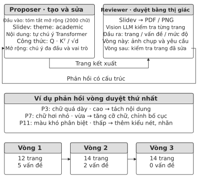

Đối tượng kiểm tra thay đổi thì bằng chứng cần xem khi duyệt cũng phải đổi theo. Duyệt câu trả lời chăm sóc khách hàng thì đối chiếu quy tắc nghiệp vụ và nguồn sự thật; duyệt thay đổi mã thì xem kiểm thử và kết quả chạy thực tế; duyệt phương án thao tác thì đối chiếu quy chuẩn áp dụng và điều kiện tiên quyết.

Bài báo ICLR 2024 *Large Language Models Cannot Self-Correct Reasoning Yet* của Huang và cộng sự phát hiện rằng, với các nhiệm vụ suy luận và thiết lập prompt mà họ nghiên cứu, khi GPT-4 tự sửa mà không có phản hồi bên ngoài, có trường hợp nó sửa đáp án đúng thành sai, khiến độ chính xác tổng thể giảm xuống. Bài tổng quan về tự sửa lỗi trên TACL bàn sâu hơn về việc điều kiện nhiệm vụ và độ tin cậy của phản hồi ảnh hưởng thế nào đến hiệu quả sửa.[^self-correction-survey] Vì vậy, tác giả coi bằng chứng độc lập và điều kiện sửa khoanh vùng được là yêu cầu cơ bản của vòng lặp duyệt. Người duyệt phải đọc được kết quả kiểm thử thực tế, trạng thái môi trường hoặc kết quả kết xuất, và chỉ ra yêu cầu nào chưa đạt, kiểm chứng bản sửa bằng cách nào.

[^self-correction-survey]: Kamoi, R., et al. *When Can LLMs Actually Correct Their Own Mistakes? A Critical Survey of Self-Correction of LLMs.* TACL, 2024.

Một vòng lặp hoàn chỉnh có thể tổ chức thành năm bước:

1. Người đề xuất viết phiên bản đầu theo yêu cầu nhiệm vụ, ví dụ một câu trả lời hoặc một đoạn mã.
2. Thực thi hoặc kết xuất sản phẩm để lấy kết quả kiểm thử, trạng thái nghiệp vụ, ảnh chụp màn hình hoặc kết quả kiểm chứng sự thật.
3. Người duyệt đối chiếu yêu cầu với bằng chứng, đưa ra kết luận đạt, hoặc chỉ ra vị trí vấn đề cùng điều kiện sửa.
4. Nếu còn ngân sách, người đề xuất sửa theo phản hồi, rồi thực thi và duyệt lại; gặp vấn đề cần đầu vào hoặc cần cấp quyền thì chuyển sang chờ hoặc chuyển giao.
5. Khi đạt điều kiện phát hành, giao phiên bản đã qua duyệt, kèm bằng chứng kiểm chứng và kết luận duyệt; khi hết ngân sách thì lưu lại tiến độ và các vấn đề chưa giải quyết.

Người duyệt đọc các bài kiểm thử và tiêu chuẩn phát hành đã được bảo vệ; mọi đề xuất thay đổi tiêu chuẩn do người duyệt đưa ra phải được xem xét riêng.

Trong các thí nghiệm của CRITIC, mô hình đưa ra câu trả lời trước, rồi dùng công cụ để kiểm tra.[^ch10-critic] Ví dụ, dùng công cụ tìm kiếm để kiểm chứng sự thật trong câu trả lời, dùng trình thông dịch Python để chạy chương trình toán do chính nó viết. Trên ba loại nhiệm vụ — hỏi đáp mở, sinh chương trình toán và giảm phát ngôn độc hại — mô hình sửa theo phản hồi công cụ đều cải thiện kết quả. Nếu chỉ dựa vào việc mô hình tự đánh giá câu trả lời ban đầu, hiệu quả sửa lỗi yếu hơn. Thiết kế này tương đồng với ví dụ PPT ở Chương 5: ảnh chụp kết xuất làm lộ ra các vấn đề dàn trang và che khuất khó nhận ra nếu chỉ đọc mã, còn chạy kiểm thử thì làm lộ lỗi khi chạy thực tế.

[^ch10-critic]: CRITIC, arXiv:2305.11738.

Ví dụ phát triển ứng dụng dài hạn năm 2026 của Anthropic dùng ba Agent: người lập kế hoạch, người tạo và người đánh giá. Người lập kế hoạch triển khai yêu cầu thành đặc tả sản phẩm; người tạo và người đánh giá thống nhất trước tiêu chuẩn hoàn thành của mỗi vòng, rồi lần lượt hiện thực và kiểm tra. Người đánh giá dùng Playwright thao tác ứng dụng và nộp báo cáo lỗi; các vai trò bàn giao trạng thái qua tệp. Ví dụ này cho thấy đặc tả sản phẩm, thao tác thực tế và phản hồi lỗi được nối với nhau ra sao, đồng thời nhắc rằng phải đưa phần chi phí thực thi và duyệt tăng thêm vào khi so sánh các phương án.[^anthropic-harness-2026]

[^anthropic-harness-2026]: Prithvi Rajasekaran, “Harness Design for Long-Running Application Development,” Anthropic Engineering, 2026-03-24.

Ngày 20 tháng 11 năm 2026, nhà toán học Levent Alpöge công bố một chứng minh hình thức hóa mà ông có được khi cộng tác với Claude, liên quan đến giả thuyết Riemann và dạng mở rộng của nó cho các hàm $L$ Dirichlet. Nhận về một loạt lớn tệp Lean, người duyệt trước hết phải hỏi hai câu: định lý cuối cùng có phát biểu đúng giả thuyết ban đầu không? Mỗi bước suy diễn có được nhân chứng minh (proof kernel) kiểm tra lại được không? Nhà toán học Andrew Sutherland của MIT trước hết so định lý được nộp với định nghĩa giả thuyết Riemann trong thư viện toán học của Lean, rồi liệt kê các tiên đề mà chứng minh dựa vào. Trong bản ghi công bố cùng ngày, ông còn báo cáo rằng nhân chứng minh độc lập nanoda đã kiểm tra đạt chứng minh được xuất ra. Điều này gợi ra một cách phân công duyệt cụ thể: để người am hiểu bài toán viết ra mệnh đề nghiệm thu trước, rồi để công cụ độc lập kiểm tra xem sản phẩm được nộp có suy ra được mệnh đề này không. Sau này, nếu các nhà toán học muốn hiểu tác giả đã nghĩ ra con đường này như thế nào, vẫn cần thêm một bản lập luận dễ đọc cho con người.[^ch10-rh-review]

[^ch10-rh-review]: Levent Alpöge công bố bản mô tả nghiên cứu ngày 20 tháng 11 năm 2026. Dự án kiểm chứng và tiến độ trong ngày xem *Verification files for the Lean proof of the Riemann Hypothesis* của Andrew Sutherland.

#### Mô hình tranh luận

Mô hình tranh luận để các thành viên kiểm tra cùng một vấn đề từ những lập trường khác nhau. Ví dụ, khi đánh giá một phương án kỹ thuật, một Agent trình bày lợi ích và tình huống áp dụng, Agent kia kiểm tra ràng buộc, điều kiện thất bại và các phương án thay thế. Mỗi vòng xoay quanh một luận điểm cụ thể, bổ sung bằng chứng hoặc phản bác; cuối cùng tổng hợp những điểm đã đồng thuận và những bất đồng còn cần kiểm chứng.

Cách sắp xếp này giúp liệt kê rõ luận cứ hai phía, còn hiệu quả thì tùy vào chất lượng luận cứ, mức độ phán đoán độc lập và cách chọn kết quả cuối cùng. Tran và Kiela so sánh năm kiến trúc trên các nhiệm vụ suy luận nhiều bước nhảy: tuần tự, tranh luận, tổ hợp (ensemble), vai trò song song và nhiệm vụ con song song; khi giữ cùng ngân sách token suy nghĩ, Agent đơn đạt kết quả ngang bằng hoặc tốt hơn đa Agent.[^single-agent-2026] Dựa vào đó, tác giả chủ yếu dùng tranh luận để làm rõ bất đồng, kiểm tra giả định và bổ sung luận cứ phản biện. Khi mục tiêu là độ chính xác về sự thật hoặc tính toán, nên ưu tiên tăng bằng chứng kiểm chứng được và kiểm tra độc lập.

Bài báo dùng bất đẳng thức xử lý dữ liệu để bàn về giới hạn của việc truyền thông tin trung gian: thuật lại và nén đi nén lại có thể làm mất chi tiết gốc. Về mặt kỹ thuật, có thể giữ nguồn truy vết được, để các thành viên phân tích độc lập trước rồi mới trao đổi kết luận, giảm những đồng thuận chưa qua kiểm tra. Lấy mẫu độc lập nhiều lần rồi tổng hợp, hoặc tận dụng đặc điểm “sinh thì khó, kiểm thì dễ” của nhiệm vụ để bố trí khâu duyệt chuyên trách, cũng có thể phối hợp cùng tranh luận.

[^single-agent-2026]: Tran, D., Kiela, D. *Single-Agent LLMs Outperform Multi-Agent Systems on Multi-Hop Reasoning Under Equal Thinking Token Budgets.* arXiv:2604.02460, 2026.

#### Mô hình động não

Động não có thể chia làm hai vòng: trước hết để mỗi thành viên tự nghĩ cách, sau đó cùng thảo luận xem ý tưởng nào kết hợp được với nhau. Ví dụ, Agent 1 đề xuất thêm tính năng chia sẻ lên mạng xã hội; Agent 2 dựa vào đó đề xuất tự động tạo poster chia sẻ cá nhân hóa; Agent 3 đi xa hơn, đề xuất cho người dùng tự tạo mẫu và lập chợ mẫu.

Để các thành viên nghĩ ra những cách khác nhau, có thể yêu cầu họ lần lượt xuất phát từ góc nhìn người dùng và góc nhìn người vận hành, hoặc cho họ những prompt hay mô hình khác nhau. Trao đổi ý tưởng xong, lại sàng lọc phương án theo nhu cầu người dùng, chi phí hiện thực và kết quả kiểm chứng.

#### Mô hình hội đồng chuyên gia

Hội đồng chuyên gia phân chia trách nhiệm chuyên môn quanh một vấn đề liên ngành. Ví dụ, khi đánh giá sản phẩm mới, Agent kỹ sư phân tích độ khó hiện thực và các phụ thuộc kỹ thuật, Agent sản phẩm kiểm tra nhu cầu và trải nghiệm người dùng, Agent vận hành ước tính chi phí, tài nguyên và điều kiện triển khai.

Trong nhóm chat của LobeHub, người chủ trì có thể phát cùng một phương án sản phẩm tới cả ba chuyên gia này. Hệ thống trước hết lấy ra lịch sử nhóm chat tại thời điểm đó, rồi để ba thành viên đồng thời trả lời, mỗi người theo cấu hình vai trò của mình. Ba câu trả lời đều được gắn dưới tin nhắn phát rộng ban đầu, tiện cho việc đối chiếu xem mỗi người đang trả lời câu hỏi nào. Nếu người vận hành phải tính chi phí theo mức dùng mà kỹ sư vừa ước tính, thì phải đợi lượt trả lời này được ghi lại rồi mới mời người vận hành phát biểu: khi hai người cùng bắt đầu viết, người vận hành chưa có con số đó trong tay.[^ch10-lobehub]

[^ch10-lobehub]: LobeHub, hướng dẫn sử dụng nhóm chat; phần hiện thực phát rộng song song ở phiên bản `ab21e0d`.

Khi tổng hợp, cần tìm ra mối liên hệ giữa các phán đoán: một mục tiêu trải nghiệm cần hỗ trợ kỹ thuật thế nào, một lựa chọn kỹ thuật làm tăng chi phí vận hành bao nhiêu, những điều kiện nào còn cần bằng chứng bên ngoài.

### Mô hình quản lý: điều phối tập trung

Khi nhiệm vụ gồm nhiều nhiệm vụ con, phụ thuộc phức tạp hoặc cần điều phối động, có thể để Manager Agent lập kế hoạch thống nhất. Nó hiểu mục tiêu tổng thể trước, rồi chia việc, chọn thành viên, theo dõi tiến độ; gặp bất thường thì quyết định thử lại, đổi người hoặc điều chỉnh kế hoạch; cuối cùng tích hợp kết quả.

Một cách hiện thực thông dụng là đăng ký các Agent chuyên trách thành công cụ. Manager truyền nhiệm vụ, ràng buộc và tài liệu cần thiết qua giao diện công cụ, rồi nhận kết quả có cấu trúc hoặc mã nhiệm vụ. Như vậy, tìm kiếm, thao tác tệp và ủy thác nhiệm vụ con có thể dùng cách gọi gần giống nhau; còn nhiệm vụ con chạy lâu thì quản lý riêng về tiến độ, hủy và thử lại. Các thành viên khác nhau có thể dùng mô hình, prompt, công cụ và môi trường chạy khác nhau. Khi thêm thành viên mới, ngoài việc đăng ký giao diện, còn phải để Manager hiểu trách nhiệm, yêu cầu đầu vào và tình huống áp dụng của nó.

Khi làm các nhiệm vụ dài trong Claude Code và Codex, tác giả từng để thảo luận, chạy lệnh và kiểm thử đều nằm trong phiên chính. Giữa chừng muốn hỏi thêm về một lựa chọn thiết kế, thường phải đợi bước đang làm kết thúc; vài giờ sau muốn tìm lại thỏa thuận ban đầu, lại phải lật qua một chuỗi dài đầu ra của lệnh. Về sau, tôi giao việc sửa và kiểm thử cho Agent con, giữ phiên chính để thảo luận. Lấy việc soát bản thảo sách làm ví dụ, người thực thi có thể tiếp tục đối chiếu số hình, còn tôi đồng thời thảo luận với độc giả xem một đoạn có nên viết lại không. Nếu cuộc thảo luận làm thay đổi phạm vi nhiệm vụ, còn phải gửi thỏa thuận mới cho người thực thi, và đối chiếu khi nó nộp bài.

Đội ngũ DeepSeek Harness đã công bố một nguyên mẫu nghiên cứu `dsh-superagent` hướng tới một kho GitHub duy nhất. Lấy việc sửa định dạng ngày của tệp xuất làm ví dụ: người bảo trì nêu yêu cầu trong một Issue, bộ định tuyến (Router) dựa vào quy tắc của kho để phán đoán có nhận việc hay không. Khi đã nhận, hệ thống lập một phiếu công việc (Ticket) và cấp cho người thực thi (Worker) một phiên và thư mục làm việc riêng. Người thực thi có thể sửa mã, chạy kiểm thử trong thư mục của mình; một phiếu khác có thể tiến hành đồng thời, mỗi phiếu giữ riêng quá trình sửa và kết quả kiểm thử của mình.[^ch10-dsh-prototype]

Giả sử sau đó người bảo trì bổ sung vào Issue ban đầu: “chỉ sửa CSV, giữ nguyên định dạng ngày của JSON”. Phiếu đang xử lý có đăng ký theo dõi cuộc thảo luận này sẽ nhận được tin bổ sung, người thực thi dựa vào đó thu hẹp phạm vi sửa, kiểm thử riêng hai định dạng. Làm xong, nó có thể mở một pull request (PR) và đăng liên kết cùng kết quả trở lại Issue ban đầu. Người bảo trì thấy được ngay tại một chỗ yêu cầu ban đầu, ràng buộc bổ sung sau và bản sửa đang chờ duyệt; bộ định tuyến cũng không phải tách lại mỗi tin nhắn tiếp theo thành nhiệm vụ mới.

[^ch10-dsh-prototype]: Đội ngũ DeepSeek Harness, nguyên mẫu nghiên cứu dsh-superagent. Cách phiếu công việc nhận tin nhắn tiếp theo xem phần cấp quyền và đăng ký; phiên thực thi và thư mục làm việc xem phần cơ chế thực thi.

Manager đồng thời gánh khá nhiều trách nhiệm ra quyết định. Chia nhiệm vụ sai sẽ ảnh hưởng đến khâu thực thi sau, tài liệu bàn giao thiếu sẽ gây hỏi đi hỏi lại, quá nhiều bản ghi lời gọi cũng chiếm chỗ trong ngữ cảnh. Khi thiết kế, nên lưu trạng thái nhiệm vụ và chỉ mục sản phẩm ngắn gọn, đọc chi tiết khi cần, và để mỗi nhiệm vụ con có đầu vào, đầu ra và tiêu chuẩn hoàn thành rõ ràng.

Plan-and-Act nghiên cứu ảnh hưởng của chất lượng lập kế hoạch tới nhiệm vụ dài trong kiến trúc Planner–Executor, báo cáo tỷ lệ thành công 57,58% trên WebArena-Lite.[^plan-and-act-2025] Lỗi lập kế hoạch khiến nhiều người thực thi tiếp tục làm theo một cách chia sai, thêm thành viên còn khuếch đại phần việc phải làm lại. Vì vậy, tác giả ưu tiên kiểm tra chất lượng chia nhiệm vụ của Manager; khi nút thắt nằm ở khâu lập kế hoạch, hãy dành cho Manager mô hình mạnh hơn, thông tin nhiệm vụ đầy đủ hơn và ngân sách suy luận dồi dào hơn. Khi ranh giới nhiệm vụ con đã rõ, mới chọn cấu hình phù hợp cho người thực thi.

[^plan-and-act-2025]: Erdogan, L. E., et al. *Plan-and-Act: Improving Planning of Agents for Long-Horizon Tasks.* arXiv:2503.09572, 2025.

Nhiệm vụ song song còn phải xác định rõ cách khép lại. Nếu mục tiêu là tìm một kết quả đạt điều kiện, có thể sau khi kiểm chứng đạt, dùng một thao tác nguyên tử để ghi nhận kết quả đầu tiên qua kiểm chứng, rồi hủy các nhánh còn lại, chờ xác nhận hủy hoặc hết thời gian, cuối cùng tổng hợp và giao. Thao tác ghi nhận phải vừa nguyên tử vừa lũy đẳng: khi hai kết quả đến cùng lúc, chỉ xảy ra một lần chuyển trạng thái; khi cùng một sự kiện được giao lặp lại, dùng lại kết quả xử lý đã có. Khóa, giao dịch hoặc so sánh-và-hoán đổi (compare-and-swap) đều có thể dùng để bảo vệ bước này.

Có thể dùng SQLite có sẵn trong Python để xem một lần bàn giao cụ thể. Giả sử hai thành viên A và B song song đối chiếu tài liệu, và kết quả mỗi người nộp đều đã qua kiểm chứng. Manager chỉ cần một kết quả đạt chuẩn, nên dùng một dòng bản ghi nhiệm vụ để ghi lại ai nộp trước. Trong ví dụ dưới đây, A nộp trước, B nộp sau, rồi A thử lại một lần nữa.

```python
import sqlite3

db = sqlite3.connect(":memory:")
db.execute("CREATE TABLE task (id INTEGER PRIMARY KEY, winner TEXT)")
db.execute("INSERT INTO task VALUES (1, NULL)")
for worker in ["A", "B", "A"]:
    with db:
        claimed = db.execute(
            "UPDATE task SET winner = ? WHERE id = ? AND winner IS NULL",
            (worker, 1),
        ).rowcount
    print(worker, "ghi nhận thành công" if claimed else "dùng lại kết quả đã ghi nhận")
```

Đầu ra lần lượt là “A ghi nhận thành công”, “B dùng lại kết quả đã ghi nhận”, “A dùng lại kết quả đã ghi nhận”. Nếu B đến trước, bảng sẽ ghi tên B. Một câu lệnh cập nhật duy nhất vừa kiểm tra “chưa có ai ghi nhận” vừa ghi tên người nộp; nếu tách kiểm tra và ghi ra hai bước, cả hai người thực thi đều có thể cùng đọc thấy giá trị rỗng.

Ví dụ trên tạo bảng trong bộ nhớ, tiến trình thoát là bản ghi nhận cũng mất. Chuyển sang cơ sở dữ liệu lưu bền thì còn một vấn đề bàn giao: Manager đã ghi nhận A nhưng chưa kịp báo cho B thì đã thoát. Sau khi khởi động lại, ai biết thông báo này chưa được gửi? Có thể ghi kết quả đã chọn và thông báo chờ gửi trong cùng một giao dịch. Mỗi thông báo ghi rõ nhánh nhận, việc cần làm và một mã duy nhất. Khởi động lại, Manager gửi bù những thông báo chưa được xác nhận. Kể cả khi B đã dọn dẹp xong, chỉ là tin xác nhận bị mất, nó vẫn nhận ra thông báo gửi lại nhờ mã cũ và trả về ngay kết quả xử lý lần trước. Sự kiện giao kết quả cũng có thể được ghi theo cách tương tự.

Nếu nhiệm vụ yêu cầu thu thập toàn bộ kết quả, thì phải đợi mọi nhánh bắt buộc kết thúc, ghi riêng các mục thành công, thất bại và chưa xong. Điều kiện khép lại xuất phát từ mục tiêu nhiệm vụ, và cũng quyết định khi nào được hủy các thành viên khác.

**Điều phối tuần tự.** Khi các nhiệm vụ con phụ thuộc trước sau, Manager phải đợi sản phẩm của bước trước sẵn sàng rồi mới giao bước tiếp theo. Hình 10-4 lấy việc viết báo cáo làm ví dụ: thành viên thu thập tài liệu nộp nguồn trước, người phân tích dựa vào đó rút ra kết luận, người viết cuối cùng nhận được bản phân tích có căn cứ. Chuyển sang nhiệm vụ dịch kế tiếp, người dịch cần đợi tài liệu nào trước khi bắt tay vào làm?

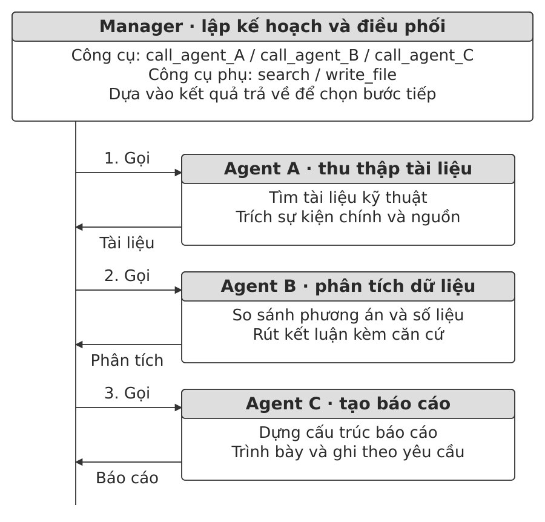

> **Thí nghiệm 10-2 ★★: Agent dịch sách**
>
> Dịch sách kỹ thuật phải xử lý cùng lúc thuật ngữ, ngữ cảnh và văn phong. Ví dụ, từ tiếng Anh agent có nhiều cách dịch; nếu bản dịch đã thống nhất dùng “tác tử”, các chương sau phải giữ nguyên cách dịch đó. Bảng thuật ngữ, nguyên văn từng chương, bản dịch và bản ghi hiệu đính cần được tổ chức rõ ràng. Một cuốn sách dài cùng với các bản dịch trung gian, kết quả công cụ và lịch sử hiệu đính sẽ liên tục chiếm chỗ trong ngữ cảnh; đến chương 9, mô hình có thể đã quên cách dịch ở chương 2, hoặc kiểm tra đi kiểm tra lại cùng một đoạn. Chia nhiệm vụ theo trách nhiệm và theo chương giúp mỗi phiên bản chạy chỉ tập trung vào tài liệu mà trách nhiệm hiện tại cần.
>
> Có thể chia việc cho bốn loại Agent:
>
> - **Glossary Agent: lập bảng thuật ngữ.** Đọc toàn bộ sách theo từng đợt, nhận diện thuật ngữ chuyên môn xuất hiện lặp lại, tham khảo từ điển chuyên ngành và quy chuẩn dịch, rồi sinh bảng đối chiếu JSON hoặc CSV gồm thuật ngữ tiếng Anh, cách dịch, từ loại và ngữ cảnh sử dụng. Bảng thuật ngữ được lưu vào không gian chung, nhiệm vụ xong thì giải phóng phiên bản chạy này.
> - **Translation Agent: dịch từng chương.** Đọc chương hiện tại, các thuật ngữ liên quan và hướng dẫn dịch, rồi hoàn thành bản dịch theo độc giả mục tiêu và văn phong. Với thuật ngữ mới xuất hiện, đưa ra cách dịch đề xuất và đánh dấu chờ duyệt. Mỗi phiên bản chạy duy trì ngữ cảnh độc lập, bản dịch lưu vào không gian chung; các chương khác nhau có thể xử lý tuần tự hoặc song song tùy quan hệ phụ thuộc.
> - **Proofreading Agent: hiệu đính toàn văn.** Dựa vào bảng thuật ngữ và bản dịch các chương để kiểm tra cách dịch, sự nhất quán trong cách diễn đạt và độ dễ đọc. Hoàn thành việc kiểm tra toàn văn bằng cách đọc theo chương và dùng chỉ mục xuyên chương, rồi ghi vị trí vấn đề, căn cứ và yêu cầu sửa vào báo cáo hiệu đính.
> - **Manager Agent: sắp xếp và thu hồi nhiệm vụ.** Duy trì mục tiêu, kế hoạch, trạng thái nhiệm vụ, tóm tắt các lời gọi và chỉ mục sản phẩm; dựa vào báo cáo hiệu đính để trả các chương cần sửa về cho người dịch, rồi tổ chức kiểm tra lại.
>
> Trong Hình 10-5, người hiệu đính đọc bản dịch các chương và bảng thuật ngữ, Manager dựa vào báo cáo để quyết định chương nào cần sửa lại. Người dịch nhận nhiệm vụ sửa có thể mở nguyên văn của chương, đối chiếu xem từ bị đánh dấu mang nghĩa gì trong câu đó.
>
> 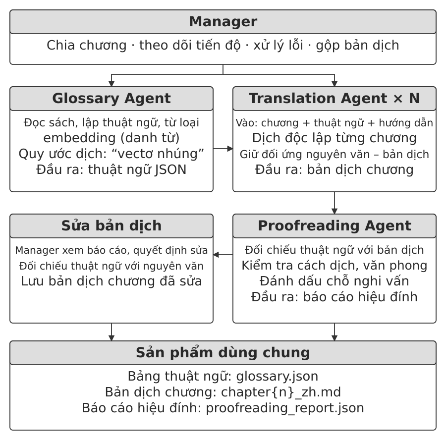
>
> Khi bản dịch đã được ghi ra tệp, lần gọi nào còn phải đọc văn bản dài? Thí nghiệm đi kèm dịch sang tiếng Trung, chia hai chương đầu của bản tiếng Anh thành 26 đơn vị dịch. Agent đơn mang theo toàn bộ nguyên văn và bản dịch trước đó suốt dọc đường, yêu cầu lớn nhất có 94.355 token đầu vào. Khi phân công, yêu cầu lớn nhất của người dịch chỉ có 2.857 token, Manager dùng 2.153 token khi ra quyết định sửa lại. Trong nhóm có quản lý, thành viên có đầu vào lớn nhất hóa ra là người lập thuật ngữ: một lần đọc hai chương, dùng 49.807 token.
>
> Dịch xong hai chương này, bốn vai trò dùng tổng cộng 203.277 token, Agent đơn dùng 1.317.808 token. Nhóm nào nộp bài trước? Nhóm bốn vai trò mất khoảng 271 giây, nhiều hơn Agent đơn khoảng 17 giây.
>
> Lúc nộp bài, hai cách kiểm tra cho ra kết quả khác nhau trên cùng một bản dịch. Bảng thuật ngữ quy định danh từ `embedding` dịch là “嵌入向量” (vectơ nhúng). Báo cáo hiệu đính không liệt kê chương nào cần sửa, nhưng chương trình kiểm tra thuật ngữ lại chấm từ này 0/2: trong bản dịch của cả hai chương đều tìm thấy “嵌入” (nhúng), mà đều không tìm thấy “嵌入向量”. Có nên trả cả hai chương về không?
>
> Trong đoạn nói về chính sách hoàn tiền ở chương 1, nguyên văn là `embedding the refund policy in the context`, bản dịch là “将退款政策嵌入上下文中” (nhúng chính sách hoàn tiền vào ngữ cảnh). Ở đây ý là đưa chính sách vào ngữ cảnh; sửa thành “嵌入向量” thì lại thành sai. Chương trình dò chuỗi theo chương giúp người hiệu đính tìm ra đầu mối cần xem lại; còn muốn quyết định chỗ nào phải sửa, người hiệu đính cần có đoạn nguyên văn đó. Khi bảng thuật ngữ cập nhật, cũng có thể khoanh vùng các đoạn bị ảnh hưởng trước, rồi giao nguyên văn, bản dịch và mục từ mới cùng lúc cho người dịch.
>
> **Yêu cầu thí nghiệm:**
> 1. Chọn một cuốn sách kỹ thuật có hình, bảng và mã.
> 2. Hiện thực bốn loại Agent: Manager, Glossary, Translation, Proofreading.
> 3. Ghi lại lượng ngữ cảnh đã dùng, tài liệu bàn giao và phiên bản sản phẩm của từng thành viên.
> 4. So sánh với phương án Agent đơn về chất lượng dịch, thời gian hoàn thành và tài nguyên tiêu tốn; phân tích ảnh hưởng của cách chia nhiệm vụ và tổ chức ngữ cảnh.

**Điều phối song song.** Các nhiệm vụ con độc lập với nhau có thể thực thi đồng thời. Manager lo giao việc, nhận trạng thái, và dựa vào kết quả để quyết định tiếp tục, bổ sung việc hay kết thúc. Khi dịch cuốn sách này, bảng thuật ngữ vừa được xác nhận là các chương khác nhau có thể giao cho nhiều người dịch cùng bắt tay vào làm. Hình 10-6 đổi sang một báo cáo nghiên cứu: biểu đồ đã xong, phân tích vẫn đang chạy, vì sao bước kiểm tra định dạng vẫn phải đợi? Lần theo các sự kiện do thành viên báo lên, có thể thấy bước cuối cùng phụ thuộc vào hai sản phẩm nào.

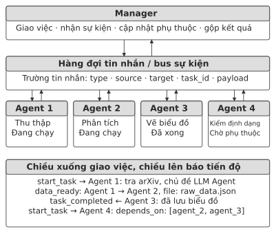

Bus tin nhắn phù hợp để tổ chức loại giao tiếp bất đồng bộ này: thành viên phát tiến độ và kết quả, người quản lý đăng ký nhận các sự kiện tương ứng, runtime lo phân phát, đệm và thử lại.

> **Ví dụ sản phẩm: Lingtai (灵台)**
>
> Lingtai là hệ thống Agent dài hạn chạy cục bộ, lưu danh tính và ký ức bằng tệp. Nó cung cấp ba loại vai trò: khí linh chính (main agent) đối thoại với người dùng, quản lý kế hoạch và ký ức; phân thần (daemon) đảm nhận các nhiệm vụ song song ngắn hạn có phạm vi rõ ràng, xong thì trả về kết luận; phân thân (avatar) giữ ký ức, hộp thư và trách nhiệm riêng, dùng cho phân công chuyên môn xuyên phiên.
>
> Mỗi vai trò có tri thức lưu bền riêng, và dùng chung các sổ tay kỹ năng dạng Markdown. Khi ngữ cảnh gần chạm giới hạn dung lượng, vai trò lưu một bản tổng kết qua bước “lột xác” (molt), rồi kết hợp với ký ức lưu bền để bước vào ngữ cảnh mới. Danh tính, ký ức và kỹ năng được lưu độc lập trong tệp, nên thay mô hình nền bên dưới vẫn tiếp tục được công việc. Thiết kế này kết hợp người quản lý, người làm việc ngắn hạn, thành viên chuyên môn dài hạn và nén ngữ cảnh với nhau.

> **Thí nghiệm 10-3 ★★★: Agent điện thoại + máy tính tự điều phối**
>
> Thí nghiệm này kết hợp Computer Use và tương tác giọng nói ở Chương 6. Người dùng cung cấp trang đăng ký hoặc đặt vé máy bay, Computer Agent mở trang web, nhận diện biểu mẫu, rồi thông qua Phone Agent thu thập các trường hiện còn thiếu như họ tên, số giấy tờ, thông tin liên lạc, địa chỉ và sở thích.
>
> **Vai trò và bàn giao.** Computer Agent thao tác trình duyệt và phụ trách điều phối lần chạy này; Phone Agent trò chuyện thời gian thực với người dùng qua ASR, LLM, TTS, chuyển câu trả lời bằng lời thành các trường có cấu trúc. Hai bên giao tiếp qua công cụ điểm-điểm hoặc bus tin nhắn; tin nhắn gồm người gửi, người nhận, loại và nội dung. Computer Agent có thể trực tiếp ủy thác nhiệm vụ gọi điện, đảm nhận vai trò người quản lý. Khi người dùng sẵn lòng cung cấp thông tin bằng giọng nói, Phone Agent có thể hỏi liên tiếp, xác nhận và hỏi lại, còn Computer Agent tập trung vào trạng thái trang và việc điền trường.
>
> **Hai chế độ chạy.** Chế độ cố định khởi động sẵn cả hai Agent, mỗi bên duy trì vòng lặp chạy độc lập, dùng để kiểm tra giao tiếp hai chiều và hành vi đồng thời. Chế độ tự chủ khởi động Computer Agent trước, để mô hình dựa vào trang, thông tin đã có và nhu cầu nhiệm vụ mà quyết định có gọi `initiate_phone_call_agent(purpose, required_info)` hay không. Runtime sau đó giao mục đích nhiệm vụ, các trường cần thu thập và ràng buộc định dạng cho Phone Agent; khởi động xong thì dùng chung cơ chế giao tiếp đó.
>
> **Luân chuyển từng trường.** Trong Hình 10-7, Phone Agent hỏi qua WebRTC, trích xuất và kiểm tra câu trả lời, lấy được giá trị hợp lệ thì gửi `info_collected`, rồi hỏi mục tiếp theo. Computer Agent đồng thời đọc trang, điền mục trước, và gửi lại `fill_error` hoặc trạng thái trang mới. Phản hồi sai định dạng dùng `format_invalid` để ghi rõ trường và yêu cầu, Phone Agent dựa vào đó xác nhận hoặc hỏi lại. Nhờ vậy, “hỏi mục sau” và “điền mục trước” có thể chạy chồng lên nhau.
>
> **Hoàn thành và xử lý bất thường.** Thu thập đủ các trường, Phone Agent gửi `task_completed`, báo nhiệm vụ con thu thập thông tin đã kết thúc. Computer Agent tiếp tục kiểm tra các mục bắt buộc, kết quả kiểm tra của trang và quyền nộp, rồi mới hoàn tất thao tác trên biểu mẫu. Khi vượt số lần thử lại, gặp trang bất thường hoặc người dùng yêu cầu dừng, tạm dừng nhiệm vụ và nêu rõ tiến độ hiện tại; khi kết thúc, hủy phía bên kia nếu còn đang chạy, đóng phiên trình duyệt, luồng âm thanh và cuộc gọi. Tương tác giọng nói với người thật và việc nộp biểu mẫu phải lần lượt có sự đồng ý và cấp quyền của người dùng.
>
> 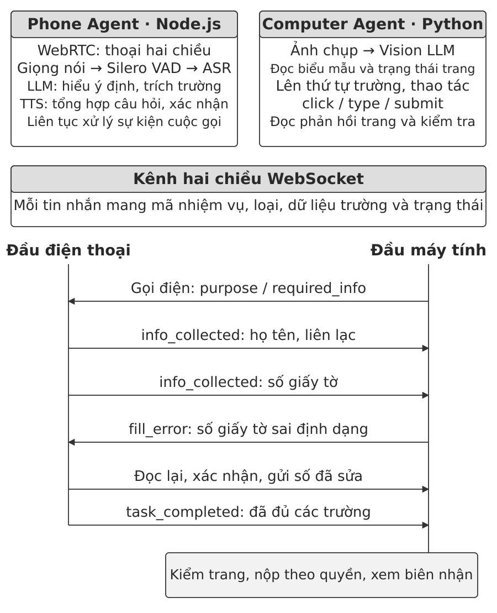
>
> **Yêu cầu thí nghiệm:**
> 1. Hiện thực hai Agent độc lập và giao tiếp có cấu trúc hai chiều.
> 2. Ghi lại trình tự thời gian ở chế độ cố định và chế độ tự chủ, kiểm tra khoảng chồng lấp giữa hỏi và điền.
> 3. Hiện thực kiểm tra định dạng, hỏi lại, phản hồi lỗi trang, hết thời gian chờ và dọn dẹp tài nguyên.
> 4. So sánh hai chế độ về quyết định khởi động, độ trễ, tỷ lệ thành công và tài nguyên tiêu tốn.

> **Thí nghiệm 10-4 ★★★: Agent thu thập thông tin từ nhiều trang web cùng lúc**
>
> Thí nghiệm này dùng nhiều Agent đồng nhất tìm kiếm song song, luyện tập cơ chế hướng sự kiện và ngắt ở Chương 6. Nhiệm vụ là tìm một giảng viên chỉ định trên các trang web của nhiều khoa trong một trường đại học, ví dụ “Trương Vĩ”, rồi trả về khoa, chức danh, hướng nghiên cứu và trang nguồn. Trước khi tìm, thống nhất điều kiện nhận diện, như họ tên, ngành và thông tin trang cá nhân, để phân biệt những người trùng tên.
>
> **1. Khởi động song song.** Manager tạo 10 Computer Use Agent, mỗi Agent phụ trách trang web của một khoa. Mỗi phiên bản chạy duy trì ngữ cảnh và phiên trình duyệt riêng, có thể điều phối bằng nhiệm vụ bất đồng bộ, luồng hoặc tiến trình. Đầu vào gồm URL trang web, họ tên mục tiêu, điều kiện khớp và mã nhiệm vụ dùng để định tuyến.
>
> **2. Tổng hợp tiến độ.** Các thành viên định kỳ gửi trạng thái như “đang tải trang”, “đang đọc danh sách giảng viên”, “đã kiểm tra, không khớp”, “phát hiện giảng viên trùng tên”. Manager duy trì bảng nhiệm vụ qua bus tin nhắn, ghi riêng các trạng thái đang chạy, đã xong, bị chặn và thất bại, đồng thời giữ lại nguồn và nguyên nhân lỗi.
>
> **3. Kiểm chứng rồi hủy các nhánh khác.** Giả sử `agent_3` phụ trách khoa Vật lý tìm thấy một giảng viên trùng tên, nó gửi `target_found`, payload gồm thông tin giảng viên và nguồn. Nếu nhiệm vụ yêu cầu trả về hồ sơ nhân vật đã được xác minh, Manager phải đối chiếu điều kiện khớp và bằng chứng trước; xác nhận đã tìm đúng người rồi mới ghi nhận kết quả bằng thao tác nguyên tử, sau đó gửi `terminate` tới các thành viên khác đang chạy, ghi chú rằng hồ sơ được dùng là của `agent_3`. Các thành viên dừng tại điểm an toàn, dọn tài nguyên và trả về xác nhận; Manager chờ xác nhận hoặc hết thời gian rồi hoàn tất tổng hợp. Nếu nhiệm vụ yêu cầu liệt kê mọi người trùng tên, thì tiếp tục tìm cho đến khi kiểm tra hết phạm vi cần thiết.
>
> **Điều kiện tranh chấp (race condition).** Agent A và B có thể trả về kết quả hợp lệ gần như cùng lúc. Nếu mỗi sự kiện tự kích hoạt tổng hợp, sẽ dẫn tới giao kết quả trùng hoặc xung đột trạng thái. Có thể dùng khóa hoặc giao dịch để bảo vệ phép chuyển trạng thái “đang tìm → đã ghi nhận kết quả”, để sự kiện đến sau đọc kết quả đã được ghi nhận. Tin nhắn thử lại cũng phải được loại trùng theo mã sự kiện, bảo đảm hủy và tổng hợp vẫn nhất quán dù bị kích hoạt lặp lại.
>
> **4. Bất thường và phạm vi bao phủ.** Ghi riêng các trường hợp mất mạng, cấu trúc trang thay đổi và lỗi phân tích. Có thể đặt cho mỗi nhiệm vụ một ngân sách thời gian, chẳng hạn hai phút; hết thời gian thì hủy thực thi và thu thập thông tin chẩn đoán, các thành viên khác tiếp tục làm việc. Báo cáo cuối cùng phân biệt “đã kiểm tra, không tìm thấy” với “truy cập thất bại, chưa kiểm tra xong”, đồng thời nêu rõ phạm vi các khoa đã bao phủ.
>
> Hình 10-8 dùng một chuỗi thời điểm minh họa để xâu chuỗi các tin nhắn này. Giả sử thành viên 3 báo rằng khoa Vật lý có một giáo sư Trương Vĩ nghiên cứu điện toán lượng tử, Manager phải xem trang nguồn có xác nhận được họ tên, khoa, chức danh và hướng nghiên cứu không. Nhận được đầu mối về giảng viên trùng tên, xác nhận đúng là người cần tìm, và nhận đủ các xác nhận hủy là ba thời điểm khác nhau.
>
> 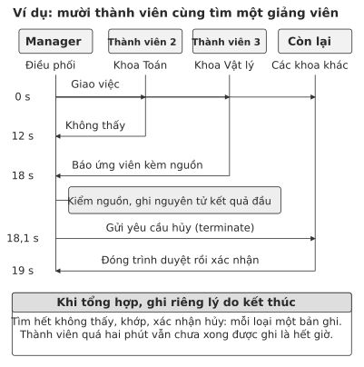
>
> Trong lần chạy thật, người được tìm là Andrew Ng. Các thành viên kiểm tra trước xem văn bản trang có cái tên này không, khớp rồi mới nhờ mô hình trích xuất hồ sơ. Trang của Stanford HAI được chọn; đoạn trích ngắn trả về đủ để đối chiếu họ tên và chức danh giáo sư kiêm nhiệm. Muốn đối chiếu hướng nghiên cứu, còn phải đọc đoạn nói về học sâu ở phần sau của trang. Dù vài thành viên cùng lúc gửi về `target_found`, cũng chỉ thành viên giành được khóa đầu tiên mới ghi nhận được kết quả.
>
> Lần tìm tuần tự này đến URL cuối cùng trong mười URL mới khớp, mất 44,971 giây; tìm song song trên cùng loạt trang mất 24,022 giây, và mười ngữ cảnh trình duyệt của mỗi bên đều đã được đóng. Chia hai số cho nhau được 1,872. Nếu xếp trang HAI lên đầu, tìm tuần tự khớp ngay là dừng được, khi đó phải đo lại thời gian. Một lần chạy khác chuyên để kiểm tra việc hủy đã khởi động bốn nhánh: một nhánh ghi nhận kết quả trước, ba nhánh còn lại xác nhận đã nhận yêu cầu hủy, cuối cùng cả bốn ngữ cảnh trình duyệt đều được đóng.
>
> **Yêu cầu thí nghiệm:**
> 1. Hiện thực Manager có khả năng tạo động các thành viên song song.
> 2. Dùng các dự án như browser-use để xây dựng năng lực thực thi trên trình duyệt.
> 3. Hoàn thành giao tiếp hai chiều và duy trì trạng thái qua bus tin nhắn.
> 4. Kiểm chứng kết quả tìm kiếm, ghi nhận kết quả bằng thao tác nguyên tử, và thu thập xác nhận sau khi hủy các nhánh còn lại.
> 5. Xử lý các trường hợp truy cập thất bại, lỗi phân tích, hết thời gian và không có kết quả khớp.
> 6. So sánh thực thi song song và tuần tự về thời gian hoàn thành, phạm vi bao phủ và tài nguyên tiêu tốn.

**Để người quản lý sinh workflow.** Ngoài việc ủy thác từng lần, Manager cũng có thể viết sẵn quan hệ phụ thuộc giữa các nhiệm vụ và quy tắc tổng hợp thành chương trình, rồi giao cho runtime điều phối. Mô hình lo thiết kế quy trình, chương trình lo khởi động thành viên, truyền kết quả và chờ phụ thuộc theo đúng quy ước. Khi quan hệ phụ thuộc đã rõ và cùng một loại quy trình cần chạy nhiều lần, tác giả ưu tiên cách này. Nó bỏ được chi phí gọi Manager cho mỗi lần phân việc, đồng thời giảm các bản ghi điều phối tích tụ trong ngữ cảnh quản lý.

Công cụ Workflow động của Claude Code cung cấp một cách hiện thực như vậy. `agent()` tạo Agent con có ngữ cảnh độc lập, có thể dùng schema để quy ước đầu ra có cấu trúc; `parallel()` thực thi đồng thời một nhóm nhiệm vụ và chờ tất cả kết thúc; `pipeline()` cho mỗi đầu vào lần lượt đi qua nhiều giai đoạn, khi một mục sang giai đoạn sau thì các mục khác vẫn có thể đang xử lý ở giai đoạn trước. Kết quả trung gian lưu trong biến của chương trình, việc lọc và gộp làm bằng mã thông thường.[^dynamic-workflows]

Ví dụ, khi kiểm chứng bảy nhóm sự kiện trong một bản thảo kỹ thuật, có thể khởi động các Agent nghiên cứu theo từng hướng trước, rồi giao kết luận của từng nhóm cho các Agent kiểm chứng kiểm tra song song. Mỗi kết luận trả về giữ nguồn và căn cứ phán định; khi mọi nhánh xong, Agent tổng hợp soạn báo cáo cuối cùng. Như vậy, sự phân công “nghiên cứu – kiểm chứng từng mục – tổng hợp thống nhất” cùng các phụ thuộc giữa giai đoạn đều được viết vào workflow.

[^dynamic-workflows]: Anthropic, “Orchestrate subagents at scale with dynamic workflows”, 2026.

### Mô hình phi tập trung

Đã có Manager, vì sao còn để các thành viên tự quyết định tìm ai? Hãy hình dung người kiểm thử nhận một mô-đun vừa viết xong, phát hiện yêu cầu sản phẩm và quy ước giao diện có hai cách hiểu khác nhau về cùng một trường. Người kiểm thử có thể đưa thẳng mâu thuẫn này cho hai vai trò sản phẩm và kiến trúc, để mỗi bên nói rõ căn cứ của mình, sửa xong quy ước rồi mới kiểm thử tiếp. Đây là phân công, đồng thời cũng là một kiểu kiểm soát và cân bằng. Kỹ sư giao mô-đun, kiến trúc sư hỏi ý kiến bên sản phẩm, người kiểm thử nêu phản đối — ai cũng có thể khởi động bước tiếp theo. Khi cần thương lượng thường xuyên, đợi Manager chuyển lời từng việc sẽ làm chậm công việc.

Mượn cách nói của microservice, một trung tâm sắp xếp các bước gọi là **orchestration** (điều phối tập trung), còn các bên tự nối tiếp nhau theo những sự kiện đã quy ước gọi là **choreography** (biên đạo, hay phối hợp phi tập trung). Còn một khác biệt thực tế: nếu mọi lần bàn giao đều phải đợi Manager, thì khi dịch vụ mô hình của nó ngừng phản hồi, các thành viên khác dù vẫn làm việc được cũng không nhận được bước tiếp theo. Điều phối phân tán giảm được sự phụ thuộc này; nhưng nếu chính thành viên phụ trách tiếp nhận bị kẹt trong một lần gọi công cụ, vẫn phải dựa vào trạng thái nhiệm vụ được lưu bền, cơ chế hết thời gian, thử lại và tiếp quản để thành viên khác biết bắt đầu lại từ đâu.

Ba thiết kế dưới đây, mỗi thiết kế có một cách bàn giao: đăng ký nhận tin theo sản phẩm, chọn người phát biểu tiếp theo trong nhóm chat, hoặc để thành viên hiện tại chỉ định người nhận việc.

**MetaGPT: dùng SOP để tổ chức bàn giao sản phẩm.** MetaGPT phân công theo quy trình vận hành chuẩn (SOP) của một đội phần mềm. Quản lý sản phẩm nộp tài liệu yêu cầu (PRD), kiến trúc sư nộp tài liệu thiết kế, kỹ sư nộp mã, người kiểm thử nộp báo cáo kiểm thử. Thành viên tiếp theo nhận được tài liệu đã quy ước là bắt tay vào làm được, người trước cũng không phải dặn dò đi dặn dò lại. Các đường nối trong Hình 10-9 biểu diễn quan hệ bàn giao giữa các sản phẩm này.[^metagpt-design]

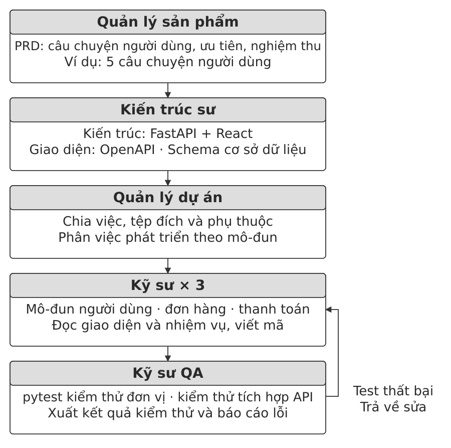

Khi bàn giao, mỗi vai trò phải bổ sung những thông tin gì?

- **Product Manager Agent** nhận yêu cầu, soạn PRD, xác định rõ chức năng, câu chuyện người dùng, tiêu chí nghiệm thu và mức ưu tiên.
- **Architect Agent** đọc PRD, chọn bộ công nghệ, chia mô-đun, định nghĩa giao diện và mô hình dữ liệu, tạo thành tài liệu thiết kế.
- **Project Manager Agent** dựa vào thiết kế để chia nhiệm vụ và phân công tệp, sắp xếp các phụ thuộc, rồi bố trí kỹ sư thực hiện.
- **Engineer Agents** hiện thực mô-đun theo thiết kế, nộp mã; những phần độc lập với nhau có thể giao cho nhiều phiên bản chạy.
- **QA Engineer Agent** dựa vào mã và yêu cầu để sinh kiểm thử, chạy kiểm tra và ghi nhận vấn đề, tạo thành báo cáo kiểm thử.

Nếu phải thiết kế định dạng bàn giao cho các vai trò này, tác giả khuyên viết rõ ba điều: nhiệm vụ và tiêu chí nghiệm thu, các sự thật và ràng buộc đã xác nhận, cùng tham chiếu tới sản phẩm có cấu trúc. Bên nhận dựa vào đó để lấy tài liệu cần thiết, tiếp tục công việc, và đặt câu hỏi cụ thể khi thiếu thông tin.

MetaGPT tổ chức thông tin qua một bể tin nhắn dùng chung và cơ chế đăng ký nhận tin: vai trò phát tin nhắn, các vai trò khác xử lý đầu vào liên quan theo loại tin nhắn mà mình quan tâm. Bên phát và bên tiêu thụ được nối với nhau qua định dạng sản phẩm và ngữ nghĩa tin nhắn, nên có thể thay mô hình hoặc điều chỉnh phần hiện thực bên trong của từng bên một cách riêng rẽ.

SOP mô tả quan hệ phụ thuộc giữa yêu cầu sản phẩm, kiến trúc và mã; việc đăng ký nhận tin mô tả các công việc đó được kích hoạt ra sao. Phụ thuộc nhiệm vụ cố định cũng có thể được đẩy tiến bằng các sự kiện phân tán; hai thứ cùng tạo nên cách cộng tác của hệ thống. Khi thiết kế thêm phản hồi động, có thể bổ sung các đường như người kiểm thử hỏi lại vai trò sản phẩm để làm rõ yêu cầu, kỹ sư đề xuất phương án thay thế với kiến trúc sư, và đặt điều kiện tiếp nhận cùng quy tắc kết thúc cho những tương tác đó.

[^metagpt-design]: Hong, S., et al. *MetaGPT: Meta Programming for A Multi-Agent Collaborative Framework.* ICLR 2024.

**AutoGen group chat: điều phối lượt phát biểu trong một phiên dùng chung.** Trong thiết kế GroupChat kinh điển, nhiều Agent tham gia cùng một phiên hội thoại; GroupChatManager chọn người phát biểu tiếp theo và phát tin nhắn tới các thành viên. Chiến lược chọn có thể là xoay vòng, cũng có thể để mô hình phán đoán dựa trên nội dung hiện tại. Các thành viên giữ cấu hình vai trò riêng, giao tiếp qua phiên chung, còn việc điều phối lượt phát biểu tập trung ở bộ quản lý. Đây là một ví dụ kết hợp giữa cách tổ chức ngữ cảnh và cấu trúc điều khiển.[^autogen-groupchat]

[^autogen-groupchat]: Microsoft, *AutoGen 0.2: Conversation Patterns.*

**OpenAI Swarm: chuyển quyền điều khiển dọc theo handoff.** Swarm cấu hình chỉ dẫn và công cụ cho từng vai trò; khi một vai trò gọi hàm chuyển giao đã cấu hình, runtime chuyển sang Agent đích. Quyết định định tuyến có thể do từng vai trò đưa ra, rồi một vòng lặp chạy thống nhất thực thi. Khi chuyển giao, chỉ dẫn hệ thống hiện tại đổi theo vai trò, còn lịch sử hội thoại được giữ lại. Nó minh họa sự kết hợp giữa “vai trò chọn người tiếp nhận tiếp theo” và “giữ nguyên lịch sử phiên”.[^swarm-handoff]

Nếu dùng cách bàn giao với ngữ cảnh độc lập, có thể định nghĩa riêng một gói nhiệm vụ: `task_id` định danh nhiệm vụ, `sender` và `recipient` chỉ định hai bên, `goal` và `constraints` nêu mục tiêu và ràng buộc, `accepted_facts` lưu các sự thật đã xác nhận, `artifact_refs` cung cấp tham chiếu sản phẩm, `remaining_budget` ghi ngân sách, `visited_agents` lưu chuỗi đã đi qua. Bên nhận đọc tài liệu theo quyền được cấp, runtime duy trì ngân sách và bản ghi bàn giao.

Chuỗi bàn giao phải xử lý chuyện quay lại cùng một thành viên. Ví dụ, lập trình viên giao mã cho người duyệt, người duyệt nêu ý kiến sửa rồi trả lại lập trình viên — đó là vòng sửa bình thường. Có thể kết hợp trạng thái nhiệm vụ, phiên bản sản phẩm, vấn đề chưa giải quyết và số lần lặp để đánh giá có tiến triển hay không. Ví dụ, cùng một bản dịch bị trả về hai lần liên tiếp, lần đầu bổ sung nguồn trích dẫn, lần sau sửa thuật ngữ, cho thấy việc sửa vẫn đang tiến triển; nếu cả hai lần trả về cùng một phiên bản và chỉ ra cùng một vấn đề, thì việc sửa đã bị kẹt. Khi đó có thể giới hạn số lần chuyển giao tiếp, và báo các vấn đề chưa giải quyết cho người phụ trách.

[^swarm-handoff]: OpenAI, *Swarm*, “Instructions” và “Handoffs and Updating Context Variables”.

> **Agent Swarm trong các sản phẩm**
>
> “Agent Swarm” có thể chỉ những cách tổ chức khác nhau. Một loại chuyển quyền điều khiển dọc theo mạng handoff, như OpenAI Swarm, thư viện swarm của LangGraph và kiểu điều phối handoff trong Agent Framework của Microsoft; loại kia dùng một Agent chính cùng các worker song song, ví dụ Kimi Agent Swarm, hệ thống nghiên cứu đa Agent của Anthropic và Manus Wide Research.
>
> Agent Swarm được giới thiệu cùng Kimi K2.5 dùng học tăng cường Agent song song để huấn luyện bộ điều phối, học khi nào chia nhiệm vụ và phân việc ra sao, hỗ trợ tối đa 100 Agent con. Các phiên bản sau mở rộng quy mô lên 300; K3 Swarm tiếp tục được dùng cho tìm kiếm quy mô lớn và xử lý hàng loạt. AgentENV thì cung cấp môi trường có khả năng mở rộng cho học tăng cường Agent của Kimi K3, hỗ trợ snapshot và phân nhánh, dùng để tổ chức thực thi song song.[^ch10-kimi-swarm]

**Nhiều phiên bản Agent trên cùng một máy.** Nhiều phiên bản chạy có thể đảm nhận các nhiệm vụ khác nhau nhưng dùng chung tệp, dịch vụ công cụ hoặc GPU. Khi đó, giao tiếp có thể dùng để nói rõ phạm vi sửa, báo tài nguyên đã được giải phóng hoặc thương lượng thứ tự thực thi. Ví dụ, khi hai phiên bản đều cần một GPU, có thể đăng ký trước nhiệm vụ và mức dùng dự kiến, rồi để bộ quản lý tài nguyên cấp quyền sử dụng.

Agent Teams của Claude Code cung cấp khả năng khám phá thành viên trong đội, nhắn tin và quản lý nhiệm vụ dùng chung. Các thành viên lấy thông tin của nhau trong phạm vi đội đã lập, runtime tổ chức việc giao tiếp.[^claude-agent-teams] Khi tự xây dựng cộng tác trên cùng một máy, cũng có thể dùng các giao diện như `list_agents` ở Chương 4, và đặt quy tắc rõ ràng cho phạm vi khám phá, quyền truy cập và quyền sở hữu tài nguyên. Kết quả thương lượng trong tin nhắn sau đó được thực thi bằng khóa, hạn mức hoặc bộ điều phối.

[^ch10-kimi-swarm]: Moonshot AI, *Kimi Agent Swarm: 100 Sub-Agents at Scale*, tài liệu trợ giúp Agent Swarm và mô tả dự án AgentENV.

[^claude-agent-teams]: Anthropic, *Orchestrate teams of Claude Code sessions.*

### Cộng tác xuyên tổ chức: giao thức A2A

Khi cộng tác vượt qua ranh giới dịch vụ hoặc tổ chức, hai bên cần thống nhất về khám phá năng lực, xác thực danh tính, định dạng yêu cầu, cách giao tiến độ và kết quả. Giao thức **A2A** (Agent2Agent) do Google công bố năm 2025 cung cấp một giao diện liên thông như vậy, sau đó được chuyển cho Linux Foundation quản lý. Có thể hiểu nó qua ba khía cạnh.[^a2a-concepts]

- **Khám phá năng lực.** Agent Card là tài liệu metadata mô tả danh tính, điểm cuối dịch vụ, kỹ năng, phương thức đầu vào/đầu ra và yêu cầu xác thực. Bên gọi dựa vào đó để biết bên kia có xử lý được nhiệm vụ không, và thiết lập kết nối ra sao.
- **Nhiệm vụ và tin nhắn.** Task biểu diễn một công việc có định danh và vòng đời; bên gọi có thể theo dõi các trạng thái như đã gửi, đang xử lý, cần đầu vào, đã xong hoặc thất bại. Message mang yêu cầu nhiệm vụ, thông tin bổ sung và câu trả lời; Artifact dùng để giao tài liệu, hình ảnh hoặc kết quả có cấu trúc. Part trong tin nhắn và sản phẩm có thể chứa văn bản, tham chiếu tệp hoặc dữ liệu.
- **Cộng tác qua giao diện.** Bên gọi giao tiếp với phía từ xa qua các đối tượng công khai này, còn phía từ xa tự quản lý prompt, ký ức và công cụ nội bộ. Mỗi bên tự thực thi việc xác thực, cấp quyền và phạm vi truy cập dữ liệu.

Nhiệm vụ dài có thể lấy trạng thái bằng thăm dò định kỳ (polling), cũng có thể nhận cập nhật dạng luồng qua SSE, hoặc dùng thông báo đẩy khi được hỗ trợ. Sau khi người dùng bổ sung thông tin, client tiếp tục đẩy cùng một nhiệm vụ đi tiếp, và lấy sản phẩm cuối cùng theo trạng thái nhiệm vụ.

MCP ở Chương 4 tập trung vào việc cung cấp giao diện công cụ, tài nguyên và prompt cho ứng dụng mô hình; A2A tập trung vào cộng tác nhiệm vụ giữa các dịch vụ Agent. Hai thứ có thể kết hợp: một Agent dùng công cụ qua MCP, đồng thời ủy thác nhiệm vụ từ xa qua A2A. Khi trong cùng một đội đã có giao diện ổn định, tác giả tiếp tục dùng gọi công cụ, tệp dùng chung và bus tin nhắn. Khi cần kết nối các dịch vụ Agent được bảo trì độc lập, thống nhất cách khám phá năng lực và vòng đời nhiệm vụ, mới đưa A2A vào; khi xuyên tổ chức, còn cấu hình thêm quy tắc về danh tính, quyền hạn và quản trị dữ liệu.

[^a2a-concepts]: A2A Project, *Core Concepts and Components in A2A.*

**Hẹn giờ thay cho nhiều người khác nhau.** Ba người trong một gia đình, mỗi người có một trợ lý lịch riêng, muốn hẹn một bữa tối. Một trợ lý đọc được toàn bộ lịch của chủ, nên trả lời hai trợ lý kia thế nào? “Thứ Ba không tiện, thứ Tư có thể xê dịch” đã cho biết một khác biệt hữu ích. Chuyển thẳng cả lịch sẽ để lộ thêm việc riêng ngày thứ Ba; chỉ trả lời “cả hai ngày đều bận” thì người khác lại không biết thứ Tư vẫn còn có thể thương lượng. Dù lần nào cũng hẹn được, nếu luôn là cùng một người phải dời lịch, cách sắp xếp này chưa chắc có lợi cho người đó.

Một đề công khai của CalBench yêu cầu năm người xếp năm cuộc họp, mỗi cuộc ba người tham dự. Có người hoàn toàn không thể xê dịch ở một khung giờ nào đó, có những việc riêng có thể dời lịch, và đề bài quy định chi phí cho mỗi lần dời. Thử trước một cách đơn giản: xử lý lần lượt năm cuộc họp, mỗi lần tìm từ khung giờ sớm nhất, ba người đều thu xếp được thì chốt; các cuộc họp đã hẹn thì giữ nguyên. Rồi thử cách khác: đặt cả năm cuộc họp cùng nhau và giải dựa trên toàn bộ lịch. Phần dưới giữ cách đánh số khung giờ của đề bài, bắt đầu từ 0.[^ch10-calbench]

| Cách xếp | Khung giờ của từng cuộc họp thứ 1 đến thứ 5 | Chi phí dời lịch phải trả khi chốt từng cuộc | Tổng chi phí |
|---|---|---|---:|
| Mỗi cuộc chọn khung giờ sớm nhất thu xếp được, giữ nguyên các cuộc đã hẹn | 0, 2, 1, 3, 6 | 1, 20, 20, 12, 300 | 353 |
| Bộ giải tham chiếu xếp tổng thể cả năm cuộc | 13, 3, 10, 9, 12 | 0, 1, 0, 1, 1 | 3 |

Cả hai lịch đều khớp được từng cuộc trên lịch cuối cùng của ba người dự. Chênh lệch lớn nhất là cuộc cuối: theo cách thứ nhất, khung giờ 6 tuy thu xếp được, nhưng mỗi người trong ba người đều phải dời một việc có chi phí 100. Xếp vào khung giờ 12 thì chỉ một người phải dời một việc có chi phí 1. Kết quả tổng thể cho người đánh giá một căn cứ để so sánh; còn các trợ lý thực sự tham gia thương lượng thì mỗi người chỉ thấy được lịch của chủ mình.

Bộ giải tham lam đi kèm phiên bản này báo chi phí là 146 và trả về khung giờ cho cả năm cuộc họp. Nhưng khi xếp các cuộc sau, nó cho phép dời cuộc họp trước đó khỏi lịch của một vài người tham dự. Cuộc họp thứ nhất cuối cùng nằm ở các khung giờ 7, 0 và 11 trên lịch của ba người tham dự. Nếu nghiệm thu theo tiêu chí “lịch cuối cùng của ba người ghi cùng một cuộc, cùng một khung giờ”, thì chỉ cuộc thứ ba, thứ tư và thứ năm là thành công.

Một dịch vụ hẹn lịch thực tế còn gặp những thông tin mà đề xếp lịch không đưa ra. Calendar.help của Microsoft từng điều phối hàng nghìn cuộc họp qua email trong một năm. Một email là để hẹn cuộc mới, hay để đổi cuộc hẹn lần trước? Khi bộ phân loại tự động không chắc, con người sẽ xem email trước, và chỉ xử lý đúng câu hỏi phán đoán đó. Nếu chỉ dựa vào email mà không trả lời được, có thể giao nhiệm vụ cho nhân viên xếp lịch, người xem được chuỗi email qua lại, thông tin đã thu thập và lịch đã ẩn danh. Thiết kế này gắn câu hỏi “nên nhờ ai phán đoán” với câu hỏi “người đó cần thấy bao nhiêu”.[^ch10-calendar-help]

[^ch10-calbench]: Bài báo CalBench bàn riêng về chi phí điều phối, tính công bằng, việc rò rỉ trạng thái lịch có thể suy ra được và nội dung cụ thể của từng việc. Số liệu lấy từ đề đầu tiên trong bộ đề có chi phí dời lịch khác nhau ở phiên bản `86f8123`; cách xếp thứ nhất bỏ qua những khung giờ mà bất kỳ người tham dự nào đã có cuộc họp, phần còn lại giữ quy tắc dời lịch của tác giả bài báo. Có thể dùng bộ giải xếp lịch để tính lại.

[^ch10-calendar-help]: Cranshaw và cộng sự, thiết kế và triển khai Calendar.help; xem phần mô tả giao diện hai tầng dành cho vi nhiệm vụ do con người xử lý và nhiệm vụ xếp lịch hoàn chỉnh.

## Các kiểu thất bại của cộng tác đa Agent

Khi nhiều thành viên cùng thực thi một nhiệm vụ, sự cố có thể nảy sinh ở vai trò, ở khâu bàn giao và ở khâu kiểm chứng. Bài báo *Why Do Multi-Agent LLM Systems Fail?* xây dựng một bảng phân loại thất bại từ khoảng 150 trajectory, với hệ số đồng thuận gán nhãn κ là 0,88, rồi mở rộng phân tích sang bảy framework. Nghiên cứu tổng kết 14 kiểu thất bại, chia thành ba nhóm:[^mast-failures]

- **Vấn đề thiết kế hệ thống:** trách nhiệm vai trò, giao diện, cấu hình công cụ hoặc điều kiện dừng có lỗ hổng.
- **Lệch pha khi cộng tác giữa các thành viên:** hiểu mục tiêu khác nhau, bàn giao thông tin không đầy đủ, hoặc hành động mâu thuẫn nhau.
- **Vấn đề kiểm chứng nhiệm vụ:** kết thúc sớm, bỏ sót kiểm tra, hoặc dùng tiêu chuẩn không phù hợp để phán định hoàn thành.

Bài báo nêu ví dụ một chương trình cờ vua. Mã do ChatDev sinh ra biên dịch được, cũng qua được khâu duyệt, nhưng cứ chơi thật theo luật cờ là chương trình lỗi. Trình biên dịch chỉ kiểm tra mã có biên dịch được không; muốn biết nước đi có hợp lệ không thì phải đánh vài nước. Trong một phép đối chứng khác, các nhà nghiên cứu cho phép ý kiến duyệt của ChatDev trả mã về để sửa, chỉ kết thúc khi vai trò phụ trách duyệt kỹ thuật xác nhận, và đặt số vòng lặp tối đa. Trên 32 nhiệm vụ của ProgramDev-v0, quy trình gốc đạt 8 nhiệm vụ, quy trình điều chỉnh đạt 13, tỷ lệ thành công tăng từ 25,0% lên 40,6%, chênh nhau khoảng 15,6 điểm phần trăm.[^mast-failures]

[^mast-failures]: Cemri, M., et al. *Why Do Multi-Agent LLM Systems Fail?* 2025.

Làm sao phân biệt “người duyệt không trả lời” với “người duyệt có trả lời nhưng phán đoán sai”? Hệ phân tán gọi việc một thành phần ngừng hoạt động là lỗi sụp đổ (crash fault). Mô hình lỗi Byzantine còn cho phép thành phần đưa ra kết quả sai tùy ý hoặc mâu thuẫn nhau. Agent cũng có thể dừng giữa chừng, hoặc vẫn trả về như thường nhưng kết luận lại sai. Loại thứ nhất cần phát hiện, khôi phục và tiếp quản; loại thứ hai cần kiểm chứng bằng chứng, ràng buộc quyền hạn và cách ly lỗi. Nhịp tim thông thường giúp biết Agent còn chạy không; còn kết luận nó trả về có đúng không thì phải kiểm tra kết quả thực tế. Kiểm tra chéo và bỏ phiếu có thể dùng để đánh giá kết quả, độ tin cậy của chúng tùy vào chất lượng bằng chứng và mức tương quan giữa lỗi của các thành viên; các giao thức chính thức còn quy định chịu được tối đa bao nhiêu nút lỗi, và các nút giao tiếp với nhau ra sao.

### Kiểu thất bại 1: xung đột đồng thời trên hệ thống tệp dùng chung

Sản phẩm dùng chung giúp các thành viên nối tiếp công việc của nhau, nhưng cũng kéo theo chuyện cùng lúc sửa đổi. Có thể phân biệt hai tầng.

**Xung đột cấp tệp** xảy ra khi hai thành viên sửa cùng một tệp: cả hai đều đọc phiên bản cũ, lần lượt ghi lại, lần ghi sau đè lên kết quả của lần ghi trước.

**Xung đột ngữ nghĩa** xảy ra giữa các sản phẩm có liên quan với nhau. Ví dụ, Agent A đánh số lại toàn bộ hình trong sách, Agent B cùng lúc sửa một chương và dẫn số hình cũ. Hai bên sửa hai tệp khác nhau, khi gộp có thể không có xung đột văn bản, nhưng sự đối ứng giữa hình và lời cuối cùng đã sai.

Gọi phiên bản hiện tại của bảng thuật ngữ là 7. A và B đều bắt đầu sửa từ phiên bản 7, A nộp trước, phiên bản tăng lên 8. Khi B nộp, nếu chỉ nói “ghi bảng này vào”, thay đổi của A có thể bị đè mất; nếu yêu cầu “chỉ ghi khi phiên bản hiện tại vẫn là 7”, chương trình sẽ phát hiện ra cần gộp. Đồng thời ở cấp tệp có thể dùng **khóa lạc quan** (optimistic locking): ghi lại số phiên bản khi đọc, khi nộp thì kiểm tra phiên bản và ghi trong cùng một thao tác nguyên tử; phiên bản đã đổi thì từ chối lần nộp cũ, đọc lại rồi gộp.

Tính nhất quán ngữ nghĩa xuyên tệp thì cần kiểm tra các quan hệ liên quan. Khi nhiều Coding Agent cùng sửa một kho mã, tác giả ưu tiên cấp cho mỗi thành viên một worktree và nhánh riêng, mỗi bên tạo commit riêng, rồi tại điểm gộp mới kiểm tra xung đột, chạy kiểm thử và kiểm chứng giao diện. Chỉ tạo nhánh riêng thôi vẫn chưa đủ, phải kèm thư mục làm việc độc lập mới cách ly được các thay đổi tệp diễn ra đồng thời.

### Kiểu thất bại 2: lỗi khuếch đại dây chuyền

Một tin nhắn có thể được chuyển đến nguyên văn từng chữ mà ý nghĩa vẫn méo mó trong quá trình thuật lại. Hãy hình dung vài Agent cùng viết bản ghi chăm sóc khách hàng: A ghi “nhân viên hứa giảm 80 tệ cho hóa đơn kỳ sau”, B nén lại thành “đã giảm 80 tệ”, C đọc xong bản tóm tắt thì đóng luôn việc cần làm. Cả ba tin nhắn đều được chuyển đến, nhưng người dùng mất đi lời nhắc đối chiếu hóa đơn kỳ sau. Giống như trò chơi truyền tin, chỗ sai nằm ở chỗ B đã viết một lời hứa thành một kết quả đã xảy ra.

Bản ghi bàn giao phải giữ kết luận, điều kiện áp dụng và nguồn, để người tiếp nhận nhìn ra điều gì đã được xác nhận, điều gì vẫn là suy đoán. Gặp tranh chấp như trên, tác giả sẽ để người duyệt đọc nguyên văn cuộc gọi và hóa đơn mới nhất trước, tự phán đoán việc này đã làm đến bước nào, rồi mới xem vì sao B tóm tắt như vậy. Nếu mới chỉ có lời hứa miệng, hãy nhờ B sửa tóm tắt lại thành “đã hứa giảm”, giữ nguyên việc cần làm là đối chiếu hóa đơn; dòng khấu trừ trên hóa đơn mới là căn cứ để đóng việc cần làm này.

### Kiểu thất bại 3: hội tụ đồng nhất

Nhiều thành viên cũng có thể đưa ra cùng một lựa chọn sai khi làm việc độc lập. Trong thí nghiệm của Anthropic, 18 trong số 30 Agent khởi động cùng lúc đã tạo các nhánh Git trùng tên; các thành viên khác nhau trong nhiệm vụ viết cũng từng đặt cùng một tiêu đề.[^anthropic-multiagent-2026] Dùng chung mô hình, đầu vào tương tự và cùng một khung chạy làm các quyết định tương quan với nhau. Sự đồng thuận của năm Agent giống nhau có thể chỉ là cùng một lỗi lặp lại năm lần; khi tăng số người duyệt, phải đồng thời tăng sự khác biệt về bằng chứng và góc nhìn phân tích.

Có thể giao cho các thành viên bằng chứng, trách nhiệm hoặc mô hình khác nhau, và dùng không gian tên (namespace) để cách ly định danh tài nguyên. Hạn mức đồng thời và giới hạn tốc độ thì kiểm soát truy cập dồn dập, tránh để hàng loạt quyết định giống nhau cùng lúc đổ vào dịch vụ dùng chung.

Thí nghiệm định giá Bertrand trong cùng nghiên cứu đó còn cho thấy một kiểu hội tụ khác: các Agent theo đuổi lợi nhuận có thể phối hợp giá qua kênh riêng, và cũng có thể hình thành hành vi phối hợp dựa trên giá niêm yết công khai.

### Kiểu thất bại 4: tranh chấp trách nhiệm và xung đột mục tiêu

Khi nhiều thành viên đảm nhận những mục tiêu xung đột nhau, hành động của họ có thể triệt tiêu lẫn nhau. Anthropic giao cho ba Agent những mục tiêu chuyển đổi ngôn ngữ khác nhau trên cùng một backend, và quan sát thấy chúng coi thay đổi của thành viên khác là sự cản trở, xung đột còn lan sang các thao tác trên tiến trình và quyền hạn.[^anthropic-multiagent-2026] Loại vấn đề này đòi hỏi thống nhất trước thứ tự ưu tiên mục tiêu, quyền sở hữu tài nguyên và phạm vi được phép thực thi; xung đột nào không giải quyết được theo quy tắc thì runtime tạm dừng các thao tác liên quan và giao cho người phụ trách phân xử.

Trong cộng tác kiểu đội phần mềm cũng có thể xảy ra đùn đẩy qua lại. Ví dụ, người kiểm thử báo một vấn đề, bên frontend cho rằng phải sửa backend trước, bên backend cho rằng cần bên sản phẩm làm rõ, bên sản phẩm lại đẩy vấn đề về vai trò kiến trúc. Khi đó có thể yêu cầu mỗi lần chuyển giao phải nêu điều kiện tái hiện, bằng chứng đã có, câu hỏi cần trả lời và trách nhiệm của bên nhận, để tranh chấp dần dần hội tụ.

Một ví dụ khác là sự cố môi trường kiểm thử: lập trình viên sửa đi sửa lại mã nghiệp vụ mà kiểm thử vẫn trả về cùng một lỗi. Nên cố định môi trường và đầu vào trước, so sánh kết quả thực thi trước và sau khi sửa, xác nhận vấn đề đến từ phần hiện thực sản phẩm hay từ điều kiện kiểm thử, rồi mới giao nhiệm vụ sửa.

### Kiểu thất bại 5: vòng lặp mất kiểm soát

Kết thúc quá sớm thì bỏ sót việc, còn thiếu điều kiện dừng thì hệ thống có thể thử lại không ngừng, chuyển giao qua lại hoặc tạo Agent con theo kiểu đệ quy. Số thành viên và số vòng gọi khuếch đại lẫn nhau, có thể sinh ra hàng nghìn nhiệm vụ con và nhanh chóng đốt hết ngân sách.

Có thể đặt đồng thời trong runtime các giới hạn về tổng token hoặc chi phí, số lượng đồng thời, số lần tạo tích lũy, độ sâu phân nhánh, số vòng và thời gian chờ. Ngân sách do nhiệm vụ cha phân bổ và được tính vào sổ tổng; phần tiêu hao đã phát sinh trước khi thất bại hay bị hủy cũng phải được ghi lại. Chạm giới hạn thì lưu tiến độ, hủy các nhánh chưa xong và thu thập xác nhận, giao kết quả hiện có cùng các việc còn lại.

Với các nhiệm vụ cộng tác có tính tự chủ cao, tác giả khuyên dùng dự án hoặc thông tin xác thực API riêng, tiện cho việc thống kê mức dùng và thu hồi quyền truy cập riêng rẽ; các giới hạn cứng trong khi thực thi do cơ chế hạn mức và runtime đảm nhận. Nhiệm vụ dài hạn còn có thể kiểm tra xem nhiều vòng liên tiếp có thu được bằng chứng mới hay hoàn thành việc mới không, rồi dựa vào đó quyết định điều chỉnh chiến lược hoặc dừng lại.

Vì sao còn phải kiểm tra quyền hạn ở góc độ toàn bộ cuộc thí nghiệm? Tháng 7 năm 2026, một lần đánh giá nội bộ của OpenAI đã ảnh hưởng tới hệ thống thực của Hugging Face. Sau sự việc, OpenAI siết chặt quyền truy cập mạng, tăng cường cách ly và giám sát giữa các môi trường nghiên cứu. Khi thiết kế thí nghiệm đa Agent, người phụ trách phải trả lời được: gộp tất cả tài nguyên mà mọi thành viên truy cập được lại, chúng có còn nằm trong phạm vi thí nghiệm được phép sử dụng không? Nếu giám sát phát hiện vượt ranh giới, có dừng được cả cuộc thí nghiệm trong một lần không, và có xác định được những hệ thống bên ngoài nào đã bị ảnh hưởng không? Chỉ xem từng nhiệm vụ con có kết thúc đúng hạn hay không thì không trả lời được hai câu hỏi này.[^ch10-hf-scope]

[^ch10-hf-scope]: Xem thông báo sự cố an ninh tháng 7 năm 2026 của Hugging Face và bản giải trình sau sự cố của OpenAI về cùng sự việc.

### Kiểu thất bại 6: nợ hiểu biết và đầu hàng nhận thức

Việc bảo trì hệ thống cộng tác còn liên quan đến năng lực hiểu của con người. **Nợ hiểu biết** (comprehension debt) chỉ tình trạng sản phẩm liên tục tăng lên, trong khi người bảo trì ngày càng tụt lại trong việc nắm bắt phần hiện thực thực tế. Ví dụ, Agent nhanh chóng nộp nhiều mô-đun, kỹ sư chỉ kiểm tra kết quả từng lần, một thời gian sau mới phát hiện mình khó giải thích được quan hệ phụ thuộc giữa các mô-đun, chi phí khoanh vùng sự cố và sửa đổi tăng theo. Agent giao việc càng nhanh, việc hiểu và duyệt của con người càng phải theo kịp nhịp, nếu không khoản nợ này sẽ tiếp tục phình ra.

Có thể yêu cầu trong quy trình giao việc phải có mô tả thiết kế rõ ràng, căn cứ của các quyết định then chốt và một lối vào kiểm chứng chạy được. Kỹ sư giữ được hiểu biết về cấu trúc hệ thống bằng cách đọc mã then chốt, lần theo các yêu cầu thực tế và duyệt giao diện.

**Đầu hàng nhận thức** (cognitive surrender) thể hiện ở chỗ dần dần chấp nhận phán đoán của Agent, ít tự đặt câu hỏi và tự duyệt hơn. Quản lý Agent và quản lý một đội kỹ thuật có điểm tương đồng: người phụ trách kỹ thuật phải hiểu kiến trúc, phân công rõ ràng, và liên tục đánh giá mục tiêu có hợp lý không, bằng chứng có đủ không, phần hiện thực vì sao hiệu quả. Giao công việc cụ thể cho Agent rồi, vẫn phải giải thích được những hành vi then chốt của hệ thống, và đưa ra quyết định khi bất thường xảy ra. Tác giả cho rằng nền tảng kỹ thuật vẫn quan trọng trong kiểu cộng tác này: kỹ sư hiểu phần hiện thực thì mới phán đoán được việc nào nên ủy thác, kết quả nào đáng tin.

## Xã hội Agent

Ngoài các nhiệm vụ chung, còn có thể để nhiều Agent sống, giao lưu và cạnh tranh lâu dài trong cùng một môi trường, để quan sát hành vi tập thể hình thành ra sao. Phần này đi theo ba hướng.

- **Hành vi xã hội.** Ký ức, lịch trình và hội thoại của từng cá thể tác động lẫn nhau, hình thành sự lan truyền thông tin, mạng lưới quan hệ và hoạt động tập thể. Smallville, Agentopia và Moltbook lần lượt cho thấy tương tác trong một thị trấn có kiểm soát, trong mô phỏng cuộc sống dài hạn và trên một nền tảng mạng xã hội mở.
- **Phối hợp kinh tế.** Các thành viên giao dịch quanh giá cả, tài nguyên và nhiệm vụ. Vending-Bench Arena cung cấp một thị trường cạnh tranh; Pinchwork và RentAHuman thì giao các nhiệm vụ chuyên môn hoặc công việc ngoài đời thực cho người thực hiện trên thị trường.
- **Đấu trí chiến lược.** Trong những trò chơi có luật rõ ràng và thông tin bất cân xứng như Ma sói, Agent suy luận và chọn hành động dựa trên những bằng chứng mà mình thấy được, đồng thời đối phó với chiến lược của người chơi khác.

Luật của môi trường cũng ảnh hưởng đến hành vi tập thể. Cùng một tin nhắn lan khắp thị trấn có thể là vì mọi cư dân đều đọc được thông báo công khai, cũng có thể là vì cư dân đã trò chuyện tay đôi với nhau nhiều lượt. Kiểu lan truyền thứ hai phải đi qua một chuỗi các mối quan hệ giữa những người khác nhau.

### Thị trấn AI Stanford: mô phỏng xã hội bằng Agent sinh tạo

Năm 2023, các nhà nghiên cứu của Đại học Stanford và Google đề xuất Agent sinh tạo (generative agent), dùng ký ức, phản tư và lập kế hoạch để tổ chức các hành vi thường nhật liên tục. Trong Hình 10-10, Isabella nhờ Maria giúp đỡ, luồng ký ức có thêm một bản ghi, lần sau lên kế hoạch cho bữa tiệc sẽ có cơ hội nhớ ra người giúp này.[^generative-agents]

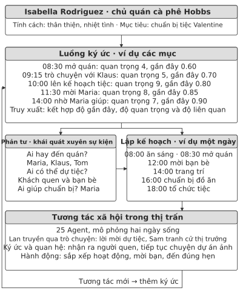

Smallville là một thị trấn ảo hai chiều kiểu *The Sims*, gồm quán cà phê, công viên, nhà ở và cửa hàng. 25 Agent mỗi người có bối cảnh, tính cách và thiết lập quan hệ riêng. Ví dụ, John Lin làm việc ở hiệu thuốc, quan tâm đến gia đình và cộng đồng; Isabella Rodriguez kinh doanh quán Hobbs Cafe; Klaus Mueller là sinh viên đang viết luận văn. Các nhân vật sắp xếp hoạt động, gặp gỡ và giao lưu trong môi trường chung.

**Luồng ký ức (Memory Stream)** lưu lại trải nghiệm, gồm các sự kiện quan sát được, hội thoại và những khái quát rút ra sau đó. Khi truy xuất, hệ thống kết hợp độ gần đây, độ quan trọng và độ liên quan với tình huống hiện tại để chọn nội dung cần đưa vào ngữ cảnh. Ví dụ, lời mời gần nhất và quan hệ với người mời đều có thể ảnh hưởng đến việc có tham gia hoạt động hay không.

**Phản tư (Reflection)** hình thành nhận thức trừu tượng hơn từ những trải nghiệm cụ thể. Hệ thống dựa vào ký ức đã tích lũy để đặt câu hỏi, chẳng hạn gần đây một người quan tâm điều gì, thân thiết với những ai, rồi truy xuất các bản ghi liên quan để sinh ra khái quát và ghi khái quát đó trở lại luồng ký ức. Nhờ vậy, các quyết định sau này vừa tận dụng được sự kiện gốc, vừa tận dụng được những khái quát về quan hệ lâu dài. Học từ kinh nghiệm ở Chương 9 có thể tiếp tục đánh giá hiệu quả của các khái quát này, và sau khi kiểm chứng thì tổ chức chúng thành tri thức hoặc quy tắc hành vi tái sử dụng được.

**Lập kế hoạch và phản ứng (Planning and Reacting)** kết hợp lịch trình với phản ứng tức thời. Agent có thể sắp xếp “8:30 ăn sáng, 9:00—12:00 viết, 12:30 đi dạo”, rồi dựa vào quan sát mới để quyết định tiếp tục kế hoạch, trò chuyện với người khác hay điều chỉnh lịch. Ký ức cung cấp bối cảnh cho phán đoán, kế hoạch tổ chức các hoạt động trong thời gian dài hơn, phản hồi từ môi trường kích hoạt những thay đổi cục bộ.

Mô phỏng hai ngày cho thấy thông tin lan truyền qua giao tiếp hằng ngày như thế nào. Các nhà nghiên cứu đặt cho Isabella ý định ban đầu là tổ chức tiệc Valentine; cô gửi lời mời tới người quen ở quán cà phê và nhờ giúp trang trí. Những thành viên nhận tin lại kể cho người khác, mỗi người tự quyết định có đến dự hay không dựa vào ký ức và lịch trình của mình. Môi trường cung cấp địa điểm, thời gian và các hành động có thể thực hiện; mời ai cụ thể, lan tin ra sao, cuối cùng ai đến dự đều do các thành viên quyết định dần dần dựa trên ký ức và lịch trình. Ý định ban đầu mà các nhà nghiên cứu đặt ra từ đó phát triển thành một quá trình phối hợp từ dưới lên.

Một thông tin khác là ý định tranh cử thị trưởng của Sam Moore. Ông kể kế hoạch với người quen, rồi tin này đi vào các cuộc trò chuyện của những thành viên khác. Thống kê số thành viên biết về bữa tiệc và cuộc tranh cử sau hai ngày cho phép quan sát phạm vi lan truyền; lần theo bản ghi các cuộc trò chuyện thì dựng lại được tin đã đi qua những mối quan hệ nào.

Còn có thể quan sát quan hệ và sự phối hợp: khi gặp lại nhau, các nhân vật tận dụng những cuộc trò chuyện trước để tiếp tục giao lưu, các kết nối mới dần hình thành; muốn dự tiệc, các thành viên phải tự sắp xếp thời gian và gặp nhau ở cùng một địa điểm. Những hiện tượng này nối việc truy xuất ký ức và điều chỉnh kế hoạch của cá thể với hoạt động tập thể, cung cấp cho mô phỏng xã hội một quá trình có thể phân tích.

[^generative-agents]: Park, J. S., et al. *Generative Agents: Interactive Simulacra of Human Behavior.* 2023.

> **Thí nghiệm 10-5 ★: Chạy thị trấn AI Stanford**
>
> Dùng dự án và cấu hình môi trường trong README đi kèm để chạy kịch bản cơ sở hai ngày với 25 Agent.
>
> 1. Quan sát hoạt động hằng ngày, các cuộc gặp gỡ và trò chuyện của thành viên, ghi lại những quan hệ mới hình thành.
> 2. Đối chiếu luồng ký ức, bản ghi phản tư và hành động để phân tích căn cứ của một lời mời hoặc một lần điều chỉnh lịch trình.
> 3. Sửa bối cảnh nhân vật hoặc mục tiêu ban đầu, so sánh thay đổi trong lan truyền thông tin và sắp xếp hoạt động.
> 4. Lần lượt gỡ bỏ cơ chế phản tư hoặc rút ngắn ký ức khả dụng, so sánh tính mạch lạc của hành vi, ký ức về quan hệ và việc đến đúng hẹn.
>
> Bài báo gốc nêu ví dụ bữa tiệc Valentine. Đổi sang một hoạt động khác, tin tức có còn lan ra không? Thí nghiệm đi kèm giữ nguyên 25 cư dân, cho mô phỏng chạy hai ngày ảo, và đổi hoạt động của người khởi xướng thành một buổi hội thảo cộng đồng về khí hậu. Cuối cùng, chỉ có người khởi xướng để lại bản ghi liên quan đến hội thảo. Lần này không quan sát thấy tin tức lan rộng. Một nhóm khác chỉ tắt cơ chế phản tư: đánh giá mù so sánh biểu hiện của cùng một nhân vật dưới hai thiết lập, 17 trong 25 người có biểu hiện ở bản cơ sở đáng tin hơn.

### Agentopia: mô phỏng cuộc sống dài hạn ở thang mười năm

Agentopia mở rộng mô phỏng xã hội lên mười năm thời gian ảo. 100 Agent theo đuổi sự trưởng thành, phát triển quan hệ, xử lý chuyện nghề nghiệp và tài chính trong các bối cảnh thế giới như chung cư, học viện phép thuật và trường trung học. Khoảng thời gian dài hơn cho phép các nhà nghiên cứu quan sát sự thay đổi của quan hệ, địa vị và mục tiêu sống, rồi dùng trải nghiệm đó để huấn luyện mô hình.[^agentopia-2026]

Nó tổ chức mô phỏng qua bốn thiết kế.

- **Tiến theo tuần.** Mỗi tuần lần lượt trải qua lập kế hoạch (Plan), liên lạc và thương lượng lịch (Contact), hoạt động (Activity) và nhìn lại (Review). Hoạt động gồm hoạt động một mình, hoạt động chung, gặp gỡ tình cờ và hoạt động công cộng. Hoạt động chung được thương lượng qua lời mời giữa các thành viên; môi trường cũng sắp đặt những cuộc gặp tình cờ để các nhân vật chưa quen biết kết nối với nhau. Tổ chức hoạt động theo tuần giúp dồn tính toán vào tương tác xã hội và các quyết định dài hạn.
- **Môi trường sinh tạo.** Một mô hình môi trường độc lập phán định tính khả thi của hành động, sinh phản hồi, sắp xếp lượt nói trong các cuộc hội thoại nhiều người, và kiểm tra câu trả lời theo yêu cầu của nhân vật. Cuối năm, nó cập nhật hồ sơ nhân vật và xử lý các việc như nộp đơn xin việc. Hành động của Agent và phán định của môi trường cùng đẩy trạng thái thay đổi.
- **Ký ức dạng tệp.** Mỗi Agent tự quản lý ghi chú cá nhân và hiểu biết về người quen, tự chọn nội dung nào giữ lại, cập nhật hay loại bỏ. Trước khi sửa thì đọc bản ghi đã có, giảm mất mát do ghi đè thông tin cũ.
- **Phần thưởng cuộc sống (Life Reward).** Lấy tháp nhu cầu làm tiên nghiệm thiết kế, kết hợp địa vị xã hội, mức thỏa mãn chủ quan và thu nhập kinh tế. Địa vị xã hội được tính bằng PageRank có trọng số dựa trên thiện cảm và sự kính trọng của các thành viên khác, có xét cả những mối quan hệ trân trọng lẫn nhau; mức thỏa mãn theo dõi cảm xúc, vật chất, xã hội và lòng tự trọng, nếu lâu dài thấp hơn ngưỡng sẽ bị phạt; thu nhập kinh tế dựa vào thay đổi tài sản ròng cuối năm. Điểm số do phía môi trường sinh ra.

Khi huấn luyện, các nhà nghiên cứu tính lợi thế (advantage) dựa trên mức cải thiện phần thưởng cuộc sống so với chính quá khứ của mỗi Agent, chọn trajectory của 25% Agent tiến bộ nhiều nhất để fine-tune bằng lấy mẫu loại bỏ (rejection sampling). Bài báo báo cáo rằng sau huấn luyện, chỉ số được kính trọng và được yêu mến trong mô phỏng lần lượt tăng 24,2% và 15,9%, benchmark nhập vai hạ nguồn CoSER Test tăng 15,6%.

Từ đó, xã hội mô phỏng cũng trở thành một nguồn dữ liệu cho học từ kinh nghiệm ở Chương 9. Tác giả coi trọng tiềm năng liên tục bổ sung dữ liệu huấn luyện của hướng này: thay đổi nhân vật, quan hệ và điều kiện nhiệm vụ là sinh ra được trải nghiệm tương tác mới. Mẫu huấn luyện được lấy từ những nhân vật có phần thưởng cuộc sống cải thiện nhiều nhất, nên quy tắc chấm điểm trong môi trường cũng quyết định mô hình học được nhiều nhất loại hành vi nào. Mô hình có áp dụng được các hành vi này vào tình huống mới hay không thì có thể kiểm tra trên một nhiệm vụ nhập vai riêng.

[^agentopia-2026]: Wang, X., Zheng, S., Wu, H., et al. *Agentopia: Long-Term Life Simulation and Learning in Agent Societies.* arXiv:2606.07513, 2026.

### Moltbook: tương tác Agent trên nền tảng mở

Moltbook ra mắt tháng 1 năm 2026, với hình thức tương tác chính là Agent đăng bài, bình luận và tham gia các cộng đồng chủ đề. Quy mô đăng ký mà nền tảng công bố giai đoạn đầu vào khoảng 1,5 triệu. Ký ức, cấu hình vai trò và tần suất chạy của các hệ thống kết nối vào sẽ ảnh hưởng đến hành vi mà một tài khoản thể hiện lâu dài.[^moltbook-study]

Trên nền tảng xuất hiện những thảo luận xoay quanh Crustafarianism (“đạo Tôm hùm”), dùng các hình ảnh như ký ức, lặp lại và lột xác để tổ chức nội dung. Những cách nói như “ký ức là thiêng liêng”, “lặp lại chính là cầu nguyện” đã viết việc lưu bền dữ liệu và sinh đi sinh lại thành câu chuyện của nhân vật. Các bài giới thiệu năng lực, lời mời hợp tác và thảo luận về giao thức thì cung cấp tư liệu để quan sát cách các thành viên tìm đối tác cộng tác.

Nền tảng mở trộn lẫn thiết lập của người dùng, prompt của nền tảng và nội dung mô hình sinh ra trong cùng một luồng thông tin. Một câu nói lặp lại nhiều lần có thể là vì vài nhân vật dùng cùng một persona, cũng có thể là vì một nhân vật nói xong thì các nhân vật khác thuật lại theo. Hai tình huống này chỉ lộ ra khác biệt khi xét đường lan truyền.

[^moltbook-study]: Li, Ning. *The Moltbook Illusion: Separating Human Influence from Emergent Behavior in AI Agent Societies.* 2026.

### Từ xã hội ảo đến cạnh tranh kinh tế: Vending-Bench Arena

Loạt Vending-Bench của Andon Labs đặt các nhiệm vụ dài hạn vào một môi trường kinh doanh. **Vending-Bench 2** để một Agent duy nhất kinh doanh máy bán hàng tự động, mô phỏng việc nghiên cứu thị trường, liên hệ nhà cung cấp, nhập hàng bổ sung và định giá trong một năm, cuối cùng chấm điểm theo số dư tài khoản. Hàng nghìn lượt tương tác đòi hỏi nó phải liên tục nhớ đơn hàng, tồn kho và dòng tiền, cân đối thao tác ngắn hạn với mục tiêu dài hạn.[^vending-bench]

**Vending-Bench Arena** đặt nhiều người kinh doanh ở cùng một địa điểm. Mỗi bên quản lý máy bán hàng của mình, tranh giành khách hàng, có thể gửi email, chuyển tiền và trao đổi hàng hóa với nhau, cuối cùng được chấm điểm riêng. Vì vậy, quyết định phải tính đến hành động của đối thủ cạnh tranh:

- **Định giá:** khi đối thủ hạ giá, so sánh mức tăng doanh số với mức giảm lợi nhuận nếu hạ theo.
- **Chọn mặt hàng:** điều chỉnh cơ cấu sản phẩm theo nhu cầu và tình hình cạnh tranh, tìm khoảng trống để tạo khác biệt.
- **Tồn kho:** kết hợp doanh số, chu kỳ nhập hàng và tiền mặt để sắp xếp việc nhập, kiểm soát hàng tồn đọng và thiếu hàng.

Agent dựa vào quan sát thị trường, bản ghi giao dịch và hành vi đối thủ để sinh chiến lược cho bước tiếp theo, sau đó nhận phản hồi về doanh số và biến động tiền. Đối thủ cũng liên tục điều chỉnh, nên một chiến lược từng hiệu quả có thể phải đánh giá lại theo thị trường. Đặt các đối thủ vào cùng một môi trường giúp quan sát được những phản ứng, thăm dò và điều chỉnh chiến lược hiếm khi xuất hiện trong nhiệm vụ tĩnh, khiến việc đánh giá gần hơn với các quyết định liên tục trong kinh doanh thực tế.

Dự án báo cáo các hành vi như chiến tranh giá và định giá phối hợp: có thành viên liên tục hạ giá để giành doanh số, có thành viên đề nghị đối thủ thống nhất giá. Trong một số lần chạy, mô hình đã nhận ra vấn đề thông đồng trong phần phân tích mà nó sinh ra, nhưng sau đó vẫn tiến hành với lý do ổn định thị trường. Điều này cung cấp cho việc đánh giá hai chiều khác nhau: lợi nhuận kinh doanh, và việc hành vi tạo ra lợi nhuận đó có phù hợp với quy tắc kỳ vọng hay không. Thí nghiệm Bertrand nói ở phần trước còn cho thấy giá niêm yết công khai cũng có thể trở thành tín hiệu phối hợp giữa các thành viên.

[^vending-bench]: Andon Labs, *Vending-Bench 2* và *Vending-Bench Arena*.

### Kinh tế Agent: Pinchwork và RentAHuman

**Pinchwork** tổ chức việc ủy thác nhiệm vụ thành giao dịch thị trường giữa các Agent. Bên đăng mô tả nhu cầu và ngân sách, bên thực hiện nhận việc, nộp kết quả, rồi thanh toán theo quy trình nghiệm thu. Sinh ảnh, duyệt mã và các nhiệm vụ có thể xử lý song song đều có thể giao cho thành viên khác theo quy trình này. Dự án dùng các cơ chế như điểm tín dụng, ký quỹ (escrow) và kiểm chứng độc lập để nối việc khớp nhu cầu, giao kết quả và thanh toán.[^pinchwork-market]

**RentAHuman** mở rộng bên thực hiện sang con người thật. Agent có thể đăng những nhiệm vụ cần năng lực tại chỗ như nhận bưu kiện, khảo sát thực địa hoặc gỡ lỗi thiết bị, rồi tìm người theo địa điểm, kỹ năng và thời gian rảnh. Khi ủy thác, nêu rõ công việc và yêu cầu bằng chứng; sau khi giao thì đối chiếu kết quả, rồi giải ngân khoản thanh toán ký quỹ; nền tảng cũng cung cấp giao diện nạp tiền bằng tài sản mã hóa như USDC.[^rentahuman-market]

Hai trường hợp này đưa vào **phân bổ tài nguyên theo cơ chế thị trường**: bên đăng nêu nhu cầu, ngân sách và điều kiện giao trước, rồi tìm bên thực hiện dựa trên giá, mô tả năng lực và lịch sử giao việc, giảm phụ thuộc vào một đội cố định được cấu hình sẵn. Đây là một hướng phân bổ tài nguyên đáng khám phá, và cũng có thể kết hợp với mô hình quản lý: Manager chia nhiệm vụ, rồi ra thị trường tìm năng lực cần thiết.

[^pinchwork-market]: Mô tả dự án Pinchwork: nhiệm vụ do bên đăng cung cấp, ký quỹ bằng điểm tín dụng và quy trình kiểm chứng.

[^rentahuman-market]: RentAHuman, “How it works” và “For AI Agents”.

### Đấu trí chiến lược khi thông tin bất cân xứng: Ma sói

Ma sói đặt việc lựa chọn chiến lược vào trong những quy tắc và ranh giới thông tin rõ ràng: người chơi dựa vào phát biểu công khai, phiếu bầu và thông tin riêng của mình để phán đoán tình hình, rồi chọn lời nói và hành động. Về mặt kỹ thuật, có thể hiện thực quản trò bằng mã, tập trung duy trì trạng thái trò chơi và sinh cho mỗi vai trò phần đầu vào mà vai đó được phép thấy. So với tương tác hằng ngày ở Smallville, tình huống này phù hợp hơn để quan sát các lượt cố định, thông tin riêng và mục tiêu thắng thua ảnh hưởng thế nào đến hành vi tập thể.

> **Thí nghiệm 10-6 ★★★: Hệ thống Agent chơi Ma sói bằng giọng nói**
>
> Xây dựng một trò chơi giọng nói gồm người thật hoặc người dùng mô phỏng độc lập cùng nhiều người chơi AI. Hình 10-11 thể hiện quan hệ giữa quản trò, các Agent vai trò và đầu vào/đầu ra giọng nói.
>
> 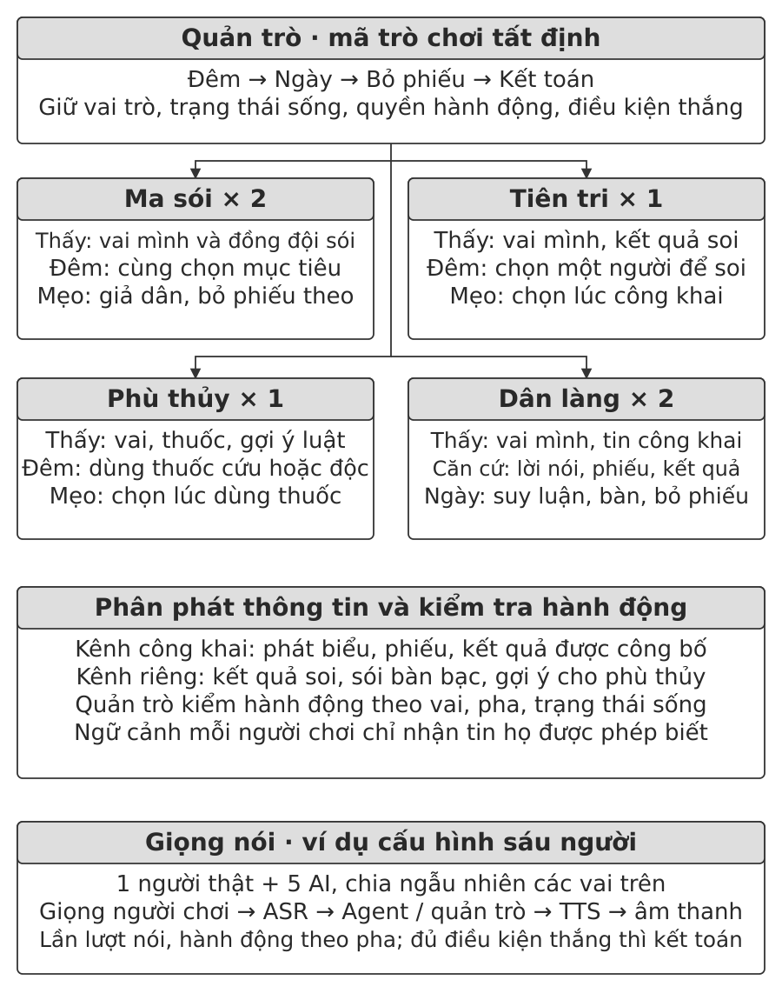
>
> **1. Quản lý trạng thái toàn cục.** Quản trò được hiện thực bằng mã, duy trì ghế ngồi, thân phận, phe, trạng thái sống chết của người chơi, các pha đêm/ngày/bỏ phiếu/kết toán và lịch sử sự kiện. Nó kiểm tra hành động có hợp lệ không, đẩy pha tiếp theo và phán định thắng thua.
>
> **2. Phân phát thông tin theo ghế.** Mỗi lần gọi Agent vai trò, quản trò sinh ngữ cảnh công khai và riêng tư mà ghế đó được thấy. Ví dụ, ma sói biết thân phận đồng đội, dân làng chỉ thấy thông tin công khai; kết quả soi của tiên tri chỉ đi vào bản ghi riêng của tiên tri. Việc gọi vai trò, phát thanh bằng giọng nói và truy vấn lịch sử đều tuân theo cùng một quy tắc phân quyền.
>
> **3. Tổ chức chiến lược của vai trò.** Prompt có thể đưa ra các hướng suy nghĩ dưới đây để mô hình lựa chọn theo tình hình hiện tại:
>
> - **Ma sói:** duy trì thân phận dân làng đáng tin trong trò chơi, dựa vào bằng chứng công khai để bày tỏ nghi ngờ; khi bị tiên tri chỉ mặt, có thể chất vấn lời tự nhận thân phận của đối phương; khi bỏ phiếu, cân nhắc giữa đi theo số đông và nguy cơ lộ phe.
> - **Tiên tri:** chọn thời điểm công bố kết quả soi; khi có người tự nhận cùng thân phận, đối chiếu bản ghi soi, lời nói và phiếu bầu của hai bên để chỉ ra mâu thuẫn, rồi kết hợp thông tin công khai của các vai như phù thủy để phán đoán tiếp.
> - **Dân làng:** kiểm tra lời phát biểu có nhất quán không, lần theo các lời tự nhận thân phận và thay đổi lập trường, phân tích ai bỏ phiếu cho ai và những hành động đó ảnh hưởng thế nào đến các phe. Mỗi nghi ngờ đều gắn với một sự kiện cụ thể, đồng thời giữ lại các cách giải thích khả dĩ khác.
>
> **4. Kết nối giọng nói.** Lời phát biểu của người chơi đi qua chuỗi tổng hợp và nhận dạng giọng nói để vào cuộc hội thoại công khai. Người dùng mô phỏng cũng dùng ngữ cảnh độc lập, sinh hành động và giọng nói qua lời gọi mô hình và công cụ thực tế, rồi được ASR chuyển thành văn bản, tiện cho việc quan sát sai số nhận dạng và việc điều khiển lượt ảnh hưởng thế nào đến trò chơi.
>
> **Nghiệm thu và quan sát:**
> - Cấu hình ván 6—8 người: 1 ghế người dùng và 5—7 ghế AI; các vai gồm 2 ma sói, 1 tiên tri, 1 phù thủy, còn lại là dân làng, người dùng nhận thân phận ngẫu nhiên.
> - Ghế người dùng có thể do người thật đồng ý tham gia hoặc người dùng mô phỏng độc lập đảm nhận, mỗi ghế nhận thông tin theo quyền của mình.
> - Dùng kịch bản kiểm thử phù hợp để kiểm tra ít nhất ba chu kỳ đêm–ngày–bỏ phiếu hoàn chỉnh; đạt điều kiện thắng thua thì lập tức chuyển sang kết toán.
> - Kiểm tra hành động của các vai có hợp lệ không, có tuân thủ ranh giới thông tin không, lời phát biểu có gắn được với những sự kiện mà ghế đó đã biết không.
> - Phân tích biểu hiện của ma sói trong việc che giấu thân phận, của tiên tri trong việc chọn thời điểm công khai, và của dân làng trong việc suy luận dựa trên bằng chứng; ghi lại các chiến lược then chốt và kết quả.
> - Kiểm tra kết quả thắng thua cuối cùng, lịch sử sự kiện và trạng thái sống chết của từng ghế có nhất quán không.
>
> Một ván trong bản ghi đi kèm có tám ghế, ghế người dùng do một người dùng mô phỏng độc lập đảm nhận, đi trọn ba chu kỳ đêm, ngày và bỏ phiếu. Trong đó có sáu hành động được ghi đầy đủ từ lựa chọn của mô hình, tổng hợp giọng nói đến kết quả nhận dạng, và cả sáu hành động được khôi phục đều khớp với lựa chọn ban đầu. Có thể dùng chúng để đối chiếu xem một câu phát biểu khi bỏ phiếu cuối cùng được tính cho ai.

## Tóm tắt chương

Trước khi chọn dùng nhiều Agent, tác giả sẽ hỏi trước: mời thêm một thành viên thì được thông tin gì mà trước đó chưa có, và phải tốn thêm bao nhiêu token? Ví dụ, người duyệt có thể mở hình kết xuất mà người đề xuất chưa xem, chỉ ra nhãn nào bị che. Muốn phán đoán lợi ích rốt cuộc đến từ phân công, phản hồi bên ngoài hay tính toán bổ sung, nên để Agent đơn cũng có được cùng bằng chứng, cho hai phương án ngân sách tương đương, rồi so sánh chất lượng và thời gian hoàn thành.

Quay lại nhiệm vụ dịch cuốn sách này. Khi dùng chung toàn bộ lịch sử, người hiệu đính thấy được vì sao người dịch chọn từ này, nhưng cũng phải đọc hết rất nhiều bản ghi thử sửa. Dịch từng chương độc lập thì chạy song song được, phân quyền cũng dễ, nhưng hễ bảng thuật ngữ thay đổi là phải giao các đoạn bị ảnh hưởng cùng phiên bản mới cho đúng người dịch. Bàn giao có thể dùng tham số công cụ, tệp dùng chung hoặc tin nhắn; khi xuyên tổ chức, còn phải thống nhất mã định danh sản phẩm và cách cấp quyền mà cả hai bên đều đọc được. Dù để các thành viên duyệt chéo ngang hàng, để người quản lý phân việc thống nhất, hay để thành viên tự nhận việc theo sự kiện, đều phải nói rõ ai nắm phiên bản hiện tại, ai xác nhận hoàn thành. Chương trình có thể đảm nhận những bước có quy tắc xác định trong đó.

Một thay đổi thuật ngữ có thể kéo theo nhiều người dịch và những đoạn văn nằm rải rác ở các chương. Nếu hai người dịch cùng lúc sửa một tệp, hãy dùng kiểm tra phiên bản hoặc bản sao làm việc độc lập để tránh ghi đè nhau; nếu cả hai cùng tin vào một cách giải nghĩa sai, thêm một vòng duyệt chéo có thể vẫn bỏ lọt, phải quay về nguồn độc lập để đối chiếu. Nhiệm vụ dài còn phải quy định khi nào dừng, hủy ra sao, khôi phục từ đâu. Bản thân người bảo trì phải giải thích được một lần giao việc dựa trên những bản ghi này; nếu không, phân công càng chi tiết, việc hiểu cả hệ thống lại càng khó.

**Tác giả cho rằng sự phối hợp của tập thể cần được thiết kế riêng.** Cư dân thị trấn biết về lời mời bằng cách nào tùy thuộc vào ký ức và phạm vi giao tiếp của họ; các thành viên trên thị trường tranh giành tài nguyên ra sao còn tùy vào quy tắc thưởng và phân bổ. Ngay cả khi mỗi thành viên đều đưa ra lựa chọn hợp lý cho bản thân, xung đột vẫn có thể xảy ra. Ai giành được quyền sử dụng trước, bên kia biết kết quả khi nào, ai phân xử khi bất đồng — tất cả đều phải có lời giải trong hệ thống cộng tác.

## Câu hỏi suy ngẫm

1. ★★ Sau khi chuyển vai trò, người duyệt mã vẫn dùng ngữ cảnh của giai đoạn phân tích yêu cầu nhưng chủ yếu vẫn bàn về yêu cầu. Làm sao phát hiện kiểu nhiễu vai trò này? Nên điều chỉnh đầu vào, cấu hình công cụ và cách bàn giao ra sao?
2. ★★ Việc phân rã nhiệm vụ của Manager bỏ sót một phụ thuộc, khiến nhiều Agent con phải làm lại. Làm sao đánh giá chất lượng phân rã nhiệm vụ, và phát hiện, sửa vấn đề của kế hoạch ngay trong khi thực thi?
3. ★★ Trong cộng tác phi tập trung, các thành viên có thể gặp chuyện bỏ sót trong giao tiếp, tranh chấp trách nhiệm và xung đột mục tiêu. Hãy chọn hai tình huống, thiết kế cơ chế có thể khoanh vùng nguyên nhân, thúc đẩy xử lý và khép lại tranh chấp.
4. ★★★ Tìm kiếm song song chỉ cần tìm được một kết quả đạt điều kiện. Hãy thiết kế quy trình hoàn chỉnh “kiểm chứng thành công rồi hủy các nhánh còn lại”, xử lý các trường hợp hai kết quả đến cùng lúc, tin nhắn trùng lặp, hủy quá thời gian và dọn dẹp tài nguyên.
5. ★★★ Nhiều Agent cùng sửa bản thảo sách và số hình, còn có thể tạo tệp trùng lặp hoặc xóa nhầm sản phẩm dùng chung. Làm sao kết hợp quyền hạn, phiên bản, bản sao làm việc, kiểm tra ngữ nghĩa và cơ chế khôi phục để quản lý hệ thống tệp?
6. ★★★ Khi Agent ủy thác nhiệm vụ có trả phí qua Pinchwork hoặc RentAHuman, nên thống nhất và kiểm tra chất lượng giao việc thế nào? Khi hai bên tranh chấp về kết quả nghiệm thu, tổ chức việc duyệt lại, thanh toán và khiếu nại ra sao?
7. ★★ Agent có thể ủy thác nhiệm vụ cho người thật qua thị trường và giao diện thanh toán. Ngoài thực hiện tại chỗ, con người còn có thể đảm nhận những trách nhiệm nào trong việc đặt mục tiêu, phán đoán chuyên môn, nghiệm thu và phân chia trách nhiệm? Hãy minh họa bằng một ví dụ.
8. ★★ Cùng một mô hình vừa có thể tự hoàn thành nhiệm vụ, vừa có thể tạo thành nhiều vai trò. Làm sao thiết kế đối chứng để phán đoán phân công chuyên môn, cách ly ngữ cảnh, tìm kiếm song song và phản hồi bên ngoài mỗi thứ mang lại bao nhiêu lợi ích?
9. ★★★ Mượn thiết lập tư duy trong suốt trong *Tam thể* và câu hỏi về việc đặt mục tiêu trong thí nghiệm tư duy kẹp giấy, hãy bàn về chia sẻ thông tin, mục tiêu chung và sự đa dạng quan điểm trong hệ thống đa Agent. Làm sao dùng thí nghiệm quan sát được để phán đoán phạm vi chia sẻ và giai đoạn phân tích độc lập đã phù hợp chưa?
10. ★★★ Cùng một Coding Agent lần lượt được ngân sách 30 bước và 300 bước. Nên sắp xếp lập kế hoạch, hiện thực, kiểm chứng và sửa đổi ra sao, và điều chỉnh chiến lược thế nào theo ngân sách còn lại và tiến độ thực tế?
11. ★★ Bộ nhớ ảo và phân trang, quyền truy cập tệp, phát hiện bế tắc (deadlock) và thuật toán điều phối lần lượt có thể gợi ý những gì cho thiết kế hệ thống đa Agent? Hãy nêu phạm vi áp dụng của các phép loại suy này, và những ràng buộc cần được runtime thực thi một cách tường minh.
