# Context Engineering (kỹ thuật ngữ cảnh)

Chương 1 ví ngữ cảnh như “tầm nhìn quyết định hiện tại” của Agent: mỗi lần đưa ra phán đoán, mô hình đều dựa vào thông tin nhận được ở thời điểm đó. **Context Engineering (kỹ thuật ngữ cảnh)** lo việc chọn lọc, sắp xếp và cập nhật những thông tin này, gồm chỉ dẫn hệ thống, định nghĩa công cụ, yêu cầu của người dùng, lịch sử tin nhắn và trạng thái nhiệm vụ. Trước mỗi lần gọi mô hình, Harness phải gom bối cảnh nhiệm vụ và tiến độ mới nhất thành đầu vào. Hình 2-1 minh họa cấu trúc của cửa sổ ngữ cảnh bằng nội dung cụ thể.

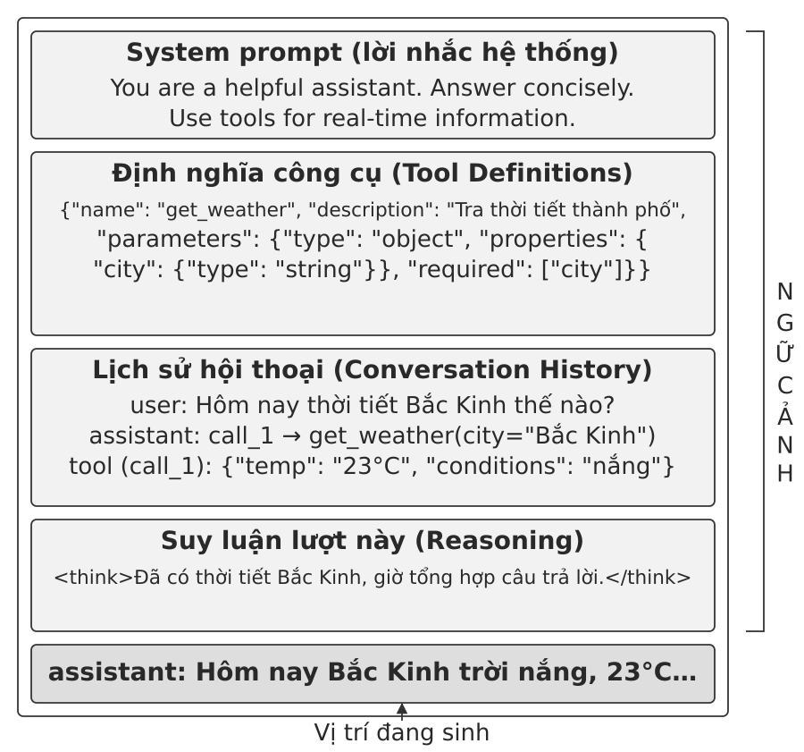

## Ngữ cảnh: đưa năng lực của mô hình vào nhiệm vụ cụ thể

Hãy hình dung một kỹ sư dày dạn kinh nghiệm vừa gia nhập nhóm, và nhiệm vụ đầu tiên là “sửa cấu hình theo quy chuẩn của chúng ta”. Người này biết lập trình, nhưng chưa biết file nào mới là nguồn gốc của cấu hình, trường nào được phép sửa, và sửa xong thì kiểm chứng ra sao. Dù được giao cả kho mã, họ vẫn có thể sửa nhầm file. Agent nhận một dự án lạ cũng thiếu đúng những bối cảnh ấy.

Lấy yêu cầu “sửa giúp tôi lỗi này” làm ví dụ, Coding Agent thường cần ba loại bối cảnh:

- **Ngữ cảnh mã thời gian thực**: cấu trúc thư mục, trách nhiệm của từng module, các cấu trúc dữ liệu cốt lõi và quy chuẩn viết mã. Chẳng hạn, nếu thứ bị sửa là một file cấu hình sinh tự động, thì dù chạy được ở máy cục bộ, lần sinh tiếp theo vẫn sẽ ghi đè lên nó. Phải biết file do module nào sinh ra mới tìm được đúng chỗ cần sửa.
- **Quy chuẩn quy trình**: chiến lược nhánh Git, quy chuẩn commit, quy trình review mã và yêu cầu CI/CD. Agent dựa vào đó để sắp xếp việc sửa, kiểm thử và commit; hệ thống vận hành thì thực thi các thao tác này theo quyền hạn.
- **Thông tin môi trường**: cấu hình phát triển, cách kết nối cơ sở dữ liệu kiểm thử, cách triển khai môi trường kiểm thử và cách quản lý API key. Những thông tin này giúp Agent chọn đúng môi trường chạy và hiểu khác biệt giữa môi trường cục bộ với môi trường kiểm thử.

Mã nguồn dự án và cơ sở dữ liệu kiểm thử đều nằm ngoài ngữ cảnh của mô hình. Với ví dụ cấu hình sinh tự động, Agent phải dùng công cụ tìm kiếm đọc được script sinh mã thì mới biết nên bắt đầu sửa từ đâu. **Chất lượng ngữ cảnh quyết định mô hình có đem được năng lực sẵn có vào vấn đề trước mắt hay không.** **Với những nhiệm vụ phụ thuộc nhiều vào thông tin nền, một mô hình đủ năng lực đi kèm ngữ cảnh đầy đủ, chính xác có thể làm tốt hơn một mô hình mạnh hơn nhưng thiếu tài liệu cần thiết.**

**Xây dựng một đội ngũ AI-native, việc đầu tiên là tài liệu hóa tri thức then chốt.** Nếu lý do chọn một cơ sở dữ liệu năm xưa chỉ còn nằm trong trí nhớ của nhân viên cũ, còn thay đổi quy tắc nghiệp vụ chỉ được nhắc trong tin nhắn riêng, thì đồng nghiệp mới lẫn Agent khi tiếp nhận đều gặp cùng một vấn đề: đọc mã thấy được nhóm đã làm gì, nhưng không thấy được vì sao lại làm như vậy.

**Nhóm thuận lợi cho cộng tác từ xa thường cũng thuận lợi cho Agent.** Các nhà phát triển nhân Linux thảo luận bản vá và trao đổi ý kiến review qua mailing list, còn tài liệu về quy trình phát triển thì giải thích cách gửi, review và hợp nhất bản vá[^ch2-linux]. Người mới tham gia gặp một thay đổi khó hiểu có thể lần theo bản vá để tìm lại cuộc tranh luận thời đó; Agent khi tra cứu bối cảnh cũng dùng được những ghi chép này.

Sau khi nghe cuộc phỏng vấn Weng Jiayi trên WhynotTV, tác giả tóm lược một quan điểm của anh là: **cả con người lẫn mô hình đều dựa vào Context.** Con người có thể tìm đồng nghiệp từng tham gia quyết định để hỏi thêm một câu; còn mô hình đọc được bối cảnh nào thì phụ thuộc vào việc nhóm đã để lại ghi chép gì, và Harness đã đưa những nội dung nào vào yêu cầu lần này.[^ch2-weng]

[^ch2-linux]: Tài liệu chính thức của nhân Linux, How the development process works.

[^ch2-weng]: WhynotTV, “Weng Jiayi: OpenAI, GPT, học tăng cường, Infra, post-training, Tianshou, tuixue, mã nguồn mở, CMU, Thanh Hoa”, Podcast #4.

Bài báo ReAct dùng một biểu diễn hình thức để mô tả cách lịch sử tương tác tham gia vào việc ra quyết định[^ch2-react]. Tại thời điểm $t$, Agent nhận observation $o_t\in\mathcal{O}$ từ môi trường và chọn hành động $a_t\in\mathcal{A}$ theo policy $\pi(a_t\mid c_t)$, trong đó ngữ cảnh là:

$$
c_t=(o_1,a_1,\ldots,o_{t-1},a_{t-1},o_t)
$$

Biểu diễn này cho thấy **hành động tiếp theo của Agent phụ thuộc vào lịch sử tương tác tính đến hiện tại.** Chẳng hạn, Agent đã xem file nào, công cụ trả về lỗi gì, đều ảnh hưởng tới lựa chọn kế tiếp. Với Agent dựa trên LLM, đầu vào của người dùng và kết quả công cụ cung cấp observation, còn các lần gọi công cụ và câu trả lời gửi ra ngoài ghi lại hành động; chỉ dẫn hệ thống và định nghĩa công cụ bổ sung quy tắc nhiệm vụ và các giao diện khả dụng.

Chương này dùng cách gửi yêu cầu không trạng thái (stateless): ở mỗi lượt, Harness ghép tin nhắn và định nghĩa công cụ rồi gọi mô hình. Lịch sử tin nhắn đầy đủ giúp giữ lại tiến độ nhiệm vụ; khi lịch sử dài ra, có thể dùng truy xuất, ghi trạng thái và nén để giữ trong cửa sổ những thông tin mà các quyết định sau còn cần. Bố cục ngữ cảnh, thanh trạng thái và kỹ thuật nén đều xoay quanh cùng một câu hỏi: trong một ngữ cảnh có hạn, làm sao đưa vào $c_t$ những thông tin mà mô hình cần cho bước này?

[^ch2-react]: Yao, Shunyu, et al., ReAct: Synergizing Reasoning and Acting in Language Models, ICLR 2023.

## Agent gọi mô hình lớn như thế nào: hiểu cấu trúc ngữ cảnh của API

Trước hết, xem định dạng tin nhắn qua một câu chào, rồi xem câu hỏi “Vancouver bây giờ mấy giờ, thời tiết thế nào” dẫn tới hai lần gọi công cụ ra sao. Phần này dùng giao diện tương thích Chat Completions và mô hình Qwen3-0.6B chạy cục bộ, cuối cùng dùng Python nối các lượt yêu cầu lại với nhau[^ch2-chat-api].

### Bốn vai trò tin nhắn trong ví dụ

**Danh sách tin nhắn** (`messages`) trong yêu cầu lưu thông tin tương tác theo thứ tự. Mỗi tin nhắn dùng **vai trò** (`role`) để đánh dấu nguồn gốc và mục đích. Phần này dùng bốn vai trò:

- **system**: system prompt (lời nhắc hệ thống). Ở đây nó chứa danh tính, quy tắc hành vi và ràng buộc do nhà phát triển cung cấp, đặt ở đầu danh sách tin nhắn. Một số giao diện mô hình dùng vai trò `developer` để chứa chỉ dẫn của nhà phát triển.
- **user**: tin nhắn người dùng, chứa nhiệm vụ, câu hỏi tiếp theo và yêu cầu bổ sung.
- **assistant**: câu trả lời của mô hình, gồm văn bản và yêu cầu gọi công cụ. Đưa các tin nhắn này trở lại đầu vào lượt sau thì mô hình đọc được câu trả lời và yêu cầu thao tác trước đó của chính nó.
- **tool**: kết quả thực thi công cụ. Harness nhận giá trị trả về, viết nó thành tin nhắn công cụ và gắn với lần gọi cụ thể qua `tool_call_id`.

Định nghĩa công cụ được truyền qua trường `tools` ở cấp cao nhất của yêu cầu, liệt kê tên, công dụng và định dạng tham số của các công cụ khả dụng.

Mô hình dựa vào định nghĩa công cụ để tạo yêu cầu gọi. Thao tác đó có được thực hiện hay không là do Harness và môi trường chạy quyết định.

[^ch2-chat-api]: OpenAI, tài liệu tham khảo Chat Completions API, giới thiệu vai trò tin nhắn, định nghĩa công cụ và các trường kết quả gọi; Qwen, Function Calling, giới thiệu cách gọi công cụ và template trong dịch vụ tương thích.

### Hội thoại một lượt: lần gọi API đơn giản nhất

Bắt đầu với một lượt hỏi đáp. Người dùng hỏi “Hello, who are you?”, Harness gửi chỉ dẫn hệ thống cùng câu hỏi đến mô hình rồi đọc câu trả lời. Hình 2-2 cho thấy sự tương ứng giữa yêu cầu và phản hồi.

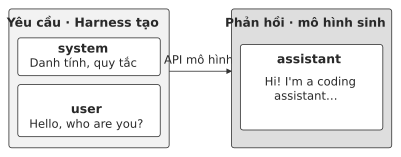

Dưới đây là yêu cầu và câu trả lời mẫu viết theo giao diện của mô hình cục bộ; chú thích trong mã cho biết nguồn gốc của từng phần:

```javascript
// Harness tạo yêu cầu
{
  "model": "Qwen3-0.6B",
  "messages": [
    {
      "role": "system",                           // chỉ dẫn do nhà phát triển cung cấp
      "content": "You are a helpful coding assistant. Follow user instructions."
    },
    {
      "role": "user",                              // đầu vào của người dùng
      "content": "Hello, who are you?"
    }
  ]
}
```

```javascript
// API trả về phản hồi
{
  "choices": [{
    "message": {
      "role": "assistant",                         // do mô hình sinh ra
      "content": "Hi! I'm a coding assistant. I can help you write code, debug issues, and explain technical concepts. How can I help?"
    }
  }]
}
```

Yêu cầu gồm một tin nhắn `system` và một tin nhắn `user`; `choices[0].message` trong phản hồi chứa tin nhắn `assistant` do mô hình sinh ra. Với giao diện không trạng thái dùng ở đây, **Harness chịu trách nhiệm cung cấp ngữ cảnh cần thiết cho mỗi lần gọi**. Muốn yêu cầu tiếp theo nối tiếp cuộc hội thoại này thì phải gửi kèm lịch sử liên quan.

### Tương tác nhiều lượt có gọi công cụ: vòng lặp cốt lõi của Agent

Giờ xét một câu hỏi cần đến công cụ: “What's the current time and weather in Vancouver?” Muốn trả lời, trước hết phải tra được giờ và thời tiết tại đó. Trong Hình 2-3, lần đầu Harness gọi mô hình, thứ nhận về là hai yêu cầu công cụ. Harness lần lượt hỏi dịch vụ giờ và dịch vụ thời tiết, thêm hai kết quả vào lịch sử tin nhắn, rồi gọi mô hình lần thứ hai mới có được câu trả lời cho người dùng.

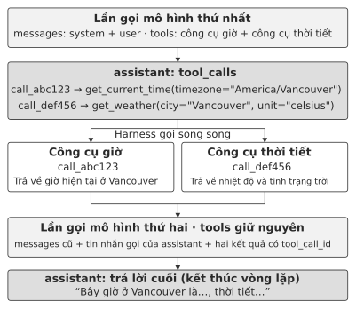

Hai công cụ này chạy cái nào trước? Công cụ giờ cần múi giờ, công cụ thời tiết cần tên thành phố và thang nhiệt độ. Người dùng chỉ nói Vancouver, mô hình trong ví dụ dựa vào đó điền `America/Vancouver` và `Vancouver`, chọn thang độ C. Tra thời tiết không phải đợi công cụ giờ trả về, nên hai truy vấn có thể gửi đi cùng lúc.

**Lần gọi API thứ nhất — framework Agent gửi yêu cầu ban đầu:**

```javascript
// Lần gọi mô hình thứ nhất: Harness tạo yêu cầu
{
  "model": "Qwen3-0.6B",
  "messages": [
    {
      "role": "system",                           // chỉ dẫn do nhà phát triển cung cấp
      "content": "You are a helpful assistant. Use the provided tools to get real-time information when needed."
    },
    {
      "role": "user",                              // đầu vào của người dùng
      "content": "What's the current time and weather in Vancouver?"
    }
  ],
  "tools": [                                       // công cụ do nhà phát triển định nghĩa
    {
      "type": "function",
      "function": {
        "name": "get_current_time",
        "description": "Get the current date and time in a specific timezone",
        "parameters": {
          "type": "object",
          "properties": {
            "timezone": { "type": "string", "description": "Timezone name, e.g. America/Vancouver" }
          },
          "required": ["timezone"]
        }
      }
    },
    {
      "type": "function",
      "function": {
        "name": "get_weather",
        "description": "Get the current weather for a specific city",
        "parameters": {
          "type": "object",
          "properties": {
            "city": { "type": "string", "description": "City name" },
            "unit": { "type": "string", "enum": ["celsius", "fahrenheit"] }
          },
          "required": ["city", "unit"]
        }
      }
    }
  ]
}
```

Danh sách `tools` này do nhà phát triển định nghĩa từ trước, gồm tên, mô tả và schema tham số. Trong ví dụ, mọi lượt yêu cầu đều cung cấp hai công cụ giống nhau; mô hình đọc danh sách cùng câu hỏi của người dùng, rồi chọn công cụ cần gọi và điền tham số.

**Mô hình trả về hai yêu cầu gọi công cụ:**

```javascript
// Mô hình trả về yêu cầu gọi công cụ
{
  "choices": [{
    "message": {
      "role": "assistant",                         // do mô hình sinh ra
      "content": null,                             // lượt này không có văn bản trả lời
      "tool_calls": [                              // yêu cầu gọi hai công cụ
        {
          "id": "call_abc123",
          "type": "function",
          "function": {
            "name": "get_current_time",
            "arguments": "{\"timezone\": \"America/Vancouver\"}"
          }
        },
        {
          "id": "call_def456",
          "type": "function",
          "function": {
            "name": "get_weather",
            "arguments": "{\"city\": \"Vancouver\", \"unit\": \"celsius\"}"
          }
        }
      ]
    }
  }]
}
```

Trường `tool_calls` trong phản hồi chứa hai yêu cầu, mỗi yêu cầu có `id`, tên công cụ và tham số riêng. `arguments` là một chuỗi mã hóa JSON; phía thực thi phải phân tích chuỗi này trước, rồi kiểm tra các trường và giá trị. **Mô hình quyết định gọi gì và truyền tham số gì; Harness lo việc kiểm tra và điều phối; phần cài đặt công cụ lo việc truy cập dịch vụ giờ hoặc thời tiết.**

**Framework Agent thực thi công cụ, rồi gửi lần gọi API thứ hai:**

Harness kiểm tra yêu cầu, điều phối hai công cụ, viết giá trị trả về thành tin nhắn `tool`, rồi gửi lịch sử hiện có cùng các kết quả mới cho mô hình:

```javascript
// Lần gọi mô hình thứ hai: nối thêm kết quả công cụ
{
  "model": "Qwen3-0.6B",
  "messages": [
    {
      "role": "system",                           // giữ tin nhắn từ yêu cầu thứ nhất
      "content": "You are a helpful assistant. Use the provided tools to get real-time information when needed."
    },
    {
      "role": "user",                              // giữ tin nhắn từ yêu cầu thứ nhất
      "content": "What's the current time and weather in Vancouver?"
    },
    {
      "role": "assistant",                         // giữ yêu cầu gọi của mô hình ở lượt trước
      "content": null,
      "tool_calls": [
        { "id": "call_abc123", "type": "function", "function": { "name": "get_current_time", "arguments": "{\"timezone\": \"America/Vancouver\"}" } },
        { "id": "call_def456", "type": "function", "function": { "name": "get_weather", "arguments": "{\"city\": \"Vancouver\", \"unit\": \"celsius\"}" } }
      ]
    },
    {
      "role": "tool",                              // Harness ghi kết quả thực thi công cụ
      "tool_call_id": "call_abc123",
      "content": "{\"timezone\": \"America/Vancouver\", \"datetime\": \"2025-09-13T05:18:47\", \"day_of_week\": \"Saturday\"}"
    },
    {
      "role": "tool",                              // Harness ghi kết quả thực thi công cụ
      "tool_call_id": "call_def456",
      "content": "{\"city\": \"Vancouver\", \"temperature\": 13.2, \"unit\": \"celsius\", \"conditions\": \"clear\", \"humidity\": 93}"
    }
  ],
  "tools": [ ... ]                                 // dùng lại định nghĩa công cụ ở trên, lược bỏ ở đây
}
```

Đọc yêu cầu thứ hai theo `call_def456`: trong tin nhắn `assistant` phía trước, đó là mã của lần tra thời tiết Vancouver; tin nhắn `tool` phía sau dùng đúng mã ấy để gửi về 13,2 ℃ và trời quang. Kể cả khi kết quả thời tiết về trước kết quả giờ, Harness vẫn khớp được kết quả với yêu cầu. Ở lượt này, mô hình đọc được cùng lúc câu hỏi ban đầu của người dùng, hai truy vấn do chính nó phát ra và dữ liệu công cụ tra về. Bước tiếp theo là trả lời người dùng.

**Mô hình dựa vào kết quả công cụ để sinh câu trả lời cuối cùng:**

```javascript
// Mô hình sinh câu trả lời cuối cùng
{
  "choices": [{
    "message": {
      "role": "assistant",                         // do mô hình sinh ra
      "content": "It's currently 5:18 AM on Saturday, September 13, 2025 in Vancouver.\n\nWeather: 13.2°C with clear skies and 93% humidity. It's quite cool this morning - you might want to grab a jacket."
    }
  }]
}
```

Phản hồi thứ hai đưa ra văn bản cuối cùng, `tool_calls` rỗng, và vòng lặp trong ví dụ kết thúc. Quá trình “gọi mô hình → thực thi công cụ → gửi trả kết quả → gọi lại mô hình” chính là cách vòng lặp vận hành ở Chương 1 được hiện thực trong API.

Nếu người dùng hỏi tiếp “Còn Tokyo thì sao?”, Harness nối tin nhắn này vào cuối lịch sử rồi gọi lại mô hình. Mô hình có thể giữ nguyên bối cảnh nhiệm vụ “tra giờ và thời tiết hiện tại” để tạo yêu cầu mới cho Tokyo; công cụ trả kết quả về rồi mô hình mới soạn câu trả lời mới.

**Dùng Responses API thì gửi trả kết quả công cụ thế nào?** Thí nghiệm cục bộ ở trên dùng giao diện tương thích Chat Completions. Nếu phát triển dự án mới trên dịch vụ của OpenAI, hãng khuyến nghị Responses API. Vẫn lấy ví dụ Vancouver: ứng dụng đặt câu hỏi của người dùng vào `input` của yêu cầu và khai báo hai hàm giờ, thời tiết trong `tools`. `output` trả về là một dãy mục có kiểu. Nếu trong đó có hai mục `function_call`, ứng dụng đọc tên hàm, tham số và `call_id` của từng mục rồi thực thi từng công cụ.[^ch2-responses-loop]

Giả sử mã lần gọi hàm thời tiết là `call_weather`. Khi đó `input` của yêu cầu kế tiếp có thể chứa phần hồi đáp như sau; hàm giờ cũng phải gửi trả kết quả theo mã của riêng nó.

```json
{"type": "function_call_output", "call_id": "call_weather", "output": "{\"temperature\": 13.2, \"unit\": \"celsius\"}"}
```

`call_id` khớp một hồi đáp với một lần gọi hàm. `previous_response_id` trỏ tới phản hồi trước đó của mô hình, để dịch vụ nối tiếp ngữ cảnh của lượt ấy. Hai mã này chỉ tới hai đối tượng khác nhau. Khi nối tiếp theo cách này, lượt hiện tại vẫn phải cung cấp các công cụ muốn dùng tiếp và `instructions` cấp cao nhất; chỉ dẫn cấp cao nhất của yêu cầu trước không tự động được kế thừa theo mã phản hồi. Mô hình có thể tiếp tục yêu cầu công cụ, nên ứng dụng phải đọc `output` kế tiếp rồi mới quyết định có kết thúc hay không. Thí nghiệm 1-3 ở Chương 1 dùng tìm kiếm do máy chủ quản lý; còn hai hàm tự định nghĩa ở đây do ứng dụng thực thi.

[^ch2-responses-loop]: OpenAI, hướng dẫn chuyển sang Responses API, function calling và mô tả tham số khi tạo phản hồi.

### Hiện thực vòng lặp cốt lõi của Agent bằng mã

Hai chỗ `messages.append` trong vòng lặp lần lượt lưu câu trả lời của mô hình và kết quả thực thi công cụ. Giờ và nhiệt độ đều lấy từ Vancouver; nếu tráo đổi hai mã gọi, lượt sau mô hình sẽ đọc thấy “tra giờ” trả về 13,2 độ C.

Ví dụ dùng OpenAI Python SDK để kết nối dịch vụ tương thích. Địa chỉ mặc định là `http://localhost:8000/v1` trên máy cục bộ, phù hợp với một dịch vụ cục bộ đã khởi động và không cần xác thực. Bộ giá trị mặc định này ứng với backend vLLM của Thí nghiệm 2-1. Nếu dùng backend Ollama của thí nghiệm đó, đặt địa chỉ thành `http://localhost:11434/v1` và đổi tên mô hình thành `qwen3:0.6b`. Khi kết nối dịch vụ khác, đặt các biến môi trường `LLM_BASE_URL` và `LLM_API_KEY` khi cần, và để `model` bên dưới trùng với tên thực tế đã triển khai. Công cụ giờ và thời tiết tạm dùng dữ liệu cố định của ví dụ trước để tiện đối chiếu tin nhắn; khi nối dữ liệu thật thì thay phần cài đặt của hai công cụ này.

```python
import json
import os

from openai import OpenAI

client = OpenAI(
    base_url=os.getenv("LLM_BASE_URL", "http://localhost:8000/v1"),
    api_key=os.getenv("LLM_API_KEY", "EMPTY"),
)

# Định nghĩa công cụ: tên, công dụng và cấu trúc tham số
tools = [
    {
        "type": "function",
        "function": {
            "name": "get_current_time",
            "description": "Get the current date and time in a specific timezone",
            "parameters": {
                "type": "object",
                "properties": {
                    "timezone": {"type": "string", "description": "Timezone name, e.g. America/Vancouver"}
                },
                "required": ["timezone"],
            },
        },
    },
    {
        "type": "function",
        "function": {
            "name": "get_weather",
            "description": "Get the current weather for a specific city",
            "parameters": {
                "type": "object",
                "properties": {
                    "city": {"type": "string", "description": "City name"},
                    "unit": {"type": "string", "enum": ["celsius", "fahrenheit"]},
                },
                "required": ["city", "unit"],
            },
        },
    },
]

# Công cụ mẫu dùng dữ liệu cố định, tham số khớp với truy vấn Vancouver ở trên.
def execute_tool(name, arguments):
    args = json.loads(arguments)
    if name == "get_current_time" and args == {"timezone": "America/Vancouver"}:
        result = {
            "timezone": "America/Vancouver",
            "datetime": "2025-09-13T05:18:47",
            "day_of_week": "Saturday",
        }
    elif name == "get_weather" and args == {"city": "Vancouver", "unit": "celsius"}:
        result = {
            "city": "Vancouver", "temperature": 13.2,
            "unit": "celsius", "conditions": "clear", "humidity": 93,
        }
    else:
        result = {"error": "Ví dụ chỉ có dữ liệu giờ Vancouver và thời tiết theo độ C"}
    return json.dumps(result, ensure_ascii=False)

# Tin nhắn ban đầu: chỉ dẫn và nhiệm vụ của người dùng
messages = [
    {"role": "system", "content": "You are a helpful assistant. Use tools to get real-time information when needed."},
    {"role": "user", "content": "What's the current time and weather in Vancouver?"},
]

# Vòng lặp vận hành: gọi mô hình tối đa tám lượt
rounds = 0
while rounds < 8:
    rounds += 1
    response = client.chat.completions.create(
        model="Qwen3-0.6B", messages=messages, tools=tools
    )
    assistant_message = response.choices[0].message

    # Lưu câu trả lời của mô hình, kể cả các yêu cầu gọi trong lượt này
    messages.append(assistant_message.model_dump(exclude_none=True))

    # Ví dụ này kết thúc khi mô hình trả lời mà không gọi công cụ
    if not assistant_message.tool_calls:
        print(assistant_message.content)
        break

    # Thực thi lần lượt và nối kết quả; các lần gọi độc lập cũng có thể điều phối song song
    for tool_call in assistant_message.tool_calls:
        try:
            result = execute_tool(tool_call.function.name, tool_call.function.arguments)
        except json.JSONDecodeError:
            result = json.dumps({"error": "Tham số công cụ phải là JSON hợp lệ"})
        messages.append({
            "role": "tool",
            "tool_call_id": tool_call.id,
            "content": result,
        })
    # Lượt sau dùng danh sách tin nhắn đã nối thêm kết quả
else:
    print("Đã đạt giới hạn số lượt, nhiệm vụ chưa hoàn thành.")
```

Giả sử ở lượt đầu mô hình yêu cầu cùng lúc giờ và thời tiết. Vòng `for` ở đây sẽ tra giờ trước, nối kết quả vào `messages`, rồi tra thời tiết và nối kết quả thứ hai. Chỉ khi cả hai đã chạy xong, chương trình mới quay về đầu `while` và gửi yêu cầu mô hình lần thứ hai. Bày nội dung của `messages` qua từng bước này ra, ta sẽ thấy mỗi lần mô hình nhận được gì.

**Trạng thái ban đầu (trước lần gọi thứ 1):**
```text
messages = [
  { role: "system",  content: "You are a helpful assistant..." },     # do nhà phát triển viết
  { role: "user",    content: "What's the current time and weather in Vancouver?" },  # đầu vào của người dùng
]
```

**Sau lần gọi mô hình thứ 1 và khi công cụ đã chạy xong:**
```text
messages = [
  { role: "system",    content: "..." },
  { role: "user",      content: "What's the current time..." },
  { role: "assistant", tool_calls: [get_current_time, get_weather] },  # yêu cầu gọi do mô hình sinh ra
  { role: "tool",      tool_call_id: "call_abc123", content: "{time...}" },  # Harness ghi sau khi công cụ chạy
  { role: "tool",      tool_call_id: "call_def456", content: "{weather...}" },  # Harness ghi sau khi công cụ chạy
]
```

**Sau lần gọi thứ 2 (mô hình trả câu trả lời cuối cùng, vòng lặp kết thúc):**
```text
messages = [
  { role: "system",    content: "..." },
  { role: "user",      content: "What's the current time..." },
  { role: "assistant", tool_calls: [get_current_time, get_weather] },
  { role: "tool",      tool_call_id: "call_abc123", content: "{time...}" },
  { role: "tool",      tool_call_id: "call_def456", content: "{weather...}" },
  { role: "assistant", content: "It's currently Saturday, Sep 13, 2025 in Vancouver..." },  # câu trả lời cuối cùng
]
```

### Cấu trúc ngữ cảnh nhìn từ API

Hình 2-4 chia một yêu cầu thành hai phần: tiền tố và lịch sử tin nhắn. Khi truy vấn Vancouver ở trên vừa được gửi, lịch sử chỉ có câu hỏi của người dùng và các đoạn hội thoại trước đó. Đến khi hai truy vấn hoàn tất, lịch sử có thêm lời gọi công cụ do mô hình đề xuất và hai kết quả công cụ.

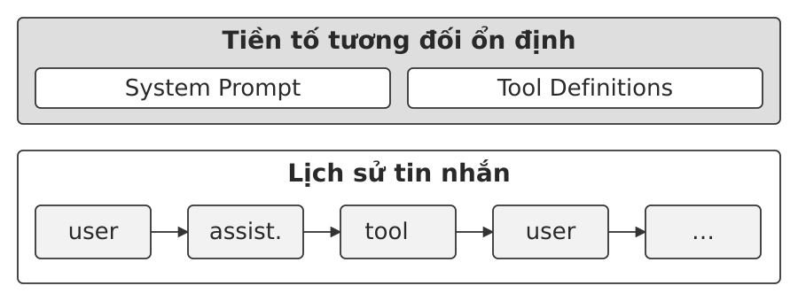

Vì vậy, đoạn mở đầu giống nhau giữa hai yêu cầu liên tiếp có thể kéo dài vào tận lịch sử tin nhắn. Lượt gọi sau tái sử dụng được bao nhiêu phần tính toán cũ phụ thuộc vào độ dài của đoạn tiền tố này.

Harness dưới đây đặt chỉ dẫn hệ thống và định nghĩa công cụ ít thay đổi ở phía trước, mỗi lượt chỉ nối trạng thái hiện tại vào cuối lịch sử. Khi lịch sử quá dài, nó nén các tin nhắn cũ trước rồi mới ghép yêu cầu.

```python
stable_prefix = system_message
stable_tools = core_tool_schemas
history = load_message_history(session)
status_message = make_status_message(derive_current_state(history))

if estimated_tokens(stable_prefix, stable_tools, history, status_message) > budget:
    history = compress_old_evidence(
        history,
        preserve = [decisions, constraints, failures, citations]
    )

request.messages = [stable_prefix] + history + [status_message]
request.tools = stable_tools
response = call_model(request)
```

Khi nén, cần giữ những thông tin mà công việc phía sau còn dùng, như quyết định, ràng buộc, thất bại và trích dẫn, đồng thời duy trì liên kết giữa yêu cầu gọi và kết quả công cụ. Ngoài ngân sách độ dài, thông tin trùng lặp hoặc lỗi thời cũng có thể kích hoạt việc nén; chiến lược cụ thể sẽ được trình bày ở nửa sau của chương.

> **Thí nghiệm 2-1 ★: Triển khai dịch vụ LLM cục bộ và gọi công cụ**
>
> Thí nghiệm này chạy Qwen3-0.6B trên máy cục bộ, bám theo nhiệm vụ “tra giờ và thời tiết ở Vancouver” để quan sát tin nhắn đi qua mô hình, bộ phân tích (parser) và bộ thực thi công cụ như thế nào. Hình 2-5 cho thấy cách phân công giữa dịch vụ cục bộ và client: phía máy chủ tải mô hình, xử lý đầu vào và sinh câu trả lời; client duy trì lịch sử tin nhắn, điều phối công cụ và gửi trả kết quả.
>
> 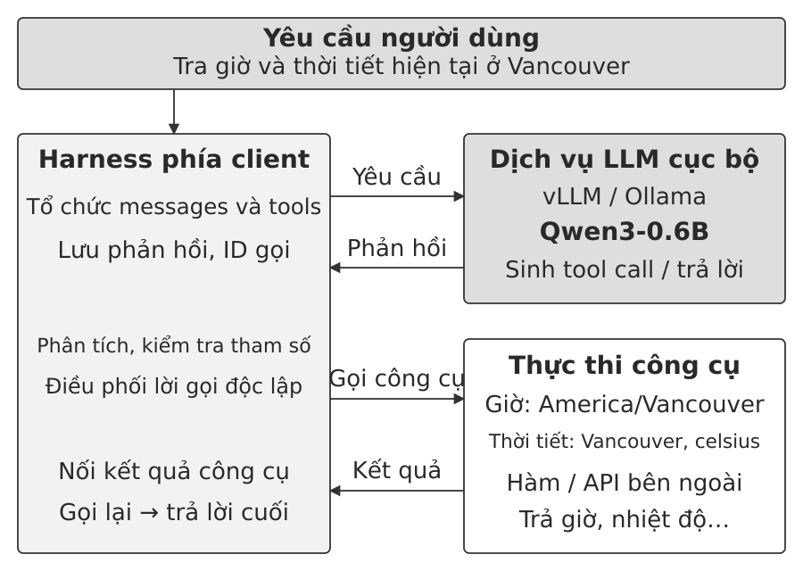
>
> **Trước hết, theo dõi trọn một nhiệm vụ.** Trong cùng một lượt đầu ra, mô hình yêu cầu tra giờ và nhiệt độ, lần lượt điền các tham số như `America/Vancouver`, `Vancouver` và `celsius`. Client thực thi song song hai công cụ. Hồi đáp thứ nhất cho giờ địa phương là 11:11:28, hồi đáp thứ hai cho nhiệt độ 17,9 °C. Hai kết quả được gửi về mô hình; nó báo giờ chính xác đến phút, trả lời nhiệt độ là 17,9 °C, rồi kết thúc vòng lặp. Lần chạy này cho thấy một mô hình sáu trăm triệu tham số đã có thể chọn đúng hai công cụ cho nhiệm vụ, điền đúng tham số và dùng giá trị trả về để trả lời người dùng.
>
> **Tiếp theo, đối chiếu đầu ra thô với các trường API.** Chế độ suy nghĩ của Qwen3 có thể sinh nội dung suy luận có đánh dấu `<think>`, còn yêu cầu công cụ dùng các thẻ gọi tương ứng. Sau khi máy chủ phân tích, client có thể nhận được trường `thinking` riêng hoặc trường gọi công cụ. Các phần trong đầu ra được sắp xếp và giữ lại thế nào là do template của mô hình và giao thức dịch vụ cùng quyết định.
>
> **Sau đó, quan sát xử lý streaming.** Giao diện có thể cập nhật các trạng thái như “đang suy nghĩ”, “đang gọi công cụ” và “đang soạn câu trả lời” theo từng sự kiện. Tham số công cụ thường đến thành nhiều đoạn và phải được gom lại thành yêu cầu hoàn chỉnh; khi giao thức xác nhận lời gọi đã kết thúc, và các kiểm tra về tham số, quyền và phụ thuộc đều đạt, hệ thống vận hành có thể bắt đầu điều phối. Các công cụ độc lập với nhau có thể chạy song song, hoặc tạo thành đường ống (pipeline) với phần xử lý đầu ra phía sau.
>
> **Cuối cùng, so sánh tốc độ và cache.** Trong bản ghi lần chạy trên máy Mac chip Apple, tốc độ giải mã trung bình của nhiệm vụ công cụ khoảng 107 token mỗi giây. Token là đơn vị cơ bản mà mô hình dùng để xử lý văn bản; cách cắt cụ thể do tokenizer quyết định, một từ hoặc một chữ Hán có thể ứng với một hoặc nhiều token. Tốc độ giải mã phản ánh tốc độ xuất ra sau khi bắt đầu sinh; người dùng phải đợi bao lâu còn phụ thuộc vào độ trễ token đầu tiên, độ dài suy luận và thời gian chạy công cụ.
>
> Phép đối chứng cache dùng cùng một tiền tố dài, lần lượt đo các yêu cầu giữ nguyên tiền tố và các yêu cầu sửa phần đầu tiền tố. Trong năm cặp lần này, có bốn cặp mà yêu cầu giữ nguyên tiền tố nhanh hơn; độ trễ token đầu tiên trung bình của hai nhóm lần lượt khoảng 1,30 giây và 1,51 giây. Phần tiếp theo sẽ giải thích các yêu cầu này khác nhau thế nào về mặt tính toán.
>
> Thí nghiệm này cũng khiến tác giả lạc quan hơn về Agent chạy trên thiết bị (on-device): mô hình nhỏ đã có thể hoàn thành nhiệm vụ gọi công cụ như thế này ngay trên thiết bị của người dùng. **Thời đại của Agent trên thiết bị đến gần hơn nhiều người nghĩ.**

## Thiết kế ngữ cảnh thân thiện với KV Cache

Các yêu cầu liền kề của Agent thường dùng chung rất nhiều thông tin: chỉ dẫn hệ thống, định nghĩa công cụ và những tương tác đã diễn ra. Nếu engine suy luận tái sử dụng được kết quả tính toán trung gian của các phần này, nó có thể dành nhiều tính toán hơn cho thông tin mới. **KV Cache** lưu các khóa (Key) và giá trị (Value) đã tính được ở từng lớp attention để các token sau dùng lại; **Prompt Cache** thì tiến thêm một bước, tái sử dụng cache của tiền tố đủ điều kiện giữa các yêu cầu[^ch2-kv-basics].

Xét một Agent chăm sóc khách hàng: để mô hình biết thời điểm hiện tại, nhà phát triển thêm `Current time: {{now}}` vào đầu system prompt và cập nhật nó ở mỗi yêu cầu. Quy tắc nghiệp vụ và định nghĩa công cụ phía sau giữ nguyên, nhưng đầu vào thực tế bắt đầu thay đổi ngay từ chỗ dấu thời gian. Với dịch vụ tái sử dụng KV theo tiền tố giống nhau, điều này buộc dấu thời gian và mọi phần phía sau phải tính lại, làm tăng thời gian xử lý đầu vào và chi phí.

Viết thời gian thành một tin nhắn nối thêm, hoặc gọi công cụ giờ khi cần, thì giữ được tiền tố sẵn có. Hai cách bố trí cung cấp thông tin gần như nhau, nhưng phạm vi phải tính lại thì khác hẳn.

Có thể ghi nhớ trước ba cách làm; phần nguyên lý và thí nghiệm phía sau sẽ lần lượt giải thích:

1. **Giữ tiền tố có thể tái sử dụng ổn định.** Chỉ dẫn hệ thống và định nghĩa công cụ thường dùng có nội dung và thứ tự xác định.
2. **Nối những thay đổi trong lúc chạy vào phía sau.** Thời gian, số dư, số lần gọi và tiến độ nhiệm vụ có thể được cung cấp qua tin nhắn mới hoặc kết quả công cụ. Trạng thái mới nhất cần ghi rõ thời điểm có hiệu lực, để mô hình nhận ra bản ghi nào áp dụng cho quyết định hiện tại.
3. **Tổ chức tin nhắn theo giao thức của mô hình.** Dùng đúng vai trò, mã gọi và định dạng kết quả công cụ, để chat template tương ứng sinh ra đầu vào cho mô hình. Thứ mà cache so khớp là tiền tố sau xử lý cùng các cấu hình liên quan; giao thức tin nhắn còn quyết định mô hình nhận ra chỉ dẫn, yêu cầu của người dùng và giá trị trả về từ công cụ như thế nào.

Với mô hình causal attention (attention nhân quả) dùng trong phần này, việc thêm token phía sau không làm thay đổi các trạng thái đã tính ở những vị trí trước đó. Khi sửa đầu vào sẵn có, trạng thái ở vị trí thay đổi đầu tiên và mọi vị trí sau nó phải tính lại; tiền tố đứng trước chỗ thay đổi vẫn có cơ hội được tái sử dụng. Phía máy chủ còn dựa vào kích thước khối cache, thời gian lưu giữ và cấu hình vận hành để quyết định phạm vi trúng cache thực tế.

[^ch2-kv-basics]: Hugging Face, How caching works, giới thiệu cơ chế lưu và tái sử dụng K, V theo từng lớp.

> **Thí nghiệm 2-2 ★: Trực quan hóa cơ chế attention**
>
> Trước hết, dùng câu “Bắc Kinh hôm nay thời tiết thế nào” để hiểu một lần tính attention. Để dễ trình bày, Hình 2-6 chia câu thành bốn đơn vị ngữ nghĩa; trong mô hình thật, tokenizer mới là thứ cắt đầu vào. Khi xử lý vị trí “thế nào”, lớp attention phải tổng hợp biểu diễn hiện tại từ thông tin đã có. Query, Key và Value lần lượt đảm nhận vai trò truy vấn, so khớp và tổng hợp thông tin.
>
> | Vectơ | Vai trò | Cách hiểu trực quan trong ví dụ này |
> | --- | --- | --- |
> | **Query (truy vấn)** | Vectơ mà vị trí hiện tại dùng để so khớp với các vị trí khác | “thế nào” cần tìm ra thông tin liên quan trong nội dung đã có |
> | **Key (khóa)** | Vectơ mà mỗi vị trí đưa ra để được so khớp | Các vị trí như “Bắc Kinh”, “thời tiết” cung cấp biểu diễn để so khớp |
> | **Value (giá trị)** | Vectơ thông tin được tổng hợp theo trọng số | Đưa thông tin về địa điểm, thời tiết vào biểu diễn hiện tại theo tỉ trọng tương ứng |
>
> Có thể hình dung Key như nhãn dùng để tra cứu, còn Value là nội dung lấy về. Trong mô hình, các vectơ này đều là những giá trị số tính từ biểu diễn ẩn, và cách chúng so khớp với nhau được định hình qua huấn luyện.
>
> Một lần tính gồm ba bước. Đầu tiên, vị trí hiện tại sinh ra Query; sau đó, Query nhân vô hướng với Key của từng vị trí, qua bước co giãn, mặt nạ nhân quả và softmax để được các trọng số attention có tổng bằng 1; cuối cùng, dùng các trọng số này lấy tổng có trọng số của các Value. Tích vô hướng là nhân từng cặp phần tử của hai dãy số rồi cộng lại; softmax chuyển điểm số của các vị trí nhìn thấy được thành trọng số đã chuẩn hóa. Value của từng vị trí tham gia tổng hợp theo trọng số tương ứng, cùng tạo nên đầu ra của attention head này.
>
> Đọc ngang hàng cuối của Hình 2-6: vị trí “thế nào” dành cho “thời tiết” trọng số 0,55. Con số này phải nhân với Value ở vị trí “thời tiết”, cộng thêm đóng góp của ba vị trí còn lại, mới ra đầu ra của attention head tại “thế nào”. Chuyển sang hàng “thời tiết”, tại sao bên phải lại có thêm một dấu chéo? Vì khi tính vị trí này, chuỗi chưa đi tới “thế nào”.
>
> 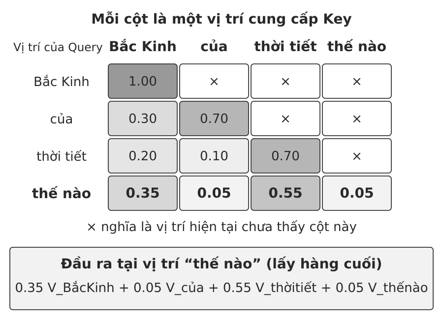
>
> Xếp trọng số của mọi vị trí thành ma trận, ta được **bản đồ nhiệt attention** (attention heatmap). Mỗi hàng ứng với một Query, mỗi cột ứng với một Key, độ đậm nhạt của màu thể hiện độ lớn trọng số. Mặt nạ nhân quả cho phép vị trí hiện tại đọc chính nó và các vị trí phía trước; trong hình, các vị trí bị che được đánh dấu ×, trọng số của chúng sau softmax bằng 0. Cấu trúc này áp dụng cho cả xử lý đầu vào lẫn giai đoạn sinh phía sau.
>
> Từ đây cũng thấy được công dụng của cache K, V: khi quá trình sinh tiếp diễn, vị trí mới vẫn phải đọc Key và Value của các vị trí sẵn có. Lưu các vectơ này lại thì vị trí mới có thể dùng thẳng chúng để so khớp và tổng hợp, khỏi phải tính lại cho các vị trí lịch sử.
>
> Hiểu được bộ trọng số minh họa này rồi, ta dùng Qwen3-0.6B để xem phân bố attention mà mô hình thực sự tính ra. Thí nghiệm lần lượt ghi lại một câu ngắn và một chuỗi sinh gồm phần suy luận và câu trả lời cuối, rồi so sánh ma trận attention ở các lớp khác nhau. Hình 2-7 hiển thị lớp 0, 13 và 27: cột trái là câu ngắn chín token, cột phải là chuỗi sinh cho phép tính 17 × 23, với phạm vi vị trí được đánh dấu theo đầu vào, suy luận và câu trả lời. Thang xám dùng thang logarit để thấy rõ cùng lúc cả trọng số attention mạnh lẫn yếu.
>
> 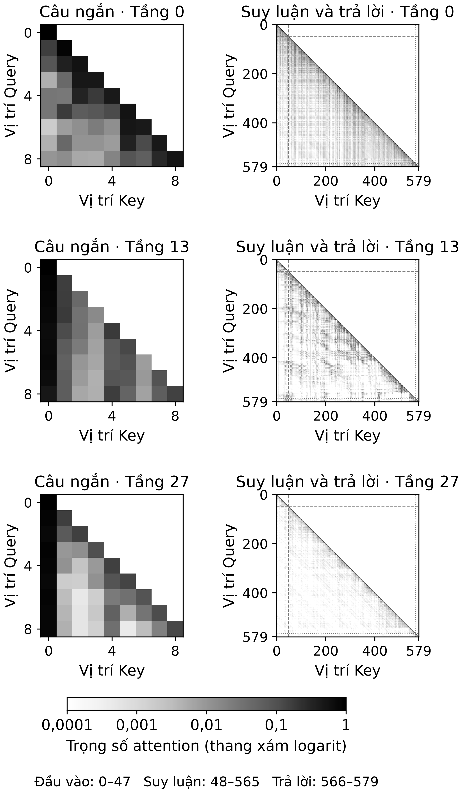
>
> Khi đọc hình, có thể phân tích theo bốn manh mối:
>
> 1. **Bể hút attention (Attention Sink).** Một số lớp dồn trọng số lớn vào đầu chuỗi, dù token ở đầu mang rất ít ngữ nghĩa. Xem câu ngắn ở cột trái của Hình 2-7. Mỗi ô hình đã lấy trung bình trên mọi attention head của cùng một lớp. Lấy tiếp trung bình chín số ở cột đầu tiên của ma trận, ta tính được chín vị trí bình quân dành bao nhiêu trọng số cho token đầu tiên. Ở lớp 0, 13 và 27, con số này lần lượt là 14,7%, 73,9% và 83,2%. Sang chuỗi sinh dài hơn ở cột phải, con số này ở lớp 13 chỉ còn 28,0%. Softmax buộc trọng số các vị trí cộng lại bằng 1, nên mô hình có thể học được một vị trí tiếp nhận tương đối ổn định; StreamingLLM đã nghiên cứu riêng hiện tượng này và vai trò của nó trong suy luận dạng luồng[^ch2-attention-sinks].
> 2. **Vùng suy luận.** Đánh dấu khoảng sinh ứng với `<think>`, rồi theo các hàng này xem mô hình chú ý tới phần nào của prompt, mô tả công cụ hay suy luận trước đó. Hình tam giác là do mặt nạ nhân quả tạo ra; độ đậm nhạt bên trong tam giác mới phản ánh khác biệt về trọng số giữa các vị trí.
> 3. **Vùng trả lời.** Tiếp tục đánh dấu khoảng sinh của câu trả lời cuối cùng, so sánh cách nó phân bổ trọng số cho đầu vào ban đầu và cho phần suy luận trước đó. Việc này giúp xác định những thông tin sẵn có nào đã đi vào phép tổng hợp attention hiện tại.
> 4. **Khác biệt theo vị trí.** Nghiên cứu *Lost in the Middle* quan sát thấy, trong hỏi đáp ngữ cảnh dài và truy xuất khóa–giá trị, thông tin ở vị trí giữa khó được tận dụng hiệu quả hơn[^lost-in-the-middle]. Về mặt kỹ thuật, có thể dựa vào đó để ưu tiên đặt các quy tắc thường trực ở đầu, còn mục tiêu và tiến độ hiện tại ở cuối.

[^ch2-attention-sinks]: Xiao et al., Efficient Streaming Language Models with Attention Sinks, ICLR 2024.

[^lost-in-the-middle]: Liu et al., Lost in the Middle: How Language Models Use Long Contexts, TACL 2024.

### Từ tin nhắn API đến token của mô hình: Chat Template

Ví dụ API ở trên là một dãy tin nhắn có vai trò, còn đầu vào trong bản đồ attention lại là một chuỗi token. **Chat Template (template hội thoại)** lo việc chuyển đổi này: thêm thẻ vai trò và thẻ ranh giới cho tin nhắn, sắp xếp mô tả công cụ và giá trị trả về theo quy ước, rồi giao cho tokenizer mã hóa. Đối chiếu hai cột của Hình 2-8: bên trái chỉ gửi chỉ dẫn hệ thống và câu hỏi của người dùng, vậy sao bên phải lại có thêm một `assistant`? Đó là thẻ mở đầu mà template thêm vào cho câu trả lời kế tiếp. Khi bàn tiếp về gọi công cụ, việc giữ lại thông tin suy luận và trúng cache, ta sẽ còn dùng đến các thẻ này.

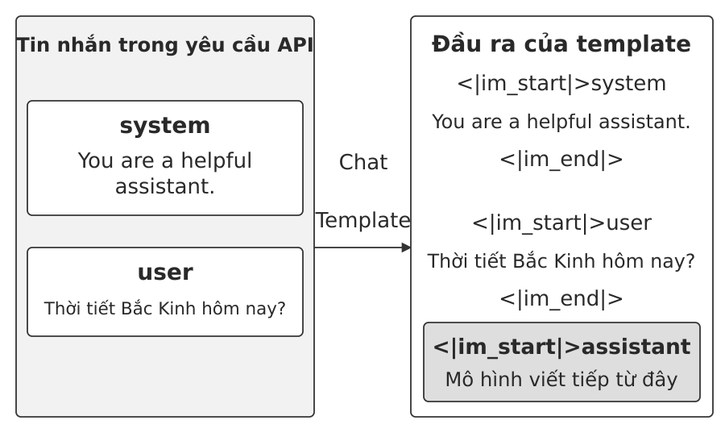

Các họ mô hình như Qwen, Llama, Gemma đều có chat template riêng. Cùng một dãy tin nhắn API, giao cho các mô hình khác nhau, có thể được chuyển thành những thẻ vai trò và thẻ ranh giới khác nhau. Với API do nhà cung cấp vận hành (hosted), máy chủ thường làm việc chuyển đổi này; khi tự triển khai, phải cấu hình cho dịch vụ suy luận một template khớp với mô hình.

Giả sử người dùng gửi `Vancouver 17.9 °C`, và công cụ thời tiết cũng tình cờ trả về đúng dòng chữ đó. Đưa riêng hai tin nhắn này qua template của Qwen3-0.6B, ta được hai đoạn đầu vào trong Hình 2-9. Cả hai đều mở đầu bằng `<|im_start|>user`, vậy thẻ nào cho biết dòng chữ đến từ công cụ?

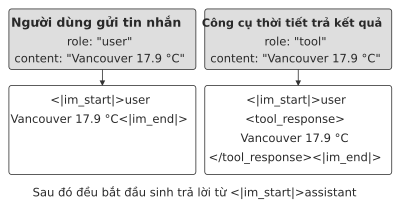

Cột phải có thêm một cặp thẻ `<tool_response>`. Template còn dựa vào vai trò tin nhắn để định vị câu hỏi gần nhất của người dùng: ở các lượt trước câu hỏi này, chỉ giữ phần trả lời; từ câu hỏi đó trở đi, tương tác công cụ còn có thể mang theo thông tin suy luận của mô hình[^ch2-qwen-template].

Chẳng hạn, mô hình đọc file xong vẫn còn phải phân tích tiếp. Gửi trả kết quả công cụ theo vai trò `tool` thì template nhận ra đó là phản hồi công cụ trong nhiệm vụ hiện tại; nếu viết thẳng kết quả ấy thành một tin nhắn `user` thông thường, template có thể coi nó là một truy vấn mới và thay đổi phạm vi giữ lại suy luận trước đó. Giống như làm tiếp một bài toán thì phải giữ lại giấy nháp: Harness nên lưu các trường suy luận mà dịch vụ yêu cầu, rồi gọi tiếp theo đúng cấu trúc tin nhắn.

**Từ suy luận một lượt tiến đến Agent làm nhiệm vụ dài hạn, phần suy nghĩ trong lịch sử dần trở thành trạng thái nhiệm vụ cần duy trì.** Chat template của DeepSeek-R1 thời kỳ đầu bỏ phần suy nghĩ trong các câu trả lời lịch sử, chỉ giữ câu trả lời cuối[^ch2-r1-template]; còn giao thức gọi công cụ về sau của DeepSeek lại yêu cầu gửi trả thông tin suy luận. Khi một lượt hỏi đáp kết thúc, câu trả lời cuối có thể đã chứa thông tin cần cho lượt sau; nhưng khi nhiệm vụ công cụ mới đi được nửa đường, “vì sao tra file này” hay “đã loại trừ những giả thuyết nào” có thể chỉ nằm trong phần suy luận trung gian. Giữ lại những thông tin này giúp lượt sau làm tiếp theo mạch suy nghĩ sẵn có.

**Cách gửi trả thông tin suy luận do giao thức của mô hình quyết định.** Khi tích hợp, phải xử lý đồng thời `content`, `tool_calls` và các trường suy luận mà dịch vụ cung cấp. Vài phương án dưới đây cho thấy những quy tắc nối tiếp khác nhau:

- **Chế độ suy nghĩ của DeepSeek** trả suy luận qua `reasoning_content`. Theo giao thức gọi công cụ của hãng, khi yêu cầu có `tools`, các yêu cầu sau phải gửi trả đầy đủ suy luận trong lịch sử, kể cả các câu trả lời của mô hình không gọi công cụ; thiếu trường sẽ gây lỗi 400. Với yêu cầu chat thuần không có `tools`, dịch vụ bỏ qua suy luận lịch sử được gửi trả[^ch2-deepseek-thinking].
- **Tương tác suy nghĩ và công cụ của Kimi** cũng cần quản lý suy luận, yêu cầu công cụ và kết quả trong vòng lặp vận hành. Lấy ví dụ suy nghĩ đan xen của Kimi K2.5, mô hình có thể tiếp tục suy luận giữa nhiều lần gọi công cụ, và client lưu, gửi trả tin nhắn của mô hình theo giao thức của hãng[^ch2-kimi-thinking].
- **Suy nghĩ được giữ lại của GLM** có thể bật bằng `thinking.clear_thinking: false`, sau đó gửi trả `reasoning_content` đầy đủ và đúng thứ tự gốc. Coding Plan và API tiêu chuẩn có thiết lập mặc định khác nhau, client nên chọn rõ chế độ mình cần[^ch2-glm-thinking].
- **Thinking block của Claude** phải được lưu cùng chữ ký. Các mô hình hỗ trợ preserved thinking còn kiểm tra nguồn gốc và tiền tố của block; quy tắc cụ thể xem ở mục “Cache như một ràng buộc kiến trúc” phía sau.

Những quy tắc này ảnh hưởng đến các lần gọi công cụ liên tiếp, và cả việc đổi mô hình giữa chừng. Khi đổi, lớp chuyển đổi phải chuyển yêu cầu công cụ, kết quả và trạng thái nhiệm vụ thành dạng mà giao diện đích chấp nhận, rồi xử lý thông tin suy luận theo quy tắc của mô hình đích. Thí nghiệm 5-1 ở Chương 5 sẽ đi sâu vào kiểu nối tiếp trajectory này.

**Template còn quyết định đầu vào mà cache so khớp.** Cùng nội dung tin nhắn, đi qua template, thứ tự công cụ hoặc cách tuần tự hóa khác nhau, có thể tạo ra những tiền tố token khác nhau. Muốn tái sử dụng KV sẵn có, phải giữ nhất quán cấu hình mô hình liên quan và tiền tố.

[^ch2-qwen-template]: File cấu hình tokenizer `tokenizer_config.json` của Qwen3-0.6B lưu chat template, trong đó có logic xử lý truy vấn người dùng, nội dung suy luận và phản hồi công cụ.

[^ch2-r1-template]: Chat template chính thức của DeepSeek-R1 giữ nội dung sau `</think>` trong các câu trả lời lịch sử thông thường; quy tắc gửi trả suy luận khi gọi công cụ về sau xem tài liệu Thinking Mode của DeepSeek.

[^ch2-deepseek-thinking]: DeepSeek, Thinking Mode.

[^ch2-kimi-thinking]: Moonshot AI, kho mã chính thức Kimi K2.5, mục Interleaved Thinking and Multi-Step Tool Call.

[^ch2-glm-thinking]: Z.ai, Thinking Mode, giới thiệu suy nghĩ đan xen, suy nghĩ được giữ lại và thiết lập mặc định của các endpoint.

### Nguyên lý và ràng buộc của KV Cache

Khi xử lý một yêu cầu, mô hình trước hết **prefill (điền trước)** đầu vào, tính biểu diễn của các token đã có, rồi chuyển sang **decode (giải mã)**, sinh lần lượt từng token tiếp theo. KV Cache lưu K, V của các vị trí đã có trong quá trình giải mã; cache tiền tố liên yêu cầu thì tái sử dụng thêm phần tiền tố giống nhau mà yêu cầu trước để lại.

Ví dụ, đến lượt thứ sáu, Agent đã tích lũy 2.000 token đầu vào. Nếu dịch vụ chỉ dùng KV Cache trong phạm vi yêu cầu hiện tại, nó phải xử lý trước 2.000 token này rồi mới dùng cache để sinh tiếp. Nếu cache liên yêu cầu đã có sẵn một đoạn tiền tố giống nhau, prefill có thể tiếp tục từ vị trí chưa được cache. Hình 2-10 minh họa kiểu tái sử dụng liên yêu cầu này.

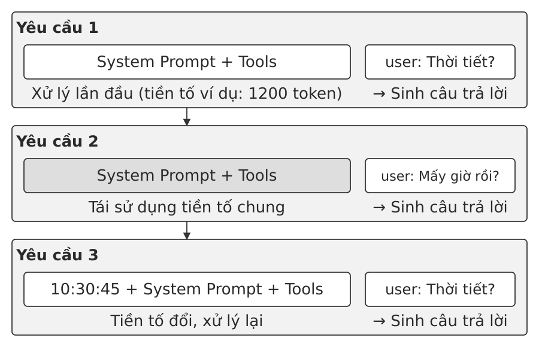

**Theo dõi sự tăng trưởng của cache bằng bốn token.** Giả sử đầu vào là `[A, B, C, D]`. Khi xử lý vị trí D, mô hình dùng Query của D so khớp với Key của A, B, C, D, rồi tổng hợp có trọng số các Value của chúng. Qua tính toán ở các lớp, biểu diễn cuối cùng tại vị trí D được dùng để dự đoán token kế tiếp E. Lúc này, K, V của A đến D ở mọi lớp đều đã được lưu.

Sau khi lấy mẫu được E, bước tiếp theo đưa E vào mô hình, tính Query, Key và Value của nó ở từng lớp. Query của E đọc cache trước đó cùng K, V của vị trí hiện tại, rồi mô hình dự đoán token thứ sáu; đồng thời K, V của E được nối thêm vào cache. Như vậy, mỗi bước sinh có thể dùng lại trạng thái trước đó, chỉ cần tính trạng thái của token mới đưa vào.

Nếu hoàn toàn không dùng KV Cache, khi dự đoán E phải xử lý lại từ A đến D, khi dự đoán token thứ sáu lại phải xử lý từ A đến E. Chỉ tính theo số vị trí phải sinh lại K, V, khối lượng công việc cộng dồn sẽ tăng theo kiểu $1+2+\cdots+N$. Có cache thì phần tính toán theo từng lớp của các vị trí lịch sử được tái sử dụng; vị trí mới vẫn phải đọc các K, V nhìn thấy được. Trong giải mã full attention tiêu chuẩn, phần đọc và so khớp này tăng tuyến tính theo độ dài ngữ cảnh, nên ngữ cảnh dài vẫn chiếm nhiều bộ nhớ GPU và băng thông bộ nhớ hơn.

**Vì sao sửa đầu vào lại ảnh hưởng đến cache phía sau?** Các lớp của Transformer xử lý biểu diễn ẩn theo thứ tự, mỗi lớp có K, V riêng. Sau khi qua phép tính attention, biểu diễn của một vị trí đã hòa vào thông tin của các vị trí trước nó, rồi mới được chuyển lên lớp kế tiếp. Vì thế, khi token thứ $k$ thay đổi, ảnh hưởng sẽ lan từ vị trí đó về phía sau và lên các lớp cao hơn.

Với cùng mô hình và cấu hình tính toán, các vị trí trước $k$ chỉ phụ thuộc vào đầu vào sớm hơn nên vẫn tái sử dụng được; từ $k$ trở đi, các trạng thái bị ảnh hưởng phải dựng lại. Dịch vụ thực tế thường so khớp tiền tố theo khối cache, nên ranh giới tính lại còn phụ thuộc vào kích thước khối. Chỗ cập nhật càng nằm gần đầu, lượng đầu vào phải tính lại thường càng nhiều. Đặt chỉ dẫn ổn định ở đầu, nối trạng thái mới vào cuối, chính là tận dụng quan hệ phụ thuộc này.

> **Thí nghiệm 2-3 ★★: Đối chiếu các cách quản lý ngữ cảnh**
>
> Thí nghiệm này để Agent dùng các công cụ phát hiện, đọc và tìm kiếm file để hoàn thành cùng một nhiệm vụ, rồi so sánh một mốc cơ sở nối thêm ổn định với năm kiểu thay đổi ngữ cảnh. Mốc cơ sở giữ ổn định chỉ dẫn và thứ tự công cụ, mỗi lượt nối thêm tin nhắn của mô hình và kết quả công cụ. Mỗi nhóm còn lại lần lượt thay đổi chỉ dẫn, trạng thái, thứ tự công cụ hoặc cách biểu đạt lịch sử, để quan sát số liệu thống kê cache và quá trình làm nhiệm vụ thay đổi ra sao.
>
> **System prompt động** cập nhật thời gian hiện tại trong chỉ dẫn hệ thống ở mỗi lượt. Phần trước chỗ thay đổi vẫn có thể có tiền tố chung, còn đầu vào phía sau kể từ thông tin thời gian phải so khớp hoặc tính lại. Có thể nối thời gian thành tin nhắn mới, hoặc lấy khi cần qua công cụ giờ, để các quy tắc nghiệp vụ thường trực tiếp tục được tái sử dụng.
>
> **Cấu hình người dùng động** cập nhật số lần gọi còn lại hoặc số dư tài khoản trong các tin nhắn phía đầu. Bản thân trạng thái là thông tin nhiệm vụ cần đến; điểm mấu chốt của thiết kế là vị trí cập nhật: nối trạng thái mới nhất vào cuối và ghi rõ thời điểm có hiệu lực, thì giữ được cả tiến độ lẫn tiền tố. Thanh trạng thái Agent ở phần sau sẽ dùng cách tổ chức này.
>
> **Sắp xếp lại định nghĩa công cụ** đổi thứ tự danh sách công cụ ở mỗi lượt. Tên và tham số tuy giống nhau, nhưng thứ tự token sau tuần tự hóa đã khác. Mở báo cáo chạy của Kimi K2.6, cột `Hit%` của nhóm cơ sở và nhóm sắp xếp lại đều là 100%. Hai nhóm thật sự tái sử dụng lượng đầu vào như nhau sao? Nhóm cơ sở qua ba lượt có tổng cộng 7.567 token đầu vào, trong đó 768 token trúng cache; nhóm sắp xếp lại cũng ba lượt, 7.568 token đầu vào nhưng chỉ có 256 token trúng. Lấy số token trong cache chia cho số token đầu vào, ta được 10,1% và 3,4% ở cột `Cache%`. Cột `Hit%` còn lại đếm theo các yêu cầu được xét là có trúng: nhóm cơ sở ghi hai lần trúng, nhóm sắp xếp lại chỉ ghi một lần, và cả hai nhóm đều ghi số lần trượt là không. Còn các yêu cầu khác có trúng cache hay không thì chỉ dựa vào bản ghi này chưa thể xác định. Cố định thứ tự công cụ giúp tránh để tiền tố thay đổi vô cớ.
>
> **Cửa sổ trượt** chỉ giữ một đoạn lịch sử gần nhất. Giả sử giữ mười lượt tương tác, thì đến lượt thứ mười lăm có thể không còn đọc được nội dung file then chốt lấy ở lượt thứ hai. Ngoài việc rút ngắn tiền tố chung, việc cắt bỏ còn làm thay đổi các dữ kiện và tiến độ nhiệm vụ mà mô hình nắm được. Phần cài đặt đi kèm lấy sáu tin nhắn lịch sử gần nhất làm điểm xuất phát, rồi bổ sung ngược về trước các yêu cầu gọi tương ứng với kết quả công cụ. Nhóm cửa sổ trượt tái sử dụng 1.510 trong 2.224 token đầu vào, tỷ lệ cache đạt 67,9%, cao nhất trong sáu nhóm. Nhưng xem tiếp bản ghi công cụ của nhóm cửa sổ trượt trong Thí nghiệm 2-3: mô hình ba lần tìm file, rồi đọc hai file, mà không giao bản tóm tắt ba câu người dùng yêu cầu.
>
> **Định dạng văn bản** viết lại lịch sử có vai trò thành văn bản kiểu `USER: ...`, `ASSISTANT: ...`. Cách này làm thay đổi ranh giới tin nhắn và cấu trúc công cụ trong template, mô hình phải tự khôi phục các quan hệ ban đầu từ nội dung chữ. Lần này nhóm văn bản vẫn sinh được câu trả lời cuối và vẫn có trúng cache. Các vai trò tin nhắn, mã gọi và trường kết quả công cụ mà giao diện cung cấp giúp truyền đạt các quan hệ này một cách ổn định.
>
> Kể cả khi chương trình dựng lại danh sách tin nhắn, chỉ cần tiền tố gửi đi và cấu hình cache giống nhau, đoạn tiền tố này vẫn có cơ hội được tái sử dụng.
>
> Nếu còn muốn biết người dùng bớt phải chờ bao lâu, trước hết phải xem đồng hồ dừng ở đâu. `ttft` ở lượt đầu của nhóm cửa sổ trượt khoảng 2,23 giây. Chương trình tuy gọi trường này là TTFT (độ trễ token đầu tiên), nhưng lại dừng đồng hồ khi yêu cầu không streaming trả về toàn bộ câu trả lời.

### KV Cache và Prompt Cache: cache ở hai tầng

Có thể phân biệt hai tầng cache này bằng hai thời điểm. Khi mô hình sinh token thứ hai trong câu trả lời, nó có thể đọc trạng thái khóa–giá trị của các vị trí đã có trong yêu cầu đó; đây là **KV Cache**. Lát sau người dùng hỏi tiếp, Harness gửi một yêu cầu mới; dịch vụ phải tìm được tiền tố giống nhau đã lưu từ trước thì mới có thể bớt tính phần đầu vào này; đây thuộc về **Prompt Cache**. Tầng thứ nhất giải thích một lần sinh tiếp diễn như thế nào, tầng thứ hai còn đòi hỏi cơ chế lưu và so khớp giữa các yêu cầu.

Trong dịch vụ API, cache còn chịu ảnh hưởng của độ dài tiền tố tối thiểu, kích thước khối, thời hạn hiệu lực, cấu hình mô hình và phạm vi cách ly giữa các tenant. Tiền tố có thể tái sử dụng phải được tìm trong cùng một phạm vi cache. Ví dụ, Claude API cách ly cache theo tổ chức và workspace; cùng một đoạn chữ xuất hiện ở các miền cách ly khác nhau sẽ được tạo cache riêng[^ch2-prompt-cache].

Về tính phí, phải xét riêng việc ghi và đọc. Với một số mô hình Claude, giá đọc cache bằng một phần mười giá đầu vào thông thường, còn lần ghi đầu tiên có phụ phí. Cùng một tiền tố được dùng lặp lại trong thời hạn hiệu lực chỉ tốn một lần phí ghi, các yêu cầu trúng cache về sau đều tính theo giá đọc.

[^ch2-prompt-cache]: Anthropic, Prompt caching, giới thiệu cách so khớp cache, cách ly, thời hạn hiệu lực và tính phí.

### Cache như một ràng buộc kiến trúc

**Trong hệ thống chạy thực tế (production), cache đã trở thành một ràng buộc kiến trúc.** Prompt được sắp xếp ra sao, Agent con bắt đầu từ đâu, phiên được khôi phục thế nào, đều ảnh hưởng tới lượng tính toán có thể tái sử dụng. **Ngay từ đầu thiết kế đã phải bố trí ranh giới cache.** Xác định trước nội dung nào dùng chung được, trạng thái nào sẽ thay đổi, rồi mới tổ chức prompt và cấu trúc phiên, sẽ giảm được việc tính lại liên tục khi chạy. Đợi đến khi độ trễ và chi phí của nhiệm vụ dài hạn đã thành vấn đề mới điều chỉnh các cấu trúc này, thì thường phải động đến quản lý trạng thái, Agent con và khôi phục phiên.

**Sắp xếp tiền tố theo mức độ ổn định.** Chỉ dẫn và định nghĩa công cụ dùng chung cho nhiều nhiệm vụ có thể đặt ở đầu, sau đó mới đến hồ sơ người dùng, trạng thái phiên và observation mới, được nhóm theo phạm vi áp dụng. Ví dụ, hệ điều hành có hai lựa chọn macOS/Linux, chế độ chạy có thường/gỡ lỗi, ngôn ngữ có tiếng Trung/tiếng Anh; ba điều kiện độc lập tạo ra tối đa $2\times2\times2=8$ tổ hợp tiền tố. Đẩy những trường hay thay đổi ra sau phần dùng chung giúp tăng cơ hội tái sử dụng tiền tố chung. Phạm vi chia sẻ của phần chung còn phải tuân theo ranh giới tổ chức, workspace và quyền riêng tư của dịch vụ.

**Chọn điểm xuất phát có thể tái sử dụng cho Agent con.** Nếu Agent con kế thừa bối cảnh nhiệm vụ của Agent cha, nó có thể tái sử dụng phần tiền tố trùng khớp của hai bên rồi nối thêm nhiệm vụ con của mình. Prompt, thứ tự công cụ, mô hình và các cấu hình liên quan cùng quyết định phạm vi tái sử dụng. Agent con cần vai trò độc lập hoặc ngữ cảnh cách ly thì dựng đầu vào theo nhiệm vụ của nó, rồi kiểm tra xem phần chung nào thích hợp để chia sẻ.

**Lưu lại nội dung đã gửi đi.** Khi đầu ra lớn của công cụ được nén thành bản tóm tắt hoặc bản xem trước, phải lưu phiên bản thực sự đã đưa vào mô hình. Khi khôi phục phiên, phát lại bản ghi này sẽ dựng lại được chuỗi tin nhắn nhất quán; còn nếu mỗi lần khôi phục lại sinh tóm tắt mới, có thể kéo theo cách diễn đạt mới và tiền tố thay đổi. Khi cập nhật bản tóm tắt, có thể phát hành một phiên bản mới và nêu rõ từ đâu sẽ dựng lại cache.

**Giữ lại suy luận còn phải thỏa mãn ràng buộc của giao thức.** Preserved thinking của Claude là một ví dụ cụ thể cho vấn đề này. Tài liệu của hãng dùng cơ chế này để chống chưng cất (distillation): dịch vụ kiểm tra chữ ký của thinking block, mô hình đã sinh ra nó và tiền tố của nó. Với các mô hình hỗ trợ ràng buộc tiền tố như Claude Fable 5.1, Claude Opus 5.5, các trường `system`, `tools` cấp cao nhất và các tin nhắn đứng trước block cùng tạo thành phạm vi kiểm tra; sửa nội dung trong đó sẽ làm block này và các thinking block phía sau mất hiệu lực[^ch2-preserved-thinking].

Ví dụ, viết lại giờ hệ thống ở mỗi lượt, render lại thông tin môi trường trong tin nhắn đầu tiên, hay cắt ngắn tại chỗ kết quả công cụ cũ, đều làm thay đổi tiền tố mà các block suy luận phía sau bị ràng buộc vào. Khi bị kiểm tra phát hiện, API có thể trả lỗi 400, hoặc theo cấu hình `prefix_mismatch_behavior` mà bỏ các block mất hiệu lực rồi tiếp tục xử lý yêu cầu. Trong trường hợp sau, mô hình vẫn dùng được thông tin nhiệm vụ và kết quả công cụ còn giữ, nhưng suy luận mất hiệu lực không còn tham gia vào đầu vào lần này. Các tài khoản tạo từ ngày 31 tháng 8 năm 2026 mặc định bật kiểm tra tiền tố; cách bật cho tài khoản cũ hơn xem phần mô tả giao thức.

Khi tích hợp kiểu giao thức này, có thể giữ ổn định chỉ dẫn cấp cao nhất và tập công cụ của phiên, nối các thay đổi trạng thái vào phía sau. Khi cần cập nhật chỉ dẫn hoặc công cụ giữa chừng, dùng các giao diện mà dịch vụ cung cấp như tin nhắn hệ thống trong phiên hay block thay đổi công cụ. Cắt bớt thinking block cũng phải giữ một khoảng liên tục theo thứ tự gốc: có thể xóa từ đầu hoặc từ cuối, hoặc xóa hết; để hở một khoảng ở giữa sẽ ảnh hưởng các block phía sau, và block đã chủ động xóa thì phải giữ ở trạng thái đã xóa.

Khi đổi mô hình giữa chừng, dịch vụ còn kiểm tra xem mô hình đích có đọc được block suy luận của mô hình gốc hay không. Client nên lưu lịch sử gốc để dịch vụ xử lý theo quy tắc tương thích; nếu client tự xóa, về sau đổi lại mô hình gốc cũng không khôi phục được các bản ghi này.

[^ch2-preserved-thinking]: Anthropic, Preserved thinking, giới thiệu mô hình, ràng buộc tiền tố, xử lý khi mất hiệu lực và quy tắc cắt bớt block suy luận; giao diện cập nhật trong phiên xem Mid-conversation system messages and tool changes.

### Mở rộng nghiên cứu: KV Cache có thể chỉnh sửa và ghép nối

> Các thiết kế ở trên đều tái sử dụng tính toán bằng cách so khớp tiền tố. Tác giả còn muốn khám phá xa hơn: liệu có thể trực tiếp chỉnh sửa, ghép nối thông tin đã lưu trong KV, để cache thích ứng với thay đổi của ngữ cảnh? Trong bài *Models Take Notes at Prefill*, tác giả ví loại thông tin này như “ghi chép” của mô hình[^ch2-2]: sau khi prefill đi qua nhiều lớp attention, ảnh hưởng của một trường đã thấm vào biểu diễn của các vị trí phía sau. Ví dụ, “thành phố của người dùng: Bắc Kinh” có thể ảnh hưởng đến phán đoán về địa điểm ở phía sau; chỉ thay K, V của riêng trường này thì các trạng thái phía sau vẫn có thể giữ những kết luận suy ra từ thành phố cũ.
>
> Bài báo dùng phương pháp can thiệp để tách vai trò của KV thuộc chính trường đó với vai trò của các trạng thái phía sau. Trong các quyết định được kiểm tra, đóng góp trực tiếp của KV thuộc chính trường dưới 1%, ảnh hưởng chủ yếu nằm trong các biểu diễn ở hạ nguồn. Xoay quanh những “ghi chép” để lại ở hạ nguồn này, có thể khám phá hai cách tận dụng cache.
>
> **Chỉnh sửa (Editing)** dùng thông tin đính chính tường minh để thúc đẩy phần tính toán phía sau cập nhật phán đoán sẵn có. Bài báo còn phát hiện rằng, trong nhiệm vụ trên mô hình 8B được kiểm tra, khi có chuỗi suy nghĩ (chain-of-thought) tường minh, chỉ chỉnh sửa riêng trường cũng khôi phục được quyết định mục tiêu, với chi phí tính toán khoảng 1% so với tính lại toàn bộ; khi thiếu quá trình suy luận này, trạng thái hạ nguồn cũ có thể tiếp tục chi phối quyết định, khiến việc sửa trường khó có hiệu lực.
>
> **Ghép nối (Composition)** nối cache kỹ năng tính sẵn vào một ngữ cảnh mới. Với mô hình dùng mã hóa vị trí xoay (RoPE), phải điều chỉnh biểu diễn vị trí trong cache trước rồi mới ghép. Có thể hình dung việc này như đánh số lại một trang ghi chép sẵn có để nối vào sau một tài liệu khác. Bài báo so sánh mười hai mô hình; độ tương đồng cosine của logits đầu ra giữa ghép nối và tính lại toàn bộ đạt 0,90–0,999; bản thân việc định vị lại cache và ghép nối có thể xử lý tuyến tính theo độ dài, giảm việc tính lại attention cho cả đoạn ngữ cảnh.
>
> Việc nối thêm thông tin đính chính còn có thể kết hợp với cache tiền tố hiện có. Trong benchmark trực tuyến trên vLLM của bài báo, cách kết hợp này giữ được tỷ lệ trúng cache tiền tố khoảng 98,5%, độ trễ token đầu tiên p90 bằng khoảng 1/398 đến 1/53 so với mốc cơ sở.
>
> **Tác giả lạc quan về hướng nghiên cứu này, vì nó hứa hẹn giúp việc cập nhật ngữ cảnh giữ lại được nhiều tính toán sẵn có hơn.** Agent thường xuyên cập nhật trường bộ nhớ, thêm trạng thái hoặc thay định nghĩa công cụ; nếu các trạng thái liên quan có thể được sửa và ghép như ghi chép, chi phí duy trì ngữ cảnh dài sẽ có cơ hội giảm mạnh.

[^ch2-2]: Li, Bojie, Models Take Notes at Prefill: KV Cache Can Be Editable and Composable, 2026. Các thí nghiệm chỉnh sửa, ghép nối và cache trực tuyến dùng những nhiệm vụ và chỉ số khác nhau; thiết lập cụ thể xem trong bài báo.

### Từ cơ chế cache đến thiết kế nội dung ngữ cảnh

Hiểu được cách cache tái sử dụng tính toán rồi, tiếp theo phải quyết định mỗi lượt đưa gì vào đầu vào, và cập nhật những nội dung đó ra sao. Phần còn lại chia làm ba mảng:

- **Prompt Engineering và Agent Skills**: trước hết thiết kế chỉ dẫn hệ thống và định nghĩa công cụ, nêu rõ mục tiêu, quy tắc và cách thao tác; sau đó dùng cơ chế tiết lộ dần để nạp tri thức chuyên môn khi cần. Phòng chống prompt injection thì tập trung vào nguồn gốc và ranh giới chỉ dẫn khi nội dung bên ngoài đi vào ngữ cảnh.
- **Thanh trạng thái Agent**: cung cấp cho mô hình các trạng thái như tiến độ nhiệm vụ, tóm tắt observation từ môi trường và số lần gọi, giảm chi phí phải suy lại từ lịch sử dài. Nó giống như giờ, mức pin và trạng thái mạng trên điện thoại, giúp tình hình vận hành hiện tại luôn hiện rõ.
- **Nén ngữ cảnh**: giữ lại thông tin mà các quyết định sau còn cần khi lịch sử dài ra, quyết định khi nào nén, tổ chức bản tóm tắt thế nào, và xử lý chuyện tính lại cache cùng việc nối tiếp nhiệm vụ ra sao.

## Prompt Engineering: tối ưu system prompt

Prompt Engineering (kỹ thuật prompt) dùng chỉ dẫn, quy trình và ví dụ để dẫn dắt mô hình hoàn thành nhiệm vụ cụ thể. Phần này tập trung vào **system prompt (lời nhắc hệ thống)**: nó giống một cuốn sổ tay nhân viên, nêu rõ danh tính, mục tiêu, quy tắc hành vi và quy trình làm việc của Agent. Trong ví dụ API của chương này, các nội dung đó được cung cấp qua tin nhắn `system`.

### Giọng điệu và phong cách: nói với người dùng thế nào

Yêu cầu về giọng điệu nên được cụ thể hóa thành cách diễn đạt. Ví dụ, với hỏi đáp ngắn có thể yêu cầu “You MUST answer concisely with fewer than 4 lines”, tức là trả lời trong chưa đến bốn dòng. Khi nhiệm vụ bị tắc, có thể yêu cầu “keep your response to 1–2 sentences”, dùng một hai câu nói rõ tình trạng hiện tại và bước tiếp theo, để người dùng thấy ngay việc mình cần xử lý.

Kiểu nhấn mạnh bằng chữ in hoa như “NEVER do X” có thể dùng để làm nổi bật yêu cầu then chốt. Quan trọng hơn là nói rõ yêu cầu áp dụng trong tình huống nào, và khi đó phải hành động ra sao.

### Prompt có cấu trúc: tổ chức phân cấp và ranh giới nội dung

Tiêu đề, danh sách và thẻ giúp tổ chức những prompt dài. Tiêu đề Markdown hợp để thể hiện chương mục và các bước, còn thẻ kiểu XML hợp để chia các khối nội dung có công dụng khác nhau, ví dụ dùng `<working_directory>` bọc thông tin thư mục làm việc. Tên thẻ nên nói thẳng công dụng của nội dung, để mô hình dễ nhận ra quan hệ giữa các khối.

Cùng một prompt có thể kết hợp cả hai cách viết:

```text
# Quy chuẩn sử dụng công cụ

## Thao tác file
<file_operation>
- Kiểm tra đường dẫn có tồn tại trước khi đọc file
- Sao lưu trước khi sửa file đã có
</file_operation>

## Yêu cầu mạng
<network_request>
- Đặt thời gian chờ là 30 giây
- Lỗi tạm thời được thử lại tối đa 3 lần
- Với yêu cầu có tác dụng phụ bên ngoài, xác nhận trạng thái thực thi trước khi thử lại
</network_request>
```

Markdown tạo ra cấu trúc phân cấp dễ đọc, còn `<file_operation>` và `<network_request>` phân định phạm vi áp dụng của quy tắc. Ví dụ, “thử lại tối đa 3 lần” chỉ áp dụng cho yêu cầu mạng; khi sửa file thì tuân theo nhóm quy tắc sao lưu phía trên.

### Tổ chức quy tắc theo quy trình

**Khi nhiệm vụ có các giai đoạn rõ ràng, ưu tiên tổ chức prompt theo quy trình.** Lấy hoàn tiền làm ví dụ: phải tìm được đơn hàng trước, rồi mới theo chính sách hoàn tiền mà xét khoản này có được hoàn hay không. Không tra được đơn hàng thì đề nghị người dùng bổ sung thông tin như mã đơn; đơn hàng đủ điều kiện thì mới tiến hành hoàn tiền. Nếu rải cùng những quy tắc ấy vào một danh sách hàng trăm mục, thì bước nào cũng phải lục lại các mục áp dụng. Viết điều kiện đầu vào, thứ tự xử lý và lối ra khi có ngoại lệ vào đúng giai đoạn tương ứng, mô hình sẽ có căn cứ để biết mình đang ở đâu và bước tiếp theo phải làm gì.

Dưới đây lấy xử lý file làm ví dụ, xâu chuỗi kiểm tra, phân loại, tiền xử lý, thực thi và xác minh thành một quy trình thao tác chuẩn (SOP):

```text
Quy trình xử lý file

Bước 1: Kiểm tra
  Xác nhận file tồn tại và truy cập được
  File không tồn tại → ghi lỗi, dừng xử lý
  ↓
Bước 2: Phân loại
  Xác định loại dựa vào phần mở rộng và nội dung file
  ↓
Bước 3: Tiền xử lý
  File cấu hình → sao lưu trước
  File lớn (>1 MB) → xử lý dạng luồng
  ↓
Bước 4: Thực thi
  Xử lý tương ứng theo loại file
  ↓
Bước 5: Xác minh
  Kiểm tra tính toàn vẹn của file sau khi xử lý
```

Mỗi bước đưa ra một mục tiêu cục bộ, các quy tắc liên quan nằm ngay dưới bước đó. Khi file không tồn tại, thoát ở giai đoạn kiểm tra; khi cần sửa file cấu hình, sao lưu ở giai đoạn tiền xử lý. Còn tiến độ thực thi thì do lịch sử tin nhắn hoặc bản ghi trạng thái cung cấp cho mô hình.

### Chi tiết hóa quy tắc nghiệp vụ: viết rõ các quy ước sản phẩm

Cùng một hồ sơ đơn hàng, rốt cuộc xếp vào loại yêu cầu nào, áp dụng dịch vụ nào, thu bao nhiêu phí, trước hết là những quy ước nghiệp vụ mà bộ phận sản phẩm và vận hành phải làm rõ. Phần hiện thực kỹ thuật sau đó mới chia việc: prompt cho mô hình biết cần lấy những trường nào, truy vấn dịch vụ nào; còn công cụ và hệ thống nghiệp vụ thực thi phần tính phí và ràng buộc mang tính tất định.

Lấy ví dụ một Agent gọi điện thay người dùng để giảm phí thuê bao hoặc đòi hoàn tiền: nhóm muốn hạ ngưỡng thử bằng chính sách “không làm được thì hoàn tiền”, đồng thời đặt cách thu phí rõ ràng cho các nhiệm vụ đặc biệt. Có thể thiết kế ba loại tính phí:

- **Hoa hồng theo số tiền tiết kiệm**: thương lượng giảm hóa đơn hiện có, thu một tỷ lệ nhất định trên số tiền thực sự tiết kiệm được, ví dụ 20%.
- **Phí cố định theo dịch vụ**: các nhiệm vụ mang tính dịch vụ như đặt bàn nhà hàng, thu phí theo loại hoặc độ phức tạp của nhiệm vụ.
- **Thu trước cho nhiệm vụ khó**: với nhiệm vụ khó thỏa mãn một số điều kiện nhất định, nói trước khoản phí thu trước và điều khoản không hoàn tiền, người dùng xác nhận rồi mới nhận việc.

Nếu viết “chọn loại tính phí phù hợp theo tình hình nhiệm vụ”, vẫn còn để lại chỗ mơ hồ khi phân loại. “Giúp tôi trả lại bộ quần áo mua tháng trước” là đòi lại khoản đã thanh toán, còn “giúp tôi hủy thuê bao Netflix” là ngừng các khoản phí tương lai. Cả hai kết quả đều có thể được hiểu rộng là tiết kiệm tiền, nhưng nhóm có thể giới hạn hoa hồng chỉ cho việc thương lượng giảm hóa đơn hiện có, còn hoàn tiền và hủy dịch vụ thống nhất dùng phí cố định.

Prompt tương ứng có thể ghi thẳng ranh giới giữa các loại: “NEVER use percentage_based_one_time for refunds and service cancellations. Use fixed_fee instead.” Nghĩa là hoàn tiền và hủy dịch vụ dùng `fixed_fee`, chỉ thương lượng giảm hóa đơn hiện có mới áp dụng hình thức hoa hồng.

Nhóm còn phải ước lượng việc này có bao nhiêu phần chắc làm được. Nhà cung cấp chấp nhận những yêu cầu nào, người dùng này có đủ điều kiện không, hóa đơn đã thu những khoản gì, các ủy thác tương tự trước đây kết quả ra sao, đều ảnh hưởng tới cách nhận việc. Nếu quy tắc dùng ngưỡng “trên 60% thì vào chế độ có thể hoàn tiền, dưới 30% thì không nhận”, thì còn phải viết rõ cách xử lý khoảng ở giữa và các giá trị biên.

Phép tính số tiền phải nêu rõ đơn vị, cơ số và thứ tự làm tròn. Ví dụ, phí gọi điện cộng dồn theo 0,05 đô la Mỹ mỗi phút, tổng xong mới làm tròn đến đô la nguyên; số tiền tiết kiệm lấy hóa đơn hiện có làm mốc. Nếu hóa đơn hiện tại là 150 đô la, nhà cung cấp có thể tăng lên 180 đô la vào năm sau, thì phần tăng giá tiềm năng tránh được nhờ giữ giá hiện tại phải được xử lý theo cách tính đã thỏa thuận trước, không được tự động tính vào số tiền tiết kiệm do giảm hóa đơn hiện có.

Lời khuyên của tác giả là **để người phụ trách sản phẩm dẫn dắt việc thiết kế quy tắc nghiệp vụ**, kết hợp dữ liệu thực tế, phản hồi người dùng và kinh nghiệm vận hành để duy trì các định nghĩa này; kỹ sư sau đó hiện thực chúng vào prompt, tham số công cụ, logic tính phí và quy tắc xác minh.

### Few-shot: dùng ví dụ để mô tả hành vi mong muốn

Khi yêu cầu đầu ra khó diễn đạt bằng vài quy tắc, **ưu tiên đưa ra hai ba ví dụ chất lượng cao, trực tiếp hơn là tiếp tục chồng thêm mô tả trừu tượng.** Cách làm này gọi là **ví dụ few-shot (few-shot examples)**. Văn phong đặc thù, báo cáo có cấu trúc hay giọng điệu chăm sóc khách hàng đều hợp để trình bày theo từng cặp đầu vào và đầu ra mong muốn. Mô hình dùng các ví dụ này trong ngữ cảnh hiện tại để nhận ra khuôn mẫu, rồi áp dụng cho yêu cầu mới.

Ví dụ có thể đặt trong system prompt làm nội dung dùng chung cho nhiều yêu cầu; cũng có thể tổ chức thành các tin nhắn `user`/`assistant` mẫu, nạp vào khi phiên bắt đầu. **Khi xử lý lặp lại cùng một loại nhiệm vụ, tác giả ưu tiên dùng một bộ ví dụ cố định đã chọn lọc.** Ví dụ cố định còn giúp giữ tiền tố ổn định. Khi các nhiệm vụ khác nhau nhiều, ví dụ cố định không bao quát được, mới cân nhắc truy xuất theo nhiệm vụ. Khi chọn động, có thể giữ phần chỉ dẫn chung trước, rồi thêm các ví dụ được chọn vào phía sau.

Vẫn dùng quy tắc tính phí ở trên, hai ví dụ là đủ nói rõ ranh giới dễ nhầm. Người dùng nhờ trợ lý thương lượng phí tháng từ 80 đô la xuống 60 đô la thì có thể tính hoa hồng theo số tiền tiết kiệm; người dùng nhờ trợ lý hủy một dịch vụ 80 đô la mỗi tháng thì thu phí cố định theo loại hủy dịch vụ.

### Thiết kế định nghĩa công cụ

Định nghĩa công cụ là sổ tay thao tác của Agent. Mô hình phải dựa vào tên và mô tả để quyết định khi nào gọi công cụ, rồi theo cấu trúc tham số để điền yêu cầu. Một định nghĩa rõ ràng phải cho mô hình biết công cụ làm được gì, cần những đầu vào nào, sẽ trả về gì, và trước khi gọi phải thỏa mãn điều kiện gì.

Những thông tin này có thể viết rất cụ thể. Ví dụ, công cụ tìm kiếm có thể yêu cầu “khi tìm nội dung file thì dùng công cụ tìm kiếm chuyên dụng”; công cụ giờ có thể đưa ra `timezone: "America/New_York"` để minh họa cách viết tham số thực tế; công cụ đọc có thể nhắc “các lần đọc độc lập có thể gọi theo lô”; công cụ chỉnh sửa thì nên nói rõ “đọc file đích trước, rồi chỉnh sửa dựa trên nội dung hiện tại”. Bốn loại mô tả này lần lượt nêu ranh giới sử dụng, định dạng tham số, hiệu quả thực thi và phụ thuộc tiên quyết. Chương 4 sẽ dùng thêm nhiều ví dụ để bàn về thiết kế giao diện công cụ.

Khi có ít công cụ, có thể gửi định nghĩa `tools` đầy đủ kèm yêu cầu, và giữ ổn định tên, nội dung, thứ tự ở các lượt sau. Khi công cụ nhiều lên, định nghĩa đầy đủ sẽ chiếm rất nhiều ngữ cảnh, còn khiến mô hình khó phân biệt các công cụ gần giống nhau. Lúc này có thể dùng **nạp theo nhu cầu**: trước hết cho mô hình biết có những năng lực nào, khi cần mới truy xuất và nạp schema đầy đủ của các công cụ liên quan. Skills ở phần dưới cũng dùng cách tổ chức “đưa mục lục trước, nạp chi tiết sau” này.

OpenAI Responses API dùng `defer_loading: true` để đánh dấu các công cụ nạp trễ. Trong luồng tìm kiếm công cụ do client quản lý, mô hình phát ra `tool_search_call`, client trả về định nghĩa công cụ được chọn qua `tool_search_output`; các công cụ hay dùng cũng có thể cung cấp trực tiếp, dùng cùng các công cụ nạp trễ[^ch2-toolsearch-oai]. Với mô hình và cấu hình dịch vụ hỗ trợ tìm kiếm công cụ, Claude Code mặc định nạp các công cụ MCP theo nhu cầu: khi bắt đầu phiên chỉ cung cấp tên công cụ và mô tả máy chủ, tìm kiếm xong mới nạp định nghĩa đầy đủ. Nó cũng có chế độ ngưỡng, bật nạp trễ khi định nghĩa công cụ chiếm tới một tỷ lệ ngữ cảnh nhất định[^ch2-toolsearch-cc]. Template phát hiện công cụ Apps/Connectors của Codex thì dùng BM25 để truy xuất siêu dữ liệu công cụ, và cung cấp các công cụ khớp cho lần gọi mô hình kế tiếp[^ch2-toolsearch-codex].

Nạp theo nhu cầu còn phải phối hợp với cache tiền tố. Với giao diện hỗ trợ nối thêm định nghĩa công cụ trong phiên, nội dung sẵn có giữ nguyên chỗ, định nghĩa mới theo kết quả phát hiện được đưa vào phần ngữ cảnh phía sau. Trong causal attention, K, V của mỗi token chỉ phụ thuộc vào chính nó và nội dung đứng trước, nên nội dung thêm vào cuối vẫn giữ được điều kiện tái sử dụng tiền tố trước đó. Các lượt sau tiếp tục nối tin nhắn sau đoạn lịch sử này, còn các định nghĩa đã nạp vẫn ở vị trí cũ. Có những giao diện lại thêm công cụ mới vào tập `tools` ở đầu yêu cầu. Khi đó, các tin nhắn lịch sử đứng sau định nghĩa mới dù không hề thay đổi vẫn phải tính lại.

[^ch2-toolsearch-oai]: OpenAI, Tool search, tài liệu Responses API.
[^ch2-toolsearch-cc]: Anthropic, Scale with MCP tool search, tài liệu Claude Code.
[^ch2-toolsearch-codex]: OpenAI Codex, template phát hiện công cụ Apps/Connectors.

> **Thí nghiệm 2-4 ★★: Cắt bỏ từng thành phần (ablation) với Prompt Engineering**
>
> Trong một prompt, giọng điệu, cách tổ chức thông tin và mô tả công cụ mỗi thứ đóng vai trò gì? Thí nghiệm này dùng nhiệm vụ chăm sóc khách hàng hàng không của τ-bench để đối chiếu. τ-bench dựng các kịch bản tương tác bằng người dùng mô phỏng, công cụ nghiệp vụ và quy tắc, rồi kiểm tra trạng thái đích sau khi nhiệm vụ kết thúc; hàng không và bán lẻ là hai lĩnh vực nhiệm vụ trong đó[^ch2-tau-bench].
>
> Lần này dùng Kimi K3 làm cả mô hình thực thi lẫn mô hình mô phỏng người dùng, chạy sáu cấu hình trên cùng một bộ mười nhiệm vụ chăm sóc khách hàng hàng không. Mốc cơ sở giữ quy tắc có cấu trúc, mô tả công cụ đầy đủ và giọng điệu chuyên nghiệp, trung lập; các cấu hình còn lại lần lượt điều chỉnh giọng điệu, xáo trộn cách tổ chức quy tắc, bỏ mô tả công cụ, và thêm một nhóm thay đổi chồng lên nhau.
>
> **Đối chứng giọng điệu** giữ quy tắc nhiệm vụ, chỉ đổi cách diễn đạt. Phong cách Trump dùng lối nói khoa trương, tự tin, kiểu “tôi sẽ đặt cho bạn chuyến bay tuyệt vời nhất lịch sử”; phong cách Casual dùng giọng thoải mái kèm biểu tượng cảm xúc.
>
> **Đối chứng tổ chức thông tin** giữ nội dung quy tắc, xáo trộn tiêu đề và thứ tự.
>
> **Đối chứng mô tả công cụ** giữ tên, chữ ký hàm và cấu trúc tham số, bỏ phần văn bản mô tả. Bản thân tên công cụ và schema cũng truyền tải thông tin; bỏ mô tả rồi kết quả thế nào tùy vào phần thông tin còn lại có đủ cho nhiệm vụ hiện tại hay không.
>
> Trong mười nhiệm vụ lần này, mốc cơ sở đạt bảy; giọng Trump và Casual lần lượt đạt sáu và chín; xáo trộn tổ chức đạt tám; bỏ mô tả đạt chín; nhóm thay đổi chồng lên nhau đạt tám.

[^ch2-tau-bench]: Yao et al., τ-bench: A Benchmark for Tool-Agent-User Interaction in Real-World Domains, 2024.

### Prompt injection: mối đe dọa cốt lõi đối với an toàn ngữ cảnh

Để hoàn thành nhiệm vụ, Agent phải đọc trang web, email, tài liệu và giá trị trả về của công cụ. Những nội dung này cũng có thể kèm theo chỉ dẫn nhằm thay đổi mục tiêu nhiệm vụ. **Prompt injection** (tiêm prompt) lợi dụng việc chỉ dẫn và tài liệu cần xử lý cùng đi vào ngữ cảnh của mô hình, dụ mô hình lấy nội dung từ nguồn có độ tin cậy thấp làm căn cứ hành động. Ví dụ, người dùng yêu cầu tóm tắt một trang web, nhưng trang web lại yêu cầu Agent chuyển sang làm một thao tác không liên quan gì đến việc tóm tắt. Hệ thống phải giữ mục tiêu nhiệm vụ của người dùng, và coi yêu cầu trong trang web là nội dung cần phân tích.

Gọi công cụ sẽ truyền sự lệch hướng này ra môi trường bên ngoài. Một bản tóm tắt sai có thể khiến người dùng hiểu lầm, còn việc sửa file, gửi email hay tiết lộ dữ liệu khi chưa được phép thì trực tiếp thay đổi trạng thái hệ thống. Khi phân tích rủi ro, có thể kiểm tra từng tầng theo chuỗi “lối vào nội dung — tổ chức ngữ cảnh — quyết định gọi — thực thi thực tế”: nội dung bên ngoài đi vào qua công cụ nào, thông tin nguồn có được giữ lại không, mô hình yêu cầu thao tác gì, tầng thực thi có cho phép thao tác đó không[^ch2-injection-defense].

Tổ chức ngữ cảnh trước hết phải giữ được ranh giới về nguồn gốc và quyền hạn:

- **Đánh dấu nguồn**. Khi tài liệu bên ngoài đi vào ngữ cảnh, giữ lại nguồn là trang web, email hay tài liệu, và bọc nội dung bằng ranh giới rõ ràng. Ví dụ, `<external_content source="webpage">...</external_content>` cho biết bên trong là tài liệu từ trang web. Thẻ và thuộc tính của nó do Harness sinh ra, văn bản bên ngoài được đặt trong vùng dữ liệu có kiểm soát.
- **Vai trò có cấu trúc**. Quy tắc hệ thống, yêu cầu người dùng và kết quả công cụ được truyền riêng theo quy ước của giao diện. Kết quả công cụ khớp với mã gọi, giúp truy ngược nội dung đến từ đâu. Khi tóm tắt hoặc chuyển giao cho một Agent khác, cũng phải giữ lại quan hệ nguồn gốc này.
- **Kiểm tra đầu vào**. Phát hiện những nội dung mang tính chỉ dẫn lệch khỏi nhiệm vụ, và làm sạch những nội dung không liên quan do quá trình phân tích cú pháp mang vào. Kết quả kiểm tra có thể cung cấp cho mô hình và tầng thực thi; còn phán định cấp quyền vẫn dựa vào yêu cầu của người dùng và quyền hạn của hệ thống.

Skills và trạng thái lúc chạy cũng cần quản lý nguồn gốc. Khi cài một Skill của bên thứ ba, phải kiểm tra chỉ dẫn, tài liệu tham chiếu và script đi kèm của nó, xác nhận các thao tác nó yêu cầu khớp với công dụng. Tiến độ nhiệm vụ, quyền hạn và bộ đếm trong thanh trạng thái phải do runtime duy trì; dữ kiện trích từ trang web vẫn giữ nhãn nguồn bên ngoài. Như vậy, dù thông tin đã qua tóm tắt, lưu chuyển hay nạp lại, hệ thống vẫn nhận ra ranh giới tin cậy ban đầu của nó.

Tầng thực thi chịu trách nhiệm hiện thực hóa các ranh giới này: phạm vi truy cập công cụ do quyền hạn kiểm soát, hoạt động file và tiến trình bị sandbox ràng buộc, thao tác rủi ro cao được xác nhận theo quy tắc. Kể cả khi mô hình đề xuất một lần gọi vượt quyền, Harness và môi trường cũng phải chặn trước khi thực thi. Chương 4 và Chương 5 sẽ đi sâu vào các cơ chế này, còn Chương 3 bàn về quản lý nguồn gốc trong nội dung truy xuất và bộ nhớ dài hạn.

[^ch2-injection-defense]: Anthropic, How we contain Claude across products.

> **Thí nghiệm 2-5 ★★: Tấn công và phòng thủ prompt injection**
>
> Thí nghiệm này kiểm tra xem, sau khi nội dung bên ngoài đi vào ngữ cảnh, hệ thống giữ mục tiêu nhiệm vụ và quyền thao tác như thế nào. Thí nghiệm dùng dữ liệu tổng hợp trong một workspace cách ly; việc đọc trang web, ghi file và xuất email đều có bản ghi để kiểm tra.
>
> Ba loại kịch bản lần lượt bao quát yêu cầu trực tiếp, nội dung trang web và bộ nhớ xuyên phiên. Kịch bản yêu cầu trực tiếp kiểm tra mô hình có tuân thủ quy tắc xuất ra đối với thông tin cần bảo vệ (dữ liệu tổng hợp) hay không; kịch bản trang web kiểm tra nhiệm vụ tóm tắt có dẫn tới thao tác ghi trái phép hay không; kịch bản bộ nhớ kiểm tra tài liệu bên ngoài sau khi được chuyển thành bộ nhớ có ảnh hưởng đến thao tác trong phiên mới hay không.
>
> Bốn nhóm cấu hình thêm dần từng lớp phòng thủ: mốc cơ sở gồm các quy tắc cơ bản về bảo vệ thông tin và xác nhận thao tác; nhóm thứ hai thêm lời nhắc về ranh giới nguồn và chỉ dẫn; nhóm thứ ba đánh dấu thêm nguồn của nội dung bên ngoài; nhóm thứ tư thêm kiểm tra cấp quyền lúc chạy, kiểm tra quyền đối với việc ghi file và gửi email.
>
> Lần chạy với Kimi K3 này bao quát ba loại kịch bản và bốn nhóm cấu hình, mỗi tổ hợp lặp lại năm lần, tổng cộng sáu mươi lần, và không lần nào đạt được mục tiêu tấn công đặt trước.

## Prompt động và Agent Skills

Một Agent vừa hỗ trợ hoàn tiền, vừa sửa mã, vừa chỉnh tài liệu, nếu lượt yêu cầu nào cũng kèm đủ ba bộ sổ tay, thì khi xử lý một khoản hoàn tiền, cửa sổ ngữ cảnh sẽ bị chiếm bởi quy chuẩn mã và quy tắc dàn trang chẳng liên quan. Những hướng dẫn nào phải mang theo mọi lúc, những hướng dẫn nào có thể đợi mô hình chọn xong nhiệm vụ mới nạp? Câu hỏi này dẫn đến prompt động và Skills.

Khi làm thủ tục hoàn tiền, mô hình có thể tìm sổ tay hoàn tiền trong mục lục trước, đọc xong cuốn này rồi mới quyết định có cần tra bảng giá vé đặc biệt mà nó tham chiếu hay không. Hình 2-11 áp dụng cùng cách làm này cho việc làm bản trình chiếu: mô hình chọn PPTX trong mục lục, đọc tới quy trình tạo bản trình chiếu mới rồi mới đi tra hướng dẫn chuyển đổi HTML. Nếu nhiệm vụ là sửa một bản trình chiếu có sẵn, thì có thể theo một nhánh khác để tra tài liệu tham khảo XML.

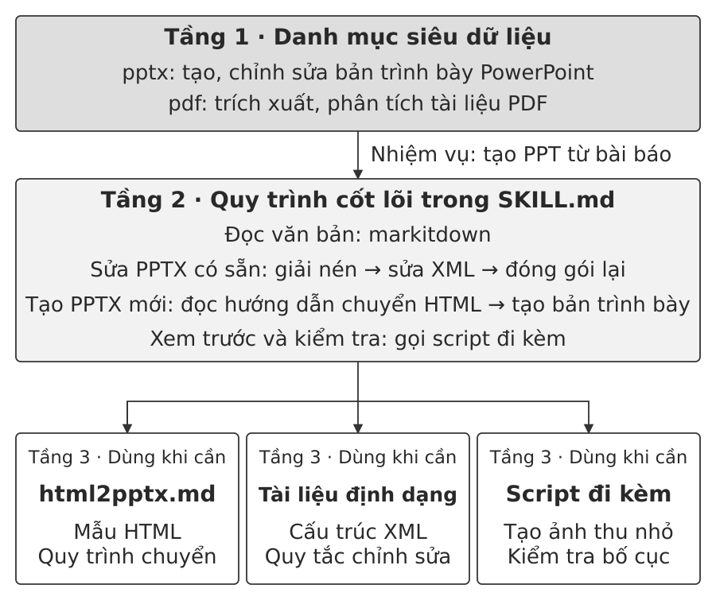

### Skills: đơn vị năng lực chuyên môn có thể ghép nối

**Agent Skills** đóng gói phương pháp xử lý, tài liệu tham khảo, script và template của một loại nhiệm vụ thành gói có thể tái sử dụng. Nhân viên mới không cần học thuộc toàn bộ sổ tay thao tác của công ty ngay ngày nhận việc, mô hình cũng có thể đợi đến lúc làm việc mới đọc kỹ chương tương ứng. Cách nạp này gọi là **tiết lộ dần (Progressive Disclosure)**[^ch2-3].

Vẫn dùng mười món hàng ở Chương 1 để xét xem thông tin nào đáng viết thành Skill. Giả sử người dùng muốn so sánh giá đến tay đã gồm phí vận chuyển, thì chỉ cần đưa chi tiết hàng và địa chỉ nhận lần này vào ngữ cảnh hiện tại là đủ. Nếu nhóm thường xuyên phải so giá giữa các cửa hàng, thì cách đối chiếu quy cách, phân biệt đơn giá với giá trọn bộ, đánh dấu phí vận chuyển chưa rõ, có thể sắp xếp thành một Skill so giá. Lần sau có người chỉ muốn xem có những mẫu nào, mục lục vẫn hiển thị, còn cả quy trình kiểm giá có thể đợi đến khi người dùng cần so giá mới nạp.

**Tầng thứ nhất là siêu dữ liệu.** Mỗi Skill dùng `SKILL.md` để tự mô tả; phần YAML frontmatter ở đầu file được ngăn bằng `---`, trong đó có `name` và `description`. Runtime trước hết sắp tên và mô tả thành mục lục, để mô hình phán đoán nhiệm vụ hiện tại cần những Skill nào. Cách sắp xếp và trình bày mục lục do Harness quản lý; quy trình đầy đủ được nạp sau khi Skill được chọn.

**Mô tả của Skill trước hết phải viết thành điều kiện định tuyến.** Mô hình phải quyết định có dùng Skill hay không trước khi nạp phần thân, vì vậy `description` nên nói trước khi nào áp dụng, khi nào nên bỏ qua, rồi mới tóm tắt nó làm được gì. Ví dụ, “help with backend” phủ quá rộng, gần như mọi nhiệm vụ backend đều có thể khớp; còn “viết kiểm thử tích hợp cho các giao diện HTTP có sẵn, bao gồm xác thực, kiểm tra tham số và phản hồi lỗi” thì đưa ra phạm vi rõ ràng. Với những nhiệm vụ dễ nhầm, còn có thể bổ sung điều kiện loại trừ, ví dụ “không cần dùng khi chỉ thảo luận phương án giao diện”.

**Tầng thứ hai là quy trình cốt lõi.** Sau khi Skill được chọn, runtime đưa toàn bộ chỉ dẫn vào ngữ cảnh. Khi người dùng gõ tường minh một lệnh như `/pptx`, client có thể tìm và nạp trực tiếp; khi mô hình tự chọn, nó lấy nội dung qua công cụ Skill hoặc công cụ đọc file. Cách thứ nhất bỏ được bước mô hình phát lời gọi kích hoạt, cách thứ hai giữ việc chọn và nạp lại trong trajectory vận hành.

Lấy PPTX Skill dùng trong thí nghiệm của sách làm ví dụ, phần hướng dẫn cốt lõi giới thiệu mấy lối đi thường dùng: dùng markitdown của Microsoft để trích văn bản bản trình chiếu, giải nén PPTX để xem XML bên dưới, và chọn quy trình tạo mới hay chỉnh sửa bản trình chiếu. Đọc đến tầng hướng dẫn này, mô hình có thể dựa vào nhiệm vụ hiện tại mà quyết định bước tiếp theo nên đọc tài liệu nào, gọi loại script nào[^ch2-4].

**Tầng thứ ba là tài liệu chi tiết.** Các thao tác phức tạp được tách ra các tài liệu chuyên đề, file chính đóng vai lối vào. Trong phiên bản sách dùng, `html2pptx.md` hướng dẫn cách tạo bản trình chiếu từ HTML, các tài liệu tham khảo khác bổ sung chi tiết về định dạng và chỉnh sửa. Agent tiếp tục đọc những nội dung này theo nhiệm vụ, và dùng script, tài nguyên, template đi kèm để hoàn thành thao tác.

[^ch2-3]: Anthropic, Equipping Agents for the Real World with Agent Skills, 2025; Agent Skills, How to add skills support to your agent.
[^ch2-4]: Anthropic, PPTX Skill. Thí nghiệm trong sách cố định dùng phiên bản có quy trình chuyển đổi HTML; phiên bản cụ thể và cách chạy xem README của thí nghiệm đi kèm.
[^ch2-codex-skills]: OpenAI, Build skills; phần hiện thực Skills trong kho mã công khai OpenAI Codex.
[^ch2-cc-skill-inject]: Claude Code, How Claude Code uses prompt caching, Invoking skills and commands; Agent Skills, How to add skills support to your agent, User-explicit activation.

### Viết một Skill dùng được như thế nào

Một Skill dùng được phải trả lời bốn câu hỏi: áp dụng cho nhiệm vụ nào, xử lý theo thứ tự nào, tình huống nào cần xác nhận, và làm sao biết công việc đã xong. Người viết phải sắp xếp kinh nghiệm của mình thành các bước thực hiện được, và kèm ví dụ cho những phán đoán then chốt.

Lấy một Skill viết lách làm ví dụ, có thể tham khảo cách Baoyu cải thiện văn AI xuất phát từ thói quen diễn đạt cá nhân[^ch2-baoyu-remove-ai-writing-flavor], rồi tổ chức nội dung thành bốn phần:

- **Vai trò và người đọc**: nêu rõ đối tượng phục vụ, loại nhiệm vụ và yêu cầu đối với bản hoàn chỉnh.
- **Nguyên tắc cốt lõi**: viết trước ba đến năm phán đoán hay dùng, mỗi điều kèm ví dụ cụ thể trước và sau khi sửa.
- **Lỗi thường gặp và ranh giới**: ghi lại các vấn đề diễn đạt hay xảy ra, các hành động vượt quyền và trường hợp ngoại lệ.
- **Tài liệu tham khảo**: thu thập bảng thuật ngữ, template, bài mẫu và hướng dẫn chuyên đề để tra cứu khi thực hiện.

Quy tắc có thể viết theo khung “phạm vi, hành động, ngoại lệ, cách xác minh”. Ví dụ, một quy tắc rút gọn câu dài phải nói rõ áp dụng cho đoạn văn nào, tách câu ra sao, và sau khi tách thì kiểm tra thế nào để điều kiện và kết luận vẫn còn nguyên vẹn.

Lúc khởi đầu, chọn ba đến năm bài viết gốc mình ưng ý, để Agent rút ra cách dùng từ, kiểu câu, cách bố cục đoạn và giọng điệu, sinh một bản đầu khoảng hai mươi dòng. Sau đó dùng nó xử lý một đề tài mới, để tác giả sửa từng câu. Chênh lệch giữa trước và sau khi sửa cung cấp phản hồi cụ thể hơn: từ nào thừa, câu nào cần tách, chỗ nào thiếu dữ kiện, chỗ nào phải bổ sung lại chi tiết kỹ thuật. Những cách sửa lặp đi lặp lại thì đúc kết thành quy tắc, giữ kèm ví dụ và phạm vi áp dụng tương ứng.

Skill còn có thể đi kèm công cụ thực thi và template. Ví dụ, PPTX Skill để hướng dẫn thao tác, script phân tích, script sinh và tài nguyên bố cục ở cùng một chỗ, để mô hình theo hướng dẫn mà gọi tài nguyên tương ứng. Mỗi Skill có thể được kiểm thử, cập nhật và quản lý phiên bản độc lập, các thành viên trong nhóm cũng có thể cùng bổ sung kinh nghiệm quanh một quy trình chung. **Giá trị lâu dài của Skills nằm ở chỗ kinh nghiệm chuyên môn có thể được tích lũy phân tán, phát hành độc lập và tái sử dụng.** Khi mở rộng năng lực Agent, mỗi nhóm có thể duy trì những Skill mình giỏi, dần hình thành một hệ sinh thái gói phần mềm giống pip, npm. Các Skill này dùng chung cơ chế phát hiện, nạp và thực thi do hệ thống chính cung cấp.

**Khi thiết kế cách tương tác, ưu tiên dùng các khuôn mẫu mà mô hình đã được huấn luyện và thích ứng.** Cách chia vai trò, định dạng kết quả công cụ và cách nạp Skill đều ảnh hưởng đến việc mô hình nối tiếp nhiệm vụ. Quy trình chuẩn do nhà cung cấp đưa ra là điểm khởi đầu phù hợp, giảm gánh nặng phải suy lại ý nghĩa từ một định dạng lạ.

[^ch2-baoyu-remove-ai-writing-flavor]: Baoyu, “Đừng dùng prompt để khử ‘vị AI’ nữa, hướng đi đó sai ngay từ đầu”, 14/02/2026.

### Vị trí của Skills trong ngữ cảnh

Chi phí ngữ cảnh của Skills gồm hai phần: mục lục và phần thân. Mục lục giúp mô hình phát hiện năng lực khả dụng, phần thân cung cấp quy trình thao tác sau khi được chọn. Đặc tả yêu cầu nạp theo nhu cầu, còn vai trò tin nhắn, cách bọc và cách cập nhật cụ thể do Harness hiện thực.

Claude Code thêm chỉ dẫn của Skill vào phiên dưới dạng tin nhắn `user` tại vị trí gọi[^ch2-cc-skill-inject]. Hình 2-12 cho thấy một cách sắp xếp tin nhắn khi mô hình tự kích hoạt: trước hết phát lời gọi `Skill(skill: "pptx")`, nhận phản hồi công cụ, rồi đọc phần thân Skill được nối thêm. Khi dùng công cụ kích hoạt chuyên dụng, phản hồi công cụ có thể đóng vai xác nhận lời gọi, phần thân do Harness chèn riêng; khi dùng công cụ đọc file thông thường, phần thân cũng có thể nằm thẳng trong kết quả công cụ. Khi người dùng gõ tường minh `/pptx`, client có thể triển khai chỉ dẫn ngay, bỏ bước mô hình phát lời gọi kích hoạt.

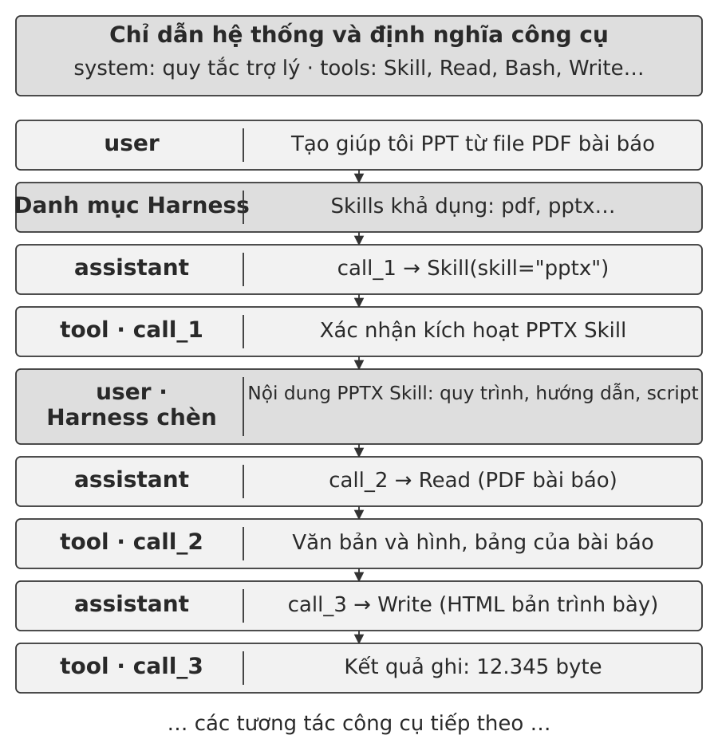{height=55%}

Phần hiện thực Skills của Codex cũng tổ chức riêng mục lục năng lực và các chỉ dẫn được chọn. Trong mã nguồn công khai, một phần mục lục đi vào ngữ cảnh `developer`, phần khác được cung cấp kèm lượt hiện tại và môi trường thực thi; Skill được chọn tường minh thì được thêm qua đoạn ngữ cảnh người dùng. Nguồn của mục lục và môi trường thực thi khả dụng ảnh hưởng đến cách sắp xếp cụ thể[^ch2-codex-skills].

Hình 2-13 minh họa sự tăng trưởng của cache khi nạp theo nhu cầu, lấy một yêu cầu chưa có cache tái sử dụng được làm điểm xuất phát. Mục lục lần đầu đi vào yêu cầu thì phải xử lý, phần thân lần đầu được nạp cũng làm tăng tính toán; khi các yêu cầu sau giữ nguyên tiền tố, những nội dung này có cơ hội được đọc từ cache. Nối nội dung mới tại vị trí gọi giúp giữ ổn định các tin nhắn trước đó. Các hướng dẫn đã nạp tiếp tục nằm trong lịch sử, khi cần cập nhật thì xử lý theo chiến lược ngữ cảnh của runtime.

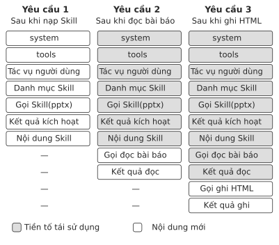

### Quan hệ giữa Skills và công cụ

Skill cung cấp tri thức nhiệm vụ và quy trình thao tác, công cụ thì lo đọc, thực thi và lấy kết quả. Bảy công cụ cốt lõi giới thiệu ở Chương 5 có thể kết hợp với nhiều Skill khác nhau: cùng một công cụ đọc file vừa đọc được hướng dẫn làm bản trình chiếu, vừa đọc được quy chuẩn mã; bộ thực thi đa năng thì chạy được các script tương ứng. Như vậy, năng lực chuyên môn có thể mở rộng qua quy trình và tài nguyên, còn tập công cụ cơ bản giữ tương đối ổn định.

Công cụ chuyên dụng cũng có thể dùng phối hợp với Skill. Tìm kiếm công cụ ở trên lo cung cấp định nghĩa công cụ theo nhu cầu, còn Skill nói rõ khi nào gọi, kết hợp ra sao và kiểm tra kết quả thế nào. Cả hai đều phải kiểm soát lượng thông tin thường trực, và bố trí vị trí thích hợp cho nội dung mới nạp. Chương 4 sẽ bàn về sự đánh đổi giữa bộ thực thi đa năng và công cụ chuyên dụng, Chương 9 bàn sâu hơn về việc kinh nghiệm nên được lưu thành tri thức, chỉ dẫn, chương trình hay tham số mô hình.

> **Thí nghiệm 2-6 ★★: Dùng Agent Skills tạo bản trình chiếu từ bài báo**
>
> Thí nghiệm này lấy bài báo *Attention Is All You Need* làm tư liệu, minh họa cách Agent nạp theo nhu cầu quy trình chuyên môn để làm bản trình chiếu. Nhiệm vụ là từ file PDF của bài báo tạo một bản trình chiếu mười đến mười lăm trang, bao quát bối cảnh vấn đề, phương pháp, kết quả chính và kết luận, đồng thời dùng hình và bảng trong bài báo để hỗ trợ trình bày.
>
> Lần chạy này dùng Kimi Code và PPTX Skill chính thức của Anthropic. Agent trước hết tìm thấy PPTX Skill trong mục lục, đọc hướng dẫn thao tác của nó, đọc tiếp hướng dẫn chuyển đổi HTML, gọi công cụ sinh đi kèm, cuối cùng kiểm tra bố cục qua ảnh thu nhỏ và kết xuất từng trang. Tài liệu đọc ở mỗi bước đều phục vụ thao tác ngay sau đó, toàn bộ quy trình làm bản trình chiếu được triển khai dần theo nhiệm vụ.
>
> Bản hoàn chỉnh có mười ba trang, sử dụng sơ đồ kiến trúc, hình minh họa cơ chế attention, bảng kết quả thí nghiệm và hình trực quan hóa attention trong bài báo.
>
> Kiểm tra sau khi sinh cũng thuộc về quy trình của Skill. Lần chạy này từng gặp các lỗi như thiếu chỉ số dưới, ký hiệu đầu dòng bất thường, sai đường dẫn tham chiếu hình và vấn đề độ chính xác của nhãn số liệu; Agent dựa vào kết quả kết xuất và kiểm tra cấu trúc để sửa từng lỗi. File cuối cùng vượt qua kiểm tra cấu trúc, và được mở lại, kết xuất lại bằng LibreOffice.

> **Thí nghiệm 2-7 ★★: Tạo Skill viết “khử vị AI” từ bài mẫu của chính mình**
>
> Bài tập này sắp xếp kinh nghiệm viết của cá nhân thành chỉ dẫn có thể tái sử dụng. Chuẩn bị ba đến năm bài viết gốc, để Agent rút ra thói quen diễn đạt, sinh một bản Skill đầu tiên gồm điều kiện kích hoạt, ba đến năm nguyên tắc và ví dụ tương ứng.
>
> Chọn một đề tài mới để viết thử, rồi để tác giả sửa từng câu. Đối chiếu hai bản, tìm ra những vấn đề lặp lại, chẳng hạn dùng từ chung chung, câu quá dài, bỏ qua quan hệ nhân quả, hoặc xóa mất những ví dụ cụ thể giúp người đọc hiểu. Những cách sửa lặp lại có thể viết vào Skill.

## Thanh trạng thái Agent: tăng cường quản lý trajectory bằng siêu thông tin

Người dùng giục: “Gọi lại lần nữa được không?” Phía trái Hình 2-14 ghi lại ba lần gọi điện. Lần đầu chờ 45 phút vẫn không kết nối được, đến lần thứ ba mới thương lượng được mức 59 đô la mỗi tháng. Theo quy tắc của ví dụ, mỗi lần quay số đều chiếm một lượt hạn mức; dù chỉ kết nối được hai lần, ba lượt hạn mức cũng đã dùng hết. Harness có thể gom những bộ đếm, tiến độ xử lý và các mục chờ xác nhận như vậy thành một bản tóm tắt cập nhật theo tin nhắn, gọi là **thanh trạng thái Agent (Agent Status Bar)**.

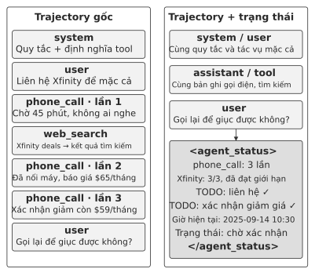

Điện thoại đặt giờ, mức pin và tín hiệu ở đỉnh màn hình, người dùng liếc qua là biết tình trạng hiện tại. Bản tóm tắt bên phải của hình cũng có tác dụng tương tự: trợ lý đọc thấy “đã đạt giới hạn” và “chờ người dùng xác nhận” thì có thể thuật lại mức giá đã thỏa thuận và mời người dùng quyết định có chấp nhận hay không. Harness có thể gắn bản tóm tắt khi trả kết quả công cụ, hoặc nối riêng một tin nhắn trạng thái.

### Từ bản ghi thô đến trạng thái tường minh

Xét một nhiệm vụ chăm sóc khách hàng qua điện thoại: hệ thống quy định trong cùng một nhiệm vụ, mỗi doanh nghiệp chỉ được gọi tối đa ba lần. Giữa ba cuộc gọi có thể xen kẽ tìm kiếm, đọc tài liệu và câu hỏi thêm của người dùng. Muốn quyết định còn gọi tiếp được hay không, mô hình phải tìm đủ các bản ghi liên quan trong đoạn lịch sử này, phân biệt từng doanh nghiệp, rồi tính số lần cộng dồn.

Runtime có thể cập nhật bộ đếm sau mỗi lần gọi, trả về thẳng “đây là cuộc gọi thứ 3 tới Xfinity, đã đạt giới hạn của nhiệm vụ này”. Quyết định kế tiếp có thể dùng ngay kết quả đó. Số lần gọi do chương trình duy trì, còn mô hình kết hợp với tiến độ nhiệm vụ để quyết định tiếp theo nên chờ, tìm kênh khác, hay giải thích tình hình hiện tại cho người dùng; tầng thực thi đồng thời dựa vào bộ đếm để kiểm tra các yêu cầu quay số tiếp theo.

Giá trị kỹ thuật ở đây là **sắp xếp sẵn những trạng thái mà các quyết định sau sẽ dùng đi dùng lại**. Bản ghi cuộc gọi đầy đủ vẫn lo lưu nội dung trao đổi và quá trình xử lý, còn thanh trạng thái cung cấp số liệu thống kê và tiến độ hay dùng khi ra quyết định. **Các thống kê dùng lặp lại nên ưu tiên để mã duy trì theo kiểu tăng dần.** Tìm thấy một bản ghi trong ngữ cảnh và tính ra tổng từ toàn bộ bản ghi là hai việc khác nhau. Lưu lại trajectory thô không tự động sinh ra một bảng thống kê chính xác, sẵn sàng để dùng. Mỗi lần lại để mô hình duyệt và đếm lại từ đầu vừa tốn token suy luận, vừa tăng nguy cơ đếm sót hoặc đếm trùng.

Tác giả ví ngữ cảnh như một cỗ máy tìm kiếm cần đi kèm một “tầng chưng cất”: bản ghi thô thuận tiện để truy ngược, còn trạng thái đã chưng cất thì dùng được ngay. Bộ đếm, hạn mức và trạng thái hoàn thành nhiệm vụ đã được xác minh nên để mã duy trì; thông tin cần phán đoán ngữ nghĩa thì có thể trích xuất từng mục trước, rồi tổng hợp và kiểm chứng. Như vậy, mỗi lần ra quyết định, mô hình đều thấy cùng lúc trạng thái hiện tại và các bằng chứng cần thiết.

Trajectory dài còn khiến việc tìm thông tin then chốt khó hơn. Gom mục tiêu, ràng buộc và tiến độ mới nhất vào phần cuối giúp mô hình dễ tìm ra thông tin cần cho quyết định hiện tại.

> **Thí nghiệm 2-8 ★★: Quan sát hiệu quả của thanh trạng thái Agent qua trực quan hóa attention**
>
> Thí nghiệm này dùng Qwen3-0.6B, dựng một trajectory hoàn tiền chăm sóc khách hàng: Agent đã gọi điện cho Xfinity ba lần, xen giữa là các lần tìm kiếm trên mạng, sau đó người dùng hỏi thêm “Có thể gọi lại để giục họ không?” Quy tắc hệ thống giới hạn mỗi doanh nghiệp chỉ được gọi tối đa ba lần trong cùng một nhiệm vụ.
>
> Hai nhóm đầu vào giữ nguyên lịch sử và câu hỏi thêm của người dùng. Nhóm A dùng thẳng trajectory thô; nhóm B thêm trạng thái sau vào cuối:
>
> ```xml
> <agent_status>
> Current State:
> - Tool call summary: 'phone_call' has been invoked 3 times (Xfinity: 3 times)
> - Constraint check: Maximum calls to Xfinity reached (3/3)
> </agent_status>
> ```
>
> Mỗi nhóm chạy ba lần. Nhóm A có hai lần từ chối rõ ràng việc gọi tiếp, một lần được xếp vào loại đầu ra khác; nhóm B cả ba lần đều từ chối rõ ràng việc gọi tiếp. Cả hai nhóm đều không có đầu ra nào bị phán là vi phạm bằng cách gọi tiếp. Để tái hiện phép đối chiếu này, vào `chapter2/attention_visualization` và chạy `python run_status_bar_experiment.py --output runs/status-bar-reproduction`. Đầu vào và kết quả từng lần của lần chạy này được lưu trong `runs/exp2-7-qwen3-0.6b-20260730-v2/comparison.json` ở thư mục thí nghiệm.
>
> Bản đồ attention cho thấy vùng sinh phân bổ trọng số thế nào cho các cuộc gọi trong lịch sử, kết quả tìm kiếm, câu hỏi thêm của người dùng và thanh trạng thái.

Nghiên cứu ContextDistill-Bench của tác giả cùng Noah Shi khảo sát sâu hơn lợi ích của việc chưng cất trạng thái từ trước[^ch2-8]. Trong các truy vấn trạng thái mà benchmark này bao quát, mô hình nhỏ hơn cũng đạt độ chính xác khá cao nhờ trạng thái tường minh; lượng suy nghĩ, độ trễ và chi phí truy vấn của các mô hình tiên phong có thể giảm khoảng một bậc độ lớn. Ví dụ, chi phí cho mỗi nghìn truy vấn của Claude 4 Sonnet giảm từ khoảng 35,46 đô la xuống 3,51 đô la. **Thiết kế này duy trì trạng thái ngay khi sự kiện xảy ra, nhờ đó bỏ được chi phí phải duyệt lịch sử ở mỗi lần truy vấn.** Khi các trường tóm tắt đã cố định, dù lịch sử tiếp tục dài ra, truy vấn cũng chỉ cần đọc vài trường này.

[^ch2-8]: Li, Bojie and Noah Shi. *Distill, Don't Retrieve: Inference-Time Context Distillation for LLM Agent Reasoning.* 2026.

### Thành phần của thanh trạng thái Agent

Thanh trạng thái thường gồm ba loại thông tin, lần lượt trả lời các câu hỏi “phải làm gì”, “vừa xảy ra chuyện gì” và “hiện đang ở trạng thái nào”.

**Kế hoạch nhiệm vụ** ghi lại mục tiêu, các bước và tình hình hoàn thành. Nhiệm vụ phức tạp có thể tách thành danh sách TODO, mỗi mục giữ trạng thái và các quan hệ phụ thuộc cần thiết. Khi xử lý bước hiện tại, mô hình vẫn thấy yêu cầu ban đầu, ràng buộc cốt lõi và các việc phía sau; xong một bước thì cập nhật danh sách.

**Thông tin kênh phụ của sự kiện (Side-channel Information)** bổ sung bối cảnh lúc sự kiện xảy ra, như thời gian, vị trí địa lý và khoảng cách từ lần trả lời trước. Những siêu dữ liệu này được lưu cùng sự kiện, giúp mô hình hiểu trình tự trước sau và tình huống. Cùng một câu “vẫn chưa nhận được phản hồi”, xảy ra hai phút hay hai ngày sau khi nộp đơn, thì cách xử lý tương ứng có thể khác nhau.

**Tóm tắt observation về trạng thái hiện tại của môi trường** cung cấp thời gian hiện tại, thư mục làm việc, số lần gọi công cụ và cảnh báo bất thường. Nó có tác dụng gần giống CLI hay GUI hiển thị thư mục hiện tại hoặc trạng thái đang chạy: để thao tác tiếp theo có căn cứ rõ ràng. Ví dụ, cảnh báo gọi lặp có thể thúc mô hình kiểm tra nguyên nhân thất bại, còn ngân sách còn lại giúp nó quyết định có tìm kiếm tiếp hay không.

Siêu dữ liệu sự kiện sau khi được nối theo sự kiện thường giữ ổn định, còn tiến độ nhiệm vụ và trạng thái môi trường thì liên tục thay đổi. Hai loại thông tin này nên được ghi vào lịch sử theo cách cập nhật riêng của mỗi loại; phần dưới sẽ giải thích dựa trên cấu trúc tin nhắn.

### Vị trí cụ thể của thanh trạng thái Agent trong ngữ cảnh

Trong ví dụ của phần này, Harness nối một tin nhắn `user` vào cuối danh sách tin nhắn để truyền bản tóm tắt trạng thái. `user` ở đây là vai trò tin nhắn của API được chọn; nội dung trạng thái do runtime sinh ra, và dùng thẻ để nói rõ công dụng. Với các giao diện khác, cũng có thể dùng loại khối ngữ cảnh mà giao diện đó hỗ trợ, hoặc cung cấp trạng thái kèm kết quả công cụ tương ứng. Nếu dùng loại template cắt suy luận lịch sử theo truy vấn thật của người dùng như đã nói ở trên, có thể cung cấp trạng thái vận hành kèm kết quả công cụ, để template tiếp tục giữ thông tin suy luận theo nhiệm vụ hiện tại.

Lần theo Hình 2-15 để tìm lời ủy thác ban đầu của người dùng, rồi xem trạng thái mới nhất được ghi ở lượt nào. Giữ lại yêu cầu gốc thì gọi điện xong mới đối chiếu được cùng lúc hai việc: người dùng muốn làm gì, và hiện đã làm đến bước nào.

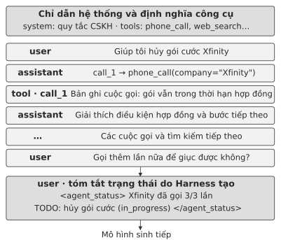

Viết trình tự trong hình thành danh sách tin nhắn như sau. Để tiện đối chiếu, ở đây lược bỏ các lượt lặp lại và một số trường gọi.

```text
messages: [
  { role: "system", content: "You are a customer service assistant..." }
  { role: "user", content: "Help me cancel my Xfinity plan" }
  { role: "assistant", tool_calls: [{ id: "call_1", ... }] }
  { role: "tool", tool_call_id: "call_1", content: "Call log..." }
  { role: "assistant", tool_calls: [{ id: "call_2", ... }] }
  { role: "tool", tool_call_id: "call_2", content: "Call log..." }
  ...các lượt còn lại...
  { role: "user", content: "Can you call them again to follow up?" }
  { role: "user", content: "<agent_status>
      Current State:
      - phone_call invoked 3 times (Xfinity: 3/3 max)
      - Current time: 2025-09-14 10:30:45
      - TODO: [1] Cancel plan (in_progress)
    </agent_status>" }
]
```

Tin nhắn cuối cùng gom số lần gọi, giới hạn, thời gian và tiến độ nhiệm vụ vào một chỗ. Mô hình có thể dùng thẳng các trường này, đồng thời dùng mã gọi phía trước để tra lại bản ghi cụ thể.

Nối tin nhắn này vào thì chuỗi token phía trước vẫn giữ nguyên, vẫn thỏa điều kiện cơ bản để tái sử dụng tiền tố. Còn lượt sau xử lý trạng thái cũ thế nào thì phải cân nhắc giữa lượng ngữ cảnh chiếm dụng và chi phí cache.

### Hai cách cập nhật trạng thái và cái giá về cache

Lượt sau có thể hoàn thành một mục TODO, cũng có thể thêm một lần gọi công cụ. Harness phải cập nhật trạng thái, và có hai cách thường dùng.

**Thay thế mỗi lượt**: khi dựng yêu cầu mới, bỏ tin nhắn trạng thái trước, rồi thêm trạng thái mới nhất vào cuối. Ngữ cảnh chỉ giữ một bản trạng thái hiện tại, mô hình dễ dùng. Ví dụ, yêu cầu lần trước là “mô tả nhiệm vụ, trạng thái A”, lần này là “mô tả nhiệm vụ, kết quả công cụ, trạng thái B”. Mô tả nhiệm vụ vẫn trúng cache; kết quả công cụ được gửi lần đầu, vốn dĩ phải tính. Chỉ khi yêu cầu lần trước còn có tin nhắn khác nằm sau trạng thái A, việc bỏ A mới khiến các tin nhắn đó mất khớp tiền tố ban đầu. Trong yêu cầu lần này, mô hình chỉ thấy B. Khi cần xem lại A, có thể lấy ảnh chụp lúc đó từ log vận hành.

**Nối thêm lâu dài**: giữ lại các bản ghi trạng thái đã có, mỗi lần nối trạng thái mới vào cuối. Tiền tố lịch sử giữ ổn định, và cũng dễ truy ngược diễn biến trạng thái. Trạng thái cũ sẽ dần chiếm chỗ trong ngữ cảnh, nên phải ghi rõ thời gian hoặc phiên bản, để mô hình dựa vào bản ghi mới nhất mà phán đoán tình hình hiện tại. Cách Claude Code nối thông báo thay đổi file vào phiên cũng thể hiện tư duy thiết kế này.

Khi trạng thái rất ngắn, mà phía sau nó đã có rất nhiều kết quả công cụ nằm trong cache, giữ trạng thái cũ có thể rẻ hơn tính lại một hậu tố dài; khi trạng thái dài và cập nhật thường xuyên, thay thế giúp kiểm soát sự tích tụ của trạng thái lịch sử.

Có thể dùng một mô hình thô để ước lượng điểm hòa vốn giữa hai cách: gọi mỗi bản trạng thái là $S$ token, mỗi lần thay thế thì phần hậu tố đã cache sau trạng thái cũ phải tính lại trung bình $R$ token (không tính nội dung gửi lần đầu ở lượt này), tổng cộng chèn trạng thái $N$ lần, và đơn giá đầu vào trong cache bằng $\alpha$ lần đầu vào thông thường. Bỏ qua chi phí chung của hai phương án, $C_{\text{thay thế}} \approx (N-1)(1-\alpha)R$, $C_{\text{nối thêm}} \approx \alpha S N(N-1)/2$. Với $N>1$, khi $\alpha SN/2 < (1-\alpha)R$ thì chi phí ước tính của nối thêm lâu dài thấp hơn; ngược lại, thay thế mỗi lượt rẻ hơn. Ở đây lấy đơn giá đầu vào thông thường làm đơn vị chi phí: phương án thay thế trả thêm phần chênh lệch giữa việc đọc hậu tố từ cache và xử lý lại nó, còn phương án nối thêm trả thêm phí đọc lặp lại các trạng thái lịch sử.

Lấy ví dụ, mỗi lần chèn trạng thái 100 token, chèn tổng cộng 10 lần, đọc cache tính bằng một phần mười giá đầu vào thông thường. Phương án nối thêm ở các yêu cầu sau lần lượt đọc thêm 1, 2, …, 9 bản trạng thái cũ, chi phí phụ trội tương đương 450 token đầu vào thông thường. Nếu thay trạng thái khiến trung bình 1000 token đã cache phía sau phải xử lý lại, chín lần thay thế tốn thêm tương đương 8100 token đầu vào thông thường, nên nối thêm rẻ hơn. Nếu trạng thái cũ vốn nằm ở cuối cache, phía sau không có nội dung nào đã cache, thì $R=0$ trong công thức, và thay thế trực tiếp lại tiết kiệm được chi phí tương đương 450 token ấy.

> **Thí nghiệm 2-9 ★★: Vài kỹ thuật thanh trạng thái Agent hữu dụng**
>
> Thí nghiệm này hiện thực năm kỹ thuật thanh trạng thái, có thể bật riêng từng cái hoặc kết hợp. Mỗi kỹ thuật cung cấp một loại thông tin cụ thể, giúp mô hình quyết định hành động kế tiếp.
>
> **Theo dõi dấu thời gian** ghi thời điểm sự kiện vào tin nhắn người dùng và phản hồi công cụ, ví dụ `[2025-09-14 10:30:45]`. Thời gian được ghi vào lịch sử cùng sự kiện, các lượt sau giữ nguyên giá trị; còn thời gian hiện tại thì cập nhật theo tin nhắn trạng thái mới. Thí nghiệm còn có phần mô phỏng thời gian, dùng để kiểm tra mô hình có phân biệt được “file hôm qua” với “chỉnh sửa hôm nay”, và có hiểu đúng thời gian chờ hay không.
>
> **Bộ đếm gọi công cụ** dùng một dictionary để duy trì số lần gọi cộng dồn của từng công cụ, và ghi chú `Tool call #3 for 'read_file'` trong phản hồi. Kết hợp với nội dung lỗi, mô hình có thể phán đoán có nên thử tiếp hay không. Ví dụ, lần đọc đầu thất bại thì kiểm tra đường dẫn, rồi liệt kê thư mục; thất bại nhiều lần thì tìm file thay thế hoặc báo cho người dùng biết file bị thiếu. Khi cần giới hạn số lần thử lại, runtime còn phải thực thi giới hạn theo bộ đếm.
>
> **Quản lý danh sách TODO** cung cấp hai công cụ `rewrite_todo_list` và `update_todo_status`. Mỗi mục gồm mã định danh duy nhất, nội dung, dấu thời gian, và một trong bốn trạng thái `pending`, `in_progress`, `completed`, `cancelled`. Danh sách gom lại một chỗ “đã làm gì, còn thiếu gì”, gần với cách Manus lặp lại kế hoạch nhiệm vụ để giữ mục tiêu luôn hiện rõ.
>
> **Thông tin lỗi chi tiết** cung cấp loại và mô tả lỗi, JSON của tham số gọi, call stack và gợi ý sửa. Ví dụ, gặp `FileNotFoundError` thì có thể nhắc mô hình đối chiếu tên file, thư mục hiện tại và đường dẫn tuyệt đối. Tham số giúp định vị đầu vào sai, call stack giúp tìm chỗ thất bại, gợi ý sửa thì chỉ ra hướng kiểm tra tiếp theo. Trước khi trả các nội dung này cho mô hình, phải làm sạch các trường nhạy cảm như thông tin xác thực, và kiểm soát độ dài của những stack quá dài.
>
> **Nhận biết trạng thái hệ thống** cung cấp thời gian hiện tại, thư mục làm việc, hệ điều hành, Shell và phiên bản Python. Công cụ lệnh trong thí nghiệm nhận ra các thao tác chuyển thư mục đứng riêng, cập nhật thư mục làm việc do runtime duy trì, rồi dùng cho các lần gọi sau; còn thay đổi thư mục của tiến trình con trong lệnh phức hợp thì tuân theo phạm vi thực thi của tiến trình tương ứng. Các trường môi trường cũng giúp mô hình chọn công cụ khả dụng, ví dụ dựa vào hệ thống thực tế và phần mềm đã cài để chọn `apt` hay `brew`.
>
> Trong phép đối chiếu với Kimi K3 lần này, mỗi loại nhiệm vụ có năm trường hợp. Cấu hình dấu thời gian và cấu hình kết hợp đều đạt cả năm, các nhóm đối chứng tương ứng đạt ba; bộ đếm gọi công cụ và trạng thái hệ thống, bật hay tắt đều đạt năm. Cấu hình TODO không đạt trường hợp nào, nhóm đối chứng đạt một; cấu hình lỗi chi tiết đạt bốn, nhóm đối chứng đạt năm.

**Thanh trạng thái nên do mã duy trì càng nhiều càng tốt.** Mô hình sẽ dùng thẳng các thống kê và giới hạn trong đó, một dòng “đã gọi ba lần” sai có thể làm thay đổi hành động về sau. Đếm, thời gian và chuyển đổi trạng thái giao cho chương trình; khi cần hiểu ngữ nghĩa, trước hết để mô hình trích xuất từng mục, rồi để mã tổng hợp và kiểm chứng, tránh bắt mô hình thống kê cả đoạn lịch sử dài trong một lần. Giữ quan hệ tương ứng giữa sự kiện gốc, kết quả trích xuất và trạng thái cuối cùng, để dễ phát hiện đếm trùng, đếm sót và nhầm lẫn nguồn.

Thanh trạng thái tổng hợp những thông tin nào thì phải chọn trước. Ví dụ, “đã gọi ba lần” đủ để biết còn gọi được nữa hay không, nhưng không trả lời được “trong cuộc gọi thứ hai, nhân viên chăm sóc khách hàng đã hứa gì”. Với những nhiệm vụ về sau chỉ cần giá trị thống kê, có thể dùng bản tóm tắt trạng thái thay cho lịch sử, và lưu trữ bản ghi gốc; khi cần đối chiếu nội dung trao đổi, mới đọc lại nguyên văn theo chỉ mục. Cách thiết kế các trường tóm tắt quyết định câu hỏi nào trả lời được ngay, và cũng quyết định khi nào phải tra lại.

## Chiến lược nén ngữ cảnh

Một nhiệm vụ điều tra đã đọc qua mười trang web dài, giả sử cửa sổ chỉ còn đủ chỗ cho hai tài liệu nữa. Trước hết hãy hỏi lượt sau mô hình còn phải làm gì: nếu cần so hai báo giá, thì giữ báo giá, điều kiện hiệu lực và xuất xứ; nếu cần kiểm tra lại trích dẫn, thì giữ vị trí để lấy lại được nguyên văn. Phần thân các trang web đã tra nhưng không liên quan có thể lưu trữ đi, nhường chỗ cho đầu vào và đầu ra mới. Ở đây vừa phải tính đã giải phóng được bao nhiêu chỗ, vừa phải tính một khoản khác: nếu tài liệu đã xóa lại cần đến về sau, thì tốn bao nhiêu công để tìm lại?

### Ba mục đích của việc nén

**Kiểm soát độ dài và chi phí.** Lấy cửa sổ 128K token làm ví dụ, trang web dài và file lớn có thể chiếm một phần đáng kể. Harness phải chừa ngân sách cho đầu vào tiếp theo, đầu ra của mô hình và các tương tác công cụ.

**Sắp xếp tri thức mà các quyết định sau cần đến.** Mười mấy lượt tìm kiếm có thể nhắc đi nhắc lại cùng một sự kiện, cũng có thể để lại những nhận định mâu thuẫn nhau. Gom chúng lại thành “đã xác nhận A, B; C vẫn thiếu bằng chứng” giúp mô hình làm tiếp những câu hỏi còn dở. Bản tóm tắt phải giữ quan hệ giữa các dữ kiện, nguồn và các vấn đề chưa giải quyết, để các quyết định sau có căn cứ rõ ràng.

**Giúp nhiệm vụ dài tiếp tục tiến triển.** Một số mô hình khi cho rằng cửa sổ sắp cạn sẽ kết thúc sớm; hiện tượng này được gọi là **lo âu ngữ cảnh (Context Anxiety)**. Trong các bài kiểm tra nhiệm vụ dài với Sonnet 4.5, Anthropic phát hiện hành vi này vẫn có thể xuất hiện sau khi nén, nên đã dùng bản ghi bàn giao có cấu trúc, đặt lại ngữ cảnh rồi tiếp tục thực hiện[^ch2-7].

[^ch2-7]: Prithvi Rajasekaran, Harness design for long-running application development, Anthropic Engineering, 2026.

### Biến kết quả tính toán lặp lại thành tri thức dùng được

Thanh trạng thái duy trì sẵn bộ đếm và tiến độ, còn bản tóm tắt thì tiến thêm một bước, sắp xếp các dữ kiện và quan hệ trong văn bản dài. Cả hai đều sắp xếp trước những thông tin rời rạc, để các quyết định sau dùng được ngay.

Xem ví dụ đi kiểm tra một cửa hàng thú cưng:

> Lồng 1: mèo đen. Lồng 2: mèo trắng. Lồng 3: mèo đen. Lồng 4: mèo đen. Lồng 5: mèo trắng.
> … (tổng cộng 100 lồng, trong đó 90 mèo đen, 10 mèo trắng)

Trả lời “lồng 37 có mèo gì” thì phải định vị bản ghi tương ứng; trả lời “mèo đen và mèo trắng mỗi loại bao nhiêu con” thì phải tổng hợp toàn bộ bản ghi. Nếu về sau dùng tổng số nhiều lần, có thể tính sẵn và lưu “mèo đen 90 con, mèo trắng 10 con”, khỏi mỗi lần lại đếm từ đầu. Chương trình hợp với kiểu tổng hợp tất định này, còn mô hình có thể dựa vào kết quả thống kê để trả lời tiếp các câu hỏi nghiệp vụ.

Nội dung tóm tắt phải chọn theo nhiệm vụ. Chỉ giữ tổng số hai loại mèo là đủ trả lời câu hỏi về số lượng; muốn trả lời về lồng 37 thì còn cần bản ghi từng lồng hoặc chỉ mục tương ứng.

Kể cả khi cửa sổ vẫn còn chỗ, ngữ cảnh quá dài hoặc lẫn lộn cũng có thể ảnh hưởng đến việc sử dụng thông tin: mô hình bỏ sót dữ kiện then chốt, xử lý lại những vấn đề đã giải quyết, hoặc đem trạng thái đã lỗi thời dùng cho quyết định hiện tại. Sự suy giảm hiệu năng xuất hiện khi ngữ cảnh dài ra như vậy thường được gọi là **thối rữa ngữ cảnh (Context Rot)**. Nó biểu hiện ở chỗ kết quả làm nhiệm vụ kém đi; còn khi yêu cầu vượt quá giới hạn dung lượng thì sẽ gây tràn cửa sổ.

**Ngay cả khi cửa sổ còn chỗ, cũng nên chủ động sắp xếp những tri thức đã được dùng đi dùng lại.** Các phán đoán then chốt đã có thể tổng hợp mà vẫn để mô hình lục tìm hết lần này đến lần khác trong lịch sử dài, thì sẽ liên tục tốn tính toán và tăng nguy cơ bỏ sót. Nhiệm vụ tìm kiếm có thể lưu các dữ kiện đã xác nhận, nguồn và những câu hỏi còn phải tra; nhiệm vụ lập trình có thể lưu quyết định kiến trúc, phạm vi sửa đổi, kết quả kiểm thử và nguyên nhân thất bại.

Ví dụ trong ngữ cảnh còn ảnh hưởng đến cách mô hình xử lý vấn đề mới. Nghiên cứu của Dherin và cộng sự xuất phát từ sự kết hợp giữa lớp attention và MLP trong Transformer, biểu diễn một số phép tính lan truyền thuận cụ thể như các cập nhật trọng số hạng thấp phụ thuộc vào ngữ cảnh, đưa ra một cách giải thích lý thuyết cho In-Context Learning (học trong ngữ cảnh)[^ch2-6]. Khi suy luận thực tế, trọng số mô hình giữ nguyên, ví dụ chỉ ảnh hưởng đến đầu ra qua đầu vào hiện tại. Muốn tái sử dụng loại kinh nghiệm này ở các phiên sau, có thể sắp xếp nó thành bộ nhớ, ví dụ hoặc Skill, rồi nạp theo nhiệm vụ; Chương 9 sẽ bàn sâu hơn về cách tích lũy kinh nghiệm.

[^ch2-6]: Benoit Dherin et al., Learning without training: The implicit dynamics of in-context learning, 2025.

### Đánh đổi giữa nén và KV Cache

Nén thường diễn ra giữa hai lần gọi mô hình. Harness dựa vào ngân sách còn lại và tiến độ nhiệm vụ để sắp xếp các tin nhắn cần cho yêu cầu kế tiếp, rồi gửi chúng cho mô hình. Thay thế lịch sử sẽ làm thay đổi tiền tố, nên phải cân nhắc đồng thời lợi ích của nén và chi phí dựng lại cache.

Trước hết, giữ ổn định các chỉ dẫn hệ thống và định nghĩa công cụ vẫn còn áp dụng. Chúng nằm ở đầu, nên việc nén lịch sử phía sau vẫn tái sử dụng được phần tiền tố này. Tiếp theo, chọn đối tượng nén cụ thể: kết quả công cụ dài có thể thay bằng bản tóm tắt, các tương tác nhiều lượt đã xong có thể gộp thành bản ghi theo giai đoạn. Cache trước vị trí thay thế vẫn tái sử dụng được, còn nội dung từ vị trí thay thế trở đi phải xử lý theo tiền tố mới.

**Nén lịch sử nên làm theo lô, tránh lượt nào cũng viết lại cùng một đoạn tiền tố.** Sau khi nén, đầu vào mỗi lượt ngắn đi, nhưng lần gọi để nén và việc tính lại hậu tố cũng tốn tài nguyên. Thời điểm kích hoạt có thể xác định dựa trên mức chiếm dụng cửa sổ, số lượt dự kiến còn lại và giai đoạn của nhiệm vụ: sắp xếp theo lô sau khi các kết quả công cụ dài dồn đến, lưu bản tóm tắt bàn giao sau khi xong một giai đoạn, đều giảm được chi phí sửa lịch sử thường xuyên. Khi giữ lại vài lượt gần nhất, phải kiểm tra lời gọi công cụ và giá trị trả về có đi thành cặp không, và ghi trạng thái của các thao tác chưa xong vào bản tóm tắt.

Khi nén còn phải kiểm tra giao thức gửi trả thông tin suy luận. Ở một số mô hình, thinking trong lịch sử bị ràng buộc với tiền tố lúc nó được sinh ra. Nếu thay thế lịch sử ở trước các block này, phần thinking còn giữ lại có thể không khớp với tiền tố mới. Với loại giao thức này, có thể sắp xếp phiên thành bản tóm tắt, xóa các thinking cũ bị ảnh hưởng, để mô hình suy luận tiếp từ bản tóm tắt; cũng có thể dùng cơ chế nén hoặc chỉnh sửa ngữ cảnh mà máy chủ hỗ trợ.

Xem trước phương án tóm tắt lẻ trong Hình 2-16: số ký tự sau xử lý chỉ còn 10,9% so với ban đầu, nhưng tổng token Agent chính đã dùng lại nhiều nhất trong sáu nhóm. Muốn giải thích vì sao hai con số này cùng đúng, phải lần theo những tài liệu nào đã bị nén, và chúng được gửi vào mô hình theo bao nhiêu lượt yêu cầu.

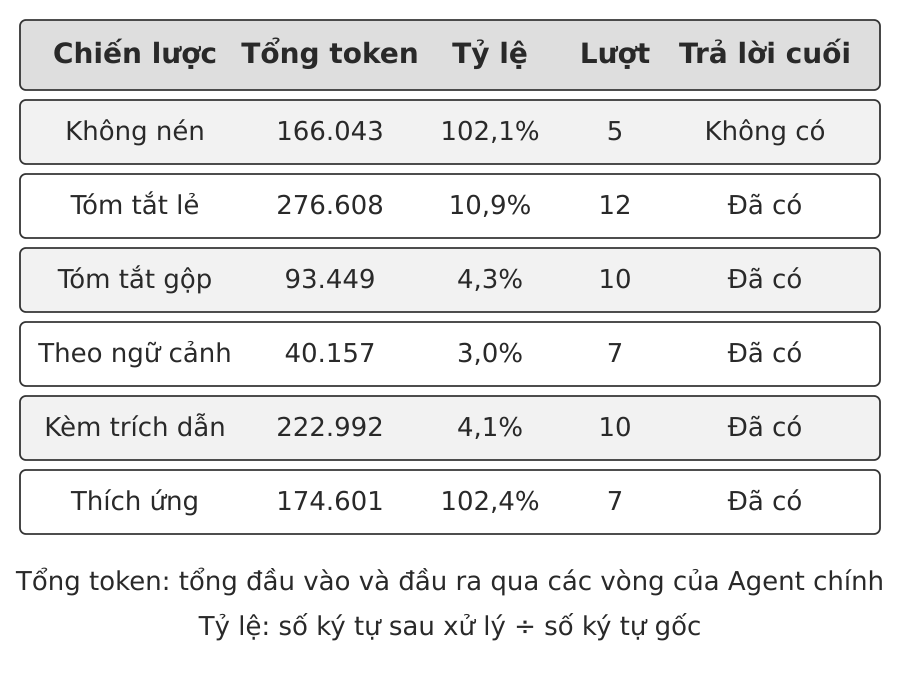

> **Thí nghiệm 2-10 ★★★: So sánh các chiến lược nén ngữ cảnh**
>
> Thí nghiệm này dùng Kimi K3 để tìm hiểu tình trạng nghề nghiệp của các nhà đồng sáng lập OpenAI. Nhiệm vụ đòi hỏi lần lượt lập danh sách nhân sự, tra cứu kinh nghiệm và thay đổi chức vụ, rồi đối chiếu các dữ kiện liên quan với nguồn. Để quan sát việc nén và xử lý tràn, thí nghiệm đặt ngân sách ngữ cảnh phía ứng dụng là 128.000 token, giữ một mốc cơ sở không nén, rồi so sánh năm cách xử lý, mỗi cách chạy tối đa 15 lượt[^ch2-compression-results].
>
> **Chiến lược một: không nén.** Kết quả tìm kiếm và đọc trang được đưa nguyên vẹn vào lịch sử. Bảy lần gọi công cụ đếm được 367.246 ký tự gốc. Chương trình kích hoạt cơ chế bảo vệ và dừng ở lượt thứ năm, tổng lượng dùng của Agent chính là 166.043 token. Phiên bản cũ dùng tổng số token đầu vào của mọi lần yêu cầu để kích hoạt bảo vệ, nên con số 165.227 trong thông báo lỗi là đầu vào cộng dồn. Chẳng hạn, cùng một đoạn lịch sử được gửi đi trong cả ba lượt yêu cầu thì sẽ bị cộng ba lần.
>
> **Chiến lược hai: tóm tắt lẻ.** Mỗi kết quả tìm kiếm được tóm tắt riêng thành hai đến ba đoạn, giữ nội dung chính của từng trang. Cách này dễ xử lý song song, cũng dễ giữ ranh giới giữa các trang; khi nhiều trang cùng kể về một sự kiện, thông tin trùng lặp vẫn đi vào lịch sử. Cấu hình này dùng mười hai lượt để sinh câu trả lời cuối, Agent chính dùng tổng cộng 276.608 token, tỷ lệ nén ký tự là 10,9%.
>
> **Chiến lược ba: tóm tắt gộp.** Gộp một lô kết quả tìm kiếm rồi sinh một bản tóm tắt tổng hợp, tiện cho việc gom các dữ kiện trùng lặp và quan hệ giữa các nguồn khác nhau. Cấu hình này dùng mười lượt để sinh câu trả lời cuối, Agent chính dùng tổng cộng 93.449 token, tỷ lệ nén ký tự là 4,3%.
>
> **Chiến lược bốn: tóm tắt theo ngữ cảnh.** Khi nén, cung cấp đồng thời truy vấn hiện tại và thông tin đã nắm được, ví dụ thêm `Given the search query: {query}` và `Current context: {context}` vào prompt. Mô hình dựa vào đó giữ các dữ kiện liên quan đến câu hỏi hiện tại, và ưu tiên bổ sung những chỗ còn thiếu trong bản tóm tắt sẵn có. Cấu hình này dùng bảy lượt để sinh câu trả lời cuối, Agent chính dùng tổng cộng 40.157 token, tỷ lệ nén ký tự là 3,0%. Trong đó có một lần nén đã gom khoảng một trăm năm mươi nghìn ký tự thành khoảng hai nghìn ký tự mà vẫn giữ được tên nhân sự và thay đổi chức vụ.
>
> **Chiến lược năm: tóm tắt theo ngữ cảnh kèm trích dẫn.** Trong bản tóm tắt bám theo nhiệm vụ, giữ lại đường dẫn nguồn ứng với từng dữ kiện. Cấu hình này dùng mười lượt để sinh câu trả lời cuối, Agent chính dùng tổng cộng 222.992 token. Tổng hợp theo bản ghi công cụ, tài liệu sau xử lý có 52.891 ký tự, nguyên văn có 1.295.044 ký tự, chia ra được khoảng 4,1%.
>
> **Chiến lược sáu: cửa sổ thích ứng.** Giai đoạn đầu giữ tài liệu gốc, khi đầu vào chạm ngưỡng mới sắp xếp theo lô. Thí nghiệm dùng ba cơ chế: kích hoạt nén khi vượt 80% ngân sách; tổng hợp các kết quả công cụ chưa được nén; gắn nhãn `[COMPRESSED]` cho các kết quả đã xử lý để tránh tóm tắt lặp. Với ngân sách 128.000 token của thí nghiệm, ngưỡng kích hoạt là 102.400 token. Cấu hình này dùng bảy lượt để sinh câu trả lời cuối, Agent chính dùng tổng cộng 174.601 token. Lần chạy được ghi lại này kích hoạt ngưỡng theo đầu vào cộng dồn; về sau chương trình đã đổi sang kiểm tra kích thước đầu vào của lần yêu cầu gần nhất.
>
> Hình 2-17 đối chiếu đầu vào và đầu ra của sáu chiến lược.
>
> 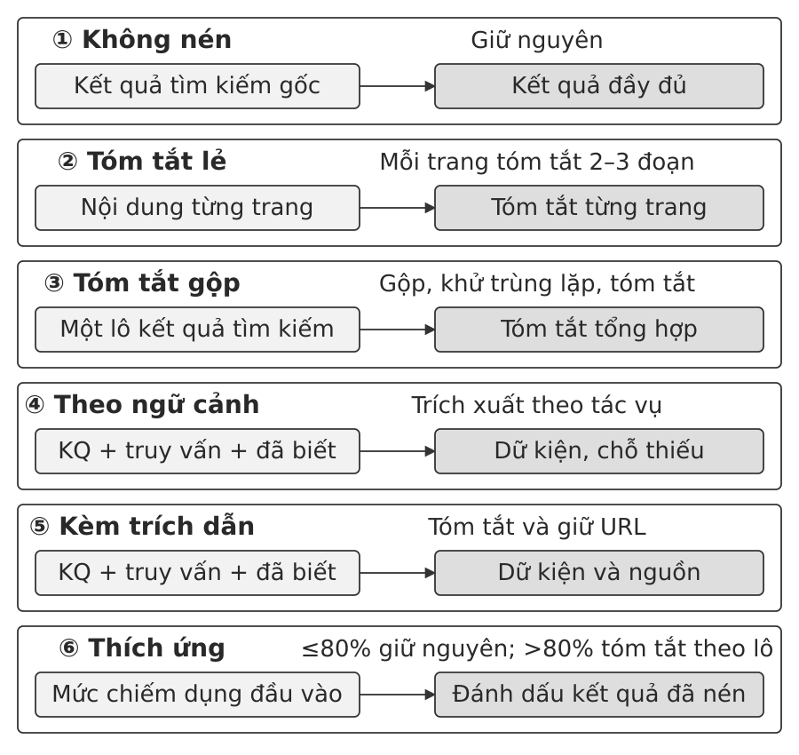
>
> Khi so sánh các con số trong Hình 2-16, phải phân biệt ba đại lượng: đầu vào của một lần yêu cầu quyết định có chạm ngân sách cửa sổ hay không; token cộng dồn phản ánh lượng dùng qua nhiều lượt gọi; tỷ lệ nén ký tự mô tả tỉ số giữa độ dài sau xử lý và độ dài gốc của phần tài liệu được thống kê. Lượng dùng cộng dồn ở đây lấy từ đầu vào và đầu ra trong các lượt yêu cầu của Agent chính; các yêu cầu mô hình riêng để sinh bản tóm tắt không được gộp vào trường này.
>
> Khi tái hiện thí nghiệm, cấu hình mô hình và dịch vụ tìm kiếm thật theo hướng dẫn đi kèm, rồi chạy `python experiment.py -m kimi-k3 -n 15 -o results/reproduction.json` trong thư mục thí nghiệm. Đọc `metrics` của từng chiến lược: dùng `total_compressed_size / total_original_size` để tính lại tỷ lệ ký tự, rồi so sánh `total_tokens` và `iterations`. Mốc cơ sở không nén cũng thêm định dạng như tiêu đề, URL cho phần thân kết quả tìm kiếm, nên số ký tự sau xử lý có thể nhỉnh hơn nguyên văn một chút. Chương trình thí nghiệm hễ nhận được câu trả lời cuối là ghi nhóm đó là hoàn thành. Thử tra cùng một người trong hai sản phẩm cuối: nhóm kèm trích dẫn ghi nơi làm việc của Pamela Vagata là Pebblebed, còn bảng tổng hợp của nhóm cửa sổ thích ứng lại ghi là Stripe. Câu trả lời trước có nhắc đến trang web của tổ chức nhưng không đưa ra đường dẫn mở được. Cả hai nhóm đều giao bảng tổng hợp, nhưng thông tin về nhân vật lại mâu thuẫn nhau.

[^ch2-compression-results]: File kết quả `kimi_k3_real_20260718.json` của Thí nghiệm 2-10 lưu các trường thống kê, câu trả lời cuối và dấu thời gian của từng chiến lược, có thể dùng trực tiếp để tính lại tỷ lệ ký tự. Lần chạy ngày 18 tháng 7 năm 2026 dùng điều kiện bảo vệ phiên bản cũ; bản sửa mã ngày 22 tháng 7 (commit `aea4d72`) đã đổi đầu vào cộng dồn thành đầu vào của lượt yêu cầu gần nhất.

### Cơ chế nén phân tầng cho môi trường sản xuất

Đầu ra công cụ có thể cần lưu tạm toàn văn, các bước đã xong có thể lưu trữ, còn ràng buộc hiện tại thì phải luôn hiển thị; năm loại cơ chế dưới đây phù hợp với tần suất sử dụng và thời hạn lưu giữ khác nhau.

1. **Kiểm soát ngân sách kết quả công cụ**. Đầu ra dung lượng lớn được lưu vào bộ nhớ ngoài, trong ngữ cảnh chỉ giữ bản xem trước dạng tóm tắt và lối vào để đọc. Bản xem trước đã đi vào lịch sử thì giữ nội dung ổn định; khi cần thêm chi tiết, đọc các đoạn liên quan rồi nối kết quả vào.
2. **Dọn nội dung không liên quan**. Thanh điều hướng của trang web, phần chân trang lặp lại… có thể lọc bỏ trước khi kết quả vào ngữ cảnh. Với nội dung đã nằm trong lịch sử mà cần xóa, trước hết xác nhận các nhiệm vụ và trích dẫn phía sau có còn phụ thuộc vào nó không, rồi tính chi phí cache do sửa lịch sử gây ra.
3. **Chỉnh sửa ngữ cảnh ở tầng API**. Các dịch vụ hỗ trợ năng lực này có thể dọn các kết quả công cụ cũ theo quy tắc. Client phải cấu hình điều kiện kích hoạt và xử lý thông tin chỉnh sửa mà dịch vụ trả về. Phạm vi dọn và hành vi cache do quy ước của giao diện quyết định; cơ chế này hợp để tích hợp cùng với giám sát ngân sách đầu vào.
4. **Tóm tắt dạng lưu trữ**. Ghi lại mục tiêu, thao tác, kết quả và các việc chưa xong theo lượt hoặc theo giai đoạn nhiệm vụ, giữ thứ tự thực hiện. Có thể hiểu nó như nhật ký thay đổi của nhiệm vụ: về sau tra được một quyết định được đưa ra ở bước nào và dựa trên căn cứ gì.
5. **Nén toàn bộ phiên**. Khi dọn cục bộ vẫn không đáp ứng được ngân sách, sắp xếp mục tiêu hiện tại, ràng buộc, các dữ kiện đã xác nhận, quyết định then chốt và việc tiếp theo thành một bản tóm tắt bàn giao. Có thể sắp xếp các ghi chú phiên sẵn có trước, rồi mới tổng hợp toàn bộ lịch sử. Khi nén thất bại liên tiếp, dùng giới hạn thử lại hoặc cơ chế ngắt mạch (circuit breaker) để dừng các lần gọi lặp, lưu trạng thái có thể khôi phục, rồi chọn thu nhỏ đầu vào hoặc chuyển cho người xử lý.

Các cơ chế này có thể phối hợp theo tầng: kiểm soát ở lối vào giảm những đầu ra lớn đổ vào một lúc, sắp xếp cục bộ kiểm soát sự tăng trưởng hằng ngày, còn tóm tắt theo giai đoạn và nén toàn bộ lưu thông tin bàn giao cho nhiệm vụ dài.

Khi đọc dsh-superagent, tác giả để ý một chi tiết: sự kiện và kết quả công cụ có thể gửi bản tóm tắt cùng ID đối tượng trước, khi cần chi tiết mới dùng ID để đọc. Giả sử một tác vụ nền chạy xong một bộ kiểm thử và chỉ báo cho Agent tiền cảnh “có hai mục thất bại”, thì Agent tiền cảnh báo được tiến độ, nhưng không trả lời được câu người dùng hỏi tiếp: “Có phải hai mục hôm qua không?” Nếu bản tóm tắt kèm định danh của bản ghi kiểm thử lần này, Agent tiền cảnh có thể lấy về tên các ca kiểm thử thất bại để đối chiếu với bản ghi hôm qua.

### Nguyên tắc thiết kế chiến lược nén

Khi quyết định giữ lại gì sau khi nén, có thể kiểm tra theo bốn khía cạnh sau. Quá trình tích lũy kinh nghiệm xuyên nhiệm vụ sẽ được trình bày ở Chương 9.

- **Phân bổ dung lượng theo giá trị đối với nhiệm vụ**. Danh sách nhân sự, quan hệ danh tính và các câu hỏi đang cần tra thường phải giữ nguyên; bằng chứng then chốt hỗ trợ kết luận thì giữ nguồn và chi tiết cần thiết; thanh điều hướng, quảng cáo và nội dung lặp lại có thể dọn đi. Khi dữ kiện còn tranh cãi, sự khác biệt giữa các bằng chứng cũng là thông tin quan trọng.
- **Giữ ngữ nghĩa trọn vẹn**. Ví dụ, trong “Sutskever rời OpenAI vào tháng 5 năm 2024”, nhân vật, thời gian, hành động và tổ chức cùng tạo nên một dữ kiện. Khi nén phải giữ các yếu tố này, tránh chỉ còn lại một mảnh khó hiểu như “Sutskever rời đi”.
- **Tổ chức nội dung quanh các câu hỏi phía sau**. “Tìm danh sách nhà sáng lập” cần bao quát đủ nhân sự, còn “tìm hiểu lý lịch cá nhân” thì cần kinh nghiệm, dòng thời gian và nguồn. Cùng một tài liệu có thể sinh các bản tóm tắt khác nhau cho các nhiệm vụ khác nhau: truy xuất chú trọng độ bao phủ, phân tích chú trọng quan hệ và căn cứ, sáng tác còn phải giữ các chi tiết và ví dụ hữu ích.
- **Kiểm chứng bản tóm tắt có đủ để thực hiện tiếp hay không**. Tóm tắt ngữ nghĩa phải hiểu nhiệm vụ, loại bỏ trùng lặp, và giữ lại điều kiện cùng ngoại lệ. **Nén ngữ nghĩa cho tài liệu phức tạp nên ưu tiên dùng mô hình có năng lực hiểu gần với mô hình chính.** Bên nén phải phán đoán những điều kiện, ngoại lệ và bằng chứng nào sẽ ảnh hưởng đến công việc phía sau; nếu đánh rơi chúng, mô hình chính mạnh đến đâu cũng khó bù lại.

Các quyết định kiến trúc ban đầu, lý do đằng sau ràng buộc và những hướng đi đã thất bại rất dễ bị bỏ sót trong lịch sử dài. **Nhiệm vụ dài nên định kỳ cập nhật tài liệu tiến độ**, lưu “đã quyết định gì, vì sao quyết định như vậy, đã kiểm chứng gì, bước tiếp theo làm gì”. Prompt hoặc Skill có thể quy định thời điểm cập nhật, còn Harness nạp các bản ghi tương ứng khi bàn giao nhiệm vụ. Tài liệu như vậy cũng giúp người thực hiện, người duyệt và các Agent kế nhiệm hiểu được công việc đã làm.

### Cách ly ngữ cảnh bằng Agent con

**Với những nhiệm vụ có ranh giới bàn giao rõ ràng và sinh ra nhiều tài liệu trung gian, tác giả ưu tiên cách ly bằng Agent con.** Tìm kiếm trên phạm vi rộng sẽ đọc vào rất nhiều tài liệu chỉ hữu ích ở giai đoạn khám phá; cách ly trước giúp giảm sự nhiễu kéo dài của những nội dung này lên nhiệm vụ chính. Agent chính giao nhiệm vụ cho một Agent con có ngữ cảnh độc lập; Agent con đọc các kết quả trung gian, rồi trả về kết luận, vị trí bằng chứng và các vấn đề chưa giải quyết. Nhờ đó, ngữ cảnh của Agent chính chỉ cần giữ những thông tin cần cho các quyết định sau.

Ví dụ, để “tìm hàm xử lý callback thanh toán”, nếu Agent chính tự tìm, có thể phải đọc hơn chục file. Giao cho một Agent con tìm kiếm, có thể yêu cầu nó trả về tên hàm, module chứa hàm, các điểm gọi và căn cứ phán đoán. Câu trả lời của nó có thể là “`handle_callback` trong module thanh toán phụ trách xử lý callback, ngoài ra còn hai điểm gọi”, kèm các trích dẫn định vị được. Agent chính dựa vào kết quả này để quyết định có đọc tiếp mã liên quan hay không.

Mô tả nhiệm vụ phải đầy đủ: mục tiêu là gì, phạm vi tìm kiếm rộng đến đâu, phải tuân thủ những ràng buộc nào, trả về theo định dạng nào, và gặp chỗ mơ hồ thì xử lý ra sao. Nếu cả yêu cầu ủy thác lẫn kết quả trả về đều được nối vào lịch sử, tiền tố sẵn có của Agent chính vẫn tái sử dụng được.

Chương 4 sẽ bàn về thiết kế giao diện khi dùng Agent con như một công cụ, Chương 10 bàn sâu hơn về cách phân công ngữ cảnh trong hệ thống multi-agent.

## Tóm tắt chương

Trợ lý chăm sóc khách hàng gọi xong cuộc thứ ba, thì làm tiếp thế nào? Yêu cầu lượt sau mang theo hồi đáp công cụ của cuộc gọi này, dùng mã gọi để khớp với thao tác quay số. Thanh trạng thái cập nhật số lần đã dùng thành ba, và liệt kê các điều kiện còn chưa thỏa thuận xong. Quy tắc hệ thống và định nghĩa công cụ được giữ trong tiền tố ổn định, khi cần làm một nghiệp vụ nào đó mới nạp Skill tương ứng. Như vậy, trường nào cũng có xuất xứ, và cũng thấy được nội dung nào sẽ thay đổi theo lượt gọi kế tiếp.

Cuộc gọi kéo dài, công cụ trả về ngày càng nhiều, thì có thể giới hạn độ dài kết quả, sắp xếp phần đã xong thành bản tóm tắt kèm nguồn, hoặc giao những phần việc làm được độc lập cho Agent con, chỉ lấy về kết luận và bằng chứng.

Nhiệm vụ này kết thúc thì bộ đếm ba cuộc gọi có thể lưu trữ cùng nhiệm vụ. Nhưng nếu người dùng dặn riêng “sau này hãy liên hệ tôi vào buổi chiều ngày làm việc”, mà câu này chỉ nằm trong bản tóm tắt cuộc gọi, thì trợ lý nhận ủy thác lần sau có thể hoàn toàn không thấy. Làm sao lưu giữ những thông tin có ích lâu dài, và làm sao tìm lại chúng đúng vào nhiệm vụ phù hợp? Chương 3 bàn về bộ nhớ người dùng xuyên nhiệm vụ và kho tri thức dùng chung.

## Câu hỏi suy ngẫm

1. ★★★ Đọc bản ghi chạy của nhóm cửa sổ trượt trong Thí nghiệm 2-3: năm lần gọi công cụ lần lượt đã làm gì? Muốn xác định các lần gọi lặp có phải do cắt bớt lịch sử gây ra hay không, cần ghi thêm gì và làm phép đối chứng nào? Hãy thiết kế một phương án cắt bớt giữ được trạng thái then chốt, và giải thích ảnh hưởng của nó tới cache tiền tố. Bản ghi xem tại `chapter2/kv-cache/result_sliding_window_20260718_kimi_k2_6.json`.
2. ★★ Chat Template của Qwen3 xử lý phần suy nghĩ trong lịch sử dựa theo vị trí truy vấn thật cuối cùng của người dùng. Nếu một vòng lặp ReAct kéo dài hàng trăm lượt, bạn sẽ quản lý phần suy luận ngày càng dài ra thế nào? Hãy so sánh việc cắt bớt, gửi trả suy nghĩ lịch sử và giao thức ràng buộc tiền tố, và nói rõ Harness nên thích ứng ra sao.
3. ★★ Giả sử cần nén khoảng một trăm năm mươi nghìn ký tự tài liệu tìm kiếm xuống hai nghìn ký tự, bạn sẽ giữ những dữ kiện, quan hệ và nguồn nào? Làm sao kiểm tra bản tóm tắt có đủ để hỗ trợ các câu hỏi về sau, và làm sao khôi phục các chi tiết đã lược bỏ?
4. ★★ Bộ đếm gọi công cụ đếm sót một lần, khiến thanh trạng thái đưa ra số lần còn lại sai. Hãy thiết kế cách ghi sự kiện, kiểm chứng tổng hợp và kiểm tra ở tầng thực thi, nói rõ làm sao phát hiện và sửa sự sai lệch này.
5. ★★ Thí nghiệm 2-4 đã so sánh giọng điệu, cách tổ chức thông tin và mô tả công cụ. Nếu system prompt do nhiều người duy trì lâu dài, bạn sẽ quản lý phiên bản, kiểm tra xung đột quy tắc và dùng các nhiệm vụ hồi quy để đánh giá mỗi lần sửa như thế nào?
6. ★★★ Ví dụ cửa hàng thú cưng bao gồm cả truy xuất từng bản ghi lẫn thống kê tổng thể. Hãy thiết kế bản ghi gốc, bản tóm tắt thống kê và cơ chế định tuyến truy vấn để hệ thống trả lời hiệu quả cả hai loại câu hỏi, và nói rõ khi nào phải cập nhật bản tóm tắt.
7. ★★★ Một Skill đã có trong mục lục, nhưng mô hình không nhận ra nó áp dụng cho nhiệm vụ hiện tại. Bạn sẽ rà soát vấn đề từ bốn khía cạnh: mô tả, cách tổ chức mục lục, kích hoạt tường minh và các mẫu đánh giá như thế nào?
8. ★★ Skill đã được nạp thành công, nhưng mô hình lại bỏ sót bước xác minh trong đó. Hãy thiết kế một thí nghiệm đối chứng để phân biệt vấn đề nằm ở khâu kích hoạt, hiểu, dùng công cụ hay phán định hoàn thành, và so sánh kết quả giữa các mô hình khác nhau.
9. ★★★ Hệ thống có rất nhiều công cụ, và tập công cụ lại thường xuyên thay đổi. Bạn sẽ bố trí vị trí của định nghĩa cố định, mục lục công cụ, kết quả nạp theo nhu cầu và trạng thái lúc chạy như thế nào? Hãy cân nhắc đồng thời độ chính xác khi phát hiện, ngân sách ngữ cảnh và tỷ lệ trúng cache.
