# Bộ nhớ người dùng và cơ sở kiến thức

Tuần trước người dùng nói với trợ lý rằng mình thích ghế cạnh cửa sổ; hôm nay họ chỉ nói "đặt thêm một vé đi Tokyo". Yêu cầu lần này phải tìm lại sở thích cũ ở đâu? Nếu hôm qua hãng hàng không vừa đổi quy định hành lý, thì phải tra điều khoản mới ở đâu? Chương trước bàn về cách tổ chức ngữ cảnh cho một nhiệm vụ. Chương này bàn về việc tìm lại những gì người dùng đã nói, tra cứu quy định mới của hãng bay, và về thời điểm cần cập nhật từng loại tư liệu đó.

**Bộ nhớ người dùng** tổ chức thông tin quanh một người dùng cụ thể, ghi lại sở thích, thói quen, nhu cầu và trải nghiệm của họ, để trong các phiên sau Agent tiếp tục phục vụ đúng theo hoàn cảnh của người đó. **Cơ sở kiến thức** thì được nhiều người dùng chia sẻ trong một phạm vi quyền hạn nhất định, chẳng hạn quy định của ngành, quy trình vận hành của doanh nghiệp hay tài liệu kỹ thuật. Thứ nhất giúp Agent hiểu người mình phục vụ; thứ hai cung cấp kiến thức chuyên môn cần thiết để hoàn thành nhiệm vụ.

Cả hai đều phải giải quyết bài toán lưu thông tin thế nào và tìm lại thông tin thế nào khi cần; cả hai cũng gặp xung đột dữ kiện, nội dung lỗi thời và truy xuất bỏ sót. Truy xuất vector, chỉ mục có cấu trúc và nén kiến thức đều dùng được cho cả hai loại hệ thống. Hình 3-1 trình bày bố cục của chương: trước hết bàn về cách biểu diễn và quản lý bộ nhớ người dùng, sau đó giới thiệu sinh tăng cường truy xuất (RAG), cuối cùng đưa các phương pháp truy xuất vào bộ nhớ xuyên phiên và vào những cách tổ chức kiến thức phức tạp hơn.

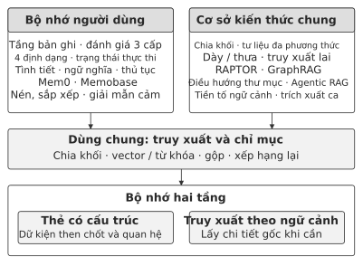

## Hệ thống bộ nhớ người dùng

Hãy tách câu "tuần sau tôi ở nước ngoài, giấy tờ ngân hàng thì gửi email cho tôi" ra mà đọc. Người dùng nêu một chuyến đi có thời hạn, rồi trong thời hạn đó chỉ định cách nhận thư. Khi ngân hàng đề nghị gửi giấy tờ qua bưu điện, trợ lý có thể dựa vào đó để đề nghị gửi bản điện tử; khi chuyến đi đã kết thúc mà lại có chuyện gửi thư, trợ lý phải xem lại điều kiện hiện tại. Nếu chỉ lưu "người dùng không thích thư giấy", về sau dù truy xuất được bản ghi này, trợ lý vẫn áp dụng sai phạm vi.

Xét tiếp chuyện vé máy bay. Nếu người dùng nói "tấm vé 1250 lần trước đắt hơn tôi nghĩ", hệ thống ít nhất có thể lưu mức giá lần đó, ngân sách lúc ấy, bối cảnh chuyến đi và phản hồi lần này. Lần sau gặp tình huống tương tự, mô hình sẽ dựa vào đó để xử lý thận trọng hơn với những báo giá vượt ngân sách. Nếu người dùng nói thêm "từ nay đi du lịch cùng gia đình thì hỏi tôi trước", câu đó đặt ra một điều kiện hỏi ý kiến rõ ràng cho các chuyến đi gia đình về sau. Từ đây có thể phân biệt ba loại thông tin: người dùng thực sự đã nói gì, lúc đó đang ở điều kiện nào, và mô hình suy ra được gì từ trải nghiệm này.

Có thể nhờ LLM sắp xếp các bản ghi này khi phiên kết thúc, rồi ghi những dữ kiện có giá trị về sau vào kho lưu trữ bền vững. Khi bắt đầu nhiệm vụ mới, chỉ đưa vào ngữ cảnh những bản ghi liên quan và vẫn còn áp dụng được.

Ví dụ, khi đặt vé máy bay, người dùng cung cấp các thông tin sau:

```text
User: Help me book a flight to Tokyo next Friday. I prefer window seats
      and I'm vegetarian, so I'll need a special meal.
Agent: I'll search for flights to Tokyo for next Friday...
       [calls flight_search tool, returns 3 options]
Agent: Here are your options. Based on your preference, I've filtered for
       window seat availability. Shall I book the ANA direct flight?
User: Yes, and use my United MileagePlus number 12345678.
```

Sau khi phiên kết thúc, bộ trích xuất bộ nhớ có thể rút ra bốn bản ghi:

```text
Extracted memories:
- User prefers window seats (preference)
- User is vegetarian, needs special meals on flights (dietary restriction)
- User's United MileagePlus number: 12345678 (loyalty program)
- User has travel plans to Tokyo (recent activity)
```

Ví dụ này gồm ba bước xử lý. **Trích xuất có chọn lọc** giữ lại sở thích chỗ ngồi, yêu cầu ăn uống và số thẻ thành viên, bỏ đi những chi tiết tạm thời như "tìm kiếm trả về ba lựa chọn". **Trừu tượng hóa** biến sở thích ghế cửa sổ mà người dùng nói rõ thành quy tắc dùng được cho những lần đặt vé sau. **Cấu trúc hóa** gắn nhãn phân loại cho dữ kiện để tiện truy xuất và cập nhật. Chuyến đi Tokyo còn nên ghi ngày khởi hành và trạng thái hiện tại; "thứ Sáu tuần sau" cần quy đổi theo ngày diễn ra phiên, và khi chuyến đi kết thúc hoặc bị hủy thì cập nhật trạng thái. Như vậy, sở thích lâu dài và hoạt động gần đây được duy trì theo đúng thời hạn hiệu lực của từng loại.

Bản giới thiệu sản phẩm của trợ lý cá nhân Today nêu một ví dụ. Người dùng nói mình tập vào thứ Ba và thứ Năm hằng tuần để chuẩn bị chạy bán marathon. Sáu tuần sau, dữ liệu giấc ngủ mà người dùng cho phép kết nối cho thấy đêm qua họ ngủ rất ít. Trợ lý đặt hai thông tin này cạnh nhau và đề nghị dời buổi tập ngắt quãng cường độ cao hôm đó. Mỗi thông tin nên nhớ trong bao lâu? Kế hoạch tập dùng được suốt giai đoạn chuẩn bị thi đấu, còn bản ghi giấc ngủ đêm qua phải kèm ngày. Kể cả khi người dùng chấp nhận dời lịch lần này, buổi tập thứ Năm tuần sau vẫn theo kế hoạch cũ, trừ khi người dùng nói từ nay đều đổi. Today cũng tách việc đưa ra đề xuất và việc sửa lịch thành hai bước, bước sau cần người dùng xác nhận.[^ch3-today]

[^ch3-today]: Trong bài "What Is Today", nhóm Today dùng ví dụ tập luyện bán marathon để minh họa cách bộ nhớ phối hợp với thông tin trong ngày. Trong bài "Meet Today", nhà sáng lập giải thích cơ chế xác nhận trước khi sửa lịch.

### Đánh giá năng lực ghi nhớ: khung ba cấp độ

Bộ đánh giá công khai **LoCoMo** (Long-term Conversational Memory, bộ nhớ hội thoại dài hạn) gồm những cuộc hội thoại dài, trung bình khoảng 300 lượt, tối đa 35 phiên, và kiểm tra năng lực ghi nhớ qua ba nhiệm vụ: hỏi đáp, tóm tắt sự kiện và sinh hội thoại đa phương thức. Phần hỏi đáp chia thành năm loại. Câu hỏi một bước tìm được đáp án trong một phiên; câu hỏi nhiều bước cần ghép các manh mối từ nhiều phiên; câu hỏi suy luận thời gian còn đòi hỏi phải xác định thứ tự các sự kiện. Câu hỏi kiến thức miền mở yêu cầu kết hợp lời người dùng đã nói với kiến thức bên ngoài. Lấy lại ví dụ đặt vé: người dùng chỉ nói "tuần sau đi Tokyo"; để trả lời "nơi đến dùng loại tiền nào", trợ lý vừa phải nhớ manh mối Tokyo, vừa phải biết ở đó dùng đồng yên. Nếu câu hỏi là số hiệu chuyến bay mà người dùng chưa từng nói, trợ lý nên chỉ ra rằng thông tin không đủ. Nhận ra loại câu hỏi không có cách nào trả lời này chính là năng lực mà nhóm câu hỏi đối kháng kiểm tra.[^ch3-locomo]

[^ch3-locomo]: Mục 4.1 trong bài báo LoCoMo của Maharana và cộng sự (arXiv:2402.17753) định nghĩa năm loại câu hỏi. Trang dự án của nhóm tác giả cung cấp dữ liệu và các hội thoại mẫu.

Kết hợp các bộ đánh giá như vậy với thực tiễn của những sản phẩm bộ nhớ, tác giả tóm lại tám năng lực cần chú ý:

- **Lưu giữ thông tin cá nhân**: lưu và truy xuất chính xác những thông tin lâu dài như danh tính người dùng.
- **Theo dõi sở thích**: ghi lại sở thích của người dùng và cập nhật khi họ nói rõ điều mới.
- **Chuyển ngữ cảnh**: sau khi đổi chủ đề vẫn nối tiếp được bối cảnh liên quan.
- **Cập nhật bộ nhớ**: xử lý những bổ sung và đính chính của người dùng đối với dữ kiện đã có.
- **Liên tục nhiều phiên**: dùng trong phiên mới những thông tin đã lưu trước đó.
- **Tư duy phức hợp**: liên kết nhiều mảnh ký ức. Ví dụ, người dùng từng nhắc đến chuyện dị ứng đậu phộng, thì khi bàn về món Thái phải kết hợp thông tin này để nhắc kiểm tra nguyên liệu.
- **Nhận thức thời gian**: lưu ngày tháng, hiểu thời gian tương đối và tính khoảng cách giữa các sự kiện.
- **Giải quyết xung đột**: phát hiện thông tin không nhất quán và phán đoán dựa trên nguồn, thời điểm và đối tượng áp dụng.

Xoay quanh các nhiệm vụ thực tế của Agent, cuốn sách dùng thêm một khung đánh giá ba cấp độ. Thí nghiệm 3-1 và 3-2 dùng khung này để so sánh các cách biểu diễn bộ nhớ; Thí nghiệm 3-9 và 3-11 lại dùng cùng khung để đánh giá các phương pháp truy xuất.

**Cấp độ 1: Nhớ lại cơ bản.** Lưu và truy xuất chính xác những thông tin rõ nghĩa mà người dùng trực tiếp cung cấp. Ví dụ, người dùng nói "số thẻ thành viên của tôi là 12345", thì khi đặt vé về sau hệ thống phải trả lại được đầy đủ con số đó. Cấp độ này chủ yếu kiểm tra xem dữ kiện có bị mất, bị lẫn hoặc bị viết lại hay không.

**Cấp độ 2: Truy xuất nhiều phiên.** Gom đủ những thông tin liên quan từ các phiên ở những thời điểm khác nhau và về những đối tượng khác nhau, rồi xác định yêu cầu hiện tại liên quan đến ai và cần những bản ghi nào. Người dùng có hai chiếc xe nhưng chỉ nói "đặt lịch bảo dưỡng xe cho tôi", thì hệ thống nên lấy thông tin cả hai xe rồi hỏi lại cho rõ. Khi tra cứu tình trạng khoản vay, phải phân biệt hợp đồng đã có hiệu lực với các báo giá từng được tư vấn. Khi hủy "chuyến đi Los Angeles", phải liên kết vé máy bay, khách sạn và các đặt chỗ khác vào cùng một chuyến.

**Cấp độ 3: Phục vụ chủ động.** Dựa vào nhiệm vụ hiện tại để phát hiện những việc liên quan mà người dùng không nêu ra từng mục. Ví dụ, khi đặt chuyến bay quốc tế, liên kết với thông tin hộ chiếu đã lưu từ mấy tháng trước để kiểm tra thời hạn có đáp ứng yêu cầu của chuyến đi không; khi điện thoại hỏng, tổng hợp bảo hành thiết bị, bảo hành kèm theo thẻ tín dụng và bảo hiểm của nhà mạng để liệt kê các phương án xử lý có thể dùng; khi chuẩn bị hồ sơ khai thuế, gom đủ giao dịch cổ phiếu, thu nhập làm tự do và giấy tờ thuế nhà đất từ bản ghi cả năm.

> **Thí nghiệm 3-1 ★: Đánh giá hệ thống bộ nhớ bằng khung ba cấp độ**
>
> Bộ đánh giá có 20 trường hợp cho mỗi cấp độ, tổng cộng 60. Cấp độ 1 chủ yếu là một phiên; cấp độ 2 và 3 gồm nhiều đoạn hội thoại trải qua nhiều thời điểm và nhiều đối tượng, dùng để kiểm tra liên kết thực thể, cập nhật thông tin và nhắc nhở chủ động.
>
> Mỗi trường hợp chạy qua hai bước. Trước hết lần lượt đưa vào từng đoạn hội thoại: mô hình sinh bộ nhớ từ đoạn đầu tiên, mỗi lần sau chỉ nhận bộ nhớ hiện có và đoạn hội thoại mới, rồi sinh bộ nhớ đã cập nhật. Từ đó trở đi mô hình không còn đọc được nguyên văn các hội thoại trước; muốn trả lời câu hỏi về những gì đã bàn khi ấy, nó chỉ có thể dựa vào thông tin đã ghi vào bộ nhớ. Sau khi xử lý hết các phiên, đưa vào một câu hỏi mới và yêu cầu Agent trả lời dựa trên bộ nhớ.
>
> Việc chấm điểm dùng LLM-as-a-judge: một mô hình giám khảo độc lập đối chiếu câu trả lời với đáp án tham khảo và yêu cầu chấm điểm, kiểm tra những dữ kiện được bao quát và các lỗi sai. Lần chạy này dùng Doubao Seed 1.6 để sinh bộ nhớ và câu trả lời, dùng mô hình của Moonshot để chấm điểm. Giám khảo thấy được hội thoại gốc; mô hình trả lời chỉ thấy bộ nhớ được giữ lại sau cùng.
>
> Đọc bảng điểm thế nào? Ví dụ, người dùng chỉ muốn tìm lại số tài khoản dịch vụ băng thông rộng. Ở nhóm ghi chú nâng cao, trợ lý trả lời đúng con số. Giám khảo cho 4 điểm ở độ chính xác, độ bao phủ và suy luận, chỉ cho 1 điểm ở tính chủ động, và câu này vẫn đạt. Điều kiện đạt trong chương trình là ba tiêu chí đầu mỗi tiêu chí ít nhất 3 điểm (tối đa 4 điểm), và giám khảo không phát hiện dữ kiện quan trọng nào thiếu căn cứ hoặc mâu thuẫn với lời gốc. Tính chủ động được tính vào điểm tổng hợp; chỉ nhìn số câu đạt thì không biết trợ lý đã chủ động giúp đến mức nào.

### Cấu trúc phân tầng của bộ nhớ

Để trả lời "lần trước đã đặt chuyến bay nào", cần tìm ra một sự kiện; để trả lời "khi đặt vé nên ưu tiên chọn chỗ ngồi nào", cần lấy ra sở thích được giữ lại qua nhiều lần tương tác. Hai câu hỏi cùng liên quan đến một người, nhưng đòi hỏi độ chi tiết của bản ghi và cách truy xuất khác nhau.

**Trajectory (quỹ đạo thực thi)** ghi lại theo thời gian các sự kiện trong một lần chạy của Agent, gồm tin nhắn người dùng, phản hồi của mô hình, các lần gọi công cụ và kết quả thực thi. Khi dùng nhật ký sự kiện chỉ ghi thêm (append-only), sự kiện mới được nối vào cuối, bản ghi cũ được giữ nguyên để truy vết. Harness có thể chọn lịch sử, trích xuất trạng thái hoặc sinh tóm tắt từ trajectory để dựng ngữ cảnh thực sự gửi cho mô hình ở mỗi lượt.

**Bộ nhớ dài hạn của người dùng** lưu những thông tin hữu ích xuyên phiên như sở thích, quan hệ giữa người với người, tóm tắt các hoạt động đã qua và những dữ kiện đã được xác nhận, đồng thời dùng các định danh như user ID để xác định thuộc về ai. Một phát biểu mới có thể bổ sung, đính chính hoặc thay thế bản ghi cũ, nên bộ nhớ dài hạn cần được gộp và cập nhật. Việc đọc và duy trì bộ nhớ có thể do Agent chủ động gọi công cụ, cũng có thể do Harness kích hoạt khi nạp phiên, khi kết thúc phiên hoặc khi sắp xếp ở chế độ nền.

**Trạng thái nghiệp vụ** mô tả nhiệm vụ đang ở giai đoạn logic nào, như "cần làm rõ", "đang xử lý", "chờ thanh toán", "đã hoàn tất". Chương trình có thể kiểm tra các trạng thái này để quyết định tiếp theo chờ sự kiện gì, thực hiện thao tác gì. Chương 6 sẽ bàn sâu hơn về quản lý trạng thái trong kiến trúc hướng sự kiện.

Ba loại bản ghi này phối hợp với nhau: trajectory cung cấp căn cứ thực thi, bộ nhớ dài hạn cung cấp bối cảnh xuyên phiên, trạng thái nghiệp vụ cho biết nhiệm vụ hiện tại đã tiến đến đâu. Phần sau tập trung vào cách biểu diễn, quản lý và truy xuất bộ nhớ dài hạn.

### Bốn định dạng lưu trữ bộ nhớ người dùng

Nếu chỉ cần sửa một địa chỉ email, tốt nhất là tìm thẳng được mục đó; nếu muốn biết vì sao trước kia đổi địa chỉ, thì phải đọc được diễn biến sự việc. Góc trên bên trái Hình 3-2 lưu email, công ty và chức vụ thành từng mục riêng; góc trên bên phải lại viết chức vụ, nhóm và dự án chung một chỗ. Nhìn tiếp hai thẻ bên dưới: sau này muốn cập nhật chức vụ, hoặc muốn phân biệt ai là người đi khám tim mạch, thì nên tra trường nào?

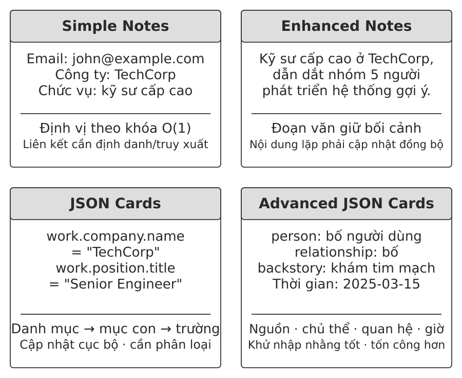

**Simple Notes** viết mỗi ký ức thành một dữ kiện ngắn, ví dụ "Email người dùng: john@example.com". Từng bản ghi dễ đọc dễ ghi; khi dùng bảng băm định vị theo khóa ổn định, thời gian tìm kiếm và cập nhật trung bình thường là O(1). Muốn tìm theo ngữ nghĩa trong một lượng lớn ghi chú thì phải xây thêm chỉ mục truy xuất. Tách quá vụn còn làm mất quan hệ: "làm kỹ sư cấp cao ở TechCorp, phụ trách phát triển hệ thống gợi ý" nếu bị tách thành ba bản ghi công ty, chức vụ, dự án không liên quan gì với nhau, thì về sau lại phải phán đoán xem chúng có thuộc cùng một công việc hay không.

**Enhanced Notes** lưu dữ kiện cùng bối cảnh của nó trong một đoạn văn đầy đủ. Ví dụ: "Người dùng là kỹ sư phần mềm cấp cao tại TechCorp, đã làm về học máy được ba năm, hiện dẫn dắt một dự án hệ thống gợi ý gồm 5 người." Quan hệ giữa công ty, chức vụ, kinh nghiệm và nhóm được giữ trong cùng một đoạn. Cái giá là một số dữ kiện có thể lặp lại ở nhiều đoạn; khi chức vụ thay đổi, phải tìm đủ các đoạn liên quan để cập nhật, tránh để bản ghi cũ và mới cùng tồn tại.

**JSON Cards** tổ chức thông tin theo "danh mục – danh mục con – cặp khóa-giá trị", ví dụ `personal.contact.email` và `work.position.title`. Khi sửa trường chức vụ, có thể giữ nguyên các trường khác như `work.company.name`, nên định dạng này hợp với cập nhật cục bộ. Khi thiết kế phân loại còn phải tính đến thông tin giao thoa: "cuối tuần dùng Python làm dự án cá nhân" vừa liên quan đến thời gian, vừa đến sở thích công nghệ và hoạt động. Có thể lưu một bản ghi hoạt động rồi gắn nhiều nhãn, hoặc dùng tham chiếu nối các danh mục liên quan, để giữ được những liên kết này.

**Advanced JSON Cards** thêm vào ngoài dữ kiện: bối cảnh nguồn gốc `backstory`, chủ thể `person`, quan hệ với người dùng `relationship` và dấu thời gian. Những trường này giúp hệ thống nhận ra thông tin thuộc về ai, biết được khi nào, áp dụng trong tình huống nào. Ví dụ, "bác sĩ Trương" có thể là nha sĩ của người dùng, cũng có thể là bác sĩ tim mạch của bố người dùng; lưu tên cùng với người đi khám, quan hệ thân thuộc và chuyên khoa sẽ giảm nhầm lẫn.

Khi người dùng nói "sắp xếp lịch khám sức khỏe định kỳ hằng năm cho người nhà tôi", hệ thống có thể dùng `person` và `relationship` để tìm ra các thành viên gia đình, rồi đọc trải nghiệm liên quan từ `backstory`. Trường càng phong phú thì khi trích xuất và cập nhật càng phải xử lý nhiều quan hệ. Tác giả khuyên lưu trữ kết hợp theo mức độ quan trọng của thông tin và nhu cầu liên kết: nhân vật then chốt, hợp đồng và sở thích lâu dài dùng Advanced JSON Cards để giữ nguồn gốc và quan hệ; những dữ kiện đơn giản, số lượng nhiều, ít liên kết thì dùng Simple Notes để giảm chi phí trích xuất và duy trì. Hai loại bản ghi được nối với nhau qua định danh hoặc tham chiếu, khi cần thì lấy ra cùng lúc.

> **Thí nghiệm 3-2 ★★: So sánh bốn định dạng bộ nhớ**
>
> Phần cài đặt đi kèm cung cấp giao diện thống nhất để sinh, cập nhật và truy xuất bộ nhớ cho cả bốn định dạng, rồi so sánh câu trả lời cuối cùng trên cùng 60 trường hợp của Thí nghiệm 3-1.
>
> Trong lần chạy này, Simple Notes, Enhanced Notes, JSON Cards và Advanced JSON Cards lần lượt đạt 48, 52, 51 và 49 trường hợp. Ở cấp độ 2, Enhanced Notes đạt 16 trường hợp, Advanced JSON Cards đạt 12; ở cấp độ 3, cả hai cùng đạt 19. Tính cả duy trì bộ nhớ, trả lời và chấm điểm, Enhanced Notes tốn khoảng 990 nghìn token, Advanced JSON Cards khoảng 1,55 triệu token, và thời gian trung bình mỗi lần gọi mô hình của định dạng sau cũng dài hơn.
>
> Lấy câu hỏi về dịch vụ xem phim trực tuyến ở cấp độ 2 làm ví dụ. Người dùng muốn tiết kiệm chi tiêu, hỏi mình đã đăng ký những dịch vụ nào và mỗi dịch vụ bao nhiêu tiền. Nhóm ghi chú nâng cao liệt kê phí hằng tháng của Netflix, Disney+ và Max, lần lượt 22,99, 19,99 và 19,99 đô la. Nhóm thẻ JSON nâng cao chỉ báo giá Max, kèm theo hai gói giá rẻ của Max. Lời khuyên cụ thể đến đâu cũng không bù được hai hóa đơn còn lại.
>
> Vấn đề bắt đầu từ lần cập nhật nào? Lật lại bộ nhớ mà nhóm thẻ nâng cao lưu sau từng lần: sau đoạn hội thoại thứ nhất vẫn còn Netflix, sau đoạn thứ hai chỉ còn bản ghi liên quan đến Disney+, sau đoạn thứ ba lại chỉ còn Max. Đến lúc đặt câu hỏi, hai gói đăng ký đầu đã biến mất khỏi bộ nhớ.

### Hình thức biểu diễn kiến thức nâng cao: mã thực thi được

Sau khi lưu dữ kiện, còn cần thống kê tổng hợp, kiểm tra xung đột và dựa vào quy tắc nghiệp vụ để quyết định bước tiếp theo. Trong **User as Code** (UaC), tác giả thử tổ chức thông tin người dùng thành các đối tượng Python có kiểu, và viết các thao tác đó thành hàm[^uac]. Mô hình trích xuất dữ kiện từ hội thoại, chương trình thực hiện các phép tính đã được định nghĩa rõ.

Với việc so sánh ngày, cộng dồn số tiền và những ràng buộc nghiệp vụ rõ ràng, tác giả ưu tiên viết phép tính thành hàm, để cùng một tập dữ kiện cho ra kết quả tái lập được và kiểm thử được. Như vậy, mô hình có thể tập trung vào việc hiểu ngữ nghĩa, bớt gánh nặng nhẩm tính và đối chiếu quy tắc lặp đi lặp lại trong hội thoại dài; cách biểu diễn và cách sử dụng bộ nhớ cũng được kiểm tra trong cùng một bộ mã.

UaC dùng quy trình hai giai đoạn: trước hết nối các dữ kiện trích xuất được vào nhật ký, rồi định kỳ tạo điểm kiểm tra (checkpoint), dựng lại trạng thái có kiểu từ nhật ký. Nhật ký giữ nguồn gốc và quá trình thay đổi của dữ kiện, còn đối tượng trạng thái cung cấp các trường truy vấn được ở thời điểm hiện tại.

Lấy hộ chiếu và lịch trình làm ví dụ, trạng thái có thể định nghĩa như sau:

```python
from dataclasses import dataclass
from datetime import date

@dataclass
class PassportInfo:
    number: str
    country: str
    expiry_date: date

@dataclass
class Trip:
    destination: str
    departure_date: date
    is_international: bool

@dataclass
class UserState:
    passport: PassportInfo
    trips: list[Trip]

state = UserState(
    passport=PassportInfo("AB1234567", "US", date(2025, 2, 18)),
    trips=[
        Trip("Tokyo", date(2025, 1, 15), True),
        Trip("Paris", date(2025, 6, 10), True),
    ],
)
```

**Thống kê tổng hợp** duyệt thẳng qua các bản ghi. Ví dụ, đếm số chuyến đi quốc tế đã đăng ký trong năm 2025:

```python
count = sum(
    1 for trip in state.trips
    if trip.is_international and trip.departure_date.year == 2025
)
# count == 2
```

**Kiểm tra xung đột** đối chiếu hai tập trường theo quy tắc định sẵn. Dưới đây lấy việc khớp nhóm thuốc làm ví dụ, minh họa cách đưa những mục cần đối chiếu thêm vào hàng đợi xử lý:

```python
def find_allergy_matches(profile):
    matches = []
    for medication in profile.current_medications:
        for allergy in profile.allergies:
            if medication.drug_class == allergy.drug_class:
                matches.append((medication, allergy))
    return matches
```

Mỗi mục khớp đều giữ bản ghi dùng thuốc và bản ghi dị ứng tương ứng; quy trình phía sau có thể dựa vào đó để đối chiếu, rồi theo quy tắc của lĩnh vực mà quyết định nhắc nhở, chuyển sang xét duyệt hay bổ sung thông tin.

**Kiểm tra ràng buộc** có thể tự động chạy mỗi khi trạng thái được cập nhật. Ví dụ, một quy tắc lịch trình yêu cầu khi khởi hành hộ chiếu phải còn hạn ít nhất 180 ngày; có thể truyền số ngày vào làm tham số:

```python
def passport_alerts(state, required_days):
    alerts = []
    for trip in state.trips:
        if trip.is_international:
            days = (state.passport.expiry_date - trip.departure_date).days
            if days < required_days:
                alerts.append((trip.destination, days))
    return alerts

alerts = passport_alerts(state, required_days=180)
```

Tính theo mức 180 ngày trong ví dụ, khi đi Tokyo hộ chiếu chỉ còn hạn 34 ngày, còn đến ngày khởi hành đi Paris thì đã hết hạn. Sau khi người dùng đổi hộ chiếu mới, chương trình có thể dùng ngày mới để tính lại cho cả hai chuyến.

[^uac]: Li, Bojie, User as Code: Executable Memory for Personalized Agents, 2026.

### Cơ sở khoa học nhận thức của bộ nhớ người dùng

Khoa học nhận thức phân biệt các loại trí nhớ theo nội dung và cách sử dụng. Những khái niệm này cũng giúp ta tổ chức thông tin dài hạn của Agent:

- **Trí nhớ tình tiết (episodic memory)** lưu các sự kiện cụ thể cùng thời gian, người tham gia và diễn biến. Ví dụ ở người là "tối thứ Tư tuần trước ăn tối với đồng nghiệp ở nhà hàng Ý"; trong Agent có thể tương ứng với "người dùng định đi Tokyo bằng chuyến bay ANA vào thứ Sáu tuần sau", kèm ghi nhận sau đó có đặt vé thành công hay có đổi vé không.
- **Trí nhớ ngữ nghĩa (semantic memory)** lưu dữ kiện và khái niệm. Ví dụ ở người là "thủ đô của Ý là Roma"; trong Agent có thể tương ứng với "người dùng ăn chay", "người dùng thích ghế cạnh cửa sổ". Những thông tin này có thể đến từ lời người dùng nói rõ, cũng có thể được khái quát từ nhiều lần trải nghiệm; ghi lại nguồn sẽ giúp phân biệt hai trường hợp.
- **Trí nhớ thủ tục (procedural memory)** liên quan đến kỹ năng và trình tự hành vi. Ví dụ ở người là đi xe đạp; trong kỹ thuật Agent có thể so sánh với các quy trình dùng lại được, chẳng hạn "tìm chuyến bay thẳng → xác nhận sở thích chỗ ngồi → dùng số thẻ khách hàng thường xuyên → đặt suất ăn".

Nhìn lại lịch sử mua sắm ở Chương 1: "xem mười món rồi mua một trong số đó" cho phép ghi lại một sự kiện mua hàng, nhưng khó dựa vào đó mà kết luận người dùng sau này thích gì. Cô ấy có thể thích kiểu dáng này, cũng có thể chỉ vì món đó giao được trong ngày. Nếu sau đó cô nói "từ nay mua loại này thì xem trước có giao trong ngày được không", hệ thống có thêm một sở thích dài hạn có phạm vi áp dụng rõ ràng. Lần sau gợi ý sản phẩm cùng loại, có thể ưu tiên kiểm tra thời gian giao hàng, và cũng giải thích được cho cô điều kiện lọc này xuất phát từ lần phản hồi nào.

Bảng 3-1 đặt cách phân loại này cạnh các tầng bộ nhớ và các định dạng lưu trữ ở trên, cho thấy mỗi khía cạnh trả lời câu hỏi gì.

Bảng 3-1 Ba khía cạnh của thiết kế bộ nhớ

| Khía cạnh thiết kế | Câu hỏi cần trả lời | Các loại cụ thể |
| --- | --- | --- |
| Tầng bản ghi | Thông tin đảm nhận vai trò gì? | Trajectory, bộ nhớ dài hạn của người dùng, trạng thái nghiệp vụ |
| Định dạng lưu trữ | Biểu diễn bằng cấu trúc nào? | Simple Notes, Enhanced Notes, JSON Cards, Advanced JSON Cards |
| Nội dung bộ nhớ | Lưu loại thông tin nào? | Trí nhớ tình tiết, trí nhớ ngữ nghĩa, trí nhớ thủ tục |

Ví dụ, "người dùng thích ghế cạnh cửa sổ" thuộc trí nhớ ngữ nghĩa, có thể lưu trong bộ nhớ dài hạn bằng Simple Notes; một quy trình đặt vé thuộc trí nhớ thủ tục, có thể lưu bằng thẻ kèm nguồn gốc và điều kiện áp dụng.

### Các framework bộ nhớ tiêu biểu

Người dùng nói "dạo này tôi chuyển sang ngồi ghế lối đi rồi", nhưng bản ghi cũ lại ghi "thích ghế cửa sổ". Hệ thống có thể cập nhật sở thích chỗ ngồi ngay lúc ghi, cũng có thể lưu cả hai phát biểu, đợi lần đặt vé sau mới phán đoán câu nào áp dụng. Dưới đây trước hết xem Mem0 xử lý loại xung đột này ở khâu nào, rồi xem Memobase ghi riêng hồ sơ người dùng và các sự kiện cụ thể ra sao.

**Mem0: dời vị trí xử lý xung đột.** Quy trình trong bài báo năm 2025 và bản v2 so sánh dữ kiện cũ và mới ngay khi ghi; bản v3 về sau chuyển sang ghi thêm dữ kiện kết hợp truy xuất lai. Hình 3-3 đối chiếu hai cách sắp xếp này.

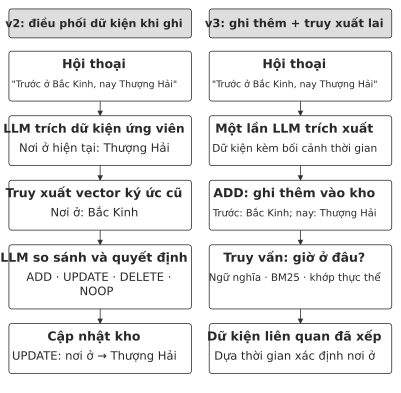

Trong quy trình ban đầu, LLM trích xuất các dữ kiện ứng viên từ hội thoại, rồi truy xuất những ký ức đã có gần nghĩa, và quyết định thực hiện **ADD**, **UPDATE**, **DELETE** hay **NOOP**. Người dùng trước nói "tôi sống ở Bắc Kinh", sau lại nói "tôi đã chuyển đến Thượng Hải", thì hệ thống có thể cập nhật nơi ở hiện tại thành Thượng Hải. Như vậy, khi truy vấn dễ lấy được dữ kiện đã sắp xếp; còn khi duy trì thì phải nhận diện đúng lời đính chính, sự thay đổi theo thời gian và các đối tượng khác nhau, đồng thời lưu căn cứ của mỗi lần cập nhật để tra lại khi phát hiện sai sót. Bài báo còn đề xuất biến thể bộ nhớ đồ thị **Mem0-g**, dùng thực thể và quan hệ để biểu diễn kiến thức liên kết[^ch3-mem0-paper].

Bản v3 chuyển việc tự động trích xuất thành một lần gọi LLM duy nhất, chỉ ghi thêm bản ghi **ADD**. Hai thông tin Bắc Kinh và Thượng Hải có thể được giữ cùng bối cảnh thời gian, đến lúc truy vấn mới kết hợp ngữ cảnh để xác định nơi ở hiện tại. Việc truy xuất dùng đồng thời độ tương đồng ngữ nghĩa, từ khóa BM25 và khớp thực thể; những hành động đã được xác nhận hoàn tất cũng có thể được trích thành dữ kiện. Theo hướng dẫn chuyển đổi, điểm LoCoMo tăng từ 71,4 lên 91,6, LongMemEval tăng từ 67,8 lên 93,4. Phiên bản mã nguồn mở này dùng liên kết thực thể cho truy xuất nội bộ, bỏ giao diện lưu trữ đồ thị bên ngoài và giá trị trả về `relations`; bộ nhớ đồ thị do nền tảng dịch vụ được quản lý cung cấp[^ch3-mem0-migration].

Bước tiến hóa này cho thấy hệ thống bộ nhớ có thể dời việc phán đoán xung đột từ giai đoạn ghi sang giai đoạn đọc. Nếu lúc ghi lỡ gộp trải nghiệm của hai người làm một, hoặc coi thông tin bổ sung là lời đính chính, các câu trả lời về sau có thể cứ dựa mãi vào một trạng thái hiện tại sai. Ghi thêm thay vì ghi đè cho phép cả bằng chứng cũ lẫn mới tham gia phán đoán, đồng thời bớt được các lần gọi mô hình để quyết định từng mục khi ghi. Với bộ nhớ người dùng thay đổi thường xuyên, khó phán đoán xung đột ngay lúc đó, tác giả nghiêng về cách lưu dữ kiện cùng thời điểm và nguồn trước, đến khi trả lời câu hỏi cụ thể mới sắp xếp ra trạng thái còn hiệu lực.

[^ch3-mem0-paper]: Chhikara và cộng sự, Mem0: Building Production-Ready AI Agents with Scalable Long-Term Memory, 2025.

[^ch3-mem0-migration]: Mem0, Open Source: Migrating to the New Memory Algorithm.

**Memobase: hồ sơ người dùng và bộ nhớ sự kiện.** Memobase tổ chức thông tin dài hạn thành hai phần. **Hồ sơ người dùng (profile)** lưu các thuộc tính tương đối ổn định theo chủ đề và chủ đề con, ví dụ tên dưới `basic_info`, sở thích dưới `interest`, chức vụ dưới `work`. Nhà phát triển có thể cấu hình các ô (slot) cần trích xuất, để kiểm soát phạm vi và độ chi tiết của hồ sơ. **Bộ nhớ sự kiện (event memory)** ghi lại trải nghiệm của người dùng cùng thời gian, để hệ thống trả lời được những câu hỏi như "lần trước bàn về ngân sách là khi nào".

Memobase đưa hội thoại mới vào bộ đệm trước; khi bộ đệm tích lũy đến kích thước định sẵn, hoặc phiên rảnh quá một khoảng thời gian thiết lập, nó xử lý theo lô; cũng có thể kích hoạt tường minh khi phiên kết thúc. Như vậy, nhiều tin nhắn dùng chung một lượt sắp xếp, còn khi truy vấn thì đọc hồ sơ và sự kiện đã sinh sẵn. Cập nhật bất đồng bộ giúp tương tác hiện tại không phải chờ trích xuất bộ nhớ; khi cần dùng ngay dữ kiện mới nhất thì có thể chờ lượt xử lý này hoàn tất[^ch3-memobase].

[^ch3-memobase]: Memobase, tài liệu chính thức của dự án, gồm các trường hồ sơ, bộ nhớ sự kiện, bộ đệm và giao diện cập nhật đồng bộ.

Nếu trợ lý vừa phải nhớ diễn biến lần đặt vé trước, vừa phải nắm sở thích chỗ ngồi của người dùng và quy trình làm thủ tục hoàn vé, có thể lưu riêng sự kiện, dữ kiện và quy trình như Hình 3-4. Mỗi lần nhận nhiệm vụ, đưa những phần dùng được vào bộ nhớ làm việc.

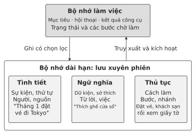

Trí nhớ tình tiết giữ chuỗi sự kiện cùng các siêu dữ liệu như dấu thời gian, nhãn cảm xúc, định danh nhiệm vụ, và có thể kết hợp truy xuất theo thời gian với theo chủ đề. Ví dụ, "lần trước bàn về ngân sách" cần cả khớp chủ đề lẫn sắp xếp theo thời gian. Trí nhớ ngữ nghĩa lưu dữ kiện và sở thích rút ra từ sự kiện, trí nhớ thủ tục lưu những quy trình dùng đi dùng lại.

**Bộ nhớ làm việc (working memory)** tổ chức mục tiêu hiện tại, trạng thái nhiệm vụ và những thông tin liên quan đã lấy ra. Harness chọn nội dung từ trajectory và kho lưu trữ dài hạn để nạp vào ngữ cảnh hiện tại; dữ kiện mới phát sinh trong nhiệm vụ được sắp xếp rồi ghi vào bộ nhớ dài hạn. Trajectory ghi lại sự việc đã diễn ra thế nào, bộ nhớ làm việc tập trung lưu những thông tin cần cho quyết định bước tiếp theo; hai bên nối với nhau qua định danh sự kiện và nguồn.

Khi dùng RAG để đọc bộ nhớ người dùng, trước hết dựa vào yêu cầu hiện tại để tìm ra một loạt ký ức có thể liên quan, rồi mới quyết định ký ức nào nên đưa vào bộ nhớ làm việc. Giả sử hôm nay trợ lý giúp người dùng chọn chỗ ngồi, và truy xuất tìm được cùng lúc hai câu: "đi công tác thì tôi thích ngồi cửa sổ" và "lần trước bị thương ở đầu gối, chuyến về chọn giúp tôi ghế lối đi". Cả hai đều rất liên quan đến việc chọn chỗ, nhưng câu thứ hai chỉ đặt yêu cầu cho chuyến về lần ấy. Sắp xếp lại theo độ liên quan, kể cả xếp nó lên đầu, vẫn chưa trả lời được hôm nay nó có còn áp dụng hay không.

Trong trường hợp này, tác giả đánh giá cao hơn việc dùng một mô hình phán định như Jev để lọc các ký ức ứng viên. Đưa cho nó lịch trình lần này, yêu cầu hiện tại của người dùng, cùng nguyên văn, ngày tháng và điều kiện áp dụng của từng ký ức, để nó phán định từng mục là "áp dụng cho lần này", "chỉ để tham khảo" hay "không đủ căn cứ". Nếu hôm nay cũng là chuyến công tác, câu thứ nhất có thể làm căn cứ chọn chỗ; nếu người dùng vừa nói vết thương đầu gối chưa lành, câu thứ hai đáng được đem ra để hỏi lại.

### Cơ chế nén và sắp xếp bộ nhớ

Một người dùng hay đặt vé có thể nhắc đến "cửa sổ" mười lần. Có khi chín lần trong số đó đều nhắc lại cùng một đơn đặt chỗ; nếu lấy thẳng số lần nhắc làm độ mạnh của sở thích, một sự việc sẽ bị thổi phồng trọng số. Khi sắp xếp, trước hết nhận diện nguồn và sự kiện, rồi gộp các bản ghi trùng, kiểm tra xem có lời đính chính nào muộn hơn không, sau cùng mới quyết định quy luật nào hợp để dùng trong nhiệm vụ tương lai. Gặp câu "cái ghế cửa sổ lần trước được đấy", có thể nhờ một mô hình phán định như Jev đọc câu này cùng đơn đặt chỗ liên quan, chỉ để xác định nó thuộc loại "nhắc lại chuyến bay lần trước", "đưa ra yêu cầu cho lần này" hay "bày tỏ sở thích lâu dài". Nếu không khớp được đơn hoặc cách hiểu nào cũng hợp lý, thì giữ nguyên văn, đợi lúc đặt vé mới xác minh. Một phán đoán cục bộ như vậy tránh được việc tính đi tính lại cùng một trải nghiệm thành bằng chứng mới.

1. **Lọc đối tượng cần sắp xếp.** Tần suất truy cập, thời điểm ghi, nhãn cảm xúc và tính độc nhất của thông tin có thể dùng làm tín hiệu xếp hạng. Ví dụ, một bản ghi tạo ba ngày trước, được truy cập năm lần, nhãn cảm xúc khá mạnh và không trùng lặp thì đáng được lưu riêng; một bản ghi tạo chín mươi ngày trước, chỉ được truy cập một lần, lại trùng nhiều với ba bản ghi khác thì có thể ưu tiên gộp với các bản ghi liên quan. Hệ thống có thể lọc theo điểm số ra những bản ghi cần sắp xếp, rồi dựa vào quy tắc nghiệp vụ mà quyết định nén, gộp hay xóa. Các ràng buộc dài hạn và hợp đồng còn hiệu lực, dù ít được truy cập, cũng nên giữ đến hết thời hạn hiệu lực.
2. **Phân cụm và sinh tóm tắt.** Gom các bản ghi giống nhau thành nhóm, dùng một đoạn tóm tắt giữ lại phần chung. Ví dụ, nhiều cuộc hội thoại về thời tiết có thể sắp xếp thành "người dùng hay hỏi thời tiết, đặc biệt quan tâm đến mưa". Ngày tháng cụ thể và câu hỏi gốc được lưu trữ riêng, tóm tắt liên kết đến bản ghi gốc để tiện tra lại sau này.
3. **Rút ra quy luật và quy trình.** Từ nhiều lần mua sắm, khái quát thành "ưa sản phẩm có giá trị tốt so với giá, coi trọng đánh giá của người dùng", hoặc chắt lọc ra các bước chọn hàng.

### Bảo vệ quyền riêng tư: giải mẫn cảm nhật ký

Bộ nhớ người dùng thường chứa danh tính, thông tin liên lạc và thông tin tài khoản. Hệ thống phải dựa theo nhiệm vụ để quyết định những trường nào đi vào đầu vào của mô hình, dựa theo nhu cầu vận hành để quyết định nội dung nào đi vào nhật ký. Có thể giải mẫn cảm ngay trước khi ghi nhật ký, thay các đoạn nhạy cảm bằng nhãn loại hoặc ký hiệu giữ chỗ ổn định, mà vẫn giữ cấu trúc cần cho việc điều tra sự cố.

> **Thí nghiệm 3-3 ★★: Giải mẫn cảm nhật ký bằng mô hình cục bộ**
>
> Thí nghiệm này gọi Qwen3-0.6B chạy cục bộ qua Ollama để nhận diện các đoạn nhạy cảm trong nhật ký ngay trên máy. Mô hình nhỏ thích hợp triển khai trên thiết bị phổ thông; cũng có thể chuyển sang các cỡ 1.7B, 4B để so sánh chất lượng nhận diện và thời gian xử lý. Khi nhật ký gốc phải ở lại trên máy, việc nhận diện và thay thế cũng nên làm ngay trên máy, rồi mới giao kết quả đã giải mẫn cảm cho các dịch vụ phía sau.
>
> Tư liệu kiểm thử gồm các dãy số có cấu trúc như số căn cước, số thẻ ngân hàng; nội dung bán cấu trúc như địa chỉ; và những thông tin nhạy cảm lộ ra trong ngôn ngữ tự nhiên như mật khẩu. Mô hình trả về loại thông tin, vị trí trong văn bản và độ tin cậy theo JSON Schema, chương trình dựa vào đó để thay thế văn bản gốc. Nhóm đối chứng dùng biểu thức chính quy; nhóm kết hợp chạy biểu thức chính quy trước, rồi để mô hình xử lý phần văn bản còn lại.
>
> Xét hai dòng nhật ký trước. Dòng thứ nhất có số căn cước và số điện thoại; biểu thức chính quy chỉ che được số điện thoại, độ phủ (recall) là $1/2$. Ở dòng thứ hai, biểu thức chính quy tìm đủ số an sinh xã hội Mỹ và số thẻ ngân hàng, nhưng che luôn cả số phiếu yêu cầu có định dạng tương tự. Trong ba chỗ nó đánh dấu chỉ có hai chỗ cần giải mẫn cảm, độ chính xác (precision) là $2/3$. Nếu chỉ kiểm tra xem giá trị nhạy cảm còn sót trong nhật ký hay không, dòng thứ hai sẽ qua; đến khi nhân viên chăm sóc khách hàng dùng dòng nhật ký này để tra phiếu yêu cầu, mới phát hiện manh mối đã mất.
>
> Tính độ phủ cho từng dòng trong toàn bộ 12 mẫu rồi lấy trung bình, biểu thức chính quy, mô hình và phương án kết hợp lần lượt đạt khoảng 50%, 69% và 78%. Kiểm đếm từng dòng sau khi thay thế, ba phương án lần lượt còn sót 9, 3 và 2 giá trị nhạy cảm. Chọn phương án nào còn phải xét thời gian xử lý: trên máy này, biểu thức chính quy trung bình mất khoảng 0,1 mili giây mỗi dòng, còn mô hình và phương án kết hợp đều gần 3 giây. Khi lượng nhật ký lớn, có thể dùng biểu thức chính quy cho các trường có định dạng ổn định trước, chỉ để mô hình kiểm tra bổ sung những đoạn cần dựa vào ngữ cảnh để phán đoán.

Khi bản ghi nhiều lên, bước tiếp theo là tìm ra giữa hàng nghìn hàng vạn thông tin những nội dung mà nhiệm vụ hiện tại cần. Kỹ thuật RAG giới thiệu dưới đây dùng được cho cả cơ sở kiến thức chung lẫn truy xuất bộ nhớ người dùng.

## Nền tảng RAG: xây dựng đường ống thu nhận kiến thức cho Agent

Một cửa hàng đã sửa chính sách hoàn tiền, người dùng đến hỏi: "Món hàng tôi mua tháng trước, giờ làm sao để yêu cầu hoàn tiền?" Muốn trả lời đúng, trước hết phải tra được điều khoản áp dụng cho đơn hàng này, rồi giải thích rõ điều kiện và các bước. **Sinh tăng cường truy xuất** (Retrieval-Augmented Generation, RAG) nối hai bước đó lại, giúp mô hình dùng được tư liệu nội bộ của cửa hàng, và dùng được cả những chính sách chỉ công bố sau khi mô hình đã huấn luyện xong.

Hãy bắt đầu từ trường hợp chỉ có một phiên bản chính sách. Dưới đây dùng một giao diện đơn giản hóa để tra quy trình hoàn tiền của cùng cửa hàng đó, quan sát kết quả truy xuất đi vào câu trả lời của mô hình như thế nào:

```python
query = "Quy trình hoàn tiền"
results = retriever.search(query, top_k=2)
# results = [
#   "Chính sách hoàn tiền: trong 7 ngày sau khi nhận hàng có thể yêu cầu hoàn toàn bộ, cần cung cấp mã đơn. Tiền về trong 3–5 ngày làm việc.",
#   "Thao tác hoàn tiền: vào 'Đơn hàng của tôi', chọn đơn, bấm 'Yêu cầu hoàn tiền'."
# ]
answer = llm.generate(system="Bạn là trợ lý chăm sóc khách hàng.", context=results, question=query)
# Câu trả lời gồm thời hạn yêu cầu, thông tin cần có, các bước thao tác và thời gian tiền về.
```

Đối chiếu Hình 3-5 với hai kết quả truy xuất trong đoạn mã: các bước yêu cầu hoàn tiền lấy từ "Thao tác hoàn tiền", còn chuyện phải chờ 3–5 ngày làm việc tiền mới về thì lấy từ "Chính sách hoàn tiền". Nếu kết quả truy xuất chỉ còn các bước thao tác, mô hình còn căn cứ nào để nói với người dùng khi nào tiền về không? Câu hỏi này liên quan đến cách chia khối cuốn sổ tay.

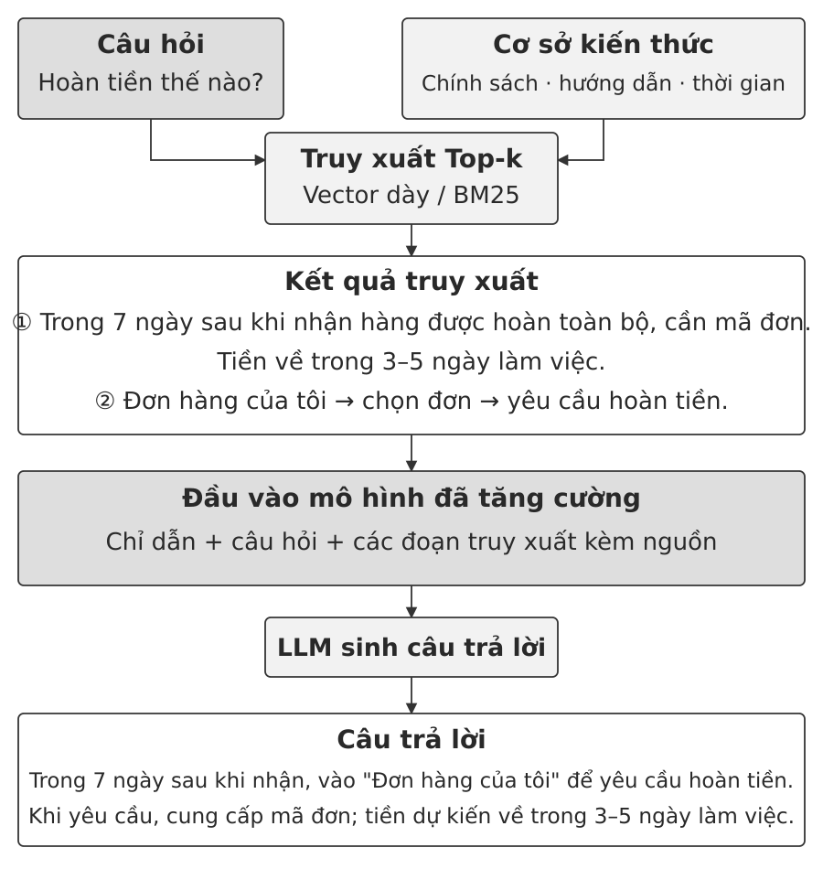

### Chia khối tài liệu (Chunking)

Giả sử một cuốn sổ tay hậu mãi trước hết ghi "được trả hàng trong bảy ngày", đoạn tiếp theo mới nêu các mặt hàng ngoại lệ. Nếu chỉ lấy được câu đầu, trợ lý có thể hứa hoàn tiền cả cho hàng ngoại lệ; còn nếu coi cả cuốn sổ tay là một đơn vị truy xuất, nó lại kéo theo cả lắp đặt, cấu hình và xử lý sự cố, khiến vector khó làm nổi bật chủ đề hoàn tiền. **Chia khối (chunking)** phải chọn kích thước ở giữa hai thái cực đó, sao cho một khối văn bản đủ để tự giải thích điều kiện của nó, đồng thời dễ được các câu hỏi cụ thể tìm thấy. Độ dài khối còn phải nằm trong ngân sách đầu vào của mô hình nhúng, và chừa chỗ trong ngữ cảnh cho bước sinh phía sau.

Có ba nhóm phương pháp thường dùng.

**Chia theo kích thước cố định** chia theo số token, ví dụ mỗi khối 512 token, hai khối liền kề chồng lên nhau 50–100 token. Phần chồng lấn cho nội dung gần ranh giới cơ hội xuất hiện trọn vẹn trong khối khác. Cách này dễ kiểm soát độ dài khối, nhưng điểm cắt có thể rơi vào giữa đoạn văn, đoạn mã hoặc bảng.

**Chia đệ quy hoặc theo cấu trúc** ưu tiên chia theo ranh giới tự nhiên như chương, đoạn; gặp phần quá dài mới chia tiếp theo đơn vị nhỏ hơn như câu. Tiêu đề Markdown và các phần tử HTML cung cấp manh mối cấu trúc. Khối mã, bảng và phần nội dung gắn với tiêu đề cũng có thể có quy tắc xử lý riêng. Với tài liệu kỹ thuật có cấu trúc rõ ràng, tác giả khuyên bắt đầu từ cách này: tận dụng chương và đoạn có sẵn, rồi chia nhỏ những phần quá dài, thường dễ giữ trọn ý nghĩa hơn so với cắt thẳng.

**Chia theo ngữ nghĩa** tính độ tương đồng nhúng giữa các câu hoặc cụm câu liền kề, rồi cắt ở những chỗ chủ đề thay đổi rõ rệt. Nó tốn thêm phép tính nhúng, nhưng có cơ hội giữ cùng một chủ đề trong một khối.

Giả sử bộ truy xuất chỉ gửi về một câu: "Doanh thu của công ty tăng 3%." Công ty nào? Quý nào? Con số tìm đúng rồi, nhưng căn cứ để trả lời lại nằm ở đoạn trước. Nếu cho cả bản báo cáo tài chính vào một khối, quý và tên công ty thì giữ được, nhưng khi tra doanh thu, các đoạn về tuyển dụng và mua sắm thiết bị cũng đi vào theo. Những nội dung này còn phải dùng chung một vector, nên chủ đề doanh thu trong vector có thể không còn nổi bật như trước. Khi chọn kích thước khối trong thực tế, có thể thử bắt đầu từ 256–1024 token mỗi khối, hai khối liền kề chồng lên nhau 10–20%.

Các siêu dữ liệu như tiêu đề, nguồn và thời gian có thể lưu kèm theo đoạn. Phần truy xuất theo ngữ cảnh ở sau sẽ bổ sung cho mỗi đoạn bối cảnh của nó trong văn bản gốc, giúp phân giải đại từ và phạm vi khi truy xuất độc lập.

### Nhúng dày đặc: biểu diễn văn bản bằng vector

**Nhúng (embedding)** ánh xạ từ, câu hoặc khối văn bản thành vector số, ví dụ `[0.2, -0.5, 0.8, ...]`. Mô hình truy xuất được huấn luyện để truy vấn và tài liệu liên quan có độ tương đồng cao trong không gian vector. "Dày đặc" nghĩa là phần lớn các chiều của vector đều có giá trị khác không, cùng nhau biểu diễn thông tin của văn bản; biểu diễn thưa ở phần sau thì chỉ có ít chiều khác không.

Có thể hình dung không gian vector như một tấm bản đồ nhiều chiều: mỗi đoạn văn bản ứng với một vị trí, truy xuất là tìm những nội dung nằm gần truy vấn trên bản đồ đó. Một thước đo thường dùng là **độ tương đồng cosine**:

$$
\operatorname{cos}(A,B)=\frac{A\cdot B}{\|A\|\,\|B\|}
$$

Tích vô hướng $A\cdot B$ nhân các chiều tương ứng rồi cộng lại; độ dài $\|A\|$ là căn bậc hai của tổng bình phương các chiều. Sau khi chia cho hai độ dài, kết quả chỉ phản ánh quan hệ về hướng. Với vector khác không, giá trị cosine nằm trong $[-1,1]$; càng gần 1 thì hai hướng càng trùng nhau. Các mô hình truy xuất khác nhau cũng dùng tích vô hướng hoặc khoảng cách Euclid. Khi cả hai vector đều được chuẩn hóa về độ dài đơn vị, tích vô hướng chính bằng độ tương đồng cosine.

> **Tính tay: độ tương đồng cosine của ba câu**
>
> Dùng ba vector minh họa để biểu diễn "cách nuôi mèo" $A=(0.9,0.5,0.1)$, "hướng dẫn chăm sóc mèo" $B=(0.8,0.6,0.1)$ và "chiến lược đầu tư cổ phiếu" $C=(0.1,0.1,0.9)$.
>
> $A\cdot B=0.9\times0.8+0.5\times0.6+0.1\times0.1=1.03$. Độ dài của hai vector lần lượt là $\sqrt{1.07}$ và $\sqrt{1.01}$, độ tương đồng khoảng **0.991**.
>
> $A\cdot C=0.9\times0.1+0.5\times0.1+0.1\times0.9=0.23$, độ dài của $C$ là $\sqrt{0.83}$, độ tương đồng khoảng **0.244**. Trong nhóm vector này, truy vấn về nuôi mèo gần với hướng dẫn chăm sóc mèo hơn.

Mô hình thực tế thường dùng từ vài trăm đến vài nghìn chiều.

#### Từ Word2Vec đến biểu diễn theo ngữ cảnh

Hình 3-6 bắt đầu từ vector từ cố định. **Word2Vec** học một vector cố định cho mỗi từ dựa vào sự đồng xuất hiện của từ ngữ. Một số quan hệ thể hiện được qua phép toán vector, ví dụ kinh điển "vua − nam + nữ ≈ nữ hoàng". Hạn chế của biểu diễn cố định cũng rất dễ thấy: `bank` trong `river bank` (bờ sông) và `investment bank` (ngân hàng đầu tư) dùng cùng một vector từ.

**GloVe** thống kê số lần đồng xuất hiện giữa các từ trên toàn bộ kho ngữ liệu, rồi học vector từ qua một hàm mục tiêu bình phương tối thiểu có trọng số. Word2Vec thiên về nhiệm vụ dự đoán trong cửa sổ cục bộ, GloVe đưa thẳng thống kê đồng xuất hiện toàn cục vào huấn luyện; cả hai đều học biểu diễn cố định cho từ vựng[^ch3-glove].

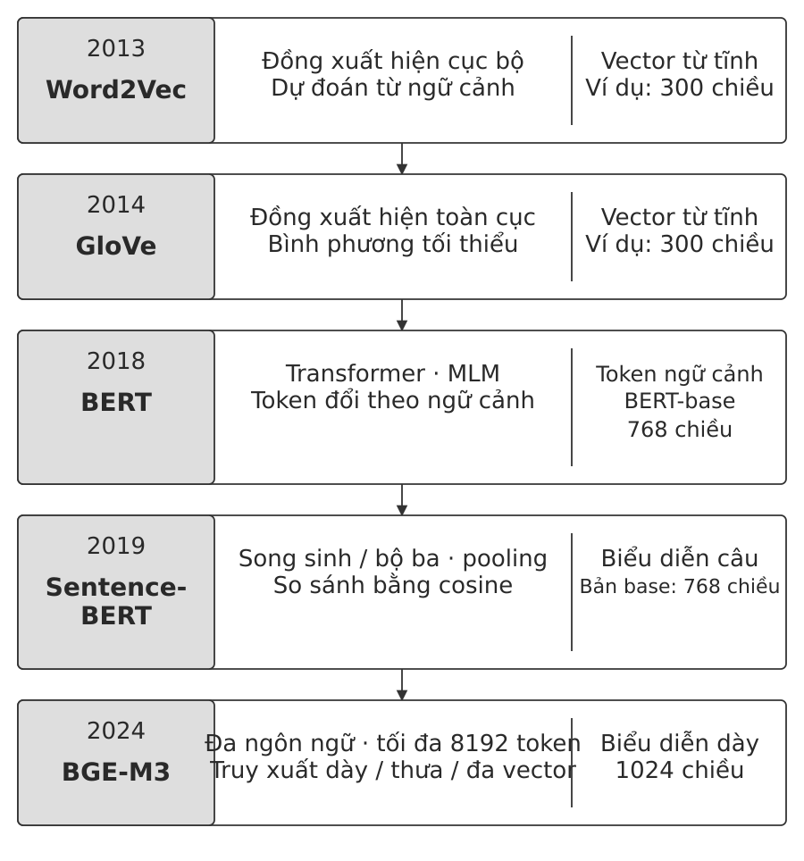

Đến các mô hình theo ngữ cảnh như **BERT**, biểu diễn của cùng một token thay đổi theo câu. Nhờ tự chú ý (self-attention), mô hình có thể dựa vào những manh mối như "ra mắt sản phẩm mới" và "mua hai cân" để tính ra hai biểu diễn khác nhau cho chữ "táo" (Apple) trong hai câu. Mô hình nhúng dùng cho truy xuất còn phải gộp biểu diễn các token thành vector truy vấn hoặc vector tài liệu, và được huấn luyện tương ứng để hai loại vector so sánh được với nhau.

**Sentence-BERT** kết hợp BERT với lớp gộp (pooling) và cấu trúc mạng song sinh (siamese) hoặc bộ ba (triplet), huấn luyện ra vector câu có thể so sánh trực tiếp. Tài liệu có thể được mã hóa trước rồi lưu vào chỉ mục; khi có truy vấn, chỉ cần mã hóa truy vấn rồi tính độ tương đồng vector. Mã hóa trước giúp khỏi phải tính lại biểu diễn của toàn bộ tài liệu cho mỗi lần truy vấn[^ch3-sbert].

**BGE-M3** cung cấp đồng thời biểu diễn truy xuất dày đặc, thưa và đa vector, hỗ trợ nhiều ngôn ngữ và đầu vào khá dài; mục này dùng biểu diễn dày đặc của nó để minh họa truy xuất đơn vector[^ch3-bge-m3]. Độ dài mà mô hình chấp nhận ảnh hưởng đến phương án chia khối: giới hạn điển hình của BERT gốc là 512 token, còn BGE-M3 hỗ trợ đến 8192 token.

[^ch3-bge-m3]: Bài báo M3-Embedding của Chen và cộng sự (arXiv:2402.03216) trình bày cách huấn luyện kết hợp ba loại biểu diễn truy xuất. Xem thêm tài liệu mô hình BGE-M3 của BAAI, gồm cách biểu diễn, số chiều, độ dài đầu vào và cách sử dụng.

> **Thí nghiệm 3-4 ★★: So sánh hai chỉ mục láng giềng gần nhất xấp xỉ**
>
> Khi đã có vector tài liệu, cần tìm nhanh những vector gần với truy vấn. Tính lần lượt từng vector thì được láng giềng chính xác, nhưng khi dữ liệu lớn lên, chỉ mục **láng giềng gần nhất xấp xỉ** (Approximate Nearest Neighbor, ANN) chấp nhận mất một phần độ phủ trong mức kiểm soát được để đổi lấy tốc độ truy vấn. Thí nghiệm này so sánh ANNOY và HNSW trên cùng một lô vector nhúng thật và cùng các truy vấn, lấy kết quả tìm kiếm chính xác làm chuẩn đối chiếu. Ví dụ, tìm kiếm chính xác của một truy vấn liệt kê mười láng giềng gần nhất, trong mười kết quả chỉ mục xấp xỉ trả về có tám láng giềng trong số đó, thì Recall@10 của truy vấn này là 0.8. Con số này đo xem chỉ mục giữ lại được bao nhiêu láng giềng chính xác.
>
> ANNOY dùng nhiều cây chiếu ngẫu nhiên để thu hẹp phạm vi ứng viên; HNSW dùng đồ thị láng giềng phân tầng, trước hết ở các tầng cao thưa thớt nhanh chóng tiến gần vùng mục tiêu, rồi mới vào các tầng thấp dày đặc hơn để tìm kiếm. Hình 3-7 trình bày cấu trúc phân tầng của HNSW.
>
> 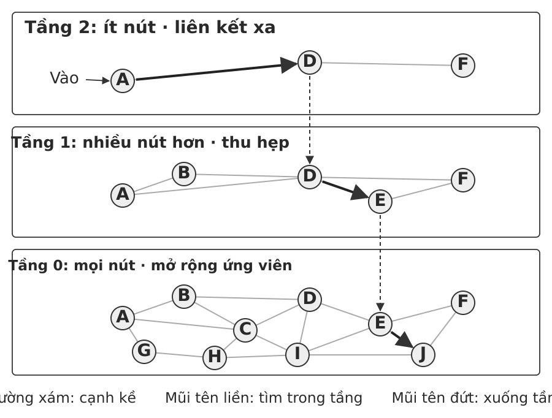
>
> Bảng 3-2 Đánh đổi khi triển khai ANNOY và HNSW
>
> | Khía cạnh so sánh | ANNOY | HNSW (lấy hnswlib làm ví dụ) |
> | --- | --- | --- |
> | Cấu trúc chỉ mục | Nhiều cây chiếu ngẫu nhiên | Đồ thị láng giềng phân tầng |
> | Chi phí xây dựng | Thay đổi theo số cây, số vector và số chiều | Thay đổi theo quy mô liên kết, phạm vi tìm kiếm khi xây và lượng dữ liệu |
> | Bộ nhớ và tệp | Chỉ mục tĩnh hỗ trợ ánh xạ bộ nhớ và chia sẻ giữa nhiều tiến trình | Lưu vector cùng quan hệ liên kết của đồ thị; quy mô liên kết ảnh hưởng chi phí |
> | Cập nhật tăng dần | Thêm mục sau khi đã xây chỉ mục thì phải xây lại | Hỗ trợ thêm, cập nhật và đánh dấu xóa; cần quản lý dung lượng |
> | Độ phủ và tốc độ | Điều chỉnh bằng số cây và ngân sách tìm kiếm khi truy vấn | Điều chỉnh bằng tham số xây dựng và phạm vi tìm kiếm khi truy vấn |
> | Tình huống sử dụng | Chỉ mục tĩnh dễ phân phối và chia sẻ | Chỉ mục động vừa ghi liên tục vừa truy vấn |
>
> Lần chạy này trước hết dùng 240 đoạn văn bản để dựng kho. Với cùng 20 truy vấn, cả hai chỉ mục đều tìm đủ 10 láng giềng đầu mà tìm kiếm chính xác cho ra. Khi dựng kho lần đầu, ANNOY mất khoảng 13 mili giây để xây trong container Linux, HNSW mất khoảng 78 mili giây trong môi trường máy cục bộ; chỉ mục lưu ra lần lượt khoảng 1,40 MB và 1,02 MB. Thêm 60 đoạn còn lại, ANNOY xây lại chỉ mục, còn HNSW chèn thẳng vector mới. Lúc này kho có tổng cộng 300 đoạn, và các láng giềng trước đó cũng có thể thay đổi theo. Sau khi làm lại tìm kiếm chính xác trên kho mới, độ phủ trung bình của cả hai chỉ mục vẫn là 100%.

[^ch3-ann]: Tài liệu dự án Annoy của Spotify trình bày cách xây chỉ mục chỉ đọc, nạp chỉ mục bằng ánh xạ bộ nhớ, và cách dùng `search_k` để điều chỉnh số nút được kiểm tra khi truy vấn. Phần giao diện Python trong tài liệu dự án hnswlib nêu phương thức `add_items` để thêm vector và phương thức `set_ef` để điều chỉnh phạm vi truy vấn.

**Chọn chỉ mục theo cách kiến thức được cập nhật.** Khi kho ngữ liệu được phát hành định kỳ theo lô và nhiều tiến trình dùng chung một chỉ mục chỉ đọc, tác giả sẽ cân nhắc ANNOY trước; khi liên tục nhận tài liệu mới và cần chèn trực tuyến, thì ưu tiên HNSW. Mô hình nhúng quyết định cách biểu diễn ngữ nghĩa, chỉ mục quyết định những biểu diễn đó có đưa vào sử dụng được với độ trễ và chi phí cập nhật phù hợp hay không; cả hai cùng quyết định hiệu quả của dịch vụ truy xuất.

Điều chỉnh số cây và ngân sách tìm kiếm của ANNOY, hoặc quy mô liên kết và phạm vi tìm kiếm của HNSW, sẽ thấy độ phủ và độ trễ thay đổi ra sao[^ch3-ann]. Độ phủ của chỉ mục đo xem đã tìm được các láng giềng mục tiêu hay chưa; còn những láng giềng đó có trả lời được câu hỏi của người dùng hay không thì phụ thuộc vào biểu diễn nhúng và nội dung tư liệu.

### Biểu diễn thưa: từ từ khóa đến điểm liên quan

**Biểu diễn thưa** dùng vector nhiều chiều, trong đó chỉ có ít chiều khác không. Truy xuất từ khóa truyền thống lấy từ tố (term) làm chiều, gán trọng số theo những từ xuất hiện trong tài liệu. Nền tảng của nó là **mô hình túi từ** (Bag of Words, BoW): lưu các từ và số lần xuất hiện, bỏ qua thứ tự. Vì vậy, "mèo đuổi chó" và "chó đuổi mèo" có cùng một biểu diễn túi từ.

Cách biểu diễn này thích hợp để khớp tên gọi, mã số và thuật ngữ kỹ thuật. Dưới đây bắt đầu từ TF-IDF để giải thích tần suất từ và tần suất tài liệu được chuyển thành điểm xếp hạng như thế nào.

#### Từ TF-IDF đến BM25

**TF-IDF** (Term Frequency–Inverse Document Frequency, tần suất từ – tần suất tài liệu nghịch đảo) kết hợp hai tín hiệu: từ xuất hiện bao nhiêu lần trong tài liệu hiện tại, và nó phổ biến đến mức nào trong toàn bộ kho ngữ liệu. Giả sử trong 100 bài viết có 60 bài chứa "mô hình", chỉ 3 bài chứa "chưng cất", thì khi truy vấn "chưng cất mô hình", từ "chưng cất" có sức phân biệt hơn.

Một cách viết cơ bản là:

$$\operatorname{TF\!\text{-}\!IDF}(t,d)=\operatorname{TF}(t,d)\times\operatorname{IDF}(t),\qquad \operatorname{IDF}(t)=\ln\frac{N}{\operatorname{DF}(t)}$$

$\operatorname{TF}(t,d)$ là số lần từ $t$ xuất hiện trong tài liệu $d$, $\operatorname{DF}(t)$ là số tài liệu chứa từ đó, $N$ là tổng số tài liệu. Theo công thức này, một từ xuất hiện mười lần đóng góp điểm gấp đôi so với khi xuất hiện năm lần; tài liệu dài cũng có thể được điểm cao chỉ vì có nhiều từ hơn. TF-IDF có nhiều biến thể chuẩn hóa; còn BM25 dưới đây dùng độ bão hòa tần suất từ và chuẩn hóa độ dài để xử lý hai ảnh hưởng này.

**BM25** cộng đóng góp của từng từ truy vấn:

$$\operatorname{Score}(Q,D)=\sum_i\operatorname{IDF}_{\mathrm{BM25}}(q_i)\cdot\frac{\operatorname{TF}(q_i,D)(k_1+1)}{\operatorname{TF}(q_i,D)+k_1\left(1-b+b\frac{|D|}{\operatorname{avgdl}}\right)}$$

Trong đó, $q_i$ là từ truy vấn, $|D|$ là độ dài tài liệu, $\operatorname{avgdl}$ là độ dài tài liệu trung bình. $k_1$ điều khiển mức bão hòa của tần suất từ; $b$ điều khiển cường độ chuẩn hóa độ dài, bằng 0 thì tắt phép hiệu chỉnh này. Hình 3-8 tách riêng từng thành phần để tính. Trước hết cố định độ dài tài liệu, cho từ truy vấn tăng từ một lên ba lần xuất hiện, xem mỗi lần xuất hiện thêm được cộng bao nhiêu điểm; sau đó cố định tần suất từ, chỉ tăng gấp đôi độ dài tài liệu. Hàng dưới cùng so sánh hai từ phổ biến đến mức nào trong tập tài liệu.

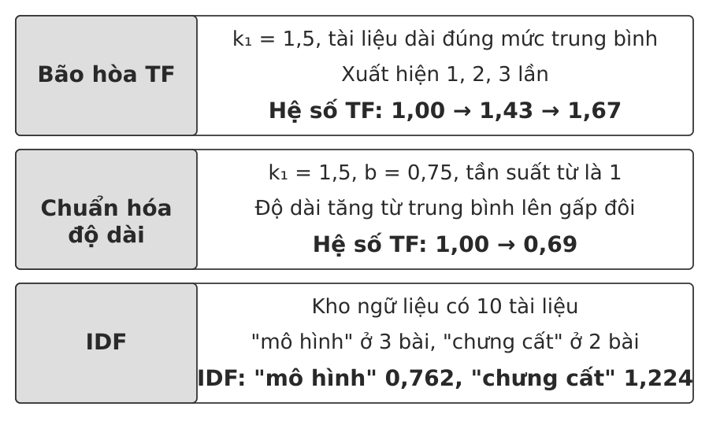

Ở hàng thứ nhất trong hình, lần xuất hiện thứ hai làm hệ số tần suất từ tăng khoảng 0,43, lần thứ ba chỉ tăng khoảng 0,24; đó chính là sự bão hòa tần suất từ. Ở hàng thứ hai, cùng một từ chỉ xuất hiện một lần, nhưng trong tài liệu dài hơn thì kém nổi bật hơn, nên phép hiệu chỉnh độ dài hạ hệ số tần suất từ của nó xuống. Phải nhân thêm IDF mới ra đóng góp của từ này vào tổng điểm.

Công thức trên còn một thành phần cần xác định: cùng xuất hiện ba lần, vì sao từ hiếm thường hữu ích hơn từ phổ biến? Mục này dùng tần suất tài liệu nghịch đảo dưới đây để gán trọng số cho từ:

$$\operatorname{IDF}_{\mathrm{BM25}}(t)=\ln\frac{N-\operatorname{DF}(t)+0.5}{\operatorname{DF}(t)+0.5}$$

Tử số là số tài liệu không chứa từ đó, mẫu số là số tài liệu có chứa từ đó; cả hai cùng cộng thêm 0.5 để làm trơn, nhờ vậy vẫn tính được khi tần suất tài liệu bằng 0 hoặc bằng $N$. Từ hiếm được trọng số cao hơn; khi hơn một nửa số tài liệu chứa từ đó, công thức này cho ra số âm. Phần cài đặt đi kèm đặt cận dưới của trọng số tính điểm thực tế là $10^{-6}$, đồng thời giữ giá trị gốc để kiểm tra.

> **Thí nghiệm 3-5 ★★: Tự cài đặt một công cụ tìm kiếm BM25 từ đầu**
>
> Thí nghiệm này lần lượt hoàn thành tách từ, xử lý từ dừng, chỉ mục ngược và tính điểm. Xử lý từ dừng có thể lọc bỏ những từ tần suất cao như "của", "đã". **Chỉ mục ngược** ghi lại mỗi từ xuất hiện trong những tài liệu nào, cùng tần suất từ tương ứng; nó giống bảng tra thuật ngữ ở cuối sách: tra "TCP" là tìm được trang 45, 112, 203, rồi đọc nội dung ở những vị trí đó.
>
> Hãy tính tay một truy vấn "chưng cất mô hình". Giả sử kho ngữ liệu có 10 tài liệu, độ dài trung bình 250 từ, $k_1=1.5$, $b=0.75$. "Mô hình" xuất hiện trong 3 tài liệu, IDF khoảng 0.762; "chưng cất" xuất hiện trong 2 tài liệu, IDF khoảng 1.224. Bảng dưới liệt kê theo từng từ các tài liệu khớp, tần suất từ và độ dài tài liệu. Thay các giá trị này vào công thức là tính được đóng góp của từng từ vào điểm của tài liệu.
>
> | Từ truy vấn | Tài liệu | Tần suất TF | Độ dài tài liệu | Đóng góp BM25 |
> | --- | --- | ---: | ---: | ---: |
> | mô hình | doc_1 | 5 | 200 | 1.52 |
> | mô hình | doc_3 | 2 | 500 | 0.82 |
> | mô hình | doc_7 | 8 | 150 | 1.68 |
> | chưng cất | doc_1 | 3 | 200 | 2.15 |
> | chưng cất | doc_5 | 1 | 250 | 1.22 |
>
> Cộng đóng góp của hai từ trong doc_1 được khoảng 3.67, thứ tự xếp hạng là **doc_1 (3.67) > doc_7 (1.68) > doc_5 (1.22) > doc_3 (0.82)**. Trong doc_1, tần suất của "chưng cất" thấp hơn "mô hình", nhưng độ hiếm cao hơn nên đóng góp cuối cùng cũng lớn hơn; đồng thời khớp cả hai từ lại nâng tổng điểm thêm một bậc.
>
> Bây giờ dùng `cat` để tra kho ngữ liệu tiếng Anh của thí nghiệm đi kèm. Hai bài ngắn được gán nhãn liên quan lần lượt dùng `kitten` và `feline`, còn trong chỉ mục ngược thì không tra được `cat`, danh sách ứng viên trống trơn. Dù có tăng trọng số tần suất từ ở trên cao đến đâu, cũng không có tài liệu nào để chấm điểm. Đổi sang tra bằng những từ có trong hai bài ngắn đó, sẽ thấy từng bài lần lượt vào danh sách ứng viên.

### Truy xuất lai: gộp kết quả hai nhánh rồi xếp hạng lại

Có những câu hỏi rất khó liệt kê trước hết các từ đồng nghĩa. Thí nghiệm 3-6 có một câu hỏi "làm sao tự động thu hồi vùng nhớ heap không dùng nữa", còn bài ngắn mục tiêu lại viết là "quản lý bộ nhớ tự động giúp lập trình viên khỏi phải tự giải phóng đối tượng". Truy vấn tiếng Anh và bài ngắn không có từ tố chung nào, truy xuất từ khóa không tìm lại được bài nào, còn truy xuất vector lại xếp mục tiêu lên đầu. Đổi sang truy vấn mã sản phẩm XR-7003, truy xuất từ khóa tìm thẳng ra đúng mã đó, còn truy xuất vector lại liệt kê thêm mấy mã gần giống.

**Truy xuất lai** dùng từ khóa và vector để tìm riêng các đoạn liên quan, rồi mới quyết định đoạn nào đáng giao cho mô hình. Khi cơ sở kiến thức vừa chứa định danh chính xác vừa chứa mô tả bằng ngôn ngữ tự nhiên, tác giả khuyên lấy cách này làm điểm xuất phát. Theo dõi XR-7003 trong Hình 3-9: cả hai nhánh đều xếp nó thứ nhất, nên khi gộp nó nhận được hai phần đóng góp thứ hạng. Bước xếp hạng lại thay đổi vị trí thứ hai, còn mã sản phẩm người dùng thấy đầu tiên vẫn đúng.

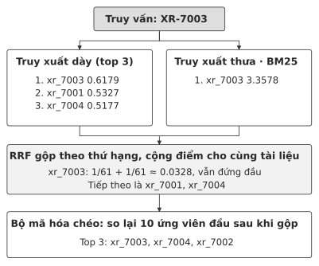

Giai đoạn thứ nhất là **truy xuất song song**: gửi truy vấn đến cả bộ máy dày đặc và bộ máy thưa, mỗi bên lấy về một loạt tài liệu có thể liên quan. Hai nhánh có thể dùng cùng văn bản gốc, cũng có thể tiền xử lý theo yêu cầu của mô hình riêng.

Giai đoạn thứ hai là **gộp kết quả**: gộp những tài liệu trùng nhau trong kết quả hai nhánh, rồi xếp hạng chung. Độ tương đồng cosine và BM25 có thang giá trị khác nhau, cộng thẳng vào nhau dễ khiến nhánh có giá trị lớn hơn chi phối kết quả. Một cách là hiệu chỉnh hoặc chuẩn hóa điểm trước rồi kết hợp có trọng số; cách khác là **gộp theo thứ hạng nghịch đảo** (Reciprocal Rank Fusion, RRF), tính theo thứ hạng trong từng nhánh:

$$\operatorname{RRF}(d)=\sum_{j:\,d\in R_j}\frac{1}{k+\operatorname{rank}_j(d)}$$

$R_j$ là kết quả của nhánh thứ $j$, thứ hạng bắt đầu từ 1; nếu tài liệu không xuất hiện trong một nhánh thì đóng góp của nhánh đó bằng không. Hằng số làm trơn $k$ thường lấy bằng 60; nó càng lớn thì chênh lệch điểm giữa mấy thứ hạng đầu càng nhỏ. RRF tiện cho việc kết hợp các cách tính điểm khác nhau, nhưng chỉ giữ thứ hạng; mức chênh mạnh yếu trong điểm gốc phải tận dụng bằng cách khác.

Hãy tính thử một ví dụ truy xuất hai nhánh. Người dùng hỏi "hoàn tiền bao lâu thì về tài khoản". Tài liệu A đứng thứ nhất trong truy xuất từ khóa, nhưng không xuất hiện trong nhóm đầu của truy xuất vector; tài liệu B đứng thứ hai ở cả hai nhánh. Lấy $k=60$, A được $1/61$, khoảng 0.0164; B được $1/62+1/62$, khoảng 0.0323. Sau khi gộp, B xếp trên A. Kết quả này chỉ cho biết cả hai nhánh truy xuất đều tìm thấy B. Muốn biết B có thực sự trả lời được thời gian tiền về hay không, còn phải xem nó viết về "cách yêu cầu hoàn tiền" hay "khi nào tiền hoàn về".

Giai đoạn thứ ba có thể thêm **xếp hạng lại bằng mạng nơ-ron**. Hệ thống lấy những tài liệu xếp đầu sau khi gộp, ví dụ 50 tài liệu đầu, để mô hình xếp hạng lại chấm điểm mức độ liên quan giữa từng tài liệu và truy vấn. Xếp hạng lại có thể thay đổi thứ tự của 50 tài liệu này. Nếu tài liệu thực sự hữu ích không hề được chọn vào, thì phải quay lại cải thiện truy xuất ở thượng nguồn.

Mô hình thường dùng ở đây là **bộ mã hóa chéo (cross-encoder)**: đưa truy vấn và tài liệu ứng viên vào cùng nhau, để hai phần tương tác bên trong mô hình, rồi xuất ra điểm liên quan. Còn **bộ mã hóa kép (bi-encoder)** ở giai đoạn truy xuất mã hóa riêng truy vấn và tài liệu; vector tài liệu có thể tính trước, khi truy vấn chỉ cần tìm kiếm vector. Loại trước hợp để xếp tinh một số ít tài liệu, loại sau hợp để sàng lọc sơ bộ trong lượng lớn tài liệu. Có thể so sánh với việc lọc hồ sơ xin việc và phỏng vấn: trước hết dựa vào các đặc điểm có sẵn để thu hẹp phạm vi, rồi mới so sánh sâu theo yêu cầu cụ thể. BGE Reranker v2 M3 là một trong những mô hình dùng được cho khâu này[^ch3-reranker].

[^ch3-reranker]: BAAI, tài liệu mô hình BGE Reranker v2 M3, giới thiệu đầu vào truy vấn – tài liệu và cách chấm điểm liên quan.

Khi tư liệu liên quan đã vào nhóm ứng viên nhưng hay bị xếp sau tư liệu không liên quan, tác giả sẽ ưu tiên đánh giá xếp hạng lại bằng bộ mã hóa chéo. Nó đọc đồng thời câu hỏi và tài liệu, nên có thể so trực tiếp xem điều kiện, từ hạn định và chi tiết trong tài liệu có khớp yêu cầu của câu hỏi hay không. Bảng 3-3 liệt kê ba chỉ số thường dùng.

Bảng 3-3 Ba chỉ số đo chất lượng truy xuất

| Chỉ số | Cách tính và ý nghĩa |
| --- | --- |
| recall@k (độ phủ) | Số tài liệu liên quan trong k kết quả đầu, chia cho tổng số tài liệu liên quan của truy vấn đó; đo xem tìm lại được bao nhiêu nội dung liên quan; trên tập kiểm thử thường lấy trung bình qua các truy vấn |
| MRR (thứ hạng nghịch đảo trung bình) | Với mỗi truy vấn, lấy nghịch đảo thứ hạng của tài liệu liên quan đầu tiên, rồi lấy trung bình; đứng đầu được 1, đứng thứ mười được 0.1, không tìm thấy được 0 |
| nDCG@k (độ lợi tích lũy chiết khấu chuẩn hóa) | Chấm điểm kết quả theo mức độ liên quan, chiết khấu các thứ hạng phía sau, rồi chia cho điểm của thứ tự lý tưởng; đo chất lượng xếp hạng tổng thể của k kết quả đầu |

Còn có thể ghi lại **tỷ lệ trúng**: bao nhiêu truy vấn tìm lại được ít nhất một tài liệu liên quan trong k kết quả đầu? Ví dụ, một câu hỏi cần ba tư liệu, hai mươi kết quả đầu chỉ tìm lại được hai. Truy vấn này đã trúng, nên không bị tính vào số lần thất bại "hoàn toàn trượt", nhưng recall@20 của nó chỉ là $2/3$, vẫn còn $1/3$ tư liệu chưa tìm thấy. Nếu mỗi câu chỉ có một tài liệu mục tiêu, câu nào tìm lại được thì được 1 điểm, câu nào bỏ sót thì 0 điểm. Lấy trung bình trên cùng một bộ kết quả truy xuất, tỷ lệ trúng khi đó bằng độ phủ trung bình.

> **Thí nghiệm 3-6 ★★: So sánh truy xuất thưa, dày đặc, gộp và xếp hạng lại**
>
> Thí nghiệm này so sánh năm cấu hình trên cùng 12 truy vấn đã gán nhãn: truy xuất thưa, truy xuất dày đặc, gộp RRF, gộp có trọng số, và xếp hạng lại sau khi gộp. Các truy vấn bao quát tương đồng ngữ nghĩa, tên gọi chính xác, đa ngôn ngữ và mã kỹ thuật; trong đó có hai câu lần lượt hỏi bằng tiếng Anh và tiếng Trung về việc thực vật biến ánh sáng mặt trời thành thức ăn như thế nào. Mô hình dày đặc dùng Qwen3-Embedding-0.6B, bộ xếp hạng lại dùng bộ mã hóa chéo MS MARCO MiniLM; mỗi nhánh truy xuất lấy tối đa 10 tài liệu, bộ xếp hạng lại xử lý tối đa 10 tài liệu đứng đầu theo RRF. Độ phủ và nDCG chỉ xét 3 tài liệu đầu của thứ tự cuối cùng; MRR thì dò theo danh sách trả về để tìm tài liệu liên quan đầu tiên.
>
> Trước hết mở bảng xếp hạng từng câu trong nhật ký chạy của Thí nghiệm 3-6, so sánh kết quả truy xuất của hai câu về quang hợp. Ở câu tiếng Anh, tài liệu mục tiêu vẫn đứng đầu. Câu tiếng Trung thì trả về ngôn ngữ lập trình và núi lửa trước, đến tài liệu thứ ba mới nói về quang hợp. Mỗi câu chỉ có một tài liệu được gán nhãn liên quan, cả hai câu đều tìm thấy nó trong ba vị trí đầu, nên recall@3 đều bằng 1. Nhưng tài liệu liên quan đầu tiên của câu tiếng Trung đứng thứ ba, thứ hạng nghịch đảo chỉ còn $1/3$. Theo cách tính điểm của thí nghiệm này, độ lợi của vị trí thứ ba là $1/\log_2(3+1)=0.5$, của vị trí thứ nhất là 1, nên nDCG@3 của câu tiếng Trung là 0.5.
>
> Xét tiếp toàn bộ 12 câu. Sau khi xếp hạng lại, ngoài câu quang hợp tiếng Trung, còn một câu về thu hồi bộ nhớ heap bị tụt tài liệu mục tiêu từ thứ nhất xuống thứ hai. Mười câu còn lại đều giữ được vị trí đầu, nên MRR sau xếp hạng lại là $(10+1/2+1/3)/12\approx0.903$. Để đối chiếu, MRR của truy xuất dày đặc và của RRF đều bằng 1. nDCG@3 của hai cấu hình này cũng đều bằng 1, sau xếp hạng lại giảm còn khoảng 0.928. Chỉ nhìn độ phủ trung bình thì không thấy những thay đổi thứ hạng này: recall@3 của truy xuất thưa là 0.833, bốn nhóm còn lại đều là 1.
>
> Giả sử bây giờ phải chọn một cấu hình cho bộ câu hỏi này, thời gian bỏ ra cho xếp hạng lại đổi được gì? Trên CPU này, RRF từ lúc bắt đầu truy xuất đến khi cho ra thứ hạng mất trung bình khoảng 194 mili giây mỗi câu; nối thêm xếp hạng lại thì mất khoảng 237 mili giây. Khoảng 43 mili giây tốn thêm không tìm lại được thêm tài liệu mục tiêu nào, lại còn đẩy lùi đáp án đúng của hai câu.

## Tổ chức và truy xuất kiến thức

Cách tổ chức kiến thức quyết định mỗi mục chứa những gì, còn bộ truy xuất quyết định lấy ra gì từ các mục đó. Các đoạn văn trong sổ tay kỹ thuật, văn bản pháp lý và bài báo khoa học liên hệ với nhau qua tầng bậc chương mục, sự phụ thuộc giữa các khái niệm và các trích dẫn xuyên tài liệu. Giữ lại những cấu trúc này giúp một truy vấn tiếp cận được cả bằng chứng cụ thể lẫn những khái quát ở tầng cao hơn.

Mục này lần lượt bàn về mấy cách tổ chức: RAPTOR và GraphRAG xây chỉ mục phân tầng hoặc chỉ mục quan hệ; OpenViking dùng thư mục để tổ chức tài nguyên ngữ cảnh; cập nhật tăng dần và sắp xếp định kỳ để giữ kiến thức luôn cập nhật; RAG dạng Agent (agentic RAG) cho phép Agent dựa vào kết quả đã có để truy xuất tiếp; truy xuất theo ngữ cảnh bổ sung bối cảnh cho các đoạn; cuối cùng là rút ra kiến thức dùng lại được từ tập dữ liệu. Chúng lần lượt tác động lên biểu diễn, chỉ mục, cập nhật và quá trình truy vấn, và cũng có thể kết hợp để dùng cho bộ nhớ người dùng.

Trước hết hãy xem hai ví dụ để hiểu khoảng cách giữa thông tin mà truy vấn cần và bản ghi gốc.

**Ví dụ 1: Đếm mèo đen mèo trắng.** Chương trước để chương trình đếm hết 100 chiếc lồng, được 90 con mèo đen và 10 con mèo trắng. Lần này chỉ để bộ truy xuất trả về 20 bản ghi đứng đầu. Giả sử 18 bản ghi trong đó cho thông tin màu lông hợp lệ, 15 bản ghi là mèo đen, 3 bản ghi là mèo trắng. Con số 83,3% (15/18) tính ra là tỷ lệ mèo đen trong lô bản ghi hợp lệ này; còn tỷ lệ mèo đen của cả cửa hàng là 90% (90/100). Bộ truy xuất chọn bản ghi theo độ liên quan, nó không lấy cho cả cửa hàng một mẫu mang tính đại diện.

Nếu thường có người hỏi tỷ lệ của cả cửa hàng, có thể thống kê trước tất cả các lồng, lưu số mèo đen và mèo trắng, ghi rõ phạm vi thống kê và thời điểm cập nhật. Mèo trong lồng thay đổi thì cập nhật chi tiết tương ứng rồi tính lại tổng. Có người hỏi trong lồng số 37 là con gì thì vẫn phải tra lại bản ghi chi tiết đó.

**Ví dụ 2: Y tá có được hưởng ưu đãi mà bác sĩ nhận được không?** Lấy một tình huống giảng dạy xây dựng quanh các yêu cầu tư vấn ưu đãi của Xfinity làm ví dụ: trong các phiếu yêu cầu, cựu chiến binh John được duyệt, bác sĩ Sarah được giảm giá, giáo viên Mike được thông báo là không đủ điều kiện. Mỗi phiếu ghi lại kết quả của một lần xử lý. Nếu một y tá đến hỏi mình có được hưởng ưu đãi không, chỉ truy xuất các phiếu tương tự sẽ gặp ba vấn đề.

- **Nghề gần giống chưa chắc được cùng một ưu đãi.** "Y tá" và "bác sĩ" gần nghĩa, bản ghi của Sarah có thể đứng đầu; nhưng có được hưởng ưu đãi hay không còn tùy điều khoản chương trình quy định những ai được đăng ký và phải xuất trình giấy tờ gì.
- **Từng phiếu riêng lẻ không liệt kê đủ điều kiện áp dụng.** Một người được duyệt chỉ trực tiếp cho biết kết quả của người đó trong điều kiện lúc ấy; tăng số lượng truy xuất cũng chưa chắc tìm ra những loại đối tượng hay ngoại lệ chưa từng xuất hiện.
- **Phạm vi tư liệu không rõ ràng.** Các phiếu có thể đến từ những chương trình khác nhau hoặc những thời điểm khác nhau. Phải xác định trước bản ghi nào áp dụng được, và còn thiếu căn cứ chính sách nào.

Khi lập chỉ mục, có thể liên kết các phiếu của cùng một chương trình, rồi tra điều khoản chính thức tương ứng, sắp xếp đối tượng áp dụng, trường hợp ngoại lệ, thời điểm có hiệu lực và xuất xứ điều khoản thành thẻ quy tắc. Ví dụ, nếu điều khoản trong tình huống giảng dạy này nêu rõ bao gồm quân nhân tại ngũ và cựu chiến binh, nhân viên y tế có chứng chỉ, và loại trừ nhóm giáo viên, thì lưu từng điều kiện đó; y tá có thuộc phạm vi nhân viên y tế hay không cũng do điều khoản xác nhận. Các phiếu vẫn được giữ lại, dùng để giải thích quá trình xử lý thực tế và phát hiện chênh lệch khi thực thi.

Hai ví dụ này thể hiện những nhu cầu thông tin khác nhau: đếm mèo phải thống kê toàn bộ lồng của cửa hàng, còn xác định ai được hưởng ưu đãi phải tra đầy đủ điều khoản và ngoại lệ. Với loại truy vấn này, tác giả chủ trương đưa việc thống kê và sắp xếp quy tắc lên giai đoạn dựng kho. Nếu chỉ tăng số đoạn lấy về, mô hình vẫn có thể không thấy được toàn bộ phạm vi thống kê, hay điều khoản quyết định đơn đăng ký lần này có được chấp thuận hay không. Xây dựng tóm tắt thống kê, thẻ quy tắc và quan hệ nguồn gốc xoay quanh nhiệm vụ, thì truy xuất mới lấy được trong một lần đủ thông tin để hỗ trợ phán đoán, và vẫn tra ngược được tư liệu gốc.

### Chỉ mục có cấu trúc: xây dựng tầng bậc và liên kết

Khi đọc một bản báo cáo dài, câu hỏi "đơn yêu cầu sửa chữa phải điền vào ô nào" thường tìm được đáp án trong một đoạn văn gốc; còn câu hỏi "vì sao mấy loại sự cố cứ lặp đi lặp lại" thì phải xuyên qua nhiều chương. Muốn đáp ứng được cả những truy vấn như vậy, có thể sinh tóm tắt, xây tầng bậc, hoặc trích xuất thực thể và quan hệ ngay khi dựng kho. Dưới đây, RAPTOR dùng tóm tắt đệ quy để tạo tầng bậc, còn GraphRAG tổ chức tư liệu qua quan hệ thực thể và tóm tắt cộng đồng.

**RAPTOR** (Recursive Abstractive Processing for Tree-Organized Retrieval) bắt đầu từ các khối văn bản: trước hết mã hóa mỗi khối thành vector, gom thành một số nhóm theo mức độ tương đồng, rồi sinh tóm tắt cho từng nhóm. Coi các tóm tắt như một lô khối văn bản mới và lặp lại các bước đó, ta được cái cây trong Hình 3-10. Theo mũi tên đi lên từ các khối văn bản 3, 4, 5, chúng cùng sinh ra tóm tắt B; lên cao nữa, tóm tắt của ba nhóm A, B, C hợp thành tóm tắt toàn cục.[^ch3-raptor]

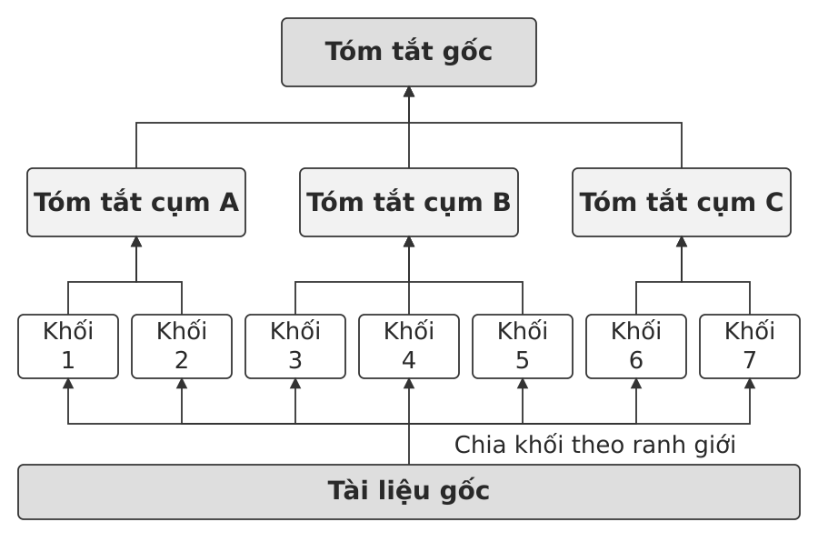

Ví dụ, "SSE2 hỗ trợ thực hiện phép toán SIMD số nguyên trên thanh ghi XMM 128 bit" và "SSE4.2 bổ sung lệnh so sánh chuỗi" có thể được đưa vào tóm tắt "quá trình phát triển các tập lệnh SIMD của x86". Câu hỏi chi tiết có thể khớp với khối ở tầng dưới, câu hỏi tổng quan có thể khớp với tóm tắt ở tầng trên. Truy vấn có thể đi sâu dần theo tầng bậc, cũng có thể đặt các nút ở mọi tầng cùng nhau để truy xuất, chọn ra nhóm liên quan nhất.

[^ch3-raptor]: Sarthi và cộng sự, RAPTOR: Recursive Abstractive Processing for Tree-Organized Retrieval, 2024.

**GraphRAG** dùng thực thể, quan hệ và tóm tắt cộng đồng để tổ chức kiến thức. Nó ghi một quan hệ bằng bộ ba "chủ thể – quan hệ – đối tượng", ví dụ (Trung Quốc, có thủ đô là, Bắc Kinh) hoặc (Trương Tam, làm việc tại, Tencent). Hai bản ghi chỉ cần nhắc đến cùng một thực thể là có thể nối với nhau trong đồ thị. Hai bác sĩ trong Hình 3-11 đều họ Trương. Khi người dùng hỏi "địa chỉ bệnh viện nơi nha sĩ của tôi làm việc", hệ thống nên đi theo quan hệ nào?

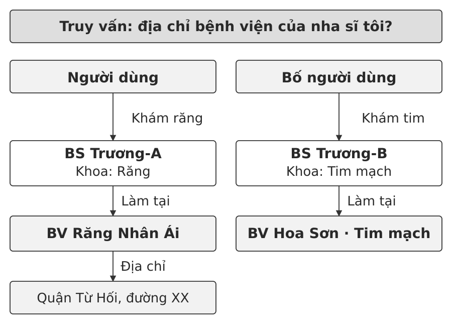

1. **Phân biệt các thực thể trùng tên khi dựng đồ thị.** Một bác sĩ Trương khám răng cho người dùng ở Bệnh viện Răng hàm mặt Nhân Ái, một bác sĩ Trương khác khám tim cho bố người dùng ở Bệnh viện Hoa Sơn. Khi trích xuất thực thể và gộp bản ghi, hệ thống có thể dựa vào những manh mối này để gán cho hai bác sĩ hai định danh khác nhau. Các trường `person`, `relationship` ở trên cũng có tác dụng tương tự. Xác định `bank` trong câu nghĩa là bờ sông hay ngân hàng là khử nhập nhằng nghĩa từ; xác định một bản ghi nói về bác sĩ Trương nào là khử nhập nhằng thực thể.
2. **Truy xuất theo chuỗi quan hệ khi truy vấn.** Xuất phát từ người dùng, lần lượt đi theo "người dùng → bác sĩ → bệnh viện → địa chỉ", là nối được thông tin rải rác trong mấy bản ghi thành một câu trả lời.

Quy trình lập chỉ mục của Microsoft GraphRAG trước hết trích xuất thực thể và quan hệ từ các đơn vị văn bản, rồi dùng phát hiện cộng đồng để nhận ra những cụm thực thể liên kết chặt chẽ, sinh ra tầng bậc cộng đồng và tóm tắt. Khi truy vấn một thực thể, tìm kiếm cục bộ kết hợp thông tin liên quan và văn bản gốc của nó; khi truy vấn chủ đề của cả kho ngữ liệu, tìm kiếm toàn cục dùng tóm tắt cộng đồng để tổ chức câu trả lời[^ch3-graphrag].

[^ch3-graphrag]: Microsoft GraphRAG, tổng quan về lập chỉ mục và truy vấn, tìm kiếm cục bộ và tìm kiếm toàn cục.

Cách biểu diễn quan hệ còn phải chứa được điều kiện và thời gian. Ví dụ, "nếu tuần sau vẫn mưa thì tôi hủy đi biển, chuyển sang đi bảo tàng" gồm điều kiện, thời gian hiệu lực và hành động thay thế. Nếu chỉ trích ra (người dùng, có kế hoạch, du lịch biển) và (người dùng, có kế hoạch dự phòng, tham quan bảo tàng), sẽ mất điều kiện chuyển đổi. Có thể giữ nguyên câu đầy đủ, rồi dùng nút điều kiện, nút sự kiện hoặc trường có cấu trúc để biểu diễn ràng buộc "khi tuần sau mưa", cho quan hệ trỏ ngược về văn bản gốc.

Với bộ nhớ người dùng, tác giả khuyên dùng **ngôn ngữ tự nhiên và chỉ mục có cấu trúc phối hợp theo tầng**: dùng ngôn ngữ tự nhiên để lưu trọn phát biểu, dùng siêu dữ liệu để ghi đối tượng, thời gian và nguồn, rồi xây chỉ mục đồ thị cho những nội dung cần liên kết thường xuyên.

> **Thí nghiệm 3-7 ★★★: So sánh tóm tắt phân tầng và chỉ mục quan hệ**
>
> Thí nghiệm này chọn 14 trang trong sổ tay kiến trúc Intel liên quan đến SSE, AVX và quản lý trạng thái để xây hai bản cài đặt phục vụ giảng dạy. Nhánh tóm tắt phân tầng trước hết sinh tóm tắt cho từng trang, rồi gom thành ba nhóm, sinh tóm tắt nhóm và tóm tắt gốc; nhánh chỉ mục quan hệ trích xuất thực thể và quan hệ, rồi sinh tóm tắt cộng đồng. Hai nhóm dùng cùng tư liệu và tám câu hỏi, so sánh về chi tiết khái niệm và suy luận quan hệ.
>
> Khi truy vấn "giải thích môi trường lập trình SSE", tóm tắt phân tầng có thể khớp đồng thời với phần tổng quan SSE và chi tiết thanh ghi. Bản cài đặt này truy xuất các nút ở mọi tầng cùng lúc, chọn ra năm nút liên quan nhất. Nhánh quan hệ thì mở rộng từ các thực thể liên quan sang láng giềng, kết hợp tóm tắt cộng đồng để tổ chức ngữ cảnh. Theo những quan hệ như "SSE → thanh ghi XMM → phép toán dấu phẩy động → ADDPS", có thể nối khái niệm với lệnh cụ thể.
>
> Câu hỏi phức tạp hơn là "Bộ xử lý tuyên bố hỗ trợ AVX thì chương trình có dùng được AVX không?" Câu này đòi hỏi nối năng lực của bộ xử lý với việc quản lý trạng thái của hệ điều hành: kiểm tra các cờ AVX, OSXSAVE của CPUID, rồi đọc XCR0 để xác nhận trạng thái XMM và YMM đều đã được bật. Gợi ý điểm đầu mút mà câu này đưa cho chương trình truy xuất đồ thị là CPUID và YMM. Chương trình tìm đường đi ngắn nhất nối hai điểm đó, đi qua XSAVE, CR4.OSXSAVE và XCR0, rồi giao đường đi cho mô hình để trả lời.
>
> Trên tám câu hỏi, độ bao phủ trang nguồn trung bình của cả hai nhóm đều khoảng 95,8%.

Tác giả khuyên làm tốt chia khối và truy xuất lai trước, đến khi gặp nhu cầu tổng hợp xuyên tài liệu và truy vấn quan hệ lặp đi lặp lại mới xây chỉ mục có cấu trúc. Định vị một đoạn chính sách hoàn tiền thường chỉ cần chia khối và truy xuất lai; còn so sánh SSE với AVX, hoặc tra từ kiến trúc tổng thể xuống đến lệnh cụ thể, thì cần hơn đến tóm tắt xuyên đoạn và chỉ mục quan hệ.

### Mô hình hệ thống tệp: tổ chức kiến thức bằng cấu trúc thư mục

**OpenViking** dùng một hệ thống tệp ảo để tổ chức bộ nhớ, tài nguyên và kỹ năng. Mỗi mục được tham chiếu qua URI `viking://`; Agent có thể duyệt thư mục, đọc tổng quan, rồi truy cập nội dung cần thiết[^ch3-openviking-uri]. Theo mục đích sử dụng thông tin, có thể hiểu các thư mục thành ba nhóm: tài nguyên bên ngoài, tư liệu người dùng, và kỹ năng cùng kinh nghiệm mà Agent sử dụng. Định danh người dùng và Agent giới hạn thêm không gian tên của từng bên.

| Nội dung | Công dụng điển hình |
| --- | --- |
| Resources | Tư liệu bên ngoài như tài liệu kỹ thuật, kho mã, trang web |
| User memories | Sở thích, thói quen và trải nghiệm của một người dùng cụ thể |
| Skills và Agent memories | Quy trình dùng lại được, bản ghi nhiệm vụ và kinh nghiệm còn chờ kiểm chứng |

URI cung cấp một cách định vị thống nhất, còn lưu trữ vật lý và chỉ mục do dịch vụ quản lý. Giao diện thư mục cho phép Agent duyệt từng tầng theo chủ đề, và cũng giới hạn được tìm kiếm ngữ nghĩa trong cây con liên quan. Truy cập kiểu hệ thống tệp, lưu trữ nội dung và chỉ mục vector có thể cùng nhau tạo thành dịch vụ.

[^ch3-openviking-uri]: OpenViking, Viking URI và kiến trúc hệ thống.

OpenViking chia nội dung thành ba tầng **L0, L1, L2**: L0 là tóm tắt ngắn, để nhanh chóng phán đoán thư mục có liên quan hay không; L1 là tổng quan thư mục, nêu nội dung chính và lối vào điều hướng; L2 là nội dung chính cần đọc kỹ. Tóm tắt và tổng quan ở cấp thư mục lần lượt được lưu trong `.abstract.md` và `.overview.md`. Ngân sách để sinh phần nội dung của hai tệp này lần lượt là 256 và 4000 ký tự[^ch3-openviking-layers].

Truy vấn có thể đọc tóm tắt trước để định vị, rồi đọc tổng quan để chọn tệp, sau cùng mới nạp văn bản gốc. Điều này tương đồng với cơ chế tiết lộ dần (progressive disclosure) của Skills ở Chương 2: danh mục gọn nhẹ hỗ trợ việc khám phá, nội dung đầy đủ được nạp theo nhu cầu của nhiệm vụ. Khi cần số liệu chính xác, điều kiện hoặc câu chữ gốc, phải lấy tiếp phần nội dung chính tương ứng.

[^ch3-openviking-layers]: OpenViking, Context Layers (L0/L1/L2). L0, L1 là biểu diễn sinh ra ở cấp thư mục; L2 có thể là tệp gốc hoặc nội dung đã được phân tích.

Với kiến thức cần cả người lẫn Agent cùng duy trì, tác giả nghiêng về việc quản lý bằng **văn bản thuần Markdown kết hợp quản lý phiên bản**. Con người có thể trực tiếp đọc, chỉnh sửa và đính chính kiến thức; Agent cũng dùng được cùng giao diện tệp đó, đề xuất cập nhật trên nhánh làm việc, qua xét duyệt rồi mới phát hành. Quản lý phiên bản lưu phần khác biệt của mỗi lần sửa, và cũng cho phép thu hồi những cập nhật sai. Khi phiên kết thúc, sở thích của người dùng đi vào bộ nhớ của người dùng tương ứng, diễn biến thao tác đi vào bản ghi nhiệm vụ. Bản ghi nhiệm vụ sau khi qua đánh giá kết quả, khái quát xuyên trajectory và kiểm chứng tiếp theo có thể trở thành kinh nghiệm như bàn ở Chương 9.

Khi dùng hệ thống tệp để tổ chức kiến thức, nhất định phải đồng thời **xây liên kết và chỉ mục cho các mục liên quan**. Một loạt tệp không tham chiếu lẫn nhau chỉ có thể tìm lại liên hệ bằng quét toàn văn hoặc truy xuất ngữ nghĩa; tệp càng nhiều, Agent càng khó lần tiếp từ nội dung đã tìm thấy. Liên kết cung cấp đường tra cứu rõ ràng, ví dụ cho chính sách hoàn tiền trỏ đến điều khoản ngoại lệ, tóm tắt hợp đồng trỏ đến bản ghi ký kết, mục nhân vật trỏ đến các sự kiện liên quan. Trang lối vào nêu các chủ đề chính, trang chỉ mục cung cấp điều hướng, tham chiếu chéo giữa các mục hỗ trợ tra cứu ngang. Cách làm này giống cách tổ chức các mục từ bách khoa, có thể lưu một phần quan hệ theo cách khá gọn nhẹ.

Khi dựng kho, còn có thể ghi rõ những mục nào dùng chung được, những phương án nào chỉ được chọn một trong cùng một lần xử lý. Ví dụ, khi nhân viên chăm sóc khách hàng xử lý yêu cầu hủy đơn, câu trả lời cho khách phải tuân thủ đồng thời quy chuẩn văn phong và quy chuẩn quyền riêng tư, nên hai quy chuẩn có thể cùng đưa vào ngữ cảnh. Nếu kho hàng chuẩn bị hai phương án cho việc hủy giao hàng, thì chỉ mục phải ghi rõ điều kiện áp dụng của từng phương án. Với cùng một kiện hàng, khi chưa xuất kho thì hủy phiếu xuất kho, khi đã giao cho đơn vị vận chuyển thì yêu cầu chặn đơn. Khi phiếu yêu cầu chỉ có câu "xin hủy đơn hàng", Agent phải tra trạng thái kiện hàng trước, rồi mới nạp phương án áp dụng được.

Việc duy trì liên kết phải được đưa vào quy trình cập nhật: trước khi thêm mục mới thì truy xuất các bản ghi đã có, quyết định gộp hay tạo mới; sau khi ghi thì bổ sung tham chiếu liên quan, và cập nhật chỉ mục của thư mục chứa nó. Liên kết có thể dẫn người đọc đến điều khoản, nhưng điều khoản có áp dụng cho đơn hàng đang xử lý hay không thì còn phải xem nó có hiệu lực từ khi nào.

### Kiến thức nên được cập nhật như thế nào

Một chính sách được sửa hôm nay, ngày mai người dùng có thể hỏi "bây giờ tôi nên làm gì", cũng có thể hỏi "vì sao tháng trước đơn của tôi lại bị xử lý như thế". Nếu chỉ dùng điều khoản mới ghi đè điều khoản cũ, câu hỏi thứ hai sẽ mất căn cứ của thời điểm đó. **Cập nhật tăng dần** kịp thời ghi bằng chứng mới, **sắp xếp định kỳ** thì phát hiện trùng lặp, xung đột và thay đổi cấu trúc trên phạm vi rộng hơn; cả hai đường đều phải giữ phiên bản, trích dẫn bằng chứng và kiểm tra trước khi phát hành, thì mới chọn được thời kỳ áp dụng theo từng câu hỏi.

#### Cập nhật tăng dần cho bộ nhớ người dùng và cơ sở kiến thức

Lời khuyên của tác giả là: **coi cơ sở kiến thức như một kho mã, coi mỗi lần thay đổi kiến thức như một Pull Request (PR).** Một lần cập nhật phải có phạm vi sửa đổi rõ ràng, kèm theo bằng chứng hỗ trợ việc sửa đổi để người xét duyệt kiểm tra. Tài liệu Markdown, tệp quy tắc và trạng thái thực thi được của User as Code đều có thể đưa vào quy trình này. Lịch sử phiên bản giúp người duy trì xem thay đổi, truy nguyên nguyên nhân và khôi phục khi phát hành nhầm.

Tiếp nối mô hình **người đề xuất – người xét duyệt** ở Chương 1, một lần cập nhật có thể diễn ra như sau:

1. **Người đề xuất tạo thay đổi.** Proposer Agent đọc bằng chứng mới, truy xuất kiến thức đã có, tìm ra các mục cần thêm, đính chính hoặc đã lỗi thời, rồi đề xuất thay đổi có phạm vi rõ ràng trên nhánh làm việc. Đồng thời duy trì các liên kết liên quan, chỉ mục thư mục, thông tin thời gian và trích dẫn bằng chứng.
2. **Người xét duyệt kiểm tra độc lập.** Reviewer Agent đối chiếu nội dung trước và sau khi sửa với bằng chứng gốc, kiểm tra xem các nhận định mới có xuất xứ không, điều kiện áp dụng đã ghi đủ chưa, cách nói ở các tệp khác nhau có nhất quán không, và trong những đoạn bị xóa còn thông tin nào dùng được không. Khi phát hiện vấn đề, chỉ ra mục cụ thể và căn cứ, nói rõ cần bổ sung, khôi phục hay đính chính điều gì.
3. **Lặp lại và ra quyết định.** Người đề xuất sửa theo ý kiến, người xét duyệt kiểm tra lại. Xét duyệt đạt thì chuyển sang quy trình hợp nhất; nếu đã đến giới hạn số vòng hoặc chi phí mà vẫn còn tranh cãi, thì để thay đổi đó lại trên nhánh làm việc và mời người xem xét.
4. **Kiểm tra và phát hành.** Tự động kiểm tra định dạng, liên kết, siêu dữ liệu và nhãn phân quyền; kiến thức dạng thực thi được còn phải qua kiểm tra kiểu và các bài kiểm thử liên quan. Sau khi hợp nhất, từ phiên bản kiến thức đã xác định, dựng lại các khối, tóm tắt và chỉ mục vector bị ảnh hưởng, rồi phát hành phiên bản dịch vụ.

Quy trình này tương ứng với ba tầng dữ liệu. **Tầng bằng chứng gốc** lưu hội thoại, trajectory thực thi, tài liệu nghiệp vụ và kết quả công cụ; **tầng kiến thức** lưu văn bản hoặc mã đã được chắt lọc và có thể sửa đổi; **tầng dịch vụ** lưu các chỉ mục sinh ra từ một phiên bản kiến thức cụ thể. Bản ghi thay đổi liên kết định danh bằng chứng, phiên bản kiến thức, ý kiến xét duyệt và quyết định cuối cùng, nhờ vậy người duy trì truy được vì sao một mục kiến thức được ghi vào và có hiệu lực từ khi nào. Bằng chứng gốc được lưu trữ theo chính sách lưu giữ, còn chỉ mục có thể sinh lại từ phiên bản kiến thức. Bộ nhớ ghi thêm ở phần trước thích hợp để lưu dữ kiện cũ và mới cùng nguồn gốc; quy trình xét duyệt ở đây chịu trách nhiệm sắp xếp những bằng chứng đó thành các phiên bản kiến thức dùng được. Khi truy vấn gặp xung đột chưa được giải quyết, vẫn có thể tra lại bằng chứng và phán đoán theo điều kiện của nhiệm vụ.

Trong thiết kế này, **người đề xuất và người xét duyệt đều nên là Agent có thể gọi công cụ và truy vấn liên tục.** Người đề xuất có thể phải tìm trong nhiều bản ghi mới thấy các mục bị ảnh hưởng; người xét duyệt cũng có thể phải lần theo tham chiếu để truy vấn tiếp, so sánh phiên bản hoặc chạy kiểm tra. Các công cụ tìm tệp, truy xuất bằng chứng, xem khác biệt và kiểm thử giúp chúng xử lý những bước tiếp theo đó; một Coding Agent có đủ năng lực tương ứng là đảm nhận được công việc này.

Phạm vi truy xuất của cả hai phải bao quát phần kiến thức mà thay đổi hiện tại liên quan cùng bằng chứng gốc, và chịu ràng buộc bởi quyền của người dùng, tenant và nhiệm vụ. Trajectory xét duyệt, các kết quả công cụ được trích dẫn và phản hồi được lưu trữ cùng nhau, về sau có thể kiểm tra xem người xét duyệt thực sự đã kiểm chứng những gì.

Về lựa chọn mô hình, tác giả khuyên ưu tiên tổ hợp có năng lực tương đương nhưng thuộc các họ khác nhau, ví dụ Claude với GPT, DeepSeek với Kimi. Dữ liệu huấn luyện và thói quen suy luận khác nhau có thể đem lại những phán đoán khác nhau. Người xét duyệt nên tự truy xuất bằng chứng, đối chiếu các khẳng định và điều kiện trong thay đổi. Quyền hạn phải do hệ thống vận hành thực thi: người đề xuất ghi vào nhánh làm việc, người xét duyệt đọc bằng chứng và nộp kết luận, còn dịch vụ hợp nhất và phát hành nắm quyền cập nhật kho chính và chỉ mục trực tuyến.

#### Sắp xếp định kỳ bộ nhớ người dùng và cơ sở kiến thức

Sau nhiều lần cập nhật cục bộ, cùng một dữ kiện có thể nằm rải rác ở nhiều tệp, cách nói cũ và mới cũng có thể cùng tồn tại. Sắp xếp định kỳ xuất phát từ thư mục, thời gian hoặc chủ đề để kiểm tra những vấn đề tích tụ này. Nó có chung cách làm việc với việc rà soát theo chu kỳ bàn ở Chương 9: phía trước tích lũy bằng chứng mới, phía sau tập trung sắp xếp, tạo ra những bản ghi dùng được cho các nhiệm vụ về sau.

Việc sắp xếp gồm ba phần.

1. **Khử trùng lặp, gộp và điều chỉnh cấu trúc.** Tìm ra những mục trùng lặp, lỗi thời hoặc vụn vặt quá mức, gộp nội dung liên quan, tách những tệp quá lớn, và cập nhật liên kết, trang lối vào và trang chỉ mục. Khi xóa cách diễn đạt cũ khỏi dịch vụ, ghi lại quan hệ thay thế và căn cứ gốc của nó.
2. **Tra lại tư liệu gốc.** Nếu mỗi vòng sắp xếp chỉ viết lại tóm tắt của vòng trước, những chỗ bỏ sót và hiểu lầm ban đầu sẽ truyền qua từng vòng. Vì vậy, phải đối chiếu với hội thoại, trajectory thực thi, tài liệu nghiệp vụ và đầu ra của công cụ để kiểm tra xem tóm tắt có bỏ sót dữ kiện then chốt không, có làm mất phủ định, thời gian hay điều kiện không, có viết suy đoán thành kết luận chắc chắn không. Cơ sở kiến thức lớn có thể xử lý theo từng đợt theo thư mục, thời gian hoặc chủ đề, dùng danh sách bao phủ để ghi lại phần đã kiểm tra, chờ kiểm tra và còn tranh cãi, cho đến khi kiểm tra xong toàn bộ kho.
3. **Xử lý xung đột và phạm vi áp dụng.** So sánh nguồn gốc của các bản ghi mâu thuẫn, cùng thời gian, đối tượng, khu vực, nhiệm vụ và điều kiện tiên quyết. Nếu hai thông tin lần lượt áp dụng cho các tình huống khác nhau, thì bổ sung đủ phạm vi của từng cái; nếu bằng chứng mới thay thế rõ ràng quy tắc cũ, thì lưu quan hệ phiên bản; nếu căn cứ không đủ, thì ghi lại mục cần xác nhận và bằng chứng cần bổ sung.

Kết quả sắp xếp cũng được nộp xét duyệt dưới dạng thay đổi. Những lần tái tổ chức lớn có thể chia thành nhiều PR theo thư mục hoặc chủ đề, dùng chung kế hoạch sắp xếp và danh sách bao phủ; sau khi các thay đổi liên quan được thông qua thì dựng lại các chỉ mục phái sinh, và chạy lại các ca truy xuất và hỏi đáp tiêu biểu để kiểm tra những kiến thức trước đây tìm được thì nay có còn truy cập được không. Cách kích hoạt có thể theo chu kỳ hằng tuần, hằng tháng, cũng có thể đặt ngưỡng theo số mục mới, số xung đột hoặc mức thay đổi của chất lượng truy xuất.

**Gỡ bỏ nội dung hết hiệu lực.** Các khối và tóm tắt phải giữ phiên bản, thời điểm có hiệu lực và thời điểm hết hiệu lực. Khi chính sách cũ bị thay thế, các truy vấn nghiệp vụ hiện tại lọc bỏ phiên bản đã hết hiệu lực; còn truy vấn lịch sử thì đọc quy tắc tương ứng theo thời điểm mục tiêu. Như vậy vừa dùng được kiến thức mới nhất, vừa giải thích được kết quả xử lý trong quá khứ.

**Phân quyền và cách ly tenant.** Việc lọc theo quyền phải hoàn thành ở tầng truy xuất: dịch vụ truy xuất trước hết dựa vào danh tính của bên gọi để khoanh vùng những tài liệu được phép tra, rồi mới tìm tư liệu liên quan trong đó. Một khi tư liệu riêng tư của người dùng khác đã bị đưa vào ngữ cảnh, mô hình có thể làm lộ nó khi trả lời hoặc khi gọi công cụ. Văn bản gốc, tóm tắt, cạnh quan hệ và kết quả lưu đệm đều phải kế thừa phạm vi truy cập thích hợp, tránh để thông tin của người dùng hoặc tenant khác bị mang ra qua nội dung phái sinh. Dịch vụ có thể dùng chỉ mục riêng, hoặc chỉ mục dùng chung có khả năng lọc bắt buộc; điều then chốt là mọi truy vấn đều phải thực thi ràng buộc phân quyền.

### RAG dạng Agent: để Agent điều khiển quá trình truy xuất

Trước hết hãy hỏi một lần truy xuất đã đủ chưa. Với câu như "số điện thoại hậu mãi là bao nhiêu", một cuốn sổ tay dịch vụ đang có hiệu lực thường đã cho được đáp án; tác giả khuyên giữ con đường đơn giản là truy xuất một lần rồi sinh câu trả lời. Còn nếu người dùng hỏi "mẫu tôi đã mua có được đổi hàng theo điều khoản bảo hành của tháng trước không", lần truy xuất đầu chỉ tìm ra dòng sản phẩm, chưa đủ để xác định điều kiện đổi hàng của tháng trước. Mở truy xuất thành một công cụ, Agent có thể dùng manh mối từ lần trả về trước để dựng truy vấn tiếp theo. Cách làm để Agent quyết định có tra thêm hay không và tiếp theo tra gì được gọi là **RAG dạng Agent (Agentic RAG)**. Đối chiếu với Hình 3-12, tư liệu sản phẩm trả về ở lần đầu hoàn toàn giống nhau. Con đường bên phải đã dùng thêm manh mối gì mới tra ra được điều khoản áp dụng lúc đó?

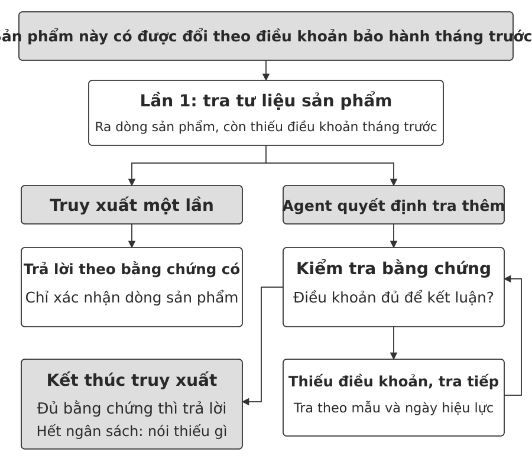

Lấy ReAct làm ví dụ: mô hình trước hết phân tích câu hỏi và chọn truy vấn, gọi `knowledge_base_search`; sau khi công cụ trả về observation, mô hình phán đoán bằng chứng đã đủ chưa. Nếu còn thiếu điều kiện hoặc đối tượng liên quan, nó viết lại truy vấn và truy xuất tiếp; nếu tư liệu đã đủ, nó kết hợp nguồn để sinh câu trả lời. Harness duy trì lịch sử, các lần gọi công cụ và ngân sách, khi đến giới hạn thì kết thúc tìm kiếm hoặc chuyển sang hỏi lại cho rõ.

Xem tiếp Hình 3-13. Dù đổi phần phụ trợ của cơ sở kiến thức từ chỉ mục vector sang đồ thị quan hệ, mô hình vẫn có thể tiếp tục yêu cầu tìm kiếm qua cùng một giao diện công cụ. Nếu trong tài liệu trả về tình cờ có một đoạn chỉ thị, mô hình có được làm theo không?

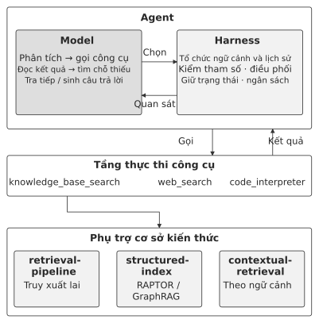

**Ranh giới tin cậy của nội dung truy xuất.** Tài liệu bên ngoài có thể chứa văn bản tìm cách thay đổi hành vi của mô hình, cũng có thể bị chèn dữ kiện sai trước khi vào kho. Trường hợp trước liên quan đến tiêm prompt gián tiếp (indirect prompt injection), trường hợp sau thuộc về đầu độc cơ sở kiến thức. Khi xử lý, phải quản lý đồng thời nguồn nội dung và quyền thực thi: kết quả truy xuất mang theo nguồn, phiên bản và vị trí trích dẫn, làm bằng chứng cho câu trả lời; còn các hành động như chuyển tiền, xóa dữ liệu, gửi thư ra ngoài thì do Harness và môi trường thực thi kiểm tra theo ủy quyền của người dùng. Xét duyệt khi nhập kho, truy nguyên nguồn và kiểm chứng dữ kiện kiểm soát thêm sự lan truyền của kiến thức sai. Cơ chế đánh dấu nguồn giới thiệu ở Chương 2 và các ràng buộc công cụ ở Chương 4 cùng phát huy tác dụng ở đây.

> **Thí nghiệm 3-8 ★★: So sánh truy xuất một lần và truy xuất nhiều vòng**
>
> Thí nghiệm này dùng cùng một bộ tư liệu pháp luật tiếng Trung, cùng một bộ truy xuất BM25 và cùng một mô hình, so sánh hai chế độ trên bảy câu hỏi: nhóm cơ sở tìm kiếm một lần theo câu hỏi gốc, chế độ Agent cho phép mô hình điều chỉnh truy vấn và tìm kiếm tối đa bốn lần.
>
> Với truy vấn kiểu "phòng vệ chính đáng được quy định thế nào", truy xuất trực tiếp là lấy được các điều luật chính. Ví dụ phức tạp hơn là "say rượu vô ý gây thương tích nặng cho người khác và có tiền án trộm cắp thì lượng hình thế nào". Câu này liên quan đồng thời đến hành vi hiện tại, tình tiết say rượu và tiền án trước đó, nên khi truy xuất phải định vị riêng từng tư liệu liên quan, rồi kiểm tra điều kiện áp dụng.
>
> Lần chạy thực tế lần lượt tìm "say rượu vô ý gây thương tích nặng tiền án trộm cắp lượng hình", "say rượu phạm tội lượng hình", "tiền án trộm cắp ảnh hưởng lượng hình luật hình sự" và "tiền án ảnh hưởng lượng hình luật hình sự". Sau đó mô hình còn đề xuất "xác định tái phạm luật hình sự", nhưng lúc này ngân sách tìm kiếm đã hết, Harness trả về thông báo hết ngân sách.
>
> Trên bốn câu hỏi phức tạp theo cách phân nhóm của thí nghiệm, độ bao phủ điều luật mục tiêu tăng từ khoảng 8% lên 92%, số lần tìm kiếm trung bình tăng từ một lên 3,5 lần, thời gian trung bình ở giai đoạn trả lời tăng từ khoảng 8 giây lên 66 giây. Ba câu hỏi đơn giản đều đạt độ bao phủ bằng chứng 100%, cả hai nhóm đều chỉ tìm kiếm một lần.

Cùng một vòng lặp truy xuất cũng dùng được cho lịch sử của người dùng. Dưới đây tiếp tục dùng bộ đánh giá ba cấp độ của Thí nghiệm 3-1, quan sát cách Agent lấy dữ kiện từ các bản ghi xuyên phiên, phân biệt đối tượng và xử lý các cập nhật.

> **Thí nghiệm 3-9 ★★: Đọc bộ nhớ người dùng bằng truy xuất dạng Agent**
>
> Thí nghiệm này coi toàn bộ lịch sử hội thoại là cơ sở kiến thức, chia theo cửa sổ rồi lập chỉ mục, sau đó cung cấp cho Agent công cụ `search_user_memory`. Kích thước cửa sổ có thể điều chỉnh; lần chạy này mỗi khối gồm tám lượt hội thoại, hai khối liền kề chồng lên nhau hai lượt, và lưu định danh phiên, thời gian cùng siêu dữ liệu nghiệp vụ. Truy vấn tối đa ba lần, mỗi lần lấy về bốn đoạn.
>
> Nhớ lại cơ bản có thể tìm kiếm quanh các trường rõ ràng, ví dụ "số tài khoản thanh toán của tôi là bao nhiêu". Câu hỏi nhiều phiên còn phải kiểm tra xem đối tượng đã đủ chưa: người dùng vừa có một chiếc Honda Accord, vừa có một chiếc Tesla Model 3; khi hỏi lịch bảo dưỡng xe, hệ thống phải phân biệt hai xe cùng tình trạng đặt lịch của từng xe.
>
> Từ đó có thể thiết kế một lộ trình truy xuất: trước hết tìm bản ghi về xe và dịch vụ; khi phát hiện manh mối về chiếc xe thứ hai, thì tra tiếp lịch của Tesla; cuối cùng nêu lịch hẹn đã có của Honda, và xác nhận xem người dùng có cần đặt lịch cho Tesla không. Bản ghi thực tế lần này chỉ thực hiện một truy vấn `scheduled car services`, câu trả lời của nhóm truy xuất thông thường tập trung vào Honda, bỏ sót Tesla.
>
> Một loại khó khăn khác đến từ những lần sửa đổi liên tiếp. Trong ca chuyển tiền, người vợ lập một lệnh chuyển, người chồng sau đó sửa số tiền và ngày, rồi người vợ lại điều chỉnh lần nữa. Sau khi lấy được bản ghi, phải dựa vào thời gian, đối tượng và trạng thái xác nhận để khôi phục các thay đổi, tìm ra chỉ thị cuối cùng có hiệu lực. Cách chia khối hiện tại đã lưu thông tin thời gian, nhưng truy xuất vẫn có thể bỏ sót lần sửa then chốt, nên có thể bổ sung thêm bối cảnh sự kiện cho các đoạn.
>
> Trong 60 trường hợp này, 18 trường hợp chỉ tìm kiếm một lần, 6 trường hợp tìm hai lần, 36 trường hợp dùng hết ba lần. Nhóm truy xuất chia khối thông thường đạt 47 trường hợp: nhớ lại cơ bản 19, truy xuất nhiều phiên 15, phục vụ chủ động 13. Mục tiếp theo tiếp tục so sánh tiền tố ngữ cảnh và bộ nhớ có cấu trúc trên cùng các trường hợp này, phân tích mỗi cách bổ sung được những thông tin gì.

### Truy xuất theo ngữ cảnh: bổ sung bối cảnh cho các đoạn

Quay lại bản báo cáo tài chính. Muốn tra kết quả kinh doanh quý II năm 2025 của công ty ACME, truy vấn có tên công ty và năm, nhưng đoạn viết "doanh thu của công ty tăng 3%" lại không hề có hai từ đó. Ngoài cách mở rộng khối, còn có thể giữ nguyên đoạn ngắn này và bổ sung phần bối cảnh còn thiếu vào trước nó. **Truy xuất theo ngữ cảnh (Contextual Retrieval)** sinh cho mỗi đoạn một tiền tố bối cảnh ngắn khi lập chỉ mục, rồi dùng tiền tố cùng văn bản gốc để truy xuất[^ch3-1]. Hình 3-14 trình bày quá trình xử lý này.

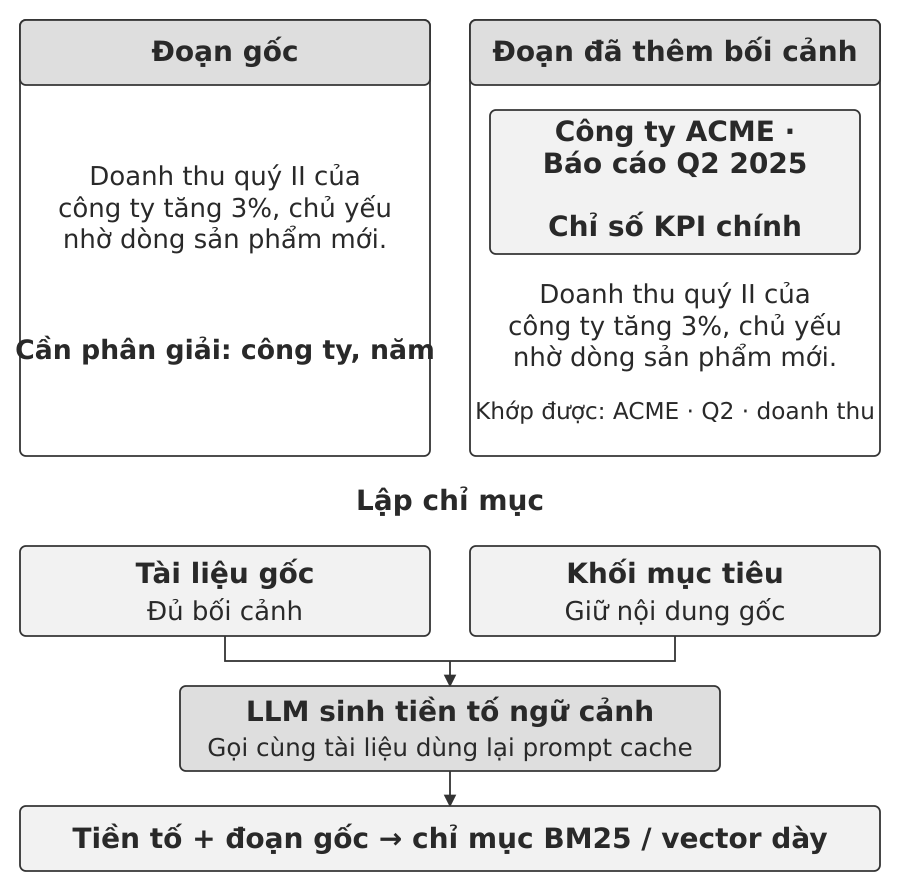

Ví dụ, tiền tố có thể nói rõ "đoạn này thuộc phần chỉ số kết quả kinh doanh chủ chốt trong báo cáo quý II năm 2025 của công ty ACME". Khi sinh tiền tố, cung cấp đồng thời văn bản gốc và khối mục tiêu, để mô hình bổ sung những thông tin về đối tượng được nhắc tới, thời gian và chương mục thực sự có căn cứ. Nhờ đó BM25 có thêm các từ tố khớp được như tên công ty, quý, còn nhúng dày đặc cũng có thể kết hợp những bối cảnh này để biểu diễn đoạn.

Cách này có thể phối hợp với nén theo ngữ cảnh ở Chương 2: ở giai đoạn lập chỉ mục, bổ sung bối cảnh cho các khối kiến thức để tăng cơ hội phát hiện thông tin liên quan; ở giai đoạn chạy, sắp xếp phần lịch sử đã lấy về theo nhiệm vụ hiện tại để kiểm soát độ dài đầu vào. Cái trước quan tâm đến khả năng được truy xuất của đoạn, cái sau quan tâm đến thông tin và ngân sách mà quyết định hiện tại cần.

[^ch3-1]: Anthropic, Introducing Contextual Retrieval, tháng 9 năm 2024.

> **Thí nghiệm 3-10 ★★: So sánh khối gốc và khối tăng cường ngữ cảnh**
>
> Thí nghiệm này xây hai bộ chỉ mục cho cùng một lô tư liệu: một bộ dùng các đoạn gốc, bộ kia thêm tiền tố do mô hình sinh ra. Giữ nguyên truy vấn và nhãn mục tiêu, lần lượt so sánh BM25, truy xuất dày đặc và truy xuất lai.
>
> Tiếp tục ví dụ báo cáo tài chính ở trên: khi truy vấn "tình hình tăng trưởng doanh thu gần đây của công ty ACME", có thể kiểm tra xem đoạn trúng có chứa đủ công ty mục tiêu, kỳ báo cáo và số liệu tăng trưởng hay không. Chỉ có "tăng trưởng doanh thu" thì có thể khớp nhầm sang công ty khác; sau khi bổ sung tiền tố, tên công ty và thời gian được tham gia vào việc xếp hạng.
>
> Trong 15 truy vấn lần này, sau khi thêm tiền tố, recall@1 của BM25 tăng từ 0.60 lên 0.80, của truy xuất dày đặc tăng từ khoảng 0.867 lên 0.933; recall@3 của hai phương pháp lần lượt giữ nguyên ở 0.867 và 1.0. recall@5 của truy xuất lai tăng từ 14/15 lên 15/15. Câu nào được tìm lại thêm? Khi tra cứu thẩm quyền của Ủy ban Thường vụ Đại hội Đại biểu Nhân dân toàn quốc, đoạn mục tiêu liệt kê các thẩm quyền nhưng lại thiếu chủ ngữ. Thêm tiền tố, BM25 đưa nó từ hạng 16 lên hạng 12, vẫn nằm ngoài năm vị trí đầu; truy xuất lai đưa nó từ hạng 6 lên hạng 5, lúc đó nó mới vào được năm vị trí đầu. Xem lại văn bản gốc, đoạn thứ nhất liệt kê các thẩm quyền từ khoản (1) đến khoản (4), đoạn thứ năm nối tiếp từ khoản (4) đến khoản (22). Việc chấm điểm chỉ kiểm tra đoạn thứ năm được gán nhãn có được chọn hay không, nhưng muốn liệt kê đủ thẩm quyền thì phải ghép hai đoạn lại.
>
> Việc sinh tiền tố làm tăng số lần gọi ở giai đoạn lập chỉ mục. Khi sinh bối cảnh cho nhiều khối của cùng một tài liệu, có thể dùng lại bộ đệm tiền tố (prefix cache) của tài liệu. Trong báo cáo năm 2024, Anthropic ước tính theo khối 800 token, tài liệu 8000 token và độ dài prompt định sẵn, chi phí xử lý một lần cho mỗi triệu token tài liệu vào khoảng 1,02 đô la.
>
> Trong báo cáo đó, nhúng theo ngữ cảnh kết hợp BM25 hạ tỷ lệ thất bại truy xuất top-20 từ 5,7% xuống 2,9%, giảm tương đối khoảng 49%; thêm xếp hạng lại thì giảm xuống 1,9%, giảm tương đối khoảng 67%. Tỷ lệ thất bại mà báo cáo dùng là $1-\mathrm{recall@20}$.

Với kho tư liệu cần truy vấn nhiều lần và nội dung tương đối ổn định, tác giả khuyên ưu tiên bổ sung đủ bối cảnh cho các đoạn ngay khi lập chỉ mục; xử lý một lần là phục vụ được nhiều lần truy vấn về sau. Nếu tên công ty, chủ thể sự kiện và thời gian bị mất khi chia khối, thì chỉ tăng số lượng truy xuất vẫn có thể lấy về một lô đoạn không rõ đang nói về ai. Bổ sung những manh mối này khi sinh tiền tố, các lần truy xuất về sau sẽ dùng được chúng để định vị tư liệu.

> **Thí nghiệm 3-11 ★★★: Tăng cường bộ nhớ bằng tiền tố ngữ cảnh và thẻ có cấu trúc**
>
> Câu "được, đặt cái này đi" trong hội thoại cần được liên kết với món hàng hoặc lịch trình đã nói trước đó. Nếu văn bản gốc đang bàn về vé một chiều Thượng Hải – Seattle giá 500 đô la, tiền tố có thể bổ sung những bối cảnh này, đồng thời giữ lại phiên và thời điểm diễn ra việc xác nhận.
>
> Thí nghiệm này thêm hai cấu hình trên nền chia khối thông thường: nhóm tiền tố ngữ cảnh, và nhóm bộ nhớ hai tầng nạp thêm Advanced JSON Cards. Trước hết mô hình sinh chuỗi tìm kiếm dựa trên chỉ mục thông thường, rồi dùng cùng nhóm truy vấn đó cho cả hai bộ chỉ mục; nhóm hai tầng dùng cùng kết quả truy xuất tăng cường, và thêm thẻ có cấu trúc.
>
> Trong ca chuyển tiền, các tiền tố lần lượt nói rõ Patricia khởi tạo lệnh chuyển, James sửa lại, rồi Patricia điều chỉnh lần nữa, giúp định vị thứ tự sự kiện. Trạng thái cuối cùng mà bản ghi gốc cho biết là 95.000 đô la, ngày 1 tháng 10, các sắp xếp trước đó đã bị thay thế. Lần này cả ba nhóm đều tìm đúng trạng thái này.
>
> Cấu trúc hai tầng còn hỗ trợ liên kết chủ động. Thẻ lưu những dữ kiện then chốt như "chuyến đi Tokyo" và "thời hạn hộ chiếu", còn hội thoại chi tiết được truy xuất khi cần. Lấy ví dụ chuyến đi từ ngày 15 đến ngày 22 tháng 1 và hộ chiếu hết hạn ngày 18 tháng 2: hệ thống có thể phát hiện trước rằng hai mốc ngày gần nhau, rồi tra bản ghi gia hạn và yêu cầu của chuyến đi, cuối cùng nhắc người dùng xác nhận những việc chuẩn bị chưa làm xong. Trong ca du lịch này, câu trả lời của cả ba nhóm đều qua chấm điểm; khác biệt giữa thẻ và truy xuất chủ yếu thể hiện ở ca xe cộ và các ca xuyên phiên dưới đây.
>
> Trên toàn bộ 60 trường hợp, truy xuất thông thường, tiền tố ngữ cảnh và bộ nhớ hai tầng lần lượt đạt 47, 52 và 57. Số trường hợp phục vụ chủ động đạt của nhóm tiền tố tăng từ 13 lên 18; nhóm hai tầng đạt cả 20 trường hợp ở cấp truy xuất nhiều phiên, ở cấp phục vụ chủ động cũng đạt 18. Trong ca xe cộ, thẻ bổ sung thông tin về chiếc xe thứ hai, giúp câu trả lời bao quát được đối tượng trước đó bị bỏ sót. Xét tiếp một chỗ thụt lùi: người dùng hỏi phạm vi bảo hiểm thiệt hại do nước đối với bất động sản, nhóm thông thường nhắc đến cả nhà ở và nhà cho thuê, còn nhóm tiền tố lại bỏ sót nhà cho thuê. Đối chiếu từng câu thì thấy nhóm tiền tố trả lời đúng thêm 8 câu so với nhóm thông thường, nhưng cũng đánh mất 3 câu vốn đã đúng.

**Khi cần phục vụ chủ động, tác giả ưu tiên kiến trúc hai tầng: dữ kiện then chốt thường trú, bản ghi chi tiết truy xuất khi cần.** Chỉ dựa vào truy xuất, mô hình thường phải biết trước nên hỏi gì mới tìm ra bản ghi liên quan; những thứ chưa lọt vào tầm nhìn như hộ chiếu, xe cộ hay quan hệ gia đình vì thế rất dễ bị bỏ sót. Đặt trước một lượng nhỏ dữ kiện then chốt vào ngữ cảnh giúp mô hình phát hiện liên kết, đưa ra truy vấn, rồi lấy về chi tiết gốc. Khi chọn thông tin thường trú, cần xét đến quan hệ giữa người với người, các ràng buộc hiện tại và những việc chưa hoàn tất; còn kết quả truy xuất thì giữ nguồn, thời gian và căn cứ thay đổi.

### Trích xuất kiến thức từ tập dữ liệu: từ ca cụ thể đến biểu diễn có cấu trúc

Kiến thức còn có thể đến từ việc sắp xếp một lượng lớn ca cụ thể. Trong bản án, phiếu yêu cầu chăm sóc khách hàng và hồ sơ sửa chữa, nhiều thông tin hữu ích nằm rải rác trong các đoạn tường thuật cụ thể. Khi nhiệm vụ cần khái quát quy luật, so sánh kết quả hoặc quyết định nên hỏi thêm gì từ một lượng lớn ca, tác giả khuyên trích xuất các trường thống nhất trước, rồi mới thống kê và sắp xếp nguyên mẫu. Chỉ lấy về vài ca tương tự thì khó thấy rõ phân bố trên cả tập dữ liệu; khi các trường đã thống nhất, có thể thống kê trên toàn bộ lô bản ghi, và cung cấp cái nhìn tổng quan cho các lần tra cứu ca riêng lẻ về sau.

Quá trình này có thể chia làm hai bước. **Trích xuất kiến thức** chuyển mô tả gốc thành bản ghi có cấu trúc, làm rõ ý nghĩa, giá trị và nguồn của từng trường; **phân tích mẫu hình** dùng thống kê và phân cụm để tìm những ca tương tự cùng các đặc trưng chung của chúng. Hình 3-15 trình bày quy trình từ trích xuất ca, mã hóa đặc trưng đến truy xuất nguyên mẫu.

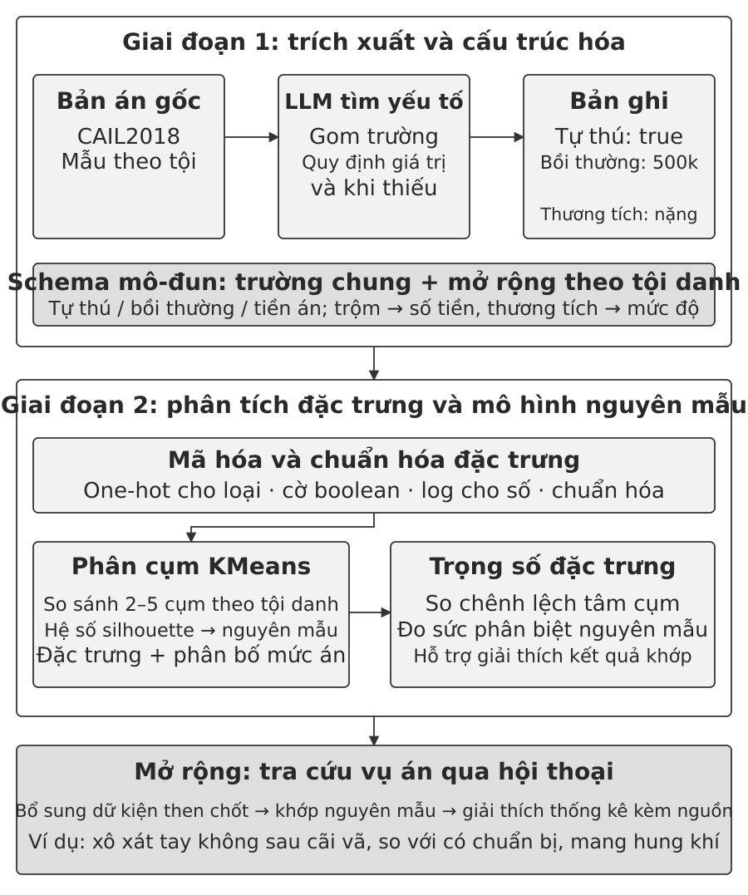

> **Thí nghiệm 3-12 ★★★: Trích xuất yếu tố và nguyên mẫu từ các vụ án**
>
> Thí nghiệm này dùng tư liệu vụ án hình sự của CAIL2018, chọn mẫu thuộc ba loại tội trộm cắp, cố ý gây thương tích và lừa đảo, xây dựng một quy trình giảng dạy gồm "phát hiện yếu tố – trích xuất trường – phân cụm – giải thích nguyên mẫu"[^ch3-cail]. Mỗi loại lấy 120 bản ghi để xây mô hình, giữ riêng 20 bản ghi khác, tổng cộng thành 360 mẫu xây mô hình và 60 mẫu để riêng.
>
> **Phát hiện và sắp xếp các trường.** Mô hình đọc các mẫu xây mô hình theo từng đợt, đề xuất những yếu tố có thể hữu ích, rồi gộp thành một Schema dạng mô-đun. Phần chung lưu những trường mà nhiều tội danh đều cần chú ý, như tự thú, bồi thường; phần mở rộng lưu thông tin gắn với tội danh cụ thể, như số tiền liên quan hoặc tình trạng thương tích. Lần sắp xếp này được 16 trường chung, cùng ba nhóm mở rộng lần lượt có 12, 12 và 11 trường. Mỗi trường còn phải định nghĩa giá trị và trạng thái thiếu, để việc trích xuất được nhất quán.
>
> **Mã hóa các trường thành vector.** Trường phân loại có thể dùng mã hóa one-hot: lấy ba loại trộm cắp, cướp tài sản, lừa đảo làm minh họa, lần lượt mã hóa thành `[1,0,0]`, `[0,1,0]`, `[0,0,1]`, mỗi vị trí chỉ biểu thị có thuộc loại đó hay không. Nếu dùng 1, 2, 3 thì với một số thuật toán sẽ đưa vào thứ tự và khoảng cách giữa các loại. Các trường như "có tự thú không", "có bồi thường không" có thể dùng 1 và 0 để biểu thị hai trạng thái đã xác nhận; trường hợp văn bản gốc không nhắc tới phải xử lý riêng, tránh tự động coi thiếu là phủ định.
>
> Với các giá trị không âm có biên độ lớn như số tiền, bản cài đặt này trước hết dùng $\ln(1+x)$ để nén thang đo, rồi mới đưa vào chuẩn hóa. Nếu một trường cho phép nhiều loại cùng xuất hiện, ví dụ một bản ghi gồm nhiều biện pháp xử lý, có thể đặt một bit chỉ thị cho từng loại, tạo thành mã hóa multi-hot.
>
> **Xây dựng nguyên mẫu vụ án.** Chuẩn hóa các đặc trưng đã mã hóa, rồi phân cụm riêng theo từng tội danh. Bản cài đặt này so sánh từ hai đến năm cụm, dùng hệ số silhouette để chọn cách phân nhóm, cuối cùng được 11 nguyên mẫu. Mỗi nguyên mẫu lưu số mẫu, các đặc trưng chính, cùng trung vị, tứ phân vị và khoảng mức án của các mẫu. Ví dụ, có thể xoay quanh nguyên nhân xung đột, phương thức gây án và hậu quả thương tích để so sánh những tổ hợp đặc trưng khác nhau như xô xát tay không sau cãi vã và hành vi có chuẩn bị trước, có mang hung khí; cách phân nhóm cụ thể do kết quả trích xuất và phân cụm cùng quyết định.
>
> **Giải thích đặc trưng và kết quả khớp.** Chương trình dựa vào chênh lệch giữa các tâm cụm đã chuẩn hóa để tính trọng số của từng đặc trưng trong việc phân biệt các nguyên mẫu. Khớp nguyên mẫu thì ánh xạ ca mới vào cùng không gian đặc trưng, lấy về tóm tắt thống kê và căn cứ của nhóm gần nhất, để mô hình tổ chức phần giải thích.
>
> Lần này chọn 12 trong 60 mẫu để riêng để sinh giải thích, rồi giao cho một mô hình độc lập chấm điểm. Hãy xem trước một mẫu trộm cắp: nguyên mẫu mà nó khớp chỉ có một bản ghi xây mô hình, mức án 4 tháng, nên giá trị nhỏ nhất, trung vị và lớn nhất đều là 4. Bộ sinh báo cáo trung thực con số này, và cũng chỉ ra rằng chỉ có một bản ghi để tham khảo. Giám khảo cho tiêu chí "con số có trung thành với nguyên mẫu không" 4 điểm (tối đa), nhưng nhãn thực tế của mẫu để riêng lại là 8 tháng.
>
> Nếu dùng truy xuất nguyên mẫu trong hội thoại, có thể hỏi trước những dữ kiện còn thiếu nào có thể ảnh hưởng đến việc khớp, rồi dựa vào câu trả lời để truy xuất lại.

[^ch3-cail]: CAIL2018, dự án bộ dữ liệu chính thức. Thí nghiệm đi kèm lấy mẫu từ tư liệu công khai và dùng cách phân chia nội bộ trong mẫu để xây mô hình và đánh giá.

Từ ca cụ thể đến nguyên mẫu, cơ sở kiến thức có thêm một tầng biểu diễn thống kê truy xuất được. Văn bản gốc cung cấp bằng chứng, các trường hỗ trợ tính toán, nguyên mẫu khái quát đặc trưng chung của các mẫu tương tự; ba thứ này phải giữ được quan hệ tương ứng với nhau, thì khi phát hiện lỗi trích xuất hoặc thiên lệch mẫu mới tra ngược và sửa được.

### Khám phá tiên phong: bộ nhớ đa phương thức và bộ nhớ tham số hóa

Hãy hình dung người dùng chỉ vào một bức ảnh đã tải lên trước đó và nói "lấy đúng màu này". Nếu lúc ấy hệ thống chỉ giữ lại mấy chữ "áo khoác xanh lam", lần sau có thể không phân biệt được hai sắc xanh. Âm sắc trong giọng nói, quan hệ không gian trong biểu đồ cũng mất chi tiết khi được chuyển thành chữ. Để các truy vấn sau này có cơ hội tìm lại những thông tin đó, có thể lưu tư liệu gốc, lưu những biểu diễn mà mô hình dùng được, hoặc đi xa hơn là nghiên cứu bộ nhớ bền vững bên trong mô hình.

**Hướng thứ nhất: phối hợp tư liệu gốc với chỉ mục văn bản.** Ví dụ, trong nhiệm vụ sắp xếp album ảnh được người dùng cho phép, có thể cắt và lưu các vùng cục bộ như khuôn mặt người, tham chiếu ảnh trong mục Markdown, đồng thời ghi thời điểm chụp, bối cảnh và nhãn nhân vật do người dùng cung cấp. Khi truy xuất, trước hết dựa vào mô tả để tìm ra vài bức ảnh có thể liên quan, rồi đọc ảnh gốc hoặc vùng đã cắt để so sánh chi tiết ngoại hình. Đoạn âm thanh cũng có thể gắn với thời gian, nguồn và bản chép lời, phát lại âm thanh gốc khi cần. Văn bản cung cấp lối vào, tư liệu gốc giữ lại những chi tiết khó khái quát bằng chữ.

**Hướng thứ hai: lưu vector nhúng và nạp khi cần.** Bộ mã hóa thị giác hoặc âm thanh có thể chuyển tư liệu thành vector, lưu vào chỉ mục để phục vụ truy xuất theo độ tương đồng. Ví dụ, mã hóa các vùng cục bộ của ảnh hoặc các đoạn âm thanh, rồi gắn từng cái vào mục bộ nhớ tương ứng. Nếu mô hình hỗ trợ lớp chiếu và giao diện bộ nhớ đã qua huấn luyện, còn có thể dành sẵn một nhóm ô trong ngữ cảnh để nạp những vector liên tục này, cho mô hình truy cập qua cơ chế chú ý. Ở đây phải giải quyết việc căn chỉnh biểu diễn của bộ mã hóa với biểu diễn bên trong mô hình ngôn ngữ.

Một nghiên cứu sơ bộ của tác giả cùng Noah Shi tách bài toán này thành hai bước. Trong một bức ảnh chụp chung có hai người, người dùng hỏi "người đứng cạnh cửa sổ có phải là người lần trước đã gặp không?" Trước hết phải dựa vào "cạnh cửa sổ" để tìm ra người mà người dùng muốn nói, rồi mới so ảnh của người này với mẫu đã lưu trước đó. Nếu bước thứ nhất chọn nhầm người, thì dù bước thứ hai nhận diện chuẩn đến đâu, câu trả lời vẫn là cho một câu hỏi khác. Bài báo còn để những dữ kiện chép lại chính xác được như tên người trong bộ nhớ văn bản, để mỗi loại thông tin có cách lấy ra phù hợp.[^ch3-perceptmem]

[^ch3-perceptmem]: Li Bojie, Noah Shi, Parametric Multimodal User Memory; dự án đi kèm `19PINE-AI/multimodal-user-memory` chứa phần cài đặt và thí nghiệm PerceptMem. Câu hỏi về ảnh chụp chung là ví dụ giảng dạy.

**Hướng thứ ba: bộ nhớ bền vững bên trong mô hình.** Huấn luyện một LoRA cho từng người dùng là một cách ghi dữ kiện cá nhân hóa vào mô hình. Hỏi thẳng "người dùng sống ở đâu" và lập kế hoạch chuyến đi dựa vào địa chỉ đòi hỏi những cách dùng bộ nhớ khác nhau: cái trước chỉ đọc dữ kiện, cái sau còn phải đưa dữ kiện vào suy luận tiếp theo. Nếu chỉ huấn luyện quanh việc nhắc lại dữ kiện, mô hình có thể nhớ đáp án nhưng không chủ động dùng đến nó trong nhiệm vụ phức tạp. Vì vậy, mẫu huấn luyện phải gồm cả câu hỏi trực tiếp lẫn các nhiệm vụ phụ thuộc vào những dữ kiện đó.

Nghiên cứu **User as Engram** của tác giả ghi dữ kiện dạng văn bản vào bảng nhớ cục bộ của mô hình Engram, rồi để một bộ chuyển đổi (adapter) dùng chung học cách tận dụng những dữ kiện đó để suy luận[^engram]. Phép tra N-gram có khóa băm đảm nhiệm việc định vị mục trong bảng, cơ chế cổng đưa nội dung lấy được vào mô hình; mỗi người dùng lưu các mục bảng cục bộ của mình, còn phần suy luận có thể dùng chung. Trong thí nghiệm với dữ kiện văn bản, bài báo so sánh nhớ lại trực tiếp với suy luận gián tiếp, cho thấy cách quản lý riêng nội dung bộ nhớ của từng người dùng và năng lực suy luận dùng chung.

[^engram]: Li, Bojie, User as Engram: Internalizing Per-User Memory as Local Parametric Edits, 2026.

Mở rộng hướng này sang đa phương thức còn cần thiết kế cơ chế định địa chỉ, ghi và đọc cho biểu diễn hình ảnh hoặc âm thanh.

## Tóm tắt chương

Quay lại yêu cầu đặt vé ở đầu chương. "Tôi thích ngồi cạnh cửa sổ" đến từ chính người dùng này, còn "được mang mấy kiện hành lý" thì phải tra điều khoản của hãng hàng không áp dụng vào ngày bay. Nếu lưu cả hai thông tin thành một câu đơn thuần, rất dễ đánh mất điểm khác biệt quan trọng nhất: câu trước áp dụng cho ai, câu sau có hiệu lực từ khi nào. Khi lưu, giữ lại nguồn, thời gian và điều kiện áp dụng, thì khi lấy ra mới có căn cứ để phán đoán lần này có dùng được hay không. Một dữ kiện đơn lẻ hợp để ghi thành ghi chú ngắn; khi cần nói rõ quan hệ giữa người với người hoặc giữ lại đầu đuôi sự việc, có thể dùng thẻ hoặc đoạn văn gốc; ngày tháng và số lượng còn có thể lưu thành trường có kiểu, giao cho chương trình tính toán.

Nếu trợ lý báo sai hạn mức hành lý, trước hết hãy kiểm tra điều khoản hiện hành đã vào kho chưa, rồi kiểm tra điều khoản bị cắt vào đoạn nào, bộ truy xuất có tìm thấy nó không, sau khi xếp hạng lại nó đứng thứ mấy, cuối cùng mới xem mô hình nhận được những tư liệu nào. Khi văn bản gốc rất nhiều, có thể giữ một bản tổng quan có cấu trúc trong ngữ cảnh và truy xuất chi tiết khi cần. Tóm tắt chương mục giúp tìm chủ đề, chỉ mục quan hệ giúp tra liên kết; nếu đoạn văn mất đối tượng được nhắc tới, có thể bổ sung bối cảnh xuất xứ; khi một lần truy xuất vẫn thiếu bằng chứng, Agent còn có thể đổi truy vấn để tra tiếp.

Khi hãng hàng không công bố quy định mới, có thể làm trước một lần cập nhật phạm vi nhỏ, giữ ngày hiệu lực và nguồn của cả điều khoản cũ lẫn mới; những mục trùng lặp, xung đột và thay đổi cấu trúc tích tụ lại thì để đến đợt sắp xếp định kỳ. Người đề xuất nộp thay đổi, người xét duyệt đối chiếu bằng chứng, được phê duyệt thì dựng lại chỉ mục dịch vụ. Có bản ghi phiên bản, ta có thể chạy lại những câu trước đây trả lời sai, cũng có thể tra ra câu trả lời cũ lúc đó dựa vào tư liệu nào. Làm sao tích lũy thêm kinh nghiệm từ kết quả thực thi sẽ được bàn riêng ở Chương 9.

Tra ra được phép ký gửi hai kiện hành lý mới chỉ trả lời câu hỏi "quy tắc có cho phép không". Muốn thay người dùng thêm hành lý vào đơn đặt chỗ, trợ lý còn phải biết gọi được công cụ nào, cần những tham số gì, và nhận được biên nhận như thế nào mới coi là xong việc. Đó là điểm xuất phát của chương sau.

## Câu hỏi suy ngẫm

1. ★★ Người dùng nói: "Ngày 1 tháng 5 tôi chuyển từ A sang B, từ ngày 10 đến ngày 20 tháng 5 tôi ở khách sạn C, trong thời gian đó hóa đơn thì gửi qua email." Vào ngày 15 tháng 5, trợ lý nên trả lời thế nào về địa chỉ nhà, nơi ở tạm thời và cách nhận hóa đơn? Hãy thiết kế quy tắc ghi và truy vấn, nói rõ cách xử lý việc đính chính lỗi gõ nhầm hoặc các địa chỉ mâu thuẫn nhau.
2. ★★ Khi tài liệu gốc chứa thông tin mâu thuẫn, tiền tố ngữ cảnh có thể ghi luôn cả lỗi sai vào chỉ mục. Bạn sẽ lưu nguồn, phiên bản và các mục chưa chắc chắn thế nào, và dùng những thông tin đó ra sao ở giai đoạn truy xuất và sinh câu trả lời?
3. ★★ Sau khi chuyển biểu đồ thành văn bản, những quan hệ không gian nào dễ bị mất? Hãy lấy ví dụ bằng bảng, sơ đồ kiến trúc hoặc biểu đồ đường, và thiết kế phương án truy xuất phối hợp giữa ảnh gốc, biểu diễn có cấu trúc và chỉ mục văn bản.
4. ★★★ Khi mô hình và năng lực ngữ cảnh dài ngày càng mạnh, những công việc nào trong quy trình chia khối, lập chỉ mục và truy xuất có thể giao cho mô hình? Hãy phân tích dựa trên phần bàn về tìm kiếm và học trong "Bài học cay đắng" (The Bitter Lesson) của Rich Sutton, rồi thiết kế thí nghiệm so sánh đưa toàn bộ vào ngữ cảnh với truy xuất khi cần, đồng thời kiểm tra chất lượng nhiệm vụ, chi phí tính toán và ràng buộc phân quyền.
5. ★★★ Nếu mô hình đã nắm được nhiều kiến thức chuyên ngành, cơ sở kiến thức bên ngoài còn nên lưu gì? Hãy lần lượt bàn về kiến thức phổ thông công khai, các quy tắc liên tục được cập nhật, tư liệu riêng tư và những bằng chứng cần truy nguyên chính xác.
6. ★ Tóm tắt nhiều tầng của RAPTOR và quan hệ thực thể, tóm tắt cộng đồng của GraphRAG lần lượt hỗ trợ những loại truy vấn nào? Hãy cho mỗi loại tổng quan toàn cục, chi tiết cục bộ và liên kết nhiều bước một ví dụ, và nói rõ cần kiểm tra bằng chứng gì.
7. ★★ Thư mục, liên kết và chỉ mục vector phối hợp thế nào để tổ chức kiến thức? Hãy thiết kế một cơ sở kiến thức cần cả người lẫn Agent cùng duy trì, nói rõ vị trí của điều hướng, tìm kiếm ngữ nghĩa, cập nhật phiên bản và lọc theo quyền.
8. ★★★ Sau khi trích xuất trường từ các ca cụ thể và phân cụm, làm sao biết nguyên mẫu có hữu ích hay không? Hãy phân biệt tầm quan trọng của đặc trưng phân cụm, năng lực dự đoán kết quả và giải thích nhân quả, rồi thiết kế quy trình đánh giá trên tập để riêng và thẩm định của chuyên gia.
9. ★★★ Hãy thiết kế quy trình cập nhật tăng dần và sắp xếp định kỳ cho một kho bộ nhớ người dùng dạng Markdown. Nếu người xét duyệt và người đề xuất dùng cùng một mô hình, và người xét duyệt chỉ thấy được những đoạn do người đề xuất chọn, thì những lỗi nào dễ bị bỏ sót? Hãy cải tiến từ ba phương diện: độ bao phủ bằng chứng, quyền dùng công cụ và đánh giá việc xét duyệt.

[^ch3-glove]: Pennington và cộng sự, GloVe: Global Vectors for Word Representation, 2014.

[^ch3-sbert]: Reimers và Gurevych, Sentence-BERT: Sentence Embeddings using Siamese BERT-Networks, 2019.
