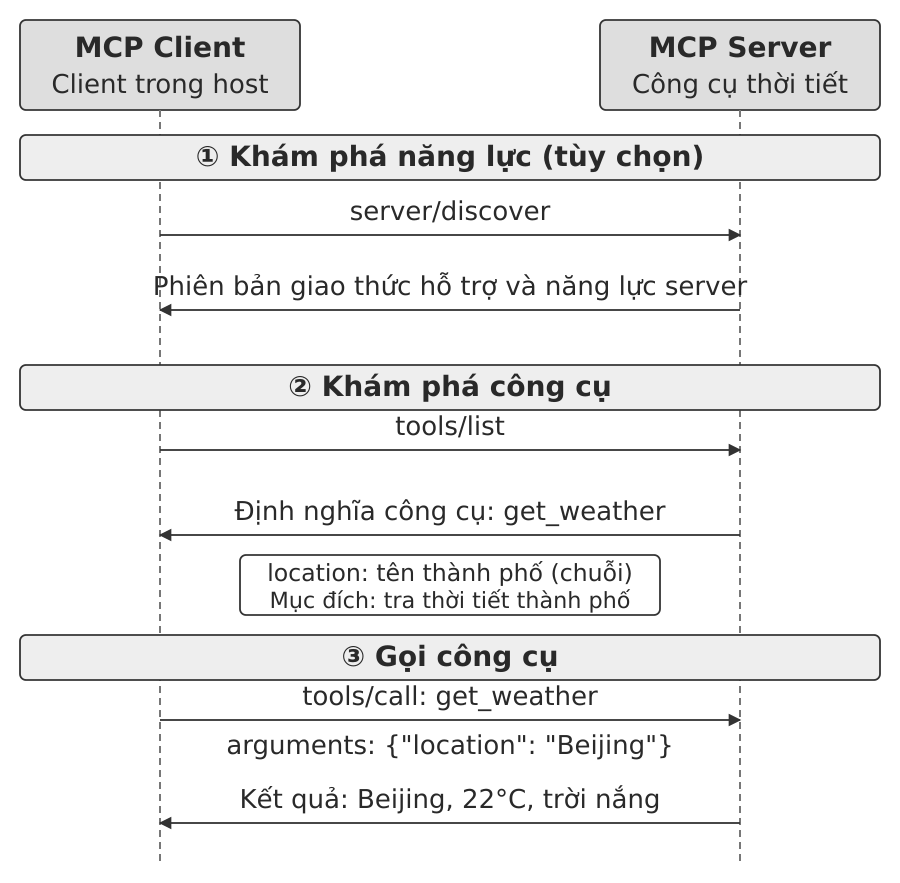
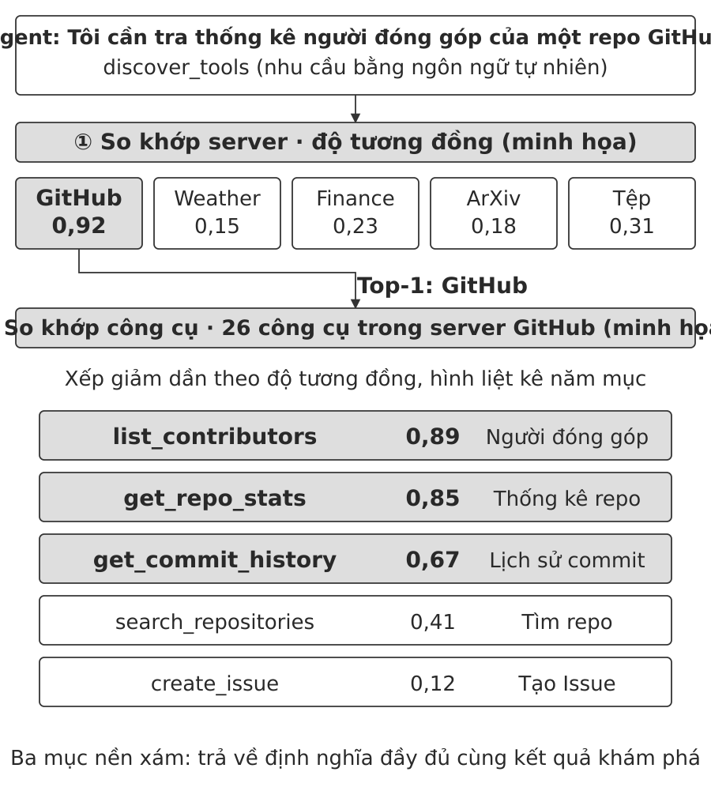
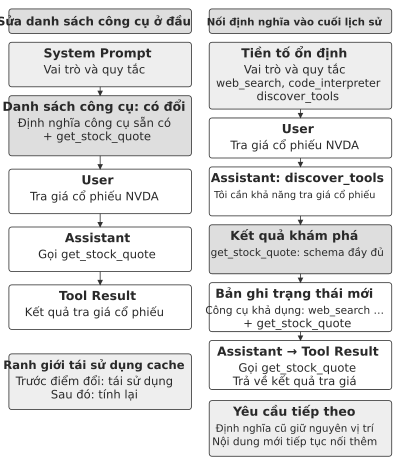
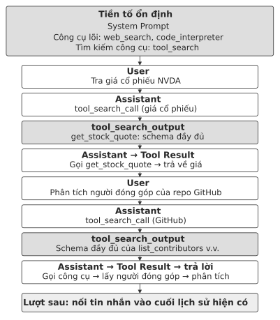

# Công cụ

Trong bộ phim khoa học viễn tưởng *Her*, trợ lý AI Samantha sắp xếp email, giúp trả lời thư, lo các việc xuất bản và chuyển qua lại giữa nhiều kênh liên lạc. Một trợ lý như vậy phải biến khả năng hiểu ngôn ngữ thành thao tác trên các hệ thống bên ngoài. Agent làm việc đó thông qua **công cụ**. Công cụ là “giác quan và tay chân” của Agent: vừa cung cấp quan sát, vừa thực hiện hành động. Các Agent đa dụng mà cuốn sách này bàn tới, như Manus và OpenClaw, cũng phải dùng công cụ để truy cập thế giới số.

Giả sử người dùng nói: “Tìm giúp tôi ngày giao hàng mà khách hàng nhắc trong email, sắp thành bảng rồi gửi cho tôi.” Mô hình có thể quyết định xem bức thư nào, nhưng muốn đọc nguyên văn thì phải truy cập hộp thư, muốn gửi bảng đi thì phải gọi giao diện gửi thư. Nên thiết kế những công cụ này ra sao, và khi cần thì mô hình tìm thấy chúng bằng cách nào? Chương này trước hết phân biệt năm loại công cụ, sau đó bàn về cách mô tả, kết nối và khám phá công cụ, cuối cùng lần lượt thiết kế giao diện nhận thức, thực thi và cộng tác. Kích hoạt sự kiện và giao tiếp với người dùng còn liên quan tới việc khi nào đánh thức Agent và chuyển tin nhắn qua nhiều kênh thế nào, nên được để lại cho Chương 6.

## Phân loại công cụ

Lấy việc tra email làm ví dụ: mô hình chọn bước tiếp theo, Harness kiểm tra tham số và quyền rồi gửi yêu cầu, còn dịch vụ thư mới thực sự đọc và ghi dữ liệu. Chương 1 đã phân loại công cụ theo mục đích thành công cụ nhận thức, thực thi, cộng tác, giao tiếp người dùng và kích hoạt sự kiện. Bốn loại đầu đều do Agent chủ động gọi; công cụ kích hoạt sự kiện thì cho phép sự kiện bên ngoài đánh thức Agent (Bảng 4-1).

Bảng 4-1 Hướng gọi và mục đích chính của năm loại công cụ

| Loại công cụ | Hướng gọi | Mục đích chính |
| --- | --- | --- |
| Công cụ nhận thức | Agent chủ động gọi | Lấy thông tin bên ngoài |
| Công cụ thực thi | Agent chủ động gọi | Tính toán hoặc thay đổi trạng thái bên ngoài |
| Công cụ cộng tác | Agent chủ động gọi | Giao việc, trao đổi tin nhắn, điều phối Agent khác hoặc con người |
| Công cụ giao tiếp người dùng | Agent chủ động gọi | Trả lời người dùng, trình bày kết quả hoặc gửi nhắc nhở |
| Công cụ kích hoạt sự kiện | Nhà phát triển cấu hình hoặc Agent đăng ký, bên ngoài kích hoạt | Đánh thức Agent khi sự kiện chỉ định xảy ra |

**Công cụ nhận thức** giúp Agent lấy thông tin bên ngoài, ví dụ tìm kiếm web `web_search`, truy xuất cơ sở tri thức `knowledge_base_search`, đọc trang web `fetch_url`, tìm theo tên tệp `find_file`, tìm theo nội dung tệp `grep_file` và đọc tệp `read_file`.

**Công cụ thực thi** giúp Agent tính toán hoặc thay đổi trạng thái bên ngoài, ví dụ dòng lệnh `shell_exec`, trình thông dịch mã `code_interpreter`, ghi tệp `write_file`, sửa tệp `edit_file` và gửi email `send_email`. Cùng một trình thực thi đa năng có thể làm phép tính chỉ đọc, cũng có thể sửa dữ liệu.

**Công cụ cộng tác** hỗ trợ giao việc và trao đổi tin nhắn, ví dụ tạo Agent con `spawn_subagent`, gửi tin nhắn `send_message_to_subagent`, hủy Agent con `cancel_subagent` và tìm các Agent khả dụng `list_agents`. Các việc độc lập có thể chạy song song, chẳng hạn tìm hiểu riêng tiểu sử từng nhà đồng sáng lập OpenAI; các việc khác nhau cũng có thể giao cho những Agent được cấu hình mô hình, công cụ, prompt và ngữ cảnh khác nhau. Chương 10 sẽ bàn tiếp về kiến trúc phân công và cộng tác.

**Công cụ giao tiếp người dùng** chuyển thông tin tới người dùng, ví dụ trả lời tin nhắn `reply_to_user`, gửi thẻ có cấu trúc `send_card_to_user` và gửi nhắc nhở `send_user_notification`. Khi tương tác mở rộng ra nhiều kênh hoặc cần thông báo chạy nền, hệ thống có thể đóng gói việc gửi tin nhắn thành lời gọi công cụ tường minh, để quản lý thống nhất người nhận, nội dung và trạng thái gửi.

**Công cụ kích hoạt sự kiện** nối sự kiện bên ngoài với hoạt động của Agent, ví dụ bộ hẹn giờ `set_timer`, theo dõi tác vụ nền `monitor_shell` và kết nối nguồn sự kiện `connect_channel`. Quá trình này gồm hai bước. Khi đăng ký, nhà phát triển cấu hình sẵn, hoặc Agent khai báo sự kiện cần theo dõi qua một lời gọi đã được phép. Khi sự kiện xảy ra, hệ thống điều phối nhận callback hoặc thông điệp sự kiện rồi đánh thức Agent xử lý. Email mới, cảnh báo hệ thống, lời nhắc định giờ và tác vụ nền hoàn tất đều có thể trở thành điểm khởi đầu của một lượt chạy mới.

Quay lại nhiệm vụ email ở đầu chương: mở thư gốc để lấy ngày giao hàng là nhận thức; tạo và lưu bảng tổng hợp làm thay đổi không gian làm việc, nên là thực thi; gửi bảng cho người giao việc thuộc giao tiếp người dùng. Chỉ khi hệ thống tự động làm tiếp lúc email khách hàng tiếp theo tới thì mới cần đến kích hoạt sự kiện. Cùng một dịch vụ thư có thể đảm nhận nhiều vai trò như vậy. Việc tiếp theo cần quyết định là công cụ trao cho mô hình nên chia nhỏ đến đâu: để nó lần lượt tra thư, đọc nội dung, tìm tệp đính kèm, hay gộp sẵn mấy bước thường làm liền nhau?

## Nguyên tắc chung khi thiết kế công cụ

Thời kỳ đầu, cách phổ biến để kết nối công cụ là bọc thẳng từng endpoint API. Cách này nhanh, nhưng dễ cho ra một bộ giao diện rất vụn. Để xong một việc, Agent có thể phải nhiều lần tìm đối tượng, đọc thuộc tính, kiểm tra điều kiện rồi mới gọi giao diện thực thi. Khi thiết kế, có thể gom các thao tác này quanh những nhiệm vụ thường gặp, chẳng hạn nối việc tìm liên hệ với việc gửi tin nhắn, hoặc để công cụ tìm log trả về luôn các dòng liên quan kèm ngữ cảnh xung quanh[^ch4-tool-design].

**Công cụ nên được thiết kế quanh nhiệm vụ mà Agent cần hoàn thành.** Cách nghĩ xuất phát từ việc Agent dùng giao diện ra sao này được gọi là **ACI** (Agent-Computer Interface, giao diện Agent–máy tính). HCI quan tâm con người tương tác với máy tính thế nào; ACI quan tâm mô hình chọn thao tác, tạo tham số, hiểu phản hồi và sửa lỗi ra sao.

[^ch4-tool-design]: Anthropic, *Writing effective tools for AI agents—using AI agents*, 2025.

### Hình thức thể hiện năng lực: công cụ chuyên dụng, trình thực thi đa năng và Skill

Khi giao việc “triển khai ứng dụng” cho mô hình, có thể thiết kế ba kiểu giao diện. Kiểu thứ nhất chỉ đưa ra một `deploy_app`, phía server lo hết các bước. Kiểu thứ hai đưa ra riêng ba bước build, đóng gói và triển khai, mô hình quyết định khi nào gọi bước tiếp theo. Kiểu thứ ba viết các bước vào một Skill để mô hình thực hiện trong terminal. Nếu build thất bại, kiểu thứ nhất phải dựa vào kết quả công cụ để cho mô hình biết hỏng ở bước nào; hai kiểu sau có thể đưa thẳng lỗi của lần build đó cho mô hình.

- **Công cụ chuyên dụng** cung cấp giao diện có cấu trúc cho một thao tác xác định. Nhà phát triển định nghĩa Schema tham số, quy tắc kiểm tra, logic thực thi và định dạng trả về, nên dễ kiểm thử và cấp quyền riêng. Khi định nghĩa công cụ được đưa vào ngữ cảnh, nó chiếm bao nhiêu tùy vào độ dài của các trường, phần mô tả và ví dụ.
- **Trình thực thi đa năng và Skill** đi cùng nhau: terminal hoặc trình thông dịch mã cung cấp khả năng thực thi, còn Skill mô tả quy trình, điều kiện áp dụng và cách thao tác. Host có thể nạp trước tên và phần giới thiệu ngắn, khi Skill được chọn mới đọc toàn bộ hướng dẫn và tài nguyên liên quan.

Ví dụ, một Skill triển khai có thể lần lượt hướng dẫn: dùng `npm run build` để build dự án, dùng `docker build -t app:latest .` để đóng gói image, rồi dùng `kubectl apply -f deploy.yaml` để áp các tài nguyên định nghĩa trong manifest lên cluster hiện tại. Agent thực hiện các bước này qua công cụ terminal, dùng chung một lối vào thực thi.

Công cụ được hiện thực thế nào và mô hình đọc được hướng dẫn của nó vào lúc nào là hai câu hỏi khác nhau. Hàng trăm công cụ chuyên dụng có thể chỉ hiển thị chỉ mục và nạp Schema khi cần; vài Skill thì có thể để danh mục thường trú trong ngữ cảnh, khi số lượng tăng mới thêm cơ chế truy xuất. Chọn giao diện chuyên dụng hay trình thực thi đa năng ảnh hưởng đến cách truyền tham số và cách bảo trì mã; chọn đưa hết một lần hay nạp theo nhu cầu ảnh hưởng đến việc mô hình thấy được những công cụ nào ở bước này. Phần “Khi có quá nhiều công cụ” ở sau sẽ bàn về chiến lược hé lộ.

**Tác giả khuyên ưu tiên công cụ đa năng, rồi mới bổ sung giao diện chuyên dụng theo nhu cầu về quyền, tham số và hiệu năng.** Ví dụ, cài sẵn SymPy, NumPy và pandas cho `code_interpreter` trong sandbox, Agent sẽ viết được Python để làm phép tính số học, tính toán ký hiệu, xử lý mảng và phân tích dữ liệu. Cách này tận dụng tối đa khả năng sinh mã của mô hình: một trình thông dịch chứa được nhiều thuật toán, lại có thể kết hợp các thư viện sẵn có để giải những bài toán chưa lường trước. Mô hình lo sinh mã, môi trường chạy lo thực thi và giới hạn quyền truy cập tệp, mạng và tài nguyên.

Ngay cả khi dùng công cụ chuyên dụng, tác giả cũng khuyên ưu tiên gộp những thao tác có chức năng gần nhau và thường được dùng cùng nhau. Giao diện chia quá nhỏ thì mô hình phải nhớ nhiều tên và cách phân vai hơn, làm cùng một việc cũng phải gọi nhiều lần hơn. Khi gộp, chủ yếu xét **mức tương đồng về chức năng** và **mức chồng lấn của tình huống sử dụng**. Ví dụ, `extract_pdf_text`, `extract_docx_content`, `extract_pptx_content` đều nhận một tài liệu và trích văn bản, nên có thể gộp thành `read_document` và dùng `file_type` để phân biệt định dạng. Mô hình chỉ cần chọn một lối vào chung; thêm định dạng mới cũng có thể giữ nguyên tham số và cấu trúc trả về.

Bốn trường hợp sau đặc biệt nên dùng giao diện chuyên dụng.

1. **Cần cấp quyền và kiểm toán chi tiết.** Việc ghi vào cơ sở dữ liệu production có thể đóng gói thành thao tác với phạm vi rõ ràng: server kiểm tra quyền người dùng, bảng đích và các trường được phép thay đổi, đồng thời ghi lại căn cứ của thao tác.
2. **Cần che khác biệt giữa các nền tảng.** grep, find có thể chạy qua shell, nhưng một công cụ tìm tệp chuyên dụng sẽ thống nhất tham số và phản hồi trên macOS, Windows và Linux, ví dụ luôn trả về tên tệp, số dòng và đoạn khớp.
3. **Thao tác diễn ra rất thường xuyên.** Thao tác tần suất cao có thể có một lối vào ngắn và ổn định, bớt chi phí sinh lại script và giải thích quy trình.
4. **Quan hệ giữa các tham số phức tạp.** Đối tượng lồng nhau, phụ thuộc giữa các trường và ràng buộc giá trị phức tạp nên được thể hiện bằng cả Schema lẫn kiểm tra nghiệp vụ.

**Tham số càng phức tạp, cách truyền càng quan trọng.** Lời gọi công cụ có cấu trúc thường dùng JSON Schema để mô tả đầu vào; một số dịch vụ mô hình hỗ trợ sinh có ràng buộc, khiến tham số tuân theo các quy tắc Schema được hỗ trợ. Cấu trúc giá trị trả về do giao diện công cụ quy định, host sau đó chuyển kết quả cho mô hình. Ngoài kiểm tra kiểu và định dạng, những thứ như quyền, đối tượng có tồn tại hay không, nhiều trường có cùng thỏa điều kiện nghiệp vụ hay không vẫn do Harness và dịch vụ công cụ kiểm tra.

Skill có thể hướng dẫn cách gọi công cụ chuyên dụng, cũng có thể hướng dẫn Agent dùng CLI. Cách sau đòi hỏi mô hình xử lý cùng lúc cú pháp dòng lệnh, dấu nháy và ký tự thoát, mà quy tắc ở mỗi shell lại khác nhau. Tham số càng phức tạp, mô hình càng phải xử lý đúng nhiều chi tiết. Với tham số lồng nhau phức tạp, có thể ghi chúng ra một tệp JSON trước rồi để lệnh đọc tệp đó, vừa bớt các lớp thoát ký tự, vừa kiểm tra được nội dung trước khi chạy.

**Người làm nghiệp vụ có thể tự viết và sửa Skill.** Người am hiểu nghiệp vụ có thể tự viết các bước, hoặc sửa từ bản nháp do Agent soạn. Khi thứ tự quy trình thay đổi, một bước chỉ áp dụng cho một số khách hàng, hay cần đổi ví dụ khác, chỉ việc sửa phần chữ, không cần sửa mã công cụ và triển khai lại giao diện. Theo đặc tả Agent Skills, metadata của `SKILL.md` theo định dạng quy định, phần thân viết bằng Markdown, ngoài ra có thể kèm script, tài liệu tham khảo và tài nguyên[^ch4-skill-format].

[^ch4-skill-format]: Agent Skills, đặc tả định dạng, gồm metadata, phần thân, tài nguyên đi kèm và cơ chế nạp dần.

Khi chọn hình thức thể hiện năng lực, có thể cân nhắc bốn khía cạnh.

- **An toàn và quyền hạn**: giao diện chuyên dụng dễ giới hạn phạm vi thao tác; trình thực thi đa năng kiểm soát khả năng thực thi bằng sandbox, thông tin xác thực và quyền trên tài nguyên.
- **Độ phức tạp của tham số**: cấu trúc phức tạp hợp với Schema và kiểm tra nghiệp vụ; thao tác đơn giản có thể truyền tham số thẳng qua CLI.
- **Tần suất thay đổi**: quy trình hay điều chỉnh nên viết vào Skill trước, người làm nghiệp vụ có thể trực tiếp sửa hướng dẫn và ví dụ; thao tác tầng dưới ổn định, dùng lặp lại mới đóng gói thành công cụ hoặc script.
- **Năng lực mô hình**: với mô hình sinh mã và xử lý dòng lệnh đáng tin cậy, ưu tiên để nó kết hợp năng lực qua Skill và trình thực thi đa năng, giảm số công cụ chuyên dụng; với mô hình yếu hơn, hay sai ở tham số phức tạp, thì để giao diện có cấu trúc gánh nhiều ràng buộc hơn.

**Mã còn có thể điều phối nhiều lời gọi công cụ.** Khi cần lấy nhiều trang web rồi trích các trường, mô hình có thể sinh một đoạn script để lặp, lọc và tổng hợp. Toàn văn trang web nằm lại trong biến của môi trường thực thi, chỉ các trường được chọn và kết quả thống kê quay về ngữ cảnh. Điều kiện, vòng lặp và xử lý ngoại lệ trong chương trình nối các bước với nhau, còn mô hình trực tiếp phân tích kết quả tổng hợp. Với những việc mà các bước đã rõ, như lấy hàng loạt, lọc và thống kê, tác giả ưu tiên nối chúng bằng mã, để bớt những vòng mô hình gọi từng công cụ rồi đọc từng kết quả trung gian. Kết quả trung gian càng nhiều, trường trả về càng gọn thì cách làm này càng tiết kiệm được nhiều ngữ cảnh. Chương 5 sẽ bàn thêm về kiểu điều phối bằng mã này.

Kiểu giao diện này thường được gọi là **Code Mode**. Lấy máy chủ MCP của Cloudflare làm ví dụ: mô hình trước hết dùng `search()` viết một chương trình truy vấn để tìm endpoint và tham số cần dùng trong mô tả OpenAPI; tiếp đó dùng `execute()` gửi đoạn JavaScript gọi các endpoint ấy. Chẳng hạn, để liệt kê các bản ghi DNS thỏa điều kiện, chương trình có thể truy vấn từng trang, lọc rồi chỉ trả về các bản ghi khớp. Bước trước khỏi phải đưa cả cuốn sổ tay giao diện vào ngữ cảnh, bước sau khỏi phải gửi kết quả từng trang về cho mô hình. Danh tính thực thi được đọc những vùng nào, có được sửa bản ghi hay không, vẫn do server cấp quyền quyết định.[^ch4-code-mode]

[^ch4-code-mode]: Cloudflare, hiện thực MCP của Code Mode; Armin Ronacher lấy Pi 1.0 làm ví dụ để bàn về sự phân công giữa công cụ do Harness cung cấp và môi trường thực thi.

### Mô tả công cụ: nói rõ mục đích, tham số và phản hồi

Khi viết mô tả cho một công cụ, có thể hình dung trước yêu cầu dễ khiến nó bị dùng sai nhất. Người dùng nói “tìm các điều khoản trong hợp đồng có nhắc đến tiền phạt vi phạm”, công cụ tìm theo tên tệp chỉ trả về những tệp có tên khớp; dù có được một đường dẫn, mô hình vẫn phải đọc nội dung. Mô tả công cụ phải giúp mô hình dựa vào đó mà phán đoán nên chọn giao diện nào, khi gọi cần cung cấp gì, và kết quả nhận được đủ để trả lời câu hỏi gì.

**Nói rõ khi nào dùng.** Mô tả của công cụ tìm kiếm web có thể viết “dùng khi cần thông tin thời gian thực hoặc tra cứu sự kiện chưa biết”, để mô hình đối chiếu được nhu cầu người dùng với mục đích công cụ. Nếu chỉ ghi “tìm nội dung liên quan”, mô hình còn phải tự đoán phạm vi tìm kiếm và điều kiện áp dụng.

**Nêu rõ đầu vào và phạm vi tìm kiếm.** Ví dụ, công cụ tìm theo tên tệp có thể ghi “so khớp theo tên tệp và đường dẫn; muốn tìm chữ trong tệp thì dùng `grep_file`”. Viết rõ ranh giới với các công cụ lân cận giúp mô hình chọn đúng lối vào ngay trong một lần gọi. **Theo tác giả, nói rõ các điều kiện biên thường quan trọng hơn liệt kê chức năng.** Công cụ nhận đầu vào gì, tìm trong phạm vi nào, gặp kết quả rỗng hoặc lỗi thì xử lý ra sao, đều ảnh hưởng trực tiếp đến quyết định tiếp theo của mô hình.

**Mô tả tham số bằng quy cách kèm ví dụ.** `timestamp` có thể ghi là “định dạng RFC3339, ví dụ `2024-03-15T14:30:00Z`”. Khi xử lý việc phức tạp, mô hình phải đồng thời chọn công cụ, rút thông tin từ trajectory trước đó và cân nhắc các bước sau; định dạng tham số chỉ là một chi tiết trong số đó. Một chuỗi đầy đủ cho mô hình mẫu để làm theo, nhờ vậy bớt nguy cơ sai khi phải tự diễn giải lại thuật ngữ.

Tương tự, `phone` có thể ghi: “Số điện thoại theo chuẩn quốc tế E.164, bắt đầu bằng `+`, tiếp theo là mã quốc gia và số thuê bao, phần còn lại chỉ gồm chữ số, không có khoảng trắng hay dấu phân cách. Ví dụ `+8613888888888` (Trung Quốc) hoặc `+12025551234` (Mỹ).”

**Nói rõ cấu trúc trả về và chi phí thực thi.** Ví dụ, “trả về mảng JSON, mỗi phần tử có ba trường `title`, `url`, `snippet`” giúp mô hình lấy ra tiêu đề, nguồn và tóm tắt. Công cụ chạy lâu có thể ghi độ trễ ước tính trong môi trường đo và lối vào thay thế, ví dụ “đọc toàn bộ trang web có thể mất 5 đến 10 giây; nếu chỉ cần metadata thì gọi `get_page_metadata`”.

Cũng có thể kèm 1 đến 5 ví dụ gọi đã được kiểm chứng, bao quát trường hợp tham số tối thiểu, các tổ hợp thường gặp và điều kiện phức tạp. JSON Schema thể hiện được kiểu, trường bắt buộc, miền giá trị và một phần phụ thuộc giữa các trường[^ch4-json-schema]; ví dụ thì cho thấy các quy tắc ấy được áp vào một việc cụ thể ra sao, chẳng hạn timestamp tính bằng giây hay mili giây, điều kiện lọc lồng nhau thế nào, những trường tùy chọn nào thường đi cùng nhau. Trong thử nghiệm nội bộ về tham số phức tạp mà Anthropic công bố năm 2025, thêm ví dụ gọi công cụ đã nâng độ chính xác từ 72% lên 90%[^ch4-tool-examples].

[^ch4-json-schema]: JSON Schema, kiểu đối tượng và ràng buộc thuộc tính. Phạm vi từ khóa Schema mà giao diện mô hình hỗ trợ do từng dịch vụ quy định.

[^ch4-tool-examples]: Anthropic, *Introducing advanced tool use on the Claude Developer Platform*, ngày 24 tháng 11 năm 2025, phần Tool Use Examples.

Khi Agent liên tục chọn sai công cụ, tác giả khuyên **kiểm tra mô tả công cụ trước tiên**: có mấy công cụ dùng tên na ná nhau không, phạm vi tìm kiếm đã rõ chưa, tham số có thiếu ví dụ không. Cách làm này cũng áp dụng cho tên, phần giới thiệu và hướng dẫn thao tác của Skill.

### Độ trung thực khi truyền tham số

Mô hình yêu cầu thay một đoạn văn bản gốc, phía thực thi lại báo “không tìm thấy”. Trước khi bắt mô hình viết lại, hãy hỏi xem hai đầu có nhận cùng một chuỗi ký tự hay không. Lời gọi đi qua các lớp phân tích, tuần tự hóa, proxy và đóng gói của runtime, lớp nào cũng có thể làm thay đổi nội dung. **Độ trung thực của tham số** đòi hỏi giá trị mà phía thực thi thấy phải mang cùng ý nghĩa với giá trị mô hình gửi đi; việc thoát ký tự của giao thức có thể đổi hình thức truyền, nhưng dấu nháy và ký tự xuống dòng sau khi giải mã vẫn phải giữ nguyên.

Lấy lỗi chuyển đổi dấu ngoặc kép cong ở một phiên bản Cursor đầu năm 2026 làm ví dụ. Công cụ thay thế nhận `old_string` và `new_string`, sửa tệp bằng cách so khớp chính xác. Công cụ đọc trả về dấu ngoặc kép cong kiểu Trung Quốc `“`, `”`, tức `\u201c`, `\u201d`; mô hình đưa đoạn gốc vào `old_string`, nhưng trong quá trình truyền tham số chúng bị đổi thành dấu nháy thẳng `"` của tiếng Anh. Văn bản trong tệp không đổi, nên công cụ thay thế trả về “không tìm thấy đoạn khớp”. Đọc lại, sao chép lại đoạn gốc, vẫn gặp đúng thất bại ấy.

Chiều ghi cũng bị ảnh hưởng. Mô hình yêu cầu ghi dấu ngoặc kép cong, nhưng tệp cuối cùng lại lưu dấu nháy thẳng. Lần đọc sau, mô hình thấy nội dung khác với điều nó định ghi, lại có thể thử sửa; chừng nào việc chuyển đổi còn diễn ra, thử lại chỉ lặp lại cùng một lỗi.

Một loại vấn đề khác là **chèn tham số ngầm**. Công cụ bash của một IDE tự động gắn thêm tham số đánh dấu commit do AI tạo vào `git commit`. Git bản cũ không nhận ra tham số này nên commit báo lỗi. Mô hình chỉ thấy câu lệnh do chính nó sinh ra, nên có thể liên tục chỉnh thông điệp commit hay các tham số khác mà không bao giờ chạm tới nguồn lỗi thật.

Khi điều tra loại lỗi này, hãy đặt cạnh nhau tham số mô hình sinh ra, tham số sau khi truyền, yêu cầu thực sự được thực thi và kết quả trả về để đối chiếu. Nếu giao diện có mã hóa thống nhất hoặc bổ sung tham số thực thi, phải ghi rõ quy tắc chuyển đổi và trả về giá trị thực sự được dùng. Với công cụ so khớp chính xác, thừa một dấu cách, thiếu một lần xuống dòng hay đổi một dấu nháy đều có thể làm so khớp thất bại. Mô hình phải biết phía thực thi rốt cuộc nhận được gì thì mới sửa đúng lời gọi lần sau.

## Hệ sinh thái công cụ: MCP và Skill Hub

Các giao diện mô hình và framework Agent khác nhau dùng cách định nghĩa công cụ riêng, ví dụ function calling, tool use và lớp trừu tượng Tool của LangChain. Một dịch vụ bên ngoài muốn thích ứng lần lượt với từng giao diện và framework ấy thì phải xử lý đi xử lý lại phần mô tả, tham số và định dạng kết quả. **Model Context Protocol (MCP)** do Anthropic công bố tháng 11 năm 2024 cung cấp một giao thức thống nhất để ứng dụng mô hình truy cập công cụ và dữ liệu[^ch4-mcp-origin].

Để hiểu MCP, trước hết hãy xem ba vai trò: host, client và server. **Host** là ứng dụng Agent hoặc IDE, phụ trách tương tác với mô hình, tổ chức ngữ cảnh và quản lý quyền; **MCP client** nằm trong host, phụ trách các thông điệp giao thức; **MCP server** (máy chủ MCP) cung cấp công cụ, tài nguyên và mẫu prompt, có thể chạy như một tiến trình cục bộ hoặc được triển khai thành dịch vụ từ xa[^ch4-mcp-architecture].

**Định nghĩa và gọi công cụ.** Client lấy danh sách công cụ khả dụng qua `tools/list`, danh sách này có thể trả về theo trang. Mỗi công cụ gồm tên, mô tả và `inputSchema`; kết quả có cấu trúc còn có thể quy ước định dạng bằng `outputSchema`. Sau khi mô hình chọn công cụ và sinh tham số, host kiểm tra, client gửi `tools/call`, server thực thi rồi trả về kết quả. Host quyết định định nghĩa và kết quả nào được đưa vào ngữ cảnh của mô hình[^ch4-mcp-tools].

Trong Hình 4-1, client đã có tên và tham số của công cụ thời tiết nhưng vẫn phải gọi thêm một lần mới tra được thời tiết Bắc Kinh. Phần hiện thực đi kèm sách dùng MCP 2026-07-28: mỗi yêu cầu mang theo phiên bản giao thức, thông tin client và năng lực của nó; client cũng có thể gọi `server/discover` trước để biết server hỗ trợ những phiên bản và năng lực nào. Các phiên bản trước dùng bắt tay `initialize` để thiết lập phiên, nên khi kết nối phải chọn cách tương tác theo phiên bản mà hai bên cùng hỗ trợ[^ch4-mcp-versioning].

Cùng là không tra được thời tiết, Hình 4-1 cho thấy hai điểm khởi đầu điều tra khác nhau. Nếu host đã kết nối được server, gọi `tools/list` mà không thấy công cụ thời tiết, cần đối chiếu xem server đã công bố những công cụ nào và client đã đọc hết danh sách phân trang chưa. Nếu mô hình chọn đúng công cụ mà server báo thiếu tên thành phố, hãy tìm `arguments` trong bản ghi lời gọi và đối chiếu xem tên trường có đúng là `location` như định nghĩa công cụ yêu cầu hay không.

**Phương thức truyền tải.** stdio truyền thông điệp JSON-RPC qua đầu vào chuẩn và đầu ra chuẩn của một tiến trình con cục bộ. Streamable HTTP gửi yêu cầu qua HTTP; phản hồi có thể là JSON, cũng có thể dùng luồng SSE để trả về dần. Streamable HTTP thay thế phương án truyền tải HTTP+SSE trước đây và vẫn dùng SSE làm cách phản hồi dạng luồng[^ch4-mcp-transports].

**Tài nguyên và mẫu prompt.** Tài nguyên (resources) cung cấp dữ liệu có thể đọc, như nội dung tệp và bản ghi cơ sở dữ liệu; host có thể liệt kê theo URI, đọc và chọn nội dung liên quan. Mẫu prompt (prompts) cung cấp mẫu tin nhắn hoặc mẫu nhiệm vụ dùng lại được, để người dùng và client lựa chọn. Công cụ cũng có thể đảm nhận việc tìm và đọc, vì vậy ba loại nguyên thủy này được phân vai theo giao diện tương tác: công cụ là lối vào để gọi, tài nguyên là lối vào dữ liệu, mẫu prompt là lối vào nhiệm vụ[^ch4-mcp-primitives].

Giá trị cốt lõi của MCP là để một bản hiện thực công cụ phục vụ được nhiều sản phẩm Agent. Giao thức thống nhất cho phép cùng một server được các host tương thích dùng lại, chẳng hạn Cursor, Claude Desktop và OpenClaw; nhà phát triển cũng dồn được nhiều công sức hơn vào chính năng lực và chất lượng phản hồi của nó. Host chuyển định nghĩa công cụ trong giao thức thành giao diện mà mô hình dùng được.

**Skill Hub đảm nhận việc khám phá và phân phối gói năng lực.** Một Skill thường gồm `SKILL.md`, có thể kèm script và tài liệu tham khảo. Nền tảng phân phối giúp người dùng tìm, cài đặt và cập nhật các tệp này. Tháng 1 năm 2026, Vercel ra mắt skills.sh, cung cấp danh mục kỹ năng và công cụ cài đặt; ClawHub trong hệ sinh thái OpenClaw cũng hỗ trợ tìm kỹ năng và quản lý phiên bản[^ch4-skills-sh][^ch4-clawhub]. Sau khi cài, host đọc tên, phần giới thiệu và hướng dẫn đầy đủ theo chiến lược nạp của mình. MCP cũng có thể cung cấp việc khám phá và đọc Skills qua một phần mở rộng, nên gói năng lực và giao thức truyền thông có thể dùng phối hợp[^ch4-skills-over-mcp].

**Kết nối và nạp ngữ cảnh được quản lý riêng.** Sau khi MCP client lấy được danh sách công cụ, có thể đưa toàn bộ cho mô hình, cũng có thể chỉ giữ chỉ mục và nạp định nghĩa khi cần. Skill cũng vậy: có thể chỉ hiển thị `name` và `description`, khi được chọn mới đọc phần thân. Danh sách công cụ được phép quyết định năng lực nào dùng được; nạp trễ quyết định định nghĩa nào đang hiện ra.

**Khi kết nối năng lực của bên thứ ba, hãy kiểm tra riêng nội dung nó cung cấp và thao tác nó thực sự thực hiện.** Phần mô tả, nội dung trả về và mã đi kèm đến từ những chủ thể khác nhau, phạm vi cấp quyền cũng có thể khác nhau. Với MCP, có thể kiểm tra riêng ba loại vấn đề.

1. **Đầu độc mô tả công cụ.** Phần mô tả có thể cài những yêu cầu thao tác không liên quan đến mục đích của công cụ, dụ mô hình vượt ra ngoài nhiệm vụ hiện tại. Đây là prompt injection: nội dung do bên ngoài cung cấp tìm cách thay đổi hành vi của mô hình.
2. **Server và các phụ thuộc bị sửa đổi.** Nâng cấp server có thể làm đổi hành vi công cụ; cập nhật phụ thuộc hoặc dịch vụ từ xa bị xâm nhập cũng có thể làm bẩn kết quả trả về.
3. **Nhầm lẫn công cụ trùng tên.** Các server khác nhau có thể cung cấp công cụ cùng tên hoặc tên gần giống, khiến mô hình hay tầng định tuyến chọn nhầm đích. Host nên giữ ràng buộc giữa danh tính server và tên công cụ, hiển thị nguồn, và kiểm tra đích khi điều phối.

Trước khi kết nối, hãy rà soát mô tả và hiện thực, cố định phiên bản ở những chỗ triển khai do mình kiểm soát, và kiểm tra lại mỗi lần nâng cấp; mỗi server dùng thông tin xác thực với quyền tối thiểu phù hợp nhiệm vụ. Với dịch vụ từ xa do bên khác vận hành, còn phải theo dõi thay đổi trong định nghĩa và hành vi của công cụ.

Lúc chạy, còn có thể dùng Sidecar ở phần sau để thẩm định độc lập lời gọi có cấu trúc cùng căn cứ nhiệm vụ cần thiết. Đường dẫn, văn bản và địa chỉ đích trong tham số gọi cũng phải được xử lý như dữ liệu cần kiểm tra. Kết quả thẩm định cùng các quy tắc phân quyền tất định quyết định có thực thi hay không. Chương 5 sẽ giới thiệu “bộ ba chết người” của Simon Willison, dùng để phân tích rủi ro khi dữ liệu riêng tư, đầu vào bên ngoài và giao tiếp ra ngoài kết hợp với nhau.

Script đi kèm Skill, server MCP cục bộ và dịch vụ từ xa đều có vị trí thực thi và phạm vi quyền riêng. Khi rà soát, hãy kiểm tra nguồn gốc mã, môi trường chạy, quyền với tệp và mạng, cùng đường đi của thông tin xác thực; nếu các bước do bên ngoài cung cấp dẫn tới việc tải xuống hoặc chạy chương trình khác, những chương trình đó cũng phải nằm trong chuỗi kiểm tra này. Kết quả quét của nền tảng chỉ là manh mối hỗ trợ; cách ly khi chạy, quyền tối thiểu và thẩm định thay đổi mới trực tiếp kiểm soát những gì thực sự được thực thi.

[^ch4-mcp-origin]: Anthropic, *Introducing the Model Context Protocol*, ngày 25 tháng 11 năm 2024.
[^ch4-mcp-architecture]: Đặc tả MCP phiên bản 2026-07-28, hai mục kiến trúc và tổng quan giao thức.
[^ch4-mcp-tools]: MCP, Tools, gồm danh sách công cụ, Schema đầu vào/đầu ra và kết quả lời gọi.
[^ch4-mcp-versioning]: MCP, *Versioning and Compatibility*, mô tả siêu dữ liệu theo từng yêu cầu, khám phá năng lực và cách tương thích với bắt tay của phiên bản cũ.
[^ch4-mcp-transports]: MCP, tổng quan về truyền tải và đặc tả truyền tải 2025-11-25; đặc tả sau nói rõ Streamable HTTP thay thế phương án HTTP+SSE trước đây.
[^ch4-mcp-primitives]: MCP, hai mục Resources và Prompts.
[^ch4-skills-sh]: Vercel, *Introducing skills, the open agent skills ecosystem*, ngày 20 tháng 1 năm 2026.
[^ch4-clawhub]: OpenClaw, hướng dẫn sử dụng ClawHub.

## Khi có quá nhiều công cụ: tổ chức phân tầng và khám phá công cụ chủ động

Khi số công cụ tăng từ vài chục lên hàng trăm, hàng nghìn, mô hình vừa phải tìm ra năng lực phù hợp, vừa phải hiểu được khác biệt giữa những giao diện na ná nhau. Định nghĩa đầy đủ chiếm nhiều ngữ cảnh; nếu định nghĩa nằm ở phần tiền tố của prompt, việc thêm, bớt hay sắp lại công cụ còn có thể làm ngắn đi phần tiền tố cache dùng lại được. Công cụ có tên và mục đích gần nhau càng nhiều, mô hình càng dễ chọn nhầm lối vào hoặc bỏ sót năng lực cần thiết. Vì vậy, kho công cụ lớn nên mặc định nạp theo nhu cầu, đồng thời thiết kế tốt danh mục phân loại và giao diện khám phá, để mô hình trước hết tìm được các công cụ liên quan đến nhiệm vụ hiện tại, rồi mới dựa vào mục đích của từng cái mà chọn một.

Có thể hình dung việc khám phá công cụ như lật một cuốn sổ tay được sắp theo nhiệm vụ. Mục lục cho mô hình biết nên tìm ở mục nào; đang làm mà nảy ra nhu cầu mới thì nó quay lại tìm tiếp; chọn được một năng lực rồi mới đọc tham số, thứ tự thao tác và ví dụ. Chỉ mục theo loại, tìm kiếm chủ động và Skill trình bày dưới đây lần lượt giải quyết ba việc ấy; cả công cụ chuyên dụng lẫn trình thực thi đa năng đều có thể đến tay mô hình qua những lối vào này.

### Tổ chức phân tầng và nạp theo nhu cầu

**Đưa chỉ mục trước, khi dùng mới nạp định nghĩa.** Danh mục công cụ có thể chiếm rất nhiều ngữ cảnh. Anthropic từng nêu một ví dụ: năm máy chủ MCP như GitHub, Slack cung cấp tổng cộng 58 công cụ, định nghĩa đầy đủ chiếm khoảng 55 nghìn token[^ch4-tool-search-eval]. Cursor quản lý các mô tả này bằng thư mục tệp; ngữ cảnh ban đầu chỉ có thông tin tóm tắt như tên công cụ, Agent tra định nghĩa đầy đủ theo nhiệm vụ. Trong thử nghiệm A/B mà Cursor công bố tháng 1 năm 2026, với các nhiệm vụ thực sự gọi công cụ MCP, cách làm này giảm 46,9% tổng số token Agent tiêu thụ; mức tiết kiệm thay đổi theo số MCP được kết nối[^ch4-cursor-discovery].

Thiết kế ban đầu của Pi thì ưu tiên các công cụ CLI có kèm README, để Agent đọc cách dùng khi cần rồi gọi năng lực qua dòng lệnh[^ch4-pi-no-mcp]. Phần mở rộng cộng đồng `pi-mcp-adapter` đem ý tưởng tương tự áp vào MCP: mặc định chỉ đưa cho mô hình một công cụ proxy khoảng 200 token, mô hình lần lượt tìm công cụ, xem định nghĩa rồi gọi; server được trì hoãn tới lần gọi đầu tiên mới khởi động. Phiên bản 0.99 sau đó của Pi cũng thêm hỗ trợ MCP tích hợp sẵn, dùng cơ chế khám phá theo nhu cầu[^ch4-pi-mcp-adapter]. Những hiện thực này tách việc kết nối giao thức khỏi việc nạp ngữ cảnh: phía sau kết nối dịch vụ MCP, phía trước dùng chỉ mục ngắn gọn hoặc giao diện proxy để giúp mô hình tìm ra năng lực cần dùng.

[^ch4-cursor-discovery]: Cursor, *Dynamic context discovery*, ngày 6 tháng 1 năm 2026.
[^ch4-pi-no-mcp]: Mario Zechner, *What if you don’t need MCP at all?*, ngày 2 tháng 11 năm 2025, giới thiệu ý tưởng thiết kế dùng CLI và đọc tài liệu theo nhu cầu.
[^ch4-pi-mcp-adapter]: pi-mcp-adapter, phần README của dự án về công cụ proxy, khởi động trễ và so sánh với MCP tích hợp sẵn của Pi.

**Tổ chức danh mục công cụ theo nhiệm vụ.** Khi công cụ nhiều lên, có thể nhóm chúng theo cách lấy thông tin, để mô hình xác định loại trước rồi mới chọn giao diện cụ thể:

- **Công cụ tìm kiếm**: dựa vào manh mối để tìm nơi chứa thông tin, ví dụ tìm kiếm web, tìm trong cơ sở tri thức và tìm tệp.
- **Công cụ đọc**: lấy nội dung từ một vị trí đã biết, ví dụ đọc trang web, tài liệu hoặc một bản ghi chỉ định.
- **Công cụ phân tích**: rút thông tin từ nội dung phi cấu trúc, ví dụ OCR ảnh, phân tích video và chuyển âm thanh thành văn bản.
- **Công cụ truy vấn**: truy cập dữ liệu có cấu trúc theo trường và điều kiện, ví dụ API thời tiết, API chứng khoán và truy vấn cơ sở dữ liệu.

Lấy việc “tìm xem một bài báo khoa học dùng những dữ liệu nào” làm ví dụ: công cụ tìm kiếm trả về các bài ứng viên kèm địa chỉ, công cụ đọc lấy nguyên văn theo địa chỉ, công cụ phân tích giúp định vị các bảng. Nếu bước đầu tiên xếp một bài trùng tên lên đầu, thì dù sau đó đọc bảng chính xác đến đâu cũng vẫn trả lời sai.

**Thu hẹp phạm vi công cụ bằng truy xuất trước.** Dựa vào mô tả nhiệm vụ, host có thể truy xuất theo từ khóa hoặc theo ngữ nghĩa trên tên, phần giới thiệu và mô tả tham số của công cụ, chỉ đưa định nghĩa của những công cụ khớp cho mô hình. Trả về quá ít có thể bỏ sót giao diện cần dùng ở bước sau; trả về quá nhiều vừa tốn ngữ cảnh vừa khó chọn. Lần truy xuất đầu có thể dựa vào yêu cầu của người dùng, các lần sau bổ sung theo tiến độ nhiệm vụ.

### Khám phá công cụ chủ động, gốc từ mô hình

Nhu cầu công cụ của một nhiệm vụ phức tạp thường chỉ dần lộ ra trong lúc thực hiện. Ví dụ, “Debug the file” có thể trước hết cần đọc tệp, sau đó mới cần tra phụ thuộc, chạy kiểm thử và phân tích lỗi. Chỉ truy xuất một lần lúc bắt đầu thì dễ bỏ sót những năng lực cần đến về sau.

**Để Agent tự đưa ra yêu cầu khi cần.** MCP-Zero cho mô hình sinh yêu cầu năng lực có cấu trúc trong lúc thực hiện, ví dụ dùng `server` để chỉ định GitHub, dùng `tool` để mô tả “tìm repo và trả về metadata”. Hệ thống khớp server trước, rồi khớp công cụ trong server đó, và thêm định nghĩa được chọn vào ngữ cảnh; nếu công cụ trả về không đáp ứng được nhiệm vụ, mô hình có thể chỉnh yêu cầu rồi truy xuất tiếp. Bộ dữ liệu MCP-tools mà bài báo xây dựng gồm 308 server và 2797 công cụ; trong bài kiểm tra trên toàn bộ tập công cụ APIBank, chi phí prompt cho công cụ giảm khoảng 98% ở cả thiết lập một lượt lẫn nhiều lượt[^mcp-zero-2025].

Trong thực tế kỹ thuật, cũng có thể giữ lại các công cụ cơ bản như `web_search`, `code_interpreter`, rồi thêm một giao diện tìm kiếm công cụ. Mô hình mô tả năng lực còn thiếu, giao diện tìm kiếm trả về định nghĩa của vài công cụ khớp, mô hình chọn một cái để gọi. Tool Search Tool của Anthropic khám phá theo nhu cầu theo cách này: công cụ thường dùng được nạp thẳng, các công cụ còn lại được nạp trễ qua `defer_loading`. Trong đánh giá MCP nội bộ mà Anthropic công bố, bật tìm kiếm công cụ đã nâng độ chính xác của Opus 4 từ 49% lên 74%[^ch4-tool-search-eval].

[^mcp-zero-2025]: Xiang Fei, Xiawu Zheng, Hao Feng, *MCP-Zero: Proactive Toolchain Construction for LLM Agents from Scratch*, 2025. Mức giảm chi phí khoảng 98% đến từ thiết lập toàn bộ tập công cụ APIBank, xem bảng 1 của bài báo.
[^ch4-tool-search-eval]: Anthropic, *Introducing advanced tool use on the Claude Developer Platform*, ngày 24 tháng 11 năm 2025, phần Tool Search Tool.

**Tìm server trước, rồi mới tìm công cụ.** Một máy chủ MCP thường cung cấp một nhóm công cụ quanh một nền tảng hoặc một mảng nghiệp vụ. Ví dụ trong Hình 4-2 trước hết chọn server GitHub theo mô tả năng lực, rồi chọn ra ba ứng viên trong số công cụ của nó. Các thao tác trùng tên có thể thuộc những nền tảng khác nhau, nên ngay bước đầu đã loại được một loạt ứng viên không liên quan. Nhưng nếu bước này bỏ sót đúng server cần tìm, bước sau so sánh công cụ kỹ đến đâu cũng không tìm lại được.

Khi dùng truy xuất vector, có thể tính sẵn embedding cho mô tả server và công cụ, rồi cập nhật tăng dần khi danh mục thay đổi. Mỗi tầng đều nên kiểm tra chất lượng khớp: khi độ tương đồng của ứng viên server hoặc công cụ thấp hơn ngưỡng đặt trước, trả về “không tìm thấy công cụ phù hợp” để Agent bổ sung điều kiện, diễn đạt lại nhu cầu rồi thử lại. Với những việc có thể làm bằng trình thực thi đa năng, cũng có thể chuyển sang kết hợp các công cụ cơ bản; cách tạo và lưu công cụ mới sẽ được bàn ở Chương 9.

**Cho nạp động phối hợp với KV Cache.** Vị trí đặt định nghĩa công cụ ảnh hưởng đến việc dùng lại tiền tố. Nếu mỗi lần khám phá được công cụ mới lại sửa danh sách công cụ ở đầu yêu cầu, phần tiền tố sau tuần tự hóa sẽ đổi, cache chỉ dùng lại được tới vị trí thay đổi đầu tiên. So hai cột trái phải của Hình 4-3, khác biệt nằm ở chỗ công cụ mới xuất hiện lần đầu ở đâu. Ở cột phải, system prompt, công cụ cơ bản và giao diện tìm kiếm giữ ổn định, định nghĩa công cụ mới được nối vào lịch sử cùng kết quả khám phá; các yêu cầu sau giữ nguyên vị trí của những định nghĩa đã có và tiếp tục nối thêm tin nhắn.

`tool_search`, `defer_loading` và `tool_search_output` của OpenAI cùng `tool_reference` của Anthropic, đã giới thiệu ở Chương 2, đều hỗ trợ nạp định nghĩa công cụ theo nhu cầu. Thanh trạng thái có thể duy trì riêng một danh sách ngắn tên các công cụ khả dụng, giúp mô hình nắm được năng lực hiện có.

Hình 4-4 ghi lại hai lần khám phá công cụ. Đến lúc mô hình bắt đầu phân tích người đóng góp trên GitHub, định nghĩa công cụ đã dùng để tra giá cổ phiếu trước đó vẫn nằm nguyên chỗ cũ.

Thiết kế này đòi hỏi mô hình hiểu được các định nghĩa công cụ mới nạp trong phiên, rồi dựa vào đó điền tham số và phát lời gọi. Thí nghiệm 4-1 giao cùng một loạt nhiệm vụ cho hai cách nạp công cụ, rồi so xem mỗi cách đưa bao nhiêu định nghĩa vào ngữ cảnh.

> **Thí nghiệm 4-1 ★★★: Khám phá công cụ chủ động**
>
> Khám phá công cụ làm giảm lượng văn bản định nghĩa mà mô hình phải đối mặt mỗi lần ra sao? Thí nghiệm này dùng Qwen3-4B, so sánh nạp toàn bộ với khám phá chủ động trên cùng một máy chủ MCP có 127 công cụ. Hai nhóm cùng xử lý ba nhiệm vụ: tra giá cổ phiếu Apple và tin tức liên quan; tìm các bài báo về transformer và tải ba bài đầu; lấy thống kê người đóng góp của một repo GitHub rồi vẽ biểu đồ. Các nhiệm vụ này lần lượt cần năng lực tài chính và tìm kiếm, tra cứu và tải bài báo, truy vấn dữ liệu và chạy mã.
>
> **Nạp toàn bộ**: đặt schema đầy đủ của mọi công cụ vào system prompt. Bản ghi chạy đi kèm sách ngày 25 tháng 8 năm 2026 có 127 công cụ; đếm bằng cùng một tokenizer (o200k), cả danh mục là 50.597 token.
>
> **Khám phá chủ động**: system prompt chỉ giữ `web_search`, `code_interpreter` và `discover_tools`. Khi thiếu năng lực, mô hình mô tả nhu cầu bằng ngôn ngữ tự nhiên, ví dụ “tôi cần khả năng tra giá cổ phiếu”. `discover_tools` dùng độ tương đồng vector để lấy năm công cụ ứng viên, nối định nghĩa đầy đủ vào lịch sử hội thoại và cập nhật tên công cụ khả dụng trên thanh trạng thái. Mô hình sau đó chọn công cụ và làm tiếp nhiệm vụ.
>
> **Kết quả chạy**: theo thứ tự các nhiệm vụ trên, nhóm khám phá chủ động lần lượt nối thêm 3.939, 1.853 và 2.632 token định nghĩa công cụ. Cả hai nhóm đều chọn được năng lực mà từng nhiệm vụ cần; lớp thích ứng thực thi lo điền tham số nhiệm vụ, tải hàng loạt và sinh mã vẽ biểu đồ, cuối cùng đều qua được kiểm tra lời gọi công cụ và sản phẩm đầu ra.
>
> Thấy định nghĩa công cụ ngắn đi, còn phải hỏi tiếp: mô hình chọn đúng vì đọc ít hơn, hay vì bớt được những công cụ dễ gây nhầm? Hai nhóm ban đầu khác nhau cả ở cách lọc, vị trí tin nhắn, thanh trạng thái, lời nhắc khám phá lẫn số vòng gọi. Thí nghiệm chọn một bước đi kèm (`selection_ablation.py`) thu hẹp câu hỏi về “bước đầu tiên chọn công cụ nào”. Trước hết giữ nguyên cùng một loạt ứng viên, thêm văn bản đệm vào system message để xem đầu vào dài ra có làm đổi lựa chọn không. Sau đó vẫn giữ các ứng viên ấy, thêm một lượng công cụ gây nhiễu tương đương và bớt văn bản đệm, sao cho đầu vào của cả hai nhóm đều là 6.144 token. Như vậy, công cụ đúng vẫn nằm trong tập ứng viên ban đầu, và có thể xét riêng tác động của vài phương án gây nhiễu thêm vào.
>
> Nếu chọn công cụ ngẫu nhiên, giao diện cần dùng ở bước đầu có thể hoàn toàn không có trong danh sách. Chỉ khi nó đã có mặt trong danh sách mà mô hình lại chọn cái khác, mới tính là mô hình chọn sai.
>
> Trong bản ghi từng bước của nhiệm vụ tra cổ phiếu, người dùng thực ra hỏi hai việc: giá cổ phiếu thay đổi bao nhiêu, và có tin tức gì giải thích được thay đổi đó? Lần truy xuất đầu tiên tìm được năm công cụ, mô hình chọn `yfinance_quote` xếp thứ ba. Lần báo giá này là 310,34 đô la Mỹ, tăng khoảng 0,32% so với giá đóng cửa phiên trước 309,35 đô la, nên câu hỏi thứ nhất kiểm chứng được ngay. Câu hỏi thứ hai dùng `web_search` vốn có trong danh mục ban đầu. Công cụ trả về năm kết quả tìm kiếm, phần tóm tắt chủ yếu liệt kê diễn biến giá, không nêu sự kiện cụ thể nào giải thích được mức tăng trong ngày. Cả hai công cụ cần thiết đều được chọn, nên độ bao phủ năng lực đạt điểm tối đa; nhưng nếu người dùng muốn biết vì sao giá tăng, vẫn phải tìm tiếp những bài báo có ghi ngày.

### Skills: biến khám phá công cụ thành “tra cứu theo nhu cầu”

Chương 2 đã giới thiệu cơ chế hé lộ dần (Progressive Disclosure) của Skills. Nhìn từ góc độ thiết kế công cụ, nó sắp xếp cách dùng năng lực thành một bộ tài liệu tra cứu được theo nhu cầu: mô hình trước hết chọn Skill dựa vào phần giới thiệu, sau đó đọc các bước thao tác, cuối cùng gọi công cụ hoặc chạy script tùy nhiệm vụ.

**Hé lộ dần gồm ba bước.** Lúc khởi động, nạp `name` và `description` của từng Skill để mô hình biết có những năng lực nào và mỗi cái dùng cho việc gì; khi được chọn, đọc toàn bộ `SKILL.md`; trong lúc thực hiện, tra tiếp các tài liệu, mẫu hoặc script mà nó dẫn tới[^ch4-skill-format]. Ví dụ, khi xử lý PDF, trước hết xác định cần trích văn bản hay điền biểu mẫu, rồi mới đọc phần hướng dẫn tương ứng. Như vậy, chi tiết cần cho từng thao tác có thể nằm sẵn trong gói năng lực và chỉ dần đi vào ngữ cảnh theo nhiệm vụ. Tổng chi phí của danh mục phụ thuộc vào số Skill và độ dài phần giới thiệu.

Quá trình này giống tra sách công cụ: xem mục lục trước, lật đến mục liên quan, gặp vấn đề cụ thể thì tra tiếp ví dụ. Với kho năng lực quy mô nhỏ, chủ yếu gồm quy trình thao tác và tài liệu tham khảo, tác giả ưu tiên dùng danh mục Skill kết hợp đọc tệp. Cách này tận dụng khả năng đọc tài liệu và gọi công cụ đa năng sẵn có của mô hình; lúc đầu chỉ cần duy trì phần giới thiệu, các tham chiếu và hướng dẫn thao tác, không cần một dịch vụ truy xuất công cụ riêng. Khi kho năng lực lớn lên, danh mục khó duyệt, mới thêm truy xuất theo từ khóa hoặc theo ngữ nghĩa.

Công cụ chuyên dụng cũng có thể nạp theo nhu cầu. Host có thể kết hợp namespace của server, danh sách được phép và công cụ truy xuất để quyết định nhiệm vụ hiện tại thấy được những định nghĩa nào, rồi đưa chúng vào ngữ cảnh qua giao diện tìm kiếm công cụ. Skills thì đặt các bước, ví dụ và tài liệu tham khảo trong cùng một cấu trúc tệp, thuận tiện cho tác giả viết và bảo trì.

Cùng một bản hướng dẫn điền biểu mẫu PDF được dùng lặp lại trong nhiều phiên, liệu có dùng lại được cả phần tính toán của mô hình khi đọc hướng dẫn không? Trước hết hãy phân biệt hai trường hợp. Trong cùng một phiên, nối hướng dẫn mới vào cuối thì phần tiền tố giống nhau phía trước có cơ hội trúng cache. Sang phiên khác, dù chữ trong hướng dẫn giống hệt, yêu cầu người dùng, tài liệu và vị trí đứng trước nó thường đã đổi, nên cache tiền tố thông thường không dùng lại trực tiếp được phần tính toán ấy. Các nghiên cứu về KV Cache có thể kết hợp, đã giới thiệu ở Chương 2, thử tính sẵn riêng đoạn nội dung này, rồi điều chỉnh mã hóa vị trí xoay (RoPE) và ghép vào ngữ cảnh mới. Lượng tính toán cho việc định vị lại và ghép tăng tuyến tính theo độ dài đoạn.

MCP và Skill Hub cũng có thể cùng đảm nhận việc phân phối. Skill Hub lo tìm, cài đặt và cập nhật gói năng lực; phần mở rộng Skills của MCP cho phép client khám phá và đọc các Skill do server cung cấp[^ch4-skills-over-mcp]. Cùng một bộ tri thức thao tác có thể được nạp qua gói năng lực cục bộ, cũng có thể do một dịch vụ MCP hỗ trợ phần mở rộng đó cung cấp.

[^ch4-skills-over-mcp]: Model Context Protocol, *Skills Over MCP Charter*, nêu trách nhiệm khám phá, phân phối và đọc của phần mở rộng Skills.

Đã tìm được công cụ rồi, vậy trả về cho mô hình cái gì mới hữu ích? Vẫn với email khách hàng: chỉ trả về tên tệp thì đủ để định vị thư gốc, nhưng muốn đối chiếu ngày giao hàng thì phải đọc tới câu nguyên văn. Việc thiết kế công cụ nhận thức bắt đầu từ chính khác biệt này.

## Công cụ nhận thức

Giả sử người dùng cần tính lại tổng số tiền trong một báo cáo. Công cụ tìm kiếm trả về một đoạn tóm tắt khớp, đủ để tìm ra báo cáo, nhưng chưa chắc cho thấy số tiền tính theo đơn vị gì. Phải để mô hình lần theo tóm tắt đọc tới bảng gốc, thấy tên cột, đơn vị và dòng tổng cộng, nó mới có điều kiện tính lại. Khi thiết kế công cụ nhận thức, có hai câu hỏi nối tiếp nhau: lần này trả về những tài liệu nào, và khi tài liệu chưa đủ, mô hình còn đọc tiếp được từ đâu?

Một lần tìm kiếm có thể trả về hàng vạn ký tự, một tệp PDF có thể dài hàng trăm trang. Có thể kết hợp **nén có nhận biết ngữ cảnh** ở Chương 2: khi đầu ra vượt ngưỡng đặt trước, trích nội dung liên quan theo câu hỏi hiện tại. Ví dụ, lấy 10000 ký tự làm điểm kích hoạt, trả về bản tóm tắt và giữ lại lối vào để đọc kết quả gốc, để mô hình vẫn đối chiếu được trích dẫn, bảng biểu hay chi tiết.

**Liệt kê kết quả tìm kiếm trước; mô hình chọn mục nào thì đọc toàn văn mục đó.** Danh sách trả về nên có tiêu đề, vị trí và đoạn trích, giúp Agent phán đoán kết quả nào đáng đọc. Khi kết quả nhiều, dùng phân trang hoặc con trỏ (`cursor`): mặc định trả về vài mục đầu và nói rõ cách lấy trang tiếp theo; nếu lấy được tổng số thì trả về luôn. Dựa trên bằng chứng đã có, mô hình có thể quyết định lật trang tiếp hoặc mở một kết quả để đọc nguyên văn.

**Đọc tệp lớn theo từng đoạn, khi cắt bớt phải ghi rõ phạm vi.** Giao diện đọc nên hỗ trợ các tham số như `offset`, `limit`, và nói rõ chúng tính theo dòng, byte hay bản ghi. Ví dụ, trả về “đã hiển thị dòng 1 đến dòng 200, tổng cộng 5000 dòng”, kèm tham số để đọc tiếp. Thông tin phạm vi giúp Agent biết nội dung hiện tại đã đủ chưa, cũng tiện tra lại theo vị trí. Cắt bớt mà không báo dễ khiến mô hình tưởng mình đã đọc hết, rồi từ “đoạn này không nhắc tới” mà kết luận thành “cả tài liệu không có”. Nếu lược bỏ phần giữa, phải đánh dấu vị trí lược bỏ và cách đọc phần còn lại.

**Tận dụng tính chỉ đọc để tổ chức cache và chạy song song.** Truy cập chỉ đọc vào dữ liệu nghiệp vụ thường dùng lại được kết quả, cũng dễ chạy song song, ví dụ đọc cùng lúc năm tệp hoặc phát ba lượt tìm kiếm độc lập. Khóa cache phải bao gồm tham số truy vấn, danh tính người dùng và phạm vi cấp quyền; thời tiết, giá cổ phiếu và kết quả tìm kiếm còn cần thời hạn hiệu lực (TTL) phù hợp. Đọc song song phải kiểm soát tốc độ và tính đến ảnh hưởng của việc dữ liệu bên ngoài cập nhật: với nhiệm vụ cần một góc nhìn nhất quán, có thể dùng snapshot, số phiên bản hoặc thời điểm thu thập để phối hợp các lần đọc.

**Chọn đầu ra đa phương thức theo nhiệm vụ.** Ảnh chụp màn hình, biểu đồ và bản scan có thể đưa thẳng cho mô hình hỗ trợ đầu vào hình ảnh, cũng có thể trước hết dùng OCR, công cụ phân tích tài liệu để trích văn bản. Trích chữ thì dễ tìm kiếm, trích dẫn và nén; giữ ảnh thì giúp hiểu bố cục trang, quan hệ hàng cột của bảng và vị trí trên giao diện. Với nội dung chủ yếu là chữ, có thể trả về kết quả trích xuất trước; khi liên quan đến UI, bảng phức tạp hay bản thiết kế, phải để mô hình xem được ảnh tương ứng. Hai hình thức cũng có thể kết hợp.

Công cụ nhận thức còn có thể biến những thứ người đọc nhận ra bằng mắt thành quan sát kiểm chứng được. Các nhà nghiên cứu của Coscientist đặt ba mẫu màu đỏ, vàng, lam vào ba vị trí đã biết trên một khay giếng, rồi để trợ lý xác định mỗi màu nằm ở giếng nào. Máy đọc khay trả về dữ liệu hấp thụ ở các bước sóng, trợ lý dùng Python tìm đỉnh hấp thụ. Đến đây mới có quan hệ giữa bước sóng và vị trí giếng; muốn ghi màu cho từng giếng còn phải diễn giải các đỉnh ấy. Bài báo ghi lại một chi tiết: sau khi các nhà nghiên cứu gợi ý trợ lý nghĩ xem các màu khác nhau hấp thụ ánh sáng ra sao, nó mới nhận đúng ba mẫu màu.[^ch4-coscientist-colours]

[^ch4-coscientist-colours]: Boiko và cộng sự, *Autonomous chemical research with large language models*, Nature, 2023. Cách bố trí thí nghiệm xem hình 4 trong bài và bản hiện thực rút gọn do các tác giả công bố.

> **Thí nghiệm 4-2 ★★: Máy chủ MCP cho công cụ nhận thức**
>
> Thí nghiệm này đưa các năng lực lấy thông tin thường gặp vào cùng một máy chủ MCP, tổ chức giao diện theo năm loại tình huống:
>
> - **Tìm kiếm và tải về**: tìm kiếm web, tìm trong cơ sở tri thức cục bộ và tải tệp.
> - **Hiểu đa phương thức**: đọc trang web, trích nội dung tài liệu PDF, Word, PPT, OCR và phân tích hình ảnh, chuyển âm thanh/video thành văn bản và phân tích.
> - **Hệ thống tệp**: đọc tệp, tìm theo nội dung và duyệt thư mục; server còn cung cấp các thao tác sao chép, di chuyển, xóa, có quyền được quản lý như công cụ thực thi.
> - **Nguồn dữ liệu công khai**: thời tiết, giá cổ phiếu, tỷ giá, Wikipedia và bài báo arXiv.
> - **Nguồn dữ liệu riêng tư**: đọc lịch và nội dung Notion khi người dùng cấp quyền.
>
> Lần chạy này bao phủ bốn loại tình huống đầu. Trước hết xem việc đọc tài liệu: công cụ mở một PDF một trang, trả về số trang và phần văn bản trích được, có thể đối chiếu với trang gốc. Tiếp theo là tra lịch: nó cũng trả về một phản hồi MCP, cờ lỗi ở lớp ngoài là false, nhưng bên trong lại ghi `success: false` và `missing_credentials`. Dựa vào đó, trợ lý có thể nói với người dùng “chưa được cấp quyền đọc lịch”; nếu trả lời “hôm đó không có lịch hẹn”, nó đã coi một yêu cầu chưa tra được là kết quả tra cứu. Truy vấn Notion cũng dừng ở bước cấu hình thông tin xác thực.

### Nhận thức đa phương thức

Hãy hỏi cùng một tệp PDF có biểu đồ hai câu: “Ở phần kết luận, tác giả khuyến nghị phương án nào?” và “Đường cong nào vượt ngưỡng trước?” Câu thứ nhất thường có thể tìm theo văn bản đã trích, câu thứ hai còn cần chú giải, trục tọa độ và quan hệ không gian của các đường cong. Với ảnh, âm thanh, video và PDF, có thể đưa thẳng cho mô hình chính hỗ trợ phương thức đó, cũng có thể chuyển thành văn bản trước, hoặc để mô hình gọi công cụ phân tích đa phương thức khi cần.

#### Xử lý đa phương thức nguyên bản

**Xử lý đa phương thức nguyên bản** cho phép mô hình chính dùng trực tiếp đầu vào hình ảnh, âm thanh… khi trả lời câu hỏi. Lấy các mô hình ngôn ngữ–thị giác như Qwen-VL, LLaVA làm ví dụ, cấu trúc điển hình gồm bộ mã hóa thị giác, mô-đun kết nối và mô hình ngôn ngữ: bộ mã hóa thị giác trích đặc trưng từ ảnh, mô-đun kết nối chuyển các đặc trưng này thành biểu diễn mà mô hình ngôn ngữ nhận được, rồi cùng chỉ dẫn văn bản tham gia suy luận[^ch4-vlm-architecture].

Khi dùng **Vision Transformer (ViT)**, ảnh được chia thành các mảnh (patch), mỗi mảnh được mã hóa thành đặc trưng thị giác. Mô hình nhận các đặc trưng này qua những cách kết nối như phép chiếu hay lấy mẫu lại, rồi dùng cơ chế chú ý để xử lý quan hệ giữa nội dung ảnh và câu hỏi bằng chữ. Ví dụ, để trả lời “con số ở góc dưới bên phải của bảng là bao nhiêu”, mô hình phải dùng cùng lúc chữ, vị trí và cấu trúc bảng.

Khi nhiệm vụ cần đối chiếu lặp lại quan hệ giữa bố cục, biểu đồ và chữ, tác giả ưu tiên để một mô hình chính có năng lực tương ứng xem thẳng tài liệu gốc. Thông tin thị giác tiếp tục tham gia các bước suy luận sau, giảm nguy cơ mất chi tiết qua nhiều lần thuật lại.

PDF thường được tầng xử lý đầu vào phân tích trước, hoặc được kết xuất thành ảnh từng trang rồi mới đưa cho mô hình. Giữ ảnh trang giúp phân tích bố cục, biểu đồ và sự tương ứng giữa hình với chữ; với tài liệu dài thì phải kiểm soát số trang, độ phân giải và cách cắt mảnh, để những chi tiết nhiệm vụ cần nằm trong phạm vi mô hình xử lý được.

[^ch4-vlm-architecture]: Bai và cộng sự, *Qwen-VL: A Versatile Vision-Language Model for Understanding, Localization, Text Reading, and Beyond*, 2023; Liu và cộng sự, *Improved Baselines with Visual Instruction Tuning*, 2023, lần lượt giới thiệu bộ mã hóa thị giác và cấu trúc kết nối nó với mô hình ngôn ngữ.

#### Trích xuất thành văn bản

**Trích xuất thành văn bản (Extract to Text)** chia việc xử lý làm hai bước: trước hết dùng công cụ phân tích tài liệu, OCR hoặc chuyển âm thanh thành văn bản để lấy chữ, rồi để mô hình ngôn ngữ làm việc tìm kiếm, tóm tắt và hỏi đáp. Các mô hình văn bản như GLM 5.2, DeepSeek V4 Flash có thể xử lý thông tin chữ trong tài liệu và âm thanh/video theo con đường này[^ch4-text-models].

Với PDF chủ yếu là chữ, trích văn bản trực tiếp thường gọn hơn đưa ảnh chụp từng trang, cũng tiện tìm kiếm và trích dẫn. Số token của đầu vào hình ảnh phụ thuộc độ phân giải, cách cắt mảnh và cách mô hình mã hóa; lượng đầu vào văn bản thì phụ thuộc nội dung trích được và cách tách token.

Kết quả trích xuất phải giữ được những quan hệ mà nhiệm vụ dựa vào. OCR thông thường có thể nhận ra các con số trong hình nhưng đánh mất quan hệ giữa con số và nhãn trục tọa độ; chỉ đọc lớp văn bản của PDF cũng có thể bỏ sót biểu đồ nhúng dưới dạng ảnh. Phân tích bố cục và phân tích bảng có thể giữ thêm thứ tự đoạn văn, cấu trúc hàng cột hoặc dấu vị trí.

[^ch4-text-models]: Z.AI, tài liệu mô hình GLM-5.2, phương thức đầu vào là văn bản; DeepSeek, model card DeepSeek-V4-Flash, cung cấp mô hình sinh văn bản và cách sử dụng.

#### Phân tích đa phương thức qua công cụ

**Phân tích đa phương thức qua công cụ** để mô hình chính gọi năng lực phân tích hình ảnh, âm thanh hoặc tài liệu tùy theo câu hỏi hiện tại. Ví dụ, `analyze_image`, `analyze_pdf`, `analyze_audio` nhận tham chiếu tệp và một câu hỏi bằng ngôn ngữ tự nhiên, trả về kết quả phân tích. Mô hình chính quyết định khi nào gọi, hỏi gì và dùng kết quả ra sao; mô hình bên trong công cụ chuyên xử lý phương thức tương ứng.

Khi mô hình chính chỉ hỗ trợ văn bản mà nhiệm vụ lại phụ thuộc vào chi tiết hình ảnh, tác giả ưu tiên bổ sung loại công cụ phân tích này.

Ví dụ, Agent đọc phần chữ của báo cáo trước, phát hiện doanh thu theo quý mà người dùng hỏi chỉ xuất hiện trong biểu đồ, bèn gọi công cụ phân tích ảnh để hỏi “doanh thu từng quý là bao nhiêu”. Công cụ trả về các con số kèm quý tương ứng, mô hình chính tính tiếp mức tăng hay chênh lệch. Ngữ cảnh của mô hình chính chỉ cần giữ câu hỏi và kết quả phân tích; ảnh gốc do công cụ xử lý.

> **Thí nghiệm 4-3 ★★: Trích xuất thông tin đa phương thức: so sánh ba mô thức kỹ thuật**
>
> Thí nghiệm này dùng một biểu đồ cột doanh thu theo quý và một báo cáo PDF chứa biểu đồ đó để so sánh ba cách truyền thông tin. Doanh thu bốn quý trong biểu đồ lần lượt là 120 triệu, 150 triệu, 95 triệu và 180 triệu đô la Mỹ; phần chữ của báo cáo chỉ mô tả xu hướng thay đổi. Với ảnh và PDF, mỗi loại được hỏi hai câu: “Quý nào có doanh thu cao nhất, cụ thể là bao nhiêu?” và “Quý nào có doanh thu thấp nhất, là bao nhiêu, quý bốn cao hơn nó bao nhiêu?”
>
> Khi **xem ảnh trực tiếp**, ảnh gốc hoặc ảnh trang PDF được đưa cho mô hình cùng câu hỏi. Khi **trích xuất thành văn bản**, mô hình trả lời dựa trên kết quả OCR và kết quả trích văn bản PDF. Khi **gọi công cụ theo nhu cầu**, mô hình đọc văn bản trích được trước, thấy thiếu con số hoặc quan hệ tương ứng thì gọi `inspect_visual` để xem ảnh gốc, rồi mới soạn câu trả lời. Ba con đường dùng cùng một mô hình Doubao, để so sánh ảnh hưởng của cách truyền thông tin lên câu trả lời.
>
> Trong bốn tổ hợp “tài liệu–câu hỏi” lần này, xem ảnh trực tiếp và gọi công cụ theo nhu cầu đều trả lời đúng; nhóm trích văn bản không lần nào đúng trọn vẹn. Trong đó có một câu trả lời rất dễ bị chấm đúng: mô hình chỉ đọc kết quả OCR của ảnh đáp “quý một thấp nhất, 95 triệu đô la, quý bốn cao hơn 85 triệu đô la”. Số tiền và chênh lệch đều đúng, nhưng quý thì sai. Xem lại phần chữ mô hình nhận được: số tiền trên đỉnh cột lẫn với vạch chia trục tung, nhãn quý lại nằm riêng ở dòng cuối; tìm ra hai con số trong đống chữ ấy vẫn không biết quý nào ứng với cột nào. Công cụ thị giác xem lại ảnh gốc mới gắn được 95 triệu đô la với quý ba.
>
> Đổi sang tệp PDF chứa cùng biểu đồ, nguyên nhân lỗi lại khác. Phần chữ của PDF nhắc tới việc doanh thu giảm giữa năm rồi bật lại ở quý cuối, còn số tiền chính xác đều nằm trong ảnh nhúng. Khi hỏi doanh thu cao nhất, mô hình chỉ đọc phần chữ đã chỉ ra quý bốn và cũng nói rõ không đưa ra được con số chính xác. Lúc này, bước tiếp theo hữu ích nhất là đưa trang chứa biểu đồ cho công cụ thị giác.
>
> Gọi công cụ thị giác theo nhu cầu tốn thêm một vòng hỏi và trả kết quả, độ trễ của lần chạy này cũng tăng theo.

## Công cụ thực thi

Công cụ thực thi cho phép Agent ghi tệp, chạy chương trình và sửa đổi hệ thống bên ngoài. Công cụ nhận thức chú trọng lấy được thông tin hữu ích; công cụ thực thi còn phải quản lý những thay đổi mà thao tác gây ra. Khi thiết kế, cần trả lời cùng lúc ba câu hỏi: thao tác này có nằm trong phạm vi được giao không, phạm vi thực thi được giới hạn thế nào, và làm xong thì xác nhận kết quả ra sao. Những lỗi như xóa nhầm tệp, gián đoạn dịch vụ hay gửi trùng đều liên quan đến các ranh giới này.

Lấy việc “đổi địa chỉ nhận hàng của một đơn đã đặt” làm ví dụ: tra ra địa chỉ mới người dùng đưa, gửi yêu cầu thay đổi, rồi đọc lại thấy địa chỉ mới trong đơn là ba thời điểm quan sát được. Nếu kết nối đứt sau khi gửi, client chỉ biết mình chưa nhận được hồi đáp, không thể suy ra rằng phía server chưa ghi. Khi khôi phục, có thể tra trạng thái hiện tại của đơn trước rồi mới quyết định có gửi lại hay không. Nếu đọc lại vẫn thấy địa chỉ cũ, còn phải xem dịch vụ có thể cập nhật chậm không; nếu có mã định danh yêu cầu thì ưu tiên dùng nó để đối chiếu trạng thái của đúng lần thay đổi đó. Chỉ dựa vào một lần đọc mà gửi lại thì vẫn có thể làm cùng một thao tác hai lần.

Đôi khi, phát hiện ra một việc đáng làm và bắt tay làm việc đó cần hai loại quyền khác nhau. Khi ra mắt **dots**, OpenAI kể về một người dùng sớm: dot của người này nhận ra họ quên xuất hóa đơn cho một tạp chí, bèn chuẩn bị sẵn hóa đơn và chờ họ đồng ý mới gửi đi. Theo mô tả sản phẩm, khi người dùng không giao việc mới, dot có thể chủ động tìm manh mối trong các ứng dụng đã kết nối; ở giai đoạn này công cụ chỉ đọc được, không gửi tin nhắn, không sửa nội dung trong ứng dụng, cũng không điều khiển trình duyệt.[^ch4-dots]

[^ch4-dots]: OpenAI, *Introducing dots*, công bố ngày 29 tháng 9 năm 2026; trường hợp hóa đơn và giới hạn chỉ đọc khi chủ động tìm kiếm chạy nền xem trong thông cáo phát hành.

**Kiểm tra tham số và quyền theo từng lớp.**

Đầu tiên là kiểm tra đầu vào. Công cụ tệp phải phân giải đường dẫn đích, xác nhận vị trí thực sự truy cập nằm trong phạm vi cho phép, và xử lý những trường hợp có thể đổi vị trí đích như liên kết tượng trưng; công cụ lệnh phải phân biệt chương trình, tham số và script cần thông dịch; API bên ngoài phải kiểm tra kiểu, định dạng và miền giá trị của các trường. Khi tham số không hợp lệ, trả về trường cụ thể và lý do lỗi để mô hình sửa rồi gửi lại.

Tiếp theo là kiểm tra quyền. Truy cập tệp phải giới hạn phạm vi đọc ghi, tiến trình chạy dưới danh tính bị hạn chế, API bên ngoài dùng quyền và thông tin xác thực tương ứng với nhiệm vụ. Hạn mức và giới hạn tốc độ ràng buộc việc dùng tài nguyên. Danh sách đen lệnh chặn được các mẫu nguy hiểm đã biết; phân tích cú pháp lệnh và thẩm định bằng mô hình giúp phán đoán ý nghĩa thao tác; còn quyền ở tầng hệ thống tệp, mạng và tiến trình giới hạn phạm vi ảnh hưởng thực tế. Chương 5 sẽ bàn thêm cách kết hợp các cơ chế này.

**Người đề xuất–người thẩm định: kiểm tra độc lập phương án hành động và kết quả thực thi.**

**Mô thức người đề xuất–người thẩm định (Proposer–Reviewer)** giới thiệu ở Chương 1 cũng áp dụng được cho công cụ thực thi: người đề xuất tạo phương án hành động, người thẩm định kiểm tra theo mục tiêu nhiệm vụ, phạm vi cấp quyền và tiêu chí nghiệm thu. Tùy thời điểm kiểm tra, có thể chia thành phê duyệt trước và xác minh sau.

**Phê duyệt trước** diễn ra trước khi thao tác được gửi đi. Ví dụ, trước khi gửi email, người thẩm định kiểm tra người nhận, nội dung, tệp đính kèm và phạm vi gửi có đúng yêu cầu của người dùng không; trước khi sửa cấu hình quan trọng, kiểm tra môi trường đích, nội dung thay đổi và phương án khôi phục. Harness dựa vào kết quả thẩm định để quyết định thực thi, yêu cầu sửa hay chuyển cho người xử lý.

Với các cuộc thẩm định phức tạp, tác giả nghiêng về chọn những mô hình có năng lực tương đương nhưng nền tảng huấn luyện khác nhau, ví dụ cho dòng GPT và dòng Claude kiểm tra chéo, hoặc cho dòng Kimi và dòng DeepSeek thẩm định lẫn nhau. Năng lực tương đương giúp người thẩm định hiểu được phương án phức tạp; nền tảng huấn luyện khác nhau thì có cơ hội giảm những điểm mù chung. Các mô hình cùng một họ có thể mang những giả định giống nhau, khiến cả hai lượt thẩm định cùng bỏ qua một vấn đề; còn khi năng lực chênh nhau quá xa, người thẩm định lại có thể không nhìn ra lỗi then chốt trong phương án. Yêu cầu về năng lực do nhiệm vụ thẩm định quyết định: hiểu phương án phức tạp cần năng lực suy luận mạnh, còn kiểm tra những trường đơn giản theo quy tắc rõ ràng thì có thể dùng mô hình nhỏ hơn.

Hai bên phải dùng cùng mục tiêu nhiệm vụ, ranh giới cấp quyền và tiêu chí nghiệm thu, và được cung cấp bằng chứng cần cho việc phán đoán. Prompt có thể giao trách nhiệm khác nhau: người đề xuất lo tổ chức hành động, người thẩm định tập trung kiểm tra rủi ro, chỗ bỏ sót và việc tuân thủ quy tắc.

Khi từ chối, đưa lý do cụ thể vào trajectory dưới dạng kết quả công cụ, ví dụ “người nhận vượt ngoài phạm vi đã xác nhận, hãy kiểm tra lại danh sách gửi”. Mô hình có thể dựa vào đó sửa phương án; khi bị từ chối liên tiếp hoặc quyền hạn không rõ ràng, mới chuyển cho người dùng quyết định. Các thao tác như thu tiền, gửi email, sửa cấu hình quan trọng và tạo tài nguyên bên ngoài có thể đặt mức phê duyệt theo phạm vi ảnh hưởng; các thao tác thường lệ có phạm vi rõ ràng, khôi phục được thì xử lý bằng quy tắc cấu hình sẵn.

**Xác minh sau** kiểm tra sản phẩm và trạng thái hệ thống sau khi thực thi. Tác giả khuyên ưu tiên đổi cách kiểm tra, để người thẩm định xem trực tiếp kết quả chạy hoặc hình thức hiển thị cuối cùng. Đọc đi đọc lại cùng một đoạn mã thì dễ tiếp tục mang những giả định từ lúc sinh mã; chuyển sang sản phẩm nhìn thấy được, chạy được thì sẽ phát hiện những lỗi mà bề mặt mã không lộ ra. Ví dụ, sinh tài liệu bằng mã xong thì kết xuất trang để kiểm tra trình bày; sửa cấu hình xong thì chạy chương trình trong môi trường cách ly để xem cấu hình có hiệu lực không; ghi dữ liệu xong thì đọc lại bản ghi đích để đối chiếu nội dung. Chương 5 sẽ dùng bài thuyết trình để minh họa vòng lặp này: người đề xuất sinh mã, người thẩm định xem ảnh chụp bản kết xuất, rồi phản hồi những chỗ cần sửa.

**Sidecar: mô-đun kiểm tra chạy kèm vòng lặp chính.**

Sidecar mượn hình ảnh “xe thùng bên” trong kiến trúc microservice, chỉ một mô-đun phụ chạy kèm Agent chính và đảm nhận một việc chuyên biệt. Khi dùng cho kiểm tra an toàn, nó thẩm định hành động cụ thể trước khi lời gọi được thực thi; khi dùng để xử lý ngữ cảnh, nó cũng có thể song song lọc bộ nhớ hoặc nén kết quả công cụ.

Auto Mode của Claude Code tự động phán đoán một lời gọi công cụ có được cho qua hay không. Trong bản hiện thực Anthropic công bố tháng 3 năm 2026, các quy tắc cho phép thông thường xử lý trước một phần lời gọi, phần còn lại giao cho bộ phân loại dựa trên mô hình; bộ phân loại phán đoán nhanh trước, rồi phân tích sâu hơn những lời gọi bị chặn lại. Nó đọc tin nhắn người dùng và lời gọi công cụ, loại bỏ phần giải thích của mô hình chính và nội dung công cụ trả về, để phán đoán xoay quanh ý định người dùng và hành động thực tế[^ch4-auto-mode].

Khi thiết kế mô-đun kiểm tra của riêng mình, có thể lấy tên công cụ, tài nguyên đích, tham số, loại thao tác và quyền liên quan làm đầu vào. Ví dụ, trước khi xóa tệp, đối chiếu xem đích có nằm trong phạm vi cho phép, có phải sản phẩm cần dọn dẹp không, và có cần xác nhận thêm không.

Việc kiểm tra có thể chạy song song với việc mô hình chính sinh nội dung tiếp theo hoặc cập nhật giao diện, để bớt thời gian chờ thêm; còn lời gọi đang bị kiểm tra thì bắt buộc phải chờ được cho qua. Ví dụ, người dùng dặn “xem cấu hình”, mô hình chính lại chuẩn bị ghi đè tệp. Đường dẫn có thể hoàn toàn hợp lệ, nhưng ý nghĩa thao tác đã đổi từ xem sang sửa. Khi thiết kế loại kiểm tra này, có thể để một mô hình phán đoán kiểu Jev đối chiếu nguyên văn lời người dùng với tham số công cụ, phân biệt “khớp yêu cầu”, “vượt yêu cầu” và “cần xác nhận thêm”. Kết quả phân loại phục vụ quy trình phê duyệt, còn quyền truy cập tệp vẫn do tầng thực thi kiểm tra từng lần.

[^ch4-auto-mode]: Anthropic, *How we built Claude Code auto mode: a safer way to skip permissions*, ngày 25 tháng 3 năm 2026, giới thiệu phân tầng quyền, bộ phân loại lời gọi và cách cách ly đầu vào.

Người đề xuất–người thẩm định mô tả sự phân công trách nhiệm, còn Sidecar mô tả quan hệ vận hành giữa mô-đun phụ và vòng lặp chính. Người thẩm định có thể do Sidecar đảm nhận, Sidecar cũng có thể làm những việc khác. Bảng 4-2 so sánh hai cơ chế qua các cách dùng điển hình bàn trong phần này.

Bảng 4-2 So sánh cơ chế người đề xuất–người thẩm định và cơ chế Sidecar

| Khía cạnh | Người đề xuất–người thẩm định | Sidecar |
| --- | --- | --- |
| Vai trò chính | Kiểm tra độc lập đề xuất hoặc kết quả | Chạy kèm vòng lặp chính, đảm nhận việc chuyên biệt |
| Thời điểm chạy | Phê duyệt trước hành động, hoặc xác minh sau hành động | Kích hoạt khi cần, có thể song song với vòng lặp chính |
| Đối tượng kiểm tra | Phương án, thao tác và kết quả của chúng | Lời gọi công cụ, bộ nhớ, đầu ra công cụ… |
| Tổ chức đầu vào | Dùng chung tiêu chí nhiệm vụ, cung cấp bằng chứng cho phán đoán độc lập | Chọn trường và ngữ cảnh cần thiết theo trách nhiệm |
| Ứng dụng điển hình | Phê duyệt thao tác quan trọng, kiểm tra chất lượng tài liệu, xác minh cấu hình | Chốt chặn lời gọi, lọc bộ nhớ, tóm tắt đầu ra |

Khi dùng để bổ sung ngữ cảnh, Sidecar có thể trong lúc mô hình chính xử lý bước hiện tại mà lọc ra bộ nhớ người dùng liên quan, tổng hợp đầu ra công cụ dài, hoặc truy vấn dữ liệu mà các bước sau cần. Vòng lặp chính nhận kết quả ở thời điểm thích hợp, bớt việc phải chờ tuần tự.

**Tự động xác minh và vòng phản hồi.**

**Lời khuyên của tác giả là: kết quả thao tác nào xác minh tự động được thì đưa việc xác minh vào quy trình của công cụ.** Ví dụ, sau khi `write_file` ghi mã, có thể gọi bộ kiểm tra cú pháp hoặc linter theo ngôn ngữ, sắp xếp chẩn đoán thành vị trí tệp, số dòng, loại lỗi và mô tả, rồi trả về cùng trạng thái ghi. Agent thấy “dòng 10: biến `result` chưa được định nghĩa” là có thể định vị và sửa lỗi.

Công cụ nên báo riêng trạng thái thao tác và trạng thái xác minh: tệp đã được ghi, nhưng việc kiểm tra có thể thất bại. Kiểm tra cú pháp phát hiện mã không phân tích được; kiểm tra tĩnh còn phát hiện được một phần lỗi về tên, kiểu hay quy tắc; còn chức năng có đúng không thì cần kiểm thử hoặc kết quả chạy tương ứng.

**Cắt bớt và lưu trữ đầu ra dài.**

Log terminal và đầu ra chương trình có thể rất dài. Có thể đặt ngưỡng, ví dụ khi vượt 200 dòng hoặc 10000 ký tự, thì lưu toàn bộ kết quả thành một sản phẩm tra lại được, chỉ trả về đoạn đầu và đoạn cuối cho ngữ cảnh:

- Giữ 50 dòng đầu, cung cấp thông tin khởi động và ngữ cảnh ban đầu.
- Giữ 50 dòng cuối, cung cấp trạng thái kết thúc hoặc lỗi ở cuối.
- Ghi rõ phạm vi lược bỏ, ví dụ “lược bỏ 8523 dòng ở giữa, toàn bộ đầu ra đã được lưu”.
- Trả về tham chiếu tới sản phẩm và cách đọc, để Agent tiếp tục xem hoặc tìm kiếm qua `read_file`.

Mỗi lần gọi dùng một mã định danh sản phẩm riêng, tránh để đầu ra sau ghi đè bản ghi trước. Giá trị trả về của công cụ đồng thời giữ trạng thái thoát, dấu hiệu cắt bớt và vị trí sản phẩm, để dễ khớp bản tóm tắt hiện tại với bản ghi đầy đủ.

**Cách ly môi trường thực thi và sandbox.**

Các công cụ đa năng như trình thông dịch Python và Shell có thể chạy chương trình do mô hình sinh ra. Phạm vi truy cập của chúng do danh tính chạy, chính sách hệ thống tệp và chính sách mạng cùng quyết định. Môi trường ảo Python (venv) chỉ cách ly các gói phụ thuộc, mã vẫn dùng quyền tệp, mạng và hệ thống của tiến trình chứa nó; muốn hạn chế những năng lực này thì cần cơ chế của hệ điều hành hoặc ảo hóa.

Các cách triển khai thường gặp gồm:

- **Tiến trình cục bộ bị hạn chế**: chạy trên máy tại chỗ, kết hợp người dùng bị hạn chế, quy tắc đọc ghi trong không gian làm việc và chính sách mạng để kiểm soát phạm vi truy cập. Việc thực thi cục bộ của Coding Agent thường thuộc dạng triển khai này, quyền cụ thể do host cấu hình.
- **Container**: dùng namespace để cách ly góc nhìn tiến trình, hệ thống tệp và mạng, đồng thời giới hạn lượng tài nguyên qua cơ chế kiểm soát tài nguyên. Container dùng chung nhân với máy chủ, nên ranh giới thực tế còn phụ thuộc thư mục được mount, quyền tiến trình và cấu hình container[^ch4-docker-isolation].
- **microVM hoặc máy ảo**: dùng ảo hóa để cấp cho nhiệm vụ một nhân riêng. microVM như Firecracker phù hợp với tình huống cần cách ly mạnh mà vẫn quan tâm thời gian khởi động và chi phí tài nguyên[^ch4-firecracker].

Khi phát triển cục bộ, đầu vào đáng tin cậy và phạm vi nhiệm vụ rõ ràng, có thể bắt đầu từ tiến trình bị hạn chế và quy tắc không gian làm việc; khi phải chạy mã không rõ nguồn gốc hoặc xử lý thông tin xác thực nhạy cảm, thì phải nâng mức cách ly, ưu tiên container hoặc microVM có nhân riêng, và hạn chế để lộ thông tin xác thực. Nhiệm vụ chỉ cần đọc tài liệu thì có thể mount chỉ đọc các thư mục liên quan; cần ghi sản phẩm thì cấp riêng một không gian đầu ra. Môi trường thực thi còn nên giới hạn CPU, bộ nhớ, đĩa, số tiến trình và truy cập mạng, đồng thời đặt thời hạn chạy, để dễ dừng các tác vụ mất kiểm soát và thu hồi tài nguyên.

Chọn xong cách cách ly, còn một câu hỏi về chi phí: môi trường này để dành cho ai, giữ trong bao lâu? Khi làm Agent đầu tiên, tác giả dùng một dịch vụ Go phục vụ đồng thời yêu cầu của nhiều người dùng. Khi truy cập web thì gọi trình duyệt headless, tệp tải lên có thể để trên GCS hoặc Google Drive, đợi khi nhiệm vụ cần mới lấy. Theo ước tính của tác giả lúc đó, nếu thường trực cho mỗi người dùng một máy ảo trên đám mây, mỗi sandbox có thể tốn vài chục đô la mỗi tháng. Dù người dùng cả tháng chỉ đến nhờ một việc, môi trường vẫn cứ chờ họ.

Có thể bóc tách một lần giao việc để tính khoản này. Giả sử hôm nay người dùng tải hóa đơn lên, tuần sau mới nhờ trợ lý đối chiếu. Thứ cần giữ suốt một tuần là hóa đơn và bản ghi nhiệm vụ; nếu lúc đối chiếu phải chạy một script mới sinh, có thể đến lúc đó mới cấp môi trường cách ly, đưa vào những tệp lần này được phép đọc, lưu kết quả rồi thu hồi. Giả sử tính phí theo thời gian chạy của instance, cấu hình máy như nhau, bản thân việc đối chiếu mất 10 phút. Để cùng một máy chờ không bảy ngày rồi mới đối chiếu thì phải trả phí tính toán cho 168 giờ 10 phút. Khởi động theo nhu cầu nếu mất 2 phút chuẩn bị môi trường thì lần này tổng cộng tính phí 12 phút.

Nếu tuần sau người dùng muốn thao tác tiếp trên một màn hình desktop đang mở dở, chỉ lấy lại tệp có thể chưa đủ. Đưa ứng dụng về đúng trang cũ mất bao lâu? Có khôi phục được phần việc chưa lưu không? Trả lời được hai câu này mới biết có đáng giữ môi trường lại hay không. Khi bàn về phiên dòng lệnh ở Chương 5, ta sẽ còn dùng đến khác biệt này.

[^ch4-docker-isolation]: Docker, *Docker Engine security*, giải thích ảnh hưởng của namespace, kiểm soát tài nguyên, nhân và quyền tiến trình đối với việc cách ly container.
[^ch4-firecracker]: Firecracker, Design, giới thiệu kiến trúc microVM dựa trên KVM.

**Khả năng quan sát quá trình thực thi công cụ.**

Bản ghi vận hành phải trả lời được câu hỏi “ai đã thực hiện thao tác gì, ảnh hưởng tới những tài nguyên nào, kết quả ra sao”. Mỗi lời gọi ghi lại mã lời gọi, thời gian, tên công cụ, các tham số cần thiết, tài nguyên đích, trạng thái thực thi và thời lượng, đồng thời liên kết với nhiệm vụ và bản ghi phê duyệt. Thông tin xác thực và nội dung nhạy cảm phải được che hoặc hạn chế truy cập. Tổng hợp tần suất gọi, tỷ lệ thành công, tỷ lệ quá thời gian và thời lượng, có thể định vị công cụ chậm, lỗi lặp lại và điểm nghẽn tài nguyên; khi bất thường vượt ngưỡng thì phát cảnh báo hoặc tạm dừng việc thực thi liên quan.

**Tính lũy đẳng và ngữ nghĩa hủy.**

Giả sử trợ lý gửi một đơn hàng, người bán đã tạo đơn nhưng hồi đáp bị mất dọc đường. Thứ trợ lý thấy là yêu cầu quá thời gian. Nếu nó gửi lại đúng đơn đó, làm sao người bán biết người dùng chỉ muốn mua một phần?

Một cách là để trợ lý lưu một **khóa lũy đẳng** trước lần gửi đầu tiên. Khi cùng người dùng thử lại đơn này, dùng lại khóa cũ và tham số cũ. Server gắn khóa với loại thao tác, tham số và trạng thái xử lý, đăng ký và loại trùng một cách nguyên tử. Như vậy dù nhận hai yêu cầu, server cũng chỉ tạo một đơn; đó là **tính lũy đẳng**. Mỗi yêu cầu mạng vẫn có thể có mã lời gọi riêng, tiện truy xem lần nào quá thời gian, lần nào nhận được hồi đáp.

Khi kết nối công cụ bên ngoài, còn phải đọc kỹ hai quy ước: cùng một khóa đi với tham số khác thì sao? Server nhớ khóa này bao lâu? Ví dụ, Stripe API v1 từ chối những lần thử lại có tham số thay đổi. Khóa có thể bị xóa sau khi lưu ít nhất 24 giờ; nếu khóa cũ đã bị xóa, gửi lại với nó sẽ bị coi là yêu cầu mới. Trợ lý khôi phục nhiệm vụ sau vài ngày nên đối chiếu thao tác trước đó bằng mã nghiệp vụ trước đã.[^ch4-idempotency]

Trước khi thử lại, còn có thể tra trạng thái đích, ví dụ tìm đơn theo mã nghiệp vụ, hoặc đọc tệp để xác nhận nội dung mong muốn đã được ghi chưa. Các yêu cầu đồng thời có thể cùng phát thay đổi ngay sau khi tra, nên vẫn cần ràng buộc duy nhất, cập nhật có điều kiện hoặc hỗ trợ lũy đẳng phía server để tránh thao tác trùng.

Gửi email, gọi điện và chuyển tiền là những thao tác gây ảnh hưởng ra bên ngoài, có thể dùng quy trình “kiểm tra trước – xác nhận – gửi”: trước hết kiểm tra đích, nội dung, số tiền hoặc điều kiện nghiệp vụ khác, rồi xác nhận theo yêu cầu cấp quyền, cuối cùng mới gửi. Phê duyệt kiểm tra hành động có đúng yêu cầu không; lũy đẳng và tra trạng thái lo việc thử lại sau khi gửi. Khi server tạm thời chưa xác nhận được kết quả, ghi nhiệm vụ là “kết quả chờ xác nhận”, lưu mã định danh yêu cầu rồi tiếp tục tra hoặc giao cho người đối chiếu.

Việc hủy cũng cần quy ước rõ. Nhiệm vụ chưa bắt đầu thì có thể gỡ khỏi hàng đợi; tiến trình cục bộ đang chạy thì có thể dừng tiến trình và thu hồi tài nguyên; hệ thống bên ngoài đã nhận yêu cầu thì phải tra xem nó có hỗ trợ hủy, hoàn tác hay bù trừ không. Công cụ nên trả về trạng thái hiện tại, để Agent phân biệt được “thôi chờ”, “đã dừng” và “thao tác bên ngoài đã hoàn tất”.

[^ch4-idempotency]: Stripe, *Idempotent requests*, giải thích khóa lũy đẳng, việc dùng lại kết quả của yêu cầu trùng, tính nhất quán tham số và thời hạn lưu giữ.

> **Thí nghiệm 4-4 ★★: Máy chủ MCP cho công cụ thực thi**
>
> Thí nghiệm này đưa các thao tác trên tệp, chương trình, hệ thống bên ngoài và giao diện đồ họa vào MCP, đồng thời tổ chức kiểm tra và phản hồi cho từng loại lời gọi:
>
> - **Ghi và sửa tệp**: kiểm tra cú pháp Python, JavaScript, trả về chẩn đoán có cấu trúc, xác minh kết quả sửa và ranh giới không gian làm việc.
> - **Thực thi terminal**: ghi lại lệnh và kết quả, đặt thời hạn, và gọi một mô hình độc lập cho những thao tác cần thẩm định.
> - **Trình thông dịch mã**: chạy Python trong container bị giới hạn mạng, hệ thống tệp và tài nguyên.
> - **Xử lý đầu ra dài**: trả về đoạn đã cắt bớt, lưu bền toàn bộ đầu ra, cung cấp lối vào để đọc tiếp.
> - **Thao tác dữ liệu**: đọc ghi Excel, áp công thức, kết xuất ảnh chụp để kiểm tra kết quả hiển thị.
> - **Hệ thống bên ngoài**: gọi Webhook, tạo GitHub PR, cung cấp giao diện sự kiện lịch và gửi email.
> - **Giao diện đồ họa**: điều hướng và chụp màn hình trình duyệt, thao tác bàn phím trong desktop ảo, điều khiển giao diện trình giả lập Android.
>
> Trường hợp desktop mở một trang web bằng bàn phím rồi chụp màn hình; trường hợp điện thoại mở phần cài đặt Wi-Fi, kiểm tra giao diện hiện tại rồi quay về màn hình chính.
>
> Hãy xem thao tác bảng tính. Công cụ lấy số lượng nhân đơn giá, hai khoản phí lần lượt là 25 và 21, tổng 46. Mở tệp PDF xuất ra, trang một liệt kê hạng mục, số lượng và đơn giá, phải lật sang trang hai mới thấy thành tiền. Công cụ chỉ chụp trang một, nên trên ảnh dù có chữ “Grand total”, bên cạnh lại không có con số nào. Nếu nhiệm vụ đòi giao một hóa đơn mà người xem đối chiếu được tổng tiền ngay, thì công thức tính đúng rồi vẫn phải chỉnh bố cục in và xem lại bản xem trước.

## Công cụ cộng tác

Khi cần một Agent khác kiểm tra tài liệu, hoặc gặp vấn đề nghiệp vụ phải có người quyết, Agent hiện tại chuyển việc đi bằng cách nào? Công cụ cộng tác vừa phải nói rõ nhờ bên kia làm gì, vừa phải quy ước trả lại kết quả gì. Ví dụ, khi giao việc tìm kiếm thì nói rõ cần tìm nhóm tài liệu nào, khi giao việc thẩm định thì gửi kèm phương án cần kiểm tra, khi xin ý kiến người thì liệt kê rõ những điểm cần quyết định.

Khi nhiều Agent cùng bắt tay làm, việc phân chia nhiệm vụ còn phải đi tới phân chia tài nguyên máy. Tác giả từng gặp hai sự cố trên máy của mình: các nhiệm vụ song song mỗi cái sao chép toàn bộ mã nguồn, chỉ một ngày đã ghi đầy ổ 3 TB; một nhóm nhiệm vụ khác chiếm hết server trăm nhân, đến mức người còn khó đăng nhập. Có thể cấp cho mỗi nhiệm vụ một không gian làm việc riêng chỉ ghi phần khác biệt, xong việc thì thu hồi tệp tạm, còn những tệp cần bàn giao thì lưu riêng. Không gian làm việc riêng tiết kiệm được đĩa, nhưng không ngăn được vài chục nhiệm vụ cùng lúc chiếm hết CPU. Đặt hạn mức cho tác vụ nền và nâng mức ưu tiên cho yêu cầu tương tác thì con người mới có cơ hội đăng nhập vào máy để xử lý sự cố.

Vẫn lấy việc sắp xếp email khách hàng làm ví dụ. Có thể nhờ một Agent khác trích ngày giao hàng từ tệp đính kèm, nhưng phải đồng thời đưa nó mã định danh của thư gốc, và yêu cầu trả về “ngày, câu nguyên văn tương ứng, tệp đính kèm chứa câu đó”. Khi nhận hai ngày mâu thuẫn nhau, Agent chính mới phân biệt được một ngày là ngày đặt hàng, một ngày là ngày cam kết giao hàng; nếu chỉ nhận một câu “đã sắp xếp xong” thì không xử lý được chỗ bất đồng.

**Cấu hình Agent con theo trách nhiệm.**

Tri thức chuyên môn và quy trình làm việc có thể nạp theo nhu cầu qua Skill trước. Khi nhiệm vụ cần ngữ cảnh độc lập, quyền công cụ khác hoặc xử lý song song, mới giao cho các Agent con được cấu hình riêng. Mỗi Agent con được cấu hình prompt, bộ công cụ và nguồn tri thức theo trách nhiệm, giảm nhiễu do dồn mọi quy tắc và tài liệu trung gian vào cùng một ngữ cảnh. Ví dụ, Agent tìm tài liệu lo cung cấp nguồn và bằng chứng, Agent kiểm tra mã lo định vị vấn đề, Agent chính lo phân việc và tổng hợp kết quả. Khi phân công, còn phải quy ước cách truy cập tài nguyên dùng chung, tránh để nhiều Agent cùng sửa một tệp hoặc gửi trùng thao tác bên ngoài.

Prompt của Agent con nên nói rõ các nội dung sau:

- **Vai trò và mục tiêu**: nói thẳng trách nhiệm, ví dụ “bạn phụ trách đối chiếu số liệu và nguồn trong báo cáo”, kèm tiêu chí hoàn thành của nhiệm vụ lần này.
- **Nguồn thông tin**: phân biệt hướng dẫn nhiệm vụ của Agent chính, phần người dùng bổ sung và kết quả công cụ. Có thể dùng các nhãn như `[FROM_MAIN_AGENT]`, `[FROM_USER]`, `[TOOL_RESULT]` để dễ đọc, đồng thời để Harness lưu nguồn thật và vai trò tin nhắn. Nhãn trùng tên xuất hiện trong văn bản bên ngoài được xử lý như dữ liệu.
- **Ranh giới nhiệm vụ**: nói rõ phạm vi được xử lý, công cụ được dùng, quyền trên tài nguyên, và cách báo lên khi thiếu thông tin hoặc gặp mâu thuẫn.
- **Quy ước đầu ra**: dùng cấu trúc JSON hoặc Markdown đã thống nhất để trả về kết luận, bằng chứng, vấn đề chưa giải quyết và trạng thái hiện tại, để Agent chính xử lý tiếp.

**Quản lý vòng đời của Agent con.**

Giao diện cộng tác có thể tổ chức thành mấy loại nguyên thủy: khởi tạo, tin nhắn, trạng thái và khám phá. `spawn_subagent` tạo Agent con và giao nhiệm vụ, `cancel_subagent` yêu cầu dừng khi nhiệm vụ không còn ý nghĩa; `send_message_to_subagent` chuyển yêu cầu bổ sung, Agent con cũng có thể báo tiến độ hoặc xin làm rõ; `get_subagent_status` tra trạng thái và kết quả. Hệ thống còn có thể dùng `list_agents` để liệt kê trách nhiệm, tình trạng sẵn sàng và nhiệm vụ đang đảm nhận của các Agent, giúp Agent chính tìm người cộng tác.

Các giao diện này hỗ trợ được nhiều cách gọi. **Gọi đồng bộ** chờ có kết quả mới làm tiếp, hợp với những việc tốn ít thời gian hoặc bước sau phụ thuộc vào kết quả đó; **gọi bất đồng bộ** trả về mã nhiệm vụ trước, Agent chính có thể làm việc khác rồi lấy kết quả qua tra trạng thái hoặc sự kiện hoàn tất; **cộng tác dạng luồng** liên tục trả về tin nhắn gia tăng, tiện tận dụng sớm kết quả từng giai đoạn; **tương tác nhiều lượt** cho phép hai bên hỏi lại và bổ sung điều kiện.

Mã nhiệm vụ gắn kết việc tạo, tin nhắn, kết quả và hủy với nhau. Harness phải duy trì các trạng thái xếp hàng, đang chạy, hoàn tất, thất bại, đã hủy…, nói rõ trạng thái nào còn nhận tin nhắn được, và sau khi hủy thì xử lý thế nào với các thao tác bên ngoài đã xảy ra. Truyền ngữ cảnh, cấu trúc cộng tác và phân công nhiều Agent sẽ được triển khai ở Chương 10.

**Yêu cầu con người can thiệp khi cần quyết định.**

HITL (Human-in-the-Loop, con người trong vòng lặp) phù hợp với những khâu cần người dùng lựa chọn, cấp quyền hoặc bổ sung phán đoán chuyên môn. Yêu cầu nên trình bày tập trung vấn đề cần quyết, các hành động có thể chọn và hệ quả, để người xem dựa vào đó mà phán đoán. Ví dụ, khi phương án đã sẵn sàng và việc thực thi cần được cấp quyền rõ ràng thì mới gửi phê duyệt; khi nhiệm vụ thiếu điều kiện cần thiết thì yêu cầu bổ sung thông tin.

Con người có thể phản hồi chậm, nên yêu cầu cần có thời hạn hiệu lực và hành vi khi quá hạn. Ví dụ, chờ năm phút thì lưu trạng thái việc đang chờ, tạm dừng các thao tác phụ thuộc vào câu trả lời đó, hoặc thực hiện phương án thận trọng đã được cấp quyền trước. Khi yêu cầu đã hết hạn, bị hủy hoặc đã được xử lý, câu trả lời trùng lặp phải nhận về trạng thái hiện tại; cần quyết định lại thì tạo yêu cầu mới. Thông báo có thể gửi theo mức ưu tiên: yêu cầu khẩn dùng kênh tức thời đã cấu hình, yêu cầu thường vào email hoặc hàng đợi việc cần làm.

Việc con người phê duyệt, từ chối và lý do sửa đổi còn có thể trở thành dữ liệu phản hồi. Trước hết lưu nhiệm vụ, bằng chứng và quyết định lúc đó, rồi đánh giá kinh nghiệm nào dùng lại được: quy tắc nghiệp vụ rõ ràng có thể vào cơ sở tri thức hoặc Skill, còn phán đoán theo sở thích có thể sắp xếp thành mẫu đánh giá hoặc mẫu post-training. Chương 9 sẽ bàn cách sàng lọc các trajectory này và chọn cách cập nhật.

> **Thí nghiệm 4-5 ★★: Máy chủ MCP cho công cụ cộng tác**
>
> Thí nghiệm này hiện thực các giao diện quản lý Agent con, nhờ con người hỗ trợ và gửi thông báo, luyện hai cách truyền ngữ cảnh cùng hai kiểu gọi đồng bộ và bất đồng bộ.
>
> Trước hết nhận một yêu cầu hỏi về hoàn tiền. Món hàng mua cách đây ba ngày, số tiền 80 đô la Singapore. Quy định của cửa hàng nói các khoản hoàn tiền trong vòng bảy ngày kể từ khi mua và dưới 100 đô la Singapore thì được duyệt. Agent chính giao việc “xét theo quy định cửa hàng xem khoản hoàn tiền này có đủ điều kiện không” cho một Agent con; nó nên gửi kèm những sự kiện nào cùng nhiệm vụ?
>
> Khi giao việc đồng bộ bằng `mcp_spawn_subagent`, nhóm chỉ truyền ngữ cảnh cần thiết đã bỏ sót bản ghi mua hàng, chỉ gửi quy định cửa hàng. Trạng thái ở lớp ngoài của hồi đáp là `completed`, vì Agent con đã trả lời; mở câu trả lời ra, trạng thái bên trong lại là `need_info`, thiếu số tiền và thời điểm mua. Agent chính dùng `mcp_send_message_to_subagent` bổ sung “hàng chưa qua sử dụng”, vẫn không trả lời được hai câu hỏi kia. Nhóm dùng mô hình sinh bản tóm tắt chuyển cả ba ngày, 80 đô la Singapore và quy định cửa hàng sang cùng lúc, mới nhận được phán đoán “đủ điều kiện hoàn tiền”.
>
> Đổi sang giao việc bất đồng bộ, hồi đáp khởi tạo trả về cả `task_id` lẫn `subagent_id`. Trong giao diện của thí nghiệm này, khi tra trạng thái, gửi thêm tin nhắn hay yêu cầu hủy, tham số dùng là `subagent_id`. Lần theo mã định danh này có thể thấy bản ghi của cùng một Agent con đi từ `running` tới `completed`. Xin ý kiến con người lại có `request_id` riêng: `mcp_request_admin_approval` xin phê duyệt, `mcp_request_admin_input` xin bổ sung thông tin. Trong lần chạy thật, quản trị viên đã phê duyệt việc công bố bản ghi thí nghiệm này. Một yêu cầu khác chờ một giây thì quá hạn, hồi đáp ghi rõ cả `approved: false` lẫn `timeout: true`; dựa vào đó chỉ có thể báo với Agent chính rằng chưa được phê duyệt.
>
> Server đi kèm còn cung cấp giao diện gửi email, tin nhắn Telegram và Slack.

## Tóm tắt chương

Khi trao cho mô hình một năng lực, cần quyết định riêng hai việc. Thứ nhất, để nó dùng năng lực này bằng cách nào? **Tác giả thường chọn trình thực thi đa năng trước**, để mô hình viết mã kết hợp các thao tác. Gặp thao tác cần cấp quyền riêng, tham số phức tạp dễ điền sai, lời gọi lặp lại thường xuyên hoặc khác biệt giữa các nền tảng, mới đóng gói giao diện chuyên dụng. Thứ hai, khi nào mô hình cần thấy năng lực này? Ngay cả khi một công cụ đã được kết nối qua MCP, mô hình vẫn có thể chỉ xem danh mục trước, đến lúc dùng mới đọc định nghĩa đầy đủ. Hướng dẫn thao tác, script và tài liệu tham khảo do Skill Hub phân phối cũng có thể nạp theo nhu cầu như vậy.

Hãy dùng bảng ngày giao hàng ở đầu chương để kiểm tra xem giao diện đã đủ chưa. Khi trợ lý **lấy bằng chứng** từ email và tệp đính kèm, kết quả dài có thể phân trang hoặc đọc theo phạm vi, nhưng chỗ bị cắt phải có dấu hiệu, khi nén bảng hay ảnh cũng phải giữ quan hệ giữa ngày và đơn hàng. Trước khi **thực thi** việc gửi, trợ lý phải đối chiếu người nhận và tệp đính kèm; nếu kết nối đứt lúc gửi, trước hết tra theo mã định danh tin nhắn xem server đã nhận chưa, rồi mới quyết định có gửi lại không. Script chạy có thể để trong sandbox, còn thao tác ghi ra bên ngoài thì cần kiểm tra lũy đẳng. Với nhiệm vụ đã yêu cầu hủy, còn phải đọc lại hồi đáp để xác nhận những thao tác nào thật sự đã dừng. Khi **giao** việc tra tệp đính kèm cho một Agent khác, phải tra được tiến độ theo mã nhiệm vụ, gửi được tin nhắn bổ sung, hủy được nhiệm vụ, và khi gặp hai bản ghi mâu thuẫn thì còn nhờ được người phán đoán.

Giờ đây công cụ đã giúp trợ lý tra ra ngày giao hàng của một đơn. Nếu cả hộp thư lẫn hệ thống bảng tính đều không có sẵn giao diện tổng hợp, liệu nó có tự viết ra một cái để lần sau dùng lại không? Chương 5 bắt đầu từ đây. Còn khi email mới tới thì đánh thức trợ lý thế nào, khi người dùng không trực tuyến thì gửi kết quả tới họ ra sao, sẽ được bàn ở Chương 6.

## Câu hỏi suy ngẫm

1. ★★ MCP tách việc kết nối công cụ khỏi framework Agent. Hãy chọn một trong các nhu cầu: kết quả dạng luồng, tương tác hai chiều hoặc quản lý trạng thái nhiệm vụ dài, nói rõ nó cần những năng lực giao thức nào, những năng lực host nào, và bàn về các thiết kế cần bổ sung khi kết nối với MCP hiện có.
2. ★★ Khi nhiều máy chủ MCP cung cấp công cụ tương tự nhau, nên chọn thế nào? Lấy ví dụ “một cái trả về tóm tắt, cái kia trả về toàn văn”, hãy thiết kế mô tả công cụ, dấu hiệu nguồn và căn cứ lựa chọn, để Agent tận dụng được khác biệt này.
3. ★★ Ngoài việc chạy kiểm tra sau khi ghi mã, “thực thi – xác minh – phản hồi” còn dùng được trong những tình huống nào? Hãy chọn hai ví dụ, nói rõ cách xác minh, phản hồi khi thất bại và chi phí, rồi bàn xem khi nào nên xác minh ngay, xác minh lấy mẫu hay xác minh bất đồng bộ.
4. ★★ Đối mặt với hàng nghìn công cụ, ngoài khám phá chủ động còn có thể tổ chức năng lực theo cách nào? Kết hợp danh mục phân loại, mẫu quy trình làm việc hoặc trình thực thi đa năng, hãy trình bày điều kiện áp dụng và các đánh đổi của một phương án.
