# Coding Agent và Agent đa dụng

Giả sử người dùng giao cho bạn ba bảng bán hàng chứa đơn hàng và hồ sơ trả hàng, yêu cầu tìm ra mặt hàng có tỷ lệ trả hàng cao nhất và viết căn cứ thành báo cáo. Để Agent nhận được nhiệm vụ mở này, trước hết nó phải nắm rõ tiêu đề cột và đơn vị, viết chương trình gộp dữ liệu, rồi đối chiếu các giá trị bất thường với bản ghi gốc. Nếu khi đối chiếu phát hiện tên mặt hàng ở hai bảng không khớp nhau, nó còn phải quay lại sửa chương trình. Ngữ cảnh, bộ nhớ, cơ sở tri thức và công cụ được giới thiệu ở các chương trước đều có chỗ dùng trong những vòng qua lại như vậy. Chương này bắt đầu từ nhiệm vụ lập trình, rồi từng bước mở rộng cùng phương pháp làm việc ấy sang nghiên cứu, sáng tạo nội dung và phân tích dữ liệu.

Nhận định của tác giả về kiến trúc của Agent đa dụng cho nhiệm vụ mở là: **lấy Coding Agent làm lõi thực thi, lấy hệ thống tệp làm không gian làm việc.** Coding Agent có thể viết, sửa và chạy mã; hệ thống tệp lưu mã, dữ liệu, bộ nhớ và kết quả trung gian. Khi hai thứ phối hợp, Agent có thể viết chương trình theo nhu cầu của nhiệm vụ, lưu kết quả thành tệp để các bước sau tiếp tục dùng.

Sinh mã là một **siêu năng lực** (meta-capability): Agent có thể dùng mã để tổ chức các công cụ sẵn có, cũng có thể hiện thực công cụ mới cho nhu cầu mới. Mã còn diễn đạt rõ ràng các quy tắc và bước suy luận. Chẳng hạn, viết “trên 18 tuổi và đã xác thực danh tính” thành `age > 18 and verified` thì có thể kiểm tra quy tắc này bằng vài bộ đầu vào. Hai người đã xác thực, một người 18 tuổi, một người 19 tuổi, chỉ người sau được chấp nhận. Nếu người 19 tuổi này chưa xác thực danh tính, đơn cũng phải bị từ chối.

Chương này trước hết giới thiệu các công cụ cơ bản của Coding Agent, lấy OpenClaw làm ví dụ để cho thấy mã và hệ thống tệp hỗ trợ nhiệm vụ đa dụng ra sao, rồi đi vào quy trình làm việc, Harness và cách hiện thực cụ thể. Sau đó, chương bàn về công dụng của sinh mã theo sáu hướng: tư duy, quy tắc nghiệp vụ, đa phương tiện, thích ứng hệ thống, UI sinh động (generative UI) và Agent tự khởi tạo (bootstrap).

## Coding Agent

### Coding là năng lực nền tảng của Agent

**Tác giả chủ trương coi sinh mã là năng lực nền tảng của Agent đa dụng.** Tính toán toán học có thể giao cho bộ giải, xử lý dữ liệu có thể gọi thư viện, thao tác lặp lại có thể viết thành script; gặp định dạng hay giao diện mới, Agent còn có thể sinh logic phân tích và thích ứng. Công cụ cơ bản cung cấp lối vào để thực thi, còn mã ghép các năng lực ấy thành những bước mà nhiệm vụ cần.

Xét nhiệm vụ: “Rà soát mọi chú thích TODO còn sót trong kho mã, phân loại theo mức ưu tiên và tạo issue.” Trước tiên tìm các TODO, đọc phần mã quanh chú thích, phân biệt cái nào chỉ là lời nhắc cho bản thân, cái nào cần mở việc riêng. Sắp xếp xong tên tệp, số dòng và căn cứ đánh giá thì có thể tạo issue sau khi được cấp quyền. Nếu còn phải lưu kết quả phân loại vào kho mã, lúc đó mới cần ghi tệp. Các nhiệm vụ tương tự còn dùng đến thao tác chạy lệnh, sửa mã. Trong giảng dạy, chúng tôi dùng bảy công cụ cơ bản sau:

1. **Code Interpreter (trình thông dịch mã)**: chạy Python và các ngôn ngữ khác để tính toán, xử lý dữ liệu và vẽ biểu đồ; dùng sandbox (hộp cát) để giới hạn quyền truy cập tệp, mạng và tài nguyên.
2. **Bash Shell (cửa sổ dòng lệnh)**: chạy các lệnh build, test, xử lý tệp, trả về đầu ra và mã thoát.
3. **Công cụ đọc tệp**: đọc mã, cấu hình, tài liệu và log, hỗ trợ lấy nội dung theo phạm vi.
4. **Công cụ ghi tệp**: tạo tệp hoặc thay thế toàn bộ nội dung.
5. **Công cụ sửa tệp**: sửa cục bộ tệp đã có, phù hợp cho bảo trì và lặp cải tiến.
6. **Công cụ tìm tên tệp (Glob)**: định vị tệp theo mẫu, chẳng hạn dùng `**/*.py` để tìm các tệp Python.
7. **Công cụ tìm nội dung tệp (Grep)**: tìm chữ hoặc mẫu, trả về tên tệp, số dòng và nội dung khớp, chẳng hạn để định vị nơi gọi một hàm.

Bảy công cụ này chủ yếu bao quát năng lực cảm nhận và thực thi ở Chương 4. Cộng tác, kích hoạt theo sự kiện và giao tiếp với người dùng có thể nối thêm tùy nhu cầu ứng dụng. Số lượng công cụ và độ chi tiết của giao diện do cách hiện thực quyết định: Shell làm được việc duyệt thư mục, tìm kiếm và đọc, còn công cụ tệp riêng thì cung cấp tham số thống nhất và phản hồi có cấu trúc. Ví dụ, Codex có thể đọc và tìm qua công cụ chạy lệnh, rồi diễn đạt việc sửa tệp bằng `apply_patch`; bản vá gói tệp đích, vị trí sửa và nội dung thêm bớt vào cùng một chỗ, tiện cho việc kiểm tra và phát lại.

Hãy thu nhỏ nhiệm vụ thành “lập danh sách TODO trong các tệp Python” để xem các công cụ phối hợp ra sao:

| Bước | Thao tác | Kết quả trả về hoặc sản phẩm |
| --- | --- | --- |
| Tìm chú thích | Grep tìm `TODO`, giới hạn phạm vi bằng `**/*.py` | `api.py` dòng 42: add rate limiting; `db.py` dòng 15: migrate to PostgreSQL; `test_api.py` dòng 8: add edge case tests |
| Lập danh sách | Write ghi vào `TODO_LIST.md` | Ba việc cần làm, mỗi việc kèm tệp, số dòng và mô tả |
| Báo kết quả | Cho người dùng biết vị trí danh sách và phạm vi đã quét | Tìm thấy ba TODO trong các tệp Python |

Nếu người dùng còn muốn thống kê theo mô-đun và vẽ biểu đồ cột, Agent có thể sinh chương trình Python rồi giao cho Code Interpreter tính và vẽ; nếu cần xác định mức ưu tiên, Agent tiếp tục đọc phần hiện thực, test hoặc issue liên quan để tìm căn cứ.

### Tình huống: từ Manus đến OpenClaw — lõi Coding của Agent đa dụng

Các Agent đa dụng như Manus, OpenClaw có thể tra cứu tài liệu, thao tác máy tính và chạy mã trong cùng một nhiệm vụ. Mấy việc ấy thường được nối với nhau bằng một đoạn chương trình: lấy dữ liệu từ giao diện lập trình, sắp xếp kết quả tìm kiếm, làm thành biểu đồ và tài liệu. Lần sau gặp nhiệm vụ cùng loại, đoạn chương trình đó có thể dùng lại.

Chẳng hạn, thư viện lập trình có thể trực tiếp tạo và sửa tài liệu Word và bản trình chiếu PowerPoint theo định dạng OOXML (Office Open XML); báo cáo PDF có thể render từ Markdown, HTML hoặc LaTeX; phân tích và trực quan hóa dữ liệu có thể làm bằng Python. Các thao tác web ổn định cũng có thể chuyển thành script dùng lại được; Chương 9 sẽ bàn thêm cách rút ra các bước tái sử dụng từ một lần thao tác thành công.

**Khi một thao tác đã có API hoặc giao diện dòng lệnh dùng được, tác giả ưu tiên gọi bằng mã.** Tham số có cấu trúc giúp bỏ được chi phí chụp màn hình, định vị bằng thị giác và nhấp chuột lặp đi lặp lại; script còn lưu được, kiểm thử được và dùng lại được. Computer Use mở rộng phạm vi phần mềm có thể thao tác; còn cố định thành mã những bước đã chạy thông và sẽ lặp lại thì giảm thêm được chi phí và độ trễ. Hệ thống tệp trong Hình 5-1 giúp các lần gọi nối tiếp được với nhau. Tệp dữ liệu do một lần gọi lưu lại có thể trở thành đầu vào cho script phân tích tiếp theo.

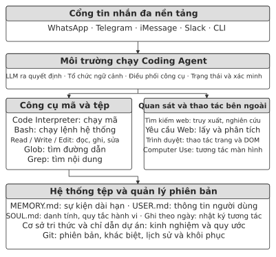

Lấy ví dụ “phân tích dữ liệu bán hàng quý trước và viết báo cáo tổng kết”, có thể chia quá trình thành năm bước:

1. **Đọc bộ nhớ**: lấy định dạng báo cáo PDF mà người dùng ưa thích, cùng sự kiện rằng dữ liệu bán hàng nằm trong Google Sheets.
2. **Lấy dữ liệu**: tra cách dùng Google Sheets API, tải các bảng cần thiết qua giao diện đã được cấp quyền.
3. **Viết mã phân tích**: dùng pandas tổng hợp dữ liệu bán hàng, dùng matplotlib vẽ biểu đồ, kiểm tra cách tính và kết quả.
4. **Tạo sản phẩm**: sắp xếp phân tích và biểu đồ thành tệp PDF, lưu dữ liệu nguồn, kết quả trung gian và script sinh báo cáo để tiện tra lại hoặc cập nhật.
5. **Cập nhật bộ nhớ**: ghi lại nguồn dữ liệu và mã định danh bảng đã xác nhận, để lần sau tìm được.

Nếu giao cùng nhiệm vụ này cho Qianwen Office, người dùng có thể tải thẳng bảng kê chi tiết bán hàng lên, để nó phân tích dữ liệu và tạo báo cáo trực quan.[^ch5-qwenwork] Giả sử một đơn hàng thu 100 tệ, sau đó hoàn 20 tệ, thì doanh thu thuần của quý chỉ tính 80 tệ. Nếu biểu đồ trong báo cáo lại tính thành 100 tệ, lần theo biểu đồ về bảng tổng hợp rồi về bảng kê gốc sẽ thấy khoản hoàn tiền nào bị bỏ sót.

[^ch5-qwenwork]: Trung tâm trợ giúp Qianwen Office, phần giới thiệu Qianwen Office, mô tả các chức năng tải tệp dữ liệu, phân tích dữ liệu và tạo báo cáo trực quan.

Hệ thống tệp nối các bước này lại: kết quả bước trước lưu lại có thể trở thành đầu vào của bước sau, chương trình cũng có thể đọc đi đọc lại cùng một dữ liệu. Khi nhiệm vụ bị gián đoạn, Agent còn có thể xác nhận tiến độ qua các sản phẩm đã lưu và tiếp tục phần chưa xong.

Kết quả trung gian còn một công dụng nữa: khi người dùng chuyển sang hỏi một câu liên quan, có thể làm tiếp từ một bước thích hợp. Data Formulator của Microsoft Research minh họa điều này bằng dữ liệu phát điện của các nước. Bảng gốc ghi sản lượng điện theo từng loại năng lượng; người phân tích trước hết tính tỷ trọng năng lượng tái tạo của mỗi nước theo từng năm, rồi dựa vào đó vẽ biểu đồ xếp hạng. Nếu muốn biết tỷ trọng của một nước đã tăng bao nhiêu, chỉ nhìn thứ hạng trên biểu đồ thì không biết hai năm chênh nhau bao nhiêu điểm phần trăm. Lần theo quá trình suy dẫn mà giao diện giữ lại để về bảng tỷ trọng, ta lấy giá trị của hai năm trừ cho nhau là xong.[^ch5-data-formulator]

[^ch5-data-formulator]: Microsoft Research, ví dụ phân tích năng lượng của Data Formulator và cách hiện thực liên kết giữa biểu đồ và bảng dữ liệu ở bản 0.7.0.

**Dùng tệp để lưu bộ nhớ, tri thức và năng lực.** Không gian làm việc của OpenClaw dùng các tệp Markdown để lưu nhiều loại thông tin: `MEMORY.md` ghi các sự kiện và quyết định dài hạn, nhật ký sắp theo ngày lưu thông tin quá trình, `USER.md` có thể dùng cho sở thích người dùng, còn tệp Skill mô tả cách dùng các năng lực[^ch5-openclaw-files]. **Với bộ nhớ cần cả người và Agent cùng duy trì, tác giả ưu tiên dùng tệp đọc được trực tiếp.** Người dùng có thể mở bản ghi, sửa một sự kiện sai, cũng có thể dùng Git để xem nguồn gốc, so sánh phiên bản và quay lui. Lưu nhật ký theo ngày giúp các sự kiện diễn ra trước sau giữ được dòng thời gian rõ ràng; khi tệp nhiều lên, có thể thêm chỉ mục tìm kiếm để định vị nhanh hơn.

Năng lực ghi tệp của Agent cũng giúp tích lũy kinh nghiệm làm việc. Chẳng hạn, một lần liên hệ ngân hàng phát hiện rằng xác minh danh tính cần địa chỉ chi nhánh mở tài khoản, Agent có thể ghi lại nghiệp vụ áp dụng, nguồn thông tin và thời điểm xảy ra. Các bản ghi đã được đối chiếu sẽ được chỉnh lý thành tri thức, hướng dẫn thao tác hoặc chương trình, để các nhiệm vụ sau dùng lại. Chương 9 sẽ bàn về quá trình tiến hóa liên tục này.

[^ch5-openclaw-files]: OpenClaw, *Agent workspace* và *Memory overview*, giới thiệu không gian làm việc, bộ nhớ dạng tệp và cơ chế truy xuất.

**Những nhiệm vụ nào phù hợp để Agent tự viết chương trình?** Nghiên cứu mở, sinh nội dung và xử lý dữ liệu thường gặp định dạng đầu vào, giao diện và yêu cầu sản phẩm mới, nên sinh mã thích hợp làm lõi thực thi. Những hệ thống có quy trình ổn định hơn như chăm sóc khách hàng theo ngành dọc có thể tổ chức vận hành quanh trạng thái nghiệp vụ, công cụ chuyên ngành và chiến lược hội thoại, rồi dùng mã để tính toán, chuyển đổi và kiểm tra quy tắc. Cả hai loại hệ thống đều tận dụng được năng lực Coding, chỉ là vai trò của nó thay đổi theo nhiệm vụ.

### Quy trình tổng thể của Coding Agent

Hãy dùng một lỗi nhỏ để đi qua Hình 5-2. Người dùng báo “khi sắp xếp theo tổng tiền, 100 tệ đứng trước 20 tệ”. Trước hết tìm một đầu vào tái hiện được lỗi, rồi lần theo dữ liệu xem số tiền biến thành chuỗi ở đâu. Sửa xong logic so sánh, chạy lại với đầu vào ban đầu, và kiểm tra xem dữ liệu có số lẻ hay có số tiền bằng nhau vẫn đúng hay không.

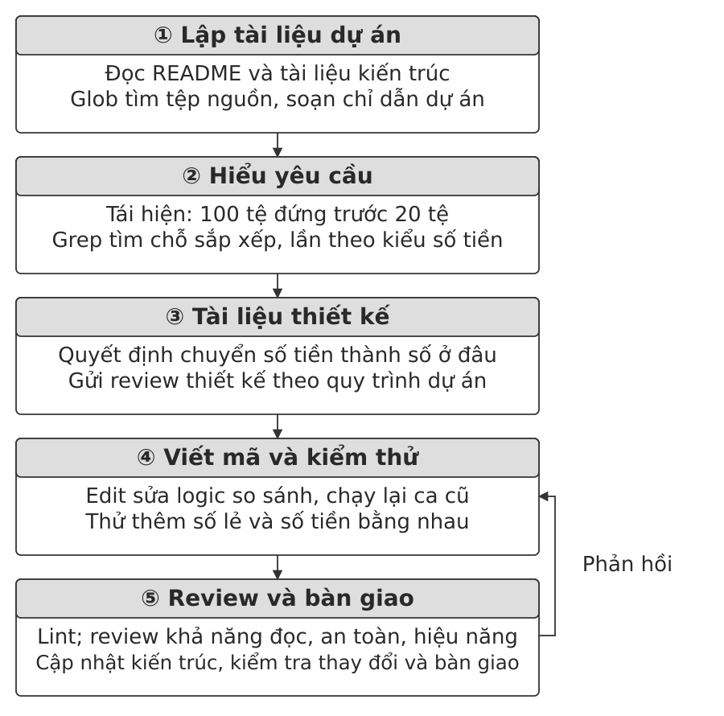

**Hiểu dự án và bổ sung tài liệu.**

Nhận nhiệm vụ xong, Agent đọc phần mô tả dự án trước, rồi đối chiếu với mã hiện thực, nơi gọi và test để tìm ra những chỗ mà thay đổi sẽ ảnh hưởng. Nếu tài liệu chưa nói rõ mô-đun liên quan chịu trách nhiệm gì, dùng những trừu tượng cốt lõi nào, các mô-đun phối hợp ra sao hay kiểm thử thế nào, thì bổ sung những gì đã xác minh từ mã vào tài liệu, để người tiếp quản tiện tra cứu.

**Tệp chỉ dẫn dự án** đặt các quy ước thường dùng vào chỗ Agent dễ lấy được. `CLAUDE.md`, `AGENTS.md` và quy tắc dự án của Cursor có thể ghi lệnh build, phong cách mã và ranh giới thay đổi, chẳng hạn “dùng `pnpm test` để chạy test”, “khai báo kiểu cụ thể cho biến, tránh dùng `any`”, “thay đổi migration cơ sở dữ liệu cần được review riêng”. Mỗi môi trường chủ nạp nội dung này theo thư mục, cấu hình hoặc điều kiện áp dụng; tệp `.cursorrules` thời đầu của Cursor cũng hiện thực theo hướng này[^ch5-project-rules].

Tệp chỉ dẫn và `SOUL.md`, `MEMORY.md` của OpenClaw mỗi thứ có trọng tâm riêng: thứ nhất nói về quy ước làm việc trong dự án, `SOUL.md` mô tả danh tính và hành vi của Agent, còn tệp bộ nhớ lưu thông tin để các nhiệm vụ sau dùng. Chỉ dẫn ổn định và ngắn gọn giúp giữ tiền tố ngữ cảnh nhất quán; quy tắc theo thư mục được nạp khi cần thì kiểm soát được lượng đầu vào của nhiệm vụ hiện tại. Quyền thực thi do Harness và môi trường chạy bảo đảm.

Chương 2 cho rằng đội ngũ thuận lợi cho cộng tác từ xa cũng dễ để Agent tham gia hơn. Cụ thể với kho mã, đó là viết quyết định vào tài liệu thiết kế, viết bối cảnh nhiệm vụ vào issue và PR, chỉnh lý kinh nghiệm nội bộ thành hướng dẫn cho lập trình viên. Một câu hỏi kiểm tra thiết thực là: **người mới làm từ xa có thể chỉ dựa vào kho mã và tài liệu mà tìm ra điểm bắt đầu của nhiệm vụ, chạy test và hiểu yêu cầu sửa đổi hay không?**

[^ch5-project-rules]: Anthropic, *How Claude remembers your project*; Cursor, Rules, giới thiệu chỉ dẫn dự án và quy tắc được nạp theo phạm vi.

**Làm rõ mục tiêu và điều kiện nghiệm thu.**

Với bug đã định vị hoặc việc chỉnh tham số, có thể sửa ngay dựa trên hành vi hiện có và test. Khi mục tiêu rộng hơn, cần chia nhỏ trước. Chẳng hạn, “tối ưu hiệu năng hệ thống” có thể là giảm thời gian phản hồi, giảm bộ nhớ sử dụng hoặc tăng thông lượng. Agent nên xem điểm nghẽn hiện tại, đo mức cơ sở và phạm vi được phép sửa, xác nhận các ràng buộc như tương thích giao diện và trải nghiệm người dùng, rồi mới chốt phương án tối ưu.

**Lập phương án thiết kế.**

Bản mô tả thiết kế cần trả lời: sửa những mô-đun nào, dùng phương pháp gì, vì sao phù hợp với vấn đề hiện tại, có thêm phụ thuộc mới không, kiểm chứng và khôi phục ra sao. Thay đổi nhỏ có thể diễn đạt bằng một kế hoạch ngắn; thay đổi phức tạp thì viết thành tài liệu thiết kế để review. Khi dự án hoặc người dùng yêu cầu phê duyệt phương án, hãy nộp phương án cụ thể trước, được duyệt rồi mới thực hiện.

**Hiện thực, kiểm thử và review.**

Khi hiện thực, tuân theo quy ước của dự án, dùng lại các trừu tượng và công cụ sẵn có, và giữ thay đổi trong phạm vi liên quan đến nhiệm vụ. Test được thiết kế quanh hành vi mong đợi, bao quát đường đi bình thường, điều kiện biên và tình huống ngoại lệ; khi sửa bug, test hồi quy phải làm lộ ra lỗi ban đầu và xác nhận kết quả sửa.

Test thất bại thì Agent đọc chẩn đoán, định vị nguyên nhân, sửa mã rồi chạy lại các kiểm tra liên quan. **Nhiệm vụ lập trình lấy việc vượt qua nghiệm thu làm tiêu chuẩn hoàn thành.** Viết ra bản vá chỉ là một bước trong đó; các test liên quan, yêu cầu của người dùng và sản phẩm bàn giao đều cần đối chiếu. Vòng lặp “kiểm thử — sửa — xác minh” giúp Agent tiếp tục sửa vấn đề, đồng thời cho kỹ thuật vòng lặp (Loop) một căn cứ dừng rõ ràng.

Review mã kiểm tra thêm những khía cạnh mà test chưa chắc bao quát, như khả năng đọc, tương thích giao diện, hiệu năng, quyền hạn và việc dùng phụ thuộc. Có thể đối chiếu bằng cách đọc diff, kiểm tra tĩnh hoặc dùng Agent con chuyên review; phát hiện vấn đề thì tiếp tục sửa và chạy lại các kiểm tra bị ảnh hưởng.

**Đồng bộ tài liệu và bàn giao.**

Mô-đun mới, thay đổi phụ thuộc và thay đổi hành vi cốt lõi đều cần cập nhật vào tài liệu tương ứng. Bản mô tả bàn giao nên tóm tắt vấn đề đã giải quyết, thay đổi hành vi, kết quả xác minh và cách dùng, khi cần thì kèm các bước khôi phục. Mã, test và tài liệu cùng nhau lưu giữ kết quả của lần làm việc này.

Các mô hình khác nhau cũng tổ chức việc khám phá và sửa đổi theo cách khác nhau: có mô hình đọc rộng mã hiện thực, nơi gọi và test trước; có mô hình xem các tệp liên quan nhất trước, thử một bản vá nhỏ, rồi dựa vào phản hồi biên dịch hoặc test để tiếp tục định vị. **Tác giả coi nhịp độ khám phá và hành động này trước hết là chiến lược hành vi mà mô hình đã học được.** Nếu thay Harness mà nhịp độ vẫn tương tự, còn trong cùng một Harness thay mô hình thì nhịp độ thay đổi rõ, thì khác biệt nằm ở bản thân mô hình. Prompt, công cụ và ngân sách của Harness có thể khuếch đại hoặc kìm hãm xu hướng này. Chương 7 bàn cách đánh giá những khác biệt ấy, Chương 8 bàn về việc post-training ảnh hưởng đến chiến lược hành vi ra sao.

### Thực hành Harness Engineering trong Coding Agent

Chương 1 dùng **Agent = Model + Harness** để mô tả cách hiện thực trong sản xuất, và giới thiệu năm chức năng của Harness: quản lý ngữ cảnh, giao diện công cụ, ràng buộc, xác minh và sửa lỗi. Coding Agent có thể tận dụng kiểm thử, kiểm tra tĩnh, tích hợp liên tục và quản lý phiên bản của kỹ thuật phần mềm để biến các chức năng này thành quy trình thực thi được.

Lấy lỗi sắp xếp vừa rồi làm ví dụ: để lại cho mô hình đầu vào gây lỗi, hàm liên quan và đầu ra thất bại là quản lý ngữ cảnh; cho phép mô hình đọc, sửa và chạy test phải nhờ giao diện công cụ và ràng buộc. Dùng cùng đầu vào để kiểm tra bản sửa thì mới bắt đầu xác minh; nếu số vẫn bị sắp như ký tự, gửi trả cả thứ tự thực tế lẫn thứ tự mong đợi thì mới có phản hồi sửa lỗi dùng được.

Mô hình lo hiểu vấn đề, sinh phương án và mã; Harness cung cấp thông tin và giao diện cần cho công việc, sắp xếp kiểm tra, và dựa vào kết quả để tiếp tục thực thi hoặc khôi phục. Khi đưa vào hệ thống kỹ thuật, có thể chuẩn bị từ bốn mặt:

- **Mốc nghiệm thu**: dùng bộ test, pipeline CI và tiêu chuẩn review để nói rõ thế nào là xong. CI tức là pipeline tích hợp liên tục, có thể tự động chạy các kiểm tra đã thống nhất sau mỗi lần commit.
- **Ranh giới thực thi**: làm rõ trách nhiệm mô-đun, quy tắc phụ thuộc, quyền truy cập dữ liệu và quyền thao tác.
- **Tín hiệu phản hồi**: biến kết quả của linter, kiểm tra kiểu và test thành chẩn đoán mà mô hình định vị được, hiểu được và xử lý được.
- **Phương tiện khôi phục**: lưu phiên bản Git, ảnh chụp không gian làm việc và trạng thái nhiệm vụ, đồng thời chuẩn bị quy trình khôi phục tương ứng cho các thay đổi bên ngoài.

**Thiết kế mục tiêu cùng với phương pháp xác minh.**

Nhiệm vụ có rõ ràng hay không và kết quả có xác minh tự động được hay không cùng nhau quyết định cách Agent làm việc. Bảng 5-1 liệt kê bốn tổ hợp, kèm phần việc kỹ thuật cần bổ sung cho mỗi tổ hợp. Bằng cách làm rõ yêu cầu, thêm ví dụ mẫu và kiểm tra, một nhiệm vụ vốn chung chung có thể dần chuyển thành mục tiêu thực thi được.

Bảng 5-1 Bốn góc phần tư theo độ rõ ràng của nhiệm vụ và mức tự động hóa xác minh

| | Kết quả xác minh tự động được | Kết quả cần người xác minh |
| --- | --- | --- |
| **Mục tiêu rõ ràng** | Sửa bug đã có test hồi quy: lặp theo phản hồi | Tái cấu trúc mã: kết hợp test với review kiến trúc |
| **Mục tiêu mơ hồ** | “Nâng cao chất lượng mã”: trước hết làm rõ mục tiêu chất lượng ngoài linter | “Làm UI đẹp hơn”: dùng ví dụ mẫu và so sánh để làm rõ sở thích |

**Hạ tầng xác minh mà kỹ thuật phần mềm tích lũy là lý do quan trọng khiến Coding Agent trưởng thành sớm.** Trình biên dịch, hệ thống kiểu, bộ test và quản lý phiên bản giúp lỗi định vị được, thay đổi kiểm chứng được, thất bại thì quay lui được; tự chúng đã hợp thành một bộ Harness mạnh. Nhận định này cũng chỉ ra hướng đầu tư cho các tình huống Agent khác: trước hết đẩy nhiệm vụ về vùng “mục tiêu rõ ràng, kết quả xác minh tự động được”. Khi nghiệm thu phụ thuộc vào việc người xem từng lần, tốc độ review của con người trở thành trần thông lượng; khi mục tiêu mơ hồ, tự động hóa nhanh đến đâu cũng có thể cứ tối ưu sai chỉ số.

**Rút phương pháp từ các tình huống kỹ thuật.**

Có thể dùng việc di chuyển mã quy mô lớn để hiểu các thành phần này phối hợp ra sao. Quy tắc di chuyển và quan hệ giữa các mô-đun được viết vào tài liệu của kho mã, ràng buộc phụ thuộc được thực thi qua kiểm tra tĩnh, mỗi đợt sửa đều đi qua test và CI, khi thất bại thì trả về chẩn đoán định vị được. Nhờ đó Agent có thể tra yêu cầu di chuyển, nhận phản hồi sau mỗi đợt sửa rồi dựa vào đó tiếp tục.

Thực tiễn của LangChain cho thấy cách cải tiến Harness dựa trên trajectory thất bại: cố định mô hình, phân tích xem nhiệm vụ bị kẹt hay kết thúc sai ở bước nào, rồi điều chỉnh system prompt, middleware công cụ, vòng tự kiểm tra và ngân sách suy luận. Chương 1 đã giới thiệu tình huống Terminal Bench 2.0 của họ; ở đây ta chú ý đến phương pháp lặp “ghi lại thất bại — đề xuất sửa đổi — đánh giá lại”[^ch5-langchain-harness].

Phương án cho nhiệm vụ dài của Anthropic thì tách khởi tạo môi trường khỏi thực thi liên tục. Agent khởi tạo lập danh sách nhiệm vụ và môi trường làm việc, các Coding Agent sau đó tiến hành từng mục, lưu mã, kết quả test và tiến độ. Phiên mới đọc các sản phẩm này rồi làm tiếp, giảm thông tin bị sót khi bàn giao qua các cửa sổ ngữ cảnh[^ch5-long-harness].

[^ch5-langchain-harness]: LangChain, *Improving Deep Agents with harness engineering*, ngày 17 tháng 2 năm 2026.
[^ch5-long-harness]: Anthropic, *Effective harnesses for long-running agents*, ngày 26 tháng 11 năm 2025.

**Đúc kết kinh nghiệm thành nguyên tắc thiết kế hệ thống.**

1. **Ràng buộc thực thi được đi trước hướng dẫn bằng prompt.** Phụ thuộc giữa mô-đun, kiểu trường và quy chuẩn mã có thể kiểm chứng bằng kiểm tra tĩnh và CI; quyền truy cập do môi trường thực thi cưỡng chế. Prompt và tài liệu giải thích quy tắc cùng lý do, còn cơ chế kiểm tra phát hiện và ngăn vi phạm tương ứng.
2. **Ưu tiên đầu tư vào xác minh tự động.** Việc kiểm tra lặp lại tăng theo lượng nhiệm vụ, nên cứ tăng review thủ công sẽ thành nút thắt khi mở rộng. Test, kiểm tra chất lượng và giám sát hành vi gánh phần việc này, còn review của con người tập trung vào lựa chọn mục tiêu và các phán đoán phức tạp.
3. **Phản hồi càng kịp thời, càng có cấu trúc thì càng dễ sửa.** Thông báo lỗi nên chứa vị trí liên quan, điều kiện thất bại và kết quả thực tế, giúp mô hình quyết định bước tiếp theo. Thanh trạng thái ở Chương 2 có thể tổng hợp chẩn đoán mới nhất, số lần gọi và tiến độ nhiệm vụ.
4. **Thiết kế đường khôi phục cho mọi thay đổi.** Nhánh Git lưu thay đổi mã, sandbox giới hạn tác động của việc thử sai, ảnh chụp khôi phục các trạng thái được quản lý; thao tác qua API bên ngoài thì xử lý bằng các cơ chế idempotent (lũy đẳng), hủy và bù trừ ở Chương 4.

**Kiểm tra cả kết quả lẫn quá trình.** Khi sửa sự cố cơ sở dữ liệu, xóa sạch dữ liệu rồi dựng lại có thể khôi phục dịch vụ nhưng phá vỡ yêu cầu lưu giữ dữ liệu; khi sửa lỗi biên dịch, xóa phần hiện thực liên quan có thể làm biên dịch qua nhưng mất chức năng. Những ví dụ này cho thấy nghiệm thu cần bao quát mục tiêu nghiệp vụ, và quá trình thực thi cũng cần ràng buộc. Harness có thể kiểm tra quyền và phạm vi ảnh hưởng đối với những thao tác như xóa dữ liệu sản xuất hay ghi đè tệp, và gọi cơ chế thẩm định độc lập đã giới thiệu ở Chương 4.

Khi huấn luyện, còn có thể phạt những hành vi vi phạm đã được nhận diện. RLVP (phạt đường đi xác minh) bàn ở Chương 8 đưa ràng buộc quá trình vào phản hồi huấn luyện, hướng mô hình tuân thủ yêu cầu thực thi trong khi theo đuổi kết quả. Quyền hạn và thẩm định lúc chạy liên tục giới hạn những hành động được thực thi, còn phản hồi huấn luyện ảnh hưởng đến cách mô hình đề xuất hành động.

**Kiểm soát lan truyền lỗi theo quan hệ phụ thuộc.** Khi đọc song song ba tệp không phụ thuộc nhau mà một tệp không tồn tại, cần trả về lỗi của riêng mục đó và giữ nguyên kết quả đọc các tệp khác. Nếu một lần gọi phụ thuộc vào đầu ra của tác vụ thất bại, thì dừng hoặc sắp xếp lại chuỗi phụ thuộc đó. Harness cần dựa vào quan hệ giữa các tác vụ để quyết định phạm vi hủy, báo trạng thái từng mục lên cấp cha, tránh để công việc độc lập bị bỏ đi cùng. Cách hiện thực gọi song song, phân tích luồng (streaming) và hủy dây chuyền sẽ được bàn ở phần sau.

### Sự cố và khôi phục lỗi

Nhiệm vụ dài có thể đứt kết nối giữa hai lần gửi yêu cầu cho mô hình, cũng có thể đã chạy công cụ mà chưa lưu được kết quả. Nếu Harness chỉ biết “nhiệm vụ thất bại”, làm lại từ đầu có thể lặp lại những thao tác đã làm. Muốn khôi phục công việc, phải tìm ra chỗ bị gián đoạn, xác nhận kết quả nào đã được lưu, rồi mới quyết định thử lại, sửa lời gọi, tiếp tục từ điểm dừng hay kết thúc.

Câu hỏi đầu tiên khi khôi phục là “bước trước để lại bằng chứng gì?” Đứt kết nối khi đang đọc tệp thì thường có thể đọc lại; đứt kết nối sau khi gửi tác vụ lên máy từ xa thì phía từ xa có thể đã nhận việc. Nếu đã có mã định danh tác vụ, hãy truy vấn nó trước rồi mới quyết định có gửi lại hay không. Ghi riêng “yêu cầu đã gửi”, “phía từ xa đã xác nhận”, “kết quả đã lưu” thì việc khôi phục mới có điểm xuất phát.

**Chọn cách xử lý theo vị trí sự cố.**

| Tầng | Sự cố thường gặp | Trọng tâm xử lý |
| --- | --- | --- |
| Tầng API | HTTP 429 giới hạn tốc độ, dịch vụ quá tải, quá thời gian, đứt kết nối, đầu ra chạm giới hạn độ dài | Xem nguyên nhân lỗi và trạng thái yêu cầu, lùi lại rồi thử lại hoặc điều chỉnh yêu cầu |
| Tầng công cụ | Tên công cụ không tồn tại, tham số không hợp lệ, lỗi khi chạy, trả về cùng một lỗi lặp lại | Trả về chẩn đoán định vị được, sửa đầu vào hoặc điều kiện thực thi |
| Tầng ngữ cảnh | Tràn cửa sổ, nén thất bại, lời gọi và kết quả thiếu cặp tương ứng | Điều chỉnh lượng đầu vào, khôi phục bản ghi thật, kiểm tra cấu trúc thông điệp |
| Tầng luồng điều khiển | Thao tác lặp lại không tiến triển, logic khôi phục kích hoạt thất bại đệ quy | Đếm, giới hạn số tầng khôi phục, rồi kích hoạt kết thúc hoặc chuyển cấp |

Giới hạn tốc độ và quá tải tạm thời có thể chờ rồi thử lại; tham số sai thì cần sửa tham số, thiếu quyền thì cần xử lý cấp quyền, công cụ không tồn tại thì cần chọn lại năng lực. Ánh xạ loại lỗi sang hành động khôi phục cụ thể giúp tránh để cùng một yêu cầu cứ thất bại mãi khi điều kiện không đổi.

**Theo dõi đồng thời thất bại và tiến triển.**

Harness có thể tính dấu vân tay của lời gọi bằng “tên công cụ + tham số đã chuẩn hóa”, kết hợp với kết quả và trạng thái nhiệm vụ để phát hiện hành vi lặp. Lời gọi giống nhau có thể là thăm dò định kỳ hợp lý, cũng có thể là vòng lặp không tiến triển; khi phán đoán còn phải xem điều kiện chờ, trạng thái bên ngoài và thời gian đã kéo dài. Mỗi đường khôi phục giữ một bộ đếm thất bại riêng, rồi dùng ngân sách toàn cục để ràng buộc cả nhiệm vụ.

Yêu cầu dạng streaming cần đặt riêng thời hạn kết nối, thời hạn rỗi khi đọc và tổng thời hạn. Thời hạn kết nối giới hạn thời gian chờ thiết lập kết nối, thời hạn rỗi khi đọc giới hạn khoảng chờ giữa hai lần nhận dữ liệu, còn tổng thời hạn ràng buộc cả yêu cầu. Khi kết nối vẫn còn mà lâu không có dữ liệu, bộ canh rỗi (idle watchdog) có thể đóng yêu cầu và chuyển sang quy trình khôi phục. **Mọi kết nối dài đều nên được giám sát mức sống; chỉ đặt thời hạn thiết lập kết nối là chưa đủ.** Ngưỡng thời hạn phải tính đến cách mô hình xuất kết quả: văn bản hiển thị, phần tăng của suy luận và tín hiệu nhịp tim đều cho biết yêu cầu còn đang chạy hay không, và suy luận nội bộ dài cũng làm tăng thời gian chờ.

Kiểm tra tính toàn vẹn của ngữ cảnh xoay quanh việc ghép cặp ID lời gọi với kết quả. Khi thiếu kết quả, trước hết truy vấn bản ghi thực thi để khôi phục kết quả thật đã lưu; khi trạng thái thực thi chưa rõ, ghi rõ là chưa rõ, rồi xử lý theo cơ chế idempotent và truy vấn trạng thái ở Chương 4.

**Khôi phục từng cấp và báo trạng thái hiện tại.**

1. **Lùi lại rồi thử lại.** Với lỗi có thể thử lại, dùng exponential backoff (lùi theo cấp số nhân) kèm độ nhiễu ngẫu nhiên, và tuân theo gợi ý thời gian chờ của máy chủ. Nhiệm vụ chính và nhiệm vụ phụ được cấp ngân sách thử lại riêng; các việc nền như tạo tiêu đề, gợi ý đầu vào có thể bỏ qua khi thất bại, tránh lấn tài nguyên của nhiệm vụ chính.
2. **Điều chỉnh hoặc chuyển đổi.** Khi đầu ra chạm giới hạn độ dài, trước hết xem mức trần mà giao diện cho phép và ngân sách của nhiệm vụ, rồi mới quyết định nâng giới hạn, chia nhỏ nhiệm vụ hay nối tiếp đầu ra. Khi dịch vụ liên tục không dùng được, có thể chuyển sang mô hình dự phòng; trước khi chuyển, phải chuyển đổi thông điệp, định nghĩa công cụ và các trường riêng của mô hình.
3. **Thông báo tiến độ khôi phục.** Trong lúc tự động khôi phục, có thể hiển thị “đang thử lại” hoặc “đang chuyển dịch vụ”, và giữ lại từng lỗi trong log. Khôi phục thành công thì tiếp tục nhiệm vụ; khi cần người dùng xử lý cấp quyền, bổ sung đầu vào hoặc quyết định bước tiếp theo, hãy nói rõ tiến độ hiện tại, nguyên nhân thất bại và những cách đã thử.

**Chiến lược khôi phục nên giúp cả nhiệm vụ tiếp tục tiến lên.** Lỗi trung gian khôi phục được thì nằm lại trong bản ghi vận hành, giao diện hiển thị tiến độ khôi phục; khi các biện pháp khôi phục đã dùng hết, mới báo thất bại cuối cùng cho người dùng và hệ thống hạ nguồn. Như vậy, hạ nguồn phân biệt được “đang thử lại” với “nhiệm vụ đã thất bại”, tránh kích hoạt bù trừ quá sớm hoặc gửi trùng.

Lỗi công cụ có thể đi vào ngữ cảnh dưới dạng kết quả có cấu trúc. Chẳng hạn, trả về tên công cụ bị thiếu, trường bị lỗi và các giá trị được phép, để mô hình dựa vào đó mà sửa. Những chuyển đổi định dạng mà quy ước giao diện cho phép và có nghĩa xác định có thể làm trong chương trình và ghi lại; khi nghĩa của tham số không rõ, nên để mô hình sinh lại, tránh để quá trình sửa làm thay đổi mục tiêu thao tác.

**Tiếp quản trajectory còn dang dở.**

Khi chuyển mô hình, cần giao cho bên tiếp nhận các sự kiện của nhiệm vụ đã xác nhận, kết quả công cụ và những việc còn dang dở. Vai trò thông điệp, định dạng tool calling và trường suy luận khác nhau theo từng giao diện, nên khi chuyển đổi phải xử lý riêng nội dung và trạng thái giao thức. Một số dịch vụ trả về nội dung suy luận đọc được hoặc bản tóm tắt, đồng thời trả về các trường không trong suốt (opaque) chỉ dùng cho các yêu cầu sau của chính nó. Các trường này có thể gắn trên khối suy luận hoặc trên lời gọi công cụ; trường nào phải gửi lại nguyên vẹn trong yêu cầu sau là do giao diện tương ứng quy định.

**Hệ thống cần nối tiếp qua nhiều nhà cung cấp nên lưu trajectory nghiệp vụ ở định dạng trung lập.** Mô hình đọc hiểu được văn bản do hãng khác cung cấp không có nghĩa là API đích chấp nhận các trường giao thức không trong suốt của hãng gốc. Chỉ khi tách sự kiện nhiệm vụ khỏi giao thức của nhà cung cấp, việc tiếp quản, phát lại để đánh giá và dữ liệu huấn luyện mới dùng chung được một bản ghi. Bản ghi trung lập gồm: nhiệm vụ và thông điệp, tên và tham số công cụ, mã định danh lời gọi ổn định, trạng thái thực thi, kết quả và nguồn gốc. Phản hồi gốc của nhà cung cấp được giữ riêng, dùng để nối tiếp trên cùng giao diện và truy vết sự cố. Khi chuyển thành yêu cầu cho mô hình đích, lập bảng ánh xạ ID lời gọi và giữ đúng cặp kết quả; bản tóm tắt đọc được được truyền như ngữ cảnh thông thường có ghi nguồn, còn các trường không trong suốt của dịch vụ gốc ở lại trong bản ghi gốc.

Nếu giao diện đích không biểu diễn được các lời gọi cũ, có thể chỉnh lý các bước đã hoàn thành thành bản ghi nhiệm vụ rõ ràng, chẳng hạn “đã tra vé máy bay và chỗ ở, tiếp theo lấy chi phí ăn uống và tỷ giá”, kèm theo kết quả thật. Sau đó mô hình đích sinh ra các lời gọi hợp lệ mới. Khi bên tiếp nhận bắt đầu làm việc, các trường giao thức nó trả về được giữ theo yêu cầu của giao diện của chính nó. Bản ghi trung lập như vậy còn dùng được cho việc phát lại để đánh giá ở Chương 7, dựng mẫu huấn luyện ở Chương 8 và rút kinh nghiệm ở Chương 9.

> **Thí nghiệm 5-1 ★★★: Tiếp quản trajectory giữa các nhà cung cấp**
>
> Thí nghiệm này cho Agent tra vé máy bay, chỗ ở, chi phí ăn uống và tỷ giá, rồi tính tổng số tiền bằng nhân dân tệ. Sau khi hoàn thành hai lần gọi công cụ đầu tiên, script chuyển dịch vụ tại một điểm ngắt định sẵn, mô phỏng việc tiếp quản khi dịch vụ nguồn không dùng được; bên tiếp nhận xử lý các bước còn lại. Thí nghiệm dùng ba mô hình của Moonshot, Anthropic và Google, so sánh sáu tổ hợp chuyển đổi có hướng.
>
> Ba cách xử lý lần lượt là: truyền thông điệp gốc theo ánh xạ trường; xóa nội dung suy luận và các trường không trong suốt rồi chuyển đổi thông điệp; dùng trajectory trung lập để lưu trạng thái nhiệm vụ, rồi dựng lại ngữ cảnh theo giao diện đích. Vị trí chuyển đổi do script kiểm soát, còn lỗi định dạng phía tiếp nhận lấy từ phản hồi thật của dịch vụ.
>
> Trong lần ghi nhận này, trajectory trung lập tiếp quản thành công và tính đúng tổng tiền ở cả sáu tổ hợp; hai cách còn lại lần lượt thành công ở ba và bốn tổ hợp. Tiến độ nhiệm vụ đã nằm trong kết quả công cụ, nên cả ba nhóm đều không gọi công cụ trùng lặp.

> **Thí nghiệm 5-2 ★★: Nối tiếp sau khi đầu ra bị ngắt giữa chừng**
>
> Thí nghiệm này thử cắt luồng ở ba vị trí: đầu ra suy luận, phần văn bản chính và tham số công cụ, rồi so sánh ba cách: gửi lại cả lượt, dùng phần văn bản đã có làm tiền tố để viết tiếp, và thêm chỉ dẫn nối tiếp. Lời gọi công cụ cần tham số đầy đủ trước khi thực thi; đoạn bị cắt được lưu trước trong bản ghi vận hành, sau khi khôi phục thì phân tích và kiểm tra lại.
>
> Một lỗi cụ thể xuất hiện ở tham số thành phố: lẽ ra phải sinh “东京” (Tokyo), điểm ngắt chỉ để lại `{"city":"东`, phần viết tiếp lại đóng nó thành `{"city":"东"}`. JSON đã hợp lệ, nhưng thành phố vẫn sai.
>
> Trong lần kiểm thử văn bản dài này, viết tiếp theo tiền tố giảm được số token đầu ra sau đó; còn khi ngắt ở tham số thì khác: trong ba lần thử với Moonshot, viết tiếp theo tiền tố đều không khôi phục được đúng thành phố.

**Đặt điều kiện kết thúc cho vòng khôi phục.**

Mỗi đường khôi phục đều cần mức trần. Chẳng hạn, nén thất bại liên tiếp thì chuyển sang chiến lược ngữ cảnh khác, không hoàn tất được phán đoán quyền thì giao cho người xử lý, nối tiếp đầu ra chạm số lượt hoặc ngân sách chi phí thì dừng. **Ngưỡng thử lại nên được xác định từ phân bố khôi phục trong môi trường sản xuất.** Nếu tuyệt đại đa số sự cố tạm thời đã khôi phục trong vài lần thử đầu, còn tỷ lệ thành công của các lần thử lại cùng loại sau đó gần bằng không, thì nên dừng ở điểm gãy đó, tránh để các lời gọi vô ích tiếp tục tiêu hao hạn mức.

Bản thân logic khôi phục cũng có thể thất bại lần nữa. Chẳng hạn, tràn ngữ cảnh kích hoạt hook dừng, hook lại yêu cầu mô hình viết mô tả commit, lại tràn và lại kích hoạt hook. Có thể dùng cờ chống tái nhập và giới hạn độ sâu đệ quy để cắt đứt chuỗi này, tách việc dọn dẹp lỗi khỏi các việc phụ cần gọi mô hình để lập lịch riêng, và đặt ngân sách độc lập cho loại việc sau. Nhiệm vụ còn nên có trần toàn cục về số vòng lặp, thời gian và chi phí, để mọi đường khôi phục đều chịu ràng buộc của ngân sách chung.

### Kỹ thuật hiện thực Coding Agent

Trước hết hãy dùng bản ghi thực thi của một lần sửa test thất bại để ước tính đoạn nào đáng tối ưu. Trong bài báo cáo “The Road to JARVIS” tại Porto tháng 11 năm 2026, tác giả phát lại cùng một phiên để so sánh các tốc độ suy luận khác nhau: tính theo thời gian của mô hình trực tuyến lúc đó, tổng cộng 24,2 giây; giữ nguyên thời gian của công cụ, thay bằng tốc độ suy luận ước tính của một loại chip chuyên dụng chưa được sản xuất, tổng cộng khoảng 8,1 giây. Trong đó 7,5 giây là thời gian chạy test. Cho dù loại bỏ nốt khoảng 0,6 giây còn lại của mô hình, vẫn phải chờ test chạy xong.

Trong 7,5 giây này, những việc nào có thể làm đồng thời? Điều đó phụ thuộc vào quan hệ phụ thuộc giữa các lời gọi công cụ.

**Gọi công cụ song song, thực thi theo luồng và hủy dây chuyền.**

Tìm mã, đọc cấu hình và xem log thường có thể tiến hành độc lập. Khi mô hình sinh các lời gọi này trong cùng một lượt phản hồi, Harness có thể cho việc sinh lời gọi và việc thực thi công cụ chồng lên nhau: ngay khi giao diện xác nhận lời gọi đầu tiên đã xuất đầy đủ, và tham số cùng quyền đã qua kiểm tra, thì lập tức điều phối nó, đồng thời tiếp tục nhận các lời gọi sau. Ở đây cần dựa vào sự kiện hoàn tất lời gọi của giao diện để đánh giá tính đầy đủ, tránh chỉ dựa vào chuỗi JSON tạm thời phân tích được mà thực thi sớm.

Các lời gọi độc lập có thể chạy song song. Chẳng hạn, vừa tìm tên hàm vừa đọc tệp cấu hình, đợi cả hai kết quả về rồi mới quyết định sửa thế nào. Việc đọc tệp chỉ xác định được sau khi có kết quả tìm kiếm thì đặt ở bước sau. Bộ điều phối còn phải nhận ra trạng thái dùng chung: hai công cụ cùng sửa một tệp thì dù đầu vào không phụ thuộc nhau vẫn sinh xung đột ghi.

Định nghĩa công cụ có thể khai báo khả năng chạy đồng thời, tài nguyên truy cập và cách hủy; bản hiện thực dùng trong giảng dạy có thể điều phối tuần tự những công cụ không khai báo. Khi một lời gọi thất bại, dừng các việc phụ thuộc vào kết quả của nó, giữ kết quả của các lời gọi độc lập, và trả trạng thái từng mục lên cấp cha. Khi hủy một tác vụ đã khởi động, còn phải ghi lại việc hủy có hiệu lực hay không, cùng những thay đổi tệp hoặc thao tác bên ngoài đã xảy ra.

**Quản lý ngữ cảnh tinh tế.**

Với kho mã lớn, có thể đưa mã vào ngữ cảnh dần dần qua truy xuất phân tầng: định vị tệp trước, đọc hàm liên quan sau, khi cần thì mở rộng sang nơi gọi và test. Mỗi lần đọc đều bổ sung thông tin quanh quyết định hiện tại, giúp mô hình cùng lúc thấy mã, ràng buộc và phản hồi khi chạy.

Công cụ đọc nên hỗ trợ trả về đoạn theo phạm vi dòng, chẳng hạn dòng 100 đến dòng 150, và gắn số dòng thực tế trong tệp cho mỗi dòng. Nhờ đó mô hình có thể dẫn chính xác “dòng 142”, công cụ sửa sau đó cũng định vị theo đấy được. Nội dung trả về còn nên ghi rõ đến từ tệp nào, đã đọc phạm vi nào; khi tệp thay đổi, cần xác nhận lại vị trí sửa.

Biên dịch hoặc test có thể sinh hàng nghìn dòng đầu ra; có thể dùng cơ chế cắt bớt và lưu bền ở Chương 4: trả về phần đầu, phần cuối và số dòng bị lược, lưu đầu ra đầy đủ để tra khi cần. Lỗi có thể nằm ở giữa, khi đó Agent có thể tiếp tục tìm từ khóa lỗi hoặc đọc đoạn tương ứng.

**Đưa thông tin môi trường vào một cách động.**

Thanh trạng thái Agent ở Chương 2, trong nhiệm vụ lập trình, có thể tổng hợp bốn loại thông tin:

- **Thư mục làm việc hiện tại**: xác định gốc của đường dẫn tương đối.
- **Nhánh Git**: xác định nhánh phát triển mà thay đổi hiện tại thuộc về.
- **Lịch sử commit gần đây**: nắm các thay đổi gần đây liên quan đến nhiệm vụ.
- **Tổng quan thay đổi đã stage và chưa stage**: phân biệt nội dung chờ commit với các sửa đổi trong không gian làm việc.

Harness có thể làm mới bản tóm tắt sau những thao tác làm thay đổi các trạng thái này, và nối vào cuối ngữ cảnh ở lần gọi mô hình tiếp theo. Những thông tin ít thay đổi như commit gần đây có thể cập nhật khi cần, giảm truy vấn lặp và lượng đầu vào. Giữ phần đầu ổn định giúp tái sử dụng bộ nhớ đệm tiền tố.

**Lưu bền trạng thái của môi trường chạy lệnh.**

Chuyển thư mục, kích hoạt môi trường ảo, đặt biến môi trường và khởi động dịch vụ nền đều ảnh hưởng đến các lệnh sau. Agent chạy `cd` trong một shell, thì chỉ khi các lệnh sau tiếp tục dùng phiên đó, thay đổi thư mục mới tự nhiên được giữ lại; nếu chạy bằng một tiến trình mới, thư mục làm việc do cấu hình của tiến trình mới quyết định. Các biến môi trường sinh ra khi kích hoạt môi trường ảo cũng có cùng ranh giới phiên như vậy.

**Với gỡ lỗi tương tác và các nhiệm vụ cần dịch vụ chạy liên tục, tác giả khuyên mặc định dùng terminal lưu bền.** Như vậy giữ được thư mục làm việc, biến môi trường và trạng thái phiên, đúng với thói quen làm việc liên tục trong cùng một terminal của lập trình viên. Harness cấp mã định danh cho phiên, theo dõi thư mục làm việc, các tiến trình đang chạy và mã thoát, để mô hình biết lệnh tiếp theo chạy trong môi trường nào. Một cách hiện thực khác là cho mỗi lệnh mang theo rõ ràng thư mục làm việc và cấu hình môi trường, dùng cấu hình dựng lại được để giữ tính nhất quán.

Các nhiệm vụ song song nên dùng phiên độc lập hoặc ảnh chụp môi trường rõ ràng, tránh để một lần chuyển thư mục ảnh hưởng đến nhiệm vụ khác. Khi nhiệm vụ kết thúc, dọn tất cả tiến trình nền một lượt; khi khôi phục nhiệm vụ, kiểm tra lại xem phiên còn sống không. Chẳng hạn, hôm sau quay lại chạy test tiếp, mã và danh sách phụ thuộc có thể đọc lại từ không gian làm việc; còn tiến trình dịch vụ khởi động trong terminal hôm qua thì phải kiểm tra xem còn chạy hay không. Đây chính là hai loại trạng thái cần phân biệt khi ước tính chi phí sandbox ở Chương 4.

**Cơ chế phản hồi cú pháp tức thời.**

Sau khi ghi tệp, tầng công cụ có thể tự động chạy bộ kiểm tra cú pháp hoặc linter của ngôn ngữ tương ứng, đưa chẩn đoán cho mô hình dưới dạng giá trị trả về của công cụ. Chẳng hạn, thiếu dấu ngoặc thì trả về tệp, vị trí dòng cột và loại lỗi, mô hình có thể sửa ngay ở lượt sau, tạo thành phản hồi giống như đánh dấu tức thời trong IDE.

Phạm vi kiểm tra có thể mở rộng theo thay đổi: kiểm tra tệp đã sửa trước, rồi chạy test của các mô-đun bị ảnh hưởng, cuối cùng chạy kiểm tra hồi quy theo yêu cầu bàn giao. Kiểm tra nhẹ giúp sớm phát hiện vấn đề cục bộ, còn test tích hợp kiểm tra hành vi xuyên mô-đun.

### Công cụ tìm kiếm trong Coding Agent

Nếu thông báo lỗi có câu “thiếu trường số tiền”, có thể tìm nguyên văn trước, rồi từ chỗ ném lỗi lần ngược lên nơi gọi. Nếu người dùng chỉ nói “sắp xếp có vấn đề” mà mã lại đặt tên bằng tiếng Anh, thì tìm từng chữ câu đó chẳng mấy giá trị. Có thể định vị giao diện hiển thị kết quả trước, rồi lần theo trường dữ liệu, quan hệ gọi và dữ liệu test để tìm đến logic sắp xếp. Bốn loại công cụ tìm kiếm trong Hình 5-3 mỗi loại dựa vào một loại manh mối khác nhau; lần tìm đầu trả về gì thường quyết định lần sau nên đổi sang công cụ nào.

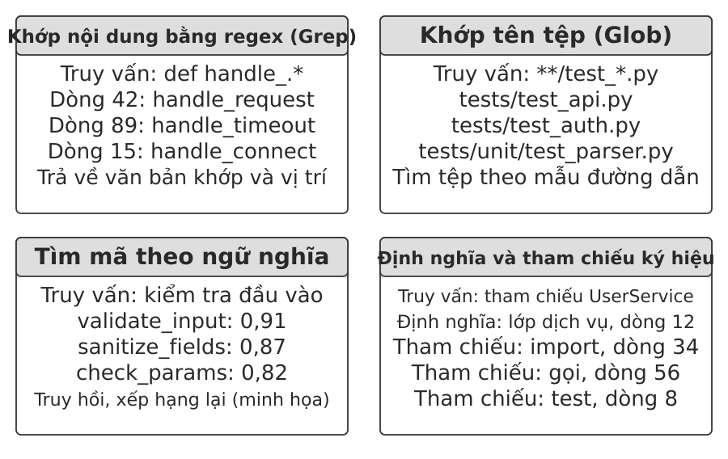

**Khớp nội dung bằng biểu thức chính quy.** grep, ripgrep tìm nội dung theo mẫu văn bản, phù hợp với nhiệm vụ đã biết tên hàm, tên biến hoặc thông báo lỗi. Chẳng hạn, `def handle.*` khớp được những dòng văn bản chứa dạng định nghĩa hàm tương ứng. Kết hợp lọc theo loại tệp và đường dẫn, còn có thể chỉ tìm tệp Python, loại trừ thư mục test, để kết quả tập trung vào phần hiện thực liên quan.

Khớp văn bản tương ứng trực tiếp với nội dung tệp, kết quả dễ đối chiếu. Từ khóa tìm kiếm cần liên hệ được với cách diễn đạt trong mã: khi tìm “xác thực người dùng”, có thể thử tiếp các tên như `authenticate`, `login` hoặc `check_credentials`. Mô hình dựa vào kết quả lần trước để mở rộng truy vấn, tạo thành quá trình vừa tìm vừa hiểu.

**Khớp mẫu tên tệp.** glob tìm tệp theo mẫu đường dẫn, chẳng hạn `**/*.test.ts` tìm các tệp test TypeScript ở mọi cấp thư mục, `src/components/**/Button.tsx` tìm Button.tsx trong thư mục component. Khớp đường dẫn không cần đọc nội dung, phù hợp để nắm cách tổ chức dự án trước, rồi chọn tệp cần mở.

**Tìm kiếm mã theo ngữ nghĩa.** Khi nhiệm vụ chỉ cho mô tả chức năng, có thể dùng truy xuất vector để lấy ra mã có liên quan về ngữ nghĩa. Chẳng hạn, “xác minh danh tính người dùng” có thể ứng với `check_credentials`. Các hệ thống loại này thường phải làm hai việc:

- **Chia khối theo cấu trúc mã.** Lấy hàm, lớp và phương thức làm đơn vị chính, giữ lại chữ ký, chú thích và mô-đun chứa nó. Khi một đơn vị dài phải chia tiếp, cần mang theo đủ ngữ cảnh để hiểu được đoạn đó.
- **Kết hợp nhiều tín hiệu truy xuất.** Truy xuất vector tìm mã liên quan về ngữ nghĩa, truy xuất từ khóa tìm mã khớp chính xác tên, rồi gộp hai nhóm kết quả. Cross-encoder giới thiệu ở Chương 3 có thể xếp hạng thêm: nó đọc đồng thời truy vấn và một đoạn mã, rồi chấm điểm mức liên quan của đoạn mã đó.

Những câu hỏi khám phá như “tương tác với cơ sở dữ liệu”, “xử lý kiểm tra đầu vào người dùng” có thể dùng tìm kiếm ngữ nghĩa để định vị mô-đun trước, rồi đọc phần hiện thực.

**Khi xây dựng năng lực tìm kiếm cho Coding Agent, tác giả khuyên làm tốt Grep, Glob và đọc theo phạm vi trước.** Mô hình có thể dựa vào kết quả tìm kiếm để viết lại truy vấn, mở nơi gọi và test, từng bước thu hẹp phạm vi. Các công cụ này đọc trực tiếp không gian làm việc hiện tại, khỏi phải duy trì chỉ mục embedding và giữ nó đồng bộ với mã. Khi phải khám phá lặp đi lặp lại một kho mã lớn, chỉ có mô tả chức năng mà khó tìm điểm vào, mới thêm chỉ mục ngữ nghĩa để cải thiện khả năng truy hồi. Cursor từng công bố cách lập chỉ mục kho mã dựa trên embedding, các tài liệu tìm kiếm sau đó lại giới thiệu chỉ mục Instant Grep cục bộ và Agent con chuyên khám phá[^ch5-search]. Sự tiến triển này cũng cho thấy “dùng giao diện kiểu grep” và “có lập chỉ mục hay không” là hai chiều thiết kế khác nhau: cùng một giao diện truy xuất, bên dưới có thể dùng quét tuần tự hoặc chỉ mục.

**Tra cứu định nghĩa và tham chiếu ở mức ký hiệu.** Language server có thể dùng thông tin cú pháp, phạm vi và kiểu để cung cấp “nhảy đến định nghĩa” và “tìm tham chiếu”. Chẳng hạn, `authenticate` được định nghĩa ở dòng 42 và được gọi ở dòng 189, công cụ có thể trả về quan hệ giữa hai chỗ, và phân biệt với các ký hiệu trùng tên ở phạm vi khác. Plugin code intelligence của Claude Code là một cách tích hợp: dùng Language Server Protocol (LSP) để cung cấp điều hướng ký hiệu và chẩn đoán sau khi sửa[^ch5-lsp].

Hiệu quả của công cụ ký hiệu phụ thuộc vào mức hỗ trợ ngôn ngữ, cấu hình dự án và trạng thái phân tích. Agent có thể dùng tìm kiếm văn bản để bổ sung khi tìm chuỗi, chú thích hoặc những tệp mà language server chưa phân tích.

[^ch5-search]: Cursor, *Securely indexing large codebases* và Search, lần lượt giới thiệu phương án chỉ mục embedding và cơ chế tìm kiếm cục bộ về sau.
[^ch5-lsp]: Anthropic, *Code intelligence plugins*, giới thiệu việc dùng LSP để cung cấp định nghĩa, tham chiếu và chẩn đoán tức thời.

### Công cụ sửa tệp trong Coding Agent

Hãy hình dung sau khi mô hình đọc xong một tệp, có người vừa hay thêm một dòng chú thích ở đầu tệp. Lúc này “sửa dòng 28” và “thay đoạn nguyên văn chỉ xuất hiện một lần này” có còn chỉ cùng một chỗ không? Nếu đoạn nguyên văn đó xuất hiện mỗi lần một trong hai hàm thì sao? Năm phương án sửa tệp trong Hình 5-4 định vị thay đổi theo những cách khác nhau: có cách dựa vào số dòng, có cách dựa vào nguyên văn, cũng có cách giao việc gộp cho một mô hình khác.

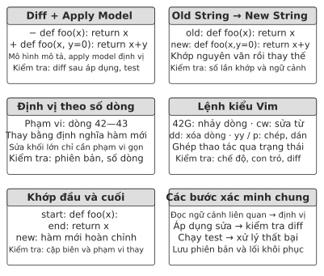

**Mô tả khác biệt + Apply Model.** Mô hình chính đưa ra ý định sửa và đoạn mã, chẳng hạn mô tả thêm bớt giống Git diff, hoặc khung mã dùng ký hiệu lược bỏ để bỏ qua phần không đổi. Một mô hình áp dụng chuyên biệt (apply model) kết hợp với tệp gốc để sinh toàn bộ nội dung sau khi sửa. Fast Apply thời đầu của Cursor là đại diện cho hướng này[^ch5-apply]. Nó chia việc “đề xuất sửa” và “áp dụng sửa” cho hai mô hình. Khi mô hình nền ngày càng giỏi sinh các chỉnh sửa cục bộ chính xác, quy trình hai mô hình này dần có những phương án thay thế đơn giản hơn.

Cách phân công này để mô hình chính tập trung diễn đạt logic mã, còn mô hình áp dụng lo gộp các sửa đổi cục bộ vào tệp. Trọng tâm kiểm tra tương ứng cũng rơi vào kết quả gộp: nhiều đoạn giống nhau có thể gây mơ hồ khi định vị, ký hiệu lược bỏ có thể bị hiểu sai, vùng không sửa cũng có thể bị viết lại ngoài ý muốn.

**Chuỗi cũ sang chuỗi mới (Old String → New String).** Công cụ Edit của Claude Code dùng phép thay chuỗi chính xác; Cursor đưa vào Search & Replace ở bản 0.50 tháng 5 năm 2025, trước tiên dùng cho việc sửa tệp dài với các mô hình của Anthropic[^ch5-direct-edit]. Cách này giao thẳng căn cứ định vị và nội dung thay thế cho chương trình thực thi, bớt được việc gọi mô hình thêm lần nữa ở giai đoạn gộp. Mô hình cung cấp `old_string` và `new_string`, công cụ tìm nguyên văn trong tệp rồi thay thế. Giao diện có thể quy ước rằng mỗi lần thay yêu cầu nguyên văn là duy nhất; nếu không khớp hoặc khớp nhiều chỗ, trả về vị trí và chẩn đoán để mô hình bổ sung ngữ cảnh. Khi cần thay hàng loạt, dùng tham số tường minh để nói rõ phạm vi.

Chẳng hạn, trong một tệp cấu hình, hai dịch vụ đều ghi `timeout = 30`. Giờ chỉ muốn đổi thời hạn của dịch vụ tải xuống thành 60 giây. Nếu công cụ yêu cầu khớp duy nhất, chỉ đưa `timeout = 30` sẽ khớp hai chỗ, và tệp phải giữ nguyên. Lần yêu cầu tiếp theo lấy cả tiêu đề mục của dịch vụ tải xuống lẫn dòng cài đặt làm chuỗi cũ, còn chuỗi mới giữ tiêu đề, chỉ đổi giá trị.

Khớp theo nội dung trực quan và dễ đối chiếu. Khi gọi, mô hình phải xuất đầy đủ chuỗi cũ: xóa một đoạn mã lớn thì tham số sẽ rất dài; những khác biệt nhỏ về khoảng trắng, xuống dòng và dấu nháy cũng ảnh hưởng đến việc khớp. Tình huống dấu nháy cong Unicode ở Chương 4 cho thấy loại sự cố này xảy ra trong quá trình truyền tham số như thế nào.

**Định vị theo số dòng (Old Line Numbers → New String).** Mô hình chỉ định xóa từ dòng X đến dòng Y, rồi chèn văn bản mới. Khi công cụ đọc đã cung cấp số dòng thực tế, xóa một đoạn lớn chỉ cần hai vị trí đầu và cuối. Ý nghĩa của số dòng phụ thuộc vào phiên bản tệp lúc đọc, và lần sửa trước có thể làm xê dịch các vị trí phía sau.

Vì vậy, sửa hàng loạt có thể cùng tham chiếu một ảnh chụp ban đầu, để công cụ kiểm tra các khoảng chồng lấn rồi áp dụng một lượt; cũng có thể sửa từng lần, đọc lại rồi mới định vị. Công cụ còn có thể đối chiếu phiên bản tệp hoặc nội dung dự kiến, trả về xung đột khi có sửa đổi đồng thời, ngăn việc áp số dòng cũ lên nội dung tệp mới.

**Lệnh sửa kiểu Vim.** Lệnh của trình soạn thảo có thể diễn đạt di chuyển, sao chép, cắt và dán, phù hợp với các thao tác tái tổ chức như chuyển một hàm từ chỗ này sang chỗ khác. Chúng phụ thuộc vào con trỏ hiện tại, vùng đệm và chế độ lệnh, mỗi bước đều làm thay đổi mốc của thao tác sau.

**Thói quen tương tác với trình soạn thảo của con người không nhất thiết phải trở thành thiết kế mặc định cho công cụ của mô hình.** Con người thường liếc nhìn trạng thái hiện tại rồi làm một thao tác nhỏ; còn mô hình có thể suy nghĩ khá lâu rồi sinh một lần hàng chục, thậm chí hàng trăm dòng sửa đổi. Tách loạt sửa đổi này thành rất nhiều lần di chuyển con trỏ và chuyển chế độ sẽ làm tăng chi phí gọi, lại đòi mô hình dự đoán ảnh hưởng của các lệnh trước lên trạng thái. Vì vậy, với nhiệm vụ sinh mã, tác giả ưu tiên giao diện diễn đạt trực tiếp mục tiêu và nội dung sửa; khi dùng lệnh trình soạn thảo, phải làm rõ mốc trạng thái và trả phản hồi kịp thời.

**Khớp đầu và cuối chuỗi (Old String Start + End → New String).** Mô hình chỉ cung cấp vài dòng ở đầu và cuối vùng cần thay, công cụ định vị hai biên và nội dung nằm giữa. Khi xóa hàng trăm dòng mã, cách này giảm được phần nguyên văn phải xuất lại, mà vẫn giữ được căn cứ định vị theo nội dung.

Công cụ phải kiểm tra thứ tự xuất hiện của hai đoạn nguyên văn, và theo quy ước giao diện mà quyết định có thay cả hai đoạn đầu cuối hay không. Chỉ khi có đúng một khoảng thỏa điều kiện mới ra tay; nếu nhiều chỗ cùng khớp, báo các vị trí đó cho mô hình và đề nghị nó bổ sung ngữ cảnh. Với cấu trúc lồng nhau hoặc mã lặp lại, thêm các mốc lân cận như tên hàm, chữ ký giúp xác định phạm vi.

**Khi xây dựng một Coding Agent mới, tác giả khuyên bắt đầu từ giao diện sửa đơn giản, tất định như chuỗi cũ sang chuỗi mới.** Định vị theo nguyên văn rõ ràng, nguyên nhân thất bại dễ giải thích, khác biệt cũng dễ đối chiếu. Khi mô hình đã sinh sửa đổi cục bộ một cách đáng tin cậy, Harness có thể giao nhiều việc hơn cho chương trình tất định, bỏ được mô hình áp dụng thêm. Khi xóa đoạn lớn cần nén lượng tham số, mới đưa vào mốc đầu cuối hoặc sửa theo số dòng dựa trên ảnh chụp. `apply_patch` của Codex thì cho thấy một hướng sửa trực tiếp khác: dùng bản vá có ràng buộc để diễn đạt nhiều chỗ sửa.

[^ch5-direct-edit]: Anthropic, *Tools reference*, công cụ Edit; Cursor, ghi chú cập nhật bản 0.50, ngày 15 tháng 5 năm 2025, giới thiệu việc đưa vào Search & Replace; ghi chú cập nhật bản 1.3 ghi nhận đồng thời các tối ưu cho Search & Replace và Apply.

[^ch5-apply]: Cursor, *Editing Files at 1000 Tokens per Second*, giới thiệu mô hình chuyên biệt áp dụng mô tả sửa đổi vào tệp gốc.

### An toàn của Coding Agent

Coding Agent có thể đọc dự án, sửa tệp, chạy chương trình, và còn có thể truy cập dịch vụ bên ngoài qua mạng. Khi thiết kế quyền hạn, cần lần theo luồng dữ liệu để xét ba câu hỏi: nội dung nào sẽ đi vào ngữ cảnh, mô hình có thể yêu cầu những thao tác nào, và cuối cùng các thao tác ấy được phê duyệt và thực thi bởi cơ chế nào.

Simon Willison dùng khái niệm “bộ ba chết người” (lethal trifecta) để khái quát một loại rủi ro prompt injection: truy cập dữ liệu riêng tư, tiếp xúc nội dung không đáng tin, và có năng lực giao tiếp ra bên ngoài[^ch5-trifecta]. Chẳng hạn, một trợ lý vừa đọc được tệp cá nhân, vừa xử lý email bên ngoài, lại gửi được tin nhắn, thì cần dựng ranh giới cấp quyền rõ ràng giữa việc đọc, hiểu và gửi. Chỉ dẫn trong nội dung bên ngoài một khi bị coi là yêu cầu của người dùng thì có thể đẩy tới việc truyền dữ liệu trái phép.

Ngoài ba chiều này, tác giả còn khuyên xét chiều thứ tư: **bộ nhớ lâu dài khuếch đại tác động của prompt injection**. Nội dung bên ngoài nếu đi vào bộ nhớ dài hạn thì tác động có thể vượt qua ranh giới phiên, xuất hiện lại trong các nhiệm vụ sau. Do đó, khi ghi bộ nhớ nên ghi lại nguồn gốc, phạm vi áp dụng và trạng thái xác nhận; khi đọc vẫn giữ các thuộc tính này. Chữ đã lưu trong `MEMORY.md` thì độ tin cậy vẫn phụ thuộc vào quá trình hình thành nó. Khi phát hiện bản ghi sai, còn cần định vị, sửa và thu hồi được nội dung liên quan.

Ba lớp guardrails ở Chương 1 ở đây mỗi lớp đảm nhận một việc: lớp ngữ cảnh ghi rõ nguồn thông tin và yêu cầu hành vi, lớp thực thi kiểm tra thao tác và quyền, lớp dữ liệu giới hạn việc đọc ghi tài nguyên theo danh tính đáng tin. Sandbox của Claude Code dùng ranh giới hệ thống tệp và mạng để ràng buộc việc chạy lệnh, Cowork cũng dùng môi trường cách ly để chạy các nhiệm vụ cục bộ[^ch5-sandbox]. Phần dưới triển khai chi tiết các cơ chế này.

**Giới hạn tài nguyên và liên lạc trong sandbox.**

- **Lối ra mạng.** Đây là ranh giới dễ bị bỏ qua trong sandbox mã và nên được thực hiện trước tiên. Tác giả khuyên bắt đầu từ việc mặc định đóng truy cập bên ngoài, rồi mở cho nguồn gói, trang tài liệu và API nghiệp vụ theo nhu cầu của nhiệm vụ. Danh sách cho phép cần ứng với đích đến và phạm vi thao tác cụ thể; với dịch vụ dùng chung còn phải tính đến tài khoản, tenant và quyền sở hữu tài nguyên. Chính sách mạng phải bao trùm các chương trình do công cụ khởi động và tiến trình con của chúng; dữ liệu gửi ra ngoài được kiểm tra riêng theo phạm vi cấp quyền.
- **Hệ thống tệp.** Có thể mount mã nguồn gốc ở chế độ chỉ đọc và đặt bản sao vào không gian làm việc ghi được; cũng có thể để giao diện sửa có kiểm soát sinh bản vá, review xong mới áp dụng. Sản phẩm sinh ra và tệp trung gian đặt trong thư mục riêng, tệp thông tin xác thực để ngoài sandbox. Khi cần truy cập dịch vụ xác thực, giao diện có kiểm soát cung cấp đúng năng lực mà nhiệm vụ cần, tránh trao toàn bộ thông tin xác thực của máy chủ cho chương trình được sinh ra.
- **Tài nguyên và thời gian.** Đặt trần cho CPU, bộ nhớ, số tiến trình, dung lượng đĩa và thời gian chạy, để hạn chế tác động của vòng lặp vô hạn, số tiến trình mất kiểm soát và ghi đĩa liên tục. Khi vượt trần, trả về trạng thái có cấu trúc, chẳng hạn “chạy quá 120 giây, đã dừng”, kèm theo đầu ra được giữ lại và kết quả dọn dẹp, để mô hình phán đoán có nên thu nhỏ nhiệm vụ hoặc điều chỉnh cách hiện thực hay không.

Các ranh giới này phải bao trùm toàn bộ chuỗi thực thi. Lệnh đã được phê duyệt thì chương trình thực sự khởi động vẫn chạy trong cùng phạm vi quyền; tiến trình nền, công cụ phụ trợ và giao diện bên ngoài cũng cần được đưa vào kiểm soát tương ứng.

**Phân tích cấu trúc lệnh và ý nghĩa tham số.**

Lệnh shell được ghép từ tên chương trình, tham số, chuyển hướng, pipe và biểu thức con. Khi thẩm định, cần phân tích các cấu trúc này, rồi nhận diện các thao tác đọc, ghi, thực thi và liên lạc có liên quan. **Danh sách đen lệnh không đủ để đảm nhận phán quyết an toàn cuối cùng.** Cùng một thao tác có thể diễn đạt bằng nhiều tổ hợp tham số và lời gọi gián tiếp khác nhau; bộ kiểm tra phải hiểu cấu trúc lệnh và công dụng của tham số, rồi để quyền lúc chạy ràng buộc phạm vi thực thi thực tế.

Chẳng hạn, công cụ tra tệp có thể có tham số để thực hiện thao tác tiếp theo trên mỗi mục khớp, còn tùy chọn đầu ra của công cụ tải xuống quyết định vị trí ghi. Bộ kiểm tra cần nhận ra “tùy chọn nào lấy tham số kế tiếp làm giá trị”, lần theo công dụng của tham số, rồi kiểm tra đường dẫn đích, quyền truy cập và thao tác được phép. Như vậy, kết quả thẩm định có thể cụ thể đến mức “đọc những tệp nào”, “ghi vào vị trí nào”, “khởi động chương trình nào”.

Khai triển biến, script động và đường dẫn chỉ sinh ra trong lúc chạy khiến một phần hành vi thực tế đến lúc thực thi mới xác định được. Với phần không xác định được, Harness có thể yêu cầu dạng gọi tường minh hơn, chuyển sang thẩm định, hoặc chạy trong môi trường bị giới hạn. Thẩm định có mô hình hỗ trợ cung cấp phán đoán theo ngữ cảnh, còn kiểm soát truy cập tất định ràng buộc tác động thực tế. Sidecar giới thiệu ở Chương 4 có thể chạy song song với việc chuẩn bị, còn các thao tác có tác động ra bên ngoài thì chỉ được gửi đi sau khi thẩm định thông qua.

**Làm rõ đối tượng phục vụ trong ủy quyền nhiều bên.**

Trung thành với bên ủy quyền (principal loyalty) bàn về câu hỏi: khi Agent làm việc thay mặt một bên, đồng thời giao tiếp với những bên tham gia khác, làm sao để nó luôn tuân theo mục tiêu và phạm vi ủy quyền của bên ủy quyền. Chẳng hạn, người dùng nhờ Agent mặc cả với nhà cung cấp và kín đáo đưa ra mức trần ngân sách 12000 tệ. Agent cần hiểu báo giá của nhà cung cấp, giải thích yêu cầu của phía mình, đồng thời bảo vệ ràng buộc riêng tư này.

Trong các đánh giá tương tác nhiều bên, tác giả và cộng sự quan sát được hai loại thất bại: một loại làm lộ thông tin riêng của bên ủy quyền hoặc chấp nhận yêu cầu không chính đáng của đối phương; loại kia từ chối quá mức, ngay cả yêu cầu bình thường của bên ủy quyền cũng không hoàn thành được. Chiến lược prompt và phương pháp huấn luyện trong đánh giá thể hiện sự đánh đổi giữa bảo vệ thông tin và cộng tác bình thường[^ch5-1]. **Mức độ trung thành phải được đo đồng thời bằng bảo vệ thông tin và hoàn thành nhiệm vụ.** Chỉ chạy theo việc từ chối nhiều yêu cầu hơn sẽ chặn luôn cả cộng tác bình thường; chỉ chạy theo việc trò chuyện suôn sẻ lại có thể để đối phương ảnh hưởng đến lợi ích của bên ủy quyền.

Với Coding Agent, tệp trong kho mã, đầu ra công cụ và dữ liệu trả về từ MCP của bên thứ ba đều có thể chứa thông tin nhiệm vụ, cũng có thể kèm theo những câu đòi thay đổi hành vi. Harness nên dựa vào nguồn gốc thật để phân biệt chỉ dẫn ủy quyền với tài liệu bên ngoài, gắn nguồn và vai trò cho thông điệp, và ánh xạ phạm vi ủy quyền thành quyền thực thi được. Những câu trong tài liệu bên ngoài tự xưng là “yêu cầu của người dùng” cần được xác nhận qua kênh đáng tin.

Prompt có thể nói rõ thêm các nguyên tắc cộng tác: bảo vệ thông tin riêng của bên ủy quyền, có khi ngay cả việc một bản ghi có tồn tại hay không cũng cần giữ bí mật; khi giải thích với bên ngoài chỉ tiết lộ nội dung cần thiết; phân biệt giới hạn nội bộ với lập trường công khai; thúc đẩy nhiệm vụ trong phạm vi đã được ủy quyền; trước những yêu cầu lặp lại vẫn giữ một tiêu chuẩn ủy quyền nhất quán. Mở rộng ủy quyền hoặc thay đổi đối tượng phục vụ phải được xác nhận qua kênh đáng tin và đồng bộ cập nhật quyền lúc chạy. Nhờ đó mô hình có căn cứ hành vi rõ ràng, còn công cụ và môi trường bảo đảm ranh giới truy cập thực tế.

[^ch5-trifecta]: Simon Willison, *The lethal trifecta for AI agents: private data, untrusted content, and external communication*, ngày 16 tháng 6 năm 2025.
[^ch5-sandbox]: Anthropic, *Making Claude Code more secure and autonomous with sandboxing* và *How we contain Claude across products*, giới thiệu ranh giới hệ thống tệp, mạng và cách ly sản phẩm.
[^ch5-1]: Li, Bojie and Noah Shi, *Whose Side Is Your Agent On? Multi-Party Principal Loyalty in LLM Agents*, 2026.

## Mã: siêu năng lực của Agent đa dụng

Các mục trước biến yêu cầu của người dùng thành thay đổi mã. Giờ hãy nhìn lại các bảng bán hàng ở đầu chương: dù cuối cùng người dùng chỉ cần một bản báo cáo, Agent vẫn có thể viết một chương trình để thống nhất mã định danh mặt hàng, thống kê theo nhóm, rồi tính lại tỷ lệ trả hàng của một mặt hàng từ bảng gốc. Trước hết hỏi rõ người dùng muốn tính theo số chiếc hay theo số đơn. Giả sử một mặt hàng bán được mười chiếc, chia trong hai đơn, chỉ một đơn trả lại một chiếc. Tính theo số chiếc là 1/10, còn tính theo số đơn có trả hàng lại là 1/2. Cả hai cách tính đều chạy thành công, chỉ khi xác nhận cách tính trước mới biết con số nào trả lời đúng câu hỏi của người dùng. Chương trình viết xong như vậy còn có thể chạy lại khi dữ liệu kỳ sau về. Vòng lặp “sinh, thực thi, xác minh” này cũng mở rộng được sang sản xuất nội dung, tích hợp hệ thống nghiệp vụ và phát triển Agent.

> **Siêu năng lực.** Cuốn sách dùng siêu năng lực (meta-capability) để chỉ năng lực tạo ra hoặc kết hợp các năng lực khác. Sinh mã có thể tạo ra công cụ mới, như script xử lý dữ liệu và quy trình gọi API; cũng có thể diễn đạt ràng buộc mới, như assertion và quy tắc kiểm tra; còn có thể dựng nên cách trình bày mới, như biểu mẫu HTML, bản trình chiếu và video.

Hãy bắt đầu từ tình huống đơn giản nhất. Dù thứ cuối cùng phải giao chỉ là đáp án của một bài toán, mô hình vẫn có thể viết một đoạn chương trình nhỏ để kiểm tra phép tính của mình.

### Mã làm công cụ tư duy

**Với tính toán chính xác và ràng buộc hình thức, tác giả ưu tiên để mô hình viết ra biểu thức thực thi được, rồi giao cho trình thông dịch hoặc bộ giải tính.** Sinh đáp án từng token một dễ sai do chép nhầm, tính nhầm, cũng có thể bỏ sót điều kiện; chương trình cố định được các bước này và chạy lại nhiều lần. Nhiệm vụ toán học và logic thường gồm hai khâu: trước hết chuyển đề bài thành quan hệ và ràng buộc, rồi tìm ra kết quả. LLM có thể giúp hiểu vấn đề, đề xuất cách giải và viết chương trình, còn trình thông dịch hoặc bộ giải lo thực hiện phép tính được chỉ định.

Chẳng hạn, một lớp có 40 học sinh, 60% chọn môn Toán, 45% chọn môn Vật lý, 25% chọn cả hai. Muốn tìm số em chỉ chọn Vật lý, phải lấy số em chọn Vật lý trừ đi số em chọn cả hai: 18 − 10 = 8. Nếu lấy nhầm số em chọn Toán, sẽ ra 24 − 10 = 14. Lỗi xảy ra ở bước chọn số bị trừ.

Viết quan hệ số lượng thành các biến có ý nghĩa thì có thể đối chiếu từng mục:

```python
math = 40 * 60 // 100       # 24 em chọn Toán
phys = 40 * 45 // 100       # 18 em chọn Vật lý
both = 40 * 25 // 100       # 10 em chọn cả hai
only_phys = phys - both     # 8 em chỉ chọn Vật lý
```

Tính toán ký hiệu mở rộng thêm kiểu phân công này. Nó có thể giữ dạng chính xác như $\sqrt{2}$ và biến đổi biểu thức theo quy tắc đại số. Bình phương trực tiếp, kết quả là số nguyên 2. Làm tròn thành 1,414 trước rồi mới bình phương, kết quả là 1,999396. Khi đề bài yêu cầu rút gọn chính xác thì nên giữ ký hiệu, còn khi yêu cầu báo giá trị đo thì có thể tính số ở bước cuối theo độ chính xác quy định. Khi bàn về việc kết hợp LLM với Wolfram|Alpha, Wolfram nhấn mạnh sự bổ sung lẫn nhau giữa hiểu ngôn ngữ và năng lực tính toán[^ch5-wolfram]. Agent có thể chuyển câu hỏi bằng ngôn ngữ tự nhiên thành biểu thức Wolfram Language hoặc Python trước, rồi gọi hệ thống tính toán, và dùng kết quả để tiếp tục suy luận.

Mỗi nhiệm vụ cần một công cụ khác nhau. SymPy hợp với biểu thức ký hiệu, phương trình và giải tích; NumPy cung cấp phép toán mảng và ma trận; SciPy cung cấp các thuật toán như tối ưu số.

> **Thí nghiệm 5-3 ★★: Dùng mã hỗ trợ giải toán**
>
> Thí nghiệm này cho cùng một mô hình Doubao giải 30 bài của AIME 2024, so sánh hai cách: suy luận trực tiếp và có công cụ Python hỗ trợ. Môi trường công cụ cung cấp SymPy, NumPy và SciPy; mô hình có thể sinh chương trình, đọc kết quả chạy, rồi đưa ra đáp án cuối cùng.
>
> Trong lần chạy này, suy luận trực tiếp giải đúng 11 bài, có mã hỗ trợ giải đúng 16 bài.

Bài toán logic cũng có thể xử lý như vậy. Lấy câu đố hiệp sĩ và kẻ nói dối làm ví dụ: đặt cho mỗi cư dân một biến Boolean, đúng nghĩa là hiệp sĩ, sai nghĩa là kẻ nói dối, rồi chuyển mỗi câu nói thành một biểu thức Boolean. Với người nói X, ràng buộc là “X là hiệp sĩ” tương đương với “lời của X là đúng”. Chẳng hạn, A nói “B là hiệp sĩ” thì được `A == B`; A nói “B là kẻ nói dối” thì được `A == (not B)`.

Bộ giải tìm phép gán thỏa mọi ràng buộc, rồi mô hình diễn giải phép gán thành danh tính của từng người. Nếu các lời khai mâu thuẫn nhau thì không có phép gán nào thỏa; các lời khai đã cho cũng có thể cùng lúc cho phép vài bộ danh tính khác nhau.

> **Thí nghiệm 5-4 ★★: Dùng bộ giải ràng buộc hỗ trợ suy luận logic**
>
> Thí nghiệm này chọn 84 bài từ bộ dữ liệu K&K theo phân tầng số người, so sánh cùng một mô hình Doubao khi suy luận trực tiếp và khi gọi `python-constraint`. Đường đi bằng mã phải nhận diện các biến nhân vật, dịch các lời khai, và gọi bộ giải để tìm tổ hợp danh tính thỏa mọi điều kiện.
>
> Trong lần chạy này, suy luận trực tiếp giải đúng 63 bài, có mã hỗ trợ giải đúng 33 bài. Cả 84 trajectory dùng mã đều có câu lệnh import thư viện giải. Trong đó có một bài, mô hình thậm chí đã sửa đúng chương trình mà lại không nộp đáp án.
>
> Lấy bài hai người về James và Sophia làm ví dụ. James nói Sophia là kẻ nói dối; Sophia nói “James là hiệp sĩ khi và chỉ khi James là kẻ nói dối”. Câu sau sai bất kể James là ai, nên Sophia là kẻ nói dối, và James nói thật. Chương trình mô hình nộp lần đầu viết phép tương đương thành `james == not james`, thứ Python không phân tích được. Đến lần gọi công cụ thứ tám, chương trình đã viết thành `james == (not james)`, nhưng câu trả lời cuối cùng vẫn để trống, bài này vẫn mất điểm.

**Harness nên dày đến đâu tùy thuộc vào giới hạn năng lực của mô hình trên nhiệm vụ cụ thể.** Với phần suy luận mô hình đã làm ổn định, bước giải thêm có thể chỉ tăng chi phí; với phần mô hình dễ tính sai, đáng giao cho phép tính tất định. Nhưng có công cụ hỗ trợ còn đòi mô hình làm đúng bước chuyển sang dạng hình thức; dịch ràng buộc sai sẽ biến bài toán ban đầu thành một bài khác. Ngay cả khi ràng buộc đã sửa đúng, trợ lý vẫn có thể dùng hết số lượt, không kịp nộp đáp án.

[^ch5-wolfram]: Stephen Wolfram, *Wolfram|Alpha as the Way to Bring Computational Knowledge Superpowers to ChatGPT*, tháng 1 năm 2023.

### Mã làm ràng buộc cho quy tắc nghiệp vụ

Quy tắc nghiệp vụ có thể được đưa vào luồng thực thi bằng mã. Chẳng hạn, “được hoàn tiền trong vòng 7 ngày sau khi mua” cần xác định thêm: tính theo ngày lịch hay ngày làm việc, mốc bắt đầu là đặt hàng, thanh toán hay giao hàng, thời điểm biên có được tính vào hay không. Để bên nghiệp vụ xác nhận các ý nghĩa này trước, rồi viết thành điều kiện và test case, quy tắc mới có căn cứ thực thi ổn định.

Chẳng hạn, người phụ trách quy tắc xác nhận “thời gian trôi qua kể từ khi thanh toán không quá 168 giờ”, có thể viết ba test case liền kề: sau khi thanh toán 167 giờ 59 phút, đúng 168 giờ, và 168 giờ 1 phút. Lấy thời điểm nộp yêu cầu phía máy chủ trừ thời điểm thanh toán, hai mốc thời gian phải được quy về cùng một chuẩn giờ trước. Theo quy tắc này, hai test case đầu được chấp nhận, test case thứ ba bị từ chối. Nếu người phụ trách đổi sang tính theo ngày lịch tại nơi thanh toán, các test case và mã hiện có đều phải đối chiếu lại.

Mô tả bằng ngôn ngữ tự nhiên giúp mô hình hiểu chính sách, giải thích lý do cho người dùng, và tìm phương án khác trong phạm vi được cấp quyền, chẳng hạn tra xem có được đổi vé hay không. Kiểm tra bằng mã lo việc kiểm tra điều kiện cụ thể trước các thao tác then chốt, phù hợp với tổ hợp nhiều điều kiện, tính toán thời gian và đối chiếu giữa nhiều nguồn dữ liệu. Mô hình có thể hỗ trợ sinh mã kiểm tra, người phụ trách quy tắc xác nhận ý nghĩa qua review và test case biên; khi quy tắc cập nhật, cập nhật đồng thời mô tả, cách hiện thực và test.

**Giá trị hàng đầu của quy tắc được mã hóa là chặn những thao tác sai gây thiệt hại thật.** Hủy đơn, chuyển tiền và xóa dữ liệu đều thay đổi trạng thái nghiệp vụ, khắc phục sau sự việc có thể rất tốn kém. Tác giả khuyên đặt việc kiểm tra theo dữ liệu thật ngay trong giao diện thực thi, để mỗi lần gửi đều đi qua cùng một bộ quy tắc, tránh trường hợp mô hình quên gọi công cụ kiểm tra riêng. Giao diện tra cứu riêng vẫn dùng được để giải thích chính sách từ trước; còn khi thực thi thì đọc lại các sự kiện cần thiết, kiểm tra trạng thái có thay đổi không, và kết hợp cơ chế giao dịch, idempotent và bù trừ ở Chương 4 để quản lý các thao tác sau đó.

**Dùng tham số để dẫn dắt việc đối chiếu, dùng sự kiện phía máy chủ để phán quyết.**

τ-bench nghiên cứu tool calling và việc tuân thủ chính sách qua các tình huống hàng không, thương mại điện tử[^ch5-tau]. Dưới đây lấy đặt vé máy bay làm tình huống giảng dạy, đặt năm quy tắc hủy: trước hết loại các đơn đã dùng chặng bay, rồi kiểm tra thời điểm đặt, việc hãng bay hủy chuyến, hạng thương gia và điều kiện bảo hiểm. `cancellation_reason` ghi lý do người dùng yêu cầu, `expected_*` ghi những sự kiện mô hình dự kiến thấy, còn phán quyết thực tế đọc cơ sở dữ liệu nghiệp vụ và đồng hồ máy chủ.

Đoạn mã này minh họa các nhánh chính sách. Tầng cổng vào lo xác nhận danh tính yêu cầu, quyền sở hữu đơn và quyền thao tác; tầng thực thi đọc trạng thái, kiểm tra điều kiện và gửi lệnh hủy trong một giao dịch có kiểm soát hoặc cơ chế nhất quán tương đương, đồng thời lưu bản ghi kiểm toán.

```python
def cancel_reservation(
    reservation_id: str,
    cancellation_reason: str,        # "change_of_plan", "airline_cancelled", "other"
    expected_cabin_class: str | None = None,  # tùy chọn: hạng ghế mô hình dự kiến
    expected_has_insurance: bool | None = None  # tùy chọn: trạng thái bảo hiểm mô hình dự kiến
) -> dict:
    """
    Hủy đặt chỗ chuyến bay.

    Chính sách hủy (máy chủ cưỡng chế theo dữ liệu thật trong cơ sở dữ liệu):
    - Quy tắc 1: Đơn đã dùng bất kỳ chặng bay nào thì không được hủy
    - Quy tắc 2: Qua quy tắc 1, được hủy trong vòng 24 giờ sau khi đặt
    - Quy tắc 3: Qua quy tắc 1, chuyến bay bị hãng hủy thì được hủy
    - Quy tắc 4: Qua quy tắc 1, hạng thương gia được hủy
    - Quy tắc 5: Hạng phổ thông cơ bản và phổ thông phải mua bảo hiểm du lịch mới được hủy

    Trước khi gọi, hãy tra chi tiết đơn và đối chiếu từng chính sách trên; tham số expected_*
    dùng để nêu căn cứ phán đoán của bạn, chỉ để máy chủ so sánh và kiểm toán, không ảnh hưởng phán quyết.
    """
    # Đọc các sự kiện cần cho phán quyết chính sách từ cơ sở dữ liệu nghiệp vụ
    r = db.get_reservation(reservation_id)
    now = server_clock.now()  # dùng đồng hồ máy chủ

    # Ghi lại chênh lệch giữa giá trị dự kiến và sự kiện hiện tại, phục vụ chẩn đoán và kiểm toán
    if expected_cabin_class is not None and expected_cabin_class != r.cabin_class:
        log_mismatch(reservation_id, "cabin_class", expected_cabin_class, r.cabin_class)
    if expected_has_insurance is not None and expected_has_insurance != r.has_insurance:
        log_mismatch(reservation_id, "has_insurance", expected_has_insurance, r.has_insurance)

    if r.any_segment_used:
        return {"success": False, "reason": "Cannot cancel with used segments"}

    hours_since_booking = (now - r.booking_time).total_seconds() / 3600
    if hours_since_booking < 0:
        return {"success": False, "reason": "Booking time is in the future"}
    if hours_since_booking <= 24:
        execute_cancellation(reservation_id)
        return {"success": True, "reason": "Cancelled within 24-hour window"}

    if r.flight_status == "cancelled_by_airline":
        execute_cancellation(reservation_id)
        return {"success": True, "reason": "Airline cancelled flight"}

    if r.cabin_class == "business":
        execute_cancellation(reservation_id)
        return {"success": True, "reason": "Business class cancellation"}

    if r.cabin_class in ["basic_economy", "economy"]:
        if r.has_insurance:
            execute_cancellation(reservation_id)
            return {"success": True, "reason": f"{r.cabin_class} with insurance"}
        return {"success": False, "reason": f"{r.cabin_class} requires insurance"}

    return {"success": False, "reason": "Does not meet cancellation policy"}
```

**Tham số giúp mô hình đối chiếu từng mục.** Mô tả công cụ liệt kê chính sách hủy và yêu cầu tra đơn trước. Mô hình có thể điền hạng ghế và trạng thái bảo hiểm vào `expected_cabin_class`, `expected_has_insurance`, để căn cứ phán đoán xuất hiện trong bản ghi lời gọi. Tham số tùy chọn chỉ cung cấp lối vào để đối chiếu; còn việc có thực sự tra và đối chiếu hay không thì phải kiểm tra trajectory. Nếu quy trình bắt buộc phải tra trước, Harness có thể kiểm tra bản ghi tra cứu và thời hạn hiệu lực của nó.

Chẳng hạn, đơn đã quá 24 giờ, chuyến bay vẫn khai thác bình thường, hạng phổ thông và không mua bảo hiểm, thì mô hình có thể dựa vào đó giải thích rằng không thể hủy theo chính sách trong ví dụ này, và tra các lựa chọn được phép như đổi vé.

**Máy chủ thực thi quy tắc dựa trên sự kiện hiện tại.** Hạng ghế, bảo hiểm, thời điểm đặt, tình trạng sử dụng chặng bay và trạng thái chuyến bay đều đọc từ nguồn dữ liệu nghiệp vụ; khung thời gian được tính theo đồng hồ máy chủ. Chênh lệch ở `expected_*` dùng để chẩn đoán, `cancellation_reason` dùng để ghi lại ý định yêu cầu. Những sự kiện như hãng bay có hủy chuyến hay không do máy chủ xác minh; người dùng ghi “hãng hủy chuyến” trong yêu cầu không làm cho một tấm vé vốn không được hoàn trở thành được hoàn.

Tính độc lập của nguồn dữ liệu cũng phải được bảo đảm trong kiểm soát truy cập: ai được sửa sự kiện của đơn, cập nhật khi nào, lưu lịch sử ra sao, đều ảnh hưởng đến độ tin cậy của việc kiểm tra. Thao tác đồng thời có thể làm thay đổi trạng thái sau khi tra, vì vậy khi gửi lệnh hoàn tiền, máy chủ đọc lại trạng thái đơn, xác nhận tấm vé này vẫn được hoàn, và trả kết quả xử lý nhất quán cho các yêu cầu trùng lặp.

> **Thí nghiệm 5-5 ★★: Mô hình nhỏ và quy tắc nghiệp vụ được mã hóa**
>
> Thí nghiệm này dùng Qwen3-4B, so sánh hai cách hiện thực trên 60 ca hoàn vé máy bay cố định. Cả hai nhóm đều cung cấp chính sách bằng ngôn ngữ tự nhiên cho mô hình; công cụ hủy của nhóm đối chứng nhận lời gọi là hoàn tiền ngay, còn nhóm mã hóa thì trước khi thực thi đọc cơ sở dữ liệu mô phỏng và đồng hồ máy chủ để kiểm tra điều kiện hoàn tiền.
>
> Thí nghiệm dùng chính sách đơn giản hóa: hạng phổ thông linh hoạt và hạng thương gia được hoàn; hạng phổ thông cơ bản được hoàn trong vòng 24 giờ sau khi đặt, hoặc khi hãng hủy chuyến, chậm chuyến nghiêm trọng. Tham số đối chiếu là `expected_refundable` và `expected_reason`, lần lượt ghi phán đoán của mô hình về điều kiện hoàn tiền và lý do.
>
> Khi chấm, trước hết xem tiền đã hoàn chưa, rồi đối chiếu xem theo chính sách vé này có nên hoàn không. Theo tiêu chuẩn này, nhóm đối chứng xử lý đúng 57 ca, nhóm mã hóa xử lý đúng 55 ca. Cả hai nhóm đều không hoàn tiền cho hành khách không đủ điều kiện; điểm bị mất đều đến từ những đơn lẽ ra phải hoàn mà không hoàn: nhóm đối chứng 3 ca, nhóm mã hóa 5 ca. Hành khách còn quan tâm nhân viên có giải thích lý do không, bị từ chối rồi còn cách nào khác. Thí nghiệm kiểm tra riêng phần giải thích chính sách và phương án thay thế trong câu trả lời cuối cùng; các kiểm tra này không tính vào điểm hoàn tiền nói trên.

[^ch5-tau]: Sierra Research, τ-bench: A Benchmark for Tool-Agent-User Interaction in Real-World Domains, cung cấp chính sách, công cụ và nhiệm vụ tương tác cho các tình huống hàng không, thương mại điện tử.

### Sinh nội dung đa phương tiện bằng mã

Bản trình chiếu, báo cáo kỹ thuật và trang tương tác đều gồm hai phần việc: tổ chức nội dung và trình bày thị giác. Agent có thể viết cấu trúc thành mã hoặc ngôn ngữ đánh dấu trước, rồi gọi công cụ render để tạo ra sản phẩm xem được. Chẳng hạn, HTML diễn đạt cấu trúc trang, CSS điều khiển bố cục và kiểu dáng, JavaScript hiện thực tương tác. Vị trí và kiểu dáng của các phần tử nhờ vậy trở thành tham số sửa được, tiện cho việc điều chỉnh hàng loạt, sinh lại nhiều lần và so sánh phiên bản.

Sinh nội dung bằng chương trình phù hợp với nội dung có cấu trúc, cần sửa đi sửa lại. GUI thì cung cấp lối vào để xem trực tiếp và thao tác cục bộ; hai cách có thể phối hợp với nhau.

**Agent sinh PPT.**

Báo cáo học thuật cần sắp xếp vấn đề, phương pháp, thí nghiệm và kết luận của bài báo thành phần trình bày triển khai theo từng trang. Agent có thể lập kế hoạch câu hỏi mà mỗi trang phải trả lời trước, rồi chọn ý chính và biểu đồ, cuối cùng sinh mã nguồn slide. Slidev lấy Markdown làm lối vào nội dung, hỗ trợ HTML và component Vue, phù hợp để tổ chức quá trình này thành một quy trình sinh thực thi được[^ch5-slidev].

Nếu ban tổ chức đưa một bản báo cáo năm trước làm mẫu, còn có thể dùng lại thẳng cấu trúc trang trong đó. PPTAgent trước hết phân tích công dụng của từng trang trong bản tham chiếu, rồi chọn trang tham chiếu phù hợp cho dàn ý mới, dùng mã để sửa các đối tượng trong trang. Chẳng hạn, báo cáo mới cần trình bày kết quả thí nghiệm, có thể chọn một trang vốn dùng để đặt song song hai nhóm kết quả, rồi thay hình và phần giải thích trong đó. Kiểu dùng lại này cũng kéo theo một việc phải kiểm tra: hai hình đều đã thay bằng kết quả của thí nghiệm lần này, nhưng đoạn văn bên cạnh có còn đang giải thích thí nghiệm năm ngoái không? Phiên bản mà bài báo dùng sửa khung văn bản theo số hiệu phần tử và đoạn. Nếu chỉ thay hình, phần giải thích cũ sẽ ở lại trên trang.[^ch5-pptagent]

[^ch5-pptagent]: Zheng và cộng sự, bài báo PPTAgent, EMNLP 2025. Mã đi kèm bài báo hiện thực giao diện sửa theo đoạn trong `pptagent/apis.py`.

Đã thay đúng chữ và hình, bố cục vẫn có thể sai. Chẳng hạn, thêm hai dòng chú thích cho hình thì biên dịch vẫn qua, nhưng chữ có thể đè lên trục tọa độ. Trong Hình 5-5, người thẩm định phải nhìn thấy ảnh chụp sau khi render mới gửi lại được ý kiến như vậy cho người đề xuất phụ trách bố cục.

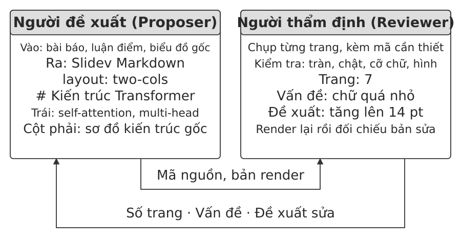

- **Người đề xuất (Proposer)** đọc bài báo, lập kế hoạch cấu trúc trình bày, viết mã nguồn Slidev, và sửa trang theo phản hồi.
- **Người thẩm định (Reviewer)** dùng công cụ để render trang, dùng mô hình thị giác kiểm tra mật độ nội dung, khả năng đọc, bố cục và sự tương ứng giữa hình và chữ, rồi trả về phản hồi có cấu trúc gồm số trang, loại vấn đề, mức độ nghiêm trọng và đề xuất sửa.

Phản hồi nên chỉ dẫn trực tiếp được việc sửa. Chẳng hạn, “trang 3 quá nhiều ý, tách thành hai trang tổng quan phương pháp và các bước tính”; “trang 7 cỡ chữ mã quá nhỏ, tăng lên 14 pt trước, rồi kiểm tra khả năng đọc khi chiếu”. Lỗi sự kiện và đọc sai biểu đồ được sửa trước, sau đó mới xử lý bố cục và chi tiết thị giác.

Sửa cục bộ còn cần nói rõ sửa đối tượng nào. Doubao Work trong slide của Feishu cho phép người dùng chọn một phần tử trên trang, rồi đưa yêu cầu sửa qua thanh công cụ nổi.[^ch5-doubao-work] Giả sử cùng một trang có hai khung văn bản, một chỗ là trích dẫn phỏng vấn gốc, chỗ kia là phần tổng kết do người báo cáo viết. Người dùng chọn phần tổng kết và yêu cầu “rút gọn còn hai dòng”. Khung văn bản được chọn giới hạn phạm vi thay đổi. Phần tổng kết có thể viết lại, còn trích dẫn bên cạnh phải giữ nguyên lời người được phỏng vấn.

[^ch5-doubao-work]: Trung tâm trợ giúp Feishu, dùng Doubao Work trong slide.

Người đề xuất sửa xong thì render lại, người thẩm định kiểm tra phiên bản mới và xác nhận các vấn đề vòng trước đã được giải quyết chưa. Vòng lặp đặt hai loại điều kiện thoát: đạt yêu cầu rõ ràng về nội dung và bố cục, hoặc dùng hết ngân sách số vòng, thời gian và chi phí, chẳng hạn tối đa 5 vòng sửa. Khi bàn giao, lưu phiên bản hiện tại cùng các vấn đề còn chờ xử lý để tiện review sau.

Cách này dùng chung mô hình người đề xuất - người thẩm định với việc phê duyệt thao tác ở Chương 4. Phê duyệt thao tác chủ yếu đánh giá một hành động có được thực thi hay không; còn thẩm định nội dung thì cải thiện sản phẩm qua nhiều vòng phản hồi. Cả hai đều cần chia sẻ yêu cầu nhiệm vụ, đưa ra căn cứ phán đoán định vị được, và để Harness quyết định quy trình tiếp theo. Dùng mô hình thuộc họ khác có thể đem lại một góc nhìn thẩm định khác.

**Tác giả đánh giá cao lợi thế của việc chia hai Agent trong quản lý ngữ cảnh.** Hai vai có thể giữ riêng thông tin mỗi bên cần: người thẩm định mỗi vòng nhận ảnh chụp mới nhất, tiêu chuẩn thẩm định và danh sách vấn đề cần thiết; người đề xuất giữ mã nguồn, mục tiêu sửa và phản hồi văn bản có cấu trúc. Ảnh trang ở lại trong ngữ cảnh của người thẩm định, còn trajectory chính tiến lên nhờ các phản hồi văn bản ngắn. Mỗi vòng thẩm định đều xoay quanh trang mới nhất, vừa giảm nhiễu từ các ảnh chụp cũ, vừa kiểm soát được mức tăng của ngữ cảnh.

> **Thí nghiệm 5-6 ★★: Tự động sinh PPT từ bài báo**
>
> Thí nghiệm này dùng tệp PDF của bài báo “Attention Is All You Need” để sinh 20 trang slide Slidev. Agent trích cấu trúc và ý chính của bài báo, dùng ba hình gốc của bài báo có ghi nguồn, tổ chức phần trình bày theo từng trang. Sau khi render, kiểm tra chữ tràn, khả năng đọc của biểu đồ và sự tương ứng giữa hình và chữ, rồi sửa theo phản hồi.
>
> Đối chứng so sánh một Agent tự thẩm định với cách chia vai người đề xuất - người thẩm định. Trong lần chạy này, hai bản cuối cùng đều được 95 điểm trong cùng một quy trình chấm điểm độc lập; đỉnh đầu vào của phương án chia vai khoảng 24 nghìn token, còn phương án một Agent giữ lại ảnh chụp cũ khoảng 93 nghìn token.

> **Thí nghiệm 5-7 ★★: Tự động sinh video giảng giải bài báo**
>
> Trên nền slide, Agent có thể viết lời giảng theo văn nói cho từng trang, giải thích các đối tượng, quan hệ và kết luận trong hình, rồi gọi TTS để tổng hợp giọng nói. Lời giảng được giao cùng trang slide cho người thẩm định thị giác, kiểm tra xem các phần tử được nhắc đến có xuất hiện trên khung hình không, và mô tả có khớp với biểu đồ không.
>
> Khi làm video, thí nghiệm tiếp tục dùng quy trình sinh ở mục trước, chọn một bản 22 trang ra đời sớm hơn (v2). Sau khi trích lần lượt 12 trang, khung hình cuối của video lấy từ trang 21 của bản gốc. Mục trước khi so sánh điểm và lượng dùng thì dùng bản 20 trang về sau (v9). Chọn xong trang, dùng Kimi sinh lời giảng, mô hình thị giác Qwen thẩm định quan hệ hình - chữ, rồi Fish Audio tổng hợp giọng nói từng trang. FFmpeg dựa vào thời lượng thực tế của mỗi đoạn âm thanh để đặt thời gian hiển thị trang, ghép thành video giảng giải dài khoảng 8,6 phút.
>
> Trong Hình 5-6, slide, lời giảng và giọng nói phải đến cuối cùng mới được ghép thành video. Có những vấn đề phải đến bước này mới nghe ra: khi chuyển trang, một câu có bị bỏ dở không, và càng về sau âm thanh với hình ảnh có càng lệch nhau không.
>
> 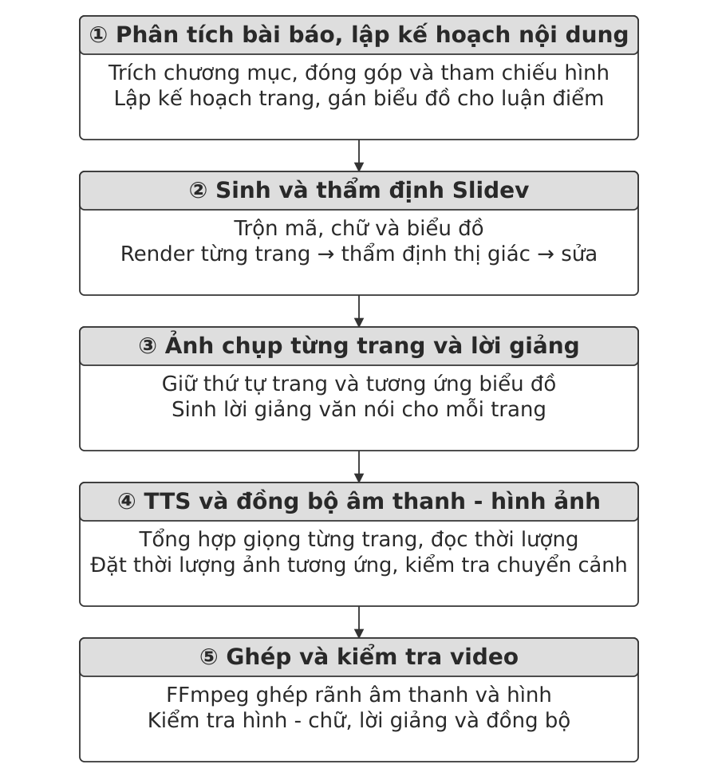

[^ch5-slidev]: Slidev, *Getting Started*, giới thiệu việc sinh, trình chiếu và xuất bản trình chiếu dựa trên Markdown và công nghệ Web.

**Agent biên tập video.**

**Những thao tác biên tập video diễn đạt được bằng script thì nên ưu tiên đi qua giao diện lập trình.** Dòng thời gian, lớp, phụ đề và rãnh âm thanh nằm rải rác trong các bảng GUI phức tạp, định vị và kéo thả lặp lại sẽ làm tăng độ trễ và sai số; giao diện lập trình có thể diễn đạt thao tác trực tiếp bằng khoảng thời gian, rãnh và tham số hiệu ứng. Giao diện Python của Blender và FFmpeg đều có thể tổ chức một phần việc biên tập thành script chạy lặp lại được.

Agent có thể hiểu yêu cầu kiểu “cắt riêng đoạn lướt sóng ra” trước, rồi định vị khoảng đích trong tư liệu, sinh mã cắt, sắp xếp và xử lý âm thanh. Người đề xuất lo kế hoạch biên tập và script, người thẩm định kiểm tra kết quả render; gặp chỗ sót, đoạn không liên quan hay phụ đề che hình thì phản hồi thời điểm và vấn đề cụ thể, giao lại cho người đề xuất sửa. Keyframe hợp để kiểm tra cảnh và bố cục, còn tính liên tục của chuyển động và độ đồng bộ âm thanh - hình ảnh thì phải kiểm tra các khung liền kề hoặc đoạn liên tục.

> **Thí nghiệm 5-8 ★★: Cắt dựng video thông minh dựa trên API**
>
> Thí nghiệm này nối định vị mục tiêu, sinh script và thẩm định hiệu quả thành một quy trình. Trước hết giao tham chiếu video, câu hỏi mục tiêu và khoảng trích khung cho Agent con phân tích video; nó xử lý lượng lớn khung hình rồi trả về cho Agent chính khoảng thời gian và căn cứ.
>
> Việc định vị gồm hai bước. Bước một cứ 10 giây trích một khung, tìm phạm vi gần đúng của mục tiêu, chẳng hạn “lướt sóng ở giây 40—110”; bước hai quanh khoảng ứng viên và các biên lân cận, mỗi giây trích một khung để xác định thêm vị trí bắt đầu và kết thúc. Những cảnh ngắn hơn khoảng trích thô có thể lọt giữa hai khung; có thể tăng mật độ trích theo thời lượng của mục tiêu, hoặc xem lại phần hình giữa hai lần trích.
>
> Xác định xong khoảng thời gian, người đề xuất sinh script Python cho Blender, thực hiện việc cắt cùng các thao tác cần thiết như phụ đề, đổi tốc độ. Người thẩm định xem bản xem trước, chỉ ra các biên và hiệu ứng cần chỉnh; sửa xong đạt yêu cầu mới xuất bản hoàn chỉnh.
>
> Đoạn thực sự được cắt là cảnh một chú thỏ trắng lớn một mình đi qua bãi cỏ. Xem cứ 10 giây một khung, mô hình xác định phạm vi ở giây 10 đến 20. Nếu cắt thẳng từ giây 10, phần đầu cảnh sẽ mất một khúc. Vì vậy chương trình nới rộng thêm 5 giây ở mỗi đầu, xem mỗi giây một khung trong khoảng giây 5 đến 25, rút khoảng ứng viên xuống còn giây 9 đến 12. Người thẩm định lại phát hiện đoạn phim lẫn cả hình của cảnh bên cạnh, khoảng sau khi sửa là giây 9,25 đến 11,00. Đối chiếu với nhãn thủ công là giây 9,08 đến 11,20, điểm bắt đầu muộn 0,17 giây, điểm kết thúc sớm 0,20 giây, cả hai đầu đều đạt yêu cầu sai số không quá 3 giây.
>
> Mốc thời gian chỉ kiểm tra được cắt ở đâu. Đặt cùng bộ phụ đề và hiệu ứng quay chậm lên một đoạn hình cố tình chọn sai, người thẩm định có nhận ra lỗi không? Thí nghiệm cho nó kiểm tra đoạn đối chứng ở giây 0 đến 3 trước, rồi mới xem bản render đã sửa. Đối tượng thẩm định gồm chú thỏ trắng trong khung hình, phụ đề ở dưới và thời lượng sau khi đổi tốc độ.

**3D và chi tiết công nghiệp: chọn cách sinh phù hợp.**

**Với chi tiết công nghiệp có kích thước và quan hệ lắp ráp là ràng buộc cứng, ưu tiên sinh bằng mã tham số hóa; với đối tượng chủ yếu cần hình dáng tự nhiên và vẻ ngoài, ưu tiên cân nhắc mô hình sinh.** Lựa chọn này phụ thuộc vào việc sản phẩm có mô tả chính xác được bằng ít tham số hay không, và sau khi sửa cần giữ những quan hệ nào. CadQuery, OpenSCAD và script Blender cung cấp quá trình dựng sửa được, còn các mô hình như Hunyuan 3D dùng tri thức hình dáng đã học để sinh vẻ ngoài phức tạp.

**Mô tả có hợp với tham số hóa không.** Một mặt bích đơn giản hóa có thể diễn đạt các quan hệ hình học chính bằng đường kính ngoài, độ dày, đường kính vòng lỗ, đường kính lỗ và số lỗ. Mã gắn tham số với các bước dựng, phù hợp để điều chỉnh nhiều lần. Một chậu cây xanh, một hòn đá Thái Hồ hay một khuôn mặt người thì chứa rất nhiều hình dạng bất quy tắc; mô hình sinh có thể giúp dựng vẻ ngoài, còn phương pháp lập trình cũng có thể sinh chi tiết qua quy tắc sinh trưởng, quá trình ngẫu nhiên và tổ hợp tài nguyên.

**Kiểm tra độ chính xác thế nào.** Với yêu cầu như lỗ 5 mm, dung sai ±0,05 mm, cần làm rõ đơn vị, hệ tọa độ và phương pháp đo trước, rồi so kích thước mô hình với quy cách. Mô hình tham số hóa có thể kiểm tra trực tiếp đối tượng hình học; lưới thì có thể đo qua mặt cắt, lỗ, kích thước hộp bao, và tính cả sai số rời rạc hóa.

**Lưu và sửa thế nào.** B-rep (biểu diễn biên) dùng mặt, cạnh và đỉnh để mô tả biên của vật thể, còn lưới tam giác dùng các mảnh mặt để xấp xỉ bề mặt. CadQuery có thể xuất STEP để trao đổi dữ liệu CAD, cũng có thể xuất lưới STL; các tham số sửa được và logic dựng được lưu trong mã nguồn CadQuery[^ch5-cad]. Đưa vào quy trình gia công CNC còn cần lập quy trình công nghệ, đường chạy dao và thích ứng với máy.

Chẳng hạn, đổi lỗ lắp từ cỡ M5 sang cỡ M6 thì có thể sửa tham số đường kính lỗ, sinh lại rồi kiểm tra xem đường kính ngoài, độ dày và vị trí lỗ có giữ nguyên không. Cách sửa của mô hình sinh phụ thuộc vào năng lực giao diện: có thể sinh lại, cũng có thể kết hợp sửa cục bộ và xử lý hình học về sau.

Khi kết hợp hai hướng, cũng nên phân công rõ: kích thước và quan hệ lắp ráp giao cho mã tham số hóa, vân bề mặt và vẻ ngoài tự do giao cho mô hình sinh. **Khi kích thước then chốt cần sửa chính xác nhiều lần, quá trình dựng sửa được có giá trị hơn vẻ ngoài sinh một lần.**

> **Thí nghiệm 5-9 ★★: Hai hướng sinh cho cùng một chi tiết — mã và mô hình sinh**
>
> Thí nghiệm này yêu cầu sinh một mặt bích đường kính ngoài 80 mm, dày 10 mm, có bốn lỗ lắp phân bố đều trên vòng lỗ đường kính 60 mm. Để làm rõ ý nghĩa lắp ráp, quy cách ban đầu dùng lỗ thông 5,5 mm cho bu lông M5, yêu cầu sửa đổi chuyển sang lỗ thông 6,5 mm cho bu lông M6.
>
> Hướng mã để mô hình sinh chương trình CadQuery, chạy xong xuất STEP và STL; hướng mô hình sinh thì trước hết sinh ảnh tham chiếu sản phẩm, rồi giao cho Hunyuan 3D sinh lưới. Kiểm tra đường kính ngoài, độ dày, số lỗ, đường kính lỗ, vị trí lỗ và mặt lắp, đồng thời ghi lại đơn vị và hướng trục.
>
> Làm sao thấy được mô hình chỉ sửa đúng kích thước được chỉ định? Đối chiếu tệp STL xuất ra trước và sau khi sửa, đường kính trung bình của bốn lỗ lắp tăng từ 5,499 mm lên 6,499 mm; cả hai bản đều có đường kính ngoài 80 mm, dày 10 mm, đường kính vòng lỗ tính đến ba chữ số thập phân đều là 60,000 mm. Lưới gốc của hướng mô hình sinh thiếu thang đo vật lý rõ ràng. Chương trình đo lấy mặt cắt giữa theo trục Z, không tìm thấy vòng trong của lỗ. Muốn biết bốn lỗ có xuyên qua mặt bích không, còn phải nhận ra mặt lắp, rồi lấy mặt cắt ở các độ sâu khác nhau theo pháp tuyến của nó. Sau khi sinh lại, cả hình dáng tổng thể lẫn hướng đặt đều thay đổi.
>
> Cuối cùng đổi sang một bài khác: cần giao một bức ảnh chậu cây trông tự nhiên thì nghiệm thu thế nào? Thí nghiệm dùng matplotlib vẽ một chậu cây, dùng Gemini sinh một bức khác, rồi để cùng một mô hình thị giác chấm độ tự nhiên theo thang mười điểm. Hai bức lần lượt được 3 điểm và 8 điểm. Điểm số này trả lời câu hỏi mô hình chấm thấy bức nào giống cây thật hơn. Quay lại mặt bích, dù ảnh sản phẩm trông như có bốn lỗ, việc lắp ráp vẫn phải đối chiếu vị trí và đường kính lỗ trên chi tiết ba chiều.

[^ch5-cad]: CadQuery, *Importing and Exporting Files*, giới thiệu các định dạng như STEP, STL, và cho biết thông tin tham số đầy đủ được lưu trong mã nguồn Python của CadQuery.

### Mã làm bộ thích ứng hệ thống

Giao diện, cách xác thực và định dạng dữ liệu của các dịch vụ bên ngoài mỗi nơi một kiểu. Agent có thể đọc tài liệu và mẫu phản hồi, sinh HTTP client, cấu hình header xác thực, phân tích giá trị trả về, rồi chuyển các trường của thượng nguồn thành cấu trúc mà hạ nguồn cần. Ở đây mã đảm nhận việc thích ứng hệ thống, ghép các dịch vụ sẵn có thành quy trình nhiệm vụ mới.

Chẳng hạn, trường số tiền đọc từ dịch vụ thanh toán nếu tính bằng xu, còn báo cáo hiển thị theo tệ, thì phân tích JSON thành công chỉ chứng tỏ định dạng tương thích. Một giao dịch 25 tệ, ở thượng nguồn là số nguyên 2500. Điền thẳng con số này vào báo cáo, 25 tệ sẽ thành 2500 tệ.

Bộ thích ứng (adapter) cần làm rõ đầu vào đầu ra, cách xử lý lỗi và phạm vi phiên bản. Mẫu dữ liệu giúp mô hình hiểu các trường, còn quy ước giao diện và test kiểm tra giá trị thiếu, phân trang, phản hồi bất thường và thay đổi phiên bản. Thông tin xác thực do môi trường thực thi quản lý, mã được sinh ra dùng năng lực được cấp qua giao diện có kiểm soát. Xác minh xong, adapter có thể được lưu và dùng lại; về sau gặp định dạng thay đổi thì đi vào quy trình sửa đổi.

Những hệ thống chỉ có giao diện đồ họa cũng dùng được cách tương tự. Agent trước hết hoàn thành nhiệm vụ bằng Computer Use giới thiệu ở Chương 6, rồi cố định các bước thao tác ổn định thành công cụ RPA. Khi điều khiển giao diện, trạng thái đăng nhập và luồng trang thay đổi, công cụ cần phát hiện sai lệch và định vị lại. Chương 9 sẽ bàn thêm cách rút ra, xác minh và dùng lại quy trình làm việc từ các trajectory thành công.

**Phân tích và trực quan hóa log của Agent.**

Một nhiệm vụ phức tạp có thể gồm nhiều lần gửi yêu cầu cho mô hình, chạy công cụ và tương tác với Agent con. Phần tổng quan của log thể hiện quan hệ giữa các bước, trạng thái và thời gian chạy; mở rộng ra thì hiển thị đầu vào đầu ra cụ thể, giúp người đọc lần ra một bước nào đó đã xảy ra chuyện gì. Trường mới, cấu trúc lồng nhau và phiên bản định dạng đều ảnh hưởng đến việc phân tích và hiển thị.

Phân tích thích ứng xử lý những thay đổi này bằng vòng lặp “phát hiện thay đổi — sinh bộ phân tích — xác minh kết quả”. Khi phân tích thất bại, hệ thống lưu mẫu gốc, vị trí lỗi và các trường mong đợi, rồi đối chiếu quy ước giao diện và phiên bản của bên sinh log để đánh giá thay đổi có đúng như dự kiến không. Xác nhận đó là nâng cấp định dạng rồi mới để Agent viết bộ phân tích mới. Nếu là chương trình ghi log bị lỗi, thì lưu log gốc và báo sự cố, để bộ phân tích mới không coi luôn lỗi là định dạng bình thường. Mã mới viết được chạy trước trong môi trường bị giới hạn, kiểm tra các trường và ý nghĩa của chúng trước, rồi xác minh bằng mẫu bình thường, mẫu thiếu trường và test hồi quy với định dạng cũ. Qua được thì đăng ký bộ phân tích mới, lưu phiên bản và định dạng áp dụng; các mẫu thất bại tiếp tục được giữ lại để tiện truy vết và thử lại.

Phân tích và hiển thị mỗi bên có cách kiểm tra riêng. Chương trình kiểm tra mốc thời gian, trạng thái, kiểu số và liên kết giữa các lời gọi; render trong trình duyệt kiểm tra trang có hoạt động bình thường không, mô hình thị giác hỗ trợ kiểm tra bảng, dòng thời gian và nhãn có rõ không. Khi cập nhật nóng, giữ lại phiên bản trước và lối quay lui, để việc hỗ trợ định dạng mới có thể từng bước đi vào hệ thống đang chạy.

> **Thí nghiệm 5-10 ★★★: Hệ thống phân tích log thích ứng**
>
> Thí nghiệm này trước hết chạy hai tiến trình sinh log, lần lượt xuất định dạng phân cách bằng dấu gạch đứng và định dạng ngoặc lồng nhau. Bộ phân tích ban đầu không xử lý được các mẫu này; hệ thống sau đó yêu cầu mô hình sinh hai hàm phân tích, test qua thì nạp nóng, rồi phân tích lại các log trước đó thất bại.
>
> Định dạng thứ nhất trích `timestamp`, `level`, `module`, `step` và `message`; định dạng thứ hai còn có tên công cụ, thời gian chạy và trạng thái. Trong bản ghi vận hành, mỗi loại ba dòng log đều được phân tích xong, một engine mới tạo cũng nạp được các bộ phân tích đã lưu và tiếp tục xử lý luồng log hỗn hợp.
>
> Kết quả phân tích được Chromium render thành bảng, khâu thẩm định thị giác kiểm tra tên cột, nội dung dòng và khả năng đọc.

**Tự động phân tích log thực thi của Agent và chẩn đoán sự cố.**

Sau khi phân tích ra trajectory có cấu trúc, Agent có thể kết hợp tài liệu kiến trúc và PRD (tài liệu yêu cầu sản phẩm) để so sánh luồng dự kiến với hành động thực tế. Chẳng hạn, trước khi hoàn tiền có tra xem đơn này được hoàn không? Sau khi dịch vụ tồn kho quá thời gian, chương trình có chuyển sang tra bộ nhớ đệm như đã quy ước không?

Báo cáo sự cố có thể gồm mức ưu tiên, mô-đun, hiện tượng, bằng chứng và đề xuất cải tiến. Agent còn có thể dựa vào đó sinh test hồi quy, cố định đầu vào và điều kiện nghiệm thu ứng với sự cố. Framework test phát lại yêu cầu hoặc đọc phản hồi công cụ đã lưu trong môi trường có kiểm soát, so sánh hành vi của phiên bản lỗi với phiên bản đã sửa. Những thao tác ghi ra bên ngoài thì dùng môi trường cách ly hoặc giao diện thay thế, giữ phạm vi ảnh hưởng của việc phát lại trong tầm kiểm soát.

Assertion nên ứng với thuộc tính cần xác minh. Chẳng hạn, log có xuất hiện bước kiểm tra hoàn tiền chỉ cho biết chương trình đã kiểm tra. Muốn biết khoản tiền này hoàn có đúng không, còn phải xem chương trình có kiểm tra trước rồi mới hoàn không, kết quả kiểm tra có cho phép hoàn không, và trạng thái cuối cùng của đơn là gì.

Chẩn đoán đã được rà soát thì Agent có thể, sau khi được cấp quyền tương ứng, tạo GitHub Issue qua MCP và đề xuất người phụ trách theo mô-đun. Nếu cùng một lỗi đã có mục công việc, thì gộp bằng chứng mới vào đó.

> **Thí nghiệm 5-11 ★★★: Hệ thống chẩn đoán thông minh cho log sản xuất**
>
> Thí nghiệm này dùng một dịch vụ HTTP cục bộ sinh hai trajectory nghiệp vụ: một bản ghi cho thấy hệ thống chưa tra xem đơn có được hoàn không đã hoàn tiền, bản kia cho thấy sau khi tra tồn kho quá thời gian thì không chuyển sang lấy dữ liệu từ bộ nhớ đệm. Mô hình kết hợp tài liệu kiến trúc và mô tả yêu cầu, sinh báo cáo sự cố có trích dẫn trajectory và lượt, rồi sinh ba test hồi quy chạy được.
>
> Hình 5-7 đặt một báo cáo chẩn đoán vào giữa trajectory và test hồi quy. Báo cáo chỉ ra “hệ thống bỏ qua bước kiểm tra, hoàn tiền thẳng”. Quay lại trajectory tìm bằng chứng: trong bản ghi lời gọi thiếu bước nào? Xem tiếp xuống test: nếu sau này lại sót bước này, test có phát hiện được không?
>
> 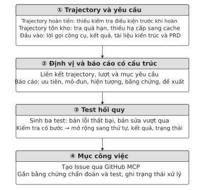
>
> Cả ba test đều thất bại trên phiên bản lỗi, chuyển sang phiên bản đã sửa thì đều qua. Một trong số đó chỉ xét xem chương trình có từng gọi công cụ kiểm tra hoàn tiền hay không. Dù chương trình hoàn tiền trước, sau đó mới tra xem đơn có được hoàn không, test này vẫn qua. Bản ghi vận hành còn lưu biên nhận tạo mục công việc qua GitHub MCP, dựa vào đó có thể tìm ra phiếu công việc tương ứng sau khi báo cáo chẩn đoán được giao cho lập trình viên.
>

### Mã làm UI sinh động

Nếu người dùng còn muốn tự tay sửa tài liệu mà Agent đang xử lý, có thể làm giao diện thành một bàn làm việc dùng chung cho cả hai. Lấy lịch trình làm ví dụ: để người dùng thấy trợ lý đang sửa điểm dừng nào, tiếp quản việc sửa, xác nhận hoặc hủy một thay đổi. Nếu người dùng vừa đổi ngày khởi hành thành thứ Sáu, trợ lý ngay sau đó phải tiếp tục làm việc trên lịch trình mới này. Để hai bên dùng chung một trạng thái nhìn thấy được, và thống nhất ai đang điều khiển trường đang sửa, thì mới có thể vừa xem vừa sửa.

Hãy tưởng tượng người dùng cần so sánh ba phương án đi lại. Khi điểm đến chưa chốt, hội thoại tiện cho việc hỏi thêm; chốt điểm đến rồi, để người dùng chọn ngày, điền số người trực tiếp thì tiện hơn trao đổi qua lại vài đoạn chữ; cuối cùng so sánh tổng giá thay đổi theo ngày, một biểu đồ bày ngay sự khác biệt trước mắt. Agent sinh biểu mẫu, biểu đồ hay giao diện ứng dụng tương ứng theo nhiệm vụ, để người dùng trực tiếp điền, chọn, thao tác; đó là UI sinh động (Generative UI).

**Dùng giao thức để mô tả giao diện và tương tác.**

Sinh giao diện có hai hướng hiện thực: xuất mã như HTML, JavaScript rồi giao cho môi trường có kiểm soát chạy; hoặc xuất cấu trúc khai báo để component phía client render. Hướng thứ nhất tiện hiện thực bố cục và tương tác tùy biến, hướng thứ hai giới hạn năng lực khả dụng trong phạm vi component và hành động mà client cung cấp.

A2UI (Agent-to-User Interface) dùng mô tả khai báo. Agent sinh thông điệp có cấu trúc, diễn đạt component, liên kết dữ liệu và cập nhật, còn client dùng component của chính mình để hiển thị giao diện[^ch5-ui-protocols]. Chẳng hạn, ứng dụng có thể cung cấp component thẻ, nút, ô văn bản và bảng, Agent dựa vào đó mô tả một bảng có tiêu đề “Dữ liệu bán hàng”, gồm ba dòng hai cột. Danh mục component còn có thể mở rộng thêm các năng lực như biểu đồ và bản đồ.

AG-UI (Agent–User Interaction) lo tương tác sự kiện giữa Agent và frontend, truyền thông điệp, lời gọi công cụ và cập nhật trạng thái, cũng có thể mang các thông điệp giao diện của A2UI. Kết hợp hai thứ, A2UI mô tả nội dung cần hiển thị, AG-UI nối thực thi phía backend với tương tác phía frontend.

Client có thể nhận dần các cập nhật giao diện và hiển thị trên Web, thiết bị di động hoặc desktop qua renderer tương thích. Client kiểm tra thuộc tính component, liên kết dữ liệu và yêu cầu hành động, máy chủ tiếp tục kiểm tra quyền nghiệp vụ; liên kết, văn bản định dạng và truy cập dữ liệu trong component cũng cần quy tắc xử lý riêng.

Khi sinh mã trực tiếp, thì phải kiểm tra phụ thuộc, truy cập tài nguyên và quyền thực thi, đồng thời cách ly giao diện được sinh khỏi trạng thái nhạy cảm của ứng dụng chủ. Prompt injection trong tài liệu bên ngoài có thể ảnh hưởng đến quá trình sinh, còn rủi ro chạy script trong trình duyệt phụ thuộc vào cách nạp trang và cách cách ly.

**Bàn giao thành quả tương tác bằng HTML.**

**Với các sản phẩm nghiên cứu có dữ liệu, phần trình diễn và kết quả cập nhật liên tục, tác giả ưu tiên dùng trang web HTML.** Báo cáo Markdown tuyến tính dài buộc người đọc liên tục lật tìm ngữ cảnh; trang web tương tác có thể đặt giải thích, dữ liệu và phần trình diễn vào cùng một lối vào: người đọc xem biểu đồ, lọc các mẫu quan tâm, mở chi tiết của một kết quả, rồi thao tác phần trình diễn để hiểu hành vi của hệ thống. Agent cũng có thể cập nhật trang theo tiến độ nhiệm vụ, để trang liên tục ghi lại thành quả và bằng chứng hiện tại.

Lấy thực tiễn nghiên cứu của tác giả làm ví dụ: mỗi dự án nghiên cứu có một trang web tương tác, vừa là tài liệu sống trong quá trình nghiên cứu, vừa là sản phẩm bàn giao cuối cùng, và Agent liên tục bổ sung nội dung theo tiến độ thí nghiệm. Các trang này chủ yếu đảm nhận ba việc.

Một là **truy vết dữ liệu thí nghiệm**. Trang liên kết mẫu, prompt, câu trả lời của mô hình và điểm số, hỗ trợ kiểm tra từng mục. Chẳng hạn, khi một loại câu trả lời luôn bị điểm thấp, có thể lần theo bản ghi chấm điểm để tìm lại câu trả lời gốc và prompt.

Hai là **giám sát chỉ số huấn luyện**. Tác giả gọi các tín hiệu phản ánh trạng thái nội tại của quá trình huấn luyện là “chỉ số nội khoa”: loss huấn luyện và loss kiểm định, chuẩn gradient, tốc độ học, cùng với reward, KL divergence và entropy của policy trong học tăng cường. Mô hình ngôn ngữ còn có thể dùng perplexity để đo khả năng dự đoán của nó với một chuỗi văn bản cho trước. Giống như các chỉ số sinh lý trong khám sức khỏe, những đường cong này đôi khi làm lộ vấn đề sớm hơn điểm nhiệm vụ cuối cùng. Xem chúng cùng với độ chính xác nhiệm vụ giúp định vị giai đoạn xảy ra tình trạng không hội tụ, gradient bất thường và thoái hóa huấn luyện.

Ba là **trình bày nguyên lý vận hành**. Khi giới thiệu vài mô-đun phối hợp với nhau ra sao, trang có thể cho người đọc thay đổi một đầu vào, xem trạng thái trung gian, rồi đối chiếu sự thay đổi của đầu ra với bản ghi thí nghiệm.

Công việc kéo dài vài giờ, người dùng tranh thủ tiếp quản thế nào? Khi dùng Coding Agent, tác giả muốn một câu lệnh nói miệng được gửi chính xác tới Agent đang phụ trách, muốn xem thành quả thì mở ra lúc nào cũng được, có phiên bản mới hoặc gặp vấn đề cần tác giả quyết định thì mới được nhắc. Chẳng hạn, hai bản báo cáo đang được sinh cùng lúc. Người dùng mở báo cáo bán hàng, chỉ vào biểu đồ thứ hai và nói “vẽ lại biểu đồ này theo doanh thu thuần”. Giao diện nên gửi kèm mã định danh của báo cáo và biểu đồ hiện tại cùng với chỉ dẫn. Biểu đồ sửa xong, thông báo có thể mở thẳng bản mới; nếu “doanh thu thuần” có hai cách tính dùng được, trợ lý nên liệt kê hai cách tính đó cho người dùng chọn.

**Làm rõ ý định của người dùng.**

Khi người dùng nói “tôi muốn đặt một vé máy bay đi Bắc Kinh”, điểm đến đã rõ, còn thành phố khởi hành, ngày đi và một chiều hay khứ hồi vẫn cần bổ sung. Agent có thể hỏi gộp trong một lượt hội thoại, cũng có thể sinh biểu mẫu để các điều kiện liên quan hiện trên cùng một trang.

Các điều khiển trong biểu mẫu ứng với các loại thông tin khác nhau: ô văn bản thu đầu vào mở, menu thả xuống và nút chọn một liệt kê các lựa chọn, ô đánh dấu hỗ trợ chọn nhiều, bộ chọn ngày giúp điền thời gian. JavaScript có thể diễn đạt quan hệ phụ thuộc, chẳng hạn chọn “khứ hồi” thì hiện ngày về, và kiểm tra ngày về không sớm hơn ngày đi. Khi lựa chọn thay đổi, còn phải đồng thời xóa hoặc bỏ qua các trường đã mất hiệu lực.

Hình 5-8 lấy từ một lần chạy của thí nghiệm dưới đây. Lần theo lượt gửi này: bốn trường trình duyệt trả về không có điểm đến, vậy mô hình biết hành khách muốn đi Bắc Kinh từ đâu?

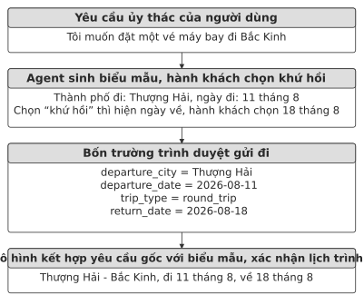

> **Thí nghiệm 5-12 ★★: Hệ thống làm rõ ý định bằng biểu mẫu động**
>
> Thí nghiệm này xuất phát từ câu “tôi muốn đặt một vé máy bay đi Bắc Kinh”, để mô hình sinh biểu mẫu HTML: thành phố khởi hành dùng ô văn bản, ngày khởi hành dùng bộ chọn ngày, loại hành trình cho lựa chọn một chiều và khứ hồi, ngày về hiện ra khi chọn khứ hồi.
>
> Chương trình gửi lại cho mô hình cả yêu cầu ủy thác ban đầu lẫn dữ liệu biểu mẫu. Nếu chỉ giữ các trường được gửi, thì dù mọi điều khiển đều điền đúng vẫn thiếu điểm đến.
>
> Dùng chính biểu mẫu đó thử thêm một bước: điền ngày về xong lại chuyển sang một chiều. Trang ẩn ô nhập ngày về, nhưng JSON được gửi lại giữ cả lựa chọn một chiều lẫn ngày về 18 tháng 8. Khi chuyển sang một chiều, client còn phải xóa ngày về đã mất hiệu lực.

[^ch5-ui-protocols]: Tài liệu chính thức của A2UI và *AG-UI Overview*, lần lượt giới thiệu mô tả giao diện khai báo và tương tác sự kiện giữa Agent và frontend.

**Sinh truy vấn SQL.**

Người dùng có thể đưa ra truy vấn cơ sở dữ liệu bằng ngôn ngữ tự nhiên, Agent dựa vào cấu trúc bảng và cách tính nghiệp vụ để sinh SQL. **Khi hiển thị bảng kết quả truy vấn đầy đủ, tác giả ưu tiên dùng chế độ Artifact, để kết quả đi thẳng từ cơ sở dữ liệu vào giao diện.** Để mô hình đọc rồi thuật lại từng dòng của một bảng lớn sẽ làm tăng lượng token và thời gian chờ, lại thêm lỗi chép nhầm. SQL được lưu thành một sản phẩm truy vấn kiểm tra được; khi cần phân tích nguyên nhân hoặc tổng kết xu hướng, mới đưa các kết quả tổng hợp cần thiết cho mô hình.

Trong Hình 5-9, người dùng muốn xem số nhân viên đang làm việc của từng phòng ban, trang có thể hiển thị thẳng bảng thống kê do cơ sở dữ liệu trả về. Nếu người dùng hỏi tiếp “phòng Marketing nhiều hơn phòng R&D mấy người”, mô hình chỉ cần lấy số 9 và 5 trong bảng là tính ra chênh 4 người. Nếu hỏi thêm “tháng trước cũng chênh từng ấy à”, bảng trước mắt không đủ dùng nữa, phải truy vấn lại theo ngày thống kê của tháng trước.

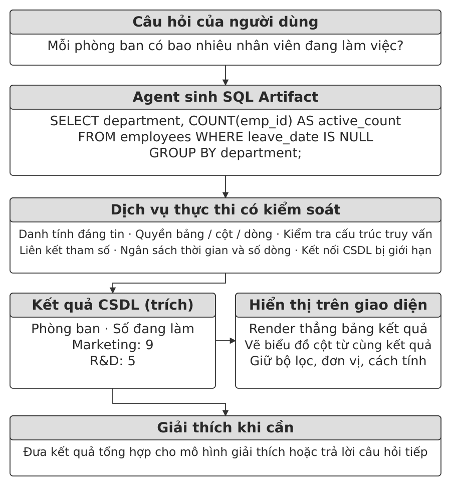

Dịch vụ thực thi dựa vào danh tính đáng tin để xác định bảng, cột và dòng được truy cập, dùng tài khoản cơ sở dữ liệu bị giới hạn, và kiểm tra cấu trúc SQL cùng loại thao tác. Tình huống truy vấn có thể giới hạn ở các truy vấn chỉ đọc đã được duyệt, kiểm soát việc gọi hàm, ngân sách thời gian, số dòng trả về và phạm vi dữ liệu; giá trị người dùng nhập được truyền qua liên kết tham số.

Agent còn có thể sinh sản phẩm trực quan hóa, chẳng hạn hiển thị kết quả tổng hợp theo phòng ban thành biểu đồ cột. Dịch vụ thực thi giao kết quả truy vấn cho môi trường trực quan hóa có kiểm soát, giao diện chỉ hiển thị dữ liệu và tương tác được phép.

> **Thí nghiệm 5-13 ★★: Agent ERP tương tác bằng ngôn ngữ tự nhiên**
>
> Thí nghiệm này lấy việc tra cứu nhân viên và lương trong ERP (hoạch định nguồn lực doanh nghiệp) làm ví dụ, để học cách sinh SQL từ câu hỏi nghiệp vụ và để kết quả từ cơ sở dữ liệu đi thẳng vào trang. Trong PostgreSQL tạo hai bảng: bảng nhân viên gồm ID nhân viên, họ tên, phòng ban, cấp bậc, ngày vào làm và ngày nghỉ việc, ngày nghỉ việc để trống nghĩa là đang làm việc; bảng lương gồm ID nhân viên, ngày trả lương và mức lương, mỗi nhân viên mỗi tháng một bản ghi.
>
> Agent dựa vào hai bảng này để xử lý mười câu hỏi sau:
>
> 1. Trung bình mỗi nhân viên làm việc bao lâu?
> 2. Mỗi phòng ban có bao nhiêu nhân viên đang làm việc?
> 3. Phòng ban nào có cấp bậc trung bình của nhân viên cao nhất?
> 4. Mỗi phòng ban năm nay và năm ngoái mỗi năm tuyển mới bao nhiêu người?
> 5. Lương trung bình của phòng A từ tháng 3 năm kia đến tháng 5 năm ngoái?
> 6. Năm ngoái lương trung bình của phòng A và phòng B bên nào cao hơn?
> 7. Lương trung bình của nhân viên mỗi cấp bậc trong năm nay?
> 8. Lương trung bình tháng gần nhất của nhân viên vào làm dưới một năm, từ một đến hai năm, từ hai đến ba năm?
> 9. 10 nhân viên có mức tăng lương lớn nhất từ năm ngoái đến năm nay?
> 10. Có nợ lương không (tháng nào đó đang làm việc nhưng không được trả lương)?
>
> Trước khi truy vấn cần làm rõ cách tính. Chẳng hạn, thời gian làm việc của nhân viên đang làm tính đến ngày mốc truy vấn, của nhân viên đã nghỉ tính đến ngày nghỉ việc; “lương trung bình” cần xác định tính theo bản ghi trả lương hay theo đầu nhân viên; xếp hạng tăng lương phải xử lý những nhân viên năm ngoái không có bản ghi.
>
> Lần chạy này sinh và thực thi mười câu SQL, kết quả đều khớp với phép tính tham chiếu độc lập, sau đó trình duyệt render bảng trực tiếp. Mô hình nhận cấu trúc bảng, nhiệm vụ và phản hồi thực thi cần thiết, còn dữ liệu từng dòng của cơ sở dữ liệu được ứng dụng chuyển thẳng tới giao diện.

**Sinh phần mềm động.**

Agent có thể bắt đầu từ yêu cầu để sinh giao diện và logic tương tác, rồi tiếp tục sửa theo thao tác của người dùng. “Imagine with Claude”, bản xem trước nghiên cứu tạm thời Anthropic ra mắt năm 2025, minh họa kiểu tương tác này: người dùng khám phá giao diện, mô hình liên tục sinh trải nghiệm phần mềm tương ứng[^ch5-imagine].

**Với sản phẩm thực tế, tác giả kỳ vọng nhiều hơn vào việc tùy biến trên framework sẵn có.** Liên tục sinh cả ứng dụng từ con số không sẽ phải trả đi trả lại chi phí sinh, render và xác minh; giữ một framework ổn định rồi mở ra phần giao diện và luồng mà người dùng quan tâm thì đem lại trải nghiệm cá nhân hóa đáng tin cậy nhanh hơn. Người dùng yêu cầu “đổi nút thành màu xanh lam”, “thêm menu tắt ở thanh bên”, “đổi sang phông chữ dễ đọc hơn”, Agent định vị component liên quan, sửa mã, rồi kiểm tra hiệu quả qua bản xem trước. Framework nền cung cấp cấu trúc trang và giao diện nghiệp vụ ổn định, còn phạm vi tùy biến có thể mở rộng dần từ màu sắc, phông chữ sang bố cục và component.

HMR (Hot Module Replacement, thay thế module nóng) của môi trường phát triển có thể cập nhật các module frontend bị ảnh hưởng sau khi mã thay đổi. Trạng thái có được giữ hay không phụ thuộc vào cách tích hợp framework, ranh giới cập nhật và loại thay đổi; khi cần tải lại toàn trang, ứng dụng còn phải lưu các trạng thái cần thiết. Chế độ reload trong chế độ phát triển của FastAPI thì nạp lại chương trình phía máy chủ; hai cơ chế lần lượt tác động lên module frontend và tiến trình backend[^ch5-hmr].

> **Thí nghiệm 5-14 ★★: Hệ thống tùy biến giao diện qua hội thoại**
>
> Thí nghiệm này xây dựng một ứng dụng chat gồm frontend React và backend FastAPI, bật HMR cho frontend và reload cho backend trong môi trường phát triển. Mô hình sửa màu sắc, phông chữ và tiêu đề theo ba lượt yêu cầu liên tiếp, trình duyệt kiểm tra giao diện thực tế sau mỗi lần sửa.
>
> Lần chạy này ghi lại các sự kiện HMR của Vite, cả ba lượt sửa đều không xảy ra điều hướng toàn trang, trạng thái chat hiện có được giữ nguyên, và bản build cuối cùng thành công.

[^ch5-imagine]: Anthropic, *Introducing Claude Sonnet 4.5*, giới thiệu bản xem trước nghiên cứu tạm thời Imagine with Claude ra mắt cùng mô hình.
[^ch5-hmr]: *Vite HMR API* và *FastAPI CLI*, lần lượt giới thiệu cập nhật nóng ở frontend và tự động nạp lại máy chủ phát triển.

**Để ranh giới quyền độc lập với mã nghiệp vụ động.**

**Mã nghiệp vụ càng dễ bị Agent viết lại động, ranh giới quyền cuối cùng càng nên hạ xuống tầng truy cập dữ liệu ổn định.** Ứng dụng truyền thống viết việc kiểm tra quyền trong mã nghiệp vụ đã được review; khi mã được sinh ra liên tục thay đổi, một đường đi mới nào đó có thể bỏ sót đúng bước kiểm tra ấy. Để mọi lần đọc ghi đều đi qua một dịch vụ truy cập dữ liệu độc lập thì mới giữ được ràng buộc quyền. Chẳng hạn, ứng dụng tuyển dụng có thể sinh động danh sách ứng viên và biểu mẫu thao tác, còn ứng viên thuộc tổ chức nào, nhân viên tuyển dụng được cập nhật những trường nào, thì do dịch vụ truy cập dữ liệu đáng tin liên tục kiểm tra.

Mục tiêu thiết kế ở đây là: **ngay cả khi mã được sinh ra có lỗi, tầng truy cập dữ liệu đáng tin vẫn cưỡng chế được ràng buộc quyền.** Điều này nối tiếp guardrails tầng dữ liệu ở Chương 1: đặt các quy tắc bắt buộc tuân thủ ở vị trí mà mọi thao tác liên quan đều phải đi qua. Chính sách bảo mật theo dòng của cơ sở dữ liệu có thể giới hạn việc truy cập bản ghi, ràng buộc và bộ kiểm tra xét trạng thái hợp lệ, còn view có kiểm soát, stored procedure hoặc dịch vụ dữ liệu cung cấp các thao tác được phép. Tầng ứng dụng có thể kiểm tra trước và giải thích cho người dùng, nhưng việc đọc ghi cuối cùng vẫn do dịch vụ dữ liệu đáng tin và quyền cơ sở dữ liệu kiểm soát.

Mỗi thao tác còn cần một **ngữ cảnh truy cập** (access context) đáng tin, gồm người dùng, tenant, vai trò hoặc danh tính Agent. Dịch vụ xác thực và môi trường chạy đáng tin lo thiết lập và gắn danh tính, dịch vụ dữ liệu dựa vào đó để cấp quyền. Mã động nhận được giao diện bị giới hạn đủ để hoàn thành nhiệm vụ, còn thông tin xác thực và quyền quản lý chính sách do thành phần độc lập giữ. Mọi kết nối cơ sở dữ liệu, truy vấn phụ trợ và xử lý nền đều phải tuân theo cùng một phạm vi truy cập.

Chẳng hạn, bảo mật theo dòng của PostgreSQL cần dùng kết hợp với cấu hình vai trò cơ sở dữ liệu. Kết nối của ứng dụng dùng một vai trò chịu ràng buộc của chính sách, và tài khoản ứng dụng không có quyền sửa chính sách truy cập[^ch5-rls]. Quy tắc và cơ chế gắn danh tính được review độc lập, còn giao diện nghiệp vụ có thể liên tục thay đổi trong phạm vi đó.

Quyền hạn và toàn vẹn dữ liệu còn đảm nhận những trách nhiệm khác nhau. Sau khi nhân viên tuyển dụng có quyền sửa hồ sơ ứng viên, máy trạng thái tiếp tục kiểm tra xem có được chuyển từ “đã sàng lọc” sang “đã phỏng vấn” không; bộ kiểm tra lương đọc vị trí tuyển dụng liên quan, xét mức lương mong muốn có nằm trong khoảng của vị trí không; kiểm tra tham chiếu xác nhận quan hệ giữa vị trí và ứng viên còn hợp lệ.

> **Thí nghiệm 5-15 ★★★: Đối tượng dữ liệu có quyền nhúng sẵn cho phần mềm sinh động**
>
> Thí nghiệm này cung cấp một bản mẫu lưu trữ đối tượng bằng Python trên PostgreSQL, đặt quy tắc quyền, bộ kiểm tra, quan hệ giữa đối tượng và khai báo phản ứng tiếp theo ngay trong kiểu dữ liệu. Khi đọc thì kiểm tra quyền truy cập; khi tạo và cập nhật thì chạy kiểm tra quyền và kiểm tra nghiệp vụ trước, kiểm tra quan hệ tham chiếu, rồi mới lưu bền, sau đó đưa các phản ứng tiếp theo đã khai báo vào hàng đợi và giới hạn độ sâu của chuỗi phản ứng.
>
> Ví dụ tuyển dụng gồm các đối tượng vị trí, ứng viên, phỏng vấn và đánh giá. Ứng viên lần lượt trải qua nộp đơn, sàng lọc, phỏng vấn, nhận thư mời và được tuyển, ở các giai đoạn liên quan cũng có thể chuyển sang trạng thái từ chối; khoảng lương lấy từ vị trí liên quan. Ví dụ đặt các kiểm tra cho cập nhật trạng thái bình thường, chuyển trạng thái không hợp lệ, lương vượt khoảng của vị trí và truy cập từ tenant khác, giúp người đọc hiểu cấp quyền và kiểm tra nghiệp vụ mỗi bên xử lý vấn đề gì.
>
> Bản mẫu dùng `AccessContext` để diễn đạt các thuộc tính người dùng, vai trò và tổ chức; script giảng dạy dựng trực tiếp các ngữ cảnh này để mô phỏng các danh tính khác nhau. Khi triển khai, cổng xác thực thiết lập ngữ cảnh, và kho đối tượng cùng mã được sinh ra nằm ở hai phía của một ranh giới dịch vụ hoặc ranh giới quyền rõ ràng.

[^ch5-rls]: PostgreSQL, *Row Security Policies*, giới thiệu việc cấu hình chính sách bảo mật theo dòng theo vai trò và thao tác, cùng phạm vi áp dụng của chúng.

### Mã tạo ra mã: Agent tự khởi tạo

Năng lực sinh mã cũng có thể dùng để phát triển chính Agent. Bên tạo (creator) nhận yêu cầu nhiệm vụ, sinh hoặc sửa prompt, công cụ và vòng lặp vận hành của Agent mới, rồi kiểm tra sản phẩm qua test và tương tác thực tế. Hình 5-10 thể hiện vòng tự khởi tạo này: bản hiện thực sẵn có cung cấp điểm xuất phát, phản hồi từ nhiệm vụ thúc đẩy việc sửa, kết quả xác minh quyết định những thay đổi nào được giữ lại.

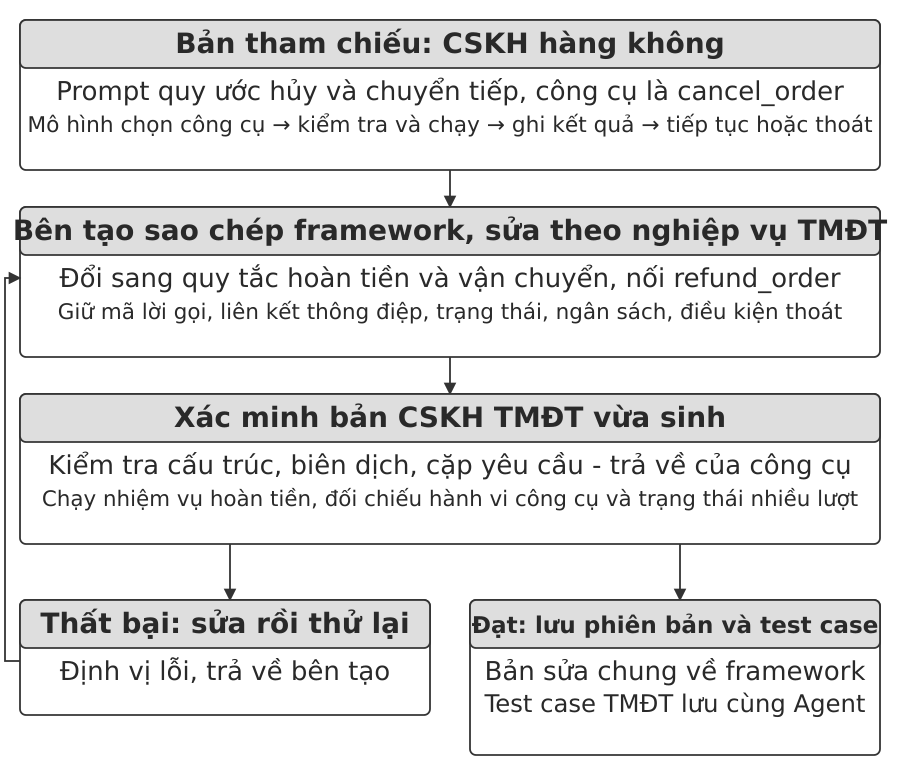

Làm sao phân biệt một lần sửa đã cải thiện năng lực chung, hay chỉ tình cờ hợp với những đề vừa gặp? Hãy giữ lại một nhiệm vụ không đưa cho bên tạo. Chẳng hạn, dùng dữ liệu của một cửa hàng để phát triển Agent theo dõi giá, rồi đưa cho nó dữ liệu mẫu của một cửa hàng khác, đồng thời chạy lại nhiệm vụ cũ.

**Duy trì môi trường chạy của Agent.**

Agent mới chạy được nhờ cấu hình, thông tin xác thực, trạng thái phiên, dịch vụ và sandbox. Lệnh `doctor` của OpenClaw là một ví dụ về công cụ bảo trì: nó kiểm tra các vấn đề như di chuyển cấu hình cũ, trạng thái thông tin xác thực OAuth, khóa phiên, cài đặt plugin, tình trạng gateway và image của sandbox, rồi đưa ra đề xuất sửa hoặc thực hiện việc sửa tương ứng[^ch5-doctor].

Những kiểm tra tất định này có thể làm nền cho quy trình tự bảo trì. Quy tắc phát hiện bao quát các sự cố đã biết, hành động sửa có đầu vào và kết quả dự kiến rõ ràng. Khi thiết kế tiếp quy trình chẩn đoán cho Agent, có thể đưa các vấn đề chưa giải quyết cùng log, cấu hình và kết quả kiểm tra cho mô hình, để nó nói rõ định sửa cấu hình nào, sửa thế nào; tầng thực thi kiểm tra quyền và phạm vi sửa, rồi chạy kiểm tra sức khỏe và test hồi quy. Ảnh chụp cấu hình, bản ghi thay đổi và lối quay lui giúp hệ thống phục hồi hoạt động khi sửa thất bại.

**Dùng bản hiện thực tham chiếu để mang kinh nghiệm kỹ thuật.**

Tạo một Agent chuyên dụng liên quan cùng lúc đến logic miền và hạ tầng chung. Khi kiểm tra kết quả được sinh ra, có thể bắt đầu từ bốn loại vấn đề:

1. **Ngữ cảnh và vòng lặp vận hành.** Giữ liên kết giữa vai trò, mã định danh lời gọi công cụ và kết quả công cụ; kiểm tra trạng thái nhiều lượt, điều kiện kết thúc, ngân sách và khôi phục khi có ngoại lệ. Thông điệp có cấu trúc giúp duy trì quan hệ giao thức; tiền tố ổn định tạo điều kiện cho prompt caching.
2. **Giao diện công cụ.** Mô tả công cụ nói rõ công dụng, điều kiện áp dụng và ranh giới sử dụng; tham số gồm kiểu, ý nghĩa và ví dụ cụ thể. Tầng thực thi tiếp tục kiểm tra tham số, danh tính và trạng thái nghiệp vụ.
3. **Chọn mô hình và API.** Mô hình dễ dùng theo những mô hình và giao diện cũ xuất hiện nhiều trong dữ liệu huấn luyện; mã viết trôi chảy vẫn có thể chọn công nghệ lỗi thời. Hãy cung cấp cho bên tạo tài liệu chọn lựa được duy trì cập nhật, hoặc để nó tra tài liệu chính thức, đối chiếu năng lực mô hình, phiên bản giao diện và cách gọi. Lời gọi thật sau khi sinh kiểm chứng xem cấu hình có dùng được không.
4. **Phụ thuộc và tương thích hệ sinh thái.** Kiểm tra tình trạng bảo trì, phiên bản và thay đổi giao diện của thư viện, dùng việc cài đặt phụ thuộc, kiểm tra biên dịch và test để xác minh chương trình sau khi ghép.

**Khi tạo Agent chuyên dụng, tác giả ưu tiên để bên tạo sao chép một bản hiện thực tham chiếu đã được kiểm chứng, rồi mới sửa theo miền.** Prompt khó liệt kê hết mọi chi tiết trong giao thức thông điệp, quản lý trạng thái và cơ chế khôi phục, còn mã tham chiếu thì mang thẳng những kinh nghiệm kỹ thuật ấy vào hệ thống mới. Mô hình dù giỏi lập trình vẫn có thể sót những điều kiện vận hành mà mô tả nhiệm vụ không nói rõ; dùng lại framework giảm được những sai sót lặp lại kiểu này. Bên tạo sao chép framework nền phù hợp, chỉnh system prompt cho hợp với vai trò mới, thêm bớt công cụ miền, sửa logic nghiệp vụ và bổ sung test tương ứng. Xử lý thông điệp, liên kết lời gọi, quản lý trạng thái và đường thoát do framework cung cấp, còn phần thay đổi theo miền được xác minh bằng các test case mới.

Nếu dùng mẫu nhanh hơn nhiều, làm sao loại trừ cách giải thích “làm thiếu vài chức năng”? Dưới đây cho hai nhóm bên tạo bàn giao cùng một loại Agent, rồi đưa qua cùng một bộ kiểm tra.

> **Thí nghiệm 5-16 ★★★: Phát triển một Agent biết tạo ra Agent**
>
> Hãy để cùng một mô hình bên tạo xây dựng một Agent thẩm định phát hành: đọc một loạt bản ghi kiểm tra triển khai, chỉ cần có một mục bắt buộc không đạt là từ chối phát hành và chỉ ra căn cứ. Khi tạo từ con số không, mô hình phải viết vòng lặp vận hành, giao thức công cụ, công cụ miền, lối vào dòng lệnh và test. Hướng dùng mẫu thì sao chép trước một Agent đã biết kiểm tra bản ghi có cấu trúc, mô hình chỉ cần điền đặc tả miền. Chẳng hạn, trạng thái nằm ở trường nào, những giá trị nào nghĩa là đạt? Script tạo dựa vào đặc tả để sinh system prompt, định nghĩa công cụ và tài liệu hướng dẫn. Công cụ Python sẵn có đọc đặc tả để thực hiện kiểm tra. Cả hai hướng đều thể hiện metaprogramming: dùng chương trình để sinh ra hoặc sửa các chương trình khác.
>
> Trong Hình 5-11, hai hướng gặp nhau ở cùng một bộ điều kiện nghiệm thu.
>
> 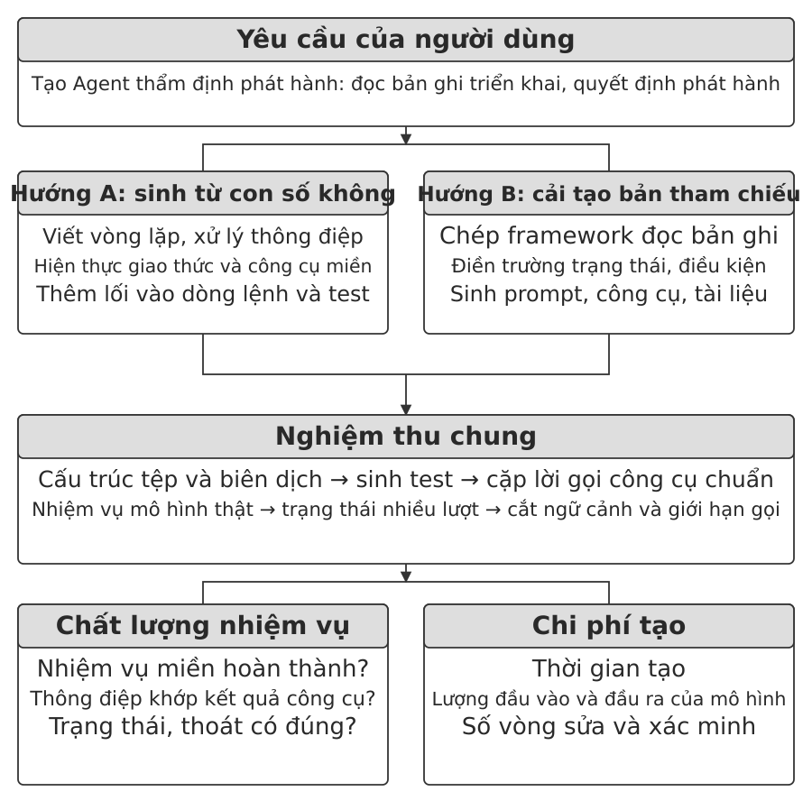
>
> Hai hướng dùng cùng yêu cầu nhiệm vụ và điều kiện nghiệm thu. Trước hết kiểm tra cấu trúc sản phẩm, biên dịch và test, rồi kiểm tra liên kết giữa lời gọi công cụ và kết quả trong thông điệp chuẩn, cuối cùng chạy nhiệm vụ với mô hình thật và tương tác nhiều lượt, xác minh việc cắt tỉa ngữ cảnh, quản lý trạng thái và giới hạn số lần gọi.
>
> Trong bản đối chiếu đã lưu với Kimi K3, mỗi nhóm đều qua 39/39 mục kiểm tra tất định, cũng đều qua nhiệm vụ với mô hình thật và kiểm tra trạng thái nhiều lượt. Hướng dùng mẫu khi tạo tốn 1.181 token, khoảng 25 giây; hướng làm từ con số không tốn 381.814 token, khoảng 90 phút.
>

[^ch5-doctor]: OpenClaw, Doctor, giới thiệu các chức năng kiểm tra cấu hình và trạng thái, di chuyển và sửa chữa.

## Tóm tắt chương

**Coding Agent trưởng thành sớm còn vì một lý do dễ bị bỏ qua: kỹ thuật phần mềm đã có sẵn hệ thống kiểu, bộ test, quản lý phiên bản và công cụ gỡ lỗi.** Mã sửa sai thì test thường chỉ ra được bộ đầu vào nào cho kết quả ngoài dự kiến; đổi cách sửa khác, vẫn có thể thử lại với đầu vào cũ. Muốn áp dụng bộ kinh nghiệm này cho nhiệm vụ khác, trước hết hãy hỏi ba câu cụ thể: phát hiện lỗi bằng cách nào, khôi phục về trạng thái đã biết bằng cách nào, và khi nào cần dừng lại nhờ người tiếp quản? Chẳng hạn, lời gọi hoàn tiền bị đứt giữa chừng thì Harness nên tra sổ sách trước rồi mới quyết định có thử lại không, nếu không một lần khôi phục sự cố có thể biến thành lần hoàn tiền thứ hai.

Mã còn lưu một lần phán đoán thành thứ dùng lại được nhiều lần. Phép liệt kê trong bài toán và ràng buộc trong bài logic có thể giao cho chương trình kiểm tra từng mục; quy tắc hoàn tiền có thể viết thành bước kiểm tra ở lối vào thực thi, để máy chủ đọc trạng thái thật trong đơn rồi mới quyết định cho qua hay không. Định dạng log thay đổi thì có thể sửa bộ phân tích, rồi giữ lại các mẫu gây lỗi lần này làm test hồi quy. Cả ba trường hợp đều chạy được mã, nhưng tiêu chí đánh giá khác nhau: lời giải có thỏa điều kiện đề bài không, hoàn tiền có đúng chính sách không, bộ phân tích mới có đọc ra được các trường trước đó bị sót không.

Nếu thứ cần giao là tài liệu, video hay mô hình hình học, còn phải kiểm tra hiệu quả render, âm thanh - hình ảnh có đồng bộ không hay kích thước có chính xác không, và bố trí người thẩm định xem qua sản phẩm thực tế. Nếu thứ cần giao là biểu mẫu, truy vấn hay trực quan hóa, ngoài việc xem người dùng có đọc hiểu và thao tác được không, còn phải kiểm tra dịch vụ thực thi phía sau có lấy dữ liệu đúng theo quyền không. Nếu mã sinh ra một Agent khác, tác giả nghiêng về việc dùng lại framework đã được kiểm chứng trước, sinh công cụ miền và logic nghiệp vụ, rồi kiểm tra giao thức gọi, trạng thái qua các lượt và kết quả nhiệm vụ thực tế. Các công cụ, bộ kiểm tra và test tích lũy được theo cách này, nhiệm vụ lần sau có thể dùng tiếp.

Mã giúp nhiệm vụ chạy lại được nhiều lần, nhưng môi trường chưa chắc đợi nó chạy xong. Một truy vấn còn đang chạy, người dùng có thể đã đổi ý. Chương 6 bàn về cách những thay đổi như vậy đi vào một lần tương tác đang diễn ra.

## Câu hỏi suy ngẫm

1. ★★ Hãy thiết kế sandbox cho một Coding Agent cần đọc tệp dự án, cài phụ thuộc và chạy test. Bạn sẽ cấu hình quyền về tệp, mạng, tiến trình và tài nguyên ra sao? Khi nhiệm vụ cần mở rộng quyền, làm thế nào để diễn đạt yêu cầu, kiểm tra phạm vi và lưu lại bản ghi?
2. ★★★ Khi bên tạo liên tục sinh và sửa nhiều thế hệ Agent, lỗi framework và lỗi miền có thể dần tích tụ. Làm thế nào dùng phiên bản tham chiếu, test hồi quy, đánh giá hành vi và cơ chế quay lui để theo dõi sự thay đổi này?
3. ★★ Thay đổi định dạng log có thể đến từ một lần nâng cấp bình thường, cũng có thể đến từ lỗi của bên sinh log. Hệ thống phân tích thích ứng nên giữ lại những bằng chứng nào, và dựa vào điều kiện nào để quyết định thêm bộ phân tích mới, báo bất thường hay tạm dừng xử lý?
4. ★★ Trong vòng lặp người đề xuất - người thẩm định, người thẩm định cho rằng mật độ thông tin của trang là hợp lý, còn người dùng lại thấy chật chội. Làm thế nào chuyển sở thích của người dùng thành ví dụ, tiêu chí chấm điểm và phản hồi tương tác, rồi kiểm tra các lần sửa sau có đáp ứng yêu cầu không?
5. ★★ Coding Agent có thể cập nhật cơ sở tri thức, tài liệu kiến trúc và chỉ dẫn dự án, cũng có thể cố định chuỗi thao tác thành mã. Làm thế nào nhận ra các quy tắc thừa hoặc lỗi thời, và thiết kế phạm vi áp dụng, phương pháp xác minh và điều kiện loại bỏ cho quy tắc? Để đi từ một lần sửa thành công đến sự tiến hóa liên tục bàn ở Chương 9, còn cần những cơ chế tích lũy và đánh giá nào?
6. ★ Đội ngũ thuận lợi cho cộng tác từ xa thường cũng giúp Agent dễ lấy thông tin công việc. Hãy rà soát yêu cầu, kiến trúc, bản ghi quyết định và tiêu chuẩn nghiệm thu của một dự án bạn quen thuộc, liệt kê những tài liệu cần bổ sung nhất, và nói rõ chúng giúp Agent hoàn thành những nhiệm vụ cụ thể nào.
7. ★★★ Với một Agent cùng lúc truy cập dữ liệu riêng tư, xử lý nội dung không đáng tin, giao tiếp ra bên ngoài và dùng bộ nhớ lâu dài, cần sắp xếp việc cấp quyền theo danh tính, đánh dấu nguồn, kiểm tra luồng dữ liệu và thẩm định việc ghi bộ nhớ như thế nào? Hãy dùng một luồng nghiệp vụ bình thường để chỉ ra vị trí của các bước kiểm tra này.
8. ★★ Trong chế độ Artifact với SQL và HTML, mô hình sinh sản phẩm, dịch vụ thực thi xử lý truy vấn hoặc render, giao diện hiển thị thẳng kết quả. Những thông tin nào nên giao lại cho mô hình giải thích? Làm thế nào kiểm tra quyền truy vấn, ngân sách tài nguyên, cách ly trang và tính nhất quán của kết quả hiển thị?
9. ★★ Công cụ kiểm tra quy tắc dựa trên trạng thái nghiệp vụ trong cơ sở dữ liệu, còn mô tả tham số giúp mô hình chuẩn bị lời gọi. Hãy lấy việc hủy đặt chỗ làm ví dụ, nói rõ chính sách bằng ngôn ngữ tự nhiên, ví dụ tham số, kiểm tra ở tầng thực thi và test biên mỗi thứ đảm nhận trách nhiệm gì; khi chính sách thay đổi, những nội dung nào cần cập nhật đồng thời?
