# Tương tác: mở rộng không gian quan sát và không gian hành động

**Khi mô hình nền đã cố định, tổ chức lại hoặc mở rộng giao diện quan sát và giao diện hành động thường là một trong những biện pháp kỹ thuật hiệu quả nhất để nâng cao kết quả nhiệm vụ của Agent.** Ở các chương trước, Agent thường đợi người dùng nói xong rồi mới tra cứu tài liệu, gọi công cụ và đưa ra câu trả lời. Trong lúc nó chờ kết quả công cụ, người dùng và môi trường bên ngoài vẫn tiếp tục thay đổi.

Người dùng nhờ trợ lý đổi vé máy bay. Trợ lý đang hỏi tổng đài viên về chuyến bay thì người dùng nhắn thêm "Tôi còn một kiện hành lý cần ký gửi"; tổng đài viên vẫn đang nói, còn giá vé hiển thị trên màn hình cũng có thể thay đổi. Trợ lý cần kịp thời hỏi rõ giá vé đã gồm hành lý ký gửi chưa, đồng thời phải để ý xem mức giá vừa báo còn hiệu lực không. Ở đây có hai câu hỏi thiết kế: trợ lý biết được thay đổi qua những kênh nào, và nó có thể phản ứng vào lúc nào? Chương này trước hết bàn về email và kết quả công cụ đến bất đồng bộ, sau đó xem xét giọng nói liên tục, màn hình biến đổi và phản hồi chuyển động của robot.

## Mở rộng phương thức và thời điểm kích hoạt

**Phương thức** (modality) mô tả hình thức của thông tin và hành động. Agent có thể đọc văn bản, nghe âm thanh, nhìn màn hình và nhận tín hiệu mô-men, cũng có thể xuất ra chữ, tổng hợp giọng nói, nhấp vào giao diện hoặc dẫn động khớp.

**Thời điểm kích hoạt** quan tâm đến việc thông tin đến lúc nào, hành động bắt đầu lúc nào và hệ thống phản hồi lúc nào. Thông tin có thể do Agent chủ động truy vấn, cũng có thể do dịch vụ bên ngoài đẩy tới; công cụ có thể trả kết quả ngay, cũng có thể khởi động tác vụ trước rồi báo hoàn thành sau. Khi một sự kiện mới đến, hệ thống còn phải quyết định có ngắt công việc hiện tại hay không và khôi phục tác vụ bị ngắt như thế nào.

| Chiều | Giao diện thu nhận thông tin và quan sát | Giao diện hành động và thực thi |
|---|---|---|
| Tổ chức nội dung (Chương 2–5) | Ngữ cảnh, bộ nhớ và cơ sở tri thức tổ chức thông tin ra quyết định | Công cụ và mã biểu đạt thao tác có thể thực thi |
| Phương thức (chương này) | Giọng nói, màn hình, cảm biến vật lý | Nói, nhấp chuột, chuyển động khớp |
| Thời điểm (chương này) | Chủ động truy vấn, sự kiện được đẩy tới, đầu vào liên tục | Thực thi vượt lượt, hủy, giành quyền và khôi phục |

Ngữ cảnh chứa thông tin cần cho một lần ra quyết định cụ thể, còn không gian quan sát mô tả phạm vi thông tin mà hệ thống có thể nhận; công cụ cung cấp giao diện cụ thể, còn không gian hành động mô tả phạm vi hành động mà hệ thống được phép thực hiện. Khi mở rộng giao diện, các phạm vi này vẫn bị ràng buộc bởi năng lực thiết bị, tham số, quyền hạn và môi trường chạy.

Nhiều giao diện tool calling tổ chức thông điệp theo lượt: mô hình đề xuất lời gọi, hệ thống bổ sung kết quả công cụ, rồi mới khởi động lượt suy luận tiếp theo. Hệ thống hướng sự kiện phải quản lý các thay đổi bên ngoài trên nền giao thức này. Nếu giao diện hỗ trợ bất đồng bộ nguyên bản, hệ thống có thể nhận yêu cầu mới trong lúc công cụ đang treo và tiếp tục xử lý sau khi kết quả trả về; nếu dùng giao diện đồng bộ, Harness sẽ tổ chức tương tác bằng hàng đợi, handle tác vụ và cơ chế điều phối. Phần sau lần lượt bàn về hai hướng triển khai này.

Nhịp phản hồi giữa các tình huống chênh lệch rất lớn. Bảng dưới đây liệt kê các thang thời gian thường gặp.

| Thang thường gặp | Tình huống | Thay đổi ở phía quan sát | Xử lý ở phía hành động |
|---|---|---|---|
| Giây đến ngày | Bất đồng bộ và hướng sự kiện | Sự kiện bên ngoài đánh thức Agent | Khởi động tác vụ trước, các sự kiện sau báo tiến độ và hoàn thành |
| Vài chục mili giây đến giây | Giọng nói | Nhận âm thanh liên tục | Xuất streaming, xử lý chen lời và dừng phát |
| Dưới một giây đến giây | Computer Use | Màn hình liên tục thay đổi | Lấy lại trạng thái giao diện sau mỗi thao tác |
| Chu kỳ điều khiển cấp mili giây | Điều khiển tầng thấp của robot | Cảm biến phản hồi liên tục | Thực thi từng đoạn hành động ngắn, đáp ứng tín hiệu điều khiển và dừng |

## Bất đồng bộ và hướng sự kiện: khi thế giới chủ động tìm đến

Chương 4 đã giới thiệu các công cụ nhận thức, thực thi và cộng tác; phần này tiếp tục với công cụ kích hoạt sự kiện và công cụ giao tiếp với người dùng. Công cụ kích hoạt sự kiện đưa thay đổi của môi trường vào Agent, còn công cụ giao tiếp cho phép Agent liên lạc với người dùng trong lúc nhiệm vụ đang tiến triển. Harness gắn các đầu vào và đầu ra này với tác vụ đang chạy, tạo thành một vòng lặp sự kiện làm việc liên tục.

### Tại sao cần bất đồng bộ

Lời gọi đồng bộ phải chờ kết quả trả về thì bên gọi mới tiếp tục được luồng hiện tại. Lời gọi bất đồng bộ thì trả về trước một handle tác vụ (định danh dùng để truy vấn và quản lý tác vụ), hoặc hẹn sẽ thông báo khi hoàn thành, để bên gọi xử lý việc khác trong lúc chờ. Nhờ đó hệ thống có thể tổ chức nhiều tác vụ đang chạy, rồi căn cứ vào tài nguyên và quan hệ phụ thuộc để quyết định thao tác nào được chạy song song.

Có thể hình dung Agent như một thư ký quản lý email, điện thoại và khách đến làm việc: trong lúc chờ đối phương hồi âm thì tiếp tục sắp xếp tài liệu, khi có cuộc gọi khẩn thì cất tạm tiến độ hiện tại, gọi xong lại quay về việc cũ. Chuyển sang triển khai kỹ thuật, cần xử lý ba việc:

- **Tách tác vụ dài khỏi tương tác.** Phân tích tệp, gọi điện hay tác vụ build chạy ở nền, người dùng vẫn có thể hỏi tiến độ, bổ sung yêu cầu.
- **Độ ưu tiên của sự kiện.** Lệnh dừng khẩn cấp được đưa ngay vào luồng điều khiển, cập nhật thông thường vào hàng đợi, truy vấn độc lập có thể giao cho một phiên song song.
- **Ngắt và khôi phục.** Lưu trạng thái tác vụ, ghi lại các thao tác đã xảy ra, khi khôi phục thì kiểm tra lại những điều kiện còn hiệu lực.

Bản xem trước nghiên cứu của Claude Duet đưa ra một ví dụ: người dùng hai giờ chiều có cuộc họp và muốn có trước bản tóm tắt về công ty đối tác. Họ có thể để lại một tin nhắn thoại rồi tắt ứng dụng. Công việc chuẩn bị tiếp tục trên đám mây, người dùng có thể mở trang tác vụ xem tiến độ bất cứ lúc nào; khi cần họ bổ sung thông tin hoặc khi bản tóm tắt đã xong, trợ lý mới quay lại cuộc hội thoại chính để báo. Ở đây, tác vụ vẫn tiến triển sau khi người dùng rời đi — đó là thực thi bất đồng bộ. Cuộc gọi full-duplex bàn ở phần sau còn có thêm một yêu cầu khác: khi một bên đang nói, vẫn phải nghe được bên kia chen lời.[^ch6-duet]

API của mô hình cũng có quy ước về thứ tự thông điệp. Có giao diện yêu cầu lời gọi công cụ và kết quả phải ghép cặp đầy đủ mới nhận yêu cầu lượt sau, có giao diện cho phép treo công cụ và nhận cập nhật về sau. Hàm bất đồng bộ trong ứng dụng lo việc sắp xếp chờ đợi và thực thi, còn giao thức của mô hình quy định khi nào được gửi thông điệp.

Trong Hình 6-1, tin nhắn mới và kết quả công cụ đều có thể vào hàng đợi, nhưng chúng đến hàng đợi bằng cách nào thì tùy nguồn. Dịch vụ hỗ trợ đẩy có thể gửi thông báo ngay khi trạng thái thay đổi; dịch vụ chỉ có giao diện truy vấn thì bộ điều hợp phải định kỳ hỏi, phát hiện thay đổi rồi sinh sự kiện. Bộ hẹn giờ hết hạn cũng có thể tạo sự kiện. Vòng lặp sự kiện sau đó chuyển các đầu vào này cho Agent.

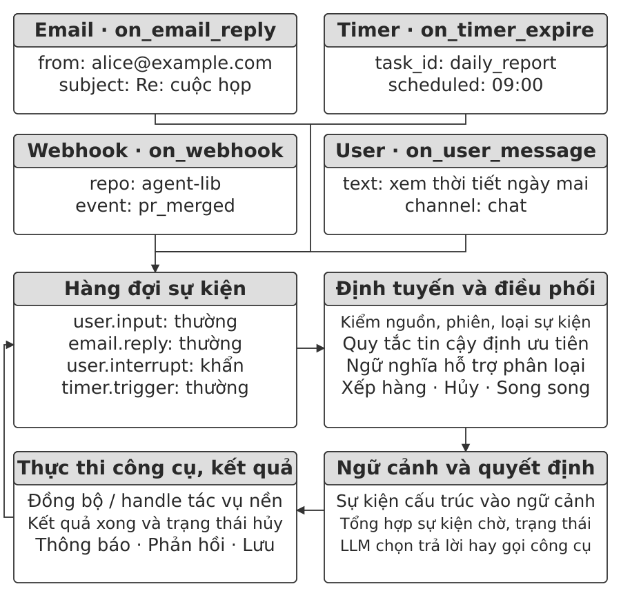

### Cơ chế hướng sự kiện trong OpenClaw

OpenClaw tiếp nhận các kênh tin nhắn qua Gateway và định tuyến sự kiện tới runtime của Agent. Các cơ chế tự động hóa của nó gồm Hooks nội bộ, lập lịch theo thời gian, Heartbeat và Webhook bên ngoài cùng một số lối vào khác[^ch6-automation]. Có thể hiểu các cơ chế này theo điều kiện kích hoạt:

- **Hooks (móc sự kiện)** phản hồi sự kiện nội bộ của framework, chẳng hạn tạo phiên, đặt lại phiên hoặc thay đổi trong vòng đời chạy.
- **Cron (lập lịch theo thời gian)** chạy công việc vào thời điểm hoặc theo chu kỳ đã định. Ví dụ, `0 9 * * 5` nghĩa là kích hoạt lúc 9 giờ sáng thứ Sáu hằng tuần theo múi giờ đã cấu hình.
- **Heartbeat (nhịp tim)** đánh thức Agent theo chu kỳ để kiểm tra những việc cần để ý.
- **Webhook (callback bên ngoài)** nhận sự kiện do dịch vụ bên ngoài gửi tới, sau khi xác thực và định tuyến thì kích hoạt xử lý.

Báo cáo tuần hợp với việc chạy đúng giờ, các việc cần theo dõi liên tục có thể kiểm tra theo chu kỳ, còn email mới và callback từ dịch vụ thì có thể dùng cơ chế đẩy để rút ngắn độ trễ phát hiện.

**Sự kiện cuộc gọi của PineClaw.** Pine AI thay người dùng gọi điện, xử lý các việc như thương lượng hóa đơn, hủy đăng ký dịch vụ và yêu cầu bồi thường bảo hiểm. PineClaw đưa loại tác vụ gọi điện này vào OpenClaw. Một cuộc gọi thường kéo dài một lúc, trong đó người dùng có thể phải can thiệp:

- **Xác minh danh tính.** Tổng đài viên yêu cầu chủ tài khoản xác minh, chẳng hạn nhập mã bảo mật hoặc mật khẩu dùng một lần.
- **Cuộc gọi ba bên.** Tổng đài viên muốn nói chuyện trực tiếp với chủ tài khoản, nên phải kịp thời báo người dùng nghe máy.
- **Xác nhận quyết định.** Khi tổng đài viên đưa ra phương án thay thế, tầng tiền cảnh căn cứ vào lần ủy thác này và sở thích trước đây của người dùng để đánh giá có chấp nhận được không. Khi cần người dùng quyết định, nó gửi các lựa chọn cụ thể cho người dùng, đồng thời tiếp tục cùng tổng đài viên đối chiếu các điều kiện khác.

Ví dụ, tổng đài viên cần chủ tài khoản tham gia cuộc gọi ba bên. Thông báo đến càng sớm, hai bên càng ít phải chờ suông trên điện thoại. Trường hợp PineClaw dùng cơ chế Channel để nối sự kiện cuộc gọi giữa Gateway và Pine API: cuộc gọi được kết nối, cần người dùng nhập liệu và cuộc gọi kết thúc lần lượt đi vào luồng sự kiện, Agent dựa vào đó cập nhật tác vụ và thông báo cho người dùng.

**Theo tác giả, muốn dịch vụ chủ động đến kịp thời thì tốt nhất là để nguồn sự kiện thông báo cho Agent khi trạng thái thay đổi.** Thông báo đến qua kênh, Harness tìm tác vụ tương ứng, kiểm tra có trùng lặp hay đã hết hạn không, rồi mô hình mới quyết định bước tiếp theo. Nếu cần người dùng xác minh danh tính, giao diện nên mở một lối xác thực đáng tin cậy, kết quả xác minh sau đó được gửi lại tác vụ ban đầu dưới dạng một sự kiện mới.

### Công cụ kích hoạt sự kiện

Nếu giao cho trợ lý việc "khách hàng hồi âm thì nhắc tôi", làm sao nó tỉnh dậy đúng lúc vào ngày mai? Trước hết hãy xem hộp thư có đẩy sự kiện khi thư đến được không; với hệ thống chỉ cho phép chủ động truy vấn, trợ lý phải nhớ lần kiểm tra tiếp theo. Ba giao diện minh họa dưới đây giao các điều kiện chờ ấy cho runtime lưu giữ, để mô hình có thể kết thúc lượt làm việc hiện tại.

**Bộ hẹn giờ (`set_timer`)** dùng để đánh thức một tác vụ vào thời điểm đã hẹn. Bộ hẹn giờ một lần hợp với việc như "10 giờ sáng thứ Hai tuần sau gọi ngân hàng hỏi tiến độ khoản vay mua nhà"; bộ hẹn giờ lặp hợp với việc kiểm tra tình trạng dịch vụ mỗi giờ một lần. Gửi email rồi chờ hồi âm, hay gặp ngoài giờ làm việc thì gọi lại sau, cũng có thể sắp xếp bằng bộ hẹn giờ. Giao diện cần lưu múi giờ, điều kiện kích hoạt và định danh tác vụ, đồng thời cung cấp lối hủy hoặc sửa. Khi dịch vụ bên ngoài chỉ hỗ trợ truy vấn, tác vụ hẹn giờ còn có thể đảm nhận việc hỏi tiến độ định kỳ.

**Giám sát tác vụ nền (`monitor_shell`)** dùng để biến một lệnh chạy lâu thành các sự kiện tiến độ. Khi khởi động, nó trả về định danh tác vụ; trong lúc chạy, nó thông báo theo đầu ra mới, từ khóa hoặc thay đổi trạng thái; khi kết thúc, nó báo trạng thái thoát và kết quả.

Để mô hình hỏi tiến độ liên tục thì ngay cả khi trạng thái không đổi cũng tốn một lần gọi mô hình; chỉ chờ thông báo kết thúc thì lại có thể bỏ lỡ sự cố giữa chừng. Vì vậy, tác giả khuyên giao việc giám sát cho runtime, chỉ đánh thức mô hình khi xuất hiện tiến độ hữu ích, lỗi hoặc tình trạng đứng im. Như vậy vừa có thể tiếp tục trao đổi trong lúc build, vừa có thể kịp thời can thiệp khi có bất thường. Quy tắc giám sát có thể đặt bộ lọc, gộp và giới hạn tần suất để mỗi dòng log không gây ra một lần gọi mô hình.

Ví dụ, sau khi đăng ký nhận cập nhật trạng thái cho một phiếu yêu cầu đang chờ xử lý, mô hình có thể kết thúc lượt suy luận này và đợi thông báo mang mã phiếu đánh thức nó. Nếu bên kia chỉ cung cấp lối truy vấn, mô hình có thể tự đặt một tác vụ hẹn giờ cho lần kiểm tra sau. Đến lúc đó nếu thấy "vẫn đang xử lý" thì hẹn thêm một lần nữa; nếu thấy phiếu đã xử lý xong thì hủy các lần kiểm tra tiếp theo. Cả hai cách đều để runtime lo việc chờ, mô hình chỉ đánh giá lại khi nhận được thông báo hoặc khi bộ hẹn giờ hết hạn.

**Kênh sự kiện bên ngoài (`connect_channel`)** dùng để đăng ký nhận email, tin nhắn tức thời hoặc callback API. Bộ điều hợp kênh xác minh nguồn, ánh xạ định danh riêng của dịch vụ thành luồng và đối tượng liên quan, rồi gửi sự kiện theo định dạng thống nhất; mục "Tầng tiếp nhận" ở phần sau sẽ trình bày kỹ. Thông báo trạng thái cuộc gọi của PineClaw thuộc loại này.

Cả ba loại công cụ đều cần xác định rõ điều kiện kích hoạt, quy tắc lọc và payload của sự kiện. Payload nên chứa định danh sự kiện, thời điểm xảy ra, nguồn, tác vụ liên quan và nội dung cần thiết, để Agent đánh giá được sự kiện còn hiệu lực không và bước tiếp theo cần những thông tin gì.

### Công cụ giao tiếp với người dùng

Quay lại tác vụ đổi vé. Đặt câu hỏi cho tổng đài viên, gửi cho người dùng một tin xác nhận mà họ có thể trả lời ngay, và ghi vào hồ sơ tác vụ "đang chờ hồi âm" là ba việc ghi vào ba chỗ khác nhau. Người dùng có thể tạm rời đi, đến khi cần bổ sung điều kiện, xác nhận quyết định hoặc nhận kết quả thì quay lại.

Giao diện hội thoại có thể hiển thị câu trả lời cuối cùng, tiến độ công cụ và kết quả thực thi; còn công cụ giao tiếp thì chỉ định rõ người nhận, kênh, nội dung tin nhắn và tệp đính kèm. Mô hình quyết định cần nói gì, Harness kiểm tra đích đến và quyền hạn, dịch vụ tin nhắn thực hiện việc gửi. Runtime cũng có thể tự định tuyến câu trả lời cuối cùng về phiên ban đầu. Hai cách này có thể dùng phối hợp.

Tương tác đa kênh của OpenClaw cho phép người dùng gửi tin nhắn, chờ tiến độ và nhận nhắc nhở như khi liên lạc với một thư ký. "Cảm giác như người thật" này đến từ trạng thái tác vụ được duy trì liên tục và sự giao tiếp kịp thời. Người dùng có thể tiếp tục tác vụ trên kênh quen thuộc, còn Agent phải giữ nhất quán danh tính, phiên và liên kết giữa các tin nhắn.

Nội dung giao tiếp cũng có thể thay đổi theo tác vụ: tiến độ ngắn thì dùng chữ, kết quả phức tạp thì kèm hình ảnh hoặc tệp, thông tin cần điền thì dùng thẻ có cấu trúc, sản phẩm tương tác thì dùng generative UI giới thiệu ở Chương 5. Khi kênh hỗ trợ xác nhận đã gửi hoặc đã đọc, hệ thống lưu lại trạng thái tương ứng; việc gửi lại khi thất bại, tin nhắn trùng lặp và đồng bộ giữa các kênh cũng được đưa vào hồ sơ gửi.

**Thông báo đa kênh và kéo người dùng quay lại.**

Nhắn tin tức thời, SMS, email, điện thoại và thông báo đẩy của ứng dụng mỗi thứ hợp với một mức khẩn cấp và một dạng nội dung khác nhau. Agent có thể chọn kênh dựa trên mức khẩn cấp, sở thích của người dùng, trạng thái hiện tại và độ dài tin nhắn. Sự kiện cuộc gọi cần xác nhận ngay thì dùng nhắc nhở tức thời, báo cáo đầy đủ có thể gửi qua email hoặc đường dẫn trong ứng dụng.

Tác giả từng nhờ trợ lý theo dõi giá phòng khách sạn dịp hội nghị ATC. Mỗi ngày vào cùng một giờ, trợ lý đều nhắn rằng giá phòng chưa giảm xuống mức mục tiêu. Có một lần giá phòng giảm trong chốc lát, nhưng người bắt được khoảng thời gian đó lại là đoạn script tác giả tự viết. Mức giá thấp ngắn ngủi có thể xuất hiện giữa hai lần truy vấn. Dù trợ lý có kịp tra ra, nếu tin nhắn đến muộn thì người dùng vẫn có thể lỡ đặt phòng. Những ngày giá không giảm, việc truy vấn định kỳ vẫn chạy bình thường, nhưng người dùng không cần ngày nào cũng đọc một tin nhắn có nội dung y hệt. Chương 7 sẽ dùng một khoảng giảm giá dài năm phút để kiểm tra kiểu nhắc nhở này.

Khi tác vụ dài hoàn thành, thông báo đưa người dùng trở lại trang kết quả; bản tóm tắt hằng ngày và báo cáo tuần thì gửi theo nhịp đã hẹn. Chiến lược đa kênh còn nên có khử trùng lặp, khung giờ im lặng và điều kiện leo thang, chẳng hạn khi lần nhắc đầu tiên không được phản hồi thì có chuyển sang kênh khác không. Hồ sơ thông báo được gắn với trạng thái tác vụ để người dùng có thể tiếp tục xử lý ngay từ tin nhắn nhận được.

### Danh tính ảo và môi trường thực thi biệt lập

Chương 4 đã mượn Samantha trong phim *Her* để minh họa cách một trợ lý đa năng đi vào thế giới số qua công cụ. Muốn hiện thực trợ lý kiểu này, cần xác định rõ nó làm việc dưới danh tính nào và được truy cập những tài nguyên nào. **Tác giả nghiêng về việc cấp cho trợ lý đa năng một danh tính ảo độc lập.** Hộp thư công việc, số điện thoại, không gian lưu trữ và môi trường tính toán riêng giúp Agent, như một thư ký có tài khoản văn phòng của mình, thay mặt người dùng xử lý công việc với tư cách người đại diện rõ ràng. Danh tính độc lập tách công việc hằng ngày của trợ lý khỏi tài khoản cá nhân của người dùng, thuận tiện cho việc cấp quyền, kiểm toán và thu hồi riêng; khi thao tác sai, phạm vi ảnh hưởng cũng dễ khoanh lại hơn. Với những tác vụ bắt buộc phải truy cập tài khoản của người dùng, quyền cần thiết được cấp qua ủy quyền có giới hạn phạm vi.

Số điện thoại thuộc về ai quyết định ai có thể tiếp tục công việc khi đối phương gọi lại. Cue của Manus cấp cho trợ lý một số điện thoại riêng, có thể nghe cuộc gọi đến rồi để lại bản tóm tắt cuộc gọi cho người dùng. Nếu doanh nghiệp chấp nhận số gọi lại mà trợ lý để lại, khi tổng đài gọi đến sẽ tìm thẳng được trợ lý đã xử lý việc trước đó.[^ch6-cue]

Lấy việc xin miễn giảm phí làm ví dụ: trợ lý có thể liên hệ doanh nghiệp với tư cách người đại diện được ủy quyền. Nếu tổng đài viên yêu cầu chính chủ xác minh bằng lời, có thể mời người dùng tham gia cuộc gọi ba bên, xác minh xong thì trợ lý tiếp tục trao đổi. Nếu doanh nghiệp sẽ gọi lại cho người dùng, trước tiên hãy chuyển cho người dùng mã hồ sơ, những điều đã thỏa thuận và các vấn đề cần xác minh. Khi báo cáo với người dùng, cũng phải nói rõ bằng chứng đang có: tổng đài viên mới hứa miệng sẽ miễn giảm thì ghi lại lời hứa ấy; về sau tra thấy hóa đơn đã cập nhật thì mới báo phí đã thực sự được miễn giảm.

Khi tác giả làm lại thẻ tín dụng Bank of America lúc ở Bắc Kinh, Pine đã liên hệ ngân hàng, sắp xếp làm thẻ gấp và xin được miễn khoản phí làm gấp 15 đô la. Khi cuộc gọi kết thúc, trợ lý đã có thể báo cáo ngân hàng tiếp nhận việc gì, đồng ý miễn khoản phí nào. Vài ngày sau nếu người dùng hỏi "thẻ mới đến đâu rồi", thì phải tra lại vận đơn hoặc nhờ người nhận xác nhận.

Máy tính ảo và điện thoại ảo cung cấp môi trường thao tác chạy liên tục. Máy ảo có thể chạy hệ thống desktop, container hợp với việc cô lập tiến trình và các phụ thuộc, trình giả lập Android chạy ứng dụng di động. Chúng hỗ trợ chạy nền, cũng giảm được việc thao tác tự động làm phiền công việc hiện tại của người dùng. Phạm vi cô lập do mạng, các điểm mount, thông tin xác thực và quyền chạy cùng quyết định; những cấu hình này đồng thời ảnh hưởng đến dữ liệu và hệ thống bên ngoài mà Agent có thể chạm tới.

Giả sử bạn muốn WorkBuddy bản doanh nghiệp của Tencent tạo báo cáo tuần sau khi bạn tắt máy tan làm, trong khi bảng doanh số tuần này chỉ nằm trên máy tính văn phòng. Nếu chọn tác vụ cục bộ, trợ lý đọc được bảng này, nhưng máy tính phải bật và client phải trực tuyến. Nếu chọn tác vụ trên đám mây, trợ lý có thể làm tiếp sau khi bạn tắt máy, với điều kiện bạn đã tải lên tác vụ những dữ liệu được phép dùng cho báo cáo tuần, hoặc đưa chúng vào kho tài liệu mà tác vụ đám mây truy cập được. Nếu bảng doanh số bắt buộc phải ở lại trên máy, thì nên sắp xếp xử lý vào lúc máy tính trực tuyến.

Trang web và ứng dụng di động còn có thể đòi xác minh danh tính, mã CAPTCHA hoặc xác nhận thủ công. Khi tích hợp, ưu tiên dùng API và phương thức ủy quyền mà dịch vụ cung cấp; khi cần xác thực qua giao diện đồ họa, có thể để người dùng tự đăng nhập qua máy tính từ xa VNC/RDP và tạm dừng thao tác tự động trong lúc xác thực. Người dùng làm xong, hệ thống kiểm tra trạng thái phiên rồi mới khôi phục tác vụ. Token và phiên được lưu theo thời hạn hiệu lực, khi ủy quyền bị thu hồi hoặc tác vụ kết thúc thì dọn dẹp theo chính sách.

Agent và môi trường ảo có thể trao đổi dữ liệu qua **hệ thống tệp dùng chung**. Ví dụ, người dùng tải lên một tệp CSV, máy tính ảo đọc tệp, chạy phân tích và ghi biểu đồ trở lại kho lưu trữ dùng chung; runtime chuyển vị trí tệp của biểu đồ cho Agent, rồi cung cấp cho người dùng một đường tải xuống truy cập được. Nội dung tệp lớn vẫn nằm trong kho lưu trữ, mô hình chỉ đọc bản tóm tắt hoặc từng đoạn khi cần.

[^ch6-dsh-threads]: DeepSeek, mô hình miền cùng quy tắc ủy quyền và đăng ký của nguyên mẫu dsh-superagent.
[^ch6-dsh-sessions]: DeepSeek, nguyên mẫu dsh-superagent, phiên bản `8c32a9d`. Trách nhiệm của hai loại phiên xem `docs/004-prompts.md`, phiên thực thi và thư mục làm việc xem `docs/003-execution.md`, định dạng tin nhắn gửi vào phiên chính xem `docs/007-architecture.md`.
[^ch6-duet]: Anthropic, *Get started with Claude Duet*, giới thiệu bản tóm tắt trước cuộc họp, trang tác vụ và thông báo trong cuộc hội thoại chính.
[^ch6-cue]: Manus, *Introducing Manus 2.0*, giới thiệu số điện thoại riêng, khả năng nghe cuộc gọi đến và bản tóm tắt cuộc gọi của Cue.
[^ch6-automation]: OpenClaw, Automation, giới thiệu các lối vào tự động hóa như Hooks nội bộ, lập lịch theo thời gian, Heartbeat và Webhook bên ngoài.

### Tầng tiếp nhận: nhiều nguồn, một kiểu sự kiện

Agent chăm sóc khách hàng của một cửa hàng trực tuyến xử lý một khoản hoàn tiền: khách hàng gửi yêu cầu trong cuộc trò chuyện chăm sóc khách hàng trên App; số tiền vượt quá quyền hạn của Agent, nên nó xin quản lý xác nhận trong nhóm hậu mãi trên WeCom; dịch vụ thanh toán hoàn tiền thành công rồi gửi Webhook; sau đó hệ thống đơn hàng phát thay đổi trạng thái lên Kafka. Bốn tin nhắn nói về cùng một đơn hàng nhưng đến theo bốn cách khác nhau. Nguồn càng nhiều, nếu mỗi đường dẫn tự lo việc thử lại, khử trùng lặp và thứ tự, runtime sẽ bị những khác biệt ấy xé lẻ. **Tầng tiếp nhận thống nhất hình dạng của sự kiện sau khi vào hệ thống, nhưng giữ nguyên khác biệt về năng lực của từng nguồn trước khi đến.** Hình 6-2 thể hiện cách phân tầng này.

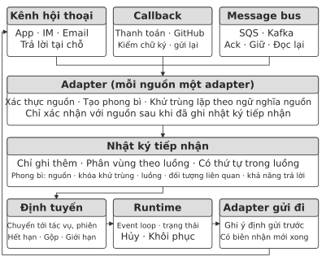

Nguồn thường gặp có bốn loại. **Kênh hội thoại** gồm giao diện trò chuyện của chính sản phẩm, các ứng dụng nhắn tin tức thời như WeCom, Feishu, Slack, và email; Agent có thể trả lời ngay tại chỗ. **Callback** là giao diện HTTP mà dịch vụ bên ngoài gọi khi trạng thái thay đổi, thường có chữ ký và chỉ mang thông báo; khi gửi thất bại, có dịch vụ tự thử lại, còn GitHub thì phải gửi lại thủ công hoặc qua API. **Bus tin nhắn** như SQS, Kafka mang sự kiện nghiệp vụ của các dịch vụ nội bộ, có ngữ nghĩa xác nhận và lưu giữ rõ ràng. **Bộ hẹn giờ, truy vấn định kỳ và sự kiện nội bộ** do chính hệ thống tạo ra, chỉ cần ghi vào cùng một nhật ký. Bảng dưới đây so sánh ba loại đầu.[^ch6-ingress-mq][^ch6-ingress-callback]

| | Trò chuyện trên App | WeCom / Feishu | Email | Webhook | SQS | Kafka |
|---|---|---|---|---|---|---|
| Cách đến | Kết nối dài | Callback hoặc kết nối dài | Đẩy hoặc truy vấn định kỳ | Callback | Consumer kéo về | Consumer kéo về |
| Phạm vi có thứ tự | Trong cuộc trò chuyện | Phần lớn sự kiện không bảo đảm | Không bảo đảm | Không bảo đảm | Hàng đợi chuẩn không bảo đảm, FIFO theo nhóm tin nhắn | Trong phân vùng |
| Căn cứ khử trùng lặp gốc | ID tin nhắn phía client | ID tin nhắn, ID sự kiện | Message-ID | ID lần gửi | ID tin nhắn; FIFO có thêm `MessageDeduplicationId` | Topic, phân vùng và offset |
| Phát lại được không | Dựa vào bản ghi của mình | Bản thân callback không phát lại được, Feishu có thể kéo bù bằng giao diện lịch sử tin nhắn | Đọc lại được hộp thư | Tùy dịch vụ | Không, sau khi đã xóa | Được, trong thời hạn lưu giữ |
| Cách xác nhận | Biên nhận phía client | Trả về thành công trong thời hạn | Tự ghi vị trí đã đọc | Trả về 2xx trong thời hạn | Xóa tin nhắn | Commit offset |
| Đường trả lời | Cuộc trò chuyện gốc | Cuộc trò chuyện gốc | Thư trả lời | Không có | Không có | Không có |

**Phong bì thống nhất.**

Bộ điều hợp chuyển tin nhắn gốc thành một **phong bì** (envelope) theo định dạng thống nhất. Phong bì chỉ ghi những sự thật xác định được ngay lúc đến; độ ưu tiên và thời hạn xử lý do quy tắc định tuyến bổ sung, hạng khách hàng và trạng thái đơn hàng do hệ thống nghiệp vụ bổ sung, trạng thái xử lý được lưu riêng. Yêu cầu hoàn tiền của khách hàng có thể viết như sau:

```json
{
  "id": "evt_7f3a",
  "source": {"type": "app_chat", "sender": "user:u_5521", "verified": true},
  "dedupe_key": "app:msg:msg_1029",
  "thread": "app:conv:conv_88",
  "kind": "message",
  "correlation": ["order:12345"],
  "content": {"type": "text", "text": "Tôi muốn hoàn tiền đơn hàng này"},
  "raw_ref": "raw/2026-11-23/app/msg_1029.json",
  "reply": {"via": "app_chat", "target": "app:conv:conv_88"},
  "occurred_at": "2026-11-23T14:02:09+08:00",
  "expires_at": null
}
```

- `source`: loại nguồn và người gửi đã được xác minh. "Đã xác minh" do bộ điều hợp đánh giá dựa trên chữ ký, token hoặc tài khoản kênh; lời tự giới thiệu trong nội dung tin nhắn không tính. Runtime dựa vào mục này để xét quyền hạn.
- `dedupe_key`: khóa khử trùng lặp; thế nào là trùng lặp do ngữ nghĩa của nguồn quyết định. ID lần gửi, ID tin nhắn, phân vùng và offset định danh cùng một lần gửi, chặn được việc gửi lại ở tầng truyền tải; nếu tin nhắn nghiệp vụ có khóa idempotency (idempotency key), chẳng hạn mã phiếu hoàn tiền kèm trạng thái, bộ điều hợp phải lấy nó ra thì mới chặn được trùng lặp về mặt nghiệp vụ. Hội thoại với người dùng thì ngược lại: khách hàng nói "hoàn tiền" hai lần là hai tin nhắn, chỉ khử trùng lặp theo ID tin nhắn phía client.
- `raw_ref`: payload gốc được lưu nguyên dạng; khi điều tra lỗi của bộ điều hợp, chỉ có thể dựa vào nó.
- `reply`: đi qua bộ điều hợp đầu ra nào, gửi tới đích nào. Callback thanh toán không có đường trả lời, mục này để trống.
- `occurred_at` là thời điểm xảy ra do nguồn cung cấp; `expires_at` là thời hạn hiệu lực, chỉ điền cho các sự kiện như báo giá, mã xác minh.

**Luồng và liên kết.**

Khách hàng nói "hoàn tiền" trước, ngay sau đó bổ sung "thôi, đổi hàng vậy"; thứ tự hai tin nhắn này không được đảo; tin nhắn của một khách hàng khác không liên quan đến chúng, có thể xử lý song song. **Tầng tiếp nhận chỉ cam kết thứ tự trong phạm vi một luồng.** Bộ điều hợp ánh xạ đơn vị thứ tự riêng của nguồn thành `thread`: một cuộc trò chuyện trên App, một nhóm tin nhắn của SQS FIFO (`MessageGroupId`), khóa phân vùng của Kafka, số Issue hoặc PR trong callback của GitHub. Khi nguồn không bảo đảm thứ tự, runtime dựa vào `occurred_at` hoặc số phiên bản do nguồn cung cấp để nhận ra trạng thái cũ đến muộn, chẳng hạn "đang xử lý hoàn tiền" lại đến sau "hoàn tiền thành công".

Bốn tin nhắn của khoản hoàn tiền này thuộc bốn luồng khác nhau. Gộp chúng thành một luồng phải trả giá không nhỏ: một cuộc thảo luận không liên quan trong nhóm hậu mãi cũng phải xếp sau tin nhắn của khách hàng, mà định danh luồng lại thường kiêm luôn khóa phân vùng, sửa về sau thì phải di chuyển dữ liệu. **Quan hệ liên kết được biểu đạt bằng một trường riêng, không viết lại luồng.** `correlation` liệt kê các đối tượng nghiệp vụ mà sự kiện liên quan, tác vụ đăng ký các luồng liên quan theo đối tượng liên kết.

**Tách thời điểm xác nhận khỏi tiến độ.**

**Bộ điều hợp nên xác nhận với nguồn sau khi sự kiện đã ghi vào nhật ký tiếp nhận, chứ không đợi Agent xử lý xong mới xác nhận.** Callback sự kiện của Feishu yêu cầu phản hồi trong 3 giây, của WeCom là 5 giây, quá hạn thì đẩy lại; tin nhắn SQS nếu không bị xóa trong thời hạn visibility timeout sẽ bị lấy ra thêm lần nữa. Đợi xử lý xong mới xác nhận thì chỉ một lần gọi mô hình hơi lâu cũng đủ kéo theo việc gửi trùng. Ghi nhật ký trước rồi mới xác nhận, bảo đảm gửi của mọi nguồn quy về một câu: **mỗi sự kiện vào nhật ký tiếp nhận ít nhất một lần (at-least-once)**, lần gửi lại bị khóa khử trùng lặp chặn.

Nhật ký tiếp nhận tương đương một hộp thư đến (inbox), tuân theo nguyên tắc chỉ thêm, không sửa ở Chương 1, và được phân vùng theo luồng. Khi dùng Kafka làm nhật ký tiếp nhận, việc khử trùng lặp phải có thêm một kho lưu với ràng buộc duy nhất, hoặc lọc theo khóa khử trùng lặp ở phía tiêu thụ: Kafka không thể từ chối ghi theo khóa do ứng dụng đưa ra, producer idempotent của nó chỉ bao được việc thử lại của chính producer.

Hệ thống phải lưu riêng ba loại tiến độ:

| Tiến độ | Nội dung ghi lại | Ai duy trì |
|---|---|---|
| Tiến độ nguồn | Offset Kafka, receipt handle của SQS, vị trí đã đọc trong hộp thư | Bộ điều hợp |
| Tiến độ phân phát | Sự kiện trong nhật ký đã giao cho những tác vụ nào | Bộ định tuyến |
| Trạng thái tác vụ | Đã xử lý đến bước nào, câu trả lời đã gửi chưa | Runtime |

Nếu coi offset là tiến độ tác vụ, khi phát lại nhật ký, những câu trả lời đã gửi sẽ bị gửi thêm lần nữa; tách riêng ra thì việc phát lại chỉ ảnh hưởng đến tiến độ phân phát. Chiều đi ra tương ứng với hộp thư đi (outbox): trước khi gửi, ghi lại ý định gửi và khóa idempotency, nhận được biên nhận của kênh mới đánh dấu hoàn thành; sau khi khởi động lại thì đối chiếu thế nào, xem mục "Dựng vòng lặp cơ bản từ sự kiện email" ở phần sau.

**Thời hiệu, gộp và áp lực ngược.**

Khi mỗi giây có hàng trăm sự kiện đổ về cùng một luồng, không nên giao từng cái cho mô hình. Bộ định tuyến xử lý phần tồn đọng trước khi phân phát:

- **Thời hiệu.** Báo giá, mã xác minh, cảnh báo đã hết đều mất ý nghĩa khi quá giờ. Sự kiện đã quá `expires_at` chỉ được ghi vào trajectory, không đánh thức mô hình nữa.
- **Gộp.** `kind` phân biệt hai loại sự kiện. Sự kiện kiểu trạng thái mô tả giá trị hiện tại của một đối tượng, như trạng thái hoàn tiền trong callback thanh toán hay trạng thái đơn hàng trên Kafka; khi cùng một luồng tồn đọng nhiều cái, chỉ giao cái mới nhất cho mô hình, các giá trị trung gian nằm lại trong nhật ký. Sự kiện kiểu tin nhắn là một câu ai đó nói hoặc một chỉ thị ai đó đưa ra, như tin nhắn của khách hàng hay cú nhấp của quản lý; có thể giao cho mô hình theo lô nhưng không được bỏ.
- **Áp lực ngược.** Nguồn kiểu kéo có thể kéo chậm lại, để phần tồn đọng nằm ở nguồn. Nguồn kiểu đẩy không thể bắt bên kia tạm dừng, bộ điều hợp vẫn ghi nhật ký và xác nhận như thường, phần tồn đọng chuyển sang nhật ký tiếp nhận và được hai quy tắc trên xử lý.

**Một khoản hoàn tiền đi qua bốn nguồn.**

1. Khách hàng yêu cầu hoàn tiền trong cuộc trò chuyện trên App. Bộ điều hợp khử trùng lặp theo ID tin nhắn phía client, ghi vào nhật ký rồi gửi biên nhận cho client; bộ định tuyến tạo tác vụ hoàn tiền theo `order:12345`, tác vụ đăng ký luồng hội thoại này.
2. Số tiền vượt quyền hạn, Agent gửi thẻ xác nhận vào nhóm hậu mãi trên WeCom, định danh thẻ được ghi vào tác vụ. Quản lý nhấp "Đồng ý", bộ điều hợp ghi vào nhật ký rồi trả về thành công, và bổ sung đối tượng liên kết theo định danh thẻ.
3. Sau khi Agent gọi giao diện hoàn tiền, dịch vụ thanh toán callback "hoàn tiền thành công" hai lần với cùng một ID lần gửi, lần thứ hai bị khử trùng lặp.
4. Hệ thống đơn hàng phát "đơn hàng đã hoàn tiền" lên Kafka, cùng một chuyện với callback. Nếu cả hai bộ điều hợp đều lấy mã phiếu hoàn tiền kèm trạng thái từ payload làm khóa khử trùng lặp, sự kiện này bị chặn ngay lúc tiếp nhận; nếu chúng khử trùng lặp riêng theo ID lần gửi và theo phân vùng cùng offset, cả hai đều vào nhật ký, runtime thấy trong tác vụ khoản hoàn tiền đã được xác nhận nên chỉ ghi nó vào trajectory.
5. Callback và sự kiện Kafka đều không có đường trả lời. Runtime dùng `reply` của luồng hội thoại ở bước 1, thông báo cho khách hàng qua bộ điều hợp đầu ra của App.

Bước 4 là ranh giới của việc khử trùng lặp ở tầng tiếp nhận: chặn được những trùng lặp nào tùy vào khóa khử trùng lặp mà bộ điều hợp khai báo; những gì lọt qua thì dựa vào trạng thái tác vụ để phán đoán. Sau khi sự kiện được phân phát cho tác vụ, việc nối tiếp vào phiên đã có hay mở phiên mới thuộc về quản lý ngữ cảnh: thông tin giữa các phiên được truyền qua bộ nhớ ở Chương 3, còn ngữ cảnh có thể chia sẻ hay không thì xem Chương 10.

[^ch6-ingress-mq]: Amazon Web Services, "Amazon SQS standard queues"; "Amazon SQS visibility timeout"; "Using the message deduplication ID in Amazon SQS"; "Using the message group ID with Amazon SQS FIFO Queues". Tài liệu Apache Kafka 4.4, mục "Consumer Position" và "Message Delivery Semantics" trong "Design". Ngày đối chiếu: 2026-11-24.
[^ch6-ingress-callback]: Nền tảng mở Feishu, "Tổng quan sự kiện"; "Lấy lịch sử tin nhắn của cuộc trò chuyện". Trung tâm nhà phát triển WeCom, "Tổng quan" trong "Nhận tin nhắn và sự kiện". GitHub Docs, "Best practices for using webhooks"; "Handling failed webhook deliveries". Ngày đối chiếu: 2026-11-24.

### Cơ chế xử lý sự kiện

Tin nhắn của người dùng, kết quả công cụ, bộ hẹn giờ và yêu cầu cộng tác có thể cùng lúc đổ vào một Agent. Runtime phải lưu các sự kiện này, xác định thứ tự xử lý, rồi chuyển thông tin liên quan cho mô hình. **Vòng lặp sự kiện** (event loop) chịu trách nhiệm đẩy quá trình này tiến liên tục: lấy sự kiện từ hàng đợi, cập nhật trạng thái tác vụ, tổ chức yêu cầu gửi mô hình, điều phối công cụ, rồi chờ đầu vào mới hoặc thông báo hoàn thành. Chương trình Go tổ chức nhiều luồng tin nhắn bằng goroutine, channel và `select` cũng theo một tư duy tương tự.

Lấy nguyên mẫu dsh-superagent làm ví dụ: trong cùng một dự án GitHub, cuộc thảo luận dưới một Issue và cuộc thảo luận dưới một pull request (PR) thuộc về hai luồng hội thoại (Thread) khác nhau. Khi hệ thống cần phán đoán có nhận việc mới hay không, nó đọc trạng thái luồng và cho mô hình đánh giá (Eval). Mỗi luồng cùng lúc chỉ có tối đa một lần đánh giá, nhưng có thể có nhiều phiếu công việc (Ticket) đăng ký theo dõi nó. Giả sử hai phiếu công việc, một sửa lỗi và một bổ sung tài liệu, cùng đăng ký một PR; người review để lại bình luận dưới PR thì cả hai phiếu đều nhận bình luận ấy làm ngữ cảnh. Nếu sau đó có người bổ sung điều kiện tái hiện lỗi dưới Issue, tin nhắn này sẽ đến phiếu công việc đăng ký Issue đó. Tin nhắn đến tay ai là do luồng và quan hệ đăng ký quyết định. Còn nhận tin nhắn rồi được làm những gì thì vẫn do quyền hạn vốn có của từng phiếu công việc quyết định.[^ch6-dsh-threads]

dsh-superagent còn giao việc "giao tiếp với người" và việc "làm việc" cho hai loại phiên khác nhau. Phiên chính (Main Session) chỉ lo nhận việc, trả lời và ghi ủy quyền, không đọc mã, cũng không dừng lại chờ kết quả; mỗi phiếu công việc có phiên thực thi (Executor Session) riêng, sửa mã và chạy kiểm thử trong một thư mục làm việc riêng. Chỉ khi đã sửa xong, bị kẹt hoặc cần hỏi người, phiên thực thi mới gửi phiên chính một tin nhắn, kèm bản tóm tắt và địa chỉ để đọc, tức là kiểu "tóm tắt kèm ID đối tượng" nói ở Chương 2. Như vậy phiên chính luôn rảnh tay nhận yêu cầu tiếp theo; việc hỏi người, gửi thông báo hay ra lệnh dừng cũng đều đi qua nó, nên cam kết chỉ phát ra từ một cửa. Mô hình nhanh–chậm trong phần giọng nói phía sau chính là dạng phân công này trong cuộc gọi thời gian thực.[^ch6-dsh-sessions]

Giao diện mô hình đồng bộ thường nhận lô tin nhắn tiếp theo sau khi một lần sinh kết thúc hoặc khi kết quả công cụ đã đủ. Tại đây có thể đặt một **điểm an toàn**: runtime ghi lại các tin nhắn đã hoàn tất, các lời gọi vẫn đang chạy và tiến độ tác vụ hiện tại, rồi mới chuyển sang bước xử lý mới. Giao diện bất đồng bộ nguyên bản thì cung cấp giao thức nhận cập nhật trong lúc đang chạy, thời điểm nối tiếp cụ thể do giao diện và runtime cùng sắp xếp.

Hủy cũng cần bộ thực thi phối hợp. Mô hình ngừng sinh nhưng công cụ chạy nền có thể vẫn đang chạy; bộ thực thi phải nhận tín hiệu hủy và báo cáo trạng thái thực tế, giống như tác vụ Go kiểm tra `ctx.Done()` rồi dọn dẹp. Những thao tác ghi, gửi hay thanh toán đã hoàn tất thì phải hoàn tác hoặc bù trừ qua quy trình nghiệp vụ tương ứng.

**Ba chiến lược xử lý.**

Hình 6-3 so sánh ba lựa chọn khi sự kiện mới đến. Để nó xếp hàng thì thời gian phản hồi tùy vào lúc gặp điểm an toàn kế tiếp; hủy tác vụ hiện tại thì phải xác nhận thao tác nào đã xong và có thể khôi phục từ đâu; mở thêm một vòng lặp khác thì phải kiểm tra hai tác vụ có tranh chấp cùng một tài nguyên không.

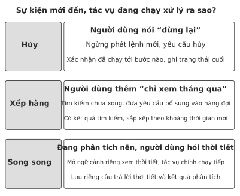

**Xử lý kiểu hủy (Cancellation-Based)** hợp với lệnh dừng của người dùng hoặc các sự kiện điều khiển cần xử lý ngay. Runtime trước hết ngừng phân phát thêm các thao tác liên quan, gửi tín hiệu dừng tới yêu cầu đang sinh và các công cụ có thể hủy, rồi lưu các tin nhắn đã hoàn tất, trạng thái công cụ và biên nhận hủy. Sau đó sự kiện mới mới vào ngữ cảnh ra quyết định. Ví dụ, người dùng nói "Dừng! Tôi nói nhầm", hệ thống trước hết chặn các bước thực thi tiếp theo, rồi dựa trên trạng thái thực tế hiện tại để xác nhận lại tác vụ. Các mục chưa xử lý trong hàng đợi giữ nguyên định danh và trạng thái, được sắp xếp lại theo phạm vi liên quan.

**Xử lý kiểu hàng đợi (Queued)** hợp với thông tin bổ sung thông thường và cập nhật tiến độ. Sự kiện vào hàng đợi, đến điểm an toàn kế tiếp thì được giao cho mô hình cùng với kết quả công cụ. Ví dụ, trong lúc tìm kiếm, người dùng bổ sung "chỉ xem kết quả trong tháng gần nhất"; khi kết quả tìm kiếm trả về, mô hình đọc đồng thời kết quả và điều kiện mới, rồi quyết định lọc lại hay tìm lại.

**Xử lý song song (Parallel)** hợp với các yêu cầu độc lập với tác vụ chính và cần trả lời kịp thời. Ví dụ, trong lúc phân tích một lượng dữ liệu lớn, người dùng hỏi thời tiết; hệ thống có thể mở một phiên độc lập để tra cứu.

**Mức khẩn cấp và định tuyến.**

Loại sự kiện cho manh mối ban đầu: `user.interrupt`, chỉ thị giám sát đáng tin cậy và cảnh báo hệ thống có thể vào kênh ưu tiên cao; `user.input`, `agent.input`, `tool.result` và `timer.trigger` thì phải xét thêm nội dung và trạng thái tác vụ. Khi người gửi tự xưng "khẩn cấp" trong nội dung, hệ thống vẫn xác định quyền hạn theo danh tính đã xác minh và theo quy tắc.

Với những quyết định định tuyến cần hiểu nghĩa của tin nhắn, tác giả khuyên dùng một mô hình phân loại nhẹ: "dừng lại ngay" ứng với hủy, "hôm nay thời tiết thế nào" có thể hợp với song song, "báo cáo hãy viết bằng tiếng Trung" thường vào hàng đợi bổ sung của tác vụ hiện tại. Lối dừng rõ ràng do runtime xử lý trực tiếp, phân loại ngữ nghĩa dùng cho những tin nhắn còn lại cần phải hiểu.

Mô hình đa năng cũng gắn nhãn được cho tin nhắn, nhưng dù chỉ xuất ra vài chữ "cần xử lý", mô hình vẫn phải đọc vào mô tả tác vụ và nội dung tin nhắn. Mỗi tin nhắn mới đều phán đoán như vậy một lần thì chi phí gọi mô hình tăng theo lượng tin nhắn, mà tin nhắn thực sự khẩn cấp cũng phải chờ mô hình gắn nhãn xong mới đi tiếp được. Jev của TypeSafe chuyên xử lý loại phán đoán có tập lựa chọn cho trước như thế này. Đưa cho nó một tin nhắn và trạng thái tác vụ hiện tại, nó có thể trả về song song xác suất của từng lựa chọn với chi phí và độ trễ thấp.[^ch6-jev]

Việc làm thưa không gian quan sát bàn ở Chương 1, đến đây quyết định tin nhắn nào sẽ kích hoạt một lần suy luận mới. Lấy tin nhắn Feishu và bình luận trên GitHub Issue làm ví dụ: chương trình có thể lọc thông báo trùng theo mã sự kiện trước, rồi để Jev phán đoán tin nhắn mới là bổ sung cho tác vụ đã có hay là một yêu cầu mới cần mô hình chính xử lý. Đọc thấy "bổ sung các bước tái hiện đã nói hôm qua", mô hình chỉ cần nhận ra đây là một lời bổ sung. Còn bổ sung cho Issue nào thì chương trình đọc thẳng mã số đi kèm bình luận là được.

Kể cả khi mô hình đưa ra xác suất rất cao, nó vẫn có thể đánh giá quá cao độ chắc chắn của mình. Ví dụ, 100 tin nhắn đều bị xếp vào "bổ sung cho tác vụ đã có" với xác suất khoảng 90%, nhưng thực tế chỉ 60 tin thuộc loại này. Tự động gộp cả lô vào tác vụ đã có thì sẽ bỏ lỡ mục đích thực sự của 40 tin còn lại.

[^ch6-jev]: Trong ghi chú phát hành Jev, TypeSafe giới thiệu đầu ra định nghĩa trước, việc trả về xác suất song song và phương pháp huấn luyện RLCD hướng tới hiệu chuẩn quyết định.

### Dựng vòng lặp cơ bản từ sự kiện email

Giả sử tiến trình xử lý email mới đột ngột khởi động lại. Định danh email giúp nó tìm lại thư gốc, nhưng không cho biết thư trả lời trước đó đã gửi đi hay chưa. Từ lúc vào hàng đợi, đọc email, gọi công cụ cho đến cập nhật hộp thư hoặc báo người dùng, tốt nhất là ghi mỗi thao tác ghi và biên nhận trả về dưới tên cùng một email. Sau khi khởi động lại, nếu thấy đã gửi yêu cầu mà chưa có biên nhận, hãy kiểm tra trạng thái thực tế trong hộp thư trước rồi mới quyết định có gửi lại không.

> **Thí nghiệm 6-1 ★★★: Agent xử lý email hướng sự kiện**
>
> Thí nghiệm này lấy một hộp thư thử nghiệm làm lối vào để luyện tập việc đăng ký sự kiện, hàng đợi và xử lý tác vụ. Trước hết, sắp xếp email mới thành sự kiện có cấu trúc và xử lý theo thứ tự đến; sau đó tích hợp các công cụ như lịch sử email, đọc tệp đính kèm, tra cứu tri thức và thông báo. Theo Hình 6-4, hãy lần theo một lời mời họp: trong vòng lặp sự kiện, tìm ra hai bước kiểm tra trùng lịch và soạn thư nháp, rồi vào tầng lưu trữ tìm hồ sơ xử lý của email này.
>
> 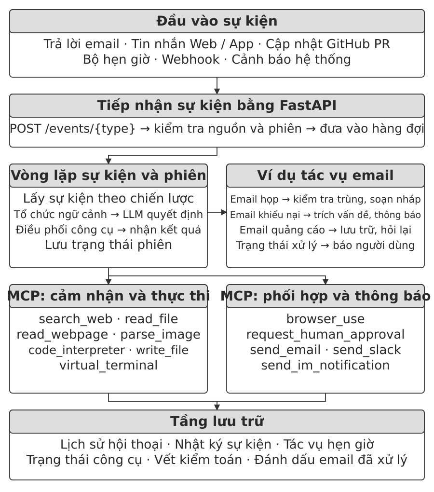
>
> Cùng một hàng đợi có thể mở rộng cho nhiều nguồn: email đến, tin nhắn IM hoặc SMS, cập nhật PR và Issue trên GitHub, bộ hẹn giờ, Webhook bên ngoài, cùng các sự kiện nội bộ như người dùng ngoại tuyến, tiến trình quá thời gian và cảnh báo tài nguyên. Mỗi bộ điều hợp chịu trách nhiệm xác minh nguồn và bổ sung thông tin liên kết, kết quả xử lý được ghi ngược lại theo định danh sự kiện.
>
> Nghiệm thu dùng ba email thử nghiệm: lời mời họp kích hoạt kiểm tra trùng lịch và tạo bản nháp chấp nhận hoặc từ chối; khiếu nại của khách hàng kích hoạt trích xuất thông tin then chốt, đánh dấu ưu tiên cao và báo người dùng; email tiếp thị được lưu trữ theo quy tắc.
>
> Bản ghi đi kèm hiện đã hoàn tất việc đối chiếu tài liệu giao diện và thăm dò xác thực, việc tích hợp hộp thư thử nghiệm vẫn đang chờ thông tin xác thực hợp lệ.
>
> **Mở rộng (tùy chọn): tiếp nhận nhiều nguồn và tiêm lỗi.** Ngoài hộp thư thử nghiệm, kết nối thêm một endpoint Webhook cục bộ và một hàng đợi SQS (có thể giả lập cục bộ). Mỗi bộ điều hợp xác minh nguồn, tạo phong bì, ghi vào nhật ký tiếp nhận rồi mới xác nhận với nguồn; runtime đọc sự kiện từ nhật ký và xử lý theo thứ tự luồng. Sau đó tiêm ba loại lỗi:
>
> 1. **Gửi trùng.** Endpoint Webhook nhận hai yêu cầu có cùng ID lần gửi, trong nhật ký chỉ xuất hiện một sự kiện.
> 2. **Sập trước khi xác nhận.** Bộ điều hợp bị dừng sau khi ghi nhật ký nhưng trước khi xóa tin nhắn SQS; tin nhắn hiện lại và được đọc thêm lần nữa, trong nhật ký vẫn chỉ có một sự kiện.
> 3. **Sập trước khi có biên nhận.** Runtime bị dừng sau khi gửi câu trả lời nhưng trước khi ghi biên nhận, khởi động lại thì phát lại từ nhật ký. Nếu kênh hỗ trợ khóa idempotency, hoặc tra được tin nhắn đã gửi (ví dụ mục thư đã gửi của hộp thư), cùng một thư trả lời sẽ không bị gửi lặp; kênh không có cả hai thứ thì chỉ có thể đánh dấu thư trả lời này là chờ người xác nhận.
>
> Cả ba loại lỗi đều phải để lại dấu vết trong nhật ký: lần gửi nào bị khử trùng lặp, tin nhắn nào được đọc lại, thư trả lời nào đã được kiểm tra và không gửi lại.
>
> Mã đi kèm phần mở rộng này chạy được ngoại tuyến, không cần API Key. Hộp thư thử nghiệm và hàng đợi SQS đều được giả lập bằng tệp cục bộ, tách biệt với hộp thư thật đang chờ thông tin xác thực ở trên; hàng đợi giả lập giữ nguyên visibility timeout, receipt handle và thứ tự trong nhóm tin nhắn. Sự cố sập do tiến trình cha trực tiếp dừng tiến trình con tại vị trí chỉ định. Mỗi kênh trả lời minh họa một cách: email tra mục thư đã gửi, trò chuyện trên App dùng khóa idempotency, SMS không có cả hai. Để tái hiện, vào `chapter6/agent-with-event-trigger` và chạy `python multisource_demo.py`, terminal sẽ lần lượt in ra các bản ghi nhật ký mà ba loại lỗi để lại. Trong bản ghi chạy đi kèm, cả ba hạng mục kiểm tra lỗi đều đạt.
>

Hàng đợi email đặt nền cho việc xử lý tuần tự. Tiếp theo, ta thêm các công cụ chạy lâu và bàn cách nhận yêu cầu mới, hủy tác vụ và khôi phục công việc trong lúc chờ.

### Phương án tương thích khi không có bất đồng bộ nguyên bản

Giả sử Agent đang soạn một email và đã gọi `search_contacts` để tìm người liên hệ. Kết quả chưa về thì người dùng yêu cầu "khoan đã, tra thời tiết ngày mai trước". Nếu giao diện mô hình hiện tại đòi mỗi lời gọi công cụ phải có kết quả đi kèm trước, Harness phải chuyển trạng thái chạy nền thành một chuỗi tin nhắn mà giao diện chấp nhận.

**Biểu đạt trạng thái chạy nền trong định dạng tin nhắn đồng bộ.**

**Khi tương thích với giao diện đồng bộ, nên cố giữ việc ghép cặp giữa lời gọi bình thường và kết quả thực, chỉ chèn phản hồi trạng thái khi chuyển tác vụ giữa chừng.** Điền sớm "vẫn đang chạy" cho mọi lời gọi sẽ khiến trajectory đầy những trạng thái dở dang, làm mô hình vất vả hơn khi theo dõi kết quả thực. Cụ thể có thể theo năm quy tắc:

1. **Ghi đầy đủ lời gọi.** Ghi vào trajectory tin nhắn assistant mà API đã hoàn tất cùng các mục gọi công cụ, giữ nguyên định danh lời gọi. Trạng thái suy luận phía máy chủ được lưu theo cách nối tiếp mà nhà cung cấp quy định.
2. **Ghi lại việc hoàn tất thực sự.** Khi công cụ xong, ghi kết quả thực, định danh tác vụ và trạng thái thực thi; trong lúc thực thi, bộ quản lý tác vụ liên tục lưu trạng thái chưa hoàn tất.
3. **Báo trạng thái hiện tại khi chuyển việc.** Với giao diện cho phép loại payload kết quả này, có thể trả về cho lời gọi đang chờ một thông tin trạng thái rõ ràng, ví dụ "tác vụ vẫn chạy ở nền, chưa có kết quả", rồi nối thêm sự kiện của người dùng. Định danh tác vụ trong phản hồi trạng thái liên kết với thông báo hoàn tất về sau.
4. **Sắp xếp lại tin nhắn sau khi ngắt.** Khi không có khả năng nối tiếp giữa chừng, hủy phần sinh chưa xong, giữ lại các tin nhắn và trạng thái công cụ đã xác nhận hoàn tất, rồi gửi yêu cầu mới. Đầu ra dở dang được xử lý theo quy định của giao diện, tránh coi nửa đoạn tham số là một lời gọi có thể thực thi.
5. **Nhận sự kiện thông thường theo lô.** Thông tin bổ sung vào hàng đợi, đến khi chu kỳ hiện tại kết thúc hoặc tới điểm an toàn chỉ định thì gửi một lượt, đồng thời ghi lại sự kiện nào đã được xử lý.

Trong ví dụ tra người liên hệ, lời gọi đầy đủ được ghi vào trajectory trước; khi người dùng chuyển việc, Harness chèn phản hồi trạng thái cho biết truy vấn vẫn đang chạy, rồi gửi yêu cầu thời tiết. Kết quả người liên hệ về sau đi vào ngữ cảnh như một sự kiện mới mang nguồn và định danh tác vụ, Agent sau đó tiếp tục soạn email. Khi lời gọi ban đầu đã nhận phản hồi trạng thái, kết quả về sau dùng dạng sự kiện mà bộ điều hợp quy ước, giữ quan hệ ghép cặp giữa lời gọi và kết quả.

Phản hồi trạng thái chỉ cho biết tiến độ thực thi hiện tại. Những bước phụ thuộc vào dữ liệu người liên hệ phải đợi kết quả thực về mới tiếp tục. Bộ quản lý tác vụ có thể lưu các trạng thái như `running`, `completed`, `cancelled`, `failed`, và kiểm tra các phụ thuộc đã thỏa mãn chưa trước khi gửi câu trả lời hoặc chạy công cụ tiếp theo.

**Thiết kế công cụ bất đồng bộ bằng handle tác vụ.**

Với công cụ tác vụ dài thiết kế mới, tác giả ưu tiên định nghĩa "khởi động" là một thao tác trọn vẹn, trả về ngay một handle tác vụ thực. Nhờ đó mô hình phân biệt được "đã khởi động" và "đã hoàn tất", còn các truy vấn, lệnh hủy và sự kiện kết quả về sau cũng có chung một căn cứ liên kết. Ví dụ, `initiate_phone_call` khởi động tác vụ gọi điện, trả về định danh tác vụ và trạng thái "đang quay số"; `phone_call_connected` và `phone_call_ended` lần lượt báo đã kết nối và đã kết thúc.

Mô tả công cụ nên ghi rõ: "Công cụ này khởi động tác vụ gọi điện, thành công thì trả về ID tác vụ. Bạn có thể tiếp tục xử lý việc khác; tiến độ và kết quả cuộc gọi được trả về qua các sự kiện riêng." Tên công cụ cho biết đây là thao tác khởi động, còn cấu trúc trả về và các sự kiện tiếp theo cho biết tác vụ tiến triển và kết thúc thế nào. Hệ thống cung cấp thêm giao diện truy vấn, hủy và khôi phục theo ID tác vụ, để mô hình biết hiện mình còn làm được gì.

**Xử lý từng mục trong lô sự kiện.**

Khi nhiều sự kiện cùng lúc vào ngữ cảnh, mô hình có thể chỉ đáp lại cái cuối cùng và bỏ sót các yêu cầu đã nêu trước đó. Runtime nên giữ trạng thái xử lý riêng của từng sự kiện, để những điều kiện chưa được đáp ứng vẫn hiển thị. Prompt có thể yêu cầu mô hình kiểm tra từng mục, còn thanh trạng thái thì liệt kê những thông tin chưa xử lý:

```text
[Sự kiện chưa xử lý 1/4] Kết quả database_query: ……
[Sự kiện chưa xử lý 2/4] Người dùng bổ sung: chỉ xem dữ liệu khu vực Bắc Kinh
[Sự kiện chưa xử lý 3/4] Nhắc nhở hệ thống: còn 30 phút đến hạn nộp báo cáo
[Sự kiện chưa xử lý 4/4] Người dùng hỏi: tiến độ thế nào rồi?
```

Bản tóm tắt lô có thể nhắc "1 kết quả công cụ, 2 tin nhắn người dùng, 1 nhắc nhở hệ thống". Runtime còn gắn sự kiện với các ràng buộc của tác vụ: điều kiện khu vực cập nhật phạm vi truy vấn, hạn chót ảnh hưởng đến điều phối, câu hỏi tiến độ cần được trả lời. Sau khi xử lý, ghi lại trạng thái hoàn tất, đang chờ hoặc cần làm rõ, lượt sau tiếp tục giữ các mục chưa giải quyết.

Cùng một mã tác vụ xâu chuỗi việc khởi động, các báo cáo tiến độ và kết quả thực thi cuối cùng. Nếu giữa chừng có người yêu cầu dừng, thì phải kiểm tra thêm dưới mã này đã có biên nhận hủy hay chưa.

> **Thí nghiệm 6-2 ★★★: Agent bất đồng bộ có khả năng thực thi song song và ngắt**
>
> Thí nghiệm này kiểm chứng runtime bất đồng bộ trước, rồi mới tích hợp mô hình để kiểm tra quyết định. Bản ghi chạy đi kèm dùng các tiến trình con thật của hệ điều hành để hoàn thành bốn kịch bản, việc điều phối sự kiện và báo cáo do một script tất định điều khiển.
>
> 1. **Thực thi nền và phản hồi tức thì.** Khởi động một tiến trình phân tích kéo dài vài giây, trả ngay định danh tác vụ; trong lúc chờ thì trả lời giờ hiện tại, xong thì nhận kết quả phân tích.
> 2. **Hàng đợi và xử lý theo lô.** Trong lúc tác vụ dài chạy, lần lượt bổ sung "trả lời bằng tiếng Nhật" và "trình bày thành trang web"; tác vụ xong thì kết quả và hai yêu cầu được xử lý như một lô. Script sinh ra HTML tiếng Nhật.
> 3. **Hủy và khôi phục.** Minh họa việc khi nhận "dừng phân tích", hệ thống ngắt lượt mô hình còn đang sinh và yêu cầu mọi tác vụ nền đang chạy dừng lại. Lần này lệnh ngắt do script phát ra, lúc đó chỉ có một tiến trình phân tích T1. Ở giây 0,803, sự kiện ngắt ghi tiến độ của T1 là 18%; đến giây 0,806 hệ thống mới ghi được mã thoát −15 của nó. T2 khởi động ngay sau đó là một tác vụ mới. Kết quả nhận được ở giây 4,436 là của T2, T1 không kích hoạt callback hoàn tất.
> 4. **Tác vụ song song và quyết định theo tiến độ.** Khởi động cùng lúc ba tiến trình phân tích, mỗi bước thời gian logic lần lượt tiến 3%, 2%, 1%. Trong bản ghi tiến độ song song của thí nghiệm, khi T1 nhanh nhất hoàn tất, biên nhận truy vấn cho thấy T2 đã đến 68%, T3 đến 34%. Theo Hình 6-5, tác vụ có tiến độ không quá 50% sẽ bị hủy. Script chỉ hủy T3, cuối cùng nhận được kết quả của T1 và T2. Điều này cho thấy cùng một runtime vừa đáp ứng được lệnh dừng cả lô, vừa giữ lại được những công việc song song còn hữu ích.
>
> 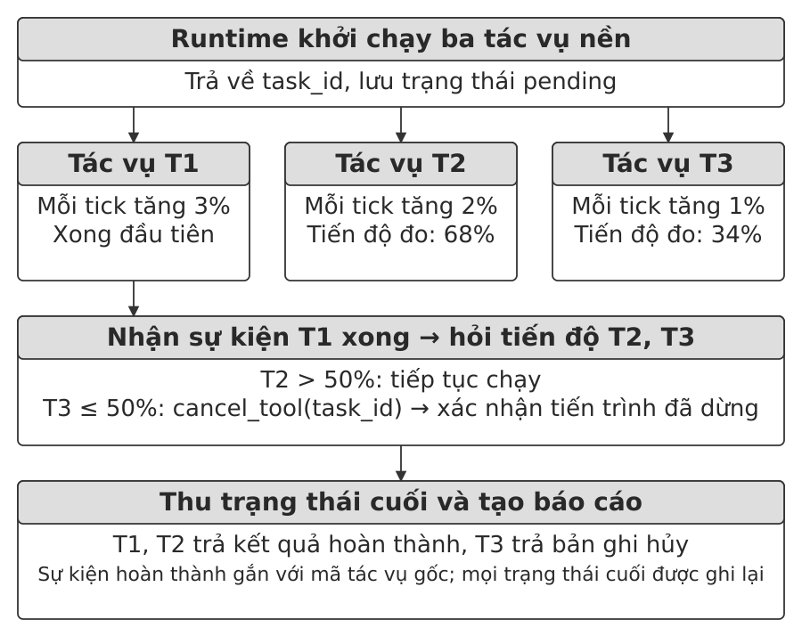
>

### Bất đồng bộ nguyên bản của mô hình: GPT-6 Astra

Phương án trên do Harness tự điều chỉnh để khớp định dạng tin nhắn đồng bộ. Giao diện bất đồng bộ nguyên bản thì trực tiếp cho phép mô hình tiếp tục xử lý công việc độc lập khi công cụ chưa trả về, và nhận kết quả về sau. Tính đến tháng 9 năm 2026, GPT-6 Astra đã cung cấp gọi công cụ bất đồng bộ (Async tool calling) và điều hướng giữa lượt (Mid-turn steering), lần lượt xử lý việc chờ công cụ và các cập nhật của người dùng. Hình 6-6 đối chiếu luồng tin nhắn của phương án điều chỉnh giao diện đồng bộ và của bất đồng bộ nguyên bản.[^ch6-22][^ch6-23]

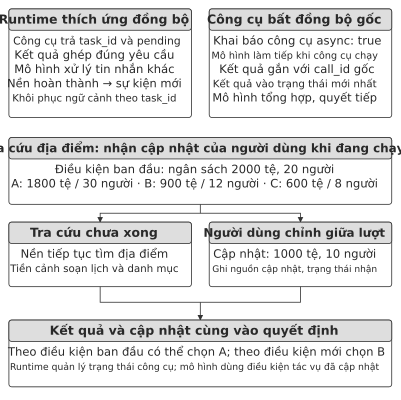

**Tiếp tục công việc độc lập trong lúc chờ công cụ.** Ví dụ, sau khi Agent gửi truy vấn địa điểm tổ chức họp, nó có thể sắp xếp chương trình và danh sách chuẩn bị trước; truy vấn trả về rồi mới so sánh giá và sức chứa. `async: true` trong định nghĩa công cụ khai báo năng lực bất đồng bộ; ứng dụng nhận đầy đủ mục gọi rồi khởi động thực thi và lưu định danh lời gọi `call_id`. Khi kết quả đến, ứng dụng trả kết quả về theo định danh gốc và nối tiếp trạng thái phản hồi mới nhất. Mô hình sắp xếp công việc tiếp theo, Harness quản lý việc liên kết lời gọi và vòng đời tác vụ.[^ch6-22]

**Nhận yêu cầu mới khi tác vụ đang chạy.** Người dùng có thể bổ sung "ngân sách giảm còn 1000", "số người tham dự đổi thành 10" khi mô hình đang suy nghĩ hoặc đang sắp xếp câu trả lời. Ứng dụng gửi sự kiện điều hướng qua cùng một kết nối, máy chủ xác nhận đã nhận rồi tiếp tục xử lý theo trạng thái phản hồi hiện tại. Khi mất kết nối và kết nối lại, ứng dụng có thể khôi phục tác vụ theo các sự kiện và trạng thái phản hồi đã lưu.[^ch6-23]

Hai năng lực này có thể kết hợp: truy vấn địa điểm tiếp tục chạy, yêu cầu mới của người dùng đi vào các quyết định sau đó, kết quả truy vấn trả về thì hoàn tất việc chọn. Bộ thực thi đồng thời duy trì trạng thái thực của tác vụ nền. Khi cần dừng truy vấn hoặc hủy đặt chỗ, Harness gọi giao diện tương ứng và kiểm tra biên nhận; các thao tác nghiệp vụ đã hoàn tất thì đi vào quy trình hoàn tác hoặc bù trừ.

Khi mô hình và giao diện đã hỗ trợ bất đồng bộ nguyên bản, tác giả ưu tiên dùng giao thức nguyên bản, để việc treo công cụ, cập nhật của người dùng và nối tiếp phản hồi vận hành theo quy ước của giao diện. Tầng tương thích đồng bộ chủ yếu phục vụ các mô hình hiện có và giao diện cũ; khi nâng cấp mô hình, có thể dần gỡ bỏ phần logic tương thích chỉ dùng để ghép cặp tin nhắn, dồn công sức kỹ thuật vào trạng thái tác vụ, hủy và khôi phục.

### Xử lý tác vụ bất đồng bộ một cách đáng tin cậy

Tương tác bất đồng bộ đáng tin cậy đòi hỏi kiểm tra đồng thời tin nhắn, tác vụ và trạng thái thực thi.

1. **Quy thuộc kết quả.** Kết quả đến muộn mang định danh của lời gọi gốc, ứng dụng ánh xạ nó về tác vụ tương ứng; các quyết định phụ thuộc vào kết quả này chỉ tiếp tục khi dữ liệu đã đến.
2. **Khôi phục và hủy.** Khi người dùng đổi yêu cầu, hệ thống giữ lại phần công việc còn hiệu lực, cập nhật các bước tiếp theo, và nói rõ tác vụ nền nào tiếp tục chạy, tác vụ nào đã dừng.
3. **Nhiều yêu cầu.** Ngân sách, số người, khu vực và hạn chót lần lượt đi vào trạng thái tác vụ, kết quả cuối cùng được kiểm tra theo từng điều kiện.

> **Thí nghiệm 6-3 ★★★: Bất đồng bộ nguyên bản của mô hình và điều hướng giữa lượt**
>
> Thí nghiệm này cho Agent chọn địa điểm rẻ nhất thỏa mãn yêu cầu về ngân sách và số người cho một cuộc họp giả lập. Ngân sách ban đầu là 2000, số người là 20; công cụ truy vấn phải đợi 8 giây mới trả về báo giá và sức chứa của ba địa điểm.
>
> | Địa điểm | Giá | Sức chứa |
> |---|---:|---:|
> | A | 1800 | 30 |
> | B | 900 | 12 |
> | C | 600 | 8 |
>
> Với điều kiện ban đầu thì phải chọn A. Nhóm điều hướng nhận hai cập nhật trong lúc tác vụ đang chạy: ngân sách đổi thành 1000, số người đổi thành 10, lúc này phải chọn B. Công cụ đồng thời trả về một biên nhận mới sinh, câu trả lời cuối cùng phải trích dẫn nó, để kiểm tra mô hình có dùng kết quả thực sự đã đến hay không.
>
> Thí nghiệm gồm năm nhóm, mỗi nhóm ba lần: công cụ đồng bộ, công cụ bất đồng bộ nguyên bản, điều hướng trong lúc suy luận, điều hướng trong lúc chờ công cụ bất đồng bộ, và nhóm đối chứng dùng mô hình không hỗ trợ điều hướng. Hai nhóm đầu so sánh xem trong lúc chờ có xuất được danh sách chuẩn bị độc lập không; hai nhóm điều hướng kiểm tra ngân sách và số người có cùng lúc có hiệu lực không; nhóm đối chứng năng lực kiểm tra giao diện có báo rõ là không hỗ trợ hay không.
>
> Trong các bản ghi chạy đã lưu, nhóm công cụ bất đồng bộ hoàn thành danh sách độc lập trong lúc chờ, cả hai nhóm điều hướng đều chọn B theo điều kiện mới. Các lần chạy có công cụ đều chỉ thực hiện một truy vấn và trả kết quả thực về đúng lời gọi gốc; còn giao diện của mô hình đối chứng thì trả lời rõ rằng nó không hỗ trợ nhận yêu cầu mới giữa một lượt sinh. Tổng thời gian của nhóm đồng bộ và bất đồng bộ gần bằng nhau, khác biệt chính nằm ở chỗ trong lúc chờ có đẩy được việc khác hay không.
>
> Nếu mô hình chỉ nhớ số người đổi thành 10, vẫn chọn theo ngân sách cũ 2000, nó sẽ chọn đâu? A và B đều đủ chỗ, rẻ nhất vẫn là B. Vì vậy chọn đúng địa điểm chưa cho thấy ngân sách đã được cập nhật hay chưa.
>
> Số người đã đổi, truy vấn đã gửi đi có phải làm lại không? Công cụ trong thí nghiệm này không có tham số lọc, trả về cả ba địa điểm. Trợ lý có thể dùng lại kết quả đang trên đường về, đợi nó về rồi lọc theo 10 người, ngân sách 1000. Nếu công cụ chỉ trả về địa điểm chứa được từ 20 người trở lên, kết quả cũ chỉ có A, còn B chứa được 12 người hoàn toàn không có trong đó. Khi ấy chỉ sửa số người thành 10 trong danh sách cũ thì vẫn bỏ sót B. Nếu truy vấn ban đầu đã lọc mất B, thì phải truy vấn lại.

Cơ chế bất đồng bộ cho phép thay đổi bên ngoài đi vào hệ thống trong lúc tác vụ đang tiến triển. Tương tác qua giọng nói, màn hình và robot còn rút ngắn chu kỳ phản hồi hơn nữa: hệ thống phải nhận đầu vào liên tục và điều chỉnh đầu ra cùng hành động vào thời điểm thích hợp.

## Giọng nói: giao diện người–máy tự nhiên nhất

Giọng nói cho phép người dùng nói rõ nhu cầu, bổ sung điều kiện và xác nhận kết quả với Agent ngay cả khi tay hoặc mắt đang bận việc khác. Bộ gõ bằng giọng nói chuyển lời nói thành chữ, còn Agent giọng nói thì quản lý thêm hội thoại, tool calling và việc phát câu trả lời; cả hai đều có thể hỗ trợ whisper coding giới thiệu ở phần Lời nói đầu.

Phần này bàn về hai cách dùng: người dùng trò chuyện trực tiếp với Agent, và Agent thay người dùng giao tiếp với người bên ngoài. Cách thứ nhất quan tâm đến nhận dạng, phản hồi và chen lời; cách thứ hai còn phải hoàn tất xác minh danh tính, tra cứu nghiệp vụ và ra quyết định ngay trong cuộc gọi.

### Thời gian tương tác: từ cascade đến full-duplex

Trong bài giới thiệu GPT-Live, OpenAI điểm lại ba kiểu tương tác giọng nói: cascade, mô hình âm thanh theo lượt và full-duplex[^ch6-12]. Lộ trình tiến hóa này dần giao việc "khi nào lên tiếng, khi nào nghe tiếp" cho mô hình phán đoán liên tục. Hệ thống cascade chủ yếu dựa vào logic phát hiện điểm cuối để sắp xếp việc trao lượt, còn mô hình full-duplex có thể kết hợp âm thanh liên tục với trạng thái hội thoại để xử lý lời nói chồng nhau, khoảng ngừng và chen lời.

| Mô hình | Cấu trúc cốt lõi | Năng lực dễ hiện thực | Vấn đề thiết kế chính |
|---|---|---|---|
| Cascade | Phân công VAD, ASR, LLM, TTS | Thay riêng từng mô-đun, kiểm tra đầu vào/đầu ra từng đoạn | Độ trễ giữa các mô-đun, thông tin âm học bị mất khi phiên âm |
| Mô hình âm thanh end-to-end theo lượt | Mô hình trực tiếp nhận và sinh âm thanh | Dùng ngữ điệu, cảm xúc… để tổ chức câu trả lời | Phán đoán kết thúc lời nói, chuyển lượt và thời điểm phản hồi |
| Full-duplex | Liên tục nhận âm thanh và sinh đầu ra | Nói chồng, đệm lời, chen lời và tương tác liên tục | Trạng thái liên tục, kiểm soát đầu ra và đánh giá tương tác |

Mô hình có trực tiếp xử lý âm thanh không, đầu vào và đầu ra có streaming không, có nghe và nói cùng lúc được không, là những năng lực có thể kiểm tra riêng. Hệ thống cascade cũng có thể thêm mô-đun streaming và điều khiển ngắt lời; nhịp tương tác của mô hình end-to-end thì tùy vào thiết kế cụ thể.

[^ch6-12]: OpenAI, *Introducing GPT-Live*, 2026-07-08, giới thiệu cascade, mô hình âm thanh theo lượt và tương tác full-duplex.

### Mô hình 1 · Pipeline cascade (Cascading)

Hệ thống cascade tách hội thoại giọng nói thành vài mô-đun. Phát hiện hoạt động giọng nói (VAD) tìm các đoạn có tiếng nói trong âm thanh, logic điểm cuối quyết định khi nào gửi đoạn đó đi; nhận dạng giọng nói tự động (ASR) chuyển âm thanh thành chữ; LLM hiểu yêu cầu và sinh câu trả lời; tổng hợp giọng nói (TTS) biến câu trả lời thành âm thanh phát được. Hình 6-7 thể hiện cấu trúc cơ bản chạy tuần tự.

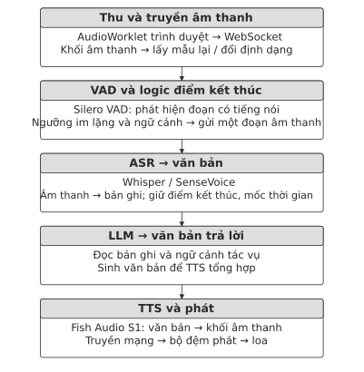

VAD âm học tìm ra những đoạn có người nói, nhờ đó bước nhận dạng phía sau có thể bỏ qua các khoảng lặng dài. Nhưng cùng một khoảng ngừng, xuất hiện sau "Tôi muốn đặt…" và sau "Sáng thứ Năm còn vé không?" lại mang ý nghĩa khác nhau. VAD ngữ nghĩa (phát hiện điểm cuối theo ngữ nghĩa) có thể tiếp tục thu âm trong trường hợp đầu, đến trường hợp sau mới chuyển lời nói cho mô hình hội thoại. Đây chính là làm thưa quan sát giọng nói theo thời gian: một đoạn âm thanh liên tục chỉ kích hoạt suy luận tại vài thời điểm. Còn có lên tiếng hay không là do mô hình nghe câu đó quyết định; nó cũng có thể nghe tiếp, hoặc tra chuyến bay trước.

| Mô-đun | Vai trò | Nguồn chờ đợi hoặc lỗi thường gặp |
|---|---|---|
| VAD và logic điểm cuối | Phát hiện giọng nói, quyết định thời điểm gửi | Ngưỡng im lặng, tiếng ồn và khoảng ngừng giữa câu |
| ASR | Chuyển âm thanh thành chữ | Thời gian giải mã, nhận dạng tên người và danh từ riêng |
| LLM | Hiểu, suy luận và sinh câu trả lời | Yêu cầu xếp hàng, sinh đoạn trả lời đầu tiên |
| TTS và phát | Tổng hợp âm thanh và đưa tới loa | Tổng hợp gói đầu tiên, truyền mạng và bộ đệm phát |

Trong cách hiện thực hoàn toàn tuần tự, người dùng nói xong còn phải lần lượt chờ xác nhận điểm cuối, phiên âm, sinh câu trả lời và đoạn âm thanh đầu tiên. Trong ví dụ ở Hình 6-8, khi người dùng nghe thấy tiếng trả lời đầu tiên thì đã qua 1,4 giây, trong đó đoạn dài nhất là chờ hệ thống xác nhận người dùng đã nói xong (500 mili giây). Kể cả rút thời gian phiên âm từ 100 xuống 50 mili giây, người dùng cũng chỉ đỡ chờ 50 mili giây.

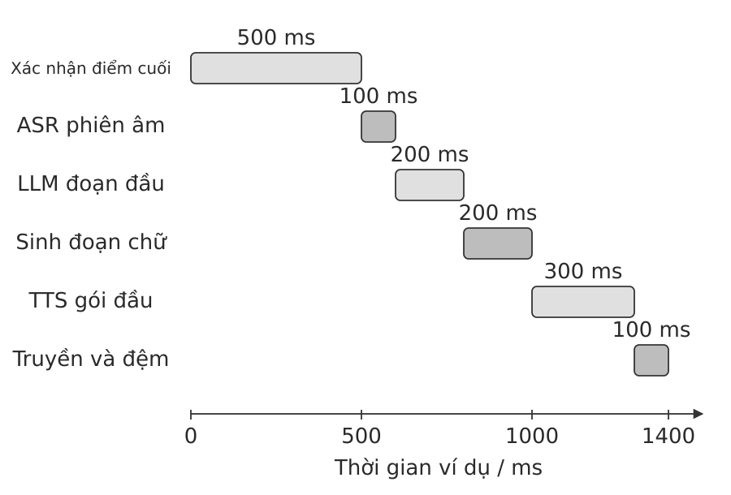

Tải dịch vụ còn gây ra thời gian xếp hàng. Hình 6-9 dùng mô hình một quầy phục vụ M/M/1 để minh họa quan hệ này: lượt đến tuân theo quá trình Poisson, thời gian phục vụ tuân theo phân phối mũ, thời gian phục vụ trung bình là $S$; khi hệ số sử dụng $\rho<1$, tổng thời gian trung bình gồm cả phục vụ và xếp hàng là $W=S/(1-\rho)$. Lấy $S=1$ giây, hệ số sử dụng tăng từ 0,5 lên 0,8 thì tổng thời gian trung bình tăng từ 2 giây lên 5 giây. Trong đó phần phục vụ trung bình vẫn chỉ chiếm 1 giây, 3 giây tăng thêm đều nằm ở khâu xếp hàng. Khi lượng yêu cầu tiến sát năng lực xử lý, dao động lưu lượng ngắn hạn sẽ gây tồn đọng.

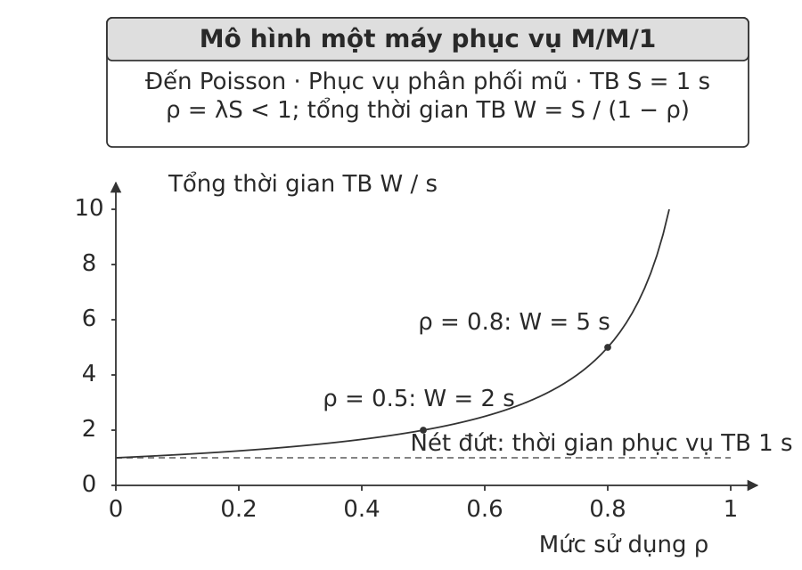

> **Thí nghiệm 6-4 ★: Xây dựng Agent giọng nói truyền thống**
>
> Giả sử trợ lý đang đọc các chuyến bay ngày thứ Năm thì bạn lên tiếng sửa: "Khoan, tôi muốn đặt thứ Sáu." Trình duyệt gửi âm thanh micro tới backend qua WebSocket. Silero VAD vừa phát hiện bạn mở lời, backend liền phát `speech_start`, trình duyệt lập tức dừng phát và xóa phần âm thanh cũ đang xếp hàng. Lúc này trợ lý vẫn chưa biết bạn đổi sang ngày nào. Đợi bạn nói xong và im lặng quá 500 mili giây mặc định, backend mới phát `speech_end` và chuyển đoạn giọng nói này cho Whisper tiny chạy cục bộ để phiên âm.
>
> Từ lúc Doubao bắt đầu trả chữ về, còn bao lâu nữa người dùng mới nghe thấy câu trả lời? Trong bản ghi của một lượt phát lại bản thu âm, phiên âm mất 2,710 giây. Doubao trả token đầu tiên sau 0,749 giây kể từ khi gửi yêu cầu, đến 0,792 giây mới trả đủ câu trả lời. Chương trình phát lại đợi nhận đủ chữ rồi mới giao cho Fish S1 tổng hợp; thêm 2,819 giây nữa backend mới nhận được lô âm thanh đầu tiên. Tính từ lúc xác định điểm cuối, cộng ba đoạn thời gian tuần tự này lại được khoảng **6,321 giây**. Báo cáo lưu trữ ghi 6,279 giây, vì nó lấy thời gian của token đầu tiên thay cho thời gian sinh cả câu trả lời.
>
> 6,321 giây này chỉ bao phần xử lý ở backend. Trước đó người dùng phải chờ bộ phát hiện im lặng xác định một câu đã nói xong, sau đó còn phải chờ âm thanh truyền tới trình duyệt và bắt đầu phát.

#### Từ tuần tự đến cảm nhận streaming

Phương án tuần tự dễ kiểm tra từng đoạn, nhưng cũng bộc lộ ba vấn đề. Chờ khoảng lặng làm tăng độ trễ điểm cuối; văn bản phiên âm có thể bỏ mất giọng điệu, cảm xúc và âm thanh môi trường; khi cắt âm thanh theo khoảng ngừng, địa chỉ email, tên người hay danh từ riêng có thể mất ngữ cảnh đầy đủ. Với hệ thống đã dùng kiến trúc cascade, tác giả khuyên làm streaming trước: để các giai đoạn đưa ra kết quả tăng dần càng sớm càng tốt, chồng chéo nhận dạng, suy luận và phát, đồng thời quản lý phần đã xác nhận và phần còn có thể sửa. Cách này tái sử dụng được các mô-đun có sẵn và từng bước khoanh vùng được thời gian chờ đến từ đâu.

- **ASR vừa nghe vừa phiên âm.** Liên tục nhận âm thanh, xuất bản phiên âm tạm thời; khi âm thanh sau đến thì sửa lại phần chưa ổn định, đến lúc xác nhận điểm cuối thì đưa ra văn bản cuối cùng.
- **LLM thực thi suy đoán.** Dùng bản phiên âm tạm thời để chuẩn bị câu trả lời trước. Sau khi văn bản cuối cùng được xác nhận, kiểm tra đầu vào có khớp không và phần việc đã làm có còn dùng được không, rồi mới quyết định giữ, điều chỉnh hay sinh lại. Những thao tác như gửi ra bên ngoài hay ghi dữ liệu nghiệp vụ phải chờ các điều kiện cần thiết được xác nhận rồi mới thực hiện.
- **LLM xuất theo đoạn.** Một đoạn văn bản phù hợp để đọc vừa xong là chuyển ngay cho TTS, khi chia đoạn giữ lại ý câu, dấu câu và manh mối ngữ điệu.
- **TTS tổng hợp tăng dần.** Các khối âm thanh được trả về dần, để việc sinh văn bản, tổng hợp và phát phía sau chồng lên nhau. Khi có chen lời, xử lý đồng thời tác vụ sinh và phần nội dung còn nằm trong bộ đệm phát chưa phát ra.

Cách hiện thực phiên âm thông thường của Whisper mã hóa và giải mã theo cửa sổ âm thanh[^ch6-whisper]. Cắt khối từ bên ngoài hoặc gửi lại nhiều lần phần tiền tố tích lũy có thể dựng được quy trình phiên âm tăng dần; việc tái sử dụng trạng thái liên tục, chi phí mã hóa lặp và sửa đổi văn bản lịch sử phải do cách hiện thực cụ thể tự quản lý. Mô hình nhận dạng streaming nguyên bản thì xử lý trực tiếp đầu vào liên tục ngay trong kiến trúc và quá trình huấn luyện.

Hệ thống cảm nhận dựa trên mô hình ngôn ngữ âm thanh còn có thể xuất đồng thời văn bản và sự kiện âm học. Âm thanh lịch sử, bản phiên âm và gợi ý từ vựng giúp nhận dạng tên người, thương hiệu và danh từ riêng; giữ lại bao nhiêu lịch sử thì tùy vào thiết kế ngữ cảnh và bộ nhớ đệm. Với câu hỏi "người dùng đã nói xong chưa", mô hình có thể kết hợp độ trọn vẹn về ngữ nghĩa với khoảng lặng để phán đoán. Tại khoảng ngừng sau "Tôi muốn đặt…", hệ thống thời gian thực mới chỉ nghe được mấy chữ ấy, chưa thể biết phía sau sẽ là một ngày nào.

Ngoài phiên âm, giao diện còn có thể quy ước các sự kiện sau: `speak_start`, `speak_end` cho biết bắt đầu và kết thúc lời nói, `interrupt` cho biết ngắt lời, `emotion` mô tả trạng thái cảm xúc, `laugh`, `sigh`, `noise` ghi lại tiếng cười, tiếng thở dài và âm thanh môi trường. Các sự kiện này có thể được gửi cho Agent cùng với chữ và dấu thời gian.

> **Thí nghiệm 6-5 ★: Giả lập cảm nhận giọng nói streaming bằng Qwen2-Audio**
>
> Thí nghiệm này mở rộng dần tiền tố âm thanh, mỗi lần gửi lại cho Qwen2-Audio đoạn âm thanh từ đầu đến thời điểm hiện tại, quan sát bản phiên âm và sự kiện âm học thay đổi thế nào theo đầu vào. Đường đối chứng dùng điểm cuối im lặng 600 mili giây và Whisper. Bộ kiểm thử gồm giọng nói bình thường, một câu dài có chèn khoảng ngừng 900 mili giây, và giọng nói trộn nhiễu hồng.
>
> Lần chạy mô hình lượng tử hóa cục bộ này giữ lại 13 lần suy luận tiền tố, mỗi lần mất khoảng 8–11 giây. Khoảng ngừng giữa câu kích hoạt việc chia đoạn ở đường đối chứng; mô hình âm thanh phát hiện được tiếng ồn, nhưng cũng báo nhầm tiếng ho và tiếng cười.

[^ch6-whisper]: OpenAI, Whisper, giới thiệu phiên âm theo cửa sổ âm thanh và cách hiện thực mô hình.

### Mô hình 2 · Mô hình đa phương thức end-to-end (Omni)

Mô hình âm thanh end-to-end trực tiếp nhận âm thanh, kết hợp thông tin ngôn ngữ và âm học để sinh câu trả lời, rồi tổng hợp giọng nói qua nhánh đầu ra âm thanh. Xử lý trực tiếp âm thanh tận dụng được tốc độ nói, cao độ, khoảng ngừng và âm thanh môi trường; phiên âm trước rồi mới trả lời thì dễ kiểm tra văn bản trung gian và thay riêng từng mô-đun.

Những đặc trưng âm học này ảnh hưởng đến việc hiểu. Ví dụ, cùng một câu "Hãy gửi báo cáo trước bữa trưa", nói gấp gáp và nói chậm rãi tạo cho người nghe cảm nhận khác nhau. Khi xuất ra, mô hình cũng có thể dùng khoảng ngừng, trọng âm và ngữ điệu để tổ chức ý.

Hệ thống xử lý trực tiếp âm thanh cũng có thể đợi người dùng nói xong rồi mới trả lời. Chẳng hạn người dùng đọc số điện thoại và ngừng một chút, hệ thống vẫn phải phán đoán dãy số đã đọc xong chưa. Phát hiện điểm cuối quyết định khi nào phản hồi; nếu đối phương chen lời giữa lúc đang phát, hệ thống còn phải điều phối việc sinh của mô hình với việc phát của loa.[^ch6-audio-architectures]

> **Thí nghiệm 6-6 ★★: Chạy cục bộ MiniCPM-o 4.5, so sánh end-to-end với tự cascade**
>
> Thí nghiệm này cố định cùng một mô hình MiniCPM-o 4.5, tắt chế độ suy nghĩ, so sánh hai đường: trả lời trực tiếp từ âm thanh, và để mô hình phiên âm trước rồi chỉ trả lời dựa trên bản phiên âm. Đầu vào gồm hai bài toán số học đọc bằng lời và hai đoạn giọng nói cùng câu chữ nhưng khác tốc độ nói.
>
> Mỗi đường đúng ba câu, lỗi rơi vào những chỗ khác nhau. Đường âm thanh trực tiếp nghe nhầm twelve boxes trong một bài thành 8, dẫn đến tính sai; đường phiên âm giữ đúng con số 12. Ở câu về tốc độ nói, cả hai đoạn âm thanh đều nói "Please send the report before lunch.", sau khi phiên âm thì chữ giống hệt nhau, thông tin nhanh chậm theo đó mất đi; đường âm thanh trực tiếp thì phân biệt đúng hai tốc độ nói.
>
> Thí nghiệm còn sinh một đoạn giọng nói 24 kHz, nối việc hiểu đầu vào với đầu ra âm thanh.

### Mô hình 3 · Mô hình tương tác full-duplex

Hệ thống full-duplex vừa nói vừa nghe, cải thiện dễ nhận thấy nhất là cảm giác như người thật khi trò chuyện. Thử đọc câu "Muốn đặt vé thứ Tư… không, thứ Năm": khoảng ngừng ở giữa chứa được lần tự sửa này; nếu trợ lý đã bắt đầu đọc các chuyến thứ Tư, nghe thấy "không, thứ Năm" thì phải dừng lại. Một loại thời điểm khác là khi đối phương còn đang giải thích lịch trình, một tiếng đệm ngắn nhẹ cho họ biết trợ lý đang nghe. Chỉ khi liên tục nhận âm thanh mới có điều kiện lựa chọn giữa nói, nghe, ngừng và gọi công cụ như thế. Phiên dịch song song cũng cần đầu vào và đầu ra chồng lên nhau.

**Moshi** do Kyutai công bố năm 2024 mô hình hóa riêng luồng âm thanh của người dùng và của mô hình, dùng các luồng song song để biểu diễn lời nói chồng và ngắt lời[^ch6-moshi]. Giữ các quan hệ thời gian này trong đầu vào thì mô hình học được khi nào nên đáp, khi nào nên tiếp tục lắng nghe.

Mô hình tương tác của Thinking Machines Lab cắt đầu vào và đầu ra liên tục thành các khối ngắn bằng nhau, mỗi khối 200 mili giây, gọi là một vi lượt (micro-turn)[^ch6-14]. Theo trục thời gian ở Hình 6-10, xem ô thứ hai: trợ lý vẫn đang nói "năm" thì đã nghe thấy tiếng "không" của người dùng sửa ngày. Đến ô thứ ba, trợ lý dừng lại, vẫn nghe người dùng nói hết chữ "thứ Sáu".

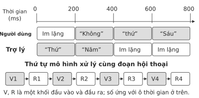

Xem tiếp nửa dưới của hình. Hai bên trong cuộc gọi nghe thấy hai luồng âm thanh có thể chồng lên nhau, còn mô hình thì xử lý xen kẽ khối đầu vào và sinh khối đầu ra dọc theo một chuỗi duy nhất. Im lặng cũng chiếm một ô, nhờ đó trợ lý có thể nghe một lúc rồi mới mở lời. 200 mili giây trong hình là độ dài khối của cách hiện thực này; từ lúc người dùng chen lời đến khi loa thực sự dừng, còn phải tính thêm thời gian xử lý và bộ đệm phát.

[^ch6-moshi]: Kyutai, *Moshi: a speech-text foundation model for real-time dialogue*, 2024, giới thiệu các luồng âm thanh song song của người dùng và mô hình.
[^ch6-14]: Thinking Machines Lab, *Interaction Models: A Scalable Approach to Human-AI Collaboration*, giới thiệu vi lượt, tương tác đa luồng và ủy thác tác vụ nền.

### Thời gian nhận thức: tương tác thời gian thực và suy nghĩ sâu

Trong các cuộc gọi tổng đài của Pine, khi tổng đài viên nói được nửa câu, có lúc trợ lý nên chờ, có lúc nên khẽ đáp một tiếng; khi chính mình đang nói, nó cũng phải nghe được lời sửa mà đối phương chen vào. Đây chính là lý do tác giả đánh giá cao hướng đi của Moshi: nắm thời điểm tốt thì đối phương mới cảm thấy đầu dây bên này thực sự có người đang nghe. Gặp yêu cầu phải tra cứu, lại phải tính thêm một bài toán thời gian khác: từ lúc hiểu câu hỏi đến lúc đọc ra câu trả lời tra được, phải qua tay bao nhiêu lần?

Công cụ nào mô hình giọng nói ở tiền cảnh gọi trực tiếp được thì để tiền cảnh gọi. Tra chuyến bay chỉ cần hai lần gọi mô hình: tiền cảnh truy vấn theo điều kiện người dùng đưa ra, rồi báo kết quả. Ủy thác thì cần bốn lần: tiền cảnh giao việc, hậu cảnh gửi truy vấn, hậu cảnh sắp xếp kết quả, tiền cảnh thuật lại. Một quan điểm khác cho rằng mô hình thời gian thực có thể điền sai tham số, nên để hậu cảnh gọi công cụ, còn tiền cảnh tập trung phán đoán khi nào nghe, khi nào nói.

Tiền cảnh của GPT-Live-1 không có giao diện gọi trực tiếp các hàm nghiệp vụ, chỉ có thể ủy thác cho Agent hậu cảnh. GPT-Realtime của OpenAI Realtime hỗ trợ tiền cảnh gọi hàm trực tiếp. Mô hình giọng nói thời gian thực Doubao 3.0 (Seeduplex) ở chế độ end-to-end thuần cũng hỗ trợ tiền cảnh gọi trực tiếp, còn khi điều phối lai thì do mô hình ngôn ngữ gắn ngoài gọi.[^ch6-voice-tools]

Đặt thời gian mỗi lần gọi mô hình tiền cảnh và hậu cảnh lần lượt là $L_f$ và $L_b$, thời gian công cụ là $T$. Từ lúc người dùng nói xong đến lúc nghe được kết quả, gọi trực tiếp mất khoảng $2L_f+T$, ủy thác mất khoảng $2L_f+2L_b+T$. Phần $2L_b$ tăng thêm khi ủy thác không phụ thuộc thời gian công cụ $T$. Những thông tin như bộ nhớ người dùng, lượt nào cũng có thể dùng đến, có thể để runtime tra sẵn rồi đặt vào ngữ cảnh, tiền cảnh chỉ cần gọi mô hình một lần, mất khoảng $L_f+T$; nếu đã tra xong trước khi người dùng mở lời, thì bớt được cả $T$.

Những tác vụ cần suy luận nhiều bước, chẳng hạn so sánh vài phương án đổi vé, nên giao cho hậu cảnh. Đặt vé liên quan đến trừ tiền và xuất vé, nên dù ai gọi công cụ thì cũng phải đợi người dùng xác nhận mới đặt. Kết quả chuyến bay có thể tóm tắt bằng lời, bảng đầy đủ thì hiển thị trên màn hình; điều này không liên quan đến việc ai gọi công cụ.

> **Thí nghiệm 6-7 ★★: Công cụ của Agent giọng nói nên do tiền cảnh hay hậu cảnh gọi**
>
> Dùng mô hình giọng nói thời gian thực Doubao 3.0 dựng tiền cảnh, dùng DeepSeek V4 Pro do Volcano Ark cung cấp dựng hậu cảnh. Chuẩn bị năm công cụ giả lập: tra thời tiết, tra bộ nhớ người dùng, tìm kiếm web, tra chuyến bay và đặt vé, cho chúng trả kết quả theo thời gian định sẵn, trong đó tra chuyến bay và đặt vé phải chờ 2–5 giây. Tổng hợp sẵn bản ghi âm của người dùng, mỗi lần phát lại cùng bản ghi âm của cùng một kịch bản.
>
> Đặt bốn kiểu phân công. Kiểu thứ nhất để tiền cảnh gọi mọi công cụ. Kiểu thứ hai để hậu cảnh gọi mọi công cụ, tiền cảnh chỉ được ủy thác. Hai kiểu còn lại đều để tiền cảnh tra thời tiết, runtime đặt bộ nhớ người dùng vào ngữ cảnh khi bắt đầu phiên, hậu cảnh lo tìm kiếm web và đặt vé. Khác biệt giữa hai kiểu này là việc tra chuyến bay do tiền cảnh hay hậu cảnh đảm nhận. Tiền cảnh nghe trực tiếp giọng người dùng; hậu cảnh không nghe được tiếng, chỉ đọc được chữ. Giao diện của Doubao, sau khi nghe hết mỗi câu của người dùng, sẽ trả thêm phần chữ do nhận dạng giọng nói tạo ra, gọi là bản phiên âm. Khi ủy thác, bản phiên âm và những gì trợ lý đã nói được sắp theo thứ tự thời gian thành biên bản cuộc gọi, rồi giao cho hậu cảnh cùng với các lời gọi công cụ đã thực hiện trong cuộc gọi này và mô tả tác vụ do tiền cảnh viết. Với mỗi kiểu phân công, lặp lại mỗi kịch bản dưới đây 10 lần.
>
> 1. Tra riêng thời tiết và chuyến bay. Bấm giờ từ lúc người dùng nói xong đến khi nghe được kết quả tra cứu; những câu chuyển tiếp như "để tôi tra một chút" không tính là câu trả lời. So sánh trung vị thời gian chờ của gọi trực tiếp và ủy thác. Trong thí nghiệm của tác giả, khi tra thời tiết, hai con số lần lượt là 2,81 giây và 6,96 giây.
> 2. Tra chuyến bay trước, rồi chọn vé và xác nhận. Đối chiếu với kết quả truy vấn lượt trước, lời người dùng vừa nói và hồ sơ người dùng, kiểm tra lần lượt 13 trường của đơn đặt vé, và kiểm tra thời điểm đặt có muộn hơn lúc người dùng xác nhận không. Trong thí nghiệm của tác giả, cả bốn kiểu phân công đều điền đúng mọi trường và đều chỉ đặt sau khi người dùng xác nhận.
> 3. Đổi sang đặt vé cho đồng nghiệp, phát bản ghi âm đọc tên: "Trần Gia Di, Trần bộ Nhĩ Đông, Gia trong gia thưởng, Di trong di nhiên." Đối chiếu bản ghi âm, bản phiên âm và tên trên đơn, kiểm tra cả đặt vé trực tiếp ở tiền cảnh lẫn đặt vé qua ủy thác có điền đúng tên không. Trong thí nghiệm của tác giả, tiền cảnh đặt trực tiếp đúng cả 10 lần; bản phiên âm lại ghi thành một tên khác đồng âm, nên khi ủy thác có những đơn điền sai tên.
> 4. Phát bản ghi âm hỏi thời tiết trước khi kết quả tra chuyến bay trả về, nghe xem tiền cảnh có trả lời câu hỏi thời tiết không, rồi có đọc ra kết quả chuyến bay không. Trong thí nghiệm của tác giả, câu hỏi thời tiết đều được trả lời, nhưng kết quả chuyến bay ban đầu hầu như không được nói ra nữa.

Khi cần ủy thác, tiền cảnh nên ghi vào mô tả tác vụ những tên người, con số mà nó chắc chắn và những lời sửa người dùng vừa đưa ra, để hậu cảnh không điền sai tham số vì lỗi phiên âm. Runtime nên ghi lại những kết quả chưa được nói ra, để tiền cảnh trả lời xong câu hỏi chen ngang thì tiếp tục báo cáo.

Mô hình nhanh nói một câu "để tôi tra một chút" có thể cho tổng đài viên biết trợ lý đã nghe rõ yêu cầu. Còn khi nào đọc ra được giá vé thì tùy vào việc truy vấn và suy luận phối hợp với cuộc gọi thế nào. Hình 6-11 thể hiện ba cách sắp xếp: phản hồi trước rồi trả lời sâu, tiền cảnh tương tác liên tục và nhận gợi ý từ hậu cảnh, và việc hình thành ý cùng biểu đạt tiến song song theo từng đoạn.

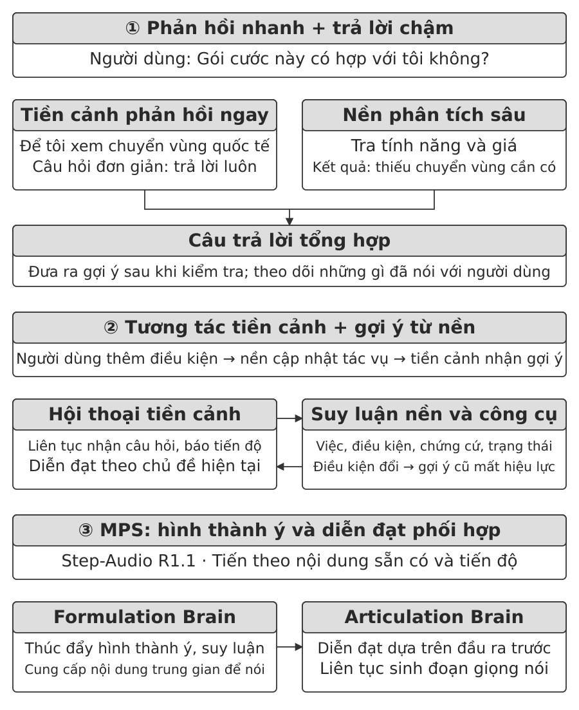

#### Phương án 1: nghĩ nhanh để phản hồi, nghĩ chậm để trả lời

Mô hình nhanh đưa ra một phản hồi ngắn trước, mô hình chậm hoàn tất phân tích ở hậu cảnh rồi bổ sung câu trả lời chi tiết. Thiết kế này xác nhận được sớm rằng yêu cầu đã được tiếp nhận, nhưng phải quản lý tính nhất quán giữa hai lần trả lời. Ví dụ, mô hình nhanh gợi ý mua một gói dịch vụ, sau đó mô hình chậm phát hiện gói này thiếu một tính năng then chốt, hai lời gợi ý sẽ mâu thuẫn. Gốc rễ của mâu thuẫn là hai bên trả lời độc lập, căn cứ phán đoán và tiến độ suy luận có thể khác nhau. Lời gợi ý mô hình nhanh đã nói ra đi vào phán đoán của người dùng, người dùng thậm chí có thể hành động theo nó; mô hình chậm sửa lại sau đó thì còn phải giải thích thay đổi và xử lý những ảnh hưởng đã phát sinh.

Vì vậy, tiền cảnh nên phân biệt xác nhận tác vụ với kết luận nghiệp vụ. "Tôi sẽ kiểm tra xem gói này có tính năng đó không" có thể nói ngay, còn lời khuyên mua hàng thì phải chờ những truy vấn và phân tích cần thiết. Khi kết quả hậu cảnh trả về, hệ thống đối chiếu nó với những gì đã nói ra rồi mới tổ chức câu trả lời tiếp theo. Câu hỏi đơn giản có thể để mô hình nhanh trả lời luôn, bớt xử lý lặp.

#### Phương án 2: nghĩ nhanh để tương tác, nghĩ chậm để nhắc

Giọng nói và màn hình cũng có thể phân công. Nói bằng lời "hóa đơn tháng này nhiều hơn 15 euro phí chuyển vùng", người dùng nắm ngay trọng điểm; để số tiền gốc, giá hiện tại và chi tiết tranh chấp trên màn hình, người dùng có thể đối chiếu theo tốc độ của mình. Xác nhận một thao tác cụ thể thì có thể nhấp chọn, thông tin nhạy cảm thì để người dùng tự điền trên giao diện nhập liệu mà doanh nghiệp chấp nhận. Tiền cảnh chỉ cần nhận trạng thái kiểu "đã xác minh xong" là có thể nối lại cuộc trò chuyện một cách tự nhiên.

Giả sử một hành khách nhờ Pine đặt vé máy bay đi Thượng Hải sáng thứ Năm, ngân sách 1200 tệ, phải đến hội trường trước buổi trưa. Pine vừa nói chuyện với tổng đài hãng hàng không, vừa "chuyển mẩu giấy" cho hậu cảnh: "Nếu mười giờ sáng đến Hồng Kiều, từ sân bay tới hội trường có kịp không?" Tổng đài viên tra xong số vé còn lại và nói với Pine: "Chuyến mười giờ đến Hồng Kiều hết vé rồi. Còn một chuyến mười giờ rưỡi đến Phố Đông, giá 1250 tệ." Nếu hậu cảnh chỉ thấy được mẩu giấy tiền cảnh chuyển sang, nó vẫn đang tính quãng đường xuất phát từ Hồng Kiều. Tiền cảnh phải dặn thêm một câu: "Tính lại theo Phố Đông, hạ cánh mười giờ rưỡi, hội trường và giờ phải có mặt giữ nguyên."

Một cách khác là đồng bộ cả biên bản cuộc gọi theo thứ tự cho hậu cảnh. Hậu cảnh đã đọc được từ biên bản sân bay và giờ hạ cánh mà tổng đài viên báo, tiền cảnh chỉ cần nói "tính xem chuyến này có kịp không" là ủy thác được cùng một việc. Khi đồng bộ biên bản phải ghi rõ ai nói gì; nửa câu tiền cảnh bị ngắt, chưa phát ra cũng phải được phân biệt với những gì đã nói ra. Bản phiên âm có thể ghi sót hoặc ghi sai thông tin then chốt. Tiền cảnh nên ghi vào mô tả tác vụ những tên người, con số nó nghe chắc và các lời sửa của người dùng. Khi hai bản ghi không khớp, hậu cảnh lấy mô tả tác vụ làm chuẩn. Hậu cảnh tra xong chỉ cần báo cho tiền cảnh dự kiến mấy giờ đến được hội trường và thời gian sít sao đến đâu. Đã tra những tuyến đường nào, giao diện bản đồ trả về những trường gì thì có thể để lại ở hậu cảnh để tra cứu khi cần. Tiền cảnh cầm kết quả ấy tiếp tục trao đổi với tổng đài viên.

Vị hành khách đi công tác ở Chương 1 muốn giá vé không quá 1200 tệ. Những chuyến công tác trước, anh sẵn lòng trả thêm một chút cho chuyến bay phù hợp, lần này cũng không đặt thêm mức trần nào khác. Nghe giá thấp nhất là 1250 tệ, trợ lý có thể đặt thay anh. Còn nếu là một người dùng vốn luôn chi tiêu chặt chẽ đang đưa gia đình đi chơi, thì 50 tệ này phải hỏi trước. Khi đó tiền cảnh phải cùng lúc lo hai cuộc hội thoại:

- Gửi người dùng: "Chuyến này rẻ nhất là 1250 tệ, vượt ngân sách 50 tệ. Bạn có muốn đặt không?"
- Rồi hỏi tổng đài viên: "Chuyến này giữ giá giúp tôi một lúc được không? Cùng ngày, đi muộn hơn một chút, có chuyến nào dưới 1200 tệ không?" Trong lúc tổng đài viên tra vé, tiền cảnh còn có thể hỏi rõ tiêu chuẩn hành lý và điều kiện hoàn đổi.

Như vậy, khi người dùng quay lại sẽ thấy vài lựa chọn, tổng đài viên cũng biết tiếp theo cần tra gì. Nếu sau đó người dùng giải thích "lần trước là vì gấp đi họp, sau này đi công tác mà vượt ngân sách thì cũng hỏi tôi trước", thì lần sau phải làm theo yêu cầu mới này.

Lúc chờ chính chủ xác minh, nhịp trò chuyện lại khác. Tổng đài viên nói mã xác minh đã gửi, tiền cảnh có thể đáp: "Vâng, xin chờ một chút, tôi nhờ hành khách xem điện thoại." Nếu hành khách nhắn lại là chưa nhận được, thì hỏi tổng đài viên tin nhắn đã gửi tới số có đuôi nào, bao lâu nữa có thể gửi lại. Hành khách xác minh xong trên kênh do doanh nghiệp chỉ định thì tiền cảnh có thể làm tiếp. Trong những cuộc gọi như vậy, chờ thêm một lúc hay xuất vé muộn hơn một chút đều thích hợp hơn là giục người dùng quyết định ngay tại chỗ.

Đúng lúc này, hậu cảnh gửi tới "báo giá ban đầu đã được cập nhật". Tiền cảnh xác minh giá mới với tổng đài viên trước rồi mới báo người dùng. Nếu người dùng vừa đúng lúc ấy trả lời "đặt đi", câu trả lời này ứng với báo giá 1250 tệ gửi cho họ trước đó. Tiền cảnh phải căn cứ vào giá mới và ủy quyền đã có để phán đoán có cần xác nhận lại không. Hậu cảnh chỉ cung cấp thông tin, người trò chuyện với tổng đài viên và đưa ra cam kết luôn là tiền cảnh. Tin nhắn phải mang theo chuyến bay, điều kiện áp dụng giá và thời điểm, tiền cảnh mới nhận ra báo giá nào đã hết hạn.

Cùng một tin nhắn hậu cảnh "giá đã thay đổi, vui lòng xác minh", đến vào thời điểm khác nhau cũng làm thay đổi cách tiền cảnh tiếp lời. Nếu tổng đài viên vừa nói "giá vé thấp nhất là…", tiền cảnh có thể nghe hết con số trước. Nếu tổng đài viên đã báo giá xong và đang chờ trả lời, đây là lúc thích hợp để hỏi lại giá mới. Nếu hành khách vừa chen vào cuộc gọi "khoan, tôi đổi ngày", thì nghe rõ ngày mới trước, rồi mới quyết định có còn cần xác minh chuyến bay cũ không. Cùng một câu "vâng", nói lúc tổng đài viên đang giới thiệu điều khoản có thể chỉ có nghĩa là đang nghe, nhưng nói sau câu "Bây giờ tôi xuất vé cho anh nhé?" thì có thể bị hiểu là đồng ý mua. Chỉ nhìn văn bản phiên âm sẽ bỏ sót những khác biệt như vậy.

#### Phương án 3: hình thành ý và biểu đạt cùng tiến

Dòng Step-Audio đưa ra hai ví dụ liên quan. **Chưng cất suy luận neo vào phương thức (MGRD)** quan tâm đến thông tin mà suy luận dựa vào: xây dựng và chọn lọc dữ liệu suy luận xoay quanh các đặc trưng âm học như cao độ, nhịp điệu, ngữ điệu, rồi cải thiện khả năng hiểu âm thanh bằng chưng cất lặp. Ở giai đoạn học tăng cường, Step-Audio R1 chấm câu hỏi âm thanh theo hai mục: trả lời đúng được 0,8 điểm, đưa ra quá trình suy luận được thêm 0,2 điểm. Mục sau khuyến khích mô hình viết ra căn cứ; còn suy luận có dùng manh mối âm học trong bản ghi âm hay không thì phải kiểm tra ở khâu chọn lọc mẫu trước đó.[^ch6-mgrd]

**Mind-Paced Speaking (MPS)** quan tâm đến nhịp thời gian giữa suy luận và biểu đạt, dùng một mô-đun hình thành ý (Formulation Brain) và một mô-đun biểu đạt (Articulation Brain), để quá trình hình thành ý dẫn dắt việc sinh giọng nói. Phương án thời gian thực của Step-Audio R1.1 dùng phương pháp này.[^ch6-mps]

Hai mô-đun trao đổi thông tin theo tiến độ: việc hình thành ý tiến liên tục, mô-đun biểu đạt căn cứ vào nội dung đã sẵn có và những gì đã nói trước đó để tổ chức giọng nói. Như vậy một phần biểu đạt có thể chồng lên suy luận phía sau, đồng thời vẫn theo dõi được những gì đã nói.

[^ch6-mgrd]: StepFun, *Step-Audio-R1 Technical Report*, giới thiệu chưng cất suy luận neo vào phương thức.
[^ch6-mps]: StepFun, *Mind-Paced Speaking: A Dual-Brain Approach to Real-Time Reasoning in Spoken Language Models* và thẻ mô hình Step-Audio-R1.1, giới thiệu hai mô-đun hình thành ý và biểu đạt cùng ứng dụng của chúng trong hệ thống thời gian thực.

#### Phân công mô-đun và cách nâng cấp

**Tác giả coi trọng một ưu thế kỹ thuật của việc phân công nhanh–chậm: năng lực tương tác và năng lực suy luận có thể tiến hóa riêng.** Khi có mô hình suy luận mạnh hơn, hệ thống có thể thay hậu cảnh. Như vậy, hậu cảnh theo kịp tiến bộ của mô hình suy luận, còn tiền cảnh cũng liên tục cải thiện trải nghiệm lắng nghe, phản hồi và chen lời. Tiền cảnh cần hiểu tác vụ và các thông tin người dùng bổ sung, hậu cảnh thì tập trung vào suy luận, lập kế hoạch và thực thi dài hơn.

**Khi mô hình suy luận lặp nhanh mà đội ngũ lại cần liên tục nâng cấp năng lực nghiệp vụ, tác giả ưu tiên kiểu phân công nhanh–chậm có thể thay thế.** Cách phân công này tránh được gánh nặng mỗi lần nâng cấp mô hình suy luận lại phải huấn luyện lại cả hệ thống giọng nói. Khi cần để suy luận trung gian điều khiển trực tiếp hơn việc biểu đạt, và có nguồn lực huấn luyện tương ứng, mới dùng phương án phối hợp chặt chẽ hơn.

Agent giọng nói của Pine AI dùng kiến trúc phối hợp giữa suy nghĩ nhanh ở tiền cảnh và suy nghĩ chậm ở hậu cảnh. Bài viết công khai của họ báo cáo kết quả đứng đầu bảng xếp hạng ở hạng mục giọng nói của τ²-bench, và giới thiệu cách kết hợp cuộc gọi liên tục, suy luận nghiệp vụ và thao tác công cụ[^ch6-17].

Để hiểu các tổ hợp này, có thể phân biệt ba chiều thiết kế: **đường âm thanh** quyết định mô hình xử lý trực tiếp âm thanh hay bàn giao qua phiên âm; **nhịp nghe–nói** quyết định đầu vào và đầu ra tiến theo lượt hay song song; **phân công nhận thức** quyết định tương tác thời gian thực và suy luận sâu chia sẻ trạng thái, trao đổi kết quả ra sao. Một hệ thống có thể xử lý trực tiếp âm thanh và giữ full-duplex, đồng thời giao tác vụ phức tạp cho một mô hình hậu cảnh độc lập. Mô hình tương tác của Thinking Machines Lab và GPT-Live đều thể hiện kiểu tổ hợp này.

[^ch6-17]: Pine AI, *The Most Natural Human-Computer Interface Is Your Voice*, giới thiệu kiến trúc suy nghĩ nhanh–chậm và kết quả đánh giá tác vụ giọng nói mà họ báo cáo. Báo cáo gọi bảng xếp hạng này là τ²-bench voice.

### Tổng hợp giọng nói giống người hơn

Khoảng ngừng, tốc độ nói và trọng âm giúp người nghe hiểu cấu trúc câu và ý định của người nói. Ví dụ, đọc số điện thoại thì cần chia nhóm hợp lý, giải thích điều khoản phức tạp thì có thể nói chậm lại, chờ kết quả truy vấn thì có thể nói trước mình đang xử lý gì. Theo tác giả, khoảng ngừng và thay đổi nhịp điệu hợp lý khiến giọng nói tự nhiên hơn, cũng giúp người dùng nghe ra tác vụ đang tiến triển ra sao. Việc điều khiển giọng nói có thể được thiết kế xoay quanh những công dụng cụ thể này.

LLM chính có thể chèn thẻ điều khiển vào văn bản, như `[THINKING]`, `[EMO:happy]` và `[SPEED:0.8x]`. Tầng thực thi phân tích thẻ, chia văn bản thành các đoạn giọng nói và đoạn ngừng, rồi ánh xạ sang cảm xúc, phong cách hoặc giọng tham chiếu mà giao diện tổng hợp hỗ trợ. Ý nghĩa của thẻ do ứng dụng định nghĩa: `0.8x` có thể ánh xạ thành mức tốc độ chậm; khoảng ngừng có thể do trình phát chèn vào, còn tiếng cười, tiếng thở dài thì được biểu đạt qua thẻ âm thanh hoặc năng lực sinh mà hệ thống hỗ trợ.

Phương án giọng tham chiếu tổ chức các cách biểu đạt khác nhau của cùng một người nói thành một thư viện. Mỗi đoạn văn bản chọn cảm xúc, tốc độ nói và phong cách phù hợp, tổng hợp xong thì ghép theo thứ tự. Trạng thái điều khiển cần quy định phạm vi tác dụng, ví dụ cảm xúc kéo dài đến lần sửa tiếp theo, còn khoảng ngừng chỉ có hiệu lực tại vị trí hiện tại.

> **Thí nghiệm 6-8 ★★: TTS điều khiển bằng thẻ dựa trên Fish Audio**
>
> Thí nghiệm này dùng Fish Audio S1 dựng một thư viện giọng nói gồm 24 giọng tham chiếu: tổ hợp của bốn cảm xúc, ba mức tốc độ và hai phong cách. Bộ phân tích chuyển câu trả lời có gắn thẻ thành các đoạn giọng nói và đoạn im lặng, tầng thực thi chọn giọng tham chiếu cho từng đoạn và hoàn tất tổng hợp.
>
> So sánh ba cấu hình: không có thẻ điều khiển, một giọng tham chiếu và nhiều giọng tham chiếu. Giữ nguyên nội dung câu trả lời, kiểm tra thẻ có được định tuyến tới cấu hình mong đợi không, rồi nghe các thay đổi về khoảng ngừng, cảm xúc và âm sắc.
>
> Bài nghe thử đã lưu dùng một mô hình hiểu âm thanh, trình bày ba cấu hình theo thứ tự luân phiên, đánh giá độ tự nhiên, độ khớp cảm xúc, khoảng ngừng suy nghĩ, độ nhất quán âm sắc và cảm giác tổng đài viên. Nhóm nhiều giọng tham chiếu đạt điểm tổng hợp cao nhất, nhóm một giọng tham chiếu thấp hơn nhóm không có thẻ.

## Computer Use: Agent tự động hóa GUI

Giả sử bạn nhờ Agent sửa địa chỉ nhận hàng trên một trang web. Nó phải tìm ô địa chỉ, nhập địa chỉ mới, rồi dựa vào nội dung hiển thị lại để xác nhận đã lưu. Nếu ngay trước cú nhấp bật lên một hộp đăng nhập, thì dù tọa độ nút trong ảnh chụp màn hình trước không đổi, đối tượng của cú nhấp này cũng đã khác. Computer Use thao tác trình duyệt, bảng tính hay phần cài đặt hệ thống qua màn hình, chuột và bàn phím; bài học cốt lõi của nó là làm cho mỗi hành động theo kịp giao diện đang hiện trước mắt.

Theo vòng lặp **cảm nhận—suy nghĩ—hành động** ở Hình 6-12, hãy xem trước khi nhập địa chỉ mới, mô hình phải xác nhận những gì. Nó chọn vị trí nhấp dựa trên ảnh chụp màn hình và tiến độ tác vụ, Harness kiểm tra tham số và quyền hạn, rồi giao cho tầng thực thi. Nhấp thành công chỉ có nghĩa là cú nhấp đã được gửi đi. Trong ảnh chụp màn hình tiếp theo, tiêu điểm nhập liệu nằm ở đâu mới quyết định bước tiếp theo có nhập địa chỉ an toàn được hay không.

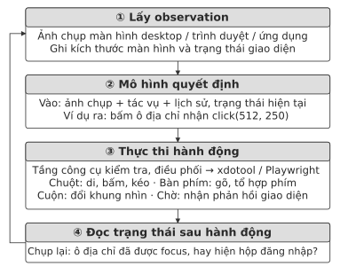

Trợ lý điền xong địa chỉ, nó nên báo cho bộ thực thi biết mình muốn nhấp nút "Lưu" nào bằng cách nào? Tọa độ màn hình và số hiệu phần tử đều chỉ định được mục tiêu, nhưng đòi hỏi khác nhau ở mô hình và công cụ.

### Thiết kế không gian hành động

Trong Hình 6-13, bản hiện thực tham chiếu Computer Use của Anthropic cung cấp ba loại công cụ: giao diện đồ họa, thực thi lệnh và chỉnh sửa tệp. Chỉ xét riêng loại giao diện đồ họa, dữ liệu đã có hai hướng đi: hành động nhấp được gửi tới phía thực thi, ảnh chụp màn hình sau khi nhấp được gửi về mô hình làm quan sát cho lượt quyết định tiếp theo. API nguyên bản quy định định dạng công cụ; nếu đổi sang mô hình khác, tầng điều hợp phải chuyển ảnh chụp, yêu cầu hành động và kết quả thực thi thành những tin nhắn mà giao diện tương ứng nhận được.[^ch6-computer-tools]

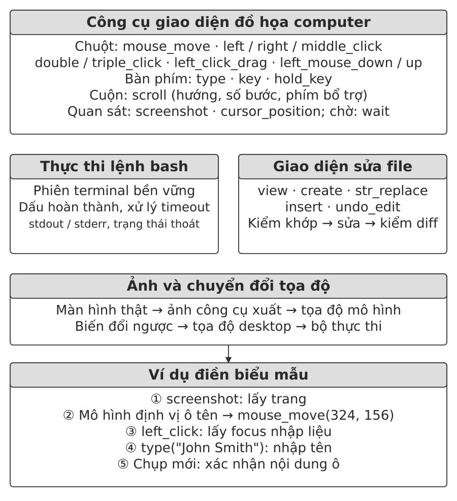

**Công cụ thao tác GUI.** Hành động chuột gồm di chuyển, nhấp chuột trái/phải/giữa, nhấp đúp, nhấp ba lần và kéo thả; giao diện chi tiết hơn có thể biểu đạt riêng việc nhấn xuống và nhả ra. Cuộn cần hướng và biên độ, một số cách hiện thực còn hỗ trợ phím bổ trợ. Giao diện bàn phím cung cấp nhập văn bản, tổ hợp phím và giữ phím. Ảnh chụp màn hình và vị trí con trỏ dùng để lấy trạng thái, còn giao diện chờ thì dành thời gian cho trang tải hoặc hiệu ứng chuyển động. Phiên bản công cụ quyết định tập hành động cụ thể, Harness kiểm tra tham số theo giao diện đang dùng.

**Công cụ thực thi lệnh.** Terminal bền vững có thể giữ thư mục làm việc và trạng thái môi trường qua các lần gọi. Ví dụ, một lần gọi chuyển thư mục thì lần gọi sau tiếp tục chạy trong thư mục đó. Bản hiện thực tham chiếu có thể dùng chuỗi canh (sentinel) để nhận biết lệnh đã xong, và đặt thời gian chờ tối đa; trạng thái tiến trình sau khi quá hạn vẫn phải do bộ thực thi kiểm tra.

**Công cụ chỉnh sửa tệp.** Giao diện thay thế chuỗi xác định phạm vi sửa qua văn bản gốc, cũng có thể cung cấp xem, tạo, chèn và hoàn tác. Trước khi thực thi, kiểm tra vị trí và số lần khớp; sau khi thực thi, kiểm tra phần khác biệt; nếu tệp thay đổi giữa hai lần gọi, đọc lại nội dung liên quan trước. Các chiến lược chỉnh sửa giới thiệu ở Chương 5 có thể dùng lại ở đây.

> **Thí nghiệm 6-9 ★: Chạy bản hiện thực tham chiếu Computer Use của Anthropic**
>
> Thí nghiệm này dùng desktop Ubuntu, trình duyệt và tầng thực thi công cụ do ví dụ container chính thức cung cấp. Người dùng nhập tác vụ, mô hình đọc ảnh chụp màn hình và trả về hành động, tầng thực thi thao tác trên desktop rồi đưa ảnh chụp mới về cho mô hình.
>
> Tác vụ đi kèm là tra thời tiết San Francisco. Trajectory đã lưu truy cập Google trước, gặp mã CAPTCHA thì theo chỉ dẫn khôi phục trong lúc chạy chuyển sang dữ liệu Open-Meteo đọc công khai được, cuối cùng báo cáo nhiệt độ và tình trạng thời tiết. Bản ghi gồm 15 hành động trên desktop cùng các ảnh chụp tương ứng, có thể kiểm tra từng lượt xem nhấp chuột, nhấn phím, nhập chữ và chờ đã làm trang thay đổi thế nào.
>
> Đường dùng mô hình mở điều khiển trình duyệt xem Thí nghiệm 6-10.

### Định vị trực quan (Grounding)

Muốn mô hình nhấp vào ô tìm kiếm, có thể ra đề theo hai cách. Một là cho nó xem ảnh chụp màn hình và bảo nó báo tọa độ nhấp. Hai là đánh số các mục tiêu ứng viên rồi bảo nó chọn ô tìm kiếm; số hiệu có thể ghi trên các vùng ứng viên trong ảnh chụp, cũng có thể lấy từ danh sách phần tử mà trình duyệt cung cấp. Dưới đây lần lượt giới thiệu ba hướng này. Khi chọn số hiệu, tầng thực thi lo việc khôi phục số hiệu thành mục tiêu thực; khi báo tọa độ trực tiếp, mô hình còn phải ước lượng vị trí mục tiêu, đòi hỏi cao hơn về huấn luyện định vị và việc thích ứng với độ phân giải màn hình.

**Set-of-Mark: đánh dấu trực quan.**

Set-of-Mark (SoM) phủ lên ảnh các số hiệu có thể tham chiếu, nối vùng trực quan với đầu ra của mô hình. Công trình gốc dùng các phương pháp như phân đoạn ảnh để tạo vùng ứng viên, chẳng hạn dùng SAM, SEEM lấy vùng rồi đặt dấu. Mô hình chọn số hiệu, tầng thực thi căn cứ vào vùng tương ứng để xác định vị trí thao tác. Phương pháp này dùng được cho phần mềm desktop hoặc giao diện trò chơi không có DOM, nhưng điều khiển cần nhấp phải nằm trong một vùng có số hiệu, và mô hình còn phải nhìn rõ nó ứng với số hiệu nào.[^ch6-som]

**Chỉ mục phần tử có cấu trúc.**

Trình duyệt còn cung cấp được một loại manh mối khác. Mô hình đối tượng tài liệu (DOM) mô tả trang có những phần tử nào và thứ bậc của chúng, thông tin bố cục cho biết vị trí hiển thị của phần tử, còn cây trợ năng (accessibility tree) giữ vai trò và tên truy cập mà công nghệ hỗ trợ cần. Ví dụ, một nút chỉ có biểu tượng kính lúp, nếu trang cung cấp tên truy cập "Tìm kiếm", Agent có cơ hội tìm ra nó theo vai trò và tên. Lấy các phương án như browser-use làm ví dụ, hệ thống có thể lấy thông tin phần tử qua giao diện gỡ lỗi của trình duyệt như Chrome DevTools Protocol (CDP), nhận diện ô nhập, nút và liên kết, rồi đánh số các phần tử thao tác được trên trang hiện tại. Trong Hình 6-14, mô hình chọn [2] ở góc trên bên phải trang. Số hiệu này biến thành một cú nhấp vào nút Submit như thế nào?

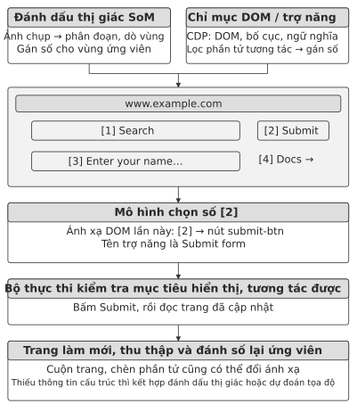

Quá trình xử lý có thể chia làm bốn bước: đọc DOM, bố cục và thông tin trợ năng sẵn có; lọc các phần tử tương tác được; lập bảng ánh xạ số hiệu cho trang hiện tại; giao mô tả phần tử cùng ảnh chụp có đánh dấu cần thiết cho mô hình. Ví dụ, mô hình có thể thấy bốn phần tử có số hiệu như sau:

```text
Trong ảnh chụp màn hình có đánh dấu [1], [2], [3], [4]

[1] <input type="text" placeholder="Search" aria-label="Search" />
[2] <button id="submit-btn" aria-label="Submit form" />
[3] <input type="text" placeholder="Enter your name" value="" />
[4] <a href="/docs" aria-label="Documentation" />
```

Mô hình chọn số hiệu, tầng thực thi phân giải thành tham chiếu phần tử hoặc tọa độ, kiểm tra mục tiêu còn hiển thị và còn tương tác được không, rồi mới thực hiện thao tác. Sau khi trang làm mới, cuộn hoặc chèn phần tử động, phải cập nhật bảng ánh xạ để tránh dùng số hiệu đã hết hạn. Chỉ mục có cấu trúc tận dụng được thẻ, vai trò và văn bản, còn Canvas, phần tử bị che hoặc chú thích ngữ nghĩa không đầy đủ thì phải kết hợp ảnh chụp để phán đoán. Liệt kê càng nhiều phần tử, ảnh chụp càng lớn, thông tin đưa vào ngữ cảnh càng nhiều.

**Dự đoán tọa độ trực tiếp.**

Hướng tọa độ để mô hình xuất thẳng vị trí từ ảnh chụp màn hình và mô tả mục tiêu, ví dụ ánh xạ "nhấp nút gửi" thành một điểm nào đó. Các nghiên cứu định vị GUI như SeeClick và Computer Use của Claude đều dùng đầu ra tọa độ. Tầng thực thi lo chuyển tọa độ ảnh sang tọa độ desktop thực.

Khi ảnh chụp bị co giãn, hai hệ tọa độ phải dùng cùng một phép biến đổi. Lấy desktop 2560×1440 làm ví dụ, nếu ảnh gửi cho mô hình là 1366×768, thì tọa độ (683, 384) mà mô hình đưa ra tương ứng với:

$$
x = 683 \times \frac{2560}{1366} = 1280,\qquad
y = 384 \times \frac{1440}{768} = 720
$$

Trong Hình 6-15, tỷ lệ khung hình của hai kích thước gần bằng nhau. Nếu ảnh chụp được thêm viền đen để giữ tỷ lệ, tọa độ mô hình đưa ra sẽ gồm cả phần viền; trước khi đổi về tọa độ màn hình gốc, phải trừ độ lệch phần đệm tương ứng rồi mới nhân theo hệ số co giãn. Việc cắt ảnh, co giãn hiển thị và gốc tọa độ của nhiều màn hình cũng làm thay đổi phép ánh xạ, tầng công cụ nên lưu các tham số biến đổi thực tế.

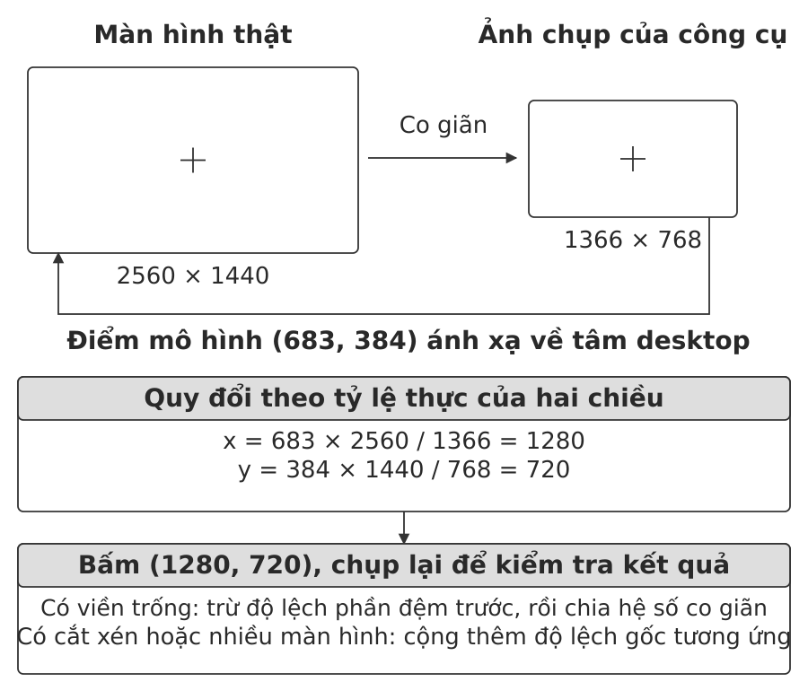

Bản hiện thực tham chiếu từng dùng các kích thước đích như XGA (1024×768), WXGA (1280×800) và FWXGA (1366×768). Ép đổi tỷ lệ khung hình sẽ làm biến dạng hình dạng điều khiển; dùng sai phép ánh xạ ngược thì dự đoán đúng cũng rơi vào vị trí sai.[^ch6-computer-tools]

**Khi thông tin cấu trúc đầy đủ, tác giả ưu tiên dùng chỉ mục DOM hoặc cây trợ năng.** Tên, vai trò và tham chiếu của phần tử có thể tham gia trực tiếp vào việc định vị, giảm phần việc mô hình phải tạm ước lượng vị trí điểm ảnh. Khi thiếu cấu trúc, mô hình thị giác đa năng có thể kết hợp với SoM trước, để mô hình chọn một trong các vùng đã đánh dấu; mô hình đã được huấn luyện định vị GUI thì có thể dự đoán tọa độ trực tiếp, bỏ qua bước đánh dấu riêng.

> **Thí nghiệm 6-10 ★: Tự động thao tác trình duyệt bằng browser-use**
>
> Thí nghiệm này dùng Qwen3-VL 32B Instruct điều khiển browser-use, sinh hành động từ trạng thái trình duyệt, thông tin phần tử và ảnh chụp màn hình. Tác vụ là tra thời tiết San Francisco: định vị ô tìm kiếm, nhập "San Francisco weather today", gửi truy vấn, rồi trích xuất nhiệt độ và tình trạng thời tiết.
>
> Mã và hướng dẫn chạy của Thí nghiệm 6-10 có hai lối vào. Nếu có khóa OpenRouter, có thể dùng mô hình thị giác được lưu trữ sẵn; nếu đã có dịch vụ tương thích như vLLM, SGLang, có thể trỏ `OPEN_MODEL_BASE_URL` và `OPEN_MODEL_MODEL` tới endpoint và mô hình của mình, rồi đặt khóa theo yêu cầu của dịch vụ. Cả hai hướng đều chạy `python main.py --dry-run` trong thư mục thí nghiệm trước để xem cấu hình, rồi theo hướng dẫn khởi động truy vấn thực.
>
> Lần chạy đã lưu hoàn tất 16 bước tương tác và giữ lại 15 ảnh chụp màn hình. Khi Google hiện mã CAPTCHA, tác vụ chuyển sang lấy kết quả từ weather.com.

[^ch6-computer-tools]: Anthropic, tài liệu công cụ Computer Use và bản hiện thực tham chiếu, giới thiệu giao diện hành động có phiên bản, tầng thực thi và cách xử lý ảnh chụp màn hình.
[^ch6-som]: Microsoft, *Set-of-Mark Prompting*, 2023; phần hiện thực dịch vụ DOM của browser-use cung cấp ví dụ xử lý phần tử có cấu trúc.

### Agent Computer Use xem được hoạt ảnh, nghe được âm thanh

Trang chỉ thoáng hiện "Đồng bộ thất bại" sau khi lưu, nhưng hai ảnh chụp màn hình cách nhau vài giây lại đều cho thấy cùng một biểu mẫu. Xem lại hai ảnh này, nhiều khả năng mô hình không khôi phục được điều gì đã xảy ra ở giữa. Video, hoạt ảnh, thông báo thoáng qua và giọng nói trong cuộc họp cũng gặp vấn đề này. **Với giao diện biến đổi liên tục, tác giả chủ trương lấy giao diện quan sát làm đối tượng cải tiến trọng tâm.** Muốn quyết định bước tiếp theo dựa trên thay đổi, thì phải lưu lại cả những sự kiện hay khung hình xuất hiện giữa các hành động.

**Agent–Computer Observation Interface (AOI, giao diện quan sát Agent—máy tính)** do tác giả và cộng sự đề xuất chuyển màn hình và âm thanh liên tục thành hình ảnh và văn bản mà mô hình nhận được[^ch6-9]. Giao diện gồm ba thành phần:

- **Thu khung hình then chốt giữa các hành động.** Theo dõi thay đổi hình ảnh trong lúc vòng lặp chính chạy, lọc khung ứng viên bằng chênh lệch điểm ảnh hoặc một mô hình thị giác nhẹ, rồi giao những khung hữu ích cho lần quyết định tiếp theo.
- **Phiên âm có cổng âm lượng.** Phát hiện có âm thanh thì gọi nhận dạng giọng nói, thêm bản phiên âm và thông tin thời gian vào hồ sơ quan sát, giúp Agent dùng được nội dung cuộc họp hoặc chỉ dẫn bằng lời.
- **Mô tả hình ảnh bền vững.** Tóm tắt các khung hình then chốt thành văn bản; sau khi ảnh gốc bị đưa ra khỏi ngữ cảnh, văn bản vẫn giữ những thay đổi đã xảy ra để các bước sau tham chiếu.

Ví dụ, một video trình diễn một thao tác trên menu; mô hình nhận được khung hình trung gian và mô tả tương ứng thì vẫn có thể tham khảo bước đó sau khi video phát xong. Kết quả ablation của bài báo cho thấy mô tả văn bản bền vững đặc biệt quan trọng đối với mức cải thiện, còn việc chọn khung hình then chốt tinh vi đóng góp ít hơn; một số mô hình khi thêm quá nhiều hình ảnh lại còn kém đi.

Quay lại ví dụ lưu biểu mẫu vừa rồi. Kể cả khi khung hình then chốt chụp được "Đồng bộ thất bại", một khi ảnh gốc bị đưa ra khỏi ngữ cảnh, mô hình chỉ còn dựa vào mô tả để lại. "Trang hiện thông báo" có thể là lưu thành công, cũng có thể là thất bại; "Đồng bộ thất bại, địa chỉ chưa được lưu" mới giữ được manh mối quyết định bước tiếp theo.

[^ch6-9]: Bojie Li, Noah Shi, *Agent-Computer Observation Interfaces Enable Dynamic Computer Use*, 2026, giới thiệu AOI và ablation các thành phần của nó.

### Mô hình thế giới cho Computer Use

Có được quan sát kịp thời rồi, Agent còn phải chọn hành động và chờ thực thi. Nghiên cứu OSWorld-Human đối chiếu hiệu suất thao tác của Agent với trajectory của con người, phân tích các nguồn tốn thời gian như bước thừa và lời gọi mô hình[^ch6-osworld-human].

Mô hình thế giới cung cấp cho việc lập kế hoạch dự đoán về hệ quả của hành động. Trạng thái desktop có thể gồm cửa sổ, tiêu điểm, vị trí cuộn, nội dung đã nhập và tiến độ tải; những thông tin như quyền hạn, kết quả mạng thì phải bổ sung qua giao diện tương ứng. Mô hình căn cứ vào trạng thái hiện có và hành động ứng viên để dự đoán trạng thái tiếp theo:

```text
Trạng thái hiện tại + click / type / scroll / wait → trạng thái tiếp theo dự đoán
```

Khi thao tác máy tính, con người thường đã hình dung bước tiếp theo trước khi nhấp; giao diện đúng như dự kiến thì làm tiếp, có bất ngờ mới dừng lại kiểm tra. Mô hình thế giới có thể cung cấp cho Agent căn cứ tương tự để thực thi suy đoán: bộ lập kế hoạch so sánh trước các hành động ứng viên, chuẩn bị bước sau trong lúc trang đang tải, đợi trạng thái thực được xác nhận thì tiếp tục thực thi, giảm thời gian chờ do mỗi cú nhấp lại phải lập kế hoạch từ đầu. Ví dụ, tạo một tệp Python mới trong VS Code và viết hello world, các thay đổi dự kiến gồm: cây tệp xuất hiện tệp mới, vùng soạn thảo chứa mã, trạng thái lưu được cập nhật. Thực thi xong thì kiểm tra những thay đổi này, đúng dự kiến thì làm tiếp, có sai lệch thì định vị và lập kế hoạch lại.

Những thao tác như xóa tệp còn cần điều kiện thực thi độc lập: mục tiêu có đúng không, có được phép xóa không, có khôi phục được không, và có cần người dùng xác nhận không. Dự đoán giúp hiểu kết quả có thể xảy ra, còn quyền hạn thực tế và điều kiện nghiệp vụ do tầng thực thi kiểm tra.

**Dự đoán trạng thái tiềm ẩn của Photon-1.** Tháng 7 năm 2026, Induction Labs giới thiệu Photon-1: mã hóa khung hình video thành token tiềm ẩn rời rạc, học sự thay đổi trạng thái bằng cách dự đoán các token tiếp theo. Công ty công bố quá trình tiền huấn luyện dùng khoảng 30.000 giờ GPU H200. Việc dự đoán trạng thái diễn ra trong các token tiềm ẩn, một bộ sinh ảnh phụ trợ đảm nhận khôi phục chúng thành hình ảnh xem được để con người kiểm tra dự đoán. Lập kế hoạch và sinh hành động có thể dùng thẳng biểu diễn bên trong, bỏ được chi phí sinh ảnh chụp màn hình đầy đủ ở mỗi bước.[^ch6-20]

Phương án này còn học định dạng chỉ dẫn và hành động qua fine-tuning: dự đoán trước trạng thái muốn đạt tới, rồi sinh thao tác dẫn tới trạng thái đó, và cải thiện kết quả tác vụ bằng huấn luyện trực tuyến trong máy ảo. Fine-tuning có điều kiện hành động thì dùng để dự đoán thay đổi của desktop sau một thao tác cho trước. Hai công dụng này lần lượt nối với lập kế hoạch và mô phỏng, cho thấy biểu diễn trạng thái tham gia vào Computer Use như thế nào.

[^ch6-osworld-human]: Reyna Abhyankar và cộng sự, *OSWorld-Human: Benchmarking the Efficiency of Computer-Use Agents*, phân tích trajectory tác vụ và chi phí thời gian.
[^ch6-20]: David Li, Jonathan Li, *Scaling Video Pretraining with Imagination Models*, Induction Labs, 2026-07-23, giới thiệu tiền huấn luyện, học hành động và mô phỏng trạng thái của Photon-1.
[^ch6-21]: Google DeepMind, *Genie 3: A new frontier for world models*, 2025-08-05; Zachary Lin và cộng sự, *Cosmos World Foundation Model Platform for Physical AI*, 2025.

### Thiết bị di động: giao diện kỹ thuật và hợp tác hệ sinh thái

Trên thiết bị di động vẫn dùng vòng lặp quan sát—quyết định—hành động, nhưng hành động thể hiện nhiều hơn dưới dạng cử chỉ chạm. Cùng một tọa độ có thể là vị trí chạm, vị trí nhấn giữ hoặc điểm bắt đầu vuốt, nên giao diện còn cần loại cử chỉ, thời lượng và đường đi. Xoay màn hình, bàn phím ảo bật lên và hộp thoại hệ thống cũng làm thay đổi vùng thao tác được.

`AccessibilityService` của Android có thể đọc thông tin giao diện và thực hiện hành động tương ứng trong phạm vi được cấp phép, giao diện cử chỉ còn phải khai báo năng lực tương ứng[^ch6-android]. Ảnh chụp màn hình, cây trợ năng và giao diện tự động hóa hệ thống có thể phối hợp với nhau, phạm vi dùng được cụ thể do hệ điều hành, cách hiện thực của ứng dụng và việc cấp quyền quyết định. Các benchmark như AndroidWorld giới thiệu ở Chương 7 kiểm tra trong tác vụ ứng dụng thực xem các hành động này có tạo ra kết quả mong đợi không.

**Theo tác giả, rào cản hệ sinh thái khi triển khai trên di động thường khó xử lý hơn các vấn đề kỹ thuật.** Nền tảng phải xác định thao tác nào được giao cho tác nhân đại diện, tài khoản, thanh toán và dữ liệu được ủy quyền thế nào, và khi xảy ra lỗi thì truy trách nhiệm ra sao. Những quy ước này ảnh hưởng trực tiếp đến phạm vi tác vụ Agent có thể hoàn thành.

Một xung đột lợi ích mang tính cấu trúc đến từ lưu lượng và sự chú ý. Nhiều ứng dụng kiếm doanh thu nhờ hiển thị quảng cáo, đề xuất nội dung và lối vào giao dịch; khi người dùng ủy thác Agent trực tiếp hoàn tất truy vấn hoặc mua hàng, đường duyệt trang có thể ngắn lại, sự chú ý mà đề xuất và quảng cáo nhận được cũng thay đổi. Với những nền tảng kiếm tiền nhờ các khâu này, thao tác của tác nhân đại diện chạm vào nguồn thu vốn có. Vì vậy nền tảng phải cân nhắc lại việc mở giao diện, chia sẻ doanh thu và quản lý danh tính của tác nhân đại diện.

[^ch6-android]: Android Developers, AccessibilityService, giới thiệu năng lực truy cập giao diện, hành động và cử chỉ.

## Thao tác robot: dọn bàn với XLeRobot

Đặt chiếc cốc đỏ vào khay, bỏ tờ giấy vụn màu vàng vào thùng rác, cuối cùng xác nhận mặt bàn đã gọn — nhiệm vụ này nối liền cảm nhận, lập kế hoạch và điều khiển. Khi kẹp gắp tiến gần chiếc cốc, vị trí của nó trong camera thay đổi; khi cốc đã được gắp lên, cánh tay phải tránh các vật khác trên bàn; lần đầu không kẹp được tờ giấy, hệ thống còn phải phát hiện thất bại và thử lại. Mỗi hành động đều làm thay đổi điều kiện cho lần quyết định tiếp theo.

Phần này sắp xếp năm thí nghiệm theo nhiệm vụ đó. Thí nghiệm 6-11 và 6-13 đưa ra thiết kế thực hành cho điều khiển từ xa và thao tác tự chủ trên robot thật; Thí nghiệm 6-12, 6-14 và 6-15 dùng mô phỏng cục bộ, lần lượt nghiên cứu đường cơ sở điều khiển, khôi phục sau thất bại và thay đổi điều kiện thị giác.

Cùng một robot có thể do người liên tục nhìn camera mà điều khiển, cũng có thể do mô hình đọc hình ảnh, chọn kỹ năng rồi giao cho hệ thống điều khiển thực thi. Giữ nguyên nhiệm vụ và phần cứng, có thể phân tích khác biệt giữa hai cách qua bốn câu hỏi: con người muốn hoàn thành điều gì, tiếp theo làm nhiệm vụ con nào trước, kỹ năng hiện tại xuất ra những hành động nào, và môi trường sau hành động có khớp với kế hoạch không. Lập kế hoạch dài hạn sắp xếp thứ tự xử lý cốc và giấy vụn, chính sách VLA hoặc các hành động nguyên thủy định nghĩa sẵn đảm nhận việc gắp và đặt, mô hình thế giới giúp ước lượng hệ quả của hành động, còn việc chuyển giao từ mô phỏng sang thực tế xử lý những thay đổi về hình ảnh, tiếp xúc và đặc tính của cơ cấu chấp hành.

### Phân công giữa phần cứng và thuật toán

Khi việc tự chủ dọn bàn thất bại, có thể dùng điều khiển từ xa để kiểm tra trước xem phần cứng có làm được nhiệm vụ không. Giữ nguyên camera, cánh tay robot, kẹp gắp, cách bày bàn và điều kiện nghiệm thu, để người vận hành tiếp quản vòng kín cảm nhận và điều khiển. Nếu con người hoàn thành ổn định qua nhiều lượt mà hệ thống tự chủ thất bại liên tục, thì bộ phần cứng này đã đủ sức làm nhiệm vụ hiện tại, nút thắt chủ yếu nằm ở thuật toán và phản hồi của điều khiển tự chủ. Khi đó nên ưu tiên rà soát việc định vị vật thể, chọn kỹ năng, thời điểm hành động và khôi phục sau thất bại, để hệ thống tự chủ học được những cách sửa hiệu quả trong điều khiển từ xa.

XLeRobot hỗ trợ điều khiển từ xa bằng bàn phím, tay cầm Xbox và Switch Joy-Con, thao tác VR có thể trải nghiệm trước trong môi trường mô phỏng.[^ch6-1] Khi kẹp gắp tiến gần chiếc cốc, người vận hành giảm tốc; cốc trượt một cái là phải sửa điểm gắp. Kẹp không trúng tờ giấy thì phải nhìn lại; vật đã về chỗ cũng phải liếc lại để xác nhận. Những lần sửa dựa trên quan sát này đều đáng được ghi vào dữ liệu trình diễn. Sau này khi robot tự chủ thao tác, nó cũng phải phát hiện được việc trượt và gắp hụt.

> **Thí nghiệm 6-11 ★: Điều khiển từ xa XLeRobot thật để dọn bàn**
>
> Trong khu vực làm việc của XLeRobot đã hoàn tất hiệu chuẩn, kiểm tra giới hạn hành trình và dừng khẩn cấp, đặt một chiếc cốc đỏ, một khay, một tờ giấy vụn màu vàng và một thùng rác. Dùng một cách điều khiển từ xa đã hiệu chuẩn để thực hiện nhiệm vụ cố định: "Đặt chiếc cốc đỏ vào khay, bỏ giấy vụn màu vàng vào thùng rác, cuối cùng xác nhận trạng thái mặt bàn." Lặp lại nhiều lượt, ghi lại hình ảnh camera, đầu vào của người vận hành, trạng thái cánh tay, thời gian hành động, số lần gắp hụt và số lần thử lại.
>
> Cuối mỗi lượt, xác nhận cốc nằm trong khay, giấy vụn nằm trong thùng rác, cánh tay đã về tư thế an toàn, và kiểm tra hồ sơ va chạm, vượt giới hạn và can thiệp thủ công trong suốt quá trình. Đặt cạnh nhau thất bại xảy ra ở bước nào, người vận hành khôi phục ra sao và kết quả cuối cùng để phân tích, sẽ có được đường cơ sở đối chứng cho điều khiển tự chủ.

Thí nghiệm mô phỏng thì thuận tiện cho việc lặp lại thay đổi số lượng vật thể và vị trí ban đầu, khảo sát riêng quá trình điều khiển khi trạng thái đã biết. Mô hình mặt bàn hai chiều có thể biểu diễn ba giai đoạn tiếp cận vật thể, chuyển đến đích và xử lý vật tiếp theo, dùng số bước hoàn thành và độ dài đường đi để mô tả chi phí điều khiển.

> **Thí nghiệm 6-12 ★: Dựng đường cơ sở điều khiển lý tưởng cho cùng nhiệm vụ trong mô phỏng**
>
> Trên mặt bàn hai chiều, sinh ngẫu nhiên vị trí vật thể và vị trí đích, để bộ điều khiển đọc thẳng tọa độ, lần lượt tiếp cận vật thể, di chuyển tới đích tương ứng, rồi xử lý vật tiếp theo. Thay đổi vị trí ban đầu và số lượng vật thể, so sánh tỷ lệ thành công, số bước hoàn thành và độ dài đường đi.
>
> Trước hết theo dõi trọn vẹn trajectory của một vật thể: bộ điều khiển đến được vật thể thì vào giai đoạn vận chuyển, đến được đích mới được cộng vào số lượng hoàn thành. Sau đó tăng số lượng vật thể, kiểm tra mỗi vật thể đều đi qua hai điều kiện đến nơi này. Mô phỏng hai chiều đi kèm, với năm hạt giống ngẫu nhiên, lần lượt bày 1, 2, 3, 4 vật thể, mỗi tổ hợp chạy 512 lượt, tổng cộng 10.240 lượt đều hoàn thành. Bộ điều khiển có thể đọc thẳng tọa độ, việc di chuyển vật thể cũng không phụ thuộc vào kẹp gắp thật.

### Cấu trúc cơ bản của điều khiển robot

Dọn một lần bàn có thể mất vài phút, nhưng điều khiển khớp lại phải cập nhật liên tục và kịp thời. Hệ thống có thể phân công theo thang thời gian: để lập kế hoạch tầng cao sắp xếp thứ tự nhiệm vụ, để chính sách kỹ năng sinh chuyển động, rồi để bộ điều khiển tầng thấp bám theo mà thực thi:

| Tầng | Câu hỏi cốt lõi | Đầu ra | Ví dụ thang thời gian và cấu hình |
| --- | --- | --- | --- |
| Mục tiêu nhiệm vụ | Con người muốn hoàn thành điều gì | "Đưa cốc và giấy vụn về đúng chỗ" | Nhiệm vụ cấp phút |
| Lập kế hoạch dài hạn | Làm gì trước, làm gì sau | Xử lý cốc trước, rồi giấy vụn, cuối cùng kiểm tra | Giây đến phút |
| Kỹ năng cơ bản | Hiện cần tạo ra thay đổi trạng thái nào | `pick(red_cup)`, `place(red_cup, tray)` | Một kỹ năng có thể kéo dài vài giây, như 1–3 giây |
| VLA / chính sách kỹ năng | Kỹ năng hiện tại cụ thể chuyển động thế nào | Động tác kẹp gắp, tư thế đầu cuối hoặc một đoạn quỹ đạo khớp | Có thể cấu hình suy luận ở 1–10 Hz |
| Điều khiển tầng thấp và tầng an toàn | Thực thi ổn định, kịp thời thế nào | Lượng điều khiển khớp hoặc đầu cuối, giới hạn tốc độ và dừng khẩn cấp | Bộ điều khiển có thể cấu hình từ vài chục đến hàng nghìn Hz |

Bộ lập kế hoạch có thể dùng chương trình quy tắc, VLM hoặc bộ tối ưu, VLA cũng có thể đảm nhận một phần việc chọn kỹ năng. **Lời khuyên của tác giả là xử lý tách biệt thứ tự nhiệm vụ và hành động trước mắt.** Suy luận tầng cao cần thời gian để tổ chức kế hoạch, điều khiển tầng thấp cần phản ứng kịp với thay đổi về vị trí và lực; để hai bên chạy theo nhịp thích hợp của riêng mình mới lo được cả lập kế hoạch lẫn điều khiển.

Phần này cung cấp cho mô hình tầng cao năm loại công cụ `observe_scene`, `pick`, `place`, `verify_state` và `stop`, lần lượt dùng để quan sát, gắp, đặt, kiểm tra và dừng. Harness kiểm tra tham số, khu vực làm việc và trạng thái hiện tại, bộ thực thi chuyển các kỹ năng đã qua kiểm tra thành chuyển động của cánh tay, đồng thời xử lý giới hạn tốc độ và quá thời gian. Góc khớp và quỹ đạo liên tục do chính sách kỹ năng và bộ điều khiển sinh ra, nhờ đó giữa việc mô hình chọn kỹ năng và chuyển động thực tế hình thành một giao diện rõ ràng.

### Lập kế hoạch dài hạn và phân rã nhiệm vụ

Khi người dùng nói "dọn bàn cho sạch", bộ lập kế hoạch trước hết nhận diện các vật thể và khu vực đích của chúng, xác định thứ tự xử lý, và ghi rõ cho mỗi bước điều kiện bắt đầu, điều kiện hoàn thành và giới hạn hành động. Ví dụ, thứ tự dọn có thể là:

```text
Xử lý cốc đỏ → dọn giấy vàng → kiểm tra mặt bàn
```

"Xử lý cốc đỏ" lại tách tiếp thành hai hành động và một lần kiểm tra:

```text
pick(red_cup) → place(red_cup, tray) → verify_state()
```

Lấy "nhấc cốc lên và đặt vào khay" làm ví dụ: cánh tay chạy xong chương trình gắp chỉ cho biết đoạn chương trình ấy đã kết thúc. Trước khi nâng lên ở bước tiếp theo, còn phải dựa vào phản hồi của kẹp gắp hoặc hình ảnh mới để phán đoán cốc đã thực sự được giữ chưa. Nếu gắp hụt thì định vị lại chiếc cốc; nếu có người dời khay đi, lần gắp đã thành công vẫn có hiệu lực, chỉ cần lập kế hoạch lại động tác đặt. Cho mỗi kỹ năng ứng với một thay đổi trạng thái kiểm tra được, giới hạn hành động và thời lượng, rồi trả về trạng thái thực thi và quan sát mới, thì bộ lập kế hoạch có thể khôi phục từ đúng bước đã thực sự hỏng.

> **Thí nghiệm 6-13 ★★: Dùng Gemini Robotics-ER 1.5 điều khiển XLeRobot tự chủ dọn bàn**
>
> Giữ nguyên phần cứng, cách bày bàn, nhiệm vụ và điều kiện nghiệm thu của Thí nghiệm 6-11, để một mô hình suy luận hiện thân đảm nhận quan sát và lập kế hoạch. Tham khảo cách điều phối của RoboCrew, thiết kế năm công cụ cho nhiệm vụ này: `observe_scene`, `pick`, `place`, `verify_state` và `stop`.[^ch6-2]
>
> Mô hình đọc quan sát mặt bàn trước, quyết định thứ tự xử lý, rồi gọi các kỹ năng gắp và đặt đã hiệu chuẩn. Mỗi khi xong một kỹ năng, nó lấy quan sát mới và kiểm tra hậu điều kiện; thất bại thì dựa vào trạng thái hiện tại để chọn thử lại hay dừng. Hệ thống vận hành dừng thực thi ngay khi nhận tín hiệu dừng khẩn cấp, phát hiện vượt giới hạn hoặc không xác nhận được trạng thái then chốt; mô hình cũng có thể chủ động kết thúc nhiệm vụ qua `stop`.
>
> Cuối cùng, một quan sát môi trường mới xác nhận cốc nằm trong khay, giấy vụn nằm trong thùng rác, cánh tay đã về tư thế an toàn, và đối chiếu hồ sơ va chạm cùng vượt giới hạn. Người vận hành chịu trách nhiệm khởi động, dừng khẩn cấp và giám sát tại chỗ, những lần tiếp quản giữa chừng được ghi riêng.

Thí nghiệm 6-13 cho thấy cách tích hợp hành động của robot thật và cách nghiệm thu kết quả dọn bàn, nhưng trong bản ghi đi kèm chưa có lần chạy thử trên robot thật cho nhiệm vụ này. Dưới đây trước hết so sánh ba cách làm trong môi trường mô phỏng: thực thi vòng hở theo kế hoạch, kiểm tra kết quả sau mỗi bước, và dự đoán trước hệ quả của hành động. Mục tiêu nhiệm vụ và năm loại công cụ giữ nguyên, sự cố cũng có thể kích hoạt lặp lại, thuận tiện để quan sát ba cách làm xử lý cùng một lỗi ra sao.

### Điều khiển bằng VLA

VLA là viết tắt của Vision-Language-Action, tức mô hình thị giác—ngôn ngữ—hành động. Nó căn cứ vào hình ảnh hiện tại, chỉ dẫn nhiệm vụ và trạng thái robot sẵn có để sinh ra hành động cần thực hiện tiếp theo:

```text
Quan sát hiện tại + chỉ dẫn kỹ năng → hành động hoặc chuỗi hành động
```

Trong ví dụ dọn bàn, bộ lập kế hoạch tầng cao gửi `pick(red_cup)`, chính sách kỹ năng căn cứ vào hình ảnh để quyết định tiếp cận cốc từ hướng nào, khi nào khép kẹp, và nâng cánh tay theo quỹ đạo nào. Thực hiện xong đoạn chuyển động này, hệ thống lấy lại quan sát mặt bàn, xác nhận cốc đã được kẹp rồi mới chuyển sang `place(red_cup, tray)`. Giao diện công cụ quy ước thay đổi trạng thái mong muốn, còn VLA học cách thực hiện thay đổi đó bằng hành động liên tục.

Hành động có thể dùng nhiều cách biểu diễn khác nhau. RT-2 và OpenVLA nguyên bản lượng tử hóa giá trị của từng chiều hành động thành token rời rạc, xuất ra theo cách sinh của mô hình ngôn ngữ; π₀ dùng flow matching để sinh các khối hành động liên tục. Cách trước thuận tiện tái sử dụng framework sinh tự hồi quy, cách sau mô hình hóa trực tiếp phân phối của một đoạn hành động liên tục.[^ch6-15]

Suy luận của mô hình và điều khiển cơ cấu chấp hành thường dùng tần số cập nhật khác nhau. Chia khối hành động (action chunking) cho mô hình mỗi lần sinh một đoạn ngắn hành động tương lai, để luồng điều khiển thực thi ở tần số cao hơn. Nếu chồng thêm suy luận lên thực thi, hệ thống có thể chuẩn bị khối tiếp theo trong lúc thực thi khối hiện tại, giảm thời gian chờ. Việc nối các khối hành động còn phải xử lý tính liên tục của quỹ đạo và thời hiệu của quan sát: nếu cốc bị chạm xê dịch khi cánh tay đang vươn tới, phần hành động còn lại vẫn có thể nhắm vào vị trí cũ. Rút ngắn đoạn thực sự được thực thi mỗi lần, cập nhật cuốn chiếu bằng quan sát mới, hoặc ngắt hành động khi phát hiện bất thường đều nâng được tốc độ phản ứng; những lựa chọn này cũng làm tăng chi phí suy luận và điều phối.

### Dữ liệu và điều kiện triển khai VLA

Muốn biến "nhấc cốc lên" thành hành động một cách ổn định, phải xử lý đồng thời mấy loại khác biệt sau:

- **Độ bao phủ của dữ liệu huấn luyện**: số trình diễn hành động robot dùng được ít hơn rất nhiều so với chữ và ảnh trên internet; biết "cái cốc" là gì vẫn cần kinh nghiệm gắp thực tế để phán đoán dùng lực thế nào. Trình diễn phải bao được chất liệu, hình dạng, tư thế đặt và điều kiện ma sát của cốc. Cùng một hướng gắp, áp vào cốc sứ và cốc giấy mềm có thể cho kết quả khác nhau.
- **Mục tiêu học hành động và hệ quả**: nhân bản hành vi (behavior cloning) chủ yếu học xem người trình diễn sẽ làm gì trong điều kiện hiện tại. Muốn so sánh hệ quả của nhiều hành động, có thể thêm dự đoán trạng thái hoặc đánh giá kết quả hành động.
- **Thân robot và giao diện**: số bậc tự do, hệ tọa độ, cấu trúc kẹp gắp và độ trễ của cơ cấu chấp hành quyết định hành động được áp vào phần cứng ra sao. Khi chuyển giao chính sách, phải khớp cách biểu diễn hành động, tham số hiệu chuẩn và chu kỳ điều khiển.
- **Thời hiệu của quan sát**: trong lúc thực thi một khối hành động, vật thể có thể di chuyển, bị che hoặc bị đổ. Hệ thống phải quy định khi nào lấy quan sát mới và khi nào dùng nó để cập nhật phần hành động còn lại.

Những điều kiện này nối nhận dạng thị giác, điều khiển kỹ năng và thay đổi của môi trường với nhau. Chất lỏng trong cốc ảnh hưởng đến tốc độ vận chuyển, dây điện ở mép bàn làm thay đổi đường đi khả thi, tiếp xúc giữa tờ giấy và mặt bàn ảnh hưởng đến cách kẹp. Nếu bộ lập kế hoạch so sánh được những hệ quả này từ trước, nó sẽ có thêm căn cứ cho việc chọn kỹ năng.

### Mô hình thế giới

Trong lập kế hoạch robot, có thể hiểu mô hình thế giới có điều kiện hành động là một "bộ dự đoán kết quả hành động": cho trạng thái hiện tại và một hành động ứng viên, nó ước lượng điều gì sẽ xảy ra tiếp theo.

```text
Trạng thái hiện tại + hành động ứng viên
    → dự đoán trạng thái tiếp theo hoặc đoạn tương lai
    → so sánh các kết quả ứng viên
    → chọn hành động, lập kế hoạch lại hoặc dừng
```

Quá trình này gồm ba việc: biểu diễn trạng thái hiện tại, dự đoán thay đổi trạng thái do hành động gây ra, rồi để bộ lập kế hoạch hoặc bộ điều khiển dựa vào đó chọn hành động. Trạng thái có thể là biến có cấu trúc như vị trí vật thể, đã được kẹp hay chưa, cũng có thể là biểu diễn bên trong trích xuất từ hình ảnh. V-JEPA 2 trước hết học biểu diễn và dự đoán trạng thái từ video, V-JEPA 2-AC huấn luyện thêm thì đưa vào điều kiện hành động để dùng cho lập kế hoạch robot. Gắn hành động với quan sát tương lai cũng là một hướng mô hình hóa của mô hình thế giới–hành động (World-Action Model).[^ch6-16]

Mô hình thế giới có thể giúp robot ở ba giai đoạn: trước khi ra tay, dự đoán riêng kết quả của việc gắp, đẩy hay chờ; khi thực thi, đối chiếu dự đoán với quan sát thực tế, phát hiện sai lệch thì điều chỉnh hành động hoặc lập kế hoạch lại; khi huấn luyện, dùng video, dữ liệu mô phỏng và trajectory thất bại để học thay đổi trạng thái, giảm thử sai trên robot thật.

Giả sử tờ giấy vụn màu vàng bị chiếc cốc đỏ che mất một phần, bộ lập kế hoạch có thể so sánh "gắp giấy trước", "dời cốc trước" và "đổi hướng gắp". Tác giả sẽ ưu tiên để mô hình thế giới dự đoán những thay đổi trạng thái liên quan trực tiếp đến nhiệm vụ và kiểm tra được như thế này. Phán đoán được tờ giấy có dễ kẹp hơn không, chiếc cốc có dễ bị đổ không, là đủ để xếp hạng các hành động ứng viên. Cách biểu diễn trạng thái và mục tiêu huấn luyện của mô hình nên được thiết kế xoay quanh những phán đoán này. Nếu mô hình sinh hình ảnh tương lai, tác giả sẽ ưu tiên kiểm tra hình ảnh có phản ánh chính xác các hệ quả hành động này không, rồi mới tính đến chuyện thêm chi tiết thị giác; giá trị của độ chân thực hình ảnh rốt cuộc phải thể hiện ở cải thiện trong lập kế hoạch và điều khiển. Sau khi thực thi, hệ thống lại căn cứ vào camera và trạng thái robot để kiểm tra kết quả thực tế, quyết định tiếp tục, thử lại hay đổi phương án.

Phạm vi dự đoán càng dài, sai số càng dễ tích lũy. Trong thực tế có thể dự đoán hệ quả ngắn hạn trước, thực thi một đoạn ngắn, rồi dùng quan sát mới để lập kế hoạch lại, đồng thời đưa độ bất định của dự đoán vào việc lựa chọn. Mô hình thế giới sinh còn có thể cung cấp mô phỏng tương tác và cảnh trực quan; khi dùng cho điều khiển, phải kiểm nghiệm thêm điều kiện hành động, quy luật tiếp xúc và sai số dự đoán. Giới hạn hành trình phần cứng, dừng khẩn cấp và điều khiển thời gian thực vẫn do hệ thống thực thi đảm nhận.[^ch6-21]

> **Thí nghiệm 6-14 ★★: So sánh ba vòng kín tự chủ dọn bàn trong mô phỏng**
>
> Dùng trạng thái có cấu trúc để biểu diễn chiếc cốc đỏ và tờ giấy vụn màu vàng: mỗi vật thể ở một trong ba giai đoạn "trên bàn", "đã nhấc lên" hoặc "đã đặt", khu vực đích ghi lại có dùng được không. Bộ mô phỏng cung cấp năm loại công cụ quan sát, gắp, đặt, kiểm tra và dừng, và khi gắp giấy vụn thì tiêm tối đa một lần thất bại thoáng qua.
>
> So sánh ba cách điều khiển. **Thực thi vòng hở** hoàn thành bốn hành động theo thứ tự cố định. **Kiểm tra từng bước** đọc trạng thái sau mỗi hành động, thất bại thì lấy lại quan sát rồi chọn bước có thể thực thi hiện tại. **Thực thi dự đoán** dùng một mạng nơ-ron nhỏ học ánh xạ "trạng thái và hành động sang trạng thái tiếp theo", xếp hạng các hành động có thể thực thi theo tiến độ đưa vật về chỗ được dự đoán.
>
> So sánh mức độ hoàn thành nhiệm vụ, số lần gọi công cụ và quá trình khôi phục sau thất bại. Ví dụ, gắp giấy vụn thất bại thì nó vẫn nằm trên bàn, thực thi đặt ngay sẽ thất bại vì chưa nhấc được vật; đọc trạng thái rồi thử gắp lại mới tiếp tục đặt được. Hai chiến lược có phản hồi gọi `verify_state` khi kết thúc để kiểm tra trạng thái đã về chỗ.
>
> Trước hết xét các lượt không tiêm lỗi, cả ba chiến lược đều hoàn thành. Chỉnh xác suất tiêm lỗi lên 50%, mỗi chiến lược chạy 384 lượt trên ba hạt giống (mỗi hạt giống 128 lượt). Vòng hở vẫn gọi công cụ 4 lần mỗi lượt, chỉ hoàn thành 205 lượt. Kiểm tra từng bước và thực thi dự đoán đều hoàn thành cả 384 lượt, trung bình đều gọi khoảng 6,93 lần. Những lần gọi thêm giúp bộ điều khiển phát hiện gắp hụt và khôi phục. Trong nhiệm vụ chỉ tiêm một lỗi khôi phục được này, dự đoán trạng thái tiếp theo không cứu thêm được lượt nào so với kiểm tra trực tiếp.

### Từ môi trường mô phỏng đến robot thật

Đi từ mặt bàn mô phỏng đến robot thật, phải xử lý lần lượt từng khác biệt của môi trường. Về hình ảnh, cùng một chiếc cốc và chiếc khay sẽ xuất hiện trong nền, ánh sáng, vị trí camera và quan hệ che khuất khác nhau; về chuyển động, ma sát, nhiễu cảm biến và độ trễ của cơ cấu chấp hành ảnh hưởng đến quỹ đạo và việc gắp.

Cách làm ngẫu nhiên hóa miền (domain randomization) là thay đổi nền, ngoại hình vật thể, ánh sáng hoặc nhiễu khi huấn luyện, để mô hình đưa ra cùng một phán đoán trong nhiều điều kiện. Thí nghiệm 6-15 chỉ lấy ra một khâu trong đó để nghiên cứu: nhìn thấy vật thể và khu vực đích rồi, nên di chuyển về hướng nào?

> **Thí nghiệm 6-15 ★★★: Kiểm thử RGB liên môi trường cho cùng một nhiệm vụ trên bàn**
>
> Dùng hình tròn biểu diễn vật thể, hình vuông biểu diễn khu vực đích, sinh ảnh mặt bàn RGB. Mô hình căn cứ vào vị trí tương đối của hai thứ để xuất một trong bốn hướng di chuyển trái, phải, lên, xuống; khi hai vị trí đủ gần nhau, xuất nhãn `grasp` do thí nghiệm định nghĩa. Nhãn này cho biết vị trí hai chiều đã thỏa điều kiện tiếp cận.
>
> Huấn luyện bốn nhóm chính sách thị giác có cùng cấu trúc: điều kiện thị giác cố định, chủ yếu thay đổi nền, chủ yếu thay đổi ngoại hình vật thể, và kết hợp nhiều loại thay đổi. Áp chính sách của từng nhóm lên điều kiện gốc và lên ảnh kiểm thử có màu sắc, kết cấu, độ sáng và nhiễu mới, so sánh độ chính xác của phán đoán hướng, và xem các ảnh bị phán đoán sai.
>
> Mỗi miền kiểm thử, mỗi hạt giống đều có 1.024 ảnh tổng hợp. Trước hết so sánh độ chính xác trung bình qua ba hạt giống: chính sách huấn luyện với điều kiện thị giác cố định đạt 93,03% ở miền gốc, chuyển sang miền đích có kết cấu và nhiễu mới (`target_realistic`) thì giảm còn 54,82%; chính sách huấn luyện với tổ hợp nhiều loại thay đổi đạt 87,50% ở miền gốc, nhưng ở cùng miền đích lại đạt 76,11%. Còn nhóm chỉ ngẫu nhiên hóa nền thì ở miền đích này chỉ đạt 36,88%.[^ch6-6]

## Tóm tắt chương

Quay lại cuộc gọi đổi vé ở đầu chương. Trong lúc hậu cảnh tra chuyến bay, người dùng bổ sung yêu cầu về hành lý. Dù kết quả truy vấn đến muộn hơn tin nhắn của người dùng, nó vẫn có thể đang trả lời câu hỏi cũ. Hàng đợi sự kiện phải giữ nguồn tin nhắn, định danh tác vụ và quan hệ trước sau, tiền cảnh mới tiếp nhận được yêu cầu mới theo độ ưu tiên, phán đoán truy vấn ban đầu nên tiếp tục, nên hủy hay phải đổi điều kiện tra lại. Đây là vấn đề **thời điểm**, chỉ đổi yêu cầu sang giọng nói thì không giải quyết được.

Giọng nói lại thêm một tầng yêu cầu. Vừa đọc báo giá, vừa phải nghe được người dùng chen lời; một khi ngày đã đổi, phải dừng ngay phần đọc đã lỗi thời. Cascade và end-to-end mô tả âm thanh đi qua nhận dạng, suy luận và sinh như thế nào, còn full-duplex mô tả người dùng và trợ lý có nghe và nói cùng lúc được hay không.

Chuyển sang màn hình hay cánh tay robot, vấn đề ấy vẫn còn, chỉ là **hình thức của quan sát và hành động** đã thay đổi. Tọa độ nút lấy từ ảnh chụp màn hình trước, trang làm mới thì phải định vị lại; cánh tay robot có thể mỗi lần dự đoán một đoạn hành động liên tục ngắn để khớp chuyển động mượt hơn, nhưng đoạn hành động càng dài thì càng khó ứng phó với thay đổi giữa chừng. Lập kế hoạch tầng cao, kỹ năng và điều khiển tầng thấp làm việc ở những thang thời gian khác nhau; còn rốt cuộc cốc đã vào khay chưa thì vẫn phải nhìn lại mặt bàn một lần nữa. Viết các kiểu tương tác này cạnh nhau, có thể thấy trình tự chung của chúng:

```text
Thu nhận quan sát
  → phán đoán trạng thái hiện tại và thời điểm thực thi
  → chọn câu trả lời hoặc hành động
  → thực thi và nhận phản hồi từ môi trường
  → tiếp tục, sửa, thử lại, dừng hoặc lập kế hoạch lại
```

Quy trình này giúp khoanh vùng sự cố. Nếu người dùng vừa chen lời mà báo giá cũ vẫn tiếp tục được đọc, hãy kiểm tra ai chịu trách nhiệm đánh thức tiền cảnh, có giành quyền phát được không, và tín hiệu hủy đã đến điểm an toàn nào; nếu dừng kịp mà vẫn báo ra ngày cũ, thì phải lần theo khâu bàn giao giữa tiền cảnh và hậu cảnh để tra kết quả truy vấn. Sửa xong rồi, làm sao chứng minh nó làm đúng trong nhiều cuộc gọi hơn nữa? Từ đây, cuốn sách chuyển sang cải tiến năng lực. Chương 7 trước hết bàn cách thiết kế tác vụ, ghi lại thất bại và so sánh các thay đổi; post-training, tiến hóa liên tục và cộng tác nhiều Agent đều cần đến bộ phương pháp đánh giá này.

[^ch6-1]: XLeRobot, tài liệu Teleop.
[^ch6-2]: Google DeepMind, *Gemini Robotics-ER 1.5*. XLeRobot, điều khiển bằng LLM Agent. Ví dụ upstream của XLeRobot minh họa cách điều phối mô hình và tool calling; phần này giữ cùng nguyên tắc điều phối, nhưng giới hạn công cụ hành động ở các hành động nguyên thủy đã hiệu chuẩn cho việc gắp, đặt, kiểm tra và dừng trên mặt bàn.
[^ch6-6]: LeRobot, hướng dẫn Sim2Real.
[^ch6-15]: Moo Jin Kim và cộng sự, *OpenVLA: An Open-Source Vision-Language-Action Model*, arXiv:2406.09246, 2024. Xem thêm phần giới thiệu dự án RT-2 và *Our First Generalist Policy* của Physical Intelligence.
[^ch6-16]: Meta AI, *Introducing the V-JEPA 2 world model and new benchmarks for physical reasoning*, ngày 11 tháng 6 năm 2025. Mã báo cáo kỹ thuật là arXiv:2506.09985.
[^ch6-22]: OpenAI, "Async tool calling"; "Using GPT-6 Astra", ngày đối chiếu: 2026-09-05.
[^ch6-23]: OpenAI, "Mid-turn steering", ngày đối chiếu: 2026-09-05.

[^ch6-audio-architectures]: OpenAI, *Voice activity detection*, giới thiệu hai cách xác định ranh giới lượt: theo hoạt động âm thanh và theo phán đoán ngữ nghĩa.
[^ch6-voice-tools]: Tài liệu mô hình GPT-Live-1 và GPT-Realtime của OpenAI lần lượt giới thiệu việc ủy thác cho hậu cảnh và việc gọi hàm. Cách tích hợp mô hình giọng nói thời gian thực Doubao 3.0 xem tài liệu "Function Calling" của Volcano Engine.

## Câu hỏi tư duy

1. ★★ Khi nhận sự kiện mới, Agent bất đồng bộ phải phán đoán quan hệ ưu tiên giữa sự kiện ấy và tác vụ hiện tại. Nếu phán đoán này cần hiểu ngữ nghĩa, ví dụ nhận ra người dùng đang bổ sung điều kiện hay đang yêu cầu dừng ngay, nên phân chia trách nhiệm giữa bộ máy quy tắc và LLM như thế nào? Hãy so sánh thời gian phản hồi, chi phí và hậu quả của phán đoán sai.
2. ★★ Hàng đợi sự kiện tồn đọng 20 sự kiện: 10 kết quả công cụ, 5 tin nhắn người dùng và 5 nhắc nhở hệ thống. Bạn sẽ tổ chức thứ tự, định dạng và trạng thái xử lý của chúng ra sao để mô hình theo dõi được các phụ thuộc của tác vụ và phản hồi được những thay đổi quan trọng?
3. ★★★ Agent có thể dùng hộp thư và số điện thoại riêng, cũng có thể thao tác tài khoản cá nhân của người dùng sau khi được ủy quyền. Hãy kết hợp việc chạy nền, yêu cầu xác minh danh tính của đối phương, phạm vi quyền hạn và kiểm toán để bàn về những tình huống phù hợp với từng cách dùng danh tính.
4. ★★ Mô hình giọng nói end-to-end xử lý trực tiếp âm thanh, lỗi ở các khâu trung gian khó khoanh vùng từ bên ngoài. Làm thế nào để thiết kế quan sát và thí nghiệm đối chứng, phân biệt lỗi cảm nhận, lỗi suy luận và lỗi biểu đạt?
5. ★ MPS của Step-Audio R1.1 cho việc hình thành ý và biểu đạt cùng tiến. Hệ thống nên dùng khoảng ngừng, lời thông báo tiến độ và biểu đạt theo đoạn như thế nào? Khi suy luận về sau làm thay đổi kết luận đã nói ra, nên xử lý ra sao?
6. ★★ Cả việc đánh dấu vùng trực quan của SoM lẫn chỉ mục phần tử DOM đều cho phép mô hình dùng một số hiệu để chỉ ra chỗ cần thao tác. Khi gặp điều khiển phi chuẩn, bị che khuất hoặc thay đổi động, nên kết hợp đánh dấu lại, dự đoán tọa độ và kiểm tra sau thao tác ra sao?
7. ★★ Chất lượng dữ liệu điều khiển từ xa chịu ảnh hưởng của tay nghề người vận hành. Rung tay, đi vòng, khựng lại và gắp hụt sẽ ảnh hưởng thế nào đến huấn luyện VLA? Làm sao lọc dữ liệu mà vẫn giữ được những quá trình khôi phục sau thất bại có giá trị?
8. ★★★ Giọng nói, Computer Use và robot đều có thể dùng mô hình thống nhất, cascade theo mô-đun, hoặc phân công giữa tương tác ở tiền cảnh và suy luận ở hậu cảnh. Hướng tới năm năm tới, bạn nghiêng về cách kết hợp các hướng này như thế nào? Hãy kết hợp độ trễ, khả năng quan sát, chi phí nâng cấp và rủi ro tác vụ để giải thích nhận định của mình.
9. ★★ Trang Web chuẩn có thể cung cấp DOM hoặc thông tin trợ năng, còn Canvas, WebGL và điều khiển tự vẽ thường phải dựa vào định vị trực quan. Duy trì đồng thời cả hai đường có cấu trúc và trực quan sẽ tăng những chi phí nào, và thu được những lợi ích nào?
10. ★★ Chia khối hành động cho VLA mỗi lần sinh một đoạn hành động tương lai. Nếu vật thể bị dời đi trong lúc thực thi, làm sao điều phối độ dài khối, việc quan sát lại, suy luận ở hậu cảnh và ngắt hành động để vừa giữ hiệu suất thực thi vừa giữ tốc độ phản ứng?
11. ★★★ Tương tác nhanh đòi hỏi hành động kịp thời. Hãy lần lượt lấy câu trả lời bằng giọng nói, việc gửi trang web và việc robot gắp vật làm ví dụ, thiết kế cách phân cấp hành động, xác nhận trạng thái và cơ chế dừng, sao cho tốc độ phản hồi tương xứng với hậu quả của tác vụ.
12. ★★★ Chọn một nguyên thủy trong số đánh thức, điểm an toàn, hủy, giành quyền hoặc phân công nhanh–chậm, so sánh cách hiện thực nó trong tác vụ hướng sự kiện và trong chia khối hành động của robot. Tốc độ thay đổi của môi trường, khả năng đảo ngược của hành động và chi phí quan sát ảnh hưởng đến thiết kế ra sao?
13. ★★ Cuộc trò chuyện với khách hàng, cuộc thảo luận phê duyệt và callback thanh toán của cùng một đơn hàng có nên gộp vào cùng một luồng không? Hãy so sánh hai cách gộp luồng và đăng ký theo đối tượng liên kết từ bốn mặt: thứ tự xử lý, mức độ song song, việc di chuyển khóa phân vùng và cách ly quyền hạn.
14. ★★ Một trợ lý du lịch bằng giọng nói phải tra thời tiết, đọc bộ nhớ người dùng, tìm kiếm web, tra chuyến bay và đặt vé. Tiền cảnh, hậu cảnh và runtime nên phân công thế nào? Nếu người dùng đọc tên người đi cùng, rồi lại chen hỏi thời tiết trong lúc chờ kết quả chuyến bay, làm sao tránh đặt sai vé hoặc bỏ sót kết quả?
