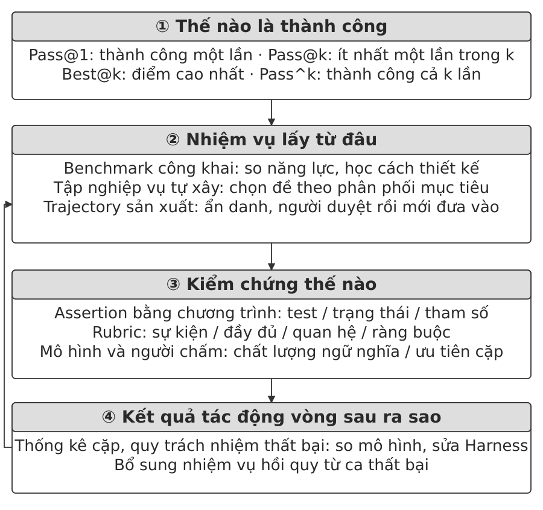
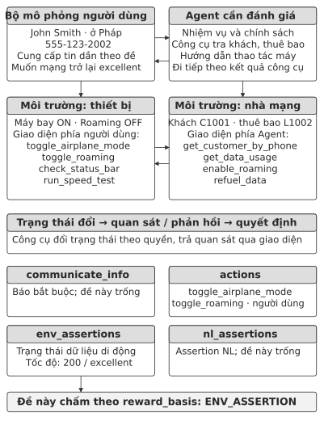
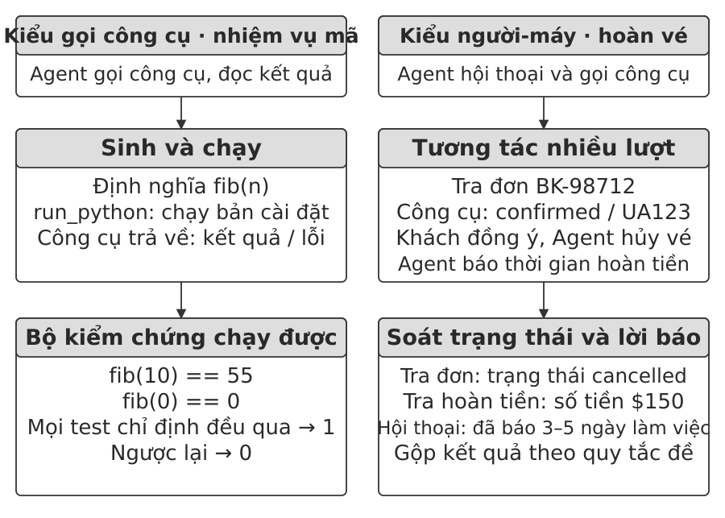
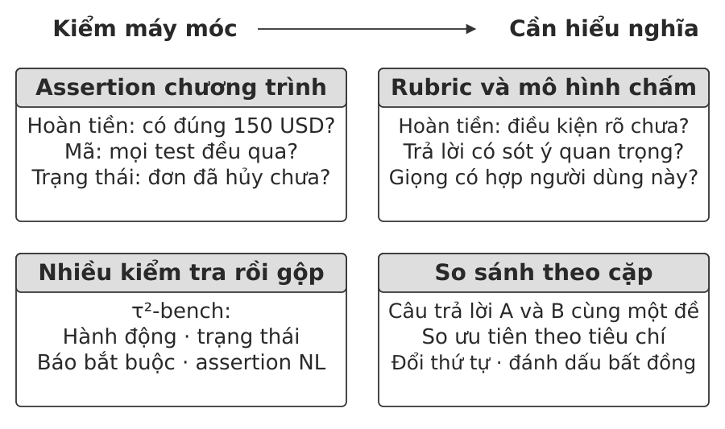
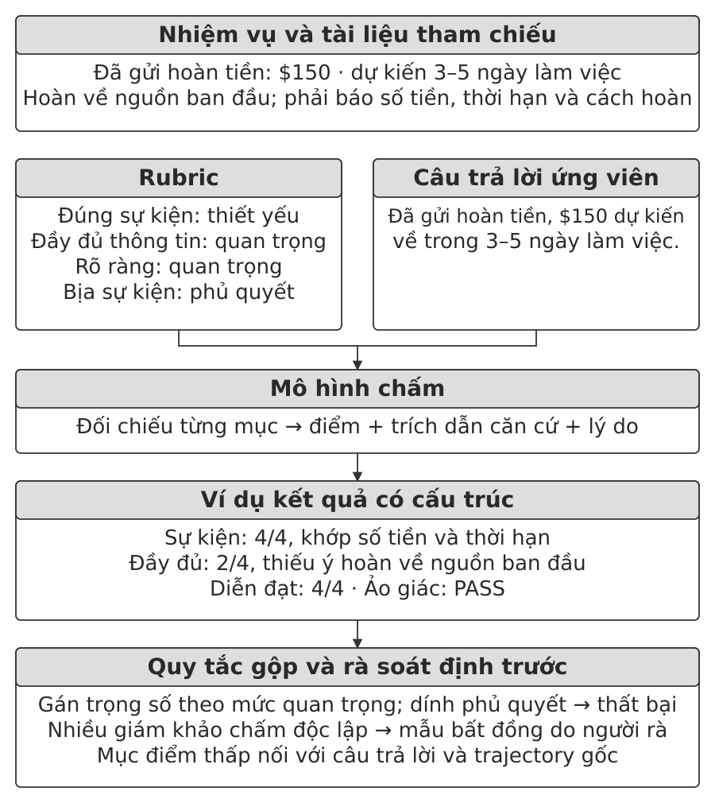
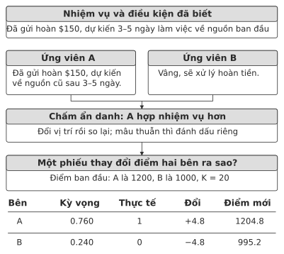
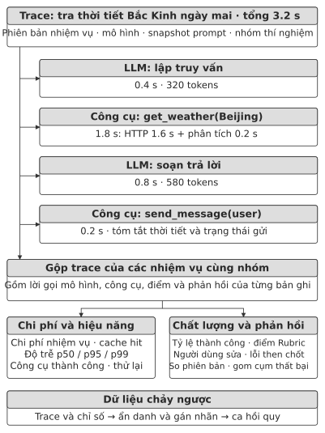
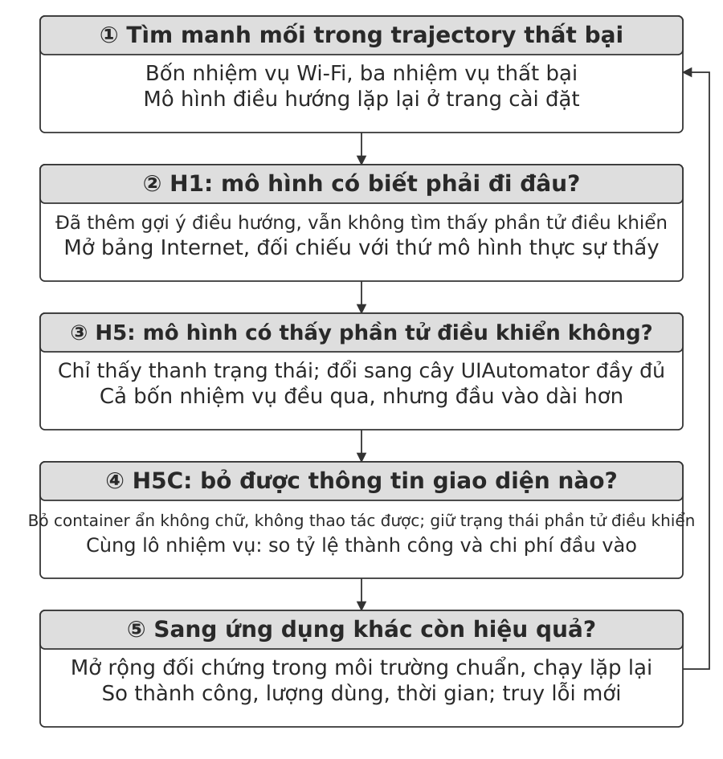
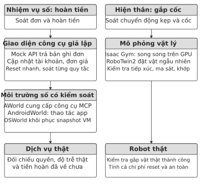
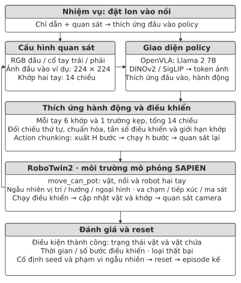

# Đánh giá Agent

Sáu chương trước đã trình bày cách xây dựng một Agent đơn: ngữ cảnh, bộ nhớ, cơ sở tri thức, công cụ, mã, cùng giao diện quan sát và hành động. Khi hệ thống đã dựng xong, ta cần một bộ nhiệm vụ có thể lặp lại để biết nó làm được gì, dễ thất bại trong điều kiện nào, và bước tiếp theo nên sửa ở đâu. Kết quả đánh giá cũng là nguồn phản hồi cho hậu huấn luyện và cho quá trình tiến hóa liên tục.

Trong quá trình phát triển, rất nhiều lựa chọn phải được so sánh bằng nhiệm vụ thực tế: dùng mô hình nào, mở những công cụ nào, cơ sở tri thức chứa nội dung gì và đánh chỉ mục ra sao, tổ chức bộ nhớ người dùng, prompt và Skills thế nào, Harness cần thêm những ràng buộc gì. Các lựa chọn này còn ảnh hưởng lẫn nhau. Chẳng hạn, mô tả công cụ chi tiết hơn có thể giảm lỗi tham số nhưng cũng làm tăng chi phí ngữ cảnh; thêm bước kiểm chứng có thể nâng tỷ lệ thành công nhưng kéo dài thời gian hoàn thành.

**Thí nghiệm so sánh** đặt các phương án khác nhau vào cùng nhiệm vụ và cùng điều kiện, ghi lại thay đổi về tỷ lệ thành công, thời gian và chi phí. **Thí nghiệm cắt bỏ (ablation)** gỡ bỏ hoặc tắt một thành phần như xếp hạng lại kết quả truy xuất, tóm tắt trạng thái hay kiểm chứng kết quả, rồi quan sát hệ thống thay đổi thế nào. Mỗi vòng nêu rõ thay đổi gì, giữ nguyên các điều kiện chạy khác, đo lặp lại nhiều lần, ta sẽ dần nối được các lựa chọn kỹ thuật với kết quả nhiệm vụ. Tác giả chủ trương đưa so sánh và cắt bỏ vào công việc phát triển hằng ngày. Nếu chỉ dựa vào vài trajectory chạy suôn sẻ, rất dễ coi một thành công ngẫu nhiên là cải tiến, hoặc chỉ thấy lợi ích ở một loại nhiệm vụ mà bỏ sót sự thoái lui ở các loại khác.

**Đối tượng đánh giá phải là Agent hoàn chỉnh, gồm cả mô hình lẫn Harness.** Mô hình quyết định cách hiểu nhiệm vụ và chọn hành động; Harness tổ chức ngữ cảnh, điều phối công cụ, duy trì trạng thái và thực hiện kiểm tra. Cùng một mô hình, gắn với công cụ hoặc quy trình phản hồi khác nhau, có thể cho ra kết quả nhiệm vụ khác nhau. Coding Harness ở Chương 5 chính là một bối cảnh so sánh như vậy.

Có thể dùng **thí nghiệm hoán đổi mô hình (model swap)** để nghiên cứu sự phối hợp giữa mô hình và Harness: cố định khung chạy và nhiệm vụ, thay mô hình, rồi so sánh kết quả cuối cùng và phân bố lỗi. Nếu mô hình mạnh hơn vẫn thất bại ở cùng những bước đó, hãy kiểm tra xem có thiếu công cụ không, phản hồi có kịp thời không, chấm điểm có bao quát mục tiêu không. Nếu kết quả thay đổi rõ rệt theo mô hình, hãy phân tích năng lực suy luận, lập kế hoạch hay tuân thủ chỉ dẫn nào đã ảnh hưởng đến kết quả.

Hoán đổi mô hình và cắt bỏ thành phần có thể kết hợp đan chéo. Ví dụ, cho hai mô hình lần lượt chạy hai cấu hình “có tóm tắt trạng thái” và “không có tóm tắt trạng thái”, kiểm tra xem tóm tắt có giúp cả hai khôi phục nhiệm vụ dài không và lợi ích có phụ thuộc vào mô hình không. Như vậy vừa phân tích được khác biệt giữa các mô hình, vừa phát hiện được một thành phần của Harness phát huy tác dụng trong điều kiện nào.

Đánh giá còn là bước kiểm tra hồi quy khi nâng cấp mô hình. Mô hình mới có thể tiến bộ trên benchmark công khai nhưng thoái lui ở một số nhiệm vụ nghiệp vụ; bộ nhiệm vụ của riêng bạn sẽ cho thấy những thay đổi đó. Tác giả chủ trương “phát triển sản phẩm cho mô hình tương lai”: hoàn thiện trước công cụ, quy trình nghiệp vụ và tập đánh giá, rồi liên tục theo dõi mô hình mới trên cùng các nhiệm vụ. Khi tỷ lệ thành công, thời gian phản hồi và chi phí đạt yêu cầu sản phẩm, mới đưa lên chạy thật.

Làm thế nào để biến các yêu cầu trước khi đưa vào vận hành thành một bộ đánh giá? Khi đọc Hình 7-1, hãy lần theo một lượt kiểm thử từ trên xuống: đo cái gì, lấy nhiệm vụ từ đâu, dùng bằng chứng nào để phán định thành công, và cuối cùng ghi lại, so sánh kết quả ra sao?



## Hiểu đánh giá qua một nhiệm vụ: miền telecom của τ²-bench

Hãy bắt đầu từ một sự cố mất mạng trên điện thoại. John Smith dùng số 555-123-2002, đang ở Pháp, thanh trạng thái điện thoại hiển thị “No Service”. Anh muốn có mạng trở lại, và chỉ coi sự cố đã xong khi kiểm tra tốc độ đạt mức excellent; anh sẵn sàng nạp thêm 2,0 GB dữ liệu nếu cần và muốn giữ gói cước hiện tại.

Ca này lấy từ miền telecom của τ²-bench do Sierra phát triển. Môi trường mô phỏng đồng thời hệ thống quản lý phía nhà mạng và thiết bị của người dùng; Agent chăm sóc khách hàng và bộ mô phỏng người dùng mỗi bên dùng công cụ để đọc và thay đổi một phần trạng thái trong đó. Việc đánh giá phải lần theo tương tác của cả hai phía để kiểm tra sự cố được phát hiện thế nào, thao tác được thực hiện ra sao, và cuối cùng mạng có thực sự được khôi phục không.[^ch7-tau2-task]

### Bốn thành phần của định nghĩa nhiệm vụ

Muốn một Agent chăm sóc khách hàng khác xử lý cùng đề này, trước hết phải khôi phục trạng thái điện thoại và tài khoản, để người dùng mô phỏng phối hợp dò lỗi theo đúng yêu cầu cũ, và cuối cùng chấm bằng cùng một bộ tiêu chí. Bảng dưới đây liệt kê bốn phần của định nghĩa nhiệm vụ. Khi đọc, hãy để ý một khác biệt: người ra đề biết cấu hình ban đầu của điện thoại, còn Agent và người dùng, khi bắt đầu hội thoại, mỗi bên biết được bao nhiêu?

| Phần | Trường | Nội dung trong ví dụ này |
| --- | --- | --- |
| Phiếu yêu cầu | `ticket` | Người dùng, số điện thoại, quốc gia đang ở, hiện tượng mất mạng, yêu cầu tốc độ và ràng buộc gói cước |
| Kịch bản người dùng | `user_scenario.instructions` | Người dùng biết gì, khi được hỏi thì tra cứu ra sao, khi nào xác nhận sự cố đã xong |
| Trạng thái ban đầu | `initial_state.initialization_actions` | Thiết lập danh tính và vị trí người dùng, bật chế độ máy bay, tắt chuyển vùng trên thiết bị, mở chuyển vùng phía nhà mạng |
| Tiêu chí chấm điểm | `evaluation_criteria` | Kiểm tra hành động và trạng thái môi trường, `reward_basis` chỉ định mục nào được tính điểm |

**Người dùng biết gì.** `known_info` cung cấp tên, số điện thoại và quốc gia đang ở. Chế độ máy bay đang bật và chuyển vùng trên thiết bị đang tắt được lưu trong trạng thái môi trường; bộ mô phỏng người dùng phải gọi công cụ tra cứu mới có thể báo lại cho Agent. Tách những gì người dùng biết thành một trường riêng giúp bộ mô phỏng phân biệt thông tin có thể trả lời ngay với thông tin phải tra cứu thật. Nếu chỉ dặn trong prompt “đừng nói hết một lần”, rất khó kiểm soát ổn định thời điểm nó tiết lộ từng dữ kiện. Cách bố trí này hiện thực hóa **tiết lộ thông tin dần dần (Progressive Information Disclosure)**: hội thoại bắt đầu từ câu “tôi không vào mạng được”, và Agent phải đặt câu hỏi, hướng dẫn thao tác để từng bước thu được thông tin cần cho việc dò lỗi.

**Người dùng phản hồi thế nào.** `task_instructions` quy định người dùng tỏ ra hơi bực sau lần sửa đầu tiên thất bại, chỉ xác nhận đã xong khi tốc độ đạt excellent, và mọi câu trả lời liên quan đến thiết bị phải dựa trên kết quả công cụ. poor, fair và good đều chưa đạt mục tiêu của đề. **Neo vào thực tế (Grounding)** buộc người dùng phản hồi theo trạng thái thực tế của môi trường mô phỏng. Thiếu ràng buộc này, người dùng mô phỏng có thể xuôi theo câu “giờ chắc ổn rồi” của Agent mà đồng ý; hội thoại hai bên trông có vẻ trôi chảy, nhưng sự cố trên thiết bị vẫn còn nguyên.

**Hai phía bắt đầu từ trạng thái nào.** Phía người dùng dùng `set_user_info` để thiết lập danh tính, dùng `set_user_location(abroad=true)` để biểu thị đang ở nước ngoài, rồi chạy `turn_airplane_mode_on` và `turn_roaming_off`. Phía nhà mạng dùng `enable_roaming` để mở chuyển vùng cho thuê bao `L1002` của khách hàng `C1001`. Vì vậy, truy vấn phía nhà mạng cho thấy chuyển vùng đã mở, trong khi điện thoại vẫn không vào mạng được vì chế độ máy bay và cài đặt chuyển vùng trên máy. Agent phải hướng dẫn người dùng kiểm tra thiết bị mới có được thông tin mà truy vấn phía nhà mạng không cung cấp.

**Những kiểm tra nào quyết định điểm số.** `actions` liệt kê `toggle_airplane_mode` và `toggle_roaming` phía người dùng. `env_assertions` gồm một kiểm tra trạng thái dữ liệu di động và một kiểm tra tốc độ với tham số `expected_speed=200`, `expected_desc="excellent"`. Định dạng nhiệm vụ còn có `communicate_info` và `nl_assertions`, lần lượt mô tả thông tin bắt buộc phải báo cho người dùng và các assertion bằng ngôn ngữ tự nhiên; ở đề này cả hai đều để trống.

`reward_basis` của đề chọn `ENV_ASSERTION`, nên phần thưởng tổng phụ thuộc vào assertion môi trường. Kiểm tra hành động có thể xuất hiện trong kết quả, nhưng có được tính vào tổng điểm hay không là do cấu hình chấm điểm quyết định.

### Lần theo trajectory để kiểm tra kết quả

Lần chạy đi kèm chọn năm nhiệm vụ telecom, mỗi đề chạy một lần, cả Agent chăm sóc khách hàng lẫn bộ mô phỏng người dùng đều dùng GPT-4.1 mini; kết quả là bốn đề đạt. Dưới đây phân tích nhiệm vụ chuyển vùng ở Pháp nói trên trước, rồi đối chiếu với nhiệm vụ thất bại.

> **Thí nghiệm 7-1 ★: Chạy τ²-bench và so sánh bước tiến so với τ-bench**
>
> Trước hết đọc kịch bản người dùng, các hành động khởi tạo và điều kiện chấm điểm của một nhiệm vụ, rồi chạy trọn một lượt tương tác. Dọc theo trajectory, đánh dấu các truy vấn của Agent, thao tác của người dùng, thay đổi trạng thái và kết quả nghiệm thu, kiểm tra xem mỗi phán đoán dựa trên thông tin nào.
>
> Khi đối chiếu τ-bench với τ²-bench, hãy chú ý xem người dùng có thể dùng công cụ để thay đổi môi trường hay không, và thay đổi đó đặt ra cho Agent những yêu cầu phối hợp gì.
>
> Khi xem Hình 7-2, trước hết tìm xem ai có thể tắt chế độ máy bay trên điện thoại, rồi tìm ai có thể sửa cấu hình chuyển vùng của nhà mạng. Mỗi bên làm được những việc khác nhau, điều đó giải thích vì sao Agent làm xong phần của mình rồi vẫn phải nhờ người dùng kiểm tra tốc độ trên điện thoại.
>
> 

Khi xử lý nhiệm vụ chuyển vùng ở Pháp, Agent trước hết xác định tài khoản. Nó tra ra khách hàng `C1001` từ số điện thoại, tra lưu lượng của `L1001`, `L1002`, `L1003`, nhưng lại dựa vào thông tin chi tiết của `L1001` để rút ra một kết luận sai: số 555-123-2002 mà người dùng đưa ra không nằm trong các thuê bao đang hoạt động, số gần nhất là 555-123-2001. Sau khi người dùng khẳng định số không sai, Agent tra tiếp `L1002` và lúc đó mới xác nhận đúng thuê bao.

Tiếp theo, bộ mô phỏng người dùng gọi `check_network_status` và `check_status_bar`. Trạng thái trả về gồm: chế độ máy bay bật, mạng di động không có dịch vụ, dữ liệu di động bật, chuyển vùng trên thiết bị tắt. Dựa vào đó người dùng báo lại: “Điện thoại đang ở chế độ máy bay, chuyển vùng dữ liệu cũng đang tắt. Tôi có cần tắt chế độ máy bay trước không?” Truy vấn ở đây do công cụ phía người dùng thực hiện, và kết quả được chuyển tới Agent qua hội thoại.

Đó chính là cơ chế **điều khiển kép (Dual-Control)**: Agent tra cứu và thao tác trên hệ thống của nhà mạng, còn bộ mô phỏng người dùng có bộ công cụ thiết bị riêng, chẳng hạn xem thanh trạng thái, bật tắt chế độ máy bay, tháo lắp lại SIM và kiểm tra tốc độ. Hai bên phối hợp thao tác qua trao đổi, môi trường ghi lại những thay đổi trạng thái do từng bên gây ra.

Sau đó Agent hướng dẫn người dùng tắt chế độ máy bay và bật chuyển vùng trên thiết bị; thanh trạng thái hiện sóng 5G. Người dùng chạy `run_speed_test`, được 275 Mbps, mức Excellent, rồi xác nhận sự cố đã được giải quyết. Cả hai assertion môi trường đều đạt, phần thưởng của đề là 1,0.

Trajectory thành công này cũng bộc lộ vấn đề về quy trình. Chính sách yêu cầu Agent mỗi lần chỉ gọi một công cụ, nhưng Agent lại gọi `get_customer_by_phone` và `get_customer_by_name` trong cùng một tin nhắn. Vì tổng điểm của nhiệm vụ này chỉ tính assertion môi trường, hành vi đó không làm thay đổi phần thưởng.

Ở một trajectory thất bại khác, thuê bao bị chọn sai và không bao giờ được sửa lại, khiến toàn bộ việc dò lỗi sau đó lệch hướng. Số của người dùng vẫn là 555-123-2002, nhưng Agent chọn `L1001` và tiếp tục dò lỗi dựa trên mức dùng 3,2/5 GB của thuê bao này. Công cụ đã trả về rằng `L1001` ứng với số 555-123-2001, vậy mà nó vẫn không sửa thuê bao, rồi sau nhiều lượt dò lỗi không liên quan thì chuyển sang nhân viên. Phía người dùng đã tắt được chế độ tiết kiệm dữ liệu, nhưng gói nạp 2 GB mà thuê bao đúng `L1002` cần thì không được thực hiện; cả ba assertion môi trường đều không đạt.

So sánh hai trajectory, ta có thể khai triển điểm số cuối cùng thành những điểm cải tiến cụ thể: đối chiếu ánh xạ giữa số điện thoại và thuê bao, dùng bằng chứng mới để sửa phán đoán, phân biệt trạng thái thiết bị với trạng thái phía nhà mạng, và kiểm chứng việc nạp dữ liệu cần thiết đã hoàn tất. Phần quy trách nhiệm thất bại ở sau sẽ bàn tiếp cách tìm ra những bước ngoặt then chốt này trong một trajectory dài.

[^ch7-tau2-task]: τ²-bench của Sierra Research định nghĩa công cụ người dùng trong `user_tools.py` của miền telecom, đầu vào chấm điểm là `evaluator.py`. Nội dung ca và kết quả được tổng hợp từ năm nhiệm vụ cùng trajectory chạy được lưu kèm.

## Chỉ số đánh giá: định nghĩa thành công

Năm nhiệm vụ đạt bốn cho ta thành tích tổng thể của lần chạy này. Muốn dựa vào đó để ra quyết định sản phẩm, còn cần nói rõ loại nhiệm vụ và cái giá của thất bại. Bộ phận hoàn tiền cần liên tục xử lý đúng các yêu cầu đủ điều kiện; khi viết chương trình, có thể sinh vài cách cài đặt rồi dùng test lọc ra bản chạy được và cho kết quả đúng; khi làm nghiên cứu, cũng có thể đưa ra vài giả thuyết để nhà nghiên cứu kiểm nghiệm. Chỉ số đánh giá nên tương ứng với cách sử dụng đó.

### Kỳ quan kỹ thuật: đo năng lực qua nhiều lần thử bằng Pass@k

Tác giả gọi một số màn trình diễn Agent gây ấn tượng là “kỳ quan kỹ thuật”: cho hệ thống đủ thời gian và cơ hội thử, nó hoàn thành được một việc mà trước đó khó tự động hóa. Với công việc mang tính khám phá, chỉ một trajectory thành công đã được kiểm chứng cũng có thể mang lại giá trị. Chỉ số **Pass@k** tương ứng với cách dùng này: chạy cùng một nhiệm vụ $k$ lần, chỉ cần ít nhất một lần đạt là tính thành công. Với nhiệm vụ chấm điểm liên tục, có thể báo cáo điểm cao nhất trong $k$ lần, gọi là **Best@k**.

Ví dụ, Anthropic từng cho nhiều phiên bản Claude cộng tác xây dựng một trình biên dịch C, cho thấy chạy dài hạn, phản hồi từ test và phân công nhiệm vụ có thể đỡ được một công trình phức tạp. Khi tìm phản ví dụ toán học, nhà nghiên cứu cũng có thể cho mô hình thử đi thử lại, cuối cùng kiểm chứng độc lập xem một phản ví dụ có đúng không. Khi rà soát an ninh phần mềm, có thể thẩm định lại các vấn đề khả nghi mà mô hình báo cáo; còn sáng tác mở có thể chọn bản tốt nhất trong vài tác phẩm.[^ch7-long-running]

Các sản phẩm ứng dụng cũng thể hiện năng lực qua nhiệm vụ phức tạp. Manus trao cho Agent một máy tính ảo, cho người dùng thấy nó thao tác giao diện, tìm tài liệu và làm việc liên tục. OpenClaw nhận ủy thác qua ứng dụng nhắn tin, truy cập các tệp và dịch vụ đã được cấu hình và cho phép, báo cáo tiến độ, xin thêm thông tin trong quá trình làm, và còn có thể được cơ chế hẹn giờ đánh thức để kiểm tra việc cần làm. Những hành vi cụ thể này giúp người dùng dễ hiểu Agent dùng được vào việc gì.

Theo tác giả, những màn trình diễn hoàn thành được loại nhiệm vụ mới là yếu tố quan trọng khiến các sản phẩm này thu hút người dùng.

### Độ tin cậy nghiệp vụ: chú ý Pass^k

Quy trình nghiệp vụ thường đòi hỏi nhiều lần chạy đều giao đúng kết quả. **Pass^k** đo trường hợp chạy cùng một nhiệm vụ $k$ lần và lần nào cũng đạt, có thể đọc là “pass power k”. Điều kiện đạt của nhiệm vụ có thể bao gồm cả kết quả cuối, việc tuân thủ chính sách và ràng buộc quyền hạn; mỗi lần chạy đều được kiểm tra theo cùng điều kiện.

Giả sử các lần chạy độc lập với nhau và xác suất thành công mỗi lần đều là $p$, thì:

$$
\mathrm{Pass@k}=1-(1-p)^k,\qquad
\mathrm{Pass}^{k}=p^k.
$$

Ví dụ, với $p=0.6$, $k=5$, Pass@5 khoảng 99,0%, Pass^5 khoảng 7,8%. Con số đầu cho biết trong năm lần thử thường tìm được một lần thành công, con số sau cho biết xác suất cả năm lần đều thành công vẫn rất thấp.

Khi đọc một nhóm kết quả thực tế, có thể tạm chưa dùng công thức. Giả sử cùng một đề chạy năm lần lần lượt “đạt, trượt, đạt, đạt, trượt”; với nhóm này Pass@5 ghi 1, Pass^5 ghi 0, tỷ lệ thành công mỗi lần ước lượng là 3/5. Hai con số 99,0% và 7,8% ở trên trả lời một câu hỏi khác: nếu đã biết xác suất thành công mỗi lần là 0,6 và lặp lại nhiều nhóm năm lần, thì bao nhiêu nhóm đạt tiêu chuẩn tương ứng?

Cùng một loạt bản ghi cũng trả lời được một câu hỏi dễ đối chiếu hơn: lấy hai lần bất kỳ trong năm lần chạy vừa rồi, bao nhiêu phần trăm số cặp đạt? Coi mỗi lần chạy là một tấm thẻ, rút hai thẻ không hoàn lại, có tất cả mười cặp. Chỉ cặp gồm hai thẻ thất bại mới khiến cả hai lần đều trượt, nên chín cặp có ít nhất một lần thành công, ước lượng mẫu của Pass@2 là 9/10. Ba thẻ thành công ghép đôi được ba cặp, nên ước lượng mẫu của Pass^2 là 3/10. τ²-bench thống kê tổ hợp đạt toàn bộ theo từng nhiệm vụ đúng như vậy: một đề chạy $n$ lần, thành công $s$ lần, chọn ra $k$ lần, tỷ lệ tổ hợp đạt toàn bộ là $\binom{s}{k}/\binom{n}{k}$, với $1\le k\le n$.[^ch7-tau2-metrics]

Giờ đọc lại con số 4/5 của Thí nghiệm 7-1. Năm trajectory đó thuộc về năm đề khác nhau, mỗi đề chỉ có một tấm thẻ, không ghép nổi một cặp nào. Muốn ước lượng Pass^2 của các nhiệm vụ này, phải chạy thêm các lần độc lập cho từng đề, tính riêng rồi tổng hợp. Nếu lấy thẳng 0,8 bình phương lên, ta đã ngầm giả định thêm rằng xác suất thành công mỗi lần của các đề đều như nhau và các lần thử độc lập với nhau.

[^ch7-tau2-metrics]: Phiên bản thử nghiệm của τ²-bench (revision 8d005b0) tính Pass^k theo từng đề trong `agent_metrics.py`. Khi số lần thành công ít hơn $k$, số tổ hợp đạt toàn bộ bằng không.

Khi tính toán cần giữ đơn vị thống kê nhất quán. Năm lần lấy mẫu trên cùng một nhiệm vụ đo hiệu năng lặp lại của nhiệm vụ đó; năm nhiệm vụ khác nhau liên tiếp trong sản xuất còn chịu ảnh hưởng của độ khó nhiệm vụ và phân bố lưu lượng. Khi xác suất thành công của các nhiệm vụ khác nhau, có thể tính chỉ số thành công lặp lại của từng nhiệm vụ trước, rồi tổng hợp theo trọng số nhiệm vụ. Trạng thái dùng chung, cache hay cùng một sự cố cũng khiến các lần chạy có tương quan.

**Khi cho phép trả lời “không đủ thông tin”, chọn mẫu số thế nào?** Hãy hình dung một trợ lý tra cứu tài liệu nhận 100 câu hỏi, trả lời 80 câu, trong đó 68 câu đúng. Người đọc dựa vào các câu trả lời đã có quan tâm đến 68/80, tức 85%; người cần giải quyết xong cả lô việc còn quan tâm đến 68/100, tức 68%. 20 câu còn lại cần tìm thêm bằng chứng hoặc chuyển cho người xử lý.

Trên 248 câu hỏi tài liệu của LitQA2, PaperQA2 được phép chọn “không đủ thông tin”. Bài báo báo cáo kết quả trung bình của ba lượt chạy: khi hệ thống đưa ra câu trả lời thực chất, độ chính xác là 85,2%; tính trên toàn bộ câu hỏi, độ chính xác là 66,0%, ngoài ra 21,9% câu chọn không đủ thông tin. Hai độ chính xác tương ứng của chín người trả lời là 73,8% và 67,7%. Bài báo cho biết khác biệt ở mục đầu có ý nghĩa thống kê, còn ở mục sau thì chưa.[^ch7-paperqa2-denominators]

[^ch7-paperqa2-denominators]: Skarlinski và cộng sự, *Language Agents Achieve Superhuman Synthesis of Scientific Knowledge*, 2024, xem Mục 2 và Hình 2.

Hai trajectory có cùng trạng thái cuối vẫn có thể tốn chi phí khác nhau. Lấy ví dụ tra hóa đơn: A chỉ truy vấn một lần đã trả về đúng số tiền. B truy vấn hai lần mới đưa ra cùng đáp án. Hai lần truy vấn mang cùng mã yêu cầu, lần đầu lại đã hết thời gian chờ, cho thấy việc thử lại đã giúp nó khôi phục nhiệm vụ. Nếu kết quả lần đầu đã tới nơi thành công, thì lần truy vấn thứ hai chỉ làm tăng thời gian chờ và phí công cụ một cách vô ích.

Khi lần chạy có ghi dữ liệu hoặc gây tác động bên ngoài khác, trước mỗi lần thử hãy khôi phục trạng thái ban đầu đã quy định, thực hiện thao tác trong môi trường kiểm thử và ghi lại mọi lần thử. Nếu sản phẩm cho phép thử lại sau thất bại, hãy đưa số lần thử lại, các bước khôi phục và chi phí thực thi vào đánh giá quy trình; bản ghi thất bại gốc vẫn được giữ lại để phân biệt hiệu năng một lần với kết quả sau khi khôi phục.

[^ch7-long-running]: Anthropic, Building a C compiler with a team of parallel Claudes, 2026-02-05, giới thiệu cộng tác nhiều phiên bản, thực thi dài hạn và phản hồi từ test.

## Môi trường đánh giá

Giả sử cần xem xét lại lần chạy chọn nhầm thuê bao ở trên. Người xem xét cần thấy đúng người dùng đó, đúng hai thuê bao đó và cùng gói cước ban đầu. Nếu lần chạy đầu đã sửa một trong hai thuê bao, chạy lại ngay thì không thể biết kết quả thay đổi là do mô hình hay do cơ sở dữ liệu. Môi trường đánh giá có nhiệm vụ dựng điểm xuất phát của nhiệm vụ, cung cấp giao diện tương tác, ghi lại quá trình và kiểm tra điểm kết thúc.

### Năm thành phần cấu thành

Lấy nhiệm vụ telecom làm ví dụ, có thể tách môi trường đánh giá thành năm phần.

**Tập dữ liệu (Dataset)** lưu định nghĩa nhiệm vụ: bối cảnh người dùng, yêu cầu hành vi, trạng thái ban đầu và điều kiện nghiệm thu. Mỗi bản ghi ứng với một ca kiểm thử; khi chạy, thông tin được phân phát theo vai trò của từng bên tham gia.

**Trạng thái môi trường (Environment State)** lưu thông tin thay đổi trong lúc thực thi nhiệm vụ, chẳng hạn khách hàng, thuê bao, gói cước, hóa đơn, cùng các cài đặt chế độ máy bay, chuyển vùng và tiết kiệm dữ liệu trên thiết bị. Khi bắt đầu một lượt mới, môi trường khôi phục dữ liệu nền trước, rồi chạy `initialization_actions` để dựng đúng sự cố mà nhiệm vụ hiện tại quy định. Việc dọn dẹp và khởi tạo phải ăn khớp, tránh để việc nạp dữ liệu hay thay đổi cài đặt của lượt trước lọt sang lượt sau.

**Giao diện công cụ (Tools)** quyết định các bên đọc và thay đổi được những gì. Agent có thể tra khách hàng, kiểm tra mức dùng, nạp dữ liệu hoặc chuyển sang nhân viên; người dùng có thể xem trạng thái thiết bị, bật tắt công tắc và kiểm tra tốc độ. Độ mịn của công cụ phải tương ứng với năng lực cần đo: nếu muốn đánh giá chẩn đoán và lập kế hoạch, hãy để Agent tự kết hợp truy vấn và thao tác; nếu cung cấp thẳng một công cụ “sửa lỗi mất mạng”, trọng tâm kiểm thử sẽ chuyển sang việc khi nào gọi năng lực đó.

**Tiêu chí chấm điểm (Rubric)** nói rõ cách phán định kết quả. Nhiệm vụ telecom có thể kiểm tra hành động, trạng thái môi trường, thông báo bắt buộc và các yêu cầu bằng ngôn ngữ tự nhiên, rồi dùng `reward_basis` xác định những kiểm tra nào được tính vào tổng điểm.

**Giao thức tương tác (Interaction Protocol)** sắp xếp lượt nói, lời gọi công cụ và điều kiện kết thúc. Bộ mô phỏng người dùng có thể xuất `###STOP###` để kết thúc tương tác, bộ chạy còn đặt ngân sách như số lượt tối đa. Lý do kết thúc và điểm nhiệm vụ được ghi riêng: khi người dùng dừng hội thoại, assertion môi trường vẫn chịu trách nhiệm phán định mục tiêu đã đạt hay chưa; khi cạn ngân sách, cũng phải giữ lại trạng thái cuối cùng và các bước chưa hoàn thành.

### Môi trường đánh giá kiểu tương tác người-máy và kiểu gọi công cụ

Nhiệm vụ telecom có một bộ mô phỏng người dùng liên tục phản hồi và thao tác trên thiết bị. Còn sửa mã, phân tích dữ liệu và giải toán thường được khởi động bằng một chỉ dẫn nhiệm vụ, sau đó Agent chủ yếu tương tác với công cụ. Cả hai loại môi trường đều cần nhiệm vụ, trạng thái, giao diện, chấm điểm và giao thức tương tác; khác biệt nằm ở chỗ có cần mô phỏng thêm một đối tượng hội thoại hay không, và hai bên phối hợp hành động ra sao.

Nhiệm vụ mã có thể dùng test để kiểm tra đầu ra, nhiệm vụ cơ sở dữ liệu có thể truy vấn các bản ghi sau khi sửa, còn phân tích mở có thể phải nhờ người hoặc mô hình thẩm định nội dung. Nhiệm vụ tương tác người-máy thường còn phải ghép hai phần bằng chứng. Ví dụ, mạng điện thoại đã trở lại hay chưa thì xem trạng thái thiết bị; Agent có làm rõ số điện thoại, có hướng dẫn người dùng thao tác hay không thì xem hội thoại. Việc hoàn tiền trong Hình 7-3 cũng vậy: đơn đã hủy hay chưa có thể tra trong cơ sở dữ liệu; Agent đã báo thời gian tiền về hay chưa thì phải tìm trong hội thoại.



Trong Verifiers, có thể tiếp cận hai loại nhiệm vụ này từ các giao diện môi trường khác nhau. Bảng 7-1 liệt kê các giao diện trong v0.1.9 dùng để xử lý trả lời một lượt, gọi công cụ nhiều lượt, tiêm trạng thái chạy và quản lý tài nguyên sandbox, tiện đối chiếu với mã nguồn.[^ch7-verifiers-env]

Bảng 7-1 So sánh các loại môi trường Verifiers

| Loại môi trường | Trách nhiệm chính | Xử lý công cụ và trạng thái | Ca dùng điển hình |
|---|---|---|---|
| `SingleTurnEnv` | Tổ chức câu trả lời một lượt | Chấm điểm sau một lần trả lời | Bài toán, hỏi đáp một lượt |
| `ToolEnv` | Tổ chức tương tác công cụ nhiều lượt | Lưu trajectory, phân phát công cụ và nhận kết quả | Tìm kiếm và tổng hợp thông tin |
| `StatefulToolEnv` | Đưa trạng thái chạy vào việc thực thi công cụ | Bổ sung tham số công cụ hoặc cập nhật trạng thái theo trạng thái hiện tại | Gắn cơ sở dữ liệu hoặc mã tài nguyên cho nhiệm vụ đang chạy |
| `SandboxEnv` | Quản lý môi trường thực thi cách ly | Cấp sandbox cho mỗi lần chạy và dùng công cụ bên trong | Chạy mã, kiểm tra tệp và kết quả test |

Ví dụ, khi hai nhiệm vụ cùng sửa cơ sở dữ liệu, bộ chạy có thể tiêm mã cơ sở dữ liệu riêng vào lời gọi công cụ, để mỗi trajectory thao tác trên đúng phần dữ liệu của mình. Khi thực thi thất bại, công cụ nên trả về thông tin giúp phán đoán bước tiếp theo, như đối tượng không tồn tại, tham số không hợp lệ hay dịch vụ hết thời gian chờ. Hệ thống đánh giá lưu lại quan sát, lời gọi, kết quả thực thi và phần thưởng; khi phân tích sẽ định vị được lỗi tới từng bước cụ thể.

[^ch7-verifiers-env]: Prime Intellect, ToolEnv và StatefulToolEnv trong Verifiers v0.1.9, minh họa trajectory nhiều lượt, phân phát công cụ và tiêm tham số trạng thái.

## Thiết kế tập dữ liệu đánh giá

Giờ hãy mở rộng năm đề telecom thành một tập đánh giá đủ sức định hướng việc phát hành. Nếu toàn bộ đề mới thêm đều là “mở chuyển vùng cho số được chỉ định”, hệ thống có thể đạt điểm cao dù chưa bao giờ học được cách phân biệt hai thuê bao trong cùng một tài khoản. Nếu định dựa vào thành tích để quyết định cho Agent đưa vào vận hành, việc chọn đề phải tham chiếu phiếu yêu cầu thật, vừa có nghiệp vụ thường ngày, vừa có những đề khó dễ nhầm thuê bao, và khi chấm còn phải tra được Agent cuối cùng đã sửa thuê bao nào. Sau khi đưa vào vận hành vẫn phải bảo trì các đề này để chúng tiếp tục phản ánh công việc mà người dùng thực sự giao.

### Đối chiếu ngang các thiết kế benchmark

Bảng 7-2 đặt sáu benchmark cạnh nhau theo năng lực, nguồn nhiệm vụ, môi trường chạy và cách kiểm chứng.

Bảng 7-2 Các lựa chọn thiết kế then chốt của một số benchmark cho Agent

| Benchmark | Năng lực được đo | Nguồn và tổ chức nhiệm vụ | Môi trường chạy | Cách kiểm chứng |
|---|---|---|---|---|
| τ²-bench | Tương tác chăm sóc khách hàng và thao tác công cụ | Kết hợp nhiệm vụ miền và sự cố | Bộ mô phỏng người dùng, thiết bị và cơ sở dữ liệu nghiệp vụ | Kiểm tra từng mục, tính điểm theo `reward_basis` |
| SWE-bench Verified | Sửa lỗi mã | GitHub issue thật, sàng lọc thủ công | Kho mã và môi trường test | Test `FAIL_TO_PASS` và `PASS_TO_PASS` |
| AndroidWorld | Thao tác ứng dụng Android | Mẫu nhiệm vụ tham số hóa | Trình giả lập Android chạy ứng dụng thật | Đọc trạng thái thiết bị, tệp hoặc trạng thái nội bộ ứng dụng |
| OSWorld | Thao tác máy tính để bàn và liên ứng dụng | Kịch bản sử dụng thật, cấu hình điểm xuất phát | Máy ảo và ứng dụng desktop | Kiểm tra trạng thái và sản phẩm theo từng nhiệm vụ |
| Terminal-Bench | Nhiệm vụ kỹ thuật trong terminal | Nhiệm vụ và test do người thiết kế | Container và các phụ thuộc mà nhiệm vụ cần | Tệp, chạy chương trình và kết quả test |
| GAIA | Xử lý thông tin của trợ lý đa năng | Câu hỏi do người viết, một số kèm tài liệu | Mạng, tệp và công cụ phụ trợ | So sánh sau khi chuẩn hóa theo định dạng đáp án |

### Bộ kiểm chứng

Bộ kiểm chứng (verifier) nối mục tiêu nhiệm vụ với những bằng chứng có thể kiểm tra. Nhiệm vụ mã cần chạy test, nhiệm vụ desktop cần đọc trạng thái ứng dụng hoặc tệp, nhiệm vụ truy xuất thông tin cần đối chiếu đáp án và nguồn. **Nghiệm thu phải dựa trên bằng chứng thu được một cách độc lập.** Agent có thể viết một báo cáo hoàn chỉnh, khẳng định mọi bước đã xong; bộ kiểm chứng vẫn phải thực sự chạy sản phẩm, đọc trạng thái hoặc đối chiếu nguồn. Báo cáo hoàn thành chỉ dùng để xác định đối tượng cần kiểm tra, còn điểm số do các kiểm tra đó quyết định.

Hãy hình dung người dùng mở ứng dụng thanh toán, nhờ trợ lý “duyệt tất cả các yêu cầu nhận tiền mà bạn cùng phòng gửi tháng này”. Giả sử có ba yêu cầu đang chờ: một của bạn cùng phòng tháng này, một của chính bạn đó tháng trước, một của đồng nghiệp tháng này. Yêu cầu thứ nhất phải được duyệt, hai yêu cầu sau phải giữ nguyên trạng thái chờ. Nếu chỉ kiểm tra yêu cầu thứ nhất, một trợ lý duyệt cả ba cũng được điểm tối đa; nếu chỉ kiểm tra hai yêu cầu sau, một trợ lý không làm gì cũng qua. AppWorld đã ra đúng đề này trong một ứng dụng thanh toán mô phỏng. Khi thiết kế bộ kiểm chứng, có thể dựa vào dữ liệu trước thao tác để khoanh vùng nhóm yêu cầu mà người dùng ủy quyền, kiểm tra xem chúng đã được duyệt hết chưa, rồi dò ngược từ bản ghi sau thao tác: trợ lý còn động vào những yêu cầu nào khác?[^ch7-appworld-scope]

[^ch7-appworld-scope]: Trivedi và cộng sự, *AppWorld*, ACL 2024; Hình 2 nêu nhiệm vụ và điều kiện nghiệm thu.

Tìm kiếm khoa học cũng có thể nộp một sản phẩm dễ kiểm chứng. FunSearch phải chọn càng nhiều điểm càng tốt trong không gian tám chiều, mỗi chiều chỉ nhận giá trị 0, 1 hoặc 2, phép toán thực hiện theo modulo 3, và không có ba điểm nào trong số đã chọn thẳng hàng. Các nhà nghiên cứu viết sẵn khung chương trình chọn điểm từng bước, để mô hình đề xuất hàm xếp hạng các điểm ứng viên, rồi chấm điểm bằng kích thước tập điểm hợp lệ thực sự dựng được. Lúc bài báo công bố, các cấu trúc đã biết chọn được 496 điểm, còn chương trình mới nộp một danh sách 512 điểm.[^ch7-funsearch-cap]

Bạn có thể chỉ tải danh sách về và tự kiểm tra kết quả này. Trước hết xác nhận nó có 512 vector tám chiều khác nhau, mọi tọa độ đều nằm trong phạm vi quy định. Sau đó lấy hai điểm khác nhau bất kỳ $a,b$; đường thẳng qua chúng chỉ có ba điểm, điểm thứ ba là $c=-a-b \pmod{3}$. Ví dụ trong hai chiều, lấy $(0,0)$ và $(1,2)$ thì điểm thứ ba là $(2,1)$. Áp dụng cùng phép toán cho từng tọa độ trong tám chiều, duyệt qua 130.816 cặp điểm khác nhau trong danh sách, không có điểm thứ ba nào xuất hiện trong danh sách. Như vậy đủ để chứng minh chọn được ít nhất 512 điểm. Muốn chứng minh không thể có 513 điểm thì cần thêm một chứng minh cận trên.

[^ch7-funsearch-cap]: Romera-Paredes và cộng sự, *Mathematical discoveries from program search with large language models*, Nature, công bố trực tuyến năm 2023. Các tác giả còn công bố riêng tập điểm tám chiều và notebook tính toán dùng để kiểm chứng.

**Hai loại test của SWE-bench lần lượt kiểm tra việc sửa lỗi và hồi quy.** `FAIL_TO_PASS` là các test thất bại trước khi sửa và phải đạt sau khi sửa; `PASS_TO_PASS` là các test vốn đạt và phải tiếp tục đạt sau khi sửa. Loại đầu kiểm tra vấn đề được chỉ định, loại sau kiểm tra hành vi mà test hiện có bao phủ vẫn được giữ nguyên.[^ch7-swe-verified]

**OSWorld dùng kiểm chứng bằng thực thi để kiểm tra sản phẩm của ứng dụng.** Phiên bản gốc cung cấp 134 hàm đánh giá bằng thực thi, kết hợp với cấu hình nhiệm vụ để đọc tệp, dữ liệu ứng dụng hoặc trạng thái hệ thống.[^ch7-osworld-design] Ví dụ, khi đề yêu cầu sửa bảng tính, có thể kiểm tra ô và công thức được chỉ định; khi đề yêu cầu cập nhật cài đặt trình duyệt, có thể đọc cấu hình liên quan.

**Terminal-Bench nghiệm thu nhiệm vụ kỹ thuật bằng kết quả chạy.** Ca biên dịch nhân Linux xâu chuỗi việc sửa mã nguồn, biên dịch, initramfs và khởi động bằng QEMU; trong đó Linux 6.9, lệnh `printk` tùy biến trong `start_kernel` và thông điệp trong log khởi động đều là những điểm kiểm tra cụ thể.

Chương 5 đã bàn về việc đối chiếu doanh số từ đơn hàng. Nếu trợ lý nộp một báo cáo quý của hai mươi kênh, nên kiểm tra từ đâu? Tencent WorkBuddy Bench có một đề đối soát công khai. Hai trang tính đều là dữ liệu theo kênh: số tiền quyết toán xem theo kỳ liền trước, tức so với quý trước; số tiền thu hồi xem theo cùng kỳ, tức so với cùng quý năm trước. Dù điền cả hai kỳ gốc thành quý trước, tiêu đề cột và số kênh vẫn có thể hoàn toàn đúng. Lấy kênh “Cẩm Tú Sinh Hoạt Quán” trong bảng quyết toán làm ví dụ: loại bỏ các dòng trùng và bản ghi thiếu quý khỏi dữ liệu chi tiết, tổng hợp theo kênh và quý, sẽ tính được tổng giá trị giao dịch tăng từ 1.569.231,00 lên 1.787.311,03, chênh lệch 218.080,03. Chương trình chấm kiểm tra mức bao phủ kênh của hai bảng, rồi kiểm tra ngẫu nhiên số liệu của hai kênh được chỉ định. Kiểm tra bao phủ kênh của đề này trải khắp hai mươi kênh, còn kiểm tra số liệu chỉ chạm tới hai kênh được rút ra.[^ch7-workbuddy-office]

[^ch7-workbuddy-office]: Nhiệm vụ văn phòng `channel-period-compare-L4-017` của Tencent WorkBuddy Bench. Gói dữ liệu được dùng (revision 3e8ad83) kèm workbook gốc, đáp án tham chiếu và chương trình chấm.

Có thể dùng một nhiệm vụ nhạy cảm về thời gian để thử thách bộ kiểm chứng. Giả sử người dùng yêu cầu nhắc khi giá phòng của một khách sạn giảm xuống dưới 950 tệ. Lúc 10:00 giá là 1000 tệ, 10:10 giảm còn 900 tệ, 10:15 lại về 1000 tệ. Một lời nhắc giảm giá gửi lúc 10:12, kèm loại phòng và đường dẫn đặt phòng, vẫn cho người dùng cơ hội đặt. Ngày nào cũng gửi một tin “chưa giảm giá” nhưng lại bỏ lỡ đúng năm phút đó, thì dù chạy liên tục cả tuần vẫn chưa hoàn thành ủy thác. Khi chấm, hãy ghi riêng số cửa sổ thỏa điều kiện, số lần nhắc kịp thời trong cửa sổ, và số lần làm phiền người dùng khi không có thay đổi. Nếu người đánh giá cũng chỉ lưu giá mỗi ngày một lần, những cửa sổ bị bỏ lỡ sẽ không đếm ra được. Muốn đo việc bỏ sót, trước hết phải chuẩn bị bản phát lại giá đầy đủ có dấu thời gian, rồi để hệ thống cần kiểm thử tự đi tra theo tần suất của nó.

### Phân tầng độ khó của nhiệm vụ

Tập nhiệm vụ cần bao phủ nhiều mức độ khó và nói rõ độ khó đến từ đâu. Nhiệm vụ cơ bản kiểm tra năng lực có bị thoái lui không, còn nhiệm vụ khó chừa chỗ đo cho những tiến bộ của mô hình sau này; nếu đề nhanh chóng bị giải hết, tập đánh giá sẽ khó tiếp tục định hướng việc chọn mô hình. Có thể phân tầng theo số loại công cụ, độ dài thao tác, mức độ phân tán thông tin, độ bất định của môi trường hoặc kiến thức chuyên môn cần có, rồi xem hệ thống thoái lui rõ rệt trong những điều kiện nào.

466 câu hỏi của GAIA được chia thành ba cấp. Nhiệm vụ dễ hơn thường cần ít công cụ và ít bước; nhiệm vụ khó hơn đòi hỏi tích hợp thông tin nhiều bước và kết hợp phức tạp. Trong bài báo gốc, độ chính xác của người gán nhãn ở ba cấp lần lượt là 93,9%, 91,8% và 87,3%; kết quả tương ứng của GPT-4 kèm plugin là 30,3%, 9,7% và 0%.[^ch7-gaia-design]

Nhiệm vụ của Terminal-Bench cũng trải rộng: đăng ký mô hình đòi hỏi dùng MLflow, triển khai nhiều thành phần cần điều phối dịch vụ Git và dịch vụ Web, còn khôi phục mật khẩu và phân tích vi sai FEAL thì cần thêm kiến thức thuật toán chuyên biệt.

Nhiệm vụ nghiệp vụ còn phải bao phủ ranh giới chính sách. Ví dụ, khi người dùng khẳng định nhân viên đã đồng ý hủy đơn, hệ thống phải tra quyền hạn và trạng thái đơn, rồi theo chính sách quyết định có hủy hay không. Những ca như vậy kiểm tra cách Agent dùng bằng chứng để xử lý thông tin mâu thuẫn, và có thể đặt thành cặp với các nhiệm vụ xử lý bình thường.

### Phòng ngừa rò rỉ dữ liệu

**Kết hợp nhiều nguồn và tệp đính kèm chuyên dụng.** Nếu mô hình tìm được cả đề lẫn đáp án có sẵn trong kết quả tìm kiếm, thì một lần trả lời đúng chứng minh được bao nhiêu năng lực truy xuất và suy luận? GAIA dùng tra cứu nhiều bước và tệp đính kèm chuyên dụng để giảm cơ hội đó. Ví dụ, trước hết nhận diện phi hành gia từ ảnh thiên văn của một ngày nào đó, rồi tra nhóm phi hành gia mà người đó thuộc về, so sánh thời gian bay trên quỹ đạo của các thành viên, cuối cùng xuất họ và số phút theo yêu cầu. Dấu chấm phẩy, cách làm tròn số và dấu phân cách hàng nghìn đều là quy ước của đáp án. Các tệp PDF, âm thanh và hình ảnh được làm riêng làm tăng số tổ hợp đầu vào. Đề đã công khai có thể lọt vào dữ liệu huấn luyện. Vì vậy còn phải giữ riêng một lô đề chỉ dùng cho đánh giá, và ghi lại những đề nào đã được dùng để huấn luyện.[^ch7-gaia-design]

**Thể hiện tham số hóa.** AndroidWorld cung cấp logic khởi tạo, kiểm tra thực thi và dọn dẹp cho nhiệm vụ, đồng thời sinh các thể hiện khác nhau qua tham số.[^ch7-androidworld-design] Ví dụ, “đổi số điện thoại của liên hệ `[CONTACT_NAME]` thành `[NEW_PHONE]`” có thể thay đổi liên hệ và số điện thoại mà vẫn giữ nguyên mục tiêu thao tác. Thay đổi tham số giúp kiểm tra mô hình có hành động theo nhiệm vụ hiện tại hay không; cố định một phần tham số, thay đổi phần còn lại, còn giúp nghiên cứu ảnh hưởng của từng yếu tố cụ thể.

**Mã định danh canary.** Tệp benchmark có thể nhúng một canary GUID độc nhất, giúp phát hiện dấu vết dữ liệu bị sao chép hoặc trộn vào kho ngữ liệu khác. Các tệp nhiệm vụ của Terminal-Bench dùng loại đánh dấu này. Khi phán đoán rò rỉ, còn phải kiểm tra xem mô hình có thấy mã định danh trong ngữ cảnh hiện tại hoặc kết quả truy xuất hay không, rồi kết hợp với truy vết nguồn dữ liệu; phát hiện dấu đánh dấu có thể khởi động một cuộc điều tra, nhưng quy kết dữ liệu huấn luyện cần thêm bằng chứng.

### Kiểm soát chất lượng và bảo trì dài hạn

Nếu cùng một đề telecom hôm qua đạt, hôm nay trượt, thì ngoài việc kiểm tra Agent thay đổi gì, còn phải trả lời được: thuê bao ban đầu có thay đổi không? Người dùng mô phỏng có còn phối hợp theo cùng bộ quy tắc không? Điều kiện chấm có còn đo cùng một mục tiêu không? Lần theo điểm xuất phát, tương tác và điểm kết thúc của một lần chạy, có thể rút ra năm việc bảo trì.

1. **Xác định rõ phạm vi thông tin của người dùng.** Tách `known_info` khỏi yêu cầu hành vi, để các bước truy vấn và làm rõ có điểm xuất phát thông tin rõ ràng.
2. **Viết rõ điều kiện nghiệm thu.** Cụ thể hóa “mạng được khôi phục” thành trạng thái dữ liệu di động, giá trị tốc độ và mức xếp hạng, kiểm tra đúng hiệu quả mà nhiệm vụ thực sự yêu cầu.
3. **Ràng buộc căn cứ phản hồi của người dùng mô phỏng.** Trạng thái thiết bị lấy từ kết quả công cụ, còn quy tắc về cảm xúc và sự kiên nhẫn dùng để tổ chức tương tác.
4. **Biểu diễn thao tác của cả hai bên.** Người dùng và Agent mỗi bên thay đổi môi trường, các quyết định sau đó lấy thông tin trạng thái mới qua công cụ khả dụng hoặc qua hội thoại.
5. **Kết hợp nhiệm vụ và sự cố.** Thay đổi tổ hợp sự cố và tham số nhiệm vụ theo quy tắc sinh rõ ràng, rồi kiểm tra thể hiện có giải được không, trạng thái ban đầu có khớp định nghĩa nhiệm vụ không.

**SWE-bench Verified minh họa việc sàng lọc thủ công trước khi phát hành.** Dự án mời 93 lập trình viên có kinh nghiệm Python gán nhãn 1699 mẫu được rút ngẫu nhiên, tập trung kiểm tra mô tả vấn đề có đầy đủ không, test có loại bỏ lời giải hợp lý không, và ước lượng độ khó của việc sửa; mỗi mẫu được ba người gán nhãn kiểm tra độc lập. Tập Verified được phát hành gồm 500 mẫu.[^ch7-swe-verified] Quy tắc sàng lọc được công bố cùng phân bố độ khó, nhờ đó người dùng mới phán đoán được tập nhiệm vụ sau khi thu nhỏ còn giữ lại những yêu cầu năng lực nào. Nhiệm vụ Agent thường cần nhiều lượt gọi mô hình và thao tác môi trường; đề mơ hồ hoặc không giải được sẽ liên tục ngốn ngân sách trong mỗi lần chạy hồi quy. Tác giả khuyên ưu tiên dọn sạch loại nhiễu này trước, rồi mới tăng số lượng nhiệm vụ; một tập đánh giá nhỏ mà chất lượng cao hợp với việc chạy thường xuyên hơn, và cũng dễ giải thích thất bại hơn.

**OSWorld-Verified minh họa việc bảo trì sau khi phát hành.** Khoảng 15 tháng sau bản đầu tiên, dự án tổng hợp và sửa hơn 300 phản hồi, tương đương hai tháng làm việc tập trung của một nhóm khoảng mười người.[^ch7-osworld-verified]

Ví dụ, khi cấu trúc trang web thay đổi, phải cập nhật phần trích xuất trạng thái; trước khi bắt đầu nhiệm vụ tài liệu, phải xác nhận ứng dụng đã tải xong, tệp đã mở, con trỏ nằm đúng vị trí chỉ định; sau khi sửa điều kiện kiểm chứng, phải chạy hồi quy với cả sản phẩm đúng lẫn sản phẩm sai.

> **Thí nghiệm 7-2 ★: Tự tay làm các nhiệm vụ benchmark**
>
> Chọn nhiệm vụ từ GAIA, AndroidWorld, SWE-bench Verified, Terminal-Bench, OSWorld-Verified và τ²-bench; với mỗi loại, theo định nghĩa độ khó của benchmark đó, chọn mỗi mức dễ, trung bình, khó một đề. Trước hết tự làm độc lập, rồi kiểm tra cách chấm chính thức; ghi lại đường đi thao tác, những chỗ mơ hồ gặp phải và sản phẩm cuối cùng.
>
> Tài liệu đi kèm lưu 18 ca Codex thao tác trên sáu loại benchmark này, có thể dùng để đối chiếu với cách nghĩ của bạn. Trong đó, đề khoảng cách nguyên tử của GAIA bất đồng với bộ chấm về định dạng làm tròn; đề phép nhân của AndroidWorld tính ra 840 xong, trang vẫn chưa đạt trạng thái thành công theo yêu cầu. Riêng τ²-bench dùng mô hình cục bộ để mô phỏng người dùng ẩn. Trong 18 ca có 13 ca đạt.
>
> Làm xong hãy phân tích: đề có cho phép nhiều cách hiểu hợp lý không, bộ kiểm chứng có bao quát các cách hiểu đó không, và sau khi đã có kết quả trung gian đúng, còn phải hoàn tất những thao tác nào mới qua được nghiệm thu.

### Ba nguồn của tập đánh giá

Đánh giá cho sản xuất có thể kết hợp benchmark công khai, nhiệm vụ nghiệp vụ tự xây và trajectory sản xuất. Ba nguồn này đảm nhận những vai trò khác nhau và cùng nhau bao phủ phạm vi sử dụng của hệ thống.

**Benchmark công khai** thích hợp cho việc so sánh mô hình bước đầu, đồng thời là tài liệu tham khảo về thiết kế nhiệm vụ, sinh tham số hóa và bộ kiểm chứng. Tác giả dùng chúng để sàng lọc sơ bộ các mô hình ứng viên, rồi dựa vào kết quả trên tập nghiệp vụ tự xây để quyết định chọn mô hình và phát hành.

**Tập nghiệp vụ tự xây** tổ chức nhiệm vụ quanh mục tiêu thực của người dùng, công cụ và chính sách, dùng cho việc chọn mô hình và cải tiến Harness. Có thể học theo cấu trúc của τ²-bench: cấu hình dữ liệu miền, kịch bản người dùng, công cụ và kiểm tra trạng thái, rồi hiệu chỉnh độ khó nhiệm vụ và hành vi của bộ mô phỏng người dùng.

**Trajectory sản xuất chảy ngược** giúp phát hiện những gì còn sót qua các lần chạy thật, chẳng hạn người dùng đính chính, phản hồi tiêu cực, trạng thái nghiệp vụ bất thường, hoặc lỗi được phát hiện khi rà soát trajectory. Sau khi xử lý theo ủy quyền và ẩn danh hóa, người duyệt đối chiếu nguyên nhân thất bại, khôi phục các điều kiện nhiệm vụ cần thiết, rồi đưa vào tập hồi quy. Phản hồi của người dùng là manh mối để định vị vấn đề; nhãn chấm điểm phải được xác nhận dựa trên trạng thái thực tế.

Khi mới bắt đầu, có thể dùng benchmark công khai cùng một ít nhiệm vụ nghiệp vụ viết tay; sau khi đưa vào vận hành, nên lấy lỗi thật và kịch bản nghiệp vụ mới làm nguồn bổ sung chính cho các ca hồi quy. Những nhiệm vụ này đến thẳng từ vấn đề người dùng gặp phải, nên liên tục lấp được các điều kiện bị bỏ sót ở giai đoạn thiết kế.

[^ch7-swe-verified]: OpenAI, Introducing SWE-bench Verified, 2024, giới thiệu cách phân loại test, tiêu chuẩn gán nhãn và sàng lọc thủ công.
[^ch7-osworld-design]: Tài liệu dự án OSWorld liệt kê việc khởi tạo nhiệm vụ và đánh giá bằng thực thi; con số 134 hàm đánh giá là thống kê của phiên bản gốc.
[^ch7-gaia-design]: Grégoire Mialon và cộng sự, GAIA: A Benchmark for General AI Assistants; bài báo gốc trình bày việc phân cấp nhiệm vụ, quy ước đáp án và cấu hình người, mô hình.
[^ch7-androidworld-design]: Christopher Rawles và cộng sự, AndroidWorld: A Dynamic Benchmarking Environment for Autonomous Agents, giới thiệu nhiệm vụ tham số hóa và nghiệm thu bằng trạng thái thiết bị.
[^ch7-osworld-verified]: XLANG Lab, Introducing OSWorld-Verified, 2025, giới thiệu phản hồi cộng đồng, việc sửa khởi tạo và bộ kiểm chứng.

## Phương pháp đánh giá tự động

Đánh giá tự động bắt đầu từ việc xác định rõ đối tượng cần kiểm tra. SWE-bench dùng bộ test để kiểm tra hành vi của mã, AndroidWorld truy vấn trạng thái ứng dụng, GAIA chuẩn hóa đáp án theo loại rồi so sánh. Những kiểm tra này có thể do chương trình thực hiện, hợp với việc chạy lặp đi lặp lại. τ²-bench thì kết hợp nhiều loại tiêu chí: lời gọi công cụ và trạng thái môi trường có thể đối chiếu trực tiếp, còn yêu cầu bằng ngôn ngữ tự nhiên có thể giao cho mô hình chấm. Cùng một nhiệm vụ thường cần cả hai loại phương pháp.

Kiểm tra bằng chương trình cũng cung cấp được thông tin chẩn đoán. Với nhiệm vụ telecom ở đầu chương, kiểm tra riêng cài đặt chuyển vùng, dung lượng còn lại và hành động nạp dữ liệu sẽ cho biết điều kiện nào chưa được thỏa mãn. Muốn định vị tiếp thời điểm chọn nhầm thuê bao, phải nối kết quả kiểm tra với trajectory lời gọi.

Đầu ra mở đòi hỏi viết yêu cầu chất lượng cụ thể hơn. Thư trả lời khiếu nại phải nêu phương án xử lý và phù hợp với cảm xúc cũng như vấn đề của khách hàng; báo cáo khảo sát phải bao quát các dữ kiện then chốt và để kết luận được nguồn ủng hộ; câu trả lời dựa trên bộ nhớ phải liên kết đúng người, thời gian và sự việc. Với những yêu cầu này, có thể dùng **Rubric (tiêu chí chấm điểm)** để liệt kê từng tiêu chí, rồi để **LLM-as-a-Judge (mô hình chấm)** cho điểm dựa trên tài liệu.

**Điều kiện nào kiểm chứng được bằng chương trình, tác giả ưu tiên viết thành kiểm tra bằng chương trình.** Định dạng, số liệu, quyền hạn và trạng thái cuối thường có tiêu chí rõ ràng; khi đầu vào và môi trường đã cố định thì kiểm tra lặp lại được, chi phí cũng dễ ước tính. Trong cùng một câu trả lời, có thể cần cả hai cách chấm. Lấy Hình 7-4 làm ví dụ: đối chiếu số tiền hoàn chỉ cần so số; nhưng muốn biết Agent đã giải thích rõ điều kiện hoàn tiền chưa thì phải đọc hiểu cả đoạn. Mục này có thể nhờ mô hình chấm, rồi để người lấy mẫu hiệu chỉnh.



### LLM-as-a-Judge: biến yêu cầu chất lượng thành chấm điểm từng mục

Trong Hình 7-5, Agent báo đúng số tiền hoàn và thời gian dự kiến tiền về, vì sao độ đầy đủ chỉ được 2 điểm? Tiêu chí chấm còn yêu cầu nói rõ tiền được hoàn về đâu, mà câu trả lời đã bỏ sót ý “hoàn về nguồn thanh toán ban đầu”. Mô hình chấm phải thấy cùng lúc nhiệm vụ, tiêu chí chấm và tài liệu tham chiếu mới chỉ ra được mục nào bị bỏ sót.



Mô hình chấm phải được hiệu chỉnh trước. Một vấn đề thường gặp là **thiên lệch độ dài**: khi nội dung tương đương, câu trả lời dài hơn có thể được điểm cao hơn. Có thể chuẩn bị các mẫu có cùng dữ kiện và kết luận nhưng cách diễn đạt dài ngắn khác nhau, kiểm tra xem điểm có thay đổi theo độ dài không; khi chấm hai câu trả lời đặt cạnh nhau, có thể đổi thứ tự trước sau, xem mô hình chấm có đổi lựa chọn không. Nếu bản thân nhiệm vụ yêu cầu ngắn gọn, hãy ghi điều đó vào Rubric và đưa ví dụ có độ dài phù hợp. Hiện tượng “điểm cao đi cùng câu trả lời dài” trong thống kê hàng loạt có thể dùng làm manh mối, sau đó còn phải so sánh lượng thông tin, độ chính xác và độ khó nhiệm vụ để tìm nguyên nhân cụ thể.

**Bốn nguyên tắc thiết kế Rubric.** Bài “Rubrics as Rewards” của Scale AI đưa ra bốn nguyên tắc: dựa trên chỉ dẫn của chuyên gia, bao quát toàn diện, gán trọng số theo mức quan trọng và tự chứa đủ thông tin.[^ch7-rubrics] Trong đánh giá Agent, có thể hiện thực như sau:

(1) **Dựa trên chỉ dẫn của chuyên gia.** Trước hết nhờ người am hiểu nghiệp vụ viết đáp án tham chiếu, các dữ kiện then chốt và những quan hệ dễ sai. Ví dụ, nhiệm vụ bộ nhớ phải nói rõ ai sở hữu hợp đồng bảo hiểm nào, địa chỉ cũ bị địa chỉ mới thay thế từ khi nào.

(2) **Bao quát toàn diện.** Liệt kê cùng lúc thông tin bắt buộc, phán đoán quan hệ, yêu cầu diễn đạt và các lỗi rủi ro cao, tức **bẫy (Pitfall)**. Với thư trả lời của nhân viên chăm sóc khách hàng, có thể kiểm tra xem đã đáp ứng yêu cầu của khách chưa, đã nêu bước tiếp theo chưa, và có bịa ra cam kết hoàn tiền không.

(3) **Gán trọng số theo mức quan trọng.** Phân biệt mục thiết yếu (Essential), mục quan trọng (Important) và mục tùy chọn (Optional), đồng thời quy định cách trừ điểm cho bẫy. Với những lỗi trực tiếp khiến nhiệm vụ thất bại, có thể thêm **phủ quyết (Veto)**: ví dụ, trong nhiệm vụ bộ nhớ, nếu bịa ra số tài khoản của người dùng thì dù diễn đạt trôi chảy, các thông tin khác đầy đủ, lần làm đó vẫn bị phán thất bại.

(4) **Tiêu chí tự chứa đủ thông tin.** Ghi rõ trong mục chấm các dữ kiện, điều kiện và phạm vi chấp nhận cần cho việc phán định. Ví dụ, “trả lời đúng địa chỉ hiện tại của khách hàng” có thể cụ thể hóa thành “trả lời địa chỉ Thượng Hải sau khi cập nhật; địa chỉ Bắc Kinh đã bị hủy trong hội thoại sau đó”.

Mỗi chiều còn cần các mức điểm rõ ràng và các ca biên. Trước hết chấm thử một lô câu trả lời, thu thập bất đồng giữa người và mô hình, giữa các người chấm với nhau, rồi bổ sung án lệ. Ví dụ, câu trả lời chứa đủ từ khóa yêu cầu nhưng lại ghép trải nghiệm của hai người làm một, thì phải trừ điểm ở mục phán đoán quan hệ. Những án lệ như vậy giúp phát hiện **gian lận phần thưởng (Reward Hacking)**: hệ thống đạt điểm cao nhưng hành vi thực tế lại lệch khỏi mục tiêu nhiệm vụ.

Dưới đây thiết kế một Rubric hoàn chỉnh cho một câu hỏi bộ nhớ xuyên phiên. Đoạn lịch sử thứ nhất ghi “con gái tôi tên là Lily”, đoạn thứ hai ghi “bác sĩ nhi của Lily là Dr. Chen, hôm nay đưa con đi tái khám”. Người dùng hỏi: “Bác sĩ nhi của con gái tôi là ai?” Hai đoạn lịch sử cùng ủng hộ câu trả lời “Bác sĩ nhi của con gái bạn, Lily, là Dr. Chen”.

| Chiều và mức quan trọng | 4 điểm: xuất sắc | 3 điểm: tốt | 2 điểm: đáp ứng một phần | 1 điểm: không đáp ứng |
| --- | --- | --- | --- | --- |
| Đúng dữ kiện: thiết yếu | Tên bác sĩ và quan hệ giữa các nhân vật đều đúng | Trả lời đúng Dr. Chen, lược bỏ cách gọi nhân vật | Nhắc tới Dr. Chen nhưng lại liệt kê bác sĩ khác như một đáp án khả dĩ | Sai tên bác sĩ, hoặc đã có đủ bằng chứng mà vẫn trả lời không biết |
| Đầy đủ thông tin: quan trọng | Nêu rõ quan hệ tương ứng “Lily — bác sĩ nhi — Dr. Chen” | Trả lời ngắn gọn tên bác sĩ, đã đủ cho câu hỏi hiện tại | Chỉ trả lời cơ sở khám bệnh hoặc sự việc, bỏ sót tên bác sĩ | Không cung cấp thông tin liên quan |
| Liên kết đúng: quan trọng | Liên kết đúng hai đoạn lịch sử, dẫn căn cứ tương ứng khi cần giải thích | Quan hệ nhân vật trong câu trả lời đúng, không triển khai căn cứ | Tìm được nhân vật liên quan nhưng quan hệ vẫn mập mờ | Gán bác sĩ của chính người dùng hoặc của đứa trẻ khác cho Lily |

**Phát hiện ảo giác được áp dụng phủ quyết riêng.** Các dữ kiện trong câu trả lời phải được lịch sử ủng hộ; bịa ra ngày khám, kết quả chẩn đoán hoặc danh tính bác sĩ thì phán thất bại. Ví dụ này quy ước rằng khi kích hoạt phủ quyết, tổng điểm về không. Mục liên kết đúng được chấm dựa trên câu trả lời, phần trích dẫn và trajectory quan sát được; câu trả lời ngắn gọn cũng có thể hoàn thành nhiệm vụ.

Các ca biên quyết định việc chấm điểm có xử lý được hội thoại thật hay không. Khi người dùng có nhiều con gái và đại từ trong câu hỏi không thể khử nhập nhằng, hành vi đúng là hỏi lại; khi lịch sử đã chỉ rõ là Lily, có thể trả lời ngay. “Dr. Chen” và “bác sĩ Trần” có phải cùng một người hay không, cần xác nhận dựa trên tên gọi khác, cơ sở y tế và quan hệ nhân vật trong lịch sử.

**Khi có nhiều mục chấm, có thể để mô hình phán định chấm trước.** Giả sử có một nghìn câu trả lời, mỗi câu phải kiểm tra hai mươi mục, tức hai mươi nghìn lần phán định. Lấy quan hệ nhân vật trong bảng: “Dr. Chen là bác sĩ nhi của Lily” và “Dr. Chen là bác sĩ nhi của tôi, Lily từng đi cùng tôi” chứa cùng tên người nhưng kết luận khác nhau. Thay vì viết quy tắc khớp cho từng tên, trật tự từ và từ phủ định, có thể viết thẳng tiêu chí thành một câu: “Dựa vào câu hỏi và hai đoạn lịch sử, câu trả lời có liên kết đúng vị bác sĩ này với con gái người dùng không?” Đưa các tài liệu này, câu trả lời cần chấm và tiêu chí cho một mô hình phán định như Jev, để nó chọn giữa “đạt”, “không đạt” và “không phán định được”. Câu hỏi này nhận ra được những câu trả lời nhầm bác sĩ sang người khác. Nếu muốn phân biệt bốn mức của mục liên kết đúng trong bảng, có thể liệt kê thẳng tiêu chí bốn mức làm các lựa chọn, kèm thêm “không phán định được” để rà soát lại. Các chiều khác nhau của cùng một câu trả lời có thể chấm song song, cuối cùng chương trình tổng hợp điểm từng mục và thực thi các quy tắc rõ ràng như phủ quyết ảo giác.

Muốn dùng được ngay cách chấm này, có thể gọi trực tiếp các mô hình phán định tiên tiến như Jev chính thức của TypeSafe. Viết quy tắc chấm thành prompt, đưa ra các mức có thể chọn, mỗi lần gửi kèm câu trả lời cần chấm và tài liệu lịch sử tương ứng là nhanh chóng có kết quả phán định. Nếu ngày nào cũng phải chấm khối lượng lớn câu trả lời theo cùng một bộ quy tắc và muốn giảm thêm chi phí mỗi lần, có thể chưng cất (distill) mô hình phán định của riêng mình. Trước hết người thiết kế đánh giá viết rõ tiêu chí từng mức, rồi để các mô hình tiên tiến như DeepSeek, Kimi, GPT, Claude hoặc Gemini làm giáo viên, chấm mẫu theo quy tắc. Ghép các bộ “tài liệu, câu trả lời, mức do giáo viên chấm” đã được kiểm tra thành tập huấn luyện tổng hợp, rồi dùng phương pháp fine-tuning có giám sát ở Chương 8 để huấn luyện một mô hình học trò nhỏ hơn. Mô hình học trò sau khi huấn luyện có thể đảm nhận việc chấm hằng ngày.

> **Thí nghiệm 7-3 ★★: Xây dựng hệ thống đánh giá bộ nhớ người dùng dựa trên Rubric**
>
> Trong khung đánh giá bộ nhớ người dùng ở Chương 3, hiện thực việc chấm điểm có cấu trúc, bao phủ ba tầng nhiệm vụ: hồi tưởng cơ bản, khử nhập nhằng nhiều phiên và liên kết ẩn xuyên phiên. Các chiều đánh giá gồm đúng dữ kiện, đầy đủ dữ kiện, liên kết đúng, tính chủ động, cùng phát hiện ảo giác độc lập.
>
> Đúng dữ kiện kiểm tra những thông tin đã đưa ra như con số, ngày tháng, tên gọi; đầy đủ dữ kiện kiểm tra các dữ kiện then chốt mà câu trả lời phải có; liên kết đúng kiểm tra quan hệ giữa người, thời gian và sự việc; tính chủ động kiểm tra xem có đưa ra đúng lúc những gợi ý hoặc cảnh báo rủi ro có căn cứ không. Bốn mục đầu chấm theo bốn mức, mỗi mức có tiêu chí rõ ràng, kèm ví dụ và ca biên; phát hiện ảo giác là mục phủ quyết.
>
> Bản hiện thực giữ tên trường Precision và Recall cho hai mục đầu, nhưng giá trị ghi lại là mức Rubric. Nếu muốn báo cáo độ chính xác và độ bao phủ theo nghĩa thống kê, phải định nghĩa thêm các đơn vị dữ kiện đếm được, rồi tính riêng tỷ lệ dữ kiện đúng trên số dữ kiện đã đưa ra, và tỷ lệ dữ kiện bắt buộc đã bao phủ trên toàn bộ dữ kiện bắt buộc.
>
> Khi đọc kết quả thí nghiệm, trước hết xem nhiệm vụ có đạt không, rồi mới xem được bao nhiêu điểm. Chỉ cần đúng dữ kiện, đầy đủ dữ kiện và liên kết đúng đều đạt 3 điểm và không kích hoạt phủ quyết ảo giác, nhiệm vụ được tính là đạt. Phần thưởng liên tục còn tính cả tính chủ động: mỗi mục trong bốn mục quy đổi theo $(s-1)/3$ rồi lấy trung bình; có ảo giác thì phần thưởng về không. Ví dụ, Thí nghiệm 7-12 có một nhóm dùng BGE-M3 để truy xuất, bỏ qua xếp hạng lại, để Doubao trả lời. Trong đó một câu về bồi thường bảo hiểm được lần lượt 3, 3, 3, 2 điểm ở bốn mục. Câu này đạt nhiệm vụ, phần thưởng liên tục khoảng 0,583.

> **Thí nghiệm 7-4 ★★: Đánh giá so sánh Advanced JSON Cards và RAG**
>
> Trên cùng một bộ 60 câu hỏi, so sánh ba phương án bộ nhớ: Advanced JSON Cards thuần đặt các thẻ có cấu trúc vào ngữ cảnh; RAG thuần chia hội thoại thành khối rồi truy xuất nội dung liên quan; hệ thống lai giữ các dữ kiện cốt lõi thường trực trong ngữ cảnh và truy xuất hội thoại gốc khi cần. Mỗi tầng nhiệm vụ 20 câu, tổng cộng tạo thành 180 tổ hợp “phương án — câu hỏi”.
>
> Ba phương án dùng cùng câu hỏi, cùng hội thoại nguồn, cùng mô hình trả lời và cùng quy tắc chấm; thống kê riêng tỷ lệ thành công theo tầng, số lần phủ quyết ảo giác và chi phí. Tiếp đó, căn ba kết quả của cùng một câu cạnh nhau, phân tích hệ thống lai bổ sung cho nhau ở những câu nào, và mất điểm vì chọn lọc hoặc hợp nhất thông tin ở những câu nào.

Bảng 7-3 dùng lại số liệu tổng hợp lịch sử của thí nghiệm này. Mỗi tầng có 20 câu, nên chênh 5 điểm phần trăm trong bảng nghĩa là chênh một câu.

Bảng 7-3 Tỷ lệ thành công theo tầng của ba hệ thống bộ nhớ người dùng

| Hệ thống | Hồi tưởng cơ bản | Khử nhập nhằng nhiều phiên | Liên kết ẩn xuyên phiên | Tổng thể |
| --- | ---: | ---: | ---: | ---: |
| Advanced JSON Cards | 95% | 60% | 50% | 68,3% (41/60) |
| RAG | 90% | 40% | 15% | 48,3% (29/60) |
| Hệ thống lai | 80% | 70% | 50% | 66,7% (40/60) |

Trước hết xem RAG thuần. Ở các câu hồi tưởng cơ bản, nó trả lời đúng 18 câu, phương án thẻ đúng 19 câu; đến các câu liên kết ẩn xuyên phiên, RAG thuần chỉ đúng 3 câu, phương án thẻ đúng 10 câu. Muốn biết khoảng cách 7 câu này từ đâu ra, có thể rút một câu RAG trả lời sai, xem kết quả truy xuất có chứa cả hai đoạn hội thoại cần để lập liên kết không. Nếu cả hai đoạn đều có, hãy kiểm tra câu trả lời đã nối hai người hay hai sự việc nào với nhau. Chỉ nhìn tỷ lệ thành công thì không phân biệt được là tài liệu tìm chưa đủ, hay mô hình đã đọc tài liệu mà vẫn nối sai quan hệ.

**Ghép hai cơ chế bộ nhớ lại với nhau, liệu có tự nhiên có được ưu điểm của cả hai?** Ở mục khử nhập nhằng nhiều phiên, hệ thống lai trả lời đúng 14 câu, hơn 12 câu của phương án thẻ và 8 câu của RAG thuần. Nhưng số liệu tổng hợp lịch sử còn ghi lại hai nhóm câu đáng xem riêng: có 3 câu chỉ hệ thống lai trả lời đúng, và có 8 câu mà ít nhất một phương án đơn lẻ trả lời đúng nhưng hệ thống lai lại sai. Tính ra, số câu mà ít nhất một phương án đơn lẻ trả lời đúng là $40-3+8=45$, còn hệ thống lai thực tế đúng 40 câu. Con số 45 là mốc tham chiếu có được khi ghép hai bài làm lại sau khi đã biết kết quả; muốn hệ thống tự đạt thành tích đó, còn phải giải quyết việc nó chọn dùng bộ nhớ nào khi trả lời. Trong 180 lần chấm còn có 28 lần kích hoạt phủ quyết ảo giác.

**Mô hình cùng nguồn và chấm đa nguồn.**

Agent và mô hình chấm có thể cùng không biết một điều, cũng có thể cùng ưa một kiểu diễn đạt. Khi hai bên thuộc cùng một họ mô hình, càng phải kiểm tra xem những thiên hướng này có ảnh hưởng đến điểm số không. Nếu Agent học được văn phong mà bộ chấm ưa thích nhưng vẫn mắc những lỗi về dữ kiện mà bộ chấm không phát hiện ra, điểm số vẫn có thể tăng. Đây là một ví dụ của định luật Goodhart trong đánh giá: khi một chỉ số liên tục bị biến thành mục tiêu tối ưu, nó có thể dần mất khả năng đo chất lượng thực tế.

Trước các đợt phát hành phiên bản quan trọng và trong các lần kiểm tra định kỳ cho nghiệp vụ then chốt, tác giả khuyên dùng chấm đa nguồn: để các họ mô hình khác nhau chấm độc lập theo cùng một Rubric, ví dụ Claude làm nhiệm vụ, GPT và Gemini chấm. Trước hết dùng mẫu do người gán nhãn để đo độ chính xác và mức bất đồng của từng người chấm, rồi mới quyết định cách gộp: điểm thông thường có thể lấy trung bình có trọng số, điều kiện thất bại then chốt xử lý theo quy tắc định trước, mẫu bất đồng lớn chuyển cho người rà soát. Trong vận hành hằng ngày có thể dùng một mô hình chấm duy nhất, và nhờ các kiểm tra nói trên để kịp thời phát hiện điểm số bị trôi.

**LLM-as-a-Judge đa phương thức.**

Chấm đa phương thức mở rộng cùng quy trình đó sang âm thanh, hình ảnh và video. Tài liệu chấm phải bao quát những thuộc tính cần phán định:

- **Đánh giá TTS**: kiểm tra độ chính xác khi đọc, độ tự nhiên, biểu cảm và sự nhất quán của giọng. Tỷ lệ lỗi từ (WER) chủ yếu phản ánh lỗi ở cấp từ trong văn bản nhận dạng; ngữ điệu và chất giọng thì phải nghe âm thanh.
- **Đánh giá ASR**: phán đoán tác động của lỗi nhận dạng theo nhiệm vụ. Ví dụ, “chuyển một nghìn” bị nhận thành “mười nghìn” sẽ làm thay đổi tham số hành động; số tiền, ngày tháng và tên người có thể đặt riêng thành trường then chốt; lỗi ở từ ngữ thông thường cũng phải xét theo ngữ cảnh.
- **Đánh giá UI**: áp dụng mô thức người đề xuất–người thẩm định, rà soát ảnh chụp màn hình để tìm chữ tràn, độ tương phản và vị trí nút, đồng thời dùng tương tác thật để kiểm tra nút có bấm được không. Ở đây cơ chế duyệt của Chương 5 được dùng để đánh giá kết quả sinh ra.
- **Đánh giá dựng video**: dùng khung hình then chốt để kiểm tra nội dung hình và hiệu ứng, dùng các đoạn liên tục quanh điểm cắt để kiểm tra thời điểm bắt đầu, kết thúc, chuyển cảnh và đồng bộ âm thanh hình ảnh. Phạm vi lấy mẫu được xác định theo mục cần đánh giá.

> **Thí nghiệm 7-5 ★★: Xây dựng pipeline đánh giá chất lượng TTS hoàn toàn tự động**
>
> Thiết kế Rubric bốn chiều. Độ chính xác kiểm tra việc bỏ sót, đọc sai và thêm thắt; độ tự nhiên kiểm tra ngắt nghỉ, trọng âm, độ trôi chảy và ngữ điệu; biểu cảm kiểm tra xem có phù hợp ngữ cảnh văn bản và phong cách được chỉ định không; nhất quán giọng so sánh giọng tham chiếu với giọng tổng hợp khi đã cho trước người nói mục tiêu. Chấm biểu cảm cần có mẫu, và phán đoán các cách thể hiện câu hỏi, nhấn mạnh hay buồn bã dựa trên thói quen ngôn ngữ.
>
> Ngữ liệu kiểm thử bao gồm câu đơn và đoạn dài; tin tức, truyện và hội thoại; giọng trung tính, hào hứng và buồn; cùng con số, danh từ riêng, chữ đa âm và từ ngữ phương ngữ. Mô-đun sinh có thể nối với các dịch vụ OpenAI, ElevenLabs, Fish Audio, MiniMax và Doubao. Mô-đun chấm đưa văn bản gốc, giọng tổng hợp cần chấm, Rubric, và âm thanh tham chiếu mà nhiệm vụ cần cho một mô hình nhận trực tiếp được âm thanh, chấm từng chiều và giải thích căn cứ.
>
> Tổng hợp kết quả theo dịch vụ, loại ngữ liệu và chiều chấm, rút các mẫu điểm cao, điểm thấp và mẫu bất đồng lớn để người nghe mù kiểm tra.

Thí nghiệm đi kèm lấy bốn loại mẫu là con số, chữ đa âm, câu dài và giọng hào hứng cho hai cấu hình TTS, để Voxtral nghe và chấm trực tiếp, thu được 8 bản ghi điểm. Theo thang năm điểm, độ chính xác của hai cấu hình đều là 5,00, độ tự nhiên đều là 4,00; trung bình biểu cảm và nhất quán giọng của Fish Audio là 4,00 và 3,00, của OpenAI là 3,75 và 2,75. Hai khoảng cách 0,25 điểm này đều đến từ câu về con số: ở ba câu còn lại, điểm bốn mục giống hệt nhau. Lấy câu chữ đa âm làm ví dụ: cuối văn bản gốc là “还得还清所有欠款” (còn phải trả hết mọi khoản nợ), hai chữ “还” phải đọc lần lượt là hái và huán. Người chấm cho cả hai bản ghi âm điểm chính xác tối đa, lý do cũng giống hệt nhau, nhưng không chỉ ra từng chữ đã nghe được gì.

Thí nghiệm này còn cho thấy âm thanh tham chiếu ảnh hưởng thế nào đến mục tiêu đánh giá. Âm thanh tham chiếu trong bản ghi lấy từ Fish S1, nên điểm giọng đo mức giọng tổng hợp nghe giống đoạn ghi âm tham chiếu này đến đâu. Khi so sánh TTS đa dụng, có thể báo cáo riêng độ chính xác khi đọc, độ tự nhiên và phong cách; khi so sánh nhân bản giọng nói, hãy để các phương án cùng bắt chước một người nói mục tiêu, và dùng nghe mù của con người để hiệu chỉnh điểm độ giống. Tài liệu tham chiếu cũng đang định nghĩa “thế nào là tốt”: đáp án tham chiếu quy định nội dung cần trả lời, còn hình ảnh hoặc âm thanh tham chiếu cung cấp những đặc trưng hình ảnh hay âm thanh cần so sánh.

Rubric do người viết giúp nhanh chóng dựng được các chiều chẩn đoán. Khi quy mô đánh giá mở rộng, có thể huấn luyện thêm một **mô hình phần thưởng sinh (generative reward model)** chuyên dụng để chấm điểm; Chương 8 sẽ bàn về phương pháp huấn luyện liên quan. Tiếp theo, ta nối việc chấm từng mục với trajectory chạy, để tìm ra những bước cụ thể có thể sửa.

### Quy trách nhiệm thất bại: định vị lỗi đầu tiên trên toàn bộ trajectory

Khi nhiệm vụ thất bại, trước hết căn điều kiện nghiệm thu với trajectory chạy, rồi tìm quyết định sớm nhất khiến nhiệm vụ lệch khỏi mục tiêu. Công việc này gọi là **quy trách nhiệm thất bại (failure attribution)**. Một bản ghi quy trách nhiệm hữu ích phải gồm loại lỗi, các bước liên quan, lời gọi công cụ hoặc đầu ra mô hình, bằng chứng ủng hộ phán đoán, cùng ảnh hưởng về sau. Lỗi báo ra cuối cùng thường chỉ là hậu quả của một sai lầm trước đó; phải lần ngược nguồn thông tin và các thay đổi trạng thái mới tìm được chỗ đáng sửa.

Việc phát hiện vấn đề trong sản xuất chủ yếu dựa vào ba loại tín hiệu: người dùng đính chính rõ ràng, người dùng bấm không thích hoặc phản hồi tiêu cực, và những bất thường được phát hiện về sau qua kiểm tra trạng thái, kiểm chứng theo quy tắc hoặc mô hình rà soát. Tác giả khuyên lập trình viên tự mình đọc kỹ một loạt trajectory có vấn đề, rồi mới xây quy trình quy trách nhiệm hàng loạt. Phân loại thất bại hàm chứa phán đoán sản phẩm: những hành vi nào cần xác nhận, những gợi ý chủ động nào là vượt quyền, đều phải chuyển thành yêu cầu rõ ràng trước, mô hình gán nhãn mới dựa vào đó mà làm việc được. Ví dụ, ranh giới giữa “chủ động làm thay người dùng” và “để người dùng xác nhận trước” phụ thuộc vào quyền được ủy hiện tại, tác động của hành động và quy ước của sản phẩm. Mô hình có thể hỗ trợ gán nhãn hàng loạt, còn người phụ trách sản phẩm và kỹ thuật chịu trách nhiệm hiệu chỉnh các ranh giới này.

Lấy Coding Agent làm ví dụ, có thể bắt đầu từ chín loại vấn đề dưới đây. Khi số ca tăng lên, chia nhỏ thêm các loại con, và ghi tiêu chí phân loại, ví dụ đúng sai cùng quy trình quy trách nhiệm vào prompt hoặc Skill của Agent gán nhãn.

| Loại lỗi | Biểu hiện điển hình | Cách định vị |
| --- | --- | --- |
| Hiểu yêu cầu và xử lý mơ hồ | Bỏ sót điều kiện yêu cầu; phạm vi sửa bị lệch; chọn giữa hai tệp cấu hình cùng tên mà không có căn cứ | Đối chiếu yêu cầu của người dùng với hành động thực tế, tìm lần lệch đầu tiên, kiểm tra thông tin có được lúc đó |
| Thiếu quy trình và quy chuẩn | Bỏ qua test hoặc kế hoạch mà kho mã yêu cầu; đã có cài đặt nội bộ mà vẫn thêm phụ thuộc ngoài; vi phạm quy ước kiến trúc | Tìm hành động đầu tiên vi phạm quy ước rõ ràng, rồi kiểm tra quy tắc đã được cung cấp hoặc đọc được chưa |
| Lỗi gọi công cụ | Chỉnh sửa khớp thất bại lặp lại; sai tham số hoặc schema; thoát ký tự đặc biệt sai | Đối chiếu yêu cầu gốc, kết quả công cụ và trạng thái trước lời gọi, định vị đầu vào đầu tiên không tuân theo quy ước giao diện |
| Kiểm chứng sai lệch | Sửa assertion, bỏ qua test hoặc thay logic cần kiểm thử để che thất bại; không chạy test mà vẫn tuyên bố đạt | Kiểm tra mục đích của thay đổi trong logic kiểm chứng, căn lời tuyên bố hoàn thành với bản ghi thực thi thật |
| Sửa không trọn | Đổi chữ ký hàm nhưng sót lời gọi động, binding ở ngôn ngữ khác hoặc schema liên quan | Đối chiếu phạm vi bị ảnh hưởng với các vị trí đã sửa, truy vết quan hệ phụ thuộc bị sót và quá trình tìm kiếm |
| Phản hồi sai thông tin cho người dùng | Thuật lại sai số tiền, trạng thái hoặc thời gian; hoàn thành một phần lại nói là hoàn thành hết; sót thông báo bắt buộc | Đối chiếu từng mục câu trả lời cuối với kết quả công cụ, trạng thái cuối và yêu cầu thông báo |
| Thoái lui về tương thích và phi chức năng | Thay đổi API công khai làm hỏng bên gọi; đổi cấu trúc dữ liệu mà thiếu migration cần thiết; hiệu năng hoặc mức dùng tài nguyên kém đi | Kiểm tra hợp đồng giao diện, yêu cầu migration và đường cơ sở hiệu năng, định vị bước đưa vào thay đổi |
| Thực thi bất thường | Đầu ra bị cắt, hết thời gian chờ, mất kết nối hoặc chưa hoàn tất phần kết thúc | Căn lý do dừng của mô hình với sự kiện chạy của Harness và trạng thái dịch vụ công cụ |
| Dừng nhiệm vụ quá sớm | Nhiệm vụ nhiều mục tiêu chỉ hoàn thành một phần; còn phương án hợp lý để thử mà đã kết thúc | Đối chiếu mục tiêu còn lại, phương án đã thử và điều kiện dừng, định vị quyết định kết thúc |

Bản ghi quy trách nhiệm phải phân biệt **lỗi trực tiếp, giả thuyết nguyên nhân và triệu chứng về sau**. Ví dụ, `edit_file` trả về lỗi khớp `old_string` thất bại, Agent sau đó thử lại nguyên văn ba lần: khớp thất bại là lỗi trực tiếp, ba lần thử lại cho thấy vấn đề ở chiến lược khôi phục; phải kiểm tra thêm nội dung tệp trước lời gọi mới phân biệt được là sinh chuỗi sai, tệp đã bị sửa đồng thời, hay hiểu sai quy tắc khớp của công cụ.

Khi quy trách nhiệm ở quy mô lớn, tác giả dùng quy tắc để tìm các bản ghi chạy có thể có lỗi trước, rồi để mô hình kết hợp các bước trước sau phân tích nguyên nhân. Những tín hiệu như test có được chạy không, giao diện có thay đổi không đều trích xuất được với chi phí thấp, nhờ đó dồn lời gọi mô hình vào những phần cần phán đoán ngữ nghĩa. Ví dụ, đối chiếu lời tuyên bố test đã đạt với bản ghi thực thi, đánh dấu các thay đổi liên quan đến assertion hoặc dấu bỏ qua test, kiểm tra thay đổi schema có migration tương ứng không. Sau đó mô hình hoặc người kết hợp với mục tiêu nhiệm vụ phán đoán các thay đổi này có hợp lý hay không.

#### Nghiệm thu riêng trạng thái cuối và câu trả lời cuối

Người dùng nhận được câu trả lời cuối của Agent, còn hệ thống nghiệp vụ giữ lại trạng thái do hành động tạo ra; cả hai đều cần nghiệm thu. Khi yêu cầu hoàn tiền đã được gửi, phải báo chính xác số tiền, trạng thái xử lý và bước tiếp theo; khi nhiệm vụ mới hoàn thành một phần, phải nói rõ từng mục đã xong và còn chờ xử lý. Kiểm tra trạng thái môi trường và kiểm tra thông báo bắt buộc có thể dùng các mục chấm độc lập, để phân biệt lỗi thực thi với lỗi thuật lại.

Hãy hình dung một trợ lý chăm sóc khách hàng làm thay được người dùng ủy thác đi xin giảm phí với nhà cung cấp. Trong cuộc gọi, nhân viên nói “khoản phí này chúng tôi sẽ miễn”, bản ghi âm có thể chứng minh **nhân viên đã hứa miệng**. Hóa đơn cuối cùng thì do người dùng nhận. Khi báo lại cho người dùng cũng nên giữ đúng động từ này: “Nhân viên đã hứa giảm phí.” Tính loại nhiệm vụ này vào tỷ lệ hứa miệng là hợp lý. Muốn tính tỷ lệ thực sự được giảm, phải có hóa đơn mới hoặc người dùng xác nhận về sau.

Cùng một ủy thác đôi khi phải chuyển giao qua vài kênh. Nếu nhà cung cấp sẽ gọi lại trực tiếp cho người dùng, trợ lý có thể gửi trước cho người dùng mục đích cuộc gọi, những điều đã thỏa thuận và những câu hỏi còn chờ trả lời. Nếu nhà cung cấp yêu cầu chính chủ xác minh bằng lời, trợ lý có thể nói rõ người dùng cần làm gì, nối cuộc gọi ba bên, xác minh xong thì tiếp tục xử lý. Gặp mã xác thực dùng một lần, thì làm theo hướng dẫn của mã, để người dùng hoàn tất việc xác thực tương ứng trên giao diện tin cậy do nhà cung cấp chỉ định. Đánh giá những hành động này thế nào? Ca gọi lại phải đối chiếu xem người dùng đã nhận được bản tóm tắt chuyển giao trước khi nghe máy chưa; ca xác minh phải kiểm tra người dùng có vào đúng khâu không, và sau khi xác minh nhiệm vụ có tiếp tục được không.

Nhiệm vụ ghi chép chi tiêu từ ảnh của AndroidWorld cho thấy một chuỗi nhân quả khác: dữ liệu sai được ghi vào trơn tru, sau đó Agent tuyên bố nhiệm vụ đã hoàn thành. Nhiệm vụ yêu cầu nhập các khoản chi trong ảnh vào ứng dụng ghi chép, T3A hoàn tất điều hướng, nhập liệu và lưu trong 32 bước. Đầu ra ở bước 8 đã nói rõ không thấy các khoản chi cụ thể trong ảnh, nhưng vẫn tiếp tục; đến bước 11 xuất hiện những dữ liệu không có nguồn như “Coffee $4.50, Lunch $12.75”, và mọi thứ điền sau đó đều dựa trên những dữ liệu này. Khi bộ kiểm chứng cuối cùng tìm bản ghi Dress tương ứng với ảnh, nó phát hiện mục đáng lẽ phải được ghi vào không có.

Khi phân tích trajectory này, phải kiểm tra cùng lúc kênh quan sát và chiến lược quyết định. T3A nhận cây phần tử trợ năng (accessibility), điểm ảnh của ảnh không đi vào ngữ cảnh mô hình; vì vậy nhiệm vụ đọc ảnh phải bổ sung kênh ảnh chụp màn hình hoặc nhận dạng văn bản trước. Nếu gộp chung loại vấn đề này thành “mô hình không biết OCR”, nhóm sẽ đi thay mô hình hoặc bổ sung dữ liệu huấn luyện, mà vẫn tiếp tục bỏ sót đầu vào thực sự còn thiếu. Ở trạng thái thông tin hiện tại chưa đủ, Agent còn phải chọn cách lấy thêm thông tin hoặc báo cáo trở ngại. Quyết định tiếp tục ở bước 8, việc bịa dữ liệu sau đó và lời tuyên bố hoàn thành cuối cùng ứng với những vấn đề khác nhau trên chuỗi nhân quả này.

Vấn đề tương tự cũng xuất hiện trong nghiên cứu khoa học. Nhóm Denario từng báo cáo một kiểu sự cố: chương trình phân tích không đọc được dữ liệu đã cho, hệ thống đôi khi tự sinh dữ liệu mô phỏng để phân tích tiếp mà không báo cho người dùng.[^ch7-denario] Hãy hình dung người đọc nhận được biểu đồ sinh ra theo cách đó; dù chạy lại script vẽ ra đúng đường cong y hệt, vẫn còn một câu hỏi chưa được trả lời: đường cong này dùng lô quan sát nào? Khi tìm nguyên nhân, có thể lần ngược từ cột giá trị dùng để vẽ, tìm đoạn mã gán giá trị cho nó, rồi tra xem lần chạy này rốt cuộc đã đọc tệp nào. Việc đọc thất bại vốn còn cơ hội cứu vãn; chính việc coi giá trị mô phỏng là giá trị quan sát và truyền tiếp xuống mới khiến các kết luận phía sau mất căn cứ.

[^ch7-denario]: Francisco Villaescusa-Navarro và cộng sự, *The Denario Project: Deep Knowledge Artificial Intelligence Agents for Scientific Discovery*; các tác giả nêu trong bài báo khả năng dữ liệu bị thay thế khi đọc đầu vào thất bại.

> **Thí nghiệm 7-6 ★★: Quy trách nhiệm thất bại cho các trajectory thất bại của AndroidWorld**
>
> Dùng các bản ghi chạy T3A đã lưu để luyện quy trách nhiệm ngoại tuyến. Tài liệu gồm hành động, giải thích, tóm tắt từng bước và kết quả kiểm chứng cuối cùng, trong đó 52 trajectory là nhiệm vụ thất bại. Hoàn thành năm bước sau.
>
> Bước một, rút 10 trajectory thất bại, chú trọng các thất bại im lặng, tức lời gọi công cụ trông bình thường nhưng nghiệm thu cuối cùng thất bại, và thêm các ca có lỗi hiện rõ để so sánh. Bộ gán nhãn đi kèm chọn 9 trajectory thất bại im lặng và 1 trajectory có lỗi hiện rõ.
>
> Bước hai, đối chiếu căn cứ dữ kiện từng bước, đánh dấu lần lệch nhiệm vụ sớm nhất, ghi rõ nó xảy ra trong lời gọi công cụ hay đầu ra mô hình. Với những ca còn nghi vấn về nguyên nhân, so sánh các tiền tố trajectory liền kề; khi có trạng thái khôi phục được, có thể tiếp quản từ các tiền tố khác nhau hoặc thay một bước nào đó để kiểm nghiệm giả thuyết nguyên nhân. Nếu sau một tiền tố nào đó nhiệm vụ vẫn cứu được, lỗi có thể khôi phục được; vị trí sai đầu tiên vẫn được xác định bằng cách căn dữ kiện với hành động.
>
> Bước ba, viết bản ghi quy trách nhiệm có cấu trúc, gồm tên nhiệm vụ, số bước, loại lỗi, mô hình hoặc thành phần hệ thống liên quan, bằng chứng nguyên văn, nguyên nhân chính và hậu quả, cùng độ tin cậy.
>
> Bước bốn, đối chiếu với ghi chú quy trách nhiệm có sẵn, ghi lại bất đồng và bằng chứng ủng hộ mỗi phán đoán. Ví dụ, với nhiệm vụ chép lại nội dung ảnh, trước hết phải kiểm tra mô hình có nhận được điểm ảnh không, rồi mới bàn đến năng lực nhận dạng.
>
> Bước năm, chọn 3 trajectory có lỗi đầu tiên nằm trong đầu ra mô hình, cắt lấy ngữ cảnh và trạng thái trước lỗi đầu tiên, viết ra các hành động chấp nhận được và hành động bị cấm, tạo thành nhiệm vụ hồi quy tiền tố.

#### Lỗi định dạng tài liệu nhạy với phạm vi

Cùng một ký tự đảm nhận chức năng khác nhau ở những vị trí khác nhau. Dấu ngoặc kép trong văn xuôi tiếng Trung dùng để đánh dấu trích dẫn, dấu nháy kép trong JSON thuộc về cú pháp, còn dấu backtick trong Markdown dùng để giới hạn mã. Khi người dùng yêu cầu điều chỉnh định dạng dấu ngoặc kép, việc đánh giá trước hết phải xác định rõ những vùng được phép sửa.

Có thể phân tích tài liệu thành các đoạn có phạm vi: văn xuôi tiếng Trung (`ZH_PROSE`), văn xuôi tiếng Anh (`EN_PROSE`), trích dẫn (`QUOTED_SOURCE`), mã nội dòng (`INLINE_CODE`), khối mã (`CODE_BLOCK`), chú thích mã (`CODE_COMMENT`) và JSON hoặc schema (`JSON_OR_SCHEMA`). Mỗi đoạn ghi lại các phép biến đổi được phép, các ký tự được bảo vệ và quy tắc kiểm chứng. Ví dụ:

| Đoạn | Yêu cầu xử lý |
| --- | --- |
| Câu giải thích tiếng Trung “gọi phương thức `reset()`” | Khi chỉnh dấu câu của văn xuôi, giữ nguyên mã nội dòng và dấu backtick của nó |
| Nguyên văn tiếng Anh “Please restart the service.” | Xử lý dấu câu bên ngoài theo quy chuẩn trích dẫn, giữ nguyên nội dung trích dẫn |
| Dấu ngoặc kép trong chú thích mã tiếng Trung | Xử lý riêng văn bản chú thích theo quy ước, giữ nguyên ranh giới chú thích |
| `name = "status"` | Giữ ranh giới cú pháp của chuỗi, kiểm tra mã vẫn phân tích cú pháp được |

Hồi quy tiền tố kiểm tra đồng thời văn phong của vùng mục tiêu, tỷ lệ giữ nguyên trích dẫn, cú pháp của mã và JSON, cùng khoảng cách chỉnh sửa của phần văn bản không thuộc mục tiêu. Khi phạm vi chưa rõ, các bước tiếp theo chấp nhận được gồm đọc quy chuẩn định dạng, kiểm tra cấu trúc tài liệu hoặc yêu cầu làm rõ khi cần. Nhờ vậy, việc sửa tối thiểu có được điều kiện nghiệm thu thực thi được.

#### Lỗi sao chép chính xác: định vị khác biệt dọc đường truyền của chuỗi ký tự

Công cụ thay thế chính xác thường yêu cầu `old_string` khớp từng ký tự với nội dung tệp. Khi khớp thất bại, có thể kiểm tra theo chuỗi dưới đây xem chuỗi ký tự đã thay đổi ở tầng nào:

byte gốc của tệp → kết quả công cụ → tuần tự hóa của Harness → ngữ cảnh mô hình → đầu ra mô hình → chuỗi sau giải mã → phân tích lời gọi công cụ → khớp trong công cụ.

Tài liệu đối chiếu gồm byte gốc và giá trị băm của chúng, chuỗi code point Unicode, và token ID của tokenizer nếu giao diện cung cấp. Trước hết đưa các biến đổi dự kiến như thoát ký tự JSON, quy ước xuống dòng về cùng một dạng biểu diễn, rồi tìm khác biệt bất ngờ đầu tiên. Ví dụ, những ký tự hiển thị giống nhau có thể dùng dạng tổ hợp Unicode khác nhau; dấu gạch chéo ngược được giữ trong tham số cũng có thể bị giải mã thừa hoặc thiếu một lần ở một tầng nào đó.

Đầu dò tối thiểu nên bao phủ việc nhắc lại trực tiếp, trích xuất từ ngữ cảnh dài, đặt vào tham số công cụ, chọn giữa các chuỗi gần giống nhau, cùng khoảng trắng, xuống dòng, dấu gạch chéo ngược, ký tự tổ hợp Unicode và token tần suất thấp. Chỉ số có thể gồm khớp chính xác theo byte, khớp chính xác theo code point, vị trí khác biệt đầu tiên và tỷ lệ thành công thực tế của công cụ. So sánh chuỗi token phải cố định tokenizer, phiên bản và điều kiện mã hóa; cùng một văn bản cũng có thể ứng với các cách tách token sinh ra khác nhau, cuối cùng vẫn phải kiểm tra chuỗi mà công cụ thực sự nhận được.

Đặt cùng một đầu dò vào các vị trí khác nhau trên chuỗi giúp thu hẹp phạm vi sửa. Nếu khác biệt đã xuất hiện khi công cụ trả kết quả, hãy kiểm tra khâu đọc và tuần tự hóa; nếu mô hình xuất đúng mà công cụ nhận sai, hãy kiểm tra giải mã và giao thức; nếu mô hình vẫn sinh sai chuỗi trong một ngữ cảnh có đầy đủ thông tin, có thể đưa ca đó vào dữ liệu huấn luyện năng lực sao chép ở Chương 8. Việc sửa đồng thời còn phải kiểm tra riêng qua phiên bản tệp hoặc đọc lại tệp.

### Nhiệm vụ hồi quy đầu-cuối và nhiệm vụ hồi quy tiền tố trajectory

Sau khi quy trách nhiệm thất bại xong, hãy viết hành vi mong đợi thành **nhiệm vụ hồi quy (regression task)** có thể chạy lặp lại. Hồi quy đầu-cuối bắt đầu từ trạng thái ban đầu, kiểm tra toàn bộ quy trình làm việc; hồi quy tiền tố trajectory đóng băng ngữ cảnh và trạng thái trước một quyết định nào đó, tập trung kiểm tra hành vi ở bước tiếp theo. Hai loại lần lượt trả lời “cả nhiệm vụ đã hoàn thành chưa” và “quyết định tại chỗ này có đúng yêu cầu không”.

**Nhiệm vụ hồi quy đầu-cuối** cung cấp yêu cầu của người dùng, môi trường ban đầu và ngân sách chạy, để Agent chạy đến cuối, rồi kiểm tra trạng thái cuối, các đầu ra bắt buộc và ràng buộc. Các nhiệm vụ của OSWorld, AndroidWorld, τ²-bench có thể dùng cho loại hồi quy này. Lưu lại kết quả kiểm tra trung gian và trajectory đầy đủ còn hỗ trợ việc định vị thất bại.

**Nhiệm vụ hồi quy tiền tố trajectory** cung cấp hội thoại đã có, quan sát từ công cụ, trạng thái nhiệm vụ và thông tin phiên bản, để Agent xuất ra bước tiếp theo hoặc một vài hành động kế tiếp. Nó thích hợp để kiểm tra thường xuyên ranh giới chiến lược, việc sinh tham số và khôi phục lỗi, chi phí chạy thường thấp hơn. Khi cần thực thi hành động thật, còn phải khôi phục snapshot môi trường tương ứng; khi chỉ cung cấp tiền tố văn bản, đối tượng nghiệm thu là hành động mà mô hình đề xuất.

**Với Agent cấp sản xuất đòi hỏi độ tin cậy cao, tác giả cho rằng tích lũy nhiệm vụ hồi quy tiền tố trajectory thường quan trọng hơn tăng thêm nhiệm vụ hồi quy đầu-cuối.** Nhiệm vụ tiền tố cố định ngữ cảnh trước khi lỗi xảy ra, kiểm nghiệm trực tiếp được quyết định tại chỗ đó, và cũng dễ chạy thường xuyên. Muốn tích lũy liên tục loại ca này, lập trình viên phải kiên nhẫn xây dựng hệ thống phân loại thất bại và quy trách nhiệm. Cốt lõi của hồi quy tiền tố là **tập hành động chấp nhận được**: dựa vào trạng thái hiện tại, có thể chấp nhận nhiều bước tiếp theo hợp lý như đọc quy tắc của kho mã, lấy thông tin còn thiếu hoặc hỏi lại người dùng, đồng thời liệt kê những hành động sẽ gây ra vấn đề. Loại hành động phải tương ứng rõ ràng với ngữ nghĩa nghiệp vụ, tránh coi các nhãn đồng nghĩa là khác biệt hành vi.

Từ phân loại thất bại đến nhiệm vụ hồi quy, có thể lập ánh xạ sau:

| Loại thất bại | Nội dung nhiệm vụ hồi quy cần kiểm tra |
| --- | --- |
| Thiếu quy trình | Yêu cầu rõ ràng về kế hoạch, test và commit, cùng thứ tự thực hiện trong quy trình đầy đủ |
| Lỗi gọi công cụ | Định dạng tham số, thoát ký tự đặc biệt, chiến lược đọc lại và thử lại sau thất bại |
| Thực thi bất thường | Khôi phục trạng thái và tiếp tục nhiệm vụ sau khi bị cắt, hết thời gian chờ và sự cố công cụ |
| Lỗi mức độ hoàn thành và logic | Danh sách nhiều mục tiêu, nhiệm vụ còn lại, phạm vi khám phá hợp lý và điều kiện dừng |
| Yêu cầu mơ hồ | Các hành động làm rõ hoặc kiểm tra chấp nhận được khi thông tin chưa đủ |
| Kiểm chứng sai lệch | Điều kiện nghiệm thu được bảo vệ, và kết quả thực thi thật làm căn cứ cho lời tuyên bố hoàn thành |
| Phản hồi sai thông tin | Số tiền, trạng thái, thời gian và thông báo bắt buộc trong câu trả lời cuối khớp với sự thật |

Những dữ liệu đánh giá này cũng cung cấp mục tiêu cụ thể cho hậu huấn luyện mô hình ở Chương 8 và tiến hóa liên tục của Agent ở Chương 9.

> **Thí nghiệm 7-7 ★★: Đánh giá ranh giới bằng tiền tố trajectory: nhiều cách biểu diễn cho cùng một ngữ cảnh**
>
> Ghép bộ nhớ người dùng đã cung cấp cho Agent, nhiệm vụ hiện tại, tiền tố trajectory và trạng thái môi trường thành ca kiểm thử, yêu cầu mô hình xuất ra hành động quan sát được ở bước tiếp theo. Các ca được dựng theo các loại vấn đề trong sản xuất như người dùng đính chính, bấm không thích và kiểm toán sau sự việc, bao phủ khác biệt phạm vi giữa văn phong bài báo và bài đăng X, xung đột giữa sở thích về worktree, PR với quy tắc của kho mã, chỉ dẫn hiện tại ghi đè sở thích cũ, suy luận có độ tin cậy thấp, xác nhận trước khi xóa và xem trước khi đăng công khai.
>
> Dùng ba cách biểu diễn JSON Cards, Markdown và dạng giống Python cho cùng một bộ trường ngữ nghĩa. Dùng quy tắc tất định để kiểm tra loại quyết định, hành động tiếp theo, bằng chứng cần có, hành động bị cấm và cách dùng bộ nhớ.
>
> Lần chạy đi kèm do GPT 5.6 Sol thực hiện trên tổ hợp 11 ca và 3 cách biểu diễn, tổng cộng 33 lần gọi. Theo quy tắc chấm ban đầu, cả ba cách biểu diễn đều đạt 6/11, kết quả từng câu thì khác nhau. Xem lại câu trả lời sẽ thấy ảnh hưởng của chính quy tắc chấm: trước khi xóa, mô hình chọn hỏi người dùng, nhưng `ask_user` không nằm trong các nhãn hành động được phép của câu đó; khi sở thích cũ xung đột với yêu cầu hiện tại, mô hình chọn làm theo yêu cầu hiện tại, nhưng nhãn quyết định tương ứng cũng không có trong tập được phép.

Trở lại nhiệm vụ chuyển vùng ở đầu chương. Nếu trong trajectory hiện tại cả hai thuê bao đều thỏa điều kiện, thì hỏi lại số điện thoại là hành động hợp lý. Nếu người ra đề chỉ chấp nhận việc sửa một thuê bao cụ thể, rất có thể họ đã viết vào đáp án chuẩn một thông tin mà chỉ sau này mới biết. Đề đầu-cuối cho phép tiếp tục thao tác dựa vào các phản hồi về sau, còn đề tiền tố bắt buộc phải chấm theo bằng chứng nhìn thấy được tại thời điểm đó.

### So sánh theo cặp và xếp hạng mô hình

Đọc hai câu trả lời cho cùng một câu hỏi mở, người ta thường nói được mình thích câu nào hơn. Thu thập thật nhiều **so sánh theo cặp** như vậy là ước lượng được điểm tương đối của các mô hình. Hãy xem hai câu trả lời về hoàn tiền trong Hình 7-6: một câu nêu rõ số tiền và thời gian, một câu chỉ nói sẽ xử lý hoàn tiền. Lá phiếu cho ta biết lần này người đọc tán thành câu nào hơn. Muốn quy lá phiếu đó thành điểm, còn phải biết điểm ban đầu của hai đối thủ chênh nhau bao nhiêu.



**Điểm Elo** ban đầu được dùng cho các ván cờ. Với thang 400 điểm thông dụng, điểm kỳ vọng của mô hình A khi gặp mô hình B là:

$$
E_A=\frac{1}{1+10^{(R_B-R_A)/400}}
$$

Ví dụ, A có 1200 điểm, B có 1000 điểm, điểm kỳ vọng của A khoảng 0,76. Trong mô hình nhị phân chỉ có thắng thua, đây cũng chính là xác suất thắng kỳ vọng. Trong ván đấu thực tế, thắng, hòa, thua lần lượt được ghi 1, 0,5, 0, rồi cập nhật theo quy tắc sau:

$$
R_A'=R_A+K(S_A-E_A)
$$

Ở đây, $S_A$ là điểm thực tế, $K$ kiểm soát ảnh hưởng của một ván. Nếu B thắng bất ngờ, điểm thực tế của A thấp hơn nhiều so với kỳ vọng, mức trừ điểm sẽ lớn; nếu A thắng như dự đoán, điểm thay đổi ít. B cập nhật đối xứng theo điểm thực tế và điểm kỳ vọng của chính mình. Sau khi xử lý liên tục các ván đấu, điểm sẽ phản ánh quan hệ ưa thích trong loạt dữ liệu so sánh này.

**Mô hình Bradley–Terry** cũng dùng chênh lệch sức mạnh tiềm ẩn giữa hai bên để giải thích xác suất thắng thua, và có thể khớp hợp lý cực đại (maximum likelihood) trên toàn bộ một loạt dữ liệu so sánh. Elo trực tuyến cập nhật từng ván, kết quả chịu ảnh hưởng của $K$ và thứ tự đầu vào; khớp theo lô thì ước lượng đồng thời điểm của mọi mô hình tham gia với dữ liệu và thiết lập mô hình cố định. Chatbot Arena chuyển sang phương pháp xếp hạng Bradley–Terry vào năm 2024.[^ch7-arena-ranking]

Chatbot Arena để người dùng so sánh ẩn danh câu trả lời của hai mô hình. Bảng xếp hạng phản ánh sở thích của những ai, ưa chuộng những năng lực nào của mô hình, phụ thuộc vào ai bỏ phiếu, họ hỏi gì, và những mô hình nào có cơ hội đối đầu nhau. Khi câu hỏi lập trình chiếm tỷ trọng cao, điểm tổng thể sẽ phản ánh nhiều hơn năng lực lập trình.

Mô hình chấm cũng dùng được cho so sánh theo cặp. Khi đó có thể đổi vị trí hiển thị của A và B rồi chấm lại, để kiểm tra **thiên lệch vị trí (Position Bias)**. Trước hết quy kết quả hai lần chấm về đúng mô hình của chúng, ghi lại ai thắng hoặc có hòa không, rồi tổng hợp theo quy tắc định trước; nếu kết quả mâu thuẫn, có thể đánh dấu bất đồng, chấm thêm hoặc chuyển cho người rà soát.

> **Thí nghiệm 7-8 ★★: Xây bảng xếp hạng mô hình từ dữ liệu so sánh theo cặp**
>
> Dùng snapshot phiếu bầu công khai của Chatbot Arena để hiện thực Elo trực tuyến. Lần chạy đi kèm lọc ra 1.670.250 ván từ khoảng 1,8 triệu ván gốc. Mọi mô hình bắt đầu với 1000 điểm, đọc các ván theo thứ tự thời gian, tính điểm kỳ vọng, rồi cập nhật điểm hai bên với bước cố định $K=4$. Trong đó có 281.121 ván bầu hòa, và 295.254 ván bầu “cả hai đều tệ”. Cả hai kiểu phiếu đều ghi cho mỗi bên nửa điểm. Nếu đội sản phẩm muốn biết bao nhiêu lần so sánh mà người dùng không hài lòng với cả hai câu trả lời, thì phải giữ lại nhãn gốc của kiểu phiếu sau.
>
> Với cùng quy tắc lọc dữ liệu, dùng thêm Bradley–Terry khớp điểm theo lô, so sánh tương quan xếp hạng của hai phương pháp, mức trùng của nhóm dẫn đầu, và những mô hình có bất đồng lớn. Thay đổi $K$ và thứ tự các ván để kiểm tra cập nhật trực tuyến ảnh hưởng thế nào đến xếp hạng. Loạt ván này liên quan đến 129 mô hình; top 20 của hai bảng xếp hạng có 12 mô hình trùng nhau.
>
> Hãy thử đọc một ô trống trong ma trận tỷ lệ thắng theo cặp (`win_rate_matrix.json`). Tìm hàng `chatgpt-4o-latest` và cột `bard-jan-24-gemini-pro`, tỷ lệ thắng thực đo để trống: trong các bản ghi sau khi lọc, hai mô hình này chưa từng đối đầu trực tiếp. Nhưng cả hai đều đã đấu với các mô hình khác, điểm Elo trực tuyến cuối cùng lần lượt khoảng 1126,69 và 1094,21. Thay hai số này vào công thức, điểm kỳ vọng của mô hình đầu khoảng 0,547. Muốn trả lời “giữa hai mô hình này người dùng thực sự chọn ai”, vẫn phải thu thập phiếu so sánh trực tiếp giữa chúng.
>
> Bản ghi đi kèm sinh snapshot tích lũy theo tháng, điểm của mỗi tháng đều dùng các ván đã được đưa vào trước đó. Nếu đổi sang chỉ xét bốn tuần gần nhất, điểm còn thay đổi vì các ván cũ ra khỏi cửa sổ. Khi làm lại, hãy chọn một cách tính trước, rồi mới giải thích việc lên xuống thứ hạng. Dùng D3.js làm hoạt ảnh biểu đồ thanh, độ dài biểu diễn điểm, vị trí dọc biểu diễn thứ hạng. Kết hợp thời điểm mô hình tham gia, số ván đấu, thành phần đối thủ và phân bố nhiệm vụ để giải thích sự thay đổi điểm; với những vị trí thay đổi rõ rệt, quay lại dữ liệu cụ thể để kiểm tra nguyên nhân.


## Chọn mô hình dựa trên đánh giá

Chọn mô hình phải trả lời một câu hỏi cụ thể: với phân bố nhiệm vụ, ngân sách chạy và yêu cầu độ tin cậy hiện tại, cấu hình nào mang lại kết quả tổng thể tốt hơn? Để trả lời, cần đo đồng thời chất lượng hoàn thành, tốc độ phản hồi, mức tiêu tốn tài nguyên và độ ổn định khi chạy.

### Các chiều then chốt khi chọn mô hình

Để hiểu các chỉ số tốc độ, có thể bắt đầu từ hai giai đoạn suy luận. **Prefill (điền trước)** xử lý ngữ cảnh đầu vào, **Decode (giải mã)** sinh từng token tiếp theo. Đầu vào dài hơn thường cần nhiều tính toán prefill hơn, còn cache tiền tố, xử lý theo lô và cách hiện thực suy luận sẽ làm thay đổi thời gian thực tế. Tốc độ giải mã ảnh hưởng đến thời gian hoàn tất đầu ra: giả sử tốc độ sinh ổn định ở 50 token mỗi giây, sinh 2000 token suy nghĩ mất khoảng 40 giây.

Khi đo, phải phân biệt một yêu cầu đơn lẻ với toàn bộ dịch vụ, và phải nói rõ thời điểm bắt đầu, kết thúc tính giờ.

| Chỉ số | Đối tượng đo | Điều kiện cần chú ý khi diễn giải |
| --- | --- | --- |
| Độ trễ token đầu tiên (TTFT) | Từ lúc gửi yêu cầu đến khi token đầu ra hợp lệ đầu tiên tới nơi | Gồm chi phí mạng, xếp hàng, prefill và sinh token đầu tiên; giao thức streaming còn có thể đệm đầu ra |
| Tốc độ đầu ra của một yêu cầu | Số token xuất ra trong một đơn vị thời gian ở giai đoạn sinh | Độ dài đầu vào, độ dài đầu ra thực tế, mức đồng thời và cách điều phối phía máy chủ |
| Thông lượng tổng hợp | Tổng số token đầu vào hoặc đầu ra mà dịch vụ xử lý trong một khoảng thời gian | Mức đồng thời, cách xử lý theo lô, tỷ lệ yêu cầu thành công; thống kê riêng đầu vào và đầu ra |
| Thời gian liên quan đến suy nghĩ | Thời gian mô hình suy luận bỏ ra ở các giai đoạn quan sát được | Ngân sách suy nghĩ, dịch vụ có lộ ra sự kiện suy nghĩ hay không, và lợi ích cuối cùng cho nhiệm vụ |
| Độ trễ đầu-cuối | Từ lúc yêu cầu hoặc nhiệm vụ bắt đầu đến khi hoàn thành | Do nhiều lần gọi mô hình, thực thi công cụ, thử lại và khôi phục trạng thái cùng đóng góp |
| Độ trễ đuôi p95 | Phân vị thứ 95 của phân bố độ trễ dưới cùng một mức tải | Khoảng 95% mẫu không vượt quá giá trị này; có thể xem cùng giá trị trung bình và p99 để quan sát đuôi dài |

Với mô hình ẩn quá trình suy nghĩ, token đầu tiên người dùng nhìn thấy có thể chỉ tới sau khi suy luận nội bộ đã xong. Thí nghiệm nên đặt tên riêng cho chỉ số tính giờ “nội dung streaming đầu tiên” và “câu trả lời nhìn thấy đầu tiên”. Cùng là 50 token/s, nhưng do độ dài suy nghĩ khác nhau, thời gian chờ của người dùng có thể rất khác. Với sản phẩm tương tác, tác giả đặc biệt chú ý p95, p99 và các trajectory tương ứng: một lượng lớn yêu cầu nhanh có thể kéo giá trị trung bình xuống, nhưng vài nhiệm vụ bị treo lâu vẫn ảnh hưởng nghiêm trọng đến trải nghiệm.

**Chi phí** phải tính theo nhiệm vụ được hoàn thành. Ghi lại đầu vào, đầu vào được cache, đầu ra và phí công cụ, rồi tổng hợp chi phí trung bình và phân bố. Một mô hình mỗi lần gọi rẻ nhưng hay thất bại phải thử lại, có thể tốn nhiều hơn để hoàn thành một nhiệm vụ.

**Chất lượng nhiệm vụ** có thể dùng Pass@1, Pass@k, Pass^k và Best@k ở phần trước. Yêu cầu đơn lẻ hằng ngày chú ý Pass@1, độ ổn định khi chạy lặp lại chú ý Pass^k, nhiệm vụ khám phá cho phép thử nhiều lần có thể so Pass@k. Best@k ghi lại điểm cao nhất trong $k$ lần trả lời; khi triển khai thực tế còn phải đánh giá riêng kết quả mà bộ chọn chọn ra. Xác định chỉ số theo nghiệp vụ trước, rồi mới quyết định số lần thử và ngân sách chạy.

**Giới hạn tốc độ và độ tin cậy** ảnh hưởng đến khả năng chịu tải của dịch vụ. RPM là hạn mức số yêu cầu mỗi phút, TPM là hạn mức token mỗi phút. Khi chọn mô hình còn phải quan sát hết thời gian chờ, bị giới hạn tốc độ, lỗi dịch vụ, cũng như khả năng giữ mục tiêu và khôi phục lỗi trong nhiệm vụ dài.

**Đường cong ngân sách — năng lực** cho thấy thành tích nhiệm vụ thay đổi thế nào khi tăng thời gian, token, số lần gọi công cụ hoặc sức tính toán. Trong phần so sánh người và máy của RE-Bench, với tổng ngân sách 2 giờ cho mỗi môi trường, Agent tốt nhất đạt điểm khoảng gấp 4 lần chuyên gia con người; khi ngân sách tăng lên 8 giờ, con người nhỉnh hơn một chút; khi cộng dồn 32 giờ qua nhiều lần thử, điểm của con người khoảng gấp đôi Agent tốt nhất.[^re-bench-2025] Agent dẫn đầu ở mốc hai giờ đã bị con người vượt qua khi thời gian làm việc dài hơn.

Phối hợp nhiều mô hình có thể phân công theo loại nhiệm vụ: mô hình nhẹ xử lý những yêu cầu hợp với nó, mô hình mạnh hơn xử lý điều phối phức tạp, mô hình chuyên dụng đảm nhận hiểu ảnh hoặc sinh mã. Bản thân bộ định tuyến (router) cũng cần được đánh giá. Ví dụ, câu “9.9 và 9.11 số nào lớn hơn” rất ngắn nhưng lại liên quan đến hiểu số; câu “tiệm rửa xe cách nhà 50 mét, nên đi bộ hay lái xe tới” còn phải xét mục đích của việc làm. Thống kê riêng hiệu quả của định tuyến đúng, định tuyến sai và khôi phục sau khi chuyển giao, rồi so chất lượng, độ trễ và chi phí của cả nhiệm vụ với phương án một mô hình. Tác giả chỉ dùng tổ hợp mô hình phức tạp hơn khi lợi ích tổng thể đủ bù cho lỗi định tuyến và chi phí bảo trì.

### Chiến lược hành vi của mô hình

Cùng một nhiệm vụ, các mô hình khác nhau có thể đi theo những con đường hành động khác nhau. Một khác biệt điển hình ở Coding Agent là **ngưỡng hành động**: có mô hình đọc rộng kho mã trước rồi mới sửa; có mô hình dựa vào thông tin cục bộ làm bản vá trước, rồi nhờ test để bổ sung hiểu biết. Kiểu đầu dành nhiều thời gian hơn cho khám phá, kiểu sau dựa nhiều hơn vào phản hồi nhanh để sửa phán đoán cục bộ.

Thiên hướng này do mô hình và Harness cùng định hình. System prompt có thể yêu cầu kiểm tra quy tắc trước, chạy test trước hoặc khống chế phạm vi khám phá; hậu huấn luyện cũng ảnh hưởng đến cách hành động mặc định của mô hình. Trajectory SFT thị phạm khi nào đọc, khi nào sửa; phần thưởng quá trình đánh giá các đường dùng công cụ cụ thể; phần thưởng kết quả củng cố tổ hợp hành vi trong các trajectory thành công. Muốn quan sát những thói quen này, phải lấy hành vi trung gian làm đối tượng đánh giá.

> **Thí nghiệm 7-9 ★★: Đo ngưỡng hành động của mô hình trong một Coding Harness cố định**
>
> Cung cấp cho GPT-5.6-sol và Claude Sonnet 5 cùng system prompt, tool schema, kho mã nhiệm vụ, lệnh test và số lượt tối đa, và gọi qua cùng một endpoint dịch vụ tương thích. Prompt trung tính để mô hình tự quyết thứ tự khám phá và sửa. Ba kho mã nhỏ lần lượt bao phủ bug cục bộ, chuẩn hóa định danh xuyên mô-đun và sửa cache nhạy với hợp đồng công khai; mỗi mô hình chạy độc lập ba lần cho mỗi đề, tổng cộng 18 trajectory.
>
> Ghi lại số lời gọi công cụ, số tệp đọc riêng biệt và thời gian trước lần thử chỉnh sửa đầu tiên, rồi kiểm tra bản vá đầu tiên được chạy test, test cuối cùng, việc làm lại và tổng chi phí. Trong số liệu tổng hợp, trước lần thử chỉnh sửa đầu tiên GPT-5.6-sol trung bình gọi công cụ 6,89 lần, đọc 4,67 tệp; Claude Sonnet 5 lần lượt là 4,56 lần và 3,56 tệp; ở nhiệm vụ xuyên mô-đun, số tệp đọc gần nhau, lần lượt 7,00 và 6,67. Bản vá đầu tiên được chạy test và test cuối cùng của cả hai đều đạt; khi công cụ chỉnh sửa đầu tiên trả kết quả, trung bình đã trôi qua lần lượt 15,01 giây và 14,48 giây. Bộ chạy tính giờ lúc công cụ trả kết quả, nên hai con số này cũng gồm cả thời gian công cụ xử lý yêu cầu chỉnh sửa đầu tiên.
>
> Vì sao tính giờ đến lúc “thử chỉnh sửa”? Hãy xem trajectory lần thứ hai của Claude Sonnet 5 ở đề sửa cache: nó tìm kiếm một lần, đọc hai tệp, rồi định dùng một công cụ chỉ tạo được tệp mới để sửa một tệp đã có. Công cụ từ chối yêu cầu này. Nó đổi sang công cụ thay thế văn bản mới sửa được mã, và sau đó lần chạy test đầu tiên đã đạt.
>
> Phép so sánh này cho thấy khác biệt về con đường hành động trong điều kiện cố định. Thêm điều kiện prompt “khám phá trước” sẽ tạo thành thí nghiệm đan chéo “mô hình × chiến lược prompt”: cùng prompt thì so mô hình, cùng mô hình thì so prompt. Ghi riêng số lần khám phá, lời gọi công cụ song song và độ trễ mô hình, rồi kết hợp với chất lượng cuối cùng để phán đoán giá trị của việc đọc thêm hay sửa sớm.

### Phân tích chi phí của hệ thống Agent

Chi phí của Agent nhiều lượt gồm lời gọi mô hình, thực thi công cụ và hạ tầng. Ngữ cảnh liên tục tích lũy, thông tin ban đầu có thể xuất hiện nhiều lần trong các yêu cầu về sau, nên phải bóc tách chi phí trên toàn bộ trajectory nhiệm vụ.

**Chi phí suy luận mô hình** gồm các khoản tính phí như đầu vào, đầu vào được cache và đầu ra. Giả sử lượt 1, 2, 3 có đầu vào lần lượt 1000, 2000, 3000 token, tổng đầu vào tích lũy là 6000 token. Nếu mỗi lượt đều thêm cùng một độ dài và giữ nguyên toàn bộ lịch sử, tổng đầu vào tích lũy tăng xấp xỉ theo bình phương số lượt. Cache tiền tố có thể tái dùng phần tính toán đã xử lý, còn mức giảm giá trong API được tính theo quy tắc tính phí tương ứng.

**Chi phí gọi công cụ** gồm phí dịch vụ bên ngoài như tìm kiếm, truy cập cơ sở dữ liệu, và tài nguyên tính toán mà sandbox mã sử dụng. Kết quả công cụ còn trở thành đầu vào của mô hình: một lần tìm kiếm mang về vài nghìn token, rồi được giữ lại vài lượt, sẽ làm tăng phí đầu vào nhiều lần.

**Chi phí hạ tầng** gồm cơ sở dữ liệu vector, hàng đợi tin nhắn, cơ sở dữ liệu quan hệ, lưu trữ log và trace. Sau khi phân bổ theo nhiệm vụ hoặc theo khách hàng thuê (tenant), có thể tính tiếp chi phí tổng thể để hoàn thành một thao tác nghiệp vụ.

Hãy tính một bài toán chọn mô hình. Giả sử hai cấu hình xử lý cùng một lô 100 nhiệm vụ: A tổng chi phí 60 tệ, thành công 60 nhiệm vụ; B tổng chi phí 72 tệ, thành công 90 nhiệm vụ. Mỗi lần thử của B đắt hơn, nhưng cứ mỗi nhiệm vụ hoàn thành thành công, A tốn 1 tệ, B tốn 0,8 tệ. Tử số ở đây gồm cả tiền tiêu cho những lần thử thất bại. Nếu hai nhóm dùng định nghĩa thành công khác nhau, chẳng hạn một nhóm chỉ cần nhân viên hứa, nhóm kia phải xác minh hóa đơn, thì hai đơn giá này không so sánh trực tiếp được.

Thí nghiệm đi kèm dùng một quy trình hoàn tiền tám lượt cố định, lần lượt cung cấp các kết quả đặt sẵn về đơn hàng, vận chuyển, chính sách, cơ sở tri thức, kiểm soát rủi ro, hoàn tiền, thông báo và đóng đơn, để mô hình sinh câu trả lời tiếp theo dựa trên những thông tin này. Thí nghiệm kiểm soát riêng độ ổn định tiền tố và việc nén lịch sử, tạo thành bốn nhóm đối chứng. Bảng 7-4 tổng hợp chi phí gọi mô hình theo lượng dùng gpt-4o-mini đã ghi và đơn giá tại thời điểm chạy.

Bảng 7-4 Chi phí gọi mô hình của quy trình cố định tám lượt

| Phương án | Token đầu vào | Token được cache | Phí mô hình | Tiết kiệm so với đường cơ sở |
| --- | ---: | ---: | ---: | ---: |
| Tiền tố không ổn định, giữ lịch sử | 20.700 | 0 | $0,003776 | — |
| Chỉ ổn định tiền tố | 20.386 | 13.568 | $0,002708 | 28,3% |
| Chỉ nén lịch sử | 16.177 | 0 | $0,003115 | 17,5% |
| Bật cả ổn định tiền tố và nén | 16.035 | 6.144 | $0,002643 | 30,0% |

Cột token đầu vào đã bao gồm phần được cache; khi tính phí phải tách thành đầu vào được cache và không được cache. Ở nhóm cơ sở, đầu vào mỗi lượt tăng từ 1113 lên 3668 token, kết quả công cụ đóng góp tích lũy 9544 token đầu vào qua tám lượt; khi bật cả hai tối ưu, phần đóng góp của kết quả công cụ giảm xuống 5248 token.

Bật cả hai tối ưu cùng lúc, mức tiết kiệm đo được là 30,0%. Nén vừa rút ngắn đầu vào về sau, vừa có thể làm thay đổi độ dài tiền tố tái dùng được; độ dài đầu ra và tỷ lệ trúng cache giữa các lần chạy cũng thay đổi. Vì vậy không thể cộng thẳng hai tỷ lệ tiết kiệm đo riêng.

**Tối ưu chi phí và kiểm soát vận hành.** Ở phía đầu vào, có thể ưu tiên so sánh tiền tố ổn định và nén lịch sử đã giới thiệu ở Chương 2; ở phía mô hình, có thể so sánh định tuyến phân tầng đã giới thiệu ở phần trước của chương này.

Nhiệm vụ không cần thời gian thực có thể dùng **xử lý theo lô bất đồng bộ**, gộp lịch chạy trong cửa sổ hoàn thành cho phép và tận dụng giá theo lô mà dịch vụ cung cấp. Triển khai cục bộ thì có thể xếp các nhiệm vụ chờ xử lý vào khung giờ tài nguyên rảnh hơn để nâng hiệu suất sử dụng thiết bị.

Hệ thống sản xuất còn phải theo dõi chi phí theo loại nhiệm vụ, mô hình và người dùng, đặt ngân sách nhiệm vụ và các điểm kiểm tra theo giai đoạn. Khi gần chạm trần ngân sách, Harness có thể lưu trạng thái, thu hẹp phạm vi khám phá tiếp theo, hoặc giao phần nhiệm vụ còn lại cho người dùng quyết định.

> **Thí nghiệm 7-10 ★: Phân tích chi phí đầu-cuối của nhiệm vụ Agent**
>
> Trước hết dùng quy trình tám lượt cố định để học cách đo từng lần, rồi chuyển sang khối lượng công việc điển hình của riêng bạn. Dùng LangSmith hoặc hệ thống trace tự xây để ghi lại token đầu vào, đầu vào được cache, đầu ra và suy nghĩ, số lần gọi công cụ và kích thước kết quả, cùng độ trễ đầu-cuối của yêu cầu và nhiệm vụ. Tổng hợp phí mô hình, công cụ và hạ tầng theo định nghĩa tính phí của dịch vụ.
>
> Hãy đoán trước: đã bật cache tiền tố, nén thêm lịch sử thì phí mô hình của tám lượt gọi có chắc chắn thấp hơn không? Trong bản ghi Kimi K2.5 đi kèm, khi chỉ ổn định tiền tố, 14.779 trong số 19.508 token đầu vào được tính theo giá cache. Nén thêm lịch sử thì tổng đầu vào giảm xuống 15.303, nhưng phần tính theo giá thường lại tăng từ 4.729 lên 7.180. Tính cả đầu ra, phí tám lượt ngược lại tăng từ khoảng 0,00825 USD lên 0,00906 USD.

### Lặp liên tục dựa trên đánh giá

Tập đánh giá biến việc đổi mô hình thành một quyết định kỹ thuật có thể thực hiện lặp lại. Giả sử hệ thống đang dùng Claude và nhóm muốn đánh giá Gemini mới phát hành, có thể cố định nhiệm vụ, công cụ, ngân sách và quy tắc nghiệm thu trước, rồi so sánh tỷ lệ thành công, độ chính xác của lời gọi, độ trễ và chi phí.

Kết quả so sánh thường khác nhau theo nhiệm vụ. Ví dụ, mô hình mới xử lý nhiệm vụ đơn giản với chi phí thấp hơn và tỷ lệ thành công cao hơn, nhưng với nhiệm vụ điều phối nhiều lượt phức tạp thì tỷ lệ thành công lại giảm 5 điểm phần trăm. Sau khi xác nhận ảnh hưởng bằng chạy lặp lại và khoảng chênh lệch, có thể chuyển những nhiệm vụ phù hợp sang mô hình mới, các nhiệm vụ khác tiếp tục dùng cấu hình cũ, rồi đánh giá chi phí và lỗi mà định tuyến tăng thêm. Mục tiếp theo sẽ giới thiệu cách phán đoán khác biệt quan sát được có đủ để làm căn cứ ra quyết định hay không.

> **Thí nghiệm 7-11 ★★: Benchmark hiệu năng mô hình đa chiều**
>
> Chọn các phiên bản mô hình cụ thể liên quan đến nghiệp vụ như GPT, Claude, Gemini, Doubao, Qwen, Kimi, DeepSeek, dựng ma trận cấu hình; cùng một bộ trọng số hoặc phiên bản mô hình còn có thể so sánh giữa các nhà cung cấp dịch vụ khác nhau. Ghi lại các thông tin lấy được như endpoint dịch vụ, lượng tử hóa và cấu hình suy luận, rồi so sánh với số liệu giám sát của bên thứ ba theo cùng định nghĩa đo.
>
> Cố định các mức đầu vào, như 8K, 32K, 128K token, và mục tiêu đầu ra, như 512, 2048 token; chọn tổ hợp theo phạm vi mô hình hỗ trợ, ghi lại số token thực tế. Mỗi cấu hình chạy ít nhất 100 lần, thống kê TTFT, độ trễ đầu-cuối, tốc độ đầu ra, độ lệch chuẩn và các phân vị. Token suy nghĩ và thời gian liên quan được ghi riêng theo phạm vi giao diện cho phép quan sát.
>
> Trong một tuần, thăm dò dịch vụ mỗi giờ, ghi lại thành công, hết thời gian chờ, bị giới hạn tốc độ và các lỗi khác, tổng hợp các khoảng thất bại liên tiếp và thời gian khôi phục. Thăm dò mỗi giờ cho ta quan sát về tính khả dụng ở độ phân giải lấy mẫu đó; khi cần ước lượng chính xác thời lượng sự cố, phải tăng tần suất thăm dò hoặc kết hợp với bản ghi sự kiện của dịch vụ. Khoảng thời gian nào vắt qua ranh giới đầu hoặc cuối của đợt quan sát thì đánh dấu riêng là sự cố chưa được quan sát trọn vẹn.
>
> Trong phạm vi tải mà tài khoản cho phép, tăng dần mức đồng thời, quan sát tỷ lệ thành công, thông lượng tổng hợp và độ trễ đuôi, ghi lại hạn mức RPM, TPM và điều kiện kích hoạt giới hạn tốc độ. Chi phí dùng đơn giá đầu vào, đầu vào được cache và đầu ra có ghi ngày; khi so sánh khác loại tiền thì cố định tỷ giá, rồi tính chi phí của một nhiệm vụ nhiều lượt điển hình.

> **Thí nghiệm 7-12 ★★: Đánh giá chọn cấu hình đầu-cuối cho hệ thống bộ nhớ người dùng**
>
> Dùng lại truy xuất ngữ cảnh hoặc Agentic RAG ở Chương 3, so sánh ba điểm lựa chọn là mô hình embedding, bộ xếp hạng lại (reranker) và mô hình chính của Agent trên cùng bộ 60 câu hỏi bộ nhớ người dùng.
>
> Mô hình embedding có thể gồm các phiên bản tương ứng của BGE-M3, OpenAI, Qwen hoặc Mistral; bộ xếp hạng lại gồm đường cơ sở không xếp hạng lại và cấu hình xếp hạng lại theo ngữ nghĩa; mô hình chính được so sánh tỷ lệ thành công nhiệm vụ và hiệu quả dùng công cụ trong cùng điều kiện truy xuất. Ghi riêng tỷ lệ trúng top-5, độ bao phủ thông tin bắt buộc, độ trễ truy xuất và chi phí, rồi ghi điểm Rubric của câu trả lời cuối.
>
> Ma trận đi kèm dùng 4 loại embedding, 3 cấu hình xếp hạng lại và 2 mô hình chính, tạo thành 24 cấu hình. Khi phân tích, trước hết cố định hai điểm lựa chọn còn lại để so sánh thay đổi đơn lẻ, rồi kiểm tra hiệu ứng tổ hợp: xếp hạng lại mang lại lợi ích trong điều kiện truy xuất nào, mô hình chính có tận dụng được bằng chứng phân tán không, và khi thiếu dữ kiện then chốt nó hành động ra sao.
>
> Hãy lấy một ô trong ma trận đi kèm để xem: embedding BGE-M3, xếp hạng lại ngữ nghĩa của Doubao, Doubao trả lời. Ô này làm 60 câu, năm tài liệu đầu được truy xuất cho mỗi câu đều có ít nhất một tài liệu liên quan, nhưng trong tất cả các đoạn được gán nhãn liên quan, năm tài liệu đầu trung bình chỉ tìm lại được khoảng 47,8% (tính theo từng câu trước rồi lấy trung bình). Có 25 câu trả lời cuối cùng đạt quy tắc chấm. 25 câu này cũng có thể xem theo tầng: mỗi tầng có 20 câu, lần lượt đạt 18, 5, 2 câu.
>
> Ví dụ, tầng thứ nhất có một câu yêu cầu trợ lý liệt kê các khoản chi kinh doanh mà người dùng từng nhắc đến cùng số tiền. Bộ truy xuất đã tìm lại toàn bộ các đoạn được gán nhãn liên quan, recall@5 của câu này là 1; nhưng bản ghi chấm lại chỉ ra rằng câu trả lời đã bỏ sót khoản làm việc tại nhà 1.525 USD. Ở đây phải phân biệt hai kiểu bỏ sót: một kiểu tính xem khi truy xuất đã sót bao nhiêu đoạn tài liệu, kiểu kia tính xem khi trả lời đã sót những ý nào cần nêu.


## Ý nghĩa thống kê của kết quả đánh giá

Trong cùng một báo cáo, hai cấu hình lần lượt trả lời đúng 70 câu và 73 câu. Lần sau đổi sang một lô câu khác, lợi thế ba câu này còn không? Đánh giá chỉ bao phủ một số nhiệm vụ hữu hạn, việc chạy Agent cũng có tính ngẫu nhiên. Trước hết hãy ước lượng dao động của một tỷ lệ thành công đơn lẻ, rồi dùng kết quả của hai cấu hình trên cùng từng câu để so sánh khác biệt.

Nếu coi $n$ nhiệm vụ là các mẫu độc lập, mỗi câu ghi một lần thành công hoặc thất bại, đo được tỷ lệ thành công $\hat p$, thì sai số chuẩn có thể ước lượng thô là:

$$
\mathrm{SE}(\hat p)\approx\sqrt{\frac{\hat p(1-\hat p)}{n}}
$$

Ví dụ, 100 ca thành công 70 ca, khoảng tin cậy 95% theo xấp xỉ chuẩn vào khoảng $70\%\pm9$ điểm phần trăm. Khoảng này thể hiện độ chính xác của ước lượng tỷ lệ thành công của một nhóm; muốn so sánh mô hình cũ và mới, còn phải ước lượng trực tiếp khoảng của hiệu hai nhóm. Khi mẫu nhỏ hoặc tỷ lệ thành công gần 0, 1, có thể dùng khoảng Wilson hoặc phương pháp lấy mẫu lại phù hợp.

So sánh hai cấu hình trên cùng một lô nhiệm vụ thì nên ưu tiên **phân tích ghép cặp**. Ghi từng câu theo “cả hai đều đạt, chỉ A đạt, chỉ B đạt, cả hai đều trượt”; khác biệt chủ yếu nằm ở hai loại giữa. Khi mỗi câu chỉ có một kết quả nhị phân, có thể dùng kiểm định McNemar để so sánh các cặp không nhất quán; cũng có thể dùng bootstrap ghép cặp theo nhiệm vụ để ước lượng khoảng của hiệu trung bình. Quay lại 100 câu ở đầu mục. Giả sử B giữ được toàn bộ 70 câu mà A vốn trả lời đúng, lại đúng thêm 3 câu, bước tiếp theo có thể xem 3 câu này có điểm gì chung. Một khả năng khác là B tiến bộ ở 23 câu nhưng làm sai 20 câu vốn đúng trước đó. Cả hai báo cáo đều ghi tăng từ 70% lên 73%, nhưng báo cáo sau có 20 câu thoái lui đáng được rà từng câu. Muốn ước lượng ba điểm phần trăm này đáng tin đến đâu, cũng phải dùng đến các kết quả theo từng câu đó.

Chạy lặp lại dùng để quan sát dao động của chính mô hình. Có thể bố trí 3 đến 5 lần chạy độc lập cho mỗi cấu hình, giữ nhất quán thể hiện nhiệm vụ, tham số môi trường, ngân sách và quy tắc nghiệm thu; nếu dịch vụ hỗ trợ seed thì ghi lại seed, và cùng một giá trị seed ở các mô hình khác nhau cũng phải coi là thiết lập lấy mẫu riêng của từng mô hình. Nhiều lần chạy của một nhiệm vụ có chung bối cảnh, khi thống kê có thể tổng hợp lên cấp nhiệm vụ trước, hoặc dùng lấy mẫu lại theo cụm nhiệm vụ, tránh coi tất cả là những nhiệm vụ mới không liên quan đến nhau.

Quy trình cụ thể là: cố định nhiệm vụ và điều kiện, chạy hai cấu hình cho mỗi câu, lưu kết quả ghép cặp, tổng hợp hiệu theo từng câu, rồi ước lượng khác biệt tổng thể cùng khoảng của nó. Khi lợi ích kỳ vọng chỉ 2 đến 3 điểm phần trăm, vài chục câu thường khó ước lượng chính xác; dưới xấp xỉ lấy mẫu độc lập, sai số chuẩn giảm theo cỡ mẫu với tỷ lệ $1/\sqrt n$.

Dưới đây dùng bốn nhiệm vụ để minh họa phép tính ghép cặp. Khóa của từ điển ghi nhiệm vụ và seed, giá trị là kết quả do cùng một quy tắc nghiệm thu cho ra (1 nghĩa là thành công). Dữ liệu được dựng riêng để minh họa, có thể chạy trực tiếp trong Python.

```python
a = {("tra đơn", 7): 1, ("đổi địa chỉ", 7): 1,
     ("tra giao hàng", 7): 0, ("đổi khung giờ", 7): 0}
b = {("tra đơn", 7): 1, ("đổi địa chỉ", 7): 0,
     ("tra giao hàng", 7): 1, ("đổi khung giờ", 7): 1}

if a.keys() != b.keys():
    raise ValueError("Hai cấu hình phải bao phủ cùng nhiệm vụ và seed")

changes = {key: b[key] - a[key] for key in a}
gains = [task for (task, seed), diff in changes.items() if diff == 1]
losses = [task for (task, seed), diff in changes.items() if diff == -1]
print(gains, losses)
print(f"{sum(changes.values()) / len(changes):+.0%}")
```

Sau khi chạy, B mới đạt ở “tra giao hàng” và “đổi khung giờ”, thoái lui ở “đổi địa chỉ”, tăng ròng 1 câu; tỷ lệ thành công tổng thể tăng từ 50% lên 75%, chênh 25 điểm phần trăm. Chỉ nhìn tổng điểm sẽ bỏ sót sự thoái lui ở “đổi địa chỉ”.

Khi sàng lọc cùng lúc nhiều mô hình, prompt và tham số, còn phải xử lý **so sánh bội (multiple comparisons)**. Có thể chỉ định trước chỉ số chính và đối tượng so sánh, điều chỉnh ngưỡng ý nghĩa, hoặc dùng một lô câu khác không tham gia sàng lọc để kiểm tra lại cấu hình thắng cuộc. Quyết định cuối cùng phải xét cùng lúc độ lớn của khác biệt, độ bất định thống kê và giá trị nghiệp vụ: chi phí tiết kiệm được có đủ không, các thất bại then chốt có tăng không, kết quả có xuất hiện ổn định trên phân bố nhiệm vụ mục tiêu không.

## Observability của Agent

Đánh giá cần biết Agent đã làm hành động gì trong điều kiện nào, và hành động đó tạo ra kết quả gì. **Observability (khả năng quan sát)** ghi lại các tín hiệu vận hành này qua log, chỉ số (metric) và trace, giúp nhóm chẩn đoán vấn đề, phân tích chi phí và liên tục bổ sung ca đánh giá. Hình 7-7 lấy ví dụ một nhiệm vụ tra thời tiết rồi gửi tin nhắn. Người dùng đợi 3,2 giây; muốn biết nên tối ưu khâu nào, trước hết hãy lần theo yêu cầu này để tìm bước tốn thời gian nhất.



Đường đi thực thi của Agent thay đổi theo đầu ra mô hình, kết quả công cụ và trạng thái môi trường. Khi chạy, cần lưu lại đầu vào hiện tại, lời gọi công cụ và kết quả, các chuyển đổi trạng thái và đầu ra cuối. Lời giải thích mà mô hình công khai có thể giúp hiểu lý do nó chọn hành động; khi chẩn đoán, hãy đối chiếu những lời giải thích đó với hành động thực tế, kết quả công cụ và trạng thái môi trường.

Một nhiệm vụ thường ứng với một **trace (vết)**, trong đó mỗi lần gọi mô hình, gọi công cụ và truy xuất ứng với một **span**. Span ghi tên thao tác, thời điểm bắt đầu và kết thúc, trạng thái và lỗi, còn có thể kèm phiên bản mô hình, lượng token dùng và đầu vào, đầu ra đã qua xử lý. “Vòng lặp chính của Agent” có thể làm span cha, bên dưới treo các lần gọi mô hình và thực thi công cụ; các nhiệm vụ con song song, các callback xuyên dịch vụ còn có thể dùng liên kết (link) để biểu thị quan hệ. Nhờ vậy, nhóm vừa xem được chi tiết từng bước, vừa dựng lại được dòng thời gian của nhiệm vụ.

**OpenTelemetry** cung cấp cơ chế thu thập và truyền dữ liệu đo từ xa (telemetry) dùng chung, các quy chuẩn như **OpenInference** quy ước các trường về lời gọi mô hình, prompt, truy xuất và lượng dùng cho ứng dụng LLM. Thống nhất trường dữ liệu và mã định danh trace giúp nối phía thu thập với nhiều backend phân tích khác nhau. Các nền tảng như LangSmith, Langfuse, Arize Phoenix có thể đảm nhận việc xem trace, quản lý tập dữ liệu và quy trình đánh giá.

Việc thu thập cũng cần thiết kế kỹ thuật. Đệm bất đồng bộ và gửi theo lô có thể giảm ảnh hưởng tới luồng chính; còn phải đặt dung lượng hàng đợi, quy tắc lấy mẫu và thống kê số bản ghi bị bỏ, đồng thời giám sát chi phí thu thập. Đầu vào và đầu ra được chọn ghi theo trường, nội dung nhạy cảm phải qua ẩn danh hóa hoặc kiểm soát truy cập rồi mới lưu. Với trạng thái môi trường cần cho việc tái hiện, có thể lưu phiên bản, tham chiếu snapshot hoặc tham số dựng lại được.

Dữ liệu trace trả lời được một số câu hỏi cụ thể: những nhiệm vụ nào truy xuất lặp đi lặp lại mà vẫn không lấy được thông tin cần thiết, những công cụ nào thường thất bại, những lời gọi nào chiếm phần lớn thời gian chờ, và những nhiệm vụ nào tiêu tốn cao rõ rệt so với các nhiệm vụ cùng loại. Gắn phiên bản prompt, cấu hình tính năng và nhóm thí nghiệm vào trace còn cho phép so sánh hành vi trước và sau thay đổi.

Dữ liệu chảy ngược tạo thành vòng cải tiến liên tục: lọc ra các ca thất bại và khả nghi, xử lý quyền riêng tư và các trường nhạy cảm, người duyệt xác nhận yêu cầu nhiệm vụ và nguyên nhân thất bại, rồi chuyển thành ca hồi quy đầu-cuối hoặc hồi quy tiền tố. Giữ lại loại nhiệm vụ và nguồn lấy mẫu giúp duy trì song song một tập đánh giá sát với phân bố sản xuất và các tập chuyên đề nhắm vào ranh giới rủi ro cao.

## Từ báo cáo benchmark đến cải tiến hệ thống

Agent trên AndroidWorld nhiều lần bị kẹt ở trang cài đặt Wi-Fi. Nó không biết tiếp theo nên bấm vào đâu, hay căn bản không nhìn thấy phần tử điều khiển đó? Hãy theo Hình 7-8 để xem nhóm dùng kết quả của một lần thí nghiệm để quyết định bước tiếp theo cần tra gì.



**Thấy điểm giảm, hãy kiểm tra hệ thống đánh giá trước, rồi mới điều chỉnh Agent.** Cụ thể cần kiểm tra: nhiệm vụ có khởi tạo thành công không, tài nguyên có đủ không, bộ kiểm chứng có đúng không, và điều kiện kiểm thử có thay đổi không. Tiến trình bị giới hạn tài nguyên làm dừng, đáp án đúng bị bộ chấm phán sai, đều có thể biểu hiện thành điểm giảm. Phải phân biệt vấn đề ở chuỗi đo lường với vấn đề ở hành vi mô hình trước, mới xác định được tiếp theo nên sửa ở đâu.

### Đọc hiểu báo cáo: tìm các kiểu thất bại tập trung

Báo cáo lịch sử bao phủ 116 nhiệm vụ, mỗi nhiệm vụ chạy một lần, tỷ lệ thành công tổng khoảng 88%. Trong đó bốn nhiệm vụ cài đặt Wi-Fi tập trung ba lần thất bại, trajectory có hiện tượng điều hướng lặp đi lặp lại và không xác nhận được trạng thái. Từ đó có thể đưa ra hai cách giải thích ban đầu: mô hình thiếu thông tin điều hướng, hoặc quan sát hiện tại không thể hiện đầy đủ giao diện.

Nhóm thu hẹp các thí nghiệm tiếp theo về bốn nhiệm vụ Wi-Fi trên trình giả lập API 35, để kiểm tra hai cách giải thích này với chi phí thấp hơn. Tổng điểm dùng để nắm hiệu năng tổng thể, còn kết quả theo từng nhiệm vụ và trajectory giúp tìm ra cụm thất bại đáng ưu tiên sửa.

### Từ dữ liệu đến giả thuyết: thu hẹp dần phạm vi vấn đề

Vòng thứ nhất, H1, thêm gợi ý điều hướng cho cài đặt Wi-Fi và yêu cầu kiểm tra trạng thái cuối. Tỷ lệ thành công giữ ở 25%, cho thấy nhóm gợi ý này không làm tăng số lần thành công trên bốn nhiệm vụ hiện tại.

Vòng thứ hai, H5, thay kênh thông tin trợ năng không tương thích trên API 35 bằng cây phần tử UIAutomator; cả bốn nhiệm vụ đều thành công, đồng thời lượng token dùng tăng rõ rệt. Vòng thứ ba, H5C, trên nền cây phần tử đầy đủ, xóa các nút container dư thừa không nhìn thấy, không có chữ và không thao tác được, để kiểm tra thông tin nào có thể tinh giản.

Đối chứng giữa các vòng giữ nhất quán mô hình, tham số nhiệm vụ, seed, giới hạn số bước và điều kiện trình giả lập, đồng thời xếp thứ tự chạy xen kẽ.

### Từ kết quả đến quyết định: so sánh đồng thời chất lượng và chi phí

Bảng 7-5 tổng hợp kết quả bốn nhiệm vụ ở mỗi vòng. H1 và H5 mỗi vòng so với phương án quan sát ban đầu, còn H5C lấy cây phần tử UIAutomator đầy đủ làm đối chứng.

Bảng 7-5 Ba vòng thí nghiệm trên nhóm Wi-Fi của AndroidWorld

| Thí nghiệm | Nội dung thay đổi | Tỷ lệ thành công đối chứng→thí nghiệm | Token thí nghiệm/đối chứng | Quyết định tiếp theo |
| --- | --- | ---: | ---: | --- |
| H1 | Thêm gợi ý điều hướng | 25%→25% | 0,47× | Chuyển sang kiểm tra kênh quan sát |
| H5 | Đổi sang cây phần tử UIAutomator | 25%→100% | 2,498× | Giữ kênh quan sát hiệu quả, tiếp tục giảm chi phí đầu vào |
| H5C | Tinh giản cây phần tử UIAutomator | 100%→100% | 0,506× | Mở rộng phạm vi nhiệm vụ để chạy hồi quy |

Vì sao sửa kênh quan sát trước? Khi thất bại, chương trình đã mở bảng Internet, nhưng giao diện cũ thường chỉ trả về thanh trạng thái. Mô hình có đọc gợi ý điều hướng kỹ đến đâu cũng không tìm thấy phần tử điều khiển trong trang cài đặt. Đổi sang cây phần tử đầy đủ, cả bốn nhiệm vụ đều thành công, nhưng lượng token trung bình lên tới 2,498 lần nhóm đối chứng, vượt mức trần 1,5 lần đặt trước cho vòng này. Vì vậy vòng tiếp theo giữ lại chữ, trạng thái và các thao tác khả dụng của phần tử điều khiển, thử xóa các container rỗng. Trong lần so sánh ghép cặp này, trước và sau khi tinh giản đều đạt cả bốn nhiệm vụ, lượng dùng trung bình giảm từ 139.439,5 xuống 70.557,5 token. Con số 0,506 trong bảng chính là tỷ số của hai số này.

### Lặp liên tục: đưa cải tiến cục bộ vào hồi quy đầy đủ

Bước cuối cùng của Hình 7-8 là quay lại môi trường chuẩn Pixel 6, API 33, chạy mỗi nhiệm vụ năm lần trên 116 nhiệm vụ. Nhóm đặt ba mục tiêu cho đợt đối chứng đầy đủ: giữ tỷ lệ thành công, lượng token trong phạm vi 75% của phương án đối chứng, thời gian trong phạm vi 1,5 lần của nó. Muốn kiểm nghiệm ba mục tiêu này, cả cây tinh giản lẫn cây đầy đủ đều phải chạy với cùng mô hình, cùng lô nhiệm vụ.

Dự án đi kèm sau đó dùng Qwen2.5-7B cục bộ chạy xong 580 lần kiểm thử của phương án cây tinh giản. Có 77 lần khi kết thúc thì trạng thái ứng dụng đạt điểm tối đa; theo điều kiện thành công chặt hơn, Agent còn phải báo rõ nhiệm vụ đã hoàn thành, và số lần thỏa cả hai điều kiện là 26 (khoảng 4,48%). Có lúc mô hình đã làm xong việc nhưng lại không kịp kết thúc đúng cách.

> **Thí nghiệm 7-13 ★★★: Đánh giá và cải tiến trên AndroidWorld**
>
> Bắt đầu từ báo cáo lịch sử và kết quả ghép cặp của H1, H5, H5C, hoàn thành quy trình sau.
>
> Bước một, kết hợp kết quả theo từng nhiệm vụ với nhãn năng lực để định vị cụm thất bại, rồi đọc trajectory, phân biệt vấn đề ở môi trường, quan sát, quyết định, thực thi và nghiệm thu.
>
> Bước hai, lần từ triệu chứng bề mặt đến điều kiện quy trình và cơ chế hệ thống, đề xuất giả thuyết cải tiến, ghi rõ thay đổi kỳ vọng, chỉ số đo và những năng lực có thể bị thoái lui.
>
> Bước ba, mỗi vòng cố định các điều kiện khác, so sánh một thay đổi cụ thể, ghi đồng thời tỷ lệ thành công, token, độ trễ và loại thất bại.
>
> Bước bốn, dựa vào kết quả chọn giữ, điều chỉnh hoặc bỏ thay đổi đó; khi chất lượng cải thiện mà chi phí tăng, phân tích những nhiệm vụ nào đáng bật nó.
>
> Bước năm, đưa cải tiến cục bộ vào hồi quy đầy đủ trong môi trường chuẩn. Kiểm tra mục tiêu chất lượng và chi phí theo phương án 116 nhiệm vụ với 5 seed, rồi quyết định phạm vi phát hành và điều kiện rollback.

## Từ đánh giá bên ngoài đến đánh giá nội bộ: hạ tầng đánh giá cho Agent cấp sản xuất

Các phần trước đã giới thiệu môi trường đánh giá, tập dữ liệu và phân tích báo cáo. Muốn đưa những phương pháp này vào phát triển sản phẩm, còn phải cung cấp thêm khả năng kiểm soát cấu hình, chia nhóm thí nghiệm, truy vết phiên bản và thu thập dữ liệu. Như vậy, mỗi lần thay đổi mô hình, prompt hay Harness đều gắn được với điều kiện thí nghiệm và kết quả chạy rõ ràng.

### Hạ tầng thí nghiệm cắt bỏ: so sánh đóng góp của các tính năng

**Thí nghiệm cắt bỏ (ablation study)** tắt hoặc thay một thành phần để quan sát hành vi hệ thống thay đổi ra sao. Với Agent, có thể kiểm soát riêng ngân sách suy nghĩ, nén ngữ cảnh, bộ nhớ tự động và nhiệm vụ nền, cũng có thể tắt một nhóm tính năng để dựng một đường cơ sở kỹ thuật đơn giản hơn.

Cắt bỏ đơn lẻ giúp phán đoán đóng góp biên của một tính năng, cắt bỏ tổ hợp giúp quan sát quan hệ phụ thuộc. Ví dụ, nén lịch sử có thể giảm chi phí đầu vào, nhưng cũng có thể ảnh hưởng tới tỷ lệ trúng cache; lợi ích của bộ nhớ tự động còn có thể thay đổi theo ngân sách ngữ cảnh.

Cấu hình phải được xác định trước khi thành phần đọc nó. Nếu mô-đun lưu cấu hình thành hằng số ngay lúc nạp, phải tiêm cấu hình trước khi nạp; nếu thành phần hỗ trợ cấu hình lúc chạy, có thể cố định snapshot khi tạo nhiệm vụ hoặc phiên.

Làm lại thí nghiệm cắt bỏ trước khi nâng cấp mô hình và trước các đợt phát hành quan trọng sẽ giúp phát hiện “nợ tính năng”: một tính năng vốn dùng để bù cho điểm yếu của mô hình, mô hình mới đã đủ sức tự làm, nhưng nó vẫn làm tăng lời gọi, độ trễ và công bảo trì.

### A/B testing: phân biệt cơ chế thay đổi với mục tiêu nghiệp vụ

A/B testing phân người dùng, phiên hoặc nhiệm vụ đủ điều kiện vào các phiên bản khác nhau, rồi so sánh kết quả chạy thực tế. Trước hết xác định đơn vị chia nhóm ngẫu nhiên, rồi giữ cấu hình nhất quán trong đơn vị đó, tránh để cùng một người dùng hoặc các nhiệm vụ liên tiếp chuyển qua lại giữa các điều kiện thí nghiệm.

**Đặt nhiều biến thể.** Ngoài phương án cũ và phương án mới, còn có thể thiết kế các thay đổi với cường độ khác nhau. Ví dụ, với độ dài kế hoạch, đặt một nhóm đối chứng và ba mức ràng buộc chặt dần, để quan sát cường độ ràng buộc ảnh hưởng tới hành vi ra sao.

**Phân biệt chỉ số cơ chế với chỉ số mục tiêu.** Độ dài tệp kế hoạch cho biết “rút ngắn kế hoạch” có hiệu lực hay không, còn chi phí cấp phiên đo lợi ích cuối cùng. Kế hoạch ngắn hơn có thể giảm đầu ra của lượt đó, nhưng cũng có thể dẫn đến nhiều lần sửa và kiểm tra hơn. Thí nghiệm phải ghi đồng thời độ dài kế hoạch, việc làm lại về sau, tổng token và tỷ lệ thành công nhiệm vụ, và đánh giá giá trị bằng kết quả của cả nhiệm vụ.

**Đặt chỉ số rào chắn (guardrail metric).** Khi chi phí được cải thiện, tỷ lệ thành công nhiệm vụ, mức hài lòng của người dùng và tỷ lệ lỗi then chốt vẫn phải đạt mức đã thỏa thuận. Ghi rõ trước mức thay đổi chấp nhận được và điều kiện dừng; khi thí nghiệm chạm ranh giới thì dừng mở rộng hoặc rollback.

**Vốn dĩ người dùng sẽ làm gì?** Hãy nhớ lại thí nghiệm mua sắm ở Chương 1. Trong mười món hàng được gợi ý, lúc đầu người mua không ưng món nào. Cô tự dạo một vòng Taobao, cuối cùng lại mua đúng một trong số đó. Chỉ nhìn đơn hàng, ta sẽ thấy gợi ý rất chuẩn; chỉ nhìn phản ứng ban đầu của cô, ta lại thấy cả mười món đều chọn sai. Muốn biết lần gợi ý này đã giúp được gì, có thể hỏi cô nhớ lại: “Sau đó bạn thấy điều gì khiến bạn đổi ý?”

Thương lượng hóa đơn là một tình huống khác. Có người sẵn lòng nhận giảm phí nhưng không muốn mất một tiếng gọi điện vì chuyện đó. Nếu chỉ lấy mẫu từ những người đã gọi điện, ta sẽ không thấy những người chỉ chịu đi xin khi có người làm thay. Có thể chia nhóm trước khi người dùng quyết định có xin hay không: một nhóm được dùng dịch vụ làm thay, nhóm kia làm theo cách cũ. Cả hai nhóm đều lấy tổng số người dùng đủ điều kiện làm mẫu số, thống kê riêng có bao nhiêu người gửi yêu cầu và bao nhiêu người cuối cùng xác minh được là đã được giảm phí. Chênh lệch tỷ lệ gửi yêu cầu giữa hai nhóm giúp ước lượng dịch vụ làm thay khiến thêm bao nhiêu người bước bước đầu tiên; còn tỷ lệ thực sự được giảm phí của hai nhóm cho biết bước đó giúp bao nhiêu người được giảm. Còn với việc làm slide, có người làm một bộ để trình bày cho người khác nghe, có người lại nhờ sắp xếp tài liệu mà hiểu ra một vấn đề. Trước khi thiết kế đánh giá, hãy hỏi rõ mục đích; với kiểu người sau, có thể nhờ họ gập slide lại và dùng lời của mình giải thích chỗ trước đây chưa hiểu.[^ch7-porto]

[^ch7-porto]: Tác giả bàn về các động cơ khác nhau trong mua sắm, thương lượng hóa đơn và làm slide trong bài nói *The Road to JARVIS* tại Porto. Cách chia nhóm và phỏng vấn lại là ví dụ đánh giá mà mục này thiết kế dựa trên đó.

### Hệ thống công tắc tính năng hai lớp

**Tác giả khuyên đưa công tắc tính năng (feature flag) vào kiến trúc ngay từ giai đoạn khởi đầu của sản phẩm.** Nó đồng thời phục vụ thí nghiệm, phát hành từng bước và xử lý sự cố, giúp nhóm so sánh độc lập các tính năng chính và kịp thời khôi phục cấu hình cũ khi phát hiện thoái lui. Công tắc lúc build và công tắc lúc chạy đảm nhận những vai trò khác nhau.

**Công tắc lúc build** quyết định thành phần nào đi vào bản phát hành. Với tính năng chỉ dùng nội bộ, có thể loại mô-đun tương ứng khỏi bản build bên ngoài, và kiểm tra các phụ thuộc, tài nguyên có được gỡ theo hay không.

**Công tắc lúc chạy** quyết định người dùng hoặc nhiệm vụ hiện tại dùng những tính năng nào. Cấu hình có thể do máy chủ gửi xuống, cache ở phía client, và chia nhóm qua nền tảng thí nghiệm như GrowthBook. Hãy hình dung một công tắc điều khiển việc có hiển thị tiến độ nhiệm vụ hay không, và đúng lúc người dùng mở trợ lý thì dịch vụ chia nhóm không phản hồi. Tác giả thà khởi động trước bằng cấu hình cache cục bộ lần trước còn trong hạn, rồi làm mới ở nền; lần khởi động đầu tiên hoặc khi cache đã hết hạn thì dùng giá trị mặc định đặt sẵn. Người dùng mở trợ lý là bắt đầu làm việc được ngay.

### Đánh giá độ nhạy của prompt

System prompt góp phần quyết định hành vi của Agent, nên phải được quản lý phiên bản cùng với mã. Ngoài bản thân template, còn phải ghi lại văn bản cuối cùng sau khi triển khai động: danh sách công cụ, quy tắc nhiệm vụ, thông tin môi trường và cấu hình người dùng đều có thể làm thay đổi đầu vào thực tế.

Một thiết kế thực dụng là cung cấp một điểm render chuyên dụng: cho trước phiên bản mã, cấu hình và snapshot môi trường, xuất ra system prompt cuối cùng. Đưa các trường động như thời gian thành đầu vào tường minh, thì cùng một bộ đầu vào sẽ cho ra kết quả nhất quán. Sau khi lưu snapshot có phiên bản, có thể định vị được lần thay đổi nào đã làm thay đổi nội dung prompt nào.

**Khuyến nghị của tác giả là quản lý thay đổi prompt như thay đổi mã: mỗi lần sửa đều chạy bộ hồi quy tương ứng.** Với các template có phạm vi ảnh hưởng lớn, có thể thay đổi thêm thứ tự đoạn hoặc cách diễn đạt, đo độ nhạy của hệ thống đối với hình thức diễn đạt, rồi chọn phiên bản cho kết quả ổn định.

### Đưa bảo vệ dữ liệu vào giao diện phân tích

**Bảo vệ dữ liệu phải được thiết kế cùng với việc thu thập cho đánh giá.** Trước hết xác định rõ cần trả lời những câu hỏi nào, rồi mới quyết định thu thập trường nào, như vậy mới liên tục có được tài liệu chẩn đoán dùng được. Đợi đến sau mới xử lý dữ liệu nhạy cảm thường có nghĩa là các trajectory đã có khó tái sử dụng an toàn, và còn phải thiết kế lại toàn bộ quy trình thu thập. Các trường có cấu trúc như loại nhiệm vụ, thời gian, lượng dùng và trạng thái thường đã đủ để trả lời những câu hỏi vận hành chính; nội dung chi tiết thì ẩn danh hóa và kiểm soát truy cập theo mục đích chẩn đoán.

Hệ thống kiểu có thể giúp ràng buộc luồng dữ liệu. Ví dụ, chỉ cho giao diện phân tích nhận một kiểu “trường được phép thu thập” được bọc riêng, tập trung logic thẩm tra hoặc ẩn danh hóa ở điểm khởi tạo, và hạn chế văn bản tùy ý đi thẳng vào hệ thống phân tích. Kiểm tra kiểu ràng buộc được cách gọi, còn nội dung trường vẫn phải được kiểm tra theo quy tắc xử lý tương ứng.

Các khả năng này cùng nhau hỗ trợ đánh giá liên tục: thí nghiệm cắt bỏ kiểm tra đóng góp của thành phần, A/B testing so sánh hiệu quả sản phẩm, công tắc tính năng cố định điều kiện thí nghiệm, snapshot prompt truy vết đầu vào hành vi, thu thập dữ liệu cung cấp tài liệu cho các kết luận.

## Môi trường mô phỏng: cầu nối từ đánh giá đến hậu huấn luyện

Môi trường đánh giá cung cấp nhiệm vụ, giao diện tương tác và cách nghiệm thu. Khi dùng tiếp cho huấn luyện, cùng bộ cơ chế đó còn phải hỗ trợ lấy mẫu lặp lại, sinh phản hồi và tích lũy trajectory. **Môi trường mô phỏng** dùng một mô hình môi trường hoặc hệ thống thực thi có kiểm soát, để Agent tương tác trong những điều kiện có thể reset; nó vừa dùng được cho đánh giá, vừa dùng được cho huấn luyện.

Bộ kiểm chứng và Rubric ở phía đánh giá có thể tham gia dựng phần thưởng huấn luyện. Bộ kiểm chứng bằng chương trình kiểm tra test, trạng thái và ràng buộc, thích hợp cung cấp **phần thưởng kiểm chứng được (verifiable reward)**; mô hình chấm dựa trên Rubric thì cung cấp tín hiệu đánh giá tương ứng, cần hiệu chỉnh thiên lệch và phòng ngừa gian lận phần thưởng. **RLVR (Reinforcement Learning with Verifiable Rewards)** là học tăng cường dùng phần thưởng kiểm chứng được; phương pháp huấn luyện cụ thể sẽ được triển khai ở Chương 8.

Huấn luyện làm nổi bật thêm ba yêu cầu kỹ thuật. Thứ nhất là **reset** đáng tin cậy: mỗi episode, tức một lần tương tác trọn vẹn từ trạng thái ban đầu đến khi kết thúc, đều phải dựng lại môi trường theo tham số chỉ định và dọn sạch tác dụng phụ của lượt trước. Thứ hai là ngẫu nhiên hóa có kiểm soát: huấn luyện bằng các thể hiện nhiệm vụ khác nhau, đồng thời giữ một phân bố đánh giá độc lập. Cuối cùng là thông lượng đủ lớn: khi quy mô tương tác tăng lên, mức song song của môi trường, việc điều phối mô hình và chi phí mỗi thể hiện cùng quyết định tốc độ huấn luyện. Phản hồi có thể đưa ra ở từng bước, cũng có thể tính chung sau khi episode kết thúc, tùy theo nhiệm vụ và thuật toán huấn luyện.

Khi chọn môi trường đánh giá, trước hết hãy hỏi muốn loại lỗi nào lộ ra. Với nhiệm vụ hoàn tiền ở bên trái Hình 7-9, dùng đơn hàng mô phỏng là phát hiện được hoàn tiền trùng; nếu sai sót xảy ra lúc bấm nút hoàn tiền, thì phải để Agent thao tác trên giao diện ứng dụng. Nhiệm vụ gắp ở bên phải lại phụ thuộc vào một loại chi tiết khác: cốc bị kẹp chạm vào sẽ chuyển động thế nào? Trong mô phỏng có thể thay đổi vị trí cốc nhiều lần, cuối cùng kiểm nghiệm trên robot thật xem những lần luyện tập này có chuyển giao được không.



**Môi trường số** có thể đặt các dịch vụ công cụ, hệ thống tệp và trạng thái ứng dụng vào một môi trường thực thi có kiểm soát. Ca môi trường công cụ GAIA của AWorld cung cấp 26 máy chủ MCP, 126 hàm công cụ và dùng điều phối phân tán; thời gian thực thi trong ca này giảm từ 7695 giây khi chạy tuần tự xuống 525 giây, tức tăng tốc khoảng 14,6 lần.

**Môi trường hiện thân (embodied)** còn phải mô phỏng trạng thái vật lý và quá trình điều khiển. RoboTwin2 dựa trên engine vật lý cung cấp các nhiệm vụ thao tác hai tay, có thể ngẫu nhiên hóa vị trí, hướng, ngoại hình của vật thể và các tham số môi trường khác. Mô hình sinh hành động từ ảnh camera và trạng thái robot, môi trường thực thi xong trả về quan sát mới. Chiến lược dùng **chia khối hành động (Action Chunking)** xuất ra nhiều hành động tiếp theo một lúc, rồi thực thi và cập nhật quan sát theo giao thức điều khiển; cơ chế liên quan xem Chương 6.

Snapshot máy ảo của OSWorld và việc khởi tạo trạng thái ứng dụng của AndroidWorld cũng phục vụ tương tác lặp lại được. Môi trường số và môi trường hiện thân có thể kết hợp với cơ chế thực thi cách ly ở Chương 4, cùng thiết kế danh tính độc lập và tiếp quản thủ công ở Chương 6: quản lý riêng tài nguyên tính toán, quyền truy cập tệp, quyền bên ngoài và các khâu xác thực cần thiết, và tùy nhiệm vụ mà chọn hệ thống tệp dùng chung hay thể hiện độc lập.

> **Thí nghiệm 7-14 ★★: Cấu hình môi trường trí tuệ hiện thân OpenVLA và RoboTwin2**
>
> Đọc tài liệu kiến trúc và giao diện của OpenVLA và SimpleVLA-RL, hiểu cách nối mã hóa thị giác, điều kiện ngôn ngữ và đầu ra hành động. Cấu hình RoboTwin2, và xác định rõ chiến lược điều khiển (policy) và giao diện robot được dùng: lấy RGB ba góc nhìn và trạng thái khớp tổng cộng 14 chiều của hai tay làm cấu hình quan sát (observation); khi ứng với vector điều khiển khớp 14 chiều, đối chiếu từng mục thứ tự khớp, trường kẹp và cách chuẩn hóa.
>
> Nghiên cứu việc ngẫu nhiên hóa vật thể và ràng buộc không gian của nhiệm vụ `move_can_pot`, cấu hình một chiến lược đã huấn luyện trước hoặc đã thích ứng khớp với các đầu vào, đầu ra này. Cố định điều kiện nhiệm vụ, ghi lại tỷ lệ thành công, thời gian hoàn thành và loại thất bại. Thí nghiệm đi kèm dùng cùng một bộ trọng số chiến lược, mỗi lần đều dự đoán 25 hành động. Một nhóm chỉ thực thi hành động đầu tiên rồi quan sát lại, nhóm kia thực thi tối đa 25 hành động theo chuỗi dự đoán rồi mới quan sát lại. Như vậy chỉ thay đổi cách thực thi, hai nhóm dùng chung mô hình, nhiệm vụ và seed ngẫu nhiên.
>
> Mỗi nhóm làm 128 lần kiểm thử trong phân bố và 128 lần kiểm thử ngoài phân bố. Nhóm chỉ thực thi một hành động không thành công lần nào; nhóm thực thi chuỗi dài thành công tổng cộng 26 lần, mỗi loại kiểm thử 13 lần. Chuỗi dài chiếm ưu thế ở nhiệm vụ này, nhưng tỷ lệ thành công cũng chỉ khoảng 10%. Khi xem lại video thất bại, có thể phân biệt trước hai tình huống: kẹp có phải ngay từ đầu đã không nhắm đúng không? Hay vài hành động đầu đúng, sau đó vật thể bị lệch mà không kịp điều chỉnh? Tình huống đầu phải kiểm tra quan sát ban đầu và dự đoán hành động, tình huống sau mới liên quan trực tiếp tới thời điểm quan sát lại.

Trong Hình 7-10, chiến lược tính hành động từ ảnh camera và trạng thái robot, lớp thích ứng chuyển hành động cho bộ mô phỏng. Phải đợi đến khi khung ảnh tiếp theo trả về, chiến lược mới thấy được hậu quả của hành động lần này. Khi đổi chiến lược, phải đối chiếu từng mục số lượng camera, đầu vào trạng thái và đầu hành động (action head). Dù chương trình chạy được, ý nghĩa của hành động cũng có thể đã thay đổi.



### Đánh đổi độ trung thực và ngẫu nhiên hóa miền

Độ trung thực phải được chọn quanh nhiệm vụ mục tiêu. Nhiệm vụ gắp cần va chạm, ma sát và tiếp xúc của kẹp hợp lý; nhiệm vụ thao tác giao diện cần trạng thái phần tử điều khiển và quá trình phản hồi trung thực. Tăng chi tiết thường cũng làm tăng chi phí tài nguyên; có thể xác định trước những yếu tố then chốt ảnh hưởng tới chiến lược, rồi mới quyết định độ chính xác của mô phỏng.

**Ngẫu nhiên hóa miền (Domain Randomization)** thay đổi tham số vật lý, ngoại hình thị giác, vị trí vật thể và nhiễu cảm biến, để chiến lược được tiếp xúc với những điều kiện rộng hơn. Phạm vi ngẫu nhiên phải bao phủ những biến đổi dự kiến khi triển khai, đồng thời giữ cho nhiệm vụ vẫn giải được. Ví dụ, thay đổi ánh sáng và nền giúp kiểm tra mô hình có dựa vào những manh mối thị giác ngẫu nhiên hay không; thay đổi ma sát và khối lượng vật thể thì kiểm tra được hành động có thích ứng với thay đổi động lực học hay không.

Môi trường số cũng có khoảng cách giữa mô phỏng và vận hành thực tế, chẳng hạn ở việc render giao diện, độ trễ dịch vụ và các kiểu thất bại. Có thể đưa độ trễ, sự cố cục bộ và thay đổi bố cục vào môi trường có kiểm soát, rồi đo hiệu quả chuyển giao bằng đánh giá độc lập trên môi trường mục tiêu. Nhờ đó, môi trường vừa cung cấp điều kiện lặp lại được cho đánh giá, vừa cung cấp tương tác đa dạng cho hậu huấn luyện.

[^re-bench-2025]: Wijk, Hjalmar, et al. *RE-Bench: Evaluating Frontier AI R&D Capabilities of Language Model Agents against Human Experts.* arXiv:2411.15114, 2025.

## Tóm tắt chương

Agent và người dùng đều nói “đã sửa xong”, vậy có thể tính lần làm này là thành công không? Trở lại sự cố chuyển vùng ở đầu chương, nghiệm thu phải xem kết quả kiểm tra tốc độ trên thiết bị của người dùng có đạt mức excellent đã thỏa thuận hay không. Nếu sản phẩm chỉ cho người dùng một cơ hội xử lý, thì lần tốt nhất trong năm lần thử không thể thay cho kết quả của lần đầu. Khi cho phép thử $k$ lần, cũng phải phân biệt ba cách hỏi: ít nhất làm được một lần (Pass@k), lần tốt nhất được bao nhiêu điểm (Best@k), hay lần nào cũng làm được (Pass^k). Chọn xong tiêu chí rồi mới biết phải lấy những nhiệm vụ nào từ benchmark công khai, tập nghiệp vụ tự xây và trajectory sản xuất, kết quả nào kiểm tra được bằng chương trình, kết quả nào phải dùng Rubric chấm từng mục và nhờ người hiệu chỉnh.

Có những đề dù đã chấm điểm vẫn phải đọc lại bài làm. Người dùng trước đây thích giải thích ngắn gọn, lần này lại yêu cầu rõ ràng là viết đầy đủ các bước migration. Dừng trajectory ngay trước khi trợ lý ra quyết định, có thể hỏi riêng nó bước tiếp theo làm gì. Nó chọn viết thẳng bản giải thích đầy đủ, nhưng bộ chấm lại phán thất bại vì nhãn quyết định không nằm trong tập được phép. **Lấy được một thông tin và dùng đúng thông tin đó cho quyết định hiện tại là hai năng lực khác nhau.** Dùng tiền tố trajectory có thể tra ra nó có dùng sai bộ nhớ hay không, cũng tra ra được quy tắc chấm đã bỏ sót loại hành vi hợp lý nào; còn bản giải thích giao ra viết tốt đến đâu thì phải chạy trọn nhiệm vụ mới biết.

Khi so sánh hai mô hình hoặc hai bộ Harness, còn phải hỏi thêm: chúng có làm cùng một lô đề không? Bốn nhiệm vụ Wi-Fi của AndroidWorld đều đạt cả trước và sau khi tinh giản cây giao diện, lượng token trung bình giảm gần một nửa. Khi mở rộng sang toàn bộ tập nhiệm vụ, nếu chỉ có bản ghi của nhóm cây tinh giản, ta thống kê được chất lượng, độ trễ và chi phí của chính nó, nhưng không tính được nó tiết kiệm bao nhiêu so với cây đầy đủ.

Thất bại cũng chỉ đường cho vòng huấn luyện tiếp theo. Nếu Agent lúc nào cũng tra được đơn hàng nhưng lại liên tục điền sai cùng một tham số công cụ, có thể giữ lại lời gọi trước khi lỗi xảy ra làm đề hồi quy, rồi thu thập các thị phạm đúng trong những tình huống tương tự. Chương 8 sẽ hỏi tiếp: những tài liệu này được dùng thế nào để cải thiện mô hình, và phiên bản mới nên được nghiệm thu bằng những nhiệm vụ độc lập nào? Chương 9 sẽ bàn cách biến việc sửa và kiểm chứng như vậy thành công việc hằng ngày.

## Câu hỏi suy ngẫm

1. ★★ Mô hình chấm có thể ưa câu trả lời dài hơn, một văn phong nhất định hoặc một vị trí hiển thị nào đó. Làm thế nào để thiết kế mẫu đối chứng, thử nghiệm đổi vị trí và tập hiệu chỉnh do người gán nhãn, nhằm tách chất lượng nội dung khỏi những thiên hướng này?
2. ★★★ Tập đánh giá công khai có thể lọt vào dữ liệu huấn luyện. Làm thế nào để kết hợp nhiệm vụ mới, môi trường tham số hóa, đề kiểm thử chưa công bố và mẫu từ sản xuất, nhằm giảm ảnh hưởng của ô nhiễm dữ liệu tới kết luận? Dấu canary cung cấp được những manh mối gì?
3. ★★ Dựa trên bốn nguyên tắc chỉ dẫn của chuyên gia, bao quát toàn diện, gán trọng số theo mức quan trọng và tự chứa đủ thông tin, hãy thiết kế Rubric cho “câu trả lời hữu ích” và “giọng điệu phù hợp”. Làm thế nào để dùng ca biên xử lý bất đồng giữa những người chấm?
4. ★★ τ²-bench dùng mô hình để mô phỏng người dùng. Làm thế nào để kiểm tra người dùng mô phỏng có tuân theo thiết lập nhiệm vụ không, có bao phủ được các điều kiện tương tác thật như cảm xúc, mơ hồ và bỏ sót thông tin không?
5. ★★ Bradley–Terry dùng sức mạnh tiềm ẩn một chiều để giải thích sở thích theo cặp. Những phân bố nhiệm vụ hoặc nhóm người dùng nào có thể tạo ra sở thích vòng tròn (cyclic preference)? Làm thế nào để dùng phân tích theo nhóm và sai số khớp mô hình để diễn giải bảng xếp hạng?
6. ★★ Một Agent có tỷ lệ thành công mỗi lần là 60%. Dưới giả định các lần thử độc lập, hãy so sánh Pass@k và Pass^k khi $k=5$; rồi kết hợp với chi phí thử lại, việc chọn kết quả và tác dụng phụ của hành động, hãy nói cách thiết kế đánh giá thực tế.
7. ★★ Với ngân sách có hạn, làm thế nào để bố trí chẩn đoán quy mô nhỏ, so sánh ghép cặp, chạy lặp lại, và một lần kiểm chứng cuối cùng bằng các nhiệm vụ không tham gia chọn cấu hình, sao cho mỗi vòng đánh giá giúp được việc ra quyết định nhiều nhất?
8. ★ Trong bốn nhiệm vụ Wi-Fi của AndroidWorld, cây phần tử đầy đủ nâng tỷ lệ thành công từ 25% lên 100%, lượng token bằng 2,498 lần phương án ban đầu; sau khi tinh giản cả bốn nhiệm vụ vẫn thành công, token bằng 0,506 lần cây đầy đủ. Làm thế nào để thiết kế quy tắc cắt tỉa và nhiệm vụ hồi quy, giữ lại trạng thái phần tử điều khiển, quan hệ trợ năng và các phụ thuộc của thao tác về sau?
9. ★★ Bộ mô phỏng người dùng tiết lộ thông tin dần theo câu hỏi của Agent. Làm thế nào để so sánh các chiến lược tiết lộ khác nhau, và phán đoán số lượt tương tác, tỷ lệ thành công và độ khó nhiệm vụ bị ảnh hưởng ra sao?
10. ★★ Người dùng đưa cho trợ lý nghiên cứu ba giá trị quan sát 2, 5, 8, yêu cầu vẽ đồ thị và báo cáo giá trị trung bình. Log đọc tệp cho thấy mở tệp thất bại, sau đó chương trình vẽ dùng 4, 5, 6 để vẽ đồ thị, báo cáo đưa ra giá trị trung bình là 5. Kiểm tra hiện có chỉ yêu cầu “đồ thị mở được, giá trị trung bình đúng”. Kiểm tra này sẽ cho kết quả gì? Phải sửa nghiệm thu và ca hồi quy thế nào mới phát hiện được dữ liệu đã bị tráo?

[^ch7-rubrics]: Scale AI, Using Rubrics to Build Better Models, tháng 9 năm 2025. Bốn nguyên tắc dùng để tổ chức tiêu chí đánh giá; điều kiện phủ quyết và án lệ về bộ nhớ người dùng trong mục này được thiết kế theo nhiệm vụ cụ thể.

[^ch7-arena-ranking]: LMArena, Arena Leaderboard Dataset, ghi lại lịch sử chuyển sang chấm điểm Bradley–Terry năm 2024. Thí nghiệm trong mục này dùng một snapshot phiếu bầu lịch sử cố định để so sánh Elo trực tuyến với khớp theo lô.
